# PHP 入门指南


## 学习基础

在本节中，你将学习如何：

- 安装 FTP 程序
- 创建简单的脚本
- 上传脚本
- 从网页运行脚本
- 插入注释
- 使用 HTML 格式化输出

### 安装 FTP 程序

1. 打开你的浏览器并访问：`www.ipswitch.com`
2. 下载并安装 `WS_FTP`。`FTP` 代表文件传输协议（File Transfer Protocol），是一种通过互联网在计算机之间传输文件的方法。使用 `FTP` 程序是将网站上传到 Web 服务器最直接的方法。`WS_FTP` 是用于上传和下载页面的常用 `FTP` 程序。家庭版可免费使用 30 天，可以在 `www.ipswitch.com` 下载。
3. 打开 `WS_FTP`。连接向导应该会打开。

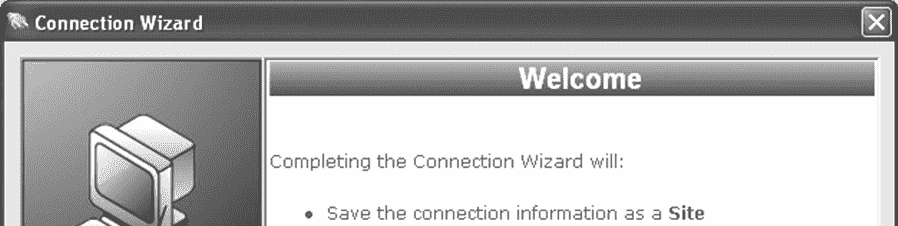(img/30f0fa1c6cb552c908695ea335a9f268_5_1.png)(img/30f0fa1c6cb552c908695ea335a9f268_5_2.png)(img/30f0fa1c6cb552c908695ea335a9f268_5_3.png) 按钮。

4. 当出现站点名称（Site Name）屏幕时，在站点名称框中输入：

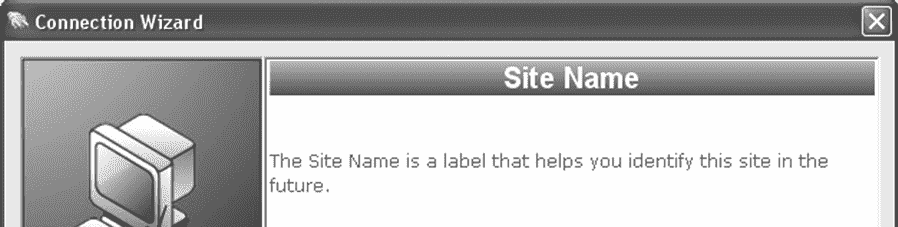(img/30f0fa1c6cb552c908695ea335a9f268_6_1.png)(img/30f0fa1c6cb552c908695ea335a9f268_6_2.png)(img/30f0fa1c6cb552c908695ea335a9f268_6_3.png) 按钮。

5. 当出现服务器地址（Server Address）屏幕时，在服务器地址框中输入你服务器的主机地址。它可以是：`www.visibooks.com`, `washington.patriot.net`, `207.176.7.217`。

(img/30f0fa1c6cb552c908695ea335a9f268_7_1.png)(img/30f0fa1c6cb552c908695ea335a9f268_7_2.png)(img/30f0fa1c6cb552c908695ea335a9f268_7_3.png) 按钮。

**提示：** 你从你的 Web 服务器管理员处获取网站的服务器地址以及用户名和密码。

6. 当出现用户名和密码（User Name and Password）屏幕时，输入你的用户名和密码。

(img/30f0fa1c6cb552c908695ea335a9f268_8_1.png)(img/30f0fa1c6cb552c908695ea335a9f268_8_2.png)

7. 当出现连接类型（Connection Type）屏幕时，将连接类型设置为 `FTP`。

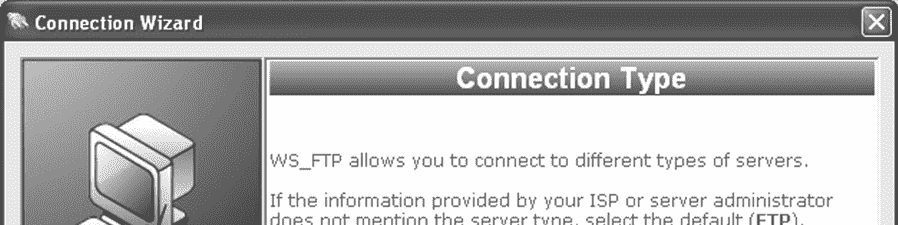(img/30f0fa1c6cb552c908695ea335a9f268_9_1.png)(img/30f0fa1c6cb552c908695ea335a9f268_9_2.png) 按钮。

8. 当出现完成（Finish）屏幕时，点击

(img/30f0fa1c6cb552c908695ea335a9f268_10_1.png)(img/30f0fa1c6cb552c908695ea335a9f268_10_2.png) 按钮。

9. `WS_FTP` 将连接到你的服务器：

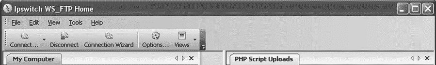(img/30f0fa1c6cb552c908695ea335a9f268_11_1.png)(img/30f0fa1c6cb552c908695ea335a9f268_11_2.png)(img/30f0fa1c6cb552c908695ea335a9f268_11_3.png)(img/30f0fa1c6cb552c908695ea335a9f268_11_4.png)

10. 在右侧的上传面板中，双击 `html` 文件夹，即服务器上包含你 Web 页面的文件夹。你现在可以看到服务器上的网站内容。

11. 在右侧的上传面板中，导航到该站点。

**提示：** 你可能需要点击

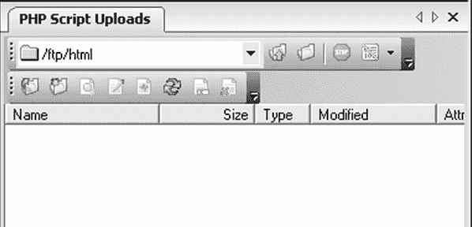(img/30f0fa1c6cb552c908695ea335a9f268_12_1.png)(img/30f0fa1c6cb552c908695ea335a9f268_12_2.png)(img/30f0fa1c6cb552c908695ea335a9f268_12_3.png) 图标返回上一级目录。

12. 当创建目录（Make directory）窗口出现时，在文本框中输入：`phpscripts`。

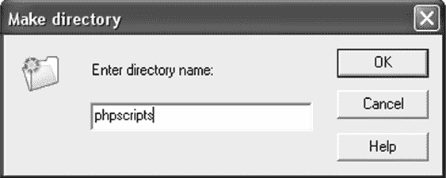 按钮。

你现在可以在右侧面板看到一个名为 `phpscripts` 的目录：

(img/30f0fa1c6cb552c908695ea335a9f268_13_2.png)(img/30f0fa1c6cb552c908695ea335a9f268_13_3.png)

15. 关闭 `WS_FTP`。

### 创建简单的脚本

1. 在你的硬盘驱动上创建一个名为 `PHPSCRIPTS` 的文件夹。
2. 打开你电脑上的记事本程序。
3. 点击**文件 (File)**，然后点击**打开 (Open)**。

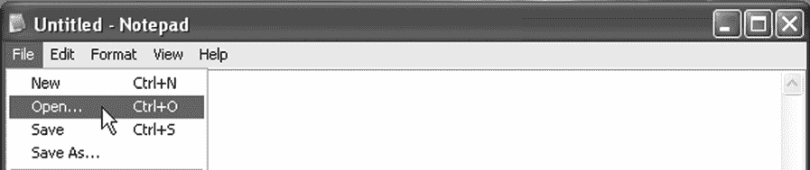

4. 点击**文件 (File)**，然后点击**保存 (Save)**。

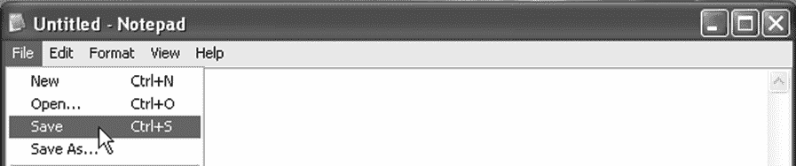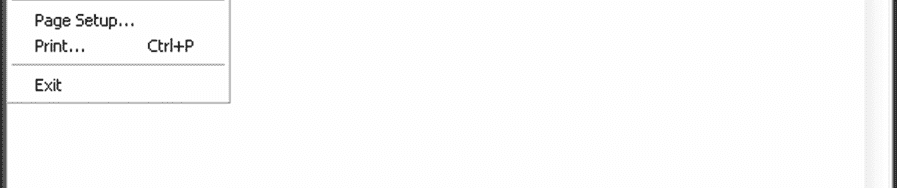

5. 当**另存为 (Save As)**窗口出现时，导航到 `PHPSCRIPTS` 文件夹，然后双击它。`PHPSCRIPTS` 文件夹应该出现在**保存位置 (Save In)** 框中。

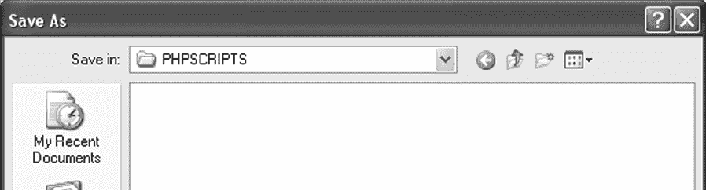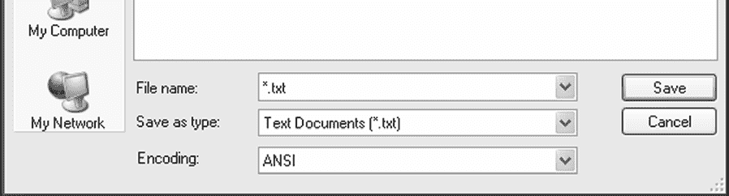

6. 在**文件名 (File Name)**文本框中输入：`simple.php`

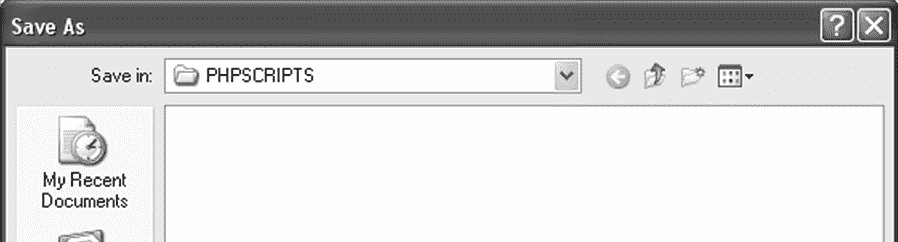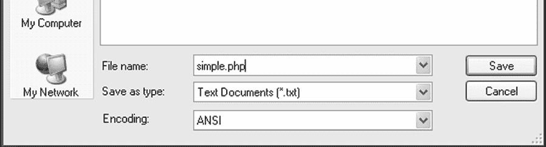

7. 点击按钮。

8. 在空白文档窗口中输入：

```
<?php
print "Welcome to ACME AUTO";
?>
```

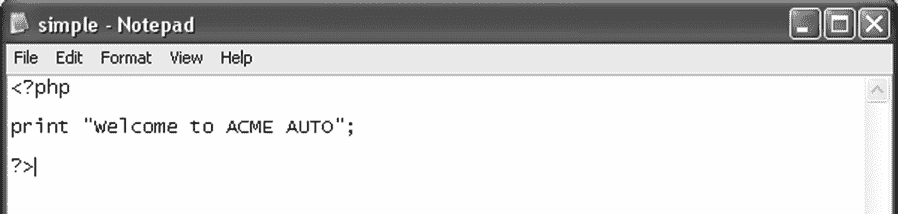

**提示：** 你现在正在使用 `PHP` 语言向 Web 服务器输入命令。有时这些命令是区分大小写的。`PHP` 命令请使用小写字母——即所有未包含在引号内的内容，例如 `print "Welcome to ACME AUTO";` 。此外，不要忘记在每行的末尾输入分号（`;`）。为了让你的命令能够生效或“执行”，它们在末尾需要一个分号（`;`）。忘记写分号是大多数计算机语言中最常见的编程错误。

9. 保存脚本。

以下是此 `PHP` 脚本中每行代码的作用：

- `<?php` ：这是 `PHP` 的开始标签。`PHP` 代码始终写在 `PHP` 开始标签和结束标签之间。
- (空行)：在下一行代码之前有一行空行。你可以在整个 `PHP` 脚本中使用空行。空行允许你将代码段分组，使脚本更易于阅读。
- `print "Welcome to ACME AUTO";` ：这条 `print` 命令告诉 Web 服务器向浏览器窗口“打印（print）”引号之间的单词。请记住：若要执行一个命令字符串，其末尾必须有一个分号（`;`）。
- `?>` ：这是 `PHP` 的结束标签。在该结束标签之后，除非有另一个开始标签，否则无法编写更多的 `PHP` 代码。

### 上传脚本

1. 打开 `WS_FTP` 并导航到你 Web 服务器上的主目录。它看起来应该是这样的：

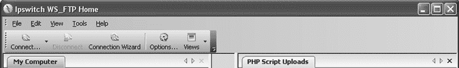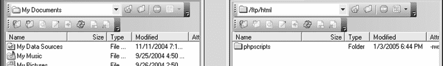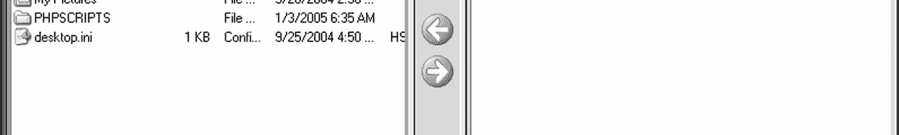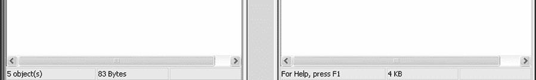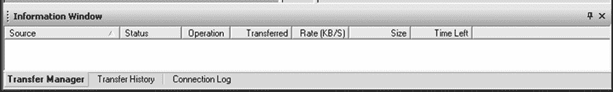

2. 在左侧的**我的电脑 (My Computer)** 格中，导航到电脑上的 `PHPSCRIPTS` 文件夹。

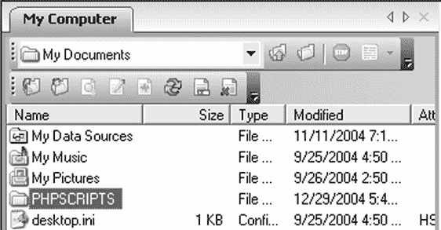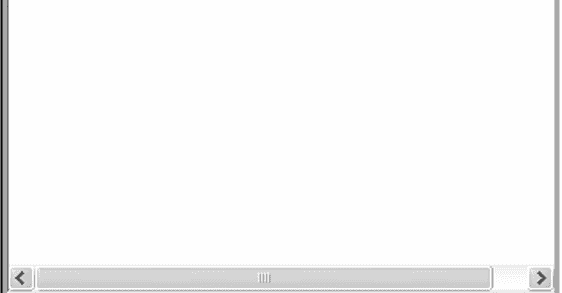

3. 双击 `PHPSCRIPTS` 文件夹。`simple.php` 将会出现。

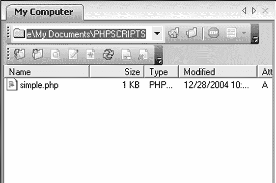

4. 在右侧的**PHP上传 (PHP Uploads)** 格中，导航到你 Web 网站的 `phpscripts` 目录。

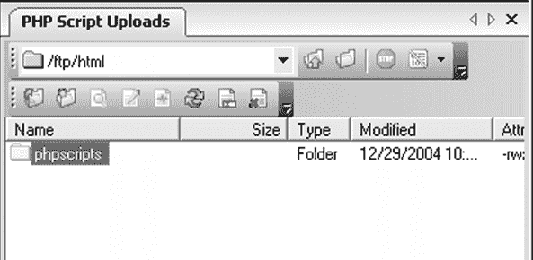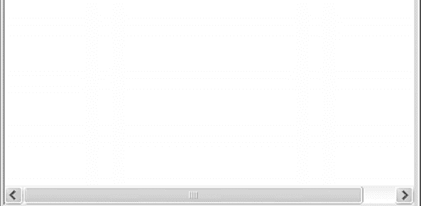

5. 双击 `phpscripts` 目录。格应该是应该是：

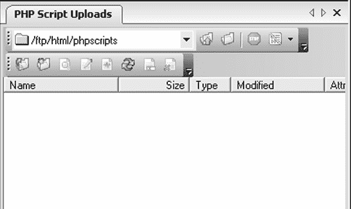

6. 在**我的电脑 (My Computer)** 格中点击 `simple.php`，然后点击按钮。

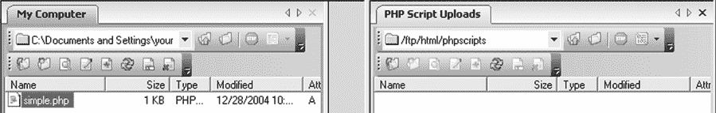 `simple.php` 现在应该出现在**PHP上传 (PHP Uploads)** 格中：

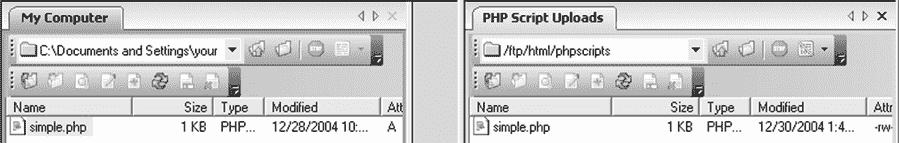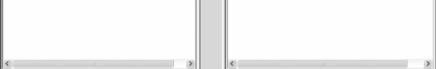

### 从网页运行脚本

1. 使用记事本创建一个带有以下代码的新网页：

```html
<html>
<head>
<title>运行你的PHP脚本</title>
</head>
<body>
点击 <a href="http://www.yourwebsite.com/phpscripts/simple.php">这个链接</a>运行你的第一个PHP脚本。
</body>
</html>
```

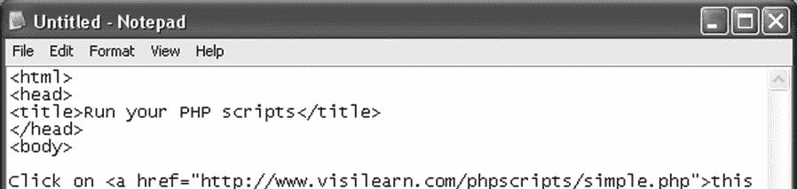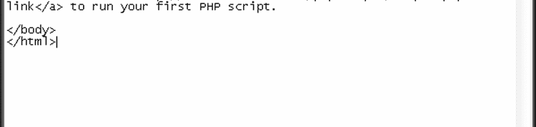

2. 将网页保存为电脑上 `PHPSCRIPTS` 文件夹中的 `phplinks.html`。

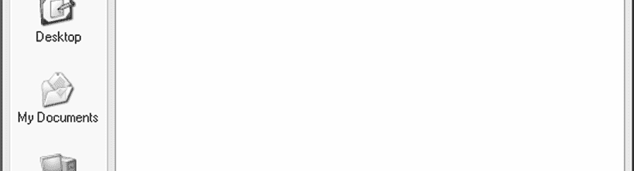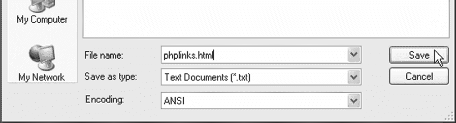

3. 在 `WS_FTP` 中，将 `phplinks.html` 上传到你 Web 网站的主目录。

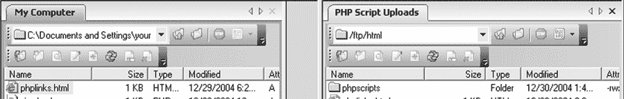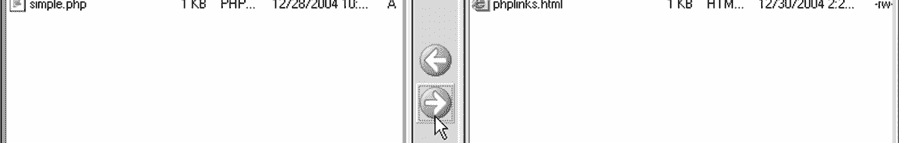

**提示：** 不要将 `phplinks.html` 上传到 `phpscripts` 目录。将其放在于 `index.html` 所在的主目录。

4. 打开 Web 浏览器并访问：`www.yourwebsite.com/phplinks.html`

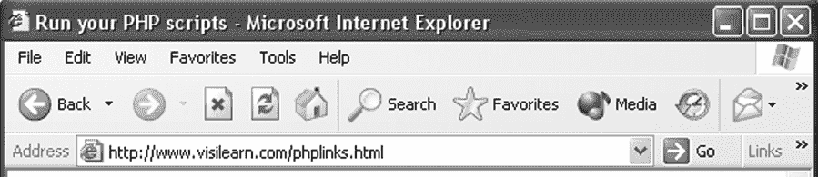

5. 点击链接。输出应该是这样的：

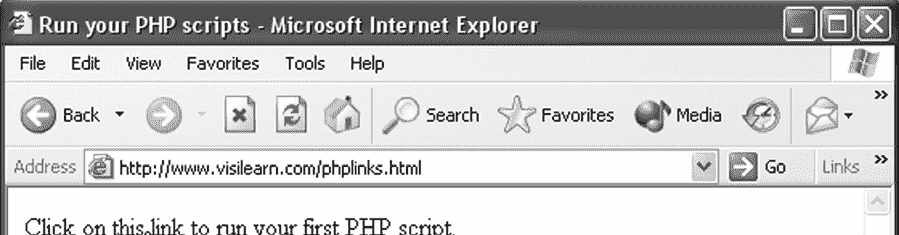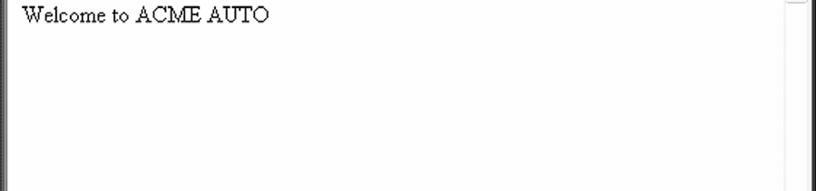

### 插入注释

1. 使用记事本创建一个新脚本：

```php
<?php
// 解释代码的注释
/*
一组文字可以这样注释。
这些注释不会影响脚本的运行。
*/
print "Welcome to ACME!"; // 同行的注释
?>
```

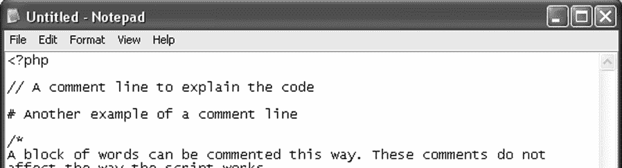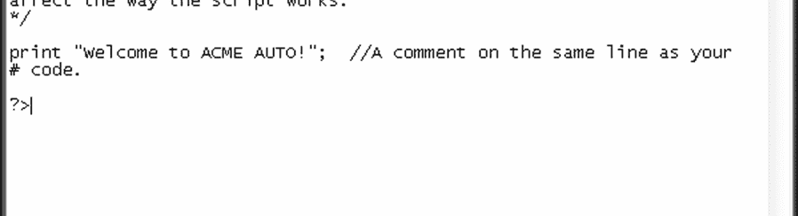

**提示：** 如果你在脚本中编写注释并它换行了，它在前面需要一个新的 `#` 字符。

错误：

第二行让浏览器显示输出。

正确：

```
# 第二行让浏览器
# 显示输出。
```

2. 将此脚本保存为电脑上 `PHPSCRIPTS` 文件夹中的 `comments.php`。

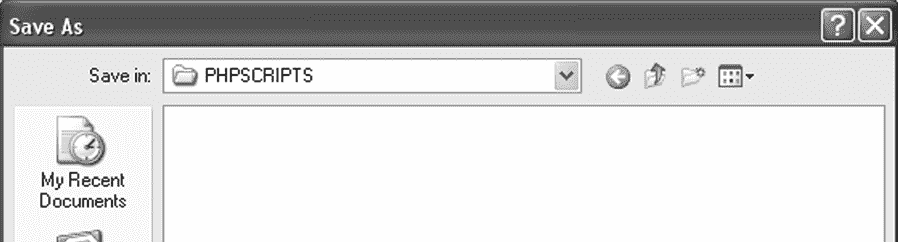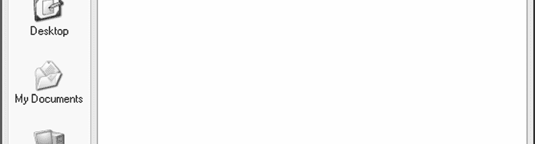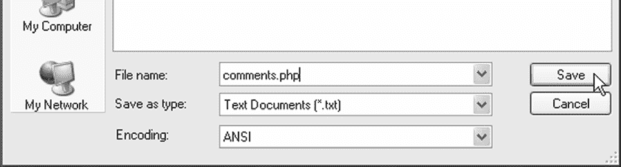

3. 打开 `WS_FTP` 并将 `comments.php` 脚本上传到你 Web 网站的 `phpscripts` 目录。

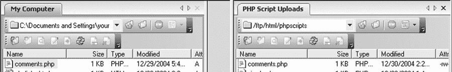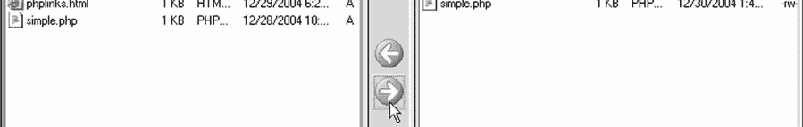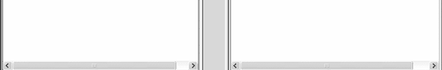

4. 添加一个链接来查看 `format.php` 的输出：

```html
<html>
<head>
<title>运行你的 PHP 脚本</title>
</head>
<body>
点击 <a href="http://www.yourwebsite.com/PHPSCRIPTS/sample.php">这个链接</a>来运行你的第一个 PHP 脚本。
<p><a href="http://www.yourwebsite.com/phpscripts/comments.php">2. 你可以在 PHP 代码中包含隐藏注释。</a></p>
</body>
</html>
```


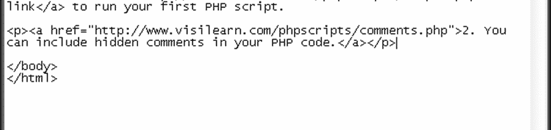

## 学习基础

### 6.

保存`phplinks.html`，然后使用`WS_FTP`将其上传到网站的根目录。

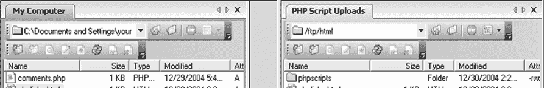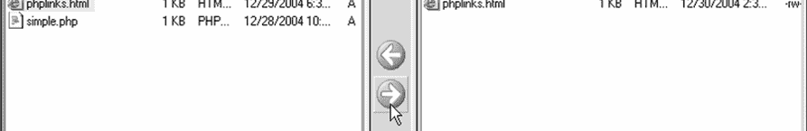

**提示：** 这和之前的`phplinks.html`所在位置相同。当`WS_FTP`提示你替换现有文件时，点击按钮。

### 7.

打开浏览器并访问：

`www.yourwebsite.com/phplinks.html`

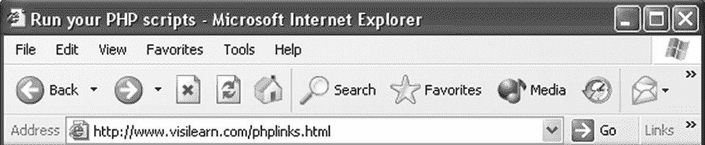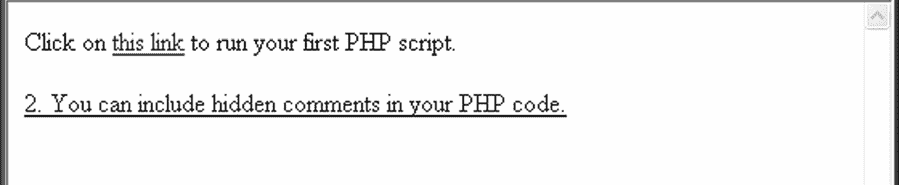

### 8.

点击`2. 你可以在 PHP 代码中包含隐藏注释`链接。


输出应该如下所示：


### 9.

关闭记事本和`WS_FTP`。

## 使用 HTML 格式化输出

### 1.

在记事本中，用以下代码创建一个新脚本：

```html
<html>
<head>
<title>HTML 与 PHP 结合</title>
</head>
<body>
<h1 align=center>
<?php
print "Welcome to ACME AUTO";
?>
</h1>
</body>
</html>
```


### 2.

将脚本保存为`format.php`并于`PHPSCRIPTS`文件夹中。

**提示：** 此 PHP 脚本包含了格式化输出文本的 HTML 标签。

注意，`<h1 align=center>`标签位于 PHP 代码之外。它是标准的 HTML。

### 3.

将`format.php`上传到网站中的`phpscripts`目录。


### 4.

在记事本中打开`phplinks.html`。

### 5.

添加一个链接来查看`format.php`的输出：

```html
<p><a href="http://www.yourwebsite.com/phpscripts/comments.php">2. 你可以在 PHP 代码中包含隐藏注释。</a></p>

<p><a href="http://www.yourwebsite.com/phpscripts/format.php">3. 你可以在 PHP 代码中包含 HTML 标签来格式化文本。</a></p>
```


### 6.

保存`phplinks.html`，然后使用`WS_FTP`将其上传到网站的根目录。


### 7.

打开浏览器并访问：

`www.yourwebsite.com/phplinks.html`


### 8.

点击`3. 你可以在 PHP 代码中包含 HTML 标签来格式化文本`链接。


输出应该如下所示：


### 9.

关闭记事本和`WS_FTP`。

## 练习：学习基础

### 1.

在硬盘上创建一个名为`PRACTICE`的新文件夹。

### 2.

打开记事本并创建一个名为`cars.php`的 PHP 脚本。

编写脚本使其在浏览器窗口中输出：

> 快速车、复古车和经典车，我们都有自己喜欢的车。

### 3.

将`cars.php`保存到电脑上的`PRACTICE`文件夹中。

### 4.

打开`WS_FTP`，在你的网站中创建一个名为`practicephp`的目录。

### 5.

将`cars.php`上传到网站中的`practicephp`目录。

### 6.

使用记事本创建一个名为`practice.html`的新网页，其中包含指向 PHP 脚本`cars.php`的链接：

```html
<p><a href="http://www.yourwebsite.com/practicephp/cars.php">关于汽车</a></p>
```

### 7.

保存`practice.html`，然后将其上传到网站的根目录。

### 8.

在浏览器中，访问：

`www.yourwebsite.com/practice.html`

并点击`关于汽车`链接。

浏览器窗口应该如下：


### 9.

关闭记事本和`WS_FTP`。

## 使用变量

### 什么是变量？

变量是脚本中信息的占位符。在 PHP 中，变量可以是单个信息，也可以是一个列表。它们始终以`$`符号开头，并且区分大小写。例如，你可以轻松地将 PHP 脚本中的“brown”改为“blue”：

```php
$color = "brown";
```

不要让我的眼睛`$color`

## 给变量赋值数字

### 1.

在记事本中，用以下代码创建一个新脚本：

```php
<?php
$cars_on_lot = 100;
?>

<p>我们的 $cars_on_lot 辆车中哪辆适合你？</p>
```

## 打印变量

### 2.

在本节中，你将学习如何：

- 打印变量
- 使用变量

## 变量操作

### 3.

打开`WS_FTP`，然后将`numbers.php`上传到网站的`phpscripts`目录。


### 4.

在记事本中，打开`phplinks.html`。

### 5.

插入指向`numbers.php`的新链接：

```html
<p><a href="http://www.yourwebsite.com/phpscripts/format.php">3. 你可以在 PHP 代码中包含 HTML 标签以格式化文本。</a></p>

<p><a href="http://www.yourwebsite.com/phpscripts/numbers.php">4. 给变量赋值数字。</a></p>
```


### 6.

保存`phplinks.html`，然后将其上传到网站的根目录。


### 7.

使用浏览器，访问：

`www.yourwebsite.com/phplinks.html`

### 8.

点击`4. 给变量赋值数字`链接。


输出结果应该是这样的：


### 给变量赋值文本

#### 1.

使用记事本用以下代码创建一个新脚本：

```php
<?php
$company_name = "ACME AUTO";
$cars_on_lot = 100;
$deal_of_day = "Ford Mustang";
print "<p>Welcome to $company_name!</p>";
print "<p>Which one of our $cars_on_lot cars is right for you?</p>";
print "<p>Today we have a GREAT deal on a $deal_of_day.</p>";
?>
```


#### 2.

以下是该脚本中相关行的作用：

- `$company_name = "ACME AUTO";` 将文本`ACME AUTO`赋值给变量`$company_name`。
- `$deal_of_day = "Ford Mustang";` 将文本`Ford Mustang`赋值给变量`$deal_of_day`。
- `$cars_on_lot = 100;` 将数字`100`赋值给变量`$cars_on_lot`。
- `print "<p>Welcome to $company_name!</p>\n";` 向浏览器窗口打印“Welcome to”字样，然后插入赋值给变量`$company_name`的文本（“ACME AUTO”）。
- `print "<p>Which one of our $cars_on_lot cars is right for you?</p>";` 向浏览器窗口打印并将赋值给变量`$cars_on_lot`的数字（100）。
- `print "<p>Today we have a GREAT deal on a $deal_of_day.</p>";` 向浏览器窗口打印并将赋值给变量`$deal_of_day`的文本（“Ford Mustang”）。

`print "<p>Today we have a GREAT deal on a $deal_of_day.</p>";` 向浏览器窗口打印并将赋值给变量`$deal_of_day`的文本（“Ford Mustang”）。

### 3.

将`numbers.php`上传到`phpscripts`目录。

### 4.

在记事本中，打开`phplinks.html`。

### 5.

插入一个指向`numbers.php`的新链接：

```html
<p><a href="http://www.yourwebsite.com/phpscripts/format.php">3. 你可以在 PHP 代码中包含 HTML 标签以格式化文本。</a></p>

<p><a href="http://www.yourwebsite.com/phpscripts/numbers.php">4. 给变量赋值数字。</a></p>
```


### 6.

保存`phplinks.html`，然后将其上传到网站的根目录。


### 7.

使用浏览器，访问：

`www.yourwebsite.com/phplinks.html`

### 8.

点击`4. 给变量赋值数字`链接。


输出结果应该是这样的：


### 给变量赋值文本

#### 1.

使用记事本用以下代码创建一个新脚本：

```php
<?php
$company_name = "ACME AUTO";
$cars_on_lot = 100;
$deal_of_day = "Ford Mustang";
print "<p>Welcome to $company_name!</p>";
print "<p>Which one of our $cars_on_lot cars is right for you?</p>";
print "<p>Today we have a GREAT deal on a $deal_of_day.</p>";
?>
```


#### 2.

以下是该脚本中相关行的作用：


- `$company_name = "ACME AUTO";` 将文本`ACME AUTO`赋值给变量`$company_name`。

- `$deal_of_day = "Ford Mustang";` 将文本`Ford Mustang`赋值给变量`$deal_of_day`。

- `$cars_on_lot = 100;` 将数字`100`赋值给变量`$cars_on_lot`。

- `print "<p>Welcome to $company_name!</p>\n";` 向浏览器窗口打印“Welcome to”字样，然后插入赋值给变量`$company_name`的文本（“ACME AUTO”）。

- `print "<p>Which one of our $cars_on_lot cars is right for you?</p>";` 向浏览器窗口打印并将赋值给变量`$cars_on_lot`的数字（100）。

- `print "<p>Today we have a GREAT deal on a $deal_of_day.</p>";` 向浏览器窗口打印并将赋值给变量`$deal_of_day`的文本（“Ford Mustang”）。

## 变量操作

**55**

**3.** 将`numbers.php`上传到`phpscripts`目录。

**4.** 在记事本中，打开`phplinks.html`。

**5.** 插入一个指向`numbers.php`的新链接：

```html
<p><a href="http://www.yourwebsite.com/phpscripts/format.php">3. 你可以在 PHP 代码中包含 HTML 标签以格式化文本。</a></p>

<p><a href="http://www.yourwebsite.com/phpscripts/numbers.php">4. 给变量赋值数字。</a></p>
```

变量操作 

58

## 使用双引号与单引号进行打印

1. 使用以下代码创建一个新脚本：

```php
<?php
# 使用双引号 (") 打印
# 与单引号 ('') 对对比
$cars_on_lot = 100;
print "<p>Welcome to <b>ACME AUTO!</b></p>\n";
# 双引号
print "<p>Which one of our $cars_on_lot cars is right for you?</p>\n";
# 单引号
print '<p>Which one of $cars_on_lot is right for you?</p>\n';
?>
```

2. 将脚本保存为`quotes.php`并存放在`PHPSCRIPTS`文件夹中。

以下是该脚本中相关行的作用：

- `print "<p>Which one of our $cars_on_lot cars is right for you?</p>\n";`

  在上面的`print`语句中使用“双引号”，赋值给变量`$cars_on_lot`的数字 (100) 会被打印到浏览器窗口。

- `print '<p>Which one of $cars_on_lot is right for you?</p>\n';`

  在上面的`print`语句中使用‘单引号’，文本`$cars_on_lot`会连周围的文字一起打印到浏览器窗口。

3. 将`quotes.php`上传到你网站的`phpscripts`目录。

4. 打开`phplinks.html`并插入指向`quotes.php`的新链接：

```html
<p><a href="http://www.yourwebsite.com/phpscripts/quotes.php">7. 双引号与单引号。</a></p>
```

5. 保存`phplinks.html`，然后将其上传到你网站的根目录。

6. 在浏览器中，访问：

`www.yourwebsite.com/phplinks.html`

7. 点击`7. 双引号与单引号`链接。

输出应该如下：

[](img/30f0fa1c6cb552c908695ea335a9f268_62_1.png)[](img/30f0fa1c6cb552c908695ea335a9f268_62_2.png)

**提示：** 在`print`函数中使用单引号（‘）

```
print ‘<p>Which one of $cars_on_lot is right for you?</p>\n’;
```

会原样打印两个引号之间的所有内容。（HTML 标签除外，例如`<p>`和`</p>`标签。）


如果你想显示变量的值，请使用双引号（“”）：

```php
print "<p>Which one of our $cars_on_lot cars is right for you?</p>\n";
```


变量操作 

62

## 使用变量列表

创建数字变量列表

1. 使用以下代码创建一个新脚本：

```php
<?php
# 此脚本演示了如何创建一个数字数组。
$AcmeInventory = array(178,286,387);
print "$AcmeInventory[0]<br>\n";
print "$AcmeInventory[1]<br>\n";
print "$AcmeInventory[2]<br>\n";
print "<p>We just created a list of numbers using an array!";
?>
```

**提示：** 变量列表被称为数组。

2. 将脚本保存为`numberlist.php`并存放在`PHPSCRIPTS`文件夹中。

以下是脚本相关行的作用：

- `$AcmeInventory = array(178,286,387);`

  数字 178、286 和 387 被赋值给变量`$AcmeInventory`。

- `print "$AcmeInventory[0]<br>\n";`

  打印数组中的第一个数字 178。

- `print "$AcmeInventory[1]<br>\n";`

  打印数组中的第二个数字 286。

- `print "$AcmeInventory[2]<br>\n";`

  打印数组中的第三个数字 387。

3. 将`numberlist.php`上传到你网站的`phpscripts`目录。

4. 打开`phplinks.html`并插入指向`numberlist.php`的新链接：

```html
<p><a href="http://www.yourwebsite.com/phpscripts/numberlist.php">8. 创建数字列表。</a></p>
```

5. 保存`phplinks.html`，然后将其上传到你网站的根目录。

6. 在浏览器中，访问：

`www.yourwebsite.com/phplinks.html`

7. 点击`8. 创建数字列表`链接。

输出应该如下：

[](img/30f0fa1c6cb552c908695ea335a9f268_66_1.png)[](img/30f0fa1c6cb552c908695ea335a9f268_66_2.png)

变量操作 

65

创建文本变量列表

1. 使用以下代码创建一个新脚本：

```php
<?php
# 此脚本演示了如何创建一个文本数组。
$AcmeCars = array("Ford","Dodge","Chevy");
print "$AcmeCars[0]<br>\n";
print "$AcmeCars[1]<br>\n";
print "$AcmeCars[2]<br>\n";
print "<p>We just created a text array!</p>";
?>
```

2. 将脚本保存为`textlist.php`并存放在`PHPSCRIPTS`文件夹中。

以下是脚本相关行的作用：

- `$AcmeCars = array("Ford","Dodge","Chevy");`

  单词 "Ford"、"Dodge" 和 "Chevy" 被赋值给变量`$AcmeCars`。

- `print "$AcmeCars[0]<br>\n";`

  打印数组中的第一个单词 "Ford"。

- `print "$AcmeCars[1]<br>\n";`

  打印数组中的第二个单词 "Dodge"。

- `print "$AcmeCars[2]<br>\n";`

  打印数组中的第三个单词 "Chevy"。

3. 将`textlist.php`上传到你网站的`phpscripts`目录。

4. 打开`phplinks.html`并插入指向`textlist.php`的新链接：

```html
<p><a href="http://www.yourwebsite.com/phpscripts/textlist.php">9. 创建单词列表。</a></p>
```

5. 保存`phplinks.html`，然后将其上传到你网站的根目录。

6. 在浏览器中，访问：

`www.yourwebsite.com/phplinks.html`

7. 点击`9. 创建单词列表`链接。

输出应该如下：

[](img/30f0fa1c6cb552c908695ea335a9f268_69_1.png)[](img/30f0fa1c6cb552c908695ea335a9f268_69_2.png)

变量操作 

68

## 练习：变量操作

1. 写一个脚本，使用单个变量指定桶里有 16 只猴子，然后将其打印到浏览器。

2. 将脚本`monkeys.php`保存到电脑上的`PRACTICE`文件夹中。

3. 将其上传到你网站的`practicephp`目录。

4. 在`practice.html`中添加段落“桶里有多少只猴子?”并将该段落链接到`monkeys.php`。

5. 将`practice.html`上传到你网站的根目录。

6. 在浏览器中查看`practice.html`，然后点击链接。

它的输出应该如下：


变量操作 

69

7. 写一个脚本创建一个总统列表（数组）：James Buchanan, George Washington, Millard Fillmore …打印文本“这是革命中不可或缺的人物:” …然后打印列表中的第二个名字。

8. 将脚本保存为`presidents.php`并放在电脑上的`PRACTICE`文件夹中。

9. 将其上传到你网站的`practicephp`目录。

10. 在`practice.html`中添加段落“**The indispensable man**”并将该段落链接到`presidents.php`。

11. 将`practice.html`上传到你网站的根目录。

12. 在浏览器中查看`practice.html`，然后点击链接。

输出应该如下：

[](img/30f0fa1c6cb552c908695ea335a9f268_72_1.png)[](img/30f0fa1c6cb552c908695ea335a9f268_72_2.png)

## 数字操作

在本节中，你将学习如何：

- 执行计算

- 自增/自减

- 生成随机数

### 执行计算

1. 使用以下代码创建一个新脚本：

```php
<?php
$var1 = 5;
$var2 = 2;
$answer = $var1 + $var2;
print "$var1 plus $var2.";
?>
```

2. 将脚本保存为`add.php`并放入`PHPSCRIPT`文件夹中。

脚本中相关代码的作用是：

- `$answer = $var1 + $var2`

将变量`$var1`和`$var2`相加，并将结果赋值给变量`$answer`。

由于`$var1`为 5，`$var2`为 2，`$answer`的值为 7。

3. 将`add.php`上传到你网站的`PHPSCRIPT`目录。

4. 打开`phplinks.html`并插入一个指向`add.php`的新链接：

```html
<p><a href="http://www.yourwebsite.com/phpscripts/add.php">10. 五加二。</a></p>
```

5. 保存`phplinks.html`，然后将其上传到你网站的根目录。

6. 在浏览器中，访问：

`www.yourwebsite.com/phplinks.html`

7. 点击`10. 五加二`链接。

输出应该如下：

(img/30ffa1c6cb552c9086ea335a9f268_75_1.png)(img/30ffa1c6cb552c9086ea335a9f268_75_2.png)

**提示：** 若要执行减法，只需将脚本中的`+`号改为`–`号。

(img/30ffa1c6cb552c9086ea335a9f268_76_1.png)(img/30ffa1c6cb552c9086ea335a9f268_76_2.png)

若要执行乘法，只需将其改为`*`号。

若要执行除法，将其改为`/`号。

### 自增/自减

1. 使用以下代码创建一个新脚本：

```php
<?php
$cars_on_lot = 10;
print "We have $cars_on_lot cars.\n<br>";
print "We got another new car.\n<br>";
$cars_on_lot++;
print "Now we have $cars_on_lot cars!\n<p>";
print '<b>$cars_on_lot++</b> 在 PHP 中等同于 <b>$cars_on_lot + 1。</b>';
?>
```

2. 将脚本保存为`autoplus.php`并放入`PHPSCRIPT`文件夹中。

脚本中相关代码的作用是：

- `$cars_on_lot++;`

自增器（`++`）为变量`$cars_on_lot`加 1。

- `print '<b>$cars_on_lot++</b> 在 PHP 中等同于 <b>$cars_on_lot + 1。</b>';`

输出文本：`$cars_on_lot++` 在 PHP 中等同于 `$cars_on_lot + 1`。

3. 将`autoplus.php`上传到你网站的`phpscripts`目录。

4. 打开`phplinks.html`并插入一个指向`autoplus.php`的新链接：

```html
<p><a href="http://www.yourwebsite.com/phpscripts/autoplus.php">11. 自动将数字增加 1。</a></p>
```

5. 保存`phplinks.html`，然后将其上传到你网站的根目录。

6. 在浏览器中，访问：

`www.yourwebsite.com/phplinks.html`

7. 点击`11. 自动将数字增加 1`链接。

输出应该如下：

(img/30ffa1c6cb552c9086ea335a9f268_78_1.png)

**提示：** 若要自动减 1，将上述脚本中的自增器 (`++`) 改为自减器 (`--`)。

(img/30ffa1c6cb552c9086ea335a9f268_79_1.png)(img/30ffa1c6cb552c9086ea335a9f268_79_2.png)

### 生成随机数

1. 使用以下代码创建一个新脚本：

```php
<?php
$random_number = rand(1,10);
print "<p>1 到 10 之间的幸运数字是 $random_number</p>";
print "点击浏览器上的刷新获取随机数。";
?>
```

2. 将脚本保存为`random.php`并放入`PHPSCRIPT`文件夹中。

脚本中相关代码的作用是：

- `$random_number = rand(1,10);`

`rand()`命令生成 1 到 10 之间的随机数。将其赋值给变量`$random_number`。

- `print "<p>1 到 10 之间的幸运数字是 $random_number</p>";`

向浏览器窗口打印“1 到 10 之间的幸运数字是”以及变量`$random_number`的值。


输出“1 到 10 之间的幸运数字是 X”。由于是随机数，屏幕上的数字会不同。

3. 将`random.php`上传到你网站的`phpscripts`目录。

4. 打开`phplinks.html`并插入一个指向`random.php`的新链接：

```html
<p><a href="http://www.yourwebsite.com/phpscripts/random.php">12. 生成随机数。</a>a></p>
```

5. 保存`phplinks.html`，然后将其上传到你网站的根目录。

6. 在浏览器中，访问：

`www.yourwebsite.com/phplinks.html`

7. 点击`12. 生成随机数`链接。

输出应该如下：

(img/30ffa1c6cb552c9086ea335a9f268_81_1.png)

### 练习：数字操作

1. 编写一个计算`347 * 221`的脚本。

2. 将脚本保存为`multiply.php`并放入电脑上的`PRACTICEPHP`文件夹中。

3. 将其上传到你网站的`practicephp`目录。

4. 在`phplinks.html`中添加段落“347 乘以 221 等于？”并将该段落链接到`multiply.php`。

5. 将`phplinks.html`保存到你网站的根目录。

6. 在浏览器中查看`phplinks.html`，然后点击新链接。

输出应该如下：

(img/30ffa1c6cb552c908695ea335a9f268_82_1.png)

7. 编写一个生成 1 到 50 之间随机整数的脚本。然后让脚本将该数字加 1。

8. 将脚本保存为`randinc.php`并放入电脑上的`PRACTICEPHP`文件夹中。

9. 将其上传到你网站的`practicephp`目录。

10. 在`phplinks.html`中添加段落“随机数加一”并将该段落链接到`randinc.php`。

11. 在浏览器中查看`phplinks.html`，然后点击新链接。

输出应该如下：

(img/30ffa1c6cb552c908695ea335a9f268_83_1.png)

## 用户函数

在本节中，你将学习如何：

- 创建用户函数
- 将表单输入传递给脚本

### 创建用户函数

1. 使用以下代码创建一个新页面：

```html
<html>
<head>
<title>创建用户函数</title>
<?php
function myFunction($company) {
    print("<p>欢迎来到 $company</p>");
}
?>
</head>
<body>
<h3>开始</h3>
<?php
$company = "Acme Auto";
myFunction($company);
?>
</body>
</html>
```

**什么是用户函数？**

它是你在程序中创建的一段可重使用的代码块。它有时被称为子程序。

用户函数

2. 将页面保存为`functionsimple.php`并存放在`PHPSCRIPTS`文件夹中。

以下是脚本中相关行的作用：

- `function myFunction($company) {`：`function`是创建函数的 PHP 命令。`myFunction`是用户函数的名称。变量`$company`通过括号`()`内部被传递到用户函数中。
- `{`：标记用户函数的开始。
- `print("<p>Welcome to $company</p>");`：这是用户函数执行的操作。它向浏览器窗口打印文本“`Welcome to Acme Auto!`”。这是因为变量`$company`被赋予了值“Acme Auto”。
- `}`：标记用户函数的结束。
- `<<body>`：这个 HTML 标签标记了脚本中在浏览器中可见部分的开始。
- `<?php`：标记 PHP 脚本中可见部分的开始。
- `$company = “Acme Auto";`：给变量`$company`赋值文本值“Acme Auto”。
- `myFunction($company);`：执行在上方`myFunction`用户函数中编写的代码。这里是将变量`$company`传递到用户函数的地方。
- `?>`：标记 PHP 脚本可见部分的结束。

3. 将`functionsimple.php`上传到你网站的`phpscripts`目录。

4. 打开`phplinks.html`并插入一个指向`functionsimple.php`的新链接：

```html
<p><a href="http://www.yourwebsite.com/phpscripts/functionsimple.php">13. 执行一个用户函数。</a></p>
```

5. 保存`phplinks.html`，然后将其上传到你网站的根目录。

6. 在浏览器中，访问：

`www.yourwebsite.com/phplinks.html`

### PHP 页面

通过 PHP，你可以创建嵌入了 PHP 脚本的 HTML 页面。

要让这些页面运行起来，你只需将扩展名改为`.php`而不是`.html`即可。

示例：`page.php`。

7. 点击`13. 执行一个用户函数`链接。

输出结果应该如下所示：

[](img/30f0fa1c6cb552c908695ea335a9f268_90_2.png)

### 向脚本传递表单输入

1. 使用此代码创建一个新的 Web 页面：

```html
<html>

<body>

<form method="post" action="http://www.yourwebsite.com/phpscripts/formoutput.php">

你叫什么名字？

<input type="text" name="yourname"><br>

<input type="submit" value="Submit">

</form>

</body>

</html>
```

2. 将页面保存为`simpleform.html`并存放在你电脑上的`PHPSCRIPTS`文件夹中。

以下是该页面中相关行的作用：

- `<form method="post" action="http://www.yourwebsite.com/phpscripts/formoutput.php">`：当点击表单上的  按钮时，脚本`formoutput.php`将执行。
- `<input type="text" name="yourname">`：这在页面上放置了一个名为`yourname`的文本框。

3. 将`simpleform.html`上传到你网站的根目录。

4. 使用此代码创建一个新脚本：

```php
<?php

print "Hi $yourname";

?>
```

5. 将脚本保存为`formoutput.php`并存放在电脑的`PHPSCRIPTS`文件夹中。

6. 这是该脚本中相关行的作用：

- `print "Hi $yourname";`：显示用户输入的名称。变量`$yourname`被赋予了来自`simpleform.php`页面文本框`yourname`的值。

7. 将其上传到你网站的`phpscripts`目录。

8. 打开`phplinks.html`并插入一个指向`simpleform.html`的新链接：

```html
<p><a href="http://www.yourwebsite.com/simpleform.html">14. 将表单输入传递给脚本。</a></p>
```

9. 保存`phplinks.html`，然后将其上传到你网站的根目录。

10. 在浏览器中，访问`www.yourwebsite.com/phplinks.html`。

11. 点击`14. 将表单输入传递给脚本`[](img/30f0fa1c6cb552c908695ea335a9f268_93_1.png)[](img/30f0fa1c6cb552c908695ea335a9f268_93_2.png)

12. 在文本框中输入你的名字，然后点击  按钮。输出应该像这样：[](img/30f0fa1c6cb552c908695ea335a9f268_94_2.png)

### 练习：用户函数

1. 复制`simpleform.html`页面，然后将其保存为电脑上`PRACTICE`文件夹中的`simpleform2.html`。

2. 修改`simpleform2.html`调用`practice`目录下的新脚本`skilltest.php`，而不是`formoutput.php`。

3. 使用`functionsimple.php`脚本作为模型创建一个名为`skilltest.php`的新脚本。

4. 让`skilltest.php`打印来自`simpleform2.html`页面的变量`$yourname`。

5. 将`simpleform2.html`上传到你网站的根目录。

6. 将`skilltest.php`上传到你网站的`practice`目录。

7. 在浏览器中查看`simpleform2.html`并测试`skilltest.php`脚本。它的输出应该类似于：[](img/30f0fa1c6cb552c908695ea335a9f268_96_1.png)[](img/30f0fa1c6cb552c908695ea335a9f268_96_2.png)

## 逻辑与循环

在本节中，你将学习如何：

- 使用条件逻辑
- 使用循环

### `if`语句

1. 使用此代码创建一个新的 Web 页面：

```html
<<html>

<head>

<title>If语句</title>

</head>

<body>

<h2>Acme 登录页面</h2>

<form method="POST" action="http://www.yourwebsite.com/phpscripts/if.php">

<h2>输入密码：</h2>

密码: <input type="password" name="password"><p>

<input type="submit" value="Submit">

</form>

</body>

</</html>>
```

2. 将页面保存为`if.html`并存放在`PHPSCRIPTS`文件夹中。

3. 将其上传到你网站的根目录。

4. 使用此代码创建一个新脚本：

```php
<?php

$GoodPassword = 'acme';

if ($password == $GoodPassword){

print "<b>Acme 密码验证通过！</b><br>";

}

?>
```

5. 将脚本保存为`if.php`放在`PHPSCRIPTS`文件夹中，然后将其上传到你网站的`phpscripts`目录。

以下是脚本中相关行的作用：

- `$GoodPassword = 'acme';`：将值“acme”赋值给变量`$GoodPassword`。
- `if ($password == $GoodPassword){`：比较`if.html`文本框中输入的密码与赋值给变量`$GoodPassword`的密码。

如果它们相同，则执行大括号之间的代码：

```php
print "<b>Acme 密码验证通过！</b><br>";
```

**提示：**双等号`==`用于比较变量。单等号用于为变量赋值。

6. 打开`phplinks.html`并插入一个指向`if.html`的新链接：

```html
<p><a href="http://www.yourwebsite.com/if.html">15. 输入密码。</a></p>
```

7. 保存`phplinks.html`，然后将其上传到你网站的根目录。

8. 在浏览器中，访问`www.yourwebsite.com/phplinks.html`。

9. 点击`15. 输入密码`链接。

## 逻辑与循环

**99**

10. 在密码（Password）框中，输入：

**pizza**

然后点击


按钮。


输出应该看起来所示：


## 逻辑与循环

**100**

11. 回到`if.html`。

在密码（Password）框中，输入：

**acme**

然后点击


按钮。

输出应该看起来所示：


## 逻辑与循环

**101**

### `If/else`语句

1. 在网页`if.html`中，更改其`<form>`标签的`action`属性，以用名为`ifelse.php`的脚本：

```html
<form method="post" action="http://www.yourwebsite.com/phpscripts/ifelse.php">
```

2. 将该页面保存为`PHPSCRIPTS`文件夹中的`ifelse.html`，然后将其上传到你网站的根目录。

3. 在脚本`if.php`中，将其代码从如下：

```php
if ($password == $GoodPassword){ 
print "<b>Acme Password verified!</b>\n"; 
}
```

改为如下：

```php
if ($password == $GoodPassword){ 
print "<b>Acme Password verified!</b>\n"; 
} 
else { 
print "<b>Acme Password incorrect.</b>\n"; 
}
```

4. 将脚本保存为`PHPSCRIPTS`文件夹中的`ifelse.php`。

## 逻辑与循环

**102**

以下是该脚本中相关行的作用：

- `if ($password == $GoodPassword){`

  比较在`ifelse.html`文本框中输入的密码与赋值给变量`$GoodPassword`的密码。

  如果它们相同，则执行大括号之间的代码。

- `else {`

  如果两个值**不**相同，则执行 else 条件。

**提示：**可以这样理解：

`if (如果此情况为真) { 则执行此操作 }`

`else { 执行此操作 }`

5. 将`ifelse.php`上传到你网站的`phpscripts`目录。

6. 打开`phplinks.html`并插入一个指向`ifelse.html`的新链接：

```html
<p><a href="http://www.yourwebsite.com/ifelse.html">16. 输入另一个密码。</a></p>
```

7. 保存`phplinks.html`，然后将其上传到你网站的根目录。

## 逻辑与循环

**103**

8. 在浏览器中，访问：

`www.yourwebsite.com/phplinks.html`

9. 点击`16. 输入另一个密码`链接。


## 逻辑与循环

### 104

**10.** 在密码（Password）框中，输入：

`pizza`

然后点击


按钮。


输出应该看起来所示：


### 105

**11.** 回到`ifelse.html`。

在密码（Password）框中，输入：

`acme`

然后点击


按钮。


输出应该看起来所示：


### 107

### OR 运算符

**1.** 创建一个包含以下代码的新网页：

```html
<html>
<head>
<title>OR 运算符</title>
</head>
<body>
<form method="post" action="http://www.yourwebsite.com/phpscripts/or.php">
<h2>输入 Acme Auto 用户名</h2>
用户名: <input type="text" name="username">
<input type="submit" value="提交">
</form>
</body>
</html>
```

**2.** 将页面保存为`PHPSCRIPTS`文件夹中的`or.html`，然后将其上传到你网站的根目录。

### 108

**3.** 将`ifelse.php`中的代码从如下：

```php
$GoodPassword = 'acme';
if ($password == $GoodPassword){
  print "<b>Acme Password verified!</b>\n";
}
else {
  print "<b>Acme Password incorrect.</b>\n";
}
```

改为如下：

```php
<?php
$user1 = "Paul";
$user2 = "Donna";

if ($username == $user1 || $username == $user2)
{
  print "$username welcome to Acme Auto.";
}
?>
```

### 109

**4.** 将脚本保存为`PHPSCRIPTS`文件夹中的`or.php`。

以下是该脚本中相关行的作用：

- `if ($username == $user1 || $username == $user2)`

  使用 OR 运算符`||`来比较两个条件。

  它在问：“条件一为真，或者条件二为真？”输入的用户名是 Paul 还是 Donna？

  如果用户名是 Paul 或 Donna，则执行大括号之间的代码块。

**5.** 将`or.php`上传到你网站的`phpscripts`目录。

### 110

**6.** 打开`phplinks.html`并插入一个指向`or.html`的新链接：

```html
<p><a href="http://www.yourwebsite.com/or.html">17. 输入用户名。</a></p>
```

**7.** 保存`phplinks.html`，然后将其上传到你网站的根目录。

**8.** 在浏览器中，访问：

`www.yourwebsite.com/phplinks.html`

**9.** 点击**17. 输入用户名**链接。


### 111

**10.** 在用户名（User Name）框中，输入：

`Donna`

然后点击


按钮。


输出应该看起来所示：


### 112

**11.** 回到`or.html`。

在用户名（User Name）框中，输入：

`Paul`

然后点击


按钮。


输出应该看起来所示：


### 114

**3.** 将`or.php`中的代码更改为：

```php
<?php
$user1 = "Paul";
$user2 = "Donna";

if ($username == $user1 || $username == $user2)
{
  print "$username welcome to Acme Auto.";
}
?>
```

修改为：

```php
<?php
$user = "Donna";
$pass = "acme";

if ($username == $user && $password == $pass) {
  print "Welcome to Acme Auto $username.";
}
?>
```


### 115

**4.** 将脚本保存为`PHPSCRIPTS`文件夹中的`and.php`。

此脚本中相关行的作用如下：

- `if ($username == $user && $pass == $pass)`

使用 AND 运算符：

`&&`

来比较两个条件。

它在询问：

在名为`username`的文本框中输入的单词是否与赋值给变量`$user`的单词相同？

以及（AND）

在名为`password`的文本框中输入的单词是否与赋值给变量`$pass`的单词相同？

如果这两个条件都成立，则执行大括号中的代码。

**5.** 将`and.php`上传到你网站的`phpscripts`目录。

**6.** 打开`phplinks.html`并插入一个指向`and.html`的新链接：

```html
<p><a href="http://www.yourwebsite.com/and.html">18. 输入用户名和密码。</a></p>
```

**7.** 保存`phplinks.html`，然后将其上传到你网站的根目录。

### 116

**8.** 在浏览器中，访问：

`www.yourwebsite.com/phplinks.html`

**9.** 点击**18. 输入用户名和密码**链接。


**10.** 在 User Name 框中输入：

`Donna`

### 117

**11.** 在 Password 框中输入：

`asdf`

然后点击  按钮。

输出应该如下所示：


**12.** 在浏览器中查看`and.html`。

输入`Donna`作为用户名，输入`acme`作为密码，然后点击  按钮。

输出应该如下所示：


### 118

### 使用循环

#### 打印元素列表

**1.** 创建一个带有此代码的新脚本：

```php
<?php
$AcmeCars = array("Ford","Dodge","Chevy");
print "<p>The text array contains:</p>";
foreach ($AcmeCars as $thisCar){
  print "$thisCar<br>\n";
}
?>
```

**2.** 将脚本保存为`PHPSCRIPTS`文件夹中的`printlist.php`。

脚本中相关行的作用如下：

- `$AcmeCars = array ("Ford","Dodge","Chevy");`

创建数组变量`$AcmeCars`并将“Ford”、“Dodge”和“Chevy”值放入数组。

- `foreach ($AcmeCars as $thisCar){`

`foreach`告诉 Web 服务器“循环”遍历`$AcmeCars`数组，逐个数组中的每个值。

`$thisCar`是一个变量：它告诉 Web 服务器从`$AcmeCars`数组中提取每一个元素。

**3.** 将`printlist.php`上传到你网站的`phpscripts`目录。

**4.** 打开`phplinks.html`并插入一个指向`printlist.php`的链接：

```html
<p><a href="http://www.yourwebsite.com/phpscripts/printlist.php">19. 打印元素列表。</a></p>
```

**5.** 保存`phplinks.html`，然后将其上传到你网站的根目录。

**6.** 在浏览器中，访问：

`www.yourwebsite.com/phplinks.html`

### 120

**7.** 点击**19. 打印元素列表**链接。

输出应该如下所示：


### 121

### 在表格中打印元素

**1.** 创建一个带有此代码的新脚本：

```php
<html>
<head>
<title>Table Example</title>
</head>
<body>
<table border="1">
<?php
$AcmeCars = array("Ford","Dodge","Chevy");
print "<p>The text array contains:</p>";
foreach ($AcmeCars as $thisCar){
  print "<tr><td>$thisCar</td></tr>\n";
}
?>
</table>
</body>
</html>
```

**2.** 将脚本保存为`PHPSCRIPTS`文件夹中的`printlist.php`。

脚本中相关行的作用如下：

- `$AcmeCars = array ("Ford","Dodge","Chevy");`

创建数组变量`$AcmeCars`并将“Ford”、“Dodge”和“Chevy”值放入数组。

- `foreach ($AcmeCars as $thisCar){`

`foreach`告诉 Web 服务器“循环”遍历`$AcmeCars`数组，逐个数组中的每个值。

`$thisCar`是一个变量：它告诉 Web 服务器从`$AcmeCars`数组中提取每一个元素。

- `print "<tr><td>$thisCar</td></tr>\n";`

为数组中的每个元素打印一个表格行和单元格。

**3.** 将`printlist.php`上传到你网站的`phpscripts`目录。

**4.** 打开`phplinks.html`并插入一个指向`printlist.php`的新链接：

```html
<p><a href="http://www.yourwebsite.com/phpscripts/printlist.php">19. 打印元素列表。</a></p>
```

**5.** 保存`phplinks.html`，然后将其上传到你网站的根目录。

**6.** 在浏览器中，访问：

`www.yourwebsite.com/phplinks.html`

### 127

**6.** 创建一个名为`presidents.php`的脚本，其功能如下：

- 请求在`presidents.html`的输入框中输入的名称。

- 检查是否输入了“乔治·华盛顿”（George Washington）或“亚伯拉罕·林肯”（Abraham Lincoln）。

- 如果输入了其中任何一个名字，脚本将以灰色背景的 HTML 表格中打印所有三个名字：


- 如果两个名字都没有输入，它将打印：

`那么乔治·华盛顿或亚伯拉罕·林肯呢？`

`他们不应该在列表中吗？`


### 128

**7.** 在你的浏览器中，访问：

`www.yourwebsite.com/entry.html`

**8.** 输入正确的用户名和密码组合，直到跳转到`presidents.html`。

**9.** 测试该页面以确保`presidents.php`工作正常。

### 处理文件

### 129

### 处理文件

在本节中，你将学习如何：

- 创建文本文件

- 显示文件

- 向文件中追加内容

### 130

### 创建一个文本文件

**1.** 使用以下代码创建一个新的 Web 页面：


```html
<html
<head>
<title>Create Text File</title>
</head>
<body>
<h2>Today's Thought</h2>
<form action="http://www.yourwebsite.com/phpscripts/textwriter.php" method="post">
<input type="hidden" name="filename" value="textthought.txt">
<textarea name="comments" rows=3 cols=50 wrap></textarea>
<p><input type="submit" value="Create Thought" name="submit">
</form>
</body>
</html>
```

## 2.

将该页面保存为`textwriter.html`并存于`PHPSCRIPTS`文件夹中，然后将其上传到你网站的根目录。

### 处理文件

## 3.

使用以下代码创建一个新脚本：

```php
<?php
$myfile = fopen ($filename, 'w') or die("Can not open file");
$outputFile = "$comments\n\n";
fputs($myfile, $outputFile);
fclose($myfile);
print "<p>The $filename file is created with the following thought:</p>";
print "<p>$comments</p>";
print "<p><a href=\"textwriter.html\">Enter a new thought</a></p>\n";
print "<p><a href=\"$filename\">View the $filename text file</a></p>\n";
?>
```

### 处理文件

## 4.

将该文件保存为`textwriter.php`并存于`PHPSCRIPTS`文件夹中。

以下是此脚本中相关行的作用：

- `$myfile = fopen ($filename, 'w') or die("Can not open file");`

  `textwriter.html`中的表单有一个名为`filename`的隐藏文本字段。在此处，脚本请求表单中赋值给字段的值——`textthought.txt`，然后将该值赋值给变量`$myfile`。

  “`w`”表示以写入模式打开文本文件`textthought.txt`（`$myfile`）。

  如果文件不存在，将创建一个新文件。如果文件已存在，将覆盖现有文件。

  如果打开文件出现问题，进程将停止（或终止）并显示消息“Can not open file”。

- `$outputFile = "$comments\n\n";`

  这一行在通过`textwriter.html`表单提交的注释末尾添加了两个“换行”字符（`\n\n`）。

  任何添加到文件`textthought.txt`中的新数据都将从新行开始。该新数据随后被赋值给变量`$outputFile`。

- `fputs($myfile, $outputFile);`

  `fputs`获取`outputFile`中的注释，并将其放入变量`$myfile`关联的文件（`thought.txt`）中。

- `fclose($myfile);`

  `fclose`命令告诉服务器你已完成对变量`$myfile`的操作。

**提示：**使用`fopen`命令有六种打开文件的方式：

- `r` 只读
- `r` 读写
- `w` 只写
- `w` 覆盖写
- `a` 追加
- `a` 追加

## 5.

将`textwriter.php`上传到你的网站目录。

## 6.

打开`phplinks.html`并插入以下代码：

```html
<p><a href="textwriter.html">Enter a new thought</a>
```

## 7.

将`phplinks.html`上传到你的网站目录。

### 处理文件

## 8.

在浏览器中，访问：

`www.yourwebsite.com/entry.html`

## 9.

点击`textwriter.html`链接。

`textwriter.php`页面将显示：

## 10.

在注释框中输入文本，然后点击。

### 处理文件

输出可能如下：

## 11.

返回`textwriter.html`页面。

### 处理文件

输出应该是这样的：

### 处理文件

## 显示文件

### 1.

使用以下代码创建一个脚本：

```php
<?php
$myfile = fopen ($filename, 'r') or die("Can not open file");
while (!feof($myfile)){
$line = fgets($myfile,5000);
print "$line <p>";
}
fclose($myfile);
?>
```

- `$myfile = fopen ($filename, 'r') or die("Can not open file");`

  以读取模式打开`thought.txt`并将其赋值给变量`$myfile`。

- `while (!feof($myfile)){`

  该`while`循环逐行遍历`$myfile`变量，直到到达末尾。`!feof`意味着“不是文件结束”。所以，此行的意思是：“继续循环文件。”

- `$line = fgets($myfile,5000);`

  此命令“获取”`$myfile`文件的第一行，并将其赋值给变量`$line`。每当`while`循环返回此命令时，它将获取下一行，依此类推。`5000`意味着每行可以长5000个字符。

- `print "$line <p>";`

  在脚本循环时，将`thought.txt`中的每一行打印在一个新的段落中。

- `}`

  这是`while`循环的结束标记。

- `fclose($myfile);`

  一旦`while`循环结束，`myfile`（代表`thought.txt`的变量）将被关闭。

### 处理文件

## 3.

打开`phplinks.html`并插入指向`textview.php`的新链接：

```html
<p><a href="http://www.yourwebsite.com/phpscripts/textview.php">Display a text file.</a></p>
```

## 4.

保存`phplinks.html`，然后将其上传到你网站的根目录。

## 5.

在浏览器中，访问：

`www.yourwebsite.com/phplinks.html`

## 6.

点击`Display a text file`链接。

`textview.php`页面将出现：


文件操作

## 追加内容到文件

### 1.

使用以下代码创建一个新脚本：

```html
<html
<head>
<title>Append to files</title>
</head>
<body>
<h2>添加今日感悟</h2>
<p><b>今日的感悟是：... </b></p>
<?php
$myfile = fopen ('textthought.txt', 'r') or die("Can not open file");
while (!feof($myfile)){
  $line = fgets($myfile,4096);
  print "$line <br>";
}
fclose($myfile);
?>
<form action="textappender.php" method="post">
<input type="hidden" name="filename" value="textthought.txt">
<b>在此处输入你想添加的内容 ... </b><br>
<textarea name="comments" rows=3 cols=50 wrap></textarea>
<br><input type="submit" value="更新感悟">
</form>
</body>
</html>
```

### 2.

将该脚本保存为`textappenderform.php`并存放在`PHPSCRIPTS`文件夹中，然后将其上传到网站的`phpscripts`目录。

此脚本将页面（`textwriter.html`）和脚本（`textviewer.php`）合并为一个脚本。

```php
<?php
$myfile = fopen ('textthought.txt', 'r') or die("Can not open file");
while (!feof($myfile)){
  $line = fgets($myfile,4096);
  print "$line <br>";
}
fclose($myfile);
?>
```

它显示`textthought.txt`文件中的文本，并创建一个表单允许你向文件末尾添加新文本。

唯一的变化是表单现在调用了一个名为`textappender.php`的新脚本：

```html
<form action="textappender.php" method="post">
```

### 3.

使用以下代码创建一个新脚本：

```php
<?php
$myfile = fopen ($filename, 'a') or die("Can not open file");
$outputFile = "$comments\n";
fputs($myfile,$outputFile);
fclose($myfile);
print "<p>文件 $filename 已更新!</p>";
print "<a href=\"$filename\">查看文本文件 $filename </a></a>\n";
?>
```

### 4.

将该文件保存为`textappender.php`并存放在`PHPSCRIPTS`文件夹中，然后将其上传到网站的`phpscripts`目录。

以下是该脚本中相关行的作用：

- `$myfile = fopen ($filename, 'a') or die("Can not open file");`

  参数`'a'`用于`fopen()`命令。它告诉 Web 服务器将新文本追加到现有文件的末尾，而不会覆盖已在那里的文本。

### 5.

打开`phplinks.html`并插入指向`textappenderform.php`的新链接：

```html
<p><a href="http://www.yourwebsite.com/phpscripts/textappenderform.php">23. 向文本文件追加新数据。</a></p>
```

### 6.

保存`phplinks.html`，然后将其上传到网站的根目录。

### 7.

在浏览器中，访问：

`www.yourwebsite.com/phplinks.html`

### 8.

点击`23. 向文本文件追加新数据`链接。

输出应该如下所示：

!(img/30f0fa1c6cb552c908695ea335a9f268_145_1.png)

### 9.

在评论框中输入：

钱不是树上掉下来的。


### 10.

### 11.

点击按钮。

输出应该如下所示：


### 12.

在浏览器中，访问：

`www.yourwebsite.com/phplinks.html`

### 13.

点击`22. 显示文本文件`链接。

新的感悟应该出现在下方。

## 文件操作

### 练习：文件操作

### 1.

创建一个 Web 页面和脚本，`quotes.html`和`quotes.php`，它们协作创建一个名为`quotes.txt`的新文件。确保`quotes.php`允许你查看`quotes.txt`。

### 2.

将`quotes.html`和`quotes.php`保存到`PHPSCRIPTS`文件夹中，然后将其上传到网站的根目录。

### 3.

将`quotes.html`和`quotes.php`上传到网站的`phpscripts`目录。

### 4.

使用`quotes.html`输入以下引言：

钱不是树上掉下来的。


### 5.

将`quotes.html`和`quotes.php`保存到`PHPSCRIPTS`文件夹中。

### 6.

输入另一个引言：

输出应该如下所示：


### 7.

将`quotes.html`和`quotes.php`保存到`PHPSCRIPTS`文件夹中。

### 8.

创建一个 Web 页面和脚本，`quotes.html`和`quotes.php`，它们协作创建一个名为`quotes.txt`的新文件。

### 9.

将`quotes.html`和`quotes.php`保存到`PHPSCRIPTS`文件夹中。

### 10.

使用`quotes.html`输入以下引言：

输出应该如下所示：

## 在哪里获取 Visibooks

如果你喜欢这本书，并想阅读更多类似的书籍，请访问：

`www.visibooks.com`

Visibooks 提供了超过 30 种主题书籍，涵盖：

- 计算机基础
- Microsoft Office
- 桌面版 Linux
- OpenOffice.org
- 网站布局
- Web 图形
- Web 编程

Visibooks：学习和教授计算机课程的最简单方法。


`www.visibooks.com`
