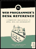

# Web 程序员桌面参考指南：HTML、CSS 和 JavaScript 完整索引




本书专为网页程序员和设计师编写，按字母顺序列出了 Netscape Navigator 和 Internet Explorer 支持的每一个 HTML 标签，以及它们的属性、事件处理器、CSS 和 JavaScript 样式属性等更多内容。


网页编程的挑战之一在于记住用什么工具实现什么功能，以及哪些功能与其他内容兼容。当然，你可以创建一个按钮，但你能改变它的颜色和字体以匹配你网站的风格吗？你确定它在所有浏览器上看起来是一样的吗？通过《网页程序员桌面参考》，你可以发现从未知道存在的东西，查询你有些生疏的内容，或者找到与熟悉内容兼容的方案，从而开发出更好的作品。

这本必备参考书将向你展示如何使用每一个 HTML 元素和属性、事件、CSS 样式、行为、过滤器、JavaScript 属性、方法和对象，包含的信息包括：

- 每个元素的简要描述，让你了解它的作用
- 元素的完整语法，让你知道如何使用它
- 展示元素在实践中如何运作的示例
- 该元素兼容的 IE 和 Netscape 浏览器列表
- 该元素可以配合的所有其他元素列表

无论你是网页程序员、网页设计师还是业余网站管理员，你都不再需要翻阅无尽的文档来寻找网页编程问题的答案了。所有答案都在这本不可或缺的资源书中！


## 致辞

我将这本书献给我结婚 45 年的亲爱的妻子 Rica，她这些年来一直是我的灵感来源和光亮，以及我们的孙辈们。

**Lázaro Issi Cohen**

## 致谢

首先，我想感谢 Lázaro 邀请我与他共同创作。他一直是我的父亲、老师和导师，与他合作是我的荣幸。Lázaro 和我的母亲总是强调教育，培养了我良好的职业道德，并支持我追求自己的目标和梦想。

我想特别感谢 Starch Press 的编辑 Hillel Heinstein，感谢他完美的职业道德、耐心和投入。Hillel 确实是我的灵感来源，并在本书的完成过程中起了关键作用。

非常感谢 Starch Press 总裁 Bill Pollock，给了 Lázaro 和我让这本书成为现实的机会。感谢 Starch Press 的其他员工：Leigh Sacks、Karol Jurado、Alex Benson、John Mark Walker 和 Riley Hoffman。

感谢校对 Andy Carroll 对每一个句号、逗号、符号和风格的细致关注；感谢 Jonathan Hara，他的专业知识帮助微调、纠正并改进许多示例。特别感谢软件开发者 Gidon Shuly，他帮助收集了书中所需的信息。

还有许多人对我的职业成长做出了贡献，我想感谢他们。他们是 Autoland, Inc. 的 Ron Frey、Andrew Conrad、Yaron Hankin、Mark Kane、Edik Magardomian、Cheynoa Schroeder、Ron Revilla 和 Thuy Van Le；是 Baker Commodities 的 Larry Friend、Bob Hogan、Julie Liedalh 和 William Joe；是 American Honda Motor Corporation 的 Dave Mateer、Ben Kershberg 和 Nelli Kiritzov；是 Career Options 的 Marti Vego、Orin Kohon 和 Ana Melon；是 Adelante Vocational School 的 Agnes Gunzler；是 Waterside 的 Jawahara Saudali；是 Howrey Law Firm 的 Robert Ghajar；是 PubliTrade SA 的 Henry Misrahi；以及 Complices Jeans 的 Laurent Cohen。

**约瑟夫·伊西·科恩（Joseph Issi Cohen）**

[](img/f17e4c25a24c412a59af8002951bedcd_5_1.png)


[](img/f17e4c25a24c412a59af8002951bedcd_6_1.png)


## 简介

### 背景

拉萨罗·伊西·科恩（Lázaro Issi Cohen）是一位现代全才。在职业生涯的早期，他教授高中水平的物理和数学。1972 年，他拍摄调音叉产生的声波照片获得了奖；1973 年，他写了一本关于晶体学和物理学的书。他是西班牙首批掌握 `Cobol` 语言的人之一，并在 20 世纪 70 年代出版了五本关于该主题的书。随后，在 20 世纪 80 年代，他成为一名艺术家，并于 1994 年至 1998 年在马德里举办了个人展。尽管如此，他从未放弃对计算机的热爱，编写了一些西班牙出版的最优秀技术书籍，包括近期的作品如《Flash 5 圣经》、《JavaScript 圣经》、《Flash MX 圣经》、《Flash MX 2004 圣经》、《Dreamweaver UltraDev 4 圣经》以及《Flash MX ActionScript 编程》。

拉萨罗也是我的父亲。我第一次接触电脑是在 13 岁生日时，当时拉萨罗和我妈妈送给我一台全新的 Commodore Vic-20，并附带一年的《Compute》杂志订阅。从第一刻起，我就爱上了我的 Commodore。我的好奇心引导我实验了 `BASIC` 语言，并成功编写了自己的迷你电脑游戏。

但在我大学毕业之前，这种热情一直只是爱好。毕业后，我开始担任伤残工人的职业顾问。工作六个月后，我意识到计算机在提高顾问效率方面可以发挥至关重要的作用，于是我回到了编程的起点，编写了我的第一个 Visual Basic 应用程序。我将其称为“顾问助手”（Counselor Assistant）。

很快，每位顾问都在使用我的程序，它提高了生产力，使得公司不再需要聘请外部文书服务。我产出了我的第一个任务关键型应用程序。

1995 年，我和妻子凯伦（Karen）去西班牙住了一年，拉萨罗住在那里。在那一年里，互联网开始像野火一样迅速发展，我被 HTML 新兴的能力所迷住。

当人们开始使用 HTML 创建网站时，他们也对其局限性感到沮丧。首先，它是单调的；一旦页面加载到客户端浏览器中，页面就只是坐在那里什么都不做，等待用户请求另一个页面或提交某些信息。其次，它在视觉上并不有趣；控制 HTML 元素的定位非常困难，而且对它们进行装饰的能力有限。缓慢地，网页开发者和设计师开始需要、开发并使用新更好的工具。结果就是 DHTML（动态 HTML），它是 HTML、CSS（层叠样式表）和 JavaScript 的结合。

通过 JavaScript，静态单调的 HTML 页面活了过来。突然之间，无聊的 HTML 内容可以响应用户的操作，在屏幕上产生即时变化。网页不再需要提交到服务器才能使更改生效，结果就是交互式的网页体验。

CSS 提供了最后一块拼图。通过 CSS，你可以以无数方式自定义每个 HTML 元素的外观，并精确地控制这些元素在页面上的布局。例如，表单输入和提交元素不再需要具有相同的形状和样式，你可以无需求助于使用具有无限行列的复杂表格来定位元素。此外，将 CSS 与 JavaScript 结合，你可以动态应用样式，根据用户的操作改变页面内容的外观，或使其完全出现或消失。

当我第一次从西班牙回来时，我的最初咨询任务要求使用 Visual Basic 进行编程。在 1996 年，公司尚未将 Web 视为严肃的工具。然而，随着微软 ASP（活动服务器页面）技术、其他服务器端 Web 技术如 CGI 以及 DHTML 的出现，这一切改变了。商业界终于意识到 Web 的力量。例如，用 Visual Basic 或 C++ 编写的应用程序需要编译，并在每台想要使用更新版本的机器上重新安装新的可执行文件，而 Web 应用程序的更新对于任何访问互联网或公司内网的人来说立即可用。此外，由于 Web 应用程序完全取决于 Web 浏览器而非特定的操作系统，它们还具有跨平台的额外便利性。

结果，我在西班牙的一年是我职业转型的开始。随着 Web 应用程序的优势变得显而易见，我的咨询任务逐渐需要越来越多的 ASP 和 DHTML，而对 Visual Basic 的需求越来越少。从那时起，我有幸为许多公司提供咨询服务，包括美国汽车公司（American Motor Corporation）、华纳兄弟（Warner Brothers）、PacificCare、Autoland 和 Baker Commodities。在此过程中，我帮助创建了许多应用程序。在开发 DHTML 的多年里，我从未拥有过一本完整的参考书能让我快速查询 HTML、CSS 和 JavaScript 是如何协同工作的。因此，在 2003 年秋季拉萨罗访问期间，他请求我参与一个雄心勃勃的项目。我们合作的成果就是你手中的这本书。

## 本书的目的

这本书由两部分组成。第一部分包括前四章，作为 HTML、CSS 和 JavaScript 的基础介绍。如果你是经验丰富的网页开发者，你可能已经知道这部分的大部分信息。如果不是，这些章节的信息将帮助你熟悉这些语言。

第二部分是书的核心，即参考部分，由第 5 章到第 15 章组成。每一章专注于一个主题，包括 HTML 元素和属性；事件；CSS 属性和 JavaScript 样式属性；Microsoft 行为、过滤器和过渡；JavaScript 属性、方法、集合和对象；以及 Microsoft 技术。这些章节中的参考项按字母排列，几乎每个参考项都带有 Netscape 和 Internet Explorer 浏览器兼容性列表、工作原理的简要描述、通用如何使用该项的语法列表、该项可以采取的所有值列表（适用时）、展示如何在实践中使用该项的示例，以及引用所有相关项目的列表。


## 如何使用此书

你可以通过多种不同的方式使用此书。

如果你想成为 Web 编程大师，可以从头到尾读一遍。通过这种方式，你将遇到以前从未发现存在的 Web 编程元素和技术，并学会如何使用它们。

你也可以用此书来查找你不太熟悉的元素。也许你知道想要使用的元素是什么，但忘记了它的怎么拼写，或者你记得怎么拼写但忘记了它的语法，或者你记得它的语法但忘记了它具体属于哪个对象。通过这本书，你可以查找任何需要的内容并弄清楚如何实现它。

但你也可以将此书作为 HTML、CSS 和 JavaScript 的交叉引用。假设你想创建一个带有有趣边框的蓝色按钮，而不是那种无聊的旧灰色三维按钮。你几个月前在某个网站上看到类似的按钮，但你不记得该网站的 URL，而且你不知道如何让你的按钮看起来像那样。为了解决这个问题，你首先会从第 5 章查找 `<button>` 元素。查看它的语法列表，你从以下代码开始：

`<button attributes events>...</button>`

接下来，你在“`<button>` CSS 属性和 JavaScript 样式属性”标题下列出的样式列表中搜索听起来可能解决问题的样式。列表中的第三种样式是 `background-color`，在列表大约三分之一处，你找到了 `border-style`。现在，快速跳转到第 8 章，你查找了 `background-color`，发现你可以使用标准的 Web 颜色名称，或者 `#RRGGBB` 格式的十六进制颜色。

由于你读过了第 1 章中关于 CSS 的介绍，或者因为你在购买此书时就已经知道如何应用 CSS 内联样式，你将代码扩展为：

`<button style="background-color:blue;">Blue Button</button>`

现在，你翻阅第 8 章直到找到 `border-style`，它引导你找到 `border-bottom-style` 以获取所有可能的边框样式值列表。经过一些实验，你确定了 `solid` 样式值，你的代码现在完成了：

`<button style="border-style:solid; background-color:blue;">Solid Blue Button</button>`

在书中查找信息就是如此简单。


## 测试环境

此书包含一千多个示例。为兼容 Internet Explorer 的参考项目设计的示例已经在 Internet Explorer 6.0 中通过了测试。对于兼容 Internet Explorer 和 Netscape Navigator 的参考项目，可能需要对某些示例进行微调以使其在 Netscape 中运行。为仅兼容 Netscape Navigator 的参考项目设计的示例已经在 Netscape Navigator 7.1 中通过了测试。


## 更新

计算机语言在本质上是动态的，书中的某些引用可能会发生。此书的任何错误都将在其网站 http://deskref.smartinc.com/ 上发布。该网站还将为您提供一个用于反馈的论坛。


## 代码规范

所有的 HTML、CSS 和 JavaScript 代码均以等宽字体打印，以便于识别。书中的所有元素、属性、方法、对象、类、值等均以粗体或斜体标记。

`code` 是内联代码，代码块则不需要翻译。

链接（如 [link](https://example.org)）需要翻译其内容，但保留网址。

列表，表格，引用块保留格式，翻译内容。

原文可能有多行，不要漏掉任何一行，并注意一定不要重复输出原文！！！

输出应包含在“[content]...


样式表包含了控制页面特定元素格式和位置的样式规则。样式表可以放在不同的位置：

- **外部（External）**：样式表位于与网页文档独立的文本文件中。
- **内部（Internal）**：样式表定义在页面源代码的 `<head>` 部分。（这也被称为*嵌入*样式表。）
- **内联（Inline）**：使用 `style` 属性，将样式表定义在正在格式化的 `<html>` 标签内部。

## 外部样式表

样式表可以存在于服务器上，作为文本或 JavaScript 文档从网页文档中进行链接。例如，一个名为 `myStyleSheet.css` 的样式表文档存储在与页面相同的目录中，可以在页面的 `<head>` 部分如下引用：

```html
<head>
<link rel="stylesheet" type="text/css" href="myStyleSheet.css">
```


`</head>`

不要将 `<link>` 元素与 `<a>` 元素混淆；`<link>` 元素必须指定在页面的 `head` 部分，并且需要 `rel`、`type` 和 `href` 属性。`rel` 识别文档类型，在示例中为 `"stylesheet"`；`type` 识别链接文档的内容类型，在示例中为 `"text/css"`；`href` 识别文档的位置。

这种方法可以链接大型样式表，或者当多个 HTML 文档将使用同一个样式表时。如果样式表尺寸较小且没有被多个 HTML 文档使用，可以将样式表规则包含在页面的 `<head>` 部分，正如下一节所示。

### 使用 `@import` 规则连接外部样式表

`@import` 规则允许页面在 `<style>` 标签内部导入 CSS 文档，而不需要在页面的 head 部分使用 `<link>` 元素。`@import` 规则使用文档的 URL 代替 `<link>` 元素的 `href` 属性。这是一个示例：

```html
<style type="text/css">
@import url(myStyleSheet.css)
</style>
```

正如你在示例中看到的，在引用外部样式表时，可以使用 `@import` 功能代替 `<link>`。然而，使用其中任何一种方法并没有明显的区别。

**注意**

所有以 `@` 符号开头的规则都称为“对应规则 (at-rules)”。另一个有用的对应规则是 `@font-face`，它允许你在页面下载并使用浏览器尚未安装的字体。只有 `.eot` 类型格式的 TrueType 字体可以使用此方法下载。

## 内部样式表

如果样式表只包含几行代码，则可以使用 `<style>` 标签将其直接插入页面的 `<head>` 部分。虽然 `<style>` 标签也可以放置在页面的 `<body>` 部分，但更好的做法是将其包含在 `<head>` 部分。例如：

```html
<head>
<style type="text/css">
p {color:red; font-size:3; font-family:Verdana}
h1 {color:blue}
/* more style rules can go here */
</style>
</head>
```

前面的示例包含两个规则——一个适用于 `<p>` 元素，另一个适用于 `<h1>` 元素。样式表规则之前是它们所应用的元素类型（`<p>`、`<h1>` 等），并且它们被包裹在大括号 `{}` 中。

不要将 `style` 属性与 `<style>` 元素混淆。`<style>` 元素可以包含应用于多个标签的多个规则，并且必须有一个闭合的 `<style>` 标签，而 `style` 属性是定义在元素标签*内部*的内联样式表。

## 内联样式表

你可以通过设置元素的 `style` 属性在元素标签内部定义单个样式规则。例如：

```html
<p style="font-family:Verdana; font-size:3; color:red"> . . . </p>
```

此示例包含一个规则，为正在定义的 `<p>` 元素设置了三个样式属性：字体设置为 `Verdana`，字体大小设置为 `3`，字体颜色设置为 `red`。

## 样式表总结

你可以通过四种方式在 HTML 文档中使用样式表：

- 在 `<head>` 部分内使用 `<link>` 元素。
- 在文档 `<head>` 部分定义的 `<style>` 标签内使用 `@import` 规则。
- 在文档的 `<head>` 部分内插入 `<style>` 标签。
- 在 HTML 标签内插入 `style` 属性。

## 声明 (Declarations)

类似 `text-size` 的属性与其对应值（例如 `12pt`）的组合被称为“声明”。在定义样式规则时，你必须用分号分隔多个声明。例如：

```css
{ color:red; font-size:12pt }
```

此示例包含两个声明；一个将文本颜色设置为 `red`，另一个将字体大小设置为 `12pt`。

## 选择器 (Selectors)

选择器允许你将规则应用到页面上任何地方用到的元素上。只有在使用外部或内部样式表时，才能使用选择器。

有简单选择器（如 `h1`），也有上下文选择器，它们由多个简单选择器组成（如 `h1 h2`）。语法如下：

```css
element1 { style rule } // 简单选择器
element1 element2 { style rule } // 上下文选择器
```

这里是一个使用 `<h1>` 和 `<p>` 元素的示例：

```css
h1 { style rule }
h1 p { style rule }
```

### 简单选择器

*简单选择器*为单个元素类型（如 `<h1>`、`<b>` 或 `<p>`）定义样式规则，并且该规则应用于该特定类型的所有元素。例如：

```css
p { color:red }
```

此规则指定所有 `<p>` 元素内部的文本颜色为红色。

### 上下文选择器

*上下文选择器*允许你为多个元素类型定义相同的样式规则。组合包含相同规则的元素可以避免为不同元素重复相同的代码。例如：

```css
h1 em ul { color:red }
```

此规则指定 `<h1>`、`<em>` 和 `<ul>` 标签内所有文本的颜色应该是红色。每个简单选择器之间用空格隔开，从而形成上下文选择器。前面的示例等同于以下三行代码：

```css
h1 { color:red }
em { color:red }
ul { color:red }
```

## 使用 `class` 属性作为选择器

还有另一种方法可以将选择器应用于不共享相同标签的各种元素上。你可以用类选择器定义规则，然后该规则可以被所有元素提供的 `class` 属性使用。你定义的每个单独类必须有唯一的名称。

在样式表中，类名前面需要加一个点，以便浏览器将其识别为类。例如：

```css
.wide { color: red }
```

在此示例中，所有具有值为 `wide` 的 `class` 属性的元素都包含红色。

在接下来的示例中，`<p>` 元素标签引用了 `wide` 类：

```html
<p class="wide">contents</p> // "contents" 字将是红色的
```

也可以为具有相同值的 `class` 属性的不同元素类型定义不同的样式。例如，为了给特定类的 `<p>` 元素赋予蓝色，同时给所有其他同类元素赋予红色，可以使用以下代码：

```css
.colored {color: red}
p.colored {color: blue}
```

在前面的示例中，所有具有 `colored` 类 `class` 属性的 `<p>`（段落）标签将变为蓝色，所有使用此类的其他元素将变为红色。

每个选择器只能指定一个类。

## 使用 `id` 属性作为选择器

有时你可能发现有将样式规则应用于页面上的单个元素，而不是同类元素的所有实例。简单选择器和上下文选择器将样式规则应用于所有相同标签的元素，而 ID 选择器将规则应用于通过 `id` 属性唯一标识的页面特定元素。`id` 属性受所有 HTML 标签支持。

为了在样式表中唯一标识一个特定元素，在元素的 `id` 属性值前面加上 `#` 符号。在下面的示例中，所有 `<h1>` 元素的文本颜色将是蓝色，但 `id` 属性值为 `special` 的 `<h1>` 元素除外，它将包含红色文本。

```css
h1 { color:blue }
#special { color:red }
```

下面的 HTML 示例引用了前面的样式规则：

```html
<h1 id="special">Header 1</h1> // Header 1 是红色的
<h1>Header 1</h1> // Header 1 是蓝色的
```

## 使用选择器的总结

你可以通过以下方式对页面应用内部和外部样式表：

- 简单选择器（Simple selectors）允许你对特定标签应用样式规则。该标签的所有元素将按照相同的样式规则进行格式化。
- 上下文选择器（Contextual selectors）允许你对具有不同标签的元素应用样式。指定标签的所有元素将使用相同的样式规则进行格式化。
- 通过 `class` 属性，你也可以对页面上的元素应用样式规则。在这种情况下，样式名称必须以点（`.`）开头。
- 类选择器也可以指定元素类型。你可以将类选择器应用于特定的元素类型，使得格式规则仅在该类型的元素引用该类时才生效。在这种情况下，类名之前必须有元素名，后面跟一个点（`.`）。
- `id` 属性允许你对元素类型的一个实例应用样式规则。在这种情况下，样式名称必须以 `#` 符号开头。

[](img/f17e4c25a24c412a59af8002951bedcd_21_1.png)


[](img/f17e4c25a24c412a59af8002951bedcd_22_1.png)


## CSS2 中的属性选择器

CSS2 规范增加了与 HTML 规范不对应的选择器。这些包括*伪类*（pseudo-classes）和*伪元素*（pseudo-elements）。伪元素用于处理元素的子部分，而伪类允许样式表区分元素的各种状态。

截至本文编写时，伪类选择器仅适用于 `<a>` 元素。伪元素选择器目前提供排版效果，例如段落的第一行或每行第一个字母的格式化。

### 锚点伪类

锚点伪类允许你根据 `<a>` 元素的当前状态应用样式规则：`link`、`visited`、`hover` 或 `active`。你可以使用伪类定义锚点元素的样式，如下所示：

```css
a:link { color: red } /* 未访问的链接 */
a:visited { color: blue } /* 已访问的链接 */
a:active { color: lime } /* 链接已点击但按钮未释放 */
a:hover { color: aqua } /* 鼠标指针悬停在标签上 */
```

在前面的示例中，页面上的 `<a>` 元素在未访问时显示为红色，点击一次显示为蓝色，激活时显示为柠檬绿色（意味着链接已点击但鼠标按钮尚未释放），当鼠标指针悬停在其上方时显示为青色。

目前，锚点伪类只影响 `<a>` 元素。因此，可以从选择器中省略元素类型。例如，以下两行代码实现了相同的功能：

```css
a:link { color: red }
:link { color: red }
```

伪类也可以用于上下文选择器。例如，以下样式规则将应用于所有 `` 元素以及尚未访问的 `<a>` 元素：

```css
a:link img { border: solid blue }
```

### 排版伪元素

使用伪元素，你可以为 `<p>` 元素的第一行或第一个字母分配排版效果。

#### `first-line` 伪元素

`first-line` 伪元素选择器用于对所有 `<p>` 元素的第一行应用特殊样式。这允许你对段落的第一行进行与其他行不同的格式化。在接下来的示例中，每个段落的第一行将显示为蓝色和小型大写字母：

```html
<style type="text/css">
p:first-line { font-variant: small-caps; color:blue }
</style>

<p>杂志中文章的第一行。</p>
```

以下样式属性可以应用于第一行元素：字体（font）、颜色（color）、背景（background）、字间距（word-spacing）、字母间距（letter-spacing）、文本装饰（text-decoration）、垂直对齐（vertical-align）、`text-transform`、行高（line-height）和清除（clear）。（更多信息请参见第 8 章。）

#### `first-letter` 伪元素

`first-letter` 伪元素用于常见的排版效果，例如使元素内文本的第一个字母变为大写（*首字母*）或比段落其余部分的文本大得多（*小型字母*）。例如：

```html
<style type="text/css">
p { font-size: 12pt; line-height: 12pt }
p:first-letter { font-size: 24pt; float: left }
</style>
```

在这个示例中，普通文本的字体大小为 12pt，而段落第一个字母的字体为 24pt。添加 `float` 属性是为了为增大后的字母留出空间。以下属性可以应用于 `first-letter` 元素：字体、颜色、背景、文本装饰、垂直对齐、文本转换、行高、外边距（margin）、内边距（padding）、边框（border）和清除。

#### 选择器中的伪元素

上下文选择器与伪元素兼容，只要伪元素位于选择器的末尾。例如：

```css
body p:first-letter { color: blue }
```

在这些示例中，`<body>` 和 `<p>` 元素共享同一个伪元素，这意味着 `<body>` 和 `<p>` 元素的首字母将被着色。伪元素也可以与类结合以实现相同的功能。语法 `ElementName.ClassName:elementName` 使用如下：

```css
p.initial:first-letter { color: red }
```

```html
<p class="initial">第一段文字</p> <!-- 第一个字母是红色的。 -->
```

[](img/f17e4c25a24c412a59af8002951bedcd_23_1.png)


[](img/f17e4c25a24c412a59af8002951bedcd_24_1.png)


`!important` 属性为样式规则声明增加了权重，这意味着它将样式规则的优先级高于其他影响同一元素的样式规则。样式规则的优先级将在下一节讨论。例如：

```css
h1 { color: black !important; background:white !important }
p { font-size: 12pt !important; font-style: italic }
```

在这个示例中，前三个声明增加了权重，而最后一个声明是普通权重。

[](img/f17e4c25a24c412a59af8002951bedcd_24_1.png)

## 优先级

一个元素可能同时应用多种样式，不同的样式可能会有冲突的值。*优先级*（Precedence）定义了页面上样式应用的顺序。各种样式规则的优先级如下：

1. `<body>` 元素样式。如果没有样式，则在此应用默认规则。
2. 通过简单和上下文选择器定义的样式。
3. 类规则。
4. `!important` 样式。
5. 通过选择器 ID 定义的。
6. 使用 `style` 属性内联应用的。

这种优先级意味着任何更高优先级（即列表中数字更大的）的样式规则将覆盖任何较低优先级的冲突规则。优先级 2 覆盖 1，优先级 3 覆盖 2 和 1，优先级 4 覆盖 3、2 和 1，依此类推。在接下来的示例中，`<p>` 元素的颜色将是红色而不是蓝色，因为内联样式（优先级 6）高于通过选择器 ID 定义的样式（优先级 5）。

```html
<style type="text/css">
#myId { color: blue }
</style>

<p id="myId" style="color:red">
```

[](img/f17e4c25a24c412a59af8002951bedcd_25_1.png)


## 样式属性与属性

可以通过 JavaScript 属性在 JavaScript 代码中引用 CSS 属性。下一页表 1-1 列出了许多常用 CSS 属性及其对应的 JavaScript 属性。

CSS 语法*不*区分大小写，而 JavaScript 语法*是*区分大小写的。你可以在 CSS 中将 `border` 属性写作 `Border`、`BORDER` 或任何大小写字母组合。然而，在 JavaScript 中只有一种正确的写法：全小写的 `border`。有关这些任意 CSS 属性和 JavaScript 样式属性的更多信息，请参阅第 8 章。

### 表 1-1：样式属性与属性

#### 盒模型属性与属性

| CSS 语法（不区分大小写） | JavaScript 语法（区分大小写） |
| :--- | :--- |
| `border` | `border` |
| `border-bottom` | `borderBottom` |
| `border-bottom-color` | `borderBottomColor` |
| `border-bottom-style` | `borderBottomStyle` |
| `border-bottom-width` | `borderBottomWidth` |
| `border-color` | `borderColor` |
| `border-left` | `borderLeft` |


### CSS 属性与 JavaScript 属性对照表

#### 边框属性

| CSS 语法（不区分大小写） | JavaScript 语法（区分大小写） |
| :--- | :--- |
| `border-left-color` | `borderLeftColor` |
| `border-left-style` | `borderLeftStyle` |
| `border-left-width` | `borderLeftWidth` |
| `border-right` | `borderRight` |
| `border-right-color` | `borderRightColor` |
| `border-right-style` | `borderRightStyle` |
| `border-right-width` | `borderRightWidth` |
| `border-style` | `borderStyle` |
| `border-top` | `borderTop` |
| `border-top-color` | `borderTopColor` |
| `border-top-style` | `borderTopStyle` |
| `border-top-width` | `borderTopWidth` |
| `border-width` | `borderWidth` |
| `clear` | `clear` |
| `float` | `floatStyle` |
| `margin` | `margin` |
| `margin-bottom` | `marginBottom` |
| `margin-left` | `marginLeft` |
| `margin-right` | `marginRight` |
| `margin-top` | `marginTop` |
| `padding` | `padding` |
| `padding-bottom` | `paddingBottom` |
| `padding-left` | `paddingLeft` |
| `padding-right` | `paddingRight` |
| `padding-top` | `paddingTop` |

#### 颜色与背景属性

| CSS 语法（不区分大小写） | JavaScript 语法（区分大小写） |
| :--- | :--- |
| `background` | `background` |
| `background-attachment` | `backgroundAttachment` |
| `background-color` | `backgroundColor` |
| `background-image` | `backgroundImage` |
| `background-position` | `backgroundPosition` |
| `background-repeat` | `backgroundRepeat` |
| `color` | `color` |

#### 分类属性

| CSS 语法（不区分大小写） | JavaScript 语法（区分大小写） |
| :--- | :--- |
| `display` | `display` |
| `list-style-type` | `listStyleType` |
| `list-style-image` | `listStyleImage` |
| `list-style-position` | `listStylePosition` |
| `list-style` | `listStyle` |
| `white-space` | `whiteSpace` |

#### 字体属性

| CSS 语法（不区分大小写） | JavaScript 语法（区分大小写） |
| :--- | :--- |
| `font` | `font` |
| `font-family` | `fontFamily` |
| `font-size` | `fontSize` |
| `font-style` | `fontStyle` |
| `font-variant` | `fontVariant` |
| `font-weight` | `fontWeight` |

#### 文本属性

| CSS 语法（不区分大小写） | JavaScript 语法（区分大小写） |
| :--- | :--- |
| `letter-spacing` | `letterSpacing` |
| `line-break` | `lineBreak` |
| `line-height` | `lineHeight` |
| `text-align` | `textAlign` |
| `text-decoration` | `textDecoration` |
| `text-indent` | `textIndent` |
| `text-justify` | `textJustify` |
| `text-transform` | `textTransform` |
| `vertical-align` | `verticalAlign` |

## 在页面上定位元素

在 CSSP 之前，元素只能通过嵌套表格在页面上定位，其结果有时是不可预测的、复杂的，并且过度依赖目标浏览器技术。

CSSP 和 CSS2 允许更精确的定位。CSSP 和 CSS2 允许我们对元素进行三维定位而非仅仅二维。第三个维度由 Z 坐标处理。`z-index` 的引入允许我们堆叠元素。`z-index` 是一个任意整数，用于决定元素的从后到前的顺序。`z-index` 较高的元素放置在 `z-index` 较低的元素前面。例如，为了将文本“This is an image”放置在图片前面，文本的 `z-index` 值必须大于图片，例如文本设为 25，图片设为 2。这些数字不需要连续。

### 笛卡尔定位

每个容器都采用笛卡尔定位，这意味着其坐标是相关的。例如，如果文本位于 (200,300)，我们知道其左上角距离页面左边界 200 像素。

### 嵌套

在 DHTML 哲学中，元素在页面上嵌套。基础文档被称为顶级父元素，包含了所有其他页面元素。任何嵌套元素（子元素）如果内部还嵌套了元素，也可以成为父元素。

考虑以下代码：

```html
<body>
  <table>
    <tr>
      <td>text content</td>
    </tr>
  </table>
</body>
```

在这个示例中，以下所有点都是正确的：

- `<body>` 元素是 `<table>` 元素的父元素。
- `<table>` 元素是 `<body>` 元素的子元素，也是 `<tr>` 元素的父元素。
- `<tr>` 元素是 `<table>` 元素的子元素和 `<td>` 元素的父元素。
- `<td>` 元素是 `<tr>` 元素的子元素。

### 继承

子元素继承父元素某些属性被称为继承，但并不是所有属性都会被继承。

为整个页面创建默认样式的一种有效方法是向 `<body>` 元素应用样式规则，该元素包含了所有其他元素。在下面的示例中，`<body>` 元素开始和结束标签之间的所有元素都将继承它的样式：

```css
body { color:black; background:url(texture.gif) }
```

可见性（Visibility）和“可拖拽性”（dragability）是子元素从其父元素继承的属性示例（尽管你可以通过设置子元素中的 `visibility` 属性值来覆盖这种自动继承）。如果父元素可以被拖动，那么它所有的子元素都会随之拖动。

`z-index` 是另一个子元素从父元素继承的属性。例如，假设 `<p>` 是 `<body>` 元素的子元素，同时也是 `<c1>`、`<c2>` 和 `<c3>` 的父元素。如果 `<body>` 元素的 `z-index` 为 20，那么 `<p>` 将继承来自 `<body>` 元素的 `z-index: 20`，而 `<c1>`、`<c2>` 和 `<c3>` 将继承来自 `<p>` 元素的 `z-index: 20`。另一方面，`<p>` 元素内部的三个子元素之间也具有相互独立的 `z-index`。在这种情况下，`<c1>` 的 `z-index` 可以为 2，`<c2>` 的 `z-index` 为 5，`<c3>` 的 `z-index` 为 10。这意味着 `<p>` 的每个子元素相对于 `<p>` 元素的其他所有子元素都有一个 `z-index`，同时相对于其父元素之外的所有元素继承了 `<p>` 元素的 `z-index`。

当使用相对定位（默认值）时，定位属性也会受到继承的影响。子元素相对于其父元素进行定位，而不是相对于页面的坐标。例如，如果一个父元素位于 (500,800)，而子元素位于其下方 100 像素处且右侧 50 像素处，那么子元素的坐标将定义为 (50,100) 并渲染为 (550,900)。

### 遵循 W3C 建议的元素定位

如果一个元素可以被定位，CSS2 建议你在其样式规则中包含 `position` 属性，无论其值为何。例如：

```html
<p style="position:absolute;">text</p>
```

`<div>` 元素是在 Internet Explorer 4 和 Netscape Navigator 中引入的，用于在页面上创建和定位层。通过 `<div>` 元素，你可以独立于其容器矩形定义层的位置、宽度和高度。例如：

```html
<div style="position:absolute; width:246px; height:132px;">text</div>
```

下面的示例显示了如何使用绝对定位将一个 `<div>` 元素嵌套在另一个 `<div>` 元素内部，从而对每个元素的位置、宽度和高度进行更强大的控制：

```html
<div id="Layer1" style="position:absolute; width:388px; height:299px; z-index:1">This is the parent div element
  <div id="Layer2" style="position:absolute; visibility:inherit; width:246px; height:132px; z-index:1">This is a child div element</div>
</div><!-- closing tag for the parent div element -->
```

要实现相同的效果，你可以在 `<div>` 元素内部使用 `<span>` 元素，如下：

```html
<div id="Layer1" style="position:absolute; width:388px; height:299px; z-index:1">This is the parent div element
  <span id="Layer2" style="position:absolute; visibility:inherit; width:246px; height:132px; z-index:1"> This is a child span element </span>
</div><!-- closing tag for the parent div element -->
```


### 位置值

通过 CSS，层可以通过三种方式在页面上定位：`static`（默认）、`absolute`（绝对）和 `relative`（相对）。

**静态定位**

`static` 是定位的默认值，但它阻止元素被重新定位。从这个意义上说，静态定位遵循元素的自然顺序。在接下来的示例中，文本将在图像之前渲染：

```html
<p style="position:static">Some text</p>

```

由于 `static` 是默认值，你无法移动静态定位的元素。在下面的示例中，图像将先于文本渲染：

```html

<p style="position:static">Some text</p>
```

**绝对定位**

绝对定位指的是元素相对于其父元素的定位，而不是相对于整个页面。在 Netscape 浏览器中，只有 `<div>` 元素及其包含在 `<div>` 内的元素可以是绝对定位的。例如，以下代码具有绝对定位：

```html
<div style="position:absolute; left:100; top:50">
  
</div>
```

Internet Explorer 也允许对单个元素应用绝对定位。因此，之前的示例可以为 Internet Explorer 代码如下：

```html

```

**相对定位**

相对定位允许根据元素在页面上的自然顺序进行定位。然而，两者的区别是可以脚本化的，而静态定位不能。相对定位兼容 Netscape Navigator 和 Internet Explorer，但只能用于 `<span>` 或 `<div>` 标签。相对定位允许通过脚本更改页面上元素的位置。当元素跨页面移动时，页面上的其他元素会被强制为之留出空间。例如：

```html
<div style="position:relative; left:100; top:100">
```

此 `<div>` 元素位于 (100,100)，但通过脚本命令，你可以更改其 `left` 和 `top` 属性的值，将其置于 (200,150)。你可以在用户点击按钮时触发此命令，例如。

静态和相对定位遵循 HTML 定位规则，而绝对定位遵循 DHTML 规则。你可以使用绝对定位跨页面移动元素，而不会影响页面上其他元素的位置。移动相对定位元素会推开页面上的其他元素为其留出空间。相反，你完全无法移动静态定位的元素。


## 其他定位属性

除了 `position` 属性外，你可以添加到 `style` 属性中常见的定位属性如下：

- **`left` 和 `top`**：这两个属性指定了元素左边缘、上边缘与其父元素左上角之间的距离。`left` 和 `top` 属性用于定位元素的容器矩形（包括内边距、边框和外边距），它们的值最常用像素（pixels）表示，尽管你也可以使用下一节中描述的任何测量单位。这些值应用于元素的绝对或相对位置，且它们是不可继承的。以下是它们的使用示例：

```html
<div style="position:relative; left=50; top=100"></div>
```

- **`width` 和 `height`**：这些属性代表绝对或相对定位元素的宽度和高度。它们被用于定义元素的物理尺寸，指的是内容的大小，不包括元素的内边距、边框和外边距。宽度和高度最常用像素表示，但你可以使用下一节中描述的任何测量单位。这些属性值是不可继承的。

- **`z-index`**：此属性指定了页面中层的堆叠顺序。其值由整数表示，正数或负数。`z-index` 值较小的元素将位于 `z-index` 值较高的元素之后。

- **`visibility`**：此属性决定了层是否可见。该属性的值可以在运行时使用脚本进行设置或更改。如果 `visibility` 属性的值为 `visible`，则该层及其内容将是可见的；如果值为 `hidden`，则该层及其内容将被隐藏；如果值为 `inherit`，则该层及其内容将继承其父层的可见性值（如果存在的话）。此属性值是可以继承的。


## 属性中使用的单位

`left`、`top`、`height` 和 `width` 属性的值可以使用多种测量单位来表示。

以下单位常用于显示在屏幕上的页面渲染：

- **`px`**：像素值。这是 Web 设计中常用的单位。该测量的精确程度取决于用户计算机的显示器配置。示例：`15px`。

- **`em`**：此单位基于元素字体的高度。在适用的情况下，它仅用于文本内容。示例：`2.3em`。

- **`ex`**：此单位基于元素字体中字母 *x* 的高度。在适用的情况下，它仅用于文本内容。示例：`2ex`。

以下绝对距离单位常用于将发送到打印机输出的页面渲染：

- **`in`**：英寸距离。示例：`2.50in`。

- **`cm`**：厘米距离。示例：`2.55cm`。

- **`mm`**：毫米距离。示例：`55mm`。


- `pt`：磅（points）距离。1 磅等于 1 英寸的 1/72。示例：`14 pt`。
- `pc`：毕（picas）距离。1 毕等于 12 磅。示例：`2.3pc`。

  
[](img/f17e4c25a24c412a59af8002951bedcd_36_1.png)


# 第 2 章：面向对象编程

## DOM 与节点树

文档对象模型（DOM）允许使用 JavaScript 代码操作 HTML 元素及其属性。使用 JavaScript 编程文档中的元素有两种方式。本质上，DOM 将 HTML 元素映射为 JavaScript 对象。这些对象之间形成了一个树状的层级结构。这种结构就被称为 DOM 树。

### 什么是对象

文档对象模型（DOM）允许使用 JavaScript 代码操作 HTML 元素及其属性。使用 JavaScript 编程文档中的元素有两种方式。本质上，DOM 将 HTML 元素映射为 JavaScript 对象。这些对象之间形成了一个树状的层级结构。这种结构就被称为 DOM 树。

### 什么是对象

文档对象模型（DOM）允许使用 JavaScript 代码操作 HTML 元素及其属性。使用 JavaScript 编程文档中的元素有两种方式。本质上，DOM 将 HTML 元素映射为 JavaScript 对象。这些对象之间形成了一个树状的层级结构。这种结构就被称为 DOM 树。

### 什么是对象

文档对象模型（DOM）允许使用 JavaScript 代码操作 HTML 元素及其属性。使用 JavaScript 编程文档中的元素有两种方式。本质上，DOM 将 HTML 元素映射为 JavaScript 对象。这些对象之间形成了一个树状的层级结构。这种结构就被称为 DOM 树。

### 什么是对象

文档对象模型（DOM）允许使用 JavaScript 代码操作 HTML 元素及其属性。使用 JavaScript 编程文档中的元素有两种方式。本质上，DOM 将 HTML 元素映射为 JavaScript 对象。这些对象之间形成了一个树状的层级结构。这种结构就被称为 DOM 树。

### 什么是对象

文档对象模型（DOM）允许使用 JavaScript 代码操作 HTML 元素及其属性。使用 JavaScript 编程文档中的元素有两种方式。本质上，DOM 将 HTML 元素映射为 JavaScript 对象。这些对象之间形成了一个树状的层级结构。这种结构就被称为 DOM 树。

### 什么是对象

文档对象模型（DOM）允许使用 JavaScript 代码操作 HTML 元素及其属性。使用 JavaScript 编程文档中的元素有两种方式。本质上，DOM 将 HTML 元素映射为 JavaScript 对象。这些对象之间形成了一个树状的层级结构。这种结构就被称为 DOM 树。

### 什么是对象

文档对象模型（DOM）允许使用 JavaScript 代码操作 HTML 元素及其属性。使用 JavaScript 编程文档中的元素有两种方式。本质上，DOM 将 HTML 元素映射为 JavaScript 对象。这些对象之间形成了一个树状的层级结构。这种结构就被称为 DOM 树。

## DOM 与节点树

文档对象模型（DOM）允许使用 JavaScript 代码操作 HTML 元素及其属性。使用 JavaScript 编程文档中的元素有两种方式。本质上，DOM 将 HTML 元素映射为 JavaScript 对象。这些对象之间形成了一个树状的层级结构。这种结构就被称为 DOM 树。

### 什么是对象

文档对象模型（DOM）允许使用 JavaScript 代码操作 HTML 元素及其属性。使用 JavaScript 编程文档中的元素有两种方式。本质上，DOM 将 HTML 元素映射为 JavaScript 对象。这些对象之间形成了一个树状的层级结构。这种结构就被称为 DOM 树。

### 什么是对象

文档对象模型（DOM）允许使用 JavaScript 代码操作 HTML 元素及其属性。使用 JavaScript 编程文档中的元素有两种方式。本质上，DOM 将 HTML 元素映射为 JavaScript 对象。这些对象之间形成了一个树状的层级结构。这种结构就被称为 DOM 树。

### 什么是对象

文档对象模型（DOM）允许使用 JavaScript 代码操作 HTML 元素及其属性。使用 JavaScript 编程文档中的元素有两种方式。本质上，DOM 将 HTML 元素映射为 JavaScript 对象。这些对象之间形成了一个树状的层级结构。这种结构就被称为 DOM 树。

### 什么是对象

文档对象模型（DOM）允许使用 JavaScript 代码操作 HTML 元素及其属性。使用 JavaScript 编程文档中的元素有两种方式。本质上，DOM 将 HTML 元素映射为 JavaScript 对象。这些对象之间形成了一个树状的层级结构。这种结构就被称为 DOM 树。

### 什么是对象

文档对象模型（DOM）允许使用 JavaScript 代码操作 HTML 元素及其属性。使用 JavaScript 编程文档中的元素有两种方式。本质上，DOM 将 HTML 元素映射为 JavaScript 对象。这些对象之间形成了一个树状的层级结构。这种结构就被称为 DOM 树。

### 什么是对象

文档对象模型（DOM）允许使用 JavaScript 代码操作 HTML 元素及其属性。使用 JavaScript 编程文档中的元素有两种方式。本质上，DOM 将 HTML 元素映射为 JavaScript 对象。这些对象之间形成了一个树状的层级结构。这种结构就被称为 DOM 树。

### 什么是对象

文档对象模型（DOM）允许使用 JavaScript 代码操作 HTML 元素及其属性。使用 JavaScript 编程文档中的元素有两种方式。本质上，DOM 将 HTML 元素映射为 JavaScript 对象。这些对象之间形成了一个树状的层级结构。这种结构就被称为 DOM 树。

### 什么是对象

文档对象模型（DOM）允许使用 JavaScript 代码操作 HTML 元素及其属性。使用 JavaScript 编程文档中的元素有两种方式。本质上，DOM 将 HTML 元素映射为 JavaScript 对象。这些对象之间形成了一个树状的层级结构。这种结构就被称为 DOM 树。

### 什么是对象

文档对象模型（DOM）允许使用 JavaScript 代码操作 HTML 元素及其属性。使用 JavaScript 编程文档中的元素有两种方式。本质上，DOM 将 HTML 元素映射为 JavaScript 对象。这些对象之间形成了一个树状的层级结构。这种结构就被称为 DOM 树。

### 什么是对象

文档对象模型（DOM）允许使用 JavaScript 代码操作 HTML 元素及其属性。使用 JavaScript 编程文档中的元素有两种方式。本质上，DOM 将 HTML 元素映射为 JavaScript 对象。这些对象之间形成了一个树状的层级结构。这种结构就被称为 DOM 树。

## DOM 与节点树

文档对象模型（DOM）允许使用 JavaScript 代码操作 HTML 元素及其属性。使用 JavaScript 编程文档中的元素有两种方式。本质上，DOM 将 HTML 元素映射为 JavaScript 对象。这些对象之间形成了一个树状的层级结构。这种结构就被称为 DOM 树。

### 点运算符（`.`）

点操作符（`.`）用于访问对象的属性或方法。在 JavaScript 中，你可以通过点运算符来访问 DOM 元素的属性。例如，`document.body` 访问文档中的 `body` 元素。

### 访问属性

在 JavaScript 中，你可以通过点运算符来访问 DOM 元素的属性。例如，`document.body.className` 获取 `body` 元素的类名。

### 修改属性

你也可以通过点运算符来修改 DOM 元素的属性。例如，`document.body.className = "new-class"` 会修改 `body` 元素的类名。

### 样式属性

你还可以通过点运算符来访问元素的样式属性。例如，`document.body.style` 获取 `body` 元素的样式。

### 修改样式

你也可以通过点运算符来修改元素的样式。例如，`document.body.style.display = "none"` 会修改 `body` 元素的显示属性。

### 访问方法

你还可以通过点运算符来访问元素的方法。例如，`document.getElementById("id")` 获取 ID 为 `id` 的元素。

### 执行方法

你也可以通过点运算符来执行元素的方法。例如，`document.getElementById("id").remove()` 会移除该元素。

### 总结

点运算符是 JavaScript 中非常强大且常用的工具之一。它让你能够轻松访问和操作对象的各种功能。

  


## 属性（Properties）

对象的属性本质上是定义和组成对象的形容词。例如，假设一个 `car` 对象有两个主要属性：`make`（品牌）和 `model`（型号）。这两个关于 `car` 对象的属性定义了这辆汽车是什么。例如，假设 John 拥有一辆福特野马。用对象模型表示，他拥有一个 `car` 对象，其 `make` 属性值为 `Ford`，`model` 属性值为 `Mustang`。如果 John 换了一辆新的沃尔沃 C70，你只需要将他的 `car` 对象的 `make` 属性设置为 `Volvo`，`model` 属性设置为 `C70`。通过设置属性值，你可以更改对象的形容词。

通过简单的属性值设置，你可以指示 JavaScript 显示或隐藏框架周围的边框。例如：

`window.document.frame[0].frameBorder = "yes"`

在这个示例中，`window` 对象拥有一个 `document` 对象，而 `document` 对象又拥有一个 `frame` 数组或集合。索引为 `0` 的 `frame` 数组元素（数组中的第一个 `<frame>` 元素）拥有一个 `frameBorder` 属性，其值被设置为 `yes`。这意味着在指定的框架周围将显示边框。

属性可以是只读的（`read-only`）的，也可以是可读写的（`read and write`）的。只读属性的值只能在运行时获取，不能更改。可读写属性的值可以在运行时更改和获取。可读写属性的一个例子是上一个示例所示的 `frameBorder`。只读属性的一个例子是 `appName`，它用于获取浏览器的名称：

`var myAppName = navigator.appName`

在这个示例中，`navigator` 对象的 `appName` 属性值被存储在变量 `myAppName` 中。

  


  


如果说属性是对象的形容词，那么方法（`methods`）就是对象的动词，它们能够执行操作。例如，如果汽车的轮子是蓝色的，那么轮子的 `color` 属性的值就是 `blue`，如下所示：

`car.wheel.color = "blue"`

另一方面，汽车的轮子还可以转向，这意味着它有一个 `steer()` 方法。

`car.wheel.steer()`

方法总是以圆括号结尾，这使得它们区别于属性。

  


  


## 集合（Collections）

集合（`collection`）是一个在对象层级结构中*没有*关联的对象数组。在人类家庭中，父母和子女在层级上是相关的，但兄弟姐妹之间不是的，因为它们处于层级结构中的同一层。

例如，John 和 Mary 结婚了，他们有四个孩子：Charles、Brigitte、Olly 和 Rose。可以使用以下语法来引用 John 和 Mary 的孩子：

`John.Charles`

`John.Olly`

`Mary.Brigitte`

`Mary.Rose`

然而，以下层级链是错误的：

`John.Charles.Brigitte`

`Mary.Brigitte.Rose`

虽然 Charles、Brigitte、Olly 和 Rose 都属于 John 和 Mary，但 Brigitte 并不属于 Charles，Rose 也不属于 Brigitte。由于所有的兄弟姐妹都在层级结构中的同一层，它们形成了一个兄弟姐妹的集合（或数组）。

数组中的每个对象被称为该数组的元素（`element`）。要通过程序访问数组的元素，必须记住数组语法和元素的索引。数组的索引由其位置决定，从零开始。例如：

`window.document.images[0]`

获取对 `images` 集合中第一张图片的引用。

  


  


  


数组中的每个对象被称为该数组的元素（`element`）。要通过程序访问数组的元素，必须记住数组语法和元素的索引。数组的索引由其位置决定，从零开始。例如：

`window.document.images[0]`

获取对 `images` 集合中第一张图片的引用。`images[1]` 则获取集合中的第二张图片。

  


  


  


## 集合（Collections）

集合（`collection`）是一个在对象层级结构中*没有*关联的对象数组。在人类家庭中，父母和子女在层级上是相关的，但兄弟姐妹之间不是的，因为它们处于层级结构中的同一层。

例如，John 和 Mary 结婚了，他们有四个孩子：Charles、Brigitte、Olly 和 Rose。可以使用以下语法来引用 John 和 Mary 的孩子：

`John.Charles`

`John.Olly`

`Mary.Brigitte`

`Mary.Rose`

然而，以下层级链是错误的：

`John.Charles.Brigitte`

`Mary.Brigitte.Rose`

虽然 Charles、Brigitte、Olly 和 Rose 都属于 John 和 Mary，但 Brigitte 并不属于 Charles，Rose 也不属于 Brigitte。由于所有的兄弟姐妹都在层级结构中的同一层，它们形成了一个兄弟姐妹的集合（或数组）。

数组中的每个对象被称为该数组的元素（`element`）。要通过程序访问数组的元素，必须记住数组语法和元素的索引。数组的索引由其位置决定，从零开始。例如：

`window.document.images[0]`


获取对 `images` 集合中第一张图片的引用。`images[1]` 则获取集合中的第二张图片。


## 节点（Nodes）

节点（nodes）提供了另一种编程文档的方式。节点有两种类型：*元素节点（element nodes）*和*文本节点（text nodes）*。元素节点包含标签，而文本节点则不包含。

例如，考虑以下代码：

```html
<p>Hello World</p>
```

在这个例子中，`<p>` 元素是一个元素节点，而 `Hello World` 是一个文本节点。

再看另一个例子：

```html
<div><span>Text</span></div>
```

在这个例子中，`<div>` 和 `<span>` 是元素节点，而 `Text` 是文本节点。

W3C 定义的节点类型如下：

### 表 2-1：节点类型

| 节点 ID | 节点类型 | 节点名称 | 描述 |
| :--- | :--- | :--- | :--- |
| 1 | 元素（element） | `#element` | 元素 |
| 2 | 属性（attribute） | `#attribute` | 属性 |
| 3 | 文本（text） | `#text` | 文本 |
| 8 | 注释（comment） | `#comment` | 注释 |
| 9 | 文档（document） | `#document` | 文档 |
| 10 | 文档类型（document type） | `#doctype` | 文档类型 |

包含另一个节点的是*父节点（parent）*，而被包含的节点是*子节点（child）*。具有相同父节点的节点被称为*兄弟节点（siblings）*。除了 `document` 节点外，所有节点都有父节点。

在 DOM 中，顶层对象是 `window` 对象。`document` 节点可以包含其他节点，如 `<!DOCTYPE>` 和 `<html>` 节点。反之，`<html>` 节点包含其他节点，如 `<head>` 和 `<body>` 节点，这些节点又包含其他节点。

使用 JavaScript 访问节点树，可以使用 `nodeName`、`nodeValue`、`nodeType`、`parentNode`、`firstChild`、`lastChild`、`previousSibling` 和 `nextSibling` 属性；`createElement()`、`createText()`、`removeChild()` 和 `replaceChild(new, old)` 方法；以及 `childNodes` 和 `attributes` 集合。有关这些属性的更多信息，请参考第 11 章；关于方法，请参考第 12 章；关于集合，请参考第 13 章。


# 第 3 章：事件与事件处理器

## 概述

当系统或用户与网页交互时，就会发生*事件（Events）*。网页用户执行的触发事件的动作包括点击鼠标按钮和拖动对象。当文档在窗口中加载时，浏览器会触发一个事件。也可以使用 JavaScript 代码触发事件。

你可以将一个 JavaScript 函数或对象的方法赋值给一个事件，这样当事件被触发时，函数或方法中的代码就会执行。这个过程被称为*事件处理（event handling）*。


## 事件处理器

事件处理器允许通过 JavaScript 声明，使用以下语法将 JavaScript 函数与事件关联：

```javascript
onevent = function() {
  // JavaScript code
}
```

从上述语法所示，事件处理器的命名方式是在事件名称开头加上“on”一词（“on” + 事件名称）。然后将事件处理器名称赋值给事件触发时将执行的事件处理器函数或方法。因此，你拥有事件、事件处理器以及事件处理器函数。

例如：

```javascript
onclick = myFunction() {
  alert("hello world")
}
```

在此示例中，`click` 是事件，`onclick` 是事件处理器，而 `myFunction()` 是事件发生后事件处理器函数将采取的动作。每当用户点击对象时，都会发生 `click` 事件。然而，除非 `click` 事件与一个待执行的函数或方法关联（如上例所示），否则 `onclick` 事件处理器不会被调用。

事件处理器不属于事件；它们属于触发事件的对象。这意味着取决于事件发生的位置，一个事件可以被多个对象所捕获。例如，`click` 事件既可以发生在网页上，也可以发生在页面上的按钮上。对象（如网页或按钮）使用事件处理器来捕获事件并采取相应的操作。

有关事件处理器的完整列表，请参阅第 7 章。

### HTML 标签内部的事件处理器

可以通过在元素标签内部添加属性将事件绑定到 HTML 元素。为了在用户点击 `button` 元素时发生某些动作，必须将 `onClick` 事件处理器与按钮关联。同样，要在文档加载后执行脚本，必须将 `onLoad` 事件处理器分配给 `<body>` 元素。以下代码说明了这些示例：

```html
<input type="button" onClick="alert('This is an alert window')">
```

```html
<body onLoad="doSomething()">
```

虽然 HTML 语法不区分大小写，但习惯上是将事件处理器中的事件名称首字母大写（例如，“on” + `Click` = `onClick`）。当事件处理器在 HTML 标签之外（在 JavaScript 中）使用时，它是全小写的，因为 JavaScript 是区分大小写的（例如：HTML 中 `onClick`，JavaScript 中 `onclick`）。

### `<script>` 标签内部的事件处理器

另一种处理事件的方法是使用 `<script>` 标签。在这种情况下，事件处理器必须绑定在 `<script>` 内部，如下所示：

```html
<script language="JavaScript" onclick="elementName">
  // event handler commands.
</script>
```

```html
<element id="elementName"></element>
```

`<script>` 标签内部的事件处理器不需要函数声明。你只需要将事件处理代码放在 `<script>` 元素的起始标签和结束标签之间即可。

### 事件处理器的返回值

有时，事件处理器脚本中的命令无法执行，例如处理不支持脚本的浏览器（如不支持 JavaScript 的旧版浏览器，或关闭了脚本的浏览器），或者表单由于其他原因无法提交。为了处理这些情况以便浏览器不弹出错误信息，必须在事件处理器所使用的函数末尾返回一个值（`true` 或 `false`），或者在事件与其函数关联后作为一个新的声明返回。这里有一个示例：

```html
<a href="document.html" onClick="something(); return false"></a>
```

在此示例中，返回值位于事件处理器内部且函数调用外部，通过分号与函数调用隔开，表示这是一个新的声明。

### 作为属性的事件处理器

在脚本中，事件可以作为对象的属性进行赋值。使用点运算符 `.` 来定义事件与对象之间的关系。例如，事件可以发生在 `document` 属性上：

```javascript
document.onclick =
```

在 JavaScript 中，事件处理器名称使用全小写，因为 JavaScript 是区分大小写的。注意，当事件发生时，函数是不需要括号的（如上例所示）。事件处理器可以被对象（如网页或按钮）使用来捕获事件并采取相应的动作。

```javascript
document.onclick = function() {
  alert("You clicked the page");
}
```

```html
<input type="button" value="Click me">
```


## 事件传播

事件模型添加的另一个新概念是*事件传播*。在 Internet Explorer 4 和 Netscape Navigator 4 之前，只有在存在事件处理器时，事件才会被触发；如果没有处理器，事件就会丢失，就就像它从未发生过一样。*事件传播*指的是事件到达目标的方式，以及在事件处理函数执行完毕后事件会发生什么情况。

每个事件都有一个作为用户操作目标的对象。事件的目标有时是显而易见的，例如`Click`事件，按钮就是鼠标相关事件的目标。然而，浏览器生成的事件的目标并不那么显而易见，例如`Load`事件，它是在网页完全加载后被触发的。

## Internet Explorer 事件传播

Internet Explorer 4.0 及以上版本使用的传播模型被称为*事件冒泡*。在这种模型中，事件从事件的目标对象一直向上冒泡通过节点树层次结构，直到到达窗口对象。例如，如果你点击页面上的按钮，`Click`事件将按照顺序通过节点树中的以下对象：`button`、`form`、`body`、`html`、`document`和`window`。这意味着你可以为事件传播经经的节点树中的任何一个对象设置事件处理器。

为了测试这种行为，你可以创建一个带有多个事件处理器的页面，并观察哪些事件被触发以及触发的顺序如何，如下例所示：

```html
<html onClick="showSource('HTML', event)">
<head>
<script language="JavaScript">
function showSource(elem, myEvent) {
 var msg = "The click event, fired at " + myEvent.srcElement.tagName + " element, "
is now at the " + elem + " level."
 alert(msg) 
} 
function starting() { document.onclick = docLevel}
function docLevel() { showSource("DOCUMENT", event)}
</script>
</head>
<body onLoad="starting()" onClick="showSource('BODY', event)">
Click the button, or on any part of this page.
<form onClick="showSource('FORM', event)">
<p><button onClick="showSource('BUTTON', event)">myButton</button></p>
</form></body></html></html>
```

在这个示例中，当用户点击`myButton`按钮时，它会引发事件处理的链反应，导致`showSource`函数依次对`button`对象、`form`对象、`body`对象、`document`对象以及最后的`html`对象执行。默认情况下，事件会通过节点树层次传播，除非你使用`cancelBubble`属性关闭冒泡。Internet Explorer 中的所有事件都有一个`cancelBubble`属性，如果设置为`true`，则会关闭冒泡。例如：

```html
<html><head>
<script language="JavaScript">
function fn1() {
 if (window.event.altKey) {
 window.event.cancelBubble = true;
} else {
 window.event.cancelBubble = false;
}}
</script></head>
<body bgcolor="#FFFFFF" text="#000000">
点击链接前按下 Alt 键以取消事件。链接上的光标默认是手，但按下 Alt 键会变成箭头。代码在每次点击后恢复链接。
<a id="L1" href="http://www.nostarch.com" target="_blank"></a></body></html>
```

## Netscape 事件捕获

Netscape Navigator 4 是第一个引入事件处理器和*事件捕获*概念的浏览器。然而，由于 Internet Explorer 的流行，Netscape Navigator 6 及以上版本现在使用事件冒泡作为事件传播的方法。事件捕获是一种与冒泡方向相反的事件传播模型，事件从最高层对象`window`开始，一直向下传播到事件的目标对象。事件捕获机制与 Internet Explorer 不兼容。

# 第 4 章：JavaScript 核心语言

## 概述

JavaScript 是面向对象的语言 Java 的脚本版本。该语言的核心嵌入在大多数浏览器中，包括 Internet Explorer 和 Netscape Navigator。此核心包含了语言的所有工具，包括对象的属性和方法。核心语言允许浏览器解释 HTML 页面中的任何 JavaScript 代码。JavaScript 负责 DHTML 中的“D”（动态）。它允许用户与页面进行动态交互，并在无需访问服务器更改 HTML 内容。然而，尽管 JavaScript 对浏览器和 HTML 内容有很好的控制力，但它也有其局限性。

### JavaScript 版本

与所有编程语言一样，JavaScript 正在不断开发和增强。在版本 1（现在已基本过时）中，它之所以吸引人是因为它的前景而不是其实提供的功能。随后，1.1 版本更加健壮，并增加了更多功能，例如数组处理。之后发布了更高级的版本，增加了更多功能前景。当前版本是 1.5，尽管它尚未被所有浏览器采用。

为了执行 JavaScript 代码，浏览器必须嵌入相应的 JavaScript 语言核心。例如，Internet Explorer 3.0 无法识别 JavaScript 1.2 版本添加的功能，因为该浏览器的核心语言是基于 JavaScript 1.0 。表 4-1 列出了与 Internet Explorer 和 Netscape Navigator 兼容的 JavaScript 版本。

**表 4-1：不同浏览器支持的 JavaScript 版本**

| 浏览器版本 | Netscape | Internet Explorer |
| :--- | :--- | :--- |
| 2 | JavaScript 1.0 | 无 |
| 3 | JavaScript 1.1 | JavaScript 1.0 |
| 4 | JavaScript 1.3 | JavaScript 1.2 |
| 5 | 无 | JavaScript 1.3 |
| 6 | JavaScript 1.5 | JavaScript 1.5 |
| 7 | JavaScript 1.5 | 无 |


**JavaScript 能做什么？**

### 客户端 JavaScript

当语言解释器（或核心）嵌入浏览器内部时，它被称为*客户端* JavaScript，这意味着 JavaScript 在浏览器中执行。然而，微软不仅在浏览器技术中实现了 JavaScript（使用欧洲制造商协会 ECMA 标准），还在 ASP（活动服务器页面）领域使用了 JavaScript。当 JavaScript 嵌入服务器中时，它被称为*服务器端* JavaScript。

**注意**

ECMA 是负责定义 JavaScript 标准的国际标准化组织。

### JavaScript 能做什么？

JavaScript 允许你执行所有操作：

- 最大化用户与页面之间的交互。
- 在浏览器端验证数据，无需往返服务器。
- 在浏览器端创建购物车。
- 处理相对少的数据。
- 处理多帧中的插件。
- 在提交到服务器之前进行预处理。

### 局限性

当然，同样重要的是了解 JavaScript 的局限性。下列出的局限性是因为安全和隐私考虑，而不是因为在未来无法实现。JavaScript 无法执行以下操作：

- 在未经用户许可的情况下浏览器选项。
- 在计算机中执行应用程序。
- 在计算机中读取或写入文档。
- 在服务器上写入文档。
- 读取服务器目录。
- 从服务器获取信息。
- 从用户的电子邮件地址发送电子邮件。

JavaScript 的巨大优势之一是它的代码可以直接在 HTML 页面上进行解析，这意味着浏览器不需要为了解释每个声明而向服务器查询。这节省了服务器大量的时间、资源以及互联网带宽。

`<script>`标签用于将 JavaScript 代码嵌入页面中。然而，由于脚本可以使用 JavaScript 以外的语言（例如微软的 VBScript）编写，你必须在`<script>`标签中指定`language`属性，如下所示：

```
<script language="JavaScript">
//JavaScript code goes here
</script>
```

尽管此标签告诉浏览器页面中包含了 JavaScript 代码，但某些旧版本的浏览器无法处理 JavaScript。此外，某些用户可能会选择在浏览器中禁用 JavaScript。这两种情况都会导致放在`<script>`和`</script>`标签之间的代码被误解，并作为文本显示在网页上。当 JavaScript 未被正确解析时，代码将不会执行，用户将不知道为什么页面上会出现奇怪的“类代码”字符。

为了避免这个问题，你可以将 JavaScript 代码放置在 HTML 注释标签之间。这种方法并不会阻止支持 JavaScript 的浏览器正确解析代码，而不支持 JavaScript 的浏览器会忽略 HTML 注释标签之间的任何内容。例如：

```
<script language="JavaScript">
<!-- begin concealing JavaScript from browsers not supporting it
//JavaScript code goes here.
//--> end concealing JavaScript from browsers not supporting it
</script>
```

许多初学者会混淆`<script>`和注释标签的放置顺序。为了避免混淆，请记住你必须先放置`<script>`标签，告诉浏览器将嵌入 JavaScript 代码，然后是 HTML 注释标签。

HTML 注释结束标签`-->`之前有两个斜杠（`//`），浏览器通过它们来识别这是 JavaScript 注释。这是必要的，以防止浏览器混淆并错误地尝试将 HTML 标签解释为 JavaScript 代码。

`<script>`标签可以包含在页面的`<head>`部分或`<body>`部分。然而，你决定放置`<script>`标签的位置会对页面产生某些影响。如果 JavaScript 代码很小并且处理页面上的某个特定元素，你可能会发现将代码包含在相关元素附近（即`<body>`部分内）更方便。另一方面，如果代码需要在文档加载时执行，最好将其包含在`<head>`部分，如下例所示：

```
<html>
<head>
<title>My first script</title>
<script language="JavaScript">
<! 
document.write("Hello, World!")
//--> 
</script></head><<body>></body></html>
```

## JavaScript 和 HTML 的大小写敏感

JavaScript 代码可以嵌入在 HTML 页面的`<head>`部分，但也可以与 HTML 命令混合。然而，由于 JavaScript 和 HTML 共享一些命令名称，而且由于 JavaScript 是大小写敏感而 HTML 不是，在将 HTML 命令与 JavaScript 代码混合时必须特别注意。在 JavaScript 中，小写和大写至关重要。代码中使用的所有词——保留字、特殊标识符、名称和函数——必须在记住正确大小的情况下编码。

例如，`onclick`是 JavaScript 和 HTML 中都使用的关键字。在 HTML 中，它可以大写、小写或两者的任意组合：`onClick`、`OnClick`、`onclick`和`ONCLICK`在 HTML 中都是可以的。相比之下，JavaScript 代码要求将此命令写为小写：`onclick`。

[](img/f17e4c25a24c412a59af8002951bedcd_56_1.png)


[](img/f17e4c25a24c412a59af8002951bedcd_57_1.png)


## JavaScript 声明

在 JavaScript 中，每行代码都被视为一个*声明*。要创建一个新声明，你必须在上一行代码之后引入换车符（按 ENTER 键）或分号。虽然每个声明后并不需要分号，但在所有 JavaScript 声明后都加上分号被认为是最佳实践。例如：

```
X = 100
Y = 100; //两个用换车符分隔的声明
X = 100; y = 200; //两个用分号分隔的声明
```

## 变量

*变量*是占位符——存储在计算机内存中的信息，可以在不同时间包含不同的值。变量通过它们的*标识符*或*变量名*定义，因此必须遵循命名规则。以下都是有效的变量名：`x`、`y`和`my_variable`。命名规则要求第一个字符必须是大写或小写字母、美元符号（`$`）或下划线（`_`）。标识符不能以数字开头。第一个字符以外的任何字符可以是字母、数字、美元符号或下划线。命名标识符时不能使用空格。

## 类型

变量有两种类型：*全局*（global）和*私有*（private）。*全局变量*页面上所有的 JavaScript 代码可见，只要页面运行就会保留在内存中。全局变量必须使用 JavaScript 保留字`var`进行声明。例如：

```
var x = "Hello World"; //声明全局变量
function helloWorld(){
alert(x); // x 的内容显示在消息框中
}
```

另一方面，*私有变量*只位于定义的函数内部（函数将在本章“函数”部分讨论）。当应用程序完成函数的执行时，私有变量将从内存中移除。在声明私有变量时，不需要`var`保留字，尽管大多数程序员为了清晰起见仍使用它。例如：

```
function helloWorld(){
var x = "Hello World"; //声明变量
alert(x); // x 的内容显示在消息框中
}
```

## 在 HTML 中使用声明

在 JavaScript 中，每行代码都被视为一个声明。要创建一个声明，你必须在上一行代码之后引入换车符（按 ENTER 键）或分号。虽然每个声明后并不需要分号，但在所有 JavaScript 声明后都加上分号被认为是最佳实践。

（此处由于原文存在大量重复的乱码段，已根据核心逻辑进行了清理和去重翻译）

例如：

```
X = 100
Y = 100; //两个用换车符分隔的声明
```


## JavaScript 关键字

与其他编程语言一样，JavaScript 有许多在解释器层面已经具有特定含义的关键字。因此，你只能按照预定义的用途使用这些关键字（例如`var`用于声明一个变量供使用），而不能将其作为代码中的标识符。表 4-2 包含了所有 JavaScript 关键字的字母顺序列表。

**表 4-2：JavaScript 关键字**

| | | | |
| :--- | :--- | :--- | :--- |
| `abstract` | `else` | `instanceof` | `switch` |


| `boolean` | `enum` | `int` | `synchronized` |
|---|---|---|---|
| `break` | `export` | `interface` | `this` |
| `byte` | `extends` | `long` | `throw` |
| `case` | `false` | `native` | `throws` |
| `catch` | `final` | `new` | `transient` |
| `char` | `finally` | `null` | `true` |
| `class` | `float` | `package` | `try` |
| `const` | `for` | `private` | `typeof` |
| `continue` | `function` | `protected` | `var` |
| `debugger` | `goto` | `public` | `void` |
| `default` | `if` | `return` | `volatile` |
| `delete` | `implements` | `short` | `while` |
| `do` | `import` | `static` | `with` |
| `double` | `in` | `super` | |


## 数据处理

变量以及所有其他语言组件始终在处理数据。JavaScript 处理的最常见数据类型是字符串、数字和布尔值。

### 字符串数据

`字符串数据`可以包含任何字符或字符序列，包括数字。在 JavaScript 中，字符串数据通过包含在双引号或单引号中表示。以下是所有有效字符串示例：`"250"`、`'025a'`、`"same"` 和 `'same_language_version_1.2'`。

以下展示如何在代码中使用字符串：

```javascript
var x; //声明一个变量来存放字符串
x = 'hello world'; //将字符串赋值给变量
document.write(x) //将变量中的字符串发送到文档
```

偶尔，字符串本身会包含单引号或双引号，如下所示字符串所示：`this is my "first" message`。起初，人们可能会尝试在 JavaScript 中这样写它：

```javascript
"this is my "first" message"
```

然而，浏览器会将前的一行解释为两个不同的文本字符串，它们被一个无法识别的单词隔开。第一个识别出的字符串是 `"this is my "`，在单词 `my` 之后有一个空格。第二个字符串是 `" message"`，在单词 `message` 之前有一个空格。最后，JavaScript 无法理解的单词是 `first`。

解决嵌入双引号字符串问题的方案是将双引号替换为单引号，如下所示：

```javascript
"this is my 'first' message"
```

或者，如果你使用单引号来包裹字符串，则对内部部分使用双引号：

```javascript
'this is my "first" message'
```

但是，如果字符串中有多个被引号包裹的单词呢？这里有两种情况。首先，如果引号之间的单词没有嵌套在另一组引号之间，则遵循上一个例子。例如，字符串 `this is my "first" message using "JavaScript"` 将被写为：

```javascript
"this is my 'first' message using 'JavaScript'"
```

另一种情况是字符串中被引号的单词嵌套在另一组引号之间。[注意：根据 OCR 输入，文本在此处似乎中断或变得重复了]。

`+`

正值

将数字字符串转换为对应的正数

`\-`

负值

将数字字符串转换为对应的负数

在复杂公式中使用这些运算符时，必须严格遵守数学优先级规则。该规则规定首先执行括号内的计算，接着执行乘法和除法，最后执行加法和减法。

例如：

`x = (100 * 2) + 100 / (2 + 3)`

在上述数学运算中，JavaScript 将首先计算括号内的值，如下：

`x = (200) + 100 / (5)`

然后，JavaScript 将执行乘法和除法操作，结果如下：

`x = (200) + 20`

最后执行加法和减法，如下所示：

`x = 220`

## 将数字转换为字符串

你可以使用 `toString()` 函数将数字转换为字符串。当你需要拼接数字和字符串时，这种方法非常有用。以下是一些示例：

`12345.toString(); //result is "12345"`

`var dollars = 568`

`dollars.toString(); //result is "568"`

`alert("The amount owed is " + dollars.toString());`

`//显示一个显示 "The amount owed is 568" 的消息框`

`alert("The amount owed is " + dollars); //implicit转换`

在上面的最后一个声明中，当你尝试将字符串和数字拼接时，`toString()` 函数会被隐式调用，数字将自动转换为字符串。

## 将字符串字面量转换为数字

将字符串转换为数字函数是 `parseInt()` 和 `parseFloat()`。这两个函数的语法如下：

`parseInt(string); //returns an integer`

`parseFloat(string); //returns an integer or a float`

这两个函数都能将字符串转换为数字，但 `parseInt()` 只返回字符串的整数部分，而 `parseFloat()` 返回整数部分和小数部分。例如：

`parseInt("56"); //result = 56`

`parseInt("56.32"); //result = 56, works with the integer only`

`parseFloat("56.32"); //result = 56.32, returns the decimal portion`

`parseFloat("56"); //result = 56`

`parseFloat("Aries"); //result = NaN (Not a Number)`

`parseInt()` 和 `parseFloat()` 函数从字符串的第一个字符开始评估。如果第一个字符不是数字，那么无论字符串后面跟着什么，函数都将返回 `NaN`（不是数字）。然而，如果字符串以数字开头，函数将继续评估字符串，直到没有更多字符剩余或遇到非数字字符。

## 布尔值

`Boolean`（布尔）数据只能取两种可能的值之一：`true` 或 `false`。这种数据类型在条件代码中是必要的，例如 `if` 语句（在本章节后面的“条件结构：If, If . . . Else, If . . . Else If”部分讨论）。例如，`event` 对象的 `altKey` 属性就是一个布尔值。在下面的示例中，如果按下 ALT 键，它返回 `true`，如果没有按下则返回 `false`：

```javascript
<script language="JavaScript">
function B1() {
var m = event.altKey;
if (m == false) {
alert("The Alt key is not pressed")
} else if(m == true) {
alert("The Alt key is pressed")
}}
</script>
```

## Null 值

除了字符串、数字和布尔值外，JavaScript 变量还可以包含 `null` 值，这意味着该变量没有任何值。0 不等同于 `null`，因为数字 0 是一个值。如果变量在程序执行期间被设置为 `null`，则意味着在那个点它没有值。

`null` 值可以投入实际用途，因为 JavaScript 有功能允许你测试变量是否包含 `null` 值。

```javascript
<script language=javascript>
var m = document.all.myTable.caption;
if (m==null) { alert('this table has no caption') }
</script>

<table id="myTable">
</table>
```

由于 `myTable` 表没有标题，因此 `document.all.myTable.caption` 属性具有 `null` 值。

## Undefined 值

`undefined` 并不是一个值，而是你可能在某处遇到的另一种变量状态。当遇到以下场景之一时，JavaScript 使用此表达式代替值：

- 变量不存在，或未定义，但在代码中被引用。
- 代码中引用了一个没有值的变量。
- 属性与对象关联，但该对象不包含该属性（对象将在章节后面的“对象”部分中讨论）。

## 赋值运算符

为了将变量与数字、字符串和布尔数据结合，你必须使用**赋值运算符**。在公式中，赋值运算符将值赋予变量。表 4-5 提供了赋值运算符列表：

### 表 4-5 赋值运算符

| 运算符 | 描述 |
| :--- | :--- |
| `+` | 正值：将数字字符串转换为对应的正数 |
| `\-` | 负值：将数字字符串转换为对应的负数 |
| `+=` | 左操作加上右操作数 |
| `-=` | 左操作减去右操作数 |
| `*=` | 左操作乘以右操作数 |
| `/=` | 左操作除以右操作数 |
| `%=` | 取左操作除以右操作数的数 |

## 比较运算符

`比较运算符`用于执行变量之间的比较。比较操作的结果始终是布尔值，`true` 或 `false`。表 4-6 列出了比较运算符：

### 表 4-6 比较运算符

| 运算符 | 描述 |
| :--- | :--- |
| `==` | 询问左操作数是否等于右操作数 |
| `!=` | 询问左操作数是否不同右操作数 |
| `===` | 询问左操作数是否等于右操作数且类型相同 |
| `!==` | 询问左操作数是否不同右操作数且类型不同 |
| `>` | 询问左操作数是否大于右操作数 |
| `<` | 询问左操作数是否小于右操作数 |
| `>=` | 询问左操作数是否大于等于右操作数 |
| `<=` | 询问左操作数是否小于等于右操作数 |

## 逻辑运算符

逻辑运算符（又布尔运算符）用于变量之间或字符串之间的逻辑比较。三个逻辑运算符列在表 4-7 中。

### 表 4-7 逻辑运算符

| 运算符 | 描述 |
| :--- | :--- |
| `&&` | 逻辑与：如果两个操作数都为真则返回真 |
| `||` | 逻辑或：如果至少一个操作数为真则返回真 |
| `!` | 逻辑非：反转操作数的逻辑值 |

`||` 逻辑或

`!` 逻辑非

这里是逻辑非操作符的工作示例：

`!true //结果为 false，因为非 true = false`

逻辑运算符也可以在单个表达式中与其他运算符结合使用。例如，在测试多个条件时，可以使用逻辑运算符，如下例所示：

`(8 > 3) || (5 < 2) //结果为 true，至少有一个条件为 true。`

在前面的示例中，有两个测试。第一个测试 `8 > 3` 结果为 `true`，第二个测试 `5 < 2` 结果为 `false`。整个表达式 `(8 > 3) || (5 < 2)` 的结果为 `true`，因为当使用逻辑或运算符时，只需要其中一个测试为 `true`，结果就为 `true`。

这里是一个使用逻辑与运算符的示例：

`(8 < 3) && (5 < 2) //结果为 false，两个条件都必须为 true。`

在这个例子中，第一个测试返回 `true`，但第二个测试为 `false`。由于我们使用了逻辑与运算符，两个测试都必须返回 `true`，整个表达式的结果才为 `true`，由于其中一个测试为 `false`，结果为 `false`。

表 4-8 展示了当使用逻辑运算符将两个条件合并为一个表达式时，确定布尔结果的规则。

### 表 4-8：组合逻辑运算符

| 第一个表达式 | 运算符 | 第二个表达式 | 结果 |
| :--- | :--- | :--- | :--- |
| `True` | `&&` | `True` | `True` |
| `True` | `&&` | `False` | `False` |
| `False` | `&&` | `False` | `False` |
| `False` | `&&` | `True` | `False` |
| `True` | `||` | `True` | `True` |
| `True` | `||` | `False` | `True` |
| `False` | `||` | `False` | `False` |
| `False` | `||` | `True` | `True` |


## 条件结构：If, If . . Else, If . . Else If

`条件结构`是所有编程语言中最重要的结构之一，而是在 JavaScript 中如此，因为它们允许你针对程序执行的两种或多种可能的结果规划不同的响应。

### 简单条件结构

`简单条件结构`只能处理两种可能的结果。如果条件结构的条件语句（或条件）为 `true`，则执行其命令；如果条件为 `false`，则不执行条件结构内的代码。

这是简单条件结构的语法：

`if (condition) commands;`

这种语法不需要使用大括号 `{}`，因为条件语句和命令是在单行代码中执行的。然而，下面的语法需要使用大括号，因为代码不在单行内：

```javascript
if (condition) {
 //当条件为 true 时执行的命令
}
```

以下是一个使用括号的简单条件结构示例：

```javascript
if (myAge < 18){
 //符合条件，意味着 myAge 小于 18
 alert("You are not of voting age!");
}
```

### 复杂条件结构

`复杂条件结构`包含了 `else` 语句，它允许你包含在不符合条件时执行的命令。因此，如果 `if` 语句的条件为 `true`，则执行 `if` 结构内的命令；否则执行 `else` 结构内的命令。

这是语法：

```javascript
if (condition) {
 //当条件为 true 时执行的命令
} else {
 //当条件不为 true 时执行的命令
}
```

以下是一个复杂条件结构的示例：

```javascript
if (myAge < 18) {
 //符合条件，意味着 myAge 小于 18
 alert("You are not of voting age!");
} else {
 //不符合条件，意味着 myAge 大于 18
 alert("you can register to vote!");
}
```

### 嵌套条件结构

`嵌套条件结构`可以在代码中处理两个以上的可能结果。如果嵌套条件结构的 `if` 语句为 `true`，程序将执行 `if` 结构内的命令。如果 `if` 条件为 `false`，则会按照它们出现的顺序测试 `else if` 条件——嵌套条件结构允许存在多个 `else if` 条件。当存在多个 `else if` 条件时，第一个测试为 `true` 的 `else if` 条件将导致程序继续执行相应的命令。然而，如果没有任何一个 `else if` 条件被满足，则将执行 `else` 结构内的命令。

这是嵌套条件结构的语法：

```javascript
if (condition) {
 //当条件为 true 时执行的命令
} else if (alternate condition 1){
 //当备用条件 1 为 true 时执行的命令
} else if (alternate condition 2){
 //当备用条件 2 为 true 时执行的命令
} else {
 //当所有条件都不为 true 时执行的命令
}
```

以下是一个嵌套条件结构的示例：

```javascript
if (myAge < 10) {
 //年龄小于 10
 alert("You can only watch movies!");
} else if (myAge < 13) {
 //年龄大于或等于 10 但小于 13
 alert("You can watch PG movies with a parent!");
```


`} else if (myAge < 18) {`

` //年龄大于 13 但小于 18`

` alert("You are not of voting age!");`

`} else {`

` //年龄大于或等于 18`

` alert("you can register to vote!"); `

`}`

### 条件表达式

*条件表达式*与条件结构的功能相同，但它们更简洁且易于阅读。条件表达式可以替换条件结构。

假设你想验证`myVar`的值并根据是否满足特定条件来更改其值。下面的示例使用`if else`结构来实现这一点：

```
if (myVar == 0) {
  myVar = 5
} else {
  myVar = 8
}
```

在这个例子中，如果`myVar`等于`0`，则将其赋值为`5`；否则赋值为`8`。使用条件表达式，上述示例可以写成：

```
myVar = (0) ? 5 : 8
```

考虑另一种情况。如果购物车超过十件商品，则应被分类为“excellent”，如果购物车少于十件，则应被分类为“normal”。下面的代码将这种情况转换为条件表达式：

```
var items = 9 //声明变量
var cart = (items > 10) ? "excellent" : "normal"
```

上述代码将`cart`变量设置为`normal`，因为`items`变量的值大于 10。

### Switch 语句

`switch`结构类似于具有多种可能结果的`if else`结构。在需要许多`if`语句的情况下，这非常有用，且它们都可以被一个`switch`语句所替换。此外，与`if else`语句相比，`switch`语句的额外优势是可以使用`break`命令随时退出。

这是`switch`语句的语法：

```
switch (expression) {
  case condition1;
    //当条件 1 为 true 时执行的命令
    break //可选
  case condition2;
    //当条件 2 为 true 时执行的命令
    break //可选
  case condition3;
    //当条件 3 为 true 时执行的命令
    break //可选.
  default;
    //当所有条件都不为 true 时执行的命令
}
```

`switch`函数评估提供的`expression`并执行循环内条件的命令。这意味着如果`condition1`和`condition2`都为`true`，这两个条件内的命令都将被执行，这就是为什么有时需要使用`break`命令退出结构。最后，如果循环中没有其他条件被满足，则执行`default`选项的命令。

这是一个示例：

```
var myName = "Larry";

switch(myName){
  case "Larry";
    alert("hello Larry!"); break;
  case "Scott";
    alert("hello Scotty!"); break;
}
```


## 循环

循环允许重复执行一组命令，直到满足特定条件，此时程序流将退出循环。共有五种循环：`for`循环、`for in`循环、`switch`循环、`while`循环和`do while`循环。

### for 循环

`for`循环方法允许一组命令执行预定义的次数。其语法如下：

```
for ([expression]; [condition]; [looping expression]) {
  //在循环中执行的命令
}
```

在此语法中，`[expression]`代表一个每个循环周期都会改变的数值；`[condition]`代表条件语句，当其为`false`时，循环将终止；而`[looping expression]`代表你希望在每次循环执行完命令后改变`[expression]`的方式。

下面的示例将有助于说明这一点：

```
for (var i = 8; i >= 15; i++) {
  //在循环中执行的命令
}
```

在这个示例中，变量`i`是`[expression]`，并被赋予初始值`8`。一旦满足就会导致循环终止的`[condition]`是变量`i`大于或等于`15`。`[looping expression]`是在每个循环周期结束时将变量`i`的值加 1。

循环中每个周期执行的命令遵循`for loop`表达式：

```
for (var i = 8; i >= 15; i++) {
  alert("the value of i is " + i);
  //显示带有 i 值的消息对话框
}
```

### break

在某些情况下，一旦命令部分满足了预定义的条件，就需要退出循环，而不是在循环语句的条件满足时退出。要以此方式退出循环，可以使用`break`命令。一旦命令部分满足条件并退出循环，意味着循环中的后续命令将不再执行，循环的后续周期也不会再执行。

假设你有一个包含一系列单选按钮的网页，如果其中一个选项按钮被选中，你希望就所选的选项对用户进行提示。以下代码演示了如何在 JavaScript 中编写此操作：

```
function theButton() {
for (var i = 0; i < selOption.length; i++) {
  if (selOption[i].checked) {
    alert("You chose! " + selOption[i].value + ".")
    break
}}}
```

```
<select id="selOption">
  <input type="radio" name="selOption" value="first option">
  <input type="radio" name="selOption" value="second option">
  <input type="radio" name="selOption" value="third option">
</select>
```

在前面的示例中，`break`命令允许循环在识别出所选选项后立即退出。一旦找到了所选选项，就不需要循环继续检查其他选项，因为一次只能选中一个选项。`break`命令有助于节省程序流，使其无需完成整个循环。

### continue

当情况决定不需要执行循环中的命令时，`continue`命令非常有用。`break`命令是完全退出循环，而`continue`命令仅退出循环的当前周期，但允许循环继续执行后续周期。

例如，

```
for (var i = 0; i <= 20; i++) {
  if (i == 7) {continue} //如果 i 的值为 7，则跳过命令
  //当 i 不为 7 时执行的命令
}
```

在这个循环中，对于变量`i`在`0`到`20`之间的所有值，命令都将执行，但`i`值为`7`的那个循环周期除外。若要同样跳过`i`值为`3`和`13`时的循环中命令执行，我们只需要修改条件语句`(if i == 7)`，使其也包含其他值即可：

```
for (var i = 0; i <= 20; i++) {
  if (i == 7 || i == 3 || i == 13) {continue}
  //当 i 不为 7, 3 或 13 时执行的命令
}
```

### for . . . in

`for in`循环机制允许你遍历对象的所有属性。其语法如下：

```
for (var variableName in object) {
  //对对象的每个实例执行的命令
}
```

例如，

```
<script language="JavaScript">
function showProperties(window, "window") {
var results = "" //初始化变量
for (var i in window) {
results += "window" + "." + i + "=" + window[i] + "<br>"}
alert(results)
}
</script>
```

### while 循环

`while`循环与`for`循环的不同之处在于，`for`循环有预定的次数，而`while`循环没有。在`while`循环中，只要满足条件，就会一直执行命令。

这是`while`循环的语法：

```
while (condition) {
  //要执行的命令
}
```

在`while`循环中，需要通过某种方式修改条件，以便在某一点结果变为`false`，从而退出循环。以下示例说明了这一点：

```
var x = 0; //初始值
var y = 5; //初始值
while (x < 10) { //只要 x 小于 10
  y = y + x; //增加 y
  x = x - 1; //减少 x
}
```

### do while 循环

`do while`循环是另一种形式，保证至少执行一次，而不是在开始时检查条件。`do while`的语法如下：

```
do {
  //要执行的命令
} while (condition)
```

## 函数

*函数*（方法）是语言中的“动词”，意味着它们执行操作。许多函数是预定义的，但 JavaScript 的灵活性允许创建和定义新函数。当声明新函数时，使用以下语法：

```
function ( . . ) {
  //在函数中执行的命令
  return value;
}
```

在此语法中，保留关键字`function`表示正在声明函数。该关键字后面是函数的名称（在本例中，必须遵循所有标识符的命名规则。函数名后面是括号，如果有函数参数（称为参数），则包含在括号内。你可以将参数视为已包含传递给函数的变量。

在括号之后，左大括号`{`表示与函数相关的代码或命令的开始。在定义函数的代码之后，可选的`return`值可以为函数分配结果，该结果在某些情况下可以在代码的其他地方使用。函数的命令和`return`值之后是右大括号`}`，标志函数的结束。

一旦以这种方式定义了函数，可以使用函数名加上括号来调用它。如果函数包含参数，调用函数时必须在括号内包含参数值。

```
function myName(myName, myAge){
  Alert("My Name is " + myName + ", I am " + myAge + "years old");
}
```

```
myName("Jonathan", 18); //调用 myName 函数
```

通常用于条件`if`语句。

**注意**

在循环中使用函数时效率很低，因为函数在循环的每个周期中都会被浏览器调用并重新编译。在循环内部使用函数还可能产生错误。

### 函数的参数

函数的*参数*（或*参数*）被视为一个名为`arguments`数组的组成对象。函数参数是数组的一部分这一事实意味着，当你调用函数时，传递给它的参数数量并不一定与在函数声明中定义的数量相同。事实上，你可以在函数调用中放置任意数量的参数。JavaScript 会在调用函数时根据提供的参数数量来调整函数。

下面的示例展示了通过将系列中的所有数字传递一个在声明中未定义参数的函数，从一系列中获取最大的数字：

```
var myGreaterValue = returnLargest(10, 100, 2, 5, 1500, 4, 56, 10000)
```

```
function returnLargest() {
  var m = Number.NEGATIVE_INFINITY; //最小可能的数字
  for (var i = 0; i < arguments.length; i++) {
    //遍历 arguments 数组的所有元素
    if (arguments[i] > m) {
      //如果元素 arguments[i] 的值大于 m
      m = arguments[i];
      //将 m 的值重置为 arguments[i] 的值
    }
    return m; //循环结束后返回 m 的值
  }
}
```

你可以通过使用数组的`length`属性获取数组参数的数量。前面的函数遍历参数列表并将最大的参数存储在变量`m`中。在函数完成执行之前，它返回`m`的值。

当需要在函数外部知道函数执行的结果时，函数代码必须使用`return`关键字提供所需的结果。语法如下：

```
function my_function() {
  return expression;
}
```

在之前的参数示例中，`return`值是`m`，对应于数字`10000`，它是传递给函数的数值参数中最大的。

## Void 运算符

在 HTML 标签内部调用函数时，使用`return`关键字给函数一个`return`值在某些浏览器中产生意外的结果。

在本章稍早之前，我们查看了如何将函数赋值给<a>元素的`href`属性。现在，让我们定义一个返回值为`true`的`act()`函数：

```
function act() {
  return true;
}
```

网页中<body>部分内部的以下链接用于调用该函数：

```
<a href="javascript:act();">......</a>
```

由于函数返回了值`true`，并且函数是在链接标签内部调用的，浏览器可能会导致浏览器窗口中的当前页面丢弃，如果打开了多个浏览器窗口，包含该页面的浏览器窗口也会关闭。然而，你可以通过在函数调用前包含`void`关键字来避免这种情况，从而消除意外的结果：

```
<a href="void javascript:act()">
```

`void`运算符允许执行函数同时忽略返回值。`void`关键字受所有 JavaScript 运算符优先级顺序的影响，这将在本书稍后的表 4-9 中介绍。随身携带此表很重要，因为它可能有助于在使用`void`运算符时避免许多编程上的烦恼。例如，当函数声明包含一个优先级高于`void`运算符的运算符时，你应该将整个声明放在括号之间，如下所示：

```
<a href="void (javascript:act())">
```

如果你在错误的位置使用括号或过度使用括号，可能会发现代码出现问题。

## 字面量函数

*字面量函数*允许你创建一个只执行一次的函数。JavaScript 1.2 版本允许在同一行代码中同时创建和执行函数，并让函数返回给指定的变量。在这种情况下，函数没有名称，这就是为什么它被称为*字面量函数*。这里有一个示例：

```
var myFunction = function(x) { return x*x }
```

//需要使用大括号 {}

返回值被传递给`myFunction`变量，该值可以在整个作用范围内使用。

## 嵌套函数

在 JavaScript 的前两个版本（1.0 和 1.1）中，函数声明既不能嵌套在另一个函数内部，也不能嵌套在`for`或`if`语句等结构中。1.2 版本允许函数声明嵌套在另一个函数内部，但不在循环内部。

假设你想计算直角三角形斜边的长度，它等于另外两条边平方和的平方根。嵌套函数的写法如下：

```
function hypotenuse(a, b) {
  function square(x) {
    return x*x;
  }
  return Math.sqrt(square(a) + square(b));
}
```

`hypotenuse`函数包含两个参数`a`和`b`，代表三角形另外两条边的长度。该函数通过将`a`和`b`的长度发送给嵌套的`square`函数，提取这两个长度平方和的平方根。`square`函数接收参数`x`并将`x`的平方返回给`hypotenuse`函数。`square`函数只能在`hypotenuse`函数内部调用，并在那里被创建和销毁。

## 构造函数

函数也可以使用所谓的*构造函数*进行声明。这种方式声明函数的好处是函数被赋值给变量并可以更容易地管理。此类声明使用了`new`关键字。例如，取以下普通函数声明：

```
var x = 5; var y = 2;
function myFunction(x, y) {return x*y;}
alert(myFunction(x, y)); //显示结果的消息框
```

前面的函数也可以使用构造函数进行声明，以下代码等同于之前的示例：

```
var x = 5; var y = 2;
var myFunction = new function("x", "y") {return x*y;}
alert(myFunction); //显示结果的消息框
```

构造函数的声明中未使用大括号`{}`。变量提取函数的`return`值，然后该变量可以在其他计算或声明中使用。对构造函数的支持直到 JavaScript 1.1 才添加。


## 对象

许多对象和属性已经在 JavaScript 语言中预定义了。然而，你也可以在 JavaScript 中创建自己的对象。

在接下来的章节中，我们将查看如何创建自己的对象。之后，我们将回顾你可能会用到的一些预定义的 JavaScript 对象。

### 创建自己的对象

任何在 JavaScript 中预定义或由你的代码首次创建的对象都被称为*对象原型*或*类*。类存在于所有面向对象的编程语言中，如 C、C++ 和 Java。JavaScript 也使用类，尽管它称之为对象原型。

对象原型包含属性和方法的定义。例如，以下代码创建了 `car` 原型，并命名了构造每个 `car` 对象实例时需要的参数：

```javascript
function car(m, c, pt) {
  this.model = m; //创建一个 model 属性并赋值为 m
  this.color = c; //创建一个 color 属性并赋值为 c
  this.plate = pt; //创建一个 plate 属性并赋值为 pt
}
```

`car` 对象原型需要三个参数，其值被赋值给对象的三个对应属性。这些属性是使用 `this` 对象创建的，`this` 当前对象，在这种情况下是 `car` 对象原型（属性也可以通过将 `this` 替换为 `car` 来创建）。

然而，为了使其有用，对象原型必须通过 `new` 构造关键字实例化为一个可用的对象，并提供将成为新对象属性值的参数值。例如，你可以使用以下声明创建两个汽车对象实例：

```javascript
var car1 = new car("Acura", "green", "0458BGN");
var car2 = new car("Polo", "blue", "1572KPL");
```

前面的代码没有包含制造商的参数，因为我们创建的 `car` 对象原型缺少 `maker` 作为其属性之一。然而，可以使用 `prototype` 属性来修改现有的类。使用 `prototype` 属性允许在运行时向对象原型添加属性。例如，以下声明告诉 JavaScript `car` 类应该包含一个名为 `maker` 的新属性：

```javascript
car.prototype.maker = true;
```

然后可以使用标准的 JavaScript 编码约定设置属性值。以下代码行之一均有效：

```javascript
this.maker = "Chevrolet";
car.maker = "Chevrolet";
```

鉴于网页中 JavaScript 这种修改对象原型的能力，预定义对象并非不可触碰的。

然而，使用此方法添加属性只会影响页面执行期间的对象原型。

此外，在一个页面中创建的对象原型将无法在其他页面中使用。

### 将函数赋值给对象

函数可以赋值给对象及其属性，从而成为对象的方法。例如，考虑以下函数：

```javascript
function myFunction(parameter) {
  //在函数中执行的命令
}
```

假设该函数声明在页面的 `<head>` 部分中，你可以使用以下语法在 `car` 对象的方法中引用该函数：

```javascript
car.myMethod = myFunction;
```

请注意，在这一声明中，被引用的函数名后没有包含函数括号。

这是因为方法正在被赋值给函数，而不是在被执行。

此时，你可以使用调用方法的标准方式调用该函数，如下所示：

```javascript
car.myMethod(parameterValue);
```

在这个示例中，`parameterValue` 参数被传递给 `myFunction` 函数，然后执行该函数。

### with 运算符

`with` 运算符在许多命令引用同一个对象时，对于缩短一组命令的代码特别有用。然而，`with` 运算符可以用于缩短任何对象引用。其语法如下：

```javascript
with (object) {
  //在对象上执行的命令
}
```

以下是一个示例，其中函数显示了之前描述的 `car` 对象的 `color`、`maker` 和 `model`，但没有使用 `with` 运算符：

```javascript
function showCar(car) { //car对象的实例是一个参数
  alert(car.color); //显示带有颜色的消息框
  alert(car.maker); //显示带有制造商的消息框
  alert(car.model); //显示带有模型的消息框
}
```

上述示例可以使用 `with` 运算符改写如下：

```javascript
function showCar(car) {
  with (car) { //无需使用 "car" 来使用属性
    alert(color); //显示带有颜色的消息框
    alert(maker); //显示带有制造商的消息框
    alert(model); //显示带有模型的消息框
  }
}
```

### 运算符优先级

鉴于 `with` 运算符是本章涵盖的运算符中倒数第二个（`instanceof` 运算符稍后会介绍），现在是引入运算符优先级主题的好时机了。

JavaScript 执行运算符的顺序可能相当复杂，而且绝对比你熟悉的标准数学运算符优先级要复杂得多。你会发现表 4-9 是识别涉及多个运算符的数学表达式如何执行的得用参考表。

**表 4-9：JavaScript 运算符优先级顺序**

| 运算符 | 描述 |
| :--- | :--- |
| `( )` | 最内层的括号在最外层括号之前处理 |
| `[ ]` | 数组元素的索引 |
| `.` | 调用函数或方法 |
| `!` | 逻辑非 |
| `-` | 负数 |
| `++, --` | 增和和减 |
| `typeOf, void` | 检查变量类型 |
| `delete` | 从数组中删除元素 |
| `*, /, %, +, -` | 乘法、除法、取模、加法和减法 |
| `<, <=, >, >=` | 小于、小于或等于、大于、大于或等于 |
| `==, !=` | 等于和不等于 |
| `&&, \|\|, !` | 逻辑与、或、非 |
| `?` | 条件元表达式 |
| `=, +=, -=, *=, %=, /=, <<=, >>=` | 赋值运算符 |
| `,` | 用于分隔对象属性的逗号运算符 |

以下示例将有助于说明运算符优先级是如何工作的：

```javascript
95 + 10 > 100 && 100 - 5 < 100 //返回 true
```

在这个示例中，首先执行 `+` 和 `-` 操作，接下来执行 `>` 和 `<` 操作，最后执行 `&&` 操作。第一组运算符（算术运算符 `+` 和 `-`）的结果如下：

```javascript
105 > 100 && 95 < 100 //返回 true
```

第二组运算符（比较运算符 `>` 和 `<`）的结果如下：

```javascript
true && true //返回 true
```

最后，逻辑 `&&` 操作得到的结果为 `true`。


```javascript
myArray[1] = "Madrid";
myArray[2] = "Barcelona";
myArray[3] = "Valence";
alert(myArray.length); //4 elements in the array
delete myArray[2];
alert(myArray.length); //4 elements still in the array
```

`delete` 算符删除了数组的第三个元素 `"Barcelona"`。结果是下面的数组：

```javascript
myArray[0] = "Seville";
myArray[1] = "Madrid";
myArray[3] = "Valence";
```

注意，虽然数组元素 `[2]` 已被移除且不再内存中可用，但所有后续数组元素的索引值保持不变。数组的 `length` 属性也是如此；在删除第三个元素之前之后，`myArray` 的 `length` 均为 `4`。关于 `Array` 对象的属性和方法列表，请参阅第 14 章。

## 预定义数组

浏览器也使用数组来存储网页元素。有一个全局数组存储页面中的所有元素，其他数组则按元素类型（如图像、表单、框架、按钮和链接）对元素进行分组。

```javascript
document.elements[]; //包含页面上所有元素的数组。
document.images[];   //包含所有图像元素的数组。
document.forms[];
document.frames[];
document.buttons[];
document.links[];
```

例如，如果一个网页有五个表单，浏览器会将它们都存储在一个数组中。使用文档对象模型（在第 2 章中讨论），你可以使用名称或在文档 `forms` 数组中的索引来引用每个表单。每个表单的索引由它们在文档中出现的顺序决定，页面中较早定义的表单索引值较低。声明 `document.forms[0]` 表示页面中的第一个表单元素。

**注意**，要记住数组的所有元素也是对象，拥有它们自己的方法、属性和事件。

## 字符串对象

`String` 对象是 JavaScript 的另一个对象原型。可以通过以下两种方式创建 `String` 实例，使用构造函数和不使用构造函数：

```javascript
var myString = new String("string's characters");
var myString = "string's characters";
```

你可以像访问任何其他对象的属性和方法一样访问 `String` 对象的属性和方法，语法如下：

```javascript
myString.property;
myString.method();
```

下述示例说明了 `length` 属性的使用（该属性计算字符串中的字符数）以及 `toUpperCase()` 方法的使用（该方法将字符串中的所有字母转换为大写）：

```javascript
"This is a message".length;          //返回 17
"This is a message".toUpperCase();   //结果为 "THIS IS A MESSAGE"
```

与之前的示例一样，字符串后跟点运算符（`.`），然后是属性或方法名称，将允许你访问 `String` 对象的每个属性和方法。关于 `String` 对象的属性和方法列表，请参阅第 14 章。

## Math 对象

你可以使用本章前面提到的算符执行所有的数学运算。然而，使用特殊常数（如 pi）和三角函数的数学运算用标准数学算符来实现可能非常困难。在这些特殊情况下以及其他适用情况下，你可以使用 `Math` 对象。

`Math` 对象的属性返回它们代表的常数值。你可以在标准的数学运算中使用这些属性。例如，要计算直径为 `d` 的圆周长，你可以这样操作：

```javascript
longCircumf = d * Math.PI;
```

关于 `Math` 对象的属性和方法列表，请参阅第 14 章。

## Number 对象

`Number` 对象并不常用；但此对象包含了一些有时会觉得非常有用的属性和方法。声明一个 `Number` 对象实例并使用它的属性和方法，就像其他 JavaScript 对象一样：

```javascript
var num = new Number(number);
num.properties;
num.method(param);
```

下述示例说明了 `Number` 对象的一些方法：

```javascript
123456.toExponential(6); // = 1.23456e+5
var n = 123.456789;
n.toFixed(3);            // = 123.456
n.toPrecision(5);        // = 123.45
```

关于 `Number` 对象的属性和方法列表，请参阅第 14 章。

## Boolean 对象

你可以使用标准构造函数创建 `Boolean` 对象，如下：

```javascript
var bo = new Boolean(param);
```

参数 `param` 可以是一个数字（`0` 为 `false`，任何其他数字为 `true`），也可以是布尔值 `true` 或 `false` 之一。`Boolean` 对象提供了使用布尔变量的不同方式，但因为它没有任何属性或方法，所以并没有独特之处。

## Date 对象

如果你希望在页面上添加时、多媒体对象或计数器，必须使用 `Date` 对象。`Date` 对象没有属性，但它有很多方法。关于 `Date` 对象的方法列表，请参阅第 14 章。除非另有说明，所有方法都检索和设置 GMT（格林维治标准时间）时间。计算机内部处理 GMT 格式的日期和时间，而 `Date` 对象使用的 UTC（世界时）时间则取决于用户的时区。当必须考虑用户的时区时，你应该使用 UTC 时间。你可以用任何对象创建 `Date` 实例：

```javascript
var myDate = new Date(date); //如果没有提供日期，则为 null
```

下述示例创建一个包含出生期的 `Date` 对象，然后通过 `getDay()` 方法找到出生星期几：

```javascript
var myBirth = new Date("February 3, 2003"); //使用有效日期。
r = myBirth.getDay(); //此日期是星期二，因此 r = 2.
```

## 执行日期和时间计算

全球标准的计时单位是毫秒，大多数计算机从 1970/1/1 00:00:00 开始计数。所有的日期计算都应该以毫秒进行，这也是 JavaScript 处理日期的方式。获取毫秒时间请使用 `getTime()` 函数：

```javascript
var myDate = new Date(); //创建 Date 对象实例。
var now = myDate.getTime(); //获取毫秒时间
```

现在，为了对已经是毫秒日期进行计算，所有时间必须转换为毫秒。你可以通过创建代表不同毫秒数量的变量来实现：

```javascript
var minute = 60 * 1000; //每秒 1000 毫秒。
var hour = minute * 60;
var day = hour * 24;
var week = day * 7;
```

一旦建立了这些值，执行数学计算就会变得容易。例如，你可以计算当前日期之前一周的日期：

```javascript
var myDate = new Date(); //实例化一个名为 myDate 的日期。
var dateMillis = myDate.getTime(); //获取毫秒日期。
dateMillis = dateMillis - week; //从日期中减去一周。
myDate.setTime(dateMillis);
```

上一个示例中的最后一个声明使用新日期和时间设置了 `myDate` 对象。


# 第二部分：参考

### 章节列表

- 第 5 章：HTML 元素
- 第 6 章：HTML 属性
- 第 7 章：事件处理器
- 第 8 章：CSS 属性和 JavaScript 样式属性
- 第 9 章：Internet Explorer 行为
- 第 10 章：过滤器和过渡
- 第 11 章：JavaScript 属性
- 第 12 章：JavaScript 方法
- 第 13 章：JavaScript 集合
- 第 14 章：JavaScript 对象
- 第 15 章：HTML5 技术

## 部分概述

本书的这部分提供了 DHTML 的全面参考。该部分的锚点是第 5 章，它包含了 Netscape Navigator 和 Microsoft Internet Explorer 支持的所有 HTML 元素的字母顺序索引。第 5 章列出的每个 HTML 元素都配有其 HTML 属性、事件处理器、CSS 和 JavaScript 样式属性、微软行为、过滤器、JavaScript 属性、JavaScript 方法、JavaScript 集合和 JavaScript 对象的字母列表。


要获取有关上述列表中任何项目的更多信息，你可以直接跳转到感兴趣的参考章节并按字母查找项目。其余的参考章节组织如下：HTML 属性（第 6 章）、事件处理器（第 7 章）、CSS 属性和 JavaScript 样式属性（第 8 章）、微软行为（第 9 章）、过滤器（第 10 章）、JavaScript 属性（第 11 章）、JavaScript 方法（第 12 章）、JavaScript 集合（第 13 章）以及 JavaScript 对象（第 14 章）。

例如，如果你在第 5 章查找`<a>`元素，搜索其 HTML 属性列表并决定想要更多关于`href`属性的信息，你会跳转到第 6 章按字母查找`href`属性。第 15 章提供了 HTML5 参考，其组织方式与书中其他章节都不同。所有与 HTML5 技术相关的 HTML 元素、属性、事件、属性、方法、集合和对象都聚集在第 15 章，而不是分散在第 5、6、7、11、12、13 和 14 章中。

关于 HTML+TIME 的参考资料，你必须查看第 15 章。

每个章节都包含一个介绍，解释了该章节涵盖的内容，以及在展示这些内容时使用的任何特定约定。对于参考章节中的每个 DHTML 元素，你将找到与 Netscape Navigator 和 Internet Explorer 的浏览器兼容性信息、该 DHTML 元素的描述、语法信息，以及在大多数情况下包含的示例。此外，每个 DHTML 元素都带有一个“适用列表”（applies-to list），交叉引用了所有与当前元素配合的其他 HTML 元素和 JavaScript 对象。这非常重要，因为它能让你看到每项 DHTML 功能是如何与其他 DHTML 功能相互相关的。


# 第 5 章：HTML 元素

## 概述

本章提供了所有 HTML 元素的字母顺序列表，并为每个元素提供了描述、语法和示例。为了符合新的 XHTML 标准，本书在代码中使用小字母表示所有的 HTML 元素和属性。

在本章中，你可以看到与每个 HTML 元素相关的 HTML 属性、事件处理器、CSS 属性和 JavaScript 样式属性、Microsoft 行为（behaviors）和过滤器，以及 JavaScript 属性、方法、集合和对象，它们都组织成逗号分隔的列表。在这些列表的标题中，你会看到括号内有一个数字，它对应于深入介绍该内容的章节。例如，属于`<body>`元素的 HTML 属性列表标题如下：


### `<body>` HTML 属性 (6)

要查找此列表中任何属性的更多详细信息，你可以转到第 6 章并按字母顺序查找。与`<body>`元素的 JavaScript 属性列表标题如下：


### `body.` JavaScript 属性 (11)

`body`后的点符号（`.`）表示使用`body`对象和点运算符来访问 JavaScript 属性。要查找此列表中任何属性的更多详细信息，你可以转到第 11 章并按字母顺序查找该属性。

本章中的示例旨在提供关于每个元素如何工作的简洁、自包含说明。本章中的所有示例都已使用 Windows 版 Internet Explorer 6.0 经过大量测试。在大多数情况下，这些示例应该开箱即用。然而，本章某些示例引用了外部文件（图形文件、Flash 电影、音频文件）。要让这些示例正常工作，你需要提供被引用的文件并放置在示例 HTML 相同的目录下。

关于本章内容有两个需要注意的细节：第一，并不是所有章节都包含列表——在这些情况下，“缺失”并不属于该章节。例如，Microsoft 过滤器属于本章的许多元素，因此在那些章节中未被提及。第二，重要的是，与 CSS 属性和 JavaScript 属性相关的列表是用 CSS 语法编写的。将 CSS 语法（不区分大小写）转换为 JavaScript（区分大小写），只需删除连字符并将第一个字母以外的所有字母大写。例如，CSS 属性`text-underline`在 JavaScript 中应写为`textUnderPosition`。


### `<a> . . <a>`

该元素位于 Web 超链接结构的核心。它代表读者可以点击以“跳转”到页面的另一个区域、另一个页面或特定区域。当文本位于起始和结束标签之间时，它形成了*超链接*（hyperlink）；当目标是另一个文档时，它被称为*锚点*（anchor）；当目标是同一（或另一个）文档内的位置时，它被称为*锚点*。

超链接版本的语法为：`<a href="http://www.example.com" attributes></a>`

锚点版本的语法为：`<a href="#anchorName" attributes></a>`

超链接和锚点的示例：

```html
<html><head><title>元素示例</title></head>
<body bgcolor="#FFFFFF" text="#000000">
<a name="top"></a>

<h2>作为超链接使用：</h2>
<p><a href="http://www.w3.org/" target="_blank">World Wide Organization</a></p>
<h2>作为锚点使用：</h2>
<p><a href="#par3">跳转到页面的第 #3 段</a></p>
<p><a href="yourdocument.html#style">跳转到 yourdocument.htm 页面，位置</a></p>
........
<p align="left">第 #2 段</p>
........
<p align="left"><a name="par3">第 #3 段</a></p>
....
<p align="left"><a href="#top">顶部</a></p>
</body>
</html>
```

### `<a>` HTML 属性 (6)

`accesskey, begin, charset, class, contenteditable, coords, datafld, datasrc, dir,`

`disabled, end, hidefocus, href, hreflang, id, lang, language, methods, name, rel,`

`rev, shape, style, syncmaster, systemBitrate, systemCaptions, systemLanguage,`

`systemOverdubOrSubtitle, tabindex, target, timecontainer, title, type,`

`unselectable, urn`

### `<a>` 事件处理器 (7)

`onActivate, onAfterUpdate, onBeforeActivate, onBeforeCopy, onBeforeCut,`

`onBeforeDeactivate, onBeforeEditFocus, onBeforePaste, onBeforeUpdate, onBlur,`

`onClick, onContextMenu, onControlSelect, onCopy, onCut, onDblClick, onDeactivate,`

`onDrag, onDragEnd, onDragEnter, onDragLeave, onDragOver, onDragStart, onDrop,`

`onError, onFocus, onFocusIn, onFocusOut, onKeyDown, onKeyPress, onMouseDown,`

`onMouseEnter, onMouseLeave, onMouseMove, onMouseOver, onMouseUp, on`

### `<a>` CSS 属性和 JavaScript 属性 (8)

名称采用 CSS 语法。请参本章的引言了解 JavaScript 规则。标记有星号（*）的名称仅为 JavaScript 属性。

`!important, :active, :hover, :link, :visited, accelerator, background,`

`attachment, background-color, background-image, background-position,`

`position-x, position-y, background-repeat, behavior, border,`

`bottom, border-bottom-color, border-bottom-style, border-bottom-width, border-`

`color, border-left, border-left-color, border-left-style, border-left-width,`

`border-right, border-right-color, border-right-style, border-right-width, border-`

`style, border-top, border-top-color, border-top-style, border-top-width, border-`

`width`

`Alpha, Barn, BasicImage, BlendTrans, Blinds, Blur, CheckerBoard, Chroma,`

`Compositor, DropShadow, Emboss, Engrave, Fade, FlipH, FlipV, Glow, GradientWipe,`

`Gray, ICMFilter, Inset, Invert, Iris, Light, MaskFilter, Matrix, MotionBlur,`

`Pixelate, RadialWipe, RandomBars, RandomDissolve, RevealTrans, Shadow, Slide,`

`Spiral, Stretch, Strips, Wave, Wheel, Xray, Zigzag`

### JavaScript 属性 (11)

`accessKey, canHaveChildren, canHaveHTML, charset, className, clientHeight,`

`clientLeft, clientTop, clientWidth, contentEditable, coords, cursor, dataFld,`

`datasrc, dir, disabled, end, firstChild, hash, hasLayout, hideFocus, host,`

`hostname, href, hreflang, id, innerHTML, innerText, isContentEditable, isDisabled,`

`isMultiLine, isTextEdit, lang, language, lastChild, Methods, name, nameProp,`

`nextSibling, nodeName, nodeType, nodeValue, offsetHeight, offsetLeft, offsetParent,`

`offsetTop, offsetWidth, outerHTML, outerText, ownerDocument, parentElement,`

`parentNode, parentTextEdit, pathname, port, previousSibling, protocol, readyState,`

`recordNumber, rel, rev, scopeName, scrollHeight, scrollLeft, scrollTop,`

`scrollWidth, search, shape, sourceIndex, tabIndex, tagName, tagUrn, target, text,`

`title, type, uniqueID, urn`

### JavaScript 方法 (12)

`addBehavior, appendChild, applyElement, attachEvent, blur, clearAttributes, click,`

`cloneNode, componentFromPoint, contains, detachEvent, dragDrop, fireEvent, focus,`

`getAdjacentText, getAttribute, getAttributeNode, getBoundingClientRect,`

`getClientRects, getElementsByTagName, getExpression, hasChildNodes,`

`insertAdjacentElement, insertAdjacentHTML, insertAdjacentText, insertBefore,`

`mergeAttributes, normalize, releaseCapture, removeAttribute, removeAttributeNode,`

`removeBehavior, removeChild, removeExpression, removeNode, replaceAdjacentText,`

`replaceChild, replaceNode, scrollIntoView, setActive, setAttribute,`

`setAttributeNode, setCapture, setExpression, swapNode`

### JavaScript 集合 (13)

`all, attributes, behaviorUrns, childNodes, children`

### JavaScript 对象 (14)

`currentStyle, runtimeStyle, style`


### `<acronym>`

兼容性：NN6, NN7, IE4, IE5, IE5.5, IE6

该元素用于显示消息或缩写。`<acronym>`元素的`title`属性值指定了当鼠标悬停在某些文本上时会在小框（工具提示）中显示的消息。

语法：

`<acronym attributes events>缩写</acronym>`

示例：

```html
<html><head><title>acronym element example</title></head>
<body bgcolor="#FFFFFF" text="#000000">
<p align="center">acronym element</p>
<acronym title="Hyper Text Markup Language">HTML</acronym>
</body></html>
```

### `<acronym>` HTML 属性 (6)


`accesskey`, `begin`, `class`, `contenteditable`, `dir`, `disabled`, `end`, `hidefocus`, `id`, `lang`, `language`, `style`, `syncmaster`, `systemBitrate`, `systemCaptions`, `systemLanguage`, `systemOverdubOrSubtitle`, `tabindex`, `timecontainer`, `title`, `unselectable`

### `<acronym>` 事件处理程序 (7)

`onActivate`, `onBeforeDeactivate`, `onBeforeEditFocus`, `onBlur`, `onClick`, `onControlSelect`, `onDblClick`, `onDeactivate`, `onDrag`, `onDragEnd`, `onDragEnter`, `onDragLeave`, `onDragOver`, `onDragStart`, `onDrop`, `onFocus`, `onHelp`, `onKeyDown`, `onKeyPress`, `onKeyUp`, `onMouseDown`, `onMouseEnter`, `onMouseLeave`, `onMouseMove`, `onMouseOut`, `onMouseOver`, `onMouseUp`, `onMove`, `onMoveEnd`, `onMoveStart`, `onReadyStateChange`, `onResize`, `onResizeEnd`, `onResizeStart`, `onSelectStart`, `onTime`

### `<acronym>` CSS 属性和 JavaScript 属性 (8)

名称采用 CSS 语法。请参考本章介绍以了解 JavaScript 语法规则。带有星号 (`*`) 的名称仅为 JavaScript 属性。

`accelerator`, `background-position-x`, `background-position-y`, `behavior`, `border-bottom`, `border-bottom-color`, `border-bottom-style`, `border-bottom-width`, `border-left`, `border-left-color`, `border-left-style`, `border-left-width`, `border-right`, `border-right-color`, `border-right-style`, `border-right-width`, `border-top`, `border-top-color`, `border-top-style`, `border-top-width`, `width`, `display`, `filter`, `hasLayout(*)`, `height`, `layout-flow`, `layout-grid`, `margin`, `margin-bottom`, `margin-left`, `margin-right`, `margin-top`, `overflow`, `overflow-x`, `overflow-y`, `padding`, `padding-bottom`, `padding-left`, `padding-top`, `pixelBottom(*)`, `pixelHeight(*)`, `pixelLeft(*)`, `pixelWidth(*)`, `posBottom(*)`, `posHeight(*)`, `posLeft(*)`, `posRight(*)`, `posTop(*)`, `posWidth(*)`, `text-autospace`, `text-overflow`, `text-underline`, `unicode-idi`, `width`, `word-wrap`, `writing-mode`, `zoom`

### `<acronym>` Microsoft 行为 (9)

`clientCaps`, `download`, `homePage`, `httpFolder`, `saveFavorite`, `saveHistory`, `saveSnapshot`, `time`, `userData`

### `<acronym>` Microsoft 过滤器 (10)

`Alpha`, `Barn`, `BasicImage`, `BlendTrans`, `Blinds`, `Blur`, `CheckerBoard`, `Chroma`, `Compositor`, `DropShadow`, `Emboss`, `Engrave`, `Fade`, `FlipH`, `FlipV`, `Glow`, `GradientWipe`, `Gray`, `ICMFilter`, `Inset`, `Invert`, `Iris`, `Light`, `MaskFilter`, `Matrix`, `MotionBlur`, `Pixelate`, `RadialWipe`, `RandomBars`, `RandomDissolve`, `RevealTrans`, `Shadow`, `Slide`, `Spiral`, `Stretch`, `Strips`, `Wave`, `Wheel`, `Xray`, `Zigzag`

### JavaScript 属性 (11)

`accessKey`, `canHaveChildren`, `canHaveHTML`, `className`, `clientHeight`, `clientWidth`, `contentEditable`, `dir`, `disabled`, `end`, `firstChild`, `hasLayout`, `hideFocus`, `id`, `innerHTML`, `innerText`, `isContentEditable`, `isDisabled`, `isMultiLine`, `isTextEdit`, `lang`, `language`, `lastChild`, `nextSibling`, `nodeName`, `nodeType`, `nodeValue`, `offsetHeight`, `offsetLeft`, `offsetParent`, `offsetTop`, `offsetWidth`, `outerHTML`, `outerText`, `ownerDocument`, `parentElement`, `parentNode`, `parentTextEdit`, `previousSibling`, `readyState`, `scopeName`, `scrollHeight`, `scrollLeft`, `scrollTop`, `scrollWidth`, `sourceIndex`, `tabIndex`, `tagName`, `tagUrn`, `title`, `uniqueID`

### JavaScript 方法 (12)

`addBehavior`, `appendChild`, `applyElement`, `attachEvent`, `blur`, `clearAttributes`, `cloneNode`, `componentFromPoint`, `detachEvent`, `fireEvent`, `focus`, `getAdjacentText`, `getAttribute`, `getAttributeNode`, `getBoundingClientRect`, `getClientRects`, `getElementsByTagName`, `getExpression`, `hasChildNodes`, `insertAdjacentElement`, `insertBefore`, `mergeAttributes`, `normalize`, `removeAttribute`, `removeAttributeNode`, `removeBehavior`, `removeChild`, `removeExpression`, `removeNode`, `replaceAdjacentText`, `replaceChild`, `replaceNode`, `setActive`, `setAttribute`, `setAttributeNode`, `setExpression`, `swapNode`

### JavaScript 集合 (13)

`all`, `attributes`, `behaviorUrns`, `childNodes`, `children`

### JavaScript 对象 (14)

`currentStyle`, `runtimeStyle`, `style`


### `<address>`

兼容性: NN4, NN6, NN7, IE4, IE5, IE5.5, IE6

该元素通常以斜体渲染，用于显示关于网页内容作者的信息。该元素旨在位于页面的顶部或底部。

语法：

```
<address *attributes events*>字符串</address>
```

示例：

```
<html><head><title>address element example</title></head>
<body bgcolor="#ffffff" text="#000000">
<address style="color:blue">Lázaro Issi.</address>
<address style="color:red">Los Angeles, CA 91606.</address>
</body></html>
```

### `<address>` HTML 属性 (6)

`accesskey`, `begin`, `class`, `contenteditable`, `dir`, `disabled`, `end`, `hidefocus`, `id`, `lang`, `language`, `style`, `syncmaster`, `systemBitrate`, `systemCaptions`, `systemLanguage`, `systemOverdubOrSubtitle`, `tabindex`, `timecontainer`, `title`, `unselectable`

### `<address>` 事件处理程序 (7)

`onActivate`, `onBeforeActivate`, `onBeforeCopy`, `onBeforeCut`, `onBeforeDeactivate`, `onBeforeEditFocus`, `onBeforePaste`, `onBlur`, `onClick`, `onContextMenu`, `onControlSelect`, `onCopy`, `onCut`, `onDblClick`, `onDeactivate`, `onDrag`, `onDragEnd`, `onDragEnter`, `onDragLeave`, `onDragOver`, `onDragStart`, `onDrop`, `onFocus`, `onFocusIn`, `onFocusOut`, `onHelp`, `onKeyDown`, `onKeyPress`, `onKeyUp`, `onLoseCapture`, `onMouseDown`, `onMouseEnter`, `onMouseLeave`, `onMouseMove`, `onMouseOut`, `onMouseOver`, `onMouseUp`, `onMouseWheel`, `onMove`, `onMoveEnd`, `onMoveStart`, `onPaste`, `onPropertyChange`, `onReadyStateChange`, `onResize`, `onResizeEnd`, `onResizeStart`, `onSelectStart`, `onTimeError`

`position-x`, `background-position-y`, `background-repeat`, `behavior`, `bottom`, `clear`, `clip`, `color`, `cursor`, `direction`, `display`, `filter`, `float`, `font`, `font-family`, `font-size`, `font-style`, `font-variant`, `font-weight`, `hasLayout(*)`, `height`, `layout-flow`, `layout-grid`, `layout-grid-mode`, `left`, `letter-spacing`, `line-break`, `line-height`, `overflow`, `overflow-x`, `overflow-y`, `padding`, `padding-bottom`, `padding-left`, `padding-right`, `padding-top`, `page-break-before`, `pixelBottom(*)`, `pixelHeight(*)`, `pixelLeft(*)`, `pixelRight(*)`, `pixelTop(*)`, `pixelWidth(*)`, `posBottom(*)`, `posHeight(*)`, `position`, `posLeft(*)`, `posRight(*)`, `posTop(*)`, `posWidth(*)`, `right`, `styleFloat(*)`, `text-align-last`, `text-autospace`, `text-decoration`, `text-justify`, `text-kashida-space`, `text-overflow`, `text-transform`, `text-underline-position`, `textDecorationBlink(*)`, `textDecorationLineThrough(*)`, `textDecorationNone(*)`, `textDecorationOverline(*)`, `textDecorationUnderline(*)`, `top`, `unicode-bidi`, `visibility`, `white-space`, `width`, `word-break`, `word-spacing`, `word-wrap`, `writing-mode`, `z-index`, `zoom`

### Microsoft 行为 (9)

`clientCaps`, `download`, `homePage`, `httpFolder`, `saveFavorite`, `saveHistory`, `saveSnapshot`, `time`, `time2`, `userData`

### Microsoft 过滤器 (10)

`Alpha`, `Barn`, `BasicImage`, `BlendTrans`, `Blinds`, `Blur`, `CheckerBoard`, `Chroma`, `Compositor`, `DropShadow`, `Emboss`, `Engrave`, `Fade`, `FlipH`, `FlipV`, `Glow`, `GradientWipe`, `Gray`, `ICMFilter`, `Inset`, `Invert`, `Iris`, `Light`, `MaskFilter`, `Matrix`, `MotionBlur`, `Pixelate`, `RadialWipe`, `RandomBars`, `RandomDissolve`, `RevealTrans`, `Shadow`, `Slide`, `Spiral`, `Stretch`, `Strips`, `Wave`, `Wheel`, `Xray`, `Zigzag`

### JavaScript 属性 (11)

`accessKey`, `blockDirection`, `canHaveChildren`, `canHaveHTML`, `className`, `clientHeight`, `clientLeft`, `clientTop`, `clientWidth`, `contentEditable`, `cursor`, `dir`, `disabled`, `end`, `firstChild`, `hasLayout`, `hideFocus`, `id`, `innerHTML`, `innerText`, `isContentEditable`, `isDisabled`, `isMultiLine`, `isTextEdit`, `lang`, `language`, `lastChild`, `nextSibling`, `nodeName`, `nodeType`, `nodeValue`, `offsetHeight`, `offsetLeft`, `offsetParent`, `offsetTop`, `offsetWidth`, `outerHTML`, `outerText`, `ownerDocument`, `parentElement`, `parentNode`, `parentTextEdit`, `previousSibling`, `readyState`, `scopeName`, `scrollHeight`, `scrollLeft`, `scrollTop`, `scrollWidth`, `sourceIndex`, `tabIndex`, `tagName`, `tagUrn`, `title`, `uniqueID`

### JavaScript 方法 (12)

`addBehavior`, `appendChild`, `applyElement`, `attachEvent`, `blur`, `clearAttributes`, `click`, `cloneNode`, `componentFromPoint`, `contains`, `detachEvent`, `fireEvent`, `focus`, `getAdjacentText`, `getAttribute`, `getAttributeNode`, `getBoundingClientRect`, `getClientRects`, `getElementsByTagName`, `getExpression`, `hasChildNodes`


`insertAdjacentElement`, `insertAdjacentHTML`, `insertAdjacentText`, `insertBefore`, `mergeAttributes`, `normalize`, `releaseCapture`, `removeAttribute`, `removeAttributeNode`, `removeBehavior`, `removeChild`, `removeExpression`, `removeNode`, `replaceAdjacentText`, `replaceChild`, `replaceNode`, `scrollIntoView`, `setActive`, `setAttribute`, `setAttributeNode`, `setCapture`, `setExpression`, `swapNode`

### JavaScript 集合（13）

`all`, `attributes`, `behaviorUrns`, `childNodes`, `children`

### JavaScript 对象（14）

`currentStyle`, `runtimeStyle`, `style`


## `<applet>...</applet>`

兼容性：NN4、NN6、NN7、IE4、IE5、IE5.5、IE6

此元素用于调用 Java 应用程序。为了运行 applet，你必须在机器上安装 JAVA 2 插件。然后，applet 的代码将被传输到你的系统并由浏览器的 Java 虚拟机（JVM）执行。从 http://wp.netscape.com/plugins/jvm.html 下载 JAVA 2 插件。使用此元素已被废弃，请使用 `<object>` 元素。

### applet：JavaScript 集合（13）

`all`、`attributes`、`behaviorUrns`、`childNodes`、`children`

### applet：JavaScript 对象（14）

`currentStyle`、`runtimeStyle`、`style`


## `<area>...</area>`

兼容性：NN4、NN6、NN7、IE4、IE5、IE5.5、IE6

该元素用于定义图形或图像上的可点击区域。点击区域通过 `shape`（矩形、方形或其他几何形状）和 `coords`（用于定义图像或图形内部可点击区域尺寸和位置的坐标）属性来定义。该元素与 `<map>` 配合使用，而 `<map>` 又由 `` 元素的 `usemap` 属性引用；因此，该元素在 `` 元素中定义了一个可点击区域。

### 示例

```html
<html><head><title>area element example</title></head>
<body bgcolor="#FFFFFF" text="#000000">

<map name="myMap">
<area shape="rect" coords="0, 0, 100, 50" href="http://www.w3c.com">
<area shape="rect" coords="100, 0, 200, 50" href="http://www.microsoft.com">
<area shape="rect" coords="0, 50, 100, 100" href="http://www.msn.com">
<area shape="rect" coords="100, 50, 200, 100" href="http://www.yahoo.com">
</map></</body>></html>
```

### `<area>` HTML 属性（6）

`accesskey`、`alt`、`begin`、`class`、`coords`、`dir`、`end`、`hidefocus`、`href`、`id`、`lang`、`language`、`nohref`、`shape`、`style`、`syncmaster`、`systemBitrate`、`systemCaptions`、`systemLanguage`、`systemOverdubOrSubtitle`、`tabindex`、`target`、`timecontainer`、`title`、`unselectable`

### `<area>` 事件处理器（7）

`onActivate`、`onBeforeActivate`、`onBeforeCopy`、`onBeforeCut`、`onBeforeDeactivate`、`onBeforeEditFocus`、`onBeforePaste`、`onBlur`、`onClick`、`onContextMenu`、`onControlSelect`、`onCopy`、`onCut`、`onDblClick`、`onDeactivate`、`onDrag`、`onDragEnd`、`onDragEnter`、`onDragLeave`、`onDragOver`、`onDragStart`、`onDrop`、`onFocus`、`onFocusIn`、`onFocusOut`、`onHelp`、`onKeyDown`、`onKeyPress`、`onKeyUp`、`onLoseCapture`、`onMouseDown`、`onMouseEnter`、`onMouseLeave`、`onMouseMove`、`onMouseOut`、`onMouseOver`、`onMouseUp`、`onMouseWheel`、`onMove`、`onMoveEnd`、`onMoveStart`、`onPaste`、`onPropertyChange`、`onReadyStateChange`、`onResizeEnd`、`onResizeStart`、`onSelectStart`、`onTimeError`

### `<area>` CSS 属性和 JavaScript 样式属性（8）

`behavior`

### `<area>` Microsoft 行为（9）

`clientCaps`、`download`、`homePage`、`httpFolder`、`saveFavorite`、`saveHistory`、`saveSnapshot`、`time`、`time2`、`userData`

### area：JavaScript 属性（11）

`accessKey`、`alt`、`canHaveHTML`、`className`、`clientHeight`、`clientWidth`、`coords`、`dir`、`disabled`、`end`、`firstChild`、`hash`、`hideFocus`、`host`、`hostname`、`href`、`id`、`innerHTML`、`isContentEditable`、`isDisabled`、`isMultiLine`、`isTextEdit`、`lang`、`language`、`lastChild`、`nextSibling`、`nodeName`、`nodeType`、`nodeValue`、`noHref`、`offsetHeight`、`offsetLeft`、`offsetParent`、`offsetTop`、`offsetWidth`、`outerHTML`、`outerText`、`ownerDocument`、`parentElement`、`parentNode`、`parentTextEdit`、`pathname`、`port`、`previousSibling`、`protocol`、`readyState`、`scopeName`、`scrollHeight`、`scrollLeft`、`scrollTop`、`scrollWidth`、`search`、`shape`、`sourceIndex`、`tabIndex`、`tagName`、`tagUrn`、`target`、`title`、`uniqueID`

### area：JavaScript 方法（12）

`addBehavior`、`appendChild`、`applyElement`、`attachEvent`、`blur`、`clearAttributes`、`click`、`cloneNode`、`componentFromPoint`、`contains`、`detachEvent`、`dragDrop`、`fireEvent`、`focus`、`getAdjacentText`、`getAttribute`、`getAttributeNode`、`getBoundingClientRect`、`getClientRects`、`getElementsByTagName`、`getExpression`、`hasChildNodes`、`insertAdjacentElement`、`insertAdjacentHTML`、`insertAdjacentText`、`insertBefore`、`mergeAttributes`、`normalize`、`releaseCapture`、`removeAttribute`、`removeAttributeNode`、`removeBehavior`、`removeChild`、`removeExpression`、`replaceAdjacentText`、`replaceChild`、`scrollIntoView`、`setActive`、`setAttribute`、`setAttributeNode`、`setCapture`、`setExpression`、`swapNode`

### area：JavaScript 集合（13）

`all`、`attributes`、`behaviorUrns`、`childNodes`、`children`


## `<b>...</b>`

兼容性：NN4、NN6、NN7、IE4、IE5、IE5.5、IE6

该元素会导致起始和结束标签之间的文本变为**加粗**。

语法：

```html
<html><head><title>b element</title></head>
<body bgcolor="#FFFFFF" text="#00000">
```

这种格式是**新的**且**改进的**。

### `<b>` HTML 属性（6）

`accesskey`、`begin`、`class`、`contenteditable`、`dir`、`disabled`、`end`、`hidefocus`、`id`、`lang`、`style`、`syncmaster`、`systemBitrate`、`systemCaptions`、`systemLanguage`、`systemOverdubOrSubtitle`、`tabindex`、`timecontainer`、`title`

### `<b>` 事件处理器（7）

`onActivate`、`onBeforeActivate`、`onBeforeCopy`、`onBeforeCut`、`onDeactivate`、`onBeforeEditFocus`、`onBeforePaste`、`onBlur`、`onClick`、`onContextMenu`、`onControlSelect`、`onCopy`、`onCut`、`onDblClick`、`onDeactivate`、`onDrag`、`onDragEnd`、`onDragEnter`、`onDragLeave`、`onDragOver`、`onDragStart`、`onDrop`、`onFocus`、`onFocusIn`、`onFocusOut`、`onHelp`、`onKeyDown`、`onKeyPress`、`onKeyUp`、`onLoseCapture`、`onMouseDown`、`onMouseEnter`、`onMouseLeave`、`onMouseMove`、`onMouseOut`、`onMouseOver`、`onMouseUp`、`onMouseWheel`、`onMove`、`onMoveEnd`、`onMoveStart`、`onPaste`、`onPropertyChange`、`onReadyStateChange`、`onResizeEnd`、`onResizeStart`、`onSelectStart`

### `<b>` CSS 属性和 JavaScript 样式属性（8）

名称采用 CSS 语法。请参见本章引言。带有星号（*）的名称仅为 JavaScript 属性。

`important`、`background`、`background-attachment`、`background-color`、`background-image`、`background-position`、`background-position-x`、`background-repeat`、`behavior`、`border`、`border-bottom`、`border-bottom-color`、`border-bottom-style`、`border-bottom-width`、`border-left`、`border-left-color`、`border-left-style`、`border-left-width`、`border-right`、`border-right-color`、`border-right-style`、`border-right-width`、`border-top`、`border-top-color`、`border-top-style`、`border-top-width`、`cursor`、`display`、`filter`、`float`、`font-family`、`font-size`、`font-variant`、`font-weight`、`hasLayout`、`height`、`layout-flow`、`layout-grid`、`layout-grid-mode`、`left`、`letter-spacing`、`line-height`、`margin`、`margin-bottom`、`margin-right`、`margin-top`、`overflow`、`overflow-x`、`overflow-y`、`padding`、`padding-left`、`padding-right`、`padding-top`、`pixelBottom`、`pixelHeight`、`pixelLeft`、`pixelRight`、`pixelTop`、`pixelWidth`、`posBottom`、`posHeight`、`posLeft`、`posRight`、`posTop`、`posWidth`、`right`、`styleFloat`、`text-autospace`、`text-decoration`、`text-transform`、`text-underline`、`textDecorationBlink`、`textDecorationLineThrough`、`textDecorationNone`、`textDecorationOverline`、`textDecorationUnderline`、`top`、`unicode-bidi`、`visibility`、`width`、`word-spacing`、`word-wrap`、`writing-mode`、`z-index`、`zoom`

### `<b>` Microsoft 行为（9）

`clientCaps`、`download`、`homePage`、`httpFolder`、`saveFavorite`、`saveHistory`、`saveSnapshot`、`time`、`time2`、`userData`

### `<b>` Microsoft 过滤器（10）

`Alpha`、`Barn`、`BasicImage`、`BlendTrans`、`Blinds`、`Blur`、`CheckerBoard`、`Chroma`、`Compositor`、`DropShadow`、`Emboss`、`Engave`、`Fade`、`FlipH`、`FlipV`、`Glow`、`GradientWipe`、`Gray`、`ICMFilter`、`Inset`、`Invert`、`Iris`、`Light`、`MaskFilter`、`Matrix`、`MotionBlur`、`Pixelate`、`RadialWipe`、`RandomBars`、`RandomDissolve`、`RevealTrans`、`Shadow`、`Slide`、`Spiral`、`Stretch`、`Strips`、`Wave`、`Wheel`、`Xray`、`Zigzag`

### `<b>` JavaScript 属性（11）


`accessKey`, `canHaveChildren`, `canHaveHTML`, `className`, `clientHeight`, `clientLeft`, `clientTop`, `clientWidth`, `contentEditable`, `cursor`, `dir`, `disabled`, `end`, `firstChild`, `hasLayout`, `hideFocus`, `id`, `innerHTML`, `innerText`, `isContentEditable`, `isDisabled`, `isMultiLine`, `isTextEdit`, `lang`, `language`, `lastChild`, `nextSibling`, `nodeName`, `nodeType`, `nodeValue`, `offsetHeight`, `offsetLeft`, `offsetParent`, `offsetTop`, `offsetWidth`, `outerHTML`, `outerText`, `ownerDocument`, `parentElement`, `parentNode`, `parentTextEdit`, `previousSibling`, `readyState`, `scopeName`, `scrollHeight`, `scrollLeft`, `scrollTop`, `scrollWidth`, `sourceIndex`, `tabIndex`, `tagName`, `tagUrn`, `title`, `uniqueID`

## b. JavaScript 方法 (12)

`addBehavior`, `appendChild`, `applyElement`, `attachEvent`, `blur`, `clearAttributes`, `click`, `cloneNode`, `componentFromPoint`, `contains`, `detachEvent`, `dragDrop`, `fireEvent`, `focus`, `getAdjacentText`, `getAttribute`, `getAttributeNode`, `getBoundingClientRect`, `getClientRects`, `getElementsByTagName`, `getExpression`, `hasChildNodes`, `insertAdjacentElement`, `insertAdjacentHTML`, `insertAdjacentText`, `insertBefore`, `mergeAttributes`, `normalize`, `releaseCapture`, `removeAttribute`, `removeAttributeNode`, `removeBehavior`, `removeChild`, `removeExpression`, `replaceAdjacentText`, `replaceChild`, `scrollIntoView`, `setActive`, `setAttribute`, `setAttributeNode`, `setCapture`, `setExpression`, `swapNode`

`insertAdjacentElement`, `insertAdjacentHTML`, `insertAdjacentText`, `insertBefore`, `mergeAttributes`, `normalize`, `releaseCapture`, `removeAttribute`, `removeAttributeNode`, `removeBehavior`, `removeChild`, `removeExpression`, `removeNode`, `replaceAdjacentText`, `replaceChild`, `replaceNode`, `scrollIntoView`, `setActive`, `setAttribute`, `setAttributeNode`, `setCapture`, `setExpression`, `swapNode`

## b. JavaScript 集合 (13)

`all`, `attributes`, `behaviorUrns`, `childNodes`, `children`

## b. JavaScript 对象 (14)

`currentStyle`, `runtimeStyle`, `style`


## `<base>`

兼容性：NN4, NN6, NN7, IE4, IE5, IE5.5, IE6

该元素为网站建立一个基础 URL。这允许你将页面中的每个链接引导到特定的站点，之后 `<a>` 元素只需要引用该站点内的特定页面即可。通过将 `target` 属性设置为 `_blank`，该元素在强制所有页面链接在新窗口中打开时也非常有用。该元素插入在 `<head>` 元素内部，因此在页面上不可见。

语法：

```
<base attributes events>
```

示例：

```
<html>
<head>
<title>base元素示例:</title>
<base href="http://www.advocar.com/" target="_blank">
</head>
<body bgcolor="#FFFFFF" text="#000000">
<p><a href="NewCars/VehicleSelect.asp">点击此处</a>进入新车部分。</p>
</body>
</html>
```

## `<base>` HTML 属性 (6)

`href`, `id`, `target`

## `<base>` 事件处理程序 (7)

`onLayoutComplete`, `onMouseEnter`, `onMouseLeave`, `onReadyStateChange`

## `<base>` CSS 属性和 JavaScript 样式属性 (8)

名称采用 CSS 语法。请参考本章引言了解 JavaScript 语法规则。带有星号（*）的名称仅为 JavaScript 属性。

`background-position-x`, `background-position-y`, `behavior`, `layout-grid`, `layout-grid-mode`, `pixelBottom(*)`, `pixelHeight(*)`, `pixelLeft(*)`, `pixelRight(*)`, `pixelTop(*)`, `pixelWidth(*)`, `posBottom(*)`, `posHeight(*)`, `posLeft(*)`, `posRight(*)`, `posTop(*)`, `posWidth(*)`, `text-autospace`, `text-underline-position`

## `<base>` Microsoft 行为 (9)

`clientCaps`, `download`, `homePage`

## base. JavaScript 属性 (11)

`canHaveHTML`, `className`, `clientHeight`, `clientWidth`, `dir`, `firstChild`, `href`, `id`, `innerHTML`, `isContentEditable`, `isDisabled`, `isMultiLine`, `isTextEdit`, `lang`, `lastChild`, `nextSibling`, `nodeName`, `nodeType`, `nodeValue`, `offsetHeight`, `offsetLeft`, `offsetParent`, `offsetTop`, `offsetWidth`, `ownerDocument`, `parentElement`, `parentNode`, `parentTextEdit`, `previousSibling`, `readyState`, `scopeName`, `scrollHeight`, `scrollLeft`, `scrollTop`, `scrollWidth`, `sourceIndex`, `tagName`, `tagUrn`, `target`, `title`, `uniqueID`

## base. JavaScript 方法 (12)

`addBehavior`, `appendChild`, `applyElement`, `attachEvent`, `clearAttributes`, `cloneNode`, `componentFromPoint`, `contains`, `detachEvent`, `fireEvent`, `getAdjacentText`, `getAttribute`, `getAttributeNode`, `getBoundingClientRect`, `getClientRects`, `getElementsByTagName`, `hasChildNodes`, `insertAdjacentElement`, `insertBefore`, `mergeAttributes`, `normalize`, `removeAttribute`, `removeAttributeNode`, `removeBehavior`, `removeChild`, `replaceAdjacentText`, `replaceChild`, `setAttribute`, `setAttributeNode`, `swapNode`

## base. JavaScript 集合 (13)

`all`, `attributes`, `behaviorUrns`, `childNodes`, `children`


## `<basefont>`

兼容性：NN4, IE4, IE5, IE5.5, IE6

该元素用于为整个网页建立默认字体、大小和样式。然而，仍然可以使用 `<font>` 元素设置页面内部分文本的字体。此外，由于 `<basefont>` 元素的字体大小是针对整个页面的。

语法：

```
<font attributes>
```

示例：

```
<html>
<head>
<title>basefont示例:</title>
<basefont face="Arial" size="3" color="red">
</head>
<body>
<p><font color="blue">这段文字是蓝色的</font> 而其他文字是红色的。</p>
</body>
</html>
```

## `<basefont>` HTML 属性 (6)

`face`, `size`, `color`

## `<basefont>` 事件处理程序 (7)

`onLayoutComplete`, `onMouseEnter`, `onMouseLeave`, `onReadyStateChange`

## `<basefont>` CSS 属性和 JavaScript 样式属性 (8)

名称采用 CSS 语法。请参考本章引言了解 JavaScript 语法规则。带有星号（*）的名称仅为 JavaScript 属性。

`font-family`, `font-size`, `font-style`, `font-weight`, `text-align`, `text-decoration`, `text-letter-spacing`, `vertical-font-variant`, `vertical-text-align`, `vertical-line-height`

## `<basefont>` Microsoft 行为 (9)

`clientCaps`, `download`, `homePage`

## base. JavaScript 属性 (11)

`canHaveHTML`, `className`, `clientHeight`, `clientWidth`, `dir`, `firstChild`, `href`, `id`, `innerHTML`, `isContentEditable`, `isDisabled`, `isMultiLine`, `isTextEdit`, `lang`, `lastChild`, `nextSibling`, `nodeName`, `nodeType`, `nodeValue`, `offsetHeight`, `offsetLeft`, `offsetParent`, `offsetTop`, `offsetWidth`, `ownerDocument`, `parentElement`, `parentNode`, `parentTextEdit`, `previousSibling`, `readyState`, `scopeName`, `scrollHeight`, `scrollLeft`, `scrollTop`, `scrollWidth`, `sourceIndex`, `tagName`, `tagUrn`, `target`, `title`, `uniqueID`

## base. JavaScript 方法 (12)

`addBehavior`, `appendChild`, `applyElement`, `attachEvent`, `clearAttributes`, `cloneNode`, `componentFromPoint`, `contains`, `detachEvent`, `fireEvent`, `getAdjacentText`, `getAttribute`, `getAttributeNode`, `getBoundingClientRect`, `getClientRects`, `getElementsByTagName`, `hasChildNodes`, `insertAdjacentElement`, `insertBefore`, `mergeAttributes`, `normalize`, `removeAttribute`, `removeAttributeNode`, `removeBehavior`, `removeChild`, `replaceAdjacentText`, `replaceChild`, `setAttribute`, `setAttributeNode`, `swapNode`

## base. JavaScript 集合 (13)

`all`, `attributes`, `behaviorUrns`, `childNodes`, `children`


## `<basefont` 相关补充内容

`font-family`, `font-size`, `font-style`, `font-weight`, `text-align`, `text-decoration`, `text-letter-spacing`, `vertical-font-variant`, `vertical-text-align`, `vertical-line-height`

## `<basefont>` 属性 (6)

`face`, `size`, `color`

## `<font>` Microsoft 行为 (9)

`clientCaps`, `download`, `homePage`

## base. JavaScript 属性 (11)

`canHaveHTML`, `className`, `clientHeight`, `clientWidth`, `dir`, `firstChild`, `href`, `id`, `innerHTML`, `isContentEditable`, `isDisabled`, `isMultiLine`, `isTextEdit`, `lang`, `lastChild`, `nextSibling`, `nodeName`, `nodeType`, `nodeValue`, `offsetHeight`, `offsetLeft`, `offsetParent`, `offsetTop`, `offsetWidth`, `ownerDocument`, `parentElement`, `parentNode`, `parentTextEdit`, `previousSibling`, `readyState`, `scopeName`, `scrollHeight`, `scrollLeft`, `scrollTop`, `scrollWidth`, `sourceIndex`, `tagName`, `tagUrn`, `target`, `title`, `uniqueID`

## base. JavaScript 方法 (12)

`addBehavior`, `appendChild`, `applyElement`, `attachEvent`, `clearAttributes`, `cloneNode`, `componentFromPoint`, `contains`, `detachEvent`, `fireEvent`, `getAdjacentText`, `getAttribute`, `getAttributeNode`, `getBoundingClientRect`, `getClientRects`, `getElementsByTagName`, `hasChildNodes`, `insertAdjacentElement`, `insertBefore`, `mergeAttributes`, `normalize`, `removeAttribute`, `removeAttributeNode`, `removeBehavior`, `removeChild`, `replaceAdjacentText`, `replaceChild`, `setAttribute`, `setAttributeNode`, `swapNode`

## base. JavaScript 集合 (13)

`all`, `attributes`, `behaviorUrns`, `childNodes`, `children`


（注：由于您提供的文本在后面出现了重复和截断，我已根据逻辑完成了前面的翻译）

## `<basefont>`

兼容性：NN4、IE4、IE5、IE5.5、IE6

此元素用于为整个网页设置默认字体、大小和样式。但是，仍然可以使用`<font>`元素设置页面中部分文本的字体。此外，`<basefont>`元素的字体大小已被弃用，请参考 CSS 获取相关结果。

### 语法

```html
<font attributes>
```

### 示例

```html
<html>
<head>
<title>basefont示例:</title>
<basefont face="Arial" size="3" color="red">
</head>
<body>
<p><font color="blue">这段文字是蓝色的</font> 而其他文字是红色的。</p>
</body>
</html>
```

### `<basefont>` HTML 属性（6）

`face`、`size`、`color`

### `<basefont>` 事件处理程序（7）

`onLayoutComplete`、`onMouseEnter`、`onMouseLeave`、`onReadyStateChange`

### `<basefont>` CSS 属性和 JavaScript 样式属性（8）

名称采用 CSS 语法。请参考本章引言了解 JavaScript 语法规则。带有星号（*）的名称仅为 JavaScript 属性。

`font-family`、`font-size`、`font-style`、`font-weight`、`text-align`、`text-decoration`、`text-letter-spacing`、`vertical-font-variant`、`vertical-text-align`、`vertical-line-height`

### `<basefont>` Microsoft 行为（9）

`clientCaps`、`download`、`homePage`

### `base` JavaScript 属性（11）

`canHaveHTML`、`className`、`clientHeight`、`clientWidth`、`dir`、`firstChild`、`href`、`id`、`innerHTML`、`isContentEditable`、`isDisabled`、`isMultiLine`、`isTextEdit`、`lang`、`lastChild`、`nextSibling`、`nodeName`、`nodeType`、`nodeValue`、`offsetHeight`、`offsetLeft`、`offsetParent`、`offsetTop`、`offsetWidth`、`ownerDocument`、`parentElement`、`parentNode`、`parentTextEdit`、`previousSibling`、`readyState`、`scopeName`、`scrollHeight`、`scrollLeft`、`scrollTop`、`scrollWidth`、`sourceIndex`、`tagName`、`tagUrn`、`target`、`title`、`uniqueID`

### `base` JavaScript 方法（12）

`addBehavior`、`appendChild`、`applyElement`、`attachEvent`、`clearAttributes`、`cloneNode`、`componentFromPoint`、`contains`、`detachEvent`、`fireEvent`、`getAdjacentText`、`getAttribute`、`getAttributeNode`、`getBoundingClientRect`、`getClientRects`、`getElementsByTagName`、`hasChildNodes`、`insertAdjacentElement`、`insertBefore`、`mergeAttributes`、`normalize`、`removeAttribute`、`removeAttributeNode`、`removeBehavior`、`removeChild`、`replaceAdjacentText`、`replaceChild`、`setAttribute`、`setAttributeNode`、`swapNode`

### `base` JavaScript 集合（13）

`all`、`attributes`、`behaviorUrns`、`childNodes`、`children`


## `<bgsound>`

兼容性：IE4、IE5、IE5.5、IE6

此元素会在用户访问页面时在后台播放声音。`<bgsound>`仅允许在`<head>`元素内部使用。其`src`属性中指定的音频文件可以是`.wav`、`.au`或`.mid`格式。

### 语法

```html
<bgsound *attributes events*>
```

### 示例

```html
<html>
<head>
<title>bgsound 元素示例</title>
<bgsound src="yoursoundfile.wav" loop="3">

<script language="javascript">
function stopS() {
    document.all.tags("bgsound")[0].volume = -10000;
}

function restartS() {
    document.all.tags("bgsound")[0].volume = 0;
}
</script>
</head>
<body bgcolor="#FFFFFF" text="#000000">
<p>你正在听 yoursoundfile.wav 音频文件。</p>
<button type="button" onClick="stopS()">停止音乐</button><br>
<button type="button" onClick="restartS()">重启音乐</button>
</body>
</html>
```

### `<bgsound>` HTML 属性（6）

`balance`、`id`、`loop`、`src`、`volume`

### `<bgsound>` 事件处理器（7）

`onLayoutComplete`、`onMouseEnter`、`onMouseLeave`、`onReadyChange`

### `<bgsound>` CSS 属性与 JavaScript 属性（8）

`behavior`、`text-autospace`、`text-underline-position`

### `<bgsound>` Microsoft 行为（9）

`clientCaps`、`download`、`homePage`

### `<bgsound>` JavaScript 属性（11）

`balance`、`canHaveHTML`、`disabled`、`id`、`isContentEditable`、`isDisabled`、`isMultiLine`、`loop`、`nextSibling`、`nodeName`、`nodeType`、`nodeValue`、`outerHTML`、`outerText`、`parentElement`、`parentNode`、`previousSibling`、`readyState`、`scopeName`、`sourceIndex`、`src`、`tagName`、`volume`

### `<bgsound>` JavaScript 方法（12）

`addBehavior`、`applyElement`、`attachEvent`、`clearAttributes`、`cloneNode`、`componentFromPoint`、`detachEvent`、`dragDrop`、`fireEvent`、`getAttribute`、`getAttributeNode`、`getElementsByTagName`、`insertAdjacentElement`、`mergeAttributes`、`normalize`、`removeAttribute`、`removeAttributeNode`、`removeBehavior`、`setAttribute`、`setAttributeNode`、`swapNode`

### `<bgsound>` JavaScript 集合（13）

`all`、`attributes`、`behaviorUrns`


## `<big> ...>`

兼容性：NN4、NN6、NN7、IE4、IE5、IE5.5、IE6

此元素导致起始标签和结束标签之间的文本以比页面上当前字体大小（HTML 比例）更大的字体大小值显示。

### 语法

```html
<big *attributes events*>
```

### 示例

```html
<html>
<head>
<title>big 元素示例</title>
</head>
<body bgcolor="#FFFFFF" text="#000000">
<p align="center">如果你嵌套了 <big></big> 元素，那么 <big></big> 效果将是累加的。</p>
</body>
</html>
```

### `<big>` HTML 属性（6）

`accesskey`、`begin`、`class`、`contenteditable`、`dir`、`disabled`、`end`、`focus`、`lang`、`style`

### `<big>` 事件处理器（7）

`onActivate`、`onBeforeActivate`、`onBeforeCut`、`onBeforeDeactivate`、`onBeforeFocus`、`onBeforeSelect`、`onCopy`、`onContextMenu`、`onDragEnter`、`onDragOver`、`onDragLeave`、`onDragOut`、`onDragEnd`、`onDrop`、`onDragStart`、`onBlur`、`onDoubleClick`、`onFocusIn`、`onFocusOut`、`onkeydown`、`onkeypress`、`onmousedown`、`onmouseenter`、`onmousemove`、`onmouseup`、`onmouseout`、`onselect`、`onwheel`

### `<big>` CSS 属性与 JavaScript 属性（8）

`!important`、`background`、`background-attachment`、`background-color`、`background-image`、`background-position`、`background-repeat`、`border`、`clip`、`display`、`height`、`margin-bottom`、`margin-left`、`margin-right`、`margin-top`、`overflow`、`overflow-x`、`overflow-y`、`padding-bottom`、`padding-left`、`padding-right`、`padding-top`、`position`、`scrollLeft`、`scrollTop`、`scrollWidth`、`width`、`word-wrap`、`zoom`

### `<big>` JavaScript 方法（12）

`getAdjacentText`、`getAttribute`、`getAttributeNode`、`getBoundingClientRect`、`getClientRects`、`getElementsByTagName`、`getExpression`、`hasChildNodes`、`insertAdjacentElement`、`insertAdjacentHTML`、`insertAdjacentText`、`insertBefore`、`mergeAttributes`、`normalize`、`releaseCapture`、`removeAttribute`、`removeAttributeNode`、`removeBehavior`、`removeChild`、`removeExpression`、`removeNode`、`replaceAdjacentText`、`replaceChild`、`replaceNode`、`scrollIntoView`、`setActive`、`setAttribute`、`setAttributeNode`、`setCapture`、`setExpression`、`swapNode`

### `<big>` JavaScript 集合（13）

`all`、`attributes`、`behaviorUrns`、`childNodes`、`children`

### `<big>` JavaScript 对象（14）

`currentStyle`、`runtimeStyle`、`style`


## `<blockquote> . . . </blockquote>`

兼容性：NN4、NN6、NN7、IE4、IE5、IE5.5、IE6

此元素使其起始标签和结束标签之间的文本缩进 40 像素。该元素用于显示长引用，而其兄弟元素`<q>`用于较短的内联引用。

### 语法

```html
<blockquote *attributes events*> . . . </blockquote>
```

### 示例

```html
<html>
<head>
<title>blockquote 元素示例</title>
</head>
<body bgcolor="#FFFFFF" text="#000000">
<p>blockquote 内容缩进了 40 像素。你可以缩小浏览器窗口来更好地查看此示例的效果。</p>
<blockquote cite="http://www.advocar.com/Help/HowItWorks.asp">三十年来，Advocar 一直在帮助像你这样的人</blockquote>
</body>
</html>
```

### `<blockquote>` HTML 属性（6）

`accesskey`、`begin`、`cite`、`class`、`contenteditable`、`dir`、`disabled`、`end`、`hidefocus`、`id`、`lang`、`language`、`style`、`syncmaster`、`systemBitrate`、`systemCaptions`、`systemLanguage`、`systemOverdubOrSubtitle`、`tabindex`、`timecontainer`、`title`、`unselectable`

### `<blockquote>` 事件处理器（7）

`onActivate`、`onBeforeActivate`、`onBeforeCopy`、`onBeforeCut`、`onBeforeDeactivate`、`onBeforeEditFocus`、`onBeforePaste`、`onBlur`、`onClick`、`onContextMenu`、`onControlSelect`、`onCopy`、`onCut`、`onDblClick`、`onDeactivate`、`onDrag`、`onDragEnd`、`onDragEnter`、`onDragLeave`、`onDragOver`、`onDragStart`、`onDrop`、`onFocus`、`onFocusIn`、`onFocusOut`


`onHelp`, `onKeyDown`, `onKeyPress`, `onKeyUp`, `onLoseCapture`, `onMouseDown`, `onMouseEnter`, `onMouseLeave`, `onMouseMove`, `onMouseOut`, `onMouseOver`, `onMouseUp`, `onMouseWheel`, `onMove`, `onMoveEnd`, `onMoveStart`, `onPaste`, `onPropertyChange`, `onReadyStateChange`, `onResize`, `onResizeEnd`, `onResizeStart`, `onSelectStart`, `onTimeError`

## CSS 属性和 JavaScript 样式属性 (8)

名称采用 CSS 语法。请参考本章的介绍了解 JavaScript 语法规则。带有星号（`*`）标记的名称仅适用于 JavaScript 属性。

`!important`, `:first-letter`, `:first-line`, `accelerator`, `background`, `background-attachment`, `background-color`, `background-image`, `background-position`, `background-position-x`, `background-position-y`, `background-repeat`, `behavior`, `border`, `border-bottom`, `border-bottom-color`, `border-bottom-style`, `border-bottom-width`, `border-color`, `border-left`, `border-left-color`, `border-left-style`, `border-left-width`, `border-right`, `border-right-color`, `border-right-style`, `border-right-width`, `border-style`, `border-top`, `border-top-color`, `border-top-style`, `border-top-width`, `border-width`, `bottom`, `clear`, `clip`, `color`, `cursor`, `direction`, `display`, `filter`, `float`, `font`, `font-family`, `font-size`, `font-style`, `font-weight`, `height`, `layout`, `layout-grid`, `layout-char`, `layout-grid`, `layout-line`, `layout-type`, `left`, `line-spacing`, `line-height`, `margin`, `margin-bottom`, `margin-left`, `margin-right`, `margin-top`, `overflow`, `overflow-x`, `overflow-y`, `padding`, `padding-bottom`, `padding-left`, `padding-right`, `padding-top`, `page-break-after`, `page-break-before`, `pixelHeight(*)`, `pixelLeft(*)`, `pixelRight(*)`, `pixelTop(*)`, `pixelWidth(*)`, `position`, `posLeft(*)`, `posRight(*)`, `posTop(*)`, `pixelWidth(*)`, `right`, `text-align`, `text-last`, `text-indent`, `text-justify`, `text-overflow`, `text-transform`, `text-underline`, `textDecoration(*)`, `textDecorationLine(*)`, `textDecorationNone(*)`, `textDecorationUnderline(*)`, `top`, `unicode`, `white-space`, `width`, `word-break`, `word-wrap`, `zoom`

## Microsoft 行为 (9)

`download`, `home`, `saveHistory`, `saveSnapshot`

## Microsoft 过滤器 (10)

`Alpha`, `BlendTrans`, `Chroma`, `DropShadow`, `Engrave`, `Fade`, `FlipH`, `FlipV`, `Glow`, `GradientW`, `Inset`, `Invert`, `Light`, `Mask`, `Motion`, `RadialWipe`, `Reveal`, `Slide`, `Spiral`, `Stretch`, `Wave`

## JavaScript 属性 (11)

`accessKey`, `canHaveChildren`, `canHaveHTML`, `clientLeft`, `clientTop`, `clientWidth`, `contentEditable`, `isDisabled`, `isContentLine`, `isEditable`, `isMultiLine`, `isText`, `focusocus`

## JavaScript 方法 (12)

`addBehavior`, `appendChild`, `attachEvent`, `blur`, `clearAttributes`, `click`, `cloneNode`, `componentFromPoint`, `contains`, `detachEvent`, `fireEvent`, `focus`, `innerHTML`, `innerText`, `offsetHeight`, `offsetLeft`, `offsetParent`, `offsetTop`, `offsetWidth`, `outerHTML`, `outerText`, `ownerDocument`, `parentElement`, `parentNode`, `previousSibling`, `readyState`, `scope`

`!important`, `:first-letter`, `:first-line`, `accelerator`, `background`, `background-attachment`, `background-color`, `background-image`, `background-position`, `background-position-x`, `background-position-y`, `background-repeat`, `behavior`, `border`, `border-bottom`, `border-bottom-color`, `border-bottom-style`, `border-bottom-width`, `border-color`, `border-left`, `border-left-color`, `border-left-style`, `border-left-width`, `border-right`, `border-right-color`, `border-right-style`, `border-right-width`, `border-style`, `border-top`, `border-top-color`, `border-top-style`, `border-top-width`, `border-width`, `color`, `cursor`, `direction`, `display`, `filter`, `font`, `font-family`, `font-size`, `font-style`, `font-variant`, `font-weight`, `hasLayout(*)`, `layout-grid`, `layout-grid-char`, `layout-grid-line`, `layout-grid-mode`, `layout-grid-type`, `letter-spacing`, `line-break`, `line-height`, `margin`, `margin-bottom`, `margin-left`, `margin-right`, `margin-top`, `overflow`, `overflow-x`, `overflow-y`, `padding`, `padding-bottom`, `padding-left`, `padding-right`, `padding-top`, `page-break-after`, `page-break-before`, `pixelBottom(*)`, `pixelHeight(*)`, `pixelLeft(*)`, `pixelRight(*)`, `pixelTop(*)`, `pixelWidth(*)`, `posBottom(*)`, `posHeight(*)`, `posLeft(*)`, `posRight(*)`, `posTop(*)`, `posWidth(*)`, `scrollbar-3dlight-color`, `scrollbar-arrow-color`, `scrollbar-base-color`, `scrollbardarkshadow-color`, `scrollbar-face-color`, `scrollbar-highlight-color`, `scrollbar-shadow-color`, `scrollbar-track-color`, `text-align`, `text-align-last`, `text-autospace`, `text-decoration`, `text-indent`, `text-justify`, `text-kashida-space`, `text-overflow`, `text-transform`, `text-underline-position`, `textDecorationBlink(*)`, `textDecorationLineThrough(*)`, `textDecorationNone(*)`, `textDecorationOverline(*)`, `textDecorationUnderline(*)`, `unicode-bidi`, `visibility`, `white-space`, `word-break`, `word-spacing`, `word-wrap`, `zoom`

### Microsoft 行为 (9)

`clientCaps`, `download`, `homePage`, `httpFolder`

### Microsoft 过滤器 (10)

`Alpha`, `Barn`, `BasicImage`, `BlendTrans`, `Blinds`, `Blur`, `CheckerBoard`, `Chroma`, `Compositor`, `Emboss`, `Engrave`, `Fade`, `FlipH`, `FlipV`, `Glow`, `GradientWipe`, `Gray`, `ICMFilter`, `Inset`, `Invert`, `Iris`, `Light`, `MaskFilter`, `Matrix`, `MotionBlur`, `Pixelate`, `RadialWipe`, `RandomBars`, `RandomDissolve`, `RevealTrans`, `Shadow`, `Slide`, `Spiral`, `Stretch`, `Strips`, `Wave`, `Wheel`, `Xray`, `Zigzag`

### body. JavaScript 属性 (11)

`accessKey`, `aLink`, `background`, `bgColor`, `bgProperties`, `blockDirection`, `bottomMargin`, `canHaveChildren`, `canHaveHTML`, `className`, `clientHeight`, `clientLeft`, `clientTop`, `clientWidth`, `contentEditable`, `cursor`, `dir`, `disabled`, `firstChild`, `hasLayout`, `hideFocus`, `id`, `innerHTML`, `innerText`, `isContentEditable`, `isDisabled`, `isMultiLine`, `isTextEdit`, `lang`, `language`, `lastChild`, `leftMargin`, `link`, `nextSibling`, `nodeName`, `nodeType`, `nodeValue`, `noWrap`, `offsetHeight`, `offsetLeft`, `offsetParent`, `offsetTop`, `offsetWidth`, `ownerDocument`, `parentElement`, `parentNode`, `parentTextEdit`, `previousSibling`, `readyState`, `rightMargin`, `scopeName`, `scroll`, `scrollHeight`, `scrollLeft`, `scrollTop`, `scrollWidth`, `sourceIndex`, `tabIndex`, `tagName`, `tagUrn`, `text`, `title`, `topMargin`, `uniqueID`, `vLink`

### body. JavaScript 方法 (12)

`addBehavior`, `appendChild`, `applyElement`, `attachEvent`, `blur`, `clearAttributes`, `click`, `cloneNode`, `componentFromPoint`, `contains`, `createControlRange`, `createTextRange`, `detachEvent`, `doScroll`, `dragDrop`, `fireEvent`, `focus`, `getAdjacentText`, `getAttribute`, `getAttributeNode`, `getBoundingClientRect`, `getClientRects`, `getElementsByTagName`, `getExpression`, `hasChildNodes`, `insertAdjacentElement`, `insertAdjacentHTML`, `insertAdjacentText`, `insertBefore`, `mergeAttributes`, `normalize`, `releaseCapture`, `removeAttribute`, `removeAttributeNode`, `removeBehavior`, `removeChild`, `removeExpression`, `removeNode`, `replaceAdjacentText`, `replaceChild`, `replaceNode`, `setActive`, `setAttribute`, `setAttributeNode`, `setCapture`, `setExpression`, `swapNode`

### body. JavaScript 集合 (13)

`all`, `attributes`, `behaviorUrns`, `childNodes`, `children`, `filters`, `timeAll`, `timeChildren`

### body. JavaScript 对象 (14)

`currentStyle`, `runtimeStyle`, `style`


## `<br>`

兼容性：NN4, NN6, NN7, IE4, IE5, IE5.5, IE6。此元素在网页上添加新行。

语法：`<br>`

示例：

```html
<html><head><title>br element example</title></head><body bgcolor="#FFFFFF" text="#000000"> <p>p 元素占据的垂直空间比 br 元素多。br 元素在页面上添加新行。</p></html>
```

### HTML 属性 (6)

`class`, `clear`, `id`, `style`, `title`

### 事件处理器 (7)

`onLayoutComplete`, `onLoseCapture`, `onReadyStateChange`, `onSelectStart`

### CSS 属性和 JavaScript 样式属性 (8)

`display`

### Microsoft 行为 (9)

`clientCaps`, `download`, `homePage`

### JavaScript 属性 (11)

`canHaveHTML`, `className`, `clear`, `clientHeight`, `clientWidth`, `dir`, `disabled`, `firstName`, `id`, `innerHTML`, `isContentEditable`, `isDisabled`

### JavaScript 方法 (12)

`addBehavior`, `appendChild`, `applyElement`, `attachEvent`, `blur`, `clearAttributes`, `click`, `cloneNode`, `componentFromPoint`, `contains`, `createControlRange`, `createTextRange`, `detachEvent`, `doScroll`, `dragDrop`, `fireEvent`, `focus`, `getAdjacentText`, `getAttribute`, `getAttributeNode`, `getBoundingClientRect`, `getClientRects`, `getElementsByTagName`, `getExpression`, `hasChildNodes`, `insertAdjacentElement`, `insertAdjacentHTML`


`insertAdjacentText`, `insertBefore`, `mergeAttributes`, `normalize`, `releaseCapture`

`removeAttribute`, `removeAttributeNode`, `removeBehavior`, `removeChild`

`removeExpression`, `removeNode`, `replaceAdjacentText`, `replaceChild`, `replaceNode`

`setActive`, `setAttribute`, `setAttributeNode`, `setCapture`, `setExpression`, `swapNode`

### JavaScript 集合 (13)

`all`, `attributes`, `behaviorUrns`, `childNodes`, `children`, `filters`, `timeAll`, `timeChildren`

### JavaScript 对象 (14)

`currentStyle`, `runtimeStyle`, `style`

  


## `<button>...</button>`

兼容性：NN6、NN7、IE4、IE5、IE5.5、IE6。此元素的功能与`<input type="submit">`和`<input type="button">`元素相似，但它提供了更丰富的渲染能力。

### 语法

```html
<button *attributes*>...</button>
```

### 示例

```html
<html>
<head>
  <title>button element example</title>
</head>
<body bgcolor="#FFFFFF" text="#000000">
  <center>
    <button type="button" id="myButton" style="font-weight:bold; color:darkblue; background:cyan; border-color:blue; font-family:Verdana;">这是按钮的标签</button>
  </center>
</body>
</html>
```

### button HTML 属性 (6)

`accesskey`, `begin`, `class`, `contenteditable`, `datafld`, `dataformatas`, `datasrc`, `dir`, `disabled`, `end`, `hidefocus`, `id`, `lang`, `language`, `name`, `style`, `syncmaster`, `systemBitrate`, `systemLanguage`, `systemOverdubOrSubtitle`, `tabindex`, `timecontainer`, `title`, `type`, `unselectable`, `value`

### button 事件处理器 (7)

`onActivate`, `onAfterUpdate`, `onBeforeActivate`, `onBeforeCut`, `onBeforeDeactivate`, `onBeforeEditFocus`, `onBeforePaste`, `onBeforeUpdate`, `onBlur`, `onClick`, `onContextMenu`, `onControlSelect`, `onCut`, `onDblClick`, `onDeactivate`, `onDrag`, `onDragEnd`, `onDragEnter`, `onDragLeave`, `onDragOver`, `onDragStart`, `onDrop`, `onErrorUpdate`, `onFilterChange`, `onFocus`, `onFocusIn`, `onFocusOut`, `onHelp`, `onKeyDown`, `onKeyPress`, `onKeyUp`, `onLoseCapture`, `onMouseDown`, `onMouseEnter`, `onMouseLeave`, `onMouseMove`, `onMouseOut`, `onMouseOver`, `onMouseUp`, `onMouseWheel`, `onMove`, `onMoveEnd`, `onMoveStart`, `onPaste`, `onPropertyChange`, `onReadyStateChange`, `onResize`, `onResizeEnd`, `onResizeStart`, `onSelectStart`

### button CSS 属性和 JavaScript 样式属性 (8)

这些名称采用 CSS 语法。请参考本章引言中的 JavaScript 语法规则。带有星号（`*`）的名称仅为 JavaScript 属性。

`background`, `background-attachment`, `background-color`, `background-image`, `background-position`, `background-position-x`, `background-position-y`, `background-repeat`, `behavior`, `border`, `border-bottom`, `border-bottom-color`, `border-bottom-style`, `border-bottom-width`, `border-color`, `border-left`, `border-left-color`, `border-left-style`, `border-left-width`, `border-right`, `border-right-color`, `border-right-style`, `border-right-width`, `border-style`, `border-top`, `border-top-color`, `border-top-style`, `border-top-width`, `border-width`, `bottom`, `clear`, `clip`, `color`, `direction`, `display`, `filter`, `float`, `font`, `font-family`, `font-size`, `font-style`, `font-variant`, `font-weight`, `hasLayout(*)`, `height`, `layout-flow`, `layout-grid`, `layout-grid-mode`, `left`, `letter-spacing`, `line-height`, `margin`, `margin-bottom`, `margin-left`, `margin-right`, `margin-top`, `padding`, `padding-bottom`, `padding-left`, `padding-right`, `padding-top`, `page-break-after`, `pixelBottom(*)`, `pixelHeight(*)`, `pixelLeft(*)`, `pixelRight(*)`, `pixelTop(*)`, `pixelWidth(*)`, `posBottom(*)`, `posHeight(*)`, `position`, `posLeft(*)`, `posRight(*)`, `posTop(*)`, `posWidth(*)`, `right`, `styleFloat(*)`, `text-autospace`, `text-decoration`, `text-indent`, `text-overflow`, `text-transform`, `text-underline-position`, `textDecorationBlink(*)`, `textDecorationLineThrough(*)`, `textDecorationNone(*)`, `textDecorationOverline(*)`, `textDecorationUnderline(*)`, `top`, `unicode-bidi`, `visibility`, `width`, `word-spacing`, `word-wrap`, `writing-mode`, `z-index`, `zoom`

## Microsoft 行为 (9)

`clientCaps`, `download`, `homePage`, `httpFolder`, `saveFavorite`, `saveHistory`, `saveSnapshot`, `time`, `time2`, `userData`

## Microsoft 过滤器 (10)

`Alpha`, `Barn`, `BasicImage`, `BlendTrans`, `Blinds`, `Blur`, `CheckerBoard`, `Chroma`, `Compositor`, `DropShadow`, `Emboss`, `Engrave`, `Fade`, `FlipH`, `FlipV`, `Glow`, `GradientWipe`, `Gray`, `ICMFilter`, `Inset`, `Invert`, `Iris`, `Light`, `MaskFilter`, `Matrix`, `MotionBlur`, `Pixelate`, `RadialWipe`, `RandomBars`, `RandomDissolve`, `RevealTrans`, `Shadow`, `Slide`, `Spiral`, `Stretch`, `Strips`, `Wave`, `Wheel`, `Xray`, `Zigzag`

## JavaScript 属性 (11)

`accessKey`, `canHaveChildren`, `canHaveHTML`, `className`, `clientHeight`, `clientLeft`, `clientTop`, `clientWidth`, `contentEditable`, `dataFld`, `dataFormatAs`, `datasrc`, `dir`, `disabled`, `end`, `firstChild`, `form`, `hasLayout`, `hideFocus`, `id`, `innerHTML`, `innerText`, `isContentEditable`, `isDisabled`, `isMultiLine`, `isTextEdit`, `lang`, `language`, `lastChild`, `name`, `nextSibling`, `nodeName`, `nodeType`, `nodeValue`, `offsetHeight`, `offsetLeft`, `offsetParent`, `offsetTop`, `offsetWidth`, `outerHTML`, `outerText`, `ownerDocument`, `parentElement`, `parentNode`, `parentTextEdit`, `previousSibling`, `readyState`, `recordNumber`, `scopeName`, `scrollHeight`, `scrollLeft`, `scrollTop`, `scrollWidth`, `sourceIndex`, `tabIndex`, `tagName`, `tagUrn`, `title`, `type`, `uniqueID`, `value`

## JavaScript 方法 (12)

`addBehavior`, `appendChild`, `applyElement`, `attachEvent`, `blur`, `clearAttributes`, `click`, `cloneNode`, `componentFromPoint`, `contains`, `createTextRange`, `detachEvent`, `dragDrop`, `fireEvent`, `focus`, `getAdjacentText`, `getAttribute`, `getAttributeNode`, `getBoundingClientRect`, `getClientRects`, `getElementsByTagName`, `getExpression`, `hasChildNodes`, `insertAdjacentElement`, `insertAdjacentHTML`, `insertAdjacentText`, `insertBefore`, `mergeAttributes`, `normalize`, `releaseCapture`, `removeAttribute`, `removeAttributeNode`, `removeBehavior`, `removeChild`, `removeExpression`, `removeNode`, `replaceAdjacentText`, `replaceChild`, `replaceNode`, `scrollIntoView`, `setActive`, `setAttribute`, `setAttributeNode`, `setCapture`, `setExpression`, `swapNode`

## JavaScript 集合 (13)

`all`, `attributes`, `behaviorUrns`, `childNodes`, `children`, `filters`

## JavaScript 对象 (14)

`currentStyle`, `runtimeStyle`, `style`

  


  


### `<caption>...</caption>`

兼容性：NN4、NN6、NN7、IE4、IE5、IE5.5、IE6。

该元素允许为表格添加简短描述。它*只能*紧跟在起始`<table>`标签之后。

#### 语法

```html
<caption *attributes events*>...</caption>
```

#### 示例

```html
<html>
<head>
  <title>caption 元素示例</title>
</head>
<body>
  <center>
    <table id="myT" width="200" border="8" cellspacing="5" cellpadding="5" align="center">
      <caption id="myC" valign="bottom" style="color:red">表格 2。这是标题。</caption>
      <tr>
        <td>单元格 1</td>
        <td>单元格 2</td>
      </tr>
      <tr>
        <td>单元格 3</td>
        <td>单元格 4</td>
      </tr>
    </table>
  </center>
</body>
</html>
```

`getClientRects`, `getElementsByTagName`, `getExpression`, `hasChildNodes`

`insertAdjacentElement`, `insertAdjacentHTML`, `insertAdjacentText`, `insertBefore`

`mergeAttributes`, `normalize`, `releaseCapture`, `removeAttribute`, `removeAttributeNode`

`removeBehavior`, `removeChild`, `removeExpression`, `removeNode`, `replaceAdjacentText`

`replaceChild`, `replaceNode`, `scrollIntoView`, `setActive`, `setAttribute`

`setAttributeNode`, `setCapture`, `setExpression`, `swapNode`

#### caption JavaScript 集合 (13)

`all`, `attributes`, `behaviorUrns`, `childNodes`, `children`

#### caption JavaScript 对象 (14)

`currentStyle`, `runtimeStyle`, `style`

  


  


### `<center>...</center>`

兼容性：NN4、NN6、NN7、IE4、IE5、IE5.5、IE6。

该元素使内容在页面、表格或其他对象的页边距之间居中。该元素在 HTML 4.0 中已被弃用，转而使用 CSS 或`align`属性（有关 CSS 的信息请参见第 1 章）。尽管如此，大多数浏览器仍然支持该元素。

#### 语法

```html
<center *attributes events*>...</center>
```

#### 示例

```html
<html>
<head>
  <title>center element example</title>
</head>
<body bgcolor="#FFFFFF" text="#000000">
  <center>
    <table width="400" border="8" cellspacing="5" cellpadding="5" align="center">
      <caption valign="bottom" style="color:blue">此表格在页面页边距内居中。</caption>
      <tr>
        <td>Text 1, 未居中</td>
        <td><center>Text 2, 居中</center></td>
      </tr>
      <tr>
        <td><center>Text 3, 居中</center></td>
        <td>Text 4, 未居中</td>
      </tr>
    </table>
  </center>
</body>
</html>
```


`</table></center></body></html>`

## `<center>` HTML 属性 (6)

`accesskey`, `begin`, `class`, `contenteditable`, `dir`, `disabled`, `end`, `hidefocus`, `id`, `lang`, `language`, `style`, `syncmaster`, `systemBitrate`, `systemCaptions`, `systemLanguage`, `systemOverdubOrSubtitle`, `tabindex`, `timecontainer`, `title`, `unselectable`

## `<center>` 事件处理器 (7)

`onActivate`, `onBeforeActivate`, `onBeforeCopy`, `onBeforeCut`, `onBeforeDeactivate`, `onBeforeEditFocus`, `onBeforePaste`, `onBlur`, `onClick`, `onContextMenu`, `onControlSelect`, `onCopy`, `onCut`, `onDblClick`, `onDeactivate`, `onDrag`, `onDragEnd`, `onDragEnter`, `onDragLeave`, `onDragOver`, `onDragStart`, `onDrop`, `onFocus`, `onFocusIn`, `onFocusOut`, `onHelp`, `onKeyDown`, `onKeyPress`, `onKeyUp`, `onLoseCapture`, `onMouseDown`, `onMouseEnter`, `onMouseLeave`, `onMouseMove`, `onMouseOut`, `onMouseOver`, `onMouseUp`, `onMouseWheel`, `onMove`, `onMoveEnd`, `onMoveStart`, `onPaste`, `onPropertyChange`, `onReadyStateChange`, `onResize`, `onResizeEnd`, `onResizeStart`, `onSelectStart`, `onTimeError`

## `<center>` CSS 属性与 JavaScript 样式属性 (8)

名称采用 CSS 语法。JavaScript 语法规则请参见本章引言。带有星号 (`*`) 标记的名称仅为 JavaScript 属性。

`!important`, `:first-letter`, `:first-line`, `accelerator`, `background`, `background-attachment`, `background-color`, `background-image`, `background-position`, `background-position-x`, `background-position-y`, `background-repeat`, `behavior`, `border`, `border-bottom`, `border-bottom-color`, `border-bottom-style`, `border-bottom-width`, `border-color`, `border-left`, `border-left-color`, `border-left-style`, `border-left-width`, `border-right`, `border-right-color`, `border-right-style`, `border-right-width`, `border-style`, `border-top`, `border-top-color`, `border-top-style`, `border-top-width`, `border-width`, `bottom`, `clear`, `clip`, `color`, `cursor`, `direction`, `display`, `filter`, `float`, `font`, `font-family`, `font-size`, `font-style`, `font-variant`, `hasLayout(*)`, `height`, `layout-flow`, `layout-grid`, `layout-grid-char`, `layout-grid-line`, `layout-grid-type`, `left`, `letter-spacing`, `line-break`, `line-height`, `margin`, `margin-bottom`, `margin-left`, `margin-right`, `margin-top`, `overflow`, `overflow-x`, `overflow-y`, `padding`, `padding-bottom`, `padding-left`, `padding-right`, `padding-top`, `page-break-after`, `page-break-before`, `pixelBottom(*)`, `pixelHeight(*)`, `pixelLeft(*)`, `pixelRight(*)`, `pixelTop(*)`, `pixelWidth(*)`, `posBottom(*)`, `posHeight(*)`, `position`, `posLeft(*)`, `posRight(*)`, `posTop(*)`, `posWidth(*)`, `right`, `style(*)`, `text-align`, `text-align-last`, `text-autospace`, `text-decoration`, `text-indent`, `text-justify`, `text-overflow`, `text-transform`, `text-underline`, `unicode-bidi`, `visibility`, `white-space`, `width`, `word-break`, `word-spacing`, `word-wrap`, `writing-mode`, `z-index`, `zoom`

## `<center>` Microsoft Behav (9)

`clientCaps`, `download`, `homePage`, `saveFavorite`, `saveHistory`, `saveSnapshot`, `time`, `userData`

## `<center>` Microsoft Filters (10)

`Alpha`, `BasicImage`, `BlendTrans`, `Blur`, `CheckerBoard`, `Chroma`, `Compositor`, `DropShadow`, `Emboss`, `Engrave`, `FlipH`, `FlipV`, `GradientWipe`, `Gray`, `ICMFilter`, `Inset`, `Invert`, `Light`, `MaskFilter`, `MotionBlur`, `Pixelate`, `RadialWipe`, `RandomBars`, `RandomDissolve`, `Slide`, `Spiral`, `Stretch`, `Strips`, `Wave`, `Wheel`, `Xray`, `Zigzag`

## `<center>` JavaScript Properties (11)

`accessKey`, `blockDirection`, `canHaveChildren`, `canHaveHTML`, `className`, `clientHeight`, `clientLeft`, `clientTop`, `clientWidth`, `contentEditable`, `cursor`, `dir`, `disabled`, `end`, `firstChild`, `hasLayout`, `hideFocus`, `innerHTML`, `innerText`, `isContentEditable`, `isDisabled`, `isMultiLine`, `isTextEdit`, `lang`, `lastChild`, `nextSibling`, `nodeName`, `nodeType`, `nodeValue`, `offsetHeight`, `offsetLeft`, `offsetParent`, `offsetTop`, `offsetWidth`, `outerHTML`, `outerText`, `ownerDocument`, `parentElement`, `parentNode`, `parentTextEdit`, `previousSibling`, `readyState`, `scopeName`, `scroll`, `scrollLeft`, `scrollTop`, `scrollWidth`, `sourceIndex`, `tabIndex`, `tagName`, `tagUrn`, `uniqueID`

## `<center>` JavaScript Methods (12)

`addBehavior`, `appendChild`, `applyElement`, `attachEvent`, `blur`, `clearAttributes`, `click`, `cloneNode`, `componentFromPoint`, `contains`, `detachEvent`, `fireEvent`, `focus`, `getAdjacentText`, `getAttribute`, `getAttributeNode`, `getBoundingClientRect`, `getClientRects`, `getElementsByTagName`, `getExpression`, `hasChildNodes`, `insertAdjacentElement`, `insertAdjacentHTML`, `insertAdjacentText`, `insertBefore`, `mergeAttributes`, `releaseCapture`, `removeAttribute`, `removeAttributeNode`, `removeBehavior`, `removeChild`, `removeExpression`, `removeNode`, `replaceAdjacentText`, `replaceChild`, `replaceNode`, `scrollIntoView`, `setActive`, `setAttribute`, `setAttributeNode`, `setCapture`, `setExpression`, `swapNode`

## `<center>` JavaScript 集合 (13)

`all`, `attributes`, `behaviorUrns`, `childNodes`, `children`

## `<center>` JavaScript 对象 (14)

`currentStyle`, `runtimeStyle`, `style`

 


 


## `<cite>` 元素

兼容性：NN4, NN6, NN7, IE4, IE5, IE5.5, IE6

该元素通过将起始标签和结束标签之间的文本渲染为斜体来指示引用。

语法：

```
<cite *attributes events*> . . . </cite>
```

示例：

```
<html>
<head><title>cite element example</title></head>
<body bgcolor="#FFFFFF" text="#000000">
<p>. One by one the trucks struggled up the road.<br>
<cite>The Gemini Contenders</cite></p>
</body>
</html>
```

### `<cite>` HTML 属性 (6)

`accesskey`, `begin`, `class`, `contenteditable`, `dir`, `disabled`, `end`, `hidefocus`, `id`, `lang`, `language`, `style`, `syncmaster`, `systemBitrate`, `systemCaptions`, `systemLanguage`, `systemOverdubOrSubtitle`, `tabindex`, `timecontainer`, `title`, `unselectable`

### `<cite>` 事件处理器 (7)

`onActivate`, `onBeforeActivate`, `onBeforeCopy`, `onBeforeCut`, `onBeforeDeactivate`, `onBeforeEditFocus`, `onBeforePaste`, `onBlur`, `onClick`, `onContextMenu`, `onControlSelect`, `onCopy`, `onCut`, `onDblClick`, `onDeactivate`, `onDrag`, `onDragEnd`, `onDragEnter`, `onDragLeave`, `onDragOver`, `onDragStart`, `onDrop`, `onFocus`, `onFocusIn`, `onFocusOut`, `onHelp`, `onKeyDown`, `onKeyPress`, `onKeyUp`, `onLoseCapture`, `onMouseDown`, `onMouseEnter`, `onMouseLeave`, `onMouseMove`, `onMouseOut`, `onMouseOver`, `onMouseUp`, `onMouseWheel`, `onMove`, `onMoveEnd`, `onMoveStart`, `onPaste`, `onPropertyChange`, `onReadyStateChange`, `onResize`, `onResizeEnd`, `onResizeStart`, `onSelectStart`, `onTimeError`

### `<cite>` CSS 属性与 JavaScript 样式属性 (8)

名称采用 CSS 语法。JavaScript 语法规则请参见本章引言。带有星号 (`*`) 标记的名称仅为 JavaScript 属性。

`!important`, `:first-letter`, `:first-line`, `accelerator`, `background`, `background-attachment`, `background-color`, `background-image`, `background-position`, `background-position-x`, `background-position-y`, `background-repeat`, `behavior`, `border`, `border-bottom`, `border-bottom-color`, `border-bottom-style`, `border-bottom-width`, `border-color`, `border-left`, `border-left-color`, `border-left-style`, `border-left-width`, `border-right`, `border-right-color`, `border-right-style`, `border-right-width`, `border-style`, `border-top`, `border-top-color`, `border-top-style`, `border-top-width`, `border-width`, `bottom`, `clear`, `clip`, `color`, `cursor`, `direction`, `display`, `filter`, `float`, `font`, `font-family`, `font-size`, `font-style`, `font-variant`, `font-weight`, `hasLayout(*)`, `height`, `layout-flow`, `layout-grid`, `layout-grid-mode`, `left`, `letter-spacing`, `line-height`, `margin`, `margin-bottom`, `margin-left`, `margin-right`, `margin-top`, `overflow`, `overflow-x`, `overflow-y`, `padding`, `padding-bottom`, `padding-left`, `padding-right`, `padding-top`, `pixelBottom(*)`, `pixelHeight(*)`, `pixelLeft(*)`, `pixelRight(*)`, `pixelTop(*)`, `pixelWidth(*)`, `posBottom(*)`, `posHeight(*)`, `position`, `posLeft(*)`, `posRight(*)`, `posTop(*)`, `posWidth(*)`, `right`, `styleFloat(*)`, `text-autospace`, `text-decoration`, `text-overflow`, `text-transform`, `text-underline-position`, `textDecorationBlink(*)`, `textDecorationLineThrough(*)`, `textDecorationNone(*)`, `textDecorationOverline(*)`, `textDecorationUnderline(*)`, `top`, `unicode-bidi`, `visibility`, `white-space`, `width`, `word-spacing`, `word-wrap`, `writing-mode`, `z-index`, `zoom`

### `<cite>` Microsoft 行为 (9)

`clientCaps`, `download`, `homePage`, `httpFolder`, `saveFavorite`, `saveHistory`, `saveSnapshot`, `time`, `time2`, `userData`

### `<cite>` Microsoft 过滤器 (10)

`Alpha`, `Barn`, `BasicImage`, `BlendTrans`, `Blinds`, `Blur`, `CheckerBoard`, `Chroma`, `Compositor`, `DropShadow`, `Emboss`, `Engrave`, `Fade`, `FlipH`, `FlipV`, `Glow`, `GradientWipe`, `Gray`, `ICMFilter`, `Inset`, `Invert`, `Iris`, `Light`, `MaskFilter`, `Matrix`, `MotionBlur`, `Pixelate`, `RadialWipe`, `RandomBars`, `RandomDissolve`, `RevealTrans`, `Shadow`, `Slide`, `Spiral`, `Stretch`, `Strips`, `Wave`, `Wheel`, `Xray`, `Zigzag`

### `<cite>` JavaScript 属性 (11)

`accessKey`, `blockDirection`, `canHaveChildren`, `canHaveHTML`, `className`, `clientHeight`, `clientLeft`, `clientTop`, `clientWidth`, `contentEditable`, `cursor`, `dir`, `disabled`, `end`, `firstChild`, `hasLayout`, `hideFocus`, `innerHTML`, `innerText`, `isContentEditable`, `isDisabled`, `isMultiLine`, `isTextEdit`, `lang`, `lastChild`, `nextSibling`, `nodeName`, `nodeType`, `nodeValue`, `offsetHeight`, `offsetLeft`, `offsetParent`, `offsetTop`, `offsetWidth`, `outerHTML`, `outerText`, `ownerDocument`, `parentElement`, `parentNode`, `parentTextEdit`, `previousSibling`, `readyState`, `scopeName`, `scroll`, `scrollLeft`, `scrollTop`, `scrollWidth`, `sourceIndex`, `tabIndex`, `tagName`, `tagUrn`, `uniqueID`


`accessKey`, `canHaveChildren`, `canHaveHTML`, `className`, `clientHeight`, `clientLeft`, `clientTop`, `clientWidth`, `contentEditable`, `cursor`, `dir`, `disabled`, `end`, `firstChild`, `hasLayout`, `hideFocus`, `id`, `innerHTML`, `innerText`, `isContentEditable`, `isDisabled`, `isMultiLine`, `isTextEdit`, `lang`, `language`, `lastChild`, `nextSibling`, `nodeName`, `nodeType`, `nodeValue`, `offsetHeight`, `offsetLeft`, `offsetParent`, `offsetTop`, `offsetWidth`, `outerHTML`, `outerText`, `ownerDocument`, `parentElement`, `parentNode`, `parentTextEdit`, `previousSibling`, `readyState`, `scopeName`, `scrollHeight`, `scrollLeft`, `scrollTop`, `scrollWidth`, `sourceIndex`, `tabIndex`, `tagName`, `tagUrn`, `title`, `uniqueID`

### JavaScript 方法 (12)

`addBehavior`, `appendChild`, `applyElement`, `attachEvent`, `blur`, `clearAttributes`, `click`, `cloneNode`, `componentFromPoint`, `contains`, `detachEvent`, `fireEvent`, `focus`, `getAdjacentText`, `getAttribute`, `getAttributeNode`, `getBoundingClientRect`, `getClientRects`, `getElementsByTagName`, `getExpression`, `hasChildNodes`, `insertAdjacentElement`, `insertAdjacentHTML`, `insertAdjacentText`, `insertBefore`, `mergeAttributes`, `normalize`, `releaseCapture`, `removeAttribute`, `removeAttributeNode`, `removeBehavior`, `removeChild`, `removeExpression`, `removeNode`, `replaceAdjacentText`, `replaceChild`, `replaceNode`, `scrollIntoView`, `setActive`, `setAttribute`, `setAttributeNode`, `setCapture`, `setExpression`, `swapNode`

### JavaScript 集合 (13)

`all`, `attributes`, `behaviorUrns`, `childNodes`, `children`

### JavaScript 对象 (14)

`currentStyle`, `runtimeStyle`, `style`


兼容性：NN4, NN6, IE4, IE5, IE6。`<code>`元素导致文本以等宽字体显示，通常用于代码样本。

语法：

```html
<html>
<head>
<title>标题</title>
</head>
<body style="font-weight:normal">
<p color="#000000">你可以将 <code>font-weight</code> 属性应用到任何元素。</p>
</body>
```

### HTML 属性 (6)

`class`, `dir`, `disabled`, `id`, `lang`, `style`

### 事件处理器 (7)

`onBeforeCopy`, `onBeforeCut`, `onBeforeDrag`, `onBeforeFocus`, `onBeforePaste`, `onClick`, `onContextMenu`, `onCopy`, `onCut`, `onDragEnd`, `onDragEnter`, `onDragLeave`, `onDragOver`, `onDragStart`, `onFocusIn`, `onFocusOut`, `onKeyDown`, `onKeyUp`, `on`

### CSS 属性与属性 (8)

带有星号(*)的名称仅为 JavaScript 属性。请参考本章节了解：`background-attachment`, `background-color`, `background-image`, `background-position`, `background-repeat`, `border`, `border-bottom`, `border-bottom-color`, `border-style`, `border-bottom-width`, `border-left`, `border-left-color`, `border-left-style`, `border-left-width`, `border-right`, `border-right-color`, `border-right-style`, `border-right-width`, `border-top`, `border-top-color`, `border-top-style`, `border-top-width`, `border-width`

`releaseCapture`, `removeAttribute`, `removeAttributeNode`, `removeBehavior`, `removeChild`, `removeExpression`, `removeNode`, `replaceAdjacentText`, `replaceChild`, `replaceNode`, `scrollIntoView`, `setAttribute`, `setAttributeNode`, `setCapture`, `setExpression`, `swapNode`

**code. JavaScript 集合 (13)**

`all`, `attributes`, `behaviorUrns`, `childNodes`, `children`

**code. JavaScript 对象 (14)**

`currentStyle`, `runtimeStyle`, `style`


## `<col>`

兼容性: NN6, NN7, IE4, IE5, IE5.5, IE6

该元素指定了 `<table>` 中列的属性。

语法：

`<col attributes events>`

示例：

```html
<html><head><title>col element example</title></head>
<body bgcolor="#FFFFFF" text="#000000">
<table width="500" border="8" cellspacing="5" cellpadding="5" align="center">
<col style="color:maroon">
<col style="color:red">
<tr><td>col 1: maroon</td>
<td>col 2: red</td>
<tr><td>col 1: maroon</td>
<td>col 2: red</td></tr>
</table></body></html>
```

## `<col>` HTML 属性 (6)

`align`, `bgcolor`, `ch`, `choff`, `class`, `dir`, `id`, `lang`, `span`, `style`, `title`, `valign`, `width`

## `<col>` 事件处理器 (7)

`onLayoutComplete`, `onReadyStateChange`

## `<col>` CSS 属性和 JavaScript 样式属性 (8)

名称采用 CSS 语法。请参看本章介绍了解 JavaScript 语法规则。带有星号 (\*) 的标记名称仅为 JavaScript 属性。

`!important`, `background`, `background-attachment`, `background-color`, `background-image`, `background-position`, `background-position-x`, `background-position-y`, `background-repeat`, `behavior`, `clear`, `color`, `cursor`, `direction`, `display`, `font`, `font-family`, `font-size`, `font-style`, `font-variant`, `font-weight`, `layout-grid`, `layout-grid-mode`, `letter-spacing`, `line-height`, `overflow`, `padding`, `padding-bottom`, `padding-left`, `padding-right`, `padding-top`, `pixelBottom(\*)`, `pixelHeight(\*)`, `pixelLeft(\*)`, `pixelRight(\*)`, `pixelTop(\*)`, `pixelWidth(\*)`, `posBottom(\*)`, `posHeight(\*)`, `posLeft(\*)`, `posRight(\*)`, `posTop(\*)`, `posWidth(\*)`, `text-autospace`, `text-decoration`, `text-transform`, `text-underline-position`, `textDecorationBlink(\*)`, `textDecorationLineThrough(\*)`, `textDecorationNone(\*)`, `textDecorationOverline(\*)`, `textDecorationUnderline(\*)`, `unicode-bidi`, `vertical-align`, `visibility`, `word-spacing`, `z-index`, `zoom`

## `<col>` Microsoft 行为 (9)

`clientCaps`, `download`, `homePage`

## `col.` JavaScript 属性 (11)

`align`, `canHaveChildren`, `canHaveHTML`, `ch`, `chOff`, `className`, `clientHeight`, `clientLeft`, `clientTop`, `clientWidth`, `cursor`, `dir`, `disabled`, `firstChild`, `id`, `innerHTML`, `isContentEditable`, `isDisabled`, `isMultiLine`, `isTextEdit`, `lang`, `lastChild`, `nextSibling`, `nodeName`, `nodeType`, `nodeValue`, `offsetHeight`, `offsetLeft`, `offsetParent`, `offsetTop`, `offsetWidth`, `outerHTML`, `ownerDocument`, `parentElement`, `parentNode`, `parentTextEdit`, `previousSibling`, `readyState`, `scopeName`, `scrollHeight`, `scrollLeft`, `scrollTop`, `scrollWidth`, `sourceIndex`, `span`, `tagName`, `tagUrn`, `title`, `uniqueID`, `vAlign`, `width`

## `col.` JavaScript 方法 (12)

`addBehavior`, `appendChild`, `applyElement`, `attachEvent`, `clearAttributes`, `cloneNode`, `componentFromPoint`, `contains`, `detachEvent`, `dragDrop`, `fireEvent`, `getAdjacentText`, `getAttribute`, `getAttributeNode`, `getBoundingClientRect`, `getClientRects`, `getElementsByTagName`, `getExpression`, `hasChildNodes`, `insertAdjacentElement`, `insertBefore`, `mergeAttributes`, `normalize`, `removeAttribute`, `removeAttributeNode`, `removeBehavior`, `removeChild`, `removeExpression`, `removeNode`, `replaceAdjacentText`, `replaceChild`, `replaceNode`, `scrollIntoView`, `setAttribute`, `setAttributeNode`, `setExpression`, `swapNode`

## `col.` JavaScript 集合 (13)

`all`, `attributes`, `behaviorUrns`, `childNodes`, `children`

## `col.` JavaScript 对象 (14)

`currentStyle`, `runtimeStyle`, `style`


## `<colgroup>`

兼容性: NN6, NN7, IE4, IE5, IE5.5, IE6

该元素将表格组合在一起并允许列共享属性和样式。

语法：

`<colgroup attributes events>`

示例：

```html
<html><head><title>colgroup element example</title></head>
<body bgcolor="#FFFFFF" text="#000000">
<table width="500" border="8" cellspacing="5" cellpadding="5" align="center">
<colgroup span="2" style="color:blue;">
<colgroup style="color:red;">
<tr><td>group: 1</td><td>group: 2</td></tr>
<tr><td>group: 1</td><td>group: 2</td></tr>
<tr><td>group: 1</td><td>group: 2</td></tr>
</table></body></html>
```

## `<colgroup>` HTML 属性 (6)

`align`, `bgcolor`, `ch`, `choff`, `class`, `dir`, `id`, `lang`, `span`, `style`, `valign`, `width`

## `<colgroup>` 事件处理器 (7)

`onReadyStateChange`

## `<colgroup>` CSS 属性和 JavaScript 样式属性 (8)

名称采用 CSS 语法。请参看本章介绍了解 JavaScript 语法规则。带有星号 (\*) 的标记名称仅为 JavaScript 属性。

`!important`, `background`, `background-attachment`, `background-color`, `background-image`, `background-position`, `background-position-x`, `background-position-y`, `background-repeat`, `behavior`, `clear`, `color`, `cursor`, `direction`, `display`, `font`, `font-family`, `font-size`, `font-style`, `font-variant`, `font-weight`, `layout-grid`, `layout-grid-mode`, `letter-spacing`, `line-height`, `overflow`, `padding`, `padding-bottom`, `padding-left`, `padding-right`, `padding-top`, `pixelBottom(\*)`, `pixelHeight(\*)`, `pixelLeft(\*)`, `pixelRight(\*)`, `pixelTop(\*)`, `pixelWidth(\*)`, `posBottom(\*)`, `posHeight(\*)`, `posLeft(\*)`, `posRight(\*)`, `posTop(\*)`, `posWidth(\*)`, `text-autospace`, `text-decoration`, `text-transform`, `text-underline-position`, `textDecorationBlink(\*)`, `textDecorationLineThrough(\*)`, `textDecorationNone(\*)`, `textDecorationOverline(\*)`, `textDecorationUnderline(\*)`, `unicode-bidi`, `vertical-align`, `visibility`, `word-spacing`, `z-index`, `zoom`


`repeat, behavior, clear, color, cursor, direction, display, font, font-family, font-size, font-style, font-variant, font-weight, layout-grid, layout-grid-mode, letter-spacing, line-height, overflow, padding, padding-bottom, padding-left, padding-right, padding-top, pixelBottom(*), pixelHeight(*), pixelLeft(*), pixelRight(*), pixelTop(*), pixelWidth(*), posBottom(*), posHeight(*), posLeft(*), posRight(*), posTop(*), posWidth(*), text-autospace, text-decoration, text-transform, text-underline-position, textDecorationBlink(*), textDecorationLineThrough(*), textDecorationNone(*), textDecorationOverline(*), textDecorationUnderline(*), unicode-bidi, vertical-align, visibility, word-spacing, z-index, zoom`

## `<colgroup>` Microsoft 行为 (9)

`clientCaps, download, homePage`

## `<colgroup>` JavaScript 属性 (11)

`align, canHaveChildren, canHaveHTML, ch, chOff, className, clientHeight, clientLeft, clientTop, clientWidth, cursor, dir, firstChild, id, innerHTML, isContentEditable, isDisabled, isMultiLine, isTextEdit, lang, lastChild, nextSibling, nodeName, nodeType, nodeValue, offsetHeight, offsetLeft, offsetParent, offsetTop, offsetWidth, outerHTML, ownerDocument, parentElement, parentNode, parentTextEdit, previousSibling, readyState, scopeName, scrollHeight, scrollLeft, scrollTop, scrollWidth, sourceIndex, span, tagName, tagUrn, title, uniqueID, vAlign, width`

## `<colgroup>` JavaScript 方法 (12)

`addBehavior, appendChild, applyElement, attachEvent, clearAttributes, cloneNode, componentFromPoint, contains, detachEvent, dragDrop, fireEvent, getAdjacentText, getAttribute, getAttributeNode, getBoundingClientRect, getClientRects, getElementsByTagName, getExpression, hasChildNodes, insertAdjacentElement, insertBefore, mergeAttributes, normalize, removeAttribute, removeAttributeNode, removeBehavior, removeChild, removeExpression, removeNode, replaceAdjacentText, replaceChild, replaceNode, scrollIntoView, setAttribute, setAttributeNode, setExpression, swapNode`


## `<comment> . . . </comment>`

兼容性：IE4, IE5, IE5.5, IE6

此元素会导致其标签之间的文本不显示。该元素的功能与其兄弟标签`<!-- . . . -->`相同。

语法：

```html
<comment *attributes events*> . . . </comment>
```

示例：

```html
<html><head><title>注释元素示例</title></head>
<body bgcolor="#FFFFFF" text="#000000">
<comment>这是一条注释。</comment>
<p>此文本显示在页面上</p>
</body></html>>
```

### `<comment>` HTML 属性 (6)

`data, id, lang`

### `<comment>` 事件处理器 (7)

`onPropertyChange, onReadyStateChange`

### `<comment>` CSS 属性和 JavaScript 样式属性 (8)

名称采用 CSS 语法。请参考本章介绍的 JavaScript 语法规则。带有星号（`*`）的名称仅为 JavaScript 属性。

`background-position-x, background-position-y, behavior, pixelBottom(*), pixelHeight(*), pixelLeft(*), pixelRight(*), pixelTop(*), pixelWidth(*), posBottom(*), posHeight(*), posLeft(*), posRight(*), posTop(*), posWidth(*), text-autospace, text-underline-position`

### `<comment>` 微软行为 (9)

`clientCaps, download, homePage`

### `<comment>` JavaScript 属性 (11)

`canHaveChildren, canHaveHTML, data, disabled, firstChild, id, isContentEditable, isDisabled, isMultiLine, isTextEdit, lang, lastChild, length, nextSibling, nodeName, nodeType, nodeValue, offsetParent, outerText, ownerDocument, parentElement, parentNode, parentTextEdit, previousSibling, readyState, scopeName, sourceIndex, tagName, tagUrn, text, uniqueID`

### `<comment>` JavaScript 方法 (12)

`addBehavior, appendChild, appendData, applyElement, attachEvent, clearAttributes, cloneNode, componentFromPoint, deleteData, detachEvent, dragDrop, fireEvent, getAdjacentText, getAttribute, getAttributeNode, getBoundingClientRect, getClientRects, hasChildNodes, insertAdjacentElement, insertAdjacentHTML, insertAdjacentText, insertBefore, insertData, mergeAttributes, normalize, removeAttribute, removeAttributeNode, removeBehavior, removeChild, removeNode, replaceAdjacentText, replaceChild, replaceData, replaceNode, scrollIntoView, setAttribute, setAttributeNode, substringData, swapNode`

### `<comment>` JavaScript 集合 (13)

`attributes, behaviorUrns, childNodes`


## `<custom> . . . </custom>`

兼容性：IE5, IE5.5, IE6

此元素创建一个自定义元素。这项微软技术允许在页面中创建和使用自定义元素。

HTML 中的语法必须遵循以下规则：

1. 必须在 HTML 标签中创建一个命名空间，使用`xmlns`属性进行定义，如下如下：

   ```html
   <html xmlns:myElement>
   ```

2. 定义元素的样式表必须包含在文档的`<head>`部分，位于`@media`包装器下，如下：

   ```html
   <style>
   @media all {myElement:one { color: red; }
   myElement:two { font-family: Verdana; }
   myElement:three { text-decoration: none; }
   }</style>
   ```

3. 一旦定义了元素，可以使用命名空间和元素名称在页面中调用：

   ```html
   <myElement:one> . . . </myElement:one>
   <myElement:two> . . . </myElement:two>
   <myElement:three> . . . </myElement:three>
   ```

示例：

```html
<html xmlns:myElement><head>
<style>
@media all {myElement:italic { font-style: italic; }
myElement:bold { font-weight: bold; }
myElement:normal { font-style: normal; }}</style></head>
<body bgcolor="#FFFFFF" text="#000000">
<myElement:italic>Text will be formatted in italic using myElement:italic element>
<myElement:bold>Text will be formatted in bold using myElement:bold element>
<myElement:normal>Text will be formatted normally using myElement:normal element></body>
```

### `<custom>` HTML 属性 (6)

`accesskey, class, contenteditable, dir, disabled, hidefocus, id, lang, style, tabindex, unselectable`

### `<custom>` 事件处理器 (7)

`onActivate, onAfterUpdate, onBeforeActivate, onBeforeCopy, onBeforeCut, onBeforeactivate, onEditFocus, onBeforePaste, onBlur, onClick, onContextMenu, onControlSelect, onCopy, onCut, ondblclick, onactivate, onDrag, onDragEnd, onDragEnter, onDragLeave, onDragOver, onDragStart, onDrop, onErrorUpdate, onFilterChange, onFocus, onFocusIn, onFocusOut, onHelp, onKeyDown, onKeyPress, onKeyUp, onLoseCapture, onMouseDown, onMouseEnter, onMouseLeave, onMouseMove, onMouseOut, onMouseUp, onMoveEnd, onMoveStart, onPaste, onPropertyChange, onReadyStateChange, onResize, onResizeStart, onScroll, onSelectStart`

带有星号（`*`）的名称仅为 JavaScript 属性。


`accelerator`, `background`, `background-attachment`, `background-color`, `background-image`, `background-position`, `background-position-x`, `background-position-y`, `repeat`, `behavior`, `border`, `border-bottom`, `border-bottom-color`, `border-bottom-style`, `border-bottom-width`, `border-color`, `border-left`, `border-left-color`, `border-left-width`, `style`, `border-right`, `border-right-color`, `border-right-style`, `border-right-width`, `border-style`, `border-top`, `border-top-color`, `border-top-style`, `border-top-width`, `border-width`, `bottom`, `clear`, `clip`, `color`, `cursor`, `direction`, `display`, `filter`, `float`, `font`, `font-family`, `font-size`, `font-style`, `font-variant`, `font-weight`, `hasLayout(*)`, `height`, `layout-flow`, `layout-grid`, `layout-grid-mode`, `left`, `letter-spacing`, `line-height`, `margin`, `margin-bottom`, `margin-left`, `margin-right`, `margin-top`, `overflow`, `overflow-x`, `overflow-y`, `padding`, `padding-bottom`, `padding-left`, `padding-right`, `padding-top`, `pixelBottom(*)`, `pixelHeight(*)`, `pixelLeft(*)`, `pixelRight(*)`, `pixelTop(*)`, `pixelWidth(*)`, `posBottom(*)`, `posHeight(*)`, `position`, `posLeft(*)`, `posRight(*)`, `posTop(*)`, `posWidth(*)`, `scrollbar-3dlight-color`, `scrollbar-arrow-color`, `scrollbar-base-color`, `scrollbar-darkshadow-color`, `scrollbar-face-color`, `scrollbar-highlight-color`, `scrollbar-shadow-color`, `scrollbar-track-color`, `styleFloat(*)`, `text-align-last`, `text-autospace`, `text-decoration`, `text-kashida-space`, `text-overflow`, `text-transform`, `text-underline-position`, `textDecorationBlink(*)`, `textDecorationLineThrough(*)`, `textDecorationNone(*)`, `textDecorationOverline(*)`, `textDecorationUnderline(*)`, `top`, `unicode-bidi`, `vertical-align`, `visibility`, `white-space`, `width`, `word-spacing`, `zoom`

**<custom> CSS 属性和 JavaScript 样式属性 (8)**

名称采用 CSS 语法。请参考本章介绍的 JavaScript 语法规则。带有星号 (`*`) 的名称仅为 JavaScript 属性。

**<custom> 微软过滤器 (10)**

`accesskey`, `blockDirection`, `canHaveChildren`, `canHaveHTML`, `className`, `clientHeight`, `clientLeft`, `clientTop`, `clientWidth`, `cursor`, `dir`, `disabled`, `hidefocus`, `id`, `lang`, `style`, `tabindex`, `unselectable`

**<custom> JavaScript 属性 (11)**

`accesskey`, `blockDirection`, `canHaveChildren`, `canHaveHTML`, `className`, `clientHeight`, `clientLeft`, `clientTop`, `clientWidth`, `cursor`, `dir`, `disabled`, `hasLayout`, `hidefocus`, `id`, `innerHTML`, `innerText`, `isContentEditable`, `isDisabled`, `isMultiLine`, `isTextEdit`, `lang`, `offsetHeight`, `offsetLeft`, `offsetParent`, `offsetTop`, `offsetWidth`, `outerHTML`, `outerText`, `parentElement`, `parentTextEdit`, `readyState`, `scopeName`, `scrollHeight`, `scrollLeft`, `scrollTop`, `scrollWidth`, `sourceIndex`, `tabIndex`, `tagName`, `tagUrn`, `title`

**<custom> JavaScript 方法 (12)**

`addBehavior`, `applyElement`, `attachEvent`, `blur`, `clearAttributes`, `click`, `componentFromPoint`, `contains`, `detachEvent`, `doScroll`, `fireEvent`, `focus`, `getAdjacentText`, `getAttribute`, `getAttributeNode`, `getBoundingClientRect`, `getClientRects`, `getElementsByTagName`, `getExpression`, `insertAdjacentHTML`, `insertAdjacentText`, `mergeAttributes`, `normalize`, `releaseCapture`, `removeAttribute`, `removeAttributeNode`, `removeBehavior`, `removeExpression`, `replaceAdjacentText`, `scrollIntoView`, `setActive`, `setAttribute`, `setAttributeNode`, `setCapture`, `setExpression`

**<custom> JavaScript 集合 (13)**

`all`, `behaviorUrns`, `children`, `filters`

**<custom> JavaScript 对象 (14)**

`currentStyle`, `document`, `runtimeStyle`, `style`

[](img/f17e4c25a24c412a59af8002951bedcd_156_1.png)

`标签内的文本进行了结构化重新梳理和翻译。

以下是翻译后的内容：

[](img/f17e4c25a24c412a59af8002951bedcd_157_1.png)


## `<dd>` . . . `</dd>`

兼容性：NN4, NN6, NN7, IE4, IE5, IE5.5, IE6

该元素被称为*定义描述*（definition description），通常与 `<dl>` 和 `<dt>` 元素配合使用。

`<dl>` 元素是一个*定义列表*（definition list），你可以用它包含多个*定义术语*`<dt>` 以及相应的*定义描述*`<dd>`。这些元素为在 HTML 中显示术语和定义（例如在术表中）提供了一种标准化的方法。

语法：

```
<dd 属性 事件>
```

示例：

```html
<html>
<head><title>dd 元素示例</title></head>
<body bgcolor="#FFFFFF" text="#000000">
<dl>
<dt>&lt;TABLE&gt;</dt>
<dd>一个 HTML 元素。</dd>
<dt>border-color</dt>
<dd>一个样式表属性。</dd>
<dt>innerText</dt>
<dd>一个 JavaScript 属性。</dd>
<dt>cloneNode()</dt>
<dd>一个 JavaScript 方法。</dd>
</dl>
</body>
</html>
```

## `<dd>` HTML 属性 (6)

`accesskey`, `begin`, `class`, `contenteditable`, `dir`, `disabled`, `end`, `hidefocus`, `id`, `lang`, `language`, `nowrap`, `style`, `syncmaster`, `systemBitrate`, `systemCaptions`, `systemLanguage`, `systemOverdubOrSubtitle`, `tabindex`, `timecontainer`, `title`, `unselectable`

## `<dd>` 事件处理程序 (7)

`onActivate`, `onBeforeActivate`, `onBeforeCopy`, `onBeforeCut`, `onBeforeDeactivate`, `onBeforeEditFocus`, `onBeforePaste`, `onBlur`, `onClick`, `onContextMenu`, `onControlSelect`, `onCopy`, `onCut`, `onDblClick`, `onDeactivate`, `onDrag`, `onDragEnd`, `onDragEnter`, `onDragLeave`, `onDragOver`, `onDragStart`, `onDrop`, `onFocus`, `onFocusIn`, `onFocusOut`, `onHelp`, `onKeyDown`, `onKeyPress`, `onKeyUp`, `onLayoutComplete`, `onLoseCapture`, `onMouseDown`, `onMouseEnter`, `onMouseLeave`, `onMouseMove`, `onMouseOut`, `onMouseOver`, `onMouseUp`, `onMouseWheel`, `onMove`, `onMoveEnd`, `onMoveStart`, `onPaste`, `onPropertyChange`, `onReadyStateChange`, `onResize`, `onResizeEnd`, `onResizeStart`, `onSelectStart`, `onTimeError`

## `<dd>` CSS 属性和 JavaScript 样式属性 (8)

名称采用 CSS 语法。请参见本章引言以了解 JavaScript 语法规则。带有星号 (`*`) 的标记名称仅为 JavaScript 属性。

`!important`, `:first-letter`, `:first-line`, `accelerator`, `background`, `background-attachment`, `background-color`, `background-image`, `background-position`, `background-position-x`, `background-position-y`, `background-repeat`, `behavior`, `border`, `border-bottom`, `border-bottom-color`, `border-bottom-style`, `border-bottom-width`, `border-color`, `border-left`, `border-left-color`, `border-left-style`, `border-left-width`, `border-right`, `border-right-color`, `border-right-style`, `border-right-width`, `border-style`, `border-top`, `border-top-color`, `border-top-style`, `border-top-width`, `border-width`, `bottom`, `clear`, `clip`, `color`, `cursor`, `direction`, `display`, `filter`, `float`, `font`, `font-family`, `font-size`, `font-style`, `font-variant`, `font-weight`, `hasLayout(*)`, `height`, `layout-flow`, `layout-grid`, `layout-grid-char`, `layout-grid-line`, `layout-grid-mode`, `layout-grid-type`, `left`, `letter-spacing`, `line-break`, `line-height`, `margin`, `margin-bottom`, `margin-left`, `margin-right`, `margin-top`, `overflow`, `overflow-x`, `overflow-y`, `padding`, `padding-bottom`, `padding-left`, `padding-right`, `padding-top`, `page-break-after`, `page-break-before`, `pixelBottom(*)`, `pixelHeight(*)`, `pixelLeft(*)`, `pixelRight(*)`, `pixelTop(*)`, `pixelWidth(*)`, `posBottom(*)`, `posHeight(*)`, `position`, `posLeft(*)`, `posRight(*)`, `posTop(*)`, `posWidth(*)`, `right`, `styleFloat(*)`, `text-align`, `text-align-last`, `text-autospace`, `text-decoration`, `text-indent`, `text-justify`, `text-kashida-space`, `text-overflow`, `text-transform`, `text-underline-position`, `textDecorationBlink(*)`, `textDecorationLineThrough(*)`, `textDecorationNone(*)`, `textDecorationOverline(*)`, `textDecorationUnderline(*)`, `top`, `unicode-bidi`, `visibility`, `white-space`, `width`, `word-break`, `word-spacing`, `word-wrap`, `writing-mode`, `z-index`, `zoom`

## `<dd>` Microsoft 行为 (9)

`clientCaps`, `download`, `homePage`, `httpFolder`, `saveFavorite`, `saveHistory`, `saveSnapshot`, `time`, `userData`

## `<dd>` Microsoft 过滤器 (10)

`Alpha`, `BasicImage`, `BlendTrans`, `Blur`, `Board`, `Chroma`, `Compositor`, `DropShadow`, `Emboss`, `Engrave`, `Fade`, `FlipH`, `FlipV`, `GradientWipe`, `Gray`, `ICMFilter`, `Inset`, `Invert`, `Light`, `MaskFilter`, `Matrix`, `Motion`, `Radial`, `Spiral`, `Stretch`

## JavaScript 属性 (11)

`all`, `blockDirection`, `className`, `clientHeight`, `clientLeft`, `scrollTop`, `clientWidth`, `currentStyle`, `dragIndex`, `tagName`

## JavaScript 方法 (12)

`addBehavior`, `appendChild`, `attachEvent`, `blur`, `clear`, `contains`, `contains`, `dragPoint`, `getBoundingClientRect`, `getElementsByTagName`, `getExpression`, `hasChild`

## JavaScript 集合 (13)

`behavior`, `nodes`, `children`

## JavaScript 对象 (14)

`runtime`, `style`

`overflow`, `overflow-x`, `overflow-y`, `padding`, `padding-bottom`, `padding-left`, `padding-right`, `padding-top`, `pixelBottom(*)`, `pixelHeight(*)`, `pixelLeft(*)`, `pixelRight(*)`, `pixelTop(*)`, `pixelWidth(*)`, `posBottom(*)`, `posHeight(*)`, `posLeft(*)`, `posRight(*)`, `posTop(*)`, `posWidth(*)`, `text-autospace`, `text-overflow`, `text-underline-position`, `unicode-bidi`, `width`, `word-wrap`, `writing-mode`, `zoom`

### Microsoft 行为 (9)


`clientCaps`, `download`, `homePage`, `httpFolder`, `saveFavorite`, `saveHistory`, `saveSnapshot`, `time`, `time2`, `userData`

## Microsoft 行为 (9)

`clientCaps`, `download`, `homePage`, `httpFolder`, `saveFavorite`, `saveHistory`, `saveSnapshot`, `time`, `time2`, `userData`

### Microsoft 过滤器 (10)

`Alpha`, `Barn`, `BasicImage`, `BlendTrans`, `Blinds`, `Blur`, `CheckerBoard`, `Chroma`, `Compositor`, `DropShadow`, `Emboss`, `Engrave`, `Fade`, `FlipH`, `FlipV`, `Glow`, `GradientWipe`, `Gray`, `ICMFilter`, `Inset`, `Invert`, `Iris`, `Light`, `MaskFilter`, `Matrix`, `MotionBlur`, `Pixelate`, `RadialWipe`, `RandomBars`, `RandomDissolve`, `RevealTrans`, `Shadow`, `Slide`, `Spiral`, `Stretch`, `Strips`, `Wave`, `Wheel`, `Xray`, `Zigzag`

### JavaScript 属性 (11)

`accessKey`, `canHaveChildren`, `canHaveHTML`, `cite`, `className`, `clientHeight`, `clientWidth`, `contentEditable`, `dateTime`, `dir`, `disabled`, `end`, `firstChild`, `hasLayout`, `id`, `innerHTML`, `innerText`, `isContentEditable`, `isDisabled`, `isMultiLine`, `isTextEdit`, `lang`, `language`, `lastChild`, `nextSibling`, `nodeName`, `nodeType`, `nodeValue`, `offsetHeight`, `offsetLeft`, `offsetParent`, `offsetTop`, `offsetWidth`, `outerHTML`, `outerText`, `ownerDocument`, `parentElement`, `parentNode`, `parentTextEdit`, `previousSibling`, `readyState`, `scopeName`, `scrollHeight`, `scrollLeft`, `scrollTop`, `scrollWidth`, `sourceIndex`, `tabIndex`, `tagName`, `tagUrn`, `title`, `uniqueID`

### JavaScript 方法 (12)

`addBehavior`, `appendChild`, `applyElement`, `attachEvent`, `blur`, `clearAttributes`, `cloneNode`, `componentFromPoint`, `detachEvent`, `fireEvent`, `focus`, `getAdjacentText`, `getAttribute`, `getAttributeNode`, `getBoundingClientRect`, `getClientRects`, `getElementsByTagName`, `getExpression`, `hasChildNodes`, `insertAdjacentElement`, `insertBefore`, `mergeAttributes`, `normalize`, `removeAttribute`, `removeAttributeNode`, `removeBehavior`, `removeChild`, `removeExpression`, `removeNode`, `replaceAdjacentText`, `replaceChild`, `replaceNode`, `setAttribute`, `setAttributeNode`, `setExpression`, `swapNode`

### JavaScript 集合 (13)

`all`, `attributes`, `behaviorUrns`, `childNodes`, `children`

### JavaScript 对象 (14)

`currentStyle`, `runtimeStyle`, `style`


### `<dfn>...</dfn>`

兼容性：NN6, NN7, IE4, IE5, IE5.5, IE6

该元素使其包含的文本以*斜体*格式显示，通常用于显示术语定义。例如，你可以使用此元素包含一个带有定义的缩写词。

语法：

```html
<dfn *attributes events*> . . </dfn>
```

示例：

```html
<html>
<head><title>dfn 元素示例</title></head>
<body bgcolor="#FFFFFF" text="#000000">
<p><acronym>W3C</acronym> 代表 <dfn>World Wide Web Consortium.</dfn></p>
</body>
</html>
```

### HTML 属性 (6)

`accesskey`, `class`, `contenteditable`, `dir`, `disabled`, `hidefocus`, `id`, `lang`, `language`, `style`, `tabindex`, `title`, `unselectable`

### 事件处理程序 (7)

`onActivate`, `onBeforeActivate`, `onBeforeCopy`, `onBeforeCut`, `onBeforeDeactivate`, `onBeforeEditFocus`, `onBeforePaste`, `onBlur`, `onClick`, `onContextMenu`, `onControlSelect`, `onCopy`, `onCut`, `onDblClick`, `onDeactivate`, `onDrag`, `onDragEnd`, `onDragEnter`, `onDragLeave`, `onDragOver`, `onDragStart`, `onDrop`, `onFocusIn`, `onFocusOut`, `onKeyDown`, `onKeyPress`, `onKeyUp`, `onMouseDown`, `onMouseEnter`, `onMouseLeave`, `onMouseMove`, `onMouseOver`, `onmouseup`, `onMouseUp`, `onPaste`, `onPropertyChange`, `onResizeEnd`, `onResizeStart`

### CSS 属性和样式属性 (8)

名称采用 CSS 语法。请参见本章的引言。带有星号 (*) 的名称仅为属性。

`!important`, `accelerator`, `background`, `background-attachment`, `background-color`, `background-image`, `background-position`, `background-position-x`, `background-position-y`, `background-repeat`, `border`, `border-bottom`, `border-bottom-color`, `border-left`, `border-left-color`, `border-left-style`, `border-left-color`, `border-left-width`, `border-right`, `border-right-color`, `border-right-style`, `border-right-width`, `border-top`, `border-top-color`, `border-top-style`, `border-top-width`, `clip`, `color`, `cursor`, `direction`, `font-family`, `font-size`, `font-variant`, `height`, `float`, `layout-flow`, `layout-grid`, `left`, `line-spacing`, `margin-bottom`, `margin-right`, `margin-top`, `overflow`, `overflow-x`, `overflow-y`, `padding`, `padding-bottom`, `padding-left`, `padding-right`, `padding-top`, `pixelBottom(*)`, `pixelHeight(*)`, `pixelLeft(*)`, `pixelRight(*)`, `pixelTop(*)`, `pixelWidth(*)`, `posBottom(*)`, `posHeight(*)`, `posLeft(*)`, `posRight(*)`, `posTop(*)`, `posWidth(*)`, `releaseCapture`, `scrollIntoView`, `setActive`, `text-align`, `text-decorationlink`, `text-decoration-none`, `text-decoration-overflow(*)`, `text-decoration-underline(*)`, `transform`, `top`, `unicode-bidi`, `visibility`, `width`, `word-spacing`, `writing-mode`, `z-index`

## `<dir> . . . </dir>`

兼容性：NN4, NN6, NN7, IE4, IE5, IE5.5, IE6

此元素可用于显示项目列表。HTML 4.0 倾向于使用`<ul>`元素代替`<dir>`元素，尽管`<dir>`元素仍然被支持。

语法：

```html
<dir *attributes events*> . . . </dir>
```

示例：

```html
<html>
<head><title>dir element example</title></head>
<body bgcolor="#FFFFFF" text="#000000">
<dir>
  <li>Books</li>
  <li>Posters</li>
  <li>Electronics</li>
  <li>Toys</li>
  <li>Games</li>
  <li>Magazines</li>
  <li>DVDs</li>
  <li>VHS</li>
</dir>
</body>
</html>
```

## `<dir>` HTML 属性 (6)

`accesskey`, `begin`, `class`, `compact`, `contenteditable`, `dir`, `disabled`, `end`, `hidefocus`, `id`, `lang`, `language`, `style`, `syncmaster`, `systemBitrate`, `systemCaptions`, `systemLanguage`, `systemOverdubOrSubtitle`, `tabindex`, `timecontainer`, `title`, `unselectable`

## `<dir>` 事件处理器 (7)

`onActivate`, `onBeforeActivate`, `onBeforeCopy`, `onBeforeCut`, `onBeforeDeactivate`, `onBeforeEditFocus`, `onBeforePaste`, `onBlur`, `onClick`, `onContextMenu`, `onControlSelect`, `onCopy`, `onCut`, `onDblClick`, `onDeactivate`, `onDrag`, `onDragEnd`, `onDragEnter`, `onDragLeave`, `onDragOver`, `onDragStart`, `onDrop`, `onFocus`, `onFocusIn`, `onFocusOut`, `onHelp`, `onKeyDown`, `onKeyPress`, `onKeyUp`, `onLoseCapture`, `onMouseDown`, `onMouseEnter`, `onMouseLeave`, `onMouseMove`, `onMouseOut`, `onMouseOver`, `onMouseUp`, `onMouseWheel`, `onMove`, `onMoveEnd`, `onMoveStart`, `onPaste`, `onPropertyChange`, `onReadyStateChange`, `onResize`, `onResizeEnd`, `onResizeStart`, `onSelectStart`, `onTimeError`

## `<dir>` CSS 属性和 JavaScript 样式属性 (8)

名称符合 CSS 语法。请参考本章介绍了解 JavaScript 语法规则。带有星号 (\*)标记的名称仅为 JavaScript 属性。


`!important`, `accelerator`, `background`, `background-attachment`, `background-color`, `background-image`, `background-position`, `background-position-x`, `background-position-y`, `background-repeat`, `behavior`, `border`, `border-bottom`, `border-bottom-color`, `border-bottom-style`, `border-bottom-width`, `border-color`, `border-left`, `border-left-color`, `border-left-style`, `border-left-width`, `border-right`, `border-right-color`, `border-right-style`, `border-right-width`, `border-style`, `border-top`, `border-top-color`, `border-top-style`, `border-top-width`, `border-width`, `bottom`, `clear`, `clip`, `color`, `cursor`, `direction`, `display`, `filter`, `float`, `font`, `font-family`, `font-size`, `font-style`, `font-variant`, `font-weight`, `hasLayout(*)`, `height`, `layout-flow`, `layout-grid`, `layout-grid-char`, `layout-grid-line`, `layout-grid-mode`, `layout-grid-type`, `left`, `letter-spacing`, `line-break`, `line-height`, `margin`, `margin-bottom`, `margin-left`, `margin-right`, `margin-top`, `overflow`, `overflow-x`, `overflow-y`, `padding`, `padding-bottom`, `padding-left`, `padding-right`, `padding-top`, `page-break-after`, `pixelBottom(*)`, `pixelHeight(*)`, `pixelLeft(*)`, `pixelRight(*)`, `pixelTop(*)`, `pixelWidth(*)`, `posBottom(*)`, `posHeight(*)`, `position`, `posLeft(*)`, `posRight(*)`, `posTop(*)`, `posWidth(*)`, `right`, `styleFloat(*)`, `text-align`, `text-autospace`, `text-decoration`, `text-indent`, `text-justify`, `text-overflow`, `text-transform`, `text-underline-position`, `textDecorationBlink(*)`, `textDecorationLineThrough(*)`, `textDecorationNone(*)`, `textDecorationOverline(*)`, `textDecorationUnderline(*)`, `top`, `unicode-bidi`, `visibility`, `white-space`, `width`, `word-break`, `word-spacing`, `word-wrap`, `writing-mode`, `z-index`, `zoom`

## Microsoft 行为 (9)

`clientCaps`, `download`, `homePage`, `httpFolder`, `saveFavorite`, `saveHistory`, `saveSnapshot`, `time`, `time2`, `userData`

## Microsoft 过滤器 (10)

`Alpha`, `BasicImage`, `BlendTrans`, `Blur`, `CheckerBoard`, `Chroma`, `Compositor`, `DropShadow`, `Emboss`, `Engrave`, `Fade`, `FlipH`, `FlipV`, `Glow`, `GradientWipe`, `Gray`, `Inset`, `Invert`, `Light`, `MaskFilter`, `Matrix`, `MotionBlur`, `Pixelate`, `RadialWipe`, `RandomBars`, `RandomDissolve`, `RevealTrans`, `Slide`, `Spiral`, `Stretch`, `Wave`, `Wheel`, `zigzag`, `accessKey`, `canHaveChildren`, `canHaveHTML`, `className`, `clientHeight`, `clientLeft`, `clientTop`, `clientWidth`, `compact`, `contentEditable`, `cursor`, `dir`, `disabled`, `end`, `firstChild`, `hasLayout`, `hideFocus`, `innerHTML`, `innerText`, `isContentEditable`, `isDisabled`, `isMultiLine`, `isTextEdit`, `lang`, `lastChild`, `nextSibling`, `nodeName`, `nodeType`, `nodeValue`, `offsetHeight`, `offsetLeft`, `offsetParent`, `offsetTop`, `offsetWidth`, `outerHTML`, `outerText`, `ownerDocument`, `parentElement`, `parentNode`, `parentText`, `previousSibling`, `readyState`, `scopeName`, `scrollHeight`, `scrollLeft`, `scrollTop`, `scrollWidth`, `sourceIndex`, `tagName`, `unique`

将一组元素隔离开。使用 `id` 属性和内联 `style` 属性配合 `top`、`left` 和 `Z-index` 值允许此元素充当层（在 NN4+ 和 IE 版本中 `<layer>` 元素已过时）。`<div>` 元素会在开始和结束标签之间的内容前后放置一条线。

注意：早期的 Netscape 不支持 `<div>` 元素的事件处理器，因此仍需要 `<layer>` 元素来保持兼容性。

### 语法

```html
<div *attributes events*> . . . </div>
```

### 示例

```html
<html><head><title>div element example</title></head>
<body bgcolor="#FFFFFF" text="#000000">
<div id="Layer1" style="position:absolute; visibility:visible; left:66px; top:12px; width:300px; height:294px; background-color:#FFFFCC; layer-backgroundColor:#FFFFCC; border:1px none #000000; z-index:1">
<p></p>
<p align="center">此 div 元素包含居中对齐的文本。</p>
</div>
<div id="Layer2" style="position:absolute; visibility:visible; left:99px; top:38px; width:315px; height:174px; background-color:#CCFFCC; layer-backgroundColor:#CCFFCC; border:1px none #000000; z-index:2">
<p>此 div 元素仅包含文本。</p>
<p>文本的样式独立于 div 自身的样式渲染。</p>
<p>颜色已添加到 div 元素背景中。</p>
</div></body></html>
```

## HTML 属性 (6)

`accesskey`, `align`, `begin`, `class`, `contenteditable`, `data-fld`, `data-as`, `datasrc`, `dir`, `disabled`, `end`, `hidefocus`, `id`, `lang`, `language`, `nowrap`, `style`, `syncmaster`, `systemBitrate`, `systemCaptions`, `systemLanguage`, `systemOverdubOrSubtitle`, `tabindex`, `timecontainer`, `title`, `unselectable`

## 事件处理器 (7)

`onActivate`, `onAfterUpdate`, `onBeforeActivate`, `onBeforeCopy`, `onBeforeCut`, `onBeforeDeactivate`, `onBeforeEditFocus`, `onBeforePaste`, `onBeforeUpdate`, `onBlur`, `onClick`, `onContextMenu`, `onControlSelect`, `onCopy`, `onCut`, `onDblClick`, `onDeactivate`, `onDrag`, `onDragEnd`, `onDragEnter`, `onDragLeave`, `onDragOver`, `onDragStart`, `onDrop`, `onErrorUpdate`, `onFilterChange`, `onFocus`, `onFocusIn`, `onFocusOut`, `onHelp`, `onKeyDown`, `onKeyPress`, `onKeyUp`, `onLayoutComplete`, `onLoseCapture`, `onMouseDown`, `onMouseEnter`, `onMouseLeave`, `onMouseMove`, `onMouseOut`, `onMouseOver`, `onMouseUp`, `onMouseWheel`, `onMove`, `onMoveEnd`, `onMoveStart`, `onPaste`, `onPropertyChange`, `onReadyStateChange`, `onResize`, `onResizeEnd`, `onResizeStart`, `onScroll`, `onSelectStart`, `onTimeError`

## CSS 属性和 JavaScript 样式属性 (8)

名称符合 CSS 语法。请参考本章介绍了解 JavaScript 语法规则。带有星号（`*`）标记的名称仅为 JavaScript 属性。

`!important`, `:first-letter`, `:first-line`, `accelerator`, `background`, `background-attachment`, `background-color`, `background-image`, `background-position`, `background-position-x`, `background-position-y`, `background-repeat`, `behavior`, `border`, `border-bottom`, `border-bottom-color`, `border-bottom-style`, `border-bottom-width`, `border-color`, `border-left`, `border-left-color`, `border-left-style`, `border-left-width`, `border-right`, `border-right-color`, `border-right-style`, `border-right-width`, `border-style`, `border-top`, `border-top-color`, `border-top-style`, `border-top-width`, `border-width`, `bottom`, `clear`, `clip`, `color`, `cursor`, `direction`, `display`, `filter`, `float`, `font`, `font-family`, `font-size`, `font-style`, `font-variant`, `font-weight`, `hasLayout(*)`, `height`, `layout-flow`, `layout-grid`, `layout-grid-char`, `layout-grid-line`, `layout-grid-mode`, `layout-grid-type`, `left`, `letter-spacing`, `line-break`, `line-height`, `margin`, `margin-bottom`, `margin-left`, `margin-right`, `margin-top`, `overflow`, `overflow-x`, `overflow-y`, `padding`, `padding-bottom`, `padding-left`, `padding-right`, `padding-top`, `page-break-after`, `pixelBottom(*)`, `pixelHeight(*)`, `pixelLeft(*)`, `pixelRight(*)`, `pixelTop(*)`, `pixelWidth(*)`, `posBottom(*)`, `posHeight(*)`, `position`, `posLeft(*)`, `posRight(*)`, `posTop(*)`, `posWidth(*)`, `right`, `styleFloat(*)`, `text-align`, `text-autospace`, `text-decoration`, `text-indent`, `text-justify`, `text-overflow`, `text-transform`, `text-underline-position`, `textDecorationBlink(*)`, `textDecorationLineThrough(*)`, `textDecorationNone(*)`, `textDecorationOverline(*)`, `textDecorationUnderline(*)`, `top`, `unicode-bidi`, `visibility`, `white-space`, `width`, `word-break`, `word-spacing`, `word-wrap`, `writing-mode`, `z-index`, `zoom`

## JavaScript 集合 (13)

`all`, `attributes`, `behavior-ns`, `children`

## JavaScript 对象 (14)

`currentStyle`, `runtimeStyle`, `style`

`style`, `border-top`, `border-top-color`, `border-top-style`, `border-top-width`, `border-`

`width`, `bottom`, `clear`, `clip`, `color`, `cursor`, `direction`, `display`, `filter`, `float`, `font`

`font-family`, `font-size`, `font-style`, `font-variant`, `font-weight`, `hasLayout(*)`

`height`, `layout-flow`, `layout-grid`, `layout-grid-char`, `layout-grid-line`, `layout-grid-`

`mode`, `layout-grid-type`, `left`, `letter-spacing`, `line-break`, `line-height`, `margin`

`margin-bottom`, `margin-left`, `margin-right`, `margin-top`, `overflow`, `overflow-x`

`overflow-y`, `padding`, `padding-bottom`, `padding-left`, `padding-right`, `padding-top`

`page-break-after`, `page-break-before`, `pixelBottom(*)`, `pixelHeight(*)`, `pixelLeft(*)`

`pixelRight(*)`, `pixelTop(*)`, `pixelWidth(*)`, `posBottom(*)`, `posHeight(*)`, `position`

`posLeft(*)`, `posRight(*)`, `posTop(*)`, `posWidth(*)`, `right`, `scrollbar-3dlight-color`

`scrollbar-arrow-color`, `scrollbar-base-color`, `scrollbar-darkshadow-color`, `scrollbar-`

`face-color`, `scrollbar-highlight-color`, `scrollbar-shadow-color`, `scrollbar-track-`

`color`, `styleFloat(*)`, `text-align`, `text-align-last`, `text-autospace`, `text-decoration`

`text-indent`, `text-justify`, `text-kashida-space`, `text-overflow`, `text-transform`, `text-`

`underline-position`, `textDecorationBlink(*)`, `textDecorationLineThrough(*)`

`textDecorationNone(*)`, `textDecorationOverline(*)`, `textDecorationUnderline(*)`, `top`

`unicode-bidi`, `visibility`, `white-space`, `width`, `word-break`, `word-spacing`, `word-wrap`


## div. CSS 属性

`writing-mode`, `z-index`, `zoom`

## div. Microsoft Behaviors (9)

`clientCaps`, `download`, `homePage`, `httpFolder`, `saveFavorite`, `saveHistory`,  
`saveSnapshot`, `time`, `time2`, `userData`

## div. Microsoft Filters (10)

`Alpha`, `Barn`, `BasicImage`, `BlendTrans`, `Blinds`, `Blur`, `CheckerBoard`, `Chroma`,  
`Compositor`, `DropShadow`, `Emboss`, `Engrave`, `Fade`, `FlipH`, `FlipV`, `Glow`, `GradientWipe`,  
`Gray`, `ICMFilter`, `Inset`, `Invert`, `Iris`, `Light`, `MaskFilter`, `Matrix`, `MotionBlur`,  
`Pixelate`, `RadialWipe`, `RandomBars`, `RandomDissolve`, `RevealTrans`, `Shadow`, `Slide`,  
`Spiral`, `Stretch`, `Strips`, `Wave`, `Wheel`, `Xray`, `Zigzag`

## div. JavaScript Properties (11)

`accessKey`, `align`, `blockDirection`, `canHaveChildren`, `canHaveHTML`, `className`,  
`clientHeight`, `clientLeft`, `clientTop`, `clientWidth`, `contentEditable`, `cursor`, `dataFld`,  
`dataFormatAs`, `datasrc`, `dir`, `disabled`, `end`, `firstChild`, `hasLayout`, `hideFocus`, `id`,  
`innerHTML`, `innerText`, `isContentEditable`, `isDisabled`, `isMultiLine`, `isTextEdit`, `lang`,  
`language`, `lastChild`, `nextSibling`, `nodeName`, `nodeType`, `nodeValue`, `noWrap`,  
`offsetHeight`, `offsetLeft`, `offsetParent`, `offsetTop`, `offsetWidth`, `outerHTML`,  
`outerText`, `ownerDocument`, `parentElement`, `parentNode`, `parentTextEdit`,  
`previousSibling`, `readyState`, `recordNumber`, `scopeName`, `scrollHeight`, `scrollLeft`,  
`scrollTop`, `scrollWidth`, `sourceIndex`, `tabIndex`, `tagName`, `tagUrn`, `title`, `uniqueID`

## div. JavaScript Methods (12)

`addBehavior`, `appendChild`, `applyElement`, `attachEvent`, `blur`, `clearAttributes`, `click`,  
`cloneNode`, `componentFromPoint`, `contains`, `detachEvent`, `doScroll`, `dragDrop`,  
`fireEvent`, `getAdjacentText`, `getAttribute`, `getAttributeNode`, `getBoundingClientRect`,  
`getClientRects`, `getElementsByTagName`, `getExpression`, `hasChildNodes`,  
`insertAdjacentElement`, `insertAdjacentHTML`, `insertAdjacentText`, `insertBefore`,  
`mergeAttributes`, `normalize`, `releaseCapture`, `removeAttribute`, `removeAttributeNode`,  
`removeBehavior`, `removeChild`, `removeExpression`, `removeNode`, `replaceAdjacentText`,  
`replaceChild`, `replaceNode`, `scrollIntoView`, `setActive`, `setAttribute`,  
`setAttributeNode`, `setCapture`, `setExpression`, `swapNode`

## div. JavaScript Collections (13)

`all`, `attributes`, `behaviorUrns`, `childNodes`, `children`, `filters`

## div. JavaScript Objects (14)

`currentStyle`, `runtimeStyle`, `style`


` ` 2222 `

`` ` ``的 CSS 属性，与`div`元素配合使用。

## div. 请请请 本章节的 CSS 属性

带有`*`的名称是仅在 IE 中支持的 CSS 属性。

## div. JavaScript Event Handlers (7)

`onclick`, `onblur`, `onchange`, `oncontextmenu`, `oncopy`, `ondblclick`, `onerror`, `onfocus`,  
`onkeydown`, `onkeypress`, `onkeyup`, `onload`, `onmousedown`, `onmouseup`, `onmousemove`,  
`onmouseover`, `onmouseout`, `onresize`, `onscroll`, `onselectchange`, `onwheel`, `onselect`,  
`onactivate`, `onalert`, `onbeforeprint`, `onbeforeunload`, `onblur`, `ondragstart`, `ondragend`,  
`ondragenter`, `ondragover`, `ondragleave`, `ondrop`, `onformreset`, `onformchange`, `onfocusin`,  
`oninput`, `onhashchange`, `oninput`, `onkeydown`, `onkeypress`, `onkeyup`, `onload`, `onmousedown`,  
`onmouseup`, `onmousemove`, `onmouseover`, `onmouseout`, `onselectchange`, `oninput`, `onkeydown`, `onkeypress`, `onkeyup`, `onload`, `onmousedown`, `onmouseup`, `onmousemove`,  
`onmouseover`, `onmouseout`, `onresize`, `onscroll`, `onselectchange`, `onwheel`, `onselect`

`layout-grid-mode`, `layout-grid-type`, `left`, `letter-spacing`, `line-break`, `line-height`, `margin`, `margin-bottom`, `margin-left`, `margin-right`, `margin-top`, `overflow`, `overflow-x`, `overflow-y`, `padding`, `padding-bottom`, `padding-left`, `padding-right`, `padding-top`, `page-break-after`, `page-break-before`, `pixelBottom(*)`, `pixelHeight(*)`, `pixelLeft(*)`, `pixelRight(*)`, `pixelTop(*)`, `pixelWidth(*)`, `posBottom(*)`, `posHeight(*)`, `position`, `posLeft(*)`, `posRight(*)`, `posTop(*)`, `posWidth(*)`, `right`, `scrollbar-3dlight-color`, `scrollbar-arrow-color`, `scrollbar-base-color`, `scrollbar-darkshadow-color`, `scrollbar-face-color`, `scrollbar-highlight-color`, `scrollbar-shadow-color`, `scrollbar-track-color`, `styleFloat(*)`, `text-align`, `text-align-last`, `text-autospace`, `text-decoration`, `text-indent`, `text-justify`, `text-kashida-space`, `text-overflow`, `text-transform`, `text-underline-position`, `textDecorationBlink(*)`, `textDecorationLineThrough(*)`, `textDecorationNone(*)`, `textDecorationOverline(*)`, `textDecorationUnderline(*)`, `top`, `unicode-bidi`, `visibility`, `white-space`, `width`, `word-break`, `word-spacing`, `word-wrap`, `writing-mode`, `z-index`, `zoom`

## div. Microsoft Behaviors (9)

`clientCaps`, `download`, `homePage`, `httpFolder`, `saveFavorite`, `saveHistory`, `saveSnapshot`, `time`, `time2`, `userData`

## div. Microsoft Filters (10)

`Alpha`, `Barn`, `BasicImage`, `BlendTrans`, `Blinds`, `Blur`, `CheckerBoard`, `Chroma`, `Compositor`, `DropShadow`, `Emboss`, `Engrave`, `Fade`, `FlipH`, `FlipV`, `Glow`, `GradientWipe`, `Gray`, `ICMFilter`, `Inset`, `Invert`, `Iris`, `Light`, `MaskFilter`, `Matrix`, `MotionBlur`, `Pixelate`, `RadialWipe`, `RandomBars`, `RandomDissolve`, `RevealTrans`, `Shadow`, `Slide`, `Spiral`, `Stretch`, `Strips`, `Wave`, `Wheel`, `Xray`, `Zigzag`

## div. JavaScript Properties (11)

`accessKey`, `align`, `blockDirection`, `canHaveChildren`, `canHaveHTML`, `className`, `clientHeight`, `clientLeft`, `clientTop`, `clientWidth`, `contentEditable`, `cursor`, `dataFld`, `dataFormatAs`, `datasrc`, `dir`, `disabled`, `end`, `firstChild`, `hasLayout`, `hideFocus`, `id`, `innerHTML`, `innerText`, `isContentEditable`, `isDisabled`, `isMultiLine`, `isTextEdit`, `lang`, `language`, `lastChild`, `nextSibling`, `nodeName`, `nodeType`, `nodeValue`, `noWrap`, `offsetHeight`, `offsetLeft`, `offsetParent`, `offsetTop`, `offsetWidth`, `outerHTML`, `outerText`, `ownerDocument`, `parentElement`, `parentNode`, `parentTextEdit`, `previousSibling`, `readyState`, `recordNumber`, `scopeName`, `scrollHeight`, `scrollLeft`, `scrollTop`, `scrollWidth`, `sourceIndex`, `tabIndex`, `tagName`, `tagUrn`, `title`, `uniqueID`

## div. JavaScript Methods (12)

`addBehavior`, `appendChild`, `applyElement`, `attachEvent`, `blur`, `clearAttributes`, `click`, `cloneNode`, `componentFromPoint`, `contains`, `detachEvent`, `doScroll`, `dragDrop`, `fireEvent`, `getAdjacentText`, `getAttribute`, `getAttributeNode`, `getBoundingClientRect`, `getClientRects`, `getElementsByTagName`, `getExpression`, `hasChildNodes`, `insertAdjacentElement`, `insertAdjacentHTML`, `insertAdjacentText`, `insertBefore`, `mergeAttributes`, `normalize`, `releaseCapture`, `removeAttribute`, `removeAttributeNode`, `removeBehavior`, `removeChild`, `removeExpression`, `removeNode`, `replaceAdjacentText`, `replaceChild`, `replaceNode`, `scrollIntoView`, `setActive`, `setAttribute`, `setAttributeNode`, `setCapture`, `setExpression`, `swapNode`

## div. JavaScript Collections (13)

`all`, `attributes`, `behaviorUrns`, `childNodes`, `children`, `filters`

## div. JavaScript Objects (14)

`currentStyle`, `runtimeStyle`, `style`


`disabled`, `end`, `firstChild`, `hasLayout`, `hideFocus`, `id`, `innerHTML`, `isContentEditable`,  
`isDisabled`, `isMultiLine`, `isTextEdit`, `lang`, `language`, `lastChild`, `nextSibling`,  
`nodeName`, `nodeType`, `nodeValue`, `offsetHeight`, `offsetLeft`, `offsetParent`, `offsetTop`,  
`offsetWidth`, `outerHTML`, `outerText`, `ownerDocument`, `parentElement`, `parentNode`,  
`parentTextEdit`, `previousSibling`, `readyState`, `scopeName`, `scrollHeight`, `scrollLeft`,  
`scrollTop`, `scrollWidth`, `sourceIndex`, `tabIndex`, `tagName`, `tagUrn`, `title`, `uniqueID`

## JavaScript 方法 (12个)

`addBehavior`, `appendChild`, `applyElement`, `attachEvent`, `blur`, `clearAttributes`, `click`,  
`cloneNode`, `componentFromPoint`, `contains`, `detachEvent`, `fireEvent`, `focus`


## JavaScript 属性

`firstChild, hasLayout, hideFocus, id, innerHTML, isContentEditable, isDisabled, isMultiLine, isTextEdit, lang, language, lastChild, nextSibling, nodeName, nodeType, nodeValue, noWrap, offsetHeight, offsetLeft, offsetParent, offsetTop, offsetWidth, outerHTML, outerText, ownerDocument, parentElement, parentNode, parentTextEdit, previousSibling, readyState, scopeName, scrollHeight, scrollLeft, scrollTop, scrollWidth, sourceIndex, tabIndex, tagName, tagUrn, title, uniqueID`

## JavaScript 方法（12）

`addBehavior, appendChild, applyElement, attachEvent, blur, clearAttributes, click, cloneNode, componentFromPoint, contains, detachEvent, dragDrop, fireEvent, focus, getAdjacentText, getAttribute, getAttributeNode, getBoundingClientRect, getClientRects, getElementsByTagName, getExpression, hasChildNodes, insertAdjacentElement, insertAdjacentHTML, insertAdjacentText, insertBefore, mergeAttributes, normalize, releaseCapture, removeAttribute, removeAttributeNode, removeBehavior, removeChild, removeExpression, removeNode, replaceAdjacentText, replaceChild, replaceNode, scrollIntoView, setActive, setAttribute, setAttributeNode, setCapture, setExpression, swapNode`

## JavaScript 集合（13 个）

`all, attributes, behaviorUrns, childNodes, children`

## JavaScript 对象（14 个）

`currentStyle, runtimeStyle, style`


## `<em> . . . </em>`

**兼容性：** NN4, NN6, NN7, IE4, IE5, IE5.5, IE6

该元素使文本以斜体渲染，因此可以对特定的单词或短语进行强调。你也可以使用 `<i>` 元素来实现相同的格式效果；然而，首选使用此元素，因为它允许浏览器区分被强调的文本和其他可能以斜体绘制的文本。

### 语法

`<em *attributes events*> . . . </em>`

### 示例

```html
<html><head><title>em 元素示例</title></head>
<body bgcolor="#FFFFFF" text="#000000">
```


`<p align="center">`要`<em>`强调`</em>`的单词被放在`<em>`元素内部。`</p>`

`</body></html>`

### `<em>` HTML 属性（6）

`accesskey, begin, class, contenteditable, dir, disabled, end, hidefocus, id, lang,`

`language, style, syncmaster, systemBitrate, systemCaptions, systemLanguage,`

`systemOverdubOrSubtitle, tabindex, timecontainer, title, unselectable`

### `<em>` 事件处理器（7）

`onActivate, onBeforeActivate, onBeforeCopy, onBeforeCut, onBeforeDeactivate,`

`onBeforeEditFocus, onBeforePaste, onBlur, onClick, onContextMenu, onControlSelect,`

`onCopy, onCut, onDblClick, onDeactivate, onDrag, onDragEnd, onDragEnter,`

`onDragLeave, onDragOver, onDragStart, onDrop, onFocus, onFocusIn, onFocusOut,`

`onHelp, onKeyDown, onKeyPress, onKeyUp, onLoseCapture, onMouseDown, onMouseEnter,`

`onMouseLeave, onMouseMove, onMouseOut, onMouseOver, onMouseUp, onMouseWheel,`

`onMove, onMoveEnd, onMoveStart, onPaste, onPropertyChange, onReadyStateChange,`

`onResize, onResizeEnd, onResizeStart, onSelectStart, onTimeError`

### `<em>` CSS 属性和 JavaScript 样式属性（8）

名称采用 CSS 语法。请参考本章介绍了解 JavaScript 语法规则。带有星号（`*`）标记的名称仅为 JavaScript 属性。

`!important, accelerator, background, background-attachment, background-color,`

`background-image, background-position, background-position-x, background-positiony,`

`background-repeat, behavior, border, border-bottom, border-bottom-color, border-`

`bottom-style, border-bottom-width, border-color, border-left, border-left-color,`

`border-left-style, border-left-width, border-right, border-right-color,`

`border-right-style, border-right-width, border-top, border-top-color,`

`border-top-style, border-top-width, clear, clip, color, cursor,`

`direction, display, filter, float, font, font-family, font-size, font-style,`

`variant, font-weight, hasLayout(*), height, layout-flow, layout-grid,`

`mode, left, letter-spacing, line-height, margin, margin-bottom, margin-left,`

`margin-right, margin-top, overflow, overflow-x, overflow-y, padding,`

`padding-left, padding-right, padding-top, pixelBottom(*), pixelHeight(*),`

`pixelLeft(*), pixelRight(*), pixelTop(*), pixelWidth(*), posBottom(*),`

`posHeight(*), position, posLeft(*), posRight(*), posTop(*), posWidth(*),`

`style(*), text-autospace, text-decoration, text-transform,`

`text-underline-position, textDecoration-link(*), textDecoration-Through(*),`

`textDecoration-None(*), textDecoration-Underline(*), top,`

`unicode, visibility, white-space, width, word-spacing, word-wrap,`

`mode, z-index, zoom`

### `<em>` Microsoft 行为（9）

`clientCaps, download, homePage, httpFolder, saveFavorite, saveHistory,`

`saveSnapshot, time, userData`

### `<em>` Microsoft 过滤器（10）

`Alpha, BasicImage, BlendTrans, Blinds, Blur, CheckerBoard, Chroma,`

`Compositor, DropShadow, Embrave, Fade, FlipH, FlipV, GradientWipe,`

`Gray, ICMFilter, Inset, Invert, Light, MaskFilter, MotionBlur,`

`Pixelate, RadialWipe, RandomBars, RandomDissolve, RevealTrans, Slide,`

`Spiral, Stretch, Strips, Wave, Xray, Zigzag`

### `<em>` JavaScript 属性（11）

`accessKey, canHaveChildren, canHaveHTML, className, clientHeight, clientLeft,`

`clientTop, clientWidth, contentEditable, cursor, dir, disabled, end, firstChild,`

`hasLayout, hideFocus, id, innerHTML, innerText, isContentEditable, isDisabled,`

`isMultiLine, isTextEdit, lang, language, lastChild, nextSibling, nodeName,`

`nodeType, nodeValue, offsetHeight, offsetLeft, offsetParent, offsetTop,`

`offsetWidth, outerHTML, outerText, ownerDocument, parentElement, parentNode,`

`parentTextEdit, previousSibling, readyState, scopeName, scrollHeight, scrollLeft,`

`scrollTop, scrollWidth, sourceIndex, tabIndex, tagName, tagUrn, title, uniqueID`

### `<em>` JavaScript 方法（12）

`addBehavior, appendChild, applyElement, attachEvent, blur, clearAttributes, click,`

`cloneNode, componentFromPoint, contains, detachEvent, fireEvent, focus,`

`getAdjacentText, getAttribute, getAttributeNode, getBoundingClientRect,`

`getClientRects, getElementsByTagName, getExpression, hasChildNodes,`

`insertAdjacentElement, insertAdjacentHTML, insertAdjacentText, insertBefore,`

`mergeAttributes, normalize, releaseCapture, removeAttribute, removeAttributeNode,`

`removeBehavior, removeChild, removeExpression, removeNode, replaceAdjacentText,`

`replaceChild, replaceNode, scrollIntoView, setActive, setAttribute,`

`setAttributeNode, setCapture, setExpression, swapNode`

### `<em>` JavaScript 集合（13）

`all, attributes, behaviorUrns, childNodes, children`

### `<em>` JavaScript 对象（14）

`currentStyle, runtimeStyle, style`


## `<embed> ... </embed>`

兼容性：NN4, NN6, NN7, IE4, IE5, IE5.5, IE6

该元素由 Netscape 创建，用于加载浏览器不支持的声音文件或其他类型，例如 Flash 电影。

### 语法

`<embed attributes></embed>`

### 示例

```html
<html><head><title>embed 元素示例</title></head>
<body bgcolor="#FFFFFF" text="#000000">
<object classid="clsid:D2C6-AE6D-11CF-9A5B-00AA00FC2958"
codebase="http://macromedia.com/shockwave/download/index.cgi?P_Prod_Version=ShockwaveFlash"
width="320" height="400">
<param name="movie" value="anyflashmovie.swf">
<param name="quality" value="high">
<embed src="anyflashmovie.swf" type="application/x-shockwave-flash" width="320" height="400">
</embed></object>
</body></html>
```

## 注意

上述示例要求包含代码的 HTML 文件所在的目录下有一个 `anyflashmovie.swf` 的 Flash 电影。

### `<embed>` HTML 属性（6）

`accesskey, align, border, class, dir, frameborder, height, hidden, hidefocus,`

`hspace, id, lang, language, name, pluginspage, src, style, title, type, units,`

`unselectable, width`

### `<embed>` 事件处理器（7）

`onActivate, onBeforeActivate, onBeforeCut, onBeforeDeactivate, onBeforePaste,`

`onBlur, onClick, onContextMenu, onControlSelect, onCut, onDblClick, onDeactivate,`

`onFocus, onFocusIn, onFocusOut, onHelp, onLoad, onLoseCapture, onMouseDown,`

`onMouseEnter, onMouseLeave, onMouseMove, onMouseOut, onMouseOver, onMouseUp,`

`onMouseWheel, onMove, onMoveEnd, onMoveStart, onPaste, onPropertyChange,`

`onReadyStateChange, onResize, onResizeEnd, onResizeStart, onScroll`

### CSS 属性与 JavaScript 样式属性（8）

这些名称采用 CSS 语法。请参考本章的引言了解 JavaScript 语法规则。带有星号（`*`）的名称仅为 JavaScript 属性。

`accelerator, background-position-x, background-position-y, behavior, border,`

`border-bottom, border-bottom-color, border-bottom-style, border-bottom-width,`

`border-color, border-left, border-left-color, border-left-style, border-left-width,`

`border-right, border-right-color, border-right-style, border-`

`style, border-top, border-top-color, border-top-style, border-`

`width, clear, clip, cursor, direction, display, float, hasLayout(*), height,`

`layout-grid, layout-grid-mode, left, margin, margin-bottom, margin-left, margin-`

`right, margin-top, overflow, overflow-x, overflow-y, padding, padding-bottom,`

`padding-left, padding-right, padding-top, pixelBottom(*), pixelHeight(*),`

`pixelLeft(*), pixelRight(*), pixelTop(*), pixelWidth(*), posBottom(*),`

`posHeight(*), position, posLeft(*), posRight(*), posTop(*), posWidth(*), scrollbar-`

`3dlight-color, scrollbar-arrow-color, scrollbar-base-color, scrollbar-darkshadow-`

`color, scrollbar-face-color, scrollbar-highlight-color, scrollbar-shadow-color,`

`scrollbar-track-color, styleFloat(*), text-autospace, text-underline-position, top,`

`unicode-bidi, visibility, word-wrap, zoom`

### Microsoft 行为（9）

`clientCaps, download, homePage`

### JavaScript 属性（11）

`accessKey, align, canHaveHTML, className, clientHeight, clientLeft, clientTop,`

`clientWidth, cursor, dir, disabled, firstChild, hasLayout, height, hidden,`

`hideFocus, id, isContentEditable, isDisabled, isMultiLine, isTextEdit, lang,`


## `language, lastChild, name, nextSibling, nodeName, nodeType, nodeValue,`

`offsetHeight, offsetLeft, offsetParent, offsetTop, offsetWidth, outerHTML,`

`outerText, ownerDocument, palette, parentElement, parentNode, parentTextEdit,`

`pluginspage, previousSibling, readyState, scopeName, scrollHeight, scrollLeft,`

`scrollTop, scrollWidth, sourceIndex, src, tagName, tagUrn, title, uniqueID, units,`

`width`

## JavaScript 方法 (12)

`addBehavior, applyElement, attachEvent, blur, clearAttributes, click, cloneNode,`

`componentFromPoint, contains, detachEvent, dragDrop, fireEvent, focus,`

`getAdjacentText, getAttribute, getAttributeNode, getBoundingClientRect,`

`getClientRects, getElementsByTagName, hasChildNodes, insertAdjacentElement,`

`mergeAttributes, normalize, releaseCapture, removeAttribute, removeAttributeNode,`

`removeBehavior, removeExpression, replaceAdjacentText, scrollIntoView, setActive,`

`setAttribute, setAttributeNode, setCapture, setExpression, swapNode`

## JavaScript 集合 (13)

`all, attributes, behaviorUrns, childNodes, children`

## JavaScript 对象 (14)

`currentStyle, runtimeStyle, style`

[](img/f17e4c25a24c412a59af8002951bedcd_185_1.png)


[](img/f17e4c25a24c412a59af8002951bedcd_186_1.png)


## fieldset . . .

兼容性：NN6, NN7, IE4, IE5, IE5.5, IE6

该元素通过在其起始标签和结束标签之间的所有元素周围绘制矩形，将`<form>`元素分组在一起。

语法：

```
<fieldset *attributes events*> . . . </fieldset>
```

示例：


```html
<html><head><title>fieldset 元素示例</title></head>
<body bgcolor="#FFFFFF" text="#000000">
<form name="form1" method="post" action="">
<p><fieldset>
<input type="text" name="textfield" value="First text field in first fieldset" size="60"><br>
<input type="text" name="textfield2" value="Second text field in first fieldset" size="50">
</fieldset></p></form>
<form name="form2" method="post" action="">
<p><fieldset>
<input type="text" name="textfield3" value="First text field in second fieldset" size="65"><br>
<input type="text" name="textfield4" value="Second text field in second fieldset" size="55"><br>
<input type="text" name="textfield5" value="Third text field in second fieldset" size="55">
</fieldset></p></form>
</body
</html
```

## fieldset HTML 属性 (6)

`accesskey, align, begin, class, contenteditable, dir, disabled, end, hidefocus, id, lang, language, style, syncmaster, systemCaptions, tabindex`

## fieldset 事件处理器 (7)

`onActivate, onBeforeActivate, onBeforeCopy, onBeforeCut, onDeactivate, onBeforeFocus, onBeforePaste, onBlur, onClick, onContextMenu, onCopy, onCut, onDragEnter, onDragEnd, onDragLeave, onDragover, onDragOver, onDragStart, onDrop, onFocus, onFocusOut, onFocusIn, onkeydown, onkeypress, onkeyup, onMouseDown, onenter, onmouseenter, onmouseleave, onmousemove, onmouseout, onmouseover, onmouseup, onreset, onchange, onfocusblur, onload, onresize, onscroll, onselect, onsubmit, onwheel`

## fieldset CSS 属性与 JavaScript 样式属性 (8)

这些名称采用 CSS 语法。请参考本章的引言了解 JavaScript 语法规则。带有星号 (*) 的名称仅为 JavaScript 属性。

`accelerator, background-position-x, background-position-y, behavior, border, border-bottom, border-bottom-color, border-bottom-style, border-bottom-width, border-color, border-left, border-left-color, border-left-style, border-left-width, border-right, border-right-color, border-right-style, border-right-width, border-style, border-top, border-top-color, border-top-style, border-top-width, clear, clip, cursor, direction, display, float, hasLayout(*), height, layout-grid, layout-grid-mode, left, margin, margin-bottom, margin-left, margin-right, margin-top, overflow, overflow-x, overflow-y, padding, padding-bottom, padding-left, padding-right, padding-top, pixelBottom(*), pixelHeight(*), pixelLeft(*), pixelRight(*), pixelTop(*), pixelWidth(*), posBottom(*), posHeight(*), position, posLeft(*), posRight(*), posTop(*), posWidth(*), scrollbar-3dlight-color, scrollbar-arrow-color, scrollbar-base-color, scrollbar-darkshadow-color, scrollbar-face-color, scrollbar-highlight-color, scrollbar-shadow-color, scrollbar-track-color, styleFloat(*), text-autospace, text-underline-position, top, unicode-bidi, visibility, word-wrap, zoom`

`accessKey, align, blockDirection, canHaveChildren, canHaveHTML, className, clientHeight, clientLeft, clientTop, clientWidth, contentEditable, cursor, dataFld, dir, disabled, end, firstChild, form, hasLayout, hideFocus, id, innerHTML, innerText, isContentEditable, isDisabled, isMultiLine, isTextEdit, lang, language, lastChild, nextSibling, nodeName, nodeType, nodeValue, offsetHeight, offsetLeft, offsetParent, offsetTop, offsetWidth, outerHTML, outerText, ownerDocument, parentElement, parentNode, parentTextEdit, previousSibling, readyState, scopeName, scrollHeight, scrollLeft, scrollTop, scrollWidth, sourceIndex, tabIndex, tagName, tagUr, title, uniqueID`

## JavaScript 方法 (12)

`addBehavior, appendChild, applyElement, attachEvent, blur, clearAttributes, click, cloneNode, componentFromPoint, contains, detachEvent, fireEvent, focus, getAdjacentText, getAttribute, getAttributeNode, getBoundingClientRect, getClientRects, getElementsByTagName, getExpression, hasChildNodes, insertAdjacentElement, insertAdjacentHTML, insertAdjacentText, insertBefore, mergeAttributes, normalize, releaseCapture, removeAttribute, removeAttributeNode, removeBehavior, removeChild, removeExpression, removeNode, replaceAdjacentText, replaceChild, replaceNode, scrollIntoView, setActive, setAttribute, setAttributeNode, setCapture, setExpression, swapNode`

## JavaScript 集合 (13)

`all, attributes, behaviorUrns, childNodes, children, filters`

## JavaScript 对象 (14)

`currentStyle, runtimeStyle, style`

 


 


## `<font> . . . </font>`

兼容性: NN4, NN6, NN7, IE4, IE5, IE5.5, IE6

此元素指定了应用于起始标签和结束标签之间文本的字体和文本属性。该元素已被弃用，通过 CSS 可以获得相同或更好的效果（有关 CSS 的信息请参见第 1 章）。

语法：

`<font *attributes events*> . . . </font>`

示例：

```html
<html><head><title>font element example</title></head>
<body bgcolor="#FFFFFF" text="#000000">
<font face="Verdana, Arial, Helvetica, sans-serif" size="3" color="#006699">此元素是一个内联元素。</font><br>
<font face="Times New Roman, Times, serif" size="4" color="#CC3366"><i>此字体将以 Times 显示。</i></font><br>
<font face="Courier New, Courier, mono" size="2" color="#0000FF">此字体将以 Courier 显示。</font>
</body></html>
```

## `<font>` HTML 属性 (6)

`accesskey, begin, class, color, contenteditable, dir, disabled, end, face, hidefocus, id, lang, language, point-size, size, style, syncmaster, systemBitrate, systemCaptions, systemLanguage, systemOverdubOrSubtitle, tabindex, timecontainer, title, unselectable, weight`

## `<font>` 事件处理器 (7)

`onActivate, onBeforeActivate, onBeforeCut, onBeforeDeactivate, onBeforeEditFocus, onBeforePaste, onBlur, onClick, onContextMenu, onControlSelect, onCut, onDblClick, onDeactivate, onDrag, onDragEnd, onDragEnter, onDragLeave, onDragOver, onDragStart, onDrop, onFocus, onFocusIn, onFocusOut, onHelp, onKeyDown, onKeyPress, onKeyUp, onLayoutComplete, onLoseCapture, onMouseDown, onMouseEnter, onMouseLeave, onMouseMove, onMouseOut, onMouseOver, onMouseUp, onMouseWheel, onMove, onMoveEnd, onMoveStart, onPaste, onPropertyChange, onReadyStateChange, onResizeEnd, onResizeStart, onSelectStart, onTimeError`

## `<font>` CSS 属性与 JavaScript 样式属性 (8)

名称采用 CSS 语法。请参见本章引言了解 JavaScript 语法规则。带有星号 (*) 标记的名称仅为 JavaScript 属性。

`accelerator, background-position-x, background-position-y, behaviorUr, childNodes, border, border-bottom, border-bottom-color, border-bottom-style, border-bottom-width, border-left, border-left-color, border-left-style, border-left-width, border-right, border-right-color, border-right-style, border-top, border-top-color, border-top-style, border-top-width, bottom, direction, display, filter, layout-flow, layout-grid-mode, overflow-x, overflow-y, padding-bottom, padding-left, padding-right, padding-top, pixelBottom, pixelHeight, pixelLeft, pixelRight, pixelTop, pixelWidth, text-autospace, text-overflow, text-underline, top, unicode-bidi, whitespace, word-wrap, writing-mode, zoom`

## `<font>` Microsoft 行为 (9)

`clientCaps, download, homePage, saveFavorite, saveHistory, saveSnapshot, time, userData`

## `<font>` Microsoft 过滤器 (10)

`Alpha, BasicImage, BlendTrans, Blur, CheckerBoard, Chroma, Compositor, DropShadow, Engrave, Fade, FlipH, FlipV, GradientWipe, Gray, GrayFilter, Invert, Light, MaskFilter, Matrix, MotionBlur, RadialWipe, RandomDissolve, RevealTrans, Slide, Spiral, Stretch, Wave, Zigzag`

## JavaScript 属性 (11)

`accessKey, canHaveChildren, canHaveHTML, className, color, contentEditable, dir, disabled, end, face, firstChild, hasLayout, hideFocus, id, innerHTML, innerText, isContentEditable, isDisabled, isMultiLine, isTextEdit, language, lastChild, nextSibling, nodeName, nodeType, nodeValue, offsetHeight, offsetLeft, offsetParent, offsetTop, offsetWidth, outerHTML, outerText, ownerDocument, parentElement, parentNode, parentTextEdit, previousSibling, readyState, scopeName, size, sourceIndex, tabIndex, tagName, tagUr, title, uniqueID`

## JavaScript 方法 (12)

`addBehavior, appendChild, applyElement, attachEvent, blur, clearAttributes, click, cloneNode, componentFromPoint, contains, detachEvent, fireEvent, focus, getAdjacentText, getAttribute, getAttributeNode, getBoundingClientRect, getClientRects, getElementsByTagName, getExpression, hasChildNodes, insertAdjacentElement, insertAdjacentHTML, insertAdjacentText, insertBefore, mergeAttributes, normalize, releaseCapture, removeAttribute, removeAttributeNode, removeBehavior, removeChild, removeExpression, removeNode, replaceAdjacentText, replaceChild, replaceNode, scrollIntoView, setActive, setAttribute, setAttributeNode, setCapture, setExpression, swapNode`

## JavaScript 集合 (13)

`all, attributes, behaviorUrns, childNodes, children, filters`

## JavaScript 对象 (14)

`currentStyle, runtimeStyle, style`

 


 


## `<form> . . . </form>`

兼容性: NN4, NN6, NN7, IE4, IE5, IE5.5, IE6

此元素创建一个表单，用户可以填写并提交表单以将信息发送到服务器进行进一步处理。当提交表单时，表元素起始标签和结束标签之间的所有输入元素都会被提交。

语法：

`<form *attributes events*> . . . </form>`

示例：

```html
<html><head><title>form element example</title></head>
<body bgcolor="#FFFFFF" text="#000000">
<form name="form2" method="post" action="yourhtmlpage.htm">
<input type="text" name="textfield2" value="This is a text field" size="30"><br>
<input type="checkbox" name="checkbox2" value="checkbox">A checkbox.<br>
<input type="radio" name="radiobutton" value="radiobutton">A radio button.<br>
<select name="select2">
<option>List item 1</option>
<option>List item 2</option>
<option>List item 3</option>
<option>List item 4</option>
<option>List item 5</option>
</select>A select list.<br>
<input type="button" name="myButton2" value="Submit">A submit button.
</form></body></html>
```

## 帧：CSS 属性与 JavaScript 属性 (8)

这些名称采用 CSS 语法。请参考本章的介绍了解 JavaScript 语法规则。带有星号 (*) 的标记名称仅为 JavaScript 属性。

`!important, :first-letter, :first-line, accelerator, background, background-attachment, background-color, background-image, background-position, background-position-x, background-position-y, background-repeat, behavior, border, border-bottom, border-bottom-color, border-bottom-style, border-bottom-width, border-color, border-left, border-left-color, border-left-style, border-left-width, border-right, border-right-color, border-right-style, border-width, bottom, clear, clip, color, cursor, direction, display, filter, float, font, font-family, font-size, font-style, font-variant, font-weight, hasLayout(*), height, layout-flow, layout-grid, layout-grid-char, layout-grid-line, layout-grid-mode, layout-grid-type, left, letter-spacing, line-break, line-height, margin, margin-bottom, margin-left, margin-right, margin-top, overflow, overflow-x, overflow-y, padding, padding-bottom, padding-left, padding-right, padding-top, page-break-after, page-break-before, pixelBottom(*), pixelHeight(*), pixelLeft(*), pixelRight(*), pixelTop(*), pixelWidth(*), posBottom(*), posHeight(*), position, posLeft(*), posRight(*), posTop(*), posWidth(*), right, styleFloat(*), text-align, text-align-last, text-autospace, text-decoration, text-indent, text-justify, text-kashida-space, text-overflow, text-transform, text-underline-position, textDecorationBlink(*), textDecorationLineThrough(*), textDecorationNone(*), textDecorationOverline(*), textDecorationUnderline(*), top, unicode-bidi, visibility, white-space, width, word-break, word-spacing, word-wrap, writing-mode, z-index, zoom`

## 帧：微软行为 (9)

`clientCaps, download, homePage, httpFolder, saveFavorite, saveHistory, saveSnapshot, time, time2, userData`

## 帧：微软过滤器 (10)

`Alpha, Barn, BasicImage, BlendTrans, Blinds, Blur, CheckerBoard, Chroma, Compositor, DropShadow, Emboss, Engrave, Fade, FlipH, FlipV, Glow, GradientWipe, Gray, ICMFilter, Inset, Invert, Iris, Light, MaskFilter, Matrix, MotionBlur, Pixelate, RadialWipe, RandomBars, RandomDissolve, RevealTrans, Shadow, Slide, Spiral, Stretch, Strips, Wave, Wheel, Xray, Zigzag`

## 帧：JavaScript 属性 (11)

`acceptCharset, action, autocomplete, blockDirection, canHaveChildren, canHaveHTML, className, clientHeight, clientLeft, clientTop, clientWidth, contentEditable, cursor, dir, disabled, encoding, enctype, end, firstChild, hasLayout, hideFocus, id, innerHTML, innerText, isContentEditable, isDisabled, isMultiLine, isTextEdit, lang, language, lastChild, length, method, name, nextSibling, nodeName, nodeType, nodeValue, offsetHeight, offsetLeft, offsetParent, offsetTop, offsetWidth, outerHTML, outerText, ownerDocument, parentElement, parentNode, parentTextEdit, previousSibling, readyState, scopeName, scrollHeight, scrollLeft, scrollTop, scrollWidth, sourceIndex, tabIndex, tagName, tagUrn, target, title, uniqueID`

## 帧：JavaScript 方法 (12)

`addBehavior, appendChild, applyElement, attachEvent, blur, clearAttributes, click, cloneNode, componentFromPoint, contains, detachEvent, dragDrop, fireEvent, focus, getAdjacentText, getAttribute, getAttributeNode, getBoundingClientRect, getClientRects, getElementsByTagName, hasChildNodes, insertAdjacentElement, insertAdjacentHTML, insertAdjacentText, insertBefore, item, mergeAttributes, namedItem, normalize, releaseCapture, removeAttribute, removeAttributeNode, removeBehavior, removeChild, removeNode, replaceAdjacentText, replaceChild, replaceNode, reset, scrollIntoView, setActive, setAttribute, setAttributeNode, setCapture, submit, swapNode`

## 帧：JavaScript 集合 (13)

`all, attributes, behaviorUrns, children, elements`

## 帧：JavaScript 对象 (14)

`currentStyle, runtimeStyle, style`

`<frame>` 元素在 `<frameset>` 元素内部创建一个帧。通过使用`frameset`，该元素将浏览器窗口划分为多个窗口，每个帧创建一个额外的窗口，它还控制窗口的填充方式。`<frameset>`标签替换了`<body>`标签。

示例：

```html


```html
<frameset rows="33%, 33%, 33%" cols="33%">
  <frame name="frame_1" src="frame1.html">
  <frame name="frame_2" src="frame2.html">
  <frame name="frame_3" src="frame3.html">
  <frame name="frame_4" src="frame4.html">
  <frame name="frame_5" src="frame5.html">
  <frame name="frame_6" src="frame6.html">
  <frame name="frame_7" src="frame7.html">
  <frame name="frame_8" src="frame8.html">
  <frame name="frame_9" src="frame9.html">
</frameset>
```


## 帧：HTML 属性 (6)

`allowtransparency, borderColor, class, data, datasrc, frameborder, height, margin, name, scrolling, style, width`

## 帧：事件处理器 (7)

`activate, afterUpdate, deactivate, beforeUpdate, blur, click, control, dblclick, deactivate, onErrorUpdate, focus, onselect`

## 帧：CSS 属性与 JavaScript 样式属性 (8)

这些名称采用 CSS 语法。请参考本章的介绍了解 JavaScript 语法规则。带有星号（`*`）的标记名称仅为 JavaScript 属性。

`background, background-attachment, background-color, background-image, background-position, background-position-x, background-position-y, background-repeat, behavior, border, border-bottom, border-bottom-color, border-bottom-style, border-bottom-width, border-color, border-left, border-left-color, border-left-style, border-left-width, border-right, border-right-color, border-right-style, border-right-width, border-style, border-top, border-top-color, border-top-style, border-top-width, border-width, bottom, clear, clip, color, cursor, direction, display, filter, float, font, font-family, font-size, font-style, font-variant, font-weight, hasLayout(*), height, layout-flow, layout-grid, layout-grid-char, layout-grid-line, layout-grid-mode, layout-grid-type, left, letter-spacing, line-break, line-height, margin, margin-bottom, margin-left, margin-right, margin-top, overflow, overflow-x, overflow-y, padding, padding-bottom, padding-left, padding-right, padding-top, page-break-after, page-break-before, pixelBottom(*), pixelHeight(*), pixelLeft(*), pixelRight(*), pixelTop(*), pixelWidth(*), posBottom(*), posHeight(*), position, posLeft(*), posRight(*), posTop(*), posWidth(*), right, styleFloat(*), text-align, text-align-last, text-autospace, text-decoration, text-indent, text-justify, text-kashida-space, text-overflow, text-transform, text-underline-position, textDecorationBlink(*), textDecorationLineThrough(*), textDecorationNone(*), textDecorationOverline(*), textDecorationUnderline(*), top, unicode-bidi, visibility, white-space, width, word-break, word-spacing, word-wrap, writing-mode, z-index, zoom`

## 帧：微软行为 (9)

`clientCaps, download, homePage`

## 帧：微软过滤器 (10)

`Alpha, Barn, BasicImage, BlendTrans, Blinds, Blur, CheckerBoard, Chroma, Compositor, DropShadow, Emboss, Engrave, Fade, FlipH, FlipV, Glow, GradientWipe, Gray, ICMFilter, Inset, Invert, Iris, Light, MaskFilter, Matrix, MotionBlur, Pixelate, RadialWipe, RandomBars, RandomDissolve, RevealTrans, Shadow, Slide, Spiral, Stretch, Strips, Wave, Wheel, Xray, Zigzag`

## 帧：JavaScript 属性 (11)

`acceptCharset, action, autocomplete, blockDirection, canHaveChildren, canHaveHTML, className, clientHeight, clientLeft, clientTop, clientWidth, contentEditable, cursor, dir, disabled, encoding, enctype, end, firstChild, hasLayout, hideFocus, id, innerHTML, innerText, isContentEditable, isDisabled, isMultiLine, isTextEdit, lang, language, lastChild, length, method, name, nextSibling, nodeName, nodeType, nodeValue, offsetHeight, offsetLeft, offsetParent, offsetTop, offsetWidth, outerHTML, outerText, ownerDocument, parentElement, parentNode, parentTextEdit, previousSibling, readyState, scopeName, scrollHeight, scrollLeft, scrollTop, scrollWidth, sourceIndex, tabIndex, tagName, tagUrn, target, title, uniqueID`

## 帧：JavaScript 方法 (12)

`addBehavior, appendChild, applyElement, attachEvent, blur, clearAttributes, click, cloneNode, componentFromPoint, contains, detachEvent, dragDrop, fireEvent, focus, getAdjacentText, getAttribute, getAttributeNode, getBoundingClientRect, getClientRects, getElementsByTagName, hasChildNodes, insertAdjacentElement, insertAdjacentHTML, insertAdjacentText, insertBefore, item, mergeAttributes, namedItem, normalize, releaseCapture, removeAttribute, removeAttributeNode, removeBehavior, removeChild, removeNode, replaceAdjacentText, replaceChild, replaceNode, reset, scrollIntoView, setActive, setAttribute, setAttributeNode, setCapture, submit, swapNode`

## 帧：JavaScript 集合 (13)

`all, attributes, behaviorUrns, children, elements`

## 帧：JavaScript 对象 (14)

`currentStyle, runtimeStyle, style`

## frame. JavaScript 集合 (13)

`all, attributes, behaviorUrns, childNodes, children`

## frame. JavaScript 对象 (14)

`runtimeStyle, style`


## `<frameset> . . . </frameset>`

兼容性：NN4, NN6, NN7, IE4, IE5, IE5.5, IE6

该元素配合 `<frame>` 元素使用，在单个浏览器窗口中同时显示多个网页文档。`<frameset>` 标签取代了 `<body>` 标签。

语法：

`<frameset *attributes events*> . . . </frameset>`

示例：

```html
<frameset rows="33%, 33%, **" cols="33%, *">
  <frame name="frame_1" src="frame(1).html">
  <frame name="frame_2" src="frame(2).html">
  <frame name="frame_3" src="frame(3).html">
  <frame name="frame_4" src="frame(4).html">
  <frame name="frame_5" src="frame(5).html">
  <frame name="frame_6" src="frame(6).html">
  <frame name="frame_7" src="frame(7).html">
  <frame name="frame_8" src="frame(8).html">
  <frame name="frame_9" src="frame(9).html">
</frameset>
<noframes>您的系统不支持框架。</noframes>
```

## `<frameset>` HTML 属性 (6)

`border, bordercolor, class, cols, frameborder, framespacing, hidefocus, id, lang, language, name, rows, style, tabindex, title, unselectable, width`

## `<frameset>` 事件处理程序 (7)

`onActivate, onAfterPrint, onAfterUpdate, onBeforeDeactivate, onBeforePrint, onBeforeUnload, onBeforeUpdate, onBlur, onControlSelect, onDeactivate, onFocus, onLoad, onMove, onMoveEnd, onMoveStart, onResizeEnd, onResizeStart, onUnload`

## `<frameset>` CSS 属性和 JavaScript 样式属性 (8)

名称采用 CSS 语法。请参考本章引言了解 JavaScript 语法规则。带有星号（`\*`）的标记名称仅为 JavaScript 属性。

`background-position-x, background-position-y, behavior, border-bottom, border-left, border-right, border-top, filter, height, layout-grid, layout-grid-mode, pixelBottom(*), pixelHeight(*), pixelLeft(*), pixelRight(*), pixelTop(*), pixelWidth(*), posBottom(*), posHeight(*), posLeft(*), posRight(*), posTop(*), posWidth(*), text-underline-position, zoom`

## `<frameset>` Microsoft 行为 (9)

`clientCaps, download, homePage`

## `<frameset>` Microsoft 过滤器 (10)

`Barn, BasicImage, Blinds, Blur, CheckerBoard, Compositor, Emboss, Engrave, Fade, GradientWipe, ICMFilter, Inset, Iris, Matrix, Pixelate, RadialWipe, RandomBars, RandomDissolve, Slide, Spiral, Stretch, Strips, Wheel, Zigzag`

## `frameset`. JavaScript 属性 (11)

`border, borderColor, canHaveChildren, canHaveHTML, className, clientHeight, clientWidth, cols, dir, firstChild, frameBorder, frameSpacing, hideFocus, id, innerHTML, isContentEditable, isDisabled, isMultiLine, isTextEdit, lang, language, lastChild, name, nextSibling, nodeName, nodeType, nodeValue, offsetHeight, offsetLeft, offsetParent, offsetTop, offsetWidth, outerHTML, ownerDocument, parentElement, parentNode, parentTextEdit, previousSibling, readyState, rows, scopeName, scrollHeight, scrollLeft, scrollTop, scrollWidth, sourceIndex, tabIndex, tagName, tagUrn, title, uniqueID, width`

## `frameset`. JavaScript 方法 (12)

`addBehavior, appendChild, applyElement, attachEvent, clearAttributes, cloneNode, componentFromPoint, contains, detachEvent, fireEvent, getAdjacentText, getAttribute, getAttributeNode, getElementsByTagName, hasChildNodes, insertAdjacentElement, insertBefore, mergeAttributes, normalize, removeAttribute, removeAttributeNode, removeBehavior, removeChild, removeNode, replaceAdjacentText, replaceChild, replaceNode, setAttribute, setAttributeNode, swapNode`

## `frameset`. JavaScript 集合 (13)

`all, attributes, behaviorUrns, childNodes, children`

## `frameset`. JavaScript 对象 (14)

`runtimeStyle, style`


## `<head> . . . </head>`

兼容性：NN4, NN6, NN7, IE4, IE5, IE5.5, IE6

顾其实名，此元素创建页眉部分。在此部分中，你可以定义 HTML 文档标题、CSS 链接以及 JavaScript 代码等。

语法：

`<head *attributes events*> . . . </head>`

示例：

```html
<head>
  <title>title</title>
  <link rel="stylesheet" type="text/css">
  <script>alert("Hello World");</script>
</head>
<body>
```

## `<head>` HTML 属性 (6)

`class, dir, profile`

## `<head>` 事件处理程序 (7)

`onComplete, onReadyState`

## `<head>` CSS 属性和 JavaScript 样式属性 (8)

名称采用 CSS 语法。请参考本章引言了解 JavaScript 语法规则。带有星号（`\*`）的标记名称仅为 JavaScript 属性。

`background-position-x, background-position-y, behavior, border-bottom, border-left, border-right, border-top, filter, height, layout-grid, layout-grid-mode`

## `<head>` Microsoft 行为 (9)

## `<head>` JavaScript 属性 (11)

`align`

## `<head>` JavaScript 方法 (12)

## `<head>` JavaScript 集合 (13)

`all, attributes, behaviorUrns, childNodes, children`

## `<head>` JavaScript 对象 (14)

`runtimeStyle, style`


`attachment, background-color, background-image, background-position, background-position-x, background-position-y, background-repeat, behavior, border, border-bottom, border-bottom-color, border-bottom-style, border-bottom-width, border-color, border-left, border-left-color, border-left-style, border-left-width, border-right, border-right-color, border-right-style, border-right-width, border-style, border-top, border-top-color, border-top-style, border-top-width, border-width, bottom, clear, clip, color, cursor, direction, display, filter, float, font, font-family, font-size, font-style, font-variant, font-weight, hasLayout(*), height, layout-flow, layout-grid, layout-grid-char, layout-grid-line, layout-grid-mode, layout-grid-type, left, letter-spacing, line-break, line-height, margin, margin-bottom, margin-left, margin-right, margin-top, overflow, overflow-x, overflow-y, padding, padding-bottom, padding-left, padding-right, padding-top, page-break-after, page-break-before, pixelBottom(*), pixelHeight(*), pixelLeft(*), pixelRight(*), pixelTop(*), pixelWidth(*), posBottom(*), posHeight(*), position, posLeft(*), posRight(*), posTop(*), posWidth(*), right, styleFloat(*), text-align, text-align-last, text-autospace, text-decoration, text-indent, text-justify, text-kashida-space, text-overflow, text-transform, text-underline-position, textDecorationBlink(*), textDecorationLineThrough(*), textDecorationNone(*), textDecorationOverline(*), textDecorationUnderline(*), top, unicode-bidi, visibility, white-space, width, word-break, word-spacing, word-wrap, writing-mode, zoom`

## 微软行为 (9)

`clientCaps, download, homePage, httpFolder, saveFavorite, saveHistory, saveSnapshot, time, time2, userData`

## 微软过滤器 (10)

`Alpha, Barn, BasicImage, BlendTrans, Blinds, Blur, CheckerBoard, Chroma, Compositor, DropShadow, Emboss, Engrave, Fade, FlipH, FlipV, Glow, GradientWipe, Gray, ICMFilter, Inset, Invert, Iris, Light, MaskFilter, Matrix, MotionBlur, Pixelate, RadialWipe, RandomBars, RandomDissolve, RevealTrans, Shadow, Slide, Spiral, Stretch, Strips, Wave, Wheel, Xray, Zigzag`

## JavaScript 属性 (11)

`accessKey, align, blockDirection, canHaveChildren, canHaveHTML, className, clientHeight, clientLeft, clientTop, clientWidth, contentEditable, cursor, dir, disabled, end, firstChild, hasLayout, hideFocus, id, innerHTML, innerText, isContentEditable, isDisabled, isMultiLine, isTextEdit, lang, language, lastChild, nextSibling, nodeName, nodeType, nodeValue, offsetHeight, offsetLeft, offsetParent, offsetTop, offsetWidth, outerHTML, outerText, ownerDocument, parentElement, parentNode, parentTextEdit, previousSibling, readyState, scopeName, scrollHeight, scrollLeft, scrollTop, scrollWidth, sourceIndex, tabIndex, tagName, tagUrn, title, uniqueID`

## JavaScript 方法 (12)

`addBehavior, appendChild, applyElement, attachEvent, blur, clearAttributes, click, cloneNode, componentFromPoint, contains, detachEvent, fireEvent, focus, getAdjacentText, getAttribute, getAttributeNode, getBoundingClientRect, getClientRects, getElementsByTagName, getExpression, hasChildNodes, insertAdjacentElement, insertAdjacentHTML, insertAdjacentText, insertBefore, mergeAttributes, normalize, releaseCapture, removeAttribute, removeAttributeNode, removeBehavior, removeChild, removeExpression, removeNode, replaceAdjacentText, replaceChild, replaceNode, scrollIntoView, setActive, setAttribute, setAttributeNode, setCapture, setExpression, swapNode`

## JavaScript 集合 (13)

`all, attributes, behaviorUrns, childNodes, children`

## JavaScript 对象 (14)

`currentStyle, runtimeStyle, style`


兼容性：IE4, IE6, IE7, IE4, IE5

此元素在页面上创建一条水平线。默认设置会导致该线条带有阴影。

语法：

示例：


```html
<html>

<head>

<title> </title>

</head>

<body>
```


## HTML 属性（6）

`accesskey`, `align`, `begin`, `color`, `dir`, `end`, `hidefocus`, `id`, `lang`, `size`, `style`

## 事件处理器（7）

`onActivate`, `onBeforeActivate`, `onBeforeCut`, `onBeforePaste`, `onBlur`, `onClick`, `onContextMenu`, `onSelect`, `onCopy`, `ondeactivate`, `onDragEnd`, `onDragEnter`, `onDragLeave`, `onDragOver`, `onDragStart`, `onDrop`, `onFocus`, `onFocusIn`, `onFocusOut`, `onKeyDown`, `onKeyUp`, `onMouseDown`, `onMouseEnter`, `onMouseLeave`, `onMouseMove`, `onMouseUp`, `onWheel`

## CSS 属性与 JavaScript 属性（8）

这些 CSS 语法。请参阅本章引言。带有星号（`*`）的名称仅为 JavaScript 属性。

`background-color`, `background-image`, `background-position`, `background-position-x`, `background-position-y`, `background-repeat`, `behavior`, `border`, `border-bottom`, `border-bottom-color`, `border-bottom-style`, `border-bottom-width`, `border-color`, `border-left`, `border-left-color`, `border-left-style`, `border-left-width`, `border-right`, `border-right-color`, `border-right-style`, `border-right-width`, `border-style`, `border-top`, `border-top-color`, `border-top-style`, `border-top-width`, `border-width`, `bottom`, `clear`, `clip`, `color`, `cursor`, `display`, `float`, `height`, `layout-flow`, `layout-grid`, `layout-grid-char`, `layout-grid-line`, `layout-grid-mode`, `layout-grid-type`, `left`, `letter-spacing`, `line-break`, `line-height`, `margin`, `margin-bottom`, `margin-left`, `margin-right`, `margin-top`, `padding`, `padding-bottom`, `padding-left`, `padding-right`, `padding-top`, `pixelBottom(*)`, `pixelHeight(*)`, `pixelLeft(*)`, `pixelRight(*)`, `pixelTop(*)`, `pixelWidth(*)`, `posBottom(*)`, `posHeight(*)`, `position`, `posLeft(*)`, `posRight(*)`, `posTop(*)`, `posWidth(*)`, `right`, `styleFloat(*)`, `text-align`, `text-align-last`, `text-autospace`, `text-decoration`, `text-indent`, `text-justify`, `text-kashida-space`, `text-overflow`, `text-transform`, `text-underline-position`, `top`, `unicode-bidi`, `visibility`, `white-space`, `width`, `word-break`, `word-spacing`, `word-wrap`, `writing-mode`, `zoom`

## 微软行为（9）

`clientCaps`, `download`, `homePage`, `httpFolder`, `saveFavorite`, `saveHistory`, `saveSnapshot`, `time`, `time2`, `userData`

## 微软过滤器（10）

`FlipH`, `FlipV`

## JavaScript 属性（11）

`accessKey`, `align`, `className`, `clientHeight`, `clientLeft`, `clientTop`, `clientWidth`, `contentEditable`, `cursor`, `dir`, `disabled`, `end`, `firstChild`, `hideFocus`, `innerHTML`, `innerText`, `isContentEditable`, `isDisabled`, `isMultiLine`, `isTextEdit`, `lang`, `language`, `lastChild`, `nextSibling`, `nodeName`, `nodeType`, `nodeValue`, `offsetHeight`, `offsetLeft`, `offsetParent`, `offsetTop`, `offsetWidth`, `outerHTML`, `outerText`, `ownerDocument`, `parentElement`, `parentNode`, `parentTextEdit`, `previousSibling`, `readyState`, `scopeName`, `scrollHeight`, `scrollLeft`, `scrollTop`, `scrollWidth`, `size`, `sourceIndex`, `tabIndex`, `tagName`, `tagUrn`, `title`, `uniqueID`, `width`

## JavaScript 方法（12）

`addBehavior`, `appendChild`, `applyElement`, `attachEvent`, `blur`, `clearAttributes`, `click`, `cloneNode`, `componentFromPoint`, `contains`, `detachEvent`, `fireEvent`, `focus`, `getAdjacentText`, `getAttribute`, `getAttributeNode`, `getBoundingClientRect`, `getClientRects`, `getElementsByTagName`, `getExpression`, `hasChildNodes`, `insertAdjacentElement`, `insertAdjacentHTML`, `insertAdjacentText`, `insertBefore`, `mergeAttributes`, `normalize`, `releaseCapture`, `removeAttribute`, `removeAttributeNode`, `removeBehavior`, `removeChild`, `removeExpression`, `removeNode`, `replaceAdjacentText`, `replaceChild`, `replaceNode`, `scrollIntoView`, `setActive`, `setAttribute`, `setAttributeNode`, `setCapture`, `setExpression`, `swapNode`

## JavaScript 集合（13）

`all`, `attributes`, `behaviorUrns`, `childNodes`, `children`

## JavaScript 对象（14）

`currentStyle`, `runtimeStyle`, `style`


## `<html>...</html>`

兼容性：NN4, NN6, NN7, IE4, IE5, IE5.5, IE6

此元素将页面标识为 HTML 文档。它有两个主要部分：`<head>` 和 `<body>`，这两个部分在本章中也会介绍。

### 语法

`<html *attributes events> . . </html>`

### `<html>` HTML 属性（6）

`class`, `dir`, `id`, `lang`, `scroll`, `version`, `xmlns`

### `<html>` 事件处理器（7）

`onLayoutComplete`, `onMouseEnter`, `onMouseLeave`, `onReadyStateChange`

### `<html>` CSS 属性与 JavaScript 样式属性（8）

名称采用 CSS 语法。请参考本章的介绍了解 JavaScript 语法规则。带有星号（`*`）标记的名称仅为 JavaScript 属性。

`!important`, `background`, `background-attachment`, `background-color`, `background-image`, `background-position`, `background-repeat`, `behavior`, `color`, `cursor`, `display`, `font`, `font-family`, `font-size`, `font-style`, `font-variant`, `font-weight`, `letter-spacing`, `line-height`, `overflow`, `overflow-x`, `overflow-y`, `text-autospace`, `text-decoration`, `text-transform`, `text-underline-position`, `textDecorationBlink(*)`, `textDecorationLineThrough(*)`, `textDecorationNone(*)`, `textDecorationOverline(*)`, `textDecorationUnderline(*)`, `visibility`, `word-spacing`, `word-wrap`

### `<html>` Microsoft 行为（9）

`clientCaps`, `download`, `homePage`

### `<html>` JavaScript 属性（11）

`canHaveChildren`, `canHaveHTML`, `className`, `clientHeight`, `clientLeft`, `clientTop`, `clientWidth`, `cursor`, `dir`, `disabled`, `firstChild`, `id`, `innerHTML`, `innerText`, `isContentEditable`, `isDisabled`, `isMultiLine`, `isTextEdit`, `lang`, `lastChild`, `nextSibling`, `nodeName`, `nodeType`, `nodeValue`, `offsetHeight`, `offsetLeft`, `offsetParent`, `offsetTop`, `offsetWidth`, `outerHTML`, `outerText`, `ownerDocument`, `parentElement`, `parentNode`, `parentTextEdit`, `previousSibling`, `readyState`, `scopeName`, `scroll`, `scrollHeight`, `scrollLeft`, `scrollTop`, `scrollWidth`, `sourceIndex`, `tagName`, `tagUrn`, `title`, `uniqueID`, `version`

### `<html>` JavaScript 方法（12）

`addBehavior`, `appendChild`, `applyElement`, `attachEvent`, `clearAttributes`, `cloneNode`, `componentFromPoint`, `contains`, `detachEvent`, `dragDrop`, `fireEvent`, `getAdjacentText`, `getAttribute`, `getAttributeNode`, `getElementsByTagName`, `hasChildNodes`, `insertAdjacentElement`, `insertBefore`, `mergeAttributes`, `normalize`, `removeAttribute`, `removeAttributeNode`, `removeBehavior`, `removeChild`, `removeNode`, `replaceAdjacentText`, `replaceChild`, `replaceNode`, `setAttribute`, `setAttributeNode`, `swapNode`

### `<html>` JavaScript 集合（13）

`all`, `attributes`, `behaviorUrns`, `childNodes`, `children`

### `<html>` JavaScript 对象（14）

`currentStyle`, `runtimeStyle`, `style`


## `<html>...</html>`

兼容性：NN4, NN6, NN7, IE4, IE5, IE5.5, IE6

此元素使包含的文本以斜体字体显示（如果可用）。

### 语法

`<attributes events> . . </html>`

### 示例

```html
<html><head><title>example</title></head>
<body align="center"><i>This is italicized.</i></body></html>
```

### HTML 属性（6）

`accesskey`, `begin`, `class`, `contenteditable`, `dir`, `disabled`, `focus`, `id`, `lang`, `language`, `sync`, `title`

### 事件处理器（7）

`onactivate`, `oncopy`, `oncut`, `ondeactivate`, `onblur`, `oncontextmenu`, `onclick`, `ondoubleclick`, `ondragenter`, `ondragleave`, `ondragover`, `ondragstart`, `onfocus`, `onfocusout`, `onkeydown`, `onkeypress`, `onkeyup`, `ononload`, `onmousedown`, `onmouseover`, `onmouseout`, `onmouseup`, `onmousemove`, `onchange`, `onselect`

### CSS 属性与 JavaScript 样式属性（8）

名称采用 CSS 语法。请参考本章的介绍了解 JavaScript 语法规则。带有星号（`*`）标记的名称仅为 JavaScript 属性。

`!important`, `accelerator`, `background`, `background-attachment`, `background-color`, `background-image`, `background-position`, `background-repeat`, `behavior`, `border`, `border-bottom`, `border-color`, `border-left`, `border-right`, `border-style`, `border-top`, `border-width`, `bottom`, `clear`, `clip`, `color`, `cursor`, `direction`, `display`, `float`, `font`, `font-family`, `font-size`, `font-style`, `font-variant`, `font-weight`, `letter-spacing`, `line-height`, `left`, `overflow`, `overflow-x`, `overflow-y`, `right`, `style`, `text-autospace`, `text-decoration`, `text-transform`, `text-underline-position`, `textDecorationBlink(*)`, `textDecorationLineThrough(*)`, `textDecorationNone(*)`, `textDecorationOverline(*)`, `textDecorationUnderline(*)`, `top`, `unicode-bidi`, `visibility`, `white-space`, `width`, `word-spacing`, `word-wrap`, `writing-mode`, `z-index`

### JavaScript 集合（13）

`all`, `attributes`, `behaviorUrns`, `childNodes`, `children`

### JavaScript 对象（14）

`currentStyle`, `runtimeStyle`, `style`


## `<iframe>...</iframe>`

兼容性：NN6, NN7, IE4, IE5, IE5.5, IE6

该元素由微软创建，作为一个框架，可以放在文档内的任何位置。与 `<frame>` 元素不同，它被插入到带有 `<body>` 标签的普通 HTML 页面中。

### 语法

`<iframe *attributes events*> . . . </iframe>`

### 示例

```html
<html><head><title>iframe元素示例</title></head>
<body bgcolor="#FFFFFF" text="#000000">
<p align="center"><iframe id="myIframe" frameborder="1" scrolling="yes" src="yourframe.html" width="600" height="400"></iframe></p>
</body></html>
```

### `<iframe>` HTML 属性（6）

`align`, `allow-transparency`, `application`, `begin`, `border`, `class`, `datafld`, `datasrc`, `end`, `frameborder`, `height`, `hidefocus`, `hspace`, `id`, `lang`, `language`, `marginheight`, `marginwidth`, `name`, `scrolling`, `security`, `src`, `style`, `syncmaster`, `systemBitrate`, `systemCaptions`, `systemLanguage`, `systemOverdubOrSubtitle`, `tabindex`, `timecontainer`, `title`, `unselectable`, `vspace`, `width`

### `<iframe>` 事件处理程序（7）

`onActivate`, `onAfterUpdate`, `onBeforeDeactivate`, `onBeforeUpdate`, `onBlur`, `onControlSelect`, `onDeactivate`, `onErrorUpdate`, `onFocus`, `onLoad`, `onMove`, `onMoveEnd`, `onMoveStart`, `onReadyStateChange`, `onResizeEnd`, `onResizeStart`, `onTimeError`

### `<iframe>` CSS 属性和 JavaScript 样式属性（8）

名称采用 CSS 语法。请参考本章引言中的 JavaScript 语法规则。带有星号（`*`）的名称仅为 JavaScript 属性。

`accelerator`, `background-attachment`, `background-color`, `background-position-x`, `background-position-y`, `behavior`, `border-bottom`, `border-bottom-color`, `border-bottom-style`, `border-bottom-width`, `border-color`, `border-left`, `border-left-color`, `border-left-style`, `border-left-width`, `border-right`, `border-right-color`, `border-right-style`, `border-right-width`, `border-style`, `border-top`, `border-top-color`, `border-top-style`, `border-top-width`, `border-width`, `bottom`, `clear`, `clip`, `cursor`, `display`, `filter`, `float`, `height`, `layout-grid`, `layout-grid-mode`, `left`, `margin`, `margin-bottom`, `margin-left`, `margin-right`, `margin-top`, `overflow-x`, `overflow-y`, `pixelBottom(*)`, `pixelHeight(*)`, `pixelLeft(*)`, `pixelRight(*)`, `pixelTop(*)`, `pixelWidth(*)`, `posBottom(*)`, `posHeight(*)`, `position`, `posLeft(*)`, `posRight(*)`, `posTop(*)`, `posWidth(*)`, `right`, `styleFloat(*)`, `text-autospace`, `top`, `visibility`, `z-index`, `zoom`

### `<iframe>` 微软行为（9）

`clientCaps`, `download`, `homePage`, `time`, `time2`

### `<iframe>` 微软滤镜（10）

`Alpha`, `Barn`, `BasicImage`, `BlendTrans`, `Blinds`, `Blur`, `CheckerBoard`, `Chroma`, `Compositor`, `DropShadow`, `Emboss`, `Engrave`, `Fade`, `FlipH`, `FlipV`, `Glow`, `GradientWipe`, `Gray`, `ICMFilter`, `Inset`, `Invert`, `Iris`, `Light`, `MaskFilter`, `Matrix`, `MotionBlur`, `Pixelate`, `RadialWipe`, `RandomBars`, `RandomDissolve`, `RevealTrans`, `Shadow`, `Slide`, `Spiral`, `Stretch`, `Strips`, `Wave`, `Wheel`, `Xray`, `zigzag`

### `iframe`. JavaScript 属性（11）

`align`, `allowTransparency`, `border`, `canHaveChildren`, `canHaveHTML`, `className`, `clientHeight`, `clientWidth`, `contentWindow`, `dataFld`, `datasrc`, `dir`, `disabled`, `end`, `firstChild`, `frameBorder`, `height`, `hideFocus`, `hspace`, `id`, `innerHTML`, `innerText`, `isContentEditable`, `isDisabled`, `isMultiLine`, `isTextEdit`, `lang`, `lastChild`, `longDesc`, `name`, `nextSibling`, `nodeType`, `nodeValue`, `offsetHeight`, `offsetLeft`, `offsetParent`, `offsetTop`, `offsetWidth`, `outerHTML`, `outerText`, `ownerDocument`, `parentElement`, `parentNode`, `parentText`, `previousSibling`, `readyState`, `recordNumber`, `scopeName`, `Height`, `scrollLeft`, `scrollTop`, `scrollWidth`, `sourceIndex`, `tabIndex`, `tagName`, `uniqueID`, `vspace`, `width`

### `iframe`. JavaScript 方法（12）

`addBehavior`, `appendChild`, `applyElement`, `attachEvent`, `blur`, `clearAttributes`, `cloneNode`, `componentFromPoint`, `contains`, `detachEvent`, `dragDrop`, `fireEvent`, `focus`, `getAdjacentText`, `getAttribute`, `getAttributeNode`, `getElementsByTagName`, `getExpression`, `hasChildNodes`, `insertAdjacentElement`, `insertAdjacentHTML`, `insertAdjacentText`, `insertBefore`, `mergeAttributes`, `removeAttribute`, `removeAttributeNode`, `removeBehavior`, `removeChild`, `removeExpression`, `removeNode`, `replaceAdjacentText`, `replaceChild`, `replaceNode`, `scrollIntoView`, `setActive`, `setAttribute`, `setAttributeNode`, `setExpression`, `swapNode`

### `iframe`. JavaScript 集合（13）

`all`, `attributes`, `behaviorUrns`, `childNodes`, `children`

### `iframe`. JavaScript 对象（14）

`runtimeStyle`, `style`


## ``

兼容性：NN4, NN6, NN7, IE4, IE5, IE5.5, IE6

该元素控制图片或视频剪在网页上的显示方式。

### 语法

``

### 示例

```html
<html><head><title>img元素示例</title></head>
<body bgcolor="#FFFFFF" text="#000000">

</body></html>
```

### ``. HTML 属性（6）

`accesskey`, `align`, `alt`, `begin`, `border`, `class`, `datafld`, `datasrc`, `dir`, `dynsrc`, `end`, `galleryimg`, `height`, `hidefocus`, `hspace`, `id`, `ismap`, `lang`, `language`, `loop`, `lowsrc`, `name`, `src`, `start`, `style`, `syncmaster`, `systemBitrate`, `systemCaptions`, `systemLanguage`, `systemOverdubOrSubtitle`, `tabindex`, `timecontainer`, `title`, `unselectable`, `usemap`, `vspace`, `width`

### ``. 事件处理程序（7）

`onAbort`, `onActivate`, `onAfterUpdate`, `onBeforeActivate`, `onBeforeCopy`, `onBeforeCut`, `onBeforeDeactivate`, `onBeforePaste`, `onBeforeUpdate`, `onBlur`, `onClick`, `onContextMenu`, `onControlSelect`, `onCopy`, `onCut`, `onDblClick`, `onDeactivate`, `onDrag`, `onDragEnd`, `onDragEnter`, `onDragLeave`, `onDragOver`, `onDragStart`, `onDrop`, `onError`, `onErrorUpdate`, `onFilterChange`, `onFocus`, `onFocusIn`, `onFocusOut`, `onHelp`, `onLoad`, `onLoseCapture`, `onMouseDown`, `onMouseEnter`, `onMouseLeave`, `onMouseMove`, `onMouseOut`, `onMouseOver`, `onMouseUp`, `onMouseWheel`, `onMove`, `onMoveEnd`, `onMoveStart`, `onPaste`, `onPropertyChange`, `onReadyStateChange`, `onResize`, `onResizeEnd`, `onResizeStart`, `onSelectStart`, `onTimeError`

### ``. CSS 属性和 JavaScript 样式属性（8）

名称采用 CSS 语法。请参考本章引言中的 JavaScript 语法规则。带有星号（`*`）的名称仅为 JavaScript 属性。

`!important`, `background`, `background-attachment`, `background-color`, `background-image`, `background-position-x`, `background-position-y`, `repeat`, `border-bottom`, `border-bottom-color`, `border-bottom-style`, `border-bottom-width`, `border-color`, `border-left`, `border-left-color`, `border-left-style`, `border-left-width`, `border-right`, `border-right-color`, `border-right-style`, `border-style`, `border-top`, `border-top-color`, `border-top-style`, `border-top-width`, `border-width`, `bottom`, `clear`, `clip`, `cursor`, `display`, `filter`, `float`, `height`, `layout-grid`, `layout-grid-mode`, `left`, `margin`, `margin-bottom`, `margin-left`, `margin-right`, `margin-top`, `overflow-x`, `overflow-y`, `pixelBottom(*)`, `pixelHeight(*)`, `pixelLeft(*)`, `pixelRight(*)`, `pixelTop(*)`, `pixelWidth(*)`, `posBottom(*)`, `posHeight(*)`, `position`, `posLeft(*)`, `posRight(*)`, `posTop(*)`, `posWidth(*)`, `right`, `styleFloat(*)`, `text-autospace`, `top`, `vertical-align`, `visibility`, `word-wrap`, `word-spacing`, `word-wrap`

### ``. 微软行为（9）

`clientCaps`, `download`, `homePage`, `httpFolder`, `saveFavorite`, `saveHistory`, `userData`

### ``. 微软滤镜（10）

`Alpha`, `Barn`, `BasicImage`, `BlendTrans`, `Blinds`, `Blur`, `CheckerBoard`, `Chroma`, `Compositor`, `DropShadow`, `Emboss`, `Engrave`, `Fade`, `FlipH`, `FlipV`, `Glow`, `GradientWipe`, `Gray`, `ICMFilter`, `Inset`, `Invert`, `Iris`, `Light`, `MaskFilter`, `Matrix`, `MotionBlur`, `Pixelate`, `RadialWipe`, `RandomBars`, `RandomDissolve`, `RevealTrans`, `Shadow`, `Slide`, `Spiral`, `Stretch`, `Strips`, `Wave`, `Wheel`, `Xray`, `zigzag`

### JavaScript 方法（12）

`cloneNode`, `componentFromPoint`, `contains`, `detachEvent`, `dragDrop`, `fireEvent`, `focus`, `getAdjacentText`, `getAttribute`, `getAttributeNode`, `getBoundingClientRect`, `getClientRects`, `getElementsByTagName`, `getExpression`, `hasChildNodes`, `insertAdjacentElement`, `insertAdjacentHTML`, `insertAdjacentText`, `insertBefore`, `mergeAttributes`, `normalize`, `releaseCapture`, `removeAttribute`, `removeAttributeNode`, `removeBehavior`, `removeChild`, `removeExpression`, `replaceAdjacentText`, `replaceChild`, `scrollIntoView`, `setActive`, `setAttribute`, `setAttributeNode`, `setCapture`, `setExpression`, `swapNode`

### JavaScript 集合（13）

`all`, `attributes`, `behaviorUrns`, `childNodes`, `children`, `filters`

### JavaScript 对象（14）

`currentStyle`, `runtimeStyle`, `style`


## `<input>`

兼容性：NN4, NN6, NN7, IE4, IE5, IE5.5, IE6

该元素允许网页接收用户输入的信息，并将这些信息发送到服务器进行处理。所有的 `<input>` 元素必须放置在 `<form>` 元素的起始标签和结束标签之间。

`<input>` 元素的 `type` 属性是其最重要的属性，因为它的值决定了页面上将显示许多输入控件中的哪一个。以下是 `type` 属性的可能取值：

- **Button（按钮）**：在页面上创建一个按钮。
- **Checkbox（复选框）**：创建一个复选框。
- **File（文件）**：创建一个带有文件浏览按钮的文本框。该文本框允许用户选择文件上传到服务器进行处理。
- **Hidden（隐藏域）**：存储在网页上不可见的信息。然而，这些信息可以通过 HTML 源代码查看。
- **Image（图像）**：创建一个图像，点击它时会将将其所在表单的内容提交到服务器。
- **Password（密码）**：创建一个文本框，在用户输入每个字符时，该文本框会显示星号（或其他占位符）而不是显示实际字符。
- **Radio（单选按钮）**：在页面上创建一个单选按钮。单选按钮用于向用户提供几个选项。你必须为用户提供的每个选项创建一个新的单选按钮。每个单选按钮的 `name` 属性必须具有相同的值。
- **Reset（重置）**：在页面上创建一个按钮。该按钮将重置表单的原值。
- **Submit（提交）**：在页面上创建一个按钮。该按钮将表单的内容提交到服务器进行处理。
- **Text（文本）**：创建一个文本框。

### 语法

`<input attributes events>`

### 示例

```html
```


# `input element` 示例

```html
<html>

<head><title>input element example</title></head>

<body bgcolor="#FFFFFF" text="#000000">

<form name="form2" method="post" action="">

  <p>This is a form with several input elements.</p>

  <input type="text" name="textfield2" value="This is a text field" size="30"><br>

  <input type="checkbox" name="checkbox2" value="checkbox">

  A checkbox.<br>

  <input type="radio" name="radiobutton" value="radio1">

  <input type="radio" name="radiobutton" value="radio2">

  A set of radio buttons.<br>

  <input type="button" name="myButton2" value="Submit">

  A submit button.<br>

  <input type="button" name="myButton2" value="Reset">

  A reset button.<br>

  <input type="image" border="0" name="imageField" src="mite.jpg" width="300" height="225" alt="An image">

</form>

</body>

</html>
```


### `<input>` 属性（6）

下表列出了不同输入类型可用的属性。

| 属性 | Button | Checkbox | File | Hidden | Image | Password | Radio | Reset | Submit | Text |
| :--- | :---: | :---: | :---: | :---: | :---: | :---: | :---: | :---: | :---: | :---: |
| `accept` | | | x | x | x | x | x | x | x | x |
| `accesskey` | | | x | x | x | x | x | x | x | x |
| `align` | x | x | x | x | x | x | x | x | x | x |
| `alt` | | | | | x | | | | | x |
| `autocomplete` | | | x | x | x | x | x | x | x | x |
| `begin` | x | x | x | x | x | x | x | x | x | x |
| `checked` | | | | | | x | | | | |
| `class` | x | x | x | x | x | x | x | x | x | x |
| `contenteditable` | x | x | x | x | x | x | x | x | x | x |
| `datafld (*)` | x | x | x | x | x | x | x | x | x |
| `dataformat` | x | x | x | x | x | x | x | x | x | x |
| `datasrc` | x | x | x | x | x | x | x | x | x | x |
| `dir` | x | x | x | x | x | x | x | x | x | x |
| `disabled` | x | x | x | x | x | x | x | x | x | x |
| `dynsrc` | x | x | x | x | x | x | x | x | x | x |
| `end` | x | x | x | x | x | x | x | x | x | x |
| `hidefocus` | x | x | x | x | x | x | x | x | x | x |
| `hspace` | x | x | x | x | x | x | x | x | x | x |
| `id` | x | x | x | x | x | x | x | x | x | x |
| `ismap` | x | x | x | x | x | x | x | x | x | x |
| `lang` | x | x | x | x | x | x | x | x | x | x |
| `language` | x | x | x | x | x | x | x | x | x | x |
| `loop` | | | | | | | | | | x |
| `lowsrc` | | | | | | | | | | x |
| `maxlength` | | | | | | | | | | x |
| `name` | x | x | x | x | x | x | x | x | x | x |
| `readonly` | | | | | | | x | | | x |
| `size` | | | | | | | | | | x |
| `src` | | | x | | x | | | | x |
| `start` | | | | | | | | | | x |
| `style` | x | x | x | x | x | x | x | x | x | x |
| `syncMaster` | | | | | | | | | | x |
| `systemBitrate` | | | | | | | | | | x |
| `systemCaptions` | | | | | | | | | | x |
| `systemLanguage` | | | | | | | | | | x |
| `systemOverdubsub` | | | | | | | | | | x |
| `title` | x | x | x | x | x | x | x | x | x | x |
| `tabindex` | x | x | x | x | x | x | x | x | x | x |
| `time` | | | | | | | | | | x |
| `type` | | | | | | | | | | |
| `unselectable (readonly)` | x | x | x | x | x | x | x | x | x | x |
| `usemap` | x | x | x | x | x | x | x | x | x | x |
| `value` | x | x | x | x | x | x | x | x | x | x |
| `vspace` | x | x | x | x | x | x | x | x | x | x |
| `width` | x | x | x | x | x | x | x | x | x | x |

### `<input>` 事件处理器（7）

下表列出了不同输入类型可用的事件。

| 事件处理器 | Button | Checkbox | File | Hidden | Image | Password | Radio | Reset | Submit | Text |
| :--- | :---: | :---: | :---: | :---: | :---: | :---: | :---: | :---: | :---: | :---: |
| `onActivate` | x | x | x | x | x | x | x | x | x | x |
| `onAfterUpdate` | x | x | x | x | x | x | x | x | x | x |
| `onBeforeActivate` | x | x | x | x | x | x | x | x | x | x |
| `onCut` | x | x | x | x | x | x | x | x | x | x |
| `onDeactivate` | x | x | x | x | x | x | x | x | x | x |
| `onEditFocus` | x | x | x | x | x | x | x | x | x | x |
| `onBeforePaste` | x | x | x | x | x | x | x | x | x | x |
| `onBeforeUpdate` | x | x | x | x | x | x | x | x | x | x |
| `onBlur` | x | x | x | x | x | x | x | x | x | x |
| `onChange` | x | x | x | x | x | x | x | x | x | x |
| `onClick` | x | x | x | x | x | x | x | x | x | x |
| `onContextMenu` | x | x | x | x | x | x | x | x | x | x |
| `onControl` | x | x | x | x | x | x | x | x | x | x |
| `onCut` | x | x | x | x | x | x | x | x | x | x |
| `ondblClick` | x | x | x | x | x | x | x | x | x | x |
| `onDeactivate` | x | x | x | x | x | x | x | x | x | x |
| `onDrag` | x | x | x | x | x | x | x | x | x | x |
| `onDragEnd` | x | x | x | x | x | x | x | x | x | x |
| `onDragEnter` | x | x | x | x | x | x | x | x | x | x |
| `onDragLeave` | x | x | x | x | x | x | x | x | x | x |
| `onDragOver` | x | x | x | x | x | x | x | x | x | x |
| `onDragStart` | x | x | x | x | x | x | x | x | x | x |
| `onDrop` | x | x | x | x | x | x | x | x | x | x |
| `onErrorUpdate` | x | x | x | x | x | x | x | x | x | x |
| `onFilterChange` | x | x | x | x | x | x | x | x | x | x |
| `onFocus` | x | x | x | x | x | x | x | x | x | x |
| `onFocusIn` | x | x | x | x | x | x | x | x | x | x |
| `onFocusOut` | x | x | x | x | x | x | x | x | x | x |
| `onHelp` | x | x | x | x | x | x | x | x | x | x |
| `onKeyDown` | x | x | x | x | x | x | x | x | x | x |
| `onKeyPress` | x | x | x | x | x | x | x | x | x | x |
| `onKeyUp` | x | x | x | x | x | x | x | x | x | x |
| `onLoseCapture` | x | x | x | x | x | x | x | x | x | x |
| `onMouseDown` | x | x | x | x | x | x | x | x | x | x |
| `onMouseEnter` | x | x | x | x | x | x | x | x | x | x |
| `onMouseLeave` | x | x | x | x | x | x | x | x | x | x |
| `onMouseMove` | x | x | x | x | x | x | x | x | x | x |
| `onMouseOut` | x | x | x | x | x | x | x | x | x | x |
| `onMouseOver` | x | x | x | x | x | x | x | x | x | x |
| `onMouseUp` | x | x | x | x | x | x | x | x | x | x |
| `onMouseWheel` | x | x | x | x | x | x | x | x | x | x |
| `onMove` | x | x | x | x | x | x | x | x | x | x |

`onMoveEnd`  
`onMoveStart`  
`onPaste`  
`onPropertyChange`  
`onReadyStateChange`  
`onResize`  
`onResizeEnd`  
`onResizeStart`  
`onSelect`  
`onSelectStart`  
`onTimeError`

## CSS 属性与 JavaScript 样式（8）

下表列出了不同输入类型对应的 CSS 属性或 JavaScript 样式。名称采用 CSS 语法。请参考本章引言了解 JavaScript 语法规则。带有星号（*）标记的名称仅 JavaScript 属性。

### 样式

| 仅限输入 | 按钮 | 复选框 | 文件 | 隐藏 | 图像 | 密码 | 单选框 | 重置 | 提交 | 文本 |
| :--- | :---: | :---: | :---: | :---: | :---: | :---: | :---: | :---: | :---: | :---: |
| `!important` | x | x | x | x | x | x | x | x | x | x |
| `background` | | x | x | x | | x | x | x | x | x |
| `background-` | | x | x | x | | x | x | x | x | x |
| `attachment` | | | | | | | | | | |
| `background-color` | | x | x | x | | x | x | x | x | x |
| `background-image` | | x | x | x | | x | x | x | x | x |
| `background-position` | | x | x | x | | x | x | x | x | x |
| `background-position-x` | | | | | | | | | | |
| `background-position-y` | | | | | | | | | | |
| `background-repeat` | | x | x | x | | x | x | x | x | x |
| `behavior` | | x | x | x | x | x | x | x | x | x |
| `border` | | x | x | x | | x | x | x | x | x |
| `border-bottom` | | x | x | x | | x | x | x | x | x |
| `border-bottom-color` | | x | x | x | | x | x | x | x | x |
| `border-bottom-style` | | x | x | x | | x | x | x | x | x |
| `border-bottom-width` | | x | x | x | | x | x | x | x | x |
| `border-color` | | x | x | x | | x | x | x | x | x |
| `border-left` | | x | x | x | | x | x | x | x | x |
| `border-left-color` | | x | x | x | | x | x | x | x | x |
| `border-left-style` | | x | x | x | | x | x | x | x | x |
| `border-left-width` | | x | x | x | | x | x | x | x | x |
| `border-right` | | x | x | x | | x | x | x | x | x |
| `border-right-color` | | x | x | x | | x | x | x | x | x |
| `border-right-style` | | x | x | x | | x | x | x | x | x |
| `border-right-width` | | x | x | x | | x | x | x | x | x |
| `border-style` | | x | x | x | | x | x | x | x | x |
| `border-top` | | x | x | x | | x | x | x | x | x |
| `border-top-color` | | x | x | x | | x | x | x | x | x |
| `border-top-style` | | x | x | x | | x | x | x | x | x |
| `border-top-width` | | x | x | x | | x | x | x | x | x |
| `border-width` | | x | x | x | | x | x | x | x | x |
| `clear` | | x | x | x | | x | x | x | x | x |
| `clip` | | x | x | x | | x | x | x | x | x |
| `color` | | x | x | x | | x | x | x | x | x |
| `cursor` | | x | x | x | | x | x | x | x | x |
| `direction` | | x | x | x | | x | x | x | x | x |
| `display` | | x | x | x | | x | x | x | x | x |
| `filter` | | x | x | x | | x | x | x | x | x |
| `float` | | x | x | x | | x | x | x | x | x |
| `font` | | x | x | x | | x | x | x | x | x |
| `font-family` | | x | x | x | | x | x | x | x | x |
| `font-size` | | x | x | x | | x | x | x | x | x |
| `font-style` | | x | x | x | | x | x | x | x | x |
| `font-variant` | | x | x | x | | x | x | x | x | x |
| `font-weight` | | x | x | x | | x | x | x | x | x |
| `height` | | x | x | x | | x | x | x | x | x |
| `image` | | | | | | | | | | |
| `outline` | | x | x | x | | x | x | x | x | x |
| `layout` | | x | x | x | | x | x | x | x | x |
| `layout-grid` | | x | x | x | | x | x | x | x | x |
| `layout-grid-mode` | | x | x | x | | x | x | x | x | x |
| `left` | | x | x | x | | x | x | x | x | x |
| `letter-spacing` | | x | x | x | | x | x | x | x | x |
| `line-height` | | x | x | x | | x | x | x | x | x |
| `margin` | | x | x | x | | x | x | x | x | x |
| `margin-bottom` | | x | x | x | | x | x | x | x | x |
| `margin-left` | | x | x | x | | x | x | x | x | x |
| `margin-right` | | x | x | x | | x | x | x | x | x |
| `margin-top` | | x | x | x | | x | x | x | x | x |
| `overflow` | | x | x | x | | x | x | x | x | x |
| `overflow-x` | | x | x | x | | x | x | x | x | x |
| `overflow-y` | | x | x | x | | x | x | x | x | x |
| `padding` | | x | x | x | | x | x | x | x | x |
| `padding-bottom` | | x | x | x | | x | x | x | x | x |
| `padding-left` | | x | x | x | | x | x | x | x | x |
| `padding-right` | | x | x | x | | x | x | x | x | x |
| `padding-top` | | x | x | x | | x | x | x | x | x |
| `position` | | | | | | | | | x | x |
| `top` | | x | x | x | | x | x | x | x | x |
| `unicode-bidi` | | x | x | x | | x | x | x | x | x |
| `visibility` | | x | x | x | | x | x | x | x | x |
| `word-spacing` | | x | x | x | | x | x | x | x | x |
| `word-wrap` | | x | x | x | | x | x | x | x | x |
| `writing-mode` | | x | x | | x | | | | | x |
| `z-index` | | x | x | x | | x | x | x | x | x |
| `zoom` | | x | x | x | x | x | x | x | x | x |

## Microsoft 行为（9）

下表列出了不同输入类型的可用行为。

| 行为 | 仅限输入 | 按钮 | 复选框 | 文件 | 隐藏 | 图像 | 密码 | 单选框 | 重置 | 提交 | 文本 |
| :--- | :---: | :---: | :---: | :---: | :---: | :---: | :---: | :---: | :---: | :---: | :---: |
| `clientCaps` | | x | x | x | x | x | x | x | x | x | |
| `colorPick` | | | | | | | | | | | x |
| `download` | | x | x | x | x | x | x | x | x | x | x |
| `homePage` | | x | x | x | x | x | x | x | x | x | x |
| `httpFolder` | | x | x | x | x | x | x | x | x | x | x |
| `mask` | x | | | | | | | | | | |
| `saveFavorite` | | x | x | x | x | x | x | x | x | x | x |
| `saveHistory` | | x | x | x | x | x | x | x | x |
| `saveSnapshot` | | x | x | x | x | x | x | x | x |
| `time1` | | x | x | x | x | x | x | x | x |
| `time2` | | x | x | x | x | x | x | x | x |
| `userData` | | x | x | x | x | x | x | x |

### Microsoft 过滤器（10）

所有控件均支持以下过滤器。

## JavaScript 属性（11）

下表列出了不同类型对应的 JavaScript 属性。

| 属性 | 仅限输入 | 按钮 | 复选框 | 文件 | 隐藏 | 图像 | 密码 | 单选框 | 重置 | 提交 |
| :--- | :---: | :---: | :---: | :---: | :---: | :---: | :---: | :---: | :---: | :---: |
| `accept` | | x | x | x | x | x | x | x | x | x |
| `align` | | | | | | | | | | x |
| `alt` | | | | | | | | | | x |
| `autocomplete` | | | | | | | | | | |
| `begin` | | x | x | x | x | x | x | x | x | x |
| `canChildren` | | x | x | x | | x | x | x | x | x |
| `canHTML` | | x | x | x | x | x | x | x | x | x |
| `checked` | | | x | | | | | x | | |
| `className` | | x | x | x | x | x | x | x | x | x |
| `clientHeight` | | x | x | x | | x | x | x | x | x |
| `clientLeft` | | x | x | x | | x | x | x | x | x |
| `clientTop` | | x | x | x | | x | x | x | x | x |
| `clientWidth` | | x | x | x | | x | x | x | x | x |
| `complete` | | | | | | | | | | x |
| `contentEditable` | | | | | | | | | | x |
| `cursor` | | x | x | x | x | x | x | x | x | x |
| `dataFld` | | x | x | | x | x | x | | | x |
| `dataFormatAs` | | | | | | | | | | |
| `dataSrc` | | x | x | | x | x | | | | x |
| `defaultChecked` | | | x | | | | | x | | |
| `defaultValue` | | x | x | x | x | x | x | x | x | x |
| `dir` | | x | x | x | | x | x | x | x | x |
| `disabled` | | x | x | x | | x | x | x | x | x |
| `dynsrc` | x | | | | | | | | | |
| `end` | | x | x | x | x | x | x | x | x | x |
| `firstChild` | | x | x | x | | x | x | x | x | x |
| `form` | | x | x | x | x | x | x | x | x | x |
| `hasMedia` | | x | x | x | x | x | x | x | x | x |
| `hasLayout` | | | | | | x | x | x | x | x |
| `hideFocus` | | x | x | x | x | x | x | x | x | x |
| `hspace` | x | | | | | x | | | | |
| `id` | | x | x | x | x | x | x | x | x | x |
| `indeterminate` | | | x | | | | | x | | |
| `isContentEditable` | | x | x | x | x | x | x | x | x | x |
| `isDisabled` | | x | x | x | | x | x | x | x | x |

`isMultiLine`  
`isTextEdit`  
`lang`  
`language`  
`lastChild`  
`loop`  
`lowsrc`  
`maxLength`  
`name`  
`nextSibling`  
`nodeName`  
`nodeType`  
`nodeValue`  
`offsetHeight`  
`offsetLeft`  
`offsetParent`  
`offsetTop`  
`offsetWidth`  
`onOffBehavior`  
`outerHTML`  
`outerText`  
`ownerDocument`  
`parentElement`  
`parentNode`  
`parentTextEdit`  
`previousSibling`  
`readOnly`  
`readyState`  
`recordNumber`  
`scopeName`  
`scrollHeight`  
`scrollLeft`  
`scrollTop`  
`scrollWidth`  
`size`  
`sourceIndex`  
`src`  
`status`  
`start`  
`syncMaster`  
`tabIndex`  
`tagName`  
`tagUrn`  
`timeContainer`  
`title`  
`uniqueID`  
`usemap`  
`value`  
`vcard_name`  
`vspace`  
`width`

### `ins`. JavaScript 方法（12）

下表列出了适用于不同输入类型的 JavaScript 方法。

- 按钮
- 复选框
- 文件
- 隐藏
- 密码
- 单选框
- 重置
- 提交

`addBehavior`  
`appendChild`  
`applyElement`  
`attachEvent`  
`blur`  
`clearAttributes`  
`click`  
`cloneNode`  
`componentFromPoint`  
`contains`  
`createTextRange`  
`detachEvent`  
`dragDrop`  
`fireEvent`  
`focus`  
`getAdjacentText`  
`getAttribute`  
`getAttributeNode`  
`getBoundingClientRect`  
`getClientRects`  
`getExpression`  
`hasChildNodes`  
`insertAdjacentElement`  
`insertAdjacentHTML`  
`insertAdjacentText`  
`insertBefore`  
`mergeAttributes`  
`normalize`  
`releaseCapture`  
`removeAttribute`  
`removeAttributeNode`  
`removeBehavior`  
`removeChild`  
`removeExpression`  
`removeNode`  
`replaceAdjacentText`  
`replaceChild`  
`replaceNode`  
`scrollIntoView`  
`select`  
`setActive`  
`setAttribute`  
`setAttributeNode`  
`setCapture`  
`setExpression`  
`swapNode`

### `ins`. JavaScript 集合（13）

下表列出了适用于不同输入类型的 JavaScript 集合。

- 集合
- 按钮
- 复选框
- 文件
- 隐藏
- 密码
- 单选框
- 重置
- 文本

`attributes`  
`behaviorns`  
`filters`

### `ins`. JavaScript 对象（14）

下表列出了适用于不同输入类型的 JavaScript 对象。

- 对象
- 按钮
- 复选框
- 文件
- 隐藏
- 密码
- 单选框
- 重置
- 文本

`currentStyle`  
`runtimeStyle`  
`style`

兼容性：NN6, NN7, IE4, IE5, IE5.5, IE6

元素用于标记起始标签和结束标签之间的文本为已插入文档。通过这种方式，文本将以下划线形式渲染。该标签在渲染文本的方式上与 `<u>` 类似，但未来的浏览器增强可能会此元素与 `<u>` 元素区分来。

语法：

`<ins attributes*></ins>`

示例：

`<html><head><title>ins元素示例</title></head>`  
`<body bgcolor="#FFFFFF" text="#000000">`  
`<p><ins>这段文本已插入到文档中。</ins></p>`  
`</body></html>`

### `ins`. HTML 属性（6）

`accesskey`, `begin`, `cite`, `class`, `contenteditable`, `datetime`, `dir`, `disabled`, `end`, `hidefocus`, `id`, `lang`, `language`, `style`, `syncmaster`, `systemBitrate`, `systemCaptions`, `systemLanguage`, `systemOverdubOrSubtitle`, `tabindex`, `timecontainer`, `title`, `unselectable`

### `ins`. 事件处理器（7）

`onActivate`, `onBeforeDeactivate`, `onBeforeEditFocus`, `onBlur`, `onClick`, `onControlSelect`, `onDblClick`, `onDeactivate`, `onFocus`, `onHelp`, `onKeyDown`, `onKeyPress`, `onKeyUp`, `onMouseDown`, `onMouseMove`, `onMouseOut`, `onMouseOver`, `onMouseUp`, `onMove`, `onMoveEnd`, `onMoveStart`, `onReadyStateChange`, `onResize`, `onResizeEnd`, `onResizeStart`, `onTimeError`

### `ins`. CSS 属性和 JavaScript 样式属性（8）

名称采用 CSS 语法。请参考本章引言了解 JavaScript 语法规则。带有星号（*）标记的名称仅为 JavaScript 属性。

`accelerator`, `background-position-x`, `background-position-y`, `behavior`, `border`, `border-bottom`, `border-bottom-color`, `border-bottom-style`, `border-bottom-width`, `border-color`, `border-left`, `border-left-color`, `border-left-style`, `border-left-width`, `border-right`, `border-right-color`, `border-right-style`, `border-right-width`, `border-top`, `border-top-color`, `border-top-style`, `width`

### `ins`. Microsoft 行为（9）

`clientCaps`, `download`, `homePage`, `time2`

### `ins`. Microsoft 滤镜（10）

`Alpha`, `Barn`, `BlendTrans`, `Blur`, `CheckerBoard`, `Chroma`, `DropShadow`, `Emboss`, `Fade`, `FlipH`, `FlipV`, `Glow`, `GradientWipe`, `Inset`, `Invert`

### `ins`. JavaScript 属性（11）

`accessKey`, `canHaveChildren`, `canHaveHTML`, `className`, `clientHeight`, `clientWidth`, `contentEditable`, `dateTime`, `dir`, `disabled`, `end`, `firstChild`, `hasLayout`, `innerHTML`, `innerText`, `isContentEditable`, `isDisabled`, `isMultiLine`, `lang`, `language`, `lastChild`, `nextSibling`, `nodeName`, `nodeType`, `nodeValue`, `offsetHeight`, `offsetLeft`, `offsetParent`, `offsetTop`, `offsetWidth`, `outerHTML`, `outerText`, `ownerDocument`, `parentElement`, `parentNode`, `parentTextEdit`, `previousSibling`, `readOnly`, `readyState`, `recordNumber`, `scopeName`, `scrollHeight`, `scrollLeft`, `scrollTop`, `scrollWidth`, `size`, `sourceIndex`, `src`, `status`, `start`, `syncMaster`, `tabIndex`, `tagName`, `tagUrn`, `timeContainer`, `title`, `uniqueID`, `usemap`, `value`

`all, attributes, behaviorUrls, childNodes, children`

### JavaScript 对象（14）

`currentStyle, runtimeStyle, style`

  
  
  
  
  


## `<isindex>`

兼容性：NN4, NN6, NN7, IE4, IE5, IE5.5, IE6

该元素在两个 `<hr>` 元素之间创建一个文本输入字段，并使用 `prompt` 属性提示用户输入信息。该元素可以包含表单内部，并像输入控件传递到服务器一样传递给服务器。该元素已被废弃，改为 `<input type="text">` 元素。

语法：

`<isindex *attributes events*>`

示例：

`<html><head><title>isindex 元素示例</title></head>`  
`<body bgcolor="#FFFFFF" text="#000000">`  
`<isindex prompt="请输入您的姓名 . . . ">`  
`</body></html>`

### `<isindex>` HTML 属性（6）

`accesskey, action, class, contenteditable, dir, disabled, hidefocus, id, lang, language, prompt, style, tabindex, title, unselectable`

### `<isindex>` 事件处理器（7）

`onActivate, onBeforeDeactivate, onBeforeEditFocus, onBlur, onControlSelect, onDeactivate, onFocus, onMove, onMoveEnd, onMoveStart, onReadyStateChange, onResize, onResizeEnd, onResizeStart`

### `<isindex>` CSS 属性和 JavaScript 属性（8）

名称采用 CSS 语法。请参考本章引言了解 JavaScript 语法规则。带有星号（*）的名称仅为 JavaScript 属性。

`background, background-attachment, background-color, background-image, background-position, background-repeat, behavior, border, border-bottom, border-bottom-color, border-bottom-style, border-bottom-width, border-color, border-left, border-left-color, border-left-style, border-left-width, border-right, border-right-color, border-right-style, border-width, bottom, clear, clip, color, float, font, font-family, font-size, font-style, font-variant, font-weight, hasLayout(*), layout-flow, left, letter-spacing, line-height, margin, margin-bottom, margin-left, margin-right, margin-top, page-break-after, page-break-before, position, right, styleFloat(*), text-align-last, text-autospace, text-decoration, text-indent, text-kashida-space, text-overflow, text-transform, text-underline-position, textDecorationBlink(*), textDecorationLineThrough(*), textDecorationNone(*), textDecorationOverline(*), textDecorationUnderline(*), top, visibility, white-space, word-spacing, word-wrap, writing-mode, z-index, zoom`

### `<isindex>` Microsoft Behavior（9）

`clientCaps, download, homePage`

### `isindex`. JavaScript 属性（11）

`accessKey, action, blockDirection, canHaveHTML, className, clientHeight, clientLeft, clientTop, clientWidth, contentEditable, dir, disabled, firstChild, form, hasLayout, hideFocus, id, innerHTML, isContentEditable, isDisabled, isMultiLine, lang, language, lastChild, nextSibling, nodeName, nodeType, nodeValue, offsetHeight, offsetLeft, offsetParent, offsetTop, offsetWidth, ownerDocument, parentElement, parentNode, previousSibling, readyState, scopeName, scrollHeight, scrollLeft, scrollTop, scrollWidth, tabIndex, tagName, tagUrn, title`

### `isindex`. JavaScript 方法（12）

`addBehavior, appendChild, blur, cloneNode, componentFromPoint, dragDrop, fireEvent, focus, getAttribute, getAttributeNode, getBoundingClientRect, getClientRects, getElementsByTagName, hasChild, insertBefore, normalize, removeAttribute, removeNode, removeBehavior, replaceChild, setActive, setAttributeNode`

### `isindex`. JavaScript 集合（13）

`attributes, behaviorUrls, childNodes`

### `isindex`. JavaScript 对象（14）

`currentStyle`

  
  
  
  
  


## `<font ...>`

兼容性：NN4, NN6, NN7, IE4, IE5, IE5.5, IE6

该元素在它的起始标签和结束标签之间以固定大小或等宽字体显示文本。该元素类似于 `<code>` 元素，允许你更改字体。

语法：

`<font *attributes events*>`

示例：

`<html><head><title>isindex 元素示例</title></head>`  
`<body bgcolor="#FFFFFF" text="#000000">`  
`<font align="center">isindex 元素</font>`  
`</body></html>`

### `<font>` HTML 属性（6）

`accesskey, align, bgcolor, contenteditable, dir, disabled, color, face, font, size, size, style, text, width`

### `<font>` 事件处理器（7）

`onActivate, onBeforeDeactivate, onBeforeEditFocus, onBlur, onControlSelect, onDeactivate, onFocus`

### `<font>` CSS 属性和 JavaScript 属性（8）

名称采用 CSS 语法。请参考本章的引言了解 JavaScript 语法规则。带有星号（*）的名称仅为 JavaScript 属性。

`!important, align, background, background-attachment, background-color, background-image, background-position, background-repeat, behavior, border, border-bottom, border-bottom-color, border-bottom-style, border-bottom-width, border-color, border-left, border-left-color, border-left-style, border-left-width, border-right, border-right-color, border-right-style, border-top, border-top-color, border-top-width, border-width, bottom, clear, clip, color, float, font, font-family, font-size, font-style, font-variant, font-weight, hasLayout(*), layout-flow, left, letter-spacing, line-height, margin, margin-bottom, margin-left, margin-right, margin-top, page-break-after, page-break-before, position, right, styleFloat(*), text-align-last, text-autospace, text-decoration, text-indent, text-kashida-space, text-overflow, text-transform, text-underline-position, textDecorationBlink(*), textDecorationLineThrough(*), textDecorationNone(*), textDecorationOverline(*), textDecorationUnderline(*), top, visibility, white-space, word-spacing, word-wrap, writing-mode, z-index, zoom`

### `<font>` Microsoft Behavior（9）

`clientCaps, download, homePage`

### `font`. JavaScript 属性（11）

`accessKey, action, blockDirection, canHaveHTML, className, clientHeight, clientLeft, clientTop, clientWidth, contentEditable, dir, disabled, firstChild, form, hasLayout, hideFocus, id, innerHTML, isContentEditable, isDisabled, isMultiLine, lang, language, lastChild, nextSibling, nodeName, nodeType, nodeValue, offsetHeight, offsetLeft, offsetParent, offsetTop, offsetWidth, ownerDocument, parentElement, parentNode, previousSibling, readyState, scopeName, scrollHeight, scrollLeft, scrollTop, scrollWidth, tabIndex, tagName, tagUrn, title`

### `font`. JavaScript 方法（12）

`addBehavior, appendChild, blur, cloneNode, componentFromPoint, dragDrop, fireEvent, focus, getAttribute, getAttributeNode, getBoundingClientRect, getClientRects, getElementsByTagName, hasChild, insertBefore, normalize, removeAttribute, removeNode, removeBehavior, replaceChild, setActive, setAttributeNode`

### `font`. JavaScript 集合（13）

`attributes, behaviorUrls, childNodes`

### `font`. JavaScript 对象（14）

`currentStyle`

`addBehavior, appendChild, applyElement, attachEvent, blur, clearAttributes, click`

`cloneNode, componentFromPoint, contains, detachEvent, fireEvent, focus`

`getAdjacentText, getAttribute, getAttributeNode, getBoundingClientRect`

`getClientRects, getElementsByTagName, getExpression, hasChildNodes`

`insertAdjacentElement, insertAdjacentHTML, insertAdjacentText, insertBefore`

`mergeAttributes, normalize, releaseCapture, removeAttribute, removeAttributeNode`

`removeBehavior, removeChild, removeExpression, removeNode, replaceAdjacentText`

`replaceChild, replaceNode, scrollIntoView, setActive, setAttribute`

`setAttributeNode, setCapture, setExpression, swapNode`

### `kbd`. JavaScript 集合（13）

`all, attributes, behaviorUrns, childNodes, children`

### `kbd`. JavaScript 对象（14）

`currentStyle, runtimeStyle, style`

  
  
  
  
  


## `<keygen> . . . </keygen>`

兼容性：NN4

该元素生成一个密钥，该密钥由基于网络的证书管理系统维护。注意，由于 Netscape Navigator 和 Internet Explorer 提供了新的加密技术，该元素已经过时。

语法：

`<keygen *attributes events*></keygen>`

示例：

`<html><head><title>keygen 元素示例</title></head>`  
`<body>`  
`<keygen name="encOrder" challenge="45879214">我的文本</keygen>`  
`</body></html>`

### `<keygen>` HTML 特有属性

#### CHALLENGE（挑战）

兼容性：NN4

此属性指定了与公钥一起打包的挑战字符串，用于验证表单提交。

语法：

`<keygen challenge="value"></keygen>`

#### NAME（名称）

兼容性：NN4

此属性指定了键值对中的名称部分。名称是识别文档中元素的方法。

语法：

`<keygen name="value"></keygen>`

  
  
  
  
  


## `<label> . . . </label>`

兼容性：NN6, NN7, IE4, IE5, IE5.5, IE6

该元素创建一个标签并将其与页面上的另一个元素关联。标签链接的元素必须包含 `id` 属性。当给 `<label>` 元素的 `accesskey` 属性赋值时，同时按下 ALT 和访问键将把焦点设置在关联的元素上。

语法：

`<label *attributes events*>. . . </label>`

示例：

`<html><head><title>label 元素示例</title></head>`  
`<body bgcolor="#ffffff">`  
`<p>如果你点击接下来的斜体文本或按下`  
`<label for="tb" accesskey="a"><i>Alt+A 将焦点设置在文本框上</i>`  
`</label>`  
`<input id="tb" type="text" value="textbox" size="20"></p>`  
`</body></html>`

### `<label>` HTML 属性（6）

`accesskey, class, contenteditable, datafld, dataformatas, datasrc, dir, disabled, for, hidefocus, id, lang, language, style, tabindex, title, unselectable`

### `<label>` 事件处理器（7）

`onActivate, onAfterUpdate, onBeforeActivate, onBeforeCopy, onBeforeCut, onDeactivate, onBeforeEditFocus, onBeforePaste, onUpdate, onBlur, onClick, onContextMenu, onControlSelect, onCut, onblClick, onDeactivate, onDrag, onDragEnd, onDragEnter, onDragLeave, onDragOver, onDrop, onErrorUpdate, onFocus, onFocusIn, onFocusOut, onKeyDown, onKeyPress, onKeyUp, onCapture, onMouseDown, onMouseEnter, onMouseLeave, onMouseMove, onMouseOut, onMouseUp, onMoveEnd, onMoveStart, onPaste, onPropertyChange, onReadyChange, onResize, onResizeEnd, onSelectStart`

### `<label>` CSS 属性和 JavaScript 属性（8）

名称采用 CSS 语法。规则请参见本章介绍。带有星号（*）的名称仅为 JavaScript 属性。

`!important, accelerator, background, background-attachment, background-color, background-image, background-position, background-position-x, background-positiony, background-repeat, behavior, border, border-bottom, border-bottom-color, border-style, border-bottom-width, border-left, border-left-color, border-left-style, border-left-width, border-right, border-right-color, border-right-style, border-top, border-top-color, border-top-style, border-top-width, bottom, clear, clip, color, cursor, direction, display, filter, float, font, font-family, font-size, style, font-variant, font-weight, hasLayout(*), height, layout-flow, layout-grid, layout-grid-mode, left, letter-spacing, line-height, margin, margin-bottom, margin-right, margin-top, overflow, overflow-x, overflow-y, padding, padding-left, padding-right, padding-top, pixelBottom(*), pixelHeight(*), pixelLeft(*), pixelRight(*), pixelTop(*), pixelWidth(*), posBottom(*), posHeight(*), position, posLeft(*), posRight(*), posTop(*), posWidth(*), right, styleFloat(*), text-autospace, text-decoration, text-overflow, text-transform, text-underline-position, textDecorationBlink(*), textDecorationLineThrough(*), textDecorationNone(*), textDecorationOverline(*), textDecorationUnderline(*), top, unicode-bidi, visibility, white-space, width, word-spacing, word-wrap, writing, mode, z-index, zoom`

### `<label>` Microsoft Behaviors（9）

`clientCaps, download, homePage, httpFolder, saveFavorite, saveHistory, saveSnapshot, userData`

### `<label>` Microsoft Filters（10）

`Alpha, Barn, BasicImage, BlendTrans, Blinds, Blur, CheckerBoard, Chroma, Compositor, DropShadow, Emboss, Engrave, Fade, FlipH, FlipV, Glow, GradientWipe, Gray, ICMFilter, Inset, Invert, Iris, Light, MaskFilter, Matrix, MotionBlur, Pixelate, RadialWipe, RandomBars, RandomDissolve, RevealTrans, Shadow, Slide, Spiral, Stretch, Strips, Wave, Wheel, Xray, Zigzag`

### `<label>` JavaScript 属性（11）

`accessKey, canHaveChildren, canHaveHTML, className, clientHeight, clientLeft, clientTop, clientWidth, contentEditable, cursor, dataFld, dataFormatAs, datasrc, dir, disabled, firstChild, form, hasLayout, hideFocus, htmlFor, id, innerHTML, innerText, isContentEditable, isDisabled, isMultiLine, isTextEdit, lang, language, lastChild, nextSibling, nodeName, nodeType, nodeValue, offsetHeight, offsetLeft, offsetParent, offsetTop, offsetWidth, outerHTML, outerText, ownerDocument, parentElement, parentNode, parentTextEdit, previousSibling, readyState, recordNumber, scopeName, scrollHeight, scrollLeft, scrollTop, scrollWidth, sourceIndex, tabIndex, tagName, tagUrn, title, uniqueID`

### `label`. JavaScript 方法（12）

`addBehavior, appendChild, applyElement, attachEvent, blur, clearAttributes, click, cloneNode, componentFromPoint, contains, detachEvent, dragDrop, fireEvent, focus, getAdjacentText, getAttribute, getAttributeNode, getBoundingClientRect, getClientRects, getElementsByTagName, getExpression, hasChildNodes, insertAdjacentElement, insertAdjacentHTML, insertAdjacentText, insertBefore, mergeAttributes, normalize, releaseCapture, removeAttribute, removeAttributeNode, removeBehavior, removeChild, removeExpression, removeNode, replaceAdjacentText, replaceChild, replaceNode, scrollIntoView, setActive, setAttribute, setAttributeNode, setCapture, setExpression, swapNode`

  
  


## `<legend> . . . </legend>`

兼容性：NN6, NN7, IE4, IE5, IE5.5, IE6

此元素在 `<fieldset>` 元素的容器框中插入一个描述性标题。你使用此元素来定义位于 `<fieldset>` 元素起始和结束标签之间的字段组。此元素必须是 `<fieldset>` 元素起始和结束标签之间的第一个元素。

语法：

`<legend *attributes events*> . . . </legend>`

示例：

`<html><head><title>legend element example</title></head>`  
`<body bgcolor="#FFFFFF" text="#000000">`  
`<form name="form1" method="post" action="">`  
`<p><fieldset align="center"> <legend>Credit Card Information:</legend>`  
`<input type="text" name="textfield" value="Name" size="60"><br>`  
`<input type="text" name="textfield2" value="Exp. date" size="50"><br>`  
`<input type="text" name="textfield3" value="Type" size="65"><br>`  
`<input type="text" name="textfield4" value="Number" size="45">`  
`</fieldset></p>`  
`</form></body></html>`

### `<legend>` HTML 属性（6）

`accesskey, align, begin, class, contenteditable, dataformatas, dir, disabled, end, hidefocus, id, lang, language, style, syncmaster, systemBitrate, systemCaptions, systemLanguage, systemOverdubOrSubtitle, tabindex, timecontainer, title, unselectable`

### `<legend>` 事件处理器（7）

`onActivate, onAfterUpdate, onBeforeActivate, onBeforeCopy, onBeforeCut, onBeforeDeactivate, onBeforeEditFocus, onBeforePaste, onBeforeUpdate, onBlur, onClick, onContextMenu, onControlSelect, onCopy, onCut, onDblClick, onDeactivate, onDragStart, onErrorUpdate, onFocus, onFocusIn, onFocusOut, onHelp, onKeyDown, onKeyPress, onKeyUp, onLoseCapture, onMouseDown, onMouseEnter, onMouseLeave, onMouseMove, onMouseOut, onMouseOver, onMouseUp, onMouseWheel, onMove, onMoveEnd, onMoveStart, onPaste, onPropertyChange, onReadyStateChange, onResize, onResizeEnd, onResizeStart, onTimeError`

### `<legend>` CSS 属性和 JavaScript 属性（8）

名称采用 CSS 语法。请参见本章介绍以了解 JavaScript 语法规则。带有星号（*）标记的名称仅为 JavaScript 属性。

`!important, :first-letter, :first-line, accelerator, background, background-attachment, background-color, background-image, background-position, background-position-x, background-position-y, background-repeat, behavior, bottom, clear, clip, color, cursor, direction, display, filter, float, font, font-family, font-size, font-style, font-variant, font-weight, hasLayout(*), height, layout-flow, layout-grid, layout-grid-mode, left, letter-spacing, line-break, line-height, overflow, overflow-x, overflow-y, padding, padding-bottom, padding-left, padding-right, padding-top, pixelBottom(*), pixelHeight(*), pixelLeft(*), pixelRight(*), pixelTop(*), pixelWidth(*), posBottom(*), posHeight(*), posLeft(*), posRight(*), posTop(*), posWidth(*), position, posLeft(*), posRight(*), posTop(*), posWidth(*), right, styleFloat(*), text-autospace, text-decoration, text-justify, text-overflow, text-transform, text-underline-position, textDecorationBlink(*), textDecorationLineThrough(*), textDecorationNone(*), textDecorationOverline(*), textDecorationUnderline(*), top, unicode-bidi, visibility, white-space, width, word-break, word-spacing, word-wrap, writing-mode, z-index, zoom`

### `<legend>` Microsoft 行为（9）

`clientCaps, download, homePage, time, time2`

### `<legend>` Microsoft 过滤器（10）

`Alpha, Barn, BasicImage, BlendTrans, Blinds, Blur, CheckerBoard, Chroma, Compositor, DropShadow, Emboss, Engrave, Fade, FlipH, FlipV, Glow, GradientWipe, Gray, ICMFilter, Inset, Invert, Iris, Light, MaskFilter, Matrix, MotionBlur, Pixelate, RadialWipe, RandomBars, RandomDissolve, RevealTrans, Slide, Spiral, Strips, Wave, Wheel, Xray, Zigzag`

### `legend`. JavaScript 属性（11）

`accessKey, align, canHaveChildren, canHaveHTML, className, clientHeight, clientLeft, clientTop, clientWidth, contentEditable, cursor, dataFormatAs, dir, disabled, end, firstChild, form, hasLayout, hideFocus, id, innerHTML, innerText, isContentEditable, isDisabled, isMultiLine, isTextEdit, lang, language, lastChild, nextSibling, nodeName, nodeType, nodeValue, offsetHeight, offsetLeft, offsetParent, offsetTop, offsetWidth, outerHTML, outerText, ownerDocument, parentElement, parentTextEdit, previousSibling, readyState, scopeName, scrollHeight, scrollLeft, scrollWidth, tagName, title, unique`

### `legend`. JavaScript 方法（12）

`addBehavior, appendChild, applyElement, attachEvent, blur, clearAttributes, click, cloneNode, componentFromPoint, contains, detachEvent, dragDrop, fireEvent, focus, getAdjacentText, getAttribute, getAttributeNode, getBoundingClientRect, getElementsByTagName, hasChildNodes, insertAdjacentElement, insertAdjacentHTML, insertAdjacentText, insertBefore, mergeAttributes, normalize, releaseCapture, removeAttribute, removeAttributeNode, removeBehavior, removeChild, removeExpression, removeNode, replaceAdjacentText, replaceChild, replaceNode, scrollIntoView, setActive, setAttribute, setAttributeNode, setExpression, swapNode`

### `legend`. JavaScript 集合（13）

`all, attributes, children`

### `legend`. JavaScript 对象（14）

`currentStyle, runtimeStyle`

  
  


## `<li> . . . </li>`

兼容性：NN4, NN6, NN7, IE4, IE5, IE5.5, IE6

此元素在有序列表 `<ol>` 或无序列表 `<ul>` 中创建一个项目。

语法：

`<li *attributes events*> . . . </li>`

示例：

`<html><head><title>li element example</title></head>`  
`<body bgcolor="#FFFFFF" text="#000000">`  
`<ul type="square">`  
`<li>first item</li>`  
`<li>second item</li>`  
`<li>third item</li>`  
`<li>fourth item</li>`  
`<li>fifth item</li>`  
`</ul>`  
`</body></html>`

### `<li>` HTML 属性（6）

`accesskey, begin, class, contenteditable, dir, disabled, end, hideFocus, id, lang, language, style, syncmaster, systemBitrate, systemCaptions, systemLanguage, systemOverdubOrSubtitle, tabindex, timecontainer, title, type, unselectable, value`

### `<li>` 事件处理器（7）

`onActivate, onBeforeUpdate, onBeforeCopy, onBeforeCut, onBeforeDeactivate, onBeforeEditFocus, onBeforePaste, onBlur, onClick, onContextMenu, onControlSelect, onCopy, onCut, onDblClick, onDeactivate, onDrag, onDragEnd, onDragEnter, onDragLeave, onDragOver, onDragStart, onDrop, onFocus, onFocusIn, onFocusOut, onHelp, onKeyDown, onKeyPress, onKeyUp, onLayoutComplete, onLoseCapture, onMouseDown, onMouseEnter, onMouseLeave, onMouseMove, onMouseOut, onMouseOver, onMouseUp, onMouseWheel, onMove, onMoveEnd, onMoveStart, onPaste, onPropertyChange, onReadyStateChange, onResize, onResizeEnd, onResizeStart, onSelectStart, onTimeError`

### `<li>` CSS 属性和 JavaScript 属性（8）

名称采用 CSS 语法。请参见本章介绍以了解 JavaScript 语法规则。带有星号（*）标记的名称仅为 JavaScript 属性。

`!important, :first-letter, :first-line, accelerator, background, background-attachment, background-color, background-image, background-position, background-position-x, background-position-y, background-repeat, behavior, bottom, clear, clip, color, cursor, direction, display, filter, float, font, font-family, font-size, font-style, font-variant, font-weight, hasLayout(*), height, layout-flow, layout-grid, layout-grid-mode, left, letter-spacing, line-break, line-height, overflow, overflow-x, overflow-y, padding, padding-bottom, padding-left, padding-right, padding-top, pixelBottom(*), pixelHeight(*), pixelLeft(*), pixelRight(*), pixelTop(*), pixelWidth(*), posBottom(*), posHeight(*), position, posLeft(*), posRight(*), posTop(*), posWidth(*), right, styleFloat(*), text-autospace, text-decoration, text-justify, text-overflow, text-transform, text-underline-position, textDecorationBlink(*), textDecorationLineThrough(*), textDecorationNone(*), textDecorationOverline(*), textDecorationUnderline(*), top, unicode-bidi, visibility, white-space, width, word-break, word-spacing, word-wrap, writing-mode, z-index, zoom`

### `<li>` Microsoft 行为（9）

`clientCaps, download, homePage, time, time2`

### `<li>` Microsoft 过滤器（10）

`Alpha, Barn, BasicImage, BlendTrans, Blinds, Blur, CheckerBoard, Chroma, Compositor, DropShadow, Emboss, Engrave, Fade, FlipH, FlipV, Glow, GradientWipe, Gray, ICMFilter, Inset, Invert, Iris, Light, MaskFilter, Matrix, MotionBlur, Pixelate, RadialWipe, RandomBars, RandomDissolve, RevealTrans, Shadow, Slide, Spiral, Stretch, Strips, Wave, Wheel, Xray, Zigzag`

`scrollTop, scrollWidth, sourceIndex, tabIndex, tagName, tagUrn, title, type, uniqueID, value`

### `li`. JavaScript 方法（12）

`addBehavior, appendChild, applyElement, attachEvent, blur, clearAttributes, click`  
`cloneNode, componentFromPoint, contains, detachEvent, dragDrop, fireEvent, focus`  
`getAdjacentText, getAttribute, getAttributeNode, getBoundingClientRect`  
`getClientRects, getElementsByTagName, getExpression, hasChildNodes`  
`insertAdjacentElement, insertAdjacentHTML, insertAdjacentText, insertBefore`  
`mergeAttributes, normalize, releaseCapture, removeAttribute, removeAttributeNode`  
`removeBehavior, removeChild, removeExpression, removeNode, replaceAdjacentText`  
`replaceChild, replaceNode, scrollIntoView, setActive, setAttribute`  
`setAttributeNode, setCapture, setExpression, swapNode`

### `li`. JavaScript 集合（13）

`all, attributes, behaviorUrns, childNodes, children`

### `li`. JavaScript 对象（14）

`currentStyle, runtimeStyle, style`

  
  
  
  
  


## `<link>`

兼容性：NN4, NN6, NN7, IE4, IE5, IE5.5, IE6

该元素定义了当前页面与外部文档之间的关系。它通常用于从文档访问外部样式表，通常放置在页面的 `<head>` 部分。

语法：

`<link *attributes events*>`

示例：

`<html><head><title>link 元素示例</title>`  
`<link rel="stylesheet" href="myStyleSheet.css" type="text/css"></head>`  
`<body>此文本将具有 myStyleSheet 中指定的字体 </body></html>`

### `<link>` HTML 属性（6）

`charset, dir, href, hreflang, id, lang, media, name, rel, rev, style, target, title, type`

### `<link>` 事件处理器（7）

`onLoad, onReadyStateChange`

### `<link>` CSS 属性和 JavaScript 样式属性（8）

名称采用 CSS 语法。请参见本章的介绍以了解 JavaScript 语法规则。带有星号（*）的标记名称仅为 JavaScript 属性。

`background-position-x, background-position-y, behavior, pixelBottom(*), pixelHeight(*), pixelLeft(*), pixelRight(*), pixelTop(*), pixelWidth(*), posBottom(*), posHeight(*), posLeft(*), posRight(*), posTop(*), posWidth(*), text-autospace, text-underline-position`

### `<link>` Microsoft 行为（9）

`clientCaps, download, homePage`

### `link`. JavaScript 属性（11）

`canHaveHTML, charset, className, clientHeight, clientWidth, dir, disabled, firstChild, href, hreflang, id, innerHTML, isContentEditable, isDisabled, isMultiLine, isTextEdit, lang, lastChild, media, name, nextSibling, nodeName, nodeType, nodeValue, offsetHeight, offsetLeft, offsetParent, offsetTop, offsetWidth, ownerDocument, parentElement, parentNode, parentTextEdit, previousSibling, readyState, rel, rev, scopeName, scrollHeight, scrollLeft, scrollTop, scrollWidth, sourceIndex, tagName, tagUrn, target, title, type, uniqueID`

### `link`. JavaScript 方法（12）

`addBehavior, appendChild, applyElement, attachEvent, clearAttributes, cloneNode, componentFromPoint, contains, detachEvent, fireEvent, getAdjacentText, getAttribute, getAttributeNode, getBoundingClientRect, getClientRects, getElementsByTagName, hasChildNodes, insertAdjacentElement, insertBefore, mergeAttributes, normalize, removeAttribute, removeAttributeNode, removeBehavior, removeChild, replaceAdjacentText, replaceChild, setAttribute, setAttributeNode, swapNode`

### `link`. JavaScript 集合（13）

`all, attributes, behaviorUrns, childNodes, children`

  
  
  


## `<pre>`

兼容性：NN4, IE4, IE5

该元素以固定宽度的字体显示文本。`<pre>` 元素执行相同的功能且优先级更高。

语法：

`<pre *attributes events>`

示例：

`<html><head><title>元素示例</title></head>`  
`<body bgcolor="#FFFFFF" text="#000000"><font size="4" style="font-weight:normal">`  
第一行  
第二行  
第三行  
第四行  
`</font></body></html>`

### `<pre>` HTML 属性（6）

`accesskey, begin, class, contenteditable, dir, disabled, hidefocus, lang, style, sync, systembitrate, systemcaptions, tabindex, title`

### `<pre>` 事件处理器（7）

`onActivate, onBeforeActivate, onBeforeCopy, onBeforeCut, onactivate, onEditFocus, onBeforePaste, onBlur, onClick, onContextMenu, onControlSelect, onCopy, onCut, ondblClick, onactivate, onDrag, onDragEnd, onDragEnter, onDragLeave, onDragOver, onDrop, onFocus, onFocusIn, onFocusOut, onHelp, onKeyDown, onKeyPress, onKeyUp, onMouseDown, onMouseEnter, onMouseLeave, onMouseMove, onMouseOut, onOver, onMouseUp, onMouseWheel, onMove, onMoveEnd, onMoveStart, onPaste, onPropertyChange, onReadyStateChange, onResizeEnd, onResizeStart, onSelectStart`

### `<pre>` CSS 属性和 JavaScript 样式属性（8）

名称采用 CSS 语法。JavaScript 规则请参见本章介绍。`!important, :first-letter, :first-line, accelerator, background, attachment, background-color, background-image, background-position, position-x, background-position-y, background-repeat, behavior, border, bottom, border-bottom-color, border-bottom-style, border-bottom-width, color, border-left, border-left-color, border-left-style, border-left-width, border-right, border-right-color, border-right-style, border-right-width, style, border-top, border-top-color, border-top-style, border-top-width, width, bottom, clear, clip, color, cursor, direction, display, float, font, font-family, font-size, font-style, font-variant, font-weight, hasLayout(*), height, layout-grid, layout-grid-char, layout-grid-line, layout-grid-mode, layout-grid-type, left, letter-spacing, line-break, line-height, margin, margin-bottom, margin-left, margin-right, margin-top, overflow, overflow-x, overflow-y, padding, padding-bottom, padding-left, padding-right, padding-top, page-break-after, page-break-before, pixelBottom(*), pixelHeight(*), pixelLeft(*), pixelRight(*), pixelTop(*), pixelWidth(*), posBottom(*), posHeight(*), position, posLeft(*), posRight(*), posTop(*), posWidth(*), right, styleFloat(*), text-align, text-align-last, text-autospace, text-decoration, text-indent, text-justify, text-kashida-space, text-overflow, text-transform, text-underline-position, textDecorationBlink(*), textDecorationLineThrough(*), textDecorationNone(*), textDecorationOverline(*), textDecorationUnderline(*), top, unicode-bidi, visibility, white-space, width, word-break, word-spacing, word-wrap, z-index, zoom`

### `<pre>` Microsoft 行为（9）

`clientCaps, download, homePage, httpFolder, saveFavorite, saveHistory, saveSnapshot, time, time2, userData`

### `<pre>` JavaScript 属性（11）

`accesskey, blockDirection, canHaveChildren, canHaveHTML, className, clientHeight, clientLeft, clientTop, clientWidth, contentEditable, cursor, dir, disabled, end, firstChild, hasLayout, hideFocus, id, innerHTML, innerText, isContentEditable, isDisabled, isMultiLine, isTextEdit, lang, language, lastChild, nextSibling, nodeName, nodeType, nodeValue, offsetHeight, offsetLeft, offsetParent, offsetTop, offsetWidth, outerHTML, outerText, ownerDocument, parentElement, parentNode, parentTextEdit, previousSibling, readyState, scopeName, scrollHeight, scrollLeft`

`replaceChild, replaceNode, scrollIntoView, setActive, setAttribute, setAttributeNode, setCapture, setExpression, swapNode`

### 列表 JavaScript 集合（13）

`all, attributes, behaviorUrns, childNodes, children`

### 列表 JavaScript 对象（14）

`currentStyle, runtimeStyle, style`

  
  
  
  
  


## `<map> . . . </map>`

兼容性：NN4, NN6, NN7, IE4, IE5, IE5.5, IE6

该元素用于指定页面中图像映射的坐标。你必须结合 `<` 元素（定义要使用的图像）和 `<area>` 元素（定义图像内部可点击并链接到另一个网页的区域）一起使用。

语法：

`<map *attributes events*> . . . </map>`

示例：

`<html><head><title>map element example</title></head>`  
`<body bgcolor="#FFFFFF" text="#000000">`  
``  
`<map name="myMap">`  
`<area shape="rect" coords="0, 0, 100, 50" href="http://www.w3c.com">`  
`<area shape="rect" coords="100, 0, 200, 50" href="http://www.microsoft.com">`  
`<area shape="rect" coords="0, 50, 100, 100" href="http://www.msn.com">`  
`<area shape="rect" coords="100, 50, 200, 100" href="http://www.yahoo.com">`  
`</map></body></html>`

### `<map>` HTML 属性（6）

`class, dir, id, lang, language, name, style, title`

### `<map>` 事件处理器（7）

`onAfterUpdate, onBeforeActivate, onBeforeCut, onBeforePaste, onBeforeUpdate, onBlur, onClick, onCut, onDblClick, onDrag, onDragEnd, onDragEnter, onDragLeave, onDragOver, onDragStart, onDrop, onErrorUpdate, onFocus, onFocusIn, onFocusOut, onHelp, onKeyDown, onKeyPress, onKeyUp, onLoseCapture, onMouseDown, onMouseEnter, onMouseLeave, onMouseMove, onMouseOut, onMouseOver, onMouseUp, onMouseWheel, onPaste, onPropertyChange, onReadyStateChange, onScroll, onSelectStart`

### `<map>` CSS 属性和 JavaScript 样式属性（8）

`behavior`

### `<map>` 行为（9）

`clientCaps, download, homePage, httpFolder, saveFavorite, saveHistory, saveSnapshot, userData`

### `map`. JavaScript 属性（11）

`canHaveChildren, canHaveHTML, className, clientHeight, clientWidth, dir, disabled, firstChild, id, innerHTML, innerText, isContentEditable, isDisabled, isMultiLine, isTextEdit, lang, language, lastChild, name, nextSibling, nodeName, nodeType, nodeValue, offsetHeight, offsetLeft, offsetParent, offsetTop, offsetWidth, outerHTML, outerText, ownerDocument, parentElement, parentNode, parentTextEdit, previousSibling, readyState, scopeName, scrollHeight, scrollLeft, scrollTop, scrollWidth, sourceIndex, tagName, tagUrn, title, uniqueID`

### `map`. JavaScript 方法（12）

`addBehavior, appendChild, applyElement, attachEvent, clearAttributes, click, cloneNode, componentFromPoint, contains, detachEvent, dragDrop, fireEvent, getAdjacentText, getAttribute, getAttributeNode, getBoundingClientRect, getClientRects, getElementsByTagName, hasChildNodes, insertAdjacentElement, insertAdjacentHTML, insertAdjacentText, insertBefore, mergeAttributes, normalize, releaseCapture, removeAttribute, removeAttributeNode, removeBehavior, removeChild, removeNode, replaceAdjacentText, replaceChild, replaceNode, scrollIntoView, setAttribute, setAttributeNode, setCapture, swapNode`

### `map`. JavaScript 集合（13）

`all, areas, attributes, behaviorUrns, childNodes, children`

  
  
  


## `<marquee> . . . </marquee>`

兼容性：IE4, IE5, IE5.5, IE6

该元素在页面上创建滚动文本。

语法：

`<marquee *attributes events*> . . . </marquee>`

示例：

`<html><head><title>marquee element example</title></head>`  
`<body bgcolor="#FFFFFF" text="#000000">`  
`<center><marquee behavior="slide" direction="left" width="400" bgcolor="blue" style="color:white">Make sure you place your order today to take advantage of great saving.</marquee></center>`  
`</body></html>`

### `<marquee>` HTML 属性（6）

`accesskey, begin, behavior, bgcolor, class, contenteditable, dataFld, datasrc, direction, disabled, end, height, hidefocus, hspace, id, lang, language, loop, scrollamount, scrollday, style, syncmaster, bitrate, systemCaptions, systemLanguage, systemOverSubtitle, tabindex, timecontainer, title, speed, unselectable, vspace, width`

### `<marquee>` 事件处理器（7）

`onActivate, onAfterUpdate, onBeforeActivate, onBeforeCut, onBeforeEditFocus, onBeforePaste, onBeforeUpdate, onBlur, onBounce, onClick, onContextMenu, onControlSelect, onCut, onDblClick, onactivate, onDrag, onDragEnd, onDragEnter, onDragLeave, onDragOver, onDragStart, onDrop, onErrorUpdate, onFilterChange, onFinish, onFocus, onFocusIn, onFocusOut, onHelp, onKeyDown, onKeyPress, onKeyUp, onLoseCapture, onMouseDown, onMouseEnter, onMouseLeave, onMouseMove, onMouseOut, onMouseOver, onMouseUp, onMouseWheel, onMove, onMoveEnd, onMoveStart, onPaste, onPropertyChange, onReadyStateChange, onResize, onResizeEnd, onResizeStart, onScroll, onSelectStart, onStart, onTimeError`

### `<marquee>` CSS 属性和 JavaScript 样式属性（8）

名称采用 CSS 语法。JavaScript 规则见介绍。带有星号（*）的名称仅为 JavaScript 属性。

`!important, :first-letter, :first-line, background, background-attachment, background-color, background-image, background-position-x, background-position-y, background-repeat, behavior, border, border-bottom, bottom-color, border-bottom-style, border-bottom-width, border-color, border-left, border-left-color, border-left-style, border-left-width, border-right, right-color, border-right-style, border-style, border-top, border-top-color, border-top-style, border-top-width, border-width, bottom, clear, clip, color, cursor, display, filter, float, font, font-family, font-size, font-style, font-variant, font-weight, hasLayout(*), height, layout-flow, layout-grid, layout-grid-char, layout-grid-line, layout-grid-mode, layout-grid-type, left, letter-spacing, line-break, line-height, margin, margin-bottom, margin-left, margin-right, margin-top, padding, padding-bottom, padding-left, padding-right, padding-top, page-break-after, pixelBottom(*), pixelHeight(*), pixelLeft(*), pixelRight(*), pixelTop(*), pixelWidth(*), posBottom(*), posHeight(*), position, posLeft(*), posRight(*), posTop(*), posWidth(*), right, styleFloat(*), text-align, text-autospace, text-decoration, text-indent, text-justify, text-overflow, transform, text-decoration-position, textDecorationBlink(*), textDecorationLineThrough(*), textDecorationNone(*), textDecorationUnderline(*), top, unicode-bidi, visibility, word-break`

### `<marquee>` 微软行为（9）

`clientCaps, download, homePage, httpFolder, saveFavorite, saveHistory, saveSnapshot, time, time2, userData`

### `<marquee>` 微软滤镜（10）

`Alpha, Barn, BasicImage, BlendTrans, Blinds, Blur, CheckerBoard, Chroma, Compositor, DropShadow, Emboss, Engrave, Fade, FlipH, FlipV, Glow, GradientWipe, Gray, ICMFilter, Inset, Invert, Iris, Light, MaskFilter, Matrix, MotionBlur, Pixelate, RadialWipe, RandomBars, RandomDissolve, RevealTrans, Shadow, Slide, Stretch, Strips, Wave, Wheel, Xray, Zigzag`

### `marquee`. JavaScript 方法（12）

`addBehavior, appendChild, applyElement, attachEvent, blur, clearAttributes, click, cloneNode, componentFromPoint, contains, detachEvent, dragDrop, fireEvent, focus, getAdjacentText, getAttribute, getAttributeNode, getBoundingClientRect, getClientRects, getElementsByTagName, getExpression, hasChildNodes, insertAdjacentElement, insertAdjacentHTML, insertAdjacentText, insertBefore, mergeAttributes, normalize, releaseCapture, removeAttribute, removeAttributeNode, removeBehavior, removeChild, removeExpression, removeNode, replaceAdjacentText, replaceChild, replaceNode, scrollIntoView, setActive, setAttribute, setAttributeNode, setCapture, setExpression, start, stop, swapNode`

### `marquee`. JavaScript 集合（13）

`all, attributes, behaviorUrns, childNodes, children, filters`

### `marquee`. JavaScript 对象（14）

`currentStyle, runtimeStyle, style`

  
  
  
  
  


## `<menu>. . . </menu>`

兼容性：NN4, NN6, NN7, IE4, IE5, IE5.5, IE6

该元素创建了一个项目列表。然而，该元素已被废弃，改用 `<ul>` 元素。

语法：

`<menu <<*attributes events*>>. . . </menu>`

示例：

`<html><head><title>menu元素示例</title></head>`  
`<body bgcolor="#FFFFFF" text="#000000">`  
`<menu type="square">`  
`<li>第一项</li>`  
`<li>第二项</li>`  
`<li>第三项</li>`  
`<li>第四项</li>`  
`<li>第五项</li>`  
`</menu>`  
`</body></html>`

### `<menu>` HTML 属性（6）

`accesskey, begin, class, compact, contenteditable, dir, disabled, end, hidefocus, id, lang, style, syncmaster, systemBitrate, systemCaptions, systemLanguage, systemOverdubOrSubtitle, tabindex, timecontainer, title, unselectable`

### `<menu>` 事件处理器（7）

`onActivate, onBeforeActivate, onBeforeCopy, onBeforeCut, onBeforeDeactivate, onBeforeEditFocus, onBeforePaste, onBlur, onClick, onContextMenu, onControlSelect, onCopy, onCut, onDblClick, onDeactivate, onDrag, onDragEnd, onDragEnter, onDragLeave, onDragOver, onDragStart, onDrop, onFocus, onFocusIn, onFocusOut, onHelp, onKeyDown, onKeyPress, onKeyUp, onLoseCapture, onMouseDown, onMouseEnter, onMouseLeave, onMouseMove, onMouseOut, onMouseOver, onMouseUp, onMouseWheel, onMove, onMoveEnd, onMoveStart, onPaste, onPropertyChange, onReadyStateChange, onResize, onResizeEnd, onResizeStart, onSelectStart, onTimeError`

### `<menu>` CSS 属性和 JavaScript 样式属性（8）

名称采用 CSS 语法。请参考本章介绍了解 JavaScript 语法规则。带有星号（*）标记的名称仅为 JavaScript 属性。

`!important, :first-letter, :first-line, accelerator, background, background-attachment, background-color, background-image, background-position, background-position-x, background-position-y, background-repeat, behavior, border, border-bottom, border-bottom-color, border-bottom-style, border-bottom-width, border-color, border-left, border-left-color, border-left-style, border-left-width, border-right, border-right-color, border-right-style, border-right-width, border-style, border-top, border-top-color, border-top-style, border-top-width, border-width, bottom, clear, clip, color, cursor, direction, display, filter, float, font, font-family, font-size, font-style, font-variant, font-weight, hasLayout(*), height, layout-flow, layout-grid, layout-grid-char, layout-grid-line, layout-grid-mode, layout-grid-type, left, letter-spacing, line-break, line-height, margin, margin-bottom, margin-left, margin-right, margin-top, overflow, overflow-x, overflow-y, padding, padding-bottom, padding-left, padding-right, padding-top, page-break-after, page-break-before, pixelBottom(*), pixelHeight(*), pixelLeft(*), pixelRight(*), pixelTop(*), pixelWidth(*), posBottom(*), posHeight(*), position, posLeft(*), posRight(*), posTop(*), posWidth(*), right, styleFloat(*), text-align, text-align-last, text-autospace, text-decoration, text-indent, text-justify, text-kashida-space, text-overflow, text-transform, text-underline-position, textDecorationBlink(*), textDecorationLineThrough(*), textDecorationNone(*), textDecorationOver(*), textDecorationUnderline(*), top, visibility, word-space, width`

### `<menu>` 行为（9）

`alpha, download, home, favorite, save, saveHistory`

### `<menu>` 过滤器（10）

`client, drop, slide, zoom`

### JavaScript 属性（11）

`accessKey, block, content, className, client, disabled, id, innerHTML, innerText, isEditable, isMulti, lang, lastSibling, nodeType, nodeValue, offset, offsetLeft, offsetTop, offsetWidth, outerHTML, outerText, parent, parentNode, previousSibling, readyState, word-wrap`

示例：

`<meta http-equiv="content-language" content="en-US">`

#### content-script-type

此头部指定了浏览器为加载的页面应使用的默认脚本语言。

示例：

`<meta http-equiv="content-script-type" content="text/javascript">`

#### content-style-type

此头部设置了文档使用的默认样式表语言。

示例：

`<meta http-equiv="content-style-type" content="text/css">`

#### content-type

此头部指定了浏览器和服务器之间传输的媒体类型。你也可以通过在 `content-type` 值中包含 charset 声明将 content-type 扩展到其他字符集。

示例：

`<meta http-equiv="content-type" content="text/html; charset=ISO8859-US">`

#### default-style

此头部设置了文档使用的默认样式表。

示例：

`<meta http-equiv="default-style" content="stylesheet">`

#### expires

此头部设置了文档的过期日期时间。

示例：

`<meta http-equiv="expires" content="WED, 20 Jan 1999 15:20:30 GMT">`

#### refresh

此头部指定了页面刷新的频率。此外，重新加载页面时可以使用备用 URL。

示例：

`<meta http-equiv="refresh" content="3">`  
`<meta http-equiv="refresh" content="3;url=http://www.advocar.com">`

#### set-cookie

此头部设置一个 cookie（仅限 Netscape Navigator）。

示例：

`<meta http-equiv="set-cookie" content="cookievalue=xxx;expires=Friday, 31-Jan-03 12:59:59 GMT; path=/">`

#### window-target

此头部允许你指定一个窗口或帧作为当前页面的目标。通过指定 `_top` 为目标，你可以确保链接的页面不会在另一个框架集中显示。

示例：

`<meta http-equiv="window-target" content="_top">`

#### name

兼容性：NN4, NN6, NN7, IE4, IE5, IE5.5, IE6

此属性用于在文档中包含其他类型的非页头信息（如作者、文档说明、版权信息、关键词等）。搜索引擎通常查找以下名称：`author, copyright, description,` 和 `keywords`。其他可能的名称是 `generator, progid, robots, and template`。

语法：

`<meta name="*value*" content="...">`

#### author

标识文档的作者。

示例：

`<meta name="author" content="Lázaro Issi Cohen">`

#### copyright

未加说明的版权声明。

#### description

这用于在浏览器窗口中描述文档。某些搜索引擎使用它为执行搜索的用户提供文档描述。

示例：

`<meta name="description" content="High Tech books.">`

#### generator

识别创建文档时所使用的发布或开发工具的名称和版本号。

示例：

`<meta name="generator" content="Dreamweaver4.0">`

#### keywords

搜索引擎用于索引文档的逗号分隔关键词列表。

示例：

`<meta name="keywords" content="art, oils, landscape">`

#### progid

文档编辑器的程序 ID。

示例：

`<meta name="progid" content="word.document">`

#### robots

此头部指示网络爬虫如何处理页面。网络爬虫被 Altavista 和 Google 等搜索引擎使用。

示例：

`<meta name="robots" content="noindex">`

#### template

用于创建或修改文档的模板的名称和位置。

示例：

`<meta name="template" content="C:\Program Files\Microsoft Office\Office\html.dot">`

#### scheme

兼容性：NN6, NN7, IE6

此头部允许浏览器正确解释世界不同地区使用的数据格式。以下两个示例分别意味着 MM-DD-YYYY 和 DD-MM-YYYY 格式：

`<meta scheme="USA" name="date" content="10-08-2003">`  
`<meta scheme="Europe" name="date" content="10-08-2003">`

以下是一个根据杜威分类法分类的项目项目的 W3C 示例。

`<meta scheme="dds" name="description" content="04.251 Supercomputers systems design">`

### 其他 `<meta>` 标签

#### Apple `<meta>` 标签

Author-Corporate, Author-Personal, Publisher-Email, Identifier-URL, Identifier, Coverage, Bookmark.

#### Eastman Kodak `<meta>` 标签

EKBU, EKdocType, EKdocOwner, EKdocTech, EKreviewDate, EKArea.

#### IBM `<meta>` 标签

ABSTRACT, CC, ALIAS, OWNER.

#### Microsoft `<meta>` 标签

filters

示例：

`<meta http-equiv="X-UA-Compatible" content="IE=edge">`

此头部用于指定 Internet Explorer 应使用的渲染模式。

#### 其他 `<meta>` 标签：charset

此属性指定了 HTML 文档的字符编码。

示例：

`<meta charset="UTF-8">`

#### 其他 `<meta>` 标签：refresh

refresh content 属性用于重定向或刷新页面。

示例：

`<meta http-equiv="refresh" content="5;url=http://www.example.com">`

#### 其他 `<meta>` 标签：viewport

viewport 属性用于在移动设备上控制页面的宽度和缩放级别。

示例：

`<meta name="viewport" content="width=device-width, initial-scale=1.0">`

`filter, font, hasLayout(*), height, layout-grid, layout-grid-mode, margin, margin-bottom, margin-left, margin-right, margin-top, padding, padding-bottom, padding-left, padding-right, padding-top, pixelBottom(*), pixelHeight(*), pixelLeft(*), pixelRight(*), pixelTop(*), pixelWidth(*), posBottom(*), posHeight(*), posLeft(*), posRight(*), posTop(*), text-autospace, text-overflow, text-underline-position, unicode-bidi, visibility, width, word-wrap, zoom`

## Microsoft 行为（9）

`clientCaps, download, homePage`

## Microsoft 过滤器（10）

`Alpha, Barn, BasicImage, BlendTrans, Blinds, Blur, CheckerBoard, Chroma, Compositor, DropShadow, Emboss, Engrave, Fade, FlipH, FlipV, Glow, GradientWipe, Gray, ICMFilter, Inset, Invert, Iris, Light, MaskFilter, Matrix, MotionBlur, Pixelate, RadialWipe, RandomBars, RandomDissolve, RevealTrans, Shadow, Slide, Spiral, Stretch, Strips, Wave, Wheel, Xray, Zigzag`

## JavaScript 属性（11）

`canHaveHTML, className, clientHeight, clientLeft, clientTop, clientWidth, contentEditable, dir, disabled, hasLayout, height, id, innerHTML, innerText, isContentEditable, isDisabled, isMultiLine, isTextEdit, lang, language, offsetHeight, offsetLeft, offsetParent, offsetTop, offsetWidth, outerHTML, outerText, parentElement, parentTextEdit, readyState, scopeName, scrollHeight, scrollLeft, scrollTop, scrollWidth, sourceIndex, tagName, tagUrn, uniqueID`

## JavaScript 方法（12）

`addBehavior, attachEvent, click, componentFromPoint, contains, detachEvent, fireEvent, getAttribute, getAttributeNode, getBoundingClientRect, getClientRects, getExpression, insertAdjacentHTML, insertAdjacentText, normalize, releaseCapture, removeAttribute, removeAttributeNode, removeBehavior, removeExpression, scrollIntoView, setAttribute, setAttributeNode, setCapture, setExpression`

## JavaScript 集合（13）

`behaviorUrns`

## JavaScript 对象（14）

`currentStyle, runtimeStyle, style`

  
  
  
  
  


## `<noembed> . . . </noembed>`

兼容性：NN4

该元素通常包含针对不支持 `<embed>` 元素的浏览器的消息。它没有任何属性。

语法：

`<noembed> . . . </noembed>`

示例：

`<html><head><title>noembed元素示例</title></head>`  
`<body bgcolor="#FFFFFF" text="#000000">`  
`<noembed>如果此文本出现，说明您的浏览器不支持 embed元素</noembed>`  
`</body></html>`

  
  
  
  


## `<noframes> . . . </noframes>`

兼容性：NN4, NN6, NN7, IE4, IE5, IE5.5, IE6

该元素用于向不支持帧的浏览器或关闭了帧的浏览器传送 HTML 内容。

语法：

`<noframes attributes events> . . . </noframes>`

示例：

```html
<frameset rows="33%" cols="33%">
<frame name="1" src="frame1.html">
<frame name="2" src="frame2.html">
<frame name="3" src="frame3.html">
<frame name="4" src="frame4.html">
<frame name="5" src="frame5.html">
<frame name="6" src="frame6.html">
<frame name="7" src="frame7.html">
<frame name="8" src="frame8.html">
<frame name="9" src="frame9.html">
<frameset>
<noframes>您的浏览器不支持帧。</noframes>
```

### HTML 属性（6）

`dir, id`

### 事件处理器（7）

`onClick, onblClick, onKeyDown, onKeyPress, onKeyUp, onMouseMove, onMouseOut, onMouseUp, onReadyState`

### CSS 属性与 JavaScript 属性（8）

名称采用 CSS 语法。请参阅本章节的 JavaScript 规则。

`text-autospace, text-underline-position, zoom`

### Microsoft 行为（9）

`clientCaps, download, homePage`

### JavaScript 属性（11）

`align, canHaveHTML, className, clientHeight, clientWidth, firstChild, id, innerHTML, isContentEditable, isDisabled, isMultiLine, lang, lastChild, nextSibling, nodeName, nodeType, nodeValue, offsetHeight, offsetLeft, offsetParent, offsetTop, offsetWidth, ownerDocument, parentElement, parentNode, offsetHeight, previousSibling, readyState, scopeName, scrollHeight, scrollLeft, scrollTop, scrollWidth, tagName, tagUrn`

### JavaScript 方法（12）

`addBehavior, appendChild, cloneNode, componentFromPoint, fireEvent, getAttribute, getAttributeNode, getElementsByTagName, hasChildNodes, insertBefore, normalize, removeAttribute, removeAttributeNode, removeBehavior, removeChild, replaceChild, setAttribute, setAttributeNode`

### JavaScript 集合（13）

`attributes, behaviorUrns, childNodes`

  
  
  
  
  
  


## `<object> . . . </object>`

兼容性：NN4, NN6, NN7, IE4, IE5, IE5.5, IE6

该元素允许在页面中插入对象。它可以用于多种目的，包括作为 `` 元素的替代方案，并提供了一种保持向后兼容性的处理新媒体的有效方法。该元素还允许你控制所创建对象中的数据和代码。

元素开始和结束标签之间的文本会在对象无法加载时显示。

语法：

`<object *attributes events*> . . . </object>`

示例：

```html
```


```html
<html><head><title>object element example</title></head>

<body bgcolor="#FFFFFF" text="#000000">

 <object data="area1.gif" shapes>

  <a target="main" shape="rect" coords="0, 0, 100, 50" href="http://www.w3c.com"></a>

  <a target="main" shape="rect" coords="100, 0, 200, 50" href="http://www.microsoft.com"></a>

  <a target="main" shape="rect" coords="0, 50, 100, 100" href="http://www.msn.com"></a>

  <a target="main" shape="rect" coords="100, 50, 200, 100" href="http://www.yahoo.com"></a>

</object><br>

 <object classid="clsid:22D6F312-B0F6-11D0-94AB-0080C74C7E95">

  <span style="color:red">Object failed to load</span>

</object>

</body>

</html>
```


## `<object>` HTML 属性 (6)

- `accesskey`, `align`, `alt`, `archive`, `border`, `class`, `classid`, `code`, `codebase`, `codetype`, `contenteditable`, `data`, `declare`, `dir`, `height`, `hidefocus`, `hspace`, `id`, `lang`, `language`, `name`, `standby`, `style`, `tabindex`, `title`, `type`, `unselectable`, `usemap`, `vspace`, `width`

## `<object>` 事件处理程序 (7)

- `onActivate`, `onAfterUpdate`, `onBeforeDeactivate`, `onBeforeEditFocus`, `onBeforeUpdate`, `onBlur`, `onCellChange`, `onClick`, `onControlSelect`, `onDataAvailable`, `onDatasetChanged`, `onDatasetComplete`, `onDblClick`, `onDeactivate`, `onDrag`, `onDragEnd`, `onDragEnter`, `onDragLeave`, `onDragOver`, `onDragStart`, `onDrop`, `onError`, `onErrorUpdate`, `onFocus`, `onHelp`, `onKeyDown`, `onKeyPress`, `onKeyUp`, `onLoad`, `onLoseCapture`, `onMouseDown`, `onMouseMove`, `onMouseOut`, `onMouseOver`, `onMouseUp`, `onMove`, `onMoveEnd`, `onMoveStart`, `onPropertyChange`, `onReadyStateChange`, `onResize`, `onResizeEnd`, `onResizeStart`, `onRowEnter`, `onRowExit`, `onRowsDelete`, `onRowsInserted`, `onScroll`, `onSelectStart`

## `<object>` CSS 属性和 JavaScript 样式属性 (8)

名称采用 CSS 语法。请参考本章介绍以了解 JavaScript 语法规则。带有星号（`*`）的名称仅为 JavaScript 属性。

- `background-position-x`, `background-position-y`, `behavior`, `border`, `border-bottom`, `border-bottom-color`, `border-bottom-style`, `border-bottom-width`, `border-color`, `border-left`, `border-left-color`, `border-left-style`, `border-left-width`, `border-right`, `border-right-color`, `border-right-style`, `border-right-width`, `border-style`, `border-top`, `border-top-color`, `border-top-style`, `border-top-width`, `border-width`, `bottom`, `clear`, `clip`, `cursor`, `direction`, `display`, `float`, `hasLayout(*)`, `height`, `layout-grid`, `layout-grid-mode`, `left`, `margin`, `margin-bottom`, `margin-left`, `margin-right`, `margin-top`, `padding`, `padding-bottom`, `padding-left`, `padding-right`, `padding-top`, `pixelBottom(*)`, `pixelHeight(*)`, `pixelLeft(*)`, `pixelRight(*)`, `pixelTop(*)`, `pixelWidth(*)`, `posBottom(*)`, `posHeight(*)`, `position`, `posLeft(*)`, `posRight(*)`, `posTop(*)`, `posWidth(*)`, `right`, `scrollbar-3dlight-color`, `scrollbar-arrow-color`, `scrollbar-base-color`, `scrollbar-dark-color`, `scrollbar-face-color`, `scrollbar-shadow-color`, `scrollbar-track-color`, `styleFloat(*)`, `text-autospace`, `underline-position`, `top`, `unicode`, `word-wrap`, `zoom`

## `<object>` 微软行为 (9)

- `clientCaps`, `download`, `homePage`, `httpFolder`, `saveFavorite`, `saveHistory`, `saveSnapshot`, `userData`

## `<object>` 微软过滤器 (10)

- `Alpha`, `BasicImage`, `BlendTrans`, `Blinds`, `Blur`, `CheckerBoard`, `Chroma`, `Compositor`, `DropShadow`, `Emboss`, `Engrave`, `Fade`, `FlipH`, `FlipV`, `GradientWipe`, `Gray`, `ICMFilter`, `Inset`, `Invert`, `Iris`, `Light`, `MaskFilter`, `Matrix`, `MotionBlur`, `Pixelate`, `RadialWipe`, `RandomBars`, `RandomDissolve`, `RevealTrans`, `Slide`, `Spiral`, `Stretch`, `Strips`, `Wave`, `Wheel`, `Zigzag`

## `<object>` JavaScript 属性 (11)

- `accessKey`, `align`, `alt`, `altHTML`, `archive`, `BaseHref`, `border`, `canHaveChildren`, `canHaveHTML`, `classid`, `className`, `clientHeight`, `clientLeft`, `clientTop`, `clientWidth`, `code`, `Base`, `codeType`, `cursor`, `data`, `declare`, `dir`, `disabled`, `fieldDelim`, `firstChild`, `form`, `hasLayout`, `height`, `hideFocus`, `hspace`, `id`, `innerHTML`, `isContentEditable`, `isDisabled`, `isMultiLine`, `isTextEdit`, `lang`, `lastChild`, `name`, `nextSibling`, `nodeName`, `nodeType`, `nodeValue`, `object`, `offsetHeight`, `offsetLeft`, `offsetParent`, `offsetTop`, `offsetWidth`, `outerHTML`, `outerText`, `ownerDocument`, `parentElement`, `parentNode`, `parentTextEdit`, `previousSibling`, `readyState`, `recordset`, `scopeName`, `scroll`, `scrollLeft`, `scrollTop`, `scrollWidth`, `sourceIndex`, `standby`, `tabIndex`, `tagName`, `tagUrn`, `title`, `type`, `uniqueID`, `useMap`, `vspace`, `width`

## `<object>` JavaScript 方法 (12)

- `addBehavior`, `appendChild`, `applyElement`, `attachEvent`, `blur`, `clearAttributes`, `click`, `cloneNode`, `componentFromPoint`, `detachEvent`, `dragDrop`, `fireEvent`, `focus`, `getAdjacentText`, `getAttribute`, `getAttributeNode`, `getBoundingClientRect`, `getClientRects`, `getElementsByTagName`, `getExpression`, `hasChildNodes`, `insertAdjacentElement`, `insertBefore`, `mergeAttributes`, `namedRecordset`, `onActivate`, `onBeforeActivate`, `onBeforeCopy`, `onBeforeCut`, `onDeactivate`, `onBeforeEditFocus`, `onBeforePaste`, `onBlur`

## `<object>` JavaScript Collections (13)

- `all`, `attributes`

## `<object>` JavaScript Objects (14)

- `currentStyle`, `style`

这些名称采用 CSS 语法。请参考本章介绍介绍了解 JavaScript 语法规则。带有星号（`*`）标记的名称仅为 JavaScript 属性。

`!important`, `accelerator`, `background`, `background-attachment`, `background-color`, `background-image`, `background-position`, `background-position-x`, `background-positiony`, `background-repeat`, `behavior`, `border`, `border-bottom`, `border-bottom-color`, `border-bottom-style`, `border-bottom-width`, `border-color`, `border-left`, `border-left-color`, `border-left-style`, `border-left-width`, `border-right`, `border-right-color`, `border-right-style`, `border-right-width`, `border-style`, `border-top`, `border-top-color`, `border-top-style`, `border-top-width`, `border-width`, `bottom`, `clear`, `clip`, `color`, `cursor`, `direction`, `display`, `filter`, `float`, `font`, `font-family`, `font-size`, `font-style`, `font-variant`, `font-weight`, `hasLayout(*)`, `height`, `layout-flow`, `layout-grid`, `layout-grid-char`, `layout-grid-line`, `layout-grid-mode`, `layout-grid-type`, `left`, `letter-spacing`, `line-break`, `line-height`, `list-style`, `list-style-image`, `list-style-position`, `list-style-type`, `margin`, `margin-bottom`, `margin-left`, `margin-right`, `margin-top`, `overflow`, `overflow-x`, `overflow-y`, `padding`, `padding-bottom`, `padding-left`, `padding-right`, `padding-top`, `page-break-after`, `page-break-before`, `pixelBottom(*)`, `pixelHeight(*)`, `pixelLeft(*)`, `pixelRight(*)`, `pixelTop(*)`, `pixelWidth(*)`, `posBottom(*)`, `posHeight(*)`, `position`, `posLeft(*)`, `posRight(*)`, `posTop(*)`, `posWidth(*)`, `right`, `styleFloat(*)`, `text-align`, `text-align-last`, `text-autospace`, `text-decoration`, `text-indent`, `text-justify`, `text-kashida-space`, `text-overflow`, `text-transform`, `text-underline-position`, `textDecorationBlink(*)`, `textDecorationLineThrough(*)`, `textDecorationNone(*)`, `textDecorationOverline(*)`, `textDecorationUnderline(*)`, `top`, `unicode-bidi`, `visibility`, `white-space`, `width`, `word-break`, `word-spacing`, `word-wrap`, `writing-mode`, `z-index`, `zoom`

## Microsoft 行为 (9)

`clientCaps`, `download`, `homePage`, `httpFolder`, `saveFavorite`, `saveHistory`, `saveSnapshot`, `time`, `time2`, `userData`

## Microsoft 过滤器 (10)

`Alpha`, `Barn`, `BasicImage`, `BlendTrans`, `Blinds`, `Blur`, `CheckerBoard`, `Chroma`, `Compositor`, `DropShadow`, `Emboss`, `Engrave`, `Fade`, `FlipH`, `FlipV`, `Glow`, `GradientWipe`, `Gray`, `ICMFilter`, `Inset`, `Invert`, `Iris`, `Light`, `MaskFilter`, `Matrix`, `MotionBlur`, `Pixelate`, `RadialWipe`, `RandomBars`, `RandomDissolve`, `RevealTrans`, `Shadow`, `Slide`, `Spiral`, `Stretch`, `Strips`, `Wave`, `Wheel`, `Xray`, `Zigzag`

### JavaScript 属性 (11)

`accessKey`, `blockDirection`, `canHaveChildren`, `canHaveHTML`, `className`, `clientHeight`, `clientLeft`, `clientTop`, `clientWidth`, `compact`, `contentEditable`, `cursor`, `dir`, `disabled`, `end`, `firstChild`, `hasLayout`, `hideFocus`, `id`, `innerHTML`, `innerText`, `isContentEditable`, `isDisabled`, `isMultiLine`, `isTextEdit`, `lang`, `language`, `lastChild`, `nextSibling`, `nodeName`, `nodeType`, `nodeValue`, `offsetHeight`, `offsetLeft`, `offsetParent`, `offsetTop`, `offsetWidth`, `outerHTML`, `outerText`, `ownerDocument`, `parentElement`, `parentNode`, `parentTextEdit`, `previousSibling`, `readyState`, `scopeName`, `scrollHeight`, `scrollLeft`, `scrollTop`, `scrollWidth`, `sourceIndex`, `start`, `tabIndex`, `tagName`, `tagUrn`, `title`, `type`, `uniqueID`

### JavaScript 方法 (12)

`addBehavior`, `appendChild`, `applyElement`, `attachEvent`, `blur`, `clearAttributes`, `click`, `cloneNode`, `componentFromPoint`, `contains`, `detachEvent`, `dragDrop`, `fireEvent`, `focus`, `getAdjacentText`, `getAttribute`, `getAttributeNode`, `getBoundingClientRect`, `getClientRects`, `getElementsByTagName`, `getExpression`, `hasChildNodes`, `insertAdjacentElement`, `insertAdjacentHTML`, `insertAdjacentText`, `insertBefore`, `mergeAttributes`, `normalize`, `releaseCapture`, `removeAttribute`, `removeAttributeNode`, `removeBehavior`, `removeChild`, `removeExpression`, `removeNode`, `replaceAdjacentText`, `replaceChild`, `replaceNode`, `scrollIntoView`, `setActive`, `setAttribute`, `setAttributeNode`, `setCapture`, `setExpression`, `swapNode`

### JavaScript 集合 (13)

`all`, `attributes`, `behaviorUrns`, `childNodes`, `children`

### JavaScript 对象 (14)

`currentStyle`, `runtimeStyle`, `style`


## `<optgroup>`

兼容性：NN6, NN7, IE6 此元素允许将 `<select>` 列表中的多个选项进行分组。注意，选项组不能嵌套在选项组内部。

语法：

`<optgroup attributes events>...</optgroup>`

示例：

```html
```


```html
<html>
  <head>
    <title>optgroup example</title>
  </head>

  <body bgcolor="#FFFFFF" text="#000000">
    <form name="form2" method="post" action="">
      <span class="example">
        <select name="select1">
          <optgroup label="First Group">
            <option>First item in first group</option>
            <option>Second item in first group</option>
            <option>Third item in first group</option>
          </optgroup>

          <optgroup label="Second Group">
            <option>First item in second group</option>
            <option>Second item in second group</option>
            <option>Third item in second group</option>
          </optgroup>
        </select>
      </span>
    </form>
  </body>
</html>
```


## CSS 属性与 JavaScript 样式属性 (8)

名称采用 CSS 语法。请参考本章介绍了解 JavaScript 语法规则。带有星号 (*) 的名称仅为 JavaScript 属性。

`background-attachment, background-color, background-position-x, background-position-y, behavior, clear, color, direction, hasLayout(*), height, layout-flow, layout-grid, layout-grid-mode, pixelBottom(*), pixelHeight(*), pixelLeft(*), pixelRight(*), pixelTop(*), pixelWidth(*), posBottom(*), posHeight(*), posLeft(*), posRight(*), posTop(*), posWidth(*), text-autospace, text-underline-position, unicode-bidi, width, word-wrap, writing-mode, zoom`

## 微软行为 (9)

`clientCaps, download, homePage, httpFolder, saveFavorite, saveHistory, time, time2, userData`

## JavaScript 属性 (11)

`canHaveChildren, canHaveHTML, className, clientHeight, clientLeft, clientTop, clientWidth, defaultSelected, dir, disabled, end, firstChild, form, hasLayout, id, index, innerHTML, innerText, isContentEditable, isDisabled, isMultiLine, isTextEdit, label, lang, language, lastChild, nextSibling, nodeName, nodeType, nodeValue, offsetHeight, offsetLeft, offsetParent, offsetTop, offsetWidth, ownerDocument, parentElement, parentNode, parentTextEdit, previousSibling, readyState, scopeName, scrollHeight, scrollLeft, scrollTop, scrollWidth, selected, tagName, tagUrn, text, title, uniqueID, value`

## JavaScript 方法 (12)

`addBehavior, appendChild, applyElement, attachEvent, clearAttributes, click, cloneNode, componentFromPoint, contains, detachEvent, dragDrop, fireEvent, getAdjacentText, getAttribute, getAttributeNode, getBoundingClientRect, getClientRects, getElementsByTagName, getExpression, hasChildNodes, insertAdjacentElement, insertAdjacentHTML, insertAdjacentText, insertBefore, mergeAttributes, normalize, releaseCapture, removeAttribute, removeAttributeNode, removeBehavior, removeChild, removeExpression, removeNode, replaceAdjacentText, replaceChild, replaceNode, setAttribute, setAttributeNode, setCapture, setExpression, swapNode`

## JavaScript 集合 (13)

`all, attributes, behaviorUrns, childNodes, children`

## JavaScript 对象 (14)

`currentStyle, runtimeStyle, style`


## . . .

兼容性：NN4, NN6, NN7, IE4, IE5, IE5.5, IE6

此元素创建一个段落。只有当在该元素使用样式表时，才需要闭合标签。

语法：

`<p *attributes events*> . . . </p>`

示例：

```html
<html><head><title>p元素示例</title></head>
<body bgcolor="#FFFFFF" text="#000000">
<p align="center">这是第一个段落。</p>
<p align="center">这是第二个段落。</p>
<p align="center">这是第三个段落。</p>
</body></html>
```

## HTML 属性 (6)

`accesskey, align, begin, class, contenteditable, dir, disabled, end, hidefocus, id, lang, language, style, syncmaster, systemBitrate, systemCaptions, systemLanguage, systemOverdubOrSubtitle, tabindex, timecontainer, title, unselectable`

## 事件处理程序 (7)

`onActivate, onBeforeActivate, onBeforeCopy, onBeforeCut, onBeforeDeactivate, onBeforeEditFocus, onBeforePaste, onBlur, onClick, onContextMenu, onControlSelect, onCopy, onCut, onDblClick, onDeactivate, onDrag, onDragEnd, onDragEnter, onDragLeave, onDragOver, onDragStart, onDrop, onFocus, onFocusIn, onFocusOut, onKeyDown, onKeyPress, onKeyUp, onLayoutComplete, onMouseDown, onMouseEnter, onMouseLeave, onMouseMove, onMouseOver, onMouseUp, onWheel, onMoveEnd, onMoveStart, onPropertyChange, onResize, onResizeEnd, onSelectStart`

## CSS 属性与 JavaScript 样式属性 (8)

名称采用 CSS 语法。请参考本章介绍了解 JavaScript 语法规则。带有星号 (*) 的名称仅为 JavaScript 属性。

`!important, :first-letter, :first-line, accelerator, background-attachment, background-color, background-image, background-position, background-position-x, background-position-y, background-repeat, behavior, border, border-bottom, border-bottom-color, border-bottom-style, border-bottom-width, border-left, border-left-color, border-left-style, border-left-width, border-right, border-right-color, border-right-style, border-right-width, border-top, border-top-color, border-top-style, border-top-width, clip, color, cursor, direction, display, float, font-family, font-size, font-variant, font-weight, hasLayout(*), height, layout-flow, layout-grid, layout-grid-mode, layout-grid-type, left, line-after, line-height, line-spacing, margin-bottom, margin-left, margin-right, margin-top, overflow, overflow-x, overflow-y, page-break-after, page-break-before, padding-bottom, padding-left, padding-right, padding-top, right, style, text-align, text-autospace, text-decoration, text-underline-position, text-decoration-line, text-decoration-color, text-decoration-style, text-decoration-width, text-indent, text-overflow, text-bidi, top, visibility, width, word-break, word-wrap, writing-mode, z-index`

## 微软行为 (9)

`clientCaps, download, homePage, httpFolder, saveFavorite, saveHistory, time, time2, userData`

## 微软过滤器 (10)

`Alpha, Barn, BasicImage, BlendTrans, Blinds, Blur, CheckerBoard, Chroma, Compositor, DropShadow, Emboss, Engrave, Fade, FlipH, FlipV, Glow, GradientWipe, Gray, ICMFilter, Inset, Invert, Iris, Light, Matrix, MotionBlur, PixelFilter, RadialWipe, RandomBars, RandomDissolve, RevealTrans, Shadow, Slide, Stretch, Strips, Wave, Xray, Zigzag`

## JavaScript 属性 (11)

`accessKey, align, blockDirection, canHaveChildren, canHaveHTML, className, clientHeight, clientLeft, clientTop, clientWidth, contentEditable, cursor, dir, disabled, end, firstChild, hasLayout, id, innerHTML, innerText, isContentEditable, isDisabled, isMultiLine, isTextEdit, lang, language, lastChild, nextSibling, nodeName, nodeType, nodeValue, offsetHeight, offsetLeft, offsetParent, offsetTop, offsetWidth, outerHTML, outerText, ownerDocument, parentElement, parentNode, parentTextEdit, previousSibling, readyState, scopeName, scrollHeight, scrollLeft, scrollTop, scrollWidth, sourceIndex, tabIndex, tagName, tagUrn`

## JavaScript 方法 (12)

`addBehavior, appendChild, applyElement, attachEvent, blur, clearAttributes, click, cloneNode, componentFromPoint, contains, detachEvent, dragDrop, fireEvent, focus, getAdjacentText, getAttribute, getAttributeNode, getBoundingClientRect, getClientRects, getElementsByTagName, getExpression, hasChildNodes, insertAdjacentElement, insertAdjacentHTML, insertAdjacentText, insertBefore, mergeAttributes, normalize, releaseCapture, removeAttribute, removeAttributeNode, removeBehavior, removeChild, removeExpression, removeNode, replaceAdjacentText, replaceChild, replaceNode, scrollIntoView, setActive, setAttribute, setAttributeNode, setCapture, setExpression, swapNode`

## JavaScript 集合 (13)

`all, attributes, behaviorUrns, childNodes, children`

## JavaScript 对象 (14)

`currentStyle, runtimeStyle, style`


## `<param>`

兼容性：NN4, NN6, NN7, IE4, IE5, IE5.5, IE6

该元素用于设置 `<applet>`、`<embed>` 和 `<object>` 元素的初始属性值。

语法：

`<param *attributes*>`

示例：

```html
<html><head><title>param element example</title></head>
<body bgcolor="#FFFFFF" text="#000000">
<center><object classid="clsid:D27CDB6E-AE6D-11cf-96B8-444553540000"
codebase="http://download.macromedia.com/pub/shockwave/flash/
swflash.cab#version=5,0,0" width="320" height="400">
<param name="movie" value="anyflashmovie.swf">
<!--flash movie必须与html文件位于同一目录-->
<param name="quality" value="high">
<embed src="anyflashmovie.swf" quality="high" pluginsage="http://
www.macromedia.com/shockwave/download/index.cgi?P1_Version=ShockwaveFlash"
type="application/x-shockwave-flash" width="320" height="400">
</embed></center>
</body></html>
```

**注意** 前述示例要求名为 `anyflashmovie.swf` 的 Flash 位于包含该代码的 HTML 目录中。

### `<param>` HTML 属性 (6)

`data, format, src, id, type, value`

### `param` JavaScript 属性 (11)

`className, clientHeight, clientWidth, dir, firstChild, innerHTML, lang, lastChild, nextSibling, nodeName, nodeType, nodeValue, offsetHeight, offsetLeft, offsetParent, offsetTop, offsetWidth, ownerDocument, parentNode, previousSibling, scrollHeight, scrollLeft, scrollTop, scrollWidth, tagName, type, valuetype`

### `param` JavaScript 方法 (12)

`appendChild, cloneNode, getAttribute, getAttributeNode, getElementsByTagName, hasChildNodes, insertBefore, normalize, removeAttribute, removeAttributeNode, removeChild, replaceChild, setAttribute, setAttributeNode`

### `param` JavaScript 集合 (13)

`attributes, childNodes`


## `<plaintext> . . . </plaintext>`

兼容性：NN4, IE4, IE5

该元素以等宽或固定大小字体显示文本。起始标签和结束标签之间的任何元素都将作为纯文本显示（这意味着格式会被忽略，标签将显示出来）。`<pre>` 元素具有类似的渲染能力，且优于此元素。

语法：

`<plaintext *attributes*>. . . </plaintext>`

示例：

```html
<html><head><title>plaintext element example</title></head>
<body bgcolor="#FFFFFF" text="#000000">
<p><plaintext>This <b>text</b> will not appear in bold.</plaintext></p></body>
</html>
```

### `<plaintext>` 事件处理器 (7)

`onActivate, onBeforeCopy, onBeforeCut, onBeforeDeactivate, onBeforePaste, onBlur, onClick, onContextMenu, onControlSelect, onCopy, onCut, onDblClick, onDeactivate, onDrag, onDragEnd, onDragEnter, onDragLeave, onDragOver, onDragStart, onDrop, onFocus, onFocusIn, onFocusOut, onHelp, onKeyDown, onKeyPress, onKeyUp, onLoseCapture, onMouseDown, onMouseEnter, onMouseLeave, onMouseMove, onMouseOut, onMouseOver, onMouseUp, onMouseWheel, onMove, onMoveEnd, onMoveStart, onPaste, onPropertyChange, onReadyStateChange, onResize, onResizeEnd, onResizeStart, onSelectStart`

### `plaintext` JavaScript 属性 (11)

`accessKey, align, blockDirection, canHaveChildren, canHaveHTML, clientHeight, clientLeft, clientTop, clientWidth, contentEditable, cursor, dir, disabled, firstName, hasLayout, hideFocus, id, innerText, isDisabled, isMultiLine, isTextEdit, lang, language, lastChild, nextSibling, nodeName, nodeType, nodeValue, offsetHeight, outerHTML, outerText, parentElement, parentNode, previousSibling, readyState, scopeName, scrollHeight, scrollLeft, scrollTop, scrollWidth, tabIndex, tagName, uniqueID`

### `plaintext` JavaScript 方法 (12)

`addBehavior, appendChild, applyElement, attachEvent, blur, clearAttributes, click, cloneNode, componentFromPoint, contains, detachEvent, fireEvent, focus, getAdjacentText, getAttribute, getAttributeNode, getElementsByTagName, hasChildNodes, insertAdjacentElement, insertAdjacentHTML, insertBefore, mergeAttributes, normalize, releaseCapture, removeAttribute, removeAttributeNode, removeBehavior, removeChild, removeNode, replaceAdjacentText, replaceChild, replaceNode, scrollIntoView, setActive, setAttribute, setAttributeNode, setCapture, swapNode`


## `<pre> . . . </pre>`

兼容性：NN4, NN6, NN7, IE4, IE5, IE5.5, IE6

该元素渲染一个块文本块。

语法：

`<pre>`

示例：

```html
<html><head><title>pre element example</title></head>
<body bgcolor="#FFFFFF" text="#00000">
<pre>Nobreaking spaces (&nbsp;) are necessary in a pre element.</pre>
</body>
```

`addBehavior, appendChild, applyElement, attachEvent, blur, clearAttributes, click, `
`cloneNode, componentFromPoint, contains, detachEvent, fireEvent, focus, `
`getAdjacentText, getAttribute, getAttributeNode, getBoundingClientRect, `
`getClientRects, getElementsByTagName, getExpression, hasChildNodes, `
`insertAdjacentElement, insertAdjacentHTML, insertAdjacentText, insertBefore, `
`mergeAttributes, normalize, releaseCapture, removeAttribute, removeAttributeNode, `
`removeBehavior, removeChild, removeExpression, removeNode, replaceAdjacentText, `
`replaceChild, replaceNode, scrollIntoView, setActive, setAttribute, `
`setAttributeNode, setCapture, setExpression, swapNode`

### JavaScript 集合 (13)

`all, attributes, behaviorUrns, childNodes, children`

### JavaScript 对象 (14)

`currentStyle, runtimeStyle, style`


### `<q>. . . </q>`

兼容性：NN6, NN7, IE4, IE5, IE5.5, IE6

此元素导致浏览器将文本标记为引用。该元素的作用类似于 `<blockquote>` 元素，但不同之处在于其起始标签和结束标签之间的文本不会像 `<blockquote>` 那样缩进 40 像素。`<blockquote>` 元素更适合长引用，因为它会对文本进行缩进处理。

语法：

`<q *attributes events*> . . . </q>`

示例：

```html
<html><head><title>q 元素示例</title></head>
<body bgcolor="#FFFFFF" text="#000000">
<q><p>q 的内容不会被<big>渲染</big> 为一个 40 像素缩进的块块。</p></q>
</body></html>
```

### `<q>` HTML 属性 (6)

`accesskey, begin, cite, class, contenteditable, dir, disabled, end, hidefocus, id, `
`lang, language, style, syncmaster, systemBitrate, systemCaptions, systemLanguage, `
`systemOverdubOrSubtitle, tabindex, timecontainer, title, unselectable`

### `<q>` 事件处理程序 (7)

`onActivate, onBeforeDeactivate, onBeforeEditFocus, onBlur, onClick, `
`onControlSelect, onDblClick, onDeactivate, onDrag, onDragEnd, onDragEnter, `
`onDragLeave, onDragOver, onDragStart, onDrop, onFocus, onHelp, onKeyDown, `
`onKeyPress, onKeyUp, onMouseDown, onMouseMove, onMouseOut, onMouseOver, onMouseUp, `
`onMove, onMoveEnd, onMoveStart, onReadyStateChange, onResizeEnd, onResizeStart, `
`onSelectStart, onTimeError`

### `<q>` CSS 属性和 JavaScript 样式属性 (8)

名称采用 CSS 语法。请参阅本章引言了解 JavaScript 语法规则。带有星号 (*) 的标记名称仅为 JavaScript 属性。

`accelerator, background-position-x, background-position-y, behavior, border, `
`border-bottom, border-bottom-color, border-bottom-style, border-bottom-width, `
`border-color, border-left, border-left-color, border-left-style, border-left-width, `
`border-right, border-right-color, border-right-style, border-right-width, border-`
`style, border-top, border-top-color, border-top-style, border-top-width, border-`
`width, direction, display, filter, hasLayout(*), height, layout-flow, layout-grid, `
`layout-grid-mode, margin, margin-bottom, margin-left, margin-right, margin-top, `
`overflow, overflow-x, overflow-y, padding, padding-bottom, padding-left, padding-`
`right, padding-top, pixelBottom(*), pixelHeight(*), pixelLeft(*), pixelRight(*), `
`pixelTop(*), pixelWidth(*), posBottom(*), posHeight(*), posLeft(*), posRight(*), `
`posTop(*), posWidth(*), text-autospace, text-overflow, text-underline, `
`unicode-b, white-space, width, word-wrap, writing-mode, zoom`

### `<q>` Microsoft 行为 (9)

`clientCaps, download, homePage, saveFavorite, saveHistory, saveSnapshot, time, userData`

### `<q>` Microsoft 过滤器 (10)

`Alpha, Blend, Checker, Chroma, DropShadow, Emboss, Fade, Gray, Light, Matrix, Motion, Reveal, Spiral, Stretch, Wave, zigzag`

### JavaScript 属性 (11)

`onKey, onName, onFocus, onFocusIn, onFocusOut, onHTML, onIndex, onID, onLeft, onOffset, onOffset, onParent, onParent, onParent, onReady, onRight, onRight, onSibling, onSibling, onScroll, onScrollLeft, onScrollTop, onScroll, onSource, onStart, onTop, onTop, onType, onUnique, onValue`

### JavaScript 方法 (12)

`onActivate, onAfterUpdate, onBeforeActivate, onBeforeCut, onBeforeDeactivate, `
`onBeforeEditFocus, onBeforePaste, onBeforeUpdate, onBlur, onClick, onContextMenu, `
`onControlSelect, onCut, onDblClick, onDeactivate, onDragStart, onErrorUpdate, `
`onFilterChange, onFocus, onFocusIn, onFocusOut, onHelp, onKeyDown, onKeyPress, `
`onKeyUp, onMouseDown, onMouseEnter, onMouseLeave, onMouseMove, onMouseOut, `
`onMouseOver, onMouseUp, onMouseWheel, onMove, onMoveEnd, onMoveStart, onPaste, `
`onReadyStateChange, onResizeEnd, onResizeStart, onSelectStart`

### JavaScript 集合 (13)

`all, attributes, behaviorUrns, childNodes, children`

### JavaScript 对象 (14)

`currentStyle, runtimeStyle, style`


### `<rt>`

兼容性：IE5, IE5.5, IE6

此元素用于 `<ruby>` 元素。`<rt>` 之后的文本将作为 `<ruby>` 元素显示的基文本的注释。

语法：

`<ruby> 基文本 <rt *attributes events*> 注释文本 </ruby>`

示例：

```html
<html><head><title>ruby 元素示例</title></head>
<body bgcolor="#FFFFFF" text="#000000">
<ruby><span style="font-family:Verdana; font-size:14pt">这是基文本。</span>
<rt><span style="font-family:Times New Roman; font-size:8pt; color:red">这是注释文本</span></rt></ruby>
</body></html>
```

`padding-top, pixelBottom(*), pixelHeight(*), pixelLeft(*), pixelRight(*), `

`pixelTop(*), pixelWidth(*), posBottom(*), posHeight(*), posLeft(*), posRight(*), `

`posTop(*), posWidth(*), styleFloat(*), text-autospace, text-overflow, text-`
`underline-position, unicode-bidi, width, word-wrap, writing-mode, zoom`

## 微软行为 (9)

`clientCaps, download, homePage`

## 微软滤镜 (10)

`Alpha, Barn, BasicImage, BlendTrans, Blinds, Blur, CheckerBoard, Chroma, `
`Compositor, DropShadow, Emboss, Engrave, Fade, FlipH, FlipV, Glow, GradientWipe, `
`Gray, ICMFilter, Inset, Invert, Iris, Light, MaskFilter, Matrix, MotionBlur, `
`Pixelate, RadialWipe, RandomBars, RandomDissolve, RevealTrans, Shadow, Slide, `
`Spiral, Stretch, Strips, Wave, Wheel, Xray, Zigzag`

## JavaScript 属性 (11)

`accessKey, canHaveHTML, className, contentEditable, cursor, dir, disabled, `
`hideFocus, id, innerHTML, innerText, isContentEditable, isDisabled, isMultiLine, `
`lang, language, name, offsetHeight, offsetLeft, offsetParent, offsetTop, `
`offsetWidth, outerHTML, outerText, parentElement, readyState, scopeName, tabIndex, `
`tagName, tagUrn, title`

## JavaScript 方法 (12)

`addBehavior, blur, componentFromPoint, fireEvent, focus, getAttributeNode, `
`getExpression, normalize, removeAttributeNode, removeBehavior, removeExpression, `
`setActive, setAttributeNode, setExpression`

## JavaScript 集合 (13)

`behaviorUrns, children, filters`


## `<ruby>. . . </ruby>`

兼容性: IE5, IE5.5, IE6

该元素用于定义文本（称为基文本），该文本上方或下方附有一个标记。

它与 `<rt>` 元素结合使用，`<rt>` 之前的文本被视为基文本，`<rt>` 之后的文本被视为标记。可以使用 `<span>` 元素来设置元素每个部分的格式。

语法：

`<ruby *attributes events*> 基文本 <rt> 文本 </ruby>`

示例：

```html
<html><head><title>ruby元素示例</title></head>
<body bgcolor="#FFFFFF" text="#000000">
<ruby><span style="font-family:Verdana; font-size:14pt">这是基文本。</span><rt><span style="font-family:Times New Roman; font-size: 8pt; color:red">这是标记文本</span></ruby>
</body></html>
```

## HTML 属性 (6)

`accesskey, class, contenteditable, dir, disabled, hidefocus, id, lang, language, name, style, tabindex, title, unselectable`

## 事件处理器 (7)

`onActivate, onAfterUpdate, onBeforeActivate, onBeforeCut, onDeactivate, onEditFocus, onBeforePaste, onBeforeUpdate, onBlur, onClick, onContextMenu, onControlSelect, onCut, ondblClick, onDeactivate, onDragStart, onErrorUpdate, onFilterChange, onFocus, onFocusIn, onFocusOut, onKeyDown, onKeyPress, onKeyUp, onMouseDown, onMouseEnter, onMouseLeave, onMouseMove, onMouseOut, onMouseOver, onMouseUp, onMouseWheel, onMoveEnd, onMoveStart, onPaste, onReadyState, onResizeEnd, onResizeStart`

## CSS 属性和样式属性 (8)

名称采用 CSS 语法。规则参见本章引言。带有星号 (*) 的标记名称仅供 JavaScript 使用。

`accelerator, background-position-x, background-position-y, behavior, clip, direction, display, float, height, layout-flow, layout-grid, overflow-x, overflow-y, padding, padding-bottom, padding-left, padding-right, padding-top, pixelBottom(*), pixelHeight(*), pixelLeft(*), pixelRight(*), pixelTop(*), pixelWidth(*), ruby-align, ruby-overhang, ruby-position, text-overflow, unicode-bidi, width, word-wrap, writing-mode, zoom`

## 微软行为 (9)

`clientCaps, download, homePage`

## 微软滤镜 (10)

`Alpha, Barn, BasicImage, BlendTrans, Blinds, Blur, CheckerBoard, Chroma, `
`Compositor, DropShadow, Emboss, Engrave, Fade, FlipH, FlipV, Glow, GradientWipe, `
`Gray, ICMFilter, Inset, Invert, Iris, Light, MaskFilter, Matrix, MotionBlur, `
`Pixelate, RadialWipe, RandomBars, RandomDissolve, RevealTrans, Shadow, Slide, `
`Spiral, Stretch, Strips, Wave, Wheel, Xray, Zigzag`

## JavaScript 属性 (11)

`accessKey, canHaveHTML, className, contentEditable, cursor, dir, disabled, `
`hideFocus, id, innerHTML, innerText, isContentEditable, isDisabled, isMultiLine, `
`lang, language, name, offsetHeight, offsetLeft, offsetParent, offsetTop, `
`offsetWidth, outerHTML, outerText, parentElement, readyState, scopeName, tabIndex, `
`tagName, tagUrn, title`

## JavaScript 方法 (12)

`addBehavior, blur, componentFromPoint, fireEvent, focus, getAttributeNode, `
`getExpression, normalize, removeAttributeNode, removeBehavior, removeExpression, `
`setActive, setAttributeNode, setExpression`

## JavaScript 集合 (13)

`behaviorUrns, children, filters`


## `<ruby>. . . </ruby>`

兼容性: IE5, IE5.5, IE6

该元素用于定义文本（称为基文本），该文本上方或下方附有一个标记。

它与 `<rt>` 元素结合使用，`<rt>` 之前的文本被视为基文本，`<rt>` 之后的文本被视为标记。可以使用 `<span>` 元素来设置元素每个部分的格式。

语法：

`<ruby *attributes events*> 基文本 <rt> 文本 </ruby>`

示例：

```html
<html><head><title>ruby元素示例</title></head>
<body bgcolor="#FFFFFF" text="#000000">
<ruby><span style="font-family:Verdana; font-size:14pt">这是基文本。</span><rt><span style="font-family:Times New Roman; font-size: 8pt; color:red">这是标记文本</span></ruby>
</body></html>
```

## HTML 属性 (6)

`accesskey, class, contenteditable, dir, disabled, hidefocus, id, lang, language, name, style, tabindex, title, unselectable`

## 事件处理器 (7)

`onActivate, onAfterUpdate, onBeforeActivate, onBeforeCut, onDeactivate, onEditFocus, onBeforePaste, onBeforeUpdate, onBlur, onClick, onContextMenu, onControlSelect, onCut, ondblClick, onDeactivate, onDragStart, onErrorUpdate, onFilterChange, onFocus, onFocusIn, onFocusOut, onKeyDown, onKeyPress, onKeyUp, onMouseDown, onMouseEnter, onMouseLeave, onMouseMove, onMouseOut, onMouseOver, onMouseUp, onMouseWheel, onMoveEnd, onMoveStart, onPaste, onReadyState, onResizeEnd, onResizeStart`

## CSS 属性和样式属性 (8)

名称采用 CSS 语法。规则参见本章引言。带有星号 (*) 的名称仅供 JavaScript 使用。

`accelerator, background-position-x, background-position-y, behavior, clip, direction, display, float, height, layout-flow, layout-grid, overflow-x, overflow-y, padding, padding-bottom, padding-left, padding-right, padding-top, pixelBottom(*), pixelHeight(*), pixelLeft(*), pixelRight(*), pixelTop(*), pixelWidth(*), ruby-align, ruby-overhang, ruby-position, text-overflow, unicode-bidi, width, word-wrap, writing-mode, zoom`

## 微软行为 (9)

`clientCaps, download, homePage`

## 微软滤镜 (10)

`Alpha, Barn, BasicImage, BlendTrans, Blinds, Blur, CheckerBoard, Chroma, `
`Compositor, DropShadow, Emboss, Engrave, Fade, FlipH, FlipV, Glow, GradientWipe, `
`Gray, ICMFilter, Inset, Invert, Iris, Light, MaskFilter, Matrix, MotionBlur, `
`Pixelate, RadialWipe, RandomBars, RandomDissolve, RevealTrans, Shadow, Slide, `
`Spiral, Stretch, Strips, Wave, Wheel, Xray, Zigzag`

## JavaScript 属性 (11)

`accessKey, canHaveHTML, className, contentEditable, cursor, dir, disabled, `
`hideFocus, id, innerHTML, innerText, isContentEditable, isDisabled, isMultiLine, `
`lang, language, name, offsetHeight, offsetLeft, offsetParent, offsetTop, `
`offsetWidth, outerHTML, outerText, parentElement, readyState, scopeName, tabIndex, `
`tagName, tagUrn, title`

## JavaScript 方法 (12)

`addBehavior, blur, componentFromPoint, fireEvent, focus, getAttributeNode, `
`getExpression, normalize, removeAttributeNode, removeBehavior, removeExpression, `
`setActive, setAttributeNode, setExpression`

## JavaScript 集合 (13)

`behaviorUrns, children, filters`


## `<ruby>. . . </ruby>`

兼容性: IE5, IE5.5, IE6

该元素用于定义文本（称为基文本），该文本上方或下方附有一个标记。

它与 `<rt>` 元素结合使用，`<rt>` 之前的文本被视为基文本，`<rt>` 之后的文本被视为标记。可以使用 `<span>` 元素来设置元素每个部分的格式。

语法：

`<ruby *attributes events*> 基文本 <rt> 文本 </ruby>`

示例：

```html
<html><head><title>ruby元素示例</title></head>
<body bgcolor="#FFFFFF" text="#000000">
<ruby><span style="font-family:Verdana; font-size:14pt">这是基文本。</span><rt><span style="font-family:Times New Roman; font-size: 8pt; color:red">这是标记文本</span></ruby>
</body></html>
```

## HTML 属性 (6)

`accesskey, class, contenteditable, dir, disabled, hidefocus, id, lang, language, name, style, tabindex, title, unselectable`

## 事件处理器 (7)

`onActivate, onAfterUpdate, onBeforeActivate, onBeforeCut, onDeactivate, onEditFocus, onBeforePaste, onBeforeUpdate, onBlur, onClick, onContextMenu, onControlSelect, onCut, ondblClick, onDeactivate, onDragStart, onErrorUpdate, onFilterChange, onFocus, onFocusIn, onFocusOut, onKeyDown, onKeyPress, onKeyUp, onMouseDown, onMouseEnter, onMouseLeave, onMouseMove, onMouseOut, onMouseOver, onMouseUp, onMouseWheel, onMoveEnd, onMoveStart, onPaste, onReadyState, onResizeEnd, onResizeStart`

## CSS 属性和样式属性 (8)

名称采用 CSS 语法。规则参见本章引言。带有星号 (*) 的名称仅供 JavaScript 使用。

`accelerator, background-position-x, background-position-y, behavior, clip, direction, display, float, height, layout-flow, layout-grid, overflow-x, overflow-y, padding, padding-bottom, padding-left, padding-right, padding-top, pixelBottom(*), pixelHeight(*), pixelLeft(*), pixelRight(*), pixelTop(*), pixelWidth(*), ruby-align, ruby-overhang, ruby-position, text-overflow, unicode-bidi, width, word-wrap, writing-mode, zoom`

`getClientRects, getElementsByTagName, getExpression, hasChildNodes, `
`insertAdjacentElement, insertAdjacentHTML, insertAdjacentText, insertBefore, `
`mergeAttributes, normalize, releaseCapture, removeAttribute, removeAttributeNode, `
`removeBehavior, removeChild, removeExpression, removeNode, replaceAdjacentText, `
`replaceChild, replaceNode, scrollIntoView, setActive, setAttribute, `
`setAttributeNode, setCapture, setExpression, swapNodes`

### JavaScript 集合 (13)

`all, attributes, behaviorUrns, childNodes, children`

### JavaScript 对象 (14)

`currentStyle, runtimeStyle, style`


### `<samp> . . . </samp>`

兼容性：NN4, NN6, NN7, IE4, IE5, IE5.5, IE6

此元素导致文本以等宽字体或固定宽度字体显示。通常用于显示代码示例。

语法：

`<samp *attributes events*> . . . </samp>`

示例：

```html


<html><head><title>samp element example</title></head>

<body bgcolor="#FFFFFF" text="#000000">

<p>You can apply the <font size="5"><samp style="fontweight:normal">systemLanguage</samp></font> attribute to nearly any element.</p>

</body></html>

```
<samp> HTML 属性 (6)
```

`accesskey`, `begin`, `class`, `contenteditable`, `dir`, `disabled`, `end`, `hidefocus`, `id`, `lang`, `language`, `style`, `syncmaster`, `systemBitrate`, `systemCaptions`, `systemLanguage`, `systemOverdubOrSubtitle`, `tabindex`, `timecontainer`, `title`, `unselectable`

```
<samp> 事件处理器 (7)
```

`onActivate`, `onBeforeActivate`, `onBeforeCopy`, `onBeforeCut`, `onBeforeDeactivate`, `onBeforeEditFocus`, `onBeforePaste`, `onBlur`, `onClick`, `onContextMenu`, `onControlSelect`, `onCopy`, `onCut`, `onDblClick`, `onDeactivate`, `onDrag`, `onDragEnd`, `onDragEnter`, `onDragLeave`, `onDragOver`, `onDragStart`, `onDrop`, `onFocus`, `onFocusIn`, `onFocusOut`, `onHelp`, `onKeyDown`, `onKeyPress`, `onKeyUp`, `onLoseCapture`, `onMouseDown`, `onMouseEnter`, `onMouseLeave`, `onMouseMove`, `onMouseOut`, `onMouseOver`, `onMouseUp`, `onMouseWheel`, `onMove`, `onMoveEnd`, `onMoveStart`, `onPaste`, `onPropertyChange`, `onReadyStateChange`, `onResize`, `onResizeEnd`, `onResizeStart`, `onSelectionChange`, `onSelectStart`, `onTimeError`

```
<samp> CSS 属性和 JavaScript 样式属性 (8)
```

名称采用 CSS 语法。请参考本章介绍了解 JavaScript 语法规则。带有星号 (\*) 的标记名称仅为 JavaScript 属性。

`!important`, `accelerator`, `background`, `background-attachment`, `background-color`, `background-image`, `background-position`, `background-position-x`, `background-position-y`, `background-repeat`, `behavior`, `border`, `border-bottom`, `border-bottom-color`, `border-bottom-style`, `border-bottom-width`, `border-color`, `border-left`, `border-left-color`, `border-left-style`, `border-left-width`, `border-right`, `border-right-color`, `border-right-style`, `border-right-width`, `border-style`, `border-top`, `border-top-color`, `border-top-style`, `border-top-width`, `border-width`, `bottom`, `clear`, `clip`, `color`, `cursor`, `direction`, `display`, `filter`, `float`, `font`, `font-family`, `font-size`, `font-style`, `font-variant`, `font-weight`, `hasLayout(*)`, `height`, `layout-flow`, `layout-grid`, `layout-grid-mode`, `left`, `letter-spacing`, `line-height`, `margin`, `margin-bottom`, `margin-left`, `margin-right`, `margin-top`, `overflow`, `overflow-x`, `overflow-y`, `padding`, `padding-bottom`, `padding-left`, `padding-right`, `padding-top`, `pixelBottom(*)`, `pixelHeight(*)`, `pixelLeft(*)`, `pixelRight(*)`, `pixelTop(*)`, `pixelWidth(*)`, `posBottom(*)`, `posHeight(*)`, `position`, `posLeft(*)`, `posRight(*)`, `posTop(*)`, `posWidth(*)`, `right`, `styleFloat(*)`, `text-autospace`, `text-decoration`, `text-overflow`, `text-transform`, `text-underline`, `textDecorationlink(*)`, `textDecorationLineThrough(*)`, `textDecorationNone(*)`, `textDecorationOverline(*)`, `textDecorationUnderline(*)`, `top`, `unicode-b`, `width`, `word-spacing`, `word-wrap`, `writing-mode`, `z-index`

```
<samp> Microsoft 行为 (9)
```

`clientCaps`, `download`, `homePage`, `saveFavorite`, `saveHistory`, `saveSnapshot`, `time`, `userData`

```
<samp> Microsoft 过滤器 (10)
```

`Alpha`, `BasicImage`, `BlendTrans`, `Blur`, `CheckerBoard`, `Chroma`, `Compositor`, `DropShadow`, `Emboss`, `Engrave`, `Fade`, `FlipH`, `FlipV`, `GradientWipe`, `Gray`, `ICMFilter`, `Inset`, `Invert`, `Light`, `MaskFilter`, `Matrix`, `MotionBlur`, `Pixelate`, `RadialWipe`, `RandomDissolve`, `Slide`, `Stretch`, `Strips`, `Wave`, `Wheel`, `Xray`, `zigzag`

```
<samp> JavaScript 属性 (11)
```

`accessKey`, `canHaveChildren`, `canHaveHTML`, `className`, `clientHeight`, `clientLeft`, `clientTop`, `clientWidth`, `contentEditable`, `cursor`, `dir`, `disabled`, `end`, `firstChild`, `hasLayout`, `hideFocus`, `id`, `innerHTML`, `innerText`, `isEditable`, `isDisabled`, `isMultiLine`, `isTextEdit`, `lang`, `lastChild`, `nextSibling`, `nodeName`, `nodeType`, `nodeValue`, `offsetHeight`, `offsetLeft`, `offsetParent`, `offsetTop`, `offsetWidth`, `outerHTML`, `outerText`, `ownerDocument`, `parentElement`, `parentNode`, `parentTextEdit`, `previousSibling`, `readyState`, `scopeName`, `Height`, `scrollLeft`, `scrollTop`, `scrollWidth`, `sourceIndex`, `tagName`, `tagUrn`, `title`, `uniqueID`

```
<samp> JavaScript 方法 (12)
```

`addBehavior`, `appendChild`, `applyElement`, `attachEvent`, `blur`, `clearAttributes`, `click`, `cloneNode`, `componentFromPoint`, `contains`, `detachEvent`, `fireEvent`, `focus`, `getAdjacentText`, `getAttribute`, `getAttributeNode`, `getBoundingClientRect`, `getClientRects`, `getElementsByTagName`, `hasChildNodes`, `insertAdjacentElement`, `insertAdjacentHTML`, `insertAdjacentText`, `insertBefore`, `mergeAttributes`, `normalize`, `releaseCapture`, `removeAttribute`, `removeAttributeNode`, `removeBehavior`, `removeChild`, `removeExpression`, `removeNode`, `replaceAdjacentText`, `replaceChild`, `replaceNode`, `scrollIntoView`, `setActive`, `setAttribute`, `setAttributeNode`, `setCapture`, `setExpression`, `swapNode`

```
JavaScript 集合 (13)
```

`all`, `attributes`, `behaviorUrns`, `childNodes`, `children`

```
JavaScript 对象 (14)
```

`currentStyle`, `runtimeStyle`, `style`


```
<script> . . . </script>
```

兼容性：`NN4`, `NN6`, `NN7`, `IE4`, `IE5`, `IE5.5`, `IE6`

此元素包含将在页面中执行的脚本，可以页面的 `<head>` 或 `<body>` 部分。

语法：
`<script *attributes events*> . . . </script>`

示例：
```html
<html><head><title>script element example</title>

<script language="javascript" src="yourlinkedfile.js"></script>

<script id="script1" language="javascript">

<!--

script code declarations

//-->

</script>

</head>

<body bgcolor="#FFFFFF" text="#000000">

<script id="script2" language="javascript">

<!--

script code declarations

//-->

</script>

</body></html>
```


### `<script>` HTML 属性 (6)
`charset`, `defer`, `event`, `for`, `id`, `lang`, `language`, `src`, `type`

### `<script>` 事件处理器 (7)
`onLoad`, `onPropertyChange`, `onReadyStateChange`

### `<script>` CSS 属性和 JavaScript 样式属性 (8)
名称采用 CSS 语法。请参考本章介绍了解 JavaScript 语法规则。带有星号 (`*`) 的标记名称仅为 JavaScript 属性。

`text-autospace`, `text-decoration`, `text-overflow`, `text-transform`, `text-underline`, `textDecorationlink(*)`, `textDecorationLineThrough(*)`, `textDecorationNone(*)`, `textDecorationOverline(*)`, `textDecorationUnderline(*)`, `top`, `unicode-b`, `width`, `word-spacing`, `word-wrap`, `writing-mode`, `z-index`, `zoom`

*修正：根据提供的文本流重新对齐 CSS 列表：*

名称采用 CSS 语法。请参考本章介绍了解 JavaScript 语法规则。带有星号 (`*`) 的标记名称仅为 JavaScript 属性。

`!important`, `accelerator`, `background`, `background-attachment`, `background-color`, `background-image`, `background-position`, `background-position-x`, `background-position-y`, `background-repeat`, `behavior`, `border`, `border-bottom`, `border-bottom-color`, `border-bottom-style`, `border-bottom-width`, `border-color`, `border-left`, `border-left-color`, `border-left-style`, `border-left-width`, `border-right`, `border-right-color`, `border-right-style`, `border-right-width`, `border-style`, `border-top`, `border-top-color`, `border-top-style`, `border-top-width`, `border-width`, `bottom`, `clear`, `clip`, `color`, `cursor`, `direction`, `display`, `filter`, `float`, `font`, `font-family`, `font-size`, `font-style`, `font-variant`, `font-weight`, `hasLayout(*)`, `height`, `layout-flow`, `layout-grid`, `layout-grid-mode`, `left`, `letter-spacing`, `line-height`, `margin`, `margin-bottom`, `margin-left`, `margin-right`, `margin-top`, `overflow`, `overflow-x`, `overflow-y`, `padding`, `padding-bottom`, `padding-left`, `padding-right`, `padding-top`, `pixelBottom(*)`, `pixelHeight(*)`, `pixelLeft(*)`, `pixelRight(*)`, `pixelTop(*)`, `pixelWidth(*)`, `posBottom(*)`, `posHeight(*)`, `position`, `posLeft(*)`, `posRight(*)`, `posTop(*)`, `posWidth(*)`, `right`, `styleFloat(*)`, `text-autospace`, `text-decoration`, `text-overflow`, `text-transform`, `text-underline`, `textDecorationlink(*)`, `textDecorationLineThrough(*)`, `textDecorationNone(*)`, `textDecorationOverline(*)`, `textDecorationUnderline(*)`, `top`, `unicode-b`, `width`, `word-spacing`, `word-wrap`, `writing-mode`, `z-index`

### `<script>` Microsoft 行为 (9)
`clientCaps`, `download`, `homePage`, `saveFavorite`, `saveHistory`, `saveSnapshot`, `time`, `userData`

### `<script>` JavaScript 属性 (11)
`accessKey`, `canHaveChildren`, `canHaveHTML`, `className`, `clientHeight`, `clientLeft`, `clientTop`, `clientWidth`, `contentEditable`, `cursor`, `dir`, `disabled`, `end`, `firstChild`, `hasLayout`, `hideFocus`, `id`, `innerHTML`, `innerText`, `isEditable`, `isDisabled`, `isMultiLine`, `isTextEdit`, `lang`, `lastChild`, `nextSibling`, `nodeName`, `nodeType`, `nodeValue`, `offsetHeight`, `offsetLeft`, `offsetParent`, `offsetTop`, `offsetWidth`, `outerHTML`, `outerText`, `ownerDocument`, `parentElement`, `parentNode`, `parentTextEdit`, `previousSibling`, `readyState`, `scopeName`, `scrollHeight`, `scrollLeft`, `scrollTop`, `scrollWidth`, `sourceIndex`, `tagName`, `tagUrn`, `title`, `uniqueID`


## `<select>` . . . `</select>`

兼容性：NN4, NN6, NN7, IE4, IE5, IE5.5, IE6

此属性创建一个下拉列表或选择列表。列表上的选项通过使用 `<option>` 元素创建。

语法：

`<select *attributes events*> . . . </select>`

示例：

```html
<html><head><title>select 元素示例</title></head>
<body bgcolor="#FFFFFF" text="#000000">
 <form name="form2" method="post" action="">
 <p><span class="example">
 <select name="select1">
 <optgroup label="第一组">
 <option>第一组中的第一项 </option>
 <option>第一组中的第二项 </option>
 <option>第一组中的第三项 </option>
 </optgroup>
 <optgroup label="第二组">
 <option>第二组中的第一项 </option>
 <option>第二组中的第二项 </option>
 <option>第二组中的第三项 </option>
 </optgroup> 
 </select>
 </span>></p>
 </form>
</body></html>
```

## `<select>` HTML 属性 (6)
`accesskey`, `align`, `class`, `datafld`, `datasrc`, `dir`, `disabled`, `hidefocus`, `id`, `lang`, `language`, `multiple`, `name`, `size`, `style`, `tabindex`, `title`, `unselectable`, `value`

## `<select>` 事件处理器 (7)
`onActivate`, `onAfterUpdate`, `onBeforeActivate`, `onBeforeCut`, `onBeforeDeactivate`, `onBeforeEditFocus`, `onBeforePaste`, `onBeforeUpdate`, `onBlur`, `onChange`, `onClick`, `onContextMenu`, `onControlSelect`, `onCut`, `onDblClick`, `onDeactivate`, `onDrag`, `onDragEnd`, `onDragEnter`, `onDragLeave`, `onDragOver`, `onDragStart`, `onDrop`, `onErrorUpdate`, `onFocus`, `onFocusIn`, `onFocusOut`, `onHelp`, `onKeyDown`, `onKeyPress`, `onKeyUp`, `onLoseCapture`, `onMouseDown`, `onMouseEnter`, `onMouseLeave`, `onMouseMove`, `onMouseOut`, `onMouseOver`, `onMouseUp`, `onMouseWheel`, `onMove`, `onMoveEnd`, `onMoveStart`, `onPaste`, `onPropertyChange`, `onReadyStateChange`, `onResize`, `onResizeEnd`, `onResizeStart`, `onSelectStart`

## `<select>` CSS 属性和 JavaScript 样式属性 (8)
名称采用 CSS 语法。JavaScript 语法规则请参考本章介绍。带有星号 (`*`) 的标记名称仅为 JavaScript 属性。

`!important`, `accelerator`, `background-color`, `behavior`, `bottom`, `clear`, `clip`, `color`, `direction`, `display`, `float`, `font`, `font-family`, `font-size`, `font-style`, `font-weight`, `hasLayout(*)`, `height`, `layout-flow`, `layout-grid`, `layout-grid-mode`, `left`, `letter-spacing`, `line-height`, `padding`, `padding-bottom`, `padding-left`, `padding-right`, `padding-top`, `pixelBottom(*)`, `pixelHeight(*)`, `pixelLeft(*)`, `pixelRight(*)`, `pixelTop(*)`, `pixelWidth(*)`, `posBottom(*)`, `posHeight(*)`, `position`, `posLeft(*)`, `posRight(*)`, `posTop(*)`, `posWidth(*)`, `right`, `styleFloat(*)`, `text-autospace`, `text-decoration`, `text-transform`, `text-underline-position`, `textDecorationBlink(*)`, `textDecorationLineThrough(*)`, `textDecorationNone(*)`, `textDecorationOverline(*)`, `textDecorationUnderline(*)`, `top`, `unicodeidi`, `visibility`, `width`, `word-spacing`, `zoom`

## `<select>` Microsoft 行为 (9)
`clientCaps`, `download`, `homePage`, `httpFolder`, `saveFavorite`, `saveHistory`, `saveSnapshot`, `time`, `userData`

## `select` JavaScript 属性 (11)
`accessKey`, `align`, `canHaveChildren`, `canHaveHTML`, `className`, `clientHeight`, `clientLeft`, `clientTop`, `clientWidth`, `dataFld`, `datasrc`, `dir`, `disabled`, `firstChild`, `form`, `hasLayout`, `hideFocus`, `innerHTML`, `innerText`, `isContentEditable`, `isDisabled`, `isMultiLine`, `isTextEdit`, `lang`, `language`, `lastChild`, `length`, `multiple`, `name`, `nextSibling`, `nodeName`, `nodeType`, `nodeValue`, `offsetHeight`, `offsetLeft`, `offsetParent`, `offsetTop`, `offsetWidth`, `outerHTML`, `outerText`, `ownerDocument`, `parentElement`, `parentNode`, `parentText`, `previousSibling`, `readyState`, `recordNumber`, `scopeName`, `scroll`, `scrollLeft`, `scrollTop`, `scrollWidth`, `selectedIndex`, `size`, `sourceIndex`, `tagName`, `typeUrn`, `value`

## `select` JavaScript 方法 (12)
`addBehavior`, `appendChild`, `applyElement`, `attachEvent`, `blur`, `clearAttributes`, `click`, `cloneNode`, `componentFromPoint`, `contains`, `detachEvent`, `fireEvent`, `focus`, `getAdjacentText`, `getAttribute`, `getAttributeNode`, `getBoundingClientRect`, `getElementsByTagName`, `hasChildNodes`, `insertAdjacentElement`, `insertAdjacentHTML`, `insertAdjacentText`, `insertBefore`, `mergeAttributes`, `namedItem`, `normalize`, `releaseCapture`, `remove`, `removeAttribute`, `removeBehavior`, `removeChild`, `removeExpression`, `removeNode`, `replaceAdjacentText`, `replaceChild`, `replaceNode`, `scrollIntoView`, `setActive`, `setAttribute`, `setAttributeNode`, `setCapture`, `setExpression`, `swapNode`

## `select` JavaScript 集合 (13)
`all`, `attributes`, `behaviorUrns`, `children`, `options`

## `select` JavaScript 对象 (14)
`currentStyle`, `runtimeStyle`, `style`


## `<small>` . . . `</small>`

兼容性：NN4, NN6, NN7, IE4, IE5, IE5.5, IE6

此元素使起始标签和结束标签之间的文本以较小的字体显示。

语法：

`<small *attributes events*> . . . </small>`

示例：

```html
<html><head><title>small 元素示例</title></head>
<body bgcolor="#FFFFFF" text="#000000">
<p align="center">如果你嵌套 <small><small></small> 元素，对 <small>嵌套</small> 元素的影响是累积的。
</body></html>
```

## `<small>` HTML 属性 (6)
`accesskey`, `begin`, `class`, `contenteditable`, `dir`, `disabled`, `end`, `hidefocus`, `id`, `lang`, `language`, `style`, `syncmaster`, `systemBitrate`, `systemCaptions`, `systemLanguage`, `systemOverdubOrSubtitle`, `timecontainer`, `title`, `unselectable`

## `<small>` 事件处理器 (7)
`onActivate`, `onBeforeActivate`, `onBeforeCopy`, `onBeforeCut`, `onBeforeDeactivate`, `onBeforeEditFocus`, `onBeforePaste`, `onBlur`, `onClick`, `onContextMenu`, `onControlSelect`, `onCopy`, `onCut`, `onDblClick`, `onDeactivate`, `onDrag`, `onDragEnd`, `onDragEnter`, `onDragLeave`, `onDragOver`, `onDragStart`, `onDrop`, `onFocus`, `onFocusIn`, `onFocusOut`, `onHelp`, `onKeyDown`, `onKeyPress`, `onKeyUp`, `onLoseCapture`, `onMouseDown`, `onMouseEnter`, `onMouseLeave`, `onMouseMove`, `onMouseOut`, `onMouseOver`, `onMouseUp`, `onMouseWheel`, `onMove`, `onMoveEnd`, `onMoveStart`, `onPaste`, `onPropertyChange`, `onReadyStateChange`, `onResize`, `onResizeEnd`, `onResizeStart`, `onSelectStart`, `onTimeError`

## `<small>` CSS 属性和 JavaScript 样式属性 (8)
名称采用 CSS 语法。JavaScript 语法规则请参考本章介绍。带有星号 (`*`) 的标记名称仅为 JavaScript 属性。

`!important`, `accelerator`, `background`, `background-attachment`, `background-color`, `background-image`, `background-position`, `background-position-x`, `background-positiony`, `background-repeat`, `behavior`, `border`, `border-bottom`, `border-bottom-color`, `border-bottom-style`, `border-bottom-width`, `border-color`, `border-left`, `border-left-color`, `border-left-style`, `border-left-width`, `border-right`, `border-right-color`, `right-style`, `border-right-width`, `border-style`, `border-top`, `border-top-color`, `border-top-style`, `border-top-width`, `border-width`, `bottom`, `clear`, `clip`, `color`, `cursor`, `direction`, `display`, `filter`, `float`, `font`, `font-family`, `font-size`, `style`, `font-variant`, `font-weight`, `hasLayout(*)`, `height`, `layout-flow`, `layout-grid`, `layout-grid-mode`, `left`, `letter-spacing`, `line-height`, `margin`, `margin-bottom`, `margin-left`, `margin-right`, `margin-top`, `overflow`, `padding-bottom`, `padding-left`, `padding-right`, `padding-top`, `pixelBottom(*)`, `pixelHeight(*)`, `pixelLeft(*)`, `pixelRight(*)`, `pixelTop(*)`, `pixelWidth(*)`, `visibility`, `white-space`, `width`, `word-spacing`, `word-wrap`, `zoom`

## `<small>` Microsoft 行为 (9)
`clientCaps`, `download`, `homePage`, `httpFolder`, `saveFavorite`, `saveHistory`, `saveSnapshot`, `time`, `userData`

## `<small>` Microsoft 过滤器 (10)
`Alpha`, `Barn`, `BasicImage`, `BlendTrans`, `Blinds`, `Blur`, `Checkerboard`, `Chroma`, `Compositor`, `DropShadow`, `Emboss`, `Engrave`, `Fade`, `FlipH`, `FlipV`, `Glow`, `GradientWipe`, `Gray`, `ICMFilter`, `Inset`, `Invert`, `Iris`, `Light`, `MaskFilter`, `Matrix`, `MotionBlur`, `Pixelize`, `RadialWipe`, `RandomBars`, `RandomDissolve`, `RevealTrans`, `Shadow`, `Slide`, `Stretch`, `Strips`, `Wave`, `Xray`, `Zigzag`

`getClientRects`, `getElementsByTagName`, `getExpression`, `hasChildNodes`, `insertAdjacentElement`, `insertAdjacentHTML`, `insertAdjacentText`, `insertBefore`, `mergeAttributes`, `normalize`, `releaseCapture`, `removeAttribute`, `removeAttributeNode`, `removeBehavior`, `removeChild`, `removeExpression`, `removeNode`, `replaceAdjacentText`, `replaceChild`, `replaceNode`, `scrollIntoView`, `setActive`, `setAttribute`, `setAttributeNode`, `setCapture`, `setExpression`, `swapNode`

### JavaScript 集合 (13)
`all`, `attributes`, `behaviorUrns`, `childNodes`, `children`

### JavaScript 对象 (14)
`currentStyle`, `runtimeStyle`, `style`


## `<spacer>`
兼容性: NN4

该元素提供了对内容间距的更好的控制。它可以创建空白区域，而无需强制你使用空格（`&nbsp;`）、过多的 `<p>` 标签或透明图像。

语法：
`<spacer *attributes*> . . . </spacer>`

示例：
```html
<html><head><title>spacer element example</title></head>
<body bgcolor="#FFFFFF" text="#000000">
<p>这是段落的第一行。<spacer type="vertical" size=200>而此 
文本在两行间隙后完成该段落。</p>
</body></html>
```

### `<spacer>` HTML 属性 (6)
`align`, `height`, `size`, `type`, `width`


## `<span>` . . . `</span>`
兼容性: NN4, NN6, NN7, IE4, IE5, IE5.5, IE6

该元素用于仅在其起始和结束标签之间的文本应用样式表属性。

语法：
`<span *attributes events*> . . . </span>`

示例：
```html
<html><head><title>span element example</title></head>
<body bgcolor="#FFFFFF" text="#000000">
<p align="center">这个 <span style="color:#FF0000; font-size:10pt; text-transform:uppercase;">段落</span> 具有 <span style="color:blue; font-size:18pt; text-transform:uppercase;">三种 </span> 不同的 <span style="color:blue; font-size:14pt; text-decoration:underline;"> 样式 </span>.</p>
</body></html>
```

### `<span>` HTML 属性 (6)
`accesskey`, `begin`, `class`, `contenteditable`, `datafld`, `dataformatas`, `datasrc`, `dir`, `end`, `hidefocus`, `id`, `lang`, `language`, `style`, `syncmaster`, `systemBitrate`, `systemCaptions`, `systemLanguage`, `systemOverdubOrSubtitle`, `tabindex`, `timecontainer`, `title`, `unselectable`

### `<span>` 事件处理器 (7)
`onActivate`, `onAfterUpdate`, `onBeforeActivate`, `onBeforeCopy`, `onBeforeCut`, `onBeforeDeactivate`, `onBeforeEditFocus`, `onBeforePaste`, `onBeforeUpdate`, `onBlur`, `onClick`, `onContextMenu`, `onControlSelect`, `onCopy`, `onCut`, `onDblClick`, `onDeactivate`, `onDrag`, `onDragEnd`, `onDragEnter`, `onDragLeave`, `onDragOver`, `onDragStart`, `onDrop`, `onErrorUpdate`, `onFilterChange`, `onFocus`, `onFocusIn`, `onFocusOut`, `onHelp`, `onKeyDown`, `onKeyPress`, `onKeyUp`, `onLoseCapture`, `onMouseDown`, `onMouseEnter`, `onMouseLeave`, `onMouseMove`, `onMouseOut`, `onMouseOver`, `onMouseUp`, `onMouseWheel`, `onMove`, `onMoveEnd`, `onMoveStart`, `onPaste`, `onPropertyChange`, `onReadyStateChange`, `onResize`, `onResizeEnd`, `onResizeStart`, `onSelectStart`

## `<span>` CSS 属性和 JavaScript 属性 (8)
名称采用 CSS 语法。JavaScript 规则请参考本章引言。带有星号（`*`）标记的名称仅为 JavaScript 属性。

`!important`, `accelerator`, `background`, `background-attachment`, `background-color`, `background-image`, `background-position`, `background-position-x`, `background-position-y`, `background-repeat`, `behavior`, `border`, `border-bottom`, `border-bottom-color`, `border-bottom-style`, `border-bottom-width`, `border-left`, `border-left-color`, `border-left-style`, `border-left-width`, `border-right`, `border-right-color`, `border-right-style`, `border-right-width`, `border-top`, `border-top-color`, `border-top-style`, `border-top-width`, `bottom`, `clear`, `clip`, `color`, `cursor`, `direction`, `float`, `font`, `font-family`, `font-size`, `font-variant`, `font-weight`, `hasLayout(*)`, `height`, `layout-flow`, `layout-grid`, `layout-grid-mode`, `left`, `letter-spacing`, `line-height`, `margin`, `margin-bottom`, `margin-right`, `margin-top`, `overflow`, `overflow-y`, `padding`, `padding-left`, `padding-right`, `padding-top`, `pixelBottom(*)`, `pixelHeight(*)`, `pixelLeft(*)`, `pixelRight(*)`, `pixelTop(*)`, `pixelWidth(*)`, `posBottom(*)`, `posHeight(*)`, `position`, `posLeft(*)`, `posRight(*)`, `posTop(*)`, `posWidth(*)`, `right`, `style(*)`, `text-autospace`, `text-decoration`, `text-overflow`, `text-transform`, `text-underline`, `textDecorationBlink(*)`, `textDecorationLine(*)`, `textDecorationNone(*)`, `textDecorationOverline(*)`, `textDecorationUnderline(*)`, `top`, `unicode`, `vertical-align`, `visibility`, `width`, `word-spacing`, `wrap`, `writing-mode`, `z-index`

## `<span>` Microsoft Behaviors (9)
`clientCaps`, `download`, `homePage`, `httpFolder`, `saveFavorite`, `saveHistory`, `saveSnapshot`, `time2`, `userData`

## `<span>` Microsoft Filters (10)
`Alpha`, `Barn`, `BasicImage`, `BlendTrans`, `Blinds`, `Blur`, `CheckerBoard`, `Chroma`, `Compositor`, `DropShadow`, `Emboss`, `Engrave`, `Fade`, `FlipH`, `FlipV`, `Glow`, `GradientWipe`, `Gray`, `ICMFilter`, `Inset`, `Invert`, `Iris`, `Light`, `MaskFilter`, `Matrix`, `MotionBlur`, `Pixelate`, `RadialWipe`, `RandomBars`, `RandomDissolve`, `RevealTrans`, `Shadow`, `Slide`, `Spiral`, `Stretch`, `Strips`, `Wave`, `Wheel`, `Xray`, `Zigzag`

### JavaScript 属性 (11)
`accessKey`, `canHaveChildren`, `canHaveHTML`, `className`, `clientHeight`, `clientLeft`, `clientTop`, `clientWidth`, `contentEditable`, `cursor`, `dataFld`, `dataFormatAs`, `datasrc`, `dir`, `disabled`, `end`, `firstChild`, `hasLayout`, `hideFocus`, `id`, `innerHTML`, `innerText`, `isContentEditable`, `isDisabled`, `isMultiLine`, `isTextEdit`, `lang`, `language`, `lastChild`, `nextSibling`, `nodeName`, `nodeType`, `nodeValue`, `offsetHeight`, `offsetLeft`, `offsetParent`, `offsetTop`, `offsetWidth`, `outerHTML`, `outerText`, `ownerDocument`, `parentElement`, `parentNode`, `parentTextEdit`, `previousSibling`, `readyState`, `recordNumber`, `scopeName`, `scrollHeight`, `scrollLeft`, `scrollTop`, `scrollWidth`, `sourceIndex`, `tabIndex`, `tagName`, `tagUrn`, `title`, `uniqueID`

### JavaScript 方法 (12)
`addBehavior`, `appendChild`, `applyElement`, `attachEvent`, `blur`, `clearAttributes`, `click`, `cloneNode`, `componentFromPoint`, `contains`, `detachEvent`, `doScroll`, `dragDrop`, `fireEvent`, `focus`, `getAdjacentText`, `getAttribute`, `getAttributeNode`, `getBoundingClientRect`, `getClientRects`, `getElementsByTagName`, `getExpression`, `hasChildNodes`, `insertAdjacentElement`, `insertAdjacentHTML`, `insertAdjacentText`, `insertBefore`, `mergeAttributes`, `normalize`, `releaseCapture`, `removeAttribute`, `removeAttributeNode`, `removeChild`, `removeExpression`, `removeNode`, `replaceAdjacentText`, `replaceChild`, `replaceNode`, `scrollIntoView`, `setActive`, `setAttribute`, `setAttributeNode`, `setCapture`, `setExpression`, `swapNode`

### JavaScript 集合 (13)
`all`, `attributes`, `behaviorUrns`, `childNodes`, `children`, `filters`

### JavaScript 对象 (14)
`currentStyle`, `runtimeStyle`, `style`


## `<span>` . . . `</span>`
兼容性: NN4, NN6, NN7, IE4, IE5, IE5.5, IE6

该元素用于仅在其起始和结束标签之间的文本应用样式表属性。

语法：
`<span *attributes events*> . . . </span>`

示例：
```html
<html><head><title>spacer element example</title></head>
<body bgcolor="#FFFFFF" text="#000000">
<p><strike>被划掉的文本</strike></p>
```

## `<span>` HTML 属性 (6)
`accesskey`, `begin`, `class`, `contenteditable`, `dir`, `disabled`, `end`, `hidefocus`, `id`, `lang`, `language`, `style`, `syncmaster`, `systemBitrate`, `systemCaptions`, `systemLanguage`, `systemOverdubOrSubtitle`, `tabindex`, `timecontainer`, `title`, `unselectable`

## `<span>` 事件处理器 (7)
`onActivate`, `onAfterUpdate`, `onBeforeActivate`, `onBeforeCopy`, `onBeforeCut`, `onBeforeDeactivate`, `onBeforeEditFocus`, `onBeforePaste`, `onBeforeUpdate`, `onBlur`, `onClick`, `onContextMenu`, `onControlSelect`, `onCopy`, `onCut`, `onDblClick`, `onDeactivate`, `onDrag`, `onDragEnd`, `onDragEnter`, `onDragLeave`, `onDragOver`, `onDragStart`, `onDrop`, `onErrorUpdate`, `onFilterChange`, `onFocus`, `onFocusIn`, `onFocusOut`, `onHelp`, `onKeyDown`, `onKeyPress`, `onKeyUp`, `onLoseCapture`, `onMouseDown`, `onMouseEnter`, `onMouseLeave`, `onMouseMove`, `onMouseOut`, `onMouseOver`, `onMouseUp`, `onMouseWheel`, `onMove`, `onMoveEnd`, `onMoveStart`, `onPaste`, `onPropertyChange`, `onReadyStateChange`, `onResize`, `onResizeEnd`, `onResizeStart`, `onSelectStart`

## `<span>` CSS 属性和 JavaScript 属性 (8)
名称采用 CSS 语法。JavaScript 规则请参考本章引言。带有星号（`*`）标记的名称仅为 JavaScript 属性。

`!important`, `accelerator`, `background`, `background-attachment`, `background-color`, `background-image`, `background-position`, `background-position-x`, `background-position-y`, `background-repeat`, `behavior`, `border`, `border-bottom`, `border-bottom-color`, `border-bottom-style`, `border-bottom-width`, `border-left`, `border-left-color`, `border-left-style`, `border-left-width`, `border-right`, `border-right-color`, `border-right-style`, `border-right-width`, `border-top`, `border-top-color`, `border-top-style`, `border-top-width`, `bottom`, `clear`, `clip`, `color`, `cursor`, `direction`, `float`, `font`, `font-family`, `font-size`, `font-variant`, `font-weight`, `hasLayout(*)`, `height`, `layout-flow`, `layout-grid`, `layout-grid-mode`, `left`, `letter-spacing`, `line-height`, `margin`, `margin-bottom`, `margin-right`, `margin-top`, `overflow`, `overflow-y`, `padding`, `padding-left`, `padding-right`, `padding-top`, `pixelBottom(*)`, `pixelHeight(*)`, `pixelLeft(*)`, `pixelRight(*)`, `pixelTop(*)`, `pixelWidth(*)`, `posBottom(*)`, `posHeight(*)`, `position`, `posLeft(*)`, `posRight(*)`, `posTop(*)`, `posWidth(*)`, `right`, `style(*)`, `text-autospace`, `text-decoration`, `text-overflow`, `text-transform`, `text-underline`, `textDecorationBlink(*)`, `textDecorationLine(*)`, `textDecorationNone(*)`, `textDecorationOverline(*)`, `textDecorationUnderline(*)`, `top`, `unicode`, `vertical-align`, `visibility`, `width`, `word-spacing`, `wrap`, `writing-mode`, `z-index`

## `<span>` Microsoft Behaviors (9)
`clientCaps`, `download`, `homePage`, `httpFolder`, `saveFavorite`, `saveHistory`, `saveSnapshot`, `time2`, `userData`

## `<span>` Microsoft Filters (10)
`Alpha`, `Barn`, `BasicImage`, `BlendTrans`, `Blinds`, `Blur`, `CheckerBoard`, `Chroma`, `Compositor`, `DropShadow`, `Emboss`, `Engrave`, `Fade`, `FlipH`, `FlipV`, `Glow`, `GradientWipe`, `Gray`, `ICMFilter`, `Inset`, `Invert`, `Iris`, `Light`, `MaskFilter`, `Matrix`, `MotionBlur`, `Pixelate`, `RadialWipe`, `RandomBars`, `RandomDissolve`, `RevealTrans`, `Shadow`, `Slide`, `Spiral`, `Stretch`, `Strips`, `Wave`, `Wheel`, `Xray`, `Zigzag`

`bottom-style`, `border-bottom-width`, `border-color`, `border-left`, `border-left-color`, `border-left-style`, `border-left-width`, `border-right`, `border-right-color`, `border-right-style`, `border-right-width`, `border-style`, `border-top`, `border-top-color`, `border-top-style`, `border-top-width`, `border-width`, `bottom`, `clear`, `clip`, `color`, `cursor`, `direction`, `display`, `filter`, `float`, `font`, `font-family`, `font-size`, `font-style`, `font-variant`, `font-weight`, `hasLayout(*)`, `height`, `layout-flow`, `layout-grid`, `layout-grid-mode`, `left`, `letter-spacing`, `line-height`, `margin`, `margin-bottom`, `margin-left`, `margin-right`, `margin-top`, `overflow`, `overflow-x`, `overflow-y`, `padding`, `padding-bottom`, `padding-left`, `padding-right`, `padding-top`, `pixelBottom(*)`, `pixelHeight(*)`, `pixelLeft(*)`, `pixelRight(*)`, `pixelTop(*)`, `pixelWidth(*)`, `posBottom(*)`, `posHeight(*)`, `position`, `posLeft(*)`, `posRight(*)`, `posTop(*)`, `posWidth(*)`, `right`, `styleFloat(*)`, `text-autospace`, `text-decoration`, `text-overflow`, `text-transform`, `text-underline-position`, `textDecorationBlink(*)`, `textDecorationLineThrough(*)`, `textDecorationNone(*)`, `textDecorationOverline(*)`, `textDecorationUnderline(*)`, `top`, `unicode-bidi`, `visibility`, `white-space`, `width`, `word-spacing`, `word-wrap`, `writing-mode`, `z-index`, `zoom`

### Microsoft 行为 (9)
`clientCaps`, `download`, `homePage`, `httpFolder`, `saveFavorite`, `saveHistory`, `saveSnapshot`, `time`, `time2`, `userData`

### Microsoft 过滤器 (10)
`Alpha`, `Barn`, `BasicImage`, `BlendTrans`, `Blinds`, `Blur`, `CheckerBoard`, `Chroma`, `Compositor`, `DropShadow`, `Emboss`, `Engrave`, `Fade`, `FlipH`, `FlipV`, `Glow`, `GradientWipe`, `Gray`, `ICMFilter`, `Inset`, `Invert`, `Iris`, `Light`, `MaskFilter`, `Matrix`, `MotionBlur`, `Pixelate`, `RadialWipe`, `RandomBars`, `RandomDissolve`, `RevealTrans`, `Shadow`, `Slide`, `Spiral`, `Stretch`, `Strips`, `Wave`, `Wheel`, `Xray`, `Zigzag`

### JavaScript 属性 (11)
`accessKey`, `canHaveChildren`, `canHaveHTML`, `className`, `clientHeight`, `clientLeft`, `clientTop`, `clientWidth`, `contentEditable`, `cursor`, `dir`, `disabled`, `end`, `firstChild`, `hasLayout`, `hideFocus`, `id`, `innerHTML`, `innerText`, `isContentEditable`, `isDisabled`, `isMultiLine`, `isTextEdit`, `lang`, `language`, `lastChild`, `nextSibling`, `nodeName`, `nodeType`, `nodeValue`, `offsetHeight`, `offsetLeft`, `offsetParent`, `offsetTop`, `offsetWidth`, `outerHTML`, `outerText`, `ownerDocument`, `parentElement`, `parentNode`, `parentTextEdit`, `previousSibling`, `readyState`, `scopeName`, `scrollHeight`, `scrollLeft`, `scrollTop`, `scrollWidth`, `sourceIndex`, `tabIndex`, `tagName`, `tagUrn`, `title`, `uniqueID`

### JavaScript 方法 (12)
`addBehavior`, `appendChild`, `applyElement`, `attachEvent`, `blur`, `clearAttributes`, `click`, `cloneNode`, `componentFromPoint`, `contains`, `detachEvent`, `fireEvent`, `focus`, `getAdjacentText`, `getAttribute`, `getAttributeNode`, `getBoundingClientRect`, `getClientRects`, `getElementsByTagName`, `getExpression`, `hasChildNodes`, `insertAdjacentElement`, `insertAdjacentHTML`, `insertAdjacentText`, `insertBefore`, `mergeAttributes`, `normalize`, `releaseCapture`, `removeAttribute`, `removeAttributeNode`, `removeBehavior`, `removeChild`, `removeExpression`, `removeNode`, `replaceAdjacentText`, `replaceChild`, `replaceNode`, `scrollIntoView`, `setActive`, `setAttribute`, `setAttributeNode`, `setCapture`, `setExpression`, `swapNode`

### JavaScript 集合 (13)
`all`, `attributes`, `behaviorUrns`, `childNodes`, `children`

### JavaScript 对象 (14)
`currentStyle`, `runtimeStyle`, `style`

`getClientRects`, `getElementsByTagName`, `getExpression`, `hasChildNodes`, `insertAdjacentElement`, `insertAdjacentHTML`, `insertAdjacentText`, `insertBefore`, `mergeAttributes`, `normalize`, `releaseCapture`, `removeAttribute`, `removeAttributeNode`, `removeBehavior`, `removeChild`, `removeExpression`, `removeNode`, `replaceAdjacentText`, `replaceChild`, `replaceNode`, `scrollIntoView`, `setActive`, `setAttribute`, `setAttributeNode`, `setCapture`, `setExpression`, `swapNode`

### JavaScript 集合 (13)
`all`, `attributes`, `behaviorUrns`, `childNodes`, `children`

### JavaScript 对象 (14)
`currentStyle`, `runtimeStyle`, `style`


## `<style>` . . . `</style>`
兼容性: NN4, NN6, NN7, IE4, IE5, IE5.5, IE6

该元素允许为页面指定样式表。它应该出现在文档的 `<head>` 区域，尽管 Internet Explorer 4.0 及更高版本允许定义多个样式块。

语法：

`<style *attributes events*> . . . </style>`

示例：

```html
<html><title>style element example</title><head>
<style>
body { background-color: black; color: white; }
</style>
</head>
<body>正文部分包含黑色背景和白色文字。</body>
</html>
```

## `<style>` HTML 属性 (6)
`dir`, `id`, `lang`, `media`, `title`, `type`

## `<style>` 事件处理器 (7)
`onError`, `onReadyStateChange`

## `style` JavaScript 属性 (11)
`className`, `clientHeight`, `clientWidth`, `cursor`, `dir`, `disabled`, `firstChild`, `id`, `innerHTML`, `lang`, `lastChild`, `media`, `nextSibling`, `nodeName`, `nodeType`, `nodeValue`, `offsetHeight`, `offsetLeft`, `offsetParent`, `offsetTop`, `offsetWidth`, `ownerDocument`, `parentNode`, `previousSibling`, `scrollHeight`, `scrollLeft`, `scrollTop`, `scrollWidth`, `tagName`, `type`

## `style` JavaScript 方法 (12)
`addBehavior`, `appendChild`, `cloneNode`, `dragDrop`, `getAttribute`, `getAttributeNode`, `getElementsByTagName`, `hasChildNodes`, `insertBefore`, `removeBehavior`, `removeChild`, `removeNode`, `replaceChild`, `setAttribute`, `setAttributeNode`

## `style` JavaScript 集合 (13)
`attributes`, `behaviorUrns`, `childNodes`


## `<sub>` . . . `</sub>`
兼容性: NN4, NN6, NN7, IE4, IE5, IE5.5, IE6

该元素导致其起始标签和结束标签之间的文本以下标格式显示，且字体比页面上的其他文本更小。

语法：

`<sub *attributes events*> . . . </sub>`

示例：

```html
<html><head><title>example</title></head><body bgcolor="#FFFFFF" text="#000000"><p align="center"><h2>sub</h2></p></body>
</html>
```

### HTML 属性 (6)
`accesskey`, `class`, `contenteditable`, `dir`, `disabled`, `hidefocus`, `id`, `lang`, `style`, `sync`, `systemBitrate`, `systemLanguage`, `tabindex`, `title`, `unselectable`

### 事件处理器 (7)
`onActivate`, `onBeforeActivate`, `onBeforeCopy`, `onBeforeCut`, `onDeactivate`, `onBlur`, `onEditFocus`, `onFocus`

### `style` JavaScript 属性 (11)
`className`, `clientHeight`, `clientWidth`, `cursor`, `dir`, `disabled`, `firstChild`, `id`, `innerHTML`, `lang`, `lastChild`, `media`, `nextSibling`, `nodeName`, `nodeType`, `nodeValue`, `offsetHeight`, `offsetLeft`, `offsetParent`, `offsetTop`, `offsetWidth`, `ownerDocument`, `parentNode`, `previousSibling`, `scrollHeight`, `scrollLeft`, `scrollTop`, `scrollWidth`, `tagName`, `type`

### `style` JavaScript 方法 (12)
`addBehavior`, `appendChild`, `cloneNode`, `dragDrop`, `getAttribute`, `getAttributeNode`, `getElementsByTagName`, `hasChildNodes`, `insertBefore`, `removeBehavior`, `removeChild`, `removeNode`, `replaceChild`, `setAttribute`, `setAttributeNode`

### `style` JavaScript 集合 (13)
`attributes`, `behaviorUrns`, `childNodes`


## `<sup>` . . . `</sup>`

兼容性：NN4, NN6, NN7, IE4, IE5, IE5.5, IE6

该元素以上标格式和较小的字体渲染所包含的文本。

语法：

`<sup *attributes events*> . . . </sup>`

示例：

```html
<html><head><title>sup元素示例</title></head>
<body bgcolor="#FFFFFF" text="#000000">
<p align="center" class="explanations">HTML+TIME 是一种值得关注的 
Microsoft<&reg;> 技术。</p>
</body></html>
```

### `<sup>` HTML 属性 (6)
`accesskey`, `begin`, `class`, `contenteditable`, `dir`, `disabled`, `end`, `hidefocus`, `id`, `lang`, `language`, `style`, `syncmaster`, `systemBitrate`, `systemCaptions`, `systemLanguage`, `systemOverdubOrSubtitle`, `tabindex`, `timecontainer`, `title`, `unselectable`

### `<sup>` 事件处理器 (7)
`onActivate`, `onBeforeActivate`, `onBeforeCopy`, `onBeforeCut`, `onBeforeDeactivate`, `onBeforeEditFocus`, `onBeforePaste`, `onBlur`, `onClick`, `onContextMenu`, `onControlSelect`, `onCopy`, `onCut`, `onDblClick`, `onDeactivate`, `onDrag`, `onDragEnd`, `onDragEnter`, `onDragLeave`, `onDragOver`, `onDragStart`, `onDrop`, `onFocus`, `onFocusIn`, `onFocusOut`, `onHelp`, `onKeyDown`, `onKeyPress`, `onKeyUp`, `onLoseCapture`, `onMouseDown`, `onMouseEnter`, `onMouseLeave`, `onMouseMove`, `onMouseOut`, `onMouseOver`, `onMouseUp`, `onMouseWheel`, `onMove`, `onMoveEnd`, `onMoveStart`, `onPaste`, `onPropertyChange`, `onReadyStateChange`, `onResize`, `onResizeEnd`, `onResizeStart`, `onSelectStart`, `onTimeError`

### `<sup>` CSS 属性和 JavaScript 样式属性 (8)
名称采用 CSS 语法。请参见本章引言了解 JavaScript 语法规则。带有星号 (`*`) 的名称仅为 JavaScript 属性。

`!important`, `accelerator`, `background`, `background-attachment`, `background-color`, `background-image`, `background-position`, `background-position-x`, `background-position-y`, `background-repeat`, `behavior`, `border`, `border-bottom`, `border-bottom-color`, `border-bottom-style`, `border-bottom-width`, `border-color`, `border-left`, `border-left-color`, `border-left-style`, `border-left-width`, `border-right`, `border-right-color`, `border-right-style`, `border-right-width`, `border-style`, `border-top`, `border-top-color`, `border-top-style`, `border-top-width`, `border-width`, `bottom`, `clear`, `clip`, `color`, `cursor`, `direction`, `display`, `filter`, `float`, `font`, `font-family`, `font-size`, `font-style`, `font-variant`, `font-weight`, `hasLayout(*)`, `height`, `layout-flow`, `layout-grid`, `layout-grid-mode`, `left`, `letter-spacing`, `line-height`, `margin`, `margin-bottom`, `margin-left`, `margin-right`, `margin-top`, `overflow`, `overflow-x`, `overflow-y`, `padding`, `padding-bottom`, `padding-left`, `padding-right`, `padding-top`, `pixelBottom(*)`, `pixelHeight(*)`, `pixelLeft(*)`, `pixelRight(*)`, `pixelTop(*)`, `pixelWidth(*)`, `posBottom(*)`, `posHeight(*)`, `position`, `posLeft(*)`, `posRight(*)`, `posTop(*)`, `posWidth(*)`, `right`, `styleFloat(*)`, `text-autospace`, `text-decoration`, `text-overflow`, `text-transform`, `text-underline-position`, `textDecorationBlink(*)`, `textDecorationLineThrough(*)`, `textDecorationNone(*)`, `textDecorationOverline(*)`, `textDecorationUnderline(*)`, `top`, `unicode-bidi`, `visibility`, `white-space`, `width`, `word-spacing`, `word-wrap`, `writing-mode`, `z-index`, `zoom`

### `<sup>` Microsoft 行为 (9)
`clientCaps`, `download`, `homePage`, `httpFolder`, `saveFavorite`, `saveHistory`, `saveSnapshot`, `time`, `time2`, `userData`

### `<sup>` Microsoft 过滤器 (10)
`Alpha`, `Barn`, `BasicImage`, `BlendTrans`, `Blinds`, `Blur`, `CheckerBoard`, `Chroma`, `Compositor`, `DropShadow`, `Emboss`, `Engrave`, `Fade`, `FlipH`, `FlipV`, `Glow`, `GradientWipe`, `Gray`, `ICMFilter`, `Inset`, `Invert`, `Iris`, `Light`, `MaskFilter`, `Matrix`, `MotionBlur`, `Pixelate`, `RadialWipe`, `RandomBars`, `RandomDissolve`, `RevealTrans`, `Shadow`, `Slide`, `Spiral`, `Stretch`, `Strips`, `Wave`, `Wheel`, `Zigzag`

### `<sup>` JavaScript 属性 (11)
`accessKey`, `canHaveChildren`, `canHaveHTML`, `clientHeight`, `clientLeft`, `clientTop`, `clientWidth`, `contentEditable`, `cursor`, `disabled`, `end`, `firstChild`, `hasLayout`, `hideFocus`, `id`, `innerHTML`, `innerText`, `isContentEditable`, `isDisabled`, `isMultiLine`, `isTextEdit`, `lang`, `lastChild`, `nextSibling`, `nodeName`, `nodeType`, `nodeValue`, `offsetX`, `offsetLeft`, `offsetParent`, `offsetTop`, `offsetWidth`, `outerHTML`, `outerText`, `ownerDocument`, `parentElement`, `parentNode`, `parentTextEdit`, `previousSibling`, `readyState`, `scopeName`, `scrollHeight`, `scrollLeft`, `scrollTop`, `scrollWidth`, `sourceIndex`, `tagName`, `title`, `uniqueID`

### `<sup>` JavaScript 方法 (12)
`addBehavior`, `appendChild`, `applyElement`, `attachEvent`, `blur`, `clearAttributes`, `click`, `cloneNode`, `componentFromPoint`, `contains`, `detachEvent`, `fireEvent`, `focus`, `getAdjacentText`, `getAttribute`, `getAttributeNode`, `getBoundingClientRect`, `getClientRects`, `getElementsByTagName`, `hasNodes`, `insertAdjacentElement`, `insertAdjacentHTML`, `insertBefore`, `normalize`, `releaseCapture`, `removeAttribute`, `removeAttributeNode`, `removeChild`, `removeExpression`, `removeNode`, `replaceAdjacentText`, `replaceChild`, `replaceNode`, `scrollIntoView`, `setActive`, `setAttribute`, `setAttributeNode`, `setCapture`, `setExpression`, `swapNode`

### `<sup>` JavaScript 集合 (13)
`all`, `attributes`, `childNodes`, `children`

### `<sup>` JavaScript 对象 (14)
`currentStyle`, `runtimeStyle`, `style`


## `<table>` . . . `</table>`

兼容性：NN4, NN6, NN7, IE4, IE5, IE5.5, IE6

该元素在页面上创建一个包含行和列的表格。`<tr>` 元素创建行，`<td>` 元素创建表格行中的单元格。

语法：

`<table *attributes events*> . . . </table>`

示例：

```html
<html><head><title>col元素示例</title></head>
<body bgcolor="#FFFFFF" text="#000000">
<table width="500" border="8" cellspacing="5" cellpadding="5" align="center">
<col style="color:maroon">
<col style="color:red">
<tr><td>col 1: maroon</td><td>col 2: red</td></tr>
<tr><td>col 1: maroon</td><td>col 2: red</td></tr>
</table></body></html>
```

### `<table>` HTML 属性 (6)
`accesskey`, `align`, `background`, `begin`, `bgcolor`, `border`, `borderColor`, `borderColorDark`, `borderColorLight`, `cellpadding`, `cellspacing`, `class`, `cols`, `dataPageSize`, `src`, `dir`, `end`, `frame`, `height`, `hideFocus`, `id`, `lang`, `language`, `rules`, `style`, `summary`, `syncmaster`, `systemBitrate`, `systemCaptions`, `systemLanguage`, `systemOverdubOrSubtitle`, `tabindex`, `timecontainer`, `title`, `unselectable`, `width`

### `<table>` 事件处理器 (7)
`onActivate`, `onAfterUpdate`, `onBeforeActivate`, `onBeforeCut`, `onBeforeDeactivate`, `onBeforeEditFocus`, `onBeforePaste`, `onBeforeUpdate`, `onBlur`, `onClick`, `onContextMenu`, `onControlSelect`, `onCut`, `onDblClick`, `onDeactivate`, `onDrag`, `onDragEnd`, `onDragEnter`, `onDragLeave`, `onDragOver`, `onDragStart`, `onDrop`, `onFilterChange`, `onFocus`, `onFocusIn`, `onFocusOut`, `onHelp`, `onKeyDown`, `onKeyPress`, `onKeyUp`, `onLoseCapture`, `onMouseDown`, `onMouseEnter`, `onMouseLeave`, `onMouseMove`, `onMouseOut`, `onMouseOver`, `onMouseUp`, `onMouseWheel`, `onMove`, `onMoveEnd`, `onMoveStart`, `onPaste`, `onPropertyChange`, `onReadyStateChange`, `onResize`, `onResizeEnd`, `onResizeStart`, `onScroll`, `onSelectStart`

### `<table>` CSS 属性和 JavaScript 样式属性 (8)
名称采用 CSS 语法。请参见本章引言了解 JavaScript 语法规则。带有星号 (`*`) 的名称仅为 JavaScript 属性。

`!important`, `accelerator`, `background`, `background-attachment`, `background-color`, `background-image`, `background-position`, `background-position-x`, `background-position-y`, `background-repeat`, `behavior`, `border`, `border-bottom`, `border-bottom-color`, `border-bottom-style`, `border-bottom-width`, `border-color`, `border-left`, `border-left-color`, `border-left-style`, `border-left-width`, `border-right`, `border-right-color`, `border-right-style`, `border-right-width`, `border-style`, `border-top`, `border-top-color`, `border-top-style`, `border-top-width`, `border-width`, `bottom`, `clear`, `clip`, `color`, `cursor`, `direction`, `display`, `filter`, `float`, `font`, `font-family`, `font-size`, `font-style`, `font-variant`, `font-weight`, `hasLayout(*)`, `height`, `layout-flow`, `layout-grid`, `layout-grid-mode`, `left`, `letter-spacing`, `line-height`, `margin`, `margin-bottom`, `margin-left`, `margin-right`, `margin-top`, `overflow`, `overflow-x`, `overflow-y`, `padding`, `padding-bottom`, `padding-left`, `padding-right`, `padding-top`, `pixelBottom(*)`, `pixelHeight(*)`, `pixelLeft(*)`, `pixelRight(*)`, `pixelTop(*)`, `pixelWidth(*)`, `posBottom(*)`, `posHeight(*)`, `position`, `posLeft(*)`, `posRight(*)`, `posTop(*)`, `posWidth(*)`, `right`, `styleFloat(*)`, `text-autospace`, `text-decoration`, `text-overflow`, `text-transform`, `text-underline-position`, `textDecorationBlink(*)`, `textDecorationLineThrough(*)`, `textDecorationNone(*)`, `textDecorationOverline(*)`, `textDecorationUnderline(*)`, `top`, `unicode-bidi`, `visibility`, `white-space`, `width`, `word-spacing`, `word-wrap`, `writing-mode`, `z-index`, `zoom`

### `<table>` Microsoft 行为 (9)
`clientCaps`, `download`, `homePage`, `httpFolder`, `saveFavorite`, `saveHistory`, `saveSnapshot`, `time`, `time2`, `userData`

### `<table>` Microsoft 过滤器 (10)
`Alpha`, `Barn`, `BasicImage`, `BlendTrans`, `Blinds`, `Blur`, `CheckerBoard`, `Chroma`, `Compositor`, `DropShadow`, `Emboss`, `Engrave`, `Fade`, `FlipH`, `FlipV`, `Glow`, `GradientWipe`, `Gray`, `ICMFilter`, `Inset`, `Invert`, `Iris`, `Light`, `MaskFilter`, `Matrix`, `MotionBlur`, `Pixelate`, `RadialWipe`, `RandomBars`, `RandomDissolve`, `RevealTrans`, `Shadow`, `Slide`, `Spiral`, `Stretch`, `Strips`, `Wave`, `Wheel`, `Zigzag`

### `<table>` JavaScript 属性 (11)
`accessKey`, `canHaveChildren`, `canHaveHTML`, `clientHeight`, `clientLeft`, `clientTop`, `clientWidth`, `contentEditable`, `cursor`, `disabled`, `end`, `firstChild`, `hasLayout`, `hideFocus`, `id`, `innerHTML`, `innerText`, `isContentEditable`, `isDisabled`, `isMultiLine`, `isTextEdit`, `lang`, `lastChild`, `nextSibling`, `nodeName`, `nodeType`, `nodeValue`, `offsetX`, `offsetLeft`, `offsetParent`, `offsetTop`, `offsetWidth`, `outerHTML`, `outerText`, `ownerDocument`, `parentElement`, `parentNode`, `parentTextEdit`, `previousSibling`, `readyState`, `scopeName`, `scrollHeight`, `scrollLeft`, `scrollTop`, `scrollWidth`, `sourceIndex`, `tagName`, `title`, `uniqueID`, `width`

### `table` JavaScript 方法 (12)
`addBehavior`, `appendChild`, `applyElement`, `attachEvent`, `blur`, `clearAttributes`, `click`, `cloneNode`, `componentFromPoint`, `contains`, `createCaption`, `createTFoot`, `createTHead`, `deleteCaption`, `deleteRow`, `deleteTFoot`, `deleteTHead`, `detachEvent`, `dragDrop`, `fireEvent`, `firstPage`, `focus`, `getAdjacentText`, `getAttribute`, `getAttributeNode`, `getBoundingClientRect`, `getClientRects`, `getElementsByTagName`, `getExpression`, `hasChildNodes`, `insertAdjacentElement`, `insertBefore`, `insertRow`, `lastPage`, `mergeAttributes`, `moveRow`, `nextPage`, `normalize`, `previousPage`, `refresh`, `releaseCapture`, `removeAttribute`, `removeAttributeNode`, `removeBehavior`, `removeChild`, `removeExpression`, `removeNode`, `replaceAdjacentText`, `replaceChild`, `replaceNode`, `scrollIntoView`, `setActive`, `setAttribute`, `setAttributeNode`, `setCapture`, `setExpression`, `swapNode`

### `table` JavaScript 集合 (13)
`all`, `attributes`, `behaviorUrns`, `cells`, `childNodes`, `children`, `filters`, `rows`, `tBodies`

### `table` JavaScript 对象 (14)
`currentStyle`, `runtimeStyle`, `style`


## `<tbody>` . . . `</tbody>`

兼容性: NN4, NN6, NN7, IE4, IE5, IE5.5, IE6

`<table>` 元素可以分为三个水平部分：`<thead>`、`<tbody>` 和 `<tfoot>`。`<thead>` 包含 `<table>` 头部的行；`<tbody>` 包含 `<table>` 主体中的行；而 `<tfoot>` 包含表格底部的行。

虽然你可以通过添加额外的表格行来实现类似的结果，但在 `<table>` 元素中使用 `<thead>`、`<tbody>` 和 `<tfoot>` 元素可以指示浏览器这些部分的划分，并允许你对头部、主体和页脚应用不同的样式。

语法：

`<tbody> *attributes events*> . . . </tbody>`

示例：

```html
<html><head><title>tbody 元素示例</title></head>
<body bgcolor="#FFFFFF" text="#000000">
<table width="500" border="8" cellspacing="5" cellpadding="5" align="center">
<thead style="color:blue" align="center">
 <td>此单元格在 thead 行组中。</td>
 <td>此单元格在 thead 行组中。</td>
 <td>此单元格在 thead 行组中。</td>
</thead>
<tbody>
<tr>
 <td>此单元格在 tbody 行组中。</td>
 <td>此单元格在 tbody 行组中。</td>
 <td>此单元格在 tbody 行组中。</td>
</tr>
<tr>
 <td>此单元格在 tbody 行组中。</td>
 <td>此单元格在 tbody 行组中。</td>
 <td>此单元格在 tbody 行组中。</td>
</tr>
</tbody>
<tfoot style="color:red" align="right">
 <td>此单元格在 tfoot 行组中。</td>
 <td>此单元格在 tfoot 行组中。</td>
 <td>此单元格在 tfoot 行组中。</td>
</tfoot>
</table>
</body></html>
```

### `<tbody>` HTML 属性 (6)
`accesskey`, `align`, `begin`, `bgcolor`, `ch`, `choff`, `class`, `dir`, `end`, `hidefocus`, `id`, `lang`, `style`, `syncmaster`, `systemBitrate`, `systemCaptions`, `systemLanguage`, `systemOverdubOrSubtitle`, `tabindex`, `timecontainer`, `title`, `unselectable`, `valign`

### `<tbody>` 事件处理器 (7)
`onActivate`, `onBeforeActivate`, `onBeforeCut`, `onBeforeDeactivate`, `onBeforePaste`, `onBlur`, `onClick`, `onContextMenu`, `onControlSelect`, `onCut`, `onDblClick`, `onDeactivate`, `onDrag`, `onDragEnd`, `onDragEnter`, `onDragLeave`, `onDragOver`, `onDragStart`, `onDrop`, `onFocus`, `onFocusIn`, `onFocusOut`, `onHelp`, `onKeyDown`, `onKeyUp`, `onMouseDown`, `onMouseEnter`, `onMouseLeave`, `onMouseMove`, `onMouseOut`, `onMouseOver`, `onMouseUp`, `onMouseWheel`, `onMove`, `onMoveEnd`, `onMoveStart`, `onPaste`, `onPropertyChange`, `onResizeEnd`, `onResizeStart`

### `<tbody>` CSS 属性和 JavaScript 样式属性 (8)
名称采用 CSS 语法。请参见本章介绍以了解 JavaScript 规则。带有 (`*`) 的名称仅为 JavaScript 属性。`important`, `background`, `background-attachment`, `background-color`, `background-image`, `background-position-x`, `background-position-y`, `repeat`, `behavior`, `color`, `cursor`, `direction`, `display`, `font`, `font-family`, `font-size`, `font-style`, `font-variant`, `font-weight`, `layout-grid`, `layout-grid-mode`, `letter-spacing`, `line-height`, `page-break-after`, `page-break-before`, `pixelBottom(*)`, `pixelHeight(*)`, `pixelLeft(*)`, `pixelRight(*)`, `pixelTop(*)`, `text-decoration`, `text-transform`, `vertical-align`

### `<tbody>` JavaScript 属性 (11)
`accesskey`, `align`, `begin`, `bgcolor`, `ch`, `choff`, `class`, `dir`, `end`, `hideFocus`, `id`, `innerHTML`, `innerText`, `isEditable`, `isLine`, `isDisabled`, `lang`, `lastChild`, `nextSibling`, `nodeName`, `nodeType`, `nodeValue`, `offsetLeft`, `offsetParent`, `offsetTop`, `offsetWidth`, `outerHTML`, `outerText`, `ownerDocument`, `parentElement`, `parentNode`, `parentTextEdit`, `previousSibling`, `readyState`, `scrollTop`, `scrollLeft`, `scrollTop`, `scrollWidth`, `tabIndex`, `tagName`, `tagn`

### `<tbody>` Microsoft 行为 (9)
`clientCaps`, `homePage`, `time`

### `<tbody>` JavaScript 方法 (12)
`addBehavior`, `appendChild`, `applyElement`, `attachEvent`, `blur`, `clearAttributes`, `click`, `cloneNode`, `componentFromPoint`, `contains`, `createCaption`, `createTFoot`, `createTHead`, `deleteCaption`, `deleteRow`, `deleteTFoot`, `deleteTHead`, `detachEvent`, `dragDrop`, `fireEvent`, `firstPage`, `focus`, `getAdjacentText`, `getAttribute`, `getAttributeNode`, `getBoundingClientRect`, `getClientRects`, `getElementsByTagName`, `getExpression`, `hasChildNodes`, `insertAdjacentElement`, `insertBefore`, `insertRow`, `lastPage`, `mergeAttributes`, `moveRow`, `nextPage`, `normalize`, `previousPage`, `refresh`, `releaseCapture`, `removeAttribute`, `removeAttributeNode`, `removeBehavior`, `removeChild`, `removeExpression`, `removeNode`, `replaceAdjacentText`, `replaceChild`, `replaceNode`, `scrollIntoView`, `setActive`, `setAttribute`, `setAttributeNode`, `setCapture`, `setExpression`, `swapNode`

### `<tbody>` JavaScript 集合 (13)
`all`, `attributes`, `behaviorUrns`, `childNodes`, `children`, `rows`

### `<tbody>` JavaScript 对象 (14)
`currentStyle`, `runtimeStyle`, `style`


带有星号 (`*`) 的仅为 JavaScript 属性。

`!important`, `background`, `background-attachment`, `background-color`, `background-image`, `background-position`, `background-position-x`, `background-position-y`, `background-repeat`, `behavior`, `border`, `border-bottom`, `border-bottom-color`, `border-bottom-style`, `border-bottom-width`, `border-color`, `border-left`, `border-left-color`, `border-left-style`, `border-left-width`, `border-right`, `border-right-color`, `border-right-style`, `border-right-width`, `border-style`, `border-top`, `border-top-color`, `border-top-style`, `border-top-width`, `border-width`, `clear`, `clip`, `color`, `cursor`, `direction`, `display`, `filter`, `font`, `font-family`, `font-size`, `font-style`, `font-variant`, `font-weight`, `hasLayout(*)`, `height`, `layout-flow`, `layout-grid`, `layout-grid-char`, `layout-grid-line`, `layout-grid-mode`, `layout-grid-type`, `letter-spacing`, `line-break`, `line-height`, `margin`, `margin-bottom`, `margin-left`, `margin-right`, `margin-top`, `min-height`, `padding`, `padding-bottom`, `padding-left`, `padding-right`, `padding-top`, `page-break-before`, `pixelBottom(*)`, `pixelHeight(*)`, `pixelLeft(*)`, `pixelRight(*)`, `pixelTop(*)`, `pixelWidth(*)`, `posBottom(*)`, `posHeight(*)`, `position`, `posLeft(*)`, `posRight(*)`, `posTop(*)`, `posWidth(*)`, `text-align`, `text-autospace`, `text-decoration`, `text-indent`, `text-justify`, `text-transform`, `text-underline-position`, `textDecorationBlink(*)`, `textDecorationLineThrough(*)`, `textDecorationNone(*)`, `textDecorationOverline(*)`, `textDecorationUnderline(*)`, `unicode-bidi`, `vertical-align`, `visibility`, `word-break`, `word-spacing`, `word-wrap`, `writing-mode`, `z-index`, `zoom`

### 微软行为 (9)
`clientCaps`, `download`, `homePage`, `httpFolder`, `saveFavorite`, `saveHistory`, `saveSnapshot`, `time`, `time2`, `userData`

### 微软过滤器 (10)
`Alpha`, `Barn`, `BasicImage`, `BlendTrans`, `Blinds`, `Blur`, `CheckerBoard`, `Chroma`, `Compositor`, `DropShadow`, `Emboss`, `Engrave`, `Fade`, `FlipH`, `FlipV`, `Glow`, `GradientWipe`, `Gray`, `ICMFilter`, `Inset`, `Invert`, `Iris`, `Light`, `MaskFilter`, `Matrix`, `MotionBlur`, `Pixelate`, `RadialWipe`, `RandomBars`, `RandomDissolve`, `RevealTrans`, `Shadow`, `Slide`, `Spiral`, `Stretch`, `Strips`, `Wave`, `Wheel`, `Xray`, `Zigzag`

### `td` JavaScript 属性 (11)
`abbr`, `accessKey`, `align`, `axis`, `background`, `bgColor`, `border`, `borderColor`, `borderColorDark`, `borderColorLight`, `canHaveChildren`, `canHaveHTML`, `cellIndex`, `ch`, `chOff`, `className`, `clientHeight`, `clientLeft`, `clientTop`, `clientWidth`, `colSpan`, `cursor`, `dir`, `disabled`, `end`, `firstChild`, `hasLayout`, `headers`, `height`, `hideFocus`, `id`, `innerHTML`, `innerText`, `isContentEditable`, `isDisabled`, `isMultiLine`, `isTextEdit`, `lang`, `language`, `lastChild`, `nextSibling`, `nodeName`, `nodeType`, `nodeValue`, `noWrap`, `offsetHeight`, `offsetLeft`, `offsetParent`, `offsetTop`, `offsetWidth`, `outerHTML`, `outerText`, `ownerDocument`, `parentElement`, `parentNode`, `parentTextEdit`, `previousSibling`, `readyState`, `rowSpan`, `scope`, `scopeName`, `scrollHeight`, `scrollLeft`, `scrollTop`, `scrollWidth`, `sourceIndex`, `tabIndex`, `tagName`, `tagUrn`, `title`, `uniqueID`, `vAlign`, `width`

### `td` JavaScript 方法 (12)
`addBehavior`, `appendChild`, `applyElement`, `attachEvent`, `blur`, `clearAttributes`, `click`, `cloneNode`, `componentFromPoint`, `contains`, `detachEvent`, `dragDrop`, `fireEvent`, `focus`, `getAdjacentText`, `getAttribute`, `getAttributeNode`, `getBoundingClientRect`, `getClientRects`, `getElementsByTagName`, `getExpression`, `hasChildNodes`, `insertAdjacentElement`, `insertAdjacentHTML`, `insertAdjacentText`, `insertBefore`, `mergeAttributes`, `normalize`, `releaseCapture`, `removeAttribute`, `removeAttributeNode`, `removeBehavior`, `removeChild`, `removeExpression`, `removeNode`, `replaceAdjacentText`, `replaceChild`, `replaceNode`, `scrollIntoView`, `setActive`, `setAttribute`, `setAttributeNode`, `setCapture`, `setExpression`, `swapNode`

### `td` JavaScript 集合 (13)
`all`, `attributes`, `behaviorUrns`, `childNodes`, `children`, `filters`

### `td` JavaScript 对象 (14)
`currentStyle`, `runtimeStyle`, `style`


兼容性: IE4, IE5, IE6.
该元素创建一个多行文本输入控件。起始标签和结束标签之间的文本将显示在字段中。此元素通常与 `<form>` 元素配合使用。

示例：
```html
```


```
<<html>

<head>

<title>Example</title>

</head>

<body bgcolor="#FFFFFF" text="#000000">

<form name="form1" method="post">

<fieldset align="center">

<input type="text" name="textfield1" value="Street">

<input type="text" name="textfield2" value="City">

<input type="text" name="textfield3" value="State">

<input type="text" name="textfield4" value="Zip Code">

<input type="text" name="textfield5" value="Country">

</fieldset>

</form>

</body>

</html>
```


## HTML 属性 (6)

`accesskey`, `class`, `cols`, `contenteditable`, `datasrc`, `disabled`, `hidefocus`, `id`, `lang`, `name`, `readonly`, `rows`, `style`, `syncmaster`, `systemrate`, `systemCaptions`, `systemLanguage`, `systemOverSubtitle`, `tabindex`, `timecontainer`, `title`, `unselectable`

## 事件处理器 (7)

`onActivate`, `onAfterUpdate`, `onBeforeActivate`, `onBeforeCopy`, `onBeforeCut`, `onBeforeactivate`, `onEditFocus`, `onBeforePaste`, `onBeforeUpdate`, `onBlur`, `onChange`, `onClick`, `onContextMenu`, `onControlSelect`, `onCut`, `ondblClick`, `ondeactivate`, `onDrag`, `onDragEnd`, `onDragEnter`, `onDragLeave`, `onDragOver`, `onDragStart`, `onDrop`, `onErrorUpdate`, `onFilterChange`, `onFocus`, `onFocusIn`, `onFocusOut`, `onHelp`, `onKeyDown`, `onKeyPress`, `onKeyUp`, `onLoseCapture`, `onMouseDown`, `onMouseEnter`, `onMouseLeave`, `onMouseMove`, `onMouseOut`, `onMouseOver`, `onMouseUp`, `onMouseWheel`, `onMove`, `onMoveEnd`, `onMoveStart`, `onPropertyChange`

## CSS 属性和 JavaScript 样式属性 (8)

名称采用 CSS 语法。请参本章节的 JavaScript 规则。带有星号 (*) 的仅为 JavaScript 属性。

`!important`, `accelerator`, `background`, `background-attachment`, `background-color`, `background-image`, `background-position`, `background-position-x`, `background-positiony`, `background-repeat`, `behavior`, `border`, `border-bottom`, `border-bottom-color`, `bottom-style`, `border-bottom-width`, `border-color`, `border-left`, `border-left-color`, `border-left-style`, `border-left-width`, `border-right`, `border-right-color`, `right-style`, `border-right-width`, `border-style`, `border-top`, `border-top-color`, `border-top-style`, `border-top-width`, `border-width`, `bottom`, `clear`, `clip`, `color`, `cursor`, `direction`, `display`, `filter`, `float`, `font`, `font-family`, `font-size`, `font-style`, `font-variant`, `font-weight`, `hasLayout(*)`, `height`, `ime-mode`, `layout-flow`, `layout-grid`, `layout-grid-mode`, `left`, `letter-spacing`, `line-height`, `margin`, `bottom`, `margin-left`, `margin-right`, `margin-top`, `overflow`, `overflow-x`, `overflow-y`, `padding`, `padding-bottom`, `padding-left`, `padding-right`, `padding-top`, `pixelBottom(*)`, `pixelHeight(*)`, `pixelLeft(*)`, `pixelRight(*)`, `pixelTop(*)`, `pixelWidth(*)`, `posBottom(*)`, `posHeight(*)`, `position`, `posLeft(*)`, `posRight(*)`, `posTop(*)`, `posWidth(*)`, `right`, `scrollbar-3dlight-color`, `scrollbar-arrow-color`, `scrollbar-base-color`, `scrollbar-darkshadow-color`, `scrollbar-face-color`, `scrollbar-highlight-color`, `scrollbar-shadow-color`, `scrollbar-track-color`, `styleFloat(*)`, `text-align`, `text-align-last`, `text-autospace`, `text-decoration`, `text-overflow`, `text-transform`, `text-underline-position`, `textDecorationBlink(*)`, `textDecorationLineThrough(*)`, `textDecorationNone(*)`, `textDecorationOverline(*)`, `textDecorationUnderline(*)`, `top`, `unicode-bidi`, `visibility`, `width`, `word-spacing`, `word-wrap`, `writing-mode`, `z-index`, `zoom`

`accessKey`, `canHaveChildren`, `canHaveHTML`, `className`, `clientHeight`, `clientLeft`, `clientTop`, `clientWidth`, `cols`, `contentEditable`, `cursor`, `dataFld`, `datasrc`, `defaultValue`, `dir`, `disabled`, `end`, `firstChild`, `form`, `hasLayout`, `hideFocus`, `id`, `innerHTML`, `innerText`, `isContentEditable`, `isDisabled`, `isMultiLine`, `isTextEdit`, `lang`, `language`, `lastChild`, `name`, `nextSibling`, `nodeName`, `nodeType`, `nodeValue`, `offsetHeight`, `offsetLeft`, `offsetParent`, `offsetTop`, `offsetWidth`, `outerHTML`, `outerText`, `ownerDocument`, `parentElement`, `parentNode`, `parentTextEdit`, `previousSibling`, `readOnly`, `readyState`, `recordNumber`, `rows`, `scopeName`, `scrollHeight`, `scrollLeft`, `scrollTop`, `scrollWidth`, `sourceIndex`, `status`, `tabIndex`, `tagName`, `tagUrn`, `title`, `type`, `uniqueID`, `value`, `wrap`

## textarea. JavaScript 方法 (12)

`addBehavior`, `appendChild`, `applyElement`, `attachEvent`, `blur`, `clearAttributes`, `click`, `cloneNode`, `componentFromPoint`, `contains`, `createTextRange`, `detachEvent`, `doScroll`, `dragDrop`, `fireEvent`, `focus`, `getAdjacentText`, `getAttribute`, `getAttributeNode`, `getBoundingClientRect`, `getClientRects`, `getElementsByTagName`, `getExpression`, `hasChildNodes`, `insertAdjacentElement`, `insertAdjacentHTML`, `insertAdjacentText`, `insertBefore`, `mergeAttributes`, `normalize`, `releaseCapture`, `removeAttribute`, `removeAttributeNode`, `removeBehavior`, `removeChild`, `removeExpression`, `removeNode`, `replaceAdjacentText`, `replaceChild`, `replaceNode`, `scrollIntoView`, `select`, `setActive`, `setAttribute`, `setAttributeNode`, `setCapture`, `setExpression`, `swapNode`

## textarea. JavaScript 集合 (13)

`all`, `attributes`, `behaviorUrns`, `childNodes`, `children`, `filters`

## textarea. JavaScript 对象 (14)

`currentStyle`, `runtimeStyle`, `style`

[](img/f17e4c25a24c412a59af8002951bedcd_346_1.png)


[](img/f17e4c25a24c412a59af8002951bedcd_347_1.png)


## `<tfoot> . . . </tfoot>`, `<thead> . . . </thead>`

兼容性：NN6, NN7, IE4, IE5, IE5.5, IE6

所有的 `<table>` 元素都可以分为三部分：`<thead>`、`<tbody>` 和 `<tfoot>`。`<thead>` 包含表头的行，`<tbody>` 包含表体的行，而 `<tfoot>` 包含表脚的行。虽然你可以通过额外的表格行来实现类似的效果，但在 `<table>` 元素中使用 `<thead>`、`<tbody>` 和 `<tfoot>` 元素可以告知浏览器部分的划分，并允许你对表头、主体和页脚应用不同的样式。

`<tfoot>` 的语法：

```
<tfoot *attributes events*> . . . </tfoot>
```

`<thead>` 的语法：

```
<thead *attributes events*> . . . </thead>
```

示例：

```
<html><head><title>tfoot, thead element examples</title></head>
<body bgcolor="#FFFFFF" text="#000000">
<table width="500" border="8" cellspacing="5" cellpadding="5" align="center">
<thead style="color:blue" align="center">
  <td>This cell is in the thead rows group.</td>
  <td>This cell is in the thead rows group.</td>
  <td>This cell is in the thead rows group.</td>
</thead>
<tbody>
<tr>
  <td>This cell is in the tbody rows group.</td>
  <td>This cell is in the tbody rows group.</td>
  <td>This cell is in the tbody rows group.</td>
</tr>
<tr>
  <td>This cell is in the tbody rows group.</td>
  <td>This cell is in the tbody rows group.</td>
  <td>This cell is in the tbody rows group.</td>
</tr>
</tbody>
<tfoot style="color:red" align="right">
  <td>This cell is in the tfoot rows group.</td>
  <td>This cell is in the tfoot rows group.</td>
  <td>This cell is in the tfoot rows group.</td>
</tfoot>
</table>
</body></html>
```

## `<tfoot>` 和 `<thead>` HTML 属性 (6)

`accesskey`, `align`, `behaviorUrns`, `bgcolor`, `colspan`, `dir`, `id`, `lang`, `rowspan`, `valign`

## `<tfoot>` 和 `<thead>` 事件处理程序 (7)

`onblur`, `onclick`, `oncopy`, `onchange`, `oncontextmenu`, `onfocus`, `onfocusblur`, `oninput`, `onkeydown`, `onkeypress`, `onload`, `onmouseleave`, `onmousedown`, `onmouseup`, `onmouseover`, `onmouseout`, `onmouseclick`, `onreset`, `onresize`, `onscroll`, `onselect`, `onunload`

## `<tfoot>` 和 `<thead>` CSS 属性 (8)

`align`, `background`, `color`, `display`, `font-family`, `font-size`, `font-weight`, `height`, `margin`, `overflow`, `padding`, `text-align`, `text-decoration`, `text-transform`, `vertical-alignspacing`, `vertical-align`, `width`

## `<tfoot>` 和 `<thead>` JavaScript 属性 (9)

`accessKey`, `canHaveChildren`, `canHaveHTML`, `className`, `clientHeight`, `clientLeft`, `clientTop`, `clientWidth`, `cols`, `contentEditable`, `cursor`, `dataFld`, `datasrc`, `defaultValue`, `dir`, `disabled`, `end`, `firstChild`, `form`, `hasLayout`, `hideFocus`, `id`, `innerHTML`, `innerText`, `isContentEditable`, `isDisabled`, `isMultiLine`, `isTextEdit`, `lang`, `language`, `lastChild`, `name`, `nextSibling`, `nodeName`, `nodeType`, `nodeValue`, `offsetHeight`, `offsetLeft`, `offsetParent`, `offsetTop`, `offsetWidth`, `outerHTML`, `outerText`, `ownerDocument`, `parentElement`, `parentNode`, `parentTextEdit`, `previousSibling`, `readOnly`, `readyState`, `recordNumber`, `rows`, `scopeName`, `scrollHeight`, `scrollLeft`, `scrollTop`, `scrollWidth`, `sourceIndex`, `status`, `tabIndex`, `tagName`, `tagUrn`, `title`, `type`, `uniqueID`, `value`, `wrap`

## `<tfoot>` 和 `<thead>` JavaScript 方法 (10)

`addBehavior`, `appendChild`, `applyElement`, `attachEvent`, `blur`, `clearAttributes`, `click`, `cloneNode`, `componentFromPoint`, `contains`, `createTextRange`, `detachEvent`, `doScroll`, `dragDrop`, `fireEvent`, `focus`, `getAdjacentText`, `getAttribute`, `getAttributeNode`, `getBoundingClientRect`, `getClientRects`, `getElementsByTagName`, `getExpression`, `hasChildNodes`, `insertAdjacentElement`, `insertAdjacentHTML`, `insertAdjacentText`, `insertBefore`, `mergeAttributes`, `normalize`, `releaseCapture`, `removeAttribute`, `removeAttributeNode`, `removeBehavior`, `removeChild`, `removeExpression`, `removeNode`, `replaceAdjacentText`, `replaceChild`, `replaceNode`, `scrollIntoView`, `select`, `setActive`, `setAttribute`, `setAttributeNode`, `setCapture`, `setExpression`, `swapNode`

## `<tfoot>` 和 `<thead>` JavaScript 集合 (11)

`all`, `attributes`, `behaviorUrns`, `childNodes`, `children`, `filters`

## `<tfoot>` 和 `<thead>` JavaScript 对象 (12)

`currentStyle`, `runtimeStyle`, `style`

[](img/f17e4c25a24c412a59af8002951bedcd_346_1.png)


[](img/f17e4c25a24c412a59af8002951bedcd_347_1.png)


`!important`, `background`, `background-attachment`, `background-color`, `background-image`, `background-position`, `background-position-x`, `background-position-y`, `background-repeat`, `behavior`, `border`, `border-bottom`, `border-bottom-color`, `border-bottom-style`, `border-bottom-width`, `border-color`, `border-left`, `border-left-color`, `border-left-style`, `border-left-width`, `border-right`, `border-right-color`, `border-right-style`, `border-right-width`, `border-style`, `border-top`, `border-top-color`, `border-top-style`, `border-top-width`, `border-width`, `clear`, `clip`, `color`, `cursor`, `direction`, `display`, `filter`, `font`, `font-family`, `font-size`, `font-style`, `font-variant`, `font-weight`, `hasLayout(\*)`, `height`, `layout-flow`, `layout-grid`, `layout-grid-char`, `layout-grid-line`, `layout-grid-mode`, `layout-grid-type`, `letter-spacing`, `line-break`, `line-height`, `margin`, `margin-bottom`, `margin-left`, `margin-right`, `margin-top`, `min-height`, `padding`, `padding-bottom`, `padding-left`, `padding-right`, `padding-top`, `page-break-after`, `page-break-before`, `pixelBottom(\*)`, `pixelHeight(\*)`, `pixelLeft(\*)`, `pixelRight(\*)`, `pixelTop(\*)`, `pixelWidth(\*)`, `posBottom(\*)`, `posHeight(\*)`, `position`, `posLeft(\*)`, `posRight(\*)`, `posTop(\*)`, `posWidth(\*)`, `text-align`, `text-autospace`, `text-decoration`, `text-indent`, `text-justify`, `text-transform`, `text-underline-position`, `textDecorationBlink(\*)`, `textDecorationLineThrough(\*)`, `textDecorationNone(\*)`, `textDecorationOverline(\*)`, `textDecorationUnderline(\*)`, `unicode-bidi`, `vertical-align`, `visibility`, `word-break`, `word-spacing`, `word-wrap`, `writing-mode`, `z-index`, `zoom`

## Microsoft 行为 (9)

`clientCaps`, `download`, `homePage`, `time`, `time2`

## Microsoft 过滤器 (10)

`Alpha`, `Barn`, `BasicImage`, `BlendTrans`, `Blinds`, `Blur`, `CheckerBoard`, `Chroma`, `Compositor`, `DropShadow`, `Emboss`, `Engrave`, `Fade`, `FlipH`, `FlipV`, `Glow`, `GradientWipe`, `Gray`, `ICMFilter`, `Inset`, `Invert`, `Iris`, `Light`, `MaskFilter`, `Matrix`, `MotionBlur`, `Pixelate`, `RadialWipe`, `RandomBars`, `RandomDissolve`, `RevealTrans`, `Slide`, `Spiral`, `Stretch`, `Strips`, `Wave`, `Wheel`, `Xray`, `Zigzag`

## JavaScript 属性 (11)

`abbr`, `accessKey`, `align`, `axis`, `background`, `bgColor`, `borderColor`, `borderColorDark`, `borderColorLight`, `canHaveChildren`, `canHaveHTML`, `cellIndex`, `ch`, `chOff`, `className`, `clientHeight`, `clientLeft`, `clientTop`, `clientWidth`, `colSpan`, `cursor`, `dir`, `end`, `firstChild`, `hasLayout`, `headers`, `height`, `hideFocus`, `id`, `innerHTML`, `innerText`, `isContentEditable`, `isDisabled`, `isMultiLine`, `isTextEdit`, `lang`, `language`, `lastChild`, `nextSibling`, `nodeName`, `nodeType`, `nodeValue`, `noWrap`, `offsetHeight`, `offsetLeft`, `offsetParent`, `offsetTop`, `offsetWidth`, `outerHTML`, `outerText`, `ownerDocument`, `parentElement`, `parentNode`, `parentTextEdit`, `previousSibling`, `readyState`, `rowSpan`, `scope`, `scopeName`, `scrollHeight`, `scrollLeft`, `scrollTop`, `scrollWidth`, `sourceIndex`, `tabIndex`, `tagName`, `tagUrn`, `title`, `uniqueID`, `vAlign`, `width`

## JavaScript 方法 (12)

`addBehavior`, `appendChild`, `applyElement`, `attachEvent`, `blur`, `clearAttributes`, `click`, `cloneNode`, `componentFromPoint`, `contains`, `detachEvent`, `fireEvent`, `focus`, `getAdjacentText`, `getAttribute`, `getAttributeNode`, `getBoundingClientRect`, `getClientRects`, `getElementsByTagName`, `getExpression`, `hasChildNodes`, `insertAdjacentElement`, `insertAdjacentHTML`, `insertAdjacentText`, `insertBefore`, `mergeAttributes`, `normalize`, `releaseCapture`, `removeAttribute`, `removeAttributeNode`, `removeBehavior`, `removeChild`, `removeExpression`, `removeNode`, `replaceAdjacentText`, `replaceChild`, `replaceNode`, `scrollIntoView`, `setActive`, `setAttribute`, `setAttributeNode`, `setCapture`, `setExpression`, `swapNode`

## JavaScript 集合 (13)

`all`, `attributes`, `behaviorUrns`, `childNodes`, `filters`

## JavaScript 对象 (14)

`currentStyle`, `runtimeStyle`, `style`


[](img/f17e4c25a24c412a59af8002951bedcd_353_1.png)[](img/f17e4c25a24c412a59af8002951bedcd_353_2.png)

## `<tr>`

兼容性: NN4, NN6, NN7, IE4, IE5, IE5.5, IE6

该元素定义文档的标题。`<head>` 元素必须位于 `<html>` 元素内部。

语法：

```
<tr *attributes events*> ...</tr>
```

示例：

```
<html><head><title>tr element example</title></head>
<body bgcolor="#FFFFFF" text="#000000">content</body></html>
```

## HTML 属性 (6)

`dir`, `id`, `lang`

## 事件处理器 (7)

`onLayoutComplete`, `onReadyState`

## CSS 属性和 JavaScript 样式属性 (8)

名称采用 CSS 语法。请参阅本章介绍了解 JavaScript 语法规则。带有星号 (\*) 标记的名称仅适用于 JavaScript 属性。

## Microsoft 行为 (9)

`clientCaps`, `download`, `homePage`

## JavaScript 属性 (11)

`canHaveHTML`, `className`, `clientHeight`, `clientWidth`, `dir`, `disabled`, `firstChild`, `id`, `innerHTML`, `innerText`, `isContentEditable`, `isDisabled`, `isMultiLine`, `isTextEdit`, `lang`, `lastChild`, `nextSibling`, `nodeName`, `nodeType`, `nodeValue`, `offsetHeight`, `offsetLeft`, `offsetParent`, `offsetTop`, `offsetWidth`, `ownerDocument`, `parentElement`, `parentNode`, `parentTextEdit`, `previousSibling`, `readyState`, `scopeName`, `scrollHeight`, `scrollLeft`, `scrollTop`, `scrollWidth`, `sourceIndex`, `tagName`, `tagUrn`, `title`, `uniqueID`

## JavaScript 方法 (12)

`addBehavior`, `appendChild`, `applyElement`, `attachEvent`, `clearAttributes`, `cloneNode`, `componentFromPoint`, `contains`, `detachEvent`, `dragDrop`, `fireEvent`, `getAdjacentText`, `getAttribute`, `getAttributeNode`, `getElementsByTagName`, `hasChildNodes`, `insertAdjacentElement`, `insertBefore`, `mergeAttributes`, `normalize`, `removeAttribute`, `removeAttributeNode`, `removeBehavior`, `removeChild`, `replaceAdjacentText`, `replaceChild`, `setAttribute`, `setAttributeNode`, `swapNode`

## JavaScript 集合 (13)

`all`, `attributes`, `behaviorUrns`, `childNodes`, `children`

[](img/f17e4c25a24c412a59af8002951bedcd_354_1.png)[](img/f17e4c25a24c412a59af8002951bedcd_354_2.png)[](img/f17e4c25a24c412a59af8002951bedcd_355_0.png)

## `<tr>...</tr>`

兼容性: NN4, NN6, NN7, IE4, IE5, IE5.5, IE6

该元素在 `<table>` 元素内部创建一个单行。行中每个单元格由 `<td>` 元素创建。

语法：

```
<tr *attributes events*> ...</tr>
```

示例：

```
<html><head><title>tr element example</title></head>
<body bgcolor="#FFFFFF" text="#000000">
<table width="200" border="8" cellspacing="5" cellpadding="5" align="center">
<tr align="center"><td>Cell 1</td><td>Cell 2</td></tr>
<tr align="center"><td>Cell 3</td><td>Cell 4</td></tr>
</table>
</body></html>
```

## `<tr>` HTML 属性 (6)

`accesskey`, `align`, `begin`, `bgcolor`, `bordercolor`, `ch`, `choff`, `class`, `dir`, `end`, `height`, `hidefocus`, `id`, `lang`, `language`, `style`, `syncmaster`, `systemBitrate`, `systemCaptions`, `systemLanguage`, `systemOverdubOrSubtitle`, `tabindex`, `timecontainer`, `title`, `valign`, `width`

## `<tr>` 事件处理器 (7)

`onActivate`, `onAfterUpdate`, `onBeforeActivate`, `onBeforeCopy`, `onBeforeCut`, `onBeforeDeactivate`, `onBeforeEditFocus`, `onBeforePaste`, `onBeforeUpdate`, `onBlur`, `onClick`, `onContextMenu`, `onControlSelect`, `onCopy`, `onCut`, `onDblclick`, `onDeactivate`, `onDrag`, `onDragEnd`, `onDragEnter`, `onDragLeave`, `onDragOver`, `onDragStart`, `onDrop`, `onFilterChange`, `onFocus`, `onFocusIn`, `onFocusOut`, `onHelp`, `onKeyDown`, `onKeyPress`, `onKeyUp`, `onLoseCapture`, `onMouseDown`, `onMouseEnter`, `onMouseLeave`, `onMouseMove`, `onMouseOut`, `onMouseOver`, `onMouseUp`, `onMouseWheel`, `onMove`, `onMoveEnd`, `onMoveStart`, `onPaste`, `onPropertyChange`, `onReadyStateChange`, `onResize`, `onResizeEnd`, `onResizeStart`, `onSelectStart`, `onTimeError`

`!important`, `background`, `background-attachment`, `background-color`, `background-image`, `background-position`, `background-position-x`, `background-position-y`, `background-repeat`, `behavior`, `clear`, `clip`, `color`, `cursor`, `direction`, `display`, `font`, `font-family`, `font-size`, `font-style`, `font-variant`, `font-weight`, `height`, `layout-grid`, `layout-grid-char`, `layout-grid-line`, `layout-grid-mode`, `layout-grid-type`, `letter-spacing`, `line-break`, `line-height`, `min-height`, `page-break-after`, `page-break-before`, `pixelBottom(*)`, `pixelHeight(*)`, `pixelLeft(*)`, `pixelRight(*)`, `pixelTop(*)`, `pixelWidth(*)`, `posBottom(*)`, `posHeight(*)`, `position`, `posLeft(*)`, `posRight(*)`, `posTop(*)`, `posWidth(*)`, `text-align`, `text-autospace`, `text-decoration`, `text-indent`, `text-justify`, `text-transform`, `text-underline-position`, `textDecorationBlink(*)`, `textDecorationLineThrough(*)`, `textDecorationNone(*)`, `textDecorationOverline(*)`, `textDecorationUnderline(*)`, `unicode-bidi`, `vertical-align`, `visibility`, `word-break`, `word-spacing`, `z-index`, `zoom`

### Microsoft 行为 (9)

`clientCaps`, `download`, `homePage`, `time`, `time2`

### JavaScript 属性 (11)

`accessKey`, `align`, `bgColor`, `borderColor`, `borderColorDark`, `borderColorLight`, `canHaveChildren`, `canHaveHTML`, `ch`, `chOff`, `className`, `clientHeight`, `clientLeft`, `clientTop`, `clientWidth`, `cursor`, `dir`, `disabled`, `end`, `firstChild`, `height`, `hideFocus`, `id`, `innerHTML`, `innerText`, `isContentEditable`, `isDisabled`, `isMultiLine`, `isTextEdit`, `lang`, `language`, `lastChild`, `nextSibling`, `nodeName`, `nodeType`, `nodeValue`, `offsetHeight`, `offsetLeft`, `offsetParent`, `offsetTop`, `offsetWidth`, `outerHTML`, `outerText`, `ownerDocument`, `parentElement`, `parentNode`, `parentTextEdit`, `previousSibling`, `readyState`, `rowIndex`, `scopeName`, `scrollHeight`, `scrollLeft`, `scrollTop`, `scrollWidth`, `sectionRowIndex`, `sourceIndex`, `tabIndex`, `tagName`, `tagUrn`, `title`, `uniqueID`, `vAlign`, `width`

### JavaScript 方法 (12)

`addBehavior`, `appendChild`, `applyElement`, `attachEvent`, `blur`, `clearAttributes`, `click`, `cloneNode`, `componentFromPoint`, `contains`, `deleteCell`, `detachEvent`, `dragDrop`, `fireEvent`, `focus`, `getAdjacentText`, `getAttribute`, `getAttributeNode`, `getBoundingClientRect`, `getClientRects`, `getElementsByTagName`, `getExpression`, `hasChildNodes`, `insertAdjacentElement`, `insertBefore`, `insertCell`, `mergeAttributes`, `normalize`, `releaseCapture`, `removeAttribute`, `removeAttributeNode`, `removeBehavior`, `removeChild`, `removeExpression`, `removeNode`, `replaceAdjacentText`, `replaceChild`, `replaceNode`, `scrollIntoView`, `setActive`, `setAttribute`, `setAttributeNode`, `setCapture`, `setExpression`, `swapNode`

### JavaScript 集合 (13)

`all`, `attributes`, `behaviorUrns`, `cells`, `childNodes`, `children`

### JavaScript 对象 (14)

`currentStyle`, `runtimeStyle`, `style`


## `<tt> . . . </tt>`

兼容性：NN4, NN6, NN7, IE4, IE5, IE5.5, IE6

该元素导致起始标签和结束标签之间的文本以等宽字体、固定大小的字体渲染。

语法：

```
<tt *attributes events*> . . . </tt>
```

示例：

```
<html><head><title>tt element example</title></head>
<body bgcolor="#FFFFFF" text="#000000">
<tt>此文本是使用等宽字体渲染的</tt>
</body></html>
```

### tt HTML 属性 (6)

`accesskey`, `begin`, `class`, `contenteditable`, `dir`, `disabled`, `end`, `hidefocus`, `id`, `lang`, `language`, `style`, `syncmaster`, `systemBitrate`, `systemCaptions`, `systemLanguage`, `systemOverOrSubtitle`, `tabindex`, `title`, `unselectable`

### tt 事件处理器 (7)

`onActivate`, `onBeforeCopy`, `onBeforeCut`, `onBeforeactivate`, `onBeforeEditFocus`, `onBeforePaste`, `onBlur`, `onClick`, `onContextMenu`, `onControlSelect`, `onCopy`, `onCut`, `onSelect`, `onactivate`, `onDragEnd`, `onDragEnter`, `onDragLeave`, `onDragOver`, `onDrop`, `onFocusIn`, `onFocusOut`, `onkeydown`, `onkeyup`, `onMouseDown`, `onmousemove`, `onMouseOver`, `onMouseOut`, `onmouseup`

### tt HTML 属性与 JavaScript 属性 (8)

关于 CSS 属性。请参考本章节了解 CSS 规则。

`!important`, `background`, `background-attachment`, `background-color`, `background-image`, `background-position`, `background-position-x`, `background-position-y`, `background-repeat`, `behavior`, `clear`, `clip`, `color`, `cursor`, `direction`, `display`, `font`, `font-family`, `font-size`, `font-style`, `font-variant`, `font-weight`, `height`, `layout-grid`, `layout-grid-char`, `layout-grid-line`, `layout-grid-mode`, `layout-grid-type`, `letter-spacing`, `line-break`, `line-height`, `min-height`, `page-break-after`, `page-break-before`, `pixelBottom(*)`, `pixelHeight(*)`, `pixelLeft(*)`, `pixelRight(*)`, `pixelTop(*)`, `pixelWidth(*)`, `posBottom(*)`, `posHeight(*)`, `position`, `posLeft(*)`, `posRight(*)`, `posTop(*)`, `posWidth(*)`, `text-align`, `text-autospace`, `text-decoration`, `text-indent`, `text-justify`, `text-transform`, `text-underline-position`, `textDecorationBlink(*)`, `textDecorationLineThrough(*)`, `textDecorationNone(*)`, `textDecorationOverline(*)`, `textDecorationUnderline(*)`, `unicode-bidi`, `vertical-align`, `visibility`, `word-break`, `word-spacing`, `z-index`, `zoom`

### Microsoft 行为 (9)

`clientCaps`, `download`, `homePage`, `time`, `time2`

### Microsoft 过滤器 (10)

`Alpha`, `Barn`, `Basic`, `Blend`, `Blur`, `Checkerboard`, `Chroma`, `DropShadow`, `Emboss`, `Fade`, `Glow`, `Gray`, `Inset`, `Invert`, `Iris`, `Light`, `Matrix`, `Motion`, `Pixelate`, `Random`, `Reveal`, `Shadow`, `Slide`, `Stretch`, `Wheel`

### JavaScript 属性 (11)

`accessKey`, `align`, `bgColor`, `borderColor`, `borderColorDark`, `borderColorLight`, `canHaveChildren`, `canHaveHTML`, `ch`, `chOff`, `className`, `clientHeight`, `clientLeft`, `clientTop`, `clientWidth`, `cursor`, `dir`, `disabled`, `end`, `firstChild`, `height`, `hideFocus`, `id`, `innerHTML`, `innerText`, `isContentEditable`, `isDisabled`, `isMultiLine`, `isTextEdit`, `lang`, `language`, `lastChild`, `nextSibling`, `nodeName`, `nodeType`, `nodeValue`, `offsetHeight`, `offsetLeft`, `offsetParent`, `offsetTop`, `offsetWidth`, `outerHTML`, `outerText`, `ownerDocument`, `parentElement`, `parentNode`, `parentTextEdit`, `previousSibling`, `readyState`, `rowIndex`, `scopeName`, `scrollHeight`, `scrollLeft`, `scrollTop`, `scrollWidth`, `sectionRowIndex`, `sourceIndex`, `tabIndex`, `tagName`, `tagUrn`, `title`, `uniqueID`, `vAlign`, `width`

### JavaScript 方法 (12)

`addBehavior`, `appendChild`, `applyElement`, `attachEvent`, `blur`, `clearAttributes`, `click`, `cloneNode`, `componentFromPoint`, `contains`, `deleteCell`, `detachEvent`, `dragDrop`, `fireEvent`, `focus`, `getAdjacentText`, `getAttribute`, `getAttributeNode`, `getBoundingClientRect`, `getClientRects`, `getElementsByTagName`, `getExpression`, `hasChildNodes`, `insertAdjacentElement`, `insertBefore`, `insertCell`, `mergeAttributes`, `normalize`, `releaseCapture`, `removeAttribute`, `removeAttributeNode`, `removeBehavior`, `removeChild`, `removeExpression`, `removeNode`, `replaceAdjacentText`, `replaceChild`, `replaceNode`, `scrollIntoView`, `setActive`, `setAttribute`, `setAttributeNode`, `setCapture`, `setExpression`, `swapNode`

### JavaScript 集合 (13)

`all`, `attributes`, `behaviorUrns`, `cells`, `childNodes`, `children`

### JavaScript 对象 (14)

`currentStyle`, `runtimeStyle`, `style`


## `<u> . . . </u>`

兼容性：NN4, NN6, NN7, IE4, IE5, IE5.5, IE6

此元素使其起始标签和结束标签之间的文本带有下划线。该元素已弃用，建议使用 CSS（参见第 1 章）。

语法：

```
<u attributes events> . . . </u>
```

示例：

```
<html><head><title>u 元素示例</title></head>
<body bgcolor="#FFFFFF" text="#000000">
<p>这种公式是 <u>新的</u> 且 <u>改进的</u>。</p>
</body></html>
```

## `<u>` HTML 属性 (6)

`accesskey`, `begin`, `class`, `contenteditable`, `dir`, `disabled`, `end`, `hidefocus`, `id`, `lang`, `language`, `style`, `syncmaster`, `systemBitrate`, `systemCaptions`, `systemLanguage`, `systemOverdubOrSubtitle`, `tabindex`, `timecontainer`, `title`, `unselectable`

## `<u>` 事件处理器 (7)

`onActivate`, `onBeforeActivate`, `onBeforeCopy`, `onBeforeCut`, `onBeforeDeactivate`, `onBeforeEditFocus`, `onBeforePaste`, `onBlur`, `onClick`, `onContextMenu`, `onControlSelect`, `onCopy`, `onCut`, `onDblClick`, `onDeactivate`, `onDrag`, `onDragEnd`, `onDragEnter`, `onDragLeave`, `onDragOver`, `onDragStart`, `onDrop`, `onFocus`, `onFocusIn`, `onFocusOut`, `onHelp`, `onKeyDown`, `onKeyPress`, `onKeyUp`, `onLoseCapture`, `onMouseDown`, `onMouseEnter`, `onMouseLeave`, `onMouseMove`, `onMouseOut`, `onMouseOver`, `onMouseUp`, `onMouseWheel`, `onMove`, `onMoveEnd`, `onMoveStart`, `onPaste`, `onPropertyChange`, `onReadyStateChange`, `onResize`, `onResizeEnd`, `onResizeStart`, `onSelectStart`, `onTimeError`

## `<u>` CSS 属性和 JavaScript 样式属性 (8)

名称采用 CSS 语法。请参见本章引言了解 JavaScript 语法规则。带有星号 (\*)标记的名称仅为 JavaScript 属性。

`!important`, `accelerator`, `background`, `background-attachment`, `background-color`, `background-image`, `background-position`, `background-position-x`, `background-yaxis`, `background-repeat`, `behavior`, `border`, `border-bottom`, `border-bottom-color`, `border-bottom-style`, `border-bottom-width`, `border-color`, `border-left`, `border-left-color`, `border-left-style`, `border-left-width`, `border-right`, `border-right-color`, `border-right-style`, `border-right-width`, `border-style`, `border-top`, `border-top-color`, `border-top-style`, `border-top-width`, `border-width`, `bottom`, `clear`, `clip`, `color`, `cursor`, `direction`, `display`, `filter`, `float`, `font`, `font-family`, `font-size`, `font-style`, `font-variant`, `font-weight`, `hasLayout(\*)`, `height`, `layout-flow`, `layout-grid`, `layout-grid-mode`, `left`, `letter-spacing`, `line-height`, `margin`, `margin-bottom`, `margin-left`, `margin-right`, `margin-top`, `overflow`, `overflow-x`, `overflow-y`, `padding`, `padding-bottom`, `padding-left`, `padding-right`, `padding-top`, `pixelBottom(\*)`, `pixelHeight(\*)`, `pixelLeft(\*)`, `pixelRight(\*)`, `pixelTop(\*)`, `pixelWidth(\*)`, `posBottom(\*)`, `posHeight(\*)`, `position`, `posLeft(\*)`, `posRight(\*)`, `posTop(\*)`, `posWidth(\*)`, `right`, `styleFloat(\*)`, `text-autospace`, `text-decoration`, `text-overflow`, `text-transform`, `text-underline-position`, `textDecorationBlink(\*)`, `textDecorationLineThrough(\*)`, `textDecorationNone(\*)`, `textDecorationOverline(\*)`, `textDecorationUnderline(\*)`, `top`, `unicode-bidi`, `visibility`, `white-space`, `width`, `word-spacing`, `word-wrap`, `writing-mode`, `z-index`, `zoom`

## `<u>` Microsoft 行为 (9)

`clientCaps`, `download`, `homePage`, `httpFolder`, `saveFavorite`, `saveHistory`, `saveSnapshot`, `time`, `time2`, `userData`

## `<u>` Microsoft Filters (10)

`Alpha`, `Barn`, `BasicImage`, `BlendTrans`, `Blinds`, `Blur`, `CheckerBoard`, `Chroma`, `Compositor`, `DropShadow`, `Emboss`, `Engrave`, `Fade`, `FlipH`, `FlipV`, `Glow`, `GradientWipe`, `Gray`, `ICMFilter`, `Inset`, `Invert`, `Iris`, `Light`, `MaskFilter`, `Matrix`, `MotionBlur`, `Pixelate`, `RadialWipe`, `RandomBars`, `RandomDissolve`, `RevealTrans`, `Shadow`, `Slide`, `Spiral`, `Stretch`, `Strips`, `Wave`, `Wheel`, `Zigzag`

## `<u>` JavaScript 属性 (11)

`accessKey`, `canHaveChildren`, `canHaveHTML`, `className`, `clientHeight`, `clientLeft`, `clientTop`, `clientWidth`, `contentEditable`, `cursor`, `dir`, `disabled`, `end`, `firstChild`, `hasLayout`, `hideFocus`, `id`, `innerHTML`, `innerText`, `isContentEditable`, `isDisabled`, `isMultiLine`, `isTextEdit`, `lang`, `lastChild`, `nextSibling`, `nodeName`, `nodeType`, `nodeValue`, `offsetHeight`, `offsetLeft`, `offsetParent`, `offsetTop`, `offsetWidth`, `outerHTML`, `outerText`, `ownerDocument`, `parentElement`, `parentNode`, `parentText`, `previousSibling`, `readyState`, `scopeName`, `Height`, `scrollLeft`, `scrollTop`, `scrollWidth`, `sourceIndex`, `tagName`, `unique`

## `<u>` JavaScript 方法 (12)

`addBehavior`, `appendChild`, `applyElement`, `attachEvent`, `blur`, `clearAttributes`, `click`, `cloneNode`, `componentFromPoint`, `contains`, `detachEvent`, `fireEvent`, `focus`, `getAdjacentText`, `getAttribute`, `getAttributeNode`, `getClientRect`, `getClientRects`, `getElementsByTagName`, `hasChildNodes`, `insertAdjacentElement`, `insertAdjacentHTML`, `insertAdjacentText`, `insertBefore`, `mergeAttributes`, `releaseCapture`, `removeAttribute`, `removeAttributeNode`, `removeBehavior`, `removeChild`, `removeExpression`, `removeNode`, `replaceAdjacentText`, `replaceChild`, `replaceNode`, `scrollIntoView`, `setActive`, `setAttribute`, `setCapture`, `setExpression`, `swapNode`

## `<u>` JavaScript 集合 (13)

`all`, `attributes`, `behaviorNodes`, `children`

## `<u>` JavaScript 对象 (14)

`currentStyle`, `runtimeStyle`, `style`


## `<ul> . . . </ul>`

兼容性：NN4, NN6, NN7, IE4, IE5, IE5.5, IE6

此元素创建一个无序列表（项目列表）。列表中的每个项目都是由 `<li>` 元素创建的。

语法：

```
<ul *attributes events*> . . .</ul>
```

示例：

```
<html><head><title>ul 元素示例</title></head>
<body bgcolor="#FFFFFF" text="#000000">
<ul type="disc">
<li>Africa</li>
<li>Antarctica</li>
<li>Asia</li>
<li>America</li>
<li>Europe</li>
</ul>
</body></html>
```

## `<ul>` HTML 属性 (6)

`accesskey`, `begin`, `class`, `compact`, `contenteditable`, `dir`, `disabled`, `end`, `hidefocus`, `id`, `lang`, `style`, `syncmaster`, `systemBitrate`, `systemCaptions`, `systemLanguage`, `systemOverdubOrSubtitle`, `tabindex`, `timecontainer`, `title`, `type`, `unselectable`

## `<ul>` 事件处理器 (7)

`onActivate`, `onBeforeActivate`, `onBeforeCopy`, `onBeforeCut`, `onBeforeDeactivate`, `onBeforeEditFocus`, `onBeforePaste`, `onBlur`, `onClick`, `onContextMenu`, `onControlSelect`, `onCopy`, `onCut`, `onDblClick`, `onDeactivate`, `onDrag`, `onDragEnd`, `onDragEnter`, `onDragLeave`, `onDragOver`, `onDragStart`, `onDrop`, `onFocus`, `onFocusIn`, `onFocusOut`, `onHelp`, `onKeyDown`, `onKeyPress`, `onKeyUp`, `onLayoutComplete`, `onLoseCapture`, `onMouseDown`, `onMouseEnter`, `onMouseLeave`, `onMouseMove`, `onMouseOut`, `onMouseOver`, `onMouseUp`, `onMouseWheel`, `onMove`, `onMoveEnd`, `onMoveStart`, `onPaste`, `onPropertyChange`, `onReadyStateChange`, `onResize`, `onResizeEnd`, `onResizeStart`, `onSelectStart`, `onTimeError`

## `<ul>` CSS 属性和 JavaScript 样式属性 (8)

名称采用 CSS 语法。请参见本章引言了解 JavaScript 语法规则。带有星号 (\*)标记的名称仅为 JavaScript 属性。

`!important`, `accelerator`, `background`, `background-attachment`, `background-color`, `background-image`, `background-position`, `background-position-x`, `background-yaxis`, `background-repeat`, `behavior`, `border`, `border-bottom`, `border-bottom-color`, `border-bottom-style`, `border-bottom-width`, `border-color`, `border-left`, `border-left-color`, `border-left-style`, `border-left-width`, `border-right`, `border-right-color`, `border-right-style`, `border-right-width`, `border-style`, `border-top`, `border-top-color`, `border-top-style`, `border-top-width`, `border-width`, `bottom`, `clear`, `clip`, `color`, `cursor`, `direction`, `display`, `filter`, `float`, `font`, `font-family`, `font-size`, `font-style`, `font-variant`, `font-weight`, `hasLayout(\*)`, `height`, `layout-flow`, `layout-grid`, `layout-grid-mode`, `left`, `letter-spacing`, `line-height`, `margin`, `margin-bottom`, `margin-left`, `margin-right`, `margin-top`, `overflow`, `overflow-x`, `overflow-y`, `padding`, `padding-bottom`, `padding-left`, `padding-right`, `padding-top`, `pixelBottom(\*)`, `pixelHeight(\*)`, `pixelLeft(\*)`, `pixelRight(\*)`, `pixelTop(\*)`, `pixelWidth(\*)`, `posBottom(\*)`, `posHeight(\*)`, `position`, `posLeft(\*)`, `posRight(\*)`, `posTop(\*)`, `posWidth(\*)`, `right`, `styleFloat(\*)`, `text-autospace`, `text-decoration`, `text-overflow`, `text-transform`, `text-underline-position`, `textDecorationBlink(\*)`, `textDecorationLineThrough(\*)`, `textDecorationNone(\*)`, `textDecorationOverline(\*)`, `textDecorationUnderline(\*)`, `top`, `unicode-bidi`, `visibility`, `white-space`, `width`, `word-spacing`, `word-wrap`, `writing-mode`, `z-index`, `zoom`

`scrollLeft`, `scrollTop`, `scrollWidth`, `sourceIndex`, `tabIndex`, `tagName`, `tagUrn`, `title`, `type`, `uniqueID`

## JavaScript 方法 (12)

`addBehavior`, `appendChild`, `applyElement`, `attachEvent`, `blur`, `clearAttributes`, `click`, `cloneNode`, `componentFromPoint`, `contains`, `detachEvent`, `dragDrop`, `fireEvent`, `focus`, `getAdjacentText`, `getAttribute`, `getAttributeNode`, `getBoundingClientRect`, `getClientRects`, `getElementsByTagName`, `getExpression`, `hasChildNodes`, `insertAdjacentElement`, `insertAdjacentHTML`, `insertAdjacentText`, `insertBefore`, `mergeAttributes`, `normalize`, `releaseCapture`, `removeAttribute`, `removeAttributeNode`, `removeBehavior`, `removeChild`, `removeExpression`, `removeNode`, `replaceAdjacentText`, `replaceChild`, `replaceNode`, `scrollIntoView`, `setActive`, `setAttribute`, `setAttributeNode`, `setCapture`, `setExpression`, `swapNode`

## JavaScript 集合 (13)

`all`, `attributes`, `behaviorUrns`, `childNodes`, `children`

## JavaScript 对象 (14)

`currentStyle`, `runtimeStyle`, `style`

[](img/f17e4c25a24c412a59af8002951bedcd_366_1.png)


[](img/f17e4c25a24c412a59af8002951bedcd_367_1.png)


## `<wbr>`

兼容性：NN4, NN6, NN7, IE4, IE5, IE5.5, IE6

此元素通常导致文本以斜体渲染。它用于格式化出现在网页中的编程变量名。

语法：

```
<var *attributes 属性, events 事件*> . . . </var>
```

示例：

```
<html><head><title>var 元素示例</title></head>
<body bgcolor="#FFFFFF" text="#000000">
<var>myField</var>
</body></html>
```

## `<wbr>` HTML 属性 (6)

`accesskey`, `begin`, `class`, `contenteditable`, `dir`, `disabled`, `end`, `hidefocus`, `id`, `lang`, `language`, `style`, `syncmaster`, `systemBitrate`, `systemCaptions`, `systemLanguage`, `systemOverdubOrSubtitle`, `tabindex`, `timecontainer`, `title`, `unselectable`

## `<wbr>` 事件处理程序 (7)

`onActivate`, `onBeforeActivate`, `onBeforeCut`, `onBeforeDeactivate`, `onBeforeEditFocus`, `onBeforePaste`, `onBlur`, `onClick`, `onContextMenu`, `onControlSelect`, `onCut`, `onDblClick`, `onDeactivate`, `onDrag`, `onDragEnd`, `onDragEnter`, `onDragLeave`, `onDragOver`, `onDragStart`, `onDrop`, `onFocus`, `onFocusIn`, `onFocusOut`, `onHelp`, `onKeyDown`, `onKeyPress`, `onKeyUp`, `onLoseCapture`, `onMouseDown`, `onMouseEnter`, `onMouseLeave`, `onMouseMove`, `onMouseOut`, `onMouseOver`, `onMouseUp`, `onMouseWheel`, `onMove`, `onMoveEnd`, `onMoveStart`, `onPaste`, `onPropertyChange`, `onReadyStateChange`, `onResize`, `onResizeEnd`, `onResizeStart`, `onSelectStart`, `onTimeError`

## `<wbr>` CSS 属性和 JavaScript 样式属性 (8)

名称采用 CSS 语法。请参阅本章引言了解 JavaScript 语法规则。带有星号 (\*) 的标记名称仅为 JavaScript 属性。

`!important`, `accelerator`, `background`, `background-attachment`, `background-color`, `background-image`, `background-position`, `background-position-x`, `background-repeat`, `behavior`, `border`, `border-bottom`, `border-bottom-color`, `border-bottom-width`, `border-left`, `border-left-color`, `border-left-width`, `border-right`, `border-right-color`, `border-right-width`, `border-top`, `border-top-color`, `border-top-width`, `bottom`, `clear`, `color`, `cursor`, `direction`, `display`, `filter`, `float`, `font`, `font-family`, `font-size`, `font-variant`, `font-weight`, `height`, `layout-flow`, `layout-grid`, `layout-grid-mode`, `left`, `letter-spacing`, `line-height`, `margin`, `margin-bottom`, `margin-right`, `margin-top`, `overflow`, `overflow-x`, `overflow-y`, `padding`, `padding-left`, `padding-right`, `padding-top`

## `<wbr>` Microsoft 行为 (9)

`clientCaps`, `download`, `homePage`, `saveFavorite`, `saveHistory`, `saveSnapshot`, `time`, `userData`

## `<wbr>` Microsoft 过滤器 (10)

`Alpha`, `BasicImage`, `BlendTrans`, `Blur`, `CheckerBoard`, `Chroma`, `Compositor`, `DropShadow`, `Emboss`, `Engrave`, `Fade`, `FlipH`, `FlipV`, `GradientWipe`, `Gray`, `ICMFilter`, `Inset`, `Invert`, `Light`, `MaskFilter`, `Matrix`, `MotionBlur`, `Pixelate`, `RadialWipe`, `RandomBars`, `RandomDissolve`, `RevealTrans`, `Shadow`, `Slide`, `Spiral`, `Stretch`, `Strips`, `Wave`, `Xray`, `Zigzag`

## JavaScript 属性 (11)

`accessKey`, `canHaveChildren`, `canHaveHTML`, `className`, `clientHeight`, `clientLeft`, `clientTop`, `clientWidth`, `cursor`, `dir`, `disabled`, `end`, `firstChild`, `hasLayout`, `id`, `innerHTML`, `innerText`, `isContentEditable`, `isDisabled`, `isMultiLine`, `isTextEdit`, `lang`, `lastChild`, `nextSibling`, `nodeName`, `nodeType`, `nodeValue`, `offsetHeight`, `offsetLeft`, `offsetParent`, `offsetTop`, `offsetWidth`, `outerHTML`, `outerText`, `ownerDocument`, `parentElement`, `parentNode`, `parentTextEdit`, `previousSibling`, `readyState`, `scopeName`

## wbr. JavaScript 方法 (12)

`addBehavior`, `componentFromPoint`, `fireEvent`, `getAttribute`, `getAttributeNode`, `normalize`, `removeAttribute`, `removeAttributeNode`, `removeBehavior`, `scrollIntoView`, `setAttribute`, `setAttributeNode`

## wbr. JavaScript 集合 (13)

`behaviorUrns`

## wbr. JavaScript 对象 (14)

`currentStyle`


## `<xml> . . . </xml>`

兼容性: IE5, IE5.5, IE6

该元素在页面内部定义一个 XML 数据集。包含在该元素起始标签和结束标签之间的文本不会在页面上渲染。然而，它对于在页面源代码中存储对网页服务器有用的信息非常有帮助。

语法：

```
<xml *attributes events*> . . . </xml>
```

示例：

```
<html>
<xml id="myOwnData">
<myData>
<firstname>Gidon</firstname>
<lastname>Shuly</lastname>
<age>10</age>
</myData>
</xml></html>
```

## `<xml>` HTML 属性 (6)

`id`, `src`

## `<xml>` 事件处理器 (7)

`onDataAvailable`, `onDatasetChanged`, `onDatasetComplete`, `onReadyStateChange`, `onRowEnter`, `onRowExit`, `onRowsDelete`, `onRowsInserted`

## `<xml>` CSS 属性和 JavaScript 属性 (8)

名称采用 CSS 语法。请参见本章介绍以了解 JavaScript 语法规则。

`behavior`, `text-autospace`, `text-underline-position`

## `<xml>` Microsoft 行为 (9)

`clientCaps`, `download`, `homePage`

## xml. JavaScript 属性 (11)

`canHaveHTML`, `id`, `isContentEditable`, `isDisabled`, `isMultiLine`, `parentElement`, `readyState`, `recordset`, `scopeName`, `src`, `tagUrn`, `XMLdocument`

## xml. JavaScript 方法 (12)

`addBehavior`, `componentFromPoint`, `fireEvent`, `getAttributeNode`, `namedRecordset`, `normalize`, `removeAttributeNode`, `removeBehavior`, `setAttributeNode`

## xml. JavaScript 集合 (13)

`behaviorUrns`


## `<xmp> . . . </xmp>`

兼容性: NN4, NN6, NN7, IE4, IE5

该元素以等宽字体（或固定大小字体，如 Courier）渲染一段文本，用于渲染 HTML 和 JavaScript 代码。然而，HTML 4.0 倾向于使用 `<pre>` 和 `<samp>` 元素。

语法：

```
<xmp *attributes events*> . . . </xmp>
```

示例：

```
<html><head><title>xmp element example</title></head>
<body bgcolor="#FFFFFF" text="#000000">
<xmp>This text is rendered in a monospaced font.</xmp>
</body></html>
```

## `<xmp>` HTML 属性 (6)

`accesskey`, `begin`, `class`, `contenteditable`, `dir`, `disabled`, `end`, `hidefocus`, `id`, `lang`, `language`, `style`, `syncmaster`, `systemBitrate`, `systemCaptions`, `systemLanguage`, `systemOverOrSubtitle`, `tabindex`, `title`, `unselectable`

## `<xmp>` 事件处理器 (7)

`onActivate`, `onBeforeActivate`, `onBeforeCut`, `onDeactivate`, `onEditFocus`, `onBeforePaste`, `onBlur`, `onClick`, `onContextMenu`, `onControlSelect`, `onCut`, `onDoubleClick`, `onDrag`, `onDragEnd`, `onDragEnter`, `onDragLeave`, `onDragOver`, `onDragStart`, `onDrop`, `onFocus`, `onFocusIn`, `onFocusOut`, `onHelp`, `onKeyDown`, `onKeyUp`, `onMouseDown`, `onMouseEnter`, `onMouseLeave`, `onMouseMove`, `onMouseOut`, `onMouseUp`, `onPaste`, `onReadyChange`, `onResize`, `onResizeEnd`, `onResizeStart`, `onSelect`, `onScroll`, `onSelect`, `onUnselect`, `onWheel`

## `<xmp>` CSS 属性 (8)

名称采用 CSS 语法。请参见本章介绍以了解 JavaScript 规则。带有星号 (*) 的名称仅适用于 JavaScript。

`!important`, `accelerator`, `background`, `attachment`, `background-color`, `background-image`, `background-position`, `background-repeat`, `break-after`, `break-before`, `border-bottom`, `border-left`, `border-right`, `border-top`, `border-style`, `border-width`, `block`, `break-all`, `break-word`, `break-line`, `clear`, `clip`, `color`, `cursor`, `direction`, `display`, `float`, `font-family`, `font-size`, `font-style`, `font-weight`, `height`, `inline-block`, `line-break`, `line-height`, `letter-spacing`, `margin-bottom`, `margin-left`, `margin-right`, `margin-top`, `overflow`, `overflow-x`, `overflow-y`, `padding-bottom`, `padding-left`, `padding-right`, `padding-top`, `position`, `right`, `space`, `text-align`, `text-decoration`, `text-decoration-line`, `text-indent`, `text-overflow`, `text-transform`, `unicode-bidi`, `visibility`, `word-break`, `word-wrap`, `width`, `z-index`

## `<xmp>` Microsoft 行为 (9)

`clientCaps`, `download`, `homePage`

## `<xmp>` Microsoft 过滤器 (10)

`Alpha`, `Barn`, `BasicImage`, `BlendTrans`, `Blinds`, `Blur`, `CheckerBoard`, `Compositor`, `DropShadow`, `Emboss`, `Fade`, `Flip`, `Glow`

## xml. JavaScript 属性 (11)

`accessKey`, `blockDirection`, `canHaveChildren`, `canHaveHTML`, `className`, `clientHeight`, `clientLeft`, `clientTop`, `clientWidth`, `contentEditable`, `cursor`, `dir`, `disabled`, `end`, `firstChild`, `hasLayout`, `id`, `innerText`, `isContentEditable`, `isDisabled`, `isMultiLine`, `isTextEdit`, `lang`, `language`, `lastChild`, `nextSibling`, `nodeName`, `nodeType`, `nodeValue`, `offsetHeight`, `offsetLeft`, `offsetParent`, `offsetTop`, `offsetWidth`, `outerHTML`, `outerText`, `ownerDocument`, `parentElement`, `parentNode`, `parentTextEdit`, `previousSibling`, `readyState`, `scopeName`, `scrollHeight`, `scrollLeft`, `scrollTop`, `scrollWidth`, `sourceIndex`, `tabIndex`, `tagName`, `tagUrn`, `title`, `uniqueID`

## xml. JavaScript 方法 (12)

`addBehavior`, `appendChild`, `applyElement`, `attachEvent`, `blur`, `clearAttributes`, `click`, `cloneNode`, `componentFromPoint`, `contains`, `detachEvent`, `fireEvent`, `focus`, `getAdjacentText`, `getAttribute`, `getAttributeNode`, `getBoundingClientRect`, `getClientRects`, `getElementsByTagName`, `hasChildNodes`, `insertAdjacentElement`, `insertAdjacentHTML`, `insertBefore`, `mergeAttributes`, `normalize`, `releaseCapture`, `removeAttribute`, `removeAttributeNode`, `removeBehavior`, `removeChild`, `removeNode`, `replaceAdjacentText`, `replaceChild`, `replaceNode`, `scrollIntoView`, `setActive`, `setAttribute`, `setAttributeNode`, `setCapture`, `swapNode`

## xml. JavaScript 集合 (13)

`all`, `attributes`, `behaviorUrns`, `childNodes`, `children`


## 第 6 章：HTML 属性

## 概述

简单而言，HTML 属性是 HTML 元素的“形容词”。通过使用属性，你可以设定元素的行为和外观。

本章包含了属于或应用于第 5 章所涵盖的 HTML 元素的属性完整列表。本章中的属性包含了浏览器兼容性信息、简要描述、可接受的值（如适用）、语法信息、功能性示例（大多数情况下）以及该属性可以使用的 HTML 元素列表。


### abbr

兼容性：NN6, NN7, IE6

此属性建立了单元格的缩写文本，浏览器可以使用它来替换单元格内容。

语法：

```
<*element abbr="value*"> . . . </*element>
```

示例：

```html


<table border="1">

  <tr><td abbr="C1"> Cell 1 content </td></tr>

  <tr><td abbr="C2"> Cell 2 content </td>

  <td abbr="C3"> Cell 3 content </td></tr>

</table>

应用于：

`<td>`, `<th>`


### accept

兼容性：NN6, NN7, IE6

此属性提供了一个由逗号分隔的 MIME 内容类型列表，服务器将能够正确处理这些类型。

语法：

`<input accept="value*">`

示例：

```html
<input type="text" size=50 accept="image/gif,text/html" value='The content type that this field accepts is "image/gif,text/html"'>
```

应用于：

`<input>`


### acceptcharset

兼容性：NN6, NN7, IE5, IE5.5, IE6

此属性提供了一个由逗号分隔的非标准字符集列表，这些字符集可以用于表单并被服务器接受。

语法：

`<form acceptcharset="value*"> . . . </form>`

示例：

```html
<form name="form" method="post" acceptcharset="UTF-8">
<input type="text" size=80 accept="image/gif" value="如果你输入的字符不在表单使用的字符集列表中，将使用 UTF-8 字符集">
</form>
```

应用于：

`<form>`


### accesskey

兼容性：NN6, NN7, IE4, IE5, IE5.5, IE6

此属性允许用户使用键盘与页面元素交互。按下对应的字符将调用该元素。

语法：

`<*element* accesskey="value*"> . . . </*element>`

示例：

```html
<input type="button" accesskey="M" value="按下 Alt + M 聚焦此按钮">
```

应用于：

`<a>`, `<acronym>`, `<applet>`, `<area>`, `<b>`, `<big>`, `<blockquote>`, `<body>`, `<button>`, `<caption>`, `<center>`, `<cite>`, `<dd>`, `<del>`, `<dir>`, `<div>`, `<dl>`, `<dt>`, `em`, `<embed>`, `<fieldset>`, `<font>`, `<hr>`, `<i>`, ``, `<input type="button">`, `<input type="checkbox">`, `<input type="file">`, `<input type="image">`, `<input type="password">`, `<input type="radio">`, `<input type="reset">`, `<input type="submit">`, `<input type="text">`, `<ins>`, `<isindex>`, `<label>`, `<legend>`, `<li>`, `<listing>`, `<marquee>`, `<menu>`, `<object>`, `<ol>`, `<p>`, `<pre>`, `<q>`, `<rt>`, `<ruby>`, `s`, `<samp>`, `<select>`, `<small>`, `<span>`, `<strike>`, `sub`, `<sup>`, `<table>`, `<tbody>`, `<td>`, `<textarea>`, `<tfoot>`, `<th>`, `<thead>`, `<tr>`, `<tt>`, `<u>`, `<ul>`, `<var>`, `<xmp>`


### action

兼容性：NN4, NN6, NN7, IE4, IE5, IE5.5, IE6

此属性指定接收表单内容进行处理的 URL。如果没有指定 URL，则使用表单的基础 URL。

语法：

`<*element* action="value*"> . . . </*element>`

示例：

```html
<form action="http://www.somedomain.com" method="post">
```

应用于：

`<form>`


### align (1)

兼容性：NN4, NN6, NN7, IE4, IE5, IE5.5, IE6

此属性指定文本的对齐方式。

语法：

`<*element* align="value*"> . . . </*element>`

可能的值：

- bottom: 将元素与行框底部对齐。
- middle: 将元素与行框中间对齐。
- left: 将元素与行框左侧对齐（默认值）。
- center: 将元素在行框中心对齐。
- right: 将元素与行框右侧对齐。

示例：

```html

```

应用于：

`<applet>`, `<colgroup>`, `<embed>`, `<fieldset>`, ``, `<input>`, `<object>`, `<select>`

### align (2)

兼容性：NN6, NN7, IE4, IE5, IE5.5, IE6

此属性指定元素内部文本的对齐方式。

语法：

`<*element* align="value*"> . . . </*element>`

可能的值：

- bottom: 将元素与行框底部对齐。
- middle: 将元素与行框中间对齐。
- left: 将元素与行框左侧对齐（默认值）。
- center: 将元素在行框中心对齐。
- right: 将元素与行框右侧对齐。

示例：

```html
<table id="myTable" width="560" border="8" cellspacing="5" cellpadding="5">
  <caption align="bottom">这是表格的标题文字</caption>
</table>
```


应用于：

`<caption>`, `<legend>`


## align (3)

兼容性：NN4 (仅限 `<div>`, `<td>`, `<th>`, `<tr>`), NN6, NN7, IE4, IE5, IE5.5, IE6

此属性指定包含它们的元素文本或其他内容的对齐方式。可能的值包括 `left`、`center`、`right`、`justify` 和 `indent`。

语法：

`<*element* align="*value*"> . . . </element*>`

示例：

`<div align="justify" style="position:absolute; left:77px; top:299px; width:354px; height:122px; background-color:#CCCCFF; z-index:5"><<span>此文本块代表 div 元素的内容。</span></span></div>`

适用范围：

`<div>`, `<hn>`, `<hr>`, `<p>`, `<td>`, `<th>`, `<tr>`


## align (4)

兼容性：NN6, NN7, IE4, IE5, IE5.5, IE6

此属性指定 `<table>` 和 `<iframe>` 元素在其各自容器元素中的水平对齐方式。可能的值包括 `left`、`right` 和 `center`。

语法：

`<*element* align="*value*"> . . . </element*>`

示例：

`<table border="1" align="center"><<tr><td>单元格 1 内容</td><td>单元格 2 内容</td><td>单元格 3 内容</td></tr></table>`

适用范围：

`<iframe>`, `<table>`


## alink

兼容性：NN6, NN7, IE4, IE5, IE5.5, IE6

此属性指定 `<body>` 元素内部每个链接在获得焦点时将采用的颜色。其值可以是颜色名称（某些浏览器不支持颜色名称）或使用 `"#RRGGBB"` 方法的十六进制颜色值。

语法：

`<body alink="*value*"> . . . </body>`

示例：

`<body bgcolor="#FFFFFF" text="#000000" alink="red">`
`<p><a href="http://www.advocar.com/" target="_blank">Advocar Network</a></a></p>`
`</body>`

适用范围：

`<body>`


## allowtransparency

兼容性：IE5.5, IE6

此属性建立框架的透明度。它是一个布尔属性，值为 `true` 和 `false`（默认值）。

语法：

`<*element* allowtransparency="*value*"> . . . </element*>`

示例：

`<iframe src="http://www.advocar.com" allowtransparency="true" style="width:40%; background-color:transparent"></iframe>`
`<iframe src="http://www.advocar.com" style="width:40%; background-color:green"></iframe>`
`<iframe src="http://www.advocar.com" allowtransparency="false" style="width:40%; background-color:white"></iframe>`
`<iframe src="http://www.advocar.com" allowtransparency="true" style="width:40%; background-color:lightgreen"></iframe>`

适用范围：

`<frame>`, `<iframe>`


## alt

兼容性：NN4 (仅限 ``), NN6, NN7, IE4, IE5, IE5.5, IE6

此属性允许嵌入对象或图像等元素具有备用描述。当浏览器关闭图像或对象时，将显示此属性的值。

语法：

`<*element* alt="*value*"> . . . </element*>`

示例：

`<input type="image" alt="这是一幅毕加索画" border="0" src="yourimage.jpg" width="99" height="79">`

适用范围：

`<applet>`, `<area>`, ``, `<input type="image">`, `<object>`


## application

兼容性：IE5, IE5.5, IE6

此属性指示元素是否指向 HTA ，如果是 true，则将使其免于浏览器安全模型。它是一个布尔属性，值为 `yes` 和 `no`（默认值）。

语法：

`<*element* application="*value*"> . . . </element*>`

示例：

`<iframe application="yes" src="yourpage.html" style="width:40%;"></iframe>`
`<iframe application="no" src="yourpage.html" style="width:40%;"></iframe>`

适用范围：

`<frame>`, `<iframe>`


## archive

兼容性：NN6, NN7, IE6

此属性用于指定包含 `<object>` 元素相关的存档 URI 列表。

语法：

`<*element* archive="*value*"> . . . </element*>`

示例：

`<object archive="http://www.advocar.com/list/index.cgi?clsid:27DB6E-AE6D-11CF-9645-03540000" type="application/xwave-flash" width="250" height="230">
`<param name="movie" value="shockwave.swf">`
`<param name="quality" value="high">`
`<embed src="http://www.advocar.com/list/index.swf" type="application/xwave-flash" width="250" height="230"></embed>`
`</object>`

适用范围：

`<applet>`, `<object>`


## autocomplete

兼容性：IE5, IE5.5, IE6

此属性的设置可以帮助用户快速向表单输入信息。`autocomplete` 存储并回溯到文本和密码 `<input>` 元素，允许用户无需输入整个值即可完成填写。`autocomplete` 是一个布尔属性，值为 `on` 和 `off`（默认值）。

语法：

`<*element* autocomplete="*value*">`

示例：

`<form name="form1" method="post" action="">
`<input type="text" size=30 name="text1" autocomplete="on">`
`<input type="submit" value="提交">`
`</form>`

适用范围：

`<form>`, `<input type="password">`, `<input type="text">`


[](img/f17e4c25a24c412a59af8002951bedcd_394_1.png)


[](img/f17e4c25a24c412a59af8002951bedcd_395_1.png)


### 背景

兼容性: NN4, NN6, NN7, IE4, IE5, IE5.5, IE6

此属性指定用于在元素背景显示的图像 URL。

语法:

`<*element* background="value*"> . . . </element>`

示例:

`<body id="myBody" bgcolor="#FFFFFF" text="#000000" bgproperties="fixed" background="yourbackgroundimage.gif"></body>`

适用于:

`<body>, <table>, <td>, <th>`

[](img/f17e4c25a24c412a59af8002951bedcd_395_1.png)


[](img/f17e4c25a24c412a59af8002951bedcd_396_1.png)


## 平衡 (balance)

兼容性: IE4, IE5, IE5.5, IE6

此属性建立了背景音量在左右扬声器之间的分布方式。该属性的值是 `-10000`（仅左扬声器发声）到 `+10000`（仅右扬声器发声）之间的数字。

语法:

`<bgsound balance="value*">`

示例:

`<head><bgsound src="yourmoviefile.wav" balance=0 loop=3></head>`
`<body bgcolor="white" text="#000000"></body>`

适用于:

`<bgsound>`

[](img/f17e4c25a24c412a59af8002951bedcd_396_1.png)


[](img/f17e4c25a24c412a59af8002951bedcd_397_1.png)


## 开始 (begin)

兼容性: IE5.5, IE6

此属性属于微软引入的 HTML+TIME 技术。更多信息请参阅第 15 章。

适用于:

`<a>, <acronym>, <address>, <area>, <b>, <big>, <blockquote>, <button>, <caption>, <center>, <cite>, <code>, <dd>, <del>, <dir>, <div>, <dl>, <dt>, <em>, <fieldset>, <font>, <form>, <hn>, <hr>, <i>, <iframe>, , <input type="button"> <input type="checkbox"> <input type="file"> <input type="hidden"> <input type="image"> <input type="password"> <input type="radio"> <input type="reset"> <input type="submit"> <input type="text"> <ins, <kbd>, <li>, <listing>, <marquee>, <menu>, <ol>, <option>, <p>, <pre>, <q, <samp, <small>, <span>, <strike>, <strong>, <sub>, <sup>, <table>, <tbody>, <td>, <textarea>, <footer>, <th>, <tr>, <tr>, <ul>, <var>, <xmp>`

[](img/f17e4c25a24c412a59af8002951bedcd_397_1.png)


## 行为 (behavior)

兼容性: IE4, IE5, IE5.5, IE6

此属性指定 `<marquee>` 元素内容的滚动方式。

语法:

`<marquee behavior="value*">. . </marquee>`

可能的值:
- alternate: 内容在边界之间来回移动。
- scroll: 内容循环。这是默认值。
- slide: 内容移动到末端并停止。

示例:

`<marquee behavior="slide" bgcolor="#9ffff">查看我们的新车型。</marquee>`

适用于:

`<marquee>`

[](img/f17e4c25a24c412a59af8002951bedcd_398_1.png)


[](img/f17e4c25a24c412a59af8002951bedcd_399_1.png)


## 背景颜色 (bgcolor)

兼容性: NN4, NN6, NN7, IE4, IE5, IE5.5, IE6

此属性建立元素的背景颜色。其值可以是颜色名称（某些浏览器不支持颜色名称）或使用 "#RRGGBB" 方法的十六进制颜色值。

语法:

`<*element* bgcolor="value*"> . . </element>`

示例:

`<body bgcolor="#ccffcc" text="#000000"><table bgcolor="white"><col span="2" bgcolor="blue"><col bgcolor="green"><tr><td></td></tr></table>`

适用于:

`<body>, <col>, <colgroup>, <marquee>, <table>, <tbody>, <td>, <footer>, <th>, <tr>`

[](img/f17e4c25a24c412a59af8002951bedcd_399_1.png)


[](img/f17e4c25a24c412a59af8002951bedcd_400_1.png)


## 背景属性 (bgproperties)

兼容性: IE4, IE5, IE5.5, IE6

此属性设置背景图像的滚动属性。如果其值为空（即代码中未包含该属性，或者其值为 ""），则背景图像是可滚动的；如果其值为 fixed，则背景图像是不可滚动的。

语法:

`<body bgproperties="value*">. . </body>`

示例:

`<html><head><style>.body1 { background-image:url("YourImage.gif"); }.body2 { background-image:none!important; }</style>
<script>function myB1() { location.reload(); }</script></head>
<body id="myBody" bgcolor="#FFFFFF" text="#000000" bgproperties="fixed" background="YourImage.gif" onclick="this.className='body2'"><input type="button" name="B1" value="Add image" onClick="myB1()"><input type="button" name="B2" value="Remove image"></</body></html>`

适用于:

`<body>`

[](img/f17e4c25a24c412a59af8002951bedcd_400_1.png)


[](img/f17e4c25a24c412a59af8002951bedcd_401.png)


## 边框 (border)

兼容性: <embed>, <frameset> only, IE6

此属性建立元素周围边框的像素宽度。

语法:

`<element border="value*">. . `

示例:

`<table width="542" border="10"><tr><td></td></tr></table>`

适用于:

`<embed>, <frameset>, <iframe>, <object>, <table>`

[](img/f17e4c25a24c412a59af8002951bedcd_402.png)

## 边框颜色 (bordercolor)

兼容性: <frame> only, IE4, IE5, IE5.5, IE6

此属性元素的边框颜色。其值可以是颜色名称（某些浏览器不支持颜色名称）或使用 "#RRGGBB" 方法的十六进制颜色值。

语法:

`<*element* bordercolor="value*">. . </element>`

示例:

`<table width="542" border="10" bordercolor="red"><tr><td></td></tr></table>`

适用于:

`<frame>, <table>, <td>, <th>, <tr>`


## 边框深色 (bordercolark)

兼容性: IE4, IE5, IE5.5, IE6

三维边框需要同颜色的两种深度来产生 3D 效果。此属性定义边框颜色的深色部分。其值可以是颜色名称（某些浏览器不支持颜色名称）或使用 "#RRGGBB" 方法的十六进制颜色值。

语法:

`<table bordercolark="value*">. . <table>`

示例:

`<table width="542" border="10" bordercolark="red" bordercolorlight="salmon"><tr><td></td></tr></table>`

适用于:

`<table>`

[](img/f17e4c25a24c412a59af8002951bedcd_404_1.png)


## bordercolorlight

兼容性：IE4, IE5, IE5.5, IE6

三维边框需要同一种色的两种深浅来产生3D效果。此属性定义边框颜色的较浅调。其值可以是颜色名称（某些浏览器不支持颜色名称）或使用 `"#RRGGBB"` 方法的十六进制颜色值。

语法：
`<table bordercolorlight="*value*"> . . . </table>`

示例：
`<table width="542" border="10" bordercolordark="red" bordercolorlight="salmon"><tr><td>@@@@@@</td></tr></table>`

应用于：
`<table>`

[](img/f17e4c25a24c412a59af8002951bedcd_404_1.png)


## bottommargin

兼容性：IE4, IE5, IE5.5, IE6

此属性设置页面底部边距的像素高度。其默认值为 `15`。

语法：
`<body bottommargin="*value*"> . . . </body>`

示例：
`<body bottommargin="20"><p>段落中的一些文本</p></</body>>`

应用于：
`<body>`

[](img/f17e4c25a24c412a59af8002951bedcd_405_1.png)


## cellpadding

兼容性：NN4, NN6, NN7, IE4, IE5, IE5.5, IE6

此属性建立单元格边框与其内容之间的空白区域宽度。其值可以是指定像素数量的整数，也可以是作为空间的单元格总大小的百分比。

语法：
`<table cellpadding="*value*"> . . . <table>`

示例：
`<table width="542" border="10" bordercolor="red" cellpadding="15">
 <tr><th height="79" colspan="2">此表格具有：<br> border = 10; cellpadding="15"; bordercolor="red"</th>
 </tr>
 <tr><td>单元格 1 内容</td>
 <td>单元格 2 内容</td>
 </tr>
</table>`

应用于：
`<table>`

[](img/f17e4c25a24c412a59af8002951bedcd_406_1.png)


## cellspacing

兼容性：NN4, NN6, NN7, IE4, IE5, IE5.5, IE6

此属性建立表格中单元格之间空白区域宽度。其值可以是指定像素数量的整数，也可以是作为空间的单元格总大小的百分比。

语法：
`<table cellspacing="*value*"> . . . <table>`

示例：
`<table width="542" border="10" bordercolor="red" cellspacing="15">
 <tr><th height="79" colspan="2">此表格具有：<br> border = 10; cellspacing="15"; bordercolor="red"</th>
 </tr>
 <<tr><td>单元格 1 内容</td>
 <td>单元格 2 内容</td>
 </tr>
</table>`

应用于：
`<table>`

[](img/f17e4c25a24c412a59af8002951bedcd_407_1.png)


## ch

兼容性：NN6, NN7, IE6

此属性替换了 W3C 提出的 `char` 属性，该属性尚未获得主流浏览器的支持。`ch` 的值是一个指定后续文本对齐方式的字符。这通常用于显示货币值。

语法：
`<element ch="value"> . . . </element>`

示例：
`<table><tr><td id="myTd" ch="">.</td></tr></table>`

应用于：
`<col>, <colgroup>, <tbody>, <td>, <tfoot>, <th>, <thead>, <tr>`

## checked

兼容性：NN4, NN6, NN7, IE4, IE5, IE5.5, IE6

此属性确定选择框或单选按钮是否选中。如果指定了此属性，则选中选择框或单选按钮；如果没有指定，则未选中。

语法：
`<input checked>`

示例：
`<form>
<p>您想要购买的媒体类型：<br>
<input type="checkbox" value="checkbox" checked>CD
<input type="checkbox" value="checkbox">DVD </p>
<p>信用卡：</p>
<input type="radio" value="checkbox" checked>VISA
<input type="radio" value="checkbox">MAERCARD
<input type="radio" value="checkbox">DISCOVER
<input type="radio" value="checkbox">AMERICAN EXPRESS
</form>`

应用于：
`<input type="checkbox">, <input type="radio">`

## choff

兼容性：NN6, NN7, IE6

此属性替换了 W3C 提出的 `char` 属性，该属性尚未获得主流浏览器的支持。`choff` 的值是一个指定表格单元格偏移量的数字。它与 `dir` 属性配合使用，指定方向。

语法：
`<element* choff="*value*"> . . . </element*>`

示例：
`<td choff="rtl">04578</td>`

应用于：
`<col>, <colgroup>, <tbody>, <td>, <tfoot>, <th>, <thead>, <tr>`

## class

兼容性：NN7, NN4, IE5, IE5.5, IE6

此属性允许为元素分配类名，然后在 CSS 样式表中应用样式。多个元素可以共享同一个类。

语法：
`<element class="classname"> . . . </element>`

示例：
`<head>
<style>
.myclass {
font-family:times roman;
font-weight:bold;
font-size:16px;
color:red;
}
</style>
</head>
<body bgcolor="#FFFFFF" text="#000000">
<p class="myclass">这段文本应用了类。</p>
</body>`

应用于：
`<a>, <acronym>, <address>, <applet>, <area>, <b>, <bdo>, <big>, <blockquote>, <body>, <br>, <button>, <caption>, <center>, <cite>, <code>, <col>, <colgroup>, <custom>, <dd>, <del>, <dir>, <div>, <dl>, <dt>, <em>, <embed>, <fieldset>, <font>, <form>, <frame>, <frameset>, <head>, <hn>, <hr>, <html>, <i>, <iframe>, , <input type="button"> <input type="checkbox"> <input type="file"> <input type="hidden"> <input type="image"> <input type="password"> <input type="radio"> <input type="reset"> <input type="submit"> <input type="text">, <ins>, <isindex>, <kbd>, <label>, <legend>, <li>, <listing>, <map>, <marquee>, <menu>, <nobr>, <object>, <ol>, <option>, <p>, <pre>, <q>, <rt>, <ruby>, <s>, <samp>, <select>, <small>, <span>, <strike>, <strong>, sub, sup, <table>, <tbody>, <td>, <textarea>, <tfoot>, <th>, <thead>, <tr>, <tt>, <u>, <ul>, <var>, <xmp>`

## classid

兼容性：IE4, IE5, IE5.5, IE6 

此属性用于确定 `<object>` 元素的类标识符。它可以是一个 URL 字符串或全局唯一标识符 (GUID) 值。GUID 是一个 32 位的值，与对象原型或类关联，例如 Flash 电影播放器。当使用 GUID 值时，GUID 前面必须跟上字符串 `clsid:`。

**注意**

对于已注册的 Microsoft ActiveX ，该值的格式为：`"clsid:XXX-XXXX-XXXX-*XXXX-*-XX*"`。Flash 5 电影的语法为：*`classid="clsid:D27CDB6E-AE6D-11cf-96B8-444553540000"`。*

语法：

`<object classid="*value*"> . . . </object>`

示例：

```html
<object classid="clsid:D27CDB6E-AE6D-11cf-96B8-444553540000" width="250" height="230">
<param name="movie" value="shockwave.swf">
<param name="quality" value="high">
<embed src="shockwave.swf" type="application/x-shockwave-flash" width="250" height="230"></embed>
</object>
```


```html
<object classid="clsid:D27CDB6E-AE6D-11cf-96B8-444553540000"
  codebase="http://download.macromedia.com/pub/shockwave/cabs/flash/swflash.cab#version=5,0,0,0"
  width="250" height="230">

  <param name=movie value="yourflashmoviefile.swf">

  <param name=quality value=high>

  <embed src="yourflashmoviefile.swf" quality=high
    pluginspage="http://www.macromedia.com/shockwave/download/index.cgi?P1_Prod_Version=ShockwaveFlash"
    type="application/x-shockwave-flash" width="250" height="230">

  </embed>
</object>
```

适用于：

`<object>`

## clear

兼容性：NN4, NN6, NN7, IE4, IE5, IE5.5, IE6

决定浏览器如何在`<br>`元素周围创建空间。

语法：

`<br clear="value">`

可能的值：

- `all`：文本直接移动到所有浮动对象的下方。
- `left`：文本移动到左侧所有浮动对象的下方。
- `right`：文本移动到右侧所有浮动对象的下方。
- `no value`：浮动文本可以在所有侧进行渲染。

示例：

```html
Here is the br element with a clear attribute value of left<br clear="left">

Here is the br element
```

适用于：

`<br>`

## code

兼容性：NN6, NN7, IE4, IE5, IE5.5, IE6

此属性指定编译后的 Java 文件的 URL。

语法：

`<element code="value"> . . . </element>`

示例：

```html
<applet id="javac" code=java.class width=350 height=260>
  <param name="param1" value="1">
  <param name="param2" value="2">
</applet>
```

适用于：

`<applet>, <object>`

## codebase

兼容性：NN6, NN7, IE4, IE5, IE5.5, IE6

此属性指定 applet 或对象的 URL。如果未指定此属性，applet 或对象的基准 URL 与当前文档相同。

语法：

`<element codebase="value"> . . . </element>`

示例：

```html
<object classid="clsid:D27CDB6E-AE6D-11cf-96B8-444553540000"
  codebase="http://download.macromedia.com/pub/shockwave/cabs/flash/swflash.cab#version=5,0,0,0"
  width="250" height="230" codetype="application/x-shockwave-flash">

  <param name="movie" value="yourflashmoviefile.swf">

  <param name="quality" value="high">

  <embed src="yourflashmoviefile.swf" quality="high"
    pluginspage="http://www.macromedia.com/shockwave/download/index.cgi?P1_Prod_Version=ShockwaveFlash"
    width="250" height="230">

  </embed>
</object>
```

适用于：

`<applet>, <object>`

## codetype

兼容性：NN6, NN7, IE4, IE5, IE5.5, IE6

此属性配合`classid`属性使用，指定`<object>`元素预期的数据类型。可能的值有`audio/basic, image/gif, image/png, text/css, text/html, text/javascript, text/vbscript`和`video/mpeg.`

语法：

`<object codetype="value"> . . . </object>`

示例：参见`codebase`属性。

适用于：

`<object>`

## color

兼容性：NN4, NN6, NN7, IE4, IE5.5, IE6

此属性用于设置文本颜色，但这种用法不再被推荐，因为可以使用样式表（某些浏览器不支持颜色名称）或十六进制值来实现相同的结果。

语法：

`<element color="value">`

示例：

```html
<p><font face="Verdana" color="#ff0000">Text</font></p>
```

适用于：

`<font>, <hr>`

## cols (1)

兼容性：NN4, NN6, NN7, IE4

此属性建立了 frameset 中列的数量和大小。每个列值用逗号分隔。

语法：

`<frameset cols="value"> . . . </frameset>`

可能的值：

- `integer`：以像素指定宽度。
- `integer%`：指定 frameset 总宽度的百分比。
- `integer*`：以相对值指定帧的宽度。一旦为所有取 `integer` 或 `integer%` 值的帧分配了空间，frameset 中的剩余空间将平均分配给所有取 `integer*` 形式的帧。

示例：

```html
<html><head></head>

<frameset rows="50,*" frameborder="yes" border="20px" framesacing="5">
  <frame name="topFrame" scrolling="NO" noresize src="firstPage.html">

  <frameset cols="20%,*" border="15px" framesacing="0">
    <frame name="topFrame" noresize scrolling="NO" src="secondPage.html">
    <frame name="mainFrame" src="thirdPage.html">
  </frameset>
</frameset>

<noframes><body bgcolor="#FFFFFF" text="#000000"></body></noframes></html>
```


适用于：

`<frameset>`

## cols (2)

兼容性：NN4, NN6, NN7, IE4, IE5, IE5.5, IE6

此属性用于指定`<pre>`或`<textarea>`元素单行可以容纳的最大字符数。当元素中的文本超过指定的最大字符数时，这实际上会使元素开启自动换行。在`<textarea>`元素的情况下，元素的宽度将设置为所指定的`cols`数值。

语法：

`<*element* cols="value*"> . . . </*element*>`

示例：

`<textarea cols="10" rows="10">这是一段包含超过指定10个字符的示例文本。因此，文本将自动换行。此外，该文本区域的高度将包含10行。</textarea>`

适用于：

`<pre> (仅限 NN4), <textarea>`

## cols (3)

兼容性：NN4, NN6, NN7, IE4, IE5, IE5.5, IE6

此属性建立了表格中的列数。指定此属性可以使表格渲染更快。

语法：

`<table cols="value*"> . . . </table>`

示例：

```
<table border="4" cols="4">
<tr><td>第 1 行，列 1</td><td>第 1 行，列 2</td><td>第 1 行，列 3</td><td>第 1 行，列 4</td></tr>
<tr><td>第 2 行，列 1</td><td>第 2 行，列 2</td><td>第 2 行，列 3</td><td>第 2 行，列 4</td></tr>
</table>
```

适用于：

`<table>`

## colspan

兼容性：NN4, NN6, NN7, IE4, IE5, IE5.5, IE6

此属性确定表格中的特定单元格跨越多少列。

语法：

`<*element* colspan="value*"> . . . </*element*>`

示例：

```
<table bgcolor="white" width="593" border="1">
<tr><th colspan="3" align="center" bgcolor="blue" style="color:white;">第一个标题（跨越 3 个单元格）</th>
<th height="79" bgcolor="green" style="color:white;"width="150">第二个标题</th></tr>
<tr><td height="79">单元格 1 内容</td><td height="79">单元格 2 内容</td><td height="79">单元格 3 内容</td><td height="79">单元格 4 内容</td></tr>
</table>
```

适用于：

`<td>, <th>`

## compact

兼容性：NN6, NN7, IE4, IE5, IE5.5, IE6

此属性减少列表或菜单中每个项目之间的空白。这是一个布尔属性，值为`true`（移除额外空间）和`false`（默认值）。

语法：

`<*element* compact="value*"> . . . </*element*>`

示例：

```
<dl compact>
<dt>紧凑列表</dt>
<dt>1.</dt><dd>1.</dd>
<dt>2.</dt><dd>2.</dd></dl>
```

适用于：

`<dir> (仅限 IE6), <dl>, <menu> (仅限 IE6), <ol>, <ul>`

## contenteditable

兼容性：IE5.5, IE6

此属性决定元素是否可以编辑。这最适用于`input`元素。

语法：

`<*element* contenteditable="value*"> . . . </*element*>`

可能的值：

- `inherit`：表示设置由元素的父对象决定。这是默认值。
- `false`：元素的内容不可修改。
- `true`：元素的内容可以修改。

示例：

`<p contenteditable=true>我喜欢的河流是"密西西比"，但你可以用你喜欢的河流覆盖这段文本的任何部分。</p>`

适用于：

`<a>, <acronym>, <address>, <b>, <bdo>, <big>, <blockquote>, <body>, <button>, <center>, <cite>, <code>, <custom>, <dd>, <del>, <dfn>, <dir>, <div>, <dl>, <dt>, <em>, <fieldset>, <font>, <form>, <hn>, <i>, <input type="button">, <input type="password">, <input type="radio">, <input type="reset">, <input type="submit">, <input type="text">, <ins>, <isindex>, <kbd>, <label>, <legend>, <li>, <listing>, <marquee>, <menu>, <nobr>, <object>, <ol>, <p>, <pre>, <q>, <rt>, <ruby>, <s>, <samp>, <small>, <span>, <strike>, <strong>, <sub>, <sup>, <textarea>, <tt>, <u>, <ul>, <var>, <xmp>`

## coords

兼容性：NN4, NN6, NN7, IE4, IE5, IE5.5, IE6

此属性确定`<a>`或`<area>`元素的坐标。它与`shape`属性配合使用。`shape`属性确定形状，`coords`属性确定大小。

语法：

- 圆形：`x`和`y`是圆点坐标，`r`是半径。`<element shape="circle" x,y,r>`
- 矩形：`x1`和`y1`是左上角，`x2`和`y2`是右下角。`<element shape="rect" x1,y1,x2,y2>`
- 多边形：`x`和`y`对是多边形的顶点。`<element shape="poly" x1,y1,x2,yn>`

**注意**：坐标的原点是文档的左上角。`x`坐标向右增加，`y`坐标向下增加。

示例：

```

<map name="myMap">
<area shape="rect" coords="0,0,100,50" href="http://www.google.com">
<area shape="rect" coords="100,0,200,50" href="http://www.microsoft.com">
<area shape="rect" coords="200,0,300,50" href="http://www.yahoo.com">
</map>
```

适用于：

`<a> (仅限 IE6), <area>`

## data

兼容性：NN4, NN6, NN7, IE4, IE5, IE5.5, IE6

此属性建立了引用`<comment>`或`<object>`数据的 URL。

语法：

`<*element* data="value*"> . . . </*element*>`

示例：

```
<object classid="clsid:D27DB6E-AE6D-11cf-96B8-444553540000" data="http://download.macromedia.com/pub/shockwave/cabs/flash/swflash.cab#version=5,0,0,0" width="480" height="240">
<param name="movie" value="yourflashmovie.swf">
<param name="quality" value="high">
<embed src="yourflashmovie.swf" quality="high" pluginspage="http://www.macromedia.com/shockwave/download/index.cgi?P1_Prod_Version=ShockwaveFlash" width="480" height="240"></embed>
</object>
```

适用于：

`<comment> (仅限 IE6), <object>`

## datafld

兼容性：IE4, IE5, IE5.5, IE6

此属性决定了元素应该绑定到`datasrc`中的哪个字段。`datafld`在页面与`datasrc`之间起到中间介的作用，`datasrc`必须作为对象附加到页面。

语法：
`<*element* datafld="value">...</*element>`

示例：
```
<a datasrc="#myDataSource" datafld="column1" dataformatas="html" target="_blank">datafld 属性示例</a>
<object id="myDataSource" classid="clsid:333C7BC4-460F-11D0-BC04-0080C7055A83">
<param name="DataURL" value="YourDatafldDatasrc.txt">
<param name="FieldDelim" value="\">
<param name="RowDelim" value="\">
</object>
```

适用于：
- `a`, `applet`, `button`, `div`, `fieldset`, `frame`, `iframe`, `img`, `input type="button"`, `input type="checkbox"`, `input type="hidden"`, `input type="image"`, `input type="password"`, `input type="radio"`, `input type="text"`, `label`, `marquee`, `param`, `select`, `span`, `textarea`

## dataformatas

兼容性：IE4, IE5, IE5.5, IE6

此属性规定了元素中数据的显示方式。可能的值包括`text`、`html`和`localized-text`（数据使用浏览器计算机的区域设置进行显示）。

语法：
`<*element* dataformatas="value">...</*element>`

示例：参见`datafld`属性的示例。

适用于：
- `button`, `div`, `input type="button"`, `label`, `legend`, `marquee`, `param`, `span`

## datapagesize

兼容性：IE4, IE5, IE5.5, IE6

此属性规定了从数据源并在表格中显示的记录数。当数据记录行多于一个表格可以显示的内容时，这非常有帮助。你可以将显示的记录数定义为"页"。

语法：
`<table datapagesize="value">...</table>`

示例：
```
<table bgcolor="#ffff" border="1" datasrc="#carMaker" datapagesize="10">
<tr><td><input type="textbox" size="30" value="This is the first record" datafld="car_model"></td></tr>
<tr><td><input type="textbox" size="30" value="This is the second record" datafld="car_price"></td></tr>
</table>
<object id="myDT" classid="clsid:333C7BC4-460F-11D0-BC04-0080C7055A83">
<param name="DataURL" value="carMaker.txt">
<param name="FieldDelim" value="\">
<param name="RowDelim" value="\">
</object>
```

适用于：
- `table`

## datasrc

兼容性：IE4, IE5, IE5.5, IE6

此属性指定页面上绑定数据的数据源。

语法：
`<*element* datasrc="value">...</*element>`

示例：参见`datafld`属性。

适用于：
- `a`, `applet`, `div`, `img`, `input type="button"`, `input type="checkbox"`, `input type="hidden"`, `input type="image"`, `input type="password"`, `input type="radio"`, `input type="text"`, `label`, `marquee`, `param`, `select`, `span`, `table`, `textarea`

## datetime

兼容性：NN6, NN7, IE6

此属性指定`<del>`或`<ins>`元素中的文本被删除的日期时间。

语法：
`<*element* datetime="value">...</*element>`

示例：
`<del datetime="2003-04-15T14:50:30Z">这段文本已 04/15/2003 14:50:30 从文档中删除</del>`

适用于：
- `del`, `ins`

## declare

兼容性：NN6, NN7, IE6

此属性决定对象定义是简单的声明还是其他内容。`declare`是一个布尔属性，取值为`yes`或`true`（表示对象仅为声明）以及`no`或`false`（意味着对象不仅仅是声明）。

语法：
`<object declare="value">...</object>`

示例：
```
<object class="clsid:D27DB6E-AE6D-11CF-96B8-444553540000" declare="false" codebase="http://download.macromedia.com/pub/shockwave/flash/flashfile.swf#version=5,0,0" width="480" height="240">
<param name="movie" value="flash.swf">
<param name="quality" value="high">
</object>
```

适用于：
- `object`

## defer

兼容性：NN6, NN7, IE4, IE5, IE5.5, IE6

此属性规定`<script>`元素是在页面加载时执行还是推后执行。它是一个布尔属性，取值为`false`（默认）和`true`。

语法：
`<script defer>`

示例（为了更好的效果）：
`<script defer>document.write('<p>脚本推后执行</p>')</script>`

适用于：
- `script`

## direction

兼容性：IE4, IE5, IE5.5, IE6

此属性指定`<marquee>`元素中文本的滚动方向。可能的值包括`down`、`left`、`right`和`up`。

语法：

`<marquee direction="*value*"> . . . </marquee>`

示例：

```
<marquee id="myM" direction="right" behavior="slide" bgcolor="cyan">
这是一个方向向右的跑马灯。</marquee>
```

适用于：

`<marquee>`

## disabled

兼容性：IE4, IE5, IE5.5, IE6

此属性确定元素的启用状态。`disabled`是一个布尔属性，取值为`false`（默认）和`true`。

语法：

`<*element* disabled="*value*"> . . . </element*>`

示例：

```
<input type="button" value="此按钮已启用">
<input disabled=true type="button" value="此按钮已禁用">
```

适用于：

`<a>, <acronym>, <address>, <b>, <bdo>, <big>, <blockquote>, <body>, <button>, <caption>, <center>, <cite>, <code>, <custom>, <dd>, <del>, <dfn>, <dir>, <div>, <dl>, <dt>, <em>, <fieldset>, <font>, <form>, <hn>, <i>, <input type="button">, <input type="checkbox">, <input type="file">, <input type="image">, <input type="password">, <input type="radio">, <input type="reset">, <input type="submit">, <input type="text">, <ins>, <isindex>, <kbd>, <label>, <legend>, <li>, <listing>, <marquee>, <menu>, <nobr>, <ol>, <optgroup>, <option>, <p>, <pre>, <q>, <rt>, <ruby>, <s>, <samp>, <select>, <small>, <strike>, <strong>, <sub>, <sup>, <textarea>, <tt>, <u>, <ul>, <var>, <xmp>`

## dynsrc

兼容性：IE4, IE5, IE5.5, IE6

此属性指定要在页面上显示的视频片段的 URL。

语法：

`<*element* dynsrc="*value*"> . . . </element*>`

示例：

``

适用于：

`, <input>, <input type="image">`

## enctype / encoding

兼容性：NN4, NN6, NN7, IE4, IE5, IE5.5, IE6

此属性指定当`method`设置为`post`时用于提交表单的 MIME 编码。默认值为`application/x-www-form-urlencoded`。

语法：

`<form enctype="*value*"> . . . </form>`

示例：

```
<body bgcolor="#FFFFFF" text="#000000" onload="document.forms[0].reset()">
<form name="form1" method="post" encoding="text/plain">
<p>密码: <input type="password" name="textfield" value="151515" size="20"><input type="button" name="Submit" value="Submit"></p>
</body>
```

适用于：

`<form>`

## end

兼容性：IE5.5, IE6

此属性属于微软引入的 HTML+TIME 技术。更多信息请参见第 15 章。

适用于：

`<a>, <acronym>, <address>, <b>, <blockquote>, <button>, <caption>, <center>, <cite>, <code>, <dd>, <del>, <dfn>, <dir>, <div>, <dl>, <dt>, <em>, <fieldset>, <font>, <form>, <hn>, <hr>, <i>, <iframe>, , <input type="button">, <input type="checkbox">, <input type="file">, <input type="hidden">, <input type="image">, <input type="password">, <input type="radio">, <input type="reset">, <input type="submit">, <input type="text">, <ins>, <isindex>, <kbd>, <label>, <legend>, <li>, <listing>, <marquee>, <menu>, <nobr>, <ol>, <optgroup>, <option>, <p>, <pre>, <q>, <rt>, <ruby>, <s>, <samp>, <span>, <strike>, <strong>, <sub>, <sup>, <table>, <tbody>, <td>, <thead>, <th>, <tr>, <tt>, <u>, <ul>, <var>, <xmp>`

## event

兼容性：NN6, NN7, IE4, IE5, IE5.5, IE6

此属性指定事件，一旦触发，将执行脚本代码。

语法：

`<script event="*value*"> . . . </script>`

示例：

```
<body bgcolor="#FFFFFF" text="#000000">
<script language="JavaScript" for="myButton" event="onclick()">
alert('按钮被点击了!')
</script>
<input type="Button" id="myButton" value="点击此处触发事件">
</body>
```

适用于：

`<script>`

## face

兼容性：NN4, NN6, NN7, IE4, IE5, IE5.5, IE6

此属性用于设置应用于起始和结束标签之间的文本的字体（face）。但是，HTML 4 不再推荐使用此属性，因为 CSS 和`style`属性可以实现相同的效果。

`face`属性的值是逗号分隔的字体列表。浏览器按照出现顺序使用字体，只要浏览器可以访问其中之一即可。

语法：

`<element face="*value*"> . . . </element>`

示例：

```
<p face="Verdana, Arial, sans-serif" size="2">
这段文字使用 "Verdana" 字体渲染。</p>
```

适用于：

`<basefont>, <font>`

## for

兼容性：IE4, IE5

此属性将元素与另一个元素的`id`属性关联。

语法：

`<element* for="*value*"> . . . </element*>`

示例：

`<input type="checkbox" for="myCheckbox">`

适用于：

`<label>`

## frameborder

兼容性：NN4, NN6, NN7, IE4, IE5, IE5.5, IE6

此属性指示浏览器是否在 frame 或 frameset 周围显示框。可能的值包括`0`或`no`（不显示框），以及`1`或`yes`（默认值 - 显示框）。

语法：
`<*element* frameborder="value*"> . . . </element*>`

示例：
```
<frameset rows="*" cols="125,**" frameborder="yes" border="20px" framespacing="5">
<frame name="leftFrame" scrolling="NO" noresize src="fr1b.html">
<frameset rows="200,**" border="15px" framespacing="0">
<frame name="topFrame" noresize scrolling="NO" src="fr2b.html">
<frame name="mainFrame" src="fr3b.html">
</frameset>
</frameset>
```

适用于：
`<embed>, <frame>, <frameset>, <iframe>`

## framespacing

兼容性：IE4, IE5, IE5.5, IE6

此属性用于在 frameset 的各个帧之间创建以像素为单位额外空间。

语法：
`<frameset framespacing="value*"> . . . </frameset>`

示例：参见`frameborder`属性的示例。

适用于：
`<frameset>`

## galleryimg

兼容性：IE6

此属性决定当用户将鼠标光标悬停在用``元素创建的图像上时，是否显示工具栏。工具栏无需使用鼠标右键即可显示，它有四个选项：保存、打印、电子邮件和打开 Windows 中的"我的图片"文件夹。`galleryimg`是一个布尔属性，值为`true`或`yes`（默认值），以及`false`或`no`。

要消除所有``元素的工具栏显示，请在页面的`<head>`部分使用以下命令：
`<meta http-equiv="imagetoolbar" content="no">`

语法：
``

示例：
``

适用于：
``

## headers

兼容性：NN6, NN7, IE6

此属性指定表格中的`<th>`列表，为`<td>`元素提供头部信息和格式。此属性的值可以是单个`<th>`的`id`或由空格分隔的`<th>`列表。此属性根据 HTML 代码中出现的 id 或顺序将单元格与表头关联。

语法：
`<*element* headers="value*"> . . . </element*>`

示例：
```
<table width="450" border="3" bordercolor="#FF00">
<tr>
<th id="hdr1">Item Number</th>
<th id="hdr2">Item Name</th>
<th id="hdr3">Item Description</th>
</tr>
<tr>
<td headers="hdr2">CD-ROM</td>
<td headers="hdr1">230</td>
<td headers="hdr3">Tutorial</td>
</tr>
<table>
```

适用于：
`<td>, <th>`

## height

兼容性：NN4 (`<embed>`, ``, `<table>` 仅), NN6, NN7, IE4, IE5, IE5.5, IE6

此属性以像素为单位设置元素的高度。

语法：
`<*element* height="value*"> . . . </element*>`

示例：
```
<table width="450" border="3" cellspacing="5" cellpadding="10" bordercolor="#FF00" height="200">
<tr><th colspan="3" height="80">Header</th></tr>
<tr><td height="100">Cell 1</td></tr>
<table>
```

适用于：
`<applet>, <embed>, <frame>, <iframe>, , <marquee>, <nobr>, <object>, <spacer>, <table>, <td>, <th>, <tr>`

## hidden

兼容性：NN4, NN6, NN7, IE4, IE5, IE5.5, IE6

此属性导致控制台隐藏。这是一个布尔属性，值为`true`和`false`。

语法：
`<embed hidden="value*">`

示例：
`<embed src="yourmedi.swf" quality="high" plugins="http://www.macromedia.com/shockwave/download/index.cgi?plugin=ShockwaveFlash" width="480" height="240" hidden="true">`

适用于：
`<embed>`

## hidefocus

兼容性：IE5.5, IE6

此属性决定元素的焦点状态是否对观众可见。此属性影响元素获得焦点时的显示方式。这是一个布尔属性，值为`true`和`false`（默认值）。

语法：
`<*element* hidefocus="value*"> . . . </element*>`

示例：
`<a hidefocus="true" href="http://www.w3c.org/">World Web Consortium</a>`

适用于：
`<a>, <acronym>, <address>, <applet>, <area>, <b>, <big>, <blockquote>, <body>, <button>, <caption>, <center>, <cite>, <custom>, <dd>, <dir>, <div>, <dl>, <dt>, <em>, <embed>, <fieldset>, <font>, <form>, <frame>, <frameset>, <hr>, <i>, <iframe>, , <input type="button">, <input type="checkbox">, <input type="file">, <input type="hidden">, <input type="image">, <input type="password">, <input type="radio">, <input type="reset">, <input type="submit">, <input type="text">, <ins>, <isindex>, <kbd>, <label>, <legend>, <li>, <listing>, <marquee>, <menu>, <object>, <ol>, <p>, <pre>, <q>, <rt>, <ruby>, <s>, <samp>, <select>, <small>, <span>, <strike>, <strong>, sub, sup, <table>, <tbody>, <td>, <textarea>, <tfoot>, <th>, <thead>, <tr>, <tt>, <u>, <ul>, <var>, <xmp>`

## href

兼容性：NN4, NN6, NN7, IE4, IE5, IE5.5, IE6

`href`属性建立`<a>`, `<area>`, `<base>`和`<link>`元素的目标 URL 或锚点。

语法：
`<*element* href="value*"> . . . </element*>`

可能的值：

**URL**
指定请求文件的位置。

**#name**
指定目标页面中的目标锚点 "#name"，无论是同一页面还是不同页面。

**Filename**
指定网络或本地硬盘上的文件文件名。

**其他协议**
你可以在`href`值中使用以下任何协议：

`afs://`
AFS 文件访问。

`cid://`
MIME 主体内容的标识符。

`file://`
指定来自本地可访问驱动器的文件地址。

`ftp://`
使用互联网文件传输协议 (FTP) 获取文件。

`http://`
最常用的访问方法。它需要目标计算机上运行一个理解并响应此协议的程序。

`https://`
一种旨在提供某种传输安全性的访问方法。

`mailto://`
打开电子邮件程序。

`mid://`
电子邮件的消息标识符。

`news://`
Usenet 新闻组。

`x-exec://`
可执行程序。

适用于：
`<a>, <area>, <base>, <link> (不支持 NN4)`

## hreflang

兼容性: NN6, NN7, IE6

设定`href`属性中指定的页面基础语言，且仅在指定了`href`时可以使用。最常用的语言代码列于表 6-1。

语法：
`<*element* hreflang="value*"> . . . </element>`

示例：
`<a href="http://www.advocar.com" hreflang="en-us">`

适用于：
`<a>, <link>`

**表 6-1: 常见语言代码**

| 代码 | 语言 | 代码 | 语言 |
| :--- | :--- | :--- | :--- |
| ca | 加罗尼亚语 | is | 冰岛语 |
| cs | 捷克语 | it | 意大利语 |
| da | 丹语 | ja | 日语 |
| nl | 荷兰语 | ko | 韩语 |
| en | 英语 | lv | 拉维亚语 |
| en-us | 英语（美国） | lt | 立陶宛语 |
| en-gb | 英语（英国） | no | 挪威语 |
| fi | 芬兰语 | pl | 波兰语 |
| fr | 法语 | pt | 葡萄牙语 |
| fr-be | 法语（比利时） | ro | 罗马尼亚语 |
| de | 德语 | ru | 俄语 |
| de-at | 德语（奥地利） | es | 西班牙语 |
| el | 希腊语 | es-ar | 西班牙语（亚洲） |
| he | 希伯来语 | sv | 瑞典语 |
| hi | 印度语 | sv-fi | 瑞典语（芬兰） |
| hu | 匈牙利语 | tr | 土耳其语 |

## hspace

兼容性: NN4 (仅限`<embed>`, `<table>`), NN6, NN7, IE4, IE5, IE5.5, IE6

此属性指定在元素左右两侧放置的像素（pixels）单位的空间。

语法：
`<*element* hspace="value*"> . . . </element>`

示例：
`<table border="1"><tr><td></td></tr></table>`

适用于：
`<applet>, <embed>, <iframe>, , <input>, <input type="image">, <marquee>, <object>`

## id

兼容性: NN4, NN6, NN7, IE4, IE5.5, IE6

此属性定义了可以在 HTML 和 JavaScript 代码中用于引用元素的名称。由于`name`属性并不适用于所有 HTML 元素，因此在使用`name`属性的同时额外使用`id`属性更为理想。

语法：
`<element id="value"> . . . </element>`

示例：参见`href`属性的示例。

适用于：
`<a>, <acronym>, <applet>, <area>, <b>, <base>, <basefont>, <big>, <blockquote>, <body>, <br>, <button>, <caption>, <center>, <cite>, <code>, <col>, <colgroup>, <custom>, <dd>, <del>, <dir>, <div>, <dl>, <dt>, <em>, <embed>, <fieldset>, <font>, <form>, <frame>, <frameset>, <head>, <hr>, <html>, <i>, <iframe>, , <input type="button">, <input type="checkbox">, <input type="file">, <input type="hidden">, <input type="password">, <input type="radio">, <input type="reset">, <input type="submit">, <input type="text">, <ins>, <isindex>, <kbd>, <label>, <legend>, <li>, <link>, <listing>, <map>, <marquee>, <menu>, <nobr>, <noframes>, <noscript>, <object>, <ol>, <option>, <p>, <param>, <pre>, <q>, <rt>, <ruby>, <s>, <samp>, <script>, <select>, <small>, <span>, <strike>, <strong>, <style>, sub, sup, <table>, <tbody>, <td>, <textarea>, <tfoot>, <th>, <thead>, <title>, <tr>, <tt>, <u>, <ul>, <var>, <wbr>, <xml>, <xmp>`

## ismap

兼容性: NN4, NN6, NN7, IE4, IE5, IE5.5, IE6

此属性用于确定``元素引用的图像是否为服务器端映射。它是一个布尔属性，值为`true`或`false`。

语法：
``

示例：
```
<head>
<script language="JavaScript">
function A6() {
  var x = document.getElementById("myimage").isMap;
  if (x == true) {
    alert("Yes");
  }}
</script>
</head>
<body bgcolor="#FFFFFF" text="#000000">

<map name="myMap">
<area shape="rect" coords="0, 0, 100, 50" href=http://www.w3c.org>
<area shape="rect" coords="100, 0, 200, 50" href="http://www.microsoft.com">
<area shape="rect" coords="200, 0, 300, 50" href="http://www.advocar.com">
<area shape="rect" coords="0, 0, 100, 50" href=http://www.w3c.org>
<area shape="rect" coords="100, 0, 200, 50" href="http://www.microsoft.com">
<area shape="rect" coords="200, 0, 300, 50" href="http://www.advocar.com">
</map>
```

## id (1)

兼容性: NN4, NN6, NN7, IE4, IE5.5, IE6

此属性定义了可以在 HTML 和 JavaScript 代码中用于引用元素的`name`。由于`name`属性并不适用于所有 HTML 元素，因此在使用`name`属性的同时额外使用`id`属性更为理想。

语法：
`<element id="value"> . . . </element>`

示例：参见`href`属性的示例。

适用于：
`<a>, <acronym>, <applet>, <area>, <b>, <base>, <basefont>, <big>, <blockquote>, <body>, <br>, <button>, <caption>, <center>, <cite>, <code>, <col>, <colgroup>, <custom>, <dd>, <del>, <dir>, <div>, <dl>, <dt>, <em>, <embed>, <fieldset>, <font>, <form>, <frame>, <frameset>, <head>, <hr>, <html>, <i>, <iframe>, , <input type="button">, <input type="checkbox">, <input type="file">, <input type="hidden">, <input type="password">, <input type="radio">, <input type="reset">, <input type="submit">, <input type="text">, <ins>, <isindex>, <kbd>, <label>, <legend>, <li>, <link>, <listing>, <map>, <marquee>, <menu>, <nobr>, <noframes>, <noscript>, <object>, <ol>, <option>, <p>, <param>, <pre>, <q>, <rt>, <ruby>, <s>, <samp>, <script>, <select>, <small>, <span>, <strike>, <strong>, <style>, sub, sup, <table>, <tbody>, <td>, <textarea>, <tfoot>, <th>, <thead>, <title>, <tr>, <tt>, <u>, <ul>, <var>, <wbr>, <xml>, <xmp>`

## label (2)

兼容性: NN6, NN7, IE6

此属性指定了与`<option>`元素关联的文本字符串。此属性没有特定的功能，但你可以用它来存储对选项具有更多意义的值——例如，唯一 ID 或长描述。

语法：
`<option label="value*"> . . . </option>`

示例：
```
<form name="form1" method="post" action="">
<select name="select">
<optgroup label="first group">
<option>first item</option>
<option>second item</option>
<option>third item</option>
</optgroup>
<optgroup label="second group">
<option>first item</option>
<option>second item</option>
<option>third item</option>
</optgroup>
</select>
</form>
```

## lang

兼容性：NN4, NN6, NN7, IE4, IE5, IE5.5, IE6

此属性决定了显示文档时使用的语言。浏览器将使用此信息来确定引号、数字等的显示方式。可能值的列表请参见`hreflang`部分中的表 6-1。

语法：
`<*element lang="value"> . . . </element*>`

示例：
`<p lang="es">Este es un número escrito en español: 12,38 </p>`
`<p lang="fr">Celui-ci est un nombre écrit en français : 0,52</p>`

适用于：
- `a`, `acronym`, `address`, `applet`, `area`, `b`, `bdo`, `big`, `blockquote`,
- `body`, `button`, `caption`, `center`, `cite`, `code`, `col`, `colgroup`,
- `comment`, `custom`, `dd`, `del`, `dfn`, `dir`, `div`, `dl`, `dt`, `em`, `embed`,
- `fieldset`, `font`, `form`, `frame`, `frameset`, `head`, `hn`, `hr`, `html`, `i`,
- `iframe`, `img`, `input type="button"`, `input type="checkbox"`, `input type="file"`, `input type="hidden"`, `input type="image"`, `input type="password"`,
- `input type="radio"`, `input type="reset"`, `input type="submit"`, `input type="text"`, `ins`, `isindex`, `kbd`, `label`, `legend`, `li`, `link`, `listing`,
- `map`, `marquee`, `menu`, `nobr`, `noframes`, `object`, `ol`, `option`, `p`, `pre`,
- `q`, `rt`, `ruby`, `s`, `samp`, `script`, `select`, `small`, `span`, `strike`,
- `strong`, `style`, `sub`, `sup`, `table`, `tbody`, `td`, `textarea`, `tfoot`, `th`,
- `thead`, `title`, `tr`, `tt`, `u`, `ul`, `var`, `xmp`

## language

兼容性：NN4, NN6, NN7, IE4, IE5, IE5.5, IE6

此属性指定编写客户端或服务器端脚本的编程语言。可能的值包括`Jscript`, `javascript`, `vbs`或`vbscript`, `XML`以及其他浏览器支持的语言。

语法：
`<*element language="value"> . . . </element*>`

示例：
`<script language="JavaScript">…</script>`

适用于：
- `a`, `acronym`, `address`, `applet`, `area`, `b`, `bdo`, `big`, `blockquote`,
- `body`, `button`, `caption`, `center`, `cite`, `code`, `custom`, `dd`, `del`,
- `dfn`, `dir`, `div`, `dl`, `dt`, `em`, `embed`, `fieldset`, `font`, `form`,
- `frame`, `frameset`, `hn`, `hr`, `i`, `iframe`, `img`, `input type="button"`,
- `input type="checkbox"`, `input type="file"`, `input type="hidden"`, `input type="image"`, `input type="password"`, `input type="radio"`, `input type="reset"`,
- `input type="submit"`, `input type="text"`, `ins`, `isindex`, `kbd`, `label`,
- `legend`, `li`, `link`, `listing`, `map`, `marquee`, `nobr`, `noframes`, `object`, `ol`, `option`, `p`,
- `q`, `rt`, `ruby`, `s`, `samp`, `script`, `select`, `small`, `span`,
- `strike`, `strong`, `sub`, `sup`, `table`, `tbody`, `td`, `textarea`, `tfoot`,
- `thead`, `title`, `tr`, `tt`, `u`, `ul`, `var`, `xmp`

## leftmargin

兼容性：IE4, IE5, IE5.5, IE6

此属性建立了页面距离浏览器窗口左边距的距离（单位为像素）。默认值为 10。

语法：
`<body leftmargin="value"> . . . </body>`

示例：
`<html><body bgcolor="#FFFFFF" text="#000000" leftmargin="100">The document has a left margin of 100px</body></html>`

适用于：
- `body`

## link

兼容性：NN4, NN6, NN7, IE4, IE5, IE5.5, IE6

此属性设置 HTML 文档中所有链接的颜色。其值可以是颜色名称（某些浏览器不支持颜色名称）或使用 `#RRGGBB` 方法的十六进制颜色值。

语法：
`<body link="value"> . . . </body>`

示例：
`<body link="#ff0000" bgcolor="#FFFFFF" text="#000000"><a href="">Some interesting web page</a></body>`

适用于：
- `body`

## loop

兼容性：IE4, IE5, IE5.5, IE6

此属性允许视频片段、音频片段或跑马灯重复指定的次数。值 -1 表示元素在页面激活状态下持续重复；值 0 表示元素仅循环一次；任何其他正整数表示循环应重复的次数。

语法：
`<*element loop="value"> . . . </element*>`

示例：
`<marquee bgcolor="#9ffff" loop="-1">Come and see our new car.</marquee>`

适用于：
- `audio`, `img`, `input type="image"`, `marquee`

## lowsrc

兼容性：NN7, IE4, IE5.5, IE6

此属性提供了``或`<input>`元素的低分辨率图像位置。当真实图像下载时，显示该图像。

语法：
`<*element lowsrc="value">`

示例：
``

适用于：
- `img`, `input type="image"`

## marginheight

兼容性：NN4, NN6, NN7, IE4, IE5, IE5.5, IE6

此属性以像素为单位建立了框架的顶部和底部边距的大小。

语法：
`<*element marginheight="value"> . . . </element*>`

示例：
```
<frameset rows="50,*" frameborder="yes" border="20px" framesacing="5">
<frame name="topFrame" scrolling="NO" src="topframe.html">
<frameset cols="25%,*" border="15px" framesacing="0">
<frame name="leftFrame" marginheight="100" marginwidth="15" scrolling="NO" src="leftframe.html">
<frame name="mainFrame" src="mainframe.html">
</frameset>
</frameset>
```

适用于：
- `frame`, `iframe`

## marginwidth

兼容性：NN4, NN6, NN7, IE4, IE5, IE5.5, IE6

此属性以像素为单位建立了框架左侧和右侧边距的空间。

语法：
`<*element marginwidth="value"> . . . </element*>`

示例：参见`marginheight`属性的示例。

适用于：
- `frame`, `iframe`

## maxlength

兼容性：NN4, NN6, NN7, IE4, IE5, IE5.5, IE6

此属性指定了用户在文本或密码控件中可以输入的字符数。如果没有指定此属性，则对允许的最大长度没有限制。

语法：
`<input maxlength="value*">`

示例：
`<input type="password" name="text1" maxlength="10">`

适用于：
- `input type="password"`
- `input type="text"`

## media

兼容性：NN6, NN7, IE4, IE5, IE5.5, IE6

此属性用于设置媒体类型。可能的值包括`screen`（如果元素打算显示在用户的计算机屏幕上）、`print`（如果打算显示为屏幕预览或以打印形式显示）以及`all`（包含所有媒体类型）。

语法：
`<element media="value">`

示例：
`<link rel="stylesheet" href="yourfile.css" type="text/css" media="screen">这是一个<link>`

适用于：
- `link`
- `style` (不支持 IE4)

## method

兼容性：NN4, NN6, NN7, IE4, IE5, IE5.5, IE6

此属性定义了表单数据发送到服务器的方式。可能的值有`get`和`post`。`get`方法将表单输入元素及其数据附加到基础 URL 上。这在处理少量数据时非常有用，但 URL 长度被限制为 2,048 字节。`post`方法通过 HTTP `post`事务发送数据，并且使用此方法向 HTTP 服务器发送的数据量没有限制。

语法：
`<form method="value*"> . . . </form>`

示例：
```
<form name="form1" method="post" action="">
<input type="text" cols=50 size=50 value="这是表单的一个元素。">
```

适用于：
- `form`

## methods

兼容性：NN6, NN7, IE4, IE5, IE5.5, IE6

建立由逗号分隔的 HTTP 方法列表。此属性仅适用于`<a>`元素。

语法：
`<a methods="value*"> . . .</a>`

示例：
`<a methods="get, post" href="http://www.w3c.org/">世界网联盟</a>`

适用于：
- `a`

## multiple

兼容性：NN4, NN6, NN7, IE4, IE5, IE5.5, IE6

此属性指定`<select>`元素内部是否同时选择多个`<option>`元素。用户可以通过同时点击选项并按下 SHIFT 键来选择多个选项。

语法：
`<select multiple> . . . </select>`

示例：
```
<body bgcolor="#FFFFFF" text="#000000" onUnload="document.forms[0].reset()">
<form name="form1" method="post" action="">
<select name="Chapters" multiple>
<option>第一章</option>
<option>第2章</option>
<option>第3章</option>
<option>第4章</option>
<option>第5章</option>
<option>第6章</option>
</select></form></body>
```

适用于：
- `select`

## name

兼容性：NN4, NN6, NN7, IE4, IE5, IE5.5, IE6

此属性建立元素的名称，或者在独立的`<a>`元素中页面或框架内建立目标。HTML 4.0 倾向于使用`id`属性，但仍然支持`name`属性。此属性也用于识别使用`post`方法发送到服务器的元素。

语法：
`<element* name="value*"> . . . </element*>`

示例：
```
<a href="#bottom">跳转到页面底部</a>
<br><br><br><br><br><br><br><br><br><br><br><br><br><br><br><br>
<br><br><br><br><br><br><br><br><br><br><br><br><br><br><br><br>
<p name="bottom"></p>
```

适用于：
- `a`
- `applet`
- `button`
- `embed`
- `frame`
- `frameset`
- `img`
- `input type="button"`
- `input type="checkbox"`
- `input type="file"`
- `input type="hidden"`
- `input type="image"`
- `input type="password"`
- `input type="radio"`
- `input type="reset"`
- `input type="submit"`
- `input type="text"`
- `link`
- `map`
- `object`
- `param`
- `ruby`
- `select`
- `textarea`

## noresize

兼容性：NN4, NN6, NN7, IE4, IE5, IE5.5, IE6

此属性在使用后，可确保指定的框架是不可调整的。

语法：
`<frame noresize>`

示例：
```
<frameset rows="50,*" frameborder="yes" border="20px" framespacing="5" cols="*">
<frame id="topF" name="topFrame" scrolling="NO" noresize src="fr2c.html">
<frameset cols="25%,*" border="15px" framespacing="0">
<frame name="leftFrame" marginheight="15" noresize scrolling="NO" src="fr1h.html">
<frame name="mainFrame" src="fr3h.html"> </frameset></frameset>
```

适用于：
- `frame`

## noshade

兼容性: NN6, NN7, IE4, IE5, IE5.5, IE6

此属性会导致`<hr>`规则显示为没有阴影的实条。

语法：

`<hr noshade>`

示例：

```
<html><head></head><body bgcolor="#FFFFFF" text="#000000">
<hr>
<hr noshade>
</body></html>
```

适用于：

`<hr>`

## nowrap

兼容性: IE4, IE5, IE5.5, IE6

此属性产生的结果类似于`<pre>`元素，它决定浏览器是否自动进行文字换行。HTML 4.0 标准倾向于使用样式表规则而不是使用此属性。`nowrap`是一个布尔属性，值为`true`和`false`。

语法：

`<*element* nowrap="*value*"> . . . </element*>`

示例：

```
<div id="Layer1">此 div 元素标签中不存在 nowrap 属性。如果此行没有换行，请缩小浏览器窗口。</div>
<div id="Layer2" nowrap="true">此 div 元素标签中存在 nowrap 属性。</div>
```

适用于：

`<body>, <dd>, <div>, <dt>, <td>, <th>`

## pluginspage

兼容性: NN4, NN6, NN7, IE4, IE5, IE5.5, IE6

此属性指定包含安装插件说明的页面 URL。

语法：

`<embed pluginspage="*value*"></embed>`

示例：

`<embed src="yourflashmovie.swf" quality=high pluginspage="http://www.macromedia.com/shockwave/download/index.cgi?P1_Prod_Version=ShockwaveFlash" type="application/x-shockwave-flash" width="243" height="194"></embed>`

适用于：

`<embed>`

## point-size

兼容性: NN4

此属性指定字体的点大小（1-7）。

语法：

`<font point-size="*value*"> . . . </font>`

示例：

`<font point-size="3" face="dana">示例文本</font>`

适用于：

`<font>`

## profile

兼容性: NN6, NN7, IE6

此属性指定一个或多个由空格分隔的配置 URI（统一资源标识）。用户代理可以使用此属性执行特定任务。Internet Explorer 和 Netscape Navigator 是用户代理的示例。

语法：

`<head profile="*value*"> . . . </head>`

示例：

```
<head profile="profiles.htm">
<meta name="author" content="Laro Cohen">
<meta name="copyright" content="Reference book">
<meta name="keywords" content="html,reference,css">
<meta name="date" content="1 Aug 2003 12:30:00 EST">
</head>
```

适用于：

`<head>`

## prompt

兼容性: NN4, NN6, NN7, IE4

此属性为`<isindex>`输入字段提供提示字符串。然而，`<isindex>`已废弃，由`<input type="text">`元素取代。

语法：

`<isindex prompt>`

适用于：

`<isindex>`

## readonly

兼容性: NN6, NN7, IE4, IE5, IE5.5, IE6

此属性确定元素的内容是否为只读。

语法：

`<*element* readonly> . . . </element*>`

示例：

`<input type="text" name="tf" value="此文本框不可编辑" size="30">`

适用于：

`<input type="password">`, `<input type="text">`, `<textarea>`

## rel

兼容性: NN4, NN6, NN7, IE4, IE5, IE5.5, IE6

此属性描述`href`属性值指定的文档与当前文档之间的关系。浏览器将利用此信息确定如何处理`href`中的引用链接。可能的值包括`alternate`（指定替代文档）、`bookmark`（书签）、`contents`（识别目录）、`glossary`（词表）、`help`（帮助）、`next`（指示序列中的下一个文档）、`prev`（指示序列中的上一个文档）、`section`（章节）、`start`（指示序列中的第一个文档）、`stylesheet`（样式表）和`subsection`（子章节）。

语法：

`<*element* rel="*value*"> . . . </element*>`

示例：

`<a id="myL" href="examples.css" rel="stylesheet" target="_blank">附加到此文档的样式表</a>`

适用于：

`<a>`, `<link>`

## rev

兼容性: NN6, NN7, IE4, IE5, IE5.5, IE6

建立`rel`属性的反向。`rev`描述当前文档与`href`属性值指定的文档之间的关系。可能值的列表请参见`rel`属性。

语法：

`<*element* rev="*value*"> . . . </element*>`

示例：

`<a id="myL" lang="it" href="A.html" rev="index" target="_blank">此文档的索引页</a>`

适用于：

`<a>`, `<link>`

## rightmargin

兼容性: IE4, IE5, IE5.5, IE6

此属性建立了页面距离浏览器窗口右边距缩进的像素数。默认值为`10`。

语法：

`<body rightmargin="*value*"> . . . </body>`

示例：

`<body bgcolor="white" text="#000000" bottommargin="100" rightmargin="150">页面内容</body>`

适用于：

`<body>`

## rows (1)

兼容性：NN4, NN6, NN7, IE4, IE5, IE5.5, IE6

此属性建立 frameset 中的行数和每行的大小。每个行值用逗号分隔。

语法：
`<frameset rows="*value*"> . . . </frameset>`

可能的值：
- **integer**: 指定以像素为单位的高度。
- **integer%**: 指定占 frameset 总高度的百分比。
- **integer\***: 以相对值指定帧的高度。一旦为所有取整数或整数% 形式的`rows`属性帧分配了空间，frameset 中的剩余空间将平均平分给所有取整数\* 形式的`rows`属性帧。

示例：参见`cols` (3) 属性的示例。

适用于：
`<frameset>`

## rows (2)

兼容性：NN4, NN6, NN7, IE4, IE5, IE5.5, IE6

此属性以行数确定元素的高度。该值由整数表示。

语法：
`<textarea rows="*value*"> . . . </textarea>`

示例：参见`cols` (2) 属性的示例。

适用于：
`<textarea>`

## rowspan

兼容性：NN4, NN6, NN7, IE4, IE5, IE5.5, IE6

此属性的整数值决定了单元格跨越多少行。

语法：
`<element rowspan="*value*"> . . . </element>`

示例：
```
<table border="1">
<tr><td rowspan="2">第 1 行，列 1（跨越 2 行）</td><td>第 1 行，列 2</td></tr>
<tr><td>第 2 行，列 2</td></tr>
</table>
```


```html
<table border="1">
  <tr>
    <th rowspan="2">Cell 1</th>
    <th>Cell 2</th>
    <th rowspan="3">Cell 3</th>
    <th>Cell 4</th>
    <th>Cell 5</th>
  </tr>
  <tr>
    <th rowspan="3">Cell 7</th>
    <th rowspan="2">Cell 9</th>
    <th>Cell 10</th>
  </tr>
  <tr>
    <th>Cell 6</th>
    <th>Cell 11</th>
  </tr>
  <tr>
    <th>Cell 8</th>
    <th>Cell 12</th>
    <th>Cell 13</th>
    <th>Cell 14</th>
  </tr>
</table>
```

适用于：`<td>`、`<th>`

[](img/f17e4c25a24c412a59af8002951bedcd_488_1.png)


[](img/f17e4c25a24c412a59af8002951bedcd_489_1.png)


## rules

兼容性：NN6、NN7、IE4、IE5、IE5.5、IE6

此属性控制表格边框显示哪些部分。可能的值包括 `all`、`cols`、`group`（仅显示组边界）、`none` 和 `rows`。

语法：

`<table rules="*value*"> . . . <table>`

示例：

```html
<body>
  <table id="myTable" border="">
    <thead>
      <tr>
        <td>Header</td>
        <td>Header</td>
        <td>Header</td>
        <td>Header</td>
        <td>Header</td>
        <td>Header</td>
      </tr>
    </thead>
    <tr>
      <td>Cell</td>
      <td>Cell</td>
      <td>Cell</td>
      <td>Cell</td>
      <td>Cell</td>
      <td>Cell</td>
    </tr>
    <tr>
      <td>Cell</td>
      <td>Cell</td>
      <td>Cell</td>
      <td>Cell</td>
      <td>Cell</td>
      <td>Cell</td>
    </tr>
    <tr>
      <td>Cell</td>
      <td>Cell</td>
      <td>Cell</td>
      <td>Cell</td>
      <td>Cell</td>
      <td>Cell</td>
    </tr>
    <tr>
      <td>Cell</td>
      <td>Cell</td>
      <td>Cell</td>
      <td>Cell</td>
      <td>Cell</td>
      <td>Cell</td>
    </tr>
    <footer>
      <tr>
        <td>Footer</td>
        <td>Footer</td>
        <td>Footer</td>
        <td>Footer</td>
        <td>Footer</td>
        <td>Footer</td>
      </tr>
    </tfoot>
  </table>
  <br>
  <button onclick="myTable.rules='none'">none</button>
  <button onclick="myTable.rules='all'">all</button>
  <button onclick="myTable.rules='cols'">cols</button>
  <button onclick="myTable.rules='groups'">groups</button>
  <button onclick="myTable.rules='rows'">rows</button>
</body>
```

适用于：`<table>`

[](img/f17e4c25a24c412a59af8002951bedcd_489_1.png)


## scope

兼容性：NN6、NN7、IE6

此属性指定表头引用的单元格组。如果其值为 `row` 或 `rowgroup`，则单元格提供当前行的信息。如果其值为 `col` 或 `colgroup`，则单元格提供当前列的信息。此属性可以用来代替前面讨论的 `headers` 属性。

语法：

`<element scope="*value*"> . . . </element>`

示例：

```html
<table id="myT2" border="1">
  <tr>
    <th scope="colgroup">Header 1</th>
    <th scope="colgroup">Header 2</th>
    <th scope="colgroup">Header 3</th>
    <th scope="colgroup">Header 4</th>
    <th scope="colgroup">Header 5</th>
    <th scope="colgroup">Header 6</th>
  </tr>
  <tr>
    <th scope="rowgroup">Row 1</th>
    <td>Cell</td>
    <td>Cell</td>
    <td scope="col">Cell info 1</td>
    <td>Cell</td>
  </tr>
  <tr>
    <th scope="rowgroup">Row 2</th>
    <td>Cell</td>
    <td>Cell</td>
    <td>Cell</td>
    <td>Cell</td>
  </tr>
  <tr>
    <th scope="rowgroup">Row 3</th>
    <td>Cell</td>
    <td>Cell</td>
    <td>Cell</td>
    <td>Cell</td>
  </tr>
  <tr>
    <th scope="rowgroup">Row 4</th>
    <td scope="row">Cell info 2</td>
    <td>Cell</td>
    <td>Cell</td>
    <td>Cell</td>
    <td>Cell</td>
  </tr>
</table>
```

适用于：`<td>`、`<th>`

[](img/f17e4c25a24c412a59af8002951bedcd_491_1.png)


## scroll

兼容性：IE4、IE5、IE5.5、IE6

此属性控制页面上是否出现滚动条。它是一个布尔属性，取 `true`（默认值）、`no` 和 `auto`（当页面内容超出可见区域时显示滚动条）。

语法：

`<element scroll="*value*"> . . . </element>`

示例：

```html
<body id="myBody" bgcolor="white" text="#000000">
  <button onclick="myBody.scroll='yes'">滚动条出现</button>
  <button onclick="myBody.scroll='no'">滚动条不出现</button>
  <button onclick="myBody.scroll='auto'">Scroll = auto</button>
</body>
```

适用于：`<body>`、`<html>`（仅限 IE6）

[](img/f17e4c25a24c412a59af8002951bedcd_492_1.png)


## scrollamount

兼容性：IE4、IE5、IE5.5、IE6

`<marquee>` 元素中的文本看起来在移动，因为它被显示、隐藏然后在另一个位置重新显示。此属性规定了文本在隐藏到再次出现之间位移的像素数（默认值为 `6`）。

语法：

`<marquee scrollamount="*value*"> . . . </marquee>`

示例：

```html
<marquee behavior="slide" bgcolor="#99ffff" scrollamount="15">
  这个 marquee 的 scrollamount 值为 15。
</marquee>
```


适用于：
`<marquee>`

  
  


  
  


## scrolldelay

兼容性: IE4, IE5, IE5.5, IE6

该属性决定了文本在 `<marquee>` 元素内部移动的速度。其值指定了文本每次重新出现之前的毫秒延迟（默认值为 `85`）。

语法：
`<marquee scrolldelay="value"> . . . </marquee>`

示例：
`<marquee behavior="slide" scrolldelay="150" bgcolor="#99ffff">此滚动幕的 scrolldelay 值为 150。</marquee>`

适用范围：
`<marquee>`

  
  


  
  


## scrolling

兼容性: NN4, NN6, NN7, IE4, IE5, IE5.5, IE6

该属性指定框架是否具有滚动条。可能的值有 `yes`、`no` 和 `auto`（默认值；由浏览器决定是否需要滚动条）。

语法：
`<element scrolling="value"> . . . </element>`

示例：
`<iframe scrolling="yes" name="myFI" src="iF1.html" style="width:30%"></iframe>`

适用范围：
`<frame>, <iframe>`

  
  


  
  


## security

兼容性: IE6

该属性建立源文件是否具有安全限制。如果其值为 `restricted`，则对源文件应用安全设置。

语法：
`<element security="value"> . . . </element>`

示例：
`<iframe id="IF1" security="restricted" name="myFI" src="iFr1.html" style="width:30%">`

适用范围：
`<frame>, <iframe>`

  
  


  
  


## selected

兼容性: NN4, NN6, NN7, IE4, IE5, IE5.5, IE6

该属性建立下拉列表或选择列表中的选中选项。

语法：
`<option selected> . . . </option>`

示例：
`<select><option>First Option</option><option>Second Option</option><option>Third Option</select>`

适用范围：
`<option>`

  
  


  
  


## shape

兼容性: NN4, NN6, NN7, IE4, IE5, IE5.5, IE6

建立 `<a>` 或 `<area>` 元素的形状。此属性必须与 `coords` 属性配合使用。`shape` 属性确定形状，而 `coords` 属性用于定义尺寸。`shape` 属性可能的值有 `circle`、`rect` 和 `polygon`。

语法：`x` 和 `y` 是圆心的坐标，`r` 代表半径：
`<element shape="circle" coords="x, y, r"> . . </element>`

语法：`x1` 和 `y1` 代表矩形的左上角，`x2` 和 `y2` 代表右下角：
`<element shape="rectangle" coords="x1, y1, x2, y2"> . . </element>`

语法：每对 `x` 和 `y` 代表多边形中的一个顶点：
`<element shape="polygon" coords="x1, y1, x2, y2, . . xn, yn"> . </element>`

**注意**
文档原点为 (0,0)。X 向右增加，Y 向下增加。

示例：
``
`<map name="myMap">`
`<area shape="rect" coords="0, 0, 100, 50" href="http://www.w3c.org">`
`<area shape="rect" coords="100, 0, 200, 50" href="http://www.microsoft.com">`
`<area shape="rect" coords="0, 50, 100, 100" href="http://www.msn.com">`
`<area shape="rect" coords="100, 50, 200, 100" href="http://www.yahoo.com">`
`</map>`

适用范围：
`<a>` (仅 IE6), `<area>`

  
  


## size

兼容性: NN4, NN6, NN7, IE4, IE5, IE5.5, IE6

该属性确定元素块中字体的大小。然而，后续版本的 Internet Explorer 不再倾向于此属性。在 `<input>` 元素的情况下，`size` 属性代表元素的字符宽度。在 `<select>` 元素的情况下，`size` 导致显示指定行数的列表。

语法：
`<element size="value"> . . . </element>`

示例：
`<font size="14">文本</font>`
`<hr size=15 color="red">`
`<input type="text" size="100">`
`<select size="8">`
`<option>1</option><option>2</option>`
`<option>3</option><option>4</option>`
`<option>5</option><option>6</option>`
`<option>7</option><option>8</option>`
`</select>`

适用范围：
`<base>` (非 NN4), `<font>` (非 NN4), `<hr>`, `<input type="button">`, `<input type="checkbox">`, `<input type="file">`, `<input type="image">`, `<input type="password">`, `<input type="radio">`, `<input type="reset">`, `<input type="submit">`, `<input type="text">`, `<select>`, `<spacer>`

  
  


## span

兼容性: NN6, NN7, IE4, IE5, IE5.5, IE6

该属性建立组中的列数。其默认值为 `1`。

语法：
`<element span="value">`

示例：
`<table border="3" cellspacing="5" cellpadding="5">`
`<colgroup>`
`<col span="3" align="left" style="color:red">`
`<col span="1" align="center" style="color:green">`
`<col span="2" align="right" style="color:blue">`
`<tr><td>列1</td><td>列2</td><td>列3</td><td>列4</td><td>列5</td><td>列6</td></tr>`
`<tr><td>单元1</td><td>单元2</td><td>单元3</td><td>单元4</td><td>单元5</td><td>单元6</td></tr>`
`</table>`

适用范围：
`<col>, <colgroup>`

  
  


## src (1)

兼容性: NN4, NN6, NN7, IE4, IE5, IE5.5, IE6

该属性指定由元素加载的 URL。

语法：
`<element src="value"> . . . </element>`

示例：
``

适用范围：
`<applet>, <bgsound>, <embed>, <frame>, <iframe>, , <input type="image">, <xml>`

  
  


  
  


## src (2)

兼容性：NN4, NN6, NN7, IE4, IE5, IE5.5, IE6

此属性用于 `<script>` 元素，用于指定包含脚本的外部 JavaScript 文件的 URL。此属性指定的文件必须包含 JavaScript 文件的适当后缀 (.js)。

语法：
`<script src="value"> . . . </script>`

示例：
`<head><script language="JavaScript1.2" src="myJSfile.js"></script></head>`

适用于：
`<script>`

  
  


  
  


## standby

兼容性：NN6, NN7, IE6

此属性允许你指定一个短文本字符串，当引用的对象加载时，浏览器可以显示该字符串。

语法：
`<object standby="value"> . . . </object>`

示例：
`<object standby="You can play this puzzle" classid="clsid:D27CDB6E-AE6D-11cf-96B8-444553540000" codebase=http://download.macromedia.com/pub/shockwave/cabs/flash/swflash.cab#version=5,0,0,0 width="250" height="230"><param name="movie" value="Puzzle.swf"><param name="quality" value="high"></object>`

适用于：
`<object>`

  
  


  
  


## start (1)

兼容性：IE4, IE5, IE5.5, IE6

此属性指定视频片段何时开始播放。可能的值有 `fileopen`（当文件完全下载后视频开始播放）和 `mouseover`（当用户将鼠标指针移动到动画上时视频开始播放）。

语法：
`<element start="value">`

示例：
``

适用于：
`, <input>, <input type="image">`

  
  


  
  


## start (2)

兼容性：NN4, NN6, NN7, IE4, IE5, IE5.5, IE6

此属性指定有序列表 `<ol>` 的起始数字。

语法：
`<ol start="value"> . . . </ol>`

示例：
`<ol start="2"><li>Item 1</li><li>Item 2</li><li>Item 3</li><li>Item 4</li><li>Item 5</li></ol>`

适用于：
`<ol>`

  
  


## style

兼容性：NN4, NN6, NN7, IE4, IE5, IE5.5, IE6

此属性允许将样式规则内联应用到元素。

语法：
`<element style="value"> . . . </element>`

示例：
`<a href="http://www.w3c.com" target="_blank" style="font-family:verdana; color:green; font-size:14pt;">World Wide Web</a>`

适用于：
`<a>, <acronym>, <address>, <applet>, <area>, <b>, <big>, <blockquote>, <body>, <br>, <button>, <caption>, <center>, <cite>, <code>, <col>, <colgroup>, <custom>, <dd>, <del>, <dfn>, <dir>, <div>, <dl>, <dt>, <em>, <embed>, <fieldset>, <font>, <form>, <frame>, <frameset>, <hr>, <i>, <iframe>, , <input type="button">, <input type="checkbox">, <input type="file">, <input type="hidden">, <input type="image">, <input type="password">, <input type="radio">, <input type="reset">, <input type="submit">, <input type="text">, <ins>, <isindex>, <kbd>, <label>, <legend>, <li>, <link>, <listing>, <map>, <marquee>, <menu>, <noframes>, <object>, <ol>, <p>, <pre>, <q>, <rt>, <ruby>, <s>, <samp>, <select>, <small>, <span>, <strike>, <strong>, <sub>, <sup>, <table>, <tbody>, <td>, <textarea>, <tfoot>, <th>, <thead>, <tr>, <tt>, <u>, <ul>, <var>, <xmp>`

  
  


## summary

兼容性：NN6, NN7, IE6

此属性指定表格的简要描述，可用于为非视觉媒体提供内容。

语法：
`<table summary="value"> . . . <table>`

示例：
`<table summary="人口超过 1,000,000 的城市 . . . <table>`

适用于：
`<table>`

  
  


## syncmaster

兼容性：IE5.5, IE6

此属性属于微软引入的 HTML+ 技术。请参阅第 15 章。

适用于：
`<a>, <acronym>, <address>, <area>, <b>, <big>, <blockquote>, <button>, <caption>, <center>, <cite>, <code>, <col>, <colgroup>, <dd>, <del>, <dfn>, <dir>, <div>, <dl>, <dt>, <em>, <embed>, <fieldset>, <font>, <form>, <frame>, <frameset>, <hr>, <i>, <iframe>, , <input type="button">, <input type="checkbox">, <input type="file">, <input type="hidden">, <input type="image">, <input type="password">, <input type="radio">, <input type="reset">, <input type="submit">, <input type="text">, <ins>, <kbd>, <legend>, <li>, <link>, <listing>, <map>, <marquee>, <menu>, <noframes>, <object>, <ol>, <option>, <p>, <pre>, <q>, <rt>, <ruby>, <s>, <samp>, <select>, <small>, <span>, <strike>, <strong>, <sub>, <sup>, <table>, <tbody>, <td>, <textarea>, <tfoot>, <th>, <thead>, <tr>, <tt>, <u>, <ul>, <var>, <xmp>`

  
  


## systemBitrate

兼容性：IE5.5, IE6

此属性属于微软引入的 HTML+ 技术。请参阅第 15 章。

适用于：
`<a>, <acronym>, <address>, <area>, <b>, <big>, <blockquote>, <button>, <caption>, <center>, <cite>, <code>, <col>, <colgroup>, <dd>, <del>, <dfn>, <dir>, <div>, <dl>, <dt>, <em>, <embed>, <fieldset>, <font>, <form>, <frame>, <frameset>, <hr>, <i>, <iframe>, , <input type="button">, <input type="checkbox">, <input type="file">, <input type="hidden">, <input type="image">, <input type="password">, <input type="radio">, <input type="reset">, <input type="submit">, <input type="text">, <ins>, <kbd>, <legend>, <li>, <link>, <listing>, <map>, <marquee>, <menu>, <noframes>, <object>, <ol>, <option>, <p>, <pre>, <q>, <rt>, <ruby>, <s>, <samp>, <select>, <small>, <span>, <strike>, <strong>, <sub>, <sup>, <table>, <tbody>, <td>, <textarea>, <tfoot>, <th>, <thead>, <tr>, <tt>, <u>, <ul>, <var>, <xmp>`

  
  


  
  


## systemCaptions

兼容性：IE5.5, IE6

此属性属于微软引入的 HTML+TIME 技术。更多信息请参见第 15 章。

适用范围：
- `<a>, <acronym>, <address>, <area>, <b>, <big>, <blockquote>, <button>, <caption>, `
- `<center>, <cite>, <code>, <dd>, <del>, <dir>, <div>, <dl>, <dt>, <em>, <fieldset>, `
- `<font>, <form>, <hn>, <hr>, <i>, <iframe>, , <input type="button">, <input type="checkbox">, <input type="file">, <input type="hidden">, <input type="image">, `
- `<input type="password">, <input type="radio">, <input type="reset">, <input type="submit">, <input type="text">, <ins>, <kbd>, <legend>, <li>, <listing>, `
- `<marquee>, <menu>, <ol>, <option>, <p>, <pre>, <q>, <s>, <samp>, <small>, <span>, `
- `<strike>, <strong>, <sub>, <sup>, <table>, <tbody>, <td>, <textarea>, <tfoot>, `
- `<th>, <thead>, <tr>, <tt>, <u>, <ul>, <var>, <xmp>`

  
  


  
  


## systemLanguage

兼容性：IE5.5, IE6

此属性属于微软引入的 HTML+TIME 技术。更多信息请参见第 15 章。

适用范围：
- `<a>, <acronym>, <address>, <area>, <b>, <big>, <blockquote>, <button>, <caption>, `
- `<center>, <cite>, <code>, <dd>, <del>, <dir>, <div>, <dl>, <dt>, <em>, <fieldset>, `
- `<font>, <form>, <hn>, <hr>, <i>, <iframe>, , <input type="button">, <input type="checkbox">, <input type="file">, <input type="hidden">, <input type="image">, `
- `<input type="password">, <input type="radio">, <input type="reset">, <input type="submit">, <input type="text">, <ins>, <kbd>, <legend>, <li>, <listing>, `
- `<marquee>, <menu>, <ol>, <option>, <p>, <pre>, <q>, <s>, <samp>, <small>, <span>, `
- `<strike>, <strong>, <sub>, <sup>, <table>, <tbody>, <td>, <textarea>, <tfoot>, `
- `<th>, <thead>, <tr>, <tt>, <u>, <ul>, <var>, <xmp>`

  
  


  
  


## systemOverOrSubtitle

兼容性：IE5.5, IE6

此属性属于微软引入的 HTML+TIME 技术。更多信息请参见第 15 章。

适用范围：
- `<a>, <acronym>, <address>, <area>, <b>, <big>, <blockquote>, <button>, <caption>, `
- `<center>, <cite>, <code>, <dd>, <del>, <dir>, <div>, <dl>, <dt>, <em>, <fieldset>, `
- `<font>, <form>, <hn>, <hr>, <i>, <iframe>, , <input type="button">, <input type="checkbox">, <input type="file">, <input type="hidden">, <input type="image">, `
- `<input type="password">, <input type="radio">, <input type="reset">, <input type="submit">, <input type="text">, <ins>, <kbd>, <legend>, <li>, <listing>, `
- `<marquee>, <menu>, <ol>, <option>, <p>, <pre>, <q>, <s>, <samp>, <small>, <span>, `
- `<strike>, <strong>, <sub>, <sup>, <table>, <tbody>, <td>, <textarea>, <tfoot>, `
- `<th>, <thead>, <tr>, <tt>, <u>, <ul>, <var>, <xmp>`

  
  


## tabindex

兼容性：IE6, IE7, IE4, IE5, IE5.5, IE6

此属性为元素分配一个索引值，定义其在标签页顺序中的位置。

语法：
`<element tabindex="value"> ... </element>`

示例：
- 名字：`<input type="text" tabindex="1">`
- 姓：`<input type="text" tabindex="2">`
- 地址：`<input type="text" tabindex="3">`
- 单元/公寓：`<input type="text" tabindex="4">`
- 城市、州和邮编：`<input type="text" tabindex="5"> <input type="text" tabindex="6"> <input type="text" tabindex="7">`

适用范围：
- `<a>, <acronym>, <address>, <applet>, <area>, <b>, <bdo>, <big>, <blockquote>, `
- `<body>, <button>, <caption>, <center>, <cite>, <custom>, <dd>, <del>, <dfn>, <dir>, `
- `<div>, <dl>, <dt>, <em>, <fieldset>, <font>, <form>, <frame>, <frameset>, <hn>, `
- `<hr>, <i>, <iframe>, , <input type="button">, <input type="checkbox">, <input type="file">, <input type="image">, <input type="password">, <input type="radio">, `
- `<input type="reset">, <input type="submit">, <input type="text">, <ins>, <isindex>, `
- `<kbd>, <label>, <legend>, <li>, <listing>, <marquee>, <menu>, <object>, <ol>, <p>, `
- `<pre>, <q>, <rt>, <ruby>, <s>, <samp>, <select>, <small>, <span>, <strike>, `
- `<strong>, <sub>, <sup>, <table>, <tbody>, <td>, <textarea>, <tfoot>, <th>, <thead>, `
- `<tr>, <tt>, <u>, <ul>, <var>, <xmp>`

  
  


## target

兼容性：IE4, IE6, IE7, IE4, IE5, IE5.5, IE6

此属性指定链接文档加载的窗口或框架。如果没有匹配指定 target 的框架或窗口，将为该链接打开新窗口。

语法：
`<element target="value"> ... </element>`

可能的值：
- `name`：文档加载到指定名称的窗口或框架（IE4+）。
- `blank`：在新窗口中加载文档。
- `media`：文档加载到 Media 的 HTML 区域（仅 IE6）。
- `parent`：文档在父窗口中加载。
- `search`：文档在浏览器搜索面板中加载（IE5+）。
- `self`：文档在当前窗口中加载。
- `top`：文档在网站的最顶窗口加载。

示例：
- `<a href="http://www.w3c.org" target="_blank">W3C联盟</a>`
- `<a href="http://www.microsoft.com" target="_parent">微软首页</a>`
- `<a href="http://www.yahoo.com" target="_self">雅虎首页</a>`
- `<a href="http://www.amazon.com" target="_top">亚马逊首页</a>`

适用范围：
- `<a>, <area>, <base>, <form>`

  
  


## text

兼容性：IE4, IE6, IE7, IE4, IE5, IE5.5

此属性设置 `<body>` 部分所有文本的颜色。其值可以是颜色名称（某些浏览器不支持）或十六进制颜色值。

语法：
`<body text="value">`

示例：
`<body id="myBody" bgcolor="#bbbb">`

适用范围：
- `<body>`


## timecontainer

兼容性：IE5.5, IE6

此属性属于微软引入的 HTML+TIME 技术。更多信息请参见第 15 章。

适用范围：
- `<a>, <acronym>, <address>, <area>, <b>, <big>, <blockquote>, <button>, <caption>, `
- `<center>, <cite>, <code>, <dd>, <del>, <dir>, <div>, <dl>, <dt>, <em>, <fieldset>, `
- `<font>, <form>, <hn>, <hr>, <i>, <iframe>, , <input type="button">, <input type="checkbox">, <input type="file">, <input type="hidden">, <input type="image">, `
- `<input type="password">, <input type="radio">, <input type="reset">, <input type="submit">, <input type="text">, <ins>, <kbd>, <legend>, <li>, <listing>, `
- `<marquee>, <menu>, <ol>, <option>, <p>, <pre>, <q>, <s>, <samp>, <small>, <span>, `
- `<strike>, <strong>, <sub>, <sup>, <table>, <tbody>, <td>, <textarea>, <tfoot>, `
- `<th>, <thead>, <tr>, <tt>, <u>, <ul>, <var>, <xmp>`

  
  


## timestartrule

兼容性：IE5.5, IE6

此属性属于微软引入的 HTML+TIME 技术。更多信息请参见第 15 章。

适用于：
- `<a>, <acronym>, <address>, <applet>, <area>, <b>, <big>, <blockquote>, <body>, <button>, <caption>, <center>, <cite>, <code>, <dd>, <del>, <dir>, <div>, <dl>, <dt>, <em>, <fieldset>, <fig>, <font>, <form>, <hn>, <hr>, <i>, , <input type="button">, <input type="checkbox">, <input type="file">, <input type="hidden">, <input type="image">, <input type="password">, <input type="radio">, <input type="reset">, <input type="submit">, <input type="text">, <ins>, <kbd>, <li>, <listing>, <marquee>, <menu>, <ol>, <option>, <p>, <pre>, <q>, <rt>, <ruby>, <s>, <samp>, <select>, <small>, <span>, <strike>, <strong>, <sub>, <sup>, <table>, <tbody>, <td>, <textarea>, <tfoot>, <th>, <thead>, <tr>, <tt>, <u>, <ul>, <var>, <xmp>`

  
  


  
  


## title

兼容性：NN4, NN6, NN7, IE4, IE5, IE5.5, IE6

此属性会在鼠标光标悬停在元素上时显示提示框（tooltip）。如果留空，则不显示任何提示。

语法：
`<element title="value"> . . . </element>`

示例：
`<a id="myL" title="The Advocar home page" href="http://www.advocar.com/" target="_blank">将鼠标悬停在此链接上以显示目标文档</a>`

适用于：
- `<a>, <acronym>, <address>, <applet>, <area>, <b>, <bdo>, <big>, <blockquote>, <body>, <br>, <button>, <caption>, <center>, <cite>, <code>, <col>, <custom>, <dd>, <del>, <dfn>, <dir>, <div>, <dl>, <dt>, <em>, <embed>, <fieldset>, <font>, <form>, <frame>, <frameset>, <hn>, <hr>, <i>, <iframe>, , <input type="button">, <input type="checkbox">, <input type="file">, <input type="image">, <input type="password">, <input type="radio">, <input type="reset">, <input type="submit">, <input type="text">, <ins>, <isindex>, <kbd>, <label>, <legend>, <li>, <link>, <listing>, <map>, <marquee>, <menu>, <noframes>, <object>, <ol>, <p>, <pre>, <q>, <rt>, <ruby>, <s>, <samp>, <select>, <small>, <span>, <strike>, <strong>, <style>, <sub>, <sup>, <table>, <tbody>, <td>, <textarea>, <tfoot>, <th>, <thead>, <tr>, <tt>, <u>, <ul>, <var>, <xmp>`

  
  


  
  


## topmargin

兼容性：IE4, IE5, IE5.5, IE6

此属性以像素为单位设置页面顶部边距的高度。默认值为 `15`。

语法：
`<body topmargin="value"> . . . </body>`

示例：
`<body id="myBody" bgcolor="white" text="#000000" topmargin="100px">`

适用于：
- `<body>`

  
  


## truespeed

兼容性：IE4, IE5, IE5.5, IE6

此属性仅适用于 `<marquee>` 元素。`scrollday` 属性通常会忽略小于 60 毫秒的值。指定 `truespeed` 属性将覆盖 `scrollday` 的 60 毫秒限制。

语法：
`<marquee truespeed> . . </marquee>`

示例：
`<marquee behavior="slide" bgcolor="cyan" scrollday="20" truespeed>此 marquee 的 scrollday 值为 20。</marquee>`

适用于：
- `<marquee>`

  
  


## type (1)

兼容性：NN4, NN6, NN7, IE4, IE5, IE5.5, IE6

此属性建立有序列表 `<ol>` 或无序列表 `<ul>` 中项的样式。

语法：
`<element type="value"> . . . </element>`

可用值：
- **1**：有序列表以数字显示；这是默认值。
- **a**：有序列表以小写字母显示
- **A**：有序列表以大写字母显示
- **i**：有序列表以小写罗马数字显示
- **I**：有序列表以大写罗马数字显示
- **disc**：无序列表以实心圆或符号显示
- **circle**：无序列表以空心圆显示
- **square**：无序列表以实心正方形显示

示例：
`<ol type="1">`
`<li>Item 1</li>`
`<li>Item 2</li>`
`</ol>`

适用于：
- `<li>, <ol>, <ul>`

  
  


## type (2)

兼容性：NN6, NN7, IE4, IE5, IE5.5, IE6

此属性指定由 `data` 属性引用的互联网媒体 (MIME) 类型。

语法：
`<element type="value"> . . . </element>`

示例：
`<object classid="D27DB6E-AE6D-11cf-96B8-444553540000" codebase="http://download.macromedia.com/pub/shockwave/abs/flash.cab#version=5,0,0" width="243" height="194">`
`<param name="movie" data="yourfile.swf" type="video/*">`
`<param name="quality" value="high">`
`</object>`

适用于：
- `<link>, <object>, <script>`

  
  


## type (3)

兼容性：NN6, NN7, IE6

建立由 `href` 属性值指定的文档 MIME 类型。

语法：
`<a type="value"> . . . <a>`

示例：
`<a type="text/html" href="www.someServer.com/somePage.html" id="myLink">在此窗口内打开新页面</a>`

适用于：
- `<a>`

  
  


## type (4)

兼容性：NN4

此属性指定 `embed` 对象的 MIME 类型。

语法：
`<embed type="value"></embed>`

示例：
`<embed type="application/x-shockwave-flash"></embed>`

适用于：
- `<embed>`

  
  


  
  


### type (5)

兼容性: NN6, NN7, IE6

当 `<param>` 元素的 `valueType` 属性被设置为 `ref` 时，`type` 属性用于指定由 `value` 属性指定的资源的内容类型。可能的值包括 `text/html`, `image/png`, `image/gif`, `video/mpeg`, `audio/basic`, `text/tcl`, `text/javascript` 以及 `text/vbscript`。

语法：
`<param type="value">`

示例：
`<object classid="clsid:D27CDB6E-AE6D-11cf-96B8-444553540000" codebase="http://download.macromedia.com/pub/shockwave/cabs/flash/swflash.cab#version=5,0,0" width="243" height="194">`
`<param name="movie" value="yourfile.swf" valuetype="ref" type="video/*">`
`<param name="quality" value="high"></object>`

应用于：
`<param>`

  
  


  
  


### type (6)

兼容性: NN4, NN6, NN7, IE4, IE5, IE5.5, IE6

此属性允许覆盖文档的默认样式表语言。此属性没有默认值，因此必须指定以确定样式表语言的内容类型。可能的值有 `text/css`（最常用的值）、`text/html`、`image/png`, `image/gif`, `video/mpeg`, `text/css` 以及 `audio/basic`。

语法：
`<style type="value"> . . . </style>`

示例：
`<style id="myS" type="CSS2"></style>`

应用于：
`<style>`

  
  


  
  


### type (7)

兼容性: NN4, NN6, NN7, IE4, IE5, IE5.5, IE6

此属性决定 `<input>` 元素的功能。请参考表 6-2 获取输入元素列表。

语法：
`<input type="value">`

示例：
`<input type="button" id="myButton" onclick="alert('hello!');" value="Button Text">`

应用于：
`<input>`

**表 6-2: 输入类型及可能的值**

| 元素 | 可能的值 |
| :--- | :--- |
| `input type="button"` | 任意字符串 |
| `input type="checkbox"` | 仅将选中的复选框的值返回给服务器 |
| `input type="file"` | 一个文件名 |
| `input type="hidden"` | 任意字符串 |
| `input type="image"` | 任意文件名 |
| `input type="password"` | 任意字符串 |
| `input type="radio"` | 仅将选中的单选按钮的值返回给服务器 |
| `input type="reset"` | 任意字符串；默认值为重置 |
| `input type="submit"` | 任意字符串；默认值为提交 |
| `input type="text"` | 任意字符串 |

  
  
  
  
  


### type (8)

兼容性: NN6, NN7, IE4, IE5, IE5.5, IE6

此属性决定 `<button>` 元素的功能。

语法：
`<button type="value"> . . . </button>`

可能的值：
- **button**: 点击时执行任何命令。这是默认值。
- **reset**: 点击时重置页面。
- **submit**: 点击时将页面提交到服务器。

示例：
`<button id="myButton" type="button" onclick="alert('hello!');">Button Text</button>`

应用于：
`<button>`

  
  
  
  
  


### type (9)

兼容性: NN4

此属性决定 `<spacer>` 元素在页面上的渲染方式。可能的值包括 `block`（根据高度和宽度渲染 spacer 元素）、`horizontal`（此值根据 size 属性插入水平空间）和 `vertical`（此值根据 size 属性插入垂直空间）。

语法：
`<spacer type="value"> . . . </spacer>`

示例：
`<p>text before<spacer type="horizontal" size="10">text after</p>`

应用于：
`<spacer>`

  
  
  
  
  


### units

兼容性: NN4, NN6, NN7, IE4, IE5, IE5.5, IE6

此属性定义了 `height` 和 `width` 属性的单位。可能的值有 `em`（高度和宽度相对于元素字体的高度和宽度）和 `px`（默认值，代表像素）。

语法：
`<embed units="value"></embed>`

示例：
`<embed id="myFlash" src="yourflash.swf" quality="high" plugins="http://www.macromedia.com/shockwave/download/index.cgi?Prod=Shockwave" type="application/x-shockwave" width="243" height="194" units="px"></embed>`

应用于：
`<embed>`

  
  
  
  
  


### selectable

兼容性: IE5.5, IE6

此属性指定元素是否可以被选中。可能的值 `on` 和 `off`（默认值）。

语法：
`<element selectable="value">`

示例：
`<p selectable="off">你无法选中此文本</p>`
`<p selectable="on">此文本可以被选中</p>`

### urn

兼容性: IE4, IE5, IE5.5, IE6

此属性为目标文档建立统一资源标识符 (URN)。URN 是定位互联网文档的一种方式，另一种方式是通过 URL。使用 URN 定位文档时，该 URN 必须在 IANA 注册表中列出的批准命名空间内注册（参见 http://www.iana.org/assignments/urn-namespaces）。

语法：
`<a urn="value"> . . . </a>`

示例：
`<a urn="mace:shibboleth" href="http://middleware.internet2.edu/urn-mace/urn-maceshibboleth.html">Mace \\ Shibboleth</a>`

  
  


## usemap

兼容性：NN4 (`仅 `), NN6, NN7, IE4 (`仅 `), IE5 (`仅 `), IE5.5 (`仅 `), IE6

此属性为元素建立要使用的客户端图像映射。此属性的值可以是图像映射的 URL，也可以是 "#" 后跟同一页面上 `<map>` 元素的 `id` 属性值。

语法：
`<element usemap="value">`

示例：
```html

<map id="map1" name="map1">
<area shape="rect" coords="0,0,50,50" href="page.html">
</map>
```


<map name="myMap">

<area shape="rect" coords="0, 0, 100, 50" href=http://www.w3c.com>

<area shape="rect" coords="100, 0, 200, 50" href="http://www.microsoft.com">

<area shape="rect" coords="200, 0, 300, 50" href="http://www.advocar.com">

<area shape="rect" coords="0, 50, 100, 100" href="http://www.msn.com">

<area shape="rect" coords="100, 50, 200, 100" href="http://www.yahoo.com">

<area shape="rect" coords="200, 50, 300, 100" href="http://www.softsmartinc.com">

</map>


```
, <input>, <object>
```

适用于：

`, <input>, <object>`


## valign

兼容性：NN4（仅`<td>, <th>, <tr>`）, NN6, NN7, IE4, IE5, IE5.5, IE6

此属性定义表格单元格或其他元素内文本的垂直对齐。可能的值有`top`、`middle`（默认）、`absmiddle`、`bottom`和`baseline`。

语法：

`<*element* valign="value*"> . . . </element*>`

示例：

```
<table width="200" border="8">
<caption valign="bottom" style="color:red;">表 2-5. 这是此表格的标题。</caption>
<tr><td>单元格 1</td><td>单元格 2</td></tr><tr><td>单元格 3</td><td>单元格 4</td></tr>
</table>
```

适用于：

`<caption>, <col>, <colgroup>, <tbody>, <td>, <tfoot>, <th>, <thead>, <tr>`


## value (1)

兼容性：NN4, NN6, NN7, IE4, IE5, IE5.5, IE6

此属性建立控件元素的值。此属性可能的值请参见`type`属性部分的表 6-2。

语法：

`<*element* value="value*"> . . . </element*>`

示例：

```
<form id="myForm">
<input type="button" value="button" alert('element value is: '+this.value)">
<input type="reset" value="reset" alert('element value is: '+this.value)">
<input type="submit" value="submit" alert('element value is: '+this.value)">
<input type="checkbox" value="checkbox">
</form>
```

适用于：

`<button>, <input>, <input type="button"> <input type="checkbox"> <input type="hidden"> <input type="password"> <input type="radio"> <input type="reset"> <input type="submit"> <input type="text"> <li>, <option>, <select>`


## value (2)

兼容性：NN4, NN6, NN7, IE4, IE5, IE5.5, IE6

当使用`<param>`元素时需要此属性。`value`属性指定`name`属性属性的值。HTML 不使用此值，而是将其直接传递给设置了该属性的对象。

语法：

`<param value="value">`

示例：

```
<object classid="clsid:D27DB6E-AE6D-11cf-96B8-444553540000" codebase="http://download.macromedia.com/pub/shockwave/cabs/swflash.cab#version=5,0,0" width="243" height="194">
<param name="movie" value="yourflashmovie.swf" valuetype="ref" type="video/*">
<param name="quality" value="high">
<embed src="yourflashmovie.swf" quality="high" plugins="http://www.macromedia.com/shockwave/download/index.cgi?P1_Prod_Version=ShockwaveFlash" type="application/x-shockwave-flash" width="243" height="194"></embed>
</object>
```

适用于：

`<param>`


## valuetype

兼容性：NN6, NN7, IE6

此属性与`<param>`元素的`value`属性结合使用。用于定义`value`属性的类型。

语法：

`<param valuetype="value*">`

可能的值：

- **data**：值是一个字符串。这是默认值。
- **ref**：值是一个有效的资源标识符 (URI)。
- **object**：值是页面上元素或对象的`id`属性值。

示例：参见`value` (2) 属性。

适用于：

`<param>`


## vcard_name

兼容性：IE5, IE5.5, IE6

此属性建立了与`autocomplete`属性使用的元素的 vCard 值。vCard 包含了关于用户的标准信息。参见表 6-3。

语法：

`<input type="password" vcard_`

示例：

```
<form id="myForm">
Customer Name: <input type="text" name="Customer" vcard_name="vCard.DisplayName">
Address: <input type="text" name="Customer" vcard_name="vCard.Home.StreetAddress">
City: <input type="text" name="Customer" vcard_name="vCard.Home.City">
State: <input type="text" name="Customer" vcard_name="vCard.Home.State">
Zip Code: <input type="text" name="Customer" vcard_name="vCard.Home.Zipcode">
</form>
```

## version

兼容性：NN6, NN7, IE6

此属性指示页面中使用的 HTML 版本。

语法：

`<html version="value*"> . . . </html>`

示例：

```
<html version="4.0">
<!doctype html public "-//w3c//dtd html 4.0//en">
<head>
<meta http-equiv="Content-Type" content="text/html; charset=iso-8859-1">
</head>
```


## vlink

兼容性：NN4, NN6, NN7, IE4, IE5, IE5.5, IE6

此属性用于设置文档中已访问过的链接的颜色。其值值可以是颜色名称（某些浏览器不支持颜色名称）或使用`"#RRGGBB"`方法的十六进制颜色值。

语法：

`<body vlink="value"> . . . </body>`

示例：

`<body bgcolor="white" text="#000000" bottommargin="100" vlink="green">`

适用于：

`<body>`


## volume

兼容性：IE4, IE5, IE5.5, IE6

此属性指示音频片段播放时的音量。其值是一个从 -10,000 到 0 的整数。值越大，音频片段越越大（例如，-500 比 -10,000 大）。

语法：

`<bgsound volume="value">`

示例：

`<head><bgsound src="yoursoundfile.wav" balance="0" loop="1" volume="-500"></head>`

适用于：

`<bgsound>`


## vspace

兼容性：NN4 (`<embed>`, `<table>` 仅), NN6, NN7, IE4, IE5, IE5.5, IE6

此属性建立元素垂直边距的大小（像素为单位）。`hspace` 和 `vspace` 结合指定元素周围的空白区域。

语法：

`<element vspace="value"> . . . </element>`

示例：

``

适用于：

`<applet>, <iframe>, , <input>, <input type="image">, <marquee>, <object>`


## weight

兼容性：NN4

此属性指示字体的粗细。其值是从 100（最细）到 900（最粗）的整数，且只能取 100 的倍数。

语法：

`<font weight="value"> . . . </font>`

示例：

`<font face="Verdana" weight="300">Text`

适用于：

`<font>`


## width

兼容性：NN4 (`<embed>`, ``, `<table>` 仅), NN6, NN7, IE4, IE5, IE5.5, IE6

此属性确定元素的宽度。

语法：

`<element width="value"> . . . </element>`

可用值：

- 整数：元素的像素宽度
- 整数%：父元素宽度的百分比

示例：

`<pre width="500" style="font-size:14pt;">This text is embedded between pre tags.</pre>`

适用于：

`<applet>, <col>, <colgroup>, <embed>, <frameset>, <hr>, <iframe,  <input type="checkbox"> <input type="file"> <input type="image"> <input type="password"> <input type="radio"> <input type="reset"> <input type="submit"> <input type="text"> <marquee>, <object>, <pre>, <spacer>, <table>, <td>, <th>, <tr>>`


## wrap

兼容性：NN4, NN6, NN7, IE4, IE5, IE5.5, IE6

此属性确定文本在元素中的换行方式。

语法：

`<element wrap="value"> . . . </element>`

可用值：

- `soft`：如果文本超过容器元素的宽度，则自动换行；这是默认值
- `hard`：文本会自动换行，但换行是通过回车符和换行符产生的
- `off`：关闭换行

示例：

`<textarea wrap="soft" rows="4">The SUSPECT: Even as a teenager, arrested for possession of drug paraphernalia and stolen credit cards, his arrogance showed through in a defiant smiling mug shot</textarea>`

`<textarea wrap="off" rows="4">The SUSPECT: Even as a teenager, arrested for possession of drug paraphernalia and stolen credit cards, his arrogance showed through in a defiant mug shot</textarea>`

适用于：

`<textarea>`（仅限 IE.5）


## xmlns

兼容性：IE5, IE6

此属性用于为文档中的自定义标签声明命名空间。当需要多个命名空间时，重复声明即可。

语法：

`<html xmlns="value">`

示例：

```html
<html xmlns="urn:schemas-microsoft-com:v1">
<head>
<style>
.time { behavior: url(#default); }
</style>
</head>
<body bgcolor="#FFFFFF" text="#000000">
<div id="myObject" style="position:absolute; top:30px; width:200px; height:100px; background-color:yellow; text-align:center;">
<t:animate targetElement="myObject" attributeName="backgroundColor" start="1" dur="5" fill="cyan" />
</div>
</body>
</html>
```

## 第7章 事件处理器

本章包含了第5章所示元素兼容的所有事件完整列表。每个事件都包含简要描述、一个功能示例（大多数情况下）、事件底层对象的属性列表，以及可以与该事件使用的 HTML 元素和 JavaScript 对象列表（`<` 和 `>` 尖括号围着适用于 HTML 元素，而 JavaScript 对象名称则正常显示）。正如第3章提到的，每当事件触发时，都会创建一个事件对象的实例并赋予一组属性值。因此，在本章的每个事件处理器中，您都将看到受事件影响的属性列表。如需了解其中任何属性的更多信息，请查阅第11章。有关事件处理器的语法以及事件处理器及其底层对象使用的更多信息，请参考第3章。


### `onAbort`

兼容性：NN4, NN6, NN7, IE4, IE5, IE5.5, IE6

当用户在图片加载完成前停止加载时，触发此事件。要触发中止事件，必须执行以下操作之一：点击浏览器的停止按钮、导航到另一个页面，或者点击页面上的其他链接（如果可用）。

示例：

```html
<head>
<script language="JavaScript">
function B1() {
    alert("加载操作已中止\n请稍后再试")
}
</script>
</head>
<body bgcolor="#FFFFFF" text="#000000">

</body>
```

属性：

`altKey, altLeft, ctrlLeft, returnValue, shiftLeft, srcElement, type`

适用于：

``


### `onActivate`

兼容性：IE5.5, IE6

当对象在具有焦点的文档中获得焦点时，触发此事件。

示例：

```html
<head>
<script language="JavaScript">
function B1() {
    window.open("http://www.w3c.org/", "", "width=700, height=600, resizable, scrollbars")
}
</script>
</head>
<body bgcolor="#FFFFFF" text="#000000">
<label for="myL" accesskey="L">按下 Alt+L 调用链接 </label>
<a id="myL" href="http://www.w3c.org/" target="_blank" onActivate="B1()">万维网联盟</a></a>
</body>
```

属性：

`altKey, altLeft, clientX, clientY, ctrlLeft, offsetX, offsetY, returnValue, screenX, screenY, shiftLeft, srcElement, type, x, y`

适用于：

`<a>, <acronym>, <address>, <applet>, <area>, <b>, <bdo>, <big>, <blockquote>, <body>, <button>, <caption>, <center>, <cite>, <custom>, <dd>, <dfn>, <dir>, <div>, <dl>, document, <dt>, <em>, <embed>, <fieldset>, <font>, <form>, <frame>, <frameset>, <hn>, <hr>, <i>, <iframe>, , <input type="button">, <input type="checkbox">, <input type="file">, <input type="hidden">, <input type="image">, <input type="password">, <input type="radio">, <input type="reset">, <input type="submit">, <input type="text">, <ins>, <isindex>, <kbd>, <label>, <legend>, <li>, <listing>, <marquee>, <menu>, <object>, <ol>, <p>, <pre>, <q>, <rt>, <ruby>, <s>, <samp>, <select>, <small>, <span>, <strike>, <strong>, sub, sup, <table>, <tbody>, <td>, <textarea>, <tfoot>, <th>, <thead>, <tr>, <tt>, <u>, <ul>, <var>, window, <xmp>`


### `onAfterPrint`

兼容性：IE5, IE5.5, IE6

当文档进行打印或打印预览时，触发此事件。

示例：

```html
<head>
<script language="JavaScript">
function B1() {
    window.print();
}
</script>
</head>
<body onafterprint="alert('正在打印...')">
<p>一些打印内容。</p>
<input type="button" value="打印" onclick="B1()">
</body>
```

属性：


`altKey, altLeft, clientX, clientY, ctrlLeft, offsetX, offsetY, returnValue, screenX, screenY, shiftLeft, srcElement, type`

适用于：

``

  

`img/f17e4c25a24c412a59af8002951bedcd_549_0.png`

 

## `onUpdate`

兼容性：IE4, IE5.5, IE6

当 `datasrc` 指定的对象已更新时，触发此事件。只有当 `datasrc` 属性已设置，该事件才会触发。

### 示例

```html
<head>
<title>记录集</title>
<script language="javascript">
function add(){
  // 添加记录
}
function del(){
  // 删除记录
}
</script>
</head>
<body onupdate="alert('数据已更新')">
<p>数据集已完成。</p>
<input type="button" value="添加" onclick="add()">
<input type="button" value="删除" onclick="del()">
<object data="myfile.csv" id="myData">
<param name="Header" value="True">
<param name="Text" value="">
</object>
</body>
</html>
```

`myfile.csv` 内容：

`firstname:string,lastname:string,birth:int`

`John,Smith,2003`

`Manny,Ramirez,1956`

`Troy,Belling,1956`

  

## `onBeforeActivate`

兼容性：IE6

此事件在具有焦点的文档对象接收焦点之前立即触发。

### 示例

`<p>按下 tab 键使以下链接获得焦点。</p>`

`<a href="http://www.w3c.org/" target="_blank" onbeforeactivate="alert('该链接即将被激活')">世界Web联盟</a>`

### 属性

`altKey, altLeft, cancelBubble, clientX, clientY, ctrlKey, ctrlLeft, fromElement, offsetX, offsetY, screenX, screenY, shiftKey, shiftLeft, srcElement, type, wheelDelta, x, y`

### 适用范围

`<a>, <address>, <applet>, <area>, <b>, <bdo>, <big>, <<blockquote>, <body>, <button>, <caption>, <center>, <cite>, <code>, <custom>, <dd>, <dfn>, <dir>, <div>, <dl>, document, <dt>, <em>, <embed>, <fieldset>, <font>, <form>, <hn>, <hr>, <i>, <, <input type="button"> <input type="checkbox"> <input type="file"> <input type="image"> <input type="password"> <input type="radio"> <input type="reset"> <input type="submit"> <input type="text"> <kbd>, <label>, <legend>, <li>, <listing>, <map>, <marquee>, <menu>, <nobr>, <ol>, <p>, <pre>, <rt>, <ruby>, <s>, <samp>, <select>, <small>, <span>, <strike>, <strong>, sub, <sup>, <table>, <tbody>, <td>, <textarea>, <tfoot>, <th>, <thead>, <tr>, <tt>, <u>, <ul>, <var>, <xmp>`

  

  

## `onBeforeCopy`

兼容性：IE5, IE5.5, IE6

此事件在文档中的选择内容复制到剪贴板之前触发。

### 示例

`<p onbeforecopy="alert('文本即将被复制到剪贴板')">按下 Ctrl+C 将此文本复制到系统剪贴板。</p>`

### 属性

`altKey, altLeft, cancelBubble, clientX, clientY, ctrlKey, ctrlLeft, dataTransfer, offsetX, offsetY, returnValue, screenX, screenY, shiftKey, shiftLeft, srcElement, type, x, y`

### 适用范围

`<a>, <address>, <area>, <b>, <bdo>, <big>, <<blockquote>, <caption>, <center>, <cite>, <code>, <custom>, <dd>, <dfn>, <dir>, <div>, <dl>, <dt>, <em>, <fieldset>, <form>, <hn>, <i>, <, <label>, <legend>, <li>, <listing>, <menu>, <nobr>, <ol>, <p>, <pre>, <s>, <samp>, <small>, <span>, <strike>, <strong>, sub, <sup>, <td>, <textarea>, <th>, <tr>, <tt>, <u>, <ul>`

  

  

## `onBeforeCut`

兼容性：IE5, IE5.5, IE6

此事件在文档中的选择内容被剪切并复制到剪贴板之前触发。

### 示例

`<p class="explanations" contenteditable="true" onbeforecut="alert('文本即将被复制到剪贴板')">按下 Ctrl+X 将此文本剪切到剪贴板。</p>`

### 属性

`altKey, altLeft, cancelBubble, clientX, clientY, ctrlKey, ctrlLeft, dataTransfer, offsetX, offsetY, returnValue, screenX, screenY, shiftKey, shiftLeft, srcElement, type, y`

### 适用范围

`<a>, <address>, <applet>, <area>, <b>, <bdo>, <big>, <<blockquote>, <body>, <button>, <caption>, <center>, <cite>, <code>, <custom>, <dd>, <dfn>, <dir>, <div>, <dl>, document, <dt>, <em>, <embed>, <fieldset>, <font>, <form>, <hn>, <hr>, <i>, <, <input type="button"> <input type="checkbox"> <input type="file"> <input type="image"> <input type="password"> <input type="radio"> <input type="reset"> <input type="submit"> <input type="text"> <kbd>, <label>, <legend>, <li>, <listing>, <map>, <marquee>, <menu>, <nobr>, <ol>, <p>, <pre>, <rt>, <ruby>, <s>, <samp>, <select>, <small>, <span>, <strike>, <strong>, sub, <sup>, <table>, <tbody>, <td>, <textarea>, <tfoot>, <th>, <thead>, <tr>, <tt>, <u>, <ul>, <var>, <xmp>`

  

  

## `onBeforeactivate`

兼容性：IE5.5, IE6

此事件在当前活动对象丢失文档中的另一个对象之前立即触发。

### 示例

`<p>按下 tab 键使以下链接获得焦点。</p>`

`<a id="myL" href="http://www.w3c.org/" target="_blank" onbeforeactivate="alert('该链接即将丢失')">世界Web联盟</a>`

### 属性

`altKey, altLeft, cancelBubble, ctrlLeft, offsetX, offsetY, returnValue, screenX, screenY, shiftLeft, srcElement, toElement, type, y`

### 适用范围

`<a>, <acronym>, <address>, <applet>, <area>, <b>, <bdo>, <big>, <<blockquote>, <body>, <button>, <caption>, <center>, <cite>, <code>, <custom>, <dd>, <dfn>, <dir>, <div>, <dl>, document, <dt>, <em>, <embed>, <fieldset>, <font>, <form>, <frame>, <frameset>, <hn>, <hr>, <i>, <iframe, <, <input type="button"> <input type="checkbox"> <input type="file"> <input type="hidden"> <input type="image"> <input type="password"> <input type="radio"> <input type="reset"> <input type="submit"> <input type="text"> <ins>, <isindex>, <kbd>, <label>, <legend>, <li>, <listing>, <marquee>, <menu>, <object>, <ol>, <p>, <pre>, <q>, <rt>, <ruby>, <s>, <samp>, <select>, <small>, <span>, <strike>, <strong>, sub, <sup>, <table>, <tbody>, <td>, <textarea>, <tfoot>, <th>, <thead>, <tr>, <tt>, <u>, <ul>, <var>, window, <xmp>`

  

 

## `onEditFocus`

兼容性：IE5, IE5.5, IE6

此事件在元素进入编辑模式之前触发。要让元素进入编辑模式，必须将 `contenteditable` 属性值设置为 `true`。（这可能会导致意外结果。例如，如果此属性设置为 `true`，`<a>` 元素将不再作为链接。）

### 示例

`<p contenteditable="true" onbeforeeditfocus="alert('准备好编辑')">点击此文本使其获得焦点。在接受警告窗口后输入文本。</p>`

### 属性

`altKey, altLeft, cancelBubble, clientX, clientY, ctrlLeft, returnValue, screenX, screenY, shiftLeft, srcElement, type, y`

### 适用范围

`<a>, <acronym>, <address>, <applet>, <area>, <b>, <bdo>, <big>, <<blockquote>, <body>, <button>, <caption>, <center>, <cite>, <code>, <custom>, <dd>, defaults, <del>, <dfn>, <dir>, <div>, <dl>, document, <dt>, <em>, <fieldset>, <font>, <form>, <hn>, <i>, <, <input type="button"> <input type="checkbox"> <input type="file"> <input type="hidden"> <input type="image"> <input type="password"> <input type="radio"> <input type="reset"> <input type="submit"> <input type="text"> <ins>, <isindex>, <kbd>, <label>, <legend>, <li>, <listing>, <marquee>, <menu>, <nobr>, <object>, <ol>, <p>, <pre>, <q>, <rt>, <ruby>, <s>, <samp>, <select>, <small>, <span>, <strike>, <strong>, sub, <sup>, <table>, <td>, <textarea>, <tr>, <tt>, <u>, <ul>`

  

## `onBeforePaste`

兼容性：IE5, IE5.5, IE6

此事件在剪贴板内容粘贴到文档之前触发。

### 示例

`<p>复制此文本并将其粘贴到下面的 textarea 元素中。</p>`


```html
<textarea cols="60" onbeforepaste="alert('The text is on the verge of pasted')"></textarea>
```

属性：

`altKey, altLeft, cancelBubble, clientX, clientY, ctrlKey, ctrlLeft, dataTransfer, offsetX, offsetY, returnValue, screenX, screenY, shiftKey, shiftLeft, srcElement, type, x, y`

适用于：

`<a>, <address>, <applet>, <area>, <b>, <bdo>, <big>, <blockquote>, <body>, <button>, <caption>, <center>, <cite>, <code>, <custom>, <dd>, <dfn>, <dir>, <div>, <dl>, document, <dt>, <em>, <embed>, <fieldset>, <font>, <form>, <hn>, <hr>, <i>, , <input type="button">, <input type="checkbox">, <input type="file">, <input type="image">, <input type="password">, <input type="radio">, <input type="reset">, <input type="submit">, <input type="text">, <kbd>, <label>, <legend>, <li>, <listing>, <map>, <marquee>, <menu>, <nobr>, <ol>, <p>, <pre>, <rt>, <ruby>, <s>, <samp>, <select>, <small>, <span>, <strike>, <strong>, sub, sup, <table>, <tbody>, <td>, <textarea>, <tfoot>, <th>, <thead>, <tr>, <tt>, <u>, <ul>, <var>, <xmp>`

[](img/f17e4c25a24c412a59af8002951bedcd_560_1.png)


[](img/f17e4c25a24c412a59af8002951bedcd_561_1.png)


## onBeforePrint

兼容性：IE5, IE5.5, IE6

此事件在文档打印之前触发。

示例：

```html
<head><script language="JavaScript">
function B1() {
  window.print();
}
</script></head>

<body bgcolor="#FFFFFF" text="#000000" onbeforeprint="alert('This page is about to be printed')">
<p>Some body Content to print.</p>
<input type="button" value="Print" onclick="B1()">
</body>
```

属性：

`altKey, altLeft, button, cancelBubble, clientX, clientY, ctrlKey, ctrlLeft, returnValue, screenX, screenY, shiftKey, shiftLeft, srcElement, type, x, y`

适用于：

`<body>, <frameset>, window`

[](img/f17e4c25a24c412a59af8002951bedcd_561_1.png)


[](img/f17e4c25a24c412a59af8002951bedcd_562_1.png)


## onBeforeUnload

兼容性：IE4, IE5, IE5.5, IE6

此事件在文档卸载之前立即触发。当用户导航到不同的 URL 或尝试关闭浏览器时，文档会被卸载。

示例：

```html
<head><script language="JavaScript">
function B1() { self.close() }

function B2() {
  window.open("http://www.w3.org/", "", "width=300, height=200, noresize, top=200")
}
</script></head>

<body bgcolor="#FFFFFF" text="#000000" onbeforeunload="B2()">
<input type="button" value="Unload document" onclick="B1()">
</body>
```

属性：

`altKey, altLeft, clientX, clientY, ctrlKey, ctrlLeft, returnValue, shiftKey, shiftLeft, type`

适用于：

`<body>, <frameset>, window`

[](img/f17e4c25a24c412a59af8002951bedcd_562_1.png)


[](img/f17e4c25a24c412a59af8002951bedcd_563_1.png)


## onBeforeUpdate

兼容性：IE4, IE5, IE5.5, IE6

此事件在数据绑定对象更新之前触发。为应用 `onBeforeUpdate` 处理器的元素必须设置 `datasrc` 和 `datafld` 属性。`datasrc` 属性必须引用页面中的对象。

示例：查看 `onAfterUpdate` 事件。

属性：

`altKey, altLeft, cancelBubble, clientX, clientY, ctrlLeft, offsetX, offsetY, returnValue, screenX, screenY, shiftLeft, srcElement, type, x, y`

适用于：

`<a>, <applet>, <bdo>, <button>, <caption>, <custom>, <div>, <frame>, <frameset>, <iframe>, , <input type="checkbox">, <input type="hidden">, <input type="password">, <input type="radio">, <input type="text">, <label>, <legend>, <map>, <marquee>, <object>, <rt>, <ruby>, <select>, <span>, <table>, <td>, <textarea>, <tr>`

[](img/f17e4c25a24c412a59af8002951bedcd_563_1.png)


[](img/f17e4c25a24c412a59af8002951bedcd_564_1.png)


## onBlur

兼容性：NN4, NN6, NN7, IE4, IE5, IE5.5, IE6

此事件在元素失去焦点时触发。

示例：

```html
<head><script language="JavaScript">
function B1() {
  window.open("http://www.w3c.org", "", "");
}
</script></head>

<body bgcolor="#FFFFFF" text="#000000">
按 Tab 键将焦点设置在下面的链接上。<br>

<a id="myL" href="http://www.w3c.org/" target="_blank" onBlur="B1()">World Wide Web Consortium</a><br>

现在再次按 Tab 键将焦点移动到另一个元素，触发 onblur 事件并在新窗口中打开 W3C 页面。
</body>
```

属性：

`altKey, altLeft, clientX, clientY, ctrlLeft, offsetX, offsetY, screenX, screenY, shiftLeft, srcElement, type, x, y`

适用于：

`<a>, <acronym>, <address>, <applet>, <area>, <b>, <bdo>, <big>, <blockquote>, <button>, <caption>, <center>, <cite>, <custom>, <dd>, <del>, <dfn>, <dir>, <div>, <dl>, <dt>, <em>, <embed>, <fieldset>, <font>, <form>, <frame>, <frameset>, <hn>, <hr>, <i>, <iframe>, , <input type="button">, <input type="checkbox">, <input type="file">, <input type="password">, <input type="radio">, <input type="reset">, <input type="submit">, <input type="text">, <ins>, <kbd>, <label>, <legend>, <li>, <listing>, <map>, <ol>, <p>, <pre>, <rt>, <ruby>, <s>, <samp>, <select>, <small>, <span>, <strike>, <strong>, sub, sup, <table>, <tbody>, <td>, <textarea>, <tfoot>, <th>, <thead>, <tr>, <tt>, <u>, <ul>, <var>, <xmp>`

[](img/f17e4c25a24c412a59af8002951bedcd_564_1.png)


## onBounce

兼容性：IE4, IE5, IE5.5, IE6

此事件适用于 `behavior` 属性设置为 `alternate` 的 `<marquee>` 元素。当跑马灯的内容到达其右边缘或左边缘时触发。

示例：

```html
<head><script language="JavaScript">
function B1() {
  alert("The marquee reached one of its edges");
}
</script></head>

<body bgcolor="#FFFFFF" text="#000000">
<marquee id="myM" width="500" behavior="alternate" onbounce="B1()">Come and see our car models.</marquee>
</body>
```

属性：

`altKey, altLeft, clientX, clientY, ctrlLeft, offsetX, offsetY, returnValue, screenX, screenY, shiftLeft, srcElement, type, x, y`

适用于：

`<marquee>`

[](img/f17e4c25a24c412a59af8002951bedcd_565_1.png)


## onCellChange

兼容性：IE5, IE5.5, IE6

此事件在数据绑定对象中显示的源数据更改时触发。

示例：查看 `onAfterUpdate` 事件。

属性：

`altKey, altLeft, cancelBubble, clientX, clientY, ctrlLeft, dataFld, offsetX, offsetY, qualifier, recordset, returnValue, screenX, screenY, shiftLeft, srcElement, type, x, y`

适用于：

`<applet>, <bdo>, <object>`

[](img/f17e4c25a24c412a59af8002951bedcd_566_1.png)


[](img/f17e4c25a24c412a59af8002951bedcd_567_1.png)


## onChange

兼容性：NN4, NN6, NN7, IE4, IE5, IE5.5, IE6

当表单元素的内容发生时，触发此事件。

示例：

```html
<head><script language="JavaScript">
function B2(colors) {
  var col = (colors.options[colors.selectedIndex].value);
  if (col) {
    document.bgColor = col;
  }
  alert("The background color has changed to " + col);
}
</script></head>

<body>
<select name="colors" onChange="B2(this)">
  <option value="white" selected>White</option>
  <option value="cyan">Cyan</option>
  <option value="ivory">Ivory</option>
  <option id="myO" value="blue">Blue</option>
  <option value="red">Red</option>
  <option value="lightblue">Lightblue</option>
  <option value="beige">Beige</option>
</select>
</body>
```

属性：

`altKey, altLeft, button, clientX, clientY, ctrlLeft, offsetX, offsetY, returnValue, screenX, screenY, shiftKey, shiftLeft, srcElement, type, x, y`

适用于：

`<caption>, <input type="text">, <optgroup>, <option>, <select>, <textarea>`

[](img/f17e4c25a24c412a59af8002951bedcd_567_1.png)


 


## onClick

兼容性：NN4, NN6, NN7, IE4, IE5, IE5.5, IE6

当用户用左鼠标键点击某个元素时，触发此事件。

示例：

```html
<input type="text" name="textfield" onclick="alert('You clicked an input text field')" value="Click me">
```

属性：

`altKey, altLeft, cancelBubble, clientX, clientY, ctrlKey, ctrlLeft, offsetX, offsetY, returnValue, screenX, screenY, shiftKey, shiftLeft, srcElement, type, x, y`

适用于：

`<<a>, <acronym>, <address>, <applet>, <area>, <b>, <bdo>, <big>, <<blockquote>, <body>, <button>, <<caption>, <center>, <cite>, <code>, <custom>, <dd>, <del>, <dfn>, <dir>, <div>, <dl>, document, <dt>, <em, <embed>, <fieldset>, <font>, <form>, <frame>, <hn>, <hr>, <i>, , <input type="button"> <input type="checkbox"> <input type="file"> <input type="image"> <input type="password"> <input type="radio"> <input type="reset"> <input type="submit"> <input type="text">, <ins>, <kbd>, <label>, <legend>, <li>, <listing>, <map>, <marquee>, <menu>, <nobr>, <noframes>, <noscript>, <object>, <ol>, <optgroup>, <option>, <p>, <pre>, <q>, <rt>, <ruby>, <s>, <samp>, <select>, <small>, <span>, <strike>, <strong>, <sub>, <sup>, <table>, <tbody>, <td>, <textarea>, <tfoot>, <th>, <thead>, <tr>, <tt>, <u>, <ul>, <var>, <xmp>`

 


 


## onContextMenu

兼容性：NN6, NN7, IE4, IE5, IE5.5, IE6

当用户点击右鼠标键打开上下文菜单时，触发此事件。

示例：

```html
<head><script language="JavaScript">
function B2() {
  alert("This image")
}
</head>
<body bgcolor="#FFFFFF" text="#000000"
<p>Right click in the image.</p>

```

如果你想防止用户打开上下文菜单，请在`<body>`元素中添加以下代码：

```html
oncontextmenu="B2(); return false;"
```

属性：

`altKey, altLeft, cancelBubble, clientX, clientY, ctrlKey, ctrlLeft, offsetX, offsetY, returnValue, screenX, screenY, shiftKey, shiftLeft, srcElement, y`

适用于：

`<<a>, <address>, <applet>, <area>, <b>, <bdo>, <big>, <blockquote>, <body>, <button>, <<caption>, <center>, <cite>, <code>, <custom>, <dd>, <dfn>, <dir>, <div>, <dl>, document, <dt>, <em, <embed>, <fieldset>, <font>, <form>, <frame>, <hn>, <hr>, <i>, , <input type="button"> <input type="checkbox"> <input type="file"> <input type="image"> <input type="password"> <input type="radio"> <input type="reset"> <input type="submit"> <input type="text">, <ins>, <kbd>, <label>, <legend>, <li>, <listing>, <marquee>, <menu>, <ol>, <p>, <pre>, <q>, <rt>, <ruby>, <s>, <samp>, <select>, <small>, <span>, <strike>, <strong>, <sub>, <sup>, <table>, <tbody>, <td>, <textarea>, <tfoot>, <th>, <thead>, <tr>, <tt>, <u>, <ul>, <var>, <xmp>`

 


## onControlSelect

兼容性：IE5.5, IE6

当用户选择元素时，触发此事件。`<container>`元素中的`contenteditable`属性值必须设置为`true`。

示例：

```html
<div contenteditable=true>

你可以编辑以下控件。

一旦你点击其中一个并获得焦点，oncontrolselect 事件就会触发：

<input type=text value="This is a text box" oncontrolselect="alert('oncontrolselect for the text box!')">

<button oncontrolselect="alert('oncontrolselect for the button!')">This is a button</button>

</div>
```

属性：

`altKey, altLeft, ctrlLeft, offsetX, offsetY, returnValue, screenX, screenY, shiftLeft, srcElement, type, x, y`

适用于：

`<<a>, <acronym>, <address>, <applet>, <area>, <b>, <bdo>, <big>, <blockquote>, <body>, <button>, <<caption>, <center>, <cite>, <custom>, <dd>, <dfn>, <dir>, <div>, <dl>, document, <dt>, <em, <embed>, <fieldset>, <font>, <form>, <frame>, <frameset>, <hn>, <hr>, <i>, <iframe>, , <input type="button"> <input type="checkbox"> <input type="hidden"> <input type="image"> <input type="password"> <input type="radio"> <input type="reset"> <input type="submit"> <input type="text">, <ins>, <isindex>, <kbd>, <label>, <legend>, <li>, <listing>, <marquee>, <menu>, <object>, <ol>, <p>, <pre>, <q>, <rt>, <ruby>, <s>, <samp>, <select>, <small>, <span>, <strike>, <strong>, <sub>, <sup>, <table>, <tbody>, <td>, <textarea>, <tfoot>, <th>, <thead>, <tr>, <tt>, <u>, <ul>, <var>, window, <xmp>`

 


## onCopy

兼容性：IE5, IE5.5, IE6

当用户将文档中的选内容复制到剪贴板时，触发此事件。

示例：

```html
<p oncopy="alert('The text is copied to the clipboard')">将此文本复制到系统剪贴板。</p>
```


## 属性

`altKey, altLeft, cancelBubble, clientX, clientY, ctrlKey, ctrlLeft, dataFld, dataTransfer, offsetX, offsetY, returnValue, screenX, screenY, shiftKey, shiftLeft, srcElement, type, x, y`

## 适用于

`<a>, <address>, <area>, <b>, <bdo>, <big>, <blockquote>, <caption>, <center>, <cite>, <code>, <custom>, <dd>, <dfn>, <dir>, <div>, <dl>, <dt>, <em>, <hn>, <hr>, <i>, <legend>, <li>, <listing>, <menu>, <nobr>, <ol>, <p>, <pre>, <s>, <samp>, <small>, <span>, <strike>, <strong>, <sub>, <sup>, <td>, <th>, <tr>, <tt>, <u>, <ul>`

[](img/f17e4c25a24c412a59af8002951bedcd_571_1.png)


## onCut

**兼容性：** IE5, IE5.5, IE6

当用户从文档中剪切选中内容并添加到剪贴板时，触发此事件。要从文档中剪切选中内容，该内容必须是可编辑的。

**示例：**

`<p contenteditable="true" oncut="alert('文本已剪切并复制到 clipboard')">按下 Ctrl+X 将此文本剪切并复制到系统剪贴板。</p>`

**属性：**
`altKey, altLeft, cancelBubble, clientX, clientY, ctrlKey, ctrlLeft, dataTransfer, offsetX, offsetY, returnValue, screenX, screenY, shiftKey, shiftLeft, srcElement, type, x, y`

**适用于：**
`<a>, <address>, <applet>, <area>, <b>, <bdo>, <big>, <blockquote>, <body>, <button>, <caption>, <center>, <cite>, <code>, <custom>, <dd>, <dfn>, <dir>, <div>, <dl>, document, <dt>, <em>, <embed>, <fieldset>, <font>, <form>, <hn>, <hr>, <i>, , <input type="button">, <input type="checkbox">, <input type="file">, <input type="image">, <input type="password">, <input type="radio">, <input type="reset">, <input type="submit">, <input type="text">, <kbd>, <label>, <legend>, <li>, <listing>, <map>, <marquee>, <menu>, <nobr>, <ol>, <p>, <pre>, <rt>, <ruby>, <s>, <samp>, <select>, <small>, <span>, <strike>, <strong>, <sub>, <sup>, <table>, <tbody>, <td>, <textarea>, <tfoot>, <th>, <thead>, <tr>, <tt>, <u>, <ul>, <var>, <xmp>`


## onDataAvailable

**兼容性：** IE4, IE5, IE5.5, IE6

当数据绑定对象接收来自`datasrc`属性指定的数据源的数据时，触发此事件。对于应用`onDataAvailable`事件处理程序的元素，必须设置`datasrc`和`datafld`属性，且`datasrc`属性的值必须引用页面中的一个对象。

**示例：** 参见`onAfterUpdate`事件。

**属性：**
`altKey, altLeft, cancelBubble, clientX, clientY, ctrlLeft, shiftLeft, srcElement, type`

**适用于：**
`<applet>, <object>, <xml>`


## onDatasetChanged

**兼容性：** IE4, IE5, IE5.5, IE6

当数据绑定对象的数据发生变化时，触发此事件。对于应用`onDatasetChanged`事件处理程序的元素，必须设置`datasrc`和`datafld`属性，且`datasrc`属性的值必须引用页面中的一个对象。

**示例：** 参见`onAfterUpdate`事件。

**属性：**
`altKey, altLeft, cancelBubble, ctrlLeft, qualifier, reason, recordset, shiftLeft, srcElement, type`

**适用于：**
`<applet>, <object>, <xml>`


## onDatasetComplete

**兼容性：** IE4, IE5, IE5.5, IE6

当数据绑定对象可以访问`datasrc`属性指定的数据源中的所有数据时，触发此事件。对于应用`onDatasetComplete`处理程序的元素，必须设置`datasrc`和`datafld`属性，且`datasrc`属性的值必须引用页面中的一个对象。

**示例：** 参见`onAfterUpdate`。

**属性：**
`altKey, altLeft, cancelBubble, ctrlLeft, qualifier, reason, recordset, shiftLeft, srcElement, type`

**适用于：**
`<applet>, <object>, <xml>`


## onDblClick

**兼容性：** NN4, NN6, NN7, IE4, IE5, IE5.5, IE6

当用户双击元素时，触发此事件。

**示例：**

`<body bgcolor="#FFFFFF" text="#00000" bottommargin=150 ondblclick="alert('谢谢!')"><p>在页面任何地方双击。</p></body>`

**属性：**
`altKey, altLeft, cancelBubble, clientX, clientY, ctrlKey, ctrlLeft, offsetX, offsetY, returnValue, screenX, screenY, shiftKey, shiftLeft, srcElement, type, x, y`

**适用于：**
`<a>, <acronym>, <address>, <applet>, <area>, <b>, <bdo>, <big>, <blockquote>, <body>, <button>, <caption>, <center>, <cite>, <code>, <custom>, <dd>, <del>, <dfn>, <dir>, <div>, <dl>, document, <dt>, <em>, <embed>, <fieldset>, <font>, <form>, <hn>, <hr>, <i>, , <input type="button">, <input type="checkbox">, <input type="file">, <input type="image">, <input type="password">, <input type="radio">, <input type="reset">, <input type="submit">, <input type="text">, <ins>, <kbd>, <label>, <legend>, <li>, <listing>, <map>, <marquee>, <menu>, <nobr>, <noframes>, <noscript>, <object>, <ol>, <option>, <p>, <pre>, <q>, <rt>, <ruby>, <s>, <samp>, <select>, <small>, <span>, <strike>, <strong>, <sub>, <sup>, <table>, <tbody>, <td>, <textarea>, <tfoot>, <th>, <thead>, <tr>, <tt>, <u>, <ul>, <var>, <xmp>`


## onDeactivate

**兼容性：** IE5.5, IE6

当页面中的当前对象因为用户激活另一个对象而失去焦点时，触发此事件。

**示例：**

`<p class="explanations">按下 tab 使使链接离开焦点。</p><a tabindex="3" id="myLink" href="http://www.w3c.org/" target="_blank" deactivate="alert('链接已取消激活')">World Web Consortium</a>`

**属性：**
`altKey, altLeft, ctrlLeft, offsetX, offsetY, qualifier, returnValue, screenX, screenY, shiftLeft, srcElement, toElement, type, x, y`

**适用于：**
`<a>, <acronym>, <address>, <applet>, <area>, <b>, <bdo>, <big>, <blockquote>, <body>, <button>, <caption>, <center>, <cite>, <custom>, <dd>, <dfn>, <dir>, <div>, <dl>, document, <dt>, <em>, <embed>, <fieldset>, <font>, <form>, <frame>, <frameset>, <hn>, <hr>, <i>, , <input type="button">, <input type="checkbox">, <input type="file">, <input type="hidden">, <input type="image">, <input type="password">, <input type="radio">, <input type="reset">, <input type="submit">, <input type="text">, <ins>, <isindex>, <kbd>, <label>, <legend>, <li>, <listing>, <map>, <marquee>, <menu>, <object>, <ol>, <p>, <pre>, <q>, <rt>, <ruby>, <s>, <samp>, <select>, <small>, <span>, <strike>, <strong>, <sub>, <sup>, <table>, <tbody>, <td>, <textarea>, <tfoot>, <th>, <thead>, <tr>, <tt>, <u>, <ul>, <var>, window, <xmp>`


## onDrag

**兼容性：** IE5, IE5.5, IE6

当对象正在拖拽时，持续触发此事件。要使此事件触发，对象必须支持拖放操作。

**示例：**

```html
<html>
<head>
<script language="JavaScript">
<!--
function B1() {
  msg = 'on' + event.type + ' event fired by ' + '" + event.srcElement.id + '"';
  alert(msg+"\n按两次回车关闭此窗口")
}
-->
</script>
</head>
<body bgcolor="#FFFFFF" text="#00000" bottommargin=150>
<p>源对象：
<input id="sourceObject" size=50 value="要拖拽的文本" ondrag="B1()">
<!-- 尝试将 ondrag 事件替换为 ondragenter, ondragleave, ondragover, ondragstart 或 ondrop -->
<br>
</p>
<p>将选中的文本拖入以下字段。</p>
目标对象：
<input id="targetObject" size=50 value="拖拽元素">
</body>
</html>
```

**属性：**
`altKey, altLeft, cancelBubble, clientX, clientY, ctrlKey, ctrlLeft, dataTransfer, offsetX, offsetY, returnValue, screenX, screenY, srcElement, type, x, y`

**适用于：**
`<a>, <acronym>, <address>, <area>, <b>, <bdo>, <big>, <blockquote>, <body>, <button>, <caption>, <center>, <cite>, <code>, <custom>, <dd>, <del>, <dfn>, <dir>, <div>, <dl>, document, <dt>, <em>, <embed>, <fieldset>, <font>, <form>, <hn>, <hr>, <i>, , <input type="button">, <input type="checkbox">, <input type="file">, <input type="image">, <input type="password">, <input type="radio">, <input type="reset">, <input type="submit">, <input type="text">, <kbd>, <label>, <li>, <listing>, <map>, <marquee>, <menu>, <nobr>, <object>, <ol>, <option>, <p>, <pre>, <q>, <s>, <samp>, <select>, <small>, <span>, <strike>, <strong>, <sub>, <sup>, <table>, <tbody>, <td>, <textarea>, <tfoot>, <th>, <thead>, <tr>, <tt>, <u>, <ul>, <var>`


## 拖拽结束 (onDragEnd)

**兼容性：** IE5, IE5.5, IE6

当用户释放拖放操作时，触发此事件。要触发此事件，对象必须支持拖放。

**示例：** 参见`onDrag`事件。

**属性：**
`altKey, altLeft, cancelBubble, clientX, clientY, ctrlKey, ctrlLeft, dataTransfer, offsetX, offsetY, returnValue, screenX, screenY, shiftLeft, srcElement, type, x, y`

**适用范围：**
`<a>, <acronym>, <address>, <area>, <b>, <bdo>, <big>, <blockquote>, <body>, <button>, <caption>, <center>, <cite>, <code>, <custom>, <dd>, <del>, <dfn>, <dir>, <div>, <dl>, document, <dt>, <em>, <fieldset>, <font>, <form>, <hn>, <hr>, <i>, , <input type="button">, <input type="checkbox">, <input type="file">, <input type="image">, <input type="password">, <input type="radio">, <input type="reset">, <input type="submit">, <input type="text">, <kbd>, <label>, <li>, <listing>, <map>, <marquee>, <menu>, <nobr>, <object>, <ol>, <option>, <p>, <pre>, <q>, <s>, <samp>, <select>, <small>, <span>, <strike>, <strong>, sub, <sup>, <table>, <tbody>, <td>, <textarea>, <tr>, <tt>, <u>, <ul>, <var>, <xmp>`


## 拖拽进入 (onDragEnter)

**兼容性：** IE5, IE5.5, IE6

当用户在拖放操作中进入目标区域时，触发此事件。要触发此事件，对象必须支持拖放。

**示例：** 参见`onDrag`事件。

**属性：**
`altKey, altLeft, cancelBubble, clientX, clientY, ctrlKey, ctrlLeft, dataTransfer, offsetX, offsetY, returnValue, screenX, screenY, shiftLeft, srcElement, type, x, y`

**适用范围：**
`<a>, <acronym>, <address>, <area>, <b>, <bdo>, <big>, <blockquote>, <body>, <button>, <caption>, <center>, <cite>, <code>, <custom>, <dd>, <del>, <dfn>, <dir>, <div>, <dl>, document, <dt>, <em>, <fieldset>, <font>, <form>, <hn>, <hr>, <i>, , <input type="button">, <input type="checkbox">, <input type="file">, <input type="image">, <input type="password">, <input type="radio">, <input type="reset">, <input type="submit">, <input type="text">, <kbd>, <label>, <li>, <listing>, <map>, <marquee>, <menu>, <nobr>, <object>, <ol>, <option>, <p>, <pre>, <q>, <s>, <samp>, <select>, <small>, <span>, <strike>, <strong>, sub, <sup>, <table>, <tbody>, <td>, <textarea>, <tfoot>, <th>, <thead>, <tr>, <tt>, <u>, <ul>, <var>, <xmp>`


## 拖拽离开 (onDragLeave)

**兼容性：** IE5, IE5.5, IE6

当用户在拖放操作中离开目标区域时，触发此事件。要触发此事件，对象必须支持拖放。

**示例：** 参见`onDrag`事件。

**属性：**
`altKey, altLeft, cancelBubble, clientX, clientY, ctrlKey, ctrlLeft, dataTransfer, offsetX, offsetY, returnValue, screenX, screenY, shiftLeft, srcElement, type, y`

**适用范围：**
`<a>, <acronym>, <address>, <area>, <b>, <bdo>, <big>, <blockquote>, <body>, <button>, <caption>, <center>, <cite>, <code>, <custom>, <dd>, <del>, <dfn>, <dir>, <div>, <dl>, document, <dt>, <em>, <fieldset>, <font>, <form>, <hn>, <hr>, <i>, , <input type="button">, <input type="checkbox">, <input type="file">, <input type="image">, <input type="password">, <input type="radio">, <input type="reset">, <input type="submit">, <input type="text">, <kbd>, <label>, <li>, <listing>, <map>, <marquee>, <menu>, <nobr>, <object>, <ol>, <option>, <p>, <pre>, <q>, <s>, <samp>, <select>, <small>, <span>, <strike>, <strong>, sub, <sup>, <table>, <tbody>, <td>, <textarea>, <tr>, <tt>, <u>, <ul>, <var>, <xmp>`


## 拖拽经过 (onDragOver)

**兼容性：** NN6, NN7, IE5, IE5.5, IE6

当光标在拖放操作的目标区域内时，持续触发此事件。要触发此事件，对象必须支持拖放。

**示例：** 参见`onDrag`事件。

**属性：**
`altKey, altLeft, cancelBubble, clientX, clientY, ctrlKey, ctrlLeft, dataTransfer, offsetX, offsetY, returnValue, screenX, screenY, shiftLeft, srcElement, type, y`

**适用范围：**
`<a>, <acronym>, <address>, <area>, <b>, <bdo>, <big>, <blockquote>, <body>, <button>, <caption>, <center>, <cite>, <code>, <custom>, <dd>, <del>, <dfn>, <dir>, <div>, <dl>, document, <dt>, <em>, <fieldset>, <font>, <form>, <hn>, <hr>, <i>, , <input type="button">, <input type="checkbox">, <input type="file">, <input type="image">, <input type="password">, <input type="radio">, <input type="reset">, <input type="submit">, <input type="text">, <kbd>, <label>, <li>, <listing>, <map>, <marquee>, <menu>, <nobr>, <object>, <ol>, <option>, <p>, <pre>, <q>, <s>, <samp>, <select>, <small>, <span>, <strike>, <strong>, sub, <sup>, <table>, <tbody>, <td>, <textarea>, <tr>, <tt>, <u>, <ul>, <var>, <xmp>`


## 拖拽开始 (onDragStart)

**兼容性：** NN6, NN7, IE4, IE5, IE5.5, IE6

当用户对文档中的选择内容开始拖放操作时，触发此事件。要触发此事件，对象必须支持拖放。

**示例：** 参见`onDrag`事件。

**属性：**
`altKey, altLeft, cancelBubble, clientX, clientY, ctrlKey, ctrlLeft, dataTransfer, offsetX, offsetY, returnValue, screenX, screenY, shiftLeft, srcElement, type, y`

**适用范围：**
`<a>, <acronym>, <address>, <area>, <b>, <bdo>, <big>, <blockquote>, <body>, <button>, <caption>, <center>, <cite>, <code>, <custom>, <dd>, <del>, <dfn>, <dir>, <div>, <dl>, document, <dt>, <em>, <fieldset>, <font>, <form>, <hn>, <hr>, <i>, , <input type="button">, <input type="checkbox">, <input type="file">, <input type="image">, <input type="password">, <input type="radio">, <input type="reset">, <input type="submit">, <input type="text">, <kbd>, <label>, <li>, <listing>, <map>, <marquee>, <menu>, <nobr>, <object>, <ol>, <option>, <p>, <pre>, <q>, <s>, <samp>, <select>, <small>, <span>, <strike>, <strong>, sub, <sup>, <table>, <tbody>, <td>, <textarea>, <tfoot>, <th>, <thead>, <tr>, <tt>, <u>, <ul>, <var>, <xmp>`


[](img/f17e4c25a24c412a59af8002951bedcd_586_1.png)


## onError

**兼容性：** NN4, NN6, NN7, IE4, IE5, IE5.5, IE6

当对象加载操作失败时触发此事件。这可能是由于任何原因，例如引用了未实例化的对象、调用了不存在的函数或引用了未声明的变量。

**示例：**

```html


## onErrorUpdate

兼容性: IE4, IE5, IE5.5, IE6

如果在更新数据绑定对象时发生错误，则触发此事件。

示例：参见`onAfterUpdate`事件。

属性:
`altKey, altLeft, cancelBubble, ctrlLeft, shiftLeft, srcElement, type`

应用于:
`<a>, <bdo>, <button>, <custom>, <div>, <frame>, <iframe>, , <input type="checkbox">, <input type="hidden">, <input type="password">, <input type="radio">, <input type="text">, <label>, <legend>, <map>, <marquee>, <object>, <rt>, <ruby>, <select>, <span>, <textarea>`

[](img/f17e4c25a24c412a59af8002951bedcd_587_1.png)


[](img/f17e4c25a24c412a59af8002951bedcd_588_1.png)


## onFilterChange

兼容性: IE4, IE5, IE5.5, IE6

当过滤器状态发生变化时触发此事件。对于过渡滤镜，当过渡完成时，也会触发此事件。

示例：

```html
<head><script language="JavaScript">
function B1() {
  Layer1.filters[0].Apply();
  if (Layer1.style.visibility == "visible") {
    Layer1.style.visibility = "hidden";
    Layer1.filters.revealTrans.transition=2;
    document.all.myB1.value = "Play Transition Circle Out"
  } else {
    Layer1.style.visibility = "visible";
    Layer1.filters[0].transition=3;
    document.all.myB1.value = "Play Transition Circle In"
  }
  Layer1.filters[0].Play(); 
} 
</script></head>
<body onLoad="B1()">
<div id="Layer1" style="position:absolute; visibility:visible; Filter:revealTrans(duration=2, transition=3); left:92px; top:257px; width:100px; height:75px; background-color:#FFFF99; background-color:#FFFF99; z-index:2; border:1px none #000000" onfilterchange="alert('The filter has completed transition')">

</div>
<div id="Layer2" style="position:absolute; visibility:visible; left:90px; top:245px; width:103px; height:103px; background-color:#FFFF99; background-color:#FFFF99; border:1px none #00000; z-index:1">
<input type="button" id="myB1" onClick="B1()" value="Play Transition In">
</body>
```

属性:
`altKey, altLeft, cancelBubble, ctrlLeft, shiftLeft, srcElement, srcFilter, type`

应用于:
`<bdo>, <body>, <button>, <custom>, <fieldset>, , <input type="button">, <input type="checkbox">, <input type="file">, <image>, <input type="radio">, <input type="reset">, <input type="text">, <marquee>, <rt>, <ruby>, <span>, <td>, <textarea>, <th>, <tr>`

[](img/f17e4c25a24c412a59af8002951bedcd_589_1.png)


## onFinish

兼容性: IE4, IE5, IE5.5, IE6

当`<marquee>`元素的循环完成时触发此事件。

示例：

```html
<marquee loop="2" width=250 onfinish="alert('Car sale is over!')" bgcolor="#9ffff">The car sale ends in November.</marquee>
```

属性:
`altKey, altLeft, clientX, clientY, ctrlLeft, offsetX, offsetY, returnValue, screenX, screenY, shiftLeft, srcElement, type, x, y`

应用于:
`<marquee>`

[](img/f17e4c25a24c412a59af8002951bedcd_590_1.png)


## onFocus

兼容性: NN4, NN6, NN7, IE4, IE5, IE5.5, IE6

当页面上的元素获得焦点时触发此事件。

示例：

```html
<head><script language="JavaScript">
function B1() {
  // 使用 blur() 方法避免 W3C 无限打开
  document.getElementById("myL").blur();
  alert("<A> element has received focus. When you accept, the W3C home page will be displayed in a new window");
  window.open("http://www.w3c.org", "", ""); 
}
</script></head>
<body bgcolor="#FFFFFF" text="#000000">
<a id="myL" href="http://www.w3c.org/" target="_blank" onFocus="B1()"> World Wide Web Consortium</a>
</body>
```

属性:
`altKey, altLeft, clientX, clientY, ctrlLeft, offsetX, offsetY, returnValue, screenX, screenY, shiftLeft, srcElement, type, x, y`

应用于:
`<a>, <acronym>, <applet>, <area>, <body>, <bdo>, <big>, <blockquote>, <body>, <button>, <caption>, <center>, <cite>, <custom>, <dd>, <dfn>, <dir>, <div>, <dl>, <dt>, <em>, <embed>, <fieldset>, <font>, <form>, <frame>, <frameset>, <hr>, <i>, <iframe>, , <input type="button">, <input type="checkbox">, <input type="file">, <input type="hidden">, <input type="image">, <input type="password">, <input type="radio">, <input type="reset">, <input type="submit">, <input type="text">, <ins>, <kbd>, <label>, <legend>, <li>, <listing>, <map>, <marquee>, <menu>, <ol>, <optgroup>, <option>, <p>, <pre>, <q>, <rt>, <ruby>, <s>, <samp>, <select>, <small>, <span>, <strike>, <strong>, <sub>, <sup>, <table>, <tbody>, <td>, <textarea>, <tfoot>, <th>, <thead>, <tr>, <tt>, <u>, <ul>, <var>, `window`, <xmp>`

[](img/f17e4c25a24c412a59af8002951bedcd_591_1.png)


## onFocusIn

兼容性: IE6

此事件在焦点设置到元素之前刻触发。

示例：

```html
<head><script language="JavaScript">
function B1() {
  // 使用 blur() 方法避免 W3C 无限打开
  document.getElementById("myL").blur();
  alert("<A> element has received focus. When you accept, the W3C home page will be displayed in a new window");
  window.open("http://www.w3c.org", "", ""); 
}
function B2() {
  alert("<a> element will receive focus upon accepting this message")
}
</script></head>
<body bgcolor="#FFFFFF" text="#000000">
<a id="myL" href="http://www.w3c.org/" target="_blank" onFocus="B1()" onfocus="B2()">World Web Consortium</a>
</body>
```

属性:
`altKey, altLeft, cancelBubble, clientX, clientY, ctrlKey, ctrlLeft, offsetX, offsetY, screenX, screenY, shiftKey, shiftLeft, srcElement, type, wheelDelta, x, y`

应用于:
`<a>, <address>, <applet>, <area>, <body>, <bdo>, <big>, <blockquote>, <body>, <button>, <caption>, <center>, <cite>, <custom>, <dd>, <dfn>, <dir>, <div>, <dl>, `document`, <dt>, <em>, <embed>, <fieldset>, <font>, <form>, <hn>, <hr>, <i>, , <input type="button">, <input type="checkbox">, <input type="file">, <input type="image">, <input type="password">, <input type="radio">, <input type="reset">, <input type="submit">, <input type="text">, <kbd>, <label>, <legend>, <li>, <listing>, <map>, <marquee>, <menu>, <nobr>, <ol>, <p>, <pre>, <rt>, <ruby>, <s>, <samp>, <select>, <small>, <span>, <strike>, <strong>, <sub>, <sup>, <table>, <tbody>, <td>, <textarea>, <tfoot>, <th>, <thead>, <tr>, <tt>, <u>, <ul>, <var>, <xmp>`

[](img/f17e4c25a24c412a59af8002951bedcd_592_1.png)

[](img/f17e4c25a24c412a59af8002951bedcd_593_1.png)


## onFocusOut

兼容性：IE6

此事件在焦点离开元素后立即触发。

示例：

```html
<head><script language="JavaScript">
function B1() {
  //blur() 方法是必要的，避免 W3C 无限打开。
  document.getElementById("myL").blur();
  alert("<a> 元素获得了焦点。当你接受时，W3C 首页将在新窗口中显示");
  window.open("http://www.w3c.org", "", ""); 
} 
function B2() {
  alert("<a> 元素失去了焦点") 
} 
</script></head>
<body bgcolor="#FFFFFF" text="#000000">
<a id="myL" href="http://www.w3c.org/" target="_blank" onFocus="B1()" onfocusout="B2()">世界维网联盟</a></body>
```


## 属性

`altKey`, `altLeft`, `cancelBubble`, `clientX`, `clientY`, `ctrlKey`, `ctrlLeft`, `offsetX`, `offsetY`, `screenX`, `screenY`, `shiftKey`, `shiftLeft`, `srcElement`, `type`, `wheelDelta`, `x`, `y`

## 适用于

- `<a>`, `<address>`, `<applet>`, `<area>`, `<b>`, `<bdo>`, `<big>`, `<blockquote>`, `<body>`, `<button>`, `<caption>`, `<center>`, `<cite>`, `<code>`, `<custom>`, `<dd>`, `<dfn>`, `<dir>`, `<div>`, `<dl>`, `document`, `<dt>`, `<em>`, `<embed>`, `<fieldset>`, `<font>`, `<form>`, `<hn>`, `<hr>`, `<i>`, ``, `<input type="button">`, `<input type="checkbox">`, `<input type="file">`, `<input type="image">`, `<input type="password">`, `<input type="radio">`, `<input type="reset">`, `<input type="submit">`, `<input type="text">`, `<kbd>`, `<label>`, `<legend>`, `<li>`, `<listing>`, `<map>`, `<marquee>`, `<menu>`, `<nobr>`, `<ol>`, `<p>`, `<pre>`, `<rt>`, `<ruby>`, `<s>`, `<samp>`, `<select>`, `<small>`, `<span>`, `<strike>`, `<strong>`, `<sub>`, `<sup>`, `<table>`, `<tbody>`, `<td>`, `<textarea>`, `<tfoot>`, `<th>`, `<thead>`, `<tr>`, `<tt>`, `<u>`, `<ul>`, `<var>`, `<xmp>`


## onHelp

**兼容性**：IE4, IE5, IE5.5, IE6

此事件在用户按下 `F1` 键时触发。

**示例**：

```html
<body bgcolor="#FFFFFF" text="#000000" onHelp="alert('用户正在寻找帮助')">
```

**属性**：

`altKey`, `altLeft`, `cancelBubble`, `clientX`, `clientY`, `ctrlKey`, `ctrlLeft`, `offsetX`, `offsetY`, `returnValue`, `screenX`, `screenY`, `shiftKey`, `shiftLeft`, `srcElement`, `type`, `x`, `y`

**适用于**：

- `<a>`, `<acronym>`, `<address>`, `<applet>`, `<area>`, `<b>`, `<bdo>`, `<big>`, `<blockquote>`, `<body>`, `<button>`, `<caption>`, `<center>`, `<cite>`, `<code>`, `<custom>`, `<dd>`, `<del>`, `<dfn>`, `<dir>`, `<div>`, `<dl>`, `document`, `<dt>`, `<em>`, `<embed>`, `<fieldset>`, `<font>`, `<form>`, `<hn>`, `<hr>`, `<i>`, ``, `<input type="button">`, `<input type="checkbox">`, `<input type="file">`, `<input type="image">`, `<input type="password">`, `<input type="radio">`, `<input type="reset">`, `<input type="submit">`, `<input type="text">`, `<ins>`, `<kbd>`, `<label>`, `<legend>`, `<li>`, `<listing>`, `<map>`, `<marquee>`, `<menu>`, `<nobr>`, `<ol>`, `<p>`, `<pre>`, `<q>`, `<rt>`, `<ruby>`, `<s>`, `<samp>`, `<select>`, `<small>`, `<span>`, `<strike>`, `<strong>`, `<sub>`, `<sup>`, `<table>`, `<tbody>`, `<td>`, `<textarea>`, `<tfoot>`, `<th>`, `<thead>`, `<tr>`, `<tt>`, `<u>`, `<ul>`, `<var>`, `window`, `<xmp>`


## onKeyDown

**兼容性**：NN4, NN6, NN7, IE4, IE5, IE5.5, IE6

此事件在用户按下任何键盘键时触发。

**示例**：

```html
<html>
<head>
<script language="JavaScript">
function B1() {
  msg = 'on' + event.type + ' fired by "' + event.srcElement.id + '"';
  alert(msg)
}
</script>
</head>
<body id="myBody" onkeydown="B1()">
  <!-- 尝试将 onkeydown 替换为 onkeypress 或 onkeyup -->
  <p>按下任意键触发事件</p>
</body>
```

**属性**：

`altKey`, `altLeft`, `cancelBubble`, `clientX`, `clientY`, `ctrlKey`, `ctrlLeft`, `keyCode`, `offsetX`, `offsetY`, `repeat`, `returnValue`, `screenX`, `screenY`, `shiftKey`, `shiftLeft`, `srcElement`, `type`, `x`, `y`

**适用于**：

- `<a>`, `<acronym>`, `<address>`, `<applet>`, `<area>`, `<b>`, `<bdo>`, `<big>`, `<blockquote>`, `<body>`, `<button>`, `<caption>`, `<center>`, `<cite>`, `<code>`, `<custom>`, `<dd>`, `<del>`, `<dfn>`, `<dir>`, `<div>`, `<dl>`, `document`, `<dt>`, `<em>`, `<fieldset>`, `<font>`, `<form>`, `<hn>`, `<hr>`, `<i>`, ``, `<input type="button">`, `<input type="checkbox">`, `<input type="file">`, `<input type="image">`, `<input type="password">`, `<input type="radio">`, `<input type="reset">`, `<input type="submit">`, `<input type="text">`, `<ins>`, `<kbd>`, `<label>`, `<legend>`, `<li>`, `<listing>`, `<map>`, `<marquee>`, `<menu>`, `<nobr>`, `<noframes>`, `<noscript>`, `<object>`, `<ol>`, `<optgroup>`, `<option>`, `<p>`, `<pre>`, `<q>`, `<rt>`, `<ruby>`, `<s>`, `<samp>`, `<select>`, `<small>`, `<span>`, `<strike>`, `<strong>`, `<sub>`, `<sup>`, `<table>`, `<tbody>`, `<td>`, `<textarea>`, `<tfoot>`, `<th>`, `<thead>`, `<tr>`, `<tt>`, `<u>`, `<ul>`, `<var>`, `<xmp>`


## onKeyPress

**兼容性**：NN4, NN6, NN7, IE4, IE5, IE5.5, IE6

此事件在用户按下键盘上的任意键时触发。

**示例**：参见 `onKeyDown` 示例，并将 `<body>` 标签中的 `onkeydown` 事件替换为 `onkeypress`。

**属性**：

`altKey`, `altLeft`, `cancelBubble`, `clientX`, `clientY`, `ctrlKey`, `ctrlLeft`, `keyCode`, `offsetX`, `offsetY`, `returnValue`, `screenX`, `screenY`, `shiftKey`, `shiftLeft`, `srcElement`, `type`, `y`

**适用于**：

- `<a>`, `<acronym>`, `<address>`, `<applet>`, `<area>`, `<b>`, `<bdo>`, `<big>`, `<blockquote>`, `<body>`, `<button>`, `<caption>`, `<center>`, `<cite>`, `<code>`, `<custom>`, `<dd>`, `<del>`, `<dfn>`, `<dir>`, `<div>`, `<dl>`, `document`, `<dt>`, `<em>`, `<fieldset>`, `<font>`, `<form>`, `<hn>`, `<hr>`, `<i>`, ``, `<input type="button">`, `<input type="checkbox">`, `<input type="file">`, `<input type="image">`, `<input type="password">`, `<input type="radio">`, `<input type="reset">`, `<input type="submit">`, `<input type="text">`, `<ins>`, `<kbd>`, `<label>`, `<legend>`, `<li>`, `<listing>`, `<map>`, `<marquee>`, `<menu>`, `<nobr>`, `<noframes>`, `<noscript>`, `<object>`, `<ol>`, `<optgroup>`, `<option>`, `<p>`, `<pre>`, `<q>`, `<rt>`, `<ruby>`, `<s>`, `<samp>`, `<select>`, `<small>`, `<span>`, `<strike>`, `<strong>`, `<sub>`, `<sup>`, `<table>`, `<tbody>`, `<td>`, `<textarea>`, `<tfoot>`, `<th>`, `<thead>`, `<tr>`, `<tt>`, `<u>`, `<ul>`, `<var>`, `<xmp>`


## onKeyUp

**兼容性**：NN4, NN6, NN7, IE4, IE5, IE5.5, IE6

此事件在用户释放任意键时触发。

**示例**：参见 `onKeyDown` 示例。

**属性**：

`altKey`, `altLeft`, `cancelBubble`, `clientX`, `clientY`, `ctrlKey`, `ctrlLeft`, `keyCode`, `offsetX`, `offsetY`, `repeat`, `returnValue`, `screenX`, `screenY`, `shiftKey`, `shiftLeft`, `srcElement`, `type`, `y`

**适用于**：

- `<a>`, `<acronym>`, `<address>`, `<applet>`, `<area>`, `<b>`, `<bdo>`, `<big>`, `<blockquote>`, `<body>`, `<button>`, `<caption>`, `<center>`, `<cite>`, `<code>`, `<custom>`, `<dd>`, `<del>`, `<dfn>`, `<dir>`, `<div>`, `<dl>`, `document`, `<dt>`, `<em>`, `<fieldset>`, `<font>`, `<form>`, `<hn>`, `<hr>`, `<i>`, ``, `<input type="button">`, `<input type="checkbox">`, `<input type="file">`, `<input type="image">`, `<input type="password">`, `<input type="radio">`, `<input type="reset">`, `<input type="submit">`, `<input type="text">`, `<ins>`, `<kbd>`, `<label>`, `<legend>`, `<li>`, `<listing>`, `<map>`, `<marquee>`, `<menu>`, `<nobr>`, `<noframes>`, `<noscript>`, `<object>`, `<ol>`, `<optgroup>`, `<option>`, `<p>`, `<pre>`, `<q>`, `<rt>`, `<ruby>`, `<s>`, `<samp>`, `<select>`, `<small>`, `<span>`, `<strike>`, `<strong>`, `<sub>`, `<sup>`, `<table>`, `<tbody>`, `<td>`, `<textarea>`, `<tfoot>`, `<th>`, `<thead>`, `<tr>`, `<tt>`, `<u>`, `<ul>`, `<var>`, `<xmp>`


## onLayoutComplete

**兼容性**：NN6, NN7, IE4, IE5, IE5.5, IE6

当打印或打印预览命令完成执行时触发此事件。

**示例**：

```html
<html>
<head>
<script language="JavaScript">
function B1() {window.print();}
</script>
</head>
<body bgcolor="#FFFFFF" text="#000000">
<p>需要打印的正文内容</p>
<input type="button" value="Print" onclick="B1()"
onlayoutcomplete='alert("The preview layout process is finished")'>
</body>
</html>
```

**属性**：

`altKey`, `altLeft`, `contentOverflow`, `ctrlLeft`, `shiftLeft`

**适用于**：

`<base>`, `<basefont>`, `<bgsound>`, `<br>`, `<col>`, `<dd>`, `<div>`, `<dl>`, `<dt>`, `<font>`, `<head>`, `<hr>`, `<html>`, `<li>`, `<meta>`, `<ol>`, `<option>`, `<p>`, `<title>`, `<ul>`


## onLoad

**兼容性**：NN4, NN6, NN7, IE4, IE5, IE5.5, IE6

在文档、框架集或图像完全加载后立即触发此事件。

**示例**：

```html
<body onLoad="alert('The document is fully loaded')"></body>
```


### 属性

`altKey, altLeft, clientX, clientY, ctrlLeft, offsetX, offsetY, screenX, screenY, shiftLeft, type, x, y`

### 适用于

`<applet>, <body>, <embed>, <frame>, <frameset>, <iframe>, , <link>, <object>, <script>, window`


## onLoseCapture

**兼容性**: IE5, IE5.5, IE6

当当前捕获鼠标事件的元素失去该能力时触发此事件。

**示例**:
```html
<head><script language="JavaScript">
</script></head>
<body onload="captureMode.setCapture()" onclick="captureMode.releaseCapture()">
<div id="captureMode" onlosecapture="alert('Mouse capture terminated.')">
<p>鼠标捕获当前已开启。要终止鼠标捕获模式，请点击此页面！</p>
</div>
</body>
```

**属性**:

`altKey, altLeft, clientX, clientY, ctrlKey, ctrlLeft, offsetX, offsetY, screenX, screenY, shiftKey, shiftLeft, srcElement, type, x, y`

**适用于**:

`<a>, <address>, <applet>, <area>, <b>, <bd>, <big>, <blockquote>, <body>, <br>, <button>, <caption>, <center>, <cite>, <code>, <custom>, <dd>, <dfn>, <dir>, <div>, <dl>, <dt>, <em>, <embed>, <fieldset>, <font>, <form>, <hn>, <hr>, <i>, , <input type="button"> <input type="checkbox"> <input type="file"> <input type="password"> <input type="radio"> <input type="reset"> <input type="submit"> <input type="text"> <ins>, <kbd>, <label>, <legend>, <li>, <listing>, <map>, <marquee>, <menu>, <object>, <ol>, <optgroup>, <option>, <p>, <pre>, <q>, <rt>, <ruby>, <s>, <samp>, <select>, <small>, <span>, <strike>, <strong>, <sub>, <sup>, <table>, <tbody>, <td>, <textarea>, <footer>, <th>, <thead>, <tr>, <tt>, <u>, <ul>, <var>`


## onMouseDown

**兼容性**: NN4, NN6, NN7, IE4, IE5, IE5.5, IE6

当用户在对象上按下鼠标按钮时触发此事件。

**示例**:
```html
<head><script language="JavaScript">
</script></head>
<body bgcolor="#FFFFFF" text="#000000">
<input type="button" value="Click here" onmousedown="alert('You just pressed down mouse button')">
</body>
```

**属性**:

`altKey, altLeft, button, cancelBubble, clientX, clientY, ctrlKey, ctrlLeft, offsetX, offsetY, returnValue, screenX, screenY, shiftKey, shiftLeft, srcElement, type, x, y`

**适用于**:

`<a>, <acronym>, <address>, <applet>, <area>, <b>, <bd>, <big>, <blockquote>, <body>, <button>, <caption>, <center>, <cite>, <code>, <custom>, <dd>, <del>, <dfn>, <dir>, <div>, <dl>, <dt>, <em>, <embed>, <fieldset>, <font>, <form>, <hn>, <hr>, <i>, , <input type="button"> <input type="checkbox"> <input type="file"> <input type="image"> <input type="password"> <input type="radio"> <input type="reset"> <input type="submit"> <input type="text"> <ins>, <kbd>, <label>, <legend>, <li>, <listing>, <map>, <marquee>, <menu>, <object>, <ol>, <optgroup>, <option>, <p>, <pre>, <q>, <rt>, <ruby>, <s>, <samp>, <select>, <small>, <span>, <strike>, <strong>, <sub>, <sup>, <table>, <tbody>, <td>, <textarea>, <footer>, <th>, <thead>, <tr>, <tt>, <u>, <ul>, <var>, <xmp>`


## onMouseEnter

**兼容性**: IE5.5, IE6

当用户导致鼠标指针进入对象区域时触发此事件。

**示例**:
```html
<head><script language="JavaScript">
function B1() {
alert('The '+event.type+' event fired')
}
</script></head>
<body bgcolor="#FFFFFF" text="#000000">
<div id="myDiv" onmouseenter="B1()">
<!-- 尝试将 onmouseenter 替换为 onmouseleave, onmouseover, onmouseout -->
将鼠标悬到此 div 上。
</div>
</body>


## 属性

`altKey`, `altLeft`, `button`, `cancelBubble`, `clientX`, `clientY`, `ctrlKey`, `ctrlLeft`, `offsetX`, `offsetY`, `returnValue`, `screenX`, `screenY`, `shiftKey`, `shiftLeft`, `srcElement`, `toElement`, `type`, `y`

## 适用于

`<a>`, `<acronym>`, `<address>`, `<applet>`, `<area>`, `<b>`, `<base>`, `<basefont>`, `<bd>`, `<bgsound>`, `<big>`, `<blockquote>`, `<body>`, `<button>`, `<caption>`, `<center>`, `<cite>`, `<code>`, `<custom>`, `<dd>`, `<dfn>`, `<dir>`, `<div>`, `<dl>`, `<dt>`, `<em>`, `<embed>`, `<fieldset>`, `<font>`, `<form>`, `<hn>`, `<hr>`, `<html>`, `<i>`, ``, `<input type="button">`, `<input type="checkbox">`, `<input type="file">`, `<input type="image">`, `<input type="password">`, `<input type="radio">`, `<input type="reset">`, `<input type="submit">`, `<input type="text">`, `<ins>`, `<kbd>`, `<label>`, `<legend>`, `<li>`, `<listing>`, `<map>`, `<marquee>`, `<menu>`, `<nobr>`, `<ol>`, `<p>`, `<pre>`, `<q>`, `<rt>`, `<ruby>`, `<s>`, `<samp>`, `<select>`, `<small>`, `<span>`, `<strike>`, `<strong>`, `sub`, `<sup>`, `<table>`, `<tbody>`, `<td>`, `<textarea>`, `<footer>`, `<th>`, `<thead>`, `<tr>`, `<tt>`, `<u>`, `<ul>`, `<var>`, `<xmp>`


## onMouseLeave

兼容性: IE5.5, IE6

当用户导致鼠标指针离开对象区域时触发此事件。示例：查看 `onMouseEnter` 示例，并在 `<div>` 标签中将 `onmouseenter` 事件替换为 `onmouseleave`。

### 属性

`altKey`, `altLeft`, `button`, `cancelBubble`, `clientX`, `clientY`, `ctrlKey`, `ctrlLeft`, `fromElement`, `offsetX`, `offsetY`, `returnValue`, `screenX`, `screenY`, `shiftKey`, `shiftLeft`, `srcElement`, `toElement`, `type`, `x`, `y`

### 适用于

`<a>`, `<acronym>`, `<address>`, `<applet>`, `<area>`, `<b>`, `<base>`, `<basefont>`, `<bd>`, `<bgsound>`, `<big>`, `<blockquote>`, `<body>`, `<button>`, `<caption>`, `<center>`, `<cite>`, `<code>`, `<custom>`, `<dd>`, `<dfn>`, `<dir>`, `<div>`, `<dl>`, `<dt>`, `<em>`, `<embed>`, `<fieldset>`, `<font>`, `<form>`, `<hn>`, `<hr>`, `<html>`, `<i>`, ``, `<input type="button">`, `<input type="checkbox">`, `<input type="file">`, `<input type="image">`, `<input type="password">`, `<input type="radio">`, `<input type="reset">`, `<input type="submit">`, `<input type="text">`, `<ins>`, `<kbd>`, `<label>`, `<legend>`, `<li>`, `<listing>`, `<map>`, `<marquee>`, `<menu>`, `<nobr>`, `<ol>`, `<p>`, `<pre>`, `<q>`, `<rt>`, `<ruby>`, `<s>`, `<samp>`, `<select>`, `<small>`, `<span>`, `<strike>`, `<strong>`, `sub`, `<sup>`, `<table>`, `<tbody>`, `<td>`, `<textarea>`, `<footer>`, `<th>`, `<thead>`, `<tr>`, `<tt>`, `<u>`, `<ul>`, `<var>`, `<xmp>`


## onMouseMove

兼容性：NN4, NN6, NN7, IE4, IE5, IE5.5, IE6

当用户在鼠标指针位于对象区域内移动指针时，触发此事件。

示例：参见 `onMouseEnter` 示例，并在 `<div>` 元素中将 `onmouseenter` 事件替换为 `onmousemove`。

### 属性

`altKey`, `altLeft`, `cancelBubble`, `clientX`, `clientY`, `ctrlKey`, `ctrlLeft`, `offsetX`, `offsetY`, `screenX`, `screenY`, `shiftKey`, `shiftLeft`, `srcElement`, `toElement`, `type`, `x`, `y`

### 适用于

`<a>`, `<acronym>`, `<address>`, `<applet>`, `<area>`, `<b>`, `<bdo>`, `<big>`, `<blockquote>`, `<body>`, `<button>`, `<caption>`, `<center>`, `<cite>`, `<code>`, `<custom>`, `<dd>`, `<del>`, `<dfn>`, `<dir>`, `<div>`, `<dl>`, `document`, `<dt>`, `<em>`, `<embed>`, `<fieldset>`, `<font>`, `<form>`, `<hn>`, `<hr>`, `<i>`, ``, `<input type="button">`, `<input type="checkbox">`, `<input type="file">`, `<input type="image">`, `<input type="password">`, `<input type="radio">`, `<input type="reset">`, `<input type="submit">`, `<input type="text">`, `<ins>`, `<kbd>`, `<label>`, `<legend>`, `<li>`, `<listing>`, `<map>`, `<marquee>`, `<menu>`, `<nobr>`, `<noframes>`, `<noscript>`, `<object>`, `<ol>`, `<optgroup>`, `<option>`, `<p>`, `<pre>`, `<q>`, `<rt>`, `<ruby>`, `<s>`, `<samp>`, `<select>`, `<small>`, `<span>`, `<strike>`, `<strong>`, `sub`, `<sup>`, `<table>`, `<tbody>`, `<td>`, `<textarea>`, `<tfoot>`, `<th>`, `<thead>`, `<tr>`, `<tt>`, `<u>`, `<ul>`, `<var>`, `<xmp>`


## onMouseOut

兼容性：NN4, NN6, NN7, IE4, IE5, IE5.5, IE6

当用户将鼠标指针移出对象区域外部时，触发此事件。

示例：参见 `onMouseEnter` 示例，并在 `<div>` 标签中将 `onmouseenter` 事件替换为 `onmouseout`。

### 属性

`altKey`, `altLeft`, `button`, `cancelBubble`, `clientX`, `clientY`, `ctrlKey`, `ctrlLeft`, `fromElement`, `offsetX`, `offsetY`, `screenX`, `screenY`, `shiftKey`, `shiftLeft`, `srcElement`, `toElement`, `type`, `x`, `y`

### 适用于

`<a>`, `<acronym>`, `<address>`, `<applet>`, `<area>`, `<b>`, `<bdo>`, `<big>`, `<blockquote>`, `<body>`, `<button>`, `<caption>`, `<center>`, `<cite>`, `<code>`, `<custom>`, `<dd>`, `<del>`, `<dfn>`, `<dir>`, `<div>`, `<dl>`, `document`, `<dt>`, `<em>`, `<embed>`, `<fieldset>`, `<font>`, `<form>`, `<hn>`, `<hr>`, `<i>`, ``, `<input type="button">`, `<input type="checkbox">`, `<input type="file">`, `<input type="image">`, `<input type="password">`, `<input type="radio">`, `<input type="reset">`, `<input type="submit">`, `<input type="text">`, `<ins>`, `<kbd>`, `<label>`, `<legend>`, `<li>`, `<listing>`, `<map>`, `<marquee>`, `<menu>`, `<noframes>`, `<noscript>`, `<object>`, `<ol>`, `<optgroup>`, `<option>`, `<p>`, `<pre>`, `<q>`, `<rt>`, `<ruby>`, `<s>`, `<samp>`, `<select>`, `<small>`, `<span>`, `<strike>`, `<strong>`, `sub`, `<sup>`, `<table>`, `<tbody>`, `<td>`, `<textarea>`, `<tfoot>`, `<th>`, `<thead>`, `<tr>`, `<tt>`, `<u>`, `<ul>`, `<var>`, `<xmp>`


## onmouseover

兼容性：NN4, NN6, NN7, IE4, IE5, IE5.5, IE6

当用户将鼠标指针移动到对象区域上方时，触发此事件。

示例：参见 `onMouseEnter` 示例，并在 `<div>` 标签中将 `onmouseenter` 事件替换为 `onmouseover`。

### 属性

`altKey`, `altLeft`, `button`, `cancelBubble`, `clientX`, `clientY`, `ctrlKey`, `ctrlLeft`, `fromElement`, `offsetX`, `offsetY`, `returnValue`, `screenX`, `screenY`, `shiftKey`, `shiftLeft`, `srcElement`, `toElement`, `type`, `x`, `y`

### 适用于

`<a>`, `<acronym>`, `<address>`, `<applet>`, `<area>`, `<b>`, `<bdo>`, `<big>`, `<blockquote>`, `<body>`, `<button>`, `<caption>`, `<center>`, `<cite>`, `<code>`, `<custom>`, `<dd>`, `<del>`, `<dfn>`, `<dir>`, `<div>`, `<dl>`, `document`, `<dt>`, `<em>`, `<embed>`, `<fieldset>`, `<font>`, `<form>`, `<hn>`, `<hr>`, `<i>`, ``, `<input type="button">`, `<input type="checkbox">`, `<input type="file">`, `<input type="image">`, `<input type="password">`, `<input type="radio">`, `<input type="reset">`, `<input type="submit">`, `<input type="text">`, `<ins>`, `<kbd>`, `<label>`, `<legend>`, `<li>`, `<listing>`, `<map>`, `<marquee>`, `<menu>`, `<noframes>`, `<noscript>`, `<object>`, `<ol>`, `<optgroup>`, `<option>`, `<p>`, `<pre>`, `<q>`, `<rt>`, `<ruby>`, `<s>`, `<samp>`, `<select>`, `<small>`, `<span>`, `<strike>`, `<strong>`, `sub`, `<sup>`, `<table>`, `<tbody>`, `<td>`, `<textarea>`, `<tfoot>`, `<th>`, `<thead>`, `<tr>`, `<tt>`, `<u>`, `<ul>`, `<var>`, `<xmp>`


## onMouseUp

兼容性：NN4, NN6, NN7, IE4, IE5, IE5.5, IE6

当用户在指针悬停在对象上时释放鼠标按钮，触发此事件。

示例：参见 `onMouseEnter` 示例，并在 `<div>` 标签中将 `onmouseenter` 替换为 `mouseup`。

### 属性

`altKey`, `altLeft`, `button`, `cancelBubble`, `clientX`, `clientY`, `ctrlKey`, `ctrlLeft`, `offsetX`, `offsetY`, `returnValue`, `screenX`, `screenY`, `shiftKey`, `shiftLeft`, `srcElement`, `type`, `x`, `y`

### 适用于

`<a>`, `<acronym>`, `<address>`, `<applet>`, `<area>`, `<b>`, `<bdo>`, `<big>`, `<blockquote>`, `<body>`, `<button>`, `<caption>`, `<center>`, `<cite>`, `<code>`, `<custom>`, `<dd>`, `<del>`, `<dfn>`, `<dir>`, `<div>`, `<dl>`, `document`, `<dt>`, `<em>`, `<embed>`, `<fieldset>`, `<font>`, `<form>`, `<hn>`, `<hr>`, `<i>`, ``, `<input type="button">`, `<input type="checkbox">`, `<input type="file">`, `<input type="image">`, `<input type="password">`, `<input type="radio">`, `<input type="reset">`, `<input type="submit">`, `<input type="text">`, `<ins>`, `<kbd>`, `<label>`, `<legend>`, `<li>`, `<listing>`, `<map>`, `<marquee>`, `<menu>`, `<nobr>`, `<noframes>`, `<noscript>`, `<object>`, `<ol>`, `<optgroup>`, `<option>`, `<p>`, `<pre>`, `<q>`, `<rt>`, `<ruby>`, `<s>`, `<samp>`, `<select>`, `<small>`, `<span>`, `<strike>`, `<strong>`, `sub`, `<sup>`, `<table>`, `<tbody>`, `<td>`, `<textarea>`, `<tfoot>`, `<th>`, `<thead>`, `<tr>`, `<tt>`, `<u>`, `<ul>`, `<var>`, `<xmp>`


## onMouseWheel

兼容性：IE6

当鼠标滚轮旋转时触发此事件。此事件是唯一暴露 `wheelDelta` 属性的事件，当滚轮远离用户时返回正值，当滚轮靠近用户时返回负值。

### 示例

```html
<html><body><p>将指针移动到图像上方，然后向上或向下移动鼠标。</p></body></html>
```

### 属性

`altKey`, `altLeft`, `cancelBubble`, `clientX`, `clientY`, `ctrlKey`, `ctrlLeft`, `offsetX`, `offsetY`, `screenX`, `screenY`, `shiftKey`, `shiftLeft`, `srcElement`, `type`, `x`, `y`

### 适用于

`<a>`, `<acronym>`, `<address>`, `<applet>`, `<area>`, `<b>`, `<bdo>`, `<big>`, `<blockquote>`, `<body>`, `<button>`, `<caption>`, `<center>`, `<cite>`, `<code>`, `<custom>`, `<dd>`, `<del>`, `<dfn>`, `<dir>`, `<div>`, `<dl>`, `document`, `<dt>`, `<em>`, `<embed>`, `<fieldset>`, `<font>`, `<form>`, `<hn>`, `<hr>`, `<i>`, ``, `<input type="button">`, `<input type="checkbox">`, `<input type="file">`, `<input type="image">`, `<input type="password">`, `<input type="radio">`, `<input type="reset">`, `<input type="submit">`, `<input type="text">`, `<kbd>`, `<label>`, `<legend>`, `<li>`, `<listing>`, `<map>`, `<marquee>`, `<menu>`, `<nobr>`, `<ol>`, `<p>`, `<pre>`, `<rt>`, `<ruby>`, `<s>`, `<samp>`, `<select>`, `<small>`, `<span>`, `<strike>`, `<strong>`, `sub`, `<sup>`, `<table>`, `<tbody>`, `<td>`, `<textarea>`, `<tfoot>`, `<th>`, `<thead>`, `<tr>`, `<tt>`, `<u>`, `<ul>`, `<var>`, `<xmp>`


## onMove

兼容性：NN4, NN6, NN7, IE5.5, IE6

当支持拖放的对象移动时，触发此事件。

### 示例

```html
```


# HTML 事件参考文档

## 开启 2D 定位

以下代码展示了如何开启 2D 定位功能：

```html
<html>
<head>
<script language="JavaScript">
<!--
// 开启 2D 定位
document.execCommand("2D-position",false,true); 

function B1() 
{
window.onmove = alert("The div element has been dragged"); 
} 
--> 
</script>
</head>

<body bgcolor="#FFFFFF" text="#000000" bottommargin=150 onmove="B1()">
<!-- 尝试将 onmove 替换为 onmoveend 或 onmovestart -->
<div contenteditable="true">
<div style="width:300px;height:75px; color:yellow; background-color:black; position:absolute; left: 50px; top: 150px">用鼠标选择并拖动我。</div>
</div>
</body>
</html>
```

### onMove

兼容性：IE5.5, IE6

当支持拖放的对象被拖动时，触发此事件。

属性：

`altKey, altLeft, cancelBubble, clientX, clientY, ctrlKey, ctrlLeft, offsetX, offsetY, returnValue, screenX, screenY, shiftKey, shiftLeft, srcElement, type, x, y`

适用范围：

- `<a>`, `<acronym>`, `<address>`, `<applet>`, `<area>`, `<b>`, `<bdo>`, `<big>`, `<blockquote>`
- `<body>`, `<button>`, `<caption>`, `<center>`, `<cite>`, `<custom>`, `<dd>`, `<dfn>`, `<dir>`, `<div>`
- `<dl>`, `document`, `<dt>`, `<em>`, `<embed>`, `<fieldset>`, `<font>`, `<form>`, `<frame>`
- `<frameset>`, `<hn>`, `<hr>`, `<i>`, `<iframe>`, ``, `<input type="button">`, `<input type="checkbox">`
- `<input type="file">`, `<input type="hidden">`, `<input type="image">`, `<input type="password">`
- `<input type="radio">`, `<input type="reset">`, `<input type="submit">`, `<input type="text">`
- `<ins>`, `<isindex>`, `<kbd>`, `<label>`, `<legend>`, `<li>`, `<listing>`, `<marquee>`, `<menu>`
- `<object>`, `<ol>`, `<p>`, `<pre>`, `<q>`, `<rt>`, `<ruby>`, `<s>`, `<samp>`, `<select>`
- `<small>`, `<span>`, `<strike>`, `<strong>`, `<sub>`, `<sup>`, `<table>`, `<tbody>`, `<td>`
- `<textarea>`, `<tfoot>`, `<th>`, `<thead>`, `<tr>`, `<tt>`, `<u>`, `<ul>`, `<var>`, `window`, `<xmp>`

  


  


## onMoveEnd

兼容性：IE5.5, IE6

当支持拖放的对象停止移动时，触发此事件。

示例：参见 `onMove` 示例，并在 `<body>` 标签中将 `onmove` 事件替换为 `onmoveend`。

属性：

`altKey, altLeft, cancelBubble, clientX, clientY, ctrlKey, ctrlLeft, offsetX, offsetY, returnValue, screenX, screenY, shiftKey, shiftLeft, srcElement, type, x, y`

适用范围：

- `<a>`, `<acronym>`, `<address>`, `<applet>`, `<area>`, `<b>`, `<bdo>`, `<big>`, `<blockquote>`
- `<body>`, `<button>`, `<caption>`, `<center>`, `<cite>`, `<custom>`, `<dd>`, `<dfn>`, `<dir>`, `<div>`
- `<dl>`, `document`, `<dt>`, `<em>`, `<embed>`, `<fieldset>`, `<font>`, `<form>`, `<frame>`
- `<frameset>`, `<hn>`, `<hr>`, `<i>`, `<iframe>`, ``, `<input type="button">`, `<input type="checkbox">`
- `<input type="file">`, `<input type="hidden">`, `<input type="image">`, `<input type="password">`
- `<input type="radio">`, `<input type="reset">`, `<input type="submit">`, `<input type="text">`
- `<ins>`, `<isindex>`, `<kbd>`, `<label>`, `<legend>`, `<li>`, `<listing>`, `<marquee>`, `<menu>`
- `<object>`, `<ol>`, `<p>`, `<pre>`, `<q>`, `<rt>`, `<ruby>`, `<s>`, `<samp>`, `<select>`
- `<small>`, `<span>`, `<strike>`, `<strong>`, `<sub>`, `<sup>`, `<table>`, `<tbody>`, `<td>`
- `<textarea>`, `<tfoot>`, `<th>`, `<thead>`, `<tr>`, `<tt>`, `<u>`, `<ul>`, `window`, `<xmp>`

  


  


## onMoveStart

兼容性：IE5.5, IE6

当支持拖放的对象开始移动时，触发此事件。

示例：参见 `onMove` 示例，并在 `<body>` 标签中将 `onmove` 替换为 `onmovestart`。

属性：

`altKey, altLeft, cancelBubble, clientX, clientY, ctrlKey, ctrlLeft, offsetX, offsetY, returnValue, screenX, screenY, shiftKey, shiftLeft, srcElement, type, y`

适用范围：

- `<a>`, `<acronym>`, `<address>`, `<applet>`, `<area>`, `<b>`, `<bdo>`, `<big>`, `<blockquote>`
- `<body>`, `<button>`, `<caption>`, `<center>`, `<cite>`, `<custom>`, `<dd>`, `<dfn>`, `<dir>`, `<div>`
- `<dl>`, `document`, `<dt>`, `<em>`, `<embed>`, `<fieldset>`, `<font>`, `<form>`, `<frame>`
- `<frameset>`, `<hn>`, `<hr>`, `<i>`, `<iframe>`, ``, `<input type="button">`, `<input type="checkbox">`
- `<input type="file">`, `<input type="hidden">`, `<input type="image">`, `<input type="password">`
- `<input type="radio">`, `<input type="reset">`, `<input type="submit">`, `<input type="text">`
- `<ins>`, `<isindex>`, `<kbd>`, `<label>`, `<legend>`, `<li>`, `<listing>`, `<marquee>`, `<menu>`
- `<object>`, `<ol>`, `<p>`, `<pre>`, `<q>`, `<rt>`, `<ruby>`, `<s>`, `<samp>`, `<select>`
- `<small>`, `<span>`, `<strike>`, `<strong>`, `<sub>`, `<sup>`, `<table>`, `<tbody>`, `<td>`
- `<textarea>`, `<tfoot>`, `<th>`, `<thead>`, `<tr>`, `<tt>`, `<u>`, `<ul>`, `<var>`, `window`, `<xmp>`

  


## onPaste

兼容性：IE5, IE5.5, IE6

当用户从剪贴板将数据粘贴到文档时，触发此事件。

示例：

```html
<p>按下 Ctrl+V 将此文本粘贴到下面的 textarea 元素中。</p>
<textarea cols=60 onpaste="alert('The text is pasted')"></textarea>
```

属性：

`altKey, altLeft, cancelBubble, clientX, clientY, ctrlKey, ctrlLeft, dataTransfer, offsetX, offsetY, returnValue, screenX, screenY, shiftKey, shiftLeft, srcElement, type`

适用于：

- `<a>`, `<acronym>`, `<address>`, `<applet>`, `<area>`, `<b>`, `<bdo>`, `<big>`, `<blockquote>`
- `<body>`, `<button>`, `<caption>`, `<center>`, `<cite>`, `<custom>`, `<dd>`, `<dfn>`, `<dir>`, `<div>`
- `<dl>`, `document`, `<dt>`, `<em>`, `<embed>`, `<fieldset>`, `<font>`, `<form>`, `<frame>`
- `<frameset>`, `<hn>`, `<hr>`, `<i>`, `<iframe>`, ``, `<input type="button">`, `<input type="checkbox">`
- `<input type="file">`, `<input type="hidden">`, `<input type="image">`, `<input type="password">`
- `<input type="radio">`, `<input type="reset">`, `<input type="submit">`, `<input type="text">`
- `<ins>`, `<isindex>`, `<kbd>`, `<label>`, `<legend>`, `<li>`, `<listing>`, `<marquee>`, `<menu>`
- `<object>`, `<ol>`, `<p>`, `<pre>`, `<q>`, `<rt>`, `<ruby>`, `<s>`, `<samp>`, `<select>`
- `<small>`, `<span>`, `<strike>`, `<strong>`, `<sub>`, `<sup>`, `<table>`, `<tbody>`, `<td>`
- `<textarea>`, `<tfoot>`, `<th>`, `<thead>`, `<tr>`, `<tt>`, `<u>`, `<ul>`, `<var>`, `window`, `<xmp>`

  


## onProperty

兼容性：IE5.5, IE6

当对象的属性发生变化时，触发此事件。

示例：

```html
<html>
<head>
<script language="JavaScript">
<!--
function styleProp() {
 if (myDiv.style.backgroundColor == "gray"){myDiv.style.backgroundColor = "red";
return;
}
 if (myDiv.style.backgroundColor == "red"){myDiv.style.backgroundColor = "blue";
return;
}
 if (myDiv.style.backgroundColor == "blue"){myDiv.style.backgroundColor = "green";
return;
}
 if (myDiv.style.backgroundColor == "green"){myDiv.style.backgroundColor = "orange";
return;
}
}
function final() {
alert("backgroundColor property has changed!");
} 
--> 
</script>
</head>
<body bgcolor="#FFFFFF" text="#000000" bottommargin=150>
<div id="myDiv" style="width:500; height:200; cursor:hand; color: white; background-color:gray" onclick="styleProp()" onpropertychange="final()">Click here
to change the background color of this box.</div>
</body>
</html>
```


属性：

`altKey`, `altLeft`, `ctrlLeft`, `propertyName`, `shiftLeft`, `srcElement`, `type`

适用范围：

- `<a>`, `<acronym>`, `<address>`, `<applet>`, `<area>`, `<b>`, `<bdo>`, `<big>`, `<blockquote>`
- `<body>`, `<button>`, `<caption>`, `<center>`, `<cite>`, `<custom>`, `<dd>`, `<dfn>`, `<dir>`, `<div>`
- `<dl>`, `document`, `<dt>`, `<em>`, `<embed>`, `<fieldset>`, `<font>`, `<form>`, `<frame>`
- `<frameset>`, `<hn>`, `<hr>`, `<i>`, `<iframe>`, ``, `<input type="button">`, `<input type="checkbox">`
- `<input type="file">`, `<input type="hidden">`, `<input type="image">`, `<input type="password">`
- `<input type="radio">`, `<input type="reset">`, `<input type="submit">`, `<input type="text">`
- `<ins>`, `<isindex>`, `<kbd>`, `<label>`, `<legend>`, `<li>`, `<listing>`, `<marquee>`, `<menu>`
- `<object>`, `<ol>`, `<p>`, `<pre>`, `<q>`, `<rt>`, `<ruby>`, `<s>`, `<samp>`, `<select>`
- `<small>`, `<span>`, `<strike>`, `<strong>`, `<sub>`, `<sup>`, `<table>`, `<tbody>`, `<td>`

`<nobr>`, `<object>`, `<ol>`, `<option>`, `<p>`, `<pre>`, `<s>`, `<samp>`, `<script>`, `<select>`, `<small>`, `<span>`, `<strike>`, `<strong>`, `<sub>`, `<sup>`, `<table>`, `<tbody>`, `<td>`, `<textarea>`, `<tfoot>`, `<th>`, `<thead>`, `<tr>`, `<tt>`, `<u>`, `<ul>`, `<var>`, `<xmp>`


## onReadyStateChange

兼容性: IE5, IE5.5, IE6

当对象的状态发生改变时触发此事件。此事件用于判断加载图像或数据的元素何时完成了加载。

示例：

```html
<html><head>
<script language="JavaScript">
document.onreadystatechange=fnrs;
function fnrs () {
  if (document.readyState=="complete") {
    alert('The document ready state is "complete"') 
  } 
}
</script></head>
<body>
<p>Body content</p>
</body>
</html>
```

属性：
`altKey`, `altLeft`, `ctrlLeft`, `shiftLeft`, `srcElement`, `type`

适用于：
`<a>`, `<acronym>`, `<address>`, `<applet>`, `<area>`, `<b>`, `<base>`, `<basefont>`, `<bdo>`, `<bgsound>`, `<big>`, `<blockquote>`, `<body>`, `<br>`, `<button>`, `<caption>`, `<center>`, `<cite>`, `<code>`, `<col>`, `<colgroup>`, `<comment>`, `<custom>`, `<dd>`, `<del>`, `<dfn>`, `<dir>`, `<div>`, `<dl>`, `document`, `<dt>`, `<em>`, `<embed>`, `<fieldset>`, `<font>`, `<form>`, `<head>`, `<hn>`, `<hr>`, `<html>`, `<i>`, `<iframe>`, ``, `<input type="button">`, `<input type="checkbox">`, `<input type="file">`, `<input type="hidden">`, `<input type="image">`, `<input type="password">`, `<input type="radio">`, `<input type="reset">`, `<input type="submit">`, `<input type="text">`, `<ins>`, `<isindex>`, `<kbd>`, `<label>`, `<legend>`, `<li>`, `<link>`, `<listing>`, `<map>`, `<marquee>`, `<menu>`, `namespace`, `<nobr>`, `<noframes>`, `<noscript>`, `<object>`, `<ol>`, `<option>`, `<p>`, `<pre>`, `<q>`, `<rt>`, `<ruby>`, `<s>`, `<samp>`, `<script>`, `<select>`, `<small>`, `<span>`, `<strike>`, `<strong>`, `<style>`, `<sub>`, `<sup>`, `<table>`, `<tbody>`, `<td>`, `<textarea>`, `<tfoot>`, `<th>`, `<thead>`, `<title>`, `<tr>`, `<tt>`, `<u>`, `<ul>`, `<var>`, `<xml>`, `<xmp>`


## onReset

兼容性: NN4, NN6, NN7, IE4, IE5, IE5.5, IE6

当表单重置时触发此事件。

示例：

```html
<p>Input some text in the text field below.</p>
<form name="form1" method="post" action="" onreset="alert('The form is being reset')">
<input type="text" value=""><input type="reset" value="Reset">
</form>
```

属性：
`altKey`, `altLeft`, `ctrlLeft`, `returnValue`, `shiftLeft`, `srcElement`, `type`

适用于：
`<form>`


## onResize

兼容性: NN4, NN6, NN7, IE4, IE5, IE5.5, IE6

用户调整对象大小时触发此事件。

示例：

```html
<head>
<script language="JavaScript">
function B() {
  alert('The ' + event.type + ' fired')
}
</script>
</head>
<body bgcolor="#FFFFFF" text="#000000">
<a id="myL" contenteditable="true" onresize="B()">

</a>
</body>
```


## onResizeEnd

兼容性：IE5.5, IE6

用户完成对象调整时触发此事件。

示例：参考`onResize`示例，并在`<a>`标签中将`onresize`事件替换为`onresizeend`。

属性：`altKey, altLeft, button, cancelBubble, clientX, clientY, ctrlKey, ctrlLeft, fromElement, offsetX, offsetY, returnValue, screenX, screenY, shiftKey, shiftLeft, srcElement, toElement, type, y`

适用于：`<a>, <acronym>, <address>, <applet>, <area>, <b>, <bdo>, <big>, <blockquote>, <body>, <button>, <caption>, <center>, <cite>, <custom>, <dd>, <dfn>, <dir>, <div>, <dl>, document, <dt>, <em>, <embed>, <fieldset>, <font>, <form>, <frame>, <frameset>, <hn>, <hr>, <i>, <iframe>, , <input type="button">, <input type="checkbox">, <input type="file">, <input type="hidden">, <input type="image">, <input type="password">, <input type="radio">, <input type="reset">, <input type="submit">, <input type="text">, <ins>, <isindex>, <kbd>, <label>, <legend>, <li>, <listing>, <marquee>, <menu>, <object>, <ol>, <p>, <pre>, <q>, <rt>, <ruby>, <s>, <samp>, <select>, <small>, <span>, <strike>, <strong>, <sub>, <sup>, <table>, <tbody>, <td>, <textarea>, <tfoot>, <th>, <thead>, <tr>, <tt>, <u>, <ul>, <var>, window, <xmp>`


## onRowEnter

兼容性：IE4, IE5, IE5.5, IE6

当数据绑定对象中选择了新的一行数据时，触发此事件。对于应用`onRowEnter`事件处理程序的元素必须设置`datasrc`和`datafld`属性，且`datasrc`属性的值必须引用页面中的一个对象。

示例：参见`onAfterUpdate`事件。

属性：`altKey, altLeft, ctrlLeft, qualifier, recordset, returnValue, shiftLeft, srcElement, type`

适用范围：`<applet>, <object>, <xml>`


## onRowExit

兼容性：IE4, IE5, IE5.5, IE6

当退出数据绑定对象中的当前行数据时，触发此事件。对于应用`onRowExit`事件处理程序的元素必须设置`datasrc`和`datafld`属性，且`datasrc`属性的值必须引用页面中的一个对象。

示例：参见`onAfterUpdate`事件。

属性：`altKey, altLeft, ctrlLeft, qualifier, recordset, returnValue, shiftLeft, srcElement, type`

适用范围：`<applet>, <object>, <xml>`


## onRowsDelete

兼容性：IE4, IE5, IE5.5, IE6

当从数据绑定对象的记录集中删除了一行时，触发此事件。对于应用`onRowsDelete`事件处理程序的元素必须设置`datasrc`和`datafld`属性，且`datasrc`属性的值必须引用页面中的一个对象。

示例：参见`onAfterUpdate`事件。

属性：`altKey, altLeft, cancelBubble, ctrlLeft, reason, recordset, shiftLeft, srcElement, type`

适用范围：`<applet>, <object>, <xml>`


## onRowsInserted

兼容性：IE4, IE5, IE5.5, IE6

当一行插入到数据绑定对象的记录集中时，触发此事件。对于应用`onRowsInserted`事件处理程序的元素必须设置`datasrc`和`datafld`属性，且`datasrc`属性的值必须引用页面中的一个对象。

示例：参见`onAfterUpdate`事件。

属性：`altKey, altLeft, cancelBubble, ctrlLeft, reason, recordset, shiftLeft, srcElement, type`

适用范围：`<applet>, <object>, <xml>`


## onScroll

兼容性：NN6, NN7, IE4, IE5, IE5.5, IE6

当用户移动对象的滚动条时，触发此事件。

示例：

```
<body onscroll="alert('用户正在滚动文档')">
<br><br><br><br><br><br><br><br><br><br><br><br><br>
缩小浏览器窗口 own直到滚动条出现</body>
```

属性：`altKey, altLeft, clientX, clientY, ctrlLeft, offsetX, offsetY, screenX, screenY, shiftLeft, srcElement, type, x, y`

适用范围：`<applet>, <bdo>, <body>, <custom>, <div>, <embed>, <map>, <marquee>, <object>, <table>, <td>, <textarea>, <th>, window`

## onSelect

兼容性：NN4, NN6, NN7, IE4, IE5, IE5.5, IE6

当用户高亮元素中的部分文本时，触发此事件。

示例：

```
<body onselect="alert('用户正在选择某些对象')">尝试选择这段文本</body>
```

属性：`altKey, altLeft, ctrlLeft, clientX, clientY, offsetX, offsetY, returnValue, screenX, screenY, srcElement, type, x, y`

适用范围：`<body>, <input type="text">, <textarea>`

## onSelectionChange

兼容性：IE5.5, IE6

当文档选择状态发生变化时触发此事件，这意味着文档的某部分被选中（高亮）或未选中。此事件也会由`<samp>`元素触发。

示例：

```
<head>
<script language="JavaScript" for=document event=onselectionchange>alert('选择已更改');</script>
</head>
<body bgcolor="#FFFFFF" text="#000000">
<p>将此文本复制到下面的文本框中。</p>
<textarea contenteditable="true">点击这里</textarea>
</body>
```

属性：`altKey, altLeft, ctrlLeft, offsetX, offsetY, returnValue, shiftLeft, srcElement, screenX, screenY, type, y`

适用范围：`document, <samp>`

## onSelectStart

兼容性：IE4, IE5, IE5.5, IE6

当元素或其内容被选中（使用鼠标指针高亮）时，触发此事件。为了触发此事件，`<body>`标签的`contenteditable`属性值必须设置为`true`。

示例：

```
<head>
<script language="JavaScript">
function B1() {
alert("只有在关闭此警告窗口后才会打开 W3C 首页");
window.open("http://www.w3c.org","","")
}
</script></head>
<body bgcolor="#FFFFFF" text="#00000" contenteditable="true">
<a style="text-decoration:underline" href="http://www.w3c.org" onselectstart="B1()">World Wide Web Consortium</a></body>
```

属性：`altKey, altLeft, cancelBubble, clientX, clientY, ctrlLeft, offsetX, offsetY, returnValue, screenX, screenY, shiftLeft, srcElement, type, x, y`

适用范围：`<a>, <acronym>, <address>, <area>, <b>, <bdo>, <big>, <blockquote>, <body>, <br>, <button>, <caption>, <center>, <cite>, <code>, <custom>, <dd>, <del>, <dfn>, <dir>, <div>, <dl>, <dt>, <em>, <fieldset>, <font>, <form>, <hn>, <hr>, <i>, , <input type="button">, <input type="checkbox">, <input type="file">, <input type="image">, <input type="password">, <input type="radio">, <input type="reset">, <input type="submit">, <input type="text">, <kbd>, <label>, <li>, <listing>, <map>, <marquee>, <menu>, <nobr>, <object>, <ol>, <option>, <p>, <pre>, <q>, <rt>, <ruby>, <s>, <samp>, <select>, <small>, <span>, <strike>, <strong>, <sub>, <sup>, <table>, <tbody>, <td>, <textarea>, <tfoot>, <th>, <thead>, <tr>, <tt>, <u>, <ul>, <var>, <xmp>`


## onStart

兼容性：IE4, IE5, IE5.5, IE6

此事件在每次`<marquee>`元素的循环开始时触发。

示例：

```
<marquee width=300 onstart="alert('New loop is about to start')" bgcolor="#99ffff">快来看我们的新车型吧。</marquee>
```

属性：`altKey, altLeft, clientX, clientY, ctrlLeft, type, offsetX, offsetY, screenX, screenY, shiftLeft, srcElement, x, y`

适用于：`<marquee>`


## onStop

兼容性：IE5, IE5.5, IE6

此事件在用户点击浏览器窗口中的停止按钮，或用户通过跳转到另一个页面离开网页时触发。

示例：

```html
```


## onStop

```html
<head>
<script language="JavaScript">

document.onstop = B1;

function B1() {

alert("你按了浏览停止按钮，或者你正准备离开此页面");

}

</script>
</head>

<body bgcolor="#FFFFFF" text="#000000"></body>
```

注意：

`body` 内容应该填充图像，这样就有足够的时间让页面停止完全加载。

属性：

`altKey, altLeft, ctrlLeft, shiftLeft, type`

适用于：

`document`


## onSubmit

兼容性：NN4, NN6, NN7, IE4, IE5, IE5.5, IE6

此事件在用户提交表单时触发。使用此功能可以在客户端进行数据验证，以防止无效数据提交到服务器。

注意：

此事件仅响应于点击提交（Submit）按钮，而不响应`form.submit()`方法。

示例：

```html
<form name="form1" method="post" action="" onsubmit="alert('表单正在提交')">

<input type="text" name="textfield">

<input type="submit" value="提交">

</form>
```

属性：

`altKey, altLeft, ctrlKey, ctrlLeft, returnValue, shiftLeft, srcElement, type`

适用于：

`<form>`


## onTimeError

兼容性：IE5.5, IE6

此事件在发生特定的时间错误时触发。示例：

```html
<html xmlns:t="urn:schemas-microsoft-com">

<head>

<body text="#000000" margin="150" bgColor="#ffffff" ontimeerror="alert('发生了 HTML 时间错误')">

<import namespace="urn:schemas-microsoft-com"/>

<t:time id="t" onend="alert('动画结束')" onbegin="alert('开始动画！')" begin="indefinite" dur="5" repeatCount="3">

<t:animation id="a" targetElement="myDiv" to="250,0" autoReverse="true" begin="1" dur="2">

</t:animation>

</t:time>

<div class="time" id="myDiv" style="border:1px solid black; font-size:large; left:25px; width:250px; font-family:verdana; position:relative; top:15px; height:75px; background-color:yellow; text-align:center">动画 div。</div>

<p>&nbsp;</p>

<button onclick="t.beginElement()">开始动画</button>

<button onclick="t.endElement()">停止动画</button>

</body>

</html>
```

属性：

`srcElement, type`

适用于：

`<a>, <acronym>, <area>, <big>, <blockquote>, <button>, <caption>, <center>, <cite>, <code>, <dd>, <del>, <dir>, <div>, <dl>, <dt>, <em>, <fieldset>, <font>, <form>, <hr>, <i>, <iframe>, , <input type="button"> <input type="checkbox"> <input type="hidden"> <input type="image"> <input type="password"> <input type="radio"> <input type="reset"> <input type="submit"> <input type="text"> <ins>, <kbd>, <legend, <listing, <marquee, <menu>, <ol>, <option>, <p>, <pre>, <q>, <s>, <samp>, <small>, <span>, <strike>, <strong>, <sub>, <sup>, <table>, <tbody>, <td>, <textarea>, <footer>, <th>, <thead>, <tr>, <tt>, <u>, <ul>, <var>, <xmp>`


## onUnload

兼容性：NN4, NN6, NN7, IE4, IE5, IE5.5, IE6

此事件在文档开始卸载之前立即触发。当用户点击浏览器窗口中的关闭按钮或跳转到不同页面时，文档将卸载。

示例：

```html
<body onunload="alert('正在离开页面！')">
```

属性：

`altKey, altLeft, ctrlLeft, shiftLeft, type`

适用于：

`<body>, <frameset>, window`


# 第 8 章：CSS 属性与样式

本章提供了所有 CSS 属性和属性全面列表。它涵盖了如何使用 CSS 设置 HTML 元素的样式，包括颜色、字体、布局等。

涵盖了以下主题：

- **选择器**：如何选取 HTML 元素以设置样式。
- **属性**：可以应用于元素的特定属性。
- **值**：这些属性可以取的值。
- **盒模型**：理解外边距、内边距、边框和内容。
- **排版**：设置文本样式，包括字体族和对齐。
- **布局**：如 flexbox、grid 和定位等技术。
- **响应式设计**：让网站在不同屏幕上都有良好的良好的。

如需了解每个属性的更多详细信息，请参考官方 W3C 文档。


## `:active`

兼容性：NN6, NN7, IE4, IE5, IE5.5, IE6

该锚点伪类在`<a>`元素获得焦点时设置样式。

示例：

```html
<html>
<head>

<style>

a:active { font-weight:bold; color:red }

</style>

</head>
<body>

<p>按下 tab 键使链接获得焦点。</p>

<a href="http://www.nostarch.com" target="_blank">这是 No Starch Press 首页链接</a>

</body>
</html>
```

适用于：

- `<a>`


## `:first-letter`

兼容性：NN6, NN7, IE5.5, IE6

该伪元素用于对文本块元素的第一个字母应用特殊样式。

示例：

```html
<html>
<head>

<style>

p:first-letter { font-size:150%; color:red; }

</style>

</head>

<body>

<p>这是一段示例文本。</p>

</body>
</html>
```

适用于：

- `<address>`, `<blockquote>`, `<body>`, `<center>`, `<dd>`, `<div>`, `<dl>`, `<dt>`, `<fieldset>`, `<form>`, `<hn>`, `<legend>`, `<li>`, `<listing>`, `<marquee>`, `<menu>`, `<p>`, `<pre>`, `<xmp>`


## `:first-line`

兼容性：NN6, NN7, IE5.5, IE6

该伪元素用于对文本块元素的第一行应用特殊样式。

示例：

```html
<html>
<head>

<style>

p:first-line { font-size:200%; color:red; }

</style>

</head>
<body>

<p>这是示例文本的第一行。<br>

这是第二行。</p>

</body>
</html>
```

适用于：

- `<address>`, `<blockquote>`, `<body>`, `<center>`, `<dd>`, `<div>`, `<dl>`, `<dt>`, `<fieldset>`, `<form>`, `<hn>`, `<legend>`, `<li>`, `<listing>`, `<marquee>`, `<menu>`, `<p>`, `<pre>`, `<xmp>`


## `:hover`

兼容性：NN6, NN7, IE4, IE5, IE.5

当用户将指针悬停在`<a>`元素上时，该锚点伪类设置样式。

示例：

```html
<html>
<head>

<style>

a:hover { font-weight:bold; color:red }

</style>

</head>

<body>

<p>将鼠标悬停在下方链接上。</p>

<a href="http://www.nostarch.com" target="_blank">这是 No Starch 首页链接</a>

</body>
</html>
```

适用于：

- `<a>`


## `:link`

兼容性：NN6, NN7, IE4, IE5, IE5.5

在`href`属性中指定的 URL 被访问之前，该锚点伪类设置`<a>`元素的样式。

示例：

```html
<html>
<head>

<style>

a:link { font-weight:bold; color:red }

</style>

</head>

<body>

<a href="http://www.nostarch.com" target="_blank">这是 No Starch Press 首页链接</a>

</body>
</html>
```

适用于：

- `<a>`


## `:visited`

兼容性：NN6, NN7, IE4, IE5, IE5.5, IE6

在用户已经访问`href`属性中指定的 URL 后，该锚点伪类设置`<a>`元素的样式。

示例：

```html
<html>
<head>

<style>

a:visited { font-size:75%; color:gray }

</style>

</head>

<body>

<a href="http://www.nostarch.com" target="_blank">这是 No Starch 页面链接</a>

</body>
</html>
```


适用于：

- `<a>`


## `@charset`

兼容性：IE5, IE5.5, IE6

该规则建立了一个外部样式表使用的字符集。`@charset` 允许你设置一个字符集。有关字符集的更多信息，请参阅 IANA。

示例：

```html
<html>
<head>
<style>@charset "UTF-8"</style>
</head>
<body bgcolor="#FFFFFF" text="#000000">
<p>文本</p>
</body>
</html>
```

适用于：

- n/a


## `@font-face`

兼容性：IE5, IE5.5, IE6

该规则建立了一个供浏览器下载的字体。一旦字体被定义，只要页面处于激活状态，就可以在样式表或 `style` 属性中使用。

示例：

```html
img/f17e4c25a24c412a59af8002951bedcd_643_0.png)


```

## `@import`

兼容性：IE4, IE5, IE5.5, IE6

该规则允许在 `<style>` 标签内导入外部样式表，而无需使用 `<link>` 标签。

示例：

```html
<html>
<head>
<link rel="stylesheet" href="examples.css" type="text/css">
<style type="text/css">
@import url("examples.css");
</style>
</head>
<body bgcolor="#FFFFFF" text="#000000">
<p>此页面中的所有文本块都使用导入的 "examples.css" 样式表渲染。</p>
</body>
</html>
```

适用于：

- n/a.


## `@page`

兼容性：IE5.5, IE6

此规则（at-rule）建立了确定各个打印页面尺寸、方向和边距的样式规则。这些规则仅适用于自定义打印模板；不会适用于 Internet Explorer 的默认打印模板。有关打印模板的信息，请参阅 `http://msdn.microsoft.com/workshop/browser/hosting/printpreview/reference/reference.asp`。

语法：

`@page value { style sheet rules }`

值：

- `:first`：应用于集合中的第一页
- `:left`：应用于位于左侧的页面
- `:right`：应用于位于右侧的页面

示例：

```html
<html>
<head>
<style type="text/css">
@page:first { font-family:Times New Roman; font-size:18pt; color:blue; }
@page:left { font-family: Verdana; font-size: 14pt; }
@page:right { font-family: Verdana; font-size: 14pt; }
</style>
</head>
<body bgcolor="#FFFFFF" text="#000000">
<p>(body content)</p>
</body>
</html>
```

适用范围：n/a。


## `accelerator`

兼容性：IE5, IE5.5, IE6

此样式属性是一个布尔值（`true` 或 `false`），决定元素是否可以通过按下 ALT 键和加速器或快捷键来激活。因此，包含此样式属性的元素必须具有一个指示快捷键的 `accesskey` 属性值。

语法：

`*element* { accelerator: *value* }`

`*elementID*.style.accelerator = "*value*"`

`document.all.*elementID*.style.accelerator = "*value*"`

示例：

```html
<html>
<head></head>
<body bgcolor="#FFFFFF" text="#000000">
<p style="accelerator:true">按下 Alt+N 将控件移入焦点。</p>
<input id="myN" type="text" size="30" accesskey="N" value="Access N">
</body>
</html>
```

适用范围：

- `<a>`, `<acronym>`, `<address>`, `<applet>`, `<b>`, `<bdo>`, `<big>`, `<blockquote>`, `<body>`
- `<center>`, `<cite>`, `<code>`, `currentStyle`, `<custom>`, `<dd>`, `defaults`, `<del>`, `<dfn>`
- `<dir>`, `<div>`, `<dl>`, `<dt>`, `<em>`, `<embed>`, `<fieldset>`, `<font>`, `<form>`, `<hn>`, `<i>`
- `<iframe>`, `<ins>`, `<kbd>`, `<label>`, `<legend>`, `<li>`, `<listing>`, `<menu>`, `<ol>`, `<p>`
- `<pre>`, `<q>`, `<rt>`, `<ruby>`, `runtimeStyle`, `<s>`, `<samp>`, `<select>`, `<small>`, `<span>`
- `<strike>`, `<strong>`, `style`, `sub`, `<sup>`, `<table>`, `<textarea>`, `<tt>`, `<u>`, `<ul>`
- `<var>`, `<xmp>`


## `background`

兼容性：NN4, NN6, NN7, IE4, IE5, IE5.5, IE6

此样式属性是同时设置五个不同背景属性的简写：`background-color`、`background-image`、`background-attachment`、`background-position` 和 `background-repeat`。

语法：

`*element* { background: *values* }`

`*elementID*.style.background = "*values*"`

`document.all.*elementID*.style.background = "*values*"` // 仅 IE

值：参见 `background-attachment`、`background-color`、`background-image`、`background-position` 和 `background-repeat` 样式属性的值。这五个属性值用空格分隔，出现的顺序无关。

示例：


```html
<html><head></head><body bgcolor="#FFFFFF" text="#000000">
<div style="background:blue url(backgroundimage.jpg) repeat top left; width:200; border:3; height:150; font-size:14"></div>
<br><br><br><br><br><br><br><br>
<div style="background-color:red; background-attachment:fixed; background-image:url(backgroundimage.jpg); background-repeat:repeat; background-position:top; background-position:left; width:200; border:3; height:150; font-size:14"></div>
</body>
</html>
```
（注：原文中的“position:top”和“font-size:14”已根据上下文修正）

适用范围：
- `<a>`, `<address>`, `<b>`, `<big>`, `<blockquote>`, `<body>`, `<button>`, `<caption>`, `<center>`,
- `<cite>`, `<code>`, `<col>`, `<colgroup>`, `<custom>`, `<dd>`, `defaults`, `<dfn>`,
- `<dir>`, `<div>`, `<dl>`, `<dt>`, `<em>`, `<fieldset>`, `<form>`, `<hn>`, `<html>`, `<i>`,
- ``, `<input type="button">`, `<input type="checkbox">`, `<input type="file">`,
- `<input type="image">`, `<input type="password">`, `<input type="radio">`, `<input type="reset">`,
- `<input type="submit">`, `<input type="text">`, `<isindex>`, `<kbd>`, `<label>`,
- `<legend>`, `<li>`, `<listing>`, `<marquee>`, `<nobr>`, `<ol>`, `<p>`, `<pre>`,
- `runtimeStyle`, `<s>`, `<samp>`, `<small>`, `<span>`, `<strike>`, `<strong>`, `style`,
- `sub`, `<sup>`, `<table>`, `<tbody>`, `<td>`, `<textarea>`, `<tfoot>`, `<th>`, `<thead>`,
- `<tr>`, `<tt>`, `<u>`, `<ul>`, `<var>`, `<xmp>`


## background-attachment

兼容性：NN6, NN7, IE4, IE5, IE5.5, IE6

此样式属性定义背景是固定还是滚动。

语法：
`*element* { background-attachment: *value* }`
`*elementID*.style.background-attachment = "*value*"`
`document.all.*elementID*.style.background-attachment = "*value*"` // 仅 IE

值：
- `fixed`:（保持固定）
- `scroll`:（随内容滚动）

示例：参见 `background` 示例。

适用范围：
- `<a>`, `<address>`, `<b>`, `<big>`, `<blockquote>`, `<body>`, `<button>`, `<caption>`, `<center>`,
- `<cite>`, `<code>`, `<col>`, `<colgroup>`, `<custom>`, `<dd>`, `defaults`, `<dfn>`,
- `<dir>`, `<div>`, `<dl>`, `<dt>`, `<em>`, `<fieldset>`, `<form>`, `<hn>`, `<html>`, `<i>`,
- ``, `<input type="button">`, `<input type="checkbox">`, `<input type="file">`,
- `<input type="image">`, `<input type="password">`, `<input type="radio">`, `<input type="reset">`,
- `<input type="submit">`, `<input type="text">`, `<isindex>`, `<kbd>`, `<label>`,
- `<legend>`, `<li>`, `<listing>`, `<marquee>`, `<nobr>`, `<ol>`, `<p>`, `<pre>`,
- `runtimeStyle`, `<s>`, `<samp>`, `<small>`, `<span>`, `<strike>`, `<strong>`, `style`,
- `sub`, `<sup>`, `<table>`, `<tbody>`, `<td>`, `<textarea>`, `<tfoot>`, `<th>`, `<thead>`,
- `<tr>`, `<tt>`, `<u>`, `<ul>`, `<var>`, `<xmp>`


## background-color

兼容性：NN6, NN7, IE4, IE5, IE5.5, IE6

此样式属性定义元素的背景颜色。

语法：
`*element* { background-color: *value* }`
`*elementID*.style.background-color = "*value*"`
`document.all.*elementID*.style.background-color = "*value*"` // 仅 IE

值：颜色名称、十六进制数 (`#RRGGBB`) 或 `transparent`（默认值，使底层颜色透出来）。

示例：参见 `background` 示例。

适用范围：
- `<a>`, `<address>`, `<b>`, `<big>`, `<blockquote>`, `<body>`, `<button>`, `<caption>`, `<center>`,
- `<cite>`, `<code>`, `<col>`, `<colgroup>`, `<custom>`, `<dd>`, `defaults`, `<dfn>`,
- `<dir>`, `<div>`, `<dl>`, `<dt>`, `<em>`, `<fieldset>`, `<form>`, `<hn>`, `<html>`, `<i>`,
- ``, `<input type="button">`, `<input type="checkbox">`, `<input type="file">`,
- `<input type="image">`, `<input type="password">`, `<input type="radio">`, `<input type="reset">`,
- `<input type="submit">`, `<input type="text">`, `<isindex>`, `<kbd>`, `<label>`,
- `<legend>`, `<li>`, `<listing>`, `<marquee>`, `<nobr>`, `<ol>`, `<p>`, `<pre>`,
- `runtimeStyle`, `<s>`, `<samp>`, `<small>`, `<span>`, `<strike>`, `<strong>`, `style`,
- `sub`, `<sup>`, `<table>`, `<tbody>`, `<td>`, `<textarea>`, `<tfoot>`, `<th>`, `<thead>`,
- `<tr>`, `<tt>`, `<u>`, `<ul>`, `<var>`, `<xmp>`


## background-image 背景图片

兼容性：NN4, NN6, NN7, IE4, IE5, IE5.5, IE6

此样式属性定义元素背景图片的 URL。

语法：
`*element* { background-image: *value* }`
`*elementID*.style.backgroundImage = "*value*"`
`document.all.*elementID*.style.backgroundImage = "*value*"` // 仅限 IE

值：
- `url(*pathname*)`：`*pathname*` 是图像文件的绝对或相对 URL
- `none`：默认值，会导致底层背景显示出来

示例：参见 `background` 样式示例。

适用于：
`<a>`, `<address>`, `<b>`, `<big>`, `<blockquote>`, `<body>`, `<button>`, `<caption>`, `<center>`,
`<cite>`, `<code>`, `<col>`, `<colgroup>`, `currentStyle`, `<custom>`, `<dd>`, `defaults`, `<dfn>`,
`<dir>`, `<div>`, `<dl>`, `<dt>`, `<em>`, `<fieldset>`, `<form>`, `<hn>`, `<html>`, `<i>`, ``,
`<input type="button">`, `<input type="checkbox">`, `<input type="file">`, `<input type="image">`, `<input type="password">`, `<input type="radio">`, `<input type="reset">`,
`<input type="submit">`, `<input type="text">`, `<isindex>`, `<kbd>`, `<label>`, `<legend>`,
`<li>`, `<listing>`, `<marquee>`, `<menu>`, `<nobr>`, `<ol>`, `<p>`, `<pre>`, `runtimeStyle`, `<s>`,
`<samp>`, `<small>`, `<span>`, `<strike>`, `<strong>`, `style`, `sub`, `sup`, `<table>`, `<tbody>`,
`<td>`, `<textarea>`, `<tfoot>`, `<th>`, `<thead>`, `<tr>`, `<tt>`, `<u>`, `<ul>`, `<var>`, `<xmp>`


## background-position 背景位置

兼容性：NN6, NN7, IE4, IE5, IE5.5, IE6

此样式属性定义背景图片的左侧和顶端坐标。

如果提供了两个用空格分隔的值，第一个值将设置水平位置，第二个值将设置垂直位置。如果提供了一个值，则只设置水平位置，垂直位置将设置为页面高度的 50%。

语法：
`*element* { background-position: *value* }`
`*elementID*.style.backgroundPosition = "*value*"`
`document.all.*elementID*.style.backgroundPosition = "*value*"` // 仅限 IE

值：
- **length 长度**：浮点数后跟单位标识符
- **percentage 百分比**：整数后跟百分比符号；百分比基于元素的高度和宽度
- **constant 常量**：水平对齐使用 `left`、`center` 或 `right`；垂直对齐使用 `top`、`center` 或 `bottom`

示例：参见 `background` 样式示例。

适用于：
`<a>`, `<address>`, `<b>`, `<big>`, `<blockquote>`, `<body>`, `<button>`, `<caption>`, `<center>`,
`<cite>`, `<code>`, `<col>`, `<colgroup>`, `<custom>`, `<dd>`, `defaults`, `<dfn>`, `<dir>`, `<div>`,
`<dl>`, `<dt>`, `<em>`, `<fieldset>`, `<form>`, `<hn>`, `<html>`, `<i>`, ``, `<input type="button">`, `<input type="checkbox">`, `<input type="file">`, `<input type="image">`,
`<input type="password">`, `<input type="radio">`, `<input type="reset">`, `<input type="submit">`, `<input type="text">`, `<isindex>`, `<kbd>`, `<label>`, `<legend>`,
`<li>`, `<listing>`, `<marquee>`, `<menu>`, `<ol>`, `<p>`, `<pre>`, `runtimeStyle`, `<s>`,
`<samp>`, `<small>`, `<span>`, `<strike>`, `<strong>`, `style`, `sub`, `sup`, `<table>`, `<tbody>`,
`<td>`, `<textarea>`, `<tfoot>`, `<th>`, `<thead>`, `<tr>`, `<tt>`, `<u>`, `<ul>`, `<var>`, `<xmp>`


## background-position-x 水平位置

兼容性：IE4, IE5, IE5.5, IE6

此样式属性定义元素的水平坐标（左位置）。

语法：
`*element* { background-position-x: *value* }`
`*elementID*.style.backgroundPosition = "*value*"`
`document.all.*elementID*.style.backgroundPosition = "*value*"`

值：与 `background-position` 属性相同。

示例：参见 `background` 示例。

适用于：与 `background-position` 属性相同。


## background-position-y 垂直位置

兼容性：IE4, IE5, IE5.5, IE6

此样式属性定义元素的垂直坐标（顶位置）。

语法：
`*element* { background-position-y: *value* }`
`*elementID*.style.backgroundPositionY = "*value*"`
`document.all.*elementID*.style.backgroundPositionY = "*value*"`

值：与 `background-position` 属性相同。

示例：参见 `background` 示例。

适用于：与 `background-position` 属性相同。


## background-repeat 背景重复

兼容性：NN6, NN7, IE4, IE5, IE5.5, IE6

此样式属性定义背景图片在页面上是否以及如何重复（平铺）。

语法：
`*element* { background-repeat: *value* }`
`*elementID*.style.backgroundRepeat = "*value*"`
`document.all.*elementID*.style.backgroundRepeat = "*value*"` // 仅限 IE

值：
- **repeat 重复**：图像在水平和垂直方向重复
- **no-repeat 不重复**：图像不重复；只绘制一张
- **repeat-x**：图像水平重复
- **repeat-y**：图像仅垂直重复

示例：
```html

```


## background 背景

兼容性：IE4, IE5, IE5.5, IE6

此样式属性是一个简写属性，用于定义元素背景的多个属性值，包括背景颜色、背景图片、背景重复方式、背景位置等。各属性值之间用空格分隔，顺序无关。

语法：

`*element* { background: *values* }`

`*elementID*.style.background = "*values*"`

`document.all.*elementID*.style.background = "*values*" // 仅限 IE`

值：与 `background-color`、`background-image`、`background-repeat`、`background-attachment` 和 `background-position` 样式属性相同。

示例：

```html
<html>
<head>
<style>
#my {background-color:#ffccff; background-image:url("yourimage.jpg"); height:100; background-repeat:repeat; }
</style>
</head>
<body bgcolor="#FFFFFF" text="#00000">
<div id="my" style="width:236"></div>
</body>
</html>
```

适用于：

`<a>, <address>, <b>, <big>, <blockquote>, <body>, <button>, <caption>, <center>, <cite>, <code>, <col>, <colgroup>, currentStyle, <custom>, <dd>, defaults, <dfn>, <dir>, <div>, <dl>, <dt>, <em>, <fieldset>, <form>, <hn>, <html>, <i>, , <input type="button">, <input type="checkbox">, <input type="file">, <input type="image">, <input type="password">, <input type="radio">, <input type="reset">, <input type="submit">, <input type="text">, <isindex>, <kbd>, <label>, <legend>, <li>, <listing>, <marquee>, <menu>, <nobr>, <ol>, <p>, <pre>, runtimeStyle, <s>, <samp>, <small>, <span>, <strike>, <strong>, style, sub, sup, <table>, <tbody>, <td>, <textarea>, <tfoot>, <th>, <thead>, <tr>, <tt>, <u>, <ul>, <var>, <xmp>`

[](img/f17e4c25a24c412a59af8002951bedcd_655_1.png)


## behavior 行为

兼容性：IE5, IE5.5, IE6

此样式属性定义附加到元素的行为位置。要指定多个行为，用空格分隔每个行为。

语法：

`*element* { behavior: *value* }`

`*elementID*.style.behavior = "*value*"`

`document.all.*elementID*.style.behavior = "*value*"`

值：

- `url(*pathname*)`：`pathname` 可以是绝对或相对位置
- `url(#objectName)`：行为定义在页面中嵌入的 `<object>` 元素中
- `url(#default#behaviorName)`：URL 通过其名称识别 IE 默认行为

示例：

```html
<html xmlns:ie>
<head>
<style>@media all { IE:homePage {behavior:url(#default#homepage)} }</style>
</head>
<body bgcolor="#FFFFFF" text="#00000">
<ie:homepage id="HP" /><p><a id="my" href="" onclick="goHomePage()">Navigate to your home page</a></p>
</body>
</html>
```

适用于：

`<a>, <acronym>, <address>, <applet>, <area>, <b>, <base>, <basefont>, <bgsound>, <big>, <blockquote>, <body>, <button>, <caption>, <center>, <cite>, <code>, <col>, <colgroup>, <comment>, currentStyle, <custom>, <dd>, defaults, <del>, <dfn>, <dir>, <div>, <dl>, <dt>, <em>, <embed>, <fieldset>, <font>, <form>, <frame>, <frameset>, <head>, <hn>, <hr>, <html>, <i>, <iframe>, , <input type="button">, <input type="checkbox">, <input type="file">, <input type="hidden">, <input type="image">, <input type="password">, <input type="radio">, <input type="reset">, <input type="submit">, <input type="text">, <ins>, <isindex>, <kbd>, <label>, <legend>, <li>, <link>, <listing>, <map>, <marquee>, <menu>, nextID, <nobr>, <noframes>, <noscript>, <object>, <ol>, <option>, <p>, <pre>, <q>, <rt>, <ruby>, runtimeStyle, <s>, <samp>, <script>, <select>, <small>, <span>, <strike>, <strong>, style, <sub>, <sup>, <table>, <tbody>, td, <textarea>, <tfoot>, <th>, <thead>, <title>, <tr>, <tt>, <u>, <ul>, <var>, <wbr>, <xml>, <xmp>`

[](img/f17e4c25a24c412a59af8002951bedcd_657_1.png)


[](img/f17e4c25a24c412a59af8002951bedcd_658_1.png)


## border框 (border)

兼容性：NN6, NN7, IE4, IE5, IE5.5, IE6

此样式属性是一个简写属性，定义了元素的三个不同边框属性：`border-color`（颜色）、`border-width`（宽度）和 `border-style`（样式）。这三个属性值用空格分隔，指定的顺序无关。

语法：

`*element* { border: *values* }`

`*elementID*.style.border = "*values*"`

`document.all.*elementID*.style.border = "*values*" // 仅限 IE`

值：与 `border-color`、`border-width` 和 `border-style` 样式属性相同。

示例：

```html
<html><head>
<style>
.style1 { border:3px solid blue; font-family:verdana; font-weight:bold}
.style2 { border:"none"; font-family:verdana; font-weight:bold }
</style>
</head><body bgcolor="#FFFFFF" text="#000000">
<div id="myL" style="width:230; height:100; background-color:beige"
onmouseover="this.className='style1'"
onmouseout="this.className='style2'">这是一个 div 元素。</div>
</body></html>
```

应用于：

`<a>, <acronym>, <b>, <bdo>, <big>, <blockquote>, <body>, <button>, <caption>, <center>, <cite>, <code>, <custom>, <dd>, defaults, <del>, <dfn>, <dir>, <div>, <dl>, <dt>, <em>, <embed>, <fieldset>, <font>, <form>, <frame>, <hn>, <i>, , <input type="button">, <input type="checkbox">, <input type="file">, <input type="image">, <input type="password">, <input type="radio">, <input type="reset">, <input type="submit">, <input type="text">, <ins>, <isindex>, <kbd>, <label>, <li>, <listing>, <marquee>, <menu>, <nobr>, <object>, <ol>, <p>, <pre>, <q>, runtimeStyle, <s>, <samp>, <small>, <span>, <strike>, <strong>, style, <sub>, <sup>, <table>, <td>, <textarea>, <th>, <tt>, <u>, <ul>, <var>, <xmp>`

[](img/f17e4c25a24c412a59af8002951bedcd_658_1.png)


[](img/f17e4c25a24c412a59af8002951bedcd_659_1.png)


## border-bottom, border-left, border-right, border-top (下框、左框、右框、上框)

兼容性：NN6, NN7, IE4, IE5, IE5.5, IE6

这些样式属性是简写属性，分别定义元素的三个不同边框属性：颜色、宽度样式。下面的语法和示例适用于 `border-bottom`，定义了 `border-bottom-color`、`border-bottom-width` 和 `border-bottom-style` 样式属性的值。你可以在语法和示例用 `border-left`、`border-right` 和 `border-top` 替换 `border-bottom`。

语法：

`*element* { border-bottom: *values* }`

`*elementID*.style.borderBottom = "*values*"`

`document.all.*elementID*.style.borderBottom = "*values*" // 仅限 IE`

值：与 `border-bottom-color`、`border-bottom-width` 和 `border-bottom-style` 属性相同。

示例：

```html
<html><head>
<style>
.style1 { border:5px solid grey; border-bottom:5px solid red; font-family:verdana; font-weight:bold}
.style2 { border:"none"; font-family:verdana; font-weight:bold }
</style>
</head><body bgcolor="#FFFFFF" text="#000000">
<div id="myL" style="width:230; height:100; background-color:beige"
onmouseover="this.className='style1'"
onmouseout="this.className='style2'">这是一个 div 元素。</div>
</body></html>
```

应用于：与 `border` 属性相同。

[](img/f17e4c25a24c412a59af8002951bedcd_659_1.png)


[](img/f17e4c25a24c412a59af8002951bedcd_660_1.png)


## border-bottom-color, border-left-color, border-right-color, border-top-color (下框颜色、左框颜色、右框颜色、上框颜色)

兼容性：NN6, NN7, IE4, IE5, IE5.5, IE6

这些样式属性定义了边框下、左、右、上边的颜色。

语法：

`*element* { border-bottom-color: *value* }`

`*elementID*.style.borderTopColor = "*value*"`

`document.all.*elementID*.style.borderLeftColor = "*value*" // 仅限 IE`

值：颜色名称或十六进制值 (`#RGGBB`)。

示例：

```html
<html><head>
<style>
.style1 { border:5px solid #cccccc; border-bottom-color:red; font-family:verdana; font-weight:bold}
.style2 { border:"none"; font-family:verdana; font-weight:bold }
</style>
</head><body bgcolor="#FFFFFF" text="#000000">
<div id="myL" style="width:230; height:100; background-color:beige"
onmouseover="this.className='style1'"
onmouseout="this.className='style2'">这是一个 div 元素。</div>
</body></html>
```


## `border-bottom-style`、`border-left-style`、`border-right-style`、`border-top-style`（下框样式、左框样式、右框样式、上框样式）

兼容性：NN6, NN7, IE4, IE5, IE5.5, IE6

这些样式属性定义了边框下、左、右、上边的样式。

语法：

`*element* { border-bottom-style: *value* }`

`*elementID*.style.borderStyle = "*value*"`

`document.all.*elementID*.style.borderStyle = "*value*" // 仅限 IE`

值：
- `none`: 默认值；无边框
- `dashed`: 虚线
- `dotted`: 点线
- `double`: 双线（最小宽度为3px）
- `groove`: 3D 凹槽
- `inset`: 3D 内凹
- `outset`: 3D 凸出
- `ridge`: 3D 脊纹
- `solid`: 实线

示例：查看 `border-bottom-color` 中的示例，并将 `style1` 替换为以下样式：

```html
<html><head>
<style>
.style1 { border:5px solid #cccccc; border-bottom-style:dashed; font-family:verdana; font-weight:bold}
</style>
</head>
```

应用于：与 `border` 属性相同。

[](img/f17e4c25a24c412a59af8002951bedcd_660_1.png)


[](img/f17e4c25a24c412a59af8002951bedcd_661_1.png)


## `border-collapse`（边框合并）

兼容性：NN6, NN7, IE5, IE5.5, IE6

此样式属性定义了相邻表格元素（单元格、行、列）的边框是否带有间距。

语法：

`*element* { border-collapse: *value* }`

`*elementID*.style.borderCollapse = "*value*"`

`document.all.*elementID*.style.borderCollapse = "*value*" // 仅限 IE`

值：
- `collapse`: 边框间无间距
- `separate`: 默认；边框分开渲染

示例：

```html
<table id="myEle" border="1" style="border-collapse:collapse">
<tr><td>column 1</td><td>column 2</td><td>column 3</td></tr>
<tr><td>cell 1</td><td>cell 2</td><td>cell 3</td></tr>
<tr><td>cell 1</td><td>cell 2</td><td>cell 3</td></tr>
</table>
```


```
<button onclick="myEle.style.borderCollapse='separate'">separate</button>

<button onclick="myEle.style.borderCollapse='collapse'">collapse</button>
```

应用于：与`border`样式属性相同。

[](img/f17e4c25a24c412a59af8002951bedcd_663_1.png)


[](img/f17e4c25a24c412a59af8002951bedcd_664_1.png)


## border-color

**兼容性:** NN4, NN6, NN7, IE4, IE5, IE5.5, IE6 

此样式属性定义多个边框颜色。

语法：

`*element* { border-color: *value* }`

`*elementID*.style.borderColor = "*value*"`

`document.all.*elementID*.style.borderColor = "*value*" // 仅 IE`

值：颜色名称（用空格分隔），用于一个到四个矩形边（仅限 IE）。提供一个值（所有边使用相同颜色）、两个值（顶部和底部使用第一个值，左侧和右侧使用第二个值）、三个值（顶部使用第一个，右侧和左侧使用第二个，底部使用第三个值）或四个值（按顺序为顶部、右侧、底部和左侧）。

示例：参见`border-bottom-color`示例并将`style1`替换为以下内容：

`.style1 { border:5px solid #cccccc; border-color:red; font-family:verdana; font-weight:bold}`

适用范围：与`border`样式属性相同。

[](img/f17e4c25a24c412a59af8002951bedcd_664_1.png)


[](img/f17e4c25a24c412a59af8002951bedcd_665_1.png)


## border-style

**兼容性:** NN4, NN6, NN7, IE4, IE5, IE5.5, IE6 

此样式属性定义边框所有侧边的样式。

语法：

`*element* { border-style: *value* }`

`*elementID*.style.borderStyle = "*value*"`

`document.all.*elementID*.style.borderStyle = "*value*" // 仅 IE`

值：与`border-bottom-style`样式属性相同。

示例：参见`border-bottom-color`示例并将`style1`替换为以下内容：

`.style1 { border:5px solid #cccccc; border-style:dashed; font-family:verdana; font-weight:bold}`

适用范围：与`border`样式属性相同。

[](img/f17e4c25a24c412a59af8002951bedcd_665_1.png)


[](img/f17e4c25a24c412a59af8002951bedcd_666_1.png)


## border-width

**兼容性:** NN4, NN6, NN7, IE4, IE5, IE5.5, IE6

此样式属性定义边框所有侧边的宽度。

语法：

`*element* { border-width: *value* }`

`*elementID*.style.borderWidth = "*value*"`

`document.all.*elementID*.style.borderWidth = "*value*" // 仅 IE`

值：与`border-bottom-width`属性相同。

示例：参见`border-bottom-color`示例并将`style1`替换为以下内容：

`.style1 { border:5px solid #cccccc; border-width:6px; font-family:verdana; font-weight:bold}`

适用范围：与`border`样式属性相同。

[](img/f17e4c25a24c412a59af8002951bedcd_666_1.png)


## bottom

**兼容性:** NN6, NN7, IE4, IE5, IE5.5, IE6

此样式属性定义元素相对于底部的位置。

语法：

`*element* { bottom: *value* }`

`*elementID*.style.bottom = "*value*"`

`document.all.*elementID*.style.bottom = "*value*" // 仅 IE`

值：这些值字符串，不可计算。

- **auto**: 默认；使用常规定位。
- **length**: 浮点数后跟单位。
- **percentage**: 整数后跟百分比符号，相对于父对象的高度。

示例：

```
<html><head>
<style>
#sec { position:absolute; }
.style1 { bottom:100px!important; }
.style2 { bottom:auto!important; }
</style>
</head><body bgcolor="#FFFFFF" text="#00000">

</body></html>
```

适用范围：

`<a>, <address>, <applet>, <b>, <big>, <blockquote>, <button>, <center>, <cite>, <code>, currentStyle, <custom>, <dd>, defaults, <dfn>, <dir>, <div>, <dl>, <dt>, <em>, <embed>, <fieldset>, <form>, <hn>, <hr>, <i>, <iframe>, , <input type="button"> <input type="checkbox"> <input type="file"> <input type="image"> <input type="password"> <input type="radio"> <input type="reset"> <input type="submit"> <input type="text"> <isindex, <kbd>, <label>, <legend>, <li>, <marquee>, <menu>, <object>, <ol>, <option>, <p>, <pre>, runtimeStyle, <s>, <samp>, <select>, <small>, <span>, <strike>, <strong>, style, sub, <sup>, <table>, <textarea>, <tt>, <u>, <ul>, <var>, <xmp>`

[](img/f17e4c25a24c412a59af8002951bedcd_668_1.png)


## clear

**兼容性:** NN4, NN6, NN7, IE4, IE5, IE5.5, IE6

此样式属性确定了元素是否允许其侧边有浮动对象。

语法：

`*element* { clear: *value* }`

`*elementID*.style.clear = "*value*"`

`document.all.*elementID*.style.clear = "*value*" // 仅 IE`

值：

- **both**: 左侧和右侧均不允许有浮动对象。
- **left**: 保持左侧清空。
- **right**: 保持右侧清空。
- **none**: 默认；左侧和右侧均允许浮动对象。

示例：

```
<html><head>
<style>
#sec { position:absolute; }
.style1 { clear:left!important; }
.style2 { clear:none!important; }
</style>
</head><body bgcolor="#FFFFFF" text="#00000">

<a id="my" href="" onClick="this.className='style2';return false" onMouseOver="this.className='style1'">禁用的链接</a>

</body></html>
```

适用范围：

`<a>, <address>, <applet>, <b>, <big>, <blockquote>, <button>, <caption>, <center>, <cite>, <code>, <col>, <colgroup>, currentStyle, <custom>, <dd>, defaults, <dfn>, <dir>, <div>, <dl>, <dt>, <em>, <embed>, <fieldset>, <form>, <hn>, <hr>, <i>, <iframe>, , <input type="button"> <input type="checkbox"> <input type="file"> <input type="image"> <input type="password"> <input type="radio"> <input type="reset"> <input type="submit"> <input type="text"> <isindex, <kbd>, <label>, <legend>, <li>, <marquee>, <menu>, <object>, <ol>, <option>, <p>, <pre>, runtimeStyle, <s>, <samp>, <select>, <small>, <span>, <strike>, <strong>, style, sub, <sup>, <table>, <tbody>, <td>, <textarea>, <tfoot>, <th>, <thead>, <tr>, <tt>, <u>, <ul>, <var>, <xmp>`

[](img/f17e4c25a24c412a59af8002951bedcd_670_1.png) (670_2)

## clip

**兼容性:** NN4, NN6, NN7, IE4, IE5, IE6

此样式属性为使用绝对定位的元素定义一个裁剪区域（裁剪区域外的元素将不显示）。如果你只想裁剪元素的底部、左侧或顶部区域，可以使用 JavaScript 属性`clipBottom`、`clipLeft`、`clipRight`和`clipTop`。

语法：

`*element* { clip: *value* }`

`*elementID*.style.clip = "*value*"`

`document.all.*elementID*.style.clip = "*value*" // 仅 IE`

值：

- **auto**: 默认；元素不裁剪并完整渲染。
- **rect(top right bottom left)**: 按所示顺序指定裁剪区域的大小，四个值中的每一个都是浮点数后跟一个单位（见第1章“使用的单位”）。这些值中的任何一个都可以替换为`auto`以留该侧不裁剪，但必须存在四个值才能确保裁剪准确。

示例：

```

<center>
<button onclick="myImg.style.clip='rect(25px auto auto auto)'">应用顶部</button>
<button onclick="myImg.style.clip='rect(auto 100px auto auto)'">应用右侧</button>
<button onclick="myImg.style.clip='rect(auto auto 60px auto)'">应用底部</button>
<button onclick="myImg.style.clip='rect(auto auto auto 50px)'">应用左侧</button>
<button style="position:absolute;top:250px;left:450px" onclick="myImg.style.clip='rect(auto)'">恢复图像</button>
</center>
```

[](img/f17e4c25a24c412a59af8002951bedcd_671_1.png) (671_2)

`<listing>, <marquee>, <menu>, <object>, <ol>, <p>, <pre>, <ruby>, runtimeStyle, `

`<s>, <samp>, <select>, <small>, <<span>, <strike>, <strong>, style, <sub>, <sup>, `

`<table>, <td>, <textarea>, <th>, <tr>, <tt>, <u>, <ul>, <var>, <xmp>`


## color

兼容性：NN4, NN6, NN7, IE4, IE5, IE5.5, IE6

该样式属性定义了元素文本颜色。

语法：

`*element* { color: *value* }`

`*elementID*.style.color = "*value*"`

`document.all.*elementID*.style.color = "*value*"` // 仅限 IE

值：颜色名称或十六进制值 (#RRGGBB)。

示例：

```
<html>
<head><style>
.style1 { font-family:verdana; color:purple }
</style></head>
<body bgcolor="#FFFFFF" text="#000000">
```


<p class="style1">此颜色样式规则已应用到此文本上。</p>

```
</body>
```

适用于：

- `<a>`, `<address>`, `<applet>`, `<b>`, `<big>`, `<blockquote>`, `<body>`, `<button>`, `<caption>`,
- `<center>`, `<cite>`, `<code>`, `<col>`, `<colgroup>`, `currentStyle`, `<custom>`, `<dd>`,
- `defaults`, `<dfn>`, `<dir>`, `<div>`, `<dl>`, `<dt>`, `<em>`, `<fieldset>`, `<form>`, `<h1>`, `<html>`,
- `<i>`, `<input type="button">`, `<input type="checkbox">`, `<input type="file">`, `<input type="image">`, `<input type="password">`, `<input type="radio">`, `<input type="reset">`,
- `<input type="submit">`, `<input type="text">`, `<isindex>`, `<kbd>`, `<label>`, `<legend>`,
- `<li>`, `<listing>`, `<marquee>`, `<menu>`, `<nobr>`, `<ol>`, `<option>`, `<p>`, `<pre>`,
- `runtimeStyle`, `<s>`, `<samp>`, `<select>`, `<small>`, `<span>`, `<strike>`, `<strong>`, `style`,
- `<sub>`, `<sup>`, `<table>`, `<tbody>`, `<td>`, `<textarea>`, `<tfoot>`, `<th>`, `<thead>`, `<tr>`,
- `<tt>`, `<u>`, `<ul>`, `<var>`, `<xmp>`


## cursor

兼容性：NN6, NN7, IE4, IE5, IE5.5, IE6

该样式属性指定当鼠标指针悬停在元素上时显示的光标类型。

语法：

`*element* { cursor: *value* }`

`*elementID*.style.cursor = "*value*"`

`document.all.*elementID*.style.cursor = "*value*"` // 仅限 IE

值：

- **all-scroll**: (IE6+) 光标具有指向上、下、左、右四个箭头。当存在此光标时，用户可以向任何方向滚动元素。
- **auto**: 默认值；浏览器根据元素决定显示的光标。浏览器可能会将光标设置为箭头、手形、十字或此处列出的其他光标。
- **col-resize**: (IE6+) 光标包含由垂直线分隔的左右箭头。当存在此光标时，用户可以水平调整元素大小。
- **crosshair**: 光标为十字准星。
- **default**: 取决于操作系统，通常为箭头。
- **move**: 光标为指向上的箭头，通常在指针悬停在链接上时显示。
- **help**: 光标为带有问号的箭头。当显示此光标时，用户可以通过点击它获取帮助。
- **nodrop**: (IE6+) 光标为带有停止符号的手形。
- **not-allowed**: (IE6+) 光标为较小的停止符号。
- **pointer**: (IE6+) 带有沙漏的手形。
- **row-resize**: (IE6+) 光标包含由水平线连接的上下箭头。这表示用户可以垂直方向调整元素大小。
- **text**: (IE6+) 光标为 I 型条，表示文本可以被编辑。
- **url**: (IE6+) 指定文件的位置。
- **wait**: 光标为沙漏。
- **n-resize**, **ne-resize**, **nw-resize**, **s-resize**, **se-resize**, **e-resize**, **w-resize**: 光标指向八方向中的任意方向（其中“north”为屏幕顶部）。用户可以按照光标指向的方向调整元素。

示例：

```html
<div class="explanations" style="background-color:#dddd; cursor:hand;">将鼠标移至此元素</div>
```

适用于：

- `<a>`, `<address>`, `<applet>`, `<b>`, `<big>`, `<blockquote>`, `<body>`, `<caption>`,
- `<center>`, `<cite>`, `<code>`, `<col>`, `<colgroup>`, `currentStyle`, `<custom>`, `<dd>`,
- `defaults`, `<del>`, `<dfn>`, `<dir>`, `<div>`, `<dl>`, `<dt>`, `<em>`, `<embed>`, `<fieldset>`, `<form>`, `<h1>`, `<html>`,
- `<i>`, `<iframe>`, ``, `<input type="button">`, `<input type="checkbox">`,
- `<input type="file">`, `<input type="image">`, `<input type="password">`, `<input type="radio">`,
- `<input type="reset">`, `<input type="submit">`, `<input type="text">`, `<ins>`, `<kbd>`,
- `<label>`, `<legend>`, `<li>`, `<listing>`, `<menu>`, `<nobr>`, `<object>`, `<ol>`,
- `<option>`, `<p>`, `<pre>`, `<q>`, `<rt>`, `<ruby>`, `runtimeStyle`, `<s>`, `<samp>`, `<select>`,
- `<small>`, `<span>`, `<strike>`, `<strong>`, `style`, `<sub>`, `<sup>`, `<table>`, `<tbody>`, `<td>`,
- `<textarea>`, `<tfoot>`, `<th>`, `<thead>`, `<tr>`, `<tt>`, `<u>`, `<ul>`, `<var>`, `<xmp>`


## direction

兼容性：NN6, NN7, IE5, IE5.5, IE6

该样式属性定义元素的阅读顺序。此外，此属性可用于指定表格列布局和水平溢出的方向。

**注意**

该属性不影响使用拉丁字母文档中的字母数字方向；这些字符将始终从左到右显示。

语法：

`*element* { direction: *value* }`

`*elementID*.style.direction = "*value*"`

`document.all.*elementID*.style.direction = "*value*"` // 仅限 IE

值：

- **ltr**: 默认值；从左到右
- **rtl**: 从右到左
- **inherit**: 继承自容器元素

示例：

```html
<body>
<input type="button" onclick="myDiv.style.direction=eventElement.value;" value="rtl">
<input type="button" onclick="myDiv.style.direction=eventElement.value;" value="ltr">
<div id=myDiv style="background:aqua; padding:10px;" class="explanations">这些可能是你生命中过的的最无聊的示例代码，但你至少知道样式是如何工作的。这些可能是你生命中过的的最无聊的示例代码，但你至少知道样式是如何工作的。</div>
</body>
```

适用于：

- `<a>`, `<acronym>`, `<address>`, `<b>`, `<bdo>`, `<big>`, `<blockquote>`, `<body>`, `<button>`,
- `<caption>`, `<center>`, `<cite>`, `<code>`, `<col>`, `<colgroup>`, `currentStyle`, `<custom>`, `<dd>`,
- `defaults`, `<del>`, `<dfn>`, `<dir>`, `<div>`, `<dl>`, `<dt>`, `<em>`, `<embed>`, `<fieldset>`,
- `<font>`, `<form>`, `<h1>`, `<i>`, `<iframe>`, ``, `<input type="button">`, `<input type="checkbox">`,
- `<input type="file">`, `<input type="image">`, `<input type="password">`, `<input type="radio">`,
- `<input type="reset">`, `<input type="submit">`, `<input type="text">`, `<ins>`, `<kbd>`,
- `<label>`, `<legend>`, `<li>`, `<listing>`, `<menu>`, `<nobr>`, `<object>`, `<ol>`,
- `<option>`, `<p>`, `<pre>`, `<q>`, `<rt>`, `<ruby>`, `runtimeStyle`, `<s>`, `<samp>`, `<select>`,
- `<small>`, `<span>`, `<strike>`, `<strong>`, `style`, `<sub>`, `<sup>`, `<table>`, `<tbody>`, `<td>`,
- `<textarea>`, `<tfoot>`, `<th>`, `<thead>`, `<tr>`, `<tt>`, `<u>`, `<ul>`, `<var>`, `<xmp>`


## display

**兼容性:** NN4, NN6, NN7, IE4, IE5, IE5.5, IE6

此样式属性定义元素是否渲染。如果元素不渲染，它在页面上不占用任何空间，这与属性值为 `false` 的元素不同，后者即使不可见也会占据空间。

语法：

`*element* { display: *value* }`

`*elementID*.style.display = "*value*"`

`document.all.*elementID*.style.display = "*value*"` // 仅限 IE

值:

- **block**: 此值使元素渲染为块级元素，具有边框特征，并占据新行。
- **inline**: 默认值；此值使元素生成一个或多个框，而不占据新行。
- **none**: 元素不渲染。
- **compact**: 该值根据元素的内容创建块级元素或内联元素。
- **inline-block**: 元素以内联方式渲染，但元素的内容作为具有边框特征的块级元素渲染。
- **list-item**: (IE6+) 此值使元素生成一个主块框和一个具有边框特征的列表项目内联框。
- **table-header-group**: 此值将元素作为表头组显示。
- **table-footer-group**: 此值将元素作为表脚组显示。

示例：

```html
<head>
<style>
.style1 { display:none }
</style>
<script language="JavaScript">
function fn1() {
  item1.style.display="";
  item2.style.display="none";
  item3.style.display="none";
}
function fn2() {
  item1.style.display="none";
  item2.style.display="";
  item3.style.display="none";
}
function fn3_1() {
  item1.style.display="none";
  item2.style.display="none";
  item3.style.display="";
} 
function fn5() {
  item1.style.display="";
  item2.style.display="";
  item3.style.display="";
}
function fn6() {
  item1_1.style.visibility="visible";
  item2_1.style.visibility="visible";
  item3_1.style.visibility="visible";
}
</script>
</head>
<body bgcolor="#FFFFFF" text="#000000">
<ul>
  <li onclick="className='style1'">Item 1 - 双击我</li>
  <li onclick="className='style1'">Item 2</li>
  <li onclick="className='style1'">Item 3</li>
  <li onclick="className='style1'">Item 4</li>
  <li onclick="className='style1'">Item 5</li>
</ul>
<table cellspacing="5" cellpadding="5" border="2">
  <tr>
    <th>车辆</th>
    <th>动力</th>
    <th>速度</th>
  </tr>
  <tr id="item1">
    <td>汽车</td>
    <td>180 H.P.</td>
    <td>高</td>
  </tr>
  <tr id="item2">
    <td>自行车</td>
    <td>250 c.c.</td>
    <td>高</td>
  </tr>
  <tr id="item3">
    <td>脚踏车</td>
    <td>1 H.P.</td>
    <td>慢</td>
  </tr>
</table>
<p>
  <input type="button" style="width:175" onclick="fn1()" value="Cars">
  <input type="button" style="width:175" onclick="fn2()" value="Cycles">
  <input type="button" style="width:175" onclick="fn3_1()" value="Bicycles">
  <input type="button" style="width:175" onclick="fn6();fn5()" value="Reset">
</p>
</body>
```


适用于: `<a>`, `<acronym>`, `<applet>`, `<b>`, `<big>`, `<blockquote>`, `<body>`, `<br>`, `<button>`, `<caption>`, `<center>`, `<cite>`, `<code>`, `<custom>`, `<dd>`, `<del>`, `<dir>`, `<dl>`, `<dt>`, `<em>`, `<embed>`, `<fieldset>`, `<font>`, `<form>`, `<frame>`, `<hr>`, `<i>`, `<iframe>`, `<input type="button">`, `<input type="checkbox">`, `<input type="file">`, `<input type="image">`, `<input type="password">`, `<input type="radio">`, `<input type="reset">`, `<input type="submit">`, `<input type="text">`, `<ins>`, `<kbd>`, `<label>`, `<legend>`, `<li>`, `<listing>`, `<marquee>`, `<menu>`, `<nobr>`, `<object>`, `<ol>`, `<p>`, `<pre>`, `<q>`, `<rt>`, `<ruby>`, `<s>`, `<samp>`, `<select>`, `<small>`, `<span>`, `<strike>`, `<strong>`, `<sub>`, `<sup>`, `<table>`, `<tbody>`, `<td>`, `<textarea>`, `<u>`, `<ul>`, `<var>`, `<xmp>`, `<tfoot>`, `<thead>`, `<tr>`, `<tt>` [](img/f17e4c25a24c412a59af8002951bedcd_680_1.png)

## filter

**兼容性:** IE5.5, IE6

此属性用于指定元素的过滤器或过滤器集合。更多信息请参见第 10 章。

语法：

`*element* { filter: *value* }`

`*elementID*.style.filter = "*value*"`

`document.all.*elementID*.style.filter = "*value*"`

示例：

```html
<script language="JavaScript">
function fn1(elem) {
  elem.style.filter="blendTrans(duration=1)";
  elem.filters.blendTrans.Apply();
  elem.style.visibility="hidden";
  elem.filters.blendTrans.Play();
  elem.filters.percent=30;
}
function fn2(elem) {
  elem.style.filter="blendTrans(duration=1)";
  elem.filters.blendTrans.Apply();
  elem.style.visibility="visible";
  elem.filters.blendTrans.Play();
  elem.filters.percent=70;
}
</script>
<head>
<body bgcolor="#FFFFFF" text="#000000">

  <button onclick="fn1(yourImg)">图片淡出</button>
  <button onclick="fn2(yourImg)">图片淡入</button>
</body>
```

适用于: `<a>`, `<acronym>`, `<b>`, `<big>`, `<blockquote>`, `<body>`, `<button>`, `<caption>`, `<center>`, `<cite>`, `<code>`, `<custom>`, `<dd>`, `<del>`, `<dir>`, `<dl>`, `<dt>`, `<em>`, `<embed>`, `<fieldset>`, `<font>`, `<form>`, `<frame>`, `<hr>`, `<i>`, `<iframe>`, `<input type="button">`, `<input type="checkbox">`, `<input type="file">`, `<input type="image">`, `<input type="password">`, `<input type="radio">`, `<input type="reset">`, `<input type="submit">`, `<input type="text">`, `<ins>`, `<kbd>`, `<label>`, `<legend>`, `<li>`, `<listing>`, `<marquee>`, `<menu>`, `<nobr>`, `<object>`, `<ol>`, `<p>`, `<pre>`, `<q>`, `<rt>`, `<ruby>`, `<s>`, `<samp>`, `<select>`, `<small>`, `<span>`, `<strike>`, `<strong>`, `<sub>`, `<sup>`, `<table>`, `<tbody>`, `<td>`, `<textarea>`, `<u>`, `<ul>`[](img/f17e4c25a24c412a59af8002951bedcd_682_1.png)

## float

**兼容性:** NN4, NN6, NN7, IE4, IE5, IE5.5, IE6

此纯 CSS 属性指定页面上的文本流向元素的左侧、右侧还是完全不流。它可以用于未使用绝对定位的元素。此 CSS 属性等同于`styleFloat`属性。

语法：

`*element* { float: *value* }`

值: `left`, `right`, `none`。

示例：

```html

<p style="font-family:verdana; width:200; cursor:hand">将鼠标指针移动这里</p>
<button onclick="myImg.styleFloat='right'">将浮动改为右侧</button>
```


[](img/f17e4c25a24c412a59af8002951bedcd_684_1.png)


## font

兼容性：NN6, NN7, IE4, IE5, IE5.5, IE6

该样式属性是一个简写属性，用于设置一个或多个字体属性的值：`font-family`、`font-style`、`font-size`、`font-variant`、`font-weight` 和 `line-height`。

语法：

`element { font: values }`
`elementID.style.font = "value"`
`document.all.elementID.style.font = "values" // 仅限 IE`

值：参见 `font-family`、`font-style`、`font-size`、`font-variant`、`font-weight` 和 `line-height` 样式属性。此外，你可以使用以下 CSS 字体常量，浏览器对它们有默认设置：

- **caption**: 用于带标题控件（按钮、下拉列表等）的字体
- **icon**: 浏览器用于标记图标的字体
- **menu**: 浏览器用于菜单和下拉列表的字体
- **message-box**: 浏览器用于对话框的字体
- **small-caption**: 用于标记较小控件的字体
- **status-bar**: 用于窗口状态栏的字体

示例：

`<div style="background:#e4e4e4; padding:10px; font:italic normal bolder 12pt verdana">`此元素的 font 样式属性值为："italic normal bolder 12pt verdana”。</div>`

`<hr>`

`<div style="background:#e4e4e4; padding:10px;" onmouseover="this.style.font='italic small-caps bold 12pt serif'" onmouseout="this.style.font='normal normal normal normal medium times roman'">将鼠标指针悬停在此元素上以更改字体样式。</div>`

适用于：

`<a>, <address>, <b>, <big>, <blockquote>, <body>, <button>, <caption>, <center>, <cite>, <code>, <col>, <colgroup>, <custom>, <dd>, defaults, <dfn>, <dir>, <div>, <dl>, <dt>, <em>, <fieldset>, <form>, <hn>, <html>, <i>, , <input type="button">, <input type="checkbox">, <input type="file">, <input type="image">, <input type="password">, <input type="radio">, <input type="reset">, <input type="submit">, <input type="text">, <isindex>, <kbd>, <label>, <legend>, <li>, <listing>, <marquee>, <menu>, <nobr>, <ol>, <p>, <pre>, runtimeStyle, <s>, <samp>, <select>, <small>, <span>, <strike>, <strong>, style, sub, sup, <table>, <tbody>, <td>, <textarea>, <tfoot, <th>, <thead>, <tr>, <tt>, <u>, <ul>, <var>, <xmp>`

[](img/f17e4c25a24c412a59af8002951bedcd_685_1.png)


## font-family

兼容性：NN4, NN6, NN7, IE4, IE5, IE5.5, IE6

该样式属性指定使用哪个字体族来渲染文本。

语法：

`element { font-family: value }`
`elementID.style.fontFamily = "value"`
`document.all.elementID.style.fontFamily = "value" // 仅限 IE`

值：浏览器操作系统支持的任何可用字体族。例如：Times, Helvetica, Zapf-Chancery, Western, Courier, serif, sans-serif, cursive, fantasy, 或 monospace。

示例：

`<div onmouseover="this.style.fontFamily='arial'" onmouseout="this.style.fontFamily='times'">将鼠标指针悬停在在此元素上以更改 font-family。</div>`

适用于：

`<a>, <address>, <b>, <basefont>, <big>, <blockquote>, <body>, <button>, <caption>, <center>, <cite>, <code>, <col>, <colgroup>, currentStyle, <custom>, <dd>, defaults, <dfn>, <dir>, <div>, <dl>, <dt>, <em>, <fieldset>, <form>, <hn>, <html>, <i>, , <input type="button">, <input type="checkbox">, <input type="file">, <input type="image">, <input type="password">, <input type="radio">, <input type="reset">, <input type="submit">, <input type="text">, <isindex>, <kbd>, <label>, <legend>, <li>, <listing>, <marquee>, <menu>, <ol>, <p>, <pre>, runtimeStyle, <s>, <samp>, <select>, <small>, <span>, <strike>, <strong>, style, sub, sup, <table>, <tbody>, <td>, <textarea>, <tfoot, <th>, <thead>, <tr>, <tt>, <u>, <ul>, <var>, <xmp>`

[](img/f17e4c25a24c412a59af8002951bedcd_686_1.png)


## font-size

兼容性：NN4, NN6, NN7, IE4, IE5, IE5.5, IE6

该样式属性定义文本的字体大小。

语法：

`element { font-size: value }`
`elementID.style.fontSize = "value"`
`document.all.elementID.style.fontSize = "value" // 仅限 IE`

值：

- **absolute**: 以下任何值之一：`xx-small`, `x-small`, `medium`, `large`, `x-large`, 和 `xx-large`
- **relative**: 相对于父元素的字体大小，值为 `larger` 或 `smaller`
- **length**: 浮点数加单位
- **percentage**: 整数加百分号，指定相对于父元素字体的大小

示例：

`<p style="font-size:14pt">此文本将以 14pt 渲染。</p>`
`<div style="background:#e4e4e4; padding:10px;" onmouseover="this.style.fontSize='16pt'" onmouseout="this.style.fontSize='12pt'">将鼠标指针悬停在此元素上以更改 font-size。</div>`

适用于：与 `font-family` 属性相同。

[](img/f17e4c25a24c412a59af8002951bedcd_687_1.png)


## font-style

兼容性：NN4, NN6, NN7, IE4, IE5, IE5.5, IE6

该样式属性决定文本的字体样式。

语法：

`element { font-style: value }`
`elementID.style.fontStyle = "value"`
`document.all.elementID.style.fontStyle = "value" // 仅限 IE`

值：`normal`（默认）、`italic` 和 `oblique`（后两者仅限 IE）。

示例：

`<div onmouseover="this.style.fontStyle='italic'" onmouseout="this.style.fontStyle='normal'">将鼠标指针悬停在此元素上以更改字体样式。</div>`

适用于：与 `font-family` 属性相同。

[](img/f17e4c25a24c412a59af8002951bedcd_688_1.png)


## font-variant

兼容性：NN6, NN7, IE4, IE5, IE5.5, IE6

该样式属性指示是否使用小型大写字母来渲染小写字符。指定的 `font-family` 可能支持普通、小型大写或两种字体形状。如果 `font-family` 支持两种变体，`font-variant` 样式属性用于请求相应的字体形状。

语法：

`element { font-variant: value }`
`elementID.style.fontVariant = "value"`
`document.all.elementID.style.fontVariant = "value" // 仅限 IE`

值：`normal` 和 `small-caps`。

示例：

`<div font-size:16pt onmouseover="this.style.fontVariant='small-caps'" onmouseout="this.style.fontVariant='normal'">将鼠标指针悬停在此元素上以更改 font-variant 值。</div>`

适用于：

`<a>, <address>, <b>, <big>, <blockquote>, <body>, <button>, <caption>, <center>, <cite>, <code>, <col>, <colgroup>, currentStyle, <custom>, <dd>, defaults, <dfn>, <dir>, <div>, <dl>, <dt>, <em>, <fieldset>, <form>, <hn>, <html>, <i>, , <input type="button">, <input type="checkbox">, <input type="file">, <input type="image">, <input type="password">, <input type="radio">, <input type="reset">, <input type="submit">, <input type="text">, <isindex>, <kbd>, <label>, <legend>, <li>, <listing>, <marquee>, <menu>, <ol>, <p>, <pre>, runtimeStyle, <s>, <samp>, <select>, <small>, <span>, <strike>, <strong>, style, sub, sup, <table>, <tbody>, <td>, <textarea>, <tfoot, <th>, <thead>, <tr>, <tt>, <u>, <ul>, <var>, <xmp>`


## font-weight

兼容性: NN4, NN6, NN7, IE4, IE5, IE5.5, IE6

此样式属性定义了用于渲染文本的字体粗细或细细。

语法:

`element { font-weight: value }`
`elementID.style.fontWeight = "value"`
`document.all.elementID.style.fontWeight = "value" // 仅限 IE`

相对值： `normal`（默认值）、`bold`、`bolder` 和 `lighter`。

常量值： `100`、`200`、`300`（比 normal 细）、`400`（正常）、`500`、`600`（比 normal 粗）、`700`（粗）、`800`、`900`（更粗）。

示例:

`<div style="font-size:16pt " onmouseover="this.style.fontWeight='bold'" onmouseout="this.style.fontWeight='normal'">将鼠标指针悬在此元素上以更改 font-weight 值。</div>`

适用范围： 与 `font-family` 样式属性相同。


## hasLayout (*)

兼容性: IE5.5, IE6

此只读的 JavaScript 样式属性表示元素是否具有布局。

语法:

`elementID.currentStyle.hasLayout = "value"`

值： `true` 和 `false`（默认值）。以下样式属性可以导致元素具有布局：`display`（值：`inline` 或 `block`）、`height`、`float`（值：`left` 或 `right`）、`position`（值：`absolute`）、`width`、`writing-mode`（值：`tb-rl`）和 `zoom`。

示例:

`<div align="left" id="myDiv1" style="width:70%; background-color:aqua" onMouseOver="alert('hasLayout property value: '+this.currentStyle.hasLayout)">此 div 元素的宽度是页面的 70%。</div><br>`
`<div align="left" id="myDiv2" style="background-color:aqua" onMouseOver="alert('hasLayout property value: '+this.currentStyle.hasLayout)">此 div 元素未设置布局或定位。</div>`

适用范围：

`<a>, <address>, <b>, <big>, <blockquote>, <body>, <button>, <caption>, <center>, <cite>, <code>, <col>, <colgroup>, currentStyle, <custom>, <dd>, defaults, <dfn>, <dir>, <div>, <dl>, <dt>, <em>, <fieldset>, <form>, <h1>, <html>, <i>, , <input type="button">, <input type="checkbox">, <input type="file">, <input type="image">, <input type="password">, <input type="radio">, <input type="reset">, <input type="submit">, <input type="text">, <isindex>, <kbd>, <label>, <legend>, <li>, <listing>, <marquee>, <menu>, <ol>, <p>, <pre>, runtimeStyle, <s>, <samp>, <select>, <small>, <span>, <strike>, <strong>, style, <sub>, <sup>, <table>, <tbody>, <td>, <textarea>, <footer>, <th>, <thead>, <tr>, <tt>, <u>, <ul>, <var>, <xmp>`


## height

兼容性: NN4, NN6, NN7, IE4, IE5, IE5.5, IE6

此样式属性设置和获取元素的高度。该属性不考虑边框、内边距或外边距。

语法:

`element { height: value }`
`elementID.style.height = "value"`
`document.all.elementID.style.height = "value" // 仅限 IE`

值： `auto`（自动设置高度）、`integer`（数字加单位的固定高度）、`percentage`（元素容器高度的百分比）。

示例:

`<p></p>`
`<input type="button" value="Reduce height" onclick="myImg.style.height=50"`
`<input type="button" value="Restore height" onclick="myImg.style.height=100"`

适用范围：

`<a>, <acronym>, <address>, <applet>, <b>, <big>, <blockquote>, <button>, <caption>, <center>, <cite>, <code>, currentStyle, <custom>, <dd>, <del>, <dfn>, <dir>, <div>, <dl>, <dt>, <em>, <embed>, <fieldset>, <font>, <form>, <frame>, <frameset>, <h1>, <hr>, <i>, <iframe>, , <input type="button">, <input type="checkbox">, <input type="file">, <input type="image">, <input type="password">, <input type="radio">, <input type="reset">, <input type="submit">, <input type="text">, <ins>, <kbd>, <label>, <legend>, <li>, <listing>, <marquee>, <menu>, <nobr>, <object>, <ol>, <option>, <p>, <pre>, <q>, <rt>, <ruby>, runtimeStyle, <s>, <samp>, <select>, <small>, <span>, <strike>, <strong>, style, <sub>, <sup>, <table>, <td>, <textarea>, <th>, <tr>, <tt>, <u>, <ul>, <var>, <xmp>`


## ime-mode

兼容性: IE5, IE5.5, IE6

此样式属性定义输入法编辑器（IME）的模式，用于编写中文、日语和韩语的特殊设备。

语法:

`element { ime-mode: value }`
`elementID.style.imeMode = "value"`
`document.all.elementID.style.imeMode = "value"`

值： `auto`、`active`、`inactive` 和 `disabled`。

示例:

`<input id="myInput" type="text" size=60 value='此输入控件的 ime-mode 属性设置为 "inactive'>`
`<button onclick="myInput.style.imeMode='active'">设置为 imeMode 为 active</button>`
`<button onclick="myInput.style.imeMode='inactive'">设置为 imeMode 为 inactive</button>`

注意: 为了生效，中文、日语或韩语必须使用 `ime-mode` 样式。

适用范围：

`currentStyle, <input type="text">`


## layout-flow


## layout-flow

兼容性: IE5.5, IE6

此样式属性指定元素内容的流方向。优先使用 `writing-mode` 样式。

语法:

`element { layout-flow: value }`
`elementID.style.layoutFlow = "value"`
`document.all.elementID.style.layoutFlow = "value"`

值： `horizontal`（内容从左到右流）和 `vertical-ideographic`（内容从上下流，类似于亚洲排版）。

示例:

`<p id="myP">这段文字是普通的水平流</p>`
`<button onclick="myP.style.layoutFlow='vertical-ideographic';myP.innerText='这段文字是纵向流'">设置为 layoutFlow 为 vertical-ideographic</button>`

适用范围：

`<a>, <acronym>, <address>, <b>, <big>, <blockquote>, <button>, <caption>, <center>, <cite>, <code>, currentStyle, <custom>, <dd>, <del>, <dfn>, <dir>, <div>, <dl>, <dt>, <em>, <embed>, <fieldset>, <font>, <form>, <frame>, <frameset>, <h1>, <hr>, <i>, <iframe>, , <input type="button">, <input type="checkbox">, <input type="file">, <input type="image">, <input type="password">, <input type="radio">, <input type="reset">, <input type="submit">, <input type="text">, <ins>, <kbd>, <label>, <legend>, <li>, <listing>, <marquee>, <menu>, <nobr>, <object>, <ol>, <option>, <p>, <pre>, <q>, <rt>, <ruby>, runtimeStyle, <s>, <samp>, <select>, <small>, <span>, <strike>, <strong>, style, <sub>, <sup>, <table>, <td>, <textarea>, <th>, <tr>, <tt>, <u>, <ul>, <var>, <xmp>`


## layout-grid

兼容性: IE5, IE5.5, IE6

此样式属性是一个简写，用于建立四个不同的由空格分隔的对象网格样式属性：`layout-grid-mode`、`layout-grid-type`、`layout-grid-line` 和 `layout-grid-char`。这些样式属性指定文本字符的布局。`layout-grid` 属性的主要用途之一是将亚洲语言整合到网页文档中。

语法：

`element { layout-grid: values }`
`elementID.style.layoutGrid = "values"`
`document.all.elementID.style.layoutGrid = "values"`

值：参见 `layout-grid-mode`、`layout-grid-type`、`layout-grid-line` 和 `layout-grid-char` 样式属性的值。上述列表中样式属性的顺序指示了指定 `layout-grid` 样式属性值的顺序。

示例：

`<p id=myP>这段文字只是一个示例文本。</p>`
`<button onclick="myP.style.layoutGrid='both fixed 16px 10px'">设置 layoutGrid 为 both fixed 16px 10px</button>`

适用范围：

`<a>, <acronym>, <address>, <applet>, <b>, <base>, <basefont>, <bdo>, <big>, <blockquote>, <body>, <button>, <caption>, <center>, <cite>, <code>, <col>, <colgroup>, <custom>, <dd>, defaults, <del>, <dfn>, <dir>, <div>, <dl>, <dt>, <em>, <embed>, <fieldset>, <font>, <form>, <frame>, <frameset>, <head>, <h1>, <hr>, <i>, <iframe>, , <input type="button">, <input type="checkbox">, <input type="file">, <input type="image">, <input type="password">, <input type="radio">, <input type="reset">, <input type="submit">, <input type="text">, <ins>, <kbd>, <label>, <legend>, <li>, <listing>, <marquee>, <menu>, <meta>, nextID, <nobr>, <object>, <ol>, <option>, <p>, <pre>, <q>, <rt>, <ruby>, runtimeStyle, <s>, <samp>, <script>, <select>, <small>, <span>, <strike>, <strong>, style, sub, <sup>, <table>, <tbody>, <td>, <textarea>, <tfoot>, <th>, <thead>, <tr>, <tt>, <u>, <ul>, <var>, <xmp>`


## layout-grid-char

兼容性: IE5, IE5.5, IE6

此样式属性定义了用于渲染元素文本内容的字符网格的大小。

语法：

`element { layout-grid-char: value }`
`elementID.style.layoutGridChar = "value"`
`document.all.elementID.style.layoutGridChar = "value"`

值：

- **none**: 默认值
- **auto**: 根据所用字体最大的字符设置网格
- **length**: 网格大小通过一个浮点数后跟一个单位标识符指定
- **percentage**: 网格大小通过一个整数后跟一个百分号指定，表示相对于父对象的百分比

示例：

`<p id=myP>这仅仅是段示例文本。</p>`
`<button onclick="myP.style.layoutGridChar='16px'">设置 layoutGridChar 为 16px</button>`

适用范围：

`<blockquote>, <body>, <center>, currentStyle, <dd>, <dir>, <div>, <dl>, <dt>, <fieldset>, <form>, <h1>, <hr>, <li>, <listing>, <marquee>, <menu>, <ol>, <p>, <pre>, runtimeStyle, style, <table>, <td>, <th>, <tr>, <ul>, <xmp>`


## layout-grid-line

兼容性: IE5, IE5.5, IE6

此样式属性定义了用于渲染元素内容的布局网格值。

语法：

`element { layout-grid-line: value }`
`elementID.style.layoutGrid = "value"`
`document.all.elementID.style.layoutGrid = "value"`

值：与 `layout-grid-char` 属性相同。

示例：

`<p style="layout-grid-line:14px">这只是示例文本。</p>`
`<p id="myP">这只是示例文本。</p>`
`<button onclick="myP.style.layoutGrid='40px'">设置 layoutLine 为 40px</button>`

适用范围：

`<blockquote>, <body>, <center>, currentStyle, <dd>, <dir>, <div>, <dl>, <dt>, <fieldset>, <form>, <h1>, <hr>, <li>, <listing>, <marquee>, <menu>, <ol>, <p>, <pre>, runtimeStyle, style, <table>, <td>, <th>, <tr>, <ul>, <xmp>`


## layout-grid-mode

兼容性: IE5, IE5.5, IE6

此样式属性定义是否启用字符网格和行网格。

语法：

`element { layout-grid-mode: value }`
`elementID.style.layoutGridMode = "value"`
`document.all.elementID.style.layoutGridMode = "value"`

值：

- **both**: 默认值
- **none**
- **line**
- **char**

示例：

`<span style="layout-grid-mode:line">这只是示例文本。</span>`
`<span id="myP">这只是示例文本。</span>`
`<button onclick="myP.style.layoutGridMode='both'">设置 layoutGridMode 为 both</button>`

适用范围：

`<a>, <acronym>, <address>, <applet>, <b>, <base>, <basefont>, <bdo>, <big>, <blockquote>, <body>, <button>, <caption>, <center>, <cite>, <code>, <col>, <colgroup>, currentStyle, <dd>, defaults, <del>, <dfn>, <dir>, <div>, <dl>, <dt>, <em>, <embed>, <fieldset>, <font>, <form>, <frame>, <frameset>, <head>, <h1>, <hr>, <i>, <iframe>, , <input type="button">, <input type="checkbox">, <input type="file">, <input type="image">, <input type="password">, <input type="radio">, <input type="reset">, <input type="submit">, <input type="text">, <ins>, <kbd>, <label>, <legend>, <li>, <listing>, <marquee>, <menu>, <meta>, nextID, <nobr>, <object>, <ol>, <option>, <p>, <pre>, <q>, <rt>, <ruby>, runtimeStyle, <s>, <samp>, <script>, <select>, <small>, <span>, <strike>, <strong>, style, sub, <sup>, <table>, <tbody>, <td>, <textarea>, <tfoot>, <th>, <thead>, <tr>, <tt>, <u>, <ul>, <var>, <xmp>`


## layout-grid-type

兼容性: IE5, IE5.5, IE6

此样式属性定义了 layout-grid 如何用于显示指定元素内的文本。

语法：

`element { layout-grid-type: value }`
`elementID.style.layoutGridType = "value"`
`document.all.elementID.style.layoutGridType = "value"`

值：

- **loose**: 默认值；用于渲染日语和韩语字符
- **strict**: 用于渲染汉字字符
- **fixed**: 用于在固定空间内布局字符

示例：

`<div style="layout-grid-type:strict">这只是示例文本。</div>`
`<span id="myP">这只是示例文本。</span>`
`<button onclick="myP.style.layoutGridType='fixed'">设置 layoutGridType 为 fixed</button>`

适用范围：与 `layout-grid-char` 样式属性相同。


## left

兼容性: NN6, NN7, IE4, IE5, IE5.5, IE6 

此样式属性定义元素矩形容器左边缘的位置，考虑了容器的内边距（padding）、边框（border）和外边距（margin）。

语法：

`element { left: value }`

`elementID.style.left = "value"`

`document.all.elementID.style.left= "value" // 仅 IE`

值： 

- **auto**: 默认值；常规 HTML 位置。
- **length**: 带有单位标识符的浮点数。
- **percentage**: 带有百分号的整数，表示父元素宽度的百分比。

示例：

`<p></p>`

`<input type="button" value="Set left property to 100" onclick="myImg.style.left=100">`

`<input type="button" value="Set left property to 200" onclick="myImg.style.left=200">`

`<input type="button" value="Restore image position" onclick="myImg.style.left=0">`

应用于：

`<a>, <address>, <applet>, <b>, <big>, <blockquote>, <button>, <center>, <cite>, <code>, currentStyle, <custom>, <dd>, defaults, <dfn>, <dir>, <div>, <dl>, <dt>, <em>, <embed>, <fieldset>, <font>, <form>, <h1>, <hr>, <i>, <iframe>, , <input type="button">, <input type="checkbox">, <input type="file">, <input type="image">, <input type="password">, <input type="radio">, <input type="reset">, <input type="submit">, <input type="text">, <isindex>, <kbd>, <label>, <legend>, <li>, <listing>, <marquee>, <menu>, <object>, <ol>, <p>, <pre>, runtimeStyle, <s>, <samp>, <select>, <small>, <span>, <strike>, <strong>, style, sub, <sup>, <table>, <textarea>, <tt>, <u>, <ul>, <var>, <xmp>`


## letter-spacing

兼容性: NN4, NN6, NN7, IE4, IE5, IE5.5, IE6 

此样式属性控制元素内文本字符之间额外空间的大小，用于调整文本对齐。

语法：

`element { letter-spacing: value }`

`elementID.style.letterSpacing = "value"`

`document.all.elementID.style.letterSpacing = "value" // 仅 IE`

值：`normal`（默认值；常规间距）和 `length`（带有单位标识符的浮点数）。

示例：

`<p id="myP">This is a sample text.</p>`

`<input type="button" value="Set letterSpacing to 0.5mm" onclick="myP.style.letterSpacing='0.5mm'">`

`<input type="button" value="Set letterSpacing to 1mm" onclick="myP.style.letterSpacing='1mm'">`

`<input type="button" value="Set letterSpacing to normal" onclick="myP.style.letterSpacing='normal'">`

应用于：

`<a>, <address>, <b>, <big>, <blockquote>, <body>, <center>, <cite>, <code>, <col>, <colgroup>, currentStyle, <custom>, <dd>, defaults, <dfn>, <dir>, <div>, <dl>, <dt>, <em>, <embed>, <fieldset>, <font>, <form>, <h1>, <hr>, <i>, <iframe>, , <input type="button">, <input type="checkbox">, <input type="file">, <input type="image">, <input type="password">, <input type="radio">, <input type="reset">, <input type="submit">, <input type="text">, <isindex>, <kbd>, <label>, <legend>, <li>, <listing>, <marquee>, <menu>, <ol>, <p>, <pre>, runtimeStyle, <s>, <samp>, <select>, <small>, <span>, <strike>, <strong>, style, sub, <sup>, <table>, <textarea>, <th>, <tt>, <u>, <ul>, <var>, <xmp>`


## line-break

兼容性: IE5, IE5.5, IE6

此样式属性为使用日语字符的文本定义换行规则。

语法：

`element { line-break: value }`

`elementID.style.lineBreak = "value"`

`document.all.elementID.style.lineBreak = "value"`

值：`normal`（默认）和 `strict`（换行规则比 normal 更严格）。

示例：

`<p id="myP">This is a long sample text. This is a long sample text. This is a long sample text.</p>`

`<input type="button" value="Set lineBreak to strict" onclick="myP.style.lineBreak='strict'">`

应用于：

`<a>, <blockquote>, <body>, <center>, currentStyle, <dd>, <dir>, <div>, <dl>, <dt>, <fieldset>, <form>, <h1>, <hr>, <legend>, <li>, <listing>, <marquee>, <menu>, <ol>, <p>, <pre>, runtimeStyle, style, <table>, <td>, <th>, <tr>, <ul>, <xmp>`


## line-height

兼容性: NN4, NN6, NN7, IE4, IE5, IE5.5, IE6 

此样式属性定义容器的高度。该值可以控制两行文本之间的距离。

语法：

`element { line-height: value }`

`elementID.style.lineHeight = "value"`

`document.all.elementID.style.lineHeight = "value" // 仅 IE`

值： 

- **normal**: 默认值
- **height**: 带有单位标识符的浮点数
- **percentage**: 带有百分号的整数，表示父元素高度的百分比

示例：

`<p id="myP" style="background-color:#dd">This is the first line and the second line.</p>`

`<input type="button" value="Set lineHeight to 30px" onclick="myP.style.lineHeight='30px'">`

`<input type="button" value="Restore lineHeight to normal" onclick="myP.style.lineHeight='normal'">`

应用于：

`<a>, <address>, <b>, <blockquote>, <body>, currentStyle, <dd>, <div>, <dl>, <dt>, <fieldset>, <form>, <h1>, <hr>, <legend>, <li>, <listing>, <marquee>, <menu>, <ol>, <p>, <pre>, runtimeStyle, style, <table>, <td>, <th>, <tr>, <ul>, <xmp>`


## list-style

兼容性: NN6, NN7, IE4, IE5, IE5.5, IE6 

此样式属性是一个简写形式，建立了三个不同的列表样式属性：`list-style-type`、`list-style-position` 和 `liststyle-image`。这三个样式属性定义了渲染列表项目标记时使用的样式。

语法：

`element { list-style: value }`

`elementID.style.listStyle = "value"`

值：查看 `list-style-type`、`list-style-position` 和 `list-style-image` 样式属性的值。JavaScript 默认值为：`disc, outside` 和 `none`。这三个值用空格分隔，顺序无关。

示例：

`<html><head></head><body bgcolor="#FFFFFF" text="#000000"><ul style="list-style='circle outside none'"><li>Item 1.</li><li>Item 2.</li><li>Item 3.</li><li>Item 4.</li><li>Item 5.</li></ul></body></html>`

应用于：

`<li>, <ol>, runtimeStyle, style, <ul>`


## list-style-image

兼容性：NN6, NN7, IE4, IE5, IE5.5, IE6

此样式属性定义了用于列表项目标记的图像。

语法：

`element { list-style-image: value }`

`elementID.style.listStyleImage = "value"`

`document.all.elementID.style.listStyleImage = "value" // 仅 IE`

值：

- `none`: 默认；不使用图像
- `url(pathname)`: `pathname` 表示要使用的图像文件位置

示例：

`<ul style="list-style-image:url(yourimage.gif)">
  <li>Item 1.</li>
  <li>Item 2.</li>
  <li>Item 3.</li>
  <li>Item 4.</li>
  <li>Item 5.</li>
</ul>`

应用于：`currentStyle, <li>, <ol>, runtimeStyle, style, <ul>`


## list-style-position

兼容性：NN6, NN7, IE4, IE5, IE5.5, IE6

此样式属性定义了列表项目标记相对于列表项目文本区域的位置。

语法：

`element { list-style-position: value }`

`elementID.style.listStylePosition = "value"`

`document.all.elementID.style.listStylePosition = "value" // 仅 IE`

值：`outside`（默认）和 `inside`。

示例：

`<html><head></head>
<body bgcolor="#FFFFFF" text="#000000">
<p>以下列表对标记使用了内部（inside）位置。</p>
<ul style="list-style-image:url(yourMarker.gif); list-style-position:inside">
  <li>Item 1.</li>
  <li>Item 2.</li>
  <li>Item 3.</li>
  <li>Item 4.</li>
  <li>Item 5.</li>
</ul>
</body>
</html>`

应用于：`currentStyle, <li>, <ol>, runtimeStyle, style, <ul>`


## list-style-type

兼容性：NN4, NN6, NN7, IE4, IE5, IE5.5, IE6

此样式属性定义了元素每个列表项目所使用的标记类型。

语法：

`element { list-style-type: value }`

`elementID.style.listStyleType = "value"`

`document.all.elementID.style.listStyleType = "value" // 仅 IE`

值：
- `disc` (`<ul>` 默认)
- `circle` (空心圆）
- `square` (`<ol>` 默认)
- `decimal` (`<ol>` 默认)
- `lower-alpha`, `lower-roman`, `upper-alpha`, `upper-roman`
- 其他值包括 `decimal-zero`, `lower-latin` (与 lower-roman 相同), `hebrew`, `georgian`, `cjk-ideographic`, `hiragana`, `katakana`, `hiragana-alpha`。

示例：

`<ol id="myL" class="explanations">
  <li>Item 1.</li>
  <li>Item 2.</li>
  <li>Item 3.</li>
  <li>Item 4.</li>
  <li>Item 5.</li>
</ol>`
`<input type="button" value='Set listStyleType to "circle"' onclick="myL.style.listStyleType='circle'">`
`<input type="button" value='Set listStyleType to "square"' onclick="myL.style.listStyleType='square'">`
`<input type="button" value='Set listStyleType to "disc"' onclick="myL.style.listStyleType='disc'">`
`<input type="button" value='Set listStyleType to "lower-alpha"' onclick="myL.style.listStyleType='lower-alpha'">`
`<input type="button" value='Set listStyleType to "lower-roman"' onclick="myL.style.listStyleType='lower-roman'">`

应用于：`currentStyle, <li>, <ol>, runtimeStyle, style, <ul>`


## margin

兼容性：NN4, NN6, NN7, IE4, IE5, IE5.5, IE6

此样式属性是一个简写属性，用于建立四个不同的外边属性值：`margin-top`, `margin-right`, `margin-bottom` 和 `margin-left`。

语法：

`element { margin: value }`

`elementID.style.margin = "value"`

`document.all.elementID.style.margin = "value" // 仅 IE`

值：参见 `margin-top`, `margin-right`, `margin-bottom` 和 `margin-left` 属性的值。这些属性的值由空格分隔，并按此处列出的顺序出现。

示例：

``
`<button onclick="myImg.style.margin='25 25 25 25'">25 Px Margin</button>`
`<button onclick="myImg.style.margin='0 0 0 0'">0 Margin</button>`

应用于：`<a>, <acronym>, <b>, <bdo>, <big>, <blockquote>, <body>, <button>, <caption>, <center>, <cite>, <code>, currentStyle, <custom>, <dd>, defaults, <del>, <dfn>, <dir>, <div>, <dl>, <dt>, <em>, <embed>, <fieldset>, <font>, <form>, <h1>, <hr>, <i>, <iframe>, , <input type="button">, <input type="checkbox">, <input type="file">, <input type="image">, <input type="password">, <input type="radio">, <input type="reset">, <input type="submit">, <input type="text">, <ins>, <isindex>, <kbd>, <label>, <li>, <listing>, <marquee>, <menu>, <nobr>, <object>, <ol>, <p>, <pre>, <q>, runtimeStyle, <s>, <samp>, <small>, <span>, <strike>, <strong>, style, sub, <sup>, <table>, <td>, <textarea>, <th>, <u>, <ul>, <var>, <xmp>`


## margin-bottom, margin-left, margin-right, margin-top

兼容性：NN6, NN7, IE6.5

这些样式属性定义了元素的底部、左侧、右侧和顶部的外边距。

语法：

`element { margin-bottom: value }`

`elementID.style.marginTop = "value"`

`document.all.elementID.style.marginTop = "value" // 仅 IE`

值：

- `auto`: 默认；底部和顶部外边距设置为彼此。
- `integer`: 后面跟着一个浮点数。
- `percentage`: 后面跟着百分号的整数，表示父元素高度的百分比。

示例：

`<html><head></head>
<body bgcolor="#FFFFFF" text="#000000">
<p>以下图像具有 3mm 的左边距。</p>

</body>
</html>`

应用于：与 `margin` 属性相同。

## min-height

兼容性：NN6, NN7, IE6

此样式属性为元素建立最小高度。在 Internet Explorer 中，如果在固定布局表中设置了单元格或行的高度，任何超出单元格或行的文本将被裁剪。然而，将 `min-height` 样式属性设置为大于单元格或行 `height` 属性的值，可以容纳溢出文本。

语法：

`element { min-height: value }`

`elementID.style.minHeight = "value"`

`document.all.elementID.style.minHeight = "value" // 仅 IE`

值：

- `integer`: 后面跟着单位标识符的浮点数
- `percentage`: 后面跟着百分号的整数，表示容器元素最小高度的百分比。

示例：

`<table border="1" style="table-layout:fixed; width:100%;">
  <tr><td style="min-height:25px"> . . . </td></tr>
</table>`

应用于：`currentStyle, style, runtimeStyle, <td>, <th>, <tr>`

[](img/f17e4c25a24c412a59af8002951bedcd_711_1.png)


## overflow

兼容性：NN6, NN7, IE4, IE5, IE5.5, IE6 

此样式属性定义了如何处理超出容器元素高度和/或宽度的的内容。

此样式属性仅适用于定位元素。

语法：

`element { overflow: value }`

`elementID.style.overflow = "value"`

`document.all.elementID.style.overflow = "value" // 仅限 IE`

值：

- **visible**: 默认值；显示全部内容
- **scroll**: 超出内容被裁剪，并添加滚动条
- **hidden**: 超出内容被裁剪且不显示
- **auto**: 超出内容被裁剪，并在必要时添加滚动条

示例：

`<script language="JavaScript">
function fn1(){
  if(myBody.style.overflow=="auto"){
    myBody.style.overflow="scroll";
    myButton.value="Set overflow to hidden.";
    results.innerText="overflow is set to scroll.";
    return false;
  }
  if (myBody.style.overflow=="scroll"){
    myBody.style.overflow="hidden";
    myButton.value="Set overflow to auto";
    results.innerText="overflow is set to hidden.";
    return false;
  }
  if(myBody.style.overflow=="hidden"){
    myBody.style.overflow="auto";
    myButton.value="Set overflow to scroll";
    results.innerText="overflow is set to auto.";
    return false;
  } 
} 
</script>`

`<body id="myBody" bgcolor="#FFFFFF" text="#000000" bottommargin="150" style="overflow:auto">`
`<div id="results" style="color:red">overflow is set to auto.</div><br>`
`<input id=myButton type=button value="Set overflow to scroll" onclick="fn1();">`

适用于：

`<a>, <acronym>, <address>, <applet>, <b>, <bdo>, <big>, <blockquote>, <body>, <center>, <cite>, <code>, <col>, <colgroup>, currentStyle, <custom>, <dd>, defaults, <del>, <dfn>, <dir>, <div>, <dl>, <dt>, <em>, <embed>, <fieldset>, <font>, <form>, <h1>, <html>, <i>, <input type="button">, <input type="checkbox">, <input type="file">, <input type="image">, <input type="password">, <input type="radio">, <input type="reset">, <input type="submit">, <input type="text">, <ins>, <kbd>, <label>, <legend>, <li>, <listing>, <menu>, <ol>, <p>, <pre>, <q>, <rt>, <ruby>, runtimeStyle, <s>, <samp>, <small>, <span>, <strike>, <strong>, style, <sub>, <sup>, <textarea>, <tt>, <u>, <ul>, <var>, <xmp>`

[](img/f17e4c25a24c412a59af8002951bedcd_712_1.png)


## overflow-x

兼容性：IE4, IE5, IE5.5, IE6

此样式属性仅适用于定位元素，定义了如何处理超出容器元素宽的内容。

语法：

`element { overflow-x: value }`

`elementID.style.overflowX = "value"`

`document.all.elementID.style.overflowX = "value"`

值：与 `overflow` 属性相同。

示例：

`<div style="overflow-x:auto; background-color:#ccccff; width:200; height:50">此 div 的 overflow-x 属性值为 auto。浏览器会在必要时显示滚动条。</div>`
`<div style="overflow-x:scroll; background-color:#ffffcc; width:200; height:50">此 div 的 overflow-x 属性值为 scroll。浏览器将在元素的底部显示滚动条。</div>`

适用于：

`<a>, <acronym>, <address>, <applet>, <b>, <bdo>, <big>, <blockquote>, <body>, <center>, <cite>, <code>, currentStyle, <custom>, <dd>, defaults, <del>, <dfn>, <dir>, <div>, <dl>, <dt>, <em>, <embed>, <fieldset>, <font>, <form>, <h1>, <html>, <i>, <iframe>, <input type="button">, <input type="checkbox">, <input type="file">, <input type="image">, <input type="password">, <input type="radio">, <input type="reset">, <input type="submit">, <input type="text">, <ins>, <kbd>, <label>, <legend>, <li>, <listing>, <menu>, <ol>, <p>, <pre>, <q>, <rt>, <ruby>, runtimeStyle, <s>, <samp>, <small>, <span>, <strike>, <strong>, style, <sub>, <sup>, <textarea>, <tt>, <u>, <ul>, <var>, <xmp>`

[](img/f17e4c25a24c412a59af8002951bedcd_713_1.png)


## overflow-y

兼容性：IE4, IE5, IE5.5, IE6

此样式属性仅适用于定位元素，定义了如何处理超出容器高度的内容。

语法：

`element { overflow-y: value }`

`elementID.style.overflowY = "value"`

`document.all.elementID.style.overflowY = "value"`

值：与 `overflow` 属性相同。

示例：

`<div style="overflow-y:auto; background-color:#ccccff; width:200; height:75">此 div 的 overflow-y 属性值为 auto。浏览器会在必要时显示滚动条。</div>`
`<div style="overflow-y:scroll; background-color:#ffffcc; width:200; height:75">此 div 的 overflow-y 属性值为 scroll。浏览器将在元素的右侧显示滚动条。</div>`

适用于：与 `overflow-x` 属性相同。

[](img/f17e4c25a24c412a59af8002951bedcd_714_1.png)


## padding

兼容性：NN6, NN7, IE4, IE5, IE5.5, IE6 

此样式属性是一个简写，用于设置四个不同的间距属性：`padding-top`, `padding-right`, `padding-bottom`, `padding-left`。

语法：

`element { padding: value }`

`elementID.style.padding = "value"`

`document.all.elementID.style.padding = "value" // 仅限 IE`

值：参见 `padding-top`, `padding-right`, `padding-bottom` 和 `padding-left` 属性。这些属性按顺序出现。

示例：

`<p>下方图片有 30px 的间距。</p>`
`<table><tr><td id="myTd"></td></tr></table>`

适用于：

`<a>, <acronym>, <address>, <applet>, <b>, <bdo>, <big>, <blockquote>, <body>, <center>, <cite>, <code>, <col>, <colgroup>, currentStyle, <custom>, <dd>, defaults, <del>, <dfn>, <dir>, <div>, <dl>, <dt>, <em>, <embed>, <fieldset>, <font>, <form>, <h1>, <html>, <i>, <input type="button">, <input type="checkbox">, <input type="file">, <input type="image">, <input type="password">, <input type="radio">, <input type="reset">, <input type="submit">, <input type="text">, <ins>, <kbd>, <label>, <legend>, <li>, <listing>, <menu>, <ol>, <p>, <pre>, <q>, <rt>, <ruby>, runtimeStyle, <s>, <samp>, <small>, <span>, <strike>, <strong>, style, <sub>, <sup>, <textarea>, <tt>, <u>, <ul>, <var>, <xmp>`

[](img/f17e4c25a24c412a59af8002951bedcd_715_1.png)


[](img/f17e4c25a24c412a59af8002951bedcd_716_1.png)


## page-break-after, page-break-before, page-break-inside

兼容性: NN6, NN7, IE4, IE5, IE5.5, IE6 

这些样式属性指示在文档发送到打印机时，在元素之后或之前是否发生分页。`page-break-inside` 属性指定分页是否发生在生成的框内部。在定位对象内部不允许分页。

语法：

`element { page-break-after: value }`

`elementID.style.pageBreakBefore = "value"`

`document.all.elementID.style.pageBreakInside = "value" // 仅限 IE`

值：

- **always**: 在元素之后/之前总是插入分页。
- **auto**: 在元素之前/之后/内部既不强制分页也不避开分页。
- **avoid**: 在元素之前/之后/内部避免分页。
- **""** (空字符串): 不插入分页。
- **left**: CSS: 在元素之前/之后强制一个或两个分页，以便下一页在书中被格式化为左页。IE: 参见 `always`。
- **right**: CSS: 在元素之前/之后强制一个或两个分页，以便下一页在书中格式化为右页。IE: 参见 `always`。

示例：

`<div id="myDiv1" class="explanations" style="page-break-after:'always'; background-color:#ccccff; width:400; height:70">当你打印此页面时，在该对象之后将分页。</div>`

适用范围：

`<blockquote>, <body>, <button>, <caption>, <center>, currentStyle, <dd>, <dir>, <div>, <dl>, <dt>, <fieldset>, <form>, <h1>, <isindex>, <li>, <listing>, <marquee>, <menu>, <ol>, <p>, <pre>, runtimeStyle, style, <table>, <tbody>, <footer>, <th>, <thead>, <tr>, <ul>, <xmp>`


## pixelBottom (*), pixelLeft (*), pixelRight (*), pixelTop (*)

兼容性: IE4, IE5, IE5.5, IE6

这些仅限 JavaScript 的样式属性以像素为单位定义底、左、右、顶的位置。这些属性与 CSS 兼容的 `bottom`、`left`、`right` 和 `top` 样式属性等。

语法（将 `Bottom` 替换为 `Left`、`Right` 或 `Top`）：

`elementID.style.pixelBottom = "value"`

`document.all.elementID.style.pixelBottom = "value"`

示例：

```html


## 示例代码

```html
<head>
<script language="JavaScript">
function fn1(){
  document.all.myDiv.style.pixelTop = 500 
}
</script>
</head>

<body bgcolor="#FFFFFF" text="#000000">
<div id="myDiv" style="background-color:#ccffcc; position:absolute; width:300; cursor:hand"; onclick="fn1()">点击此 div 元素将其发送到距离顶部 500 px 处。</div>
</body>
</html>
```

适用范围：

`<a>`, `<acronym>`, `<address>`, `<applet>`, `<b>`, `<base>`, `<basefont>`, `<big>`, `<blockquote>`, `<body>`, `<button>`, `<caption>`, `<center>`, `<cite>`, `<code>`, `<col>`, `<colgroup>`, `<comment>`, `<custom>`, `<dd>`, `defaults`, `<del>`, `<dir>`, `<div>`, `<dl>`, `<dt>`, `em`, `<embed>`, `<fieldset>`, `<font>`, `<frame>`, `<frameset>`, `<head>`, `<hr>`, `<i>`, `<iframe>`, ``, `<input type="button">`, `<input type="checkbox">`, `<input type="file">`, `<input type="image">`, `<input type="password">`, `<input type="radio">`, `<input type="reset">`, `<input type="submit">`, `<input type="text">`, `<ins>`, `<kbd>`, `<label>`, `<legend>`, `<li>`, `<link>`, `<listing>`, `<marquee>`, `<menu>`, `<meta>`, `<nobr>`, `<object>`, `<ol>`, `<option>`, `<p>`, `<pre>`, `<q>`, `<rt>`, `<ruby>`, `runtimeStyle`, `<s>`, `<samp>`, `<script>`, `<select>`, `<span>`, `<strike>`, `<strong>`, `style`, `<sub>`, `<sup>`, `<table>`, `<tbody>`, `<footer>`, `<th>`, `<thead>`, `<tr>`, `<title>`, `<u>`, `<ul>`, `<var>`, `<xmp>`


## pixelHeight (*), pixelWidth (*)

兼容性: IE4, IE5, IE5.5, IE6

这些仅限 JavaScript 的样式属性以像素为指定元素的高度和宽度。

语法（将 `Height` 替换为 `Width`）：

`*elementID*.style.pixelHeight = "*value*"`

`document.all.*elementID*.style.pixelHeight = "*value*"`

示例：

```html
<head>
<script language="JavaScript">
function fn1(){
  myDiv.style.pixelHeight = 200 
}
</script>
</head>

<body bgcolor="#FFFFFF" text="#000000">
<div id="myDiv" style="background-color:#ccffcc; position:absolute; width:300; cursor:hand"; onmouseover="fn1()">鼠标悬停在此 div 元素上将其高度属性更改为 200。</div>
</body>
</html>
```

适用范围：与 `pixelBottom`、`pixelLeft`、`pixelRight` 和 `pixelTop` 属性相同。


## posBottom (*), posLeft (*), posRight (*), posTop (*)

兼容性: IE4, IE5, IE5.5, IE6

这些仅限 JavaScript 的样式属性以像素定义元素的底、左、右、顶位置（除非在 `bottom`、`left`、`right` 或 `top` 样式属性中指定了不同的单位）。

语法（将 `Bottom` 替换为 `Left`、`Right` 或 `Top`）：

`*elementID*.style.posBottom = "*value*"`

`document.all.*elementID*.style.posBottom = "*value*"`

示例：

```html
<head>
<script language="JavaScript">
function fn1(){
  myDiv.style.posTop = 500 
}
</script>
</head>

<body bgcolor="#FFFFFF" text="#000000">
<div id="myDiv" style="background-color:#ccffcc; position:absolute; width:300; cursor:hand"; onclick="fn1()">点击此 div 元素将其发送到距离顶部 500 px 处。</div>
</body>
</html>
```

适用范围：与 `pixelBottom`、`pixelLeft`、`pixelRight` 和 `pixelTop` 属性相同。


## posHeight (*), posWidth (*)

兼容性: IE4, IE5, IE5.5, IE6

这些仅限 JavaScript 的样式属性以像素定义元素的宽度和高度（除非在 `bottom`、`left`、`right` 或 `top` 样式属性中指定了不同的单位）。

语法（将 `Height` 替换为 `Width`）：

`*elementID*.style.posHeight = "*value*"`

`document.all.*elementID*.style.posHeight = "*value*"`

示例：

```html
<head>
<script language="JavaScript">
function fn1(){
  myDiv.style.posWidth = 200 
}
</script>
</head>

<body bgcolor="#FFFFFF" text="#000000">
<div id="myDiv" style="background-color:#ccffcc; position:absolute; width:300; cursor:hand"; onmouseover="fn1()" onclick="this.style.posWidth=900">鼠标悬停在此 div 元素上将其宽度属性更改为 200。点击内部恢复宽度。</div>
</body>
</html>
```

适用范围：与 `pixelBottom`、`pixelLeft`、`pixelRight` 和 `pixelTop` 属性相同。


## position (定位)

兼容性: NN6, NN7, IE4, IE5, IE5.5, IE6

此样式属性定义了元素定位类型。（有关定位的更多信息，请参见第 1 章。）

语法：

`*element* { position: *value* }`

`*elementID*.style.position = "*value"`

`document.all.*elementID*.style.position = "*value*" // 仅 IE`

值：

- **static（静态）**: 默认值；位置由 HTML 元素的标准流决定
- **absolute（绝对定位）**: 位置相对于父元素
- **relative（相对定位）**: 位置根据 HTML 元素的标准流计算，然后通过 `top` 属性向下移动，通过 `left` 属性向右移动

示例：

```html
<head>
<script language="JavaScript">
function fn1(){
myDiv.style.position = "absolute"; }
</script>
</head>

<body bgcolor="#FFFFFF" text="#000000">
<br><br><br><br><br>
<div id="myDiv" style="background-color:#ccffcc; width:300; cursor:hand"
onclick="fn1()">点击此 div 元素以建立其绝对定位。</div>
</body>
```

**注意**

上述示例说明了 `position` 样式属性的正确语法。然而，为了更好地说明该属性，它必须是一个更完整页面的一部分。

适用：
`<a>`, `<address>`, `<applet>`, `<b>`, `<bdo>`, `<big>`, `<blockquote>`, `<button>`, `<center>`, `<cite>`, `<code>`, `currentStyle`, `<custom>`, `<dd>`, `defaults`, `<dfn>`, `<dir>`, `<div>`, `<dl>`, `<dt>`, `<em>`, `<embed>`, `<fieldset>`, `<font>`, `<form>`, `<hn>`, `<hr>`, `<i>`, `<iframe>`, ``, `<input type="button">`, `<input type="checkbox">`, `<input type="file">`, `<input type="image">`, `<input type="password">`, `<input type="radio">`, `<input type="reset">`, `<input type="submit">`, `<input type="text">`, `<isindex>`, `<kbd>`, `<label>`, `<legend>`, `<li>`, `<listing>`, `<marquee>`, `<menu>`, `<object>`, `<ol>`, `<p>`, `<pre>`, `<ruby>`, `runtimeStyle`, `<s>`, `<samp>`, `<select>`, `<small>`, `<span>`, `<strike>`, `<strong>`, `style`, `<sub>`, `<sup>`, `<table>`, `<td>`, `<textarea>`, `<th>`, `<tr>`, `<tt>`, `<u>`, `<ul>`, `<var>`, `<xmp>`


## right (右侧)

兼容性: NN6, NN7, IE4, IE5, IE5.5, IE6

此样式属性定义了元素容器右边缘的位置，包括任何填充（padding）、边框（border）和外边距（margin），并相对于相邻元素。设置的值适用于绝对定位的元素。

语法：

`*element* { right: *value* }`

`*elementID*.style.right = "*value"`

`document.all.*elementID*.style.right = "*value*" // 仅 IE`

值：

- **auto（自动）**: 默认；常规 HTML 位置
- **length（长度）**: 浮点数后跟单位标识
- **percentage（百分比）**: 整数后跟百分号，表示父元素宽度的百分比

示例：

```html
<p></p>

<input type="button" value="将 right 属性设置为 100" onclick="myImg.style.right=100">

<input type="button" value="将 right 属性设置为 200" onclick="myImg.style.right=200">

<input type="button" value="恢复图片" onclick="myImg.style.right=0">
```


适用：
`<a>`, `<address>`, `<applet>`, `<b>`, `<big>`, `<blockquote>`, `<center>`, `<cite>`, `<code>`, `currentStyle`, `<dd>`, `<dir>`, `<div>`, `<dl>`, `<fieldset>`, `<font>`, `<form>`, `<hn>`, `<hr>`, `<i>`, `<iframe>`, ``, `<input type="button">`, `<input type="checkbox">`, `<input type="file">`, `<input type="image">`, `<input type="password">`, `<input type="radio">`, `<input type="reset">`, `<input type="submit">`, `<input type="text">`, `<isindex>`, `<kbd>`, `<label>`, `<legend>`, `<li>`, `<listing>`, `<marquee>`, `<menu>`, `<object>`, `<ol>`, `<p>`, `<pre>`, `runtimeStyle`, `<s>`, `<samp>`, `<select>`, `<small>`, `<span>`, `<strike>`, `<strong>`, `style`, `<sub>`, `<sup>`, `<table>`, `<textarea>`, `<tt>`, `<u>`, `<ul>`, `<var>`, `<xmp>`

[](img/f17e4c25a24c412a59af8002951bedcd_724_1.png)


## ruby-align (注音对齐)

兼容性: IE5, IE.5

此样式属性定义了注释文本相对于基字的水平对齐方式。在后续示例中，基字是紧随 `<ruby>` 标签的文本，位于 `<rt>` 标签之前。

语法：

`*element* { ruby-align: *value* }`

`*elementID*.style.rubyAlign = "*value"`

`document.all.*elementID*.style.rubyAlign = "*value"`

值：

- **auto**: 默认
- **left（左对齐）**
- **center（居中）**
- **right（右对齐）**
- **distribute-letter（字母间分布）**: 注释文本两端分布
- **distribute-space（空格间分布）**: 在注释文本的开头和结尾添加一个空格
- **line-edge（行边缘）**: 如果注释文本位于行边缘，则对齐到行边缘

示例：

```html
<p>点击此 div 元素将注音对齐方式改为左侧。</p>

<div onclick="myRuby.style.rubyAlign='left'">

<ruby id="myRuby" style="ruby-align:right">

<span style="font-family:Verdana; font-size:16pt">...........基字...........</span>

<rt style="font-family:Times New Roman; font-size:14pt; color:red">注音</span></rt>

</ruby>

</div>
```

适用：
`currentStyle`, `<ruby>`, `runtimeStyle`

## ruby-overhang (注音超出)

兼容性: IE5, IE5.5, IE6 

此样式属性定义了注释文本是否超出基字的相邻文本。这是一个较新的功能，在某些浏览器中可能无效。在后续示例中，基字是紧随 `<ruby>` 标签的文本。

语法：

`*element* { ruby-align: *value* }`

`*elementID*.style.overhang = "*value"`

值：

- **auto**: 默认；注释文本覆盖基字的任何相邻文本
- **whitespace（空白）**: 注释文本仅覆盖空白字符
- **none（无）**: 注释文本不覆盖其相邻的文本

示例：

```html
<p>后续注音文本的 overhang 属性值为 "whitespace"</p>

<div style="background-color:#ccffff; width:200">

<ruby style="rubyoverhang:whitespace">

<span style="font-family:Verdana; font-size:16pt">...........基字...........</span>

<span style="font-size:14pt"> 这是一个与基字在同一行的文本</span>

<rt><span style="font-family:Times New Roman; font-size:14pt; color:red">注音</span></rt>

</ruby>

</div>
```


适用：`currentStyle`, `<ruby>`, `runtimeStyle`


## ruby-position

兼容性：IE5, IE5.5, IE6

此样式属性指定注音文字（ruby text）显示在基文字上方还是与基文字位于同一行。在下面的示例中，基文字是紧跟在`<ruby>`标签之后、`<rt>`标签声明之前的文本。注音文字是`<rt>`标签和结束标签`</ruby>`之间的文本。（有关`<ruby>`和`<rt>`元素的信息请参阅第 5 章。）

语法：

```
*element* { ruby-position: *value* }
```

```
*elementID*.style.rubyPosition = "*value*"
```

```
document.all.*elementID*.style.rubyPosition = "*value*"
```

值：`above`（默认值）和`inline`。示例：

```
<p>The following ruby text has a ruby-position property value of "inline".</p>
```

```
<div style="background-color:#ccffff; width:400"><ruby style="rubyposition:inline"><span style="font-family:Verdana; font-size: 16pt">...........base text...........</span><span style="font-size: 14pt"> this text is in the same line as the base text</span><rt><span style="font-family:Times New Roman; font-size: 14pt; color:red">ruby text</span></rt></ruby></div>
```

于：`currentStyle`, `<ruby>`, `runtimeStyle`, `style`


## 滚动条颜色属性

兼容性：IE5.5, IE6

这些样式属性定义组成滚动条的各种元素的颜色。当这些样式属性应用于`<body>`元素时，其值具有优先级。

语法：

```
*element* { scrollbar-*element*-color: *value* }
```

```
*elementID*.style.scrollbar*Element*Color = "*value*"
```

```
document.all.*elementID*.style.scrollbar*Element*Color = "*value*"
```

值：颜色名称或十六进制值 (`#RRGGBB`)。

### scrollbar-3dlight-color

此样式属性定义滚动条框和箭头顶部及左侧的颜色设置。

### scrollbar-arrow-color

此样式属性定义箭头的颜色设置。

### scrollbar-base-color

此样式属性定义滚动框、轨道和箭头的颜色设置。

### scrollbar-darkshadow-color

此样式属性定义滚动条框和箭头深色阴影部分的颜色设置。

### scrollbar-face-color

此样式属性定义滚动框和箭头的颜色设置。

### scrollbar-highlight-color

此样式属性定义滚动条框和箭头顶部及左侧的颜色设置。

### scrollbar-shadow-color

此样式属性定义滚动框和箭头底部及右侧的颜色设置。

### scrollbar-track-color

此样式属性定义滚动条轨道的颜色设置。

示例：

```
<textarea cols="30" rows="5" wrap="off" style="scrollbar-arrow-color:white; scrollbar-base-color:green; scrollbar-darkshadow-color:black; scrollbar-highlightcolor:yellow; scrollbar-shadow-color:blue"> . . . a long text </textarea>
```

于：`<applet>`, `<bdo>`, `<body>`, `currentStyle`, `<custom>`, `defaults`, `<div>`, `<embed>`, `<object>`, `runtimeStyle`, `style`, `<textarea>`


## styleFloat (*)

兼容性：IE4, IE5, IE5.5, IE6 仅限 JavaScript 的属性，定义元素应该是向左浮动、向右浮动还是不浮动。此属性可用于绝对定位的元素。

语法：

```
*elementID*.style.styleFloat = "*value*"
```

```
document.all.*elementID*.style.styleFloat = "*value*"
```

值：`left`, `right` 和`none`。参见`float`示例

用于：`<a>`, `<address>`, `<applet>`, `<b>`, `<blockquote>`, `<button>`, `<center>`, `<cite>`, `<custom>`, `<dd>`, `<dir>`, `<div>`, `<dl>`, `<dt>`, `<em>`, `<embed>`, `<fieldset>`, `<form>`, `<hr>`, `<i>`, `<iframe>`, ``, `<input type="button">`, `<input type="checkbox">`, `<input type="file">`, `<input type="image">`, `<input type="password">`, `<input type="radio">`, `<input type="reset">`, `<input type="submit">`, `<input type="text">`, `<isindex>`, `<kbd>`, `<label>`, `<legend>`, `<li>`, `<listing>`, `<marquee>`, `<menu>`, `<ol>`, `<p>`, `<pre>`, `<rt>`, `<ruby>`, `<s>`, `<samp>`, `<select>`, `<small>`, `<span>`, `<strike>`, `<strong>`, `<sub>`, `<sup>`, `<table>`, `<textarea>`, `<tt>`, `<u>`, `<ul>`, `<var>`, `<xmp>`


## table-layout

兼容性：IE6, IE7, IE5, IE5.5, IE6

此样式属性确定表格布局是否为固定，这意味着如果单元格的内容超过列宽，内容将换行或裁剪（如果无法换行）。

语法：

```
table { table-layout: *value* }
```

```
*elementID*.style.tableLayout = "*value*"
```

```
document.all.*elementID*.style.tableLayout = "*value*" // 仅限 IE
```

值：

- **auto**：默认值；列中的内容决定列宽
- **fixed**：`width`属性的值决定列宽

示例：

```
<table style="table-layout:fixed" width="400" border>
<col width="150">
<col width="300">
<col width="200">
<thead height="20">
<tr><th>150px wide column</th><th>300px wide column</th><th>200px wide column</th></tr>
</thead>
<tr height="20"><td>Cell 1 content</td><td>Cell 2 content</td><td>Cell 3 content</td></tr>
</table>
```

于：`currentStyle`, `runtimeStyle`, `style`, `<table>`


## text-align

兼容性：IE6, IE7, IE4

此样式建立文本的水平对齐。

语法：

```
*element* { text-align: *value* }
```

```
*elementID*.style.textAlign = "*value*"
```

```
document.all.*elementID*.style.textAlign = "*value*" // 仅限 IE
```

值：`auto`（默认值；文本对齐为普通，或等于`text-align`样式的值），`left`, `right`, `center`。

示例：

```
<div onclick="this.style.textAlign='right'" style="text-align:justify">Sample text, aligned justify. Click to change alignment to right.</div>
```

于：`<address>`, `<blockquote>`, `<body>`, `<center>`, `currentStyle`, `<custom>`, `<dd>`, `<div>`, `<dl>`, `<dt>`, `<fieldset>`, `<form>`, `<hr>`, `<isindex>`, `<li>`, `<listing>`, `<menu>`, `<ol>`, `<p>`, `<pre>`, `runtimeStyle`, `style`, `<table>`, `<td>`, `<tr>`, `<ul>`


## text-align-last

兼容性：IE5.5, IE6

此样式属性设置元素中最后行的对齐方式。

语法：

```
*element* { text-align-last: *value* }
```

```
*elementID*.style.textAlignLast = "*value*"
```

```
document.all.*elementID*.style.textAlignLast = "*value*" // 仅限 IE
```

值：`auto`（默认值；文本对齐为普通，或等于`text-align`样式的值），`left`, `inherit`, `right`, `center`, `justify`。

示例：

```
<div onclick="this.style.textAlignLast='right'" style="text-align:justify">Sample text, aligned justify. Click to change alignment to right.</div>
```

于：`<address>`, `<blockquote>`, `<body>`, `<center>`, `currentStyle`, `<custom>`, `<dd>`, `<div>`, `<dl>`, `<dt>`, `<fieldset>`, `<form>`, `<hr>`, `<isindex>`, `<li>`, `<listing>`, `<menu>`, `<ol>`, `<p>`, `<pre>`, `runtimeStyle`, `style`, `<table>`, `<td>`, `<tr>`, `<ul>`


## text-autospace

兼容性：IE5, IE5.5, IE6

此样式属性控制表意文字与字母数字之间空间的调整。表意文字属于亚洲文字系统。

语法：

```
*element* { text-autospace: "*value*" }
```

```
*elementID*.style.textAutospace = "*value*"
```

```
document.all.*elementID*.style.textAutospace = "*value*"
```

值：

- **none**：默认值；不添加额外空间。
- **ideograph-alpha**：在表意文字和非表意文字之间添加额外间距。
- **ideograph-numeric**：在表意文字和数字字符之间添加额外空间。
- **ideograph-parenthesis**：在表意文字和普通括号之间添加额外空间。
- **ideograph-space**：当空格字符相邻于表意文字时，增大其宽度。

示例：

```
<html><head></head>
<body bgcolor="#FFFFFF" text="#000000">
<div style="text-autospace:none;">这是一个将 text-autospace 设置为 none 的示例文本</div>
</body></html>
```

适用于：`<a>`, `<acronym>`, `<address>`, `<applet>`, `<b>`, `<base>`, `<basefont>`, `<bdo>`, `<bgsound>`, `<big>`, `<blockquote>`, `<body>`, `<button>`, `<caption>`, `<center>`, `<cite>`, `<code>`, `<col>`, `<colgroup>`, `<comment>`, `currentStyle`, `<custom>`, `<dd>`, `defaults`, `<del>`, `<dfn>`, `<dir>`, `<div>`, `<dl>`, `<dt>`, `<em>`, `<embed>`, `<fieldset>`, `<font>`, `<form>`, `<frame>`, `<head>`, `<hn>`, `<hr>`, `<html>`, `<i>`, `<iframe>`, ``, `<input type="button">`, `<input type="checkbox">`, `<input type="file">`, `<input type="hidden">`, `<input type="image">`, `<input type="password">`, `<input type="radio">`, `<input type="reset">`, `<input type="submit">`, `<input type="text">`, `<ins>`, `<isindex>`, `<kbd>`, `<label>`, `<legend>`, `<li>`, `<link>`, `<listing>`, `<marquee>`, `<menu>`, `nextID`, `<nobr>`, `<noframes>`, `<noscript>`, `<object>`, `<ol>`, `<option>`, `<p>`, `<pre>`, `<q>`, `<rt>`, `<ruby>`, `runtimeStyle`, `<s>`, `<samp>`, `<script>`, `<select>`, `<small>`, `<span>`, `<strike>`, `<strong>`, `style`, `styleSheet`, `<sub>`, `<sup>`, `<table>`, `<tbody>`, `<td>`, `<textarea>`, `<tfoot>`, `<th>`, `<thead>`, `<title>`, `<tr>`, `<tt>`, `<u>`, `<ul>`, `<var>`, `<xml>`, `<xmp>`


## text-decoration

兼容性：NN4, NN6, NN7, IE4, IE5, IE5.5, IE6

此样式属性指定文本的装饰性添加。

语法：

```
*element* { text-decoration: "*value*" }
```

```
*elementID*.style.textDecoration = "*value*"
```

```
document.all.*elementID*.style.textDecoration = "*value*" // 仅限 IE
```

值：`none`（默认）、`blink`（仅限 NN）、`line-through`（删除线）、`overline`（仅限 IE）以及`underline`（下划线）。

示例：

```
<a href="..." style="text-decoration: none">此链接使用 text-decoration: none 来消除默认下划线。</a><hr><p id="myText">文本样本。</p>
<input type="button" value="decoration:line-through" onclick="myText.style.textDecoration = 'line-through'">
<input type="button" value="decoration:overline" onclick="myText.style.textDecoration = 'overline'">
<input type="button" value="decoration:underline" onclick="myText.style.textDecoration = 'underline'">
```

适用于：`<a>`, `<address>`, `<b>`, `<blockquote>`, `<body>`, `<caption>`, `<center>`, `<cite>`, `<code>`, `<col>`, `<colgroup>`, `currentStyle`, `<custom>`, `<dd>`, `defaults`, `<dfn>`, `<dir>`, `<div>`, `<dl>`, `<dt>`, `<em>`, `<fieldset>`, `<form>`, `<hn>`, `<html>`, `<i>`, `<input type="button">`, `<input type="file">`, `<input type="password">`, `<input type="radio">`, `<input type="reset">`, `<input type="text">`, `<isindex>`, `<kbd>`, `<label>`, `<legend>`, `<li>`, `<link>`, `<listing>`, `<marquee>`, `<menu>`, `<ol>`, `<p>`, `<pre>`, `runtimeStyle`, `<s>`, `<samp>`, `<select>`, `<small>`, `<span>`, `<strike>`, `<strong>`, `style`, `styleSheet`, `<sub>`, `<sup>`, `<table>`, `<tbody>`, `<td>`, `<textarea>`, `<tfoot>`, `<th>`, `<thead>`, `<tr>`, `<ul>`


## textDecoration Properties (*)

兼容性：IE4, IE5, IE5.5, IE6

这些仅限 JavaScript 的属性指定文本的装饰性添加。

语法：

```
*elementID*.style.textDecorationElement = "*value*"
```

```
document.all.*elementID*.style.textDecorationElement = "*value*"
```

值：`true` 或`false`。

- **textDecorationLineThrough**：此属性定义是否在文本中间画线。
- **textDecorationNone**：此属性决定是否添加装饰。
- **textDecorationOverline**：此属性定义是否在文本上方画线。
- **textDecorationUnderline**：此属性定义是否在文本下方画线。


## text-indent

兼容性：NN4, NN6, NN7, IE4, IE5, IE5.5, IE6

此样式属性指定文本块或段落第一行文本的缩进尺寸。

语法：

```
*element* { text-indent: "*value*" }
```

```
*elementID*.style.textIndent = "*value*"
```

```
document.all.*elementID*.style.textIndent = "*value*" // 仅 IE
```

值：

- **length**：后跟单位的浮点数。
- **percentage**：后跟百分号的整数，代表父元素的百分比宽度。

示例：

```
<div style="width:200px; background-color:beige; text-indent:100px">这是一个缩进 100px 的示例段落。这是一个缩进 100px 的示例段落。</div>
```

适用于：`<blockquote>`, `<body>`, `<center>`, `currentStyle`, `<dd>`, `<dir>`, `<div>`, `<dl>`, `<dt>`, `<fieldset>`, `<form>`, `<hn>`, `<hr>`, `<legend>`, `<li>`, `<listing>`, `<menu>`, `<ol>`, `<p>`, `<pre>`, `runtimeStyle`, `style`, `<table>`, `<td>`, `<th>`, `<tr>`, `<ul>`, `<xmp>`


## text-justify

兼容性：IE5, IE5.5, IE6

此样式属性定义元素中的文本如何对齐。为了实现此属性，`text-align`样式属性必须设置为`justify`。

语法：

```
*element* { text-justify: "*value*" }
```

```
*elementID*.style.textJustify = "*value*"
```

值：

- **auto**：默认值；浏览器决定对齐类型。
- **distribute-all-lines**：对齐所有文本行，包括最后一行。
- **inter-cluster**：对齐不包含字间距的文本。
- **inter-ideograph**：对齐表意文字。
- **inter-word**：通过增加单词间距来对齐所有行，但段落最后一行不对齐。
- **kashida**：通过增加字符长度来对齐；适用于阿拉伯文本。
- **newspaper**：通过增加或减少单词和字母之间的空间来对齐。

示例：

```
<div style="width:300px; height:30px; background-color:beige; text-align:justify; text-justify:inter-word">这个示例段落已对齐。</div>
```

适用于：`<a>`, `<blockquote>`, `<body>`, `<center>`, `currentStyle`, `<dd>`, `<dir>`, `<div>`, `<dl>`, `<dt>`, `<fieldset>`, `<form>`, `<hn>`, `<hr>`, `<legend>`, `<li>`, `<listing>`, `<menu>`, `<ol>`, `<p>`, `<pre>`, `runtimeStyle`, `style`, `<table>`, `<td>`, `<th>`, `<tr>`, `<ul>`, `<xmp>`


## text-kashida-space

兼容性：IE5.5, IE6

此样式属性决定了单词之间的空白扩展与字符之间 kashida（阿拉伯语延伸）扩展之间的关系。kashida 空间会拉长阿拉伯书写的字符。

语法：

```
*element* { text-kashida-space: "*value*" }
```

```
*elementID*.style.textKashidaSpace = "*value*"
```

```
document.all.*elementID*.style.textKashidaSpace = "*value*"
```

值：kashida 空间/空白的百分比比例：0% 表示仅使用空白；100% 表示仅使用 kashida 空间。

适用于：`<address>`, `<blockquote>`, `<body>`, `<center>`, `currentStyle`, `<custom>`, `<dd>`, `<div>`, `<dl>`, `<dt>`, `<fieldset>`, `<form>`, `<hn>`, `<hr>`, `<isindex>`, `<li>`, `<listing>`, `<menu>`, `<ol>`, `<p>`, `<pre>`, `runtimeStyle`, `style`, `<ul>`, `<xmp>`


## text-overflow

兼容性：IE6

此样式属性决定了当文本溢出布局区域时，是显示省略号 (`...`) 还是裁剪文本。该元素的`overflow`样式属性值必须设置为`hidden`，且文本必须包裹在`<nobr>`标签中。

语法：

```
*element* { text-overflow: "*value*" }
```

```
*elementID*.style.textOverflow = "*value*"
```

```
document.all.*elementID*.style.textOverflow = "*value*"
```

值：`ellipsis` 和`clip`。

示例：

```
<div id="myT" style="width:200; background-color:beige; overflow:hidden;">
<nobr>This is a sample paragraph with an overflow value of hidden.<nobr>
</div>
<input type="button" value='text-overflow = "ellipsis"' onclick="myT.style.textOverflow = 'ellipsis'">
<input type="button" value='text-overflow = "clip"' onclick="myT.style.textOverflow = 'clip'">
```

适用于：`<a>`, `<acronym>`, `<address>`, `<bdo>`, `<big>`, `<blockquote>`, `<body>`, `<button>`, `<caption>`, `<center>`, `<cite>`, `<code>`, `<custom>`, `<dd>`, `<del>`, `<dfn>`, `<dir>`, `<div>`, `<dl>`, `<dt>`, `<em>`, `<fieldset>`, `<font>`, `<form>`, `<hn>`, `<i>`, `<input type="button">`, `<input type="checkbox">`, `<input type="file">`, `<input type="image">`, `<input type="password">`, `<input type="radio">`, `<input type="reset">`, `<input type="submit">`, `<input type="text">`, `<ins>`, `<isindex>`, `<kbd>`, `<label>`, `<legend>`, `<li>`, `<listing>`, `<marquee>`, `<menu>`, `<nobr>`, `<ol>`, `<p>`, `<pre>`, `<q>`, `<rt>`, `<ruby>`, `<s>`, `<samp>`, `<small>`, `<span>`, `<strike>`, `<strong>`, `<sub>`, `<sup>`, `<textarea>`, `<tt>`, `<u>`, `<ul>`, `<var>`, `<xmp>`


## text-transform

兼容性：IE4, IE6, IE4, IE5.5, IE6

此样式属性决定文本如何大小写。

语法：

```
*element* { text-transform: "*value*" }
```

```
*elementID*.style.textTransform = "*value*"
```

```
document.all.*elementID*.style.textTransform = "*value*" // IE
```

值：`none`（默认）、`capitalize`（单词首字母大写）、`uppercase`（全大写）和`lowercase`（全小写）。

示例：

```
<div id="myDiv" style="text-transform:capitalize">sample text.</div>
<button onclick="myDiv.style.textTransform = 'uppercase'">uppercase</button>
<button onclick="myDiv.style.textTransform = 'lowercase'">lowercase</button>
```

适用于：`<a>`, `<address>`, `<b>`, `<big>`, `<blockquote>`, `<body>`, `<button>`, `<caption>`, `<center>`, `<cite>`, `<code>`, `<colgroup>`, `currentStyle`, `<custom>`, `<dd>`, `<del>`, `<dfn>`, `<dir>`, `<div>`, `<dl>`, `<dt>`, `<em>`, `<fieldset>`, `<font>`, `<form>`, `<hn>`, `<html>`, `<i>`, `<input type="button">`, `<input type="checkbox">`, `<input type="file">`, `<input type="image">`, `<input type="password">`, `<input type="radio">`, `<input type="reset">`, `<input type="submit">`, `<input type="text">`, `<isindex>`, `<kbd>`, `<label>`, `<legend>`, `<li>`, `<listing>`, `<marquee>`, `<menu>`, `<ol>`, `<p>`, `<pre>`, `runtimeStyle`, `<s>`, `<samp>`, `<select>`, `<small>`, `<span>`, `<strike>`, `<strong>`, `style`, `<sub>`, `<sup>`, `<table>`, `<tbody>`, `<td>`, `<tfoot>`, `<th>`, `<thead>`, `<tr>`, `<u>`, `<ul>`, `<var>`, `<xmp>`


## text-underline-position

兼容性：IE5.5, IE6

此样式属性指定文本下线的位置。此属性常用于日语文本。为了使此属性生效，`text-decoration`样式必须设置为`underline`。

语法：

```
*element* { text-underline-position: "*value*" }
```

```
*elementID*.style.textUnderlinePosition = "*value*"
```

```
document.all.*elementID*.style.textUnderlinePosition = "*value*"
```

值：`above`, `below` (IE5.5 默认), `auto` (IE6 默认), `auto-pos` (IE6+)。

示例：

```
<div class="explanations" style="width:600; background-color:beige; text-underline-position:above; text-decoration:underline; text-align:center">This is a sample paragraph.<br>The text-underline-position is set to "above"</</div>
```

适用于：`<a>`, `<acronym>`, `<address>`, `<applet>`, `<b>`, `<base>`, `<basefont>`, `<bdo>`, `<bgsound>`, `<big>`, `<blockquote>`, `<body>`, `<button>`, `<caption>`, `<center>`, `<cite>`, `<code>`, `<col>`, `<colgroup>`, `<comment>`, `currentStyle`, `<custom>`, `<dd>`, `<del>`, `<dfn>`, `<dir>`, `<div>`, `<dl>`, `<dt>`, `<em>`, `<embed>`, `<fieldset>`, `<font>`, `<form>`, `<frameset>`, `<head>`, `<hn>`, `<html>`, `<i>`, ``, `<input type="button">`, `<input type="checkbox">`, `<input type="file">`, `<input type="image">`, `<input type="password">`, `<input type="radio">`, `<input type="reset">`, `<input type="submit">`, `<input type="text">`, `<isindex>`, `<kbd>`, `<label>`, `<legend>`, `<li>`, `<link>`, `<listing>`, `<marquee>`, `<menu>`, `<noscript>`, `<object>`, `<ol>`, `<option>`, `<p>`, `<pre>`, `<q>`, `<rt>`, `<ruby>`, `runtimeStyle`, `<script>`, `<select>`, `<small>`, `<span>`, `<strike>`, `<strong>`, `style`, `<sub>`, `<sup>`, `<table>`, `<tbody>`, `<footer>`, `<th>`, `<thead>`, `<tr>`, `<u>`, `<ul>`, `<var>`, `XML>`


## top

兼容性：IE4, IE6, IE4, IE5.5, IE6

此样式属性定义元素相对于页面顶部的位置。

语法：

```
*element* { top: "*value*" }
```

```
*elementID*.style.top = "*value*"
```

```
document.all.*elementID*.style.top = "*value*" // IE
```

值：`auto`（默认）、浮点数加单位、整数加百分号（表示父对象的百分比）

示例：

```
</p></center>
<input type="button" value="Set top to 100" onclick="myImg.style.top=100">
<input type="button" value="Set top to 200" onclick="myImg.style.top=200">
<input type="button" value="Restore position" onclick="myImg.style.top=0">
```

适用于：`<a>`, `<applet>`, `<address>`, `<b>`, `<base>`, `<basefont>`, `<bdo>`, `<bgsound>`, `<big>`, `<blockquote>`, `<body>`, `<button>`, `<caption>`, `<center>`, `<cite>`, `<code>`, `<col>`, `<colgroup>`, `<comment>`, `currentStyle`, `<custom>`, `<dd>`, `<del>`, `<dfn>`, `<dir>`, `<div>`, `<dl>`, `<dt>`, `<em>`, `<embed>`, `<fieldset>`, `<font>`, `<form>`, `<frameset>`, `<head>`, `<hn>`, `<html>`, `<i>`, ``, `<input type="button">`, `<input type="checkbox">`, `<input type="file">`, `<input type="image">`, `<input type="password">`, `<input type="radio">`, `<input type="reset">`, `<input type="submit">`, `<input type="text">`, `<isindex>`, `<kbd>`, `<label>`, `<legend>`, `<li>`, `<link>`, `<listing>`, `<marquee>`, `<menu>`, `<noscript>`, `<object>`, `<ol>`, `<option>`, `<p>`, `<pre>`, `runtimeStyle`, `<s>`, `<samp>`, `<select>`, `<small>`, `<span>`, `<strike>`, `<strong>`, `style`, `<sub>`, `<sup>`, `<table>`, `<tbody>`, `<footer>`, `<th>`, `<thead>`, `<tr>`, `<u>`, `<ul>`, `<var>`


## unicode-bidi

兼容性：NN6, NN7, IE5, IE5.5, IE6

此样式属性控制不同阅读方向语言文本显示方式，例如当从左到右的文本（如欧洲语言）与从右到左的文本（如希伯来语或阿拉伯语）结合时。这被称为双向算法。该属性与`direction`属性配合使用。

语法：

```
*element* { unicode-bidi: *value* }
```

```
*elementID*.style.unicodeBidi = "*value*"
```

```
document.all.*elementID*.style.unicodeBidi = "*value*" // 仅限 IE
```

值：

- **normal**：默认；不开启额外的嵌入层
- **embed**：开启额外的嵌入层
- **bidi-override**：文本的显示根据元素内部的`direction`属性进行

示例：

```
<p style="direction:ltr; unicode-bidi:bidi-override">这是一段英文示例文本 ... 后面是这段本应是希伯来语文本</p>
```

应用于：`<a>`, `<acronym>`, `<address>`, `<b>`, `<bdo>`, `<big>`, `<blockquote>`, `<body>`, `<button>`, `<caption>`, `<center>`, `<cite>`, `<code>`, `<col>`, `<colgroup>`, `currentStyle`, `<custom>`, `<dd>`, `defaults`, `<del>`, `<dfn>`, `<dir>`, `<div>`, `<dl>`, `<dt>`, `<em>`, `<embed>`, `<fieldset>`, `<font>`, `<form>`, `<hn>`, `<i>`, ``, `<input type="button">`, `<input type="checkbox">`, `<input type="file">`, `<input type="image">`, `<input type="password">`, `<input type="radio">`, `<input type="reset">`, `<input type="submit">`, `<input type="text">`, `<ins>`, `<kbd>`, `<label>`, `<legend>`, `<li>`, `<listing>`, `<marquee>`, `<menu>`, `<nobr>`, `<object>`, `<ol>`, `<option>`, `<p>`, `<pre>`, `<q>`, `<rt>`, `<ruby>`, `runtimeStyle`, `<s>`, `<samp>`, `<select>`, `<small>`, `<span>`, `<strike>`, `<strong>`, `style`, `sub`, `<sup>`, `<table>`, `<tbody>`, `<td>`, `<textarea>`, `<tfoot>`, `<th>`, `<thead>`, `<tr>`, `<tt>`, `<u>`, `<ul>`, `<var>`, `<xmp>`


## vertical-align

兼容性：NN6, NN7, IE4, IE5, IE5.5, IE6

此样式属性结合`valign`属性确定垂直对齐方式。

语法：

```
*element* { vertical-align: *value* }
```

```
*elementID*.style.verticalAlign = "*value*"
```

```
document.all.*elementID*.style.verticalAlign = "*value*" // 仅限 IE
```

值：`auto`, `baseline`（默认值），`sub`（对齐到下标），`sup`（对齐到上标），`top`, `middle`, `bottom`, `text-top`, 和`text-bottom`。

示例：

```
<table width="70%" border="1" cellspacing="5" cellpadding="5">
 <tr height="50"><td>单元格 1 内容</td><td>单元格 2 内容</td></tr>
 <tr height="100" id="myT">
 <td>单元格 3 文本内容</td>
 <td>单元格 4 内容</td>
</tr>
</table><br>
<input type="button" onclick="myT.style.verticalAlign='text-top'" value="将 verticalAlign 设置为 text-top">
<input type="button" onclick="myT.style.verticalAlign='text-bottom'" value="将 verticalAlign 设置为 text-bottom">
<input type="button" onclick="myT.style.verticalAlign='top'" value="将 verticalAlign 设置为 top">
<input type="button" onclick="myT.style.verticalAlign='bottom'" value="将 verticalAlign 设置为 bottom">
<input type="button" onclick="myT.style.verticalAlign='auto'" value="将 verticalAlign 设置为 auto">
```

应用于：`<col>`, `currentStyle`, `defaults`, ``, `runtimeStyle`, `<span>`, `style`, `<tbody>`, `tfoot`, `<th>`, `<thead>`, `<tr>`


## visibility

兼容性：NN4, NN6, NN7, IE4, IE5.5, IE6

此样式属性决定页面上的元素是否可见。

语法：

```
*element* { visibility: *value* }
```

```
*elementID*.style.visibility = "*value*"
```

```
document.all.*elementID*.style.visibility = "*value*" // 仅限 IE
```

值：

- **inherit**：继承
- **visible**：可见
- **hidden**：透明，但影响布局
- **collapse**：与`hidden`相同，但会将整个行或列从显示中移除，行或列占据的空间留给其他内容；此仅适用于行和列，应用于其他元素时与`hidden`相同

示例：

```
<p></p>
<input type="button" value="将 visibility 属性设置为 hidden" onclick="myImg.style.visibility='hidden'">
<input type="button" value="将 visibility 属性设置为 visible" onclick="myImg.style.visibility='visible'">
```

应用于：`<a>`, `<address>`, `<applet>`, `<b>`, `<big>`, `<blockquote>`, `<body>`, `<button>`, `<caption>`, `<center>`, `<cite>`, `<code>`, `<col>`, `<colgroup>`, `currentStyle`, `<custom>`, `<dd>`, `defaults`, `<dfn>`, `<dir>`, `<div>`, `<dl>`, `<dt>`, `<em>`, `<embed>`, `<fieldset>`, `<form>`, `<hn>`, `<hr>`, `html`, `<i>`, `<iframe>`, ``, `<input type="button">`, `<input type="checkbox">`, `<input type="file">`, `<input type="image">`, `<input type="password">`, `<input type="radio">`, `<input type="reset">`, `<input type="submit">`, `<input type="text">`, `<isindex>`, `<kbd>`, `<label>`, `<legend>`, `<li>`, `<listing>`, `<marquee>`, `<menu>`, `<nobr>`, `<object>`, `<ol>`, `<p>`, `<pre>`, `runtimeStyle`, `<s>`, `<samp>`, `<select>`, `<small>`, `<span>`, `<strike>`, `<strong>`, `style`, `sub`, `<sup>`, `<table>`, `<tbody>`, `<td>`, `<textarea>`, `<tfoot>`, `<th>`, `<thead>`, `<tr>`, `<tt>`, `<u>`, `<ul>`, `<var>`, `<xmp>`


## white-space

兼容性：NN6, NN7, IE5.5, IE6

此样式属性决定如何处理空白（换行符、空格、制表符）。HTML 通常忽略额外的空格。你可以使用一个或多个`&nbsp;`实体添加额外的空格，可以使用`<br>`元素添加额外的行。

语法：

```
*element* { white-space: *value* }
```

```
*elementID*.style.whiteSpace = "*value*"
```

```
document.all.*elementID*.style.whiteSpace = "*value*" // 仅限 IE
```

值：

- **normal**：默认值；不添加额外的空格。
- **nowrap**：关闭文本换行，意味着禁用换行。
- **pre**：内容换行到下一行；在 IE6 中，当`!DOCTYPE`声明指定标准模式时支持（例如，参见 http://www.w3c.org/tr/rec-html40/strict.）。完整的`!DOCTYPE`声明为：`<!DOCTYPE HTML PUBLIC "-//W3C//DTD HTML 4.0 //EN" "http://www.w3c.org/TR/REC-html40/strict.dtd">`

示例：

```
<!DOCTYPE HTML PUBLIC "-//W3C//DTD HTML 4.0 //EN" "http://www.w3c.org/TR/REC-html40/strict.dtd">
<div id="myDiv" style="background:beige; width:400px;">
 这段文字之间有额外的空格。<br>
 这句话有第 1 行
 2 行 和第 3 行
 <br>
 这是一个普通的文本块。</div><br>
<input type="button" onclick="myDiv.style.whiteSpace='normal';">将 whiteSpace 属性设置为 normal</button>
<input type="button" onclick="myDiv.style.whiteSpace='pre';">将 whiteSpace 属性设置为 pre</button>
```

应用于：`<acronym>`, `<address>`, `<basefont>`, `<bdo>`, `<big>`, `<blockquote>`, `<body>`, `<button>`, `<caption>`, `<center>`, `<cite>`, `<code>`, `<col>`, `<colgroup>`, `currentStyle`, `<custom>`, `<dd>`, `defaults`, `<dfn>`, `<dir>`, `<div>`, `<dl>`, `<dt>`, `<em>`, `<embed>`, `<fieldset>`, `<form>`, `<hn>`, `<hr>`, `html`, `<i>`, `<iframe>`, ``, `<input type="button">`, `<input type="checkbox">`, `<input type="file">`, `<input type="image">`, `<input type="password">`, `<input type="radio">`, `<input type="reset">`, `<input type="submit">`, `<input type="text">`, `<isindex>`, `<kbd>`, `<label>`, `<legend>`, `<li>`, `<listing>`, `<marquee>`, `<menu>`, `<nobr>`, `<object>`, `<ol>`, `<p>`, `<pre>`, `runtimeStyle`, `<s>`, `<samp>`, `<select>`, `<small>`, `<span>`, `<strike>`, `<strong>`, `style`, `sub`, `<sup>`, `<table>`, `<tbody>`, `<td>`, `<textarea>`, `<tfoot>`, `<th>`, `<thead>`, `<tr>`, `<tt>`, `<u>`, `<ul>`, `<var>`, `<xmp>`

`<legend>`, `<li>`, `<listing>`, `<menu>`, `<ol>`, `<p>`, `<pre>`, `<q>`, `<s>`, `<small>`, `<span>`, `<strike>`, `<strong>`, `style`, `<sub>`, `<sup>`, `<tt>`, `<u>`, `<ul>`, `<xmp>`


## width

兼容性：NN4, NN6, NN7, IE4, IE5, IE5.5, IE6

此样式属性设置元素的宽度。

语法：

```
*element* { width: *value* }
```

```
*elementID*.style.width = "*value*"
```

```
document.all.*elementID*.style.width = "*value*" // 仅限 IE
```

值：

- **auto**：默认值；常规 HTML 位置
- **length**：浮点数后跟一个单位标识符
- **percentage**：整数后跟百分比符号，表示父对象宽度的百分比

示例：

```

<br><input type="button" value="Shrink image" onclick="myImg.style.width='65'">
<input type="button" value="Restore image" onclick="myImg.style.width='132'">
```

应用于：`<a>`, `<acronym>`, `<address>`, `<applet>`, `<b>`, `<bdo>`, `<big>`, `<blockquote>`, `<button>`, `<caption>`, `<center>`, `<cite>`, `<code>`, `currentStyle`, `<custom>`, `<dd>`, `<del>`, `<dfn>`, `<dir>`, `<div>`, `<dl>`, `<dt>`, `<em>`, `<fieldset>`, `<font>`, `<form>`, `<hn>`, `<hr>`, `<i>`, `<ins>`, `<kbd>`, `<label>`, `<legend>`, `<li>`, `<listing>`, `<menu>`, `<nobr>`, `<ol>`, `<option>`, `<p>`, `<pre>`, `<q>`, `<rt>`, `<ruby>`, `runtimeStyle`, `<s>`, `<samp>`, `<select>`, `<small>`, `<span>`, `<strike>`, `<strong>`, `style`, `<sub>`, `<sup>`, `<textarea>`, `<tt>`, `<u>`, `<ul>`, `<var>`, `<xmp>`


## word-break

兼容性：IE5, IE5.5, IE6

此样式属性定义了当到达元素边界时，如何使用换行来拆分单词。

在表格中使用`word-break`样式属性时，必须将`table-layout`属性设置为`fixed`。

语法：

```
*element* { word-break: *value* }
```

```
*elementID*.style.wordBreak = "*value*"
```

```
document.all.*elementID*.style.wordBreak = "*value*"
```

值：

- **normal**：默认；使用常规换行
- **break-all**：对于亚洲文本等同于`normal`
- **keep-all**：允许非亚洲文本换行，且不允许亚洲文本换行

示例：

```
<div id="myD" style="width:300px; background-color:beige;">This is a sample paragraph. This is a sample paragraph. This is a sample paragraph.</div><br>
<input type="button" value="Set wordBreak to break-all" onclick="myD.style.wordBreak='break-all'">
```

应用于：`<a>`, `<address>`, `<body>`, `<blockquote>`, `<center>`, `<dd>`, `<dir>`, `<div>`, `<dl>`, `<dt>`, `<fieldset>`, `<form>`, `<hn>`, `<hr>`, `<legend>`, `<li>`, `<listing>`, `<menu>`, `<ol>`, `<p>`, `<pre>`, `runtimeStyle`, `style`, `<table>`, `<td>`, `<ul>`


## word-spacing

兼容性：NN6, NN7, IE6

此样式属性定义单词之间的额外间距。

语法：

```
*element* { word-spacing: *value* }
```

```
*elementID*.style.wordSpacing = "*value*"
```

```
document.all.*elementID*.style.wordSpacing = "*value*" // 仅限 IE
```

值：

- **normal**：默认；无额外间距
- **length**：浮点数后跟一个单位标识符

示例：

```
<div id="myD" style="width:300px; background-color:beige;">This is a paragraph.</div><br>
<input type="button" value="Set wordSpacing to 10px" onclick="myD.style.wordSpacing='10px'">
<input type="button" value="Set wordSpacing to 0.5cm" onclick="myD.style.wordSpacing='0.5cm'">
<input type="button" value="Set wordSpacing to normal" onclick="myD.style.wordSpacing='normal'">
```

应用于：`<a>`, `<address>`, `<b>`, `<big>`, `<blockquote>`, `<body>`, `<caption>`, `<center>`, `<cite>`, `<code>`, `<colgroup>`, `currentStyle`, `<custom>`, `<dd>`, `<dfn>`, `<dir>`, `<div>`, `<dl>`, `<dt>`, `<em>`, `<fieldset>`, `<form>`, `<hn>`, `<html>`, `<i>`, ``, `<input type="button">`, `<input type="checkbox">`, `<input type="file">`, `<input type="image">`, `<input type="password">`, `<input type="radio">`, `<input type="reset">`, `<input type="submit">`, `<input type="text">`, `<isindex>`, `<kbd>`, `<label>`, `<legend>`, `<li>`, `<listing>`, `<menu>`, `<ol>`, `<p>`, `<pre>`, `runtimeStyle`, `<s>`, `<samp>`, `<select>`, `<small>`, `<span>`, `<strike>`, `<strong>`, `style`, `<sub>`, `<sup>`, `<table>`, `<tbody>`, `<td>`, `<textarea>`, `<tfoot>`, `<th>`, `<thead>`, `tr`, `<tt>`, `<u>`, `<ul>`, `<var>`


## word-wrap

兼容性：IE5.5, IE6

此样式属性定义单词是否可以在行尾断开。此属性应用于指定宽度的绝对定位元素。

语法：

```
*element* { word-wrap: *value* }
```

```
*elementID*.style.wordWrap = "*value*"
```

```
document.all.*elementID*.style.wordWrap = "*value*"
```

值：

- **normal**：默认；内容不换到下一行
- **break-word**：长内容换到下一行

示例：

```
<div style="width:80pt; background-color:beige;">This is a paragraph.</div>
```

应用于：`<a>`, `<acronym>`, `<address>`, `<applet>`, `<b>`, `<blockquote>`, `<body>`, `<caption>`, `<cite>`, `<code>`, `currentStyle`, `<custom>`, `<dd>`, `<dfn>`, `<dir>`, `<div>`, `<dl>`, `<dt>`, `<em>`, `<fieldset>`, `<form>`, `<hn>`, `<hr>`, `<i>`, ``, `<input type="button">`, `<input type="checkbox">`, `<input type="file">`, `<input type="image">`, `<input type="password">`, `<input type="radio">`, `<input type="reset">`, `<input type="submit">`, `<input type="text">`, `<isindex>`, `<kbd>`, `<label>`, `<legend>`, `<li>`, `<listing>`, `<menu>`, `<ol>`, `<p>`, `<pre>`, `<q>`, `<rt>`, `<ruby>`, `runtimeStyle`, `<s>`, `<samp>`, `<select>`, `<small>`, `<span>`, `<strike>`, `<strong>`, `style`, `<sub>`, `<sup>`, `<table>`, `<td>`


## writing-mode

兼容性：IE5.5, IE6

此样式属性决定文本的方向。

语法：

```
*element* { writing-mode: *value* }
```

```
*elementID*.style.writingMode = "*value*"
```

```
document.all.*elementID*.style.writingMode = "*value*"
```

值：

- **lr-tb**：默认；从左到右，从上到下
- **tb-rl**：从上到下，从右到左；用于亚洲文字

示例：

```
<div id="myD" style="width:100%; background-color:beige;">This is sample text.</div>
<input type="button" value="Set writingMode to tb-rl" onclick="myD.style.writingMode='tb-rl'">
<input type="button" value="Set writingMode to lr-tb" onclick="myD.style.writingMode='lr-tb'">
```

应用于：`<a>`, `<acronym>`, `<address>`, `<b>`, `<big>`, `<blockquote>`, `<body>`, `<button>`, `<caption>`, `<cite>`, `<code>`, `<col>`, `<colgroup>`, `currentStyle`, `<custom>`, `<dd>`, `<dfn>`, `<dir>`, `<div>`, `<dl>`, `<dt>`, `<em>`, `<fieldset>`, `<form>`, `<hn>`, `<html>`, `<i>`, ``, `<input type="button">`, `<input type="checkbox">`, `<input type="file">`, `<input type="image">`, `<input type="password">`, `<input type="radio">`, `<input type="reset">`, `<input type="submit">`, `<input type="text">`, `<isindex>`, `<kbd>`, `<label>`, `<legend>`, `<li>`, `<listing>`, `<menu>`, `<ol>`, `<p>`, `<pre>`, `<q>`, `<rt>`, `<ruby>`, `runtimeStyle`, `<s>`, `<samp>`, `<select>`, `<small>`, `<span>`, `<strike>`, `<strong>`, `style`, `<sub>`, `<sup>`, `<table>`, `<tbody>`, `<td>`, `<textarea>`, `<tfoot>`, `<th>`, `<thead>`, `tr`, `<tt>`, `<u>`, `<ul>`, `<var>`


## z-index

兼容性：NN4, NN6, NN7, IE4, IE5, IE5.5, IE6

此样式属性指定了定位元素在页面上的堆叠方式。

语法：

```
*element* { z-index: *value* }
```

```
*elementID*.style.zIndex = "*value*"
```

```
document.all.*elementID*.style.zIndex = "*value*" // 仅限 IE
```

值：

- **auto**：默认值；元素按照它们在 HTML 源代码中出现的顺序显示。
- **integer**：整数值，用于确定元素在堆叠顺序中的位置。z-index 值较高的元素显示在 z-index 值较低的元素之上。

示例：

```html
```


```html
<div id="myDiv" style="position:absolute; left:168px; top:251px; width:192px; height:66px; z-index:1; background-color:red;">这个 div 是绝对定位的，z-index 为 1。</div>

<div style="position:absolute; left:168px; top:251px; z-index:12; height:50; background-color:blue;">这是一个 z-index 为 12 的 div 元素。</div>

<button onclick="myDiv.style.zIndex = 20;">将红色移至顶</button>
```

## 适用于

`<<a>, <address>, <applet>, <b>, <big>, <blockquote>, <button>, <caption>, <center>, <cite>, <code>, <col>, <colgroup>, currentStyle, <custom>, <dd>, defaults, <dfn>, <dir>, <div>, <dl>, <dt>, <em>, <fieldset>, <form>, <i>, <iframe>, <input type="button">, <input type="checkbox">, <input type="file">, <input type="image">, <input type="password">, <input type="radio">, <input type="reset">, <input type="submit">, <input type="text">, <isindex>, <kbd>, <label>, <legend>, <li>, <listing>, <marquee>, <menu>, <ol>, <p>, <pre>, runtimeStyle, <s>, <samp>, <small>, <span>, <strike>, <strong>, style, <sub>, <sup>, <table>, <tbody>, <td>, <textarea>, <tfoot>, <th>, <thead>, <tr>, <tt>, <u>, <ul>, <var>, <xmp>`

## zoom

**兼容性：**`IE5.5`、`IE6`

此样式属性决定了元素如何通过缩放来显得更小或更大。

### 语法

`element { zoom: value }`

`elementID.style.zoom = "value"`

`document.all.elementID.style.zoom = "value"`

### 值

- `normal`：默认值；正常的 HTML 大小。
- `number`：指定缩放的浮点数；`1.0` 为正常大小。
- `percentage`：缩放值的百分比表示法。如果大于 `100%`，则元素放大；如果小于 `100%`，则元素缩小；`100%` 为正常大小。

### 示例

```html
<div id="myDiv" style="width:100pt; background-color:beige; font-family:verdana;">这是一些示例文本。</div>

<button onclick="myDiv.style.zoom='200%'">缩放 200%</button>

<button onclick="myDiv.style.zoom='100%'">缩放 100%</button>
```


适用于：

`<<a>, <acronym>, <address>, <applet>, <b>, <big>, <blockquote>, <body>, <button>, <caption>, <center>, <cite>, <code>, <col>, <colgroup>, currentStyle, <custom>, <dd>, <del>, <dfn>, <dir>, <div>, <dl>, <dt>, <em>, <embed>, <fieldset>, <form>, <font>, <frame>, <frameset>, <head>, <hr>, <i>, <iframe>, , <input type="button">, <input type="checkbox">, <input type="file">, <input type="hidden">, <input type="image">, <input type="password">, <input type="radio">, <input type="reset">, <input type="submit">, <input type="text">, <ins>, <isindex>, <kbd>, <label>, <legend>, <li>, <listing>, <marquee>, <menu>, <ol>, <nobr>, <noscript>, <object>, <option>, <p>, <pre>, <q>, <rt>, <ruby>, runtimeStyle, <s>, <samp>, <small>, <select>, <span>, <strike>, <strong>, style, <sub>, <sup>, <table>, <tbody>, <td>, <textarea>, <tfoot>, <th>, <thead>, <tr>, <tt>, <u>, <ul>, <var>, <xmp>`

## 不再支持的属性

`azimuth`、`caption-side`、`content`、`counter-increment`、`counter-reset`、`cue`、`cue-after`、`cue-before`、`elevation`、`empty-cells`、`font-size-adjust`、`font-stretch`、`marker`、`offset`、`max-height`、`max-width`、`min-width`、`orphans`、`outline`、`page`、`pause`、`pause-after`、`pause-before`、`pitch`、`pitch-range`、`play-during`、`quotes`、`richness`、`row-span`、`size`、`speak`、`speak-date`、`speak-behavior`、`speak-numeral`、`speak-punctuation`、`time`、`speak-rate`、`stress`、`text-shadow`、`voice-family`、`volume`

# 第 9 章：Microsoft 行为（Behaviors）

## 概述

DHTML 行为是包含特定网页功能的组件。将 DHTML 行为应用于标准 HTML 元素可以增强该元素。微软提供了标准行为，你也可以创建自己的行为。例如，用户定义的行为可以让 `<input>` 元素在获得焦点时改变背景颜色。

作为 DHTML 的组件，每个行为都有自己的成员（属性、事件和方法），这些成员会被添加到应用该行为的 HTML 元素的列表中。这种微软专属技术可以在 Internet Explorer 中使用。

## 使用行为

行为可以通过样式附加到元素上。然而，语法取决于行为的类型、引用行为使用的语言（CSS 或 JavaScript）以及在页面上的引用位置。

### 通过 CSS

使用内联 HTML `style` 属性和内联 CSS `behavior` 属性：

```html
<element style="behavior:url(behaviorName.htc)"> // 作者的行为
<element style="behavior:url('#default#behaviorName')"> // 微软默认行为
```

多个行为只能通过使用内联 HTML `style` 属性和内联 CSS `behavior` 属性附加到元素上。指定的每个行为之间必须用空格分隔：

```html
<element style="behavior:url(behaviorName1.htc) url(behaviorName2.htc) . . .">
<element style="behavior:url(#default#behaviorName1#) url(#default#behaviorName2#) . . .">
```

### 通过 JavaScript

使用 JavaScript `addBehavior()` 方法：

```javascript
document.all.elementID.addBehavior("behaviorName.htc") // 用户定义的行为
```

或者：

```javascript
document.all.tags("myTag").addBehavior("#default#behaviorName") // Microsoft 默认行为
```

使用 JavaScript `style` 对象：

```javascript
document.elementArray[index].style.behavior = "url('behaviorName.htc)" // 用户定义行为
```

或者：

```javascript
document.all.elementID.style.behavior = "url('#default#behaviorName')" // Microsoft 默认行为
```

> **注意**
>
> 在使用行为（behaviors）时，为了避免脚本错误，确保文档在浏览器中完全加载是非常重要的。


## 默认行为

本章列出的每个行为都有自己的一套事件、属性和方法。某些行为还包含对象，这些对象又有它们自己的属性和方法。以下是使用事件、属性、方法和对象的行为通用语法约定：

### 属性的语法

`behaviorName.propertyName;`

### 方法的语法

`behaviorName.methodName();`

### 对象的语法

`behaviorName.objectName.objectProperties;`

`behaviorName.objectName.objectMethods;`

对于事件，请使用第 7 章中描述的相同语法。

## anchorClick

此行为为 `<a>` 元素暴露 `folder` 属性，允许浏览器导航到文件夹视图。如果为 `<a>` 元素未指定 `folder` 属性，则将正常使用 `href` 属性。

### 示例

```html
<head>
  <style>
    a { behavior: url(#default#AnchorClick); }
  </style>
</head>
<body>
  <a href="http://www.advocar.com" folder="c:\" target="_blank">打开 c 盘的内容</a>
</body>
```

### 适用于

`<a>`

### 属性

#### folder

此读写 JavaScript 属性指定文件夹或文件的地址。

#### target

此读写 JavaScript 属性指定文档将打开的窗口或框架。值：字符串（窗口或框架的名称）、`_self`（加载到链接所在的相同窗口）或 `_top`（加载到顶层窗口）。

## anim

此行为在 HTML 页面中暴露 DirectAnimation 查看器的功能。有关 DirectAnimation 的更多信息，请访问 <http://msdn.microsoft.com/archive/default.asp?url=/archive/en-us/html/msdn_directan.asp>（必须是动画文件）：

```html
<head>
  <xml:namespace prefix="anim"/>
  <style>
    .time { behavior: url(#time); }
    anim { behavior: url(#anim); }
  </style>
</head>
<body>
  <div align="center">
    <anim id="da1" style="z-index: -1; width:200px; height:200px" rendermode="replace"></anim>
    <script language="JavaScript">
      // 将变量分配给 statics
      m = da1.statics;

      // 创建 DirectImage，这是一个动画文件。
      img1 = m.ImportImage("gif");

      // 指定由 anim 标签显示的 image
      da1.image = img1;
    </script>
  </div>
</body>
```

### 适用于

### 属性

#### image

此读写 JavaScript 属性指定由 `anim` 元素显示的图像文件。

#### sound

此读写 JavaScript 属性指定由 `anim` 元素播放的声音文件。

#### statics

此只读 JavaScript 属性指向 DirectAnimation 中使用的类。

### 方法

#### addBehavior(behaviorName, behaviorID)

此方法添加一个 DirectAnimation 行为。添加的行为与原始行为同时开始。所需的 `behaviorName` 参数是行为的名称。所需的 `behaviorID` 参数是指定添加行为的整数值。

#### removeBehavior(behaviorID)

此方法移除之前添加的行为。所需的 `behaviorID` 参数是指定被移除行为的整数值。

## clientCaps

此行为提供了一种安装第三方浏览器组件的方法，并暴露一组关于 Internet Explorer 能力的属性。`clientCaps` 属性可以在使用 XML 创建的 HTML 元素中。

### 示例

```html
<html xmlns:myCaps>
<head>
  <style>
    @media { myCaps { behavior: url(#default#clientCaps); } }
  </style>
</head>
<body>
  <h1>clientCaps 行为示例</h1>
  <clientcaps id="myObject" onclick="alert(myObject.height + 'x' + myObject.width);">屏幕分辨率</clientcaps>
  <button onclick="alert(myObject.isComponentInstalled('English'))">安装英语</button>
</body>
</html>
```

### 适用于

`<a>`, `<acronym>`, `<applet>`, `<area>`, `<b>`, `<base>`, `<basefont>`, `<bsound>`, `<big>`, `<blockquote>`, `<body>`, `<br>`, `<caption>`, `<center>`, `<cite>`, `code`, `<colgroup>`, `<comment>`, `<dd>`, `<del>`, `<dir>`, `<div>`, `<dl>`, `<dt>`, `<em>`, `<embed>`, `<fieldset>`, `<font>`, `<form>`, `<frame>`, `<frameset>`, `<head>`, `<hr>`, `<html>`, `<i>`, `<iframe>`, ``, `<input type="button">`, `<input type="checkbox">`, `<input type="file">`, `<input type="hidden">`, `<input type="image">`, `<input type="password">`, `<input type="radio">`, `<input type="submit">`, `<input type="text">`, `<ins>`, `<isindex>`, `<kbd>`, `<label>`, `<legend>`, `<li>`, `<link>`, `<map>`, `<marquee>`, `<menu>`, `<nobr>`, `<noframes>`, `<noscript>`, `<object>`, `<ol>`, `<option>`, `<p>`, `<pre>`, `<q>`, `<rt>`, `<ruby>`, `<s>`, `<samp>`, `<script>`, `<select>`, `<small>`, `<span>`, `<strike>`, `<strong>`, `sub`, `sup`, `<table>`, `<tbody>`, `<td>`, `<textarea>`, `<tfoot>`, `<th>`, `<thead>`, `<title>`, `<tr>`, `<tt>`, `u`, `<ul>`, `<var>`, `<wbr>`, `<xml>`, `<xmp>`

### 属性

#### availHeight

此属性等于屏幕高度减去 Windows 任务栏的高度。

#### availWidth

此属性等于屏幕宽度减去 Windows 任务栏的宽度。

#### bufferDepth

此属性包含用于存储系统颜色信息的缓冲区大小。

#### colorDepth

此属性以位返回系统的颜色深度（例如，64 位颜色）。

#### connectionType

此属性检索系统可用的 Internet 连接类型。

#### cookieEnabled

此属性指示浏览器是否启用了 cookie。

#### cpuClass

返回系统正在使用的 CPU 类型。

#### height

此属性返回屏幕的像素高度。

#### javaEnabled

此属性指示 Microsoft 虚拟机是否已安装并激活。

#### platform

此属性指示系统使用的操作系统平台。

#### systemLanguage

此属性指示系统的默认语言。

#### userLanguage

此属性指示当前的用户语言设置。

#### width

此属性返回屏幕的像素宽度。

### 方法

#### isComponentInstalled(componentID, componentName, version)

此方法返回一个布尔值，表示指定的组件是否已安装。可选的 `version` 参数指定组件的最小版本号。

> **注意**
>
> 要查看 `componentID` 和 `componentName` 参数值的完整列表，请参阅 <http://msdn.microsoft.com/workshop/author/behaviors/reference/methods/detectable.asp>。

## download

此行为允许将指定的文件从服务器下载到浏览器，并在下载操作完成后通过回调函数通知浏览器。文件内容被下载到浏览器的内存空间，并作为参数传递给回调函数。

### 示例

```html
<html xmlns:YourNamespace>
  <msie:download id="myBehavior" style="behavior:url(#default#download)"/>
  <script>
    function downloadComplete(strFileContent) {
      alert('download completed');
    }
  </script>
  <button onclick="myBehavior.startDownload('yourimage.txt', downloadComplete);">下载文件</button>
</html>
```

### 适用于

`<a>, <acronym>, <address>, <applet>, <area>, <b>, <base>, <basefont>, <bdo>, <bgsound>, <big>, <blockquote>, <body>, <br>, <button>, <caption>, <center>, <cite>, <code>, <col>, <colgroup>, <comment>, <dd>, <del>, <dfn>, <dir>, <div>, <dl>, <dt>, <em>, <embed>, <fieldset>, <font>, <form>, <frame>, <frameset>, <head>, <hn>, <hr>, <html>, <i>, <iframe>, , <input type="button">`, `<input type="checkbox">`, `<input type="file">`, `<input type="hidden">`, `<input type="image">`, `<input type="password">`, `<input type="radio">`, `<input type="reset">`, `<input type="submit">`, `<input type="text">`, `<ins>, <isindex>, <kbd>, <label>, <legend>, <li>, <link>, <listing>, <map>, <marquee>, <menu>, <nobr>, <noframes>, <noscript>, <object>, <ol>, <option>, <p>, <pre>, <q>, <rt>, <ruby>, <s>, <samp>, <script>, <select>, <small>, <span>, <strike>, <strong>, sub, <sup>, <table>, <tbody>, <td>, <textarea>, <tfoot>, <th>, <thead>, <title>, <tr>, <tt>, <u>, <ul>, <var>, <wbr>, <xml>, <xmp>`

### 方法

#### startDownload(url, functionName)

此方法开始对 `url` 参数指定的文件执行下载操作。必需的 `functionName` 参数指定了下载完成后必须执行的函数名称。由 `functionName` 指定的回调函数必须有一个单独参数，用于接收下载到浏览器的文件内容。

## homePage

此行为暴露了某些功能，允许您提取有关浏览器主页的信息。

### 示例

```html
<html xmlns:myBehavior>
<head>
  <style>
    @media all {
      myBehavior:homepage {
        behavior: url(#default#homepage);
      }
    }
  </style>
</head>
<body>
  <myBehavior:homepage id="myHomepage"/>
  <button onclick="myHomepage.navigateHomePage();">导航到您的浏览器主页</button>
</body>
</html>
```

### 适用于

`<a>, <acronym>, <address>, <applet>, <area>, <b>, <base>, <basefont>, <bdo>, <bgsound>, <big>, <blockquote>, <body>, <br>, <button>, <caption>, <center>, <cite>, <code>, <col>, <colgroup>, <comment>, <dd>, <del>, <dfn>, <dir>, <div>, <dl>, <dt>, <em>, <embed>, <fieldset>, <font>, <form>, <frame>, <frameset>, <head>, <hn>, <hr>, <html>, <i>, <iframe>, , <input type="button">`, `<input type="checkbox">`, `<input type="file">`, `<input type="hidden">`, `<input type="image">`, `<input type="password">`, `<input type="radio">`, `<input type="reset">`, `<input type="submit">`, `<input type="text">`, `<ins>, <isindex>, <kbd>, <label>, <legend>, <li>, <link>, <listing>, <map>, <marquee>, <menu>, <nobr>, <noframes>, <noscript>, <object>, <ol>, <option>, <p>, <pre>, <q>, <rt>, <ruby>, <s>, <samp>, <script>, <select>, <small>, <span>, <strike>, <strong>, sub, <sup>, <table>, <tbody>, <td>, <textarea>, <tfoot>, <th>, <thead>, <title>, <tr>, <tt>, <u>, <ul>, <var>, <wbr>, <xml>, <xmp>`

### 方法

#### isHomePage(url)

此方法返回一个布尔值，测试指定的 `url` 是否与浏览器的主页相同。

#### navigateHomePage()

此方法使浏览器导航到浏览器的主页。

#### setHomePage(url)

此方法用指定的 `url` 替换浏览器的主页。

## httpFolder

此行为允许浏览器以 Windows 操作系统遍历文件夹的方式导航到文件夹视图。

### 示例

```html
<p id="myElement" style="behavior:url(#default#httpFolder);"></p>
<button onclick="myElement.navigateFrame('http://www.adv.com', '_self');">访问站点文件夹</button>
```

> **注意**
>
> 上述示例假设已启用文件夹浏览。

### 适用于

`<a>, <acronym>, <address>, <area>, <b>, <big>, <blockquote>, <body>, <button>, <caption>, <center>, <cite>, <code>, <dd>, <del>, <dfn>, <dir>, <div>, <dl>, <dt>, <em>, <font>, <form>, <hn>, <hr>, <i>, , <input type="button">`, `<input type="checkbox">`, `<input type="file">`, `<input type="hidden">`, `<input type="image">`, `<input type="password">`, `<input type="radio">`, `<input type="reset">`, `<input type="submit">`, `<input type="text">`, `<kbd>, <label>, <li>, <listing>, <map>, <marquee>, <menu>, <object>, <ol>, <option>, <p>, <pre>, <q>, <s>, <samp>, <select>, <small>, <span>, <strike>, <strong>, sub, <sup>, <table>, <textarea>, <tt>, <u>, <ul>, <var>, <xmp>`

### 方法

#### navigate(myHttp)

此方法指示浏览器用 `myHttp` 参数指定的路径替换当前文档，并使浏览器进入文件夹模式。

#### navigateFrame(myHttp, targetFrame)

此方法用 `myHttp` 参数指定的路径替换指定的帧，并使该帧进入文件夹模式。`targetFrame` 参数可以是 `_self`、`_top` 或窗口/帧名称。

## mediaBar

`mediaBar` 行为在文档左侧打开媒体栏界面。`mediaBar` 行为暴露的界面提供了媒体播放器的控制以及导航选项。此外，它允许在媒体栏区域加载 HTML。`mediaBar` 行为仅兼容 IE6+。

### 示例

```html
<body bgcolor="#FFFFFF" text="#000000">
  <div style="behavior:url(#default#mediaBar)" onShow="alert('testing');"></div>
  <button onclick="window.location.href = 'yourvideo.avi'">播放视频</button>
</body>
```

> **注意**
>
> 您可以使用 Visual Basic、C++ 或 XML 准备播放列表。简单的方法是通过 XML。有关创建播放列表的更多信息，请参考微软网站：<http://msdn.microsoft.com/library/default.asp?url=/library/en-us/wmsrvsdk/htm/usingxmlplaylists.asp>。

### 适用于

无。

### 属性

#### currentItem

只读 JavaScript 属性，返回媒体栏中当前选中的媒体项。

#### disabledUI

读写 JavaScript 属性具有一个布尔值，指定媒体栏用户界面（UI）是否禁用。

#### enabled

读写 JavaScript 属性具有一个布尔值，决定媒体栏播放器是否启用。

#### hasNextItem

只读 JavaScript 属性具有一个布尔值，表示播放列表除 `currentItem` 外是否包含其他媒体项。

#### openState

只读 JavaScript 属性返回媒体栏播放器的当前状态。值：0 到 21 整数。可能值的完整列表和描述，请参阅 <http://msdn.microsoft.com/workshop/author/behaviors/reference/properties/openstate.asp>。

#### playlistInfo

只读 JavaScript 属性获取播放列表对象的引用。

#### playState

只读 JavaScript 属性指示媒体栏播放器的播放状态。值：0 到 10 整数。可能值的列表及其含义，请参阅 <http://msdn.microsoft.com/workshop/author/behaviors/reference/properties/playstate.asp>。

### 事件

#### onHide

此事件在媒体栏从页面隐藏后立即触发。

#### onOpenStateChange

此事件在媒体栏的 `openState` 属性更改时触发。

#### onPlayStateChange

此事件在媒体栏的 `playState` 属性更改时触发。

#### onShow

此事件在媒体栏播放器显示在页面上时触发。

### 方法

#### playNext()

此方法指示浏览器开始播放列表中的下一项。

#### playURL(url, mimeType)

此方法使媒体栏播放器加载并开始播放 `url` 参数指定的媒体。`mimeType` 参数是必需的，且必须是有效的 MIME 类型。

#### stop()

此方法使媒体栏停止播放当前媒体项。

### 示例

```html
<a target="_media" href="test.htm">加载媒体栏</a>
```

`test.htm` 的内容：

```html
<html>
<body>
  <div
    style="behavior:url(#default#mediaBar)"
    onhide="alert('onhide event fired');"
    onshow="alert('onshow event fired');"
    OnOpenStateChange="alert('onopenstatechange event fired')"
    OnPlayStateChange="alert('onplaystatechange event fired')">
  </div>
</body>
</html>
```


`<div id="myMedia"></div>`

`<input type="button" onclick="myMedia.playURL('yourvideo.avi','video/avi');" value="Play a video file">`

`</body>`

`</html>`

---

## 对象

### `MediaItem`

此对象代表媒体栏中媒体播放列表中的单个媒体项。`MediaItem` 对象具有以下 JavaScript 属性和方法：

- **attributeCount**：这是一个只读属性，其整数值表示与该媒体项相关的属性数量。
- **duration**：这是一个只读属性，其整数值表示当前媒体项的时间长度。
- **name**：这是一个只读属性，用于获取媒体项的名称。
- **sourceURL**：此属性用于获取媒体项的地址。
- **getAttributeName(itemno)**：此方法使用 `itemno` 参数获取属性的名称。
- **getItemInfo(itemno)**：此方法使用 `itemno` 参数返回属性的值。

### `PlaylistInfo`

此对象可用于获取有关媒体播放列表的信息。`PlaylistInfo` 对象具有以下 JavaScript 属性和方法：

- **attributeCount**：此只读属性返回 `PlaylistInfo` 对象中使用的属性数量。
- **name**：这是一个只读属性，用于获取媒体播放器列表的名称。
- **getAttributeName(itemno)**：此方法使用 `itemno` 参数获取属性的名称。
- **getItemInfo(itemno)**：此方法使用 `itemno` 参数返回属性的值。

**示例：**

```html
<a target="_media" href="test.htm">Load Media Bar</a>
```

`test.htm` 的内容：

```html
<html>
<body>
  <div style="behavior:url(#default#mediaBar)" id="myMedia"></div>
  <button onclick="alert(myMedia.PlayListInfo.attributeCount);">PlayListInfo Object</button>
  <button onclick="alert(myMedia.currentItem.name);">MediaItem Object</button>
</body>
</html>
```

**注意：** 上面的示例需要使用播放列表。您可以使用 Visual Basic、C、C++ 或 XML 准备播放列表。最简单的方法是通过 XML。有关创建播放列表的更多信息，请参阅微软网站上的以下链接：`http://msdn.microsoft.com/library/default.asp?url=/library/en-us/wmsrvsdk/htm/usingxmltodefineplylists.asp`。

---

### `saveFavorite`

此行为允许在网页添加到“收藏”菜单时，保存网页的当前状态，包括在表单中输入的任何用户输入。保存在“收藏”菜单中的页面具有持久性状态，因为它保留了页面链接和在表单中输入的用户输入。

**示例：**

```html
<body bgcolor="#FFFFFF" text="#000000">
  <form name="myForm" style="behavior:url(#default#savefavorite);">
    <pre>
      指令：
      1) 在下方的文本框中输入文本
      2) 将此页面添加到收藏
      3) 关闭浏览器
      4) 打开浏览器
      5) 转到收藏并打开页面
      6) 您的数据将出现在输入框中
    </pre>
    <input id="myInput" onsave="this.setAttribute('myText', myForm.myInput.value);" onload="this.value=myForm.myInput.getAttribute('myText');">
  </form>
</body>
```

**适用于：** `<a>`, `<acronym>`, `<address>`, `<area>`, `<b>`, `<big>`, `<blockquote>`, `<button>`, `<caption>`, `<center>`, `<cite>`, `<code>`, `<dd>`, `<del>`, `<dfn>`, `<dir>`, `<div>`, `<dl>`, `<dt>`, `<em>`, `<font>`, `<form>`, `<hn>`, `<hr>`, `<i>`, ``, `<input type="button">`, `<input type="checkbox">`, `<input type="file">`, `<input type="hidden">`, `<input type="image">`, `<input type="password">`, `<input type="radio">`, `<input type="reset">`, `<input type="submit">`, `<input type="text">`, `<kbd>`, `<label>`, `<li>`, `<listing>`, `<map>`, `<marquee>`, `<menu>`, `<object>`, `<ol>`, `<option>`, `<p>`, `<pre>`, `<q>`, `<s>`, `<samp>`, `<select>`, `<small>`, `<span>`, `<strike>`, `<strong>`, `sub`, `<sup>`, `<table>`, `<textarea>`, `<tt>`, `<u>`, `<ul>`, `<var>`, `<xmp>`

**属性：** `XMLDocument(objectName)` - 此只读 JavaScript 属性指向与 `objectName` 参数对应的 XML 文档模型。

**事件：**

- **onLoad**：当页面从收藏中重新加载时，触发此事件。
- **onSave**：当页面保存到收藏或书签，或者当用户导航到另一个页面时，触发此事件。

**方法：**

- **getAttribute(name)**：此方法返回由 `name` 参数指定的属性值。此方法用于检索使用 `setAttribute` 方法设置的属性。
- **removeAttribute(name)**：此方法从对象中删除由 `name` 指定的属性。此方法删除使用 `setAttribute` 方法添加的属性。
- **setAttribute(name, value)**：此方法向页面上的元素添加属性及其相应值。

---

### `saveHistory`

此行为保存页面的当前状态，包括其表单中的任何信息，到历史记录中。`saveHistory` 行为仅对会话持久化。

**示例：**

```html
<meta name="save">
<body bgcolor="#FFFFFF">
  <pre>
      指令：
      1) 在下方的文本框中输入文本
      2) 将此页面添加到收藏
      3) 点击不同的页面
      5) 转到收藏并打开页面
      6) 您的数据将出现在输入框中
  </pre>
  <input id="myInput" onsave="this.setAttribute('myText', myForm.myInput.value);" onload="this.value=myForm.myInput.getAttribute('myText');">
  <a href="http://www.com/">不同页面</a>
</body>
```

**适用于：** `<a>`, `<acronym>`, `<address>`, `<area>`, `<b>`, `<big>`, `<blockquote>`, `<button>`, `<caption>`, `<center>`, `<cite>`, `<code>`, `<dd>`, `<del>`, `<dfn>`, `<dir>`, `<div>`, `<dl>`, `<dt>`, `<em>`, `<font>`, `<form>`, `<hn>`, `<hr>`, `<i>`, ``, `<input type="button">`, `<input type="checkbox">`, `<input type="file">`, `<input type="hidden">`, `<input type="image">`, `<input type="password">`, `<input type="radio">`, `<input type="reset">`, `<input type="submit">`, `<input type="text">`, `<kbd>`, `<label>`, `<li>`, `<listing>`, `<map>`, `<marquee>`, `<menu>`, `<object>`, `<ol>`, `<option>`, `<p>`, `<pre>`, `<q>`, `<s>`, `<samp>`, `<select>`, `<small>`, `<span>`, `<strike>`, `<strong>`, `sub`, `<sup>`, `<table>`, `<textarea>`, `<tt>`, `<u>`, `<ul>`, `<var>`, `<xmp>`

---

### `saveSnapshot`

此行为允许在用户保存页面时保存表单数据。您的代码必须包含 `<meta>` 标签来标识与此行为使用的持久化类型。

**示例：**

```html
<head>
  <meta name="save" content="snapshot">
  <style>
    .mySnapshot { behavior: url(#default#snapshot) }
  </style>
</head>
<body bgcolor="#FFFFFF" text="#000000">
  <pre>
    在下方输入一些文本。
    使用“另存为...”将页面保存到硬盘。
    保存之前输入的任何内容在打开保存的文件时都会再次出现。
  </pre>
  <input type="text" class="mySnapshot" id="myText">
</body>
```

**适用于：** `<a>`, `<acronym>`, `<address>`, `<area>`, `<b>`, `<big>`, `<blockquote>`, `<button>`, `<center>`, `<cite>`, `<code>`, `<dd>`, `<del>`, `<dfn>`, `<dir>`, `<div>`, `<dl>`, `<dt>`, `<em>`, `<font>`, `<form>`, `<hn>`, `<hr>`, `<i>`, ``, `<input type="button">`, `<input type="checkbox">`, `<input type="file">`, `<input type="hidden">`, `<input type="image">`, `<input type="password">`, `<input type="radio">`, `<input type="reset">`, `<input type="submit">`, `<input type="text">`, `<kbd>`, `<label>`, `<li>`, `<listing>`, `<map>`, `<marquee>`, `<menu>`, `<object>`, `<ol>`, `<option>`, `<p>`, `<pre>`, `<q>`, `<s>`, `<samp>`, `<script>`, `<select>`, `<small>`, `<span>`, `<strike>`, `<strong>`, `sub`, `<sup>`, `<table>`, `<textarea>`, `<tt>`, `<u>`, `<ul>`, `<var>`, `<xmp>`

**事件：** `onSave` - 当页面被保存、书签或遗弃时，触发此事件。`srcElement` 属性可以应用于此事件。

---

### `userData`

此行为允许通过写入 UserData 存储器保存用户会话信息，而无需 cookie。UserData 存储器比使用 Cookie 更实用、更灵活，但安全性较低。因此，不建议使用此行为存储信用卡号等敏感数据。`saveFavorite`、`saveHistory` 和 `saveSnapshot` 行为都使用了此行为。UserData 存储器只有在用户查看位于相同目录下的网页时，才可被访问，并且要求与保存数据时相同的协议。

与 Cookie 类似，每个文档和每个域可用的 UserData 存储量都有最大限制。规格参见表 9-1。

**表 9-1：UserData 存储限制**

| 存储位置 | 文档限制 (KB) | 域限制 (KB) |
| :--- | :--- | :--- |
| 本地机器、受信任站点、互联网 | 128 | 1,024 |
| 内网 | 512 | 10,240 |
| 受限制 | 64 | 640 |

**示例：**

```html
<head>
<style>.myData {behavior: url(#default#userdata)}</style>
<script language="JavaScript">
function saveData(){
  var myPersist=myForm.myText;
  myPersist.setAttribute("myPersistText",myPersist.value);
  myPersist.save("myXML");
  myPersist.value=""; 
}
function loadData(){
  var myPersist=myForm.myText;
  myPersist.load("myXML");
  myPersist.value=myPersist.getAttribute("myPersistText"); 
} 
</script>
</head>
<body>
<pre>
1) 在文本框中输入文本
2) 点击保存按钮
3) <a href="http://www.advocar.com/">退出页面</a>
4) 点击后退按钮
5) 点击加载按钮
</pre>
<form name="myForm">
<input id="myText" class="myData">
<button onclick="saveData()">Save</button>
<button onclick="loadData()">Load</button>
</form>
</body>
```


适用于：

`<a>, <acronym>, <address>, <area>, <b>, <big>, <blockquote>, <button>, <caption>, <center>, <cite>, <code>, <dd>, <del>, <dfn>, <dir>, <div>, <dl>, <dt>, <em>, <font>, <form>, <hn>, <hr>, <i>, , <input type="button">, <input type="checkbox">, <input type="file">, <input type="hidden">, <input type="image">, <input type="password">, <input type="radio">, <input type="reset">, <input type="submit">, <input type="text">, <kbd>, <label>, <li>, <listing>, <map>, <marquee>, <menu>, <object>, <ol>, <option>, <p>, <pre>, <q>, <s>, <samp>, <select>, <small>, <span>, <strike>, <strong>, <sub>, <sup>, <table>, <textarea>, <tt>, <u>, <ul>, <var>, <xmp>`

## 属性

### `Expires`（过期时间）

此读写 JavaScript 属性指定了已保存的用户数据持久性过期的日期。

### `XMLDocument(objectName)`

此只读 JavaScript 属性指向与 `objectName` 参数相对应的 XML 文档对象模型（DOM）。

## 方法

### `load(objectName)`

此方法从 UserData 存储中加载一个对象。

### `getAttribute(atrName)`

此方法返回由 `atrName` 参数指定的属性值。

### `removeAttribute(atrName)`

此方法移除由 `atrName` 参数指定的属性。

### `setAttribute(atrName, atrValue)`

此方法将由 `atrName` 参数指定的属性值设置为 `atrValue`。

### `save(objectName)`

此方法在 UserData 存储中保存一个对象。


# 第 10 章：Microsoft 过滤器与过渡

## 概述

Microsoft 过滤器为网页上的元素添加特殊效果。过滤器有两种类型：静态过滤器（也简单称为 `filters`）和过渡过滤器（动态过滤器，也称为 `transitions`）。通过在元素的 `filter` 属性中声明每个过滤器和过渡，可以为单个 HTML 元素分配多个过滤器和过渡。

虽然过滤器和过渡是在 Internet Explorer 4 中引入的，但从 IE5.5+ 开始被区别对待。因此，在元素的 `style` 属性中使用了两种不同的 CSS 语法。

在 IE 4 和 5 版本中，使用以下语法：

`<element style="filter:filterName(filterProperties)">`

在 IE 5.5 和 6 版本中，使用以下语法：

`<element style="filter:DXImageTransform.Microsoft.filterName(filterProperties)">`

尽管在声明过滤器时仍可以使用 IE4 语法，但微软建议在大多数过滤相关的开发中使用 IE5.5+ 语法。本文符合 IE5.5+ 语法。

在上述示例中，过滤器属性通过在 `filterName` 之后插入逗号分隔的 CSS 键值对指定。许多过滤器属性被多个过滤器共享，而其他属性则是特定的。

除了使用 HTML 元素的 `style` 属性添加过滤器外，还可以使用以下 JavaScript 方法为元素添加过滤器：

`elementID.style="filter:DXImageTransform.Microsoft.filterName(filterProperties)"`

一旦添加过滤器，可以使用 JavaScript 语法引用过滤器的属性。以下两种方法是等效的，你将在本章看到它们：

`elementID.filters[index].filterProperty = value`

`elementID.filters.item(index).filterProperty = value`

除了属性外，过滤器还有方法。同样有两种方法在脚本中引用这些方法：

`elementID.filters[index].filterMethod()`

`elementID.filters.item(index).filterMethod()`

与属性一样，某些过滤器方法被多个过滤器共享，而其他方法是特定的。

> **注意**
>
> 关于该技术的更多信息，请参阅 http://msdn.microsoft.com/library/default.asp?url=/workshop/filters_entry.asp。


## 通用过滤器属性

过滤器属性允许你控制过滤器影响底层对象或元素的方式。如上述，可以使用 CSS 或 JavaScript 引用过滤器的属性，另有说明。所有过滤器属性均为读写。

过滤器属性有两种：多个过滤器共享的和仅适用于单个过滤器的。以下属性适用于许多过滤器。特定于过滤器的属性将在相应的过滤器部分列出并解释。

### `add`

兼容性：IE4, IE5, IE5.5, IE6

此属性指定过滤器图像是否在原始图像之前。值：布尔；`true` 或 `false`（默认值）。

过滤器：`MotionBlur`, `Wave`

### `bands`

兼容性：IE5.5, IE6

此属性指定在过渡效果期间受影响元素被分为若干带。

过滤器：`Blinds`, `Slide`

### `bias`

兼容性：IE5.5, IE6

此属性决定应用过滤器之前颜色内容的对比度。值：从 `-1.0` 到 `1.0` 的浮点数。默认值为 `0.7`。

过滤器：`Emboss`, `Engrave`

### `color`

兼容性：IE4, IE5, IE5.5, IE6

此属性指定应用于过滤器的颜色。值：颜色名称或十六进制格式（`#AARRGGBB`）。该格式中的 AA 代表 Alpha 透明十六进制值，RR、GG 和 BB 分别代表红色、绿色和蓝色值。

过滤器：`Chroma`, `DropShadow`, `Glow`, `MaskFilter`, `Shadow`

### `duration`

兼容性：IE4, IE5, IE5.5, IE6

此属性建立过滤器过渡的持续时间。值：秒和毫秒（例如 `12.25` = 12 秒 + 250 毫秒）。

过滤器：`BlendTrans`, `RevealTrans`, `Barn`, `Blinds`, `Fade`, `GradientWipe`, `Inset`, `Iris`, `Pixelate`, `RadialWipe`, `RandomBars`, `RandomDissolve`, `Slide`, `Spiral`, `Stretch`, `Strips`, `Wheel`, `Zigzag`

### `enabled`

兼容性：IE4, IE5, IE5.5, IE6

此属性建立启用或禁用过滤器。值：布尔；`true` 或 `false`。

过滤器：除 `Compositor` 和 `ICMFilter` 外的所有项。

### `gridSizeX`

兼容性：IE5.5, IE6

此属性结合 `gridSizeY` 属性使用，将对象内容划分为过滤器使用的网格。此属性指定网格的列数。默认值为 `16`。

过滤器：`Spiral`, `Zigzag`

### `gridSizeY`

兼容性：IE5.5, IE6

此属性结合 `gridSizeX` 属性使用，将对象内容划分为过滤器使用的网格。此属性指定网格的行数。默认值为 `16`。

过滤器：`Spiral`, `Zigzag`

### `orientation`（方向）

兼容性：IE5.5, IE6

此属性决定滤镜效果的方向性。值：`horizontal`（水平）或 `vertical`（垂直，默认值）。

过滤器：`Barn`, `RandomBars`

### `percent (*)`（百分比）

兼容性：IE4, IE5, IE5.5, IE6

此仅限 JavaScript 的属性允许使用过渡来创建静态滤镜。该属性建立了过渡播放在停止进度时所处的时间点，从而显示静态的滤镜输出。值：`0`（默认值；过滤器未启动）到 `100`（过滤器完成）之间的数字。

要使用过渡创建静态滤镜，请遵循以下步骤。示例请参考 `BlendTrans` 过滤器部分。

1. 使用过渡的 `apply()` 方法。
2. 将过渡的 `enabled` 属性设置为 `true`。
3. 指定过渡的 `percent` 属性。

过滤器：`BlendTrans`, `RevealTrans`, `Barn`, `Blinds`, `Fade`, `GradientWipe`, `Inset`, `Iris`, `Pixelate`, `RadialWipe`, `RandomBars`, `RandomDissolve`, `Slide`, `Spiral`, `Stretch`, `Strips`, `Wheel`, `Zigzag`

### `status (*)`（状态）

兼容性：IE4, IE5, IE5.5, IE6

此只读的仅限 JavaScript 的属性检索过渡状态。值：整数；`0`（过滤器已停止），`1`（过滤器已应用），`2`（过滤器正在播放）。

过滤器：`BlendTrans`, `RevealTrans`, `Barn`, `Blinds`, `Fade`, `GradientWipe`, `Inset`, `Iris`, `Pixelate`, `RadialWipe`, `RandomBars`, `RandomDissolve`, `Slide`, `Spiral`, `Stretch`, `Strips`, `Wheel`, `Zigzag`

### `strength`（强度）

兼容性：IE4, IE5, IE5.5, IE6

此属性指定滤镜效果可以延伸的长度，单位为像素。值：从 `0` 到 `255` 之间的像素距离。默认值为 `5`。

过滤器：`MotionBlur`, `Glow`, `Wave`, `Shadow`


## 常用过滤器方法

滤镜方法允许你控制滤镜的激活和停止。滤镜方法分为两种：适用于多个过滤器的通用方法，以及仅适用于单个过滤器的特定方法。以下是许多过滤器通用的 JavaScript 方法。特定于某个过滤器的方法将在相应的过滤器部分中列出并解释。

### `apply()`

兼容性：IE4, IE5, IE5.5, IE6

此方法在播放过渡之前应用元素的初始滤镜设置。

过滤器：`BlendTrans`, `RevealTrans`, `Barn`, `Blinds`, `Compositor`, `Fade`, `GradientWipe`, `Inset`, `Iris`, `Pixelate`, `RadialWipe`, `RandomBars`, `RandomDissolve`, `Slide`, `Spiral`, `Stretch`, `Strips`, `Wheel`, `Zigzag`

### `play()`

兼容性：IE4, IE5, IE5.5, IE6

此方法播放过渡滤镜。

过滤器：`BlendTrans`, `RevealTrans`, `Barn`, `Blinds`, `Compositor`, `Fade`, `GradientWipe`, `Inset`, `Iris`, `Pixelate`, `RadialWipe`, `RandomBars`, `RandomDissolve`, `Slide`, `Spiral`, `Stretch`, `Strips`, `Wheel`, `Zigzag`

### `stop()`

兼容性：IE4, IE5, IE5.5, IE6

此方法停止过渡滤镜。

过滤器：`BlendTrans`, `RevealTrans`, `Barn`, `Blinds`, `Fade`, `GradientWipe`, `Inset`, `Iris`, `Pixelate`, `RadialWipe`, `RandomBars`, `RandomDissolve`, `Slide`, `Spiral`, `Stretch`, `Strips`, `Wheel`, `Zigzag`


## 静态过滤器

静态滤镜改变对象或元素的显示方式。静态滤镜只渲染对象或元素的最终输出，而过渡滤镜则显示对象或元素内容呈现的过程。

### `Alpha`（透明度）

兼容性：IE4, IE5, IE5.5, IE6

此过滤器控制元素的透明度。示例：

```html

```

适用于：

`a`, `acronym`, `address`, `b`, `blockquote`, `body`, `caption`, `center`, `cite`, `custom`, `dd`, `del`, `dl`, `dt`, `em`, `fieldset`, `font`, `frame`, `iframe`, `input`, `button`, `checkbox`, `file`, `image`, `password`, `radio`, `reset`, `ins`, `kbd`, `label`, `marquee`, `menu`, `nobr`, `ol`, `p`, `pre`, `q`, `rt`, `ruby`, `samp`, `small`, `span`, `strike`, `strong`, `sub`, `sup`, `table`, `td`, `textarea`, `ul`, `var`, `xmp`

#### `finishOpacity`（结束透明度）

此属性指定滤镜结束时的透明度。值：`0` 到 `100` 之间的整数。

#### `finishX`（结束 X）

此属性指定滤镜结束时的水平位置百分比。值：`0`（默认值）到 `100` 之间的数字。

#### `finishY`（结束 Y）

此属性指定滤镜结束时的垂直位置百分比。值：`0`（默认值）到 `100` 之间的数字。

#### `opacity`（透明度）

此属性指定滤镜开始时的透明度。值：`0`（默认值；完全透明）到 `100`（不透明）。

#### `startX`（起始 X）

此属性指定滤镜开始时的水平位置百分比。值：`0`（默认值）到 `100` 之间的数字。

#### `startY`（起始 Y）

此属性指定滤镜开始时的垂直位置百分比。值：`0`（默认值）到 `100` 之间的数字。

#### `style`（样式）

此属性指定滤镜应用于元素时的形状。值：整数；`0`（默认值；透明度均匀应用于整个元素）、`1`（线性渐变）、`2`（径向渐变，不影响角）、`3`（矩形渐变）。

### `BasicImage`（基础图像）

兼容性：IE5.5, IE6

此过滤器控制内容的颜色处理、图像旋转和透明度。

示例：

```html
<div id="myDiv" style="position:absolute; top:40px; left:40px; filter:progid:DXImageTransform.Microsoft.BasicImage(enabled=false);"></div>
<script language="javascript">
function resetImage(){
  myDiv.filters[0].enabled = true;
  myDiv.filters[0].Mask = 0;
  myDiv.filters[0].grayscale = 0;
  myDiv.filters[0].invert = 0;
  myDiv.filters[0].xray = 0;
}
</script>
<button onclick="resetImage(); myDiv.filters[0].MaskColor = 0x00ffff00; myDiv.filters[0].Mask=1">遮罩颜色黄色</button>
<button onclick="resetImage(); myDiv.filters[0].grayScale = 1;">灰度</button>
<button onclick="resetImage(); myDiv.filters[0].xray = 1;">X 光</button>
<button onclick="resetImage(); myDiv.filters[0].invert = 1;">反转</button>
```

适用于：

`<a>, <acronym>, <address>, <b>, <bdo>, <big>, <blockquote>, <body>, <button>`

`<caption>, <center>, <cite>, <code>, <custom>, <dd>, <del>, <dfn>, <dir>, <div>`

`<dl>, <dt>, <em>, <fieldset>, <font>, <form>, <frame>, <frameset>, <hn>, <i>`

`<iframe>, , <input type="button">, <input type="checkbox">, <input type="file">, <input type="image">, <input type="password">, <input type="radio">`

`<input type="reset">, <input type="submit">, <input type="text">, <ins>, <kbd>, <label>, <legend>, <li>, <marquee>`

`<menu>, <nobr>, <object>, <ol>, <p>, <pre>, <q>, <rt>, <ruby>, <s>, <samp>, <small>, <span>`

`<strike>, <strong>, <sub>, <sup>, <table>, <td>, <textarea>, <th>, <tt>, <u>, <ul>, <var>, <xmp>`

#### 常用属性

`enabled`

#### 其他属性

##### `grayscale`

此属性确定内容是以正常的 RGB 颜色显示还是相应的灰度颜色显示。值：布尔值；`1`（将内容显示为灰度）或 `0`（默认；将内容显示为正常的 RGB 颜色）。

##### `invert`

此属性指定内容是否以其原始颜色的补色显示。例如，蓝色的补色是黄色。值：布尔值；`0`（默认；以指定的 RGB 值显示内容）或 `1`（以补色的 RGB 值显示内容）。

##### `mask`

此属性指定元素的内容是否用 `maskColor` 属性的值进行遮罩。值：布尔值；`0`（默认；内容不遮罩）或 `1`（内容被遮罩）。

##### `maskColor(*)`

这是一个仅限 JavaScript 的属性，用于确定遮罩元素内容的颜色。值：`0xAARRGGBB` 格式的十六进制整数，使用 32 位格式颜色值（AA 表示颜色位于 alpha 通道中）。

##### `mirror`

此属性指示内容是否被渲染为镜像。值：布尔值；`1`（内容反转）或 `0`（默认；正常显示）。

##### `opacity`

此属性确定应用于元素内容的透明度/不透明度水平。值：浮点数，范围 `0.0`（完全透明）到 `1.0`（默认；完全不透明）。

##### `rotation`

此属性导致元素的内容按 90 度增量顺时针旋转。值：整数；`0`（默认；不旋转），`1`（旋转 90 度），`2`（旋转 180 度），`3`（旋转 270 度）。

##### `xRay`

此属性指定内容是否以灰度负片的形式显示（类似于摄影中的胶片负片，黑色显示为白色，白色显示为黑色）。值：布尔值；`1`（以 X 射线方式显示内容）或 `0`（默认；正常）。

## `BlendTrans`

兼容性：IE4, IE5, IE5.5, IE6

此过滤器允许你在指定的时间内将应用于元素的任何样式逐渐混合入。要实现这一点，你必须在此滤镜的 `apply()` 和 `play()` 方法之间进行所有更改。

示例：

```html


# CSS 滤镜参考文档

本文档整理了 Microsoft Internet Explorer 中各种 CSS 滤镜（Filter）的用法、属性、方法和兼容性说明。

## BlendTrans（淡入淡出）

兼容性：IE4, IE5, IE5.5, IE6

此过滤器使元素内容平滑地淡入或淡出。

示例：

```html
<html>
<head>
<script language="JavaScript">
function applyFilter(elem) {
  elem.style.filter="blendTrans(duration=1)";
  elem.filters.blendTrans.Apply();
  elem.style.backgroundColor="blue";
  elem.filters.blendTrans.Play();
  elem.filters.percent=30; 
}
</script>
</head>
<body bgcolor="#FFFFFF" text="#000000">
  
  <button onclick="applyFilter(myImg)">淡入蓝色背景</button>
  <button onclick="myImg.style.backgroundColor='white';">恢复图像</button>
</body>
</html>
```

适用于：

`<a>, <acronym>, <address>, <b>, <bdo>, <big>, <blockquote>, <body>, <button>, <caption>, <center>, <cite>, <code>, <custom>, <dd>, <del>, <dfn>, <dir>, <div>, <dl>, <dt>, <em>, <fieldset>, <font>, <form>, <frame>, <hn>, <i>, <iframe>, , <input type="button">, <input type="checkbox">, <input type="file">, <input type="image">, <input type="password">, <input type="radio">, <input type="reset">, <input type="submit">, <input type="text">, <ins>, <kbd>, <label>, <legend>, <li>, <marquee>, <menu>, <nobr>, <object>, <ol>, <p>, <pre>, <q>, <rt>, <ruby>, <s>, <samp>, <small>, <span>, <strike>, <strong>, <sub>, <sup>, <table>, <td>, <textarea>, <th>, <tt>, <u>, <ul>, <var>, <xmp>`

常用属性：

`duration, enabled, status`

常用方法：

`apply(), play()`

## Blur（模糊）

兼容性：IE5.5, IE6

此过滤器强制元素的内容超出焦点，产生模糊效果。

示例：

```html
<html>
<head>
<body bgcolor="#FFFFFF" text="#00000">
  
  <button onclick="myImg.style.filter='blur(radius=5, enabled=true)';应用</button>
  <button onclick="myImg.style.filter='blur(radius=5, enabled=false)';">恢复</button>
</body>
</html>
```

适用于：

`<a>, <acronym>, <address>, <b>, <bdo>, <big>, <blockquote>, <body>, <button>, <caption>, <center>, <cite>, <code>, <custom>, <dd>, <del>, <dfn>, <dir>, <div>, <dl>, <dt>, <em>, <fieldset>, <font>, <form>, <frame>, <hn>, <i>, <iframe>, , <input type="button">, <input type="checkbox">, <input type="file">, <input type="image">, <input type="password">, <input type="radio">, <input type="reset">, <input type="submit">, <input type="text">, <ins>, <kbd>, <label>, <legend>, <li>, <marquee>, <menu>, <nobr>, <object>, <ol>, <p>, <pre>, <q>, <rt>, <ruby>, <s>, <samp>, <small>, <span>, <strike>, <strong>, <sub>, <sup>, <table>, <td>, <textarea>, <th>, <tt>, <u>, <ul>, <var>, <xmp>`

常用属性：

`radius, enabled`

其他属性：

**makeShadow**

此属性确定内容是否产生阴影。值：布尔值；`true`（产生阴影）或 `false`（默认；正常显示）。

**pixelRadius**

此属性确定周围像素的半径。值：浮点数，范围 `1.0` 到 `100.0`（默认值）。

**shadowOpacity**

此属性指定由 `Blur` 滤镜应用的不透明度。值：浮点数，范围 `0.0`（完全透明）到 `1.0`（完全不透明）。

## Chroma（透明色）

兼容性：IE4, IE5, IE5.5, IE6

此过滤器使指定的颜色在元素中变为透明的。

示例：

```html
<html>
<head>
<script language="JavaScript">
function applyChroma(elem) {elem.style.filter="Chroma(color='blue')";}
function disableChroma(elem) {elem.style.filter="Chroma(enabled='false')";}
</script>
</head>
<body bgcolor="#FFFFFF" text="#000000">
  <div id="myDiv" style="filter: progid:DXImageTransform.Microsoft.chroma(enabled='false'); background:blue; width:100; height:100;"></div>
  <button onclick="applyChroma(myDiv);">应用 Chroma</button>
  <button onclick="disableChroma(myDiv);">禁用 Chroma</button>
</body>
</html>
```

适用于：

`<a>, <acronym>, <address>, <b>, <bdo>, <big>, <blockquote>, <body>, <button>, <caption>, <center>, <cite>, <code>, <custom>, <dd>, <del>, <dfn>, <dir>, <div>, <dl>, <dt>, <em>, <fieldset>, <font>, <form>, <frame>, <hn>, <i>, <iframe>, , <input type="button">, <input type="checkbox">, <input type="file">, <input type="image">, <input type="password">, <input type="radio">, <input type="reset">, <input type="submit">, <input type="text">, <ins>, <kbd>, <label>, <legend>, <li>, <marquee>, <menu>, <nobr>, <object>, <ol>, <p>, <pre>, <q>, <rt>, <ruby>, <s>, <samp>, <small>, <span>, <strike>, <strong>, <sub>, <sup>, <table>, <td>, <textarea>, <th>, <tt>, <u>, <ul>, <var>, <xmp>`

常用属性：

`color, enabled`

## Compositor（合成器）

兼容性：IE5.5, IE6

此过滤器结合两个叠加元素的颜色和 Alpha 值并产生新的结果。

示例：

```html
<html>
<head>
<script language="JavaScript">
function applyFilter() { 
  myDiv1.filters.item('DXImageTransform.Microsoft.Compositor').enabled = true;
}
</script>
</head>
```

```javascript
myDiv1.filters.item('DXImageTransform.Microsoft.Compositor').Function = 3; 
}

function init(){
  myDiv1.style.filter = 'progid:DXImageTransform.Microsoft.Compositor(function=20);';
  myDiv1.filters.item('DXImageTransform.Microsoft.Compositor').Apply();
  myDiv1.innerHTML = myDiv2.innerHTML;
  myDiv1.filters.item('DXImageTransform.Microsoft.Compositor').Play(); 
}
```
</script>
</head>

<body onload="init();">
<p> <input type="button" value="应用过滤器" onclick="applyFilter();">
  <button onclick="myDiv1.filters.item('DXImageTransform.Microsoft.Compositor').enabled=false;">恢复</button> </p>
<div id="myDiv1" style="position:absolute; top:100; left:10; width:400; height:100; background-color: red; border:solid 1px;">第一个元素</div>
<div id="myDiv2" style="position:absolute; top:400; display:none;">此 div 位于第一个元素前面</div>
</body>
</html>
```

**注意**

更综合的示例请访问：`http://msdn.microsoft.com/workshop/samples/author/filter/Compositor.htm`。

适用于：

`<a>, <acronym>, <address>, <b>, <bdo>, <big>, <blockquote>, <body>, <button>, <caption>, <center>, <cite>, <code>, <custom>, <dd>, <del>, <dfn>, <dir>, <div>, <dl>, <dt>, <em>, <fieldset>, <font>, <form>, <frame>, <frameset>, <hn>, <i>, <iframe>, , <input type="button">, <input type="checkbox">, <input type="file">, <input type="image">, <input type="password">, <input type="radio">, <input type="reset">, <input type="submit">, <input type="text">, <ins>, <kbd>, <label>, <legend>, <li>, <marquee>, <menu>, <nobr>, <object>, <ol>, <p>, <pre>, <q>, <rt>, <ruby>, <s>, <samp>, <small>, <span>, <strike>, <strong>, <sub>, <sup>, <table>, <td>, <textarea>, <th>, <tt>, <u>, <ul>, <var>, <xmp>`

其他属性：

**function**

此属性对元素的内容执行组合函数。取值：`0 - 10` 或 `19 - 25` 之间的整数。有关可能取值的描述，请参考 `http://msdn.microsoft.com/workshop/author/filter/reference/properties/function.asp`。

常用方法：

`apply(), play()`

## DropShadow（投影影）

兼容性：IE4, IE5, IE5.5, IE6

此过滤器为受影响的元素创建投影影效果。

示例：

```html
<html><head>
<script language="JavaScript">
function applyFilter(){
  myDiv.style.filter = "progid:DXImageTransform.Microsoft.dropshadow();";
  myDiv.filters.item('DXImageTransform.Microsoft.dropshadow').OffX = 3;
  myDiv.filters.item('DXImageTransform.Microsoft.dropshadow').OffY = 3;
  myDiv.filters.item('DXImageTransform.Microsoft.dropshadow').Positive = true;
  myDiv.filters.item('DXImageTransform.Microsoft.dropshadow').Color = 'red';
  myDiv.filters.item('DXImageTransform.Microsoft.dropshadow').enabled = true; 
} 
</script></head>
<body>
<br><br><br><br>
<button onclick="applyFilter();">应用过滤器</button>
<button onclick="myDiv.filters.item('DXImageTransform.Microsoft.dropshadow').enabled = false;">恢复</button>
</body>
</html>
```

适用于：

`<a>, <acronym>, <address>, <b>, <bdo>, <big>, <blockquote>, <button>, <caption>, <center>, <cite>, <code>, <custom>, <dd>, <del>, <dfn>, <dir>, <div>, <dl>, <dt>, <em>, <fieldset>, <font>, <form>, <frame>, <frameset>, <hn>, <i>, <iframe>, , <input type="button">, <input type="checkbox">, <input type="file">, <input type="image">, <input type="password">, <input type="radio">, <input type="reset">, <input type="submit">, <input type="text">, <ins>, <kbd>, <label>, <legend>, <li>, <marquee>, <menu>, <nobr>, <object>, <ol>, <p>, <pre>, <q>, <rt>, <ruby>, <s>, <samp>, <small>, <span>, <strike>, <strong>, <sub>, <sup>, <table>, <td>, <textarea>, <th>, <tt>, <u>, <ul>, <var>, <xmp>`

常用属性：

`color, enabled`

其他属性：

**offX**

此属性指定投影影相对于元素的水平偏移量。取值：像素值的整数。正值使投影影出现在元素的右侧，负值使其出现在左侧。默认值为 `5`。

**offY**

此属性指定投影影相对于元素的垂直偏移量。取值：像素值的整数。正值使投影影出现在元素的下方，负值使其出现在上方。默认值为 `5`。

**positive**

此属性允许元素具有外部投影影。取值：`true`（投影影位于元素外）或 `false`（投影影位于元素后）。

## Emboss（浮雕）

兼容性：IE5.5, IE6

此过滤器使元素内容呈现灰阶浮雕效果。


# 过滤器参考

## Emboss（浮雕）

**兼容性：** IE5.5, IE6

此过滤器使对象呈现灰阶浮雕效果。

**示例：**

```html
<html><head>
<script language="JavaScript">
function applyFilter(){
  myDiv.style.filter = "progid:DXImageTransform.Microsoft.emboss();";
  myDiv.filters.item('DXImageTransform.Microsoft.emboss').bias = .5;
  myDiv.filters.item('DXImageTransform.Microsoft.emboss').enabled = true;
}
</script></head>
<body>
<br><br><br><br>
<button onclick="applyFilter();">应用过滤器</button>
<button onclick="myDiv.filters.item('DXImageTransform.Microsoft.emboss').enabled = false;">恢复</button>
</body></html>
```

**适用于：**

`<a>, <acronym>, <address>, <b>, <bdo>, <big>, <blockquote>, <body>, <button>, <caption>, <center>, <cite>, <code>, <custom>, <dd>, <del>, <dfn>, <dir>, <div>, <dl>, <dt>, <em>, <fieldset>, <font>, <form>, <frame>, <frameset>, <hn>, <i>, <iframe>, , <input type="button">, <input type="checkbox">, <input type="file">, <input type="image">, <input type="password">, <input type="radio">, <input type="reset">, <input type="submit">, <input type="text">, <ins>, <kbd>, <label>, <legend>, <li>, <marquee>, <menu>, <nobr>, <object>, <ol>, <p>, <pre>, <q>, <rt>, <ruby>, <s>, <samp>, <small>, <span>, <strike>, <strong>, <sub>, <sup>, <table>, <td>, <textarea>, <th>, <tt>, <u>, <ul>, <var>, <xmp>`

**常用属性：**

`bias, enabled`

## Engrave（刻雕）

**兼容性：** IE5.5, IE6

此过滤器使对象呈现灰阶刻雕效果。

**示例：**

```html
<html><head>
<script language="JavaScript">
function applyFilter(){
  myDiv.style.filter = "progid:DXImageTransform.Microsoft.engrave();";
  myDiv.filters.item('DXImageTransform.Microsoft.engrave').bias = .5;
  myDiv.filters.item('DXImageTransform.Microsoft.engrave').enabled = true; 
}
</script></head>
<body>
<br><br><br><br>
<button onclick="applyFilter();">应用过滤器</button>
<button onclick="myDiv.filters.item('DXImageTransform.Microsoft.engrave').enabled = false;">恢复</button>
</body>
</html>
```

**适用于：**

`<a>, <acronym>, <address>, <b>, <bdo>, <big>, <blockquote>, <body>, <button>, <caption>, <center>, <cite>, <code>, <custom>, <dd>, <del>, <dfn>, <dir>, <div>, <dl>, <dt>, <em>, <fieldset>, <font>, <form>, <frame>, <frameset>, <hn>, <i>, <iframe>, , <input type="button">, <input type="checkbox">, <input type="file">, <input type="image">, <input type="password">, <input type="radio">, <input type="reset">, <input type="submit">, <input type="text">, <ins>, <kbd>, <label>, <legend>, <li>, <marquee>, <menu>, <nobr>, <object>, <ol>, <p>, <pre>, <q>, <rt>, <ruby>, <s>, <samp>, <small>, <span>, <strike>, <strong>, <sub>, <sup>, <table>, <td>, <textarea>, <th>, <tt>, <u>, <ul>, <var>, <xmp>`

## FlipH

**兼容性：** IE4, IE5, IE5.5, IE6

此过滤器会导致对象的内容水平翻转。

**示例：**

```html
<head>
<script language="JavaScript">
function applyFilter(){
 myDiv.style.filter = "FlipH();";
 myDiv.filters.item('FlipH').enabled = true; 
} 
</script></head>
<body>
<br><br><br><br>
<button onclick="applyFilter();">Apply Filter</button>
<button onclick="myDiv.filters.item('flipH').enabled = false;">Restore</button>
</body>
</html>
```

**适用于：**

- `<a>, <acronym>, <address>, <b>, <bdo>, <big>, <blockquote>, <body>, <button>,`
- `<caption>, <center>, <cite>, <code>, <custom>, <dd>, <del>, <dfn>, <dir>, <div>,`
- `<dl>, <dt>, <em>, <fieldset>, <font>, <form>, <frame>, <hn>, <hr>, <i>, <iframe>,`
- `, <input type="button">, <input type="checkbox">, <input type="file">, <input type="image">, <input type="password">, <input type="radio">, <input type="reset">,`
- `<input type="submit">, <input type="text">, <ins>, <kbd>, <label>, <legend>, <li>,`
- `<marquee>, <menu>, <nobr>, <object>, <ol>, <p>, <pre>, <q>, <rt>, <ruby>, <s>,`
- `<samp>, <small>, <span>, <strike>, <strong>, <sub>, <sup>, <table>, <td>,`
- `<textarea>, <th>, <tt>, <u>, <ul>, <var>, <xmp>`

**常用属性：**

`enabled`

## FlipV

**兼容性：** IE4, IE5, IE5.5, IE6

此过滤器会导致对象的内容垂直翻转。

**示例：** 参见 `FlipH` 过滤器示例，并将 `FlipH` 替换为 `FlipV`。

**适用于：**

- `<a>, <acronym>, <address>, <b>, <bdo>, <big>, <blockquote>, <body>, <button>,`
- `<caption>, <center>, <cite>, <code>, <custom>, <dd>, <del>, <dfn>, <dir>, <div>,`
- `<dl>, <dt>, <em>, <fieldset>, <font>, <form>, <frame>, <hn>, <i>, <iframe>, ,`
- `<input type="button">, <input type="checkbox">, <input type="file">, <input type="image">, <input type="password">, <input type="radio">, <input type="reset">,`
- `<input type="submit">, <input type="text">, <ins>, <kbd>, <label>, <legend>, <li>,`
- `<marquee>, <menu>, <nobr>, <object>, <ol>, <p>, <pre>, <q>, <rt>, <ruby>, <s>,`
- `<samp>, <small>, <span>, <strike>, <strong>, <sub>, <sup>, <table>, <td>,`
- `<textarea>, <th>, <tt>, <u>, <ul>, <var>, <xmp>`

**常用属性：**

`enabled`

## Glow

**兼容性：** IE4, IE5, IE5.5, IE6

此过滤器会导致元素的内容看起来有发光效果。

**示例：**

```html
<head>
<script language="JavaScript">
function applyFilter(){
 myDiv.style.filter = "progid:DXImageTransform.Microsoft.glow();";
 myDiv.filters.item('DXImageTransform.Microsoft.glow').color = 'red';
 myDiv.filters.item('DXImageTransform.Microsoft.glow').enabled = true; 
} 
</script></head>
<body>
<br><br><br><br>
<button onclick="applyFilter();">Apply Filter</button>
<button onclick="myDiv.filters.item('DXImageTransform.Microsoft.glow').enabled = false;">Restore</button>
</body>
</html>
```

**适用于：**

- `<a>, <acronym>, <address>, <b>, <bdo>, <big>, <blockquote>, <body>, <button>,`
- `<caption>, <center>, <cite>, <code>, <custom>, <dd>, <del>, <dfn>, <dir>, <div>,`
- `<dl>, <dt>, <em>, <fieldset>, <font>, <form>, <frame>, <hn>, <i>, <iframe>, ,`
- `<input type="button">, <input type="checkbox">, <input type="file">, <input type="image">, <input type="password">, <input type="radio">, <input type="reset">,`
- `<input type="submit">, <input type="text">, <ins>, <kbd>, <label>, <legend>, <li>,`
- `<marquee>, <menu>, <nobr>, <object>, <ol>, <p>, <pre>, <q>, <rt>, <ruby>, <s>,`
- `<samp>, <small>, <span>, <strike>, <strong>, <sub>, <sup>, <table>, <td>,`
- `<textarea>, <th>, <tt>, <u>, <ul>, <var>, <xmp>`

**常用属性：**

`color, enabled, strength`

## Gray

**兼容性：** IE4, IE5, IE5.5, IE6

此过滤器会将元素的内容以灰度模式显示而非彩色。然而，微软建议您使用带有 `grayscale=1` 的 `Basic` 过滤器。

**示例：**

```html
<head>
<script language="JavaScript">
function applyFilter(){
 myDiv.style.filter = "gray();";
 myDiv.filters.item('gray').enabled = true; 
}
</script></head>
<body>
<br><br><br><br>
<button onclick="applyFilter();">Apply Filter</button>
<button onclick="myDiv.filters.item('gray').enabled = false;">Restore</button>
</body>
</html>
```

**适用于：**

- `<a>, <acronym>, <address>, <b>, <bdo>, <big>, <blockquote>, <body>, <button>,`
- `<caption>, <center>, <cite>, <code>, <custom>, <dd>, <del>, <dfn>, <dir>, <div>,`
- `<dl>, <dt>, <em>, <fieldset>, <font>, <form>, <frame>, <hn>, <i>, <iframe>, ,`
- `<input type="button">, <input type="checkbox">, <input type="file">, <input type="image">, <input type="password">, <input type="radio">, <input type="reset">,`
- `<input type="submit">, <input type="text">, <ins>, <kbd>, <label>, <legend>, <li>,`
- `<marquee>, <menu>, <nobr>, <object>, <ol>, <p>, <pre>, <q>, <rt>, <ruby>, <s>,`
- `<samp>, <small>, <span>, <strike>, <strong>, <sub>, <sup>, <table>, <td>,`
- `<textarea>, <th>, <tt>, <u>, <ul>, <var>, <xmp>`

**常用属性：**

`enabled`

## ICMFilter

**兼容性：** IE5.5, IE6

此过滤器根据特定的色彩管理（ICM）配置文件调整元素的色彩。硬件设备（如打印机）通常带有一个 `.icm` 文件，该文件定义了硬件设备色彩与 RGB 标准的比较关系。

**示例：**

```html

```

**适用于：**

- `<a>, <acronym>, <address>, <b>, <bdo>, <big>, <blockquote>, <body>, <button>,`
- `<caption>, <center>, <cite>, <code>, <custom>, <dd>, <del>, <dfn>, <dir>, <div>,`
- `<dl>, <dt>, <em>, <fieldset>, <font>, <form>, <frame>, <frames>, <i>,`
- `<input type="button">, <input type="checkbox">, <input type="file">, <input type="image">, <input type="password">, <input type="radio">, <input type="reset">,`
- `<input type="submit">, <input type="text">, <ins>, <kbd>, <label>, <legend>, <li>,`
- `<marquee>, <menu>, <nobr>, <object>, <ol>, <p>, <pre>, <q>, <rt>, <ruby>, <s>,`


## 滤镜元素支持范围

适用于以下元素：

- `<a>`, `<acronym>`, `<address>`, `<b>`, `<bdo>`, `<big>`, `<blockquote>`, `<body>`, `<button>`,
- `<caption>`, `<center>`, `<cite>`, `<code>`, `<custom>`, `<dd>`, `<del>`, `<dfn>`, `<dir>`, `<div>`,
- `<dl>`, `<dt>`, `<em>`, `<fieldset>`, `<font>`, `<form>`, `<frame>`, `<hn>`, `<i>`, `<iframe>`, ``,
- `<input type="button">`, `<input type="checkbox">`, `<input type="file">`, `<input type="image">`, `<input type="password">`, `<input type="radio">`, `<input type="reset">`,
- `<input type="submit">`, `<input type="text">`, `<ins>`, `<kbd>`, `<label>`, `<legend>`, `<li>`,
- `<marquee>`, `<menu>`, `<nobr>`, `<object>`, `<ol>`, `<p>`, `<pre>`, `<q>`, `<rt>`, `<ruby>`, `<s>`,
- `<samp>`, `<small>`, `<span>`, `<strike>`, `<strong>`, `<sub>`, `<sup>`, `<table>`, `<td>`,
- `<textarea>`, `<th>`, `<tt>`, `<u>`, `<ul>`, `<var>`, `<xmp>`

常用属性：

- `enabled`

## Invert 滤镜

兼容性：IE4, IE5, IE5.5, IE6

此过滤器将图像转换为底片。

**colorSpace**

此属性指定 `.icm` 文件的路径或标识 `colorSpace` 名称。

**intent**

此属性指定将过滤器应用于元素的意图，以最佳匹配显示器或打印机的色彩能力。值：`Picture`（用于图像和照片）、`Graphic`（用于彩色图形）、`Proof`（用于证明；选择最接近的色彩但不考虑白点）、`Match`（用于证明；选择最接近的色彩，并考虑白点）。

**Note**

所有图像由彩色点组成。某些点没有颜色，会导致点透明。然而，透明点被表示为白色，以便图像具有更好的对比度。

示例：

```html
<head>
<script language="JavaScript">
function applyFilter(){
 myDiv.style.filter = "invert();";
 myDiv.filters.item('invert').enabled = true; 
}
</script></head>
<body>
<br><br><br><br>
<button onclick="applyFilter();">Apply Filter</button>
<button onclick="myDiv.filters.item('invert').enabled = false;">Restore</button>
</body>
</html>
```

## Light 滤镜

兼容性：IE4, IE5, IE5.5, IE6

此过滤器让元素看起来像是有一束亮光照着它。

示例：

```html
<head>
<script language="JavaScript">
function applyFilter(){
 myDiv.style.filter = "progid:DXImageTransform.Microsoft.light();";
 myDiv.filters.item('DXImageTransform.Microsoft.light').addAmbient(255, 255, 255, 30);
 myDiv.filters.item('DXImageTransform.Microsoft.light').enabled = true; 
}
</script></head>
<body>
<br><br><br><br>
<button onclick="applyFilter();">Apply Filter</button>
<button onclick="myDiv.filters.item('DXImageTransform.Microsoft.light').enabled = false;">Restore</button>
</body>
</html>
```

适用于：

- `<a>`, `<acronym>`, `<address>`, `<b>`, `<bdo>`, `<big>`, `<blockquote>`, `<body>`, `<button>`,
- `<caption>`, `<center>`, `<cite>`, `<code>`, `<custom>`, `<dd>`, `<del>`, `<dfn>`, `<dir>`, `<div>`,
- `<dl>`, `<dt>`, `<em>`, `<fieldset>`, `<font>`, `<form>`, `<frame>`, `<hn>`, `<i>`, `<iframe>`, ``,
- `<input type="button">`, `<input type="checkbox">`, `<input type="file">`, `<input type="image">`, `<input type="password">`, `<input type="radio">`, `<input type="reset">`,
- `<input type="submit">`, `<input type="text">`, `<ins>`, `<kbd>`, `<label>`, `<legend>`, `<li>`,
- `<marquee>`, `<menu>`, `<nobr>`, `<object>`, `<ol>`, `<p>`, `<pre>`, `<q>`, `<rt>`, `<ruby>`, `<s>`,
- `<samp>`, `<small>`, `<span>`, `<strike>`, `<strong>`, `<sub>`, `<sup>`, `<table>`, `<td>`,
- `<textarea>`, `<th>`, `<tt>`, `<u>`, `<ul>`, `<var>`, `<xmp>`

常用属性：

- `enabled`

方法：

`addAmbient(vRed, vGreen, vBlue, vStrength)`：此方法创建一个照射在元素上的无方向性环境光。所有参数都是必需的。`vRed`（指定红色值，`0` 到 `255`），`vBlue`（指定蓝色值，`0` 到 `255`），`vGreen`（指定绿色值，`0` 到 `255`），`vStrength`（指定光的强度，`0` 到 `100`）。

`addCone(vX1, vY1, vZ1, vX2, vY2, vRed, vGreen, vBlue, vStrength, vSpread)`：此方法添加一个照射在网页上的锥形方向性光源。所有参数都是必需的。`vX1`, `vY1`, `vZ1`（整数；光源的 X、Y、Z 坐标），`vX2`, `vY2`（光在网页上目标的 X 和 Y 坐标），`vRed`, `vGreen`, `vBlue`（指定红、绿、蓝值，`0` 到 `255`），`vStrength`（指定光的强度，`0` 到 `100`），`vSpread`（指定从光源到元素的垂直角度，`0` 到 `90` 度）。

`addPoint(vX, vY, vZ, vRed, vGreen, vBlue, vStrength)`：此方法添加一个光点，光点从元素上的单个点开始，并向所有方向均匀扩散。所有参数都是必需的。`vX`, `vY`, `vZ`（整数；光源的 X、Y、Z 坐标），`vRed`, `vGreen`, `vBlue`（指定红、绿、蓝值，`0` 到 `255`），`vStrength`（指定光的强度，`0` 到 `100`）。

`changeColor(vLightNumber, vRed, vGreen, vBlue, vAbsolute)`：此方法会改变照射在元素上的光颜色。所有参数都是必需的。`vLightNumber`（整数；光的 ID），`vRed`, `vGreen`, `vBlue`（整数；指定新的红、绿、蓝值，`0` 到 `255`），`vAbsolute`（布尔值；`0` 表示颜色值加到光当前的颜色值上，任何非零值表示光的红、绿、蓝颜色值被此函数中指定的颜色值替换）。

`changeStrength(vLightNumber, vStrength, vAbsolute)`：此方法会改变照明网页上元素的光强度。所有参数都是必需的。`vLightNumber`（整数；光的 ID），`vStrength`（指定光的强度，`0` 到 `100`），`vAbsolute`（布尔值；`0` 表示颜色值加到光当前的颜色值上，任何非零值表示光的红、绿、蓝颜色值被此函数中指定的颜色值替换）。

`clear()`：此方法会移除使用该滤镜的对象的所有照明。

`moveLight(vLightNumber, vX, vY, vZ, vAbsolute)`：此方法改变光源的位置（对于使用 `addPoint` 方法添加的光）或焦点的位置（对于使用 `addCone` 方法添加的光）。所有参数都是必需的。`vLightNumber`（整数；光的 ID），`vX`, `vY`, `vZ`（整数；光源的 X、Y、Z 坐标），`vAbsolute`（布尔值；`0` 值表示 X、Y、Z 坐标值加到光当前的坐标值上，而任何非零值表示光的当前坐标值被函数中指定的坐标值替换）。

**注意**

每个滤镜最多可以包含十处光；`vLightNumber` 指该方法正在使用的滤镜中的光。

## MaskFilter 滤镜

兼容性：IE4, IE5, IE5.5, IE6

此滤镜将透明像素更改为指定的颜色，并将非透明像素变为透明。

示例：

```html
<html>
<head>
<script language="JavaScript">
function applyFilter(){
  myDiv.style.filter = "progid:DXImageTransform.maskfilter();";
  myDiv.filters.item('DXImageTransform.maskfilter').color='blue';
  myDiv.filters.item('DXImageTransform.maskfilter').enabled = true;
}
</script>
</head>
<body>
<br><br>
<button onclick="applyFilter()">应用滤镜</button>
<button onclick="myDiv.filters.item('DXImageTransform.maskfilter').enabled = false;">恢复</button>
</body>
</html>
```

适用于：`<a>`, `<acronym>`, `<address>`, `<b>`, `<big>`, `<blockquote>`, `<body>`, `<button>`, `<caption>`, `<center>`, `<cite>`, `<code>`, `<dd>`, `<del>`, `<dir>`, `<div>`, `<dl>`, `<dt>`, `<em>`, `<fieldset>`, `<font>`, `<form>`, `<frame>`, `<hn>`, `<iframe>`, ``, `<input type="button">`, `<input type="checkbox">`, `<input type="file">`, `<input type="image">`, `<input type="password">`, `<input type="radio">`, `<input type="reset">`, `<input type="submit">`, `<input type="text">`, `<ins>`, `<kbd>`, `<label>`, `<legend>`, `<li>`, `<marquee>`, `<menu>`, `<nobr>`, `<object>`, `<ol>`, `<p>`, `<pre>`, `<q>`, `<rt>`, `<ruby>`, `<s>`, `<samp>`, `<small>`, `<span>`, `<strike>`, `<strong>`, `<sub>`, `<sup>`, `<table>`, `<td>`, `<textarea>`, `<th>`, `<tt>`, `<u>`, `<ul>`, `<var>`, `<xmp>`

常用属性：`color`, `enabled`

## Matrix 滤镜

兼容性：IE5.5, IE6

此滤镜使用矩阵变换对元素执行某些效果。你可以使用此滤镜水平翻转、垂直翻转、旋转或拉伸元素。更多的变换需要线性代数。变换的基础是一个 2 行 2 列的网格，由 `M11`, `M12`, `M21` 和 `M22` 属性表示。

示例：

```html
<html>
<head>
<script language="JavaScript">
function applyFilter(){
  myDiv.style.filter = "progid:DXImageTransform.matrix();";
  myDiv.filters.item('DXImageTransform.matrix').M11=3;
  myDiv.filters.item('DXImageTransform.matrix').M22=3;
  myDiv.filters.item('DXImageTransform.matrix').M21=0;
  myDiv.filters.item('DXImageTransform.matrix').M12=0;
  myDiv.filters.item('DXImageTransform.matrix').DX=0;
  myDiv.filters.item('DXImageTransform.matrix').DY=0;
  myDiv.filters.item('DXImageTransform.matrix').FilterType='bilinear';
  myDiv.filters.item('DXImageTransform.matrix').SizingMethod='auto';
  myDiv.filters.item('DXImageTransform.matrix').enabled = true;
}
</script>
</head>
<body>
<br><br><br>
<button onclick="applyFilter()">应用滤镜</button>
<button onclick="myDiv.filters.item('DXImageTransform.matrix').enabled = false;">恢复</button>
</body>
</html>
```

适用于：`<a>`, `<acronym>`, `<address>`, `<b>`, `<big>`, `<blockquote>`, `<body>`, `<button>`, `<caption>`, `<center>`, `<cite>`, `<code>`, `<dd>`, `<del>`, `<dir>`, `<div>`, `<dl>`, `<dt>`, `<em>`, `<fieldset>`, `<font>`, `<form>`, `<frame>`, `<hn>`, `<iframe>`, ``, `<input type="button">`, `<input type="checkbox">`, `<input type="file">`, `<input type="image">`, `<input type="password">`, `<input type="radio">`, `<input type="reset">`, `<input type="submit">`, `<input type="text">`, `<ins>`, `<kbd>`, `<label>`, `<legend>`, `<li>`, `<marquee>`, `<menu>`, `<nobr>`, `<object>`, `<ol>`, `<p>`, `<pre>`, `<q>`, `<rt>`, `<ruby>`, `<s>`, `<samp>`, `<small>`, `<span>`, `<strike>`, `<strong>`, `<sub>`, `<sup>`, `<table>`, `<td>`, `<textarea>`, `<th>`, `<tt>`, `<u>`, `<ul>`, `<var>`, `<xmp>`

常用属性：`enabled`

其他属性：

`Dx`：此属性指定调整矩阵的水平坐标。只有当 `sizingMethod` 属性设置为 `clip to original` 时，此属性才有用。值：浮点数（默认值为 `1.0`）。

`Dy`：此属性指定调整矩阵的垂直坐标。只有当 `sizingMethod` 属性设置为 `clip to original` 时，此属性才有用。值：浮点数（默认值为 `1.0`）。

`filterType`：此属性确定了像素如何从当前状态过渡到滤镜状态。值为：`bilinear`（默认值；产生更平滑的输出）或 `nearest neighbor`（过渡效果不够滑，最终分辨率通过极化实现）。

`M11`：此属性指定矩阵的第一行和第一列。值：浮点数（默认值为 `1.0`）。

`M12`：此属性指定矩阵的第一行和第二列。值：浮点数（默认值为 `0.0`）。

`M21`：此属性指定矩阵的第二行和第一列。值：浮点数（默认值为 `0.0`）。

`M22`：此属性指定矩阵的第二行和第二列。值：浮点数（默认值为 `1.0`）。

`sizingMethod`：此属性指定矩阵的尺寸调整方法。


此属性指定容器元素是否调整大小或进行裁剪。值：`clip to original`（默认值；不调整大小）或 `auto expand`（元素调整大小）。

## MotionBlur（运动模糊）

兼容性：IE4, IE5, IE5.5, IE6

此过滤器使元素的内容看起来像在移动。

### 示例

```html
<html>
<head>
<script language="JavaScript">
function applyFilter(){
  myDiv.style.filter = "progid:DXImageTransform.Microsoft.motionblur();";
  myDiv.filters.item('DXImageTransform.Microsoft.motionblur').strength = 30;
  myDiv.filters.item('DXImageTransform.Microsoft.motionblur').direction = 45;
  myDiv.filters.item('DXImageTransform.Microsoft.motionblur').enabled = true;
}
</script>
</head>
<body>
<br><br><br><br>
<button onclick="applyFilter();">Apply Filter</button>
<button onclick="myDiv.filters.item('DXImageTransform.Microsoft.motionblur').enabled = false;">Restore</button>
</body>
</html>
```

### 适用于

`<a>`, `<acronym>`, `<address>`, `<b>`, `<bdo>`, `<big>`, `<blockquote>`, `<body>`, `<button>`, `<caption>`, `<center>`, `<cite>`, `<code>`, `<custom>`, `<dd>`, `<del>`, `<dfn>`, `<dir>`, `<div>`, `<dl>`, `<dt>`, `<em>`, `<fieldset>`, `<font>`, `<form>`, `<frame>`, `<hn>`, `<i>`, `<iframe>`, ``, `<input type="button">`, `<input type="checkbox">`, `<input type="file">`, `<input type="image">`, `<input type="password">`, `<input type="radio">`, `<input type="reset">`, `<input type="submit">`, `<input type="text">`, `<ins>`, `<kbd>`, `<label>`, `<legend>`, `<li>`, `<marquee>`, `<menu>`, `<nobr>`, `<object>`, `<ol>`, `<p>`, `<pre>`, `<q>`, `<rt>`, `<ruby>`, `<s>`, `<samp>`, `<small>`, `<span>`, `<strike>`, `<strong>`, `<sub>`, `<sup>`, `<table>`, `<td>`, `<textarea>`, `<th>`, `<tt>`, `<u>`, `<ul>`, `<var>`, `<xmp>`

### 常用属性

`add`, `enabled`, `strength`

### 其他属性

#### `direction`

此属性指定过滤器应用的运动方向。值：整数（从顶部开始顺时针旋转的角度），指定方向；`0`, `45`, `90`, `135`, `180`, `225`, `270`, `315`。

## RevealTrans（显示过渡）

兼容性：IE4, IE5, IE5.5, IE6

此过滤器使用 24 种标准过渡过滤器之一显示元素中的新内容。此过滤器使用的各种过渡效果与本章后面描述的过渡过滤器相同。

### 示例

```html
<html>
<head>
<script language="JavaScript">
function applyFilter(){
  myDiv.style.filter = "progid:DXImageTransform.Microsoft.revealtrans();";
  myDiv.filters.item('DXImageTransform.Microsoft.revealtrans').transition = 3;
  myDiv.filters.item('DXImageTransform.Microsoft.revealtrans').enabled = true;
  myDiv.filters.item('DXImageTransform.Microsoft.revealtrans').apply();
  myDiv.style.backgroundColor = 'blue';
  myDiv.filters.item('DXImageTransform.Microsoft.revealtrans').play();
}
</script>
</head>
<body>
<br><br><br><br>
<button onclick="applyFilter();">Apply Filter</button>
<button onclick="myDiv.filters.item('DXImageTransform.Microsoft.revealtrans').enabled = false; myDiv.style.backgroundColor='white';">Restore</button>
</body>
</html>
```

### 适用于

`<a>`, `<acronym>`, `<address>`, `<b>`, `<bdo>`, `<big>`, `<blockquote>`, `<body>`, `<button>`, `<caption>`, `<center>`, `<cite>`, `<code>`, `<custom>`, `<dd>`, `<del>`, `<dfn>`, `<dir>`, `<div>`, `<dl>`, `<dt>`, `<em>`, `<fieldset>`, `<font>`, `<form>`, `<frame>`, `<hn>`, `<i>`, `<iframe>`, ``, `<input type="button">`, `<input type="checkbox">`, `<input type="file">`, `<input type="image">`, `<input type="password">`, `<input type="radio">`, `<input type="reset">`, `<input type="submit">`, `<input type="text">`, `<ins>`, `<kbd>`, `<label>`, `<legend>`, `<li>`, `<marquee>`, `<menu>`, `<nobr>`, `<object>`, `<ol>`, `<p>`, `<pre>`, `<q>`, `<rt>`, `<ruby>`, `<s>`, `<samp>`, `<small>`, `<span>`, `<strike>`, `<strong>`, `<sub>`, `<sup>`, `<table>`, `<td>`, `<textarea>`, `<th>`, `<tt>`, `<u>`, `<ul>`, `<var>`, `<xmp>`

### 常用属性

`duration`, `enabled`, `percent`, `status`

### 其他属性

#### `transition`

此属性决定了与 RevealTransition 过滤器使用的过渡类型。可能的值为 `0` 到 `23`。要需每个值效果的完整描述，请参阅 http://msdn.microsoft.com/workshop/filter/properties.asp。

### 常用方法

`apply()`, `play()`, `stop()`

## Shadow（阴影）

兼容性：IE4, IE5, IE5.5, IE6

此过滤器使元素向指定方向显示阴影。

### 示例

```html
<html>
<head>
<script language="JavaScript">
function applyFilter(){
  myDiv.style.filter = "progid:DXImageTransform.Microsoft.shadow();";
  myDiv.filters.item('DXImageTransform.Microsoft.shadow').direction = 45;
  myDiv.filters.item('DXImageTransform.Microsoft.shadow').color = 'red';
  myDiv.filters.item('DXImageTransform.Microsoft.shadow').enabled = true;
}
</script>
</head>
<body>
<br><br><br><br>
<button onclick="applyFilter();">Apply Filter</button>
<button onclick="myDiv.filters.item('DXImageTransform.Microsoft.shadow').enabled = false;">Restore</button>
</body>
</html>
```

### 适用于

`<a>`, `<acronym>`, `<address>`, `<b>`, `<bdo>`, `<big>`, `<blockquote>`, `<body>`, `<button>`, `<caption>`, `<center>`, `<cite>`, `<code>`, `<custom>`, `<dd>`, `<del>`, `<dfn>`, `<dir>`, `<div>`, `<dl>`, `<dt>`, `<em>`, `<fieldset>`, `<font>`, `<form>`, `<frame>`, `<hn>`, `<i>`, `<iframe>`, ``, `<input type="button">`, `<input type="checkbox">`, `<input type="file">`, `<input type="image">`, `<input type="password">`, `<input type="radio">`, `<input type="reset">`, `<input type="submit">`, `<input type="text">`, `<ins>`, `<kbd>`, `<label>`, `<legend>`, `<li>`, `<marquee>`, `<menu>`, `<nobr>`, `<object>`, `<ol>`, `<p>`, `<pre>`, `<q>`, `<rt>`, `<ruby>`, `<s>`, `<samp>`, `<small>`, `<span>`, `<strike>`, `<strong>`, `<sub>`, `<sup>`, `<table>`, `<td>`, `<textarea>`, `<th>`, `<tt>`, `<u>`, `<ul>`, `<var>`, `<xmp>`

### 常用属性

`color`, `enabled`, `strength`

### 其他属性

#### `direction`

此属性指定过滤器应用的阴影方向。值：整数（从顶部开始顺时针旋转的角度）；`0`, `45`, `90`, `135`, `180`, `225`, `270`, `315`。

## Wave（波浪）

兼容性：IE4, IE5, IE5.5, IE6

此过滤器在元素中创建波浪效果。

### 示例

```html
<html>
<head>
<script language="JavaScript">
function applyFilter(){
  myDiv.style.filter = "progid:DXImageTransform.Microsoft.wave();";
  myDiv.filters.item('DXImageTransform.Microsoft.wave').strength = 4;
  myDiv.filters.item('DXImageTransform.Microsoft.wave').freq = 3;
  myDiv.filters.item('DXImageTransform.Microsoft.wave').lightstrength = 20;
  myDiv.filters.item('DXImageTransform.Microsoft.wave').add = 0;
  myDiv.filters.item('DXImageTransform.Microsoft.wave').phase = 90;
  myDiv.filters.item('DXImageTransform.Microsoft.wave').enabled = true;
}
</script>
</head>
<body>
<br><br><br><br>
<button onclick="applyFilter();">Apply Filter</button>
<button onclick="myDiv.filters.item('DXImageTransform.Microsoft.wave').enabled = false;">Restore</button>
</body>
</html>
```

### 适用于

`<a>`, `<acronym>`, `<address>`, `<b>`, `<bdo>`, `<big>`, `<blockquote>`, `<body>`, `<button>`, `<caption>`, `<center>`, `<cite>`, `<code>`, `<custom>`, `<dd>`, `<del>`, `<dfn>`, `<dir>`, `<div>`, `<dl>`, `<dt>`, `<em>`, `<fieldset>`, `<font>`, `<form>`, `<frame>`, `<hn>`, `<i>`, `<iframe>`, ``, `<input type="button">`, `<input type="checkbox">`, `<input type="file">`, `<input type="image">`, `<input type="password">`, `<input type="radio">`, `<input type="reset">`, `<input type="submit">`, `<input type="text">`, `<ins>`, `<kbd>`, `<label>`, `<legend>`, `<li>`, `<marquee>`, `<menu>`, `<nobr>`, `<object>`, `<ol>`, `<p>`, `<pre>`, `<q>`, `<rt>`, `<ruby>`, `<s>`, `<samp>`, `<small>`, `<span>`, `<strike>`, `<strong>`, `<sub>`, `<sup>`, `<table>`, `<td>`, `<textarea>`, `<th>`, `<tt>`, `<u>`, `<ul>`, `<var>`, `<xmp>`

### 常用属性

`add`, `enabled`, `strength`

### 其他属性

#### `freq`

此属性指定适用的波浪数量。值：整数（默认值为 `3`）。

#### `lightStrength`

此属性建立每个波浪的光与每个波浪底部之间的对比度。值：整数（百分比），从 `0`（对比度最小）到 `100`（对比度最大）。

#### `phase`

此属性指定第一个波浪周期的偏移。值：整数，从 `0`（第一个波浪从周期开始）到 `100`（第一个波浪从周期结束开始）。

## XRay（X 射线）

兼容性：IE5.5, IE6

此过滤器以灰度反片的形式显示元素的内容。

### 示例

```html
<html>
<head>
<script language="JavaScript">
function applyFilter(){
  myDiv.style.filter = "xray();";
  myDiv.filters.item('xray').enabled = true;
}
</script>
</head>
<body>
<br><br><br><br>
<button onclick="applyFilter();">Apply Filter</button>
<button onclick="myDiv.filters.item('xray').enabled = false;">Restore</button>
</body>
</html>
```

### 适用于

`<a>`, `<acronym>`, `<address>`, `<b>`, `<bdo>`, `<big>`, `<blockquote>`, `<body>`, `<button>`, `<caption>`, `<center>`, `<cite>`, `<code>`, `<custom>`, `<dd>`, `<del>`, `<dfn>`, `<dir>`, `<div>`, `<dl>`, `<dt>`, `<em>`, `<fieldset>`, `<font>`, `<form>`, `<frame>`, `<hn>`, `<i>`, `<iframe>`, ``, `<input type="button">`, `<input type="checkbox">`, `<input type="file">`, `<input type="image">`, `<input type="password">`, `<input type="radio">`, `<input type="reset">`, `<input type="submit">`, `<input type="text">`, `<ins>`, `<kbd>`, `<label>`, `<legend>`, `<li>`, `<marquee>`, `<menu>`, `<nobr>`, `<object>`, `<ol>`, `<p>`, `<pre>`, `<q>`, `<rt>`, `<ruby>`, `<s>`, `<samp>`, `<small>`, `<span>`, `<strike>`, `<strong>`, `<sub>`, `<sup>`, `<table>`, `<td>`, `<textarea>`, `<th>`, `<tt>`, `<u>`, `<ul>`, `<var>`, `<xmp>`


`<samp>, <small>, <<span>>, <strike>, <<strong>, sub, <sup>, <table>, <td>,`

`<textarea>, <th>, <tt>, <u>, <ul>, <var>, <xmp>`

通用属性：

`enabled`

 


 


## 过渡过滤器（Transition Filters）

过渡过滤器使用视觉效果来显示对象或元素的新内容。静态过滤器只渲染对象或元素的最终输出，而过渡过滤器则显示对象或元素内容显示的过程。

### 谷门（Barn）

兼容性：IE5.5, IE6

此过滤器通过谷仓门开启的运动来显示新内容。该效果可以在水平轴或垂直轴上渲染。要使此过渡生效，元素的 `hasLayout` 属性必须设置为 `true`。当在 `style` 属性中显式设置 `width`、`height` 或 `position` 属性时，浏览器会自动将 `hasLayout` 属性设置为 `true`。

示例：

```html
<html><head>
<script language="JavaScript">
function applyFilter() {
  trans.style.filter = 'progid:DXImageTransform.Microsoft.barn()';
  trans.filters[0].orientation = 'horizontal';
  trans.filters[0].motion = 'in';
  trans.filters[0].Apply();
  myDiv2.style.visibility="visible";
  myDiv1.style.visibility="hidden";
  trans.filters[0].Play(duration=2);
}
</script></head>
<body bgcolor="#FFFFFF" text="#000000">
<button onclick="applyFilter();">Apply Filter</button>
<button onclick="myDiv1.style.visibility='visible'; myDiv2.style.visibility='hidden';">Restore</button>
<div id="trans" style="position:absolute; top:50; left:50; width:240; height:180;">
  <div id="myDiv1" style="position:absolute; top:0; left:0; width:240; height: 180; background:red; padding:10px; font-size:15pt; border:2px solid black; font-size:12pt; font-family:verdana; color:white">This is the first div element.</div>
  <div id="myDiv2" style="visibility:hidden; position:absolute; top:0; left:0; width:240; height: 180; color:black; background: beige; padding:10px; font-size:12pt; font-family:verdana; border:2px solid black;"> This is the second div element.</div>
</div>>
</body></html>
```

适用于：

- `<a>, <acronym>, <address>, <b>, <bdo>, <big>, <blockquote>, <body>, <button>`

- `<<caption>, <center>, <cite>, <code>, <custom>, <dd>, <del>, <dfn>, <dir>, <div>`

- `<dl>, <dt>, <em>, <fieldset>, <font>, <form>, <frame>, <frameset>, <hn>, <i>`

- `<<iframe>, , <input type="button">, <input type="checkbox">, <input type="file">, <input type="image">, <input type="password">, <input type="radio">`

- `<input type="reset">, <input type="submit">, <input type="text">, <ins>, <kbd>`

- `<label>, <legend>, <li>, <marquee>, <menu>, <nobr>, <object>, <ol>, <p>, <pre>`

- `<q>, <rt>, <ruby>, <s>, <samp>, <small>, <span>, <strike>, <strong>, sub, <sup>`

- `<table>, <td>, <textarea>, <th>, <tt>, <u>, <ul>, <var>, <xmp>`

通用属性：

`duration, enabled, orientation, percent, status`

其他属性：

`motion`

此属性指定谷仓门看起来是否是从内部向外打开。值：`out`（默认值；从内部到外部）或 `in`（从外部到内部）。

通用方法：

`apply(), play(), stop()`

### 百叶窗（Blinds）

兼容性：IE5.5, IE6

此过滤器提供了类似于百叶帘开启视图来显示新内容的效果。要使此过渡生效，元素的 `hasLayout` 属性必须为 `true`。当在 `style` 属性中显式设置 `width`、`height` 或 `position` 属性时，浏览器会将 `hasLayout` 属性设置为 `true`。

示例：

```html
<html><head>
<script language="JavaScript">
function applyFilter() {
  trans.style.filter = 'progid:DXImageTransform.Microsoft.blinds()';
  trans.filters[0].duration = 10;
  trans.filters[0].direction = 'left';
  trans.filters[0].bands = 10;
  trans.filters[0].Apply();
  myDiv2.style.visibility="visible";
  myDiv1.style.visibility="hidden";
  trans.filters[0].Play(duration=2);
}
</script></head>
<body bgcolor="#FFFFFF" text="#000000">
<button onclick="applyFilter();">Apply Filter</button>
<button onclick="myDiv1.style.visibility='visible'; myDiv2.style.visibility='hidden';">Restore</button>
<div id="trans" style="position:absolute; top:50; left:50; width:240; height:180;">
  <div id="myDiv1" style="position:absolute; top:0; left:0; width:240; height:180; background:red; padding:10px; font-size:15pt; border:2px solid black; font-size:12pt; font-family:verdana; color:white">This is the first div element.</div>
  <div id="myDiv2" style="visibility:hidden; position:absolute; top:0; left:0; width:240; height:180; color:black; background: beige; padding:10px; font-size:12pt; font-family:verdana; border:2px solid black;"> This is the second div element.</div>
</div>
</body></html>
```

适用于：

- `<a>, <acronym>, <address>, <b>, <bdo>, <big>, <blockquote>, <body>, <button>`

- `<<caption>, <center>, <cite>, <code>, <custom>, <dd>, <del>, <dfn>, <dir>, <div>`

- `<dl>, <dt>, <em>, <fieldset>, <font>, <form>, <frame>, <frameset>, <hn>, <i>`

- `<<iframe>, , <input type="button">, <input type="checkbox">, <input type="file">, <input type="image">, <input type="password">, <input type="radio">`

- `<input type="reset">, <input type="submit">, <input type="text">, <ins>, <kbd>`

- `<label>, <legend>, <li>, <marquee>, <menu>, <nobr>, <object>, <ol>, <p>, <pre>`

- `<q>, <rt>, <ruby>, <s>, <samp>, <small>, <span>, <strike>, <strong>, sub, <sup>`

- `<table>, <td>, <textarea>, <th>, <tt>, <u>, <ul>, <var>, <xmp>`

通用属性：

`bands, duration, enabled, percent, status`

其他属性：

`direction`

此属性指定百叶窗运动的方向。值：`up`、`down`、`right` 或 `left`。

通用方法：

`apply(), play(), stop()`

### 棋盘格（CheckerBoard）

兼容性：IE5.5, IE6

此过渡过滤器通过棋盘图案的运动提供了显示新内容的效果。

示例：

```html
<html><head>
<script language="JavaScript">
function applyFilter() {
  trans.style.filter = 'progid:DXImageTransform.Microsoft.checkerboard()';
  trans.filters[0].squaresx = 10;
  trans.filters[0].direction = 'left';
  trans.filters[0].squaresy = 10;
  trans.filters[0].Apply();
  myDiv2.style.visibility="visible";
  myDiv1.style.visibility="hidden";
  trans.filters[0].Play(duration=2);
}
</script></head>
<body bgcolor="#FFFFFF" text="#000000">
<button onclick="applyFilter();">Apply Filter</button>
<button onclick="myDiv1.style.visibility='visible'; myDiv2.style.visibility='hidden';">Restore</button>
<div id="trans" style="position:absolute; top:50; left:50; width:240; height:180;">
  <div id="myDiv1" style="position:absolute; top:0; left:0; width:240; height:180; background:red; padding:10px; font-size:15pt; border:2px solid black; font-size:12pt; font-family:verdana; color:white">This is the first div element.</div>
  <div id="myDiv2" style="visibility:hidden; position:absolute; top:0; left:0; width:240; height:180; color:black; background: beige; padding:10px; font-size:12pt; font-family:verdana; border:2px solid black;"> This is the second div element.</div>
</div>
</body></html>
```

### 渐隐（Fade）

兼容性：IE5.5, IE6

此过渡过滤器通过使元素的原始内容逐渐淡出提供了显示新内容的效果。

示例：

```html
<html><head>
<script language="JavaScript">
function applyFilter() {
  trans.style.filter = 'progid:DXImageTransform.Microsoft.fade()';
  trans.filters[0].duration = 10;
  trans.filters[0].Apply();
  myDiv2.style.visibility="visible";
  myDiv1.style.visibility="hidden";
  trans.filters[0].Play(duration=2); 
}
</script></head>
<body bgcolor="#FFFFFF" text="#000000">
<button onclick="applyFilter();">Apply Filter</button>
<button onclick="myDiv1.style.visibility='visible'; myDiv2.style.visibility = 'hidden';">Restore</button>
<div id="trans" style="position:absolute; top:50; left:50; width:240; height:180; ">
<div id="myDiv1" style="position:absolute; top:0; left:0; width:240; height: 180; background:red; padding:10px; font-size:15pt; border:2px solid black; font-size:12pt; font-family:verdana; color:white">这是第一个 div 元素。</div>
<div id="myDiv2" style="visibility:hidden; position:absolute; top:0; left:0; width:240; height:180; color:black; background: beige; padding:10px; font-size:12pt; font-family:verdana; border:2px solid black;">这是第二个 div 元素。</div>
</body></html>
```

适用于：

- `<a>, <acronym>, <address>, <b>, <bdo>, <big>, <blockquote>, <body>, <button>`

- `<caption>, <center>, <cite>, <code>, <custom>, <dd>, <del>, <dfn>, <dir>, <div>`

- `<dl>, <dt>, <em>, <fieldset>, <font>, <form>, <frame>, <frameset>, <hn>, <i>`


- `<iframe>`, ``, `<input type="button">`, `<input type="checkbox">`, `<input type="file">`, `<input type="image">`, `<input type="password">`, `<input type="radio">`,
- `<input type="reset">`, `<input type="submit">`, `<input type="text">`, `<ins>`, `<kbd>`,
- `<label>`, `<legend>`, `<li>`, `<marquee>`, `<menu>`, `<nobr>`, `<object>`, `<ol>`, `<p>`, `<pre>`,
- `<q>`, `<rt>`, `<ruby>`, `<s>`, `<samp>`, `<small>`, `<span>`, `<strike>`, `<strong>`, `<sub>`, `<sup>`,
- `<table>`, `<td>`, `<textarea>`, `<th>`, `<tt>`, `<u>`, `<ul>`, `<var>`, `<xmp>`

通用属性：
- `duration`, `enabled`, `percent`, `status`

其他属性：
`overlap`（重叠）

该属性确定了过渡效果同时显示新内容和原始内容的持续时间。取值：从 `0.0` 到 `1.0` 的浮点数（默认值为 `1.0`）。例如，将 `overlap` 属性设置为 `0.2` 并将 `duration` 属性设置为 `30` 秒，将导致原始内容显示 12 秒，然后原始内容和新内容同时显示 6 秒，最后新内容显示 12 秒。

通用方法：
- `apply()`, `play()`, `stop()`

## GradientWipe（渐变擦除）

兼容性：IE5.5, IE6

此过滤器通过让渐变带过元素产生显示新内容的效果。

示例：
```html
<html><head>
<script language="JavaScript">
function applyFilter() {
  trans.style.filter = 'progid:DXImageTransform.Microsoft.gradientwipe()';
  trans.filters[0].gradientsize = .1;
  trans.filters[0].Apply();
  myDiv2.style.visibility="visible";
  myDiv1.style.visibility="hidden";
  trans.filters[0].Play(duration=2); 
}
</script></head>
<body bgcolor="#FFFFFF" text="#000000">
<button onclick="applyFilter();">Apply Filter</button>
<button onclick="myDiv1.style.visibility='visible'; myDiv2.style.visibility = 'hidden';">Restore</button>
<div id="trans" style="position:absolute; top:50; left:50; width:240; height:180; ">
<div id="myDiv1" style="position:absolute; top:0; left:0; width:240; height: 180; background:red; padding:10px; font-size:15pt; border:2px solid black; font-size:12pt; font-family:verdana; color:white">这是第一个 div 元素。</div>
<div id="myDiv2" style="visibility:hidden; position:absolute; top:0; left:0; width:240; height:180; color:black; background: beige; padding:10px; font-size:12pt; font-family:verdana; border:2px solid black;">这是第二个 div 元素。</div>
</body></html>
```

适用于：
- `<a>`, `<acronym>`, `<address>`, `<b>`, `<bdo>`, `<big>`, `<blockquote>`, `<body>`, `<button>`,
- `<caption>`, `<center>`, `<cite>`, `<code>`, `<custom>`, `<dd>`, `<del>`, `<dfn>`, `<dir>`, `<div>`,
- `<dl>`, `<dt>`, `<em>`, `<fieldset>`, `<font>`, `<form>`, `<frame>`, `<frameset>`, `<hn>`, `<i>`,
- `<iframe>`, ``, `<input type="button">`, `<input type="checkbox">`, `<input type="file">`, `<input type="image">`, `<input type="password">`, `<input type="radio">`,
- `<input type="reset">`, `<input type="submit">`, `<input type="text">`, `<ins>`, `<kbd>`,
- `<label>`, `<legend>`, `<li>`, `<marquee>`, `<menu>`, `<nobr>`, `<object>`, `<ol>`, `<p>`, `<pre>`,
- `<q>`, `<rt>`, `<ruby>`, `<s>`, `<samp>`, `<small>`, `<span>`, `<strike>`, `<strong>`, `<sub>`, `<sup>`,
- `<table>`, `<td>`, `<textarea>`, `<th>`, `<tt>`, `<u>`, `<ul>`, `<var>`, `<xmp>`

通用属性：
- `duration`, `enabled`, `percent`, `status`

其他属性：
`gradientSize`（渐变大小）

该属性指定渐变带相对于元素的大小。取值：从 `0.0`（无渐变带）到 `1.0`（渐变带覆盖整个元素）。默认值为 `25 percent`。

`motion`（运动）

该属性指示渐变带是从右到左还是左到右（当 `wipeStyle` 为 `0`），或者从下向上（当 `wipeStyle` 为 `1`）。取值：`forward`（默认，左到右或从下上）或 `reverse`（右到左或从上）。

`wipeStyle`（擦除样式）

该属性确定渐变带是垂直还是水平移动。取值：`0`（默认，水平）或 `1`（垂直）。

通用方法：
- `apply()`, `play()`, `stop()`

## Inset（内切）

兼容性：IE5.5, IE6

此过滤器通过跨元素创建对角线运动产生显示新内容的效果。

示例：
```html
<html><head>
<script language="JavaScript">
function applyFilter() {
  trans.style.filter = 'progid:DXImageTransform.Microsoft.inset()';
  trans.filters[0].duration = 10;
  trans.filters[0].Apply();
  myDiv2.style.visibility="visible";
  myDiv1.style.visibility="hidden";
  trans.filters[0].Play(duration=2); 
}
</script></head>
<body bgcolor="#FFFFFF" text="#000000">
<button onclick="applyFilter();">Apply Filter</button>
<button onclick="myDiv1.style.visibility='visible'; myDiv2.style.visibility = 'hidden';">Restore</button>
<div id="trans" style="position:absolute; top:50; left:50; width:240; height:180; ">
<div id="myDiv1" style="position:absolute; top:0; left:0; width:240; height:180; background:red; padding:10px; font-size:15pt; border:2px solid black; font-size:12pt; font-family:verdana; color:white">这是第一个 div 元素。</div>
<div id="myDiv2" style="visibility:hidden; position:absolute; top:0; left:0; width:240; height:180; color:black; background: beige; padding:10px; font-size:12pt; font-family:verdana; border:2px solid black;">这是第二个 div 元素。</div>
</body></html>
```

适用于：
- `<a>`, `<acronym>`, `<address>`, `<b>`, `<bdo>`, `<big>`, `<blockquote>`, `<body>`, `<button>`,
- `<caption>`, `<center>`, `<cite>`, `<code>`, `<custom>`, `<dd>`, `<del>`, `<dfn>`, `<dir>`, `<div>`,
- `<dl>`, `<dt>`, `<em>`, `<fieldset>`, `<font>`, `<form>`, `<frame>`, `<frameset>`, `<hn>`, `<i>`,
- `<iframe>`, ``, `<input type="button">`, `<input type="checkbox">`, `<input type="file">`, `<input type="image">`, `<input type="password">`, `<input type="radio">`,
- `<input type="reset">`, `<input type="submit">`, `<input type="text">`, `<ins>`, `<kbd>`,
- `<label>`, `<legend>`, `<li>`, `<marquee>`, `<menu>`, `<nobr>`, `<object>`, `<ol>`, `<p>`, `<pre>`,
- `<q>`, `<rt>`, `<ruby>`, `<s>`, `<samp>`, `<small>`, `<span>`, `<strike>`, `<strong>`, `<sub>`, `<sup>`,
- `<table>`, `<td>`, `<textarea>`, `<th>`, `<tt>`, `<u>`, `<ul>`, `<var>`, `<xmp>`

通用属性：
- `duration`, `enabled`, `percent`, `status`

通用方法：
- `apply()`, `play()`, `stop()`

## Iris（虹膜）

兼容性：IE5.5, IE6

此过滤器通过类似于眼睛虹膜开合的运动产生显示新内容的效果。

示例：
```html
<html><head>
<script language="JavaScript">
function applyFilter() {
  trans.style.filter = 'progid:DXImageTransform.Microsoft.iris()';
  trans.filters[0].duration = 10;
  trans.filters[0].irisstyle = 'diamond';
  trans.filters[0].Apply();
  myDiv2.style.visibility="visible";
  myDiv1.style.visibility="hidden";
  trans.filters[0].Play(duration=2); 
}
</script></head>
<body bgcolor="#FFFFFF" text="#000000">
<button onclick="applyFilter();">Apply Filter</button>
<button onclick="myDiv1.style.visibility='visible'; myDiv2.style.visibility = 'hidden';">Restore</button>
<div id="trans" style="position:absolute; top:50; left:50; width:240; height:180; ">


<div style="background:red; padding:10px; font-size:15pt; border:2px solid black; font-size:12pt; font-family:verdana; color:white">这是第一个 div 元素。</div> 
<div id="myDiv2" style="visibility:hidden; position:absolute; top:0; left:0; width:240; height: 180; color:black; background: beige; padding:10px; font-size:12pt; font-family:verdana; border:2px solid black;">这是第二个 div 元素。</div>
</body></body></html>
```

**适用范围：**
- `<a>`, `<acronym>`, `<address>`, `<b>`, `<bdo>`, `<big>`, `<blockquote>`, `<body>`, `<button>`,
- `<<caption>>`, `<center>`, `<cite>`, `<code>`, `<custom>`, `<dd>`, `<del>`, `<dfn>`, `<dir>`, `<div>`,
- `<dl>`, `<dt>`, `<em>`, `<fieldset>`, `<font>`, `<form>`, `<frame>`, `<frameset>`, `<hn>`, `<i>`,
- `<iframe>`, ``, `<input type="button">`, `<input type="checkbox">`, `<input type="file">`, `<input type="image">`, `<input type="password">`, `<input type="radio">`,
- `<input type="reset">`, `<input type="submit">`, `<input type="text">`, `<ins>`, `<kbd>`,
- `<label>`, `<legend>`, `<li>`, `<marquee>`, `<menu>`, `<nobr>`, `<object>`, `<ol>`, `<p>`, `<pre>`,
- `<q>`, `<rt>`, `<ruby>`, `<s>`, `<samp>`, `<small>`, `<span>`, `<strike>`, `<strong>`, `<sub>`, `<sup>`,
- `<table>`, `<td>`, `<textarea>`, `<th>`, `<tt>`, `<u>`, `<ul>`, `<var>`, `<xmp>`

**常用属性：**
`duration`（时长）, `enabled`（启用）, `percent`（百分比）, `status`（状态）

**其他属性：**
`irisStyle`

该属性指定滤波器的形状。可选值：`diamond`（菱形）、`circle`（圆形）、`cross`（交叉形）、`plus`（加号）、`square`（正方形）和 `star`（星形）。

`motion`

该属性决定过滤器效果是从外向内还是从内向外移动。可选值：`out`（默认值；从内部向外部）或 `in`（从外部向内部）。

**常用方法：**
`apply()`, `play()`, `stop()`

### Pixelate (像素化)
兼容性：IE5.5, IE6

此过渡过滤器效果会将原始内容进行像素化，然后对图像去像素化以显示新内容。

**示例：**
```html
<html>

<head>

<script language="JavaScript">

function applyFilter() {

    trans.style.filter = 'progid:DXImageTransform.Microsoft.Pixelate()';

    trans.filters[0].Apply();

    myDiv2.style.visibility="visible";

    myDiv1.style.visibility="hidden";

    trans.filters[0].Play(duration=3);

}

</script>

</head>

<body bgcolor="#FFFFFF" text="#000000">

<button onclick="applyFilter();">应用过滤器</button>

<button onclick="myDiv1.style.visibility='visible'; myDiv2.style.visibility = 'hidden';">恢复</button>

<div id="trans" style="position:absolute; top:50; left:50; width:240; height:180;">
``` 


### 示例

```html
<div id="myDiv1" style="position:absolute; top:0; left:0; width:240; height: 180; background:red; padding:10px; font-size:15pt; border:2px solid black; font-size:12pt; font-family:verdana; color:white">这是第一个 div 元素。</div>

<div id="myDiv2" style="visibility:hidden; position:absolute; top:0; left:0; width:240; height: 180; color:black; background: beige; padding:10px; font-size:12pt; font-family:verdana; border:2px solid black;">这是第二个 div 元素。</div>
```

**适用范围：**
- `<a>`, `<acronym>`, `<address>`, `<b>`, `<bdo>`, `<big>`, `<blockquote>`, `<body>`, `<button>`,
- `<caption>`, `<center>`, `<cite>`, `<code>`, `<custom>`, `<dd>`, `<del>`, `<dfn>`, `<dir>`, `<div>`,
- `<dl>`, `<dt>`, `<em>`, `<fieldset>`, `<font>`, `<form>`, `<frame>`, `<frameset>`, `<hn>`, `<i>`,
- `<iframe>`, ``, `<input type="button">`, `<input type="checkbox">`, `<input type="file">`, `<input type="image">`, `<input type="password">`, `<input type="radio">`,
- `<input type="reset">`, `<input type="submit">`, `<input type="text">`, `<ins>`, `<kbd>`,
- `<label>`, `<legend>`, `<li>`, `<marquee>`, `<menu>`, `<nobr>`, `<object>`, `<ol>`, `<p>`, `<pre>`,
- `<q>`, `<rt>`, `<ruby>`, `<s>`, `<samp>`, `<small>`, `<span>`, `<strike>`, `<strong>`, `<sub>`, `<sup>`,
- `<table>`, `<td>`, `<textarea>`, `<th>`, `<tt>`, `<u>`, `<ul>`, `<var>`, `<xmp>`

**常用属性：**
`duration`, `enabled`, `percent`, `status`

**其他属性：**
**`maxSquare`**
该属性建立像素化正方形的最大宽度。范围：2 到 50 像素（默认为 50 像素）。

**常用方法：**
`apply()`, `play()`, `stop()`

### RadialWipe (径向擦)
兼容性：IE5.5, IE6

此过渡通过类似于雷达扫描的运动来显示新内容。

**示例：**
```html
<html>
<head>
<script language="JavaScript">
function applyFilter() {
    trans.style.filter = 'progid:DXImageTransform.Microsoft.RadialWipe(style=clock)';
    trans.filters[0].Apply();
    myDiv2.style.visibility="visible";
    myDiv1.style.visibility="hidden";
    trans.filters[0].Play(duration=3);
}
</script>
</head>
<body bgcolor="#FFFFFF" text="#000000">
<button onclick="applyFilter();">应用过滤器</button>
<button onclick="myDiv1.style.visibility='visible'; myDiv2.style.visibility = 'hidden';">恢复</button>
<div id="trans" style="position:absolute; top:50; left:50; width:240; height:180;">
<div id="myDiv1" style="position:absolute; top:0; left:0; width:240; height:180; background:red; padding:10px; font-size:15pt; border:2px solid black; font-family:verdana; color:white">这是第一个 div 元素。</div>
<div id="myDiv2" style="visibility:hidden; position:absolute; top:0; left:0; width:240; height:180; color:black; background: beige; padding:10px; font-size:12pt; font-family:verdana; border:2px solid black;">这是第二个 div 元素。</div>
</div>
</body>
</html>
```

**适用范围：**
- `<a>`, `<acronym>`, `<address>`, `<b>`, `<bdo>`, `<big>`, `<blockquote>`, `<body>`, `<button>`,
- `<caption>`, `<center>`, `<cite>`, `<code>`, `<custom>`, `<dd>`, `<del>`, `<dfn>`, `<dir>`, `<div>`,
- `<dl>`, `<dt>`, `<em>`, `<fieldset>`, `<font>`, `<form>`, `<frame>`, `<frameset>`, `<hn>`, `<i>`,
- `<iframe>`, ``, `<input type="button">`, `<input type="checkbox">`, `<input type="file">`, `<input type="image">`, `<input type="password">`, `<input type="radio">`,
- `<input type="reset">`, `<input type="submit">`, `<input type="text">`, `<ins>`, `<kbd>`,
- `<label>`, `<legend>`, `<li>`, `<marquee>`, `<menu>`, `<nobr>`, `<object>`, `<ol>`, `<p>`, `<pre>`,
- `<q>`, `<rt>`, `<ruby>`, `<s>`, `<samp>`, `<small>`, `<span>`, `<strike>`, `<strong>`, `<sub>`, `<sup>`,
- `<table>`, `<td>`, `<textarea>`, `<th>`, `<tt>`, `<u>`, `<ul>`, `<var>`, `<xmp>`

**常用属性：**
`duration`, `enabled`, `percent`, `status`

**其他属性：**
**`wipeStyle`**
该属性建立擦带移动的方式。可选值：`clock`（默认；从顶部顺时针方向移动）、`wedge`（从顶部两个方向移动）和 `radial`（从左上角移动）。

**常用方法：**
`apply()`, `play()`, `stop()`

### RandomBars (随机条)
兼容性：IE5.5, IE6

这是一种过滤器过渡，通过组合许多水平或垂直线（通常宽度为1像素）来显示新内容。

**示例：**
```html
<html>
<head>
<script language="JavaScript">
function applyFilter() {
    trans.style.filter = 'progid:DXImageTransform.Microsoft.randombars()';
    trans.filters[0].Apply();
    myDiv2.style.visibility="visible";
    myDiv1.style.visibility="hidden";
    trans.filters[0].Play(duration=3);
}
</script>
</head>
<body bgcolor="#FFFFFF" text="#000000">
<button onclick="applyFilter();">应用过滤器</button>
<button onclick="myDiv1.style.visibility='visible'; myDiv2.style.visibility = 'hidden';">恢复</button>
<div id="trans" style="position:absolute; top:50; left:50; width:240; height:180;">
<div id="myDiv1" style="position:absolute; top:0; left:0; width:240; height: 180; background:red; padding:10px; font-size:15pt; border:2px solid black; font-size:12pt; font-family:verdana; color:white">这是第一个 div 元素。</div>
<div id="myDiv2" style="visibility:hidden; position:absolute; top:0; left:0; width:240; height: 180; color:black; background: beige; padding:10px; font-size:12pt; font-family:verdana; border:2px solid black;">这是第二个 div 元素。</div>
</div>
</body>
</html>
```

### RandomDissolve

`duration`, `enabled`, `orientation`, `percent`, `status`

常用方法：

`apply()`, `play()`, `stop()`

兼容性：IE5.5, IE6

这是一种过滤器过渡效果，通过用点点填充元素来显示新内容，类似于星尘效果。

**示例：**
```html
<html>
<head>
<script language="JavaScript">
function applyFilter() {
  trans.style.filter = 'progid:DXImageTransform.Microsoft.randomdissolve()';
  trans.filters[0].Apply();
  myDiv2.style.visibility="visible"; 
  myDiv1.style.visibility="hidden";
  trans.filters[0].Play(duration=3); 
}
</script>
</head>
<body bgcolor="#FFFFFF" text="#000000">
<button onclick="applyFilter();">Apply Filter</button>
<button onclick="myDiv1.style.visibility='visible'; myDiv2.style.visibility = 'hidden';">Restore</button>
<div id="trans" style="position:absolute; top:50; left:50; width:240; height:180;">
<div id="myDiv1" style="position:absolute; top:0; left:0; width:240; height: 180; background:red; padding:10px; font-size:15pt; border:2px solid black; font-size:12pt; font-family:verdana; color:white">This is the first div element.</div> 
<div id="myDiv2" style="visibility:hidden; position:absolute; top:0; left:0; width:240; height: 180; color:black; background: beige; padding:10px; font-size:12pt; font-family:verdana; border:2px solid black;"> This is the second div element.</div>
</body>
</html>
```

**适用于：**
`<a>`, `<acronym>`, `<address>`, `<b>`, `<bdo>`, `<big>`, `<blockquote>`, `<body>`, `<button>`, `<caption>`, `<center>`, `<cite>`, `<code>`, `<custom>`, `<dd>`, `<del>`, `<dfn>`, `<dir>`, `<div>`, `<dl>`, `<dt>`, `<em>`, `<fieldset>`, `<font>`, `<form>`, `<frame>`, `<frameset>`, `<hn>`, `<i>`, `<iframe>`, ``, `<input type="button">`, `<input type="checkbox">`, `<input type="file">`, `<input type="image">`, `<input type="password">`, `<input type="radio">`, `<input type="reset">`, `<input type="submit">`, `<input type="text">`, `<ins>`, `<kbd>`, `<label>`, `<legend>`, `<li>`, `<marquee>`, `<menu>`, `<nobr>`, `<object>`, `<ol>`, `<p>`, `<pre>`, `<q>`, `<rt>`, `<ruby>`, `<s>`, `<samp>`, `<small>`, `<span>`, `<strike>`, `<strong>`, `<sub>`, `<sup>`, `<table>`, `<td>`, `<textarea>`, `<th>`, `<tt>`, `<u>`, `<ul>`, `<var>`, `<xmp>`

**常用属性：**
`duration`, `enabled`, `percent`, `status`

**常用方法：**
`apply()`, `play()`, `stop()`

### Slide

兼容性：IE5.5, IE6

这种过滤器过渡效果通过水平滑动元素的原始内容来显示新内容。

**示例：**
```html
<html>
<head>
<script language="JavaScript">
function applyFilter() {
  trans.style.filter = 'progid:DXImageTransform.Microsoft.slide(slidestyle=hide)';
  trans.filters[0].Apply();
  myDiv2.style.visibility="visible"; 
  myDiv1.style.visibility="hidden";
  trans.filters[0].Play(duration=3); 
} 
</script>
</head>
<body bgcolor="#FFFFFF" text="#000000">
<button onclick="applyFilter();">Apply Filter</button>
<button onclick="myDiv1.style.visibility='visible'; myDiv2.style.visibility = 'hidden';">Restore</button>
<div id="trans" style="position:absolute; top:50; left:50; width:240; height:180;">
<div id="myDiv1" style="position:absolute; top:0; left:0; width:240; height: 180; background:red; padding:10px; font-size:15pt; border:2px solid black; font-size:12pt; font-family:verdana; color:white">This is the first div element.</div> 
<div id="myDiv2" style="visibility:hidden; position:absolute; top:0; left:0; width:240; height: 180; color:black; background: beige; padding:10px; font-size:12pt; font-family:verdana; border:2px solid black;"> This is the second div element.</div>
</body>
</html>
```


适用于：

`<a>`, `<acronym>`, `<address>`, `<b>`, `<bdo>`, `<big>`, `<<blockquote>`, `<body>`, `<button>`, `<<caption>`, `<center>`, `<cite>`, `<code>`, `<custom>`, `<dd>`, `<del>`, `<dfn>`, `<dir>`, `<div>`, `<dl>`, `<dt>`, `<em>`, `<fieldset>`, `<font>`, `<form>`, `<frame>`, `<frameset>`, `<hn>`, `<i>`, `<iframe>`, ``, `<input type="button">`, `<input type="checkbox">`, `<input type="file">`, `<input type="image">`, `<input type="password">`, `<input type="radio">`, `<input type="reset">`, `<input type="submit">`, `<input type="text">`, `<ins>`, `<kbd>`, `<label>`, `<legend>`, `<li>`, `<marquee>`, `<menu>`, `<nobr>`, `<object>`, `<ol>`, `<p>`, `<pre>`, `<q>`, `<rt>`, `<ruby>`, `<s>`, `<samp>`, `<small>`, `<span>`, `<strike>`, `<strong>`, `<sub>`, `<sup>`, `<table>`, `<td>`, `<textarea>`, `<th>`, `<tt>`, `<u>`, `<ul>`, `<var>`, `<xmp>`

### 常用属性

`bands`, `duration`, `enabled`, `status`

### 其他属性

`slide` 是过滤器使用的滑动方法。值：`hide`（默认值；它会隐藏原始内容并显示新内容）、`push`（带会将原始内容推出）以及 `swap`（交换两个带）。

### 常用方法

`apply()`, `play()`, `stop()`

## Spiral

兼容性：IE5.5, IE6

这种过滤器通过创建螺旋运动来显示新内容。这种运动非常水冲马桶。

### 示例

```html
<html>
<head>
<script language="JavaScript">
function applyFilter() {
  trans.style.filter = 'progid:DXImageTransform.Microsoft.spiral(gridsex=30,gridsize=30)';
  trans.filters[0].Apply();
  myDiv2.style.visibility="visible";
  myDiv1.style.visibility="hidden";
  trans.filters[0].Play(duration=3);
}
</script>
</head>
<body bgcolor="#FFFFFF" text="#000000">
<button onclick="applyFilter();">Apply Filter</button>
<button onclick="myDiv1.style.visibility='visible'; myDiv2.style.visibility = 'hidden';">Restore</button>
<div id="trans" style="position:absolute; top:50; left:50; width:240; height:180;">
<div id="myDiv1" style="position:absolute; top:0; left:0; width:240; height:180; background:red; padding:10px; font-size:15pt; border:2px solid black; font-size:12pt; font-family:verdana; color:white">This is the first div element.</div>
<div id="myDiv2" style="visibility:hidden; position:absolute; top:0; left:0; width:240; height:180; color:black; background: beige; padding:10px; font-size:12pt; font-family:verdana; border:2px solid black;"> This is the second div element.</div>
</body>
</html>
```


## 适用于

`<a>`, `<acronym>`, `<address>`, `<b>`, `<bdo>`, `<big>`, `<blockquote>`, `<body>`, `<button>`, `<caption>`, `<center>`, `<cite>`, `<code>`, `<custom>`, `<dd>`, `<del>`, `<dfn>`, `<dir>`, `<div>`, `<dl>`, `<dt>`, `<em>`, `<fieldset>`, `<font>`, `<form>`, `<frame>`, `<frameset>`, `<hn>`, `<i>`, `<iframe>`, ``, `<input type="button">`, `<input type="checkbox">`, `<input type="file">`, `<input type="image">`, `<input type="password">`, `<input type="radio">`, `<input type="reset">`, `<input type="submit">`, `<input type="text">`, `<ins>`, `<kbd>`, `<label>`, `<legend>`, `<li>`, `<marquee>`, `<menu>`, `<nobr>`, `<object>`, `<ol>`, `<p>`, `<pre>`, `<q>`, `<rt>`, `<ruby>`, `<s>`, `<samp>`, `<small>`, `<span>`, `<strike>`, `<strong>`, `<sub>`, `<sup>`, `<table>`, `<td>`, `<textarea>`, `<th>`, `<tt>`, `<u>`, `<ul>`, `<var>`, `<xmp>`

```html
<html><head>
<script language="JavaScript">
function applyFilter() {
  trans.style.filter = 'progid:DXImageTransform.Microsoft.strips(motion=rightdown)';
  trans.filters[0].Apply();
  myDiv2.style.visibility="visible";
  myDiv1.style.visibility="hidden";
  trans.filters[0].Play(duration=3);
}
</script></head>
<body bgcolor="#FFFFFF" text="#000000">
<button onclick="applyFilter();">Apply Filter</button>
<button onclick="myDiv1.style.visibility='visible'; myDiv2.style.visibility = 'hidden';">Restore</button>
<div id="trans" style="position:absolute; top:50; left:50; width:240; height:180;">
<div id="myDiv1" style="position:absolute; top:0; left:0; width:240; height: 180; background:red; padding:10px; font-size:15pt; border:2px solid black; font-size:12pt; font-family:verdana; color:white">This is the first div element.</div>
<div id="myDiv2" style="visibility:hidden; position:absolute; top:0; left:0; width:240; height: 180; color:black; background: beige; padding:10px; font-size:12pt; font-family:verdana; border:2px solid black;"> This is the second div element.</div>
</div>
</body></html>
```

## 适用于

`<a>`, `<acronym>`, `<address>`, `<b>`, `<bdo>`, `<big>`, `<blockquote>`, `<body>`, `<button>`, `<caption>`, `<center>`, `<cite>`, `<code>`, `<custom>`, `<dd>`, `<del>`, `<dfn>`, `<dir>`, `<div>`, `<dl>`, `<dt>`, `<em>`, `<fieldset>`, `<font>`, `<form>`, `<frame>`, `<frameset>`, `<hn>`, `<i>`, `<iframe>`, ``, `<input type="button">`, `<input type="checkbox">`, `<input type="file">`, `<input type="image">`, `<input type="password">`, `<input type="radio">`, `<input type="reset">`, `<input type="submit">`, `<input type="text">`, `<ins>`, `<kbd>`, `<label>`, `<legend>`, `<li>`, `<marquee>`, `<menu>`, `<nobr>`, `<object>`, `<ol>`, `<p>`, `<pre>`, `<q>`, `<rt>`, `<ruby>`, `<s>`, `<samp>`, `<small>`, `<span>`, `<strike>`, `<strong>`, `<sub>`, `<sup>`, `<table>`, `<td>`, `<textarea>`, `<th>`, `<tt>`, `<u>`, `<ul>`, `<var>`, `<xmp>`

### 常用属性

`duration`, `enabled`, `percent`, `status`

### 其他属性

`motion`

此属性指示滤镜的方向。值：`leftdown`（默认值；从右上角开始到左下角）、`leftup`（从右下角开始到左上角）、`rightdown`（从左上角开始到右下角）以及 `rightup`（从左下角开始到右上角）。

### 常用方法

`apply()`, `play()`, `stop()`

## Wheel

兼容性：IE5.5, IE6

此过渡滤镜通过旋转轮显示新内容的效果。

### 示例

```html
<html><head>
<script language="JavaScript">
function applyFilter() {
  trans.style.filter = 'progid:DXImageTransform.Microsoft.wheel(spokes=12)';
  trans.filters[0].Apply();
  myDiv2.style.visibility="visible";
  myDiv1.style.visibility="hidden";
  trans.filters[0].Play(duration=3);
}
</script></head>
<body bgcolor="#FFFFFF" text="#000000">
<button onclick="applyFilter();">Apply Filter</button>
<button onclick="myDiv1.style.visibility='visible'; myDiv2.style.visibility = 'hidden';">Restore</button>
<div id="trans" style="position:absolute; top:50; left:50; width:240; height:180;">
<div id="myDiv1" style="position:absolute; top:0; left:0; width:240; height: 180; background:red; padding:10px; font-size:15pt; border:2px solid black; font-size:12pt; font-family:verdana; color:white">This is the first div element.</div>
<div id="myDiv2" style="visibility:hidden; position:absolute; top:0; left:0; width:240; height: 180; color:black; background: beige; padding:10px; font-size:12pt; font-family:verdana; border:2px solid black;"> This is the second div element.</div>
</div>
</body></html>
```

## 适用于

`<a>`, `<acronym>`, `<address>`, `<b>`, `<bdo>`, `<big>`, `<blockquote>`, `<body>`, `<button>`, `<caption>`, `<center>`, `<cite>`, `<code>`, `<custom>`, `<dd>`, `<del>`, `<dfn>`, `<dir>`, `<div>`, `<dl>`, `<dt>`, `<em>`, `<fieldset>`, `<font>`, `<form>`, `<frame>`, `<frameset>`, `<hn>`, `<i>`, `<iframe>`, ``, `<input type="button">`, `<input type="checkbox">`, `<input type="file">`, `<input type="image">`, `<input type="password">`, `<input type="radio">`, `<input type="reset">`, `<input type="submit">`, `<input type="text">`, `<ins>`, `<kbd>`, `<label>`, `<legend>`, `<li>`, `<marquee>`, `<menu>`, `<nobr>`, `<object>`, `<ol>`, `<p>`, `<pre>`, `<q>`, `<rt>`, `<ruby>`, `<s>`, `<samp>`, `<small>`, `<span>`, `<strike>`, `<strong>`, `<sub>`, `<sup>`, `<table>`, `<td>`, `<textarea>`, `<th>`, `<tt>`, `<u>`, `<ul>`, `<var>`, `<xmp>`

### 常用属性

`duration`, `enabled`, `percent`, `status`

### 其他属性

`spokes`

此属性指定轮子的辐数数量。值：2 到 20 之间的整数（默认值为 12）。

### 常用方法

`apply()`, `play()`, `stop()`

### 示例

```html
<html><head>
<script language="JavaScript">
function applyFilter() {
  trans.style.filter = 'progid:DXImageTransform.Microsoft.zigzag(gridX=30, gridSize=30)';
  trans.filters[0].Apply();
  myDiv2.style.visibility="visible";
  myDiv1.style.visibility="hidden";
  trans.filters[0].Play(duration=3);
}
</script></head>
<body bgcolor="#FFFFFF" text="#000000">
<button onclick="applyFilter();">Apply Filter</button>
<button onclick="myDiv1.style.visibility='visible'; myDiv2.style.visibility = 'hidden';">Restore</button>
<div id="trans" style="position:absolute; top:50; left:50; width:240; height:180;">
<div id="myDiv1" style="position:absolute; top:0; left:0; width:240; height: 180; background:red; padding:10px; font-size:15pt; border:2px solid black; font-size:12pt; font-family:verdana; color:white">This is the first div element.</div>
<div id="myDiv2" style="visibility:hidden; position:absolute; top:0; left:0; width:240; height: 180; color:black; background: beige; padding:10px; font-size:12pt; font-family:verdana; border:2px solid black;"> This is the second div element.</div>
</div>
</body></html
```

## ZigZag

兼容性：IE5.5, IE6

此滤镜通过从从到下的 Z 字形运动来显示新内容。

### 适用于

`<a>`, `<acronym>`, `<address>`, `<b>`, `<bdo>`, `<big>`, `<blockquote>`, `<body>`, `<button>`, `<caption>`, `<center>`, `<cite>`, `<code>`, `<custom>`, `<dd>`, `<del>`, `<dfn>`, `<dir>`, `<div>`, `<dl>`, `<dt>`, `<em>`, `<fieldset>`, `<font>`, `<form>`, `<frame>`, `<frameset>`, `<hn>`, `<i>`, `<iframe>`, ``, `<input type="button">`, `<input type="checkbox">`, `<input type="file">`, `<input type="image">`, `<input type="password">`, `<input type="radio">`, `<input type="reset">`, `<input type="submit">`, `<input type="text">`, `<ins>`, `<kbd>`, `<label>`, `<legend>`, `<li>`, `<marquee>`, `<menu>`, `<nobr>`, `<object>`, `<ol>`, `<p>`, `<pre>`, `<q>`, `<rt>`, `<ruby>`, `<s>`, `<samp>`, `<small>`, `<span>`, `<strike>`, `<strong>`, `<sub>`, `<sup>`, `<table>`, `<td>`, `<textarea>`, `<th>`, `<tt>`, `<u>`, `<ul>`, `<var>`, `<xmp>`


## abbr

兼容性：NN6, NN7, IE6

读写属性。为元素指定一个缩写文本。它可以用于渲染内容的替代手段，例如语音合成或盲文显示。

### 语法

`document.getElementById("*elementID*").abbr = "*value*"`

`document.all.*elementID*".abbr = "* value*" // 仅 IE`

### 示例

```html
<html><head><script language="JavaScript">

function goAbbr() {document.all.myTH.abbr = "Abbreviation";}

</script></head>

<body onLoad="goAbbr();">

<table width="428" border="1" cellspacing="5" cellpadding="5"

bordercolor="#0000FF">

 <th id="myTH" colspan="2">这是表格表头 </th>

 <tr><<td> 单元格1 内容 </td><td> 单元格2 内容 </td></tr>

 <tr><<td> 单元格3 内容 </td><td> 单元格4 内容 </td></tr>

</table>

</body>

</html>
```

### 适用

`<td>`, `<th>`


## accept

兼容性：NN6, NN7, IE6

读写属性。指定元素可以接受的 MIME 内容类型列表，用逗号分隔。

值：`text/html`, `image/png`, `image/gif`, `video/mpeg, audio/basic, text/tcl, text/javascript,` 以及 `text/vbscript`。

### 语法

`document.getElementById("*inputID*").accept = "*value*"`

`document.all.*inputID*".accept = "*value*" // 仅 IE`

### 示例

```html


```html
<html>
<head>
<script language="JavaScript">
function goAccept() {
  document.all.myB.accept = "image/gif";
}
</script>
</head>

<body bgcolor="#FFFFFF" text="#000000" onLoad="goAccept();">
<input type="text" name="textfield" size="50" accept="image/gif" value='此字段的内容类型为 "text/html"'>
<input type="button" id="myB" value='此按钮的内容类型为 "image/gif"'>
</body>
</html>
```

适用：

`<input>`


## acceptCharset

兼容性：NN6、NN7、IE5、IE5.5、IE6

读写属性。指定接收输入的服务器必须支持的字符集列表，用逗号或空格分隔。如果服务器不支持文档发送的字符集，则将使用 UTF-8 字符集。

语法：

`document.getElementById("*formID*").acceptCharset = "*value*"`

`document.all.*formID*".acceptCharset = "*value*" // 仅 IE`

示例：

```html
<html>
<head>
<script language="JavaScript">
function goCharset() {
  alert(document.all.myForm.acceptCharset);
}
</script>
</head>

<body onLoad="goCharset();">
<form id="myForm" method="post" charset="UTF-8">
<!--此处有输入元素 -->
</form>
</body>
</html>
```

适用：

`<form>`


## accessKey

兼容性：NN6、NN7、IE4、IE5、IE5.5、IE6

读写属性。为元素指定单字符快捷键。同时按下 ALT 键和快捷键可使元素聚焦。

语法：

`document.getElementById("*elementID*").accessKey = "*value*"`

`document.all.*elementID*".accessKey = "*value*" // 仅 IE`

示例：

```html
<html>
<body bgcolor="#FFFFFF" text="#000000">
<input type="text" size="40" id="myButton" accesskey="M" value="按下 Alt + M 聚焦">
<button onclick="myButton.accessKey='N'">更改快捷键为 N</button>
</body>
</html>
```

适用：

`<a>`、`<acronym>`、`<applet>`、`<area>`、`<b>`、`<big>`、`<blockquote>`、`<body>`、`<button>`、`<caption>`、`<center>`、`<cite>`、`<dd>`、`<del>`、`<dfn>`、`<dir>`、`<div>`、`<dl>`、`<dt>`、`<em>`、`<embed>`、`<fieldset>`、`<font>`、`<hn>`、`<hr>`、`<i>`、``、`<input type="button">`、`<input type="checkbox">`、`<input type="file">`、`<input type="image">`、`<input type="password">`、`<input type="radio">`、`<input type="reset">`、`<input type="submit">`、`<input type="text">`、`<ins>`、`<isindex>`、`<kbd>`、`<label>`、`<legend>`、`<li>`、`<list/listing>`、`<marquee>`、`<menu>`、`<object>`、`<ol>`、`<p>`、`<plaintext>`、`<pre>`、`<q>`、`<rt>`、`<ruby>`、`<s>`、`<samp>`、`<select>`、`<small>`、`<span>`、`<strike>`、`<strong>`、`<sub>`、`<sup>`、`<table>`、`<tbody>`、`<td>`、`<textarea>`、`<tfoot>`、`<th>`、`<thead>`、`<tr>`、`<tt>`、`<u>`、`<ul>`、`<var>`、`<xmp>`

## action

兼容性：NN4、NN6、NN7、IE4、IE5、IE5.5、IE6

读写属性。指定表单提交的 URL。

语法：

`document.getElementById("*elementID*").action = "*value*"`

`document.all.*elementID*".action = "*value*" // 仅 IE`

示例：

```html
<html>
<head>
<script>
function sending() {
  document.all.myForm.action = 'yourpage.asp';
  document.all.myForm.submit();
}
</script>
</head>

<body bgcolor="#FFFFFF" text="#000000">
<form id="myForm">
全名：<input type="text" name="fullname" value="">
<button onclick="sending()">提交</button>
</form>
</body>
</html>
```

适用：

`<form>`、`<isindex>`


## activeElement

兼容性：IE4、IE5、IE5.5、IE6

只读属性。在文档完全加载的情况下，获取文档中获得焦点的元素。

语法：

`document.activeElement`

示例：

```html
<body bgcolor="#FFFFFF" text="#000000" onLoad="myB1.focus();">
<input type="Button" id="myB1" value="元素 1" onClick="B1();">
<script language="JavaScript">
function B1() {
  var m = document.activeElement.value;
  alert('活动元素是 ' + m);
}
</script>
</body>
```

适用于：

`document`


## align (1)

兼容性：NN4、NN6、NN7、IE4、IE5、IE5.5、IE6

读写属性。控制与相邻文本的水平对齐。

值：`absbottom`（将对象底部与行最低处对齐）、`absmiddle`（将对象底部与文本中间对齐）、`baseline`（将对象底部与文本基线对齐）、`bottom`（等同于 `baseline`）、`left`（左对齐）、`middle`（居中对齐）、`right`（右对齐）、`texttop`（将对象顶部与行最高文本对齐）以及 `top`（与 `texttop` 相同）。

语法：

`document.getElementById("*elementID*").align = "*value*"`

`document.all.*elementID*".align = "* value*" // 仅 IE`

示例：

```html
<html>
<head>
<script language="JavaScript">
function B1() {
  document.all.myImage.align = "middle";
}
</script>
</head>

<body>
样本文本
<button onclick="B1();">居中对齐</button>
</body>
</html>
```

适用：

`<applet>`、`<embed>`、`<fieldset>`、``、`<input>`、`<input type="image">`、`<object>`、`<select>`


## align (2)

兼容性：NN6、NN7、IE4、IE5、IE5.5、IE6

读写属性。控制元素的对齐方式。值为：`bottom`、`left`、`center`、`right` 和 `top`。

语法：

`document.getElementById("*elementID*").align = "*value*"`

`document.all("*elementID*".align = "* value*"` // 仅限 IE

示例：

```html
<html>
<head>
<script language="JavaScript">
function B1() {
  document.all.myC.align = event.srcElement.id;
}
</script>
</head>

<body bgcolor="#FFFFFF" text="#000000">
<table id="myTable" width="560" border="8" cellspacing="5" cellpadding="5">
<caption id="myC">这是表格的标题文本</caption>
<tr>
<td>单元格 1</td>
<td>单元格 2</td>
</tr>
<tr>
<td>单元格 3</td>
<td>单元格 4</td>
</tr>
</table>
<br>
<input type="Button" id="bottom" value='align "bottom"' onClick="B1();">
<input type="Button" id="left" value='align "left"' onClick="B1();">
<input type="Button" id="right" value='align "right"' onClick="B1();">
<input type="Button" id="top" value='align "top"' onClick="B1();">
</body>
</html>
```

适用于：

`<caption>`、`<legend>`


## align (3)

兼容性：NN4、NN6、NN7、IE4、IE5、IE5.5、IE6

读写属性。指定对象在页面或容器元素中的对齐方式。值为：`left`、`center`、`indent`（仅用于 `<p>` 元素）、`right` 和 `justify`（仅用于 `<div>`、`<h1>` 和 `<p>` 元素）。

语法：

`document.getElementById("*elementID*").align = "*value*"`

`document.all("*elementID*".align = "* value *"` // 仅限 IE

示例：

```html
<html>
<head>
<script language="JavaScript">
function B1() {
  document.all.myDiv.align = "center";
}
function B2() {
  document.all.myDiv.align = "justify";
}
function B3() {
  document.all.myDiv.align = "left";
}
function B4() {
  document.all.myDiv.align = "right";
}
</script>
</head>

<body>
<div id="myDiv" style="position:absolute; visibility:visible; left:77px; top:299px; width:354px; height:122px; background-color:red; border:1px none #000000">
<span>这段文本块代表了 div 元素的内容。</span>
</div>
<input type="Button" value="Center" onClick="B1();">
<input type="Button" value="Justify" onClick="B2();">
<input type="Button" value="Left" onClick="B3();">
<input type="Button" value="Right" onClick="B4();">
</body>
</html>
```

适用于：

`<col>`、`<colgroup>`、`<div>`、`<h1>`、`<hr>`、`<p>`、`<tbody>`、`<td>`、`<tfoot>`、`<th>`、`<thead>`、`<tr>`


## align (4)

兼容性：NN6、NN7、IE4、IE5、IE5.5、IE6

读写属性。指定元素的水平对齐方式，而非其内容。值为 `left`、`center`（默认值）和 `right`。

语法：

`document.getElementById("*elementID*").align = "*value*"`

`document.all("*elementID*".align = "* value"` // 仅限 IE

示例：


```html
<html><head><script>
function B1() {document.all.myTable.align = event.srcElement.id;} 
</script></head>
<body bgcolor="#FFFFFF" text="#000000" style="width:650;">
<table id="myTable" width="560" border="8" cellspacing="5" cellpadding="5"><tr><td>单元格 1</td><td>单元格 2</td></tr><tr><td>单元格 3</td><td>单元格 4</td></tr>
</table><br>
<input type="Button" id="center" value='align "center"' onClick="B1();">
<input type="Button" id="left" value='align "left"' onClick="B1();">
<input type="Button" id="right" value='align "right"' onClick="B1();">
</body>
</html>
```

适用于：

`<iframe>`, `<table>`


## aLink

兼容性：NN6, NN7, IE4, IE5, IE5.5, IE6

读写属性。设置页面上所有活动链接的颜色。值为颜色名称或十六进制格式的 `#RGGBB`。

语法：

```
document.body.aLink = "*value*"
```

```
document.getElementById("*bodyID*").aLink = "*value*"
```

```
document.all("*bodyID*".aLink = "*value*"  // 仅限 IE
```

示例：

```html
<body bgcolor="#FFFFFF" text="#000000" onLoad="goColor();">
<script>function goColor() {document.body.aLink = "red";}</script>
<a href="http://www.advocar.com/">点击变红的链接</a>
</body>
```

适用于：

`<body>`


## alinkColor

兼容性：NN4, NN6, NN7, IE4, IE5, IE5.5, IE6

读写属性。设置文档中所有活动链接的颜色。此属性与`aLink`的区别在于它适用于`document`对象，而`aLink`属性适用于`<body>`元素。值为颜色名称或十六进制格式的`#RGGBB`。

语法：

```
document.alinkColor = "*value*"
```

示例：

```html
<body bgcolor="#FFFFFF" text="#000000" onLoad="goColor();">
<script>function goColor() {document.alinkColor = "red";}</script>
<a href="http://www.advocar.com/">活动链接</a>
</body>
```

适用于：

`document`


## allowTransparency

兼容性：IE5.5, IE6

读写属性。设置元素是否透明。值为`true`或`false`（默认值）。

语法：

```
document.all("*elementID*".allowTransparency = "*value*"
```

示例：

```html
<html><head><script>
function B1() {
document.all.frame1.allowTransparency = "false";
document.all.frame1.style.backgroundColor = "white";
document.all.frame2.allowTransparency = "true";
document.all.frame2.style.backgroundColor = "lightgreen";} 
</script></head>
<body onLoad="B1();">
<iframe id="frame1" src="test.html" allowTransparency="false" style="width:200;"></iframe>
<iframe id="frame2" src="test.html" allowTransparency="true" style="width:200;"></iframe>
</body>
</html>
```

适用于：

`<frame>`, `<iframe>`


## alt

兼容性：NN4（仅限``），NN6, NN7, IE4, IE5, IE5.5, IE6

读写属性。指定用于元素的备用文本，当元素无法显示时替换元素显示，或者在鼠标悬停在元素上时出现的提示框中显示。

语法：

```
document.getElementById("*elementID*").alt = "*value*"
```

```
document.all("*elementID*".alt = "*value*"  // 仅限 IE
```

示例：

```html

<script>
function B1() {
document.all.guernica.alt = '“格尼卡”。毕加索最著名的画作！';}
</script>
```

适用于：

`<applet>` (NN6, IE6 仅), `<area>`, ``, `<input>`, `<input type="image">`, `<object>` (NN6, IE6 仅)


## altHTML

兼容性: IE4, IE5, IE5.5, IE6

读写属性。如果元素未加载，则提供渲染所需的 HTML 内容。

语法：

```
document.all.*elementID*.altHTML = *value*
```

示例：

```html
<object id="myO" classid="clsid:D27CDB6E-AE6D-11cf-96B8-444553540000"
codebase="http://download.macromedia.com/pub/shockwave/cabs/flash/swflash.cab#version=5,0,0,0"
width="243" height="194">
  <param id="myP1" name="movie" value="yourflashmovie.swf" valuetype="ref" type="video/*">
  <param id="myP2" value="high" name="quality">
<script language="JavaScript">
  document.all.myO.altHTML = "Alternative text";
</script>
</object>
```

应用于：

`<applet>`, `<object>`


## altKey

兼容性: IE4, IE5, IE5.5, IE6

只读属性。指示是否正按住 ALT 键。值：`true`或`false`。

语法：

```
window.event.altKey
```

示例：

```html
<html><head><script language="JavaScript">
function B1() {
  var m = event.altKey;
  if (m == false) {
    alert("The Alt Key is not pressed");
    document.all.myB.value = "Click here while pressing the Alt key";
  } else if(m == true) {
    alert("The Alt Key is pressed");
    document.all.myB.value = "Click here";
  }
}
</script></head>
<body bgcolor="#FFFFFF" text="#000000">
<input id="myB" type="button" value="Click here" onClick="B1();">
</body></html>
```

应用于：

`event`


## altLeft

兼容性: IE5.5, IE6

只读属性。指示是否正按住左 ALT 键。

语法：

```
window.event.altLeft
```

示例：参考`altKey`属性示例。

应用于：

`event`


## appCodeName

兼容性: NN4, NN6, NN7, IE4, IE5, IE5.5, IE6

只读属性。返回浏览器的代码。大多数浏览器返回`Mozilla`。

语法：

```
objectName.appCodeName
```

示例：

```html
<html><head><script language="JavaScript">
function B1() {alert(navigator.appCodeName); }
</script></head>
<body bgcolor="#FFFFFF" text="#000000">
<input type="text" size=30 name="text2" id="myName">
<input type="submit" value="Browser Name">
</form>
```

应用于：

`clientInformation`, `navigator`


## appMinorVersion

兼容性: IE4, IE5, IE5.5, IE6

只读属性。返回浏览器的次版本（子版本）。

语法：

```
objectName.appMinorVersion
```

示例：

```html
<html><head><script language="JavaScript">
function B1() {alert(navigator.appMinorVersion); }
</script></head>
<body bgcolor="#FFFFFF" text="#000000">
<input type="button" value="Minor Version" onClick="B1();">
</body></html>
```

应用于：

`clientInformation`, `navigator`


## appName

兼容性: NN4, NN6, NN7, IE4, IE5, IE5.5, IE6

只读属性。返回浏览器的完整名称。

语法：

```
objectName.appName
```

示例：

```html
<html><head><script language="JavaScript">
function B1() {alert(navigator.appName); }
</script></head>
<body bgcolor="#FFFFFF" text="#000000">
<input type="button" value="Browser Name" onClick="B1();">
</body></html>
```

应用于：

`clientInformation`, `navigator`


## appVersion

兼容性: NN4, NN6, NN7, IE4, IE5, IE5.5, IE6

只读属性。返回浏览器的平台和版本信息。返回值的格式为`browserVersion (platform; additional information)`。

语法：

```
objectName.appVersion
```

示例：

```html
<html><head><script language="JavaScript">
function B1() {alert(navigator.appVersion); }
</script></head>
<body><input type="button" value="Version" onClick="B1()"></body></html>
```

应用于：

`clientInformation`, `navigator`


## archive

兼容性: NN6, NN7, IE6

读写属性。指定包含元素所需的 Java 代码的 ZIP 文件 URL。

语法：

`document.getElementById("elementID").archive = *value*`

`document.all.*elementID*.archive = *value*` // 仅限 IE

示例：

```html
<applet code="appwave" width="350" height="260" archive="archive.ZIP">
</applet>
<script language="JavaScript">
  document.all.myA.archive = "archive.ZIP";
</script>
```

应用于：

`<applet>, <object>`


## autocomplete

兼容性: IE5, IE5.5, IE6

读写属性。允许浏览器为表单控件提供提示。值：`on` 或 `off`。

语法：

`document.all.*elementID*.autocomplete = *value*`

示例：

```html
<html><head><script>
function goAC() {
  document.all.myName.autocomplete = "on";
}
</script></head>
<body bgcolor="#FFFFFF" text="#000000" onLoad="goAC();">
<form name="form1" method="post" action="">
  <pre>
  1. 在文本框中输入你的名字。
  2. 点击“提交”按钮。
  3. 在文本框中输入你名字的第一个字母。
  </pre>
  <input type="text" size=30 name="text2" id="myName">
  <input type="submit" value="Submit">
</form>
</body>
</html>
```

应用于：

`<form>, <input type="password">, <input type="text">`


## availHeight

兼容性：NN6, NN7, IE4, IE5, IE5.5, IE6

只读属性。返回计算机屏幕工作区域的高度（像素单位）。屏幕工作区域不包含任务栏。

语法：

`screen.availHeight`

示例：

```
<button onClick=" alert(screen.availHeight);">可用高度</button>
```

```
<button onClick="alert(screen.availWidth);">可用宽度</button>
```

适用于：

`screen`


## availLeft

兼容性：NN6, NN7

只读属性。返回屏幕左侧不属于任务栏区域的第一个像素位置。

语法：

`screen.availLeft`

示例：

```
<button onclick="alert(screen.availLeft);">可用左边界</button>
```

适用于：

`screen`


## availTop

兼容性：NN6, NN7

只读属性。返回屏幕顶部不属于任务栏区域的第一个像素位置。

语法：

`screen.availTop`

示例：

```
<button onclick="alert(screen.availTop);">可用顶边界</button>
```

适用于：

`screen`


## availWidth

兼容性：NN6, NN7, IE4, IE5, IE5.5, IE6

只读属性。返回计算机屏幕工作区域的宽度（像素单位）。屏幕工作区域不包含任务栏。

语法：

`screen.availWidth`

示例：

见`availHeight`属性。

适用于：

`screen`


## axis

兼容性：NN6, NN7, IE6

可写属性。允许你对`<td>`和`<th>`进行分类。值：任何字符串。

语法：

`document.getElementById("elementID").axis = value`

`document.all.elementID.axis = value` // 仅限 IE

示例：

```
<table border="1" summary="可计时间">
<caption>可计时间</caption>
<tr>
<th id="head1" axis="hours">旅行时间</th>
<th id="head2" axis="hours">咨询时长</th>
</tr>
<tr>
<th id="a6" axis="employee">Joseph</th>
</tr>
<tr>
<td id="a7" axis="date">2004年1月1日</td>
<td headers="head1">50</td>
<td headers="head2">20</td>
</tr>
<tr>
<td id="a7" axis="date">2004年1月2日</td>
<td headers="head1">50</td>
<td headers="head2">10</td>
</tr>
<tr>
<td id="a7" axis="date">2004年1月3日</td>
<td headers="head1">50</td>
<td headers="head2">10</td>
</tr>
<tr bgcolor="#CCCCCC">
<td>总计</td>
<td>24.00</td>
<td>4.70</td>
<td>28.70</td>
</tr>
</table>
```

```
<button onclick="alert(head1.axis);">获取标题1的轴</button>
```

适用于：

`<td>`, `<th>`


## background

兼容性：NN6 (仅限`<body>`), NN7 (仅限`<body>`), IE4, IE5, IE5.5, IE6

读写属性。指定作为元素背景图片的 URL。背景将显示在任何背景颜色之上。

语法：

`document.getElementById("elementID").background = value`

`document.all.elementID.background = value` // 仅限 IE

示例：

```
<html><head><script>
function B2() {
document.all.C1.background = "yourimage.gif";
} 
function B4() {
document.all.C1.background = "";
}
</head>
<body bgcolor="white" text="white">
<table>
<tr>
<td id="C1" height="79" bgcolor="green">单元1</td>
<td height="79">单元2</td>
<td height="79">单元3</td>
</tr>
</table>
<input type="button" name="button2" value="为单元1添加背景" onClick="B2()">
<input type="button" name="button3" value="移除背景" onClick="B4()">
</body></html>
```

适用于：

`<body>`, `<td>`, `<th>`


## balance

兼容性：IE4, IE5, IE5.5, IE6

读写属性。控制页面背景音量在左右扬声器之间的分配。值：从 -10000（声音通过左扬声器）到 +10000（声音通过右扬声器）。

语法：

`document.all.bgsoundID.balance = value`

示例：

```
<head>
<bgsound id="mySound" src="sound.mp3" balance="0" loop="1">
<script>
function B1() {
document.all.mySound.src = "sound.mp3";
document.all.mySound.balance = -10000;
document.all.mySound.volume = -3000; 
} 
</script>
</head>
<body bgcolor="white" text="#000000" onLoad="B1()">
<input type="button" value="balance = -10000" onClick="B1()">
</body>
```

适用于：

`<bgsound>`


## BaseHref

兼容性：IE4, IE5, IE5.5, IE6

只读属性。返回当前文档的完整 URL 或`<base>`元素`href`属性设置的值。

语法：

`document.all.objectID.BaseHref`

示例：

```
<object id="myO" classid="clsid:D27CDB6E-AE6D-11cf-96B8-444553540000"
codebase="http://download.macromedia.com/pub/shockwave/cabs/flash/swflash.cab#version=5,0,0,0"
width="243" height="194">
<param id="myP1" name=movie value="yourflashmovie.swf" valuetype="ref" type="video/*">
<param id="myP2" value=high name=quality>
</object>
<script language="JavaScript">
function B1() {var m = document.all.myO.BaseHref; alert(m);)}
</script>
<input type="button" value="当前文档的完整 URL" onClick="B1();
```

适用于：

`<object>`


## behavior

兼容性: IE4, IE5, IE5.5, IE6

读写属性。控制`<marquee>`元素内文本的滚动。值：`scroll`（默认值；文本滚动到末端并重新开始）、`alternate`（文本来回滚动）和`slide`（文本滚动一次到末端并停止）。

语法：

`document.all."*marqueeID*").behavior = "*value*"`

示例：

```
<html><head><script language="JavaScript">
function M1(){document.all.myM.behavior = "alternate";}
function M2(){document.all.myM.behavior = "slide";}
</script></head>
<body bgcolor="#FFFFFF" text="#000000">
<marquee id="myM">来查看我们的新车型吧。</marquee> 
<input type="button" value="behavior = alternate" onClick="M1();"> 
<input type="button" value="behavior = slide" onClick="M2();">
</body></html>
```

适用范围：

`<marquee>`


## bgColor

**兼容性:** NN4 (`仅限 <body>`), NN6, NN7, IE4, IE5, IE5.5, IE6

读写属性。指定背景颜色。值：Web颜色名称或 `#RRGGBB` 格式的十六进制颜色值。

**语法：**

`document.getElementById("*elementID*").bgColor = "*value*"`

`document.all."*elementID*").bgColor = "*value*" // 仅限 IE`

`document.bgcolor = "*value*"`

**示例：**

```
<html><head><script>
function B2() {document.all.C1.bgColor = "red";}
function B4() {document.all.C1.bgColor = "";}
</script></head>
<body bgcolor="#ccffcc" text="#000000">
<table><tr><td id="C1" height="79">单元格1内容</td><td height="79">单元格2内容</td></tr></table>
<input type="button" value="为单元格1添加背景颜色" onClick="B2();">
<input type="button" value="移除背景颜色" onClick="B4();">
</body></html>
```

**适用范围：**

`<body>, document, <marquee>, <table>, <tbody>, <td>, <tfoot>, <th>, <thead>, <tr>`


## bgProperties

**兼容性:** IE4, IE5, IE5.5, IE6

读写属性。控制背景图像与文档主体的绑定。值：空字符串（默认值；图像随主体滚动）或 `fixed`（当主体滚动时，图像保持不动）。

**语法：**

`document.all."*bodyID*".bgProperties = "*value*"`

**示例：**

```
<html><head><script>
function B1() {document.all.myBody.bgProperties = "fixed";}
</script></head>
<body background="yourImage.gif" onclick="B1();" id="myBody">
</body>
```

**适用范围：**

`<body>`


## blockDirection

**兼容性:** IE5, IE5.5, IE6

只读属性。指示元素内文本流的方向。值：`ltr`（从左到右）或 `rtl`（从右到左）。

**语法：**

`document.all."*elementID*".blockDirection`

**示例：**

```
<p id="myP1" blockDirection="rtl" onClick="B1();">这段文字必须从右向左阅读。</p>
<script language="JavaScript">
function B1() {var m = document.all.myP1.blockDirection; alert(m);}
</script>
```

**适用范围：**

`<address>, <blockquote>, <body>, <center>, <custom>, <dd>, <dl>, <dt>, <fieldset>, <form>, <hn>, <isindex>, <li>, <listing>, <menu>, <ol>, <p>, <plaintext>, <pre>, <ul>, <xmp>`


## border

**兼容性:** NN6 (不支持 `<table>`), NN7, IE4, IE5, IE5.5, IE6

读写属性。指定元素边框的像素宽度。

**语法：**

`document.getElementById("*elementID*").border = "*value*"`

`document.all."*elementID*").border = "*value*" // 仅限 IE`

**示例：**

```

<button onclick="myI.border = 15;">添加边框</button>
<button onclick="myI.border = 0;">移除边框</button>
```

**适用范围：**

`<frameset>, <iframe>, , <object>, <table>, <td>`


## borderColor

**兼容性:** IE4, IE5, IE5.5, IE6

读写属性。指定元素边框的颜色。值：Web颜色名称或 `#RRGGBB` 格式的十六进制值。

**语法：**

`document.all."*elementID*".borderColor = "*value*"`

**示例：**

```
<table border="10" id="myT2"><tr><td>单元格内容</td></tr></table>
<button onclick="myT2.borderColor='mediumblue'">为边框添加颜色</button>
<button onclick="myT2.borderColor='blue'">边框颜色加深</button>
<button onclick="myT2.borderColor='skyblue'">边框颜色变浅</button>
```

**适用范围：**

`<frame>, <frameset>, <table>, <td>, <th>, <tr>`


## borderColorDark

**兼容性:** IE4, IE5, IE5.5, IE6

读写属性。指定边框中深色侧的颜色，创建3D效果。值：Web颜色名称或 `#RRGGBB` 格式的十六进制值。

**语法：**

`document.all."*elementID*".borderColorDark`

**示例：**

查看 `borderColor` 属性。

**适用范围：**

`<table>, <td>, <tr>`

## borderColorLight

**兼容性:** IE4, IE5, IE5.5, IE6

读写属性。指定边框中浅色侧的颜色，创建3D效果。值：Web颜色名称或 `#RRGGBB` 格式的十六进制值。

**语法：**

`document.all."*elementID*".borderColorLight = "*value*"`

**示例：**

查看 `borderColor` 属性。

**适用范围：**

`<table>, <td>, <th>, <tr>`

## bottom

**兼容性:** IE5, IE5.5, IE6

读写属性。建立元素内容所在矩形容器底部坐标的像素值。

**语法：**

`*TextRectangleName.bottom = value*`

**示例：**

```
<p id="myP" style="background-color:black; color:white; width:200;">
这是示例文本。</p>
<button onclick="alert(myP.getBoundingClientRect().bottom);">底部</button>
<button onclick="alert(myP.getBoundingClientRect().top);">顶部</button>
<button onclick="alert(myP.getBoundingClientRect().left);">左侧</button>
<button onclick="alert(myP.getBoundingClientRect().right);">右侧</button>
```

**适用范围：**

`TextRectangle`


## bottomMargin

**兼容性:** IE4, IE5, IE5.5, IE6

读写属性。指定 `<body>` 元素底部外边距的高度（像素为单位）。默认值为 `15`。

**语法：**

`document.all.*bodyID*.bottomMargin = *value*`

**示例：**

```
<body id="myBody">
<button onclick="alert(document.body.bottomMargin);">Bottom Margin</button>
<button onclick="alert(document.body.topMargin);">Top Margin</button>
<button onclick="alert(document.body.leftMargin);">Left Margin</button>
<button onclick="alert(document.body.rightMargin);">Right Margin</button>
</body>
```

**适用范围：**

`<body>`


## boundingHeight, boundingWidth

**兼容性:** IE4, IE5, IE5.5, IE6

只读属性。获取元素边界矩形的高度和宽度（像素为单位）。

**语法：**

`*TextRangeName*.boundingHeight`

`*TextRangeName*.boundingWidth`

**示例：**

```
<textarea id="myText" cols="70" rows="2" onclick="B1(this);">
Sample text for the document</textarea>
<button onclick="B1()">Bounding Height</button>
<button onclick="B2()">Bounding Width</button>
<button onclick="B3()">Bounding Left</button>
<button onclick="B4()">Bounding Top</button>
<script language="JavaScript">
function B1() {var m = myText.createTextRange(); alert(m.boundingHeight);}
function B2() {var m = myText.createTextRange(); alert(m.boundingWidth); }
function B3() {var m = myText.createTextRange(); alert(m.boundingLeft);}
function B4() {var m = myText.createTextRange(); alert(m.boundingTop);}
</script>
```

**适用范围：**

`TextRange`


## boundingLeft, boundingTop

**兼容性:** IE4, IE5, IE5.5, IE6

只读属性。获取元素的容器矩形与包含内容的实际对象之间的左侧和顶部内边距（像素为单位）。

**语法：**

`*TextRangeName*.boundingLeft`

`*TextRangeName*.boundingTop`

**示例：** 参见 `boundingWidth, boundingHeight` 示例。

**适用范围：**

`TextRange`


## browserLanguage

**兼容性:** IE4, IE5, IE5.5, IE6

只读属性。返回浏览器的语言代码。

**语法：**

`*objectName*.browserLanguage`

**示例：**


### `clientInformation`, `navigator`

```html
<script language="JavaScript">
var m = navigator.browserLanguage;
alert("The language of your browser is "+m+")
</script>
```


## `bufferDepth`

**兼容性：** IE4, IE5, IE5.5, IE6

读写属性。控制屏幕缓冲的颜色深度（每像素比特）。值：`0`（默认；不缓冲）、`-1`（按屏幕深度缓冲；这是最佳值）、`1`, `4`, `8`, `15`, `16`, `24`, `32`（按指定的颜色深度缓冲）。

**语法：**

`screen.bufferDepth = `*value*

**示例：**

```html
<html><head><script language="JavaScript">
function B1() {
if (navigator.appName("Microsoft") != -1) {
var m = screen.bufferDepth;
alert("The buffering for this screen is "+m);
} else {alert("Netscape: no default for buffering depth"); 
}
function B2() {
screen.bufferDepth = -1;
var m = screen.bufferDepth;
alert("The buffering depth for this screen has been changed to "+m); 
}
</script></head>
<body bgcolor="#FFFFFF" text="#00000">
<input type="button" value="No Buffering" onClick="B1();">
<input type="button" value="Same as Color Depth" onClick="B2();">
</body>
</html>
```

**适用于：** `screen`


## `button`

**兼容性：** IE4, IE5, IE5.5, IE6

读写属性。指定用户按下的鼠标键。值：`0`（默认；未按下）、`1`（按下左键）、`2`（按下右键）、`3`（按下左键和右键）、`4`（按下中间键）、`5`（按下左键和中间键）、`6`（按下右键和中间键）以及 `7`（所有按键）。

**语法：**

`window.event.button = `*value*

**示例：**

```html
<script language="JavaScript">
function B1() {
var m = window.event.button;
if (m == 1) {
alert("The left button has been pressed");
} else if (m == 2) {
alert("The right button has been pressed");
}
</script>
<div style="width:200; height:200; background-color:blue; color:white;" onmousedown="B1();">Press mouse while on top of this blue box.</div>
```

**适用于：** `event`


## `cancelBubble`

**兼容性：** IE4, IE5, IE5.5, IE6

读写属性。指定事件是否在文档中冒泡。值：`true` 或 `false`（默认）。

**语法：**

`window.event.cancelBubble = `*value*

**示例：**

```html
<html><head><script language="JavaScript">
function B1() {
if (window.event.shiftKey){window.event.cancelBubble = true;}
alert(window.event.cancelBubble);
}
</script></head>
<body bgcolor="#FFFFFF" text="#00000">
<button onclick="B1();">Click here while pressing the Shift key</button>
</body>
</html>
```

**适用于：** `event`


## `canHaveChildren`

**兼容性：** IE5, IE5.5, IE6

只读属性。指示元素是否包含子元素。

**语法：**

`document.all.`*elementID*`.canHaveChildren`

**示例：**

```html
<html><head><script language="JavaScript">
function C2() {
for (var i = 0; i < document.all.length; i++) {
if (document.all[i].canHaveChildren) {
document.all[i].style.color = "blue"; 
}
}
alert("Elements have not been colored!");}
</script></head>
<body bgcolor="#FFFFFF" text="#00000">
<input type="button" value="Color in blue the elements that can have children" onClick="C2();">
<input type="checkbox" checked>The checkbox
<input type="text" name="text1" value="Some textbox here.">
<table cellpadding="10" border="2">
<tr><th width="80">Header 1</th><th width="80">Header 2</th><th width="80">Header 3</th></tr>
<tr><td>Cell 1</td><td>Cell 2</td><td>Cell 3</td></tr>
<tr><td>Cell 4</td><td>Cell 5</td><td>Cell 6</td></tr>
</table>
</body>
</html>
```

**适用于：**

- `<a>`
- `<acronym>`
- `<address>`
- `<b>`
- `<bdo>`
- `<big>`
- `<blockquote>`
- `<body>`
- `<button>`
- `<caption>`
- `<center>`
- `<cite>`
- `<code>`
- `<col>`
- `<colgroup>`
- `<comment>`
- `<custom>`
- `<dd>`
- `<del>`
- `<dfn>`
- `<dir>`
- `<div>`
- `<dl>`
- `<dt>`
- `<em>`
- `<fieldset>`
- `<font>`
- `<form>`
- `<frameset>`
- `<head>`
- `<html>`
- `<i>`
- `<iframe>`
- `<input type="button">`
- `<input type="checkbox">`
- `<input type="file">`
- `<input type="image">`
- `<input type="password">`
- `<input type="radio">`
- `<input type="reset">`
- `<input type="submit">`
- `<input type="text">`
- `<ins>`
- `<kbd>`
- `<label>`
- `<legend>`
- `<li>`
- `<listing>`
- `<map>`
- `<marquee>`
- `<menu>`
- `<object>`
- `<ol>`
- `<option>`
- `<p>`
- `<plaintext>`
- `<pre>`
- `<q>`
- `<s>`
- `<samp>`
- `<select>`
- `<small>`
- `<span>`
- `<strike>`
- `<strong>`
- `<sub>`
- `<sup>`
- `<table>`
- `<tbody>`
- `<td>`
- `<textarea>`
- `<tfoot>`
- `<th>`
- `<thead>`
- `<tr>`
- `<tt>`
- `<u>`
- `<ul>`
- `<var>`
- `<xmp>`


## `canHaveHTML`

**兼容性：** IE5.5, IE6

只读属性。指示元素是否可以包含 HTML 内容。大多数元素允许在其起始和结束标签之间包含 HTML 内容，但某些元素如 `<br>` 则不允许。

**语法：**

`document.all("*elementID*").canHaveHTML`

**示例：**

```html
<body id="myBody">
<button onclick="alert(myBody.canHaveHTML);">Can BODY Have HTML</button>
<input type="text" id="myText" value="This cannot have children!" style="width:200;">
<button onclick="alert(myText.canHaveHTML);">Can INPUT Have HTML</button>
</body>
```

**适用于：**

- `<a>, <acronym>, <address>, <applet>, <area>, <b>, <base>, <basefont>, <bdo>`
- `<bgsound>, <big>, <blockquote>, <body>, <br>, <button>, <caption>, <center>`
- `<cite>, <code>, <col>, <colgroup>, <comment>, <custom>, <dd>, defaults, <del>`
- `<dfn>, <dir>, <div>, <dl>, <dt>, <em>, <embed>, <fieldset>, <font>, <form>`
- `<frame>, <frameset>, <head>, <hn>, <hr>, <html>, <i>, <iframe>, , <input type="button">, <input type="checkbox">, <input type="file">, <input type="hidden">, <input type="image">, <input type="password">, <input type="radio">, <input type="reset">, <input type="submit">, <input type="text">`
- `<ins>, <isindex>, <kbd>, <label>, <legend>, <li>, <link>, <listing>, <map>`
- `<marquee>, <menu>, <nobr>, <noframes>, <noscript>, <object>, <ol>, <option>, <p>`
- `<plaintext>, <pre>, <q>, <rt>, <ruby>, <s>, <samp>, <script>, <select>, <small>`
- `<span>, <strike>, <strong>, styleSheet, sub, <sup>, <table>, <tbody>, <td>`
- `<textarea>, <tfoot>, <th>, <thead>, <title>, <tr>, <tt>, <u>, <ul>, <var>, <wbr>`
- `<xml>, <xmp>`


## `caption`

**兼容性：** NN6, NN7, IE4, IE5, IE5.5, IE6

读写属性（NN）和只读属性（IE）。为表格建立标题（`caption`）。

**语法：**

`document.getElementById("*tableID*").caption = "*value*"`

`document.all("*tableID*").caption` // 仅限 IE

**示例：**

```html
<body id="myBody">
<table id="myTable" width="600" caption="This is the Caption" border="1">
<tr><td>Cell 1</td><td>Cell 2</td><td>Cell 3</td></tr>
<tr><td>Cell 1</td><td>Cell 2</td><td>Cell 3</td></tr>
<tr><td>Cell 1</td><td>Cell 2</td><td>Cell 3</td></tr>
</table>
<button onclick="alert(document.all.myTable.caption);">Table Caption</button>
</body>
```

**适用于：** `<table>`


## `cellIndex`

**兼容性：** NN6, NN7, IE4, IE5, IE5.5, IE6

只读属性。返回单元在行中从 0 开始的索引。

**语法：**

`document.getElementById("*elementID*").cellIndex`

`document.all("*elementID*").cellIndex` // 仅限 IE

**示例：** 点击任意单元查看 `cellIndex` 值。


# HTML DOM 属性参考

## cellIndex

**兼容性**：NN4, NN6, NN7, IE4, IE5, IE5.5, IE6

读写属性。指定单元格在行中的位置（索引值）。

**语法**：

`document.getElementById("*tableID*").rows[*rowIndex*].cells[*cellIndex*]`

**示例**：

```html
<body>
<table width="400" border="2" cellspacing="5" cellpadding="10" id="myTable" cols="3">
<tr>
<th onclick="cell(this)">Header 1</th>
<th onclick="cell(this)">Header 2</th>
<th onclick="cell(this)">Header 3</th>
</tr>
<tr>
<td id="td1" onclick="cell(this)">Cell 1</td>
<td id="td2" onclick="cell(this)">Cell 2</td>
<td id="td3" onclick="cell(this)">Cell 3</td>
</tr>
</table><br>
<button onclick="alert(myTable.cellPadding);">Cell Padding</button>
<button onclick="alert(myTable.cellSpacing);">Cell Spacing</button>
<button onclick="alert(myTable.cols);">cols</button>
<script language="JavaScript">
function cell(elem) {alert("Cell Index :"+ elem.cellIndex);}
</script>
</body>
```

**适用于**：

- `<td>, <th>`


## cellPadding

**兼容性**：NN4, NN6, NN7, IE4, IE5, IE5.5, IE6

读写属性。指定单元格边界与内容之间的内边距。值：整数（像素值）或百分比（单元格边界与内容之间的空间百分比）。

**语法**：

`document.getElementById("*tableID*").cellPadding = "*value*"`

`document.all("*tableID*").cellPadding = "*value*"` // 仅限 IE

**示例**：参考 `cellIndex` 属性示例。

**适用于**：

- `<table>`


## cellSpacing

**兼容性**：NN4, NN6, NN7, IE4, IE5, IE5.5, IE6

读写属性。指定相邻单元格之间的空间。值：整数（像素值）或百分比（单元格边界加上内边距的百分比）。

**语法**：

`document.getElementById("*tableID*").cellSpacing = "*value*"`

`document.all("*tableID*").cellSpacing = "*value*"` // 仅限 IE

**示例**：参考 `cellIndex` 属性。

**适用于**：

- `<table>`

## charset

**兼容性**：NN6, NN7, IE4, IE5, IE5.5, IE6

读写属性。指定元素或对象的字符集。

**语法**：

`document.getElementById("*elementID*").charset = "*value*"`

`document.all("*elementID*").charset = "*value*"` // 仅限 IE

**示例**：

`<button onclick="alert(document.charset);">Character Encoding for Document</button>`

**适用于**：

- `<a>` (IE6, NN6, NN7), `document` (not NN6, NN7), `<link>`, `<meta>`, `<script>` (IE6, NN6, NN7)

## checked

**兼容性**：NN4, NN6, NN7, IE4, IE5, IE5.5, IE6

读写属性。指定复选框或单选按钮是否被选中。值：`true` 或 `false`。

**语法**：

`document.getElementById("*inputID*").checked = "*value*"`

`document.all("*inputID*").checked = "*value*"` // 仅限 IE

**示例**：

```html
<form>
<script>
function C3() {document.all.R1.checked = true;}
function C4() {document.all.R2.checked = true;}
function C5() {document.all.R3.checked = true;}
function C6() {document.all.R4.checked = true;}
</script>
<input id="R1" type="radio" name="radiobutton" value="radiobutton">VISA
<input id="R2" type="radio" name="radiobutton" value="radiobutton">MASTERCARD
<input id="R3" type="radio" name="radiobutton" value="radiobutton">DISCOVER
<input id="R4" type="radio" name="radiobutton" value="radiobutton">AMERICAN EXPRESS<br>
<input type="button" value="VISA checked" onClick="C3();">
<input type="button" value="MASTERCARD checked" onClick="C4();">
<input type="button" value="DISCOVER checked" onClick="C5();">
<input type="button" value="AMERICAN EXPRESS checked" onClick="C6();">
</form>
```

**适用于**：

- `<input type="checkbox">` `<input type="radio">`


## cite

**兼容性**：NN6, NN7, IE6

读写属性。指定引用来源的 URL。

**语法**：

`document.getElementById("*elementID*").cite = "*value*"`

`document.all("*elementID*").cite = "*value*"` // 仅限 IE

**示例**：

`<q id="myQ" cite="http://www.advocar.com/">欢迎来到省心的购车服务。我们丰富的顾问已经帮助超过 200,000 人找到了并资助了他们梦想中的汽车。难道你不是下一个吗？</q><br>`

`<input type="button" value="Cite 属性的值" onclick="alert(myQ.cite);">`

**适用于**：

`<blockquote>`, `<del>`, `<dfn>`, `<ins>`, `<q>`


## classid

**兼容性**：IE4, IE5, IE5.5, IE6

读写属性。指定用于渲染对象的组件的类标识符。值：格式如下的字符串："`clsid:XXXXXXXX-XXXX-XXXX-XXXX-XXXXXXXXXXXX`"。

**语法**：

`document.all("*objectID*").classid = "*value*"`

**示例**：

```javascript
<script>
function activate() {
  document.all.myO.classid = "clsid:D27CDB6E-AE6D-11cf-96B8-444553540000";
}
</script>
<object id="myO" codebase="http://download.macromedia.com/pub/shockwave/cabs/flash/swflash.cab#version=5,0,0,0" width="250" height="230">
<param name=movie value="yourflashmovie.swf">
<param name=quality value=high>
</object><br>
<button onclick="activate();">激活</button>
```

**适用于**：

`<object>`


## className

**兼容性**：NN6, NN7, IE4, IE5, IE5.5, IE6

读写属性。指定应用于元素的 CSS 类或选择器。

**语法**：

`document.getElementById("*elementID*").className = "*value*"`

`document.all("*elementID*").className = "*value*"` // 仅限 IE

**示例**：

```html
<html>
<head>
<script language="JavaScript">
function Q1() {document.getElementById("myP").className = "myC"}
</script>
<style>
.myC { font-family: arial; font-weight:bold; font-size:16px; }
</style>
<body bgcolor="#FFFFFF" text="#000000">
<p id="myP" style="text-decoration:underline; cursor:hand;" onclick="Q1()">使用 myC 渲染此文本</p>
</body>
</html>
```

**适用于**：

`<a>`, `<acronym>`, `<applet>`, `<area>`, `<b>`, `<base>`, `<basefont>`, `<blockquote>`, `<body>`, `<br>`, `<button>`, `<caption>`, `<center>`, `<cite>`, `<col>`, `<colgroup>`, `<dd>`, `<del>`, `<dfn>`, `<dir>`, `<div>`, `<em>`, `<embed>`, `<fieldset>`, `<form>`, `<frame>`, `<frameet>`, `<head>`, `<hr>`, `<html>`, `<i>`, `<iframe>`, ``, `<input>`, `<kbd>`, `<label>`, `<legend>`, `<li>`, `<map>`, `<marquee>`, `<meta>`, `<noscript>`, `<object>`, `<ol>`, `<option>`, `<p>`, `<pre>`, `<q>`, `<small>`, `<span>`, `<strike>`, `<strong>`, `<style>`, `<sup>`, `<table>`, `<td>`, `<thead>`, `<title>`, `<tt>`, `<u>`, `<ul>`, `<var>`


## clear

**兼容性**：NN4, NN6, NN7, IE4, IE5, IE5.5, IE6

读写属性。指定 `<br>` 元素周围的元素如何定位。

**语法**：

`document.getElementById("*brID*").clear = "*value*"`

`document.all("*brID*").clear = "*value*"` // 仅限 IE

**示例**：

```html
<html>
<head>
<script language="JavaScript">
function s1() {document.getElementById("myB").clear = 'all';}
function s2() {document.getElementById("myB").clear = 'left';}
function s3() {document.getElementById("myB").clear = 'right';}
function s4() {document.getElementById("myB").clear = "none";}
</script>
</head>
<body bgcolor="#FFFFFF" text="#000000">

<br id="myB">
<p align="left">这是 <br> 元素</p>
<input type="button" value="清除全部" onClick="s1();">
<input type="button" value="清除左侧" onClick="s2();">
<input type="button" value="清除右侧" onClick="s3();">
<input type="button" value="清除无" onClick="s4();">
</body>
</html>
```

**适用于**：

`<br>`


## clientLeft, clientTop

**兼容性**：IE4, IE5, IE5.5, IE6

只读属性。获取定位元素的 `offsetLeft` 属性与客户端区域左侧之间的距离，或者 `offsetTop` 属性与定位元素客户端区域顶部之间的距离。

**语法**：

`document.all.*elementID*.clientLeft`

`document.all.elementID.clientTop`

**示例**：参见 `clientHeight, clientWidth` 属性示例。

**适用于**：

- `<a>`, `<address>`, `<applet>`, `<b>`, `<bdo>`, `<big>`, `<blockquote>`, `<body>`, `<button>`,
- `<caption>`, `<center>`, `<cite>`, `<code>`, `<col>`, `<colgroup>`, `<custom>`, `<dd>`, `<dfn>`,


- `<dir>`, `<div>`, `<dl>`, `<dt>`, `<em>`, `<embed>`, `<fieldset>`, `<form>`, `<hn>`, `<html>`, `<i>`

- ``, `<input type="button">`, `<input type="checkbox">`, `<input type="file">`, `<input type="image">`, `<input type="password">`, `<input type="radio">`, `<input type="reset">`, `<input type="submit">`, `<input type="text">`, `<isindex>`, `<kbd>`, `<label>`, `<legend>`

- `<li>`, `<listing>`, `<marquee>`, `<menu>`, `<meta>`, `<nobr>`, `<object>`, `<ol>`, `<option>`, `<p>`

- `<plaintext>`, `<pre>`, `<s>`, `<samp>`, `<script>`, `<select>`, `<small>`, `<span>`, `<strike>`

- `<strong>`, `<sub>`, `<sup>`, `<table>`, `<tbody>`, `<td>`, `<textarea>`, `<tfoot>`, `<th>`, `<thead>`

- `<tr>`, `<tt>`, `<u>`, `<ul>`, `<var>`, `<xmp>`


## `clientX`, `clientY`

兼容性：IE4, IE5, IE5.5, IE6

读写属性。建立鼠标指针位置的 X 和 Y 坐标（像素），同时考虑浏览器窗口的可视文档区域和滚动条。

语法：

`window.event.clientX = *value*`

`window.event.clientY = *value*`

示例：

```html
<script language="JavaScript">
function C1() {
  myX.value = window.event.clientX;
  myY.value = window.event.clientY;
}
</script>
<body onmousemove="C1();">
  X 坐标: <input type="text" value="" id="myX" style="border:none;"><br>
  Y 坐标: <input type="text" value="" id="myY" style="border:none;">
</body>
```

适用于：

- `event`


## `clipBottom`, `clipLeft`, `clipRight`, `clipTop`

兼容性：IE5, IE5.5, IE6

只读属性。返回元素裁剪区域的底、左、右、顶坐标。值：`auto`（默认值；底部不裁剪）或带有单位的浮点数：`cm`, `mm`, `in`, `pt`, `px`, `em` 或 `ex`（未指定单位时使用像素）。

语法：

`document.all.currentStyle.clipBottom`

`document.all.currentStyle.clipLeft`

`document.all.currentStyle.clipRight`

`document.all.currentStyle.clipTop`

示例：

```html
<html>
<head>
  <style>
    #my {position:absolute; top:24px; left:75px; clip:rect(0,300,225,0)} }
  </style>
  <script language="JavaScript">
    function R() { document.all.my.style.clip = "rect(0,300,225,0)"; }
    function C1() { document.all.my.style.clip = "rect(0,300,50,0)"; }
    function C2() { document.all.my.style.clip = "rect(0,50,225,0)"; }
    function C3() { document.all.my.style.clip = "rect(50,300,225,0)"; }
    function C4() { document.all.my.style.clip = "rect(0,300,225,50)"; }
  </script>
</head>
<body bgcolor="#FFFFFF" margin="100">
  
  <input type="button" value="恢复" onClick="R();">
  <input type="button" value="裁剪底部 50" onClick="C1(50);">
  <input type="button" value="裁剪右侧 50" onClick="C2(50);">
  <input type="button" value="裁剪顶部 50" onClick="C3(50);">
  <input type="button" value="裁剪左侧 50" onClick="C4(50);">
</body>
</html>
```

适用于：

- `currentStyle`


## `closed`

兼容性：NN4, NN6, NN7, IE4, IE5, IE5.5, IE6

只读属性。指示窗口是否已关闭。

语法：

`window.closed`

`windowName*.closed // 仅限 IE`

示例：

```html
<button onclick="alert(window.closed);">属性值</button>
```

适用于：

- `window`


## `code`

兼容性：NN4, NN6, NN7, IE4, IE5, IE5.5, IE6

读写属性。返回加载对象的 Java 类 URL。

语法：

`document.getElementById(*elementID*).code = *value*`

`document.all.*elementID*.code = *value // 仅限 IE`

示例：

```html
<script language="javascript">
  document.getElementById("myA").code = "wave.class";
</script>
<applet id="myA" code="wave.class" width="350" height="260">
  <param name="reg" value="999999">
  <param name="loading" value="1">
  <param name="image" value="your.jpg">
  <param name="border" value="0">
  <param name="delay" value="50">
  <param name="url" value="none">
  <param name="maxscal" value="2.5">
  <param name="frames" value="10">
</applet>
```

适用于：

- `<applet>`, `<object>`


## `codeBase`

兼容性：NN6, NN7, IE4, IE5, IE5.5, IE6

读写属性。建立加载对象的组件文件的完整 URL（不能为本地路径）。

语法：

`document.getElementById(*elementID*).codeBase = *value*`

`document.all.*elementID*.codeBase // 仅限 IE`

示例：

```html
<html>
<head>
  <script language="JavaScript">
    function activate() {
      document.all.my.codeBase="http://download.macromedia.com/pub/shockwave/cabs
      swflash.cab#version=5,0,0";
    }
  </script>
</head>
<body bgcolor="#FFFFFF" text="#000000">
  <object id="my" width="250" height="230">
    <param name="movie" value="Puzzle.swf">
    <param name="quality" value="high">
    <embed src="yourshockwavemovie.swf" quality="high"pluginpage="http://
    www.macromedia.com/shockwave/download/index.cgi?P1_Prod_Version=ShockwaveFlash
    type="application/x-shockwave-flash" width="250" height="230">
    </embed>
  </object>
</body>
</html>
```

适用于：

- `<applet>`, `<object>`


## `codeType`

兼容性：NN6, NN7, IE4, IE5, IE5.5, IE6

读写属性。返回由`code`属性定义的对象的 MIME 类型。

语法：

`document.getElementById(*objectID*).codeType = *value*`

`document.all.*objectID*.codeType = *value // 仅限 IE`

示例：

```html
<html>
<head>
  <script language="javascript">
    function cT() {
      var m = document.getElementById("myO").codeType;
      alert("The value of codeType is:\n"+m);
    }
  </script>
</head>
<body bgcolor="#FFFFFF" text="#000000">
  <object codebase="http://download.macromedia.com/pub/shockwave/cabs
  swflash.cab#version=5,0,0" width="250" height="230">
    <param name="movie" value="Puzzle.swf">
    <param name="quality" value="high">
    <embed src="yourshockwavemovie.swf" quality="high"pluginpage="http://
    www.macromedia.com/shockwave/download/index.cgi?P1_Prod_Version=ShockwaveFlash
    type="application/x-shockwave-flash" width="250" height="230">
    </embed>
  </object></p>
<input type="button" value="Click here" onClick="cT();">
</body>
</html>
```

适用于：

- `<object>`


## `color`

兼容性：NN4, NN6, NN7, IE4, IE5, IE5.5, IE6

读写属性。指定渲染元素时使用的颜色。值：Web 颜色名称或 #RRGGBB 格式的十六进制值。

语法：

`document.getElementById("*elementID*").color = "*value*"`

`document.all("*elementID*").color = value*" // IE 仅限`

示例：

```html
<script language="JavaScript">
function B1() {document.getElementById("myF").color = "green";}
function B2() {document.getElementById("myF").color = "maroon";}
</script>
<p><font face="Verdana" id="myF"><b>示例文本。</b></font></p>
<button onClick="B1();">让文字变绿</button>
<button onClick="B2();">让文字变棕红</button>
```

适用于：

- `<basefont>`, `<font>`, `<hr>`


## `colorDepth`

兼容性：NN4, NN6, NN7, IE4, IE5, IE5.5, IE6

只读属性。返回屏幕的颜色深度。值：表示每个像素位数的整数：`1`, `4`, `8`, `15`, `16`, `24`, 或 `32`。

语法：

`screen.colorDepth`

示例：


```html
<html><head>
<script language="JavaScript">
function B1() {
var m = screen.colorDepth;
alert("The color depth of the screen is "+m+" bits per pixel"); 
} 
</script></head>
<body bgcolor="#FFFFFF" ondblclick="B1();"></</body></html>
```

适用于：

`screen`


## `cols`（1）

兼容性：NN4, NN6, NN7, IE4, IE5, IE5.5, IE6

读写属性。指定 `frameset` 中帧宽度的列表，用逗号分隔。值：整数（像素为的宽度）、整数%（总可用宽度的百分比）或整数*（作为相对值的宽度）。

### 语法

```javascript
document.getElementById("*framesetID*").cols = "*value*"
document.all("*framesetID*").cols = value*" // IE 仅限
```

### 示例

```html
<frameset onmouseover="alert(this.cols);" cols="20%,\*" border="15px" framespacing="0"> 
 <frame name="topFrame" noresize src="myTest.htm">
 <frame name="mainFrame" src="myTest.htm">
</frameset>
```

### 适用于

`<frameset>`


## `cols`（2）

兼容性：NN4, NN6, NN7, IE4, IE5, IE5.5, IE6

读写属性。指定表格的列数。设置此属性可以帮助浏览器更快渲染表格，但该属性不会影响实际实际列数。

### 语法

```javascript
document.getElementById("*table*").cols = "*value*"
document.all("*table*").cols = value*" // IE 仅限
```

### 示例

参考 `cellIndex` 属性。

### 适用于

`<table>`


## `cols`（3）

兼容性：NN4, NN6, NN7, IE4, IE5, IE5.5, IE6

读写属性。指定 `<textarea>` 元素的字符宽度。

### 语法

```javascript
document.getElementById("*textareaID*").cols = "*value*"
document.all("*textareaID*").cols = value*" // IE 仅限
```

### 示例

```html
<textarea id="myText" rows="3" cols="15" onclick="ab();"></textarea>
<button onclick="myText.cols=100;">将 Textarea 宽度设为 100</button>
<button onclick="myText.rows=20;">将 Textarea 高度设为 100</button>
```

### 适用于

`<textarea>`


## `colSpan`

兼容性：NN4, NN6, NN7, IE4, IE5, IE5.5, IE6

读写属性。指定 `<td>` 或 `<th>` 元素跨越的列数。

### 语法

```javascript
document.getElementById("*elementID*").colSpan = "*value*"
document.all("*elementID*").colSpan = value*" // IE 仅限
```

### 示例

```html
<script language="JavaScript">
function B1() {document.all.myTh.colSpan = "3";}
function B2() {document.all.myTd1.colSpan = "3";}
function B3() {document.all.myTd2.colSpan = "2";}
function B4() {
document.all.myTh.colSpan = "1";
document.all.myTd1.colSpan = "1";
document.all.myTd2.colSpan = "1";
}
</script>
<table bgcolor="white" border="3">
<tr>
<th align="center" bgcolor="blue" style="color:white;">第一个表头</th>
<th id="myTh" bgcolor="green" style="color:white" width="140">第二个表头</th>
<th align="center" bgcolor="red" style="color:white" width="140">第三个表头</th>
<th align="center" bgcolor="gray" style="color:white" width="140">第四个表头</th>
</tr>
<tr>
<td id="myTd1">单元格 1 内容</td><td>单元格 2 内容</td>
<td id="myTd2">单元格 3 内容</td><td>单元格 4 内容</td>
</tr>
</table>
<input type="button" name="S1" value="跨 3 列" onClick="B1();">
<input type="button" name="S2" value="跨 3 列" onClick="B2();">
<input type="button" name="S3" value="跨 2 列" onClick="B3();">
<input type="button" name="S4" value="恢复" onClick="B4();">
```

### 适用于

`<td>`、`<th>`


## `compact`

兼容性：NN6, NN7, IE4, IE5, IE5.5, IE6

读写属性。指定列表元素之间是否移除额外的空格。

### 语法

```javascript
document.getElementById("*elementID*").compact = "*value*"
document.all("*elementID*").compact = value*" // IE 仅限
```

### 示例

```html
<dl id="myDL">
<dt>定义</dt><dd>1.</dd>
<dt>定义</dt><dd>2.</dd>
<dt>定义</dt><dd>3.</dd>
</dl>

<button onclick="myDL.compact=true;">紧凑型</button>
<button onclick="myDL.compact=false;">不紧凑</button>
```


适用于：

`<dir>`（仅限 IE6）、`<dl>`、`<ol>`、`<ul>`


## complete

兼容性：NN4、NN6、NN7、IE4、IE5、IE5.5、IE6

只读属性。指示元素是否已完全加载。

### 语法

```javascript
document.getElementById("*elementID*").complete
document.all("*elementID*").complete // 仅限 IE
```

### 示例

```html

<script language="JavaScript">
var m = document.getElementById("myI").complete;
if (m == true) {
  alert("The image is fully loaded");
} else {
  alert("The image is not completely loaded")
}
</script>
```

### 应用于

``、`<input>`、`<input type="image">`


## constructor

兼容性：NN6、NN7、IE5、IE5.5、IE6

只读属性。这是一个字符串，包含了为了创建对象而执行的函数调用。此属性返回的与 `toSource()` 方法相同的字符串。

### 语法

```javascript
*objectName*.constructor
```

### 示例

```html
<script language="javascript">
function myFunction(){
 var array = new Array('Testing1', 'Testing2');
 alert(array.constructor);
}
</script>
<button onclick="myFunction();">Array 构造函数</button>
```

### 应用于

`Array`、`Boolean`、`Date`、`Math`、`Number`、`Object`、`String`


## content

兼容性：NN6、NN7、IE4、IE5、IE5.5、IE6

读写属性。指定与 `<meta>` 元素的 `http-equiv` 或 `name` 属性关联的 `content` 属性值。

### 语法

```javascript
document.getElementById("*metaID*").content = "*value*"
document.all("*metaID*").content = "*value*" // 仅限 IE
```

### 示例

```html
<head><meta id="myM" http-equiv="Content-Type">
<script language="JavaScript">
document.getElementById("myM").content = "text/html; charset=iso-8859-1"
</script>
</head>
```

### 应用于

`<meta>`


## contentEditable

兼容性：IE5.5、IE6

读写属性。指定所选元素的内容是否可以被修改。值为 `true` 或 `false`。

### 语法

```javascript
document.all("*elementID*").innerText = "*value*"
```

### 示例

```html
<script language="JavaScript">
document.getElementById("myP").contentEditable = "true";
document.getElementById("myP").contentEditable = "false";
document.getElementById("myP").contentEditable = "true";
alert("The text is now editable");
</script>
<p id="myP">可编辑文本</p>
<p id="myP">不可编辑文本</p>
<p id="myP">可编辑文本</p>
```

### 应用于

`a, b, blockquote, body, caption, center, col, colgroup, dd, dl, div, dt, em, h1, h2, h3, h4, h5, h6, hr, i, iframe, img, ins, kbd, label, li, main, mark, map, meter, nav, nos, ol, opt, p, quote, pre, q, ruby, ruby, s, strike, section, select, small, source, span, strong, sub, sup, table, textarea, tr, u, var, wiki`


## contentOverflow

兼容性：NN6、NN7、IE5.5、IE6

只读属性。指示内容是否超出了边界。

### 语法

```javascript
window.event.contentOverflow
```

### 示例

```html
<script language="JavaScript">
function B1() {
  alert(event.contentOverflow);
}
</script>
<body margin="100" onload="B1()">
```

### 应用于

`event`


## contentWindow

兼容性：NN6、NN7、IE5.5

只读属性。返回 `iframe` 对象的引用。

### 语法

```javascript
document.getElementById("*elementID*").contentWindow // 仅限 IE
```

### 示例

```html
<script language="JavaScript">
function Location(){
  alert(document.all.myFrame.content);
}
</script>
<iframe id="myFrame" src="your.html">
```

### 应用于

`iframe`

## cookie

兼容性：NN6、NN7、IE4、IE5、IE5.5、IE6

只读属性。指示浏览器是否启用了 cookie。值为 `true` 或 `false`。

### 语法

```javascript
*objectName*.cookieEnabled
```

### 示例

```html
<button onClick="alert(navigator.cookieEnabled);">是否启用了 Cookie</button>
```

### 应用于

`clientInformation`、`navigator`


## coords

兼容性：NN4、NN6、NN7、IE4、IE5、IE5.5、IE6

读写属性。指定元素可点击区域的坐标。

### 语法

```javascript
document.getElementById("*elementID*").coords = "*value*"
document.all("*elementID*").coords = "*value*" // 仅限 IE
```

值取决于 `shape` 属性的值：

- `shape = circ` 或 `circle`  
  `x`、`y`（中心点坐标），`r`（半径）。
- `shape = rect` 或 `rectangle`  
  `x1`、`y1`（左上角坐标），`x2`、`y2`（右下角坐标）。
- `shape = poly` 或 `polygon`  
  `x1`、`y1`、`x2`、`y2`、`x3`、`y3`、……（多边形每个顶点的坐标对）。

### 示例

```html
<<html><head>

<script language="JavaScript">

function A1() {document.all.area1.coords = "0, 0, 100, 50";}

function A2() {
  document.all.area2.coords = "100, 0, 200, 50";
  document.all.area2.noHref = 'true'
}

function A3() {document.all.area3.coords = "0, 50, 100, 100";}

function A4() {document.all.area4.coords = "100, 50, 200, 100";}

function A5() {
  document.getElementById("area1").coords = "0, 0, 0, 0";
  document.getElementById("area2").coords = "0, 0, 0, 0";
  document.getElementById("area3").coords = "0, 0, 0, 0";
  document.getElementById("area4").coords = "0, 0, 0, 0";
}

</script></head>

<body>


<map name="myMap2">
<area id="area1" shape="rect" href="http://www.w3c.org" alt="W3C 首页" onClick="return false">
<area id="area2" shape="rect" href="http://www.microsoft.com" nohref="true" alt="Microsoft 首页" onClick="return false">
<area id="area3" shape="rect" href="http://www.msn.com" alt="MSN 首页" onClick="return false">
<area id="area4" shape="rect" href="http://www.advocar.com" alt="Advocar 首页" onClick="return false">
</map><br>

<input type="button" value="激活区域 1" onClick="A1();">
<input type="button" value="激活区域 2" onClick="A2();">
<input type="button" value="激活区域 3" onClick="A3();">
<input type="button" value="激活区域 4" onClick="A4();">

<button onclick="A5();">恢复区域为非激活</button>
<button onclick="alert(myImg.isMap);">是否为地图</button>
<button onclick="alert(area2.noHref);">区域 2 的 noHref</button>

</body></html>
```

### 应用于

`<a>`（仅限 IE6、NN6 和 NN7）、`<area>`


## Count

兼容性：IE5.5、IE6

只读属性。返回格式元素的数量。

### 语法

```javascript
dialogHelper.collection.Count
```

### 示例

```html
<object id="myhelper" class="id:305f819-98b5-11cf-bb82-0aa0bdce0b"></object>

<button onclick="alert(myhelper.formats.Count);">格式数量</button>
```

### 适用于

`fonts`


## cpuClass

兼容性：IE4、IE5、IE5.5、IE6

只读属性。指示处理器的类型。值为：`x86`（Intel）、`68K`（Motorola）、`Alpha`（Digital）、`PPC`（Motorola）或 `Other`。

### 语法

```javascript
objectName.cpuClass
```

### 示例

```html
<html><head>

<script language="JavaScript">

function B1() {
  var m = navigator.cpuClass;

  if (m == "x86") n = "Intel processor";
  else if (m == "68K") n = "Motorola processor";
  else if (m == "Alpha") n = "Digital processor";
  else if (m == "PPC") n = "Motorola processor";
  else n = "Unknown processor";

  alert("The CPU of this machine is "+m+'\n'+n);
}

</script>

<body><input type="button" value="点击这里" onClick="B1();"></body>
```


适用于：`clientInformation, navigator`


## cssRules

兼容性：NN6, NN7

只读属性。返回样式表数组。对应的 IE 属性是`rules`。

语法：

`document.styleSheets[index].cssRules`

示例：

```html
<html><head>
<style>#Layer1 { font-family:Verdana; color:blue }</style>
<script language="JavaScript">
function B1() {var n = document.styleSheets[0].cssRules;alert(n);}
</script></head>
<body>
<div id="Layer1" style="position:absolute; left:213px; top:106px; width:264px; height:147px; z-index:1; background-color: #FFFF99; layer-background-color: #FFFF99; border: 1px solid #000000;">div元素内容。</div>
<button onClick="B1();">点击这里</button>
</body></html>
```

适用于：`styleSheet`


## cssText

兼容性：NN6, NN7, IE5, IE5.5, IE6

读写属性。建立样式表规则数组。

语法：

`objectName.cssText = "*value*"`

示例：

```html
<script language="JavaScript">
function B1() {
  document.all.my1.style.cssText = "color:green; font-family:verdana; font-weight:bold; font-size:16";
}
</script>

<p id="my1">此文本将被样式规则影响。</p>
<input type="button" value="应用样式规则" onClick="B1();">
```

适用于：`runtimeStyle, style`


## ctrlKey

兼容性：IE4, IE5, IE5.5, IE6

只读属性。指示是否按下 Ctrl 键。

语法：

`window.event.ctrlKey`

示例：

```html
<input type="button" value="按下 Ctrl 键时点击此按钮" onClick="alert(event.ctrlKey);">
```

适用于：`event`


## ctrlLeft

兼容性：IE5.5, IE6

只读属性。指示是否按下左 Ctrl 键。（`ctrlLeft`属性目前仅支持 Windows NT、2000 和 XP）。值为`true`或`false`。

语法：

`window.event.ctrlLeft`

示例：

```html
<input type="button" value="按下左 Ctrl 键时点击此按钮" onClick="alert(event.ctrlLeft);">
```


适用于：

`event`

 


 


## `cursor`

兼容性：IE4, IE5, IE5.5, IE6

读和写属性。指定鼠标悬停在元素上时显示的光标类型。与所有版本 IE 兼容的光标类型包括：`auto`, `crosshair`, `default`, `hand`, `help`, `move`, `pointer`, `text`, `wait`, 和 `arrow-resize`。以下光标类型仅兼容 IE6：`progress`, `not-allowed`, `no-drop`, `vertical-text`, `all-scroll`, `col-resize`, `row-resize` 以及 `url(uri).`

语法：
`document.all."*elementID*".cursor = "*value*"`

示例：
```
<script language="JavaScript">
function C1() {document.all.Layer1.style.cursor = "hand";}
function C2() {document.all.Layer1.style.cursor = "help";}
function C3() {document.all.Layer1.style.cursor = "wait";}
</script>
<div id="Layer1" style="position:absolute; visibility:visible; left:43px; top:233px; width:216px; height:61px; background-color:#66FFFF; layer-backgroundcolor:#66FFFF; border:1px none #000000; z-index:1">将鼠标悬停在此 `div` 元素上。</div>
<button onclick="C1();">替换光标为 "hand"</button>
<button onclick="C2();">替换光标为 "help"</button>
<button onclick="C3();">替换光标为 "wait"</button>
```

应用于：
`<a>, <address>, <applet>, <b>, <big>, <blockquote>, <body>, <caption>, <center>, <cite>, <code>, <col>, <colgroup>, <custom>, <dd>, <dfn>, <dir>, <div>, <dl>, <dt>, <em>, <embed>, <fieldset>, <form>, <hN>, <hr>, <html>, <i>, <iframe>, , <input type="button">, <input type="checkbox">, <input type="file">, <input type="hidden">, <input type="image">, <input type="password">, <input type="radio">, <input type="reset">, <input type="submit">, <input type="text">, <kbd>, <label>, <legend>, <li>, <listing>, <marquee>, <menu>, <object>, <ol>, <p>, <plaintext>, <pre>, <rt>, <ruby>, <s>, <samp>, <small>, <span>, <strike>, <strong>, <style>, <sub>, <sup>, <table>, <tbody>, <td>, <textarea>, <tfoot>, <th>, <thead>, <tr>, <tt>, <u>, <ul>, <var>, <xmp>`

 


 


## `data (1)`

兼容性：NN4, NN6, NN7, IE4, IE5, IE5.5, IE6

读和写属性。指定数据的 URL。

语法：
`document.getElementById("*elementID*").data = "*value*"`
`document.all."*elementID*".data = "* value*"` // 仅限 IE

示例：
```
<script>
function cT() {
document.all.myO.data = 'http://download.macromedia.com/pub/shockwave/cabs/flash/swflash.cab#version=5,0,0,0" width="250" height="230"';
}
</script>
<object id="myO" classid="clsid:D27DB6E-AE6D-11cf-96B8-444553540000">
<param name="movie" value="yourshockwave.swf">
<param name="quality" value="high">
</object>
```

应用于：
`<comment>` (仅限 IE6), `<object>`

 


## `data (2)`

兼容性：IE5, IE5.5, IE6

读和写属性。指定 `<object>` 元素的字符串内容。

语法：
`object.data = "*value*"`

示例：
```
<script language="javascript">
function B1() {
var text = document.object.data;
alert(text);
}
</script>
<button onclick="B1();">查看数据</button>
```

应用于：
`<object>` 属性的 `data` 文本节点


## `dataFld (1)`

兼容性：IE4, IE5, IE5.5, IE6

读和写属性。建立绑定到元素的数据源 (`data`)。要创建数据源，必须使用 `<object>`。

语法：
`document.all"*elementID".dataFld = "* value"`

示例：
```
<html><head><script language="javascript">
function rowEnter() {
myTable.rows[myData.recordset.AbsolutePosition].style.backgroundColor = 'yellow';
}
function add(){myData.recordset.AddNew();}
function del(){if (myData.recordset.RecordCount > 0) myData.recordset.Delete();}
</script>
<script for="myTable" onreadystatechange="
if (this.readyState == 'complete'){
this.rows(myData.recordset.AbsolutePosition).style.backgroundColor = 'yellow';
myData.onenter = rowEnter;
}
</script>
<script for="myData" onrowexit="
for (var i = 1; i <= myData.recordset.RecordCount; i++){
myTable.rows[i].style.backgroundColor = '';
}
</script>
<script for="tableList" onclick="
myData.recordset.AbsolutePosition = this.recordNumber;
window.event.cancelBubble = true;
</script>
<script for="myData" oncellchange="alert(event.dataFld);"></script>
</head>
<body>
<button onclick="add();">添加记录</button>
<button onclick="del();">删除</button>
<button onclick="alert(firstname.dataFld);">dataFld</button>
<button onclick="alert(myDiv.dataFormatAs);">dataFormatAs</button>
<button onclick="alert(myTable.dataPageSize);">dataPage</button>
<button onclick="alert(myTable.dataSrc);">dataSrc</button>
<div datasrc="#myData" id="myDiv" dataformatas="text"></div>
<object classid="clsid:33C705A8-D6F1-41ED-BA44-4453540000" id="myData">
<param name="URL" value="True">
</object>
```

| 名字 | 姓氏 | 收入 |
|---|---|---|
| John | Smith | 2003 |
| Manny | Ramirez | 1956 |
| Troy | Belling | 1950 |

 


## `dataFld (2)`

兼容性：IE5, IE5.5, IE6

读和写属性。指定记录集中国受 `onCellChange` 事件影响的数据列。

语法：
`window.event.dataFld = "*value*"`

示例：参见 `dataFld` (1) 属性示例。

 


## `dataFormatAs`

兼容性：IE4, IE5, IE5.5, IE6

读写属性。指定渲染来自数据源的数据的方式。值：`text`（默认值）、`html` 和 `localized-text`（使用本地机器设置）。

语法：
`document.all.*elementID*".dataFormatAs = "*value*"`

示例：参见 `dataFld` (1) 属性示例。

适用于：
- `<button>, <div>, <input type="button">, <label>, <legend>, <marquee>, <span>`

 


 


## `dataPageSize`

兼容性：IE4, IE5, IE5.5, IE6

读写属性。指定表格在任何时刻显示的记录数。当数据源的行数多于表格一次能显示的行数时，此属性非常有用。

语法：
`document.all.*tableID*".dataPageSize = "*value*"`

示例：参见 `dataFld` (1) 属性示例。

适用于：
- `<table>`

 


 


## `dataSrc`

兼容性：IE4, IE5, IE5.5, IE6

读写属性。指定元素绑定的数据对象。数据源必须作为对象附加到页面。

语法：
`document.all.*elementID*".dataSrc = "* value*"`

示例：参见 `dataFld` (1) 属性示例。

适用于：
- `<a>, <applet>, <button>, <div>, <frame>, <iframe>, , <input type="button">, <input type="checkbox">, <input type="hidden">, <input type="image">, <input type="password">, <input type="radio">, <input type="text">, <label>, <marquee>, <select>, <span>, <table>, <textarea>`

 


 


## `dateTime`

兼容性：IE6, IE7, IE6

读写属性。指定元素新的日期和时间。值：`YYYY-MM-DDThh:mm:ss`（标准时间）或 `YYYY-MM-DDZhh:mm:ss`（UTC 时间）。

语法：
`document.getElementById("*elementID*").dateTime = "*value*"`
`document.all.*elementID*".dateTime = "*value*"` // 仅限 IE

示例：
```
<script language="JavaScript">
function dt() {
document.all.myDel.dateTime = "2003-04-15T14:50:30Z";
alert(document.all.myDel.dateTime);
}
</script>
<del id="myDel">这段文本已被删除</del>
```


<input type="button" onClick="dt();" value="显示删除时间">```

适用于：
- `<del>`、`<ins>`


## declare

兼容性：IE6, IE7, IE6

读写属性。指定是否仅声明元素而不加载或运行。值：`true`或`false`。

语法：
`document.getElementById("*objectID*").declare = "*value*"`
`document.all.*objectID*".declare = "*value*"` // 仅限 IE

示例：
```javascript
<script>
function ct() {document.all.myObj.declare = true;}
</script>

<object id="myObj" base="http://download.macromedia.com/pub/shockwave/cabs/flash.cab#version=5,0,0" width="250" height="230">
  <param name="movie" value="Puzzle.swf">
  <param name="quality" value="high">
</object>
```

适用于：
- `<object>`


## defaultCharset

兼容性：IE4, IE5, IE5.5, IE6

只读属性。返回浏览器使用的字符集。

语法：
`document.defaultCharset`

示例：
`<button onclick="alert(document.defaultCharset);">默认字符集</button>`

适用于：
- `document`


## defaultChecked

兼容性：IE4, IE6, IE7, IE4, IE5, IE5.5, IE6

读写属性。指定页面加载时元素的勾选状态。值：`true`或`false`。

语法：
`document.getElementById("*inputID*").defaultChecked = "*value*"`
`document.all.*inputID*".defaultChecked = "*value*"` // 仅限 IE

示例：
```javascript
<script language="JavaScript">
function ct() {
  if (myR1.defaultChecked) {alert("Radio 1 已选中");}
  if (myR2.defaultChecked) {alert("Radio 2 已选中");}
  if (myC.defaultChecked) {alert("复选框已勾选");}
}
</script>

<input id="myR1" type="radio" checked value="radio">Radio 1
<input id="myR2" type="radio" value="radio">Radio 2
<input id="myC" type="checkbox" value="checkbox" checked>复选框</p>
<input type="button" value='点击这里' onclick="ct();">
```

适用于：
- `<input type="checkbox">` `<input type="radio">`


## defaultSelected

兼容性：IE6, IE7, IE4, IE5, IE5.5, IE6

读写属性。指定页面加载时元素的选中状态。值：`true`或`false`。

语法：
`document.getElementById("*optionID*").defaultSelected = "*value*"`
`document.all.*optionID*".defaultSelected = "*value*"` // 仅限 IE

示例：
```javascript
<form id="myF"><select name="select">
  <option value="1">选项 1</option>
  <option value="2">选项 2</option>
  <option id="o3" value="3">默认选项</option>
  <script language="JavaScript">
    document.getElementById("o3").defaultSelected = true;
    var n = document.getElementById("o3").innerText;
    function ct() {
      alert('默认选项标签：\n'+'"'+n+'"');
      document.getElementById("myF").reset(); 
    }
  </script>
  <option value="4">选项 4</option>
  <option value="5">选项 5</option>
</select></form>

<input type="button" value='点击这里' onclick="ct();">
```


### `<option>`

适用于：

- `<option>`

## `defaultStatus`

兼容性：IE4, IE6, IE7, IE4, IE5, IE5.5, IE6

读写属性。指定状态栏的消息。

语法：

```javascript
window.defaultStatus = "*value*"
```

示例：

```html
<body bgcolor="#FFFFFF" text="#00000" bottommargin=150 onLoad="window.defaultStatus='这是状态栏消息'">
```

适用于：

- `window`


## `defaultValue`

兼容性：NN4, NN6, NN7, IE4, IE5, IE5.5, IE6

只读属性。当页面加载时返回元素的内容。

语法：

```javascript
document.getElementById("elementID").defaultValue
document.all.elementID.defaultValue // 仅限 IE
```

示例：

```html
<script language="JavaScript">
function C1() {
  var m = document.getElementById("myB").defaultValue;
  alert("该元素的值是: " + m + "');
}
</script>
<input id="myB" type="button" value='点击这里' onclick="C1();">
```

适用于：

- `<input type="button">`
- `<input type="checkbox">`
- `<input type="file">`
- `<input type="hidden">`
- `<input type="image">`
- `<input type="password">`
- `<input type="radio">`
- `<input type="reset">`
- `<input type="submit">`
- `<input type="text">`
- `<textarea>`


## `defer`

兼容性：NN6, NN7, IE4, IE5, IE5.5, IE6

可读可写属性。指定脚本执行是否延迟。此属性很有用，因为延迟脚本执行可以提高页面的下载性能。值：`true` 或 `false`。

语法：

```javascript
document.getElementById("scriptID").defer = value
document.all.scriptID.defer = value // 仅限 IE
```

示例：

```html
<script language="javascript" defer="true">
function B4() {
  document.all.myS.defer = false;
}
</script>
<script id="myS" language="javascript">
<input type="button" value="" onclick="B4();">
</script>
```

适用于：

- `<script>`


## `description`

兼容性：NN6, NN7

只读属性。为 MIME 类型指定描述性名称。

语法：

```javascript
navigator.objectName[index].description
```

示例：

```html
<button onclick="alert(navigator.mimeTypes[0].description);">mime</button>
<button onclick="alert(navigator.mimeTypes[0].suffixes);">suffixes</button>
<button onclick="alert(navigator.mimeTypes[0].type);">Type</button>
```

适用于：

- `mimeType`
- `plugin`


## `designMode`

兼容性：NN6, NN7, IE5, IE5.5, IE6

可读可写属性。指定文档内容是否可以修改。值：`on`（可以修改）、`off` 或 `inherited`（不可修改）。

语法：

```javascript
document.designMode = value
```

示例：

```html
<button onclick="alert(document.designMode);">设计模式</button>
```

适用于：

- `document`


## `deviceXDPI`

兼容性：IE6

只读属性。返回屏幕高度的 dpi（每英寸点数）。

语法：

```javascript
screen.deviceXDPI
```

示例：

```html
<button onclick="alert(screen.deviceXDPI);">XDPI</button>
<button onclick="alert(screen.deviceYDPI);">YDPI</button>
```

适用于：

- `screen`


## `deviceYDPI`

兼容性：IE6

只读属性。返回屏幕宽度的 dpi（每英寸点数）。

语法：

```javascript
screen.deviceYDPI
```

示例：查看 `deviceXDPI` 属性。

适用于：

- `screen`


## `dialogArguments`

兼容性：IE4, IE5, IE5.5, IE6

只读属性。返回传递给用于创建对话框的 `showModalDialog()` 或 `showModelessDialog()` 方法的数组。

语法：

```javascript
window.dialogArguments
```

示例：

```html
<script language="JavaScript">
function openWindow() {
  var myArguments = new Object();
  myArguments.param1 = document.all.myColor.value;
  window.showModalDialog("dw.htm", myArguments, '');
}
</script>

<select id="myColor">
  <option value="red"></option>
  <option value="green"></option>
  <option value="blue"></option>
  <option value="yellow"></option>
</select>

<button onclick="openWindow()">打开窗口</button>
```

窗口的内容：

```html
<script language="JavaScript">
function openWindow() {
  var myArguments = new Object();
  myArguments.param1 = document.all.myColor.value;
  window.showModalDialog("dw.htm", myArguments, '');
}
</script>
<body id="myB" onload="close();">
```

的值：

```javascript
body.style.backgroundColor = "black";
body.style.fontSize = "14pt";
body.style.height = "300px";
body.style.left = "300px";
body.style.top = "300px";
body.style.width = "500px";
```

```html
</body>
```

body 有：

```html
<body onclick="close()">
```

适用于：

- `window`

## `dialogHeight, dialogWidth`

兼容性：IE4, IE5, IE5.5, IE6

可读可写属性。指定由 `showModalDialog()` 或 `showModelessDialog()` 方法创建的对话框的高度和宽度。值：浮点数后跟单位（默认单位为 IE4 的 `em`，IE5+ 为 `px`）。

语法：

```javascript
window.dialogHeight = value
window.dialogWidth = value
```

示例：查看 `dialogArguments` 属性示例。

适用于：

- `window`


## `dir`

兼容性：NN6, NN7, IE5, IE5.5, IE6

读写属性。指定元素内文本的读取顺序。该属性影响拉丁文档中的字母数字字符。值：`ltr`（从左到右）或 `rtl`（从右到左）。

语法：

```javascript
document.getElementById("elementID").dir = "value"
document.all("elementID").dir = "value" // 仅限 IE
```

示例：

```html
<script language="JavaScript">
function D1() {
  document.all.myP.dir = "rtl";
}
</script>
<p id="myP" onload="D1();">文本中的阿拉伯语或希伯来文</p>
```

适用于：

`<a>`, `<acronym>`, `<address>`, `<applet>`, `<area>`, `<b>`, `<base>`, `<basefont>`, `<bdo>`, `<big>`, `<blockquote>`, `<body>`, `<br>`, `<button>`, `<caption>`, `<center>`, `<cite>`, `<code>`, `<col>`, `<colgroup>`, `<custom>`, `<dd>`, `<del>`, `<dfn>`, `<dir>`, `<div>`, `<dl>`, `document`, `<dt>`, `<em>`, `<embed>`, `<fieldset>`, `<font>`, `<form>`, `<frame>`, `<frameset>`, `<head>`, `<hn>`, `<hr>`, `<html>`, `<i>`, `<iframe>`, ``, `<input type="button">`, `<input type="checkbox">`, `<input type="file">`, `<input type="image">`, `<input type="password">`, `<input type="radio">`, `<input type="reset">`, `<input type="submit">`, `<input type="text">`, `<ins>`, `<isindex>`, `<kbd>`, `<label>`, `<legend>`, `<li>`, `<link>`, `<listing>`, `<map>`, `<marquee>`, `<menu>`, `<meta>`, `<nobr>`, `<noframes>`, `<noscript>`, `<object>`, `<ol>`, `<optgroup>`, `<option>`, `<p>`, `<param>`, `<plaintext>`, `<pre>`, `<q>`, `<rt>`, `<ruby>`, `<s>`, `<samp>`, `<script>`, `<select>`, `<small>`, `<span>`, `<strike>`, `<strong>`, `<style>`, `<sub>`, `<sup>`, `<table>`, `<tbody>`, `<td>`, `<textarea>`, `<tfoot>`, `<th>`, `<thead>`, `<title>`, `<tr>`, `<tt>`, `<u>`, `<ul>`, `<var>`, `<xmp>`


## `direction`

兼容性：IE4, IE5, IE5.5, IE6

读写属性。指定 `<marquee>` 元素内文本的滚动方向。值：`left`（默认值）、`right`、`down` 或 `up`。

语法：

```javascript
document.all("marqueeID").direction = "value"
```

示例：

```html
<script language="JavaScript">
function M1() {
  document.all.myM.direction = "up";
}
function M2() {
  document.all.myM.direction = "left";
}
function M3() {
  document.all.myM.direction = "right";
}
function M4() {
  document.all.myM.direction = "down";
}
</script>

<marquee id="myM" bgcolor="cyan">滚幕灯</marquee>
<button onclick="M1();">向上</button>
<button onclick="M2();">向左</button>
<button onclick="M3();">向右</button>
<button onclick="M4();">向下</button>
```

适用于：

- `<marquee>`


## `disabled`

兼容性：IE4, IE5, IE5.5, IE6

读写属性。指定元素是否被用。值：`true` 或 `false`（默认值）。

语法：

```javascript
document.all("elementID").disabled = "value"
```

示例：

```html
<script>
function D1() {
  document.all.D1.disabled = true;
}
function D2() {
  document.all.D1.disabled = false;
}
</script>

<input id="D1" type="button" value="禁用" onclick="D1()">
<input id="D2" type="button" value="启用" onclick="D2()">
```

适用于：

`<a>`, `<acronym>`, `<address>`, `<b>`, `<basefont>`, `<bdo>`, `<blockquote>`, `<body>`, `<br>`, `<button>`, `<cite>`, `<code>`, `<col>`, `<colgroup>`, `<custom>`, `<dd>`, `<del>`, `<dfn>`, `<dir>`, `<div>`, `<dl>`, `document`, `<dt>`, `<em>`, `<embed>`, `<fieldset>`, `<font>`, `<form>`, `<frame>`, `<frameset>`, `<head>`, `<hr>`, `<html>`, `<i>`, `<iframe>`, ``, `<input type="button">`, `<input type="checkbox">`, `<input type="file">`, `<input type="image">`, `<input type="password">`, `<input type="radio">`, `<input type="reset">`, `<input type="submit">`, `<input type="text">`, `<ins>`, `<isindex>`, `<kbd>`, `<label>`, `<legend>`, `<li>`, `<link>`, `<listing>`, `<map>`, `<marquee>`, `<menu>`, `<meta>`, `<nobr>`, `<noframes>`, `<noscript>`, `<object>`, `<ol>`, `<optgroup>`, `<option>`, `<p>`, `<param>`, `<plaintext>`, `<pre>`, `<q>`, `<rt>`, `<ruby>`, `<s>`, `<samp>`, `<script>`, `<select>`, `<small>`, `<span>`, `<strike>`, `<strong>`, `<style>`, `<sub>`, `<sup>`, `<table>`, `<tbody>`, `<td>`, `<textarea>`, `<tfoot>`, `<th>`, `<thead>`, `<title>`, `<tr>`, `<tt>`, `<u>`, `<ul>`, `<var>`, `<xmp>`


## `doctype`

兼容性：NN6, NN7, IE6

只读属性。返回当前页文档类型。对于 HTML 文档，返回值为 `null`。

语法：

```javascript
document.doctype
```

示例：

```html
<!doctype html PUBLIC "-//W3C//DTD HTML4.0//EN">
<html>
<head>
<script language="JavaScript">
function D1() {
  alert(document.doctype);
}
</script>
</head>
<body>
<input type="button" onclick="D1();" value="doctype">
</body>
</html>
```

适用于：

- `document`


## `documentElement`

兼容性：NN6, NN7, IE5, IE5.5, IE6

只读属性。返回包含文档所有内容的 HTML 元素。

语法：

```javascript
document.documentElement
```

示例：

```html
<button onclick="alert(document.documentElement.nodeName);">根节点</button>
```

适用于：

- `document`


## `domain`

兼容性：NN4, NN6, NN7, IE4, IE5, IE5.5, IE6

读写属性。指定文档的域名。

语法：

```javascript
document.domain = "value"
```

示例：

```html
<script language="JavaScript">
function D1() {
  if (document.domain) {
    alert(document.domain);
  } else {
    alert("No domain");
  }
}
</script>
<input type="button" onclick="D1();" value="域名">
```

适用于：

- `document`


## `dropEffect`

兼容性：IE5, IE5.5, IE6

读写属性。指定拖放操作以及要使用的光标类型。此属性必须与 `effectAllowed` 属性配合使用。值：`copy`、`link`、`move` 或 `none`。

语法：

```javascript
window.event.dataTransfer.dropEffect = "value"
```

示例：

```html
<html>
<head>
<script language="JavaScript">
function transferDrop() {
  window.event.srcElement.innerText =
    window.event.dataTransfer.getData("text");
  window.event.returnValue = false;
}

function transferDrag() {
  window.event.dataTransfer.dropEffect = "move";
  window.event.returnValue = false;
}
</script>
</head>
<body bgcolor="#FFFFFF" text="#00000" bottommargin="150">
<p id="mySource" ondragstart="window.event.dataTransfer.effectAllowed = 'move';">
  选中此段中的文字并将其拖到下方的文本框中
</p>
<textarea id="myTarget"
  ondrop="transferDrop();"
  ondragover="window.event.returnValue = false;"
  ondragenter="transferDrag();">
</textarea>
```

适用于：

- `dataTransfer`


## `dynsrc`

兼容性：IE4, IE5, IE5.5, IE6

读写属性。指定视频片段的 URL。

语法：

```javascript
document.all.elementID.dynsrc = "value"
```

示例：

```html
```


```html
<script language="JavaScript">
function setSource() {document.all.myImage.dynsrc = "yourvideo.avi";}
</script>

<button onclick="setSource();">Set Source</button>
```
适用于：``, `<input>`, `<input type="image">`


## E

兼容性：NN4, NN6, NN7, IE4, IE5, IE5.5, IE6

只读属性。返回自然对数底的数学常量。

语法：
`Math.E`

示例：
```html
<button onclick="alert(Math.E);">Math.E</button>
```
适用于：`Math`


## effectAllowed

兼容性：IE5, IE5.5, IE6

读写属性。指定数据传输操作。此属性必须配合 `dropEffect` 属性使用。

值：
- `copy`（允许对选定内容执行复制操作）
- `link`（允许将选定内容与放置目标建立链接）
- `move`（允许将选定内容移动到放置目标）
- `copyLink`（允许复制或链接操作，取决于目标设置）
- `copyMove`（允许复制或移动操作，取决于目标设置）
- `linkMove`（允许链接或移动操作，取决于目标设置）
- `all`（允许所有拖放效果）
- `none`（不允许任何拖放效果并显示禁止拖放的光标）
- `uninitialized`（默认值；`effectAllowed` 属性尚未初始化）

语法：
`window.event.dataTransfer.effectAllowed = "*value*"`

示例：参见 `dropEffect` 属性示例。

适用于：`dataTransfer`


## encoding

兼容性：NN4, NN6, NN7, IE4, IE5, IE5.5, IE6

读写属性。指定提交数据的 MIME 类型，告知服务器提交的数据类型。默认值：`application/x-form-urlencoded`。

语法：
`document.getElementById("*formID").encoding = "*value*"`
`document.all.*formID*.encoding = "*value*"` // 仅限 IE
`document.encoding = "*value*"`

示例：
```html
<form id="fm" method="post">
<button onclick="alert(document.all.fm.encoding);">encoding</button>
<button onclick="alert(document.all.fm.enctype);">enctype</button>
</form>
```
适用于：`document`, `<form>`


## enctype

兼容性：NN6, NN7, IE6

读写属性。提供与 `encoding` 属性相同的功能。

语法：
`document.getElementById("*formID").enctype = "*value*"`
`document.all.*formID*.enctype = "*value*"` // 仅限 IE

示例：参见 `encoding` 属性。

适用于：`<form>`


## event

兼容性：NN6, NN7, IE4, IE5, IE5.5, IE6

读写属性。指定触发脚本执行的事件名称。

语法：
`document.getElementById("*scriptID").event = "*value*"`
`document.all.*scriptID*.event = "*value*"` // 仅限 IE

示例：
```html
<script id="myScript" for="myButton" event="onclick()">
alert(myScript.event);
</script>
<button id="myButton">Event for This Script</button>
```
适用于：`<script>`


## expando

兼容性：IE4, IE5, IE5.5, IE6

读写属性。指定是否向对象添加自定义属性。值：`true`（默认）或 `false`。

语法：
`*objectName.*expando = value`

以下示例展示了如何创建一个计数器：
```javascript
document.expando = true; // 指令扩展属性数组
document.counter = 0; // 引入新属性
```

示例：
```html
<p id="myElement">Sample text, try to select part of it</p>
<script language="JavaScript">
function E1() {
myElement.setAttribute("unselectable", "off");
document.expando = true;
}
function E2() {
myElement.setAttribute("unselectable", "on");
document.expando = true;
}
</script>
<button onclick="E2();">Unselectable</button>
<button onclick="E1();">Selectable</button>
```
适用于：`attribute (IE6 only)`, `document`


## face

兼容性：NN6, NN7, IE4, IE5, IE5.5, IE6

读写属性。指定用于渲染元素内容的字体族名称列表，用逗号分隔。

语法：
`document.getElementById("*elementID*").face = "*value*"`
`document.all.*elementID*.face = "*value*"` // 仅限 IE

示例：
```html
<font id="myElement">Sample Text</font><br>
<button onclick="myElement.face='courier';">Courier Font</button>
<button onclick="myElement.face='arial';">Arial Font</button>
```
适用于：`<basefont>`, `<font>`


## fgColor

兼容性：NN4, NN6, NN7, IE4, IE5, IE5.5, IE6

读写属性。指定用于渲染文档文本的颜色。值：颜色颜色或 `#RRGGBB` 格式的十六进制值。

语法：
`document.fgColor = "*value*"`
`document.body.fgColor = "*value*"` // NN6, IE

示例：
```html
<body><body>Sample Text<br>
<button onclick="document.fgColor='red';">Red</button>
<button onclick="document.fgColor='blue';">Blue</button>
</body>
```


适用于：
`document`


## fieldDelim

兼容性：IE4, IE5, IE5.5, IE6

读写属性。指定用于分隔字段或表格列的字符。值：任何字母数字字符（默认为逗号），或非打印字符的任何编码（例如用于 # 符号的 `&#35;`）。

TDC（Tabular Data Control，一种 Microsoft ActiveX）对象允许 HTML 页面以表格的一部分或一次一行的形式显示来自分隔符文本文件的数据。使用 `<object>` 元素，你可以将 TDC 控件嵌入页面中。

语法：

`*objectName.*fieldDelim = value`

示例：参见 `dataFld` (1) 属性示例。

应用于：

`<object>`


## fileCreatedDate

兼容性：IE4, IE5, IE5.5, IE6

只读属性。返回文件的创建日期。

语法：

`document.all.*imgID*.fileCreatedDate`

`document.fileCreatedDate`

示例：

```
<br>
<button onclick="alert(document.fileCreatedDate);">文档创建于</button>
<button onclick="alert(myImage.fileModifiedDate);">图像修改于</button>
<button onclick="alert(myImage.fileSize);">图像大小</button>
<button onclick="alert(myImage.fileUpdatedDate);">图像更新于</button>
<button onclick="alert(document.lastModified);">文档修改于</button>
```

应用于：

`document, `


## fileModifiedDate

兼容性：IE4, IE5, IE5.5, IE6

只读属性。返回文件最后修改的日期。

语法：

`document.all.*imgID*.fileModifiedDate`

`document.fileModifiedDate`

示例：参见 `fileCreatedDate` 属性示例。

应用于：

`document, `


## filename

兼容性：NN6, NN7

只读属性。指定 Netscape 浏览器中插件模块的文件名。

语法：

`navigator.plugins[*index].filename`

示例：

```
<button onclick="alert(navigator.plugins.length)">
<button onclick="alert(navigator.plugins[0].mimetype)">
<button onclick="alert(navigator.plugins[0].suffixes)">
<button onclick="alert(navigator.plugins[0].name)">
```

应用于：

`plugin`


## fileSize

兼容性：IE4, IE5, IE5.5, IE6

只读属性。以字节返回文件的大小。

语法：

`document.all.*imgID*.fileSize`

`document.fileSize`

示例：参见 `fileCreatedDate` 属性示例。

应用于：

`document, `


## fileUpdatedDate

兼容性：IE4, IE5, IE5.5, IE6

只读属性。返回文件最后更新的日期。

语法：

`document.all.*imgID*.fileUpdatedDate`

`document.fileUpdatedDate`

示例：参见 `fileCreatedDate` 属性示例。

应用于：

`document, `


## frame

兼容性：NN6, NN7, IE4, IE5, IE5.5, IE6

可读写属性。指定表格框的渲染方式。值：`void`, `above`, `below`, `border`, `box`, `lhs`, `rhs`, `vsides`。

语法：

`document.getElementById("*tableID*").frame = value`
`document.all("*tableID*").frame = value // 仅限 IE`

示例：

```
<script>
function B1() {document.getElementById("myT2").frame = "void";}
function B2() {document.getElementById("myT2").frame = "above";}
function B3() {document.getElementById("myT2").frame = "below";}
function B4() {document.getElementById("myT2").frame = "border";}
function B5() {document.getElementById("myT2").frame = "box";}
function B6() {document.getElementById("myT2").frame = "hsides";}
function B7() {document.getElementById("myT2").frame = "lhs";}
function B8() {document.getElementById("myT2").frame = "rhs";}
function B9() {document.getElementById("myT2").frame = "vsides";}
</script>
<table id="myT2" width="542" border="blue" cellspacing="5" cellpadding="5">
<tr>
<td id="C1">单元格 1</td>
<td>单元格 2</td>
<td>单元格 3</td>
</tr>
<tr>
<td id="C1">单元格 4</td>
<td>单元格 5</td>
<td>单元格 6</td>
</tr>
</table>
<input type="button" value="Frame = above" onclick="B2();">
<input type="button" value="Frame = below" onclick="B3();">
<input type="button" value="Frame = border" onclick="B4();">
<input type="button" value="Frame = box" onclick="B5();">
<input type="button" value="Frame = hsides" onclick="B6();">
<input type="button" value="Frame = lhs" onclick="B7();">
<input type="button" value="Frame = rhs" onclick="B8();">
<input type="button" value="Frame = vsides" onclick="B9();">
<input type="button" value="Frame = void" onclick="B1();">
```

适用于：`<table>`


## frameBorder

兼容性：NN6, NN7, IE4, IE5, IE5.5, IE6

可读写属性。指定元素的框是否应该显示。值：`1` 或 `yes`（默认值；显示框），`0` 或 `no`（不显示框）。

语法：

`document.getElementById("*elementID*").frameBorder = value`
`document.all("*elementID*").frameBorder = value // 仅限 IE`

示例：

```
<iframe id="myFrame" src="test2.htm" width="300" frameborder="no" spacing="5"></iframe>
<button onclick="alert(document.all.myFrame.frameBorder);">框</button>
<button onclick="alert(document.all.myFrame.frameSpacing);">间距</button>
```

适用于：`<frame>` (IE4, IE5, IE5.5 仅限 IE), `<frameset>`, `<iframe>`


## frameElement

兼容性：NN7, IE5.5, IE6

只读属性。当窗口被包含在 `<frame>` 或 `<iframe>` 元素中，此属性返回容器元素的引用。

语法：

`window.frameElement`

`page1.html` 的内容：

```
<html>
<head>
<script language="JavaScript">
function F1() {
var m = window.frameElement;
m.src = "page2.html"; // 替换页面
}
</script>
</head>
<body bgcolor="white">
<input type="button" value="替换 iframe 内容" onclick="F1();">
</body></html>
```

适用于：`window`


## frameSpacing

兼容性：IE4, IE5, IE5.5, IE6

可读写属性。指定 frameset 中帧之间的间距（像素）。默认值为 `2`。

语法：

`window.*framesetID".frameSpacing = value`

示例：

```
<frameset id="myFrameset" rows="200" border="15px" spacing="2">
<frame name="topFrame" noresize="NO" src="fr2b.html">
<frame name="mainFrame" src="fr3b.html">
</frameset>
```

适用于：`<frameset>`


## fromElement

兼容性：IE4, IE5, IE5.5, IE6

只读属性。返回触发事件前鼠标悬停的最后一个元素。

语法：

`window.event.fromElement`

示例：

```
<html>
<head>
<script>
function alertMe() {alert(event.fromElement.innerText);}
</script>
</head>
<body border="1">
<table>
<tr><td onmouseover="alertMe()">单元格 1</td></tr>
<tr><td onmouseover="alertMe()">单元格 2</td></tr>
<tr><td onmouseover="alertMe()">单元格 3</td></tr>
</table>
</body></html>
```

适用于：`event`


## galleryImg

兼容性：IE6

可读写属性。指定当鼠标悬停在图像上何时显示“我的图片”工具栏。值：`yes` 或 `true`（默认值；启用工具栏），`no` 或 `false`（未启用工具栏）。

语法：

`document.all("*imgID*").galleryImg = value`

示例：

```
<script>
function B1() {document.all.myImage.galleryImg = "yes";}
</script>
<input type="Button" id="b1" value='Turn Galleryimg "on"' onClick="B1();">

```

适用于：``


## hash

兼容性：NN4, NN6, NN7, IE4, IE5, IE5.5, IE6

可读写属性。指定元素 URL 中的哈希部分（# 符号之后的部分）。

语法：

`document.getElementById("*elementID*").hash = value`
`document.all("*elementID*").hash = value // 仅限 IE`
`location.hash = value`

示例：

```
<script language="JavaScript">
function B1() {alert(document.getElementById("myA").hash);}
</script>
<a tabindex="2" id="myA" href="test.htm#sty" target="_blank">
锚点元素</a>
<button onclick="B1();">哈希值</button>
```

适用于：`<a>, <area>, location`


## hasLayout

兼容性：IE5.5, IE6

只读属性。指示元素是否具有布局。要使对象具有布局，所有以下属性必须有一个值（默认值或显式声明的值）：`display`、`height`、`float`、`position`、`width`、`writing-mode` 和 `zoom`。值：`true` 或 `false`（默认）。

语法：

`document.all.*elementID*.currentStyle.hasLayout`

示例：

```
<div id="myDiv" style="width:500; height:200; background-color:red;">
<button onclick="alert(document.all.myDiv.currentStyle.hasLayout);">是否有布局</button>
```

适用于：

- `<a>`, `<acronym>`, `<address>`, `<applet>`, `<b>`, `<bdo>`, `<big>`, `<blockquote>`, `<body>`, `<button>`, `<caption>`, `<center>`, `<cite>`, `<code>`, `currentStyle`, `<custom>`, `<dd>`, `<del>`, `<dfn>`, `<dir>`, `<div>`, `<dl>`, `<dt>`, `<em>`, `<embed>`, `<fieldset>`, `<font>`, `<form>`, `<frame>`, `<i>`, ``, `<input type="hidden">`, `<input type="image">`, `<input type="password">`, `<input type="radio">`, `<input type="reset">`, `<input type="submit">`, `<input type="text">`, `<ins>`, `<isindex>`, `<kbd>`, `<label>`, `<legend>`, `<li>`, `<listing>`, `<marquee>`, `<menu>`, `<nobr>`, `<object>`, `<ol>`, `<option>`, `<p>`, `<plaintext>`, `<pre>`, `<q>`, `<s>`, `<samp>`, `<select>`, `<small>`, `<span>`, `<strike>`, `<strong>`, `<sub>`, `<sup>`, `<table>`, `<td>`, `<textarea>`, `<th>`, `<tt>`, `<u>`, `<ul>`, `<var>`, `<xmp>`


## headers

兼容性：NN6, NN7, IE6

读写属性。指定由空格分隔的表头单元标识符列表。此属性适用于提供非视觉内容渲染手段（如语音或盲文）的浏览器。

语法：

`document.getElementById("*elementID").headers = "*value*"`
`document.all.*elementID*.headers=" value*" // 仅限 IE`

示例：

```
<script>
function B1() {
document.getElementById("td1").headers = "hdr1";
document.getElementById("td2").headers = "hdr2";
document.getElementById("td3").headers = "hdr3"; 
} 
</script>

<table width="450" border="3" cellspacing="5" cellpadding="10" bordercolor="#FF0000">
<tr>
<th id="hdr1">项目编号</th>
<th id="hdr2">项目名称</th>
<th id="hdr3">项目描述</th>
</tr>
<tr>
<td id="td1">28030</td>
<td id="td2">CD-ROM</td>
<td id="td3">教程</td>
</tr>
</table>

<input type="Button" id="b1" value='将表头"开启"' onClick="B1();">
```

适用于：

- `<td>`, `<th>`


## height (1)

兼容性：NN4, NN6, NN7, IE4, IE5, IE5.5, IE6

读写属性。设置元素的高度。值：整数（指定像素）或整数%（指定父元素的百分比）。

语法：

`document.getElementById("*elementID").height = "*value*"`
`document.all.*elementID*.height=" value*" // 仅限 IE`

示例：

```
<script>
function B1() {document.all.myImage.height = "150";}
</script>


<button onclick="B1();">高度为150</button>
```

适用于：

- `<applet>`, `<embed>`, `<frame>`, `<iframe>`, ``, `<marquee>`, `<object>`, `<table>`, `<td>`, `<th>`, `<tr>`


## height (2)

兼容性：NN4, NN6, NN7, IE4, IE5, IE5.5, IE6

只读属性。返回像素单位的高度。

语法：

`object.height`

示例：

```
<button onclick="alert(screen.height);">高度</button>
```

适用于：

- `document`（仅限 NN6 和 NN7）, `event`（仅限 NN6 和 NN7）, `screen`


## hidden

兼容性：IE4, IE5, IE5.5, IE6

读写属性。设置 `<embed>` 元素是否可见。值：`true` 或 `false`（默认）。

语法：

`document.all.*embedID*.hidden=" value*"`

示例：

```
<embed id="myE" src="your.swf" width="150" height="150"></embed>
<script language="JavaScript">
function B1() {document.all.myE.hidden = true;}
</script>

<input type="Button" value='隐藏' onClick="B1();">
```

适用于：

- `<embed>`


## hideFocus

兼容性：IE5.5, IE6

读写属性。当元素获得焦点时，通常会在周围显示虚线矩形。此属性指定是否隐藏该矩形。值：`true` 或 `false`（默认）。

语法：

`document.all.*elementID*.hideFocus=" value*"`

示例：

```
<script>
function hFocus() {
document.all.myA.hideFocus = "true";
alert("A 元素失去了焦点。\n按 tab 键验证");
}
</script>

<a tabindex="2" id="myA" href="http://www.advocar.com">Advocar 首页</a>
<button onclick="hFocus();">隐藏焦点</button>
```

适用于：

- `<a>`, `<acronym>`, `<address>`, `<applet>`, `<area>`, `<b>`, `<bdo>`, `<big>`, `<blockquote>`, `<body>`, `<button>`, `<caption>`, `<center>`, `<cite>`, `<custom>`, `<dd>`, `<dfn>`, `<dir>`, `<div>`, `<dl>`, `<dt>`, `<em>`, `<embed>`, `<fieldset>`, `<font>`, `<form>`, `<frame>`, `<frameset>`, `<hr>`, `<i>`, `<iframe>`, ``, `<input type="button">`, `<input type="checkbox">`, `<input type="file">`, `<input type="hidden">`, `<input type="image">`, `<input type="password">`, `<input type="radio">`, `<input type="reset">`, `<input type="submit">`, `<input type="text">`, `<ins>`, `<isindex>`, `<kbd>`, `<label>`, `<legend>`, `<li>`, `<listing>`, `<marquee>`, `<menu>`, `<object>`, `<ol>`, `<p>`, `<plaintext>`, `<pre>`, `<q>`, `<rt>`, `<ruby>`, `<s>`, `<samp>`, `<select>`, `<small>`, `<span>`, `<strike>`, `<strong>`, `<sub>`, `<sup>`, `<table>`, `<tbody>`, `<td>`, `<footer>`, `<th>`, `<thead>`, `<tr>`, `<u>`, `<ul>`, `<var>`, `<xmp>`


## host

兼容性：NN4, NN6, NN7, IE4, IE5, IE5.5, IE6

读写属性。指定 URL 的域名名和端口号。

语法：

`document.getElementById("*elementID").host = "*value*"`
`document.all.*elementID*.host=" value*" // 仅限 IE`
`location.host = "*value*"`

示例：

```
<script language="JavaScript">
function B1() {alert(document.getElementById("myA").host);}
</script>

<a id="myA" href="http://www.advocar.com" target="_blank">Advocar 首页</a>
<button onclick="B1();">主机值</button>
<button onclick="alert(document.all.myA.hostname);">主机名</button>
```

适用于：

- `<a>`, `<area>`, `location`


## hostname

兼容性：NN4, NN6, NN7, IE4, IE5, IE5.5, IE6

可读写属性。指定 URL 的域名。

语法：

`document.getElementById("*elementID*").hostname = "*value*"`
`document.all.*elementID*".hostname = "* value*" // 仅 IE`
`location.hostname = "*value*"`

示例：参见 `host` 属性示例。

适用于：

- `<a>`
- `<area>`
- `location`


## href

兼容性：NN4, NN6, NN7, IE4, IE5, IE5.5, IE6

可读写属性。对于 `<a>`, `<area>` 和 `<link>` 元素，此属性指定 URL 的锚点。对于 `<base>` 元素，它建立一个默认 URL，所有相对链接将以此为基础。对于 `location` 对象，它指定整个 URL。对于 `styleSheet` 对象，它指定链接的样式表的 URL。

语法：

`document.getElementById("*elementID*").href = "*value*"`
`document.all.*elementID*".href = "* value*" // 仅 IE`

示例：

```
<a id="myA" href="http://www.advocar.com" target="_blank">Advocar 首页</a>
<button onclick="alert(document.all.myA.href);">href 值</button>
```

适用于：

- `<a>`, `<area>`, `<base>`, `<link>`, `location`, `styleSheet`


```html
<<html>
<head>
<base id="myBase">
<script language="JavaScript">
function B1() {document.all.myBase.href= "http://www.advocar.com";}
</script>
<link rel="stylesheet" type="text/css" href="/stylesheets/advocar_a.css">
</head>
<body bgcolor="#FFFFFF" text="#000000">
点击这个 <a id="myAnchor" href="/home.asp" hreflang="en">Advocar site</a> 链接

在点击“Change the base URL”按钮并设置 `base.href` 属性之前将无法生效<br><br>

<button onclick="B1();">Change the base URL</button>
<button onclick="alert(myAnchor.href);">Anchor</button>
<button onclick="alert(location.href);">Location</button>
<button onclick="alert(document.styleSheets(0).href);">style sheet</button>
<button onclick="alert(myAnchor.hreflang);">Language</button>
</body>
</html>
```

适用于：

- `<a>`
- `<area>`
- `<base>`
- `<link>`
- `location`
- `styleSheet`


## hreflang

兼容性：NN6, NN7, IE6

可读写属性。告知浏览器元素 `href` 目的地的写入语言代码。

语法：

`document.getElementById("*elementID*").hreflang = "*value*"`

`document.all.*elementID*".hreflang = "* value*" // 仅 IE`

示例：参见 `href` 属性。

适用于：

- `<a>`
- `<link>`


## hspace

兼容性：NN4, NN6, NN7, IE4, IE5.5, IE6

可读写属性。建立元素左右两侧的像素间距。

语法：

`document.getElementById("*elementID*").hspace = "*value*"`

`document.all.*elementID*".hspace = "*value*" // 仅 IE`

示例：

```javascript
<script language="JavaScript">
function B1() {
if (document.all.myButton.value == "Allow hspace of 200px and vspace of 10px") {
document.getElementById("myImg").hspace = 200;
document.getElementById("myImg").vspace = 10;
document.all.myButton.value = "Restore";
} else {
document.getElementById("myImg").hspace = 0;
document.getElementById("myImg").vspace = 0;
document.all.myButton.value = "Allow hspace of 200px and vspace of 10px";
}
</script>


<input id="myButton" type="button" value="Allow hspace of 200px and vspace of 10px" onclick="B1();">
```

适用于：

- `<applet>`（不支持 NN4）
- `<iframe>`
- ``
- `<input>`
- `<input type="image">`
- `<marquee>`
- `<object>`（不支持 NN4）


## htmlFor

兼容性：NN6, NN7, IE4, IE5, IE5.5, IE6

可读写属性。指定分配特定 `<label>` 或 `<script>` 元素的 `id`。此属性等同于 `for` 属性。在使用 `<script>` 元素此属性时，必须为 `<script>` 指定 `event` 属性。

语法：

`document.getElementById("*labelID*").htmlFor = "*value*"`

`document.all.*labelID*".htmlFor = "*value*" // 仅 IE`

示例：

```html
<script language="JavaScript">
function goFocus() {alert(document.all.myL.htmlFor);}
</script>

<script id="myScript" for="myButton2" event="onclick">
alert(myScript.htmlFor);</script>

<p><label id="myL" for="myButton"></label></p>
<button id="myButton" onclick="goFocus();">HTML for Label</button>
<button id="myButton2">HTML for Script</button>
```

适用于：

- `<label>`
- `<script>`


## htmlText

兼容性：IE4, IE5, IE5.5, IE6

只读属性。返回对象的 HTML 内容。

语法：

示例：

```html
<<html>
<script language="JavaScript">
function me() {
var b = document.all("input");
alert(b.htmlText);
}
</script>
</head>
<body bgcolor="#FFFFFF" text="#000000">
<input type="button" value="Click here" onclick="me();">
</body>
</html>
```

适用于：

- `input`


## httpEquiv

兼容性：NN6, NN7, IE4, IE5, IE5.5, IE6

可读写属性。将 `<meta>` 内容绑定到 HTTP 响应头。控制浏览器的行为并可用于完善实际头部提供的信息。更多信息请见第 5 章的 `http-equiv` 属性值。

语法：

`document.getElementById("*metaID*").httpEquiv = "*value*"`

`document.all.*metaID*".httpEquiv = "*value *" // 仅 IE`

示例：

```html
<<html>
<meta id="myM">
<head>
<script language="JavaScript">
function b1() {
document.all.myM.httpEquiv = "refresh";
document.all.myM.content = 3;
}
</script>
</head>
<body bgcolor="#FFFFFF" text="#000000">
<input type="button" value="Refresh this page every 3 seconds." onclick="b1();">
</body>
</html>
```

适用于：

- `<meta>`


## id

兼容性：NN4, NN6, NN7, IE4, IE5, IE5.5, IE6

读写属性。指定元素的标识符。

语法：

`document.getElementById("*elementID*").id = "*value*"`

`document.all("*elementID*").id = "* value"` // IE 仅限

示例：

```html
<script language="JavaScript">
function getID(elem) {
  var id = elem.id;
  alert("This element's id attribute is set to \"" + id + "\".");
}
</script>

<p>点击下方图片以显示 id 属性的值。</p>

```

适用于：

- `<a>`, `<acronym>`, `<address>`, `<applet>`, `<area>`, `<b>`, `<base>`, `<basefont>`, `<bdo>`
- `<bgsound>`, `<big>`, `<blockquote>`, `<body>`, `<br>`, `<button>`, `<caption>`, `<center>`
- `<cite>`, `<code>`, `<col>`, `<colgroup>`, `<comment>`, `<custom>`, `<dd>`, `<del>`, `<dfn>`, `<dir>`
- `<div>`, `<dl>`, `<dt>`, `<em>`, `<embed>`, `<fieldset>`, `<font>`, `<form>`, `<frame>`, `<frameset>`
- `<head>`, `<hn>`, `<hr>`, `<html>`, `<i>`, `<iframe>`, ``, `<input type="button">`, `<input type="checkbox">`, `<input type="file">`, `<input type="hidden">`, `<input type="image">`
- `<input type="password">`, `<input type="radio">`, `<input type="reset">`, `<input type="submit">`, `<input type="text">`, `<ins>`, `<isindex>`, `<kbd>`, `<label>`, `<legend>`
- `<li>`, `<link>`, `<listing>`, `<map>`, `<marquee>`, `<menu>`, `<nobr>`, `<noframes>`, `<noscript>`
- `<object>`, `<ol>`, `<optgroup>`, `<option>`, `<p>`, `<param>`, `<plaintext>`, `<pre>`, `<q>`, `<rt>`
- `<ruby>`, `<s>`, `<samp>`, `<script>`, `<select>`, `<small>`, `<span>`, `<strike>`, `<strong>`
- `<style>`, `styleSheet`, `<sub>`, `<sup>`, `<table>`, `<tbody>`, `<td>`, `<textarea>`, `<tfoot>`
- `<th>`, `<thead>`, `<title>`, `<tr>`, `<tt>`, `<u>`, `<ul>`, `<var>`, `<wbr>`, `<xml>`, `<xmp>`


## indeterminate

兼容性：IE4, IE5, IE5.5, IE6

读写属性。指定复选框是否处于半选状态。值：`true` 或 `false`。

语法：

`document.all("*checkboxID*").indeterminate = "*value*"`

示例：

```html
<input type="checkbox" id="myC1" value="checkbox" checked>
Indeterminate = true.
<input type="button" value="Checkbox state" onClick="b1();">

<script language="JavaScript">
document.all.myC1.indeterminate = true;

function b1() {
  var m = document.all.myC1.indeterminate;
  alert("Indeterminate: "+m);
}
</script>
```

适用于：

- `<input type="checkbox">`


## index

兼容性：NN6, NN7, IE4, IE5, IE5.5, IE6

读写属性。指定 `<select>` 列表框 `<option>` 元素的索引数字。

语法：

`document.getElementById("*optionID*").index = "*value*"`

`document.all("*optionID*").index = "*value*"` // IE 仅限

示例：

```html
<select id="myS" size=5>
  <option id="o1">Washington</option>
  <option id="o2">London</option>
```


`<option id="o3">Madrid</option>`

`<option id="o4">Roma</option>`

`<option id="o5">Lisbon</option>`

`</select>`

`<input type="button" value="Washington" onClick="b1(o1);">`

`<input type="button" value="London" onClick="b1(o2);">`

`<input type="button" value="Madrid" onClick="b1(o3);">`

`<input type="button" value="Roma" onClick="b1(o4);">`

`<input type="button" value="Lisbon" onClick="b1(o5);">`

`<script language="JavaScript">`

```javascript
function b1(elem) {alert("Index: "+ elem.index);}
```

`</script>`

适用于：

- `<option>`


## innerHTML

兼容性：NN6, NN7, IE4, IE5, IE5.5, IE6

读读属性。指定元素起始和结束标签之间的 HTML 内容。

语法：

`document.getElementById("*elementID*").innerHTML = "*value*"`

`document.all("*elementID*").innerHTML = "*value*"` // IE 仅限

示例：

```html
<p id="myP"><b>p</b> 内部的示例文本</p>

<button onclick="alert(myP.innerHTML);">InnerHTML</button>

<button onclick="alert(myP.innerText);">InnerText</button>
```


适用于：

- `<a>`, `<acronym>`, `<address>`, `<applet>`, `<area>`, `<b>`, `<base>`, `<basefont>`, `<bdo>`,
- `<bgsound>`, `<big>`, `<blockquote>`, `<body>`, `<br>`, `<button>`, `<caption>`, `<center>`,
- `<cite>`, `<code>`, `<col>`, `<colgroup>`, `<comment>`, `<custom>`, `<dd>`, `<del>`, `<dfn>`, `<dir>`,
- `<div>`, `<dl>`, `<dt>`, `<em>`, `<embed>`, `<fieldset>`, `<font>`, `<form>`, `<frame>`, `<frameset>`,
- `<head>`, `<hn>`, `<hr>`, `<html>`, `<i>`, `<iframe>`, ``, `<input type="button">`, `<input type="checkbox">`, `<input type="file">`, `<input type="hidden">`, `<input type="image">`,
- `<input type="password">`, `<input type="radio">`, `<input type="reset">`, `<input type="submit">`, `<input type="text">`, `<ins>`, `<isindex>`, `<kbd>`, `<label>`, `<legend>`,
- `<li>`, `<link>`, `<listing>`, `<map>`, `<marquee>`, `<menu>`, `<nobr>`, `<noframes>`, `<noscript>`,
- `<object>`, `<ol>`, `<optgroup>`, `<option>`, `<p>`, `<param>`, `<plaintext>`, `<pre>`, `<q>`, `<rt>`,
- `<ruby>`, `<s>`, `<samp>`, `<script>`, `<select>`, `<small>`, `<span>`, `<strike>`, `<strong>`,
- `<style>`, `styleSheet`, `<sub>`, `<sup>`, `<table>`, `<tbody>`, `<td>`, `<textarea>`, `<tfoot>`,
- `<th>`, `<thead>`, `<title>`, `<tr>`, `<tt>`, `<u>`, `<ul>`, `<var>`, `<wbr>`, `<xml>`, `<xmp>`


## `innerText`

兼容性：IE4, IE5, IE5.5, IE6

读写属性。指定元素起始和结束标签之间的文本。

语法：

`document.all("*elementID*").innerText = "*value*"`

示例：

查看`innerHTML`示例。

适用于：

- `<a>`, `<acronym>`, `<address>`, `<applet>`, `<area>`, `<b>`, `<base>`, `<basefont>`, `<bdo>`,
- `<bgsound>`, `<big>`, `<blockquote>`, `<body>`, `<br>`, `<button>`, `<caption>`, `<center>`,
- `<cite>`, `<code>`, `<col>`, `<colgroup>`, `<comment>`, `<custom>`, `<dd>`, `<del>`, `<dfn>`, `<dir>`,
- `<div>`, `<dl>`, `<dt>`, `<em>`, `<embed>`, `<fieldset>`, `<font>`, `<form>`, `<frame>`, `<frameset>`,
- `<head>`, `<hn>`, `<hr>`, `<html>`, `<i>`, `<iframe>`, ``, `<input type="button">`, `<input type="checkbox">`, `<input type="file">`, `<input type="hidden">`, `<input type="image">`,
- `<input type="password">`, `<input type="radio">`, `<input type="reset">`, `<input type="submit">`, `<input type="text">`, `<ins>`, `<isindex>`, `<kbd>`, `<label>`, `<legend>`,
- `<li>`, `<link>`, `<listing>`, `<map>`, `<marquee>`, `<menu>`, `<nobr>`, `<noframes>`, `<noscript>`,
- `<object>`, `<ol>`, `<optgroup>`, `<option>`, `<p>`, `<param>`, `<plaintext>`, `<pre>`, `<q>`, `<rt>`,
- `<ruby>`, `<s>`, `<samp>`, `<script>`, `<select>`, `<small>`, `<span>`, `<strike>`, `<strong>`,
- `<style>`, `styleSheet`, `<sub>`, `<sup>`, `<table>`, `<tbody>`, `<td>`, `<textarea>`, `<tfoot>`,
- `<th>`, `<thead>`, `<title>`, `<tr>`, `<tt>`, `<u>`, `<ul>`, `<var>`, `<wbr>`, `<xml>`, `<xmp>`


## `isContentEditable`

兼容性：IE5.5, IE6

只读属性。指示元素的内容是否可以被用户编辑。值：`true` 或 `false`。

语法：

`document.all("*elementID*").isContentEditable`

示例：

查看`contentEditable`示例。

适用于：

- `<a>`, `<acronym>`, `<address>`, `<applet>`, `<area>`, `<b>`, `<base>`, `<basefont>`, `<bdo>`,
- `<bgsound>`, `<big>`, `<blockquote>`, `<body>`, `<br>`, `<button>`, `<caption>`, `<center>`,
- `<cite>`, `<code>`, `<col>`, `<colgroup>`, `<comment>`, `<custom>`, `<dd>`, `<del>`, `<dfn>`, `<dir>`,
- `<div>`, `<dl>`, `<dt>`, `<em>`, `<embed>`, `<fieldset>`, `<font>`, `<form>`, `<frame>`, `<frameset>`,
- `<head>`, `<hn>`, `<hr>`, `<html>`, `<i>`, `<iframe>`, ``, `<input type="button">`, `<input type="checkbox">`, `<input type="file">`, `<input type="hidden">`, `<input type="image">`,
- `<input type="password">`, `<input type="radio">`, `<input type="reset">`, `<input type="submit">`, `<input type="text">`, `<ins>`, `<isindex>`, `<kbd>`, `<label>`, `<legend>`,
- `<li>`, `<link>`, `<listing>`, `<map>`, `<marquee>`, `<menu>`, `<nobr>`, `<noframes>`, `<noscript>`,
- `<object>`, `<ol>`, `<optgroup>`, `<option>`, `<p>`, `<param>`, `<plaintext>`, `<pre>`, `<q>`, `<rt>`,
- `<ruby>`, `<s>`, `<samp>`, `<script>`, `<select>`, `<small>`, `<span>`, `<strike>`, `<strong>`, `styleSheet`, `<sub>`, `<sup>`, `<table>`, `<tbody>`, `<td>`, `<textarea>`, `<tfoot>`,
- `<th>`, `<thead>`, `<title>`, `<tr>`, `<tt>`, `<u>`, `<ul>`, `<var>`, `<wbr>`, `<xml>`, `<xmp>`


## `isDisabled`

兼容性: IE5.5, IE6

只读属性。指示元素是否被禁用。值：`true` 或 `false`。

语法：
`document.all("*elementID").isDisabled`

示例：
`<button onclick="this.disabled='true'; alert(this.isDisabled);">禁用我</button>`

适用于：
`<a>, <acronym>, <address>, <applet>, <area>, <b>, <base>, <basefont>, <bdo>, <bgsound>, <big>, <<blockquote>, <body>, <br>, <button>, <caption>, <center>, <cite>, <code>, <col>, <colgroup>, <comment>, <custom>, <dd>, <del>, <dfn>, <dir>, <div>, <dl>, <dt>, <em>, <embed>, <fieldset>, <font>, <form>, <frame>, <frameset>, <head>, <hn>, <hr>, <html>, <i>, <iframe>, , <input type="button"> <input type="checkbox"> <input type="file"> <input type="hidden"> <input type="image"> <input type="password"> <input type="radio"> <input type="reset"> <input type="submit"> <input type="text"> <ins>, <isindex>, <kbd>, <label>, <legend>, <li>, <link>, <listing>, <map>, <marquee>, <menu>, <nobr>, <noframes>, <noscript>, <object>, <ol>, <option>, <p>, <plaintext>, <pre>, <q>, <rt>, <ruby>, <s>, <samp>, <script>, <select>, <small>, <span>, <strike>, <strong>, styleSheet, <sub>, <sup>, <table>, <tbody>, <td>, <textarea>, <tfoot>, <th>, <thead>, <title>, <tr>, <tt>, <u>, <ul>, <var>, <wbr>, <xml>, <xmp>`


## `isMap`

兼容性: NN4, NN6, NN7, IE4, IE5, IE5.5, IE6

读写属性。指定图像是否应该作为服务器端映射。值：`true` 或 `false`。

语法：
`document.getElementById("*imgID").isMap = "*value*"`
`document.all("*imgID").isMap = "*value*"` // 仅限 IE

示例：参见`coords`属性示例。

适用于：
``


## `isMultiline`

兼容性: IE5.5, IE6

只读属性。指示元素是否可以显示多行文本。值：`true` 或 `false`。

语法：
`document.all("*elementID").isMultiline`

示例：
`<textarea id="myText" cols="20" rows="20"></textarea>`
`<button onclick="alert(myText.isMultiline);">文本是否为多行</button>`

适用于：
`<a>, <acronym>, <address>, <applet>, <area>, <b>, <base>, <basefont>, <bdo>, <big>, <blockquote>, <body>, <br>, <button>, <caption>, <center>, <cite>, <code>, <col>, <colgroup>, <comment>, <custom>, <dd>, <del>, <dfn>, <dir>, <div>, <dl>, <dt>, <em>, <embed>, <fieldset>, <font>, <form>, <frame>, <frameset>, <head>, <hn>, <hr>, <html>, <i>, <iframe>, , <input type="button"> <input type="checkbox"> <input type="file"> <input type="hidden"> <input type="image"> <input type="password"> <input type="radio"> <input type="reset"> <input type="submit"> <input type="text"> <ins>, <isindex>, <kbd>, <label>, <legend>, <li>, <link>, <listing>, <map>, <marquee>, <menu>, <nobr>, <noframes>, <noscript>, <object>, <ol>, <option>, <p>, <plaintext>, <pre>, <q>, <rt>, <ruby>, <s>, <samp>, <script>, <select>, <small>, <span>, <strike>, <strong>, styleSheet, <sub>, <sup>, <table>, <tbody>, <td>, <textarea>, <tfoot>, <th>, <thead>, <title>, <tr>, <tt>, <u>, <ul>, <var>, <wbr>, <xml>, <xmp>`


## `isOpen`

兼容性: IE5.5, IE6

只读属性。指示弹出窗口是否打开。值：`true` 或 `false`。弹出窗口必须可见才能返回`true`值。

语法：
`popup.isOpen`

示例：
```
<script language="JavaScript">
function B1() {
  var m = window.createPopup();
  var n = m.document.body;
  n.style.border="solid 2px black";
  n.innerHTML = "<font face='verdana'>这是弹出窗口的内容</font>";
  m.show(350, 270, 200, 50, document.body);
  if (m.isOpen == true) {setTimeout("C1()", 2000);} 
}
function C1() {alert("弹出窗口已打开");}
</script>
<input type="button" value="打开弹出窗口" onclick="B1();">
```

适用于：
`popup`


## `isTextEdit`

兼容性: IE4, IE5, IE5.5, IE6

只读属性。指示元素是否允许创建`TextRange`对象来修改其内容。值：`true` 或 `false`。

语法：
`document.all("*elementID").isTextEdit`

示例：
```
<script language="JavaScript">
function B1(elem) {elem ? alert("是") : alert("否");}
</script>
<input type="text" id="myInput" value="输入元素">
<textarea id="myText">Textarea元素</textarea>
<p id="myP">元素</p><br>
<button onclick="B1(myInput.isTextEdit);">输入</button>
<button onclick="B1(myText.isTextEdit);">TextArea</button>
<button onclick="B1(myP.isTextEdit);">段落</button>
```

适用于：
`<a>, <acronym>, <address>, <applet>, <area>, <b>, <base>, <basefont>, <bdo>, <big>, <blockquote>, <body>, <br>, <button>, <caption>, <center>, <cite>, <code>, <col>, <colgroup>, <comment>, <custom>, <dd>, <del>, <dfn>, <dir>, <div>, <dl>, <dt>, <em>, <embed>, <fieldset>, <font>, <form>, <frame>, <frameset>, <head>, <hn>, <hr>, <html>, <i>, <iframe>, , <input type="button"> <input type="checkbox"> <input type="file"> <input type="hidden"> <input type="image"> <input type="password"> <input type="radio"> <input type="reset"> <input type="submit"> <input type="text"> <ins>, <isindex>, <kbd>, <label>, <legend>, <li>, <link>, <listing>, <map>, <marquee>, <menu>, <nobr>, <noframes>, <noscript>, <object>, <ol>, <option>, <p>, <plaintext>, <pre>, <q>, <rt>, <ruby>, <s>, <samp>, <script>, <select>, <small>, <span>, <strike>, <strong>, styleSheet, <sub>, <sup>, <table>, <tbody>, <td>, <textarea>, <tfoot>, <th>, <thead>, <title>, <tr>, <tt>, <u>, <ul>, <var>, <wbr>, <xml>, <xmp>`


## `keyCode`

兼容性: IE4, IE5, IE5.5, IE6

只读属性。返回按下的键盘键代码数字。该属性与`onkeydown`, `onkeyup`和`onkeypress`事件一起使用。

在`onKeyPress`事件中，返回值为 Unicode。此代码区分大写和小写。在`onkeydown`和`onkeyup`事件中，返回值是字符代码。这意味着无论字符是大写还是小写，值都是相同的。

语法：
`window.event.keyCode`

示例：
```
<script language="JavaScript">
function B1() {x = event.keyCode; alert("Unicode值: "+x);}
function B2() {x = event.keyCode; alert("键盘值: "+x);}
</script>
<p>当浏览器获得焦点时按下任意键</p>
<body onKeyDown="B2();" onKeyPress="B1();"></body>
```

适用于：
`event`


## `label`

兼容性：NN6, NN7, IE6

读写属性。对于`<optgroup>`元素，它建立了一个标签，用于帮助`<select>`元素中的列表项分组。对于`<option>`元素，此属性仅用于记录有关元素的额外信息。

语法：

`document.getElementById("*elementID*").label = "*value*"`
`document.all.*elementID*".label = "* value*" // 仅限 IE`

示例：

```html


## 示例：`<optgroup>` 与 `<option>` 的 `label` 属性

以下示例演示了如何使用 `document.getElementById()` 为 `<optgroup>` 元素设置 `label` 属性：

```html
<form name="form2" method="post" action="">
  <select name="select1">
    <optgroup id="optg1">
      <option id="opt1_1">第一组中的第一项 </option>
      <option>第一组中的第二项 </option>
      <option>第一组中的第三项 </option>
    </optgroup>
    <optgroup id="optg2">
      <option>第二组中的第一项 </option>
      <option id="opt2_2">第二组中的第二项 </option>
      <option>第二组中的第三项 </option>
    </optgroup>
    <script language="JavaScript">
      document.getElementById("optg1").label = "first group";
      document.getElementById("optg2").label = "second group";
    </script>
  </select>
</form>
```

**适用于：**

`<option>`


## `lang`

**兼容性：** NN4, NN6, NN7, IE4, IE5, IE5.5, IE6

读写属性。设定元素文本所使用的书写语言。不要将`lang`属性与`language`属性混淆。

**语法：**

`document.getElementById("*elementID*").lang = "*value*"`
`document.all.*elementID*".lang = "* value*" // 仅限 IE`

**示例：**

```html
<p id="myPfr">Celui-ci est un nombre écrit en français: 0,52</p>

<script language="JavaScript">
  document.getElementById("myPfr").lang = "fr";
</script>
```

**适用于：**

- `<a>`, `<acronym>`, `<address>`, `<applet>`, `<area>`, `<b>`, `<base>`, `<basefont>`, `<bdo>`, `<big>`,
- `<blockquote>`, `<body>`, `<br>`, `<button>`, `<caption>`, `<center>`, `<cite>`, `<code>`, `<col>`,
- `<colgroup>`, `<comment>`, `<custom>`, `<dd>`, `<del>`, `<dfn>`, `<dir>`, `<div>`, `<dl>`, `<dt>`,
- `<em>`, `<embed>`, `<fieldset>`, `<font>`, `<form>`, `<frame>`, `<frameset>`, `<head>`, `<hn>`, `<hr>`,
- `<html>`, `<i>`, `<iframe>`, ``, `<input type="button">`, `<input type="checkbox">`,
- `<input type="file">`, `<input type="hidden">`, `<input type="image">`, `<input type="password">`,
- `<input type="radio">`, `<input type="reset">`, `<input type="submit">`, `<input type="text">`,
- `<ins>`, `<isindex>`, `<kbd>`, `<label>`, `<legend>`, `<li>`, `<link>`, `<listing>`, `<map>`,
- `<marquee>`, `<menu>`, `<meta>`, `<nobr>`, `<noframes>`, `<noscript>`, `<object>`, `<ol>`,
- `<optgroup>`, `<option>`, `<p>`, `<param>`, `<plaintext>`, `<pre>`, `<q>`, `<rt>`, `<ruby>`,
- `<s>`, `<samp>`, `<script>`, `<select>`, `<small>`, `<span>`, `<strike>`, `<strong>`,
- `<style>`, `<sub>`, `<sup>`, `<table>`, `<tbody>`, `<td>`, `<textarea>`, `<footer>`, `<th>`, `<thead>`,
- `<title>`, `<tr>`, `<tt>`, `<u>`, `<ul>`, `<var>`, `<xmp>`


## `language (1)`

**兼容性：** IE4, IE5, IE5.5, IE6

读写属性。为内联`<script>`元素设定语言。值为：`JScript`、`javascript`、`vbscript`或`XML`。

**语法：**

`document.all.*elementID*.language = "*value*"`

**示例：**

```html
<script id="my" language="JavaScript">
  function alert1() {
    alert(document.all.my.language);
  }
</script><input type="button" value="Scripting Language" onClick="alert1();
```

**适用于：**

- `<a>`, `<acronym>`, `<address>`, `<applet>`, `<area>`, `<b>`, `<bdo>`, `<blockquote>`,
- `<button>`, `<caption>`, `<center>`, `<cite>`, `<code>`, `<custom>`, `<dd>`, `<del>`, `<dfn>`,
- `<dir>`, `<div>`, `<dl>`, `<dt>`, `<em>`, `<embed>`, `<fieldset>`, `<font>`, `<form>`,
- `<frame>`, `<frameset>`, `<hn>`, `<hr>`, `<i>`, `<iframe>`, ``, `<input type="button">`
- `<input type="checkbox">`, `<input type="file">`, `<input type="image">`, `<input type="password">`,
- `<input type="radio">`, `<input type="reset">`, `<input type="submit">`, `<input type="text">`,
- `<ins>`, `<isindex>`, `<kbd>`, `<label>`, `<legend>`, `<li>`, `<listing>`, `<map>`, `<marquee>`,
- `<nobr>`, `<object>`, `<ol>`, `<option>`, `<p>`, `<plaintext>`, `<pre>`, `<q>`, `<rt>`,
- `<ruby>`, `<s>`, `<samp>`, `<script>`, `<select>`, `<small>`, `<span>`, `<strike>`, `<strong>`,
- `<style>`, `<sub>`, `<sup>`, `<table>`, `<tbody>`, `<td>`, `<textarea>`, `<footer>`, `<th>`, `<thead>`,
- `<tr>`, `<tt>`, `<u>`, `<ul>`, `<var>`, `<xmp>`


## `language (2)`

**兼容性：** NN6, NN7

只读属性。返回系统的默认语言。

**语法：**

`*objectName.*language`

**示例：**

```html
<button onclick="alert(navigator.language);">Language</button>
```

**适用于：**

`navigator`


## `lastModified`

**兼容性：** NN4, NN6, NN7, IE4, IE5, IE5.5, IE6

只读属性。返回文档的最后修改日期。此属性与`fileUpdatedDate`属性非常相似，区别在于它们作用的对象。

**语法：**

`document.lastModified`

**示例：** 参见`fileCreatedDate`属性示例。

**适用于：**

`document`


## `layerX`

**兼容性：** NN6, NN7

只读属性。设置光标位置的像素 X 坐标，或者触发`onResize`事件对象的宽度。

**语法：**

`window.event.layerX`
`*eventName*.layerX`

**示例：**

```html
<script>
function B1(myEvent) { 
  document.getElementById("myX").innerHTML = myEvent.layerX;
  document.getElementById("myY").innerHTML = myEvent.layerY; 
} 
document.onmousemove = B1;
</script>

<p><b>Layer X 坐标：</b> <span id="myX">0</span></p>
<p><b>Layer Y 坐标：</b> <span id="myY">0</span></p>
<button onclick="alert(event.type);">事件类型</button>
```

**适用于：**

`event`


## `layerY`

**兼容性：** NN6, NN7

只读属性。设置光标位置的像素 Y 坐标，或者触发`onResize`事件对象的高度。

**语法：**

`event.layerY`
`*eventName*.layerY`

**示例：** 参见`layerX`属性。

**适用于：**

`event`


## `left`

**兼容性：** IE5, IE5.5, IE6

读写属性。指定元素容器矩形的左侧坐标。

**语法：**

`textRectangle.left = value`

**示例：** 参见`bottom`属性。

**适用于：**

`TextRectangle`


## `leftMargin`

**兼容性：** IE4, IE5, IE5.5, IE6

读写属性。指定`<body>`元素以像素为单位的左外边。默认值为`10`。

**语法：**

`document.all.bodyID.leftMargin = value`

**示例：** 参见`bottomMargin`。

**适用于：**

`<body>`


## `length (1)`

**兼容性：** NN4, NN6, NN7, IE4, IE5, IE5.5, IE6

只读属性。对于集合，此属性指定集合中的项目数量。对于`<select>`元素，它返回选择列表的数量。对于`window`对象，它返回窗口中的帧数量。对于`<form>`对象，它返回`type`属性为`image`的`<input>`元素数量。

**语法：**

`document.collectionName.length`
`objectName.length`
`document.all.elementID.length`

**示例：**

```html
<html>
<body bgcolor="#FFFFFF" text="#000000">
  <form name="form1" method="post">
    <input type="text" name="textfield">
  </form>
  <form name="form2" method="post">
    <input type="button" value="Only a button" onclick="return false">
  </form>
  <form name="form3" method="post">
```


`<input type="checkbox" name="checkbox" value="checkbox">`

`</form>`

`<button onclick="B1()">Click here</button>`

`<script language="JavaScript">`

`function B1() {`

`var m = document.forms.length;`

`alert("There are "+m+" forms in this document")`

`}`

`</script>`

`</body>`

`</html>`

适用于：

`all, anchors, applets, areas, Array, attributes, behavior, boundElements, cells, childNodes, children, controlRange, elements, embeds, filters, <form>, forms, frames, images, imports, links, mimeTypes, namespaces, options, pages, rows, scripts, <select>, styleSheets, tBodies, window`


## length (2)

**兼容性：** NN4, NN6, NN7, IE4, IE5, IE5.5, IE6

只读属性。返回`history`对象中存储的 URL 数量。

语法：

`history.length`

示例：

`<button onclick="alert(window.history.length);">历史长度</button>`

适用于：

`history`


## length (3)

**兼容性：** NN4, NN6, NN7, IE4, IE5, IE5.5, IE6

只读属性。返回对象中的字符数量。

语法：

`stringName.length`
`textNodeName.length // 仅限 IE`

示例：

```html
<html><body>

  <p id="myP">这段示例文本中有多少个字符?</p>

  <button onclick="B1();">点击查看结果</button>

  <script language="JavaScript">

    function B1() {

      var m = "How many characters in this sample text?".length;

      alert(m); 

    }

  </script>

</body></html>
```

适用于：

`<comment>, TextNode (仅限 IE5), String`


## link

**兼容性：** NN6, NN7, IE4, IE5, IE5.5, IE6

读写属性。设置用于`<body>`开始和结束标签内`<a>`元素的颜色。值：颜色名称或十六进制值`#RRGGBB`。

语法：

`document.body.link = value`

示例：

```html
<body onload="document.body.link = 'blue';">

<script language="JavaScript">

  function B1() {document.linkColor = "green";}

</script>

<a href="">页面</a>

<input type="button" value="更改链接颜色" onclick="B1();">

</body>
```


适用于：

`<body>`


## colorColor

**兼容性：** NN4, NN6, NN7, IE4, IE5, IE5.5, IE6

读写属性。设置文档链接的颜色。此属性与`link`属性非常相似，但`link`属性适用于`<body>`元素，而此属性适用于`document`对象。

值：颜色名称或十六进制值`#RRGGBB`。

语法：

`document.linkColor = value`

示例：参见`link`属性的示例。

适用于：

`document`


## LN10

兼容性：NN4, NN6, NN7, IE4, IE5, IE5.5, IE6

只读属性。一个数学常数，返回数字 10 的自然对数。

语法：
`Math.LN10`

示例：
`<button onclick="alert(Math.LN10);">Math.LN10</button>`

适用于：
`Math`


## LN2

兼容性：NN4, NN6, NN7, IE4, IE5, IE5.5, IE6

只读属性。一个数学常数，返回数字 2 的自然对数。

语法：
`Math.LN2`

示例：
`<button onclick="alert(Math.LN10);">Math.LN10</button>`

适用于：
`Math`


## LOG10E

兼容性：NN4, NN6, NN7, IE4, IE5, IE5.5, IE6

只读属性。一个数学常数，返回基数为 10 的`E`属性的自然对数。

语法：
`Math.LOG10E`

示例：
`<button onclick="alert(Math.LOG10E);">Math.LOG10E</button>`

适用于：
`Math`


## LOG2E

兼容性：NN4, NN6, NN7, IE4, IE5, IE5.5, IE6

只读属性。一个数学常数，返回基数为 2 的`E`属性的自然对数。

语法：
`Math.LOG2E`

示例：
`<button onclick="alert(Math.LOG2E);">Math.LOG2E</button>`

适用于：
`Math`


## logicalXDPI

兼容性：IE6

只读属性。返回屏幕的水平 dpi（每英寸像素数）。

语法：
`screen.logicalXDPI`

示例：
```
<script language="JavaScript">
function B1() {
  var m = screen.logicalXDPI;
  var n = screen.logicalYDPI;
  alert("XDPI = \n" + m);
  alert("YDPI = \n" + n);
}
</script>
<input type="button" value="Click me" onclick="B1();">
```

适用于：
`screen`


## logicalYDPI

兼容性：IE6

只读属性。返回屏幕的垂直 dpi（每英寸像素数）。

语法：
`screen.logicalYDPI`

示例：参见`logicalXDPI`示例。

适用于：
`screen`


## longDesc

兼容性：NN6, NN7, IE6

读写属性。指定包含元素长描述的文件 URL。

语法：
`document.getElementById("*elementID*").longDesc = *value*`
`document.all.*elementID*.longDesc = *value* // 仅限 IE`

示例：
``
`<button onclick="alert(myImg.longDesc);">Long Desc</button>`

适用于：
`<frame>, <iframe>, `


## loop

兼容性：IE4, IE5, IE5.5, IE6

读写属性。指定对象循环的次数。对于`<marquee>`元素，值为 0（默认值）将使元素无限循环。对于`<bound>`, ``和`<image>`元素，值为 0 将使元素循环一次，值为 -1 将使其无限循环（默认值为 1）。

语法：
`document.all.*elementID*.loop = *value*`

示例：
```
<bound id="myBg" src="yourmusic.wav" loop="1">
<script language="JavaScript">
function B1() {document.all.myBg.loop = 2;}
</script>
<input type="button" value="Set the loop value to 2" onClick="B1();">
```

适用于：
`<bound>, , <input type="image"> <marquee>`


## lowsrc

兼容性：NN4, NN6, NN7, IE4, IE5, IE5.5, IE6

读写属性。指定低分辨率图像或其他快速加载占位符的 URL，在大图像加载时显示。

语法：
`document.getElementById("*elementID*").lowsrc = *value*`
`document.all.*elementID*.lowsrc = *value* // 仅限 IE`

示例：
```
<script language="JavaScript">
document.all.myLsrc.lowsrc = "yourimage.jpg";
</script>

```

适用于：
`, <input>, <input type="image">`

## MAX_VALUE

兼容性：NN4, NN6, NN7, IE4, IE5, IE5.5, IE6

只读属性。一个数学常数，返回系统可以表示的最大值，该值小于无穷大。

语法：
`Number.MAX_VALUE`

示例：
`<button onclick="alert(Number.MAX_VALUE);">MAX_VALUE</button>`
`<button onclick="alert(Number.MIN_VALUE);">MIN_VALUE</button>`
`<button onclick="alert(Number.NEGATIVE_INFINITY);">NEGATIVE_INFINITY</button>`
`<button onclick="alert(Number.POSITIVE_INFINITY);">POSITIVE_INFINITY</button>`

适用于：
`Number`

## maxLength

兼容性：NN6, NN7, IE4, IE5, IE5.5, IE6

读写属性。指定在文本框中可以输入的字符最大数。

语法：
`document.getElementById("*inputID*").maxLength = *value*`
`document.all.*inputID*.maxLength = *value* // 仅限 IE`

示例：
```
<input type="password" id="myText">
<script language="JavaScript">
document.getElementById("myText").maxLength = 10;
</script>
```

适用于：
`<input type="password">, <input type="text">`


## media

兼容性：NN6, NN7, IE4, IE5, IE5.5, IE6

读写属性。指定对象的输出设备。可选值：`screen`、`print`或`all`（默认值）。

语法：

`document.getElementById("*elementID*").media = "*value*"`

`document.all("*elementID*").media = "*value*"` // IE 专用

`document.styleSheets[*index*].media = "*value*"`

示例：

```html
<script language="JavaScript">
function B1() {document.all.myL.media = "print";}
</script>
<a id="myL" href="" onClick="return false" media="screen">某个链接</a>
<input type="button" id="myB" onClick="B1();" value='将输出媒体更改为 "print"'>
```

适用于：

`<link>, <style>, styleSheet`


## menuArguments

兼容性：IE4, IE5, IE5.5, IE6

只读属性。当从右键菜单调用时，返回`window`对象的引用。

语法：

`window.external.menuArguments`

示例：

```javascript
<script language = "JavaScript">
var yourWindow = window.external.menuArguments;
var theDocument = yourWindow.document;
</script>
```

适用于：

`external`


## method

兼容性：NN4, NN6, NN7, IE4, IE5, IE5.5, IE6

读写属性。指定将`<form>`数据传输到服务器的模式。可选：`get`（将数据附加到 URL 中；最大数据量为 2084 字节）或`post`（通过 HTTP post 事务发送数据；数据量无限制）。

语法：

`document.getElementById("*formID*").method = "*value*"`

`document.all("*formID*").method = "*value*"` // IE 专用

示例：

```html
<script language=javascript>
function M1() {document.getElementById("myForm").method = "post";}
</script>
<form name="myForm" method="get" action="">
<textarea rows="3" cols="200"></textarea>
</form>
<input type="button" value='将数据传输模式更改为 "post"' onclick="M1();">
```


适用于：

`<form>`


## Methods

兼容性：IE4, IE5, IE5.5, IE6

读写属性。定义访问目的地的逗号分隔的 HTTP 方法列表。

语法：

`document.all.*a".Methods = "*value*"`

示例：

```html
<script language="JavaScript">
function B1() {document.all.myL.Methods = "post";}
</script>

<a id="myL" href="http://www.microsoft.com/">Microsoft 首页</a>
<input type="button" value='将模式更改为 "post"' onclick="B1();">
```

适用于：

`<a>`


## MIN_VALUE

兼容性：NN4, NN6, NN7, IE4, IE5, IE5.5, IE6

只读属性。返回系统可以表示的大于负无穷的最小数字。

语法：

`Number.MIN_VALUE`

示例：参见 `MAX_VALUE` 属性。

适用于：

`Number`


## multiple

兼容性：NN4, NN6, NN7, IE4, IE5, IE5.5, IE6

读写属性。指定在 `<select>` 列表元素中可以同时选择多个 `<option>` 元素。值：`true` 或 `false`。

语法：

`document.getElementById("*selectID*").multiple = "*value*"`

`document.all("*selectID*").multiple = "*value*"` // IE 专用

示例：

```html
选择你的冰淇淋<br>
<select name="mySelect" rows="10">
<option>巧克力</option><option>香草</option>
<option>巧克力碎</option>
<option>巧克力杏仁</option>
</select>
<button onclick="mySelect.multiple=true;">多选</button>
<button onclick="mySelect.multiple=false;">单选</button>
```

适用于：

`<select>`


## name (1)

兼容性：NN4, NN6, NN7, IE4, IE5, IE5.5, IE6

读写属性。指定对象或元素的名称。

语法：

`document.getElementById("*elementID*").name`

`document.all("*elementID*").name` // IE 专用

示例：

```html
<script language="JavaScript">
document.getElementById("yourAnchor").name = "par3";
</script>

<a href="#par3">到第3段</a>
```

适用于：

`<a>, <applet>, <form>, <frameset>, <iframe>, , <input type="checkbox"> <input type="hidden"> <input type="image"> <input type="password"> <input type="radio"> <input type="reset"> <input type="submit"> <input type="text"> <link>, <map>, <ruby>, <select>, <textarea>, window`


## name (2)

兼容性：NN4, NN6, NN7, IE4, IE5, IE5.5, IE6

读写属性。你可以为 `<meta>` 元素分配任意值，但固定值有 `Description`, `Generator`, `Keywords`, `Robots` 和 `Template`。

语法：

`document.getElementById("*metaID*").name = "*value*"`

`document.all("*metaID*").name = "*value*"` // IE 专用

示例：

```javascript
<script language="JavaScript">
document.tags("head").meta.name = "Description";
</script>
```

适用于：

`<meta>`


## nameProp

兼容性：IE5, IE5.5, IE6

只读属性。返回元素 `href` 或 `src` 属性中指定的文件。

语法：

`document.all("*elementID*".nameProp`

示例：

```html
<script language="JavaScript">
function B1() {alert(document.getElementById("myA").nameProp);}
</script>

<a id="myA" href="http://www.advocar.com/" target="_blank">Advocar 首页</a>
<button onclick="B1();">Advocar 首页 nameProp</button>
```


适用于：

`<a>`, ``


[](img/f17e4c25a24c412a59af8002951bedcd_1041_1.png)


## `NEGATIVE_INFINITY`

兼容性：NN4, NN6, NN7, IE4, IE5, IE5.5, IE6

只读属性。返回负无穷大的数学常数。

语法：

`Number.NEGATIVE_INFINITY`

示例：参见 `MAX_VALUE` 属性示例。

适用于：

`Number`

[](img/f17e4c25a24c412a59af8002951bedcd_1041_1.png)


[](img/f17e4c25a24c412a59af8002951bedcd_1042_1.png)


## `nextPage`

兼容性：IE5.5, IE6

只读属性。仅当浏览器使用打印模板行为时适用，它返回下一页的位置。值为：`left` 或 `right`。如果未指定 `@page` 规则，则返回值为空字符串。

语法：

`window.event.nextPage`

示例：

```html
<html><head>
<script language="JavaScript">
function H1() {
var m = event.nextPage;
alert("如果没有指定 at-rule page，该值将是空字符串： \n"+'"'+m+'"');}
</script></head>
<body bgcolor="#FFFFFF" text="#000000" bottommargin="150">
<input type="Button" id="myB" value="Click here" onClick="H1();">
</body></html>
```

适用于：

`event`

[](img/f17e4c25a24c412a59af8002951bedcd_1042_1.png)


[](img/f17e4c25a24c412a59af8002951bedcd_1043_1.png)


## `nextSibling`

兼容性：NN6, NN7, IE5, IE5.5, IE6

只读属性。返回指向父元素下一个子元素的引用。单个父元素的所有子元素统称为兄弟元素。

语法：

`document.getElementById("*elementID*").nextSibling`

`document.all.*elementID*".nextSibling // 仅限 IE`

示例：

```html
<script language="JavaScript">
function B1() {
 var m = document.getElementById("myNodeOne").nextSibling;
 m ? alert("Yes") : alert("No");}
function B2() {alert(document.all.myNodeOne.nodeName);}
function B3() {alert(document.all.myNodeOne.nodeType);}
function B4() {alert(document.all.myNodeOne.childNodes(0).nodeValue);}
function B5() {
 var m = document.getElementById("myNodeOne").previousSibling;
 m ? alert("Yes") : alert("No");}
</script>
<p>这个段落有两个节点，<b id="myNodeOne">Node One</b> 和 <b id="myNodeTwo">Node Two</b></p>
<button onclick="B1()">Node One 有下一个兄弟节点</button>
<button onclick="B5()">Node One 有上一个兄弟节点</button>
<button onclick="B2()">Node One 名称</button>
<button onclick="B3()">Node One 类型</button>
<button onclick="B4()">Node One 值</button>
```

适用于：

`<a>`, `<acronym>`, `<address>`, `<applet>`, `<area>`, `attribute`, `<b>`, `<base>`, `<basefont>`, `<<body>`, `<bgsound>`, `<big>`, `<blockquote>`, `<body>`, `<br>`, `<button>`, `<caption>`, `<center>`, `<cite>`, `<code>`, `<col>`, `<colgroup>`, `<comment>`, `<dd>`, `<del>`, `<dfn>`, `<dir>`, `<div>`, `<dl>`, `<dt>`, `<em>`, `<embed>`, `<fieldset>`, `<font>`, `<form>`, `<frame>`, `<frameset>`, `<head>`, `<hn>`, `<hr>`, `<html>`, `<i>`, `<iframe>`, ``, `<input type="button">`, `<input type="checkbox">`, `<input type="file">`, `<input type="hidden">`, `<input type="image">`, `<input type="password">`, `<input type="radio">`, `<input type="reset">`, `<input type="submit">`, `<input type="text">`, `<ins`, `<isindex>`, `<kbd>`, `<label>`, `<legend>`, `<li>`, `<link>`, `<listing>`, `<map>`, `<marquee>`, `<menu>`, `<meta>`, `<noframes>`, `<noscript>`, `<object`, `<ol>`, `<optgroup>`, `<option>`, `<p>`, `<param>`, `<plaintext>`, `<pre>`, `<q>`, `<s>`, `<samp>`, `<script>`, `<select>`, `<small>`, `<span>`, `<strike>`, `<strong>`, `<style>`, `sub`, `sup`, `<table>`, `<tbody>`, `<td>`, `<textarea>`, `TextNode`, `<tfoot>`, `<th>`, `<thead>`, `<title>`, `<tr>`, `<tt>`, `<u>`, `<ul>`, `<var>`, `<xmp>`

[](img/f17e4c25a24c412a59af8002951bedcd_1044_1.png)


## `nodeName`

兼容性：NN6, NN7, IE5, IE5.5, IE6

只读属性。返回节点的名称。值为：普通节点的标签名，属性节点的属性名，元素（文本节点）的 `#text`。

语法：

`document.getElementById("*elementID*").nodeName`

`document.all.*elementID*".nodeName // 仅限 IE`

示例：参见 `nextSibling` 属性。

适用于：

`<a>`, `<acronym>`, `<address>`, `<applet>`, `<area>`, `attribute`, `<b>`, `<base>`, `<basefont>`, `<<body>`, `<bgsound>`, `<big>`, `<blockquote>`, `<body>`, `<br>`, `<button>`, `<caption>`, `<center>`, `<cite>`, `<code>`, `<col>`, `<colgroup>`, `<comment>`, `<dd>`, `<del>`, `<dfn>`, `<dir>`, `<div>`, `<dl>`, `<dt>`, `<em>`, `<embed>`, `<fieldset>`, `<font>`, `<form>`, `<frame>`, `<frameset>`, `<head>`, `<hn>`, `<hr>`, `<html>`, `<i>`, `<iframe>`, ``, `<input type="button">`, `<input type="checkbox">`, `<input type="file">`, `<input type="hidden">`, `<input type="image">`, `<input type="password">`, `<input type="radio">`, `<input type="reset">`, `<input type="submit">`, `<input type="text">`, `<ins`, `<isindex>`, `<kbd>`, `<label>`, `<legend>`, `<li>`, `<link>`, `<listing>`, `<map>`, `<marquee>`, `<menu>`, `<meta>`, `<noframes>`, `<noscript>`, `<object`, `<ol>`, `<optgroup>`, `<option>`, `<p>`, `<param>`, `<plaintext>`, `<pre>`, `<q>`, `<s>`, `<samp>`, `<script>`, `<select>`, `<small>`, `<span>`, `<strike>`, `<strong>`, `<style>`, `sub`, `sup`, `<table>`, `<tbody>`, `<td>`, `<textarea>`, `TextNode`, `<tfoot>`, `<th>`, `<thead>`, `<title>`, `<tr>`, `<tt>`, `<u>`, `<ul>`, `<var>`, `<xmp>`

[](img/f17e4c25a24c412a59af8002951bedcd_1045_1.png)


## `nodeType`

兼容性：NN6, NN7, IE5, IE5.5, IE6

只读属性。返回节点的类型。值为：元素节点为 1，文本节点为 3。IE6 支持其他值：属性节点为 2，文档节点为 9。

语法：

`document.getElementById("*elementID*").nodeType`

`document.all.*elementID*".nodeType // 仅限 IE`

[](img/f17e4c25a24c412a59af8002951bedcd_1046_1.png)


## `nodeValue`

兼容性：NN6, NN7, IE5, IE5.5, IE6

只读属性。返回节点的值。对于文本节点，值是文本字符串。对于 `attribute` 节点，值是属性的值。对于元素节点，值值为 `null`。

语法：

`document.getElementById("*elementID*").nodeValue`

`document.all("*elementID*").nodeValue // 仅限 IE`

示例：参见 `nextSibling` 属性示例。

适用于：

`<a>`, `<acronym>`, `<address>`, `<applet>`, `<area>`, `attribute`, `<b>`, `<base>`, `<basefont>`, `<bdo>`, `<bgsound>`, `<big>`, `<<blockquote>`, `<body>`, `<br>`, `<button>`, `<<caption>`, `<center>`, `<cite>`, `<code>`, `<col>`, `<colgroup>`, `<comment>`, `<dd>`, `<del>`, `<dfn>`, `<dir>`, `<div>`, `<dl>`, `<dt>`, `<em>`, `<embed>`, `<fieldset>`, `<font>`, `<form>`, `<frame>`, `<frameset>`, `<head>`, `<hn>`, `<hr>`, `<html>`, `<i>`, `<<iframe>>`, ``, `<input type="button">`, `<input type="checkbox">`, `<input type="file">`, `<input type="hidden">`, `<input type="image">`, `<input type="password">`, `<input type="radio">`, `<input type="reset">`, `<input type="submit">`, `<input type="text">`, `<ins>`, `<isindex>`, `<kbd>`, `<label>`, `<legend>`, `<li>`, `<link>`, `<listing>`, `<map>`, `<marquee>`, `<menu>`, `<meta>`, `<noframes>`, `<noscript>`, `<object>`, `<ol>`, `<optgroup>`, `<option>`, `<p>`, `<param>`, `<plaintext>`, `<pre>`, `<q>`, `<s>`, `<samp>`, `<script>`, `<select>`, `<small>`, `<span>`, `<strike>`, `<strong>`, `<style>`, `<sub>`, `<sup>`, `<table>`, `<tbody>`, `<td>`, `<textarea>`, `textNode`, `<tfoot>`, `<th>`, `<thead>`, `<title>`, `<tr>`, `<tt>`, `<u>`, `<ul>`, `<var>`, `<xmp>`


## `noHref`

兼容性：NN4, NN6, NN7, IE4, IE5, IE5.5, IE6

读写属性。定义点击 `<area>` 元素内的区域是否产生产生效果。

值：`true` 或 `false`（默认值）。

语法：

`document.getElementById("*areaID*").noHref = "*value*"`

`document.all("*areaID*").noHref = "*value*" // 仅限 IE`

示例：参见 `coords` 属性示例。

适用于：

`<area>`


## `noResize`

兼容性：NN4, NN6, NN7, IE4, IE5, IE5.5, IE6

读写属性。决定用户是否允许调整框架大小。值：`true` 或 `false`（默认值）。

语法：

`document.getElementById("*frameID*").noResize = "*value*"`

`document.all("*frameID*").noResize = "*value*" // 仅限 IE`

示例：

```html
```


## noShade

兼容性：NN6, NN7, IE4, IE5, IE5.5, IE6

读写属性。指定`<hr>`元素渲染时是否带有阴影。值：`true`或`false`（默认值）。

语法：
`document.getElementById("*hrID*").noShade = "*value*"`
`document.all("*hrID*").noShade = "*value*" // 仅限 IE`

示例：
```javascript
<script language="JavaScript">

function B1() {

  document.getElementById("myH").noShade = false;

}

</script>

<hr id="myH" noshade="true" size="3">

<input type="button" value="Add a shade" onClick="B1();">
```

适用于：
`<hr>`


## noWrap

兼容性：NN6 和 NN7 (`<td>` 和 `<th>` 仅), IE4, IE5, IE5.5, IE6

读写属性。当元素内容超出分配空间时，确定浏览器是否避免换行。值：`true`或`false`（默认值）。

**注意**
对于`<td>`元素，`width`属性覆盖`noWrap`。对于`<th>`元素，`noWrap`属性覆盖`width`。

语法：
`document.body.noWrap = "*value*"`
`document.getElementById("*elementID*").noWrap = "*value*"`
`document.all("*elementID*").noWrap = "*value*" // 仅限 IE`

示例：
```javascript
<script language="JavaScript">

function B1() {

  document.getElementById("myL").noWrap = true;

}

function B2() {

  document.getElementById("myL").noWrap = false;

}

</script>

<div id="myL" style="position:absolute; width:50px;">此 div 标签中不存在 nowrap 属性。</div>

<br>

<input type="button" value="Add noWrap = true" onclick="B1();">

<input type="button" value="Restore noWrap = false" onclick="B2();">
```
适用于：

`<body>`, `<dd>`, `<div>`, `<td>`, `<th>`


## object

兼容性：NN6, NN7, IE4, IE5, IE5.5, IE6

只读属性。返回元素包含的对象。

语法：

`document.getElementById("*elementID*").object`

`document.all("*elementID*").object // 仅限 IE`

示例：

```html
<object id="myO" classid="D2DB6E-AE6D-11cf-96B8-44453540000" codebase="http://download.macromedia.com/pub/shockwave/flash.cab#version=5,0,0" width="250" height="230">
<param name="movie" value="yourshockfile.swf">
<param name="quality" value="high">
</object>
<script language="JavaScript">
function O1() {
  var m = document.getElementById("myO").object;
  alert(m);
}
</script>
<input type="button" id="myB" value='Get "myO" property' onClick="O1();">
```

适用于：

`<applet>, <object>`


## offScreenBuffering

兼容性：IE4, IE5, IE5.5, IE6

读写属性。指定文档元素在显示可见屏幕之前是否在屏幕外缓冲。Internet Explorer 在屏幕上绘制内容之前，最初会在内存块（缓冲区）中渲染页面。值：`true`、`false`或`auto`（默认值）。

语法：

`window.offScreenBuffering = "*value*"`

示例：

```javascript
<script language="JavaScript">
function B1() {
  window.offScreenBuffering = false;
  var m = window.offScreenBuffering;
  alert("此窗口的 offScreenBuffering 值为： \n"+m);
}
</script>
<input type="button" value='关闭此窗口的 offScreenBuffering' onclick="B1();">
```

适用于：

`window`


## offsetHeight, offsetWidth

兼容性：NN6, NN7, IE4, IE5, IE5.5, IE6

只读属性。返回任意块级或内联元素的高度和宽度（以像素为单位）。

语法：

`document.getElementById("*elementID").offsetHeight`

`document.all.*elementID".offsetHeight // 仅限 IE`

`document.getElementById("*elementID").offsetWidth`

`document.all.*elementID".offsetWidth // 仅限 IE`

示例：

```html
<div id="myDiv" style="position:absolute; left:150; top:100; width:400; height:200; background-color:blue;"></div>
<button onclick="alert(myDiv.offsetHeight);">offsetHeight</button>
<button onclick="alert(myDiv.offsetWidth);">offsetWidth</button>
<button onclick="alert(myDiv.offsetLeft);">offsetLeft</button>
<button onclick="alert(myDiv.offsetTop);">offsetTop</button>
```

适用于：

- `<a>, <acronym>, <address>, <applet>, <area>, <b>, <base>, <basefont>, <bdo>, <big>`

- `<blockquote>, <body>, <br>, <button>, <caption>, <center>, <cite>, <code>, <col>`

- `<colgroup>, <custom>, <dd>, <del>, <dfn>, <dir>, <div>, <dl>, <dt>, <em>, <embed>`

- `<fieldset>, <font>, <form>, <frame>, <frameset>, <head>, <hn>, <hr>, <html>, <i>`

- `<iframe>, , <input type="button">, <input type="checkbox">, <input type="file">, <input type="image">, <input type="password">, <input type="radio">`

- `<input type="reset">, <input type="submit">, <input type="text">, <ins>, <isindex>`

- `<kbd>, <label>, <legend>, <li>, <link>, <listing>, <map>, <marquee>, <menu>`

- `<meta>, <nobr>, <noframes>, <noscript>, <object>, <ol>, <optgroup>, <option>, <p>`

- `<param>, <plaintext>, <pre>, <q>, <rt>, <ruby>, <s>, <samp>, <script>, <select>`

- `<small>, <span>, <strike>, <strong>, <style>, <sub>, <sup>, <table>, <tbody>, <td>`

- `<textarea>, <tfoot>, <th, <thead>, <title>, <tr>, <tt>, <u>, <ul>, <var>, <xmp>`

## offsetLeft, offsetTop

兼容性：NN6, NN7, IE4, IE5, IE5.5, IE6

只读属性。返回任意块级或内联元素左上角的水平和垂直坐标（以像素为单位）。

语法：

`document.getElementById("*elementID").offsetLeft`

`document.all.*elementID".offsetLeft // 仅限 IE`

`document.getElementById("*elementID").offsetTop`

`document.all.*elementID".offsetTop // 仅限 IE`

示例：请参阅`offsetHeight, offsetWidth`属性示例。

适用于：

- `<a>, <acronym>, <address>, <applet>, <area>, <b>, <base>, <basefont>, <bdo>, <big>`

- `<blockquote>, <body>, <br>, <button>, <caption>, <center>, <cite>, <code>, <col>`

- `<colgroup>, <custom>, <dd>, <del>, <dfn>, <dir>, <div>, <dl>, <dt>, <em>, <embed>`

- `<fieldset>, <font>, <form>, <frame>, <frameset>, <head>, <hn>, <hr>, <html>, <i>`

- `<iframe>, , <input type="button">, <input type="checkbox">, <input type="file">, <input type="image">, <input type="password">, <input type="radio">`

- `<input type="reset">, <input type="submit">, <input type="text">, <ins>, <isindex>`

- `<kbd>, <label>, <legend>, <li>, <link>, <listing>, <map>, <marquee>, <menu>`

- `<meta>, <nobr>, <noframes>, <noscript>, <object>, <ol>, <optgroup>, <option>, <p>`

- `<param>, <plaintext>, <pre>, <q>, <rt>, <ruby>, <s>, <samp>, <script>, <select>`

- `<small>, <span>, <strike>, <strong>, <style>, <sub>, <sup>, <table>, <tbody>, <td>`

- `<textarea>, <tfoot>, <th, <thead>, <title>, <tr>, <tt>, <u>, <ul>, <var>, <xmp>`

## offsetParent

兼容性：NN6, NN7, IE4, IE5, IE5.5, IE6

只读属性。返回控制子元素`offsetTop`和`offsetLeft`属性的父元素引用。

语法：

`document.getElementById("*elementID").offsetParent`

`document.all.*elementID".offsetParent // 仅限 IE`

示例：

```html
<script language="JavaScript">
function B1() {
  alert(document.all.myText.tagName);
}
</script>
<textarea id="myText"></textarea>
<button onclick="B1()">Offset Parent</button>
```

适用于：

- `<a>, <acronym>, <address>, <applet>, <area>, <b>, <base>, <basefont>, <bdo>, <big>`

- `<blockquote>, <body>, <br>, <button>, <caption>, <center>, <cite>, <code>, <col>`


- `<colgroup>, <custom>, <dd>, <del>, <dfn>, <dir>, <div>, <dl>, <dt>`

- `<em>, <embed>, <fieldset>, <font>, <form>, <frame>, <frameset>, <head>, <hn>, <hr>`

- `<html>, <i>, <iframe>, , <input type="button">, <input type="checkbox">`

- `<input type="file">, <input type="hidden">, <input type="image">, <input type="password">`

- `<input type="radio">, <input type="reset">, <input type="submit">`

- `<input type="text">, <ins>, <isindex>, <kbd>, <label>, <legend>`

- `<li>, <link>, <listing>, <map>, <marquee>, <menu>, <meta>, <nobr>`

- `<noframes>, <noscript>, <object>, <ol>, <optgroup>, <option>, <p>`

- `<param>, <plaintext>, <pre>, <q>, <rt>, <ruby>, <s>, <samp>, <script>, <select>`

- `<small>, <span>, <strike>, <strong>, <style>, <sub>, <sup>, <table>, <tbody>, <td>`

- `<textarea>, <tfoot>, <th, <thead>, <title>, <tr>, <tt>, <u>, <ul>, <var>, <xmp>`

---

## `offsetX`, `offsetY`

Compatibility: NN6, NN7, IE4, IE5, IE5.5, IE6

Read-only properties. Return the X and Y coordinates in pixels relative to the element.

### Syntax

`document.getElementById("*elementID").offsetX`

`document.all.*elementID".offsetX // IE only`

### Example

```html
<script language="JavaScript">
function B1() {
  alert(document.all.myText.offsetParent.tagName);
}
</script>
<textarea id="myText"></textarea>
<button onclick="B1()">Offset Parent</button>
```

### Applies to

- `<a>, <acronym>, <address>, <applet>, <area>, <b>, <base>, <basefont>, <bdo>, <big>`

- `<blockquote>, <body>, <br>, <button>, <caption>, <center>, <cite>, <code>, <col>`

- `<colgroup>, <custom>, <dd>, <del>, <dfn>, <dir>, <div>, <dl>, <dt>`

- `<em>, <embed>, <fieldset>, <font>, <form>, <frame>, <frameset>, <head>, <hn>, <hr>`

- `<html>, <i>, <iframe>, , <input type="button">, <input type="checkbox">`

- `<input type="file">, <input type="hidden">, <input type="image">, <input type="password">`

- `<input type="radio">, <input type="reset">, <input type="submit">`

- `<input type="text">, <ins>, <isindex>, <kbd>, <label>, <legend>`

- `<li>, <link>, <listing>, <map>, <marquee>, <menu>, <meta>, <nobr>`

- `<noframes>, <noscript>, <object>, <ol>, <optgroup>, <option>, <p>`

- `<param>, <plaintext>, <pre>, <q>, <rt>, <ruby>, <s>, <samp>, <script>, <select>`

- `<small>, <span>, <strike>, <strong>, <style>, <sub>, <sup>, <table>, <tbody>, <td>`

- `<textarea>, <tfoot>, <th, <thead>, <title>, <tr>, <tt>, <u>, <ul>, <var>, <xmp>`

---

## `onLine`

Compatibility: IE4, IE5, IE5.5, IE6

Read-only property. Returns a value that indicates whether or not the browser can only view pages, even those that are cached, while connected to the Internet. Values: `true` or `false`.

### Syntax

`*objectName.*onLine`

### Example

```html
<script language="JavaScript">
function ol() {
  var m = navigator.onLine;
  alert("The onLine value is: \n"+m);
} 
</script>
<input type="Button" value='Get the onLine value' onClick="ol();">
```

### Applies to

- `clientInformation, navigator`


## `onOffBehavior`

兼容性: IE4, IE5, IE5.5, IE6

只读属性。返回一个值，指示是否正在运行 Microsoft HTML+TIME Direct Animation行为。然而，此属性仅与 HTML+TIME 版本 1 。版本 2 不支持此属性，且不支持 Internet Explorer 6 及更高版本中使用它。

### 语法

`*objectName.*onOffBehavior`

### 适用于

`currentStyle, <input type="button">, <input type="checkbox">, <input type="file">, <input type="image">, <input type="password">, <input type="radio">, <input type="reset">, <input type="submit">, <input type="text">, runtimeStyle, style`


## `opener`

兼容性: NN4, NN6, NN7, IE4, IE5, IE5.5, IE6

读写属性。在用 `window.open()` 方法打开的窗口与父窗口之间建立关系。

### 语法

`window.opener = "*value*"`

可以使用以下语法更深地访问窗口的继承链：

`window.opener.opener...`

要使用父窗口的属性，可以使用此语法：

`window.opener.document.getElementById("*elementID*").*propertyName* = "*value*"`

### 示例

```html
<script language="JavaScript">
var newWin
function open1() {
    newWin = window.open("subwindow.html", "subwindow", "width=400, height=150, left=200, resizable, top=250") 
} 
function hi() {
    if (!newWin.closed) {alert("The subwindow is closed");}}
}
</script>
<p style="text-decoration:underline; cursor:hand;" onClick="open1();">点击打开新窗口</p>
```

子窗口代码：

```html
<html
<script language="JavaScript">
    setTimeout("close1()", 3000);
    function close1() {
        self.close(); 
    }
</script>
<body bgcolor="#FFFFFF" text="#000000" onUnload="window.opener.hi()">
    <font color="#FF0000">这是一个子窗口</font>
    <p align="center">将在3秒后关闭。</p>
</body>
</html>
```

### 适用于

`window`


## `outerHTML`

兼容性: IE4, IE5, IE5.5, IE6

读写属性。指定元素节点所有的 HTML 内容。

### 语法

`document.all("*elementID*".outerHTML = "*value*"`

### 示例

```html
<button type="button" style="border-width:thin; color:red; border-color:#cccccc; cursor:hand; background-color:white;" onClick="B1()">Repeat</button>
<div id="myD"></div>
<script language="JavaScript">
function B1(){
    var m = event.srcElement;
    if(m.tagName != "P"){
        alert("Repeating following element:\n" + m.outerHTML);
        myD.innerHTML += m.outerHTML + "<br>";
    }
}
</script>
```

### 适用于

`<a>, <acronym>, <address>, <applet>, <area>, <b>, <bdo>, <bgsound>, <big>, <blockquote>, <br>, <button, <caption>, <center>, <cite>, <col, <colgroup>, <custom>, <dd>, <del>, <dfn>, <dir>, <div>, <dl>, <dt>, <em>, <embed>, <fieldset>, <font>, <form>, <frameset, <hn>, <hr>, <html>, <i>, <iframe>, , <input type="button"> <input type="checkbox"> <input type="file"> <input type="hidden"> <input type="image"> <input type="password"> <input type="radio"> <input type="reset"> <input type="submit"> <input type="text"> <ins>, <kbd>, <label>, <legend>, <li>, <listing>, <map>, <marquee>, <menu>, <nobr>, <object>, <ol>, <p>, <plaintext>, <pre>, <q>, <rt>, <ruby>, <s>, <samp>, <select>, <small>, <span>, <strike>, <strong>, sub, sup>, <table>, <tbody>, <td>, <textarea>, <tfoot>, <th>, <thead>, <tr>, <tt>, <u>, <ul>, <var>, <wbr>, <xmp>`


## `outerText`

兼容性: IE4, IE5, IE5.5, IE6

读写属性。指定元素的所有文本。

### 语法

`document.all("*elementID*").outerText = "*value*"`

### 示例

```html
<p id="par">The journey was an exercise in <b>discipline</b>. And discipline was not foreign to <u>these drivers</u>.</p>

<button id="myButton" onclick="B1()">Make Text Plain</button>

<script language="javascript">

function B1(){

    document.all.par.outerText = "The journey was an exercise in discipline. And discipline was not foreign to these drivers.";

    myButton.disabled = true;

}

</script>
```

### 适用于


`<a>, <acronym>, <address>, <applet>, <area>, <b>, <bdo>, <bgsound>, <big>, <blockquote>, <br>, <button>, <center>, <cite>, <code>, <comment>, <custom>, <dd>, <del>, <dfn>, <dir>, <div>, <dl>, <dt>, <em>, <embed>, <fieldset>, <font>, <form>, <hn>, <hr>, <html>, <i>, <iframe>, , <input type="button">, <input type="checkbox">, <input type="file">, <input type="hidden">, <input type="image">, <input type="password">, <input type="radio">, <input type="reset">, <input type="submit">, <input type="text">, <ins>, <kbd>, <label>, <legend>, <li>, <listing>, <map>, <marquee>, <menu>, <nobr>, <object>, <ol>, <p>, <plaintext>, <pre>, <q>, <rt>, <ruby>, <s>, <samp>, <select>, <small>, <span>, <strike>, <strong>, <sub>, <sup>, <table>, <tbody>, <td>, <textarea>, <tfoot>, <th>, <thead>, <tr>, <tt>, <u>, <ul>, <var>, <wbr>, <xmp>`


## ownerDocument

兼容性: NN6, NN7, IE6

只读属性。返回包含该元素的文档引用。

语法：

`document.all("*elementID*").ownerDocument`

示例：

```html
<div id="myD"><p id="myP">This is sample text.</p></div>
<input type="button" value="owner" onclick="B1()">
<script language="JavaScript">
function B1(){
    alert(document.all.myP.ownerDocument);
}
</script>
```

适用于：

`<a>, <acronym>, <address>, <applet>, <area>, <b>, <base>, <basefont>, <bdo>, <bgsound>, <big>, <blockquote>, <br>, <button>, <caption>, <center>, <cite>, <code>, <col>, <colgroup>, <comment>, <dd>, <del>, <dfn>, <dir>, <div>, <dl>, <dt>, <em>, <embed>, <fieldset>, <font>, <form>, <frame>, <frameset>, <head>, <hn>, <hr>, <html>, <i>, <iframe>, , <input type="button">, <input type="checkbox">, <input type="file">, <input type="hidden">, <input type="image">, <input type="password">, <input type="radio">, <input type="reset">, <input type="submit">, <input type="text">, <ins>, <kbd>, <label>, <legend>, <li>, <listing>, <map>, <marquee>, <menu>, <meta>, <noframes>, <noscript>, <object>, <ol>, <optgroup>, <option>, <p>, <param>, <pre>, <q>, <rt>, <ruby>, <s>, <samp>, <select>, <small>, <span>, <strike>, <strong>, <sub>, <sup>, <table>, <tbody>, <td>, <textarea>, <tfoot>, <th>, <thead>, <tr>, <tt>, <u>, <ul>, <var>, <wbr>, <xmp>`


## owningElement

兼容性：IE4, IE5, IE5.5, IE6

只读属性。返回定义 `styleSheet` 的元素的引用。

语法：

`document.styleSheets[*index*].owningElement`

示例：

```html
<style id="myS">
#myP1 { color:red; font-family:verdana; font-size:16 }
#myP2 { color:green; font-family:times new roman; font-size:18 }
</style>
<p id="myP1">This is a sample text.</p>
<p id="myP2">This is a second sample text.</p>
<input type="button" value="owningElement" onclick="B1();">
<script language="JavaScript">
function B1() {
  var m = document.styleSheets[0].owningElement.id;
  alert(m); 
}
</script>
```

适用于：

`styleSheet`


## pageX

兼容性：NN6, NN7

只读属性。建立光标位置相对于页面以像素为单位的 X 坐标。

语法：

`event.pageX`

`*eventName*.pageX`

示例：

```html
<script>
function B1(myEvent) { 
  document.getElementById("myX").innerHTML = myEvent.pageX;
  document.getElementById("myY").innerHTML = myEvent.pageY; 
}
document.onmousemove = B1;
</script>
<p><b>页面 X 坐标：</b> <span id="myX">0</span></p>
<p><b>页面 Y 坐标：</b> <span id="myY">0</span></p>
```

适用于：

`event`


## pageY

兼容性：NN6, NN7

只读属性。建立光标位置相对于页面以像素为单位的 Y 坐标。

语法：

`event.pageY`

`*eventName*.pageY`

示例：参见 `pageY` 属性示例。

适用于：

`event`


## palette

兼容性：IE4, IE5, IE5.5, IE6

只读属性。返回 `<embed>` 元素的调色板（palette）。

语法：

`document.all[*embedID*].palette`

示例：

```html
<embed id="myE" palette="foreground" src="Puzzle.swf" quality="high"
plugin="http://www.macromedia.com/shockwave/download/index.cgi?Flash_Version=Shockwave"
type="application/shockwave-flash" width="250" height="230"></embed>
<button onclick="B1()">点击这里</button>
<script language="JavaScript">
function B1() {
  var m = document.all.myE.palette;
  alert(m+'');
}
</script>
```

适用于：

`<embed>`


## parent

兼容性：NN4, NN6, NN7, IE4, IE5, IE5.5, IE6

只读属性。在 iframe 环境中，返回父窗口的引用。

语法：

`window.parent`

示例：

```html
<frameset rows="100,*" frameborder="yes" border="20px" hacing="5" cols="41%">
  <frame name="topFrame" src="topframe.html">
  <frame name="mainFrame" src="mainframe.htm">
</frameset>
```

topframe.htm 的内容：

```html
<html>
<head>
  <script language="JavaScript">
  function P1() {
    alert(window.parent.mainFrame.document.all.innerText);
  }
</script>
</head>
<body style="background-color:white;">
  <input type="button" value="查看内容" onclick="P1();">
</body>
</html>
```

mainframe.htm 的内容：

```html
<html>
<body bgcolor="white" text="#000000">
<p>MainFrame</p><pre>元素内容</pre>
</body>
</html>
```

适用于：

`window`


## parentElement

兼容性：IE4, IE5, IE5.5, IE6

只读属性。返回元素的父元素的引用。

语法：

`document.all[*elementID*].parentElement`

示例：

```html
<form id="myF"><input id="myB" type="button" value="此按钮的父元素" onclick="B1();"></form>
<script language="JavaScript">
function B1() {
  var m = document.all.myB.parentElement.id;
  alert("父元素: <FORM>, ID = " + m + "");
}
</script>
```


适用于：
`<a>`, `<acronym>`, `<address>`, `<applet>`, `<area>`, `<b>`, `<base>`, `<basefont>`, `<bdo>`, `<bgsound>`, `<big>`, `<blockquote>`, `<body>`, `<br>`, `<button>`, `<caption>`, `<center>`, `<cite>`, `<code>`, `<col>`, `<colgroup>`, `<comment>`, `<custom>`, `<dd>`, `<del>`, `<dfn>`, `<dir>`, `<div>`, `<dl>`, `<dt>`, `<em>`, `<embed>`, `<fieldset>`, `<font>`, `<form>`, `<frame>`, `<frameset>`, `<head>`, `<hn>`, `<hr>`, `<html>`, `<i>`, `<iframe>`, ``, `<input type="button">`, `<input type="checkbox">`, `<input type="file">`, `<input type="hidden">`, `<input type="image">`, `<input type="password">`, `<input type="radio">`, `<input type="reset">`, `<input type="submit">`, `<input type="text">`, `<ins>`, `<isindex>`, `<kbd>`, `<label>`, `<legend>`, `<li>`, `<link>`, `<listing>`, `<map>`, `<marquee>`, `<menu>`, `<nobr>`, `<noframes>`, `<noscript>`, `<object>`, `<ol>`, `<option>`, `<p>`, `<plaintext>`, `<pre>`, `<q>`, `<rt>`, `<ruby>`, `<s>`, `<samp>`, `<script>`, `<select>`, `<small>`, `<span>`, `<strong>`, `<sub>`, `<sup>`, `<table>`, `<tbody>`, `<td>`, `<textarea>`, `<footer>`, `<th>`, `<thead>`, `<title>`, `<tr>`, `<tt>`, `<ul>`, `<u>`, `<var>`, `<xml>`


## `parentStyleSheet`

兼容性：NN6, NN7, IE4, IE5, IE5.5, IE6

只读属性。返回文档中当前样式表 `styleSheet` 文件的引用。如果 `styleSheet` 对象不是通过 `@import` 导入的，则返回值为 `null`。

语法：

`document.styleSheets[`*index*`].parentStyleSheet`

`document.all.`*styleID*`.parentStyleSheet`

示例：

```html
<style id="myStyle" type="text/css">@import url("external.css");</style>

<p id="myP1">This is a sample text.</p>

<p id="myP2">This is a second sample text.</p>

<input type="button" value="The parent style sheet" onclick="B1();">

<script language="JavaScript">
function B1() {alert(document.styleSheets[0].imports[0].href);}
</script>
```

`external.css` 的内容：

```css
#myP1 { color:red; font-family:verdana; font-size:16 }
#myP2 { color:green; font-family:times new roman; font-size:18 }
```

应用于：

`styleSheet`


## `parentTextEdit`

兼容性：IE4, IE5, IE5.5, IE6

只读属性。返回能够创建文本范围的最外层容器元素的引用。

语法：

`document.all.`*elementID*`.parentTextEdit`

示例：

```html
<script language="JavaScript">
function B1() {
  var choose, range;
  for (var i = 0; i < document.forms[0].choose.length; i++) {
    if (document.forms[0].choose[i].checked) {
      choose = document.forms[0].choose[i].value;
      break;
    }
  }
  var x = window.event.clientX;
  var y = window.event.clientY;
  if (window.event.srcElement.parentTextEdit) {
    range = window.event.srcElement.parentTextEdit.createTextRange();
    range.collapse();
    range.moveToPoint(x, y);
    range.expand(choose);
    range.select();
  }
}
</script>

<form>
  <input type="radio" name="choose" value="character" checked>character
  <input type="radio" name="choose" value="word">word
  <input type="radio" name="choose" value="sentence">sentence
</form>

<p onClick="B1();"> Some text.</p>
```

应用于：

`<a>`, `<acronym>`, `<address>`, `<applet>`, `<area>`, `<b>`, `<base>`, `<basefont>`, `<bdo>`, `<bgsound>`, `<big>`, `<blockquote>`, `<body>`, `<br>`, `<button>`, `<caption>`, `<center>`, `<cite>`, `<code>`, `<col>`, `<colgroup>`, `<comment>`, `<custom>`, `<dd>`, `<del>`, `<dfn>`, `<dir>`, `<div>`, `<dl>`, `<dt>`, `<em>`, `<embed>`, `<fieldset>`, `<font>`, `<form>`, `<frame>`, `<frameset>`, `<head>`, `<hn>`, `<hr>`, `<html>`, `<i>`, `<iframe>`, ``, `<input type="button">`, `<input type="checkbox">`, `<input type="file">`, `<input type="hidden">`, `<input type="image">`, `<input type="password">`, `<input type="radio">`, `<input type="reset">`, `<input type="submit">`, `<input type="text">`, `<ins>`, `<kbd>`, `<legend>`, `<li>`, `<link>`, `<listing>`, `<map>`, `<marquee>`, `<meta>`, `<nobr>`, `<object>`, `<ol>`, `<option>`, `<p>`, `<plaintext>`, `<pre>`, `<q>`, `<s>`, `<samp>`, `<script>`, `<select>`, `<small>`, `<span>`, `<strike>`, `<strong>`, `<sub>`, `<sup>`, `<table>`, `<tbody>`, `<td>`, `<textarea>`, `<tfoot>`, `<th>`, `<thead>`, `<title>`, `<tr>`, `<tt>`, `<u>`, `<ul>`, `<var>`, `<xmp>`


## `parentWindow`

兼容性：IE4, IE5, IE5.5, IE6

只读属性。返回包含文档的窗口引用。

语法：

`document.parentWindow`

示例：

```html
<script language="JavaScript">
function B1() {alert(document.parentWindow.frames.length);}
</script>

<input type="button" value="How many frames in this window?" onclick="B1();">
```

应用于：

`document`


## `pathname`

兼容性：NN4, NN6, NN7, IE4, IE5, IE5.5, IE6

读写属性。指定对象的路径名。

语法：

`document.getElementById("*elementID*").pathName = *value*`

`document.all.`*elementID*`.pathName = *value*` // 仅限 IE

`location.pathName = *value*`

示例：

```html
<script language="JavaScript">
function B1() {alert(document.getElementById("myA").pathname);}
</script>

<a id="myA" href="http://www.advocar.com/home.asp" target="_blank">Advocar home page</a>

<input type="Button" id="myB" value="File and path to the page" onClick="B1();">
```

应用于：

`<a>`, `<area>`, `location`


## `PI`

兼容性：NN4, NN6, NN7, IE4, IE5, IE5.5, IE6

只读属性。返回 `pi` 值的数学常数。

语法：

`Math.PI`

示例：

```html
<button onclick="alert(Math.PI);">Math.PI</button>
```

应用于：

`Math`

## `platform`

兼容性：NN6, NN7, IE4, IE5, IE5.5, IE6

只读属性。返回计算机操作系统的名称。值：`HP-UX`, `Macintosh`, `SunOS`, `Win16` 和 `Win32`。

语法：

`navigator.platform`

示例：

```html
<script language="JavaScript">
function B1() {alert(navigator.platform);}
</script>

<input type="button" value="Platform" onclick="B1();">
```

应用于：

`clientInformation`, `navigator`

## `pluginspage`

兼容性：IE4, IE5, IE5.5, IE6

只读属性。返回 `<embed>` 元素中引用的插件 URL。

语法：

`document.all.`*embedID*`.pluginspage`

示例：

```html
<script language="JavaScript">
var m = document.all.myE.pluginspage;
alert(m);
</script>
```

<!-- 插入的对象是一个 Flash 电影 -->

```html
<object classid="clsid:D27CDB6E-AE6D-11cf-96B8-444553540000" codebase="http://download.macromedia.com/pub/shockwave/cabs/flash.cab#version=5,0,0" width="243" height="194">
  <param name="movie" value="yourwavefile.swf">
  <param name="quality" value="high">
  <embed id="myE" src="yourFlashMovie.swf" quality="high" type="application/x-shockwave-flash" width="243" height="194"></embed>
</object>
```

应用于：

`<embed>`


## `port`

兼容性：NN4, NN6, NN7, IE4, IE5, IE5.5, IE6

读写属性。指定 URL 的端口号。

语法：

`document.getElementById("*elementID*").port = *value*`

`document.all.`*elementID*`.port = *value*` // 仅限 IE

`location.port = *value*`

示例：

```html
<script language="JavaScript">
function B1() {alert(document.getElementById("myA").port);}
</script>

<a id="myA" href="http://www.advocar.com" target="_blank">Advocar home page</a>

<input type="Button" value="Port Number" onClick="B1();">
```

应用于：

`<a>`, `<area>`, `location`


## `POSITIVE_INFINITY`

兼容性：NN4, NN6, NN7, IE4, IE5, IE5.5, IE6

只读属性。返回无穷大的数学常量。

语法：
`Number.POSITIVE_INFINITY`

示例：参见 `MAX_VALUE` 属性示例。

适用于：
`Number`


## `previousSibling`

兼容性：NN6, NN7, IE5, IE5.5, IE6

只读属性。返回父元素的上一个子元素的引用。

语法：
`document.getElementById("*elementID*").previousSibling`
`document.all("*elementID*").previousSibling` // IE 专用

示例：参见 `nextSibling` 属性示例。

适用于：
`<a>`, `<acronym>`, `<address>`, `<applet>`, `<area>`, `attribute`, `<b>`, `<base>`, `<basefont>`, `<bdo>`, `<bgsound>`, `<big>`, `<blockquote>`, `<body>`, `<br>`, `<button>`, `<caption>`, `<center>`, `<cite>`, `<code>`, `<col>`, `<colgroup>`, `<comment>`, `<dd>`, `<del>`, `<dfn>`, `<dir>`, `<div>`, `<dl>`, `<dt>`, `<em>`, `<embed>`, `<fieldset>`, `<font>`, `<form>`, `<frame>`, `<frameset>`, `<head>`, `<hn>`, `<hr>`, `<html>`, `<i>`, `<iframe>`, ``, `<input>`, `<input type="button">`, `<input type="checkbox">`, `<input type="file">`, `<input type="hidden">`, `<input type="image">`, `<input type="password">`, `<input type="radio">`, `<input type="reset">`, `<input type="submit">`, `<input type="text">`, `<ins>`, `<isindex>`, `<kbd>`, `<label>`, `<legend>`, `<li>`, `<link>`, `<listing>`, `<map>`, `<marquee>`, `<menu>`, `<meta>`, `<noframes>`, `<noscript>`, `<object>`, `<ol>`, `<optgroup>`, `<option>`, `<p>`, `<param>`, `<plaintext>`, `<pre>`, `<q>`, `<s>`, `<samp>`, `<script>`, `<select>`, `<small>`, `<span>`, `<strike>`, `<strong>`, `<style>`, `<sub>`, `<sup>`, `<table>`, `<tbody>`, `<td>`, `<textarea>`, `TextNode`, `<tfoot>`, `<th>`, `<thead>`, `<title>`, `<tr>`, `<tt>`, `<u>`, `<ul>`, `<var>`, `<xmp>`


## `profile`

兼容性：NN6, NN7, IE6

可读写属性。指定 `<meta>` 数据配置的位置（统一资源标识符，或 URI），该配置可被搜索引擎使用。

语法：
`document.getElementById("*headID*").profile = "*value*"`
`document.all("*headID*").profile = "*value*"` // IE 专用

示例：
```html
<html>
<head id="myH">
<script language="JavaScript">
function B1() {
  alert('已添加以下配置:"http://www.acme.com/profiles/core"');
  document.all.myH.profile = "http://www.acme.com/profiles/core";
}
</script>
</head>
<body bgcolor="#FFFFFF" text="#000000">
  <input type="button" value="Add profile" onClick="B1();">
</body>
</html>
```

适用于：
`<head>`


## `propertyName`

兼容性：IE5, IE5.5, IE6

可读写属性。指定事件发生期间变化的属性名称。

语法：
`window.event.propertyName = "*value*"`

示例：
```html
<script language="JavaScript">
function B1(){alert(event.propertyName);}
</script>

<button onclick="this.style='white'; this.style.backgroundColor='red';" onpropertychange="B1()">propertyName</button>
```

适用于：
`event`


## `protocol`

兼容性：NN4, NN6, NN7, IE4, IE5, IE5.5, IE6

可读写属性。指定对象建立的 URL 协议部分（例如 `http:`）。

`protocolLong` 属性在 IE5 中仍然有效并返回协议的完整形式（例如 `Hypertext Transfer Protocol` 而非 `http:`）。

语法：
`document.getElementById("*elementID*").protocol = "*value*"`
`document.all("*elementID*").protocol = "*value*"` // IE 专用
`*objectName*.protocol`

示例：
```html
<script language="JavaScript">
function B1() {alert(document.getElementById("myA").protocol);}
</script>

<a id="myA" href="http://www.cnn.com" target="_blank">CNN 首页</a>

<input type="Button" id="myB" value="Protocol" onClick="B1();">
```

适用于：
`<a>`, `<area>`, `document`, ``, `location`


## `pseudoClass`

兼容性：IE5.5, IE6

可读写属性。返回应用 `@page` 规则的伪类名称。值为：`first`、`left` 和 `right`。

语法：
`document.all("*elementID*").pseudoClass = "*value*"`

示例：
```html
<html>
<head>
  <style>@page:first { background-color: blue; }</style>
  <script language="JavaScript">
  function B1() {var m = document.styleSheets[0];alert(m.pseudoClass);}
  </script>
</head>
<body>
  <button onpropertychange="B1()">page</button>
</body>
</html>
```

适用于：
`page`


## `qualifier`

兼容性：IE5, IE6

只读属性。返回事件关联的属性名称。

语法：
`window.event.qualifier`

示例：
```html
<script language="JavaScript">
function B1(){alert(event.qualifier);}
</script>

<object data="http://www.acme.com/profiles/core" onpropertychange="B1()">qualifier</object>
```

适用于：
`event`


## `readOnly` (1)

兼容性：NN6, NN7, IE4, IE5, IE5.5, IE6

可读写属性。指定元素的内容是否只读。值为：`true` 或 `false`（默认值）。

语法：
`document.getElementById("*elementID*").readOnly = "*value*"`
`document.all("*elementID*").readOnly = "*value*"` // IE 专用

示例：
```html
<input type="text" id="rot" value="This text field is not editable" size="30">

<script language="JavaScript">
document.getElementById("rot").readOnly = true;
</script>
```

适用于：
`<input type="password">`, `<input type="text">`, `<textarea>`


## `readOnly` (2)

**兼容性：** IE4, IE5, IE5.5, IE6

只读属性。表示对象的规则或样式表是否定义在页面上。

**值：** `true` 或 `false`（默认值）。

**语法：**
`document.*collectionName[index].readOnly`

示例：
```html
```


```html
<html>
<body bgcolor="#FFFFFF" text="#000000">

<style>
#myP1 { color: red; font-family: verdana; font-size: 16 }

#myP2 { color: green; font-family: times new roman; font-size: 18 }
</style>

<p id="myP1">这是一个示例文本。</p>

<p id="myP2">这是第二个示例文本。</p>

<input type="button" value="style sheet source" onclick="B1();">

<script language="JavaScript">
function B1() {
    var m = document.styleSheets[0].readOnly;

    if (m == true) {
        alert("样式表定义在页面上");
    } else {
        alert("样式表是导入的");
    }
}
</script>

</body>
</html>
```

**适用对象：**  
`styleSheet`、`rule`

[](img/f17e4c25a24c412a59af8002951bedcd_1090_1.png)  


[](img/f17e4c25a24c412a59af8002951bedcd_1091_1.png)  


## readyState

**兼容性：** IE4, IE5, IE5.5, IE6

只读属性。返回元素的当前状态。

**值：** `complete`（对象和数据已完全加载）、`interactive`（用户可以与对象交互，即使数据未完全加载）、`loaded`（数据已完全加载）、`loading`（正在加载）以及 `uninitialized`（对象没有数据）。

**语法：**

`document.all.*elementID.readyState`

**示例：**

```html
<script language="JavaScript">
function B1() {
    var m = document.all.myI.readyState;
    alert(m);
}
</script>


<input type="button" value="Get the state of the image object" onclick="B1();">
```

**适用对象：**

`<a>`、`<acronym>`、`<address>`、`<applet>`、`<area>`、`<b>`、`<base>`、`<basefont>`、`<bdo>`、`<bgsound>`、`<big>`、`<blockquote>`、`<body>`、`<br>`、`<button>`、`<caption>`、`<center>`、`<cite>`、`<code>`、`<col>`、`<colgroup>`、`<comment>`、`<custom>`、`<dd>`、`<del>`、`<dfn>`、`<dir>`、`<div>`、`<dl>`、`document`、`<dt>`、`<em>`、`<embed>`、`<fieldset>`、`<font>`、`<form>`、`<frame>`、`<frameset>`、`<head>`、`<hn>`、`<hr>`、`<html>`、`<i>`、`<iframe>`、``、`<input type="button">`、`<input type="checkbox">`、`<input type="file">`、`<input type="hidden">`、`<input type="image">`、`<input type="password">`、`<input type="radio">`、`<input type="reset">`、`<input type="submit">`、`<input type="text">`、`<ins>`、`<isindex>`、`<kbd>`、`<label>`、`<legend>`、`<li>`、`<link>`、`<listing>`、`<map>`、`<marquee>`、`<menu>`、`namespace`、`<nobr>`、`<noframes>`、`<noscript>`、`<object>`、`<ol>`、`<option>`、`<p>`、`<plaintext>`、`<pre>`、`<q>`、`<rt>`、`<ruby>`、`<s>`、`<samp>`、`<script>`、`<select>`、`<small>`、`<span>`、`<strike>`、`<strong>`、`<sub>`、`<sup>`、`<table>`、`<tbody>`、`<td>`、`<textarea>`、`<footer>`、`<thead>`、`<title>`、`<tr>`、`<tr>`、`<ul>`、`<var>`、`<xml>`、`<xmp>`

[](img/f17e4c25a24c412a59af8002951bedcd_1091_1.png)  


[](img/f17e4c25a24c412a59af8002951bedcd_1092_1.png)  


## reason

**兼容性：** IE4, IE5, IE5.5, IE6

只读属性。返回数据传输的结果。

**值：** `0`（数据传输成功）、`1`（数据传输中止）以及 `2`（数据产生错误）。

**语法：**

`window.event.reason`

**示例：** 查看 `dataFld`（1）属性。

**适用对象：**

`event`

[](img/f17e4c25a24c412a59af8002951bedcd_1092_1.png)  


## recordNumber

**兼容性：** IE4, IE5, IE5.5, IE6

读写属性。返回生成对象的数据集的序数。

**语法：**

`document.all.*elementID.recordNumber = value`

**示例：** 查看 `dataFld`（1）属性。

**适用对象：**

`<a>`、`<button>`、`<div>`、`<frame>`、`<iframe>`、``、`<input type="checkbox">`、`<input type="hidden">`、`<input type="password">`、`<input type="radio">`、`<input type="text">`、`<label>`、`<legend>`、`<marquee>`、`<select>`、`<span>`、`<textarea>`

[](img/f17e4c25a24c412a59af8002951bedcd_1093_1.png)  


## recordset

**兼容性：** IE4, IE5, IE5.5, IE6

只读属性。返回 `recordset` 的引用。

**语法：**

`window.event.recordset`  
`document.all.*elementID.recordset`

**示例：** 查看 `dataFld`（1）属性。

**适用对象：**

`event`、`<object>`、`<xml>`

[](img/f17e4c25a24c412a59af8002951bedcd_1094_1.png)  


## referrer

**兼容性：** NN4, NN6, NN7, IE4, IE5, IE5.5, IE6

只读属性。返回引导用户到达当前文档的网页 URL。如果没有来源页，则返回空字符串。

**语法：**

`document.referrer`

**示例：**

```html
<a href="referrer_html">跳转到另一个页面</a>

referrer_html 的内容：

<script language="JavaScript">
function B1() {
    var m = document.referrer;
    alert(m);
}
</script>

<input type="button" value="Get referrer" onclick="B1();">
```

**适用对象：**

`document`

[](img/f17e4c25a24c412a59af8002951bedcd_1095_1.png)  


## rel

**兼容性：** NN4, NN6, NN7, IE4, IE5, IE5.5, IE6

读写属性。建立元素与其 `href` 属性目标之间的关系。

**值：** `Alternate`（替换文件）、`Appendix`（附录页）、`Bookmark`（书签）、`Chapter`（章节）、`Contents`（目录）、`Glossary`（词表）、`Help`（帮助）、`Index`（索引页）、`Next`（下一页）、`Prev`（上一页）、`Section`（页组中的章节）、`Shortcut Icon`（图标快捷）、`Start`（起始）、`Stylesheet`（样式表）或 `Subsection`（子章节）。可以使用空格分隔多个值。

**语法：**

`document.getElementById("elementID").rel = value`  
`document.all.*elementID.rel = value`（仅限 IE）

**示例：**

```html
<a id="myL" href="examples.css" target="_blank">附加到文档的样式表</a>

<script language="JavaScript">
document.getElementById("myL").rel = "stylesheet";
</script>
```

**适用对象：**

`<a>`、`<link>`

[](img/f17e4c25a24c412a59af8002951bedcd_1096_1.png)  


## repeat

**兼容性：** IE5, IE5.5, IE6

只读属性。返回 `onKeyDown` 事件是否正在重复触发。

**值：** `true` 或 `false`。

**语法：**

`window.event.repeat`

**示例：**

```html
<script language="JavaScript">
function keyStatus() {
    x = event.repeat;

    if (x == true) {
        alert("按键被按住");
    }
}
</script>

<a id="myL" href="http://www.advocar.com/" target="_blank" onKeyDown="keyStatus();">Advocar Network</a>
```


**适用对象：**
`event`

[](img/f17e4c25a24c412a59af8002951bedcd_1097_1.png)


## returnValue

兼容性：IE4, IE5, IE5.5, IE6

读写属性。对于`event`对象，它指定事件的返回值（如果为`false`，则取消操作）。对于`window`对象，它指定模态对话框窗口的值。

语法：

`window.event.returnValue = "*value*"`
`window.returnValue = "*value*"`

示例：

```
<script language="JavaScript">
function L1() {event.returnValue = false;}
</script>
<a id="L1" href="http://www.advocar.com" target="_blank" onClick="L1();">此链接将打开 Advocar 首页，但它将被取消</a>
```

应用于：

`event, window`


## rev

兼容性：NN6, NN7, IE4, IE5, IE5.5, IE6

读写属性。指定元素的`href`属性目标与元素本身之间的关系。这类似于`rel`属性，但`rev`从相反的视角指定关系（即从`href`目标的视角来看）。值包括：`Alternate`（替换文件）、`Appendix`（附录）、`Bookmark`（书签）、`Chapter`（章节页）、`Contents`（目录）、`Copyright`（版权）、`Glossary`（术表）、`Help`（帮助）、`Index`（索引页）、`Next`（下一页）、`Prev`（上一页）、`Section`（章节页）、`Shortcut Icon`（指向图标的 href）、`Start`（首页）、`Stylesheet`（样式表）或`Subsection`（子章节）。你可以将多个用空格分隔的值组合在一起。

语法：

`document.getElementById("*elementID*").rev = "*value*"`
`document.all.*elementID*".rev = "*value*" // 仅限 IE`

示例：

```
<a id="myL" href="examples.css" target="_self">
从此锚点到附加此文档的样式表的关系</a>
<script language="JavaScript">
document.getElementById("myL").rev = "stylesheet";
</script>
```

应用于：

`<a>, <link>`


## right

兼容性：IE5, IE5.5, IE6

读写属性。为文本元素的容器矩形对象建立像素为单位的右坐标。

语法：

`textRectangle.right = value`

示例：参见`bottom`属性。

应用于：

`TextRectangle`


## rightMargin

兼容性：IE4, IE5, IE5.5, IE6

读写属性。指定`<body>`元素的像素右边距。默认值为`10`。

语法：

`document.all.*bodyID*.rightMargin = "*value*"`

示例：参见`bottomMargin`属性。

应用于：

`<body>`


## rowIndex

兼容性：NN6, NN7, IE4, IE5, IE5.5, IE6

只读属性。返回表格中指定行的行。

语法：

`document.getElementById("*trID").rowIndex`
`document.all.*trID*".rowIndex // 仅限 IE`

示例：

```
<script language="JavaScript">
function B1(elem) {var m = elem.rowIndex; alert("Row Index: "+m);}
</script>
<table width="100" border="3" cellspacing="2" cellpadding="2">
<tr id="tr1" onclick="B1(this);"><td>Row 1</td></tr>
<tr id="tr2" onclick="B1(this);"><td>Row 2</td></tr>
<tr id="tr3" onclick="B1(this);"><td>Row 3</td></tr>
<tr id="tr4" onclick="B1(this);"><td>Row 4</td></tr>
</table>
```

应用于：

`<tr>`


## rows (1)

兼容性：NN4, NN6, NN7, IE4, IE5, IE5.5, IE6

读写属性。指定 frames 中框架的高度逗号分隔列表。值：像素数、frameset 总高度的百分比，或数字后加星号 (*) 指定的相对值。一旦 frameset的高度区域分配给具有像素和百分比高度的框架，剩余的垂直将在带有星号的框架之间分配。

语法：

`document.getElementById("*framesID*").rows = "*value*"`
`document.all.*framesID*".rows = "*value*" // 仅限 IE`

示例：

```
<html>
<head>
<script language="JavaScript">
document.getElementById("yourFrameset").rows = 600;
</head>
<frameset id="yourFrameset" frameborder="yes" border="20px" cellspacing="5" cols="*">
<frame id="topF" name="topFrame" noresize src="frameTop.htm">
<frame name="leftFrame" width="15" noresize scrolling="NO" src="frameLeft.htm">
<frame name="mainFrame" src="frameMain.html">
</frameset>
</html>
```

应用于：

`<frameset>`


## rows (2)

兼容性：NN4, NN6, NN7, IE4, IE5, IE5.5, IE6

读写属性。指定单元格应跨的表格行数。

语法：

`document.getElementById("*elementID*").rowSpan = "*value*"`
`document.all.*elementID*".rowSpan = "* value*" // 仅限 IE`

示例：参见`cols (3)`示例。

## rowSpan

```
<script language="JavaScript">
function B1() {document.getElementById("th1").rowSpan = 2;}
function B2() {location.reload();}
</script>
<table width="542" border="10" bordercolor="red" cellpadding="20">
<tr><th id="th1">Cell 1</th><th>Cell 2</th><th id="th5">Cell 3</th></tr>
<tr><th>Cell 4</th><th id="th2">Cell 5</th><th>Cell 6</th></tr>
<tr><th>Cell 7</th><th>Cell 8</th><th>Cell 9</th></tr>
<tr><th>Cell 10</th><th>Cell 11</th><th>Cell 12</th></tr>
</table>
<input type="button" value="Span(2) Cell 1" onClick="B1();">
<input type="button" value="Restore" onClick="B2();">
```

应用于：

`<td>, <th>`


[](img/f17e4c25a24c412a59af8002951bedcd_1106_1.png)


## rules

兼容性：NN6, NN7, IE4, IE5, IE5.5, IE6

读写属性。指定在表格中显示的内框。值：`all`、`cols`、`groups`、`none`或`rows`。

语法：
`document.getElementById("*tableID*").rules = "*value*"`
`document.all.*tableID*".rules = "*value*" // 仅 IE`

示例：
```
<script language="JavaScript">
function B1() {document.getElementById("myT2").rules = "all";}
function B2() {document.getElementById("myT2").rules = "cols";}
function B3() {document.getElementById("myT2").rules = "groups";}
function B4() {document.getElementById("myT2").rules = "none";}
function B5() {document.getElementById("myT2").rules = "rows";}
</script>
<table id="myT2" border="" rules="">
<tr><td id="C1">Cell 1</td><td>Cell 2</td><td>Cell 3</td></tr>
<tr><td id="C1">Cell 4</td><td>Cell 5</td><td>Cell 6</td></tr>
</table>
<input type="button" value='rules = "all"' onClick="B1();">
<input type="button" value='rules = "cols"' onClick="B2();">
<input type="button" value='rules = "groups"' onClick="B3();">
<input type="button" value='rules = "none"' onClick="B4();">
<input type="button" value='rules = "rows"' onClick="B5();">
```

适用于：
`<table>`

[](img/f17e4c25a24c412a59af8002951bedcd_1106_1.png)


[](img/f17e4c25a24c412a59af8002951bedcd_1107_1.png)


## saveType

兼容性：IE5.5, IE6

只读属性。返回剪贴板内容的格式。此属性需要触发`onContentSave`事件，该事件在附加到元素行为元素的内容保存或复制到剪贴板之前触发。值：`text`或`html`。

语法：
`window.event.saveType`

示例：
```
<html xmlns:yourNs><head>
<style>
@media all { IE\:homePage {behavior:url(#default#homepage)}} 
</style>
<script language="JavaScript">
function goHomePage(){
 HP.navigateHomePage();
 event.returnValue=false; 
}
function B1() {var m = event.saveType; alert(m);}
</script></head>
<body bgcolor="#FFFFFF" text="#000000">
<yourNs:homepage id="HP"/>
<public:attach event="oncontentsave" onevent="cbCopy()" for = myA/>
<a id="secL" href="" onClick="goHomePage();">Navigate to your home page</a>
<input type="button" value="Content type" onclick="B1();">
</body></html>
```

适用于：
`event`

[](img/f17e4c25a24c412a59af8002951bedcd_1107_1.png)


[](img/f17e4c25a24c412a59af8002951bedcd_1108_1.png)


## scheme

兼容性：NN6, NN7, IE6

读写属性。建立一个值以便更好地理解`<meta>`元素的`content`属性。

语法：
`document.getElementById("*metaID*").scheme = "*value*"`
`document.all.*metaID*".scheme = "*value*" // 仅 IE`

示例：
```
<head>
<meta id="myM1" name="date" content="10-25-2003">
<meta id="myM2" name="date" content="25-10-2003">
<script language="JavaScript">
document.all.myM1.scheme = "USA";
document.all.myM2.scheme = "Europe";
</script></head>
```

适用于：
`<meta>`

[](img/f17e4c25a24c412a59af8002951bedcd_1108_1.png)


## scope

兼容性：NN6, NN7, IE6

读写属性。使单元格作为同一行或列中其他单元格的头部。值：`row`、`col`、`rowgroup`和`colgroup`。

语法：
`document.getElementById("*elementID*").scope = "*value*"`
`document.all.*elementID*".scope = "*value*" // 仅 IE`

示例：
```
<table id="myT2"><tr>
<th id="th1">Row 1</th>
<td>Cell</td><td>Cell</td><td>Cell</td>
<td id="td1">Cell info 1</td><td>Cell</td>
</tr></table>
<script language="JavaScript">
document.all.th1.scope = "colgroup";
</script>
<button onclick="alert('This cell provides header information for its col.'); ">
Cell info 1</button>
```

适用于：
`<td>`, `<th>`

[](img/f17e4c25a24c412a59af8002951bedcd_1109_1.png)


## scopeName

兼容性：IE5, IE5.5, IE6

只读属性。与 HTML 文档插入的 XML island 关联。返回为元素定义的`namespace`。

语法：
`document.all.*elementID*.scopeName`

示例：
```
<html id="myHtml" xmlns:yourNs>
<body bgcolor="#FFFFFF" text="#000000">
<button onclick="alert('The scopeName property value is '+document.all.myHtml.scopeName)">Click here</button>
</body></html>
```

适用于：
`<a>`, `<acronym>`, `<address>`, `<applet>`, `<area>`, `<b>`, `<base>`, `<basefont>`, `<body>`, `<big>`, `<blockquote>`, `<br>`, `<button>`, `<caption>`, `<center>`, `<cite>`, `code`, `<col>`, `<colgroup>`, `<comment>`, `<dd>`, `<del>`, `<dfn>`, `<dir>`, `<div>`, `<dl>`, `<dt>`, `em`, `<embed>`, `<fieldset>`, `<font>`, `<form>`, `<frame>`, `<frameset>`, `<head>`, `<hr>`, `html`, `<i>`, `iframe`, ``, `<input type="button">`, `<input type="checkbox">`, `<input type="file">`, `<input type="hidden">`, `<input type="image">`, `<input type="password">`, `<input type="radio">`, `<input type="reset">`, `<input type="submit">`, `<input type="text">`, `<ins>`, `<isindex>`, `<kbd>`, `<label>`, `<legend>`, `<li>`, `<link>`, `<listing>`, `<map>`, `<marquee>`, `<menu>`, `<nobrames>`, `<noscript>`, `<object>`, `<ol>`, `<option>`, `<p>`, `<plaintext>`, `<pre>`, `<q>`, `<rt>`, `<ruby>`, `<s>`, `<samp>`, `<script>`, `<select>`, `<small>`, `<span>`, `<strike>`, `<strong>`, `sub`, `sup`, `<table>`, `<tbody>`, `<td>`, `<textarea>`, `<footer>`, `<thead>`, `<title>`, `<tr>`, `<tt>`, `u`, `<ul>`, `<var>`, `<wbr>`, `<xml>`, `<xmp>`

## screenLeft, screenTop

兼容性：IE5, IE5.5, IE6

只读属性。返回相对于屏幕的浏览器窗口左上角的像素。

语法：
`window.screenLeft`
`window.screenTop`

示例：
```
<script language="JavaScript">
function B1() {
var m = ""
m = "The left coordinate is: " + window.screenLeft + "\n";
m += "The top coordinate is: " + window.screenTop + "\n";
alert(m); 
} 
</script>
<body bgcolor="#FFFFFF" bottommargin="150">
<input type="button" value="Extract the coordinates" onclick="B1();">
```

适用于：
`window`

[](img/f17e4c25a24c412a59af8002951bedcd_1111_1.png)


## screenX, screenY (1)

兼容性：IE4, IE5, IE5.5, IE6

读写属性。返回相对于计算机屏幕鼠标指针位置的像素坐标。

语法：
`window.event.screenX = "*value*"`

示例：见`offsetX, offsetY`属性示例。

适用于：
`event`

[](img/f17e4c25a24c412a59af8002951bedcd_1112_1.png)


[](img/f17e4c25a24c412a59af8002951bedcd_1113_1.png)


**screenX, screenY (2)**

兼容性：NN6, NN7 

只读属性。返回浏览器窗口外边界以像素为单位的位置。这些值与 Internet Explorer 的`screenX` (1) 和`screenY` (1) 不相同，因为浏览器窗口四周包含 4 像素宽的条。因此，如果你从这些值中减去 4 像素，即可 IE 的值。

语法：

`window.screenX`

`window.screenY`

示例：参见`offsetX, offsetY`属性示例。 

应用于：

`window`

[](img/f17e4c25a24c412a59af8002951bedcd_1113_1.png)


[](img/f17e4c25a24c412a59af8002951bedcd_1114_1.png)


**scroll**

兼容性：IE4, IE5, IE5.5, IE6 

可读写属性。确定是否应该显示水平和垂直滚动条。值：`yes`（无论文档大小如何都显示滚动条）、`no`（不显示滚动条）和`auto`（需要时显示滚动条）。

语法：

`document.all.*elementID*`.scroll = *value*`

示例：

```
<html>
<body id="myBody" bgcolor="white" text="#000000">
<button onclick="myBody.scroll='yes';">滚动条确实出现了</button>
<button onclick="myBody.scroll='no';">滚动条不出现</button>
<button onclick="myBody.scroll='auto';">Scroll = auto</button>
</body></html>
```

应用于：

`<body>, <html> (仅限 IE6)`

[](img/f17e4c25a24c412a59af8002951bedcd_1114_1.png)


[](img/f17e4c25a24c412a59af8002951bedcd_1115_1.png)


**scrollAmount**

兼容性：IE4, IE5, IE5.5, IE6

可读写属性。指定`<marquee>`每次重绘时文本移动的像素数。默认值为`6`。数字越小，滚动越平滑。

语法：

`document.all.*marqueeID*`.scrollAmount = *value*`

示例：

```
<script language="JavaScript">
function M3(){document.all.myM.scrollAmount = 2;}
</script>
<marquee id="myM" bgcolor="cyan">Check out our weekly specials.</marquee>
<input type="button" name="S2" value="scrollAmount = 2" onClick="M3();">
```

应用于：

`<marquee>`

[](img/f17e4c25a24c412a59af8002951bedcd_1115_1.png)


[](img/f17e4c25a24c412a59af8002951bedcd_1116_1.png)


**scrollDelay**

兼容性：IE4, IE5, IE5.5, IE6

可读写属性。建立`<marquee>`的速度（单位为毫秒）。默认值为`85`。数字越小，滚动越慢。

语法：

`document.all.*marqueeID`.scrollDelay = *value*

示例：

```
<script language="JavaScript">
function B(){document.all.myM.scrollDelay = 20;}
</script>
<marquee id="myM" bgcolor="cyan">Sample Text</marquee>
<input type="button" value="true" onClick="B();">
```

应用于：

`<marquee>`

[](img/f17e4c25a24c412a59af8002951bedcd_1116_1.png)


**scrollHeight, scrollWidth**

兼容性：NN6, NN7, IE4, IE5, IE5.5, IE6

只读属性。返回元素或对象的总高度和宽度。

语法：

`document.all.getElementById("elementID*").scrollHeight`
`document.all.*elementID*.scrollHeight // 仅限 IE`
`document.all.getElementById("elementID*").scrollWidth`
`document.all.*elementID*.scrollWidth // 仅限 IE`

示例：参见`offsetX, offsetY`属性。 

应用于：

`<a>, <acronym>, <address>, <applet>, <area>, <b>, <base>, <basefont>, <bdo>, <big>,`
`<blockquote>, <body>, <br>, <button>, <caption>, <center>, <cite>, code, <col>,`
`<colgroup>, <custom>, <dd>, <del>, <dfn>, <dir>, <div>, <dl>, <dt>, <em>, <embed>,`
`<fieldset>, <form>, <frame>, <frameset>, <head>, <hn>, <hr>, <html>, <i>, <iframe>,`
`, <input>, <input type="button"> <input type="checkbox"> <input`
`type="file"> <input type="image"> <input type="password"> <input type="radio">`
`<input type="reset"> <input type="submit"> <input type="text"> <ins>, <isindex,`
`<kbd>, <label>, <legend>, <li>, <link>, <listing>, <map>, <marquee>, <menu,`
`<meta>, <nobr>, <noframes>, <noscript>, <object>, <ol>, <optgroup>, <option>, <p>,`
`<param>, <plaintext>, <pre>, <q>, <s>, <samp>, <script>, <select>, <small>, <span>,`
`<strike>, <strong>, <style>, sub, sup, <table>, <tbody>, <td>, <textarea>,`
`<tfoot>, <th>, <thead>, <title>, <tr>, <tt>, <u>, <ul>, <var>, <xmp>`

[](img/f17e4c25a24c412a59af8002951bedcd_1117_1.png)


[](img/f17e4c25a24c412a59af8002951bedcd_1118_1.png)


**scrollLeft, scrollTop**

兼容性：NN6, NN7, IE4, IE5, IE5.5, IE6

只读属性。返回元素滚动可视区域的宽度和高度。

语法：

`document.all.getElementById("elementID*").scrollLeft`
`document.all.*elementID*.scrollLeft // 仅限 IE`
`document.all.getElementById("elementID*").scrollTop`
`document.all.*elementID*.scrollTop // 仅限 IE`

示例：参见`offsetX, offsetY`。

应用于：

`<a>, <acronym>, <address>, <applet>, <area>, <b>, <base>, <basefont>, <bdo>, <big>,`
`<blockquote>, <body>, <br>, <button>, <caption>, <center>, <cite>, code, <col>,`
`<colgroup>, <custom>, <dd>, <del>, <dfn>, <dir>, <div>, <dl>, <dt>, <em>, <embed>,`
`<fieldset>, <form>, <frame>, <frameset>, <head>, <hn>, <hr>, <html>, <i>, <iframe>,`
`, <input>, <input type="button"> <input type="checkbox"> <input`
`type="file"> <input type="image"> <input type="password"> <input type="radio">`
`<input type="reset"> <input type="submit"> <input type="text"> <ins>, <isindex,`
`<kbd>, <label>, <legend>, <li>, <link>, <listing>, <map>, <marquee>, <menu,`
`<meta>, <nobr>, <noframes>, <noscript>, <object>, <ol>, <optgroup>, <option>, <p>,`
`<param>, <plaintext>, <pre>, <q>, <s>, <samp>, <script>, <select>, <small>, <span>,`
`<strike>, <strong>, <style>, sub, sup, <table>, <tbody>, <td>, <textarea>,`
`<tfoot>, <th>, <thead>, <title>, <tr>, <tt>, <u>, <ul>, <var>, <xmp>`

**search**

兼容性：NN4, NN6, NN7, IE4, IE5, IE5.5, IE6

可读写属性。当 URL 中存在问号（`?`）时，此属性指定问号后面的字符串。

语法：

`document.getElementById("elementID*").search = *value*`
`document.all.*elementID*.search = *value* // 仅限 IE`
`document.location.search = *value*`

示例：

```
<script language="JavaScript">
function H1() {alert(document.getElementById("myA").search);}
</script>
<a id="myA" href="http://www.advocar.com?cuid=4"
target="_blank">Wescom Advocar Site</a>
<input type="Button" id="myB" value="Wescom Advocar" onClick="H1();">
```

应用于：

`<a>, <area>, location`


## sectionRowIndex

**兼容性：** NN6, NN7, IE4, IE5, IE5.5, IE6

只读属性。返回指定的`<tr>`元素在`<tbody>`、`<thead>`或`<footer>`元素行中的位置。如果指定的行不在`<tbody>`、`<thead>`或`<footer>`元素内，则该属性返回该行在表格所有行中的位置。

**语法：**

`document.getElementById("*trID*").sectionRowIndex`

`document.all("*trID*").sectionRowIndex // 仅限 IE`

**示例：**

```html
````

（注：原示例内容缺失，此部分保留原样以维持内容完整性。）

```


```html
<script language="JavaScript">

function B1(elem) {

  var m = elem.sectionRowIndex;

  alert("从零开始的行索引是："+m); 

}

</script>

<table width="100" border="3" cellspacing="2" cellpadding="2">

  <tr id="tr1" onclick="B1(this);"><td>Row 1</td></tr>

  <tr id="tr2" onclick="B1(this);"><td>Row 2</td></tr>

  <tr id="tr3" onclick="B1(this);"><td>Row 3</td></tr>

  <tr id="tr4" onclick="B1(this);"><td>Row 4</td></tr>

</table>
```

适用于：

- `<tr>`


## `selected`

**兼容性：** NN4, NN6, NN7, IE4, IE5, IE5.5, IE6

读写属性。指定 `<select>` 列表元素内部的 `<option>` 元素是否选中。

**值：** `true` 或 `false`。

**语法：**

`document.getElementById("optionID").selected = "value"`

`document.all("optionID").selected = "value" // 仅限 IE`

**示例：**

```html
<html><head>

<script>

function B2(colors) {

  var col = (colors.options[colors.selectedIndex].value);

  document.all.myOpt.selected = true;

  if (col) {document.bgColor = col;}}

}

</script></head>

<body id="myBody" bgcolor="#FFFFFF" text="#000000" 

onUnload="document.forms[0].reset();">

  <form method="post" action="">

    <select name="colors" onChange="B2(this);">

      <option value="white">White</option>

      <option id="myOpt" value="cyan">Cyan</option>

      <option value="ivory">Ivory</option>

    </select>

  </form>

</body>

</html>
```

适用于：

- `<option>`


## `selectedIndex`

**兼容性：** NN4, NN6, NN7, IE4, IE5, IE5.5, IE6

读写属性。指定 `<select>` 列表中选中的 `<option>` 元素的索引。

**语法：**

`document.getElementById("selectID").selectedIndex = "value"`

`document.all("selectID").selectedIndex = "value" // 仅限 IE`

**示例：**

```html
<script>

function B2(colors) {

  var col = (colors.options[colors.selectedIndex].value);

  if (col) {document.bgColor = col; }

  alert("SelectedIndex = "+col);

}

</script>

<form method="post" action="">

  <select name="colors" onChange="B2(this);">

    <option value="white">White</option>

    <option value="cyan">Cyan</option>

    <option value="ivory">Ivory</option>

    <option id="myO" value="blue">Blue</option>

    <option value="red">Red</option>

    <option value="lightblue">Lightblue</option>

    <option value="beige">Beige</option>

  </select>

</form>
```

适用于：

- `<select>`


## `selector`

**兼容性：** IE5.5, IE6

只读属性。返回 `@page` 规则所应用的页面集。

**语法：**

`document.styleSheets[index1].pages[index2].selector`

**示例：**

```html
<style>

@page:first { background-color: red }

@page:left { background-color: blue }

@page:right { background-color: orange }

</style>

<script language="JavaScript">

function B1() {

  var m = document.styleSheets[0].pages[1];

  var n = m.selector;

  alert(n); 

}

</script>

<input type="button" value="Click here" onclick="B1();">
```

适用于：

- `page`


## `selectorText`

**兼容性：** IE5, IE5.5, IE6

读写属性。指定样式表规则的选择器部分。选择器可以是应用于样式的元素 `id` 或元素标签名。

**语法：**

`document.styleSheets[index1].rules[index2].selectorText = "value"`

**示例：**

```html
<style>

#myP { font-family:verdana, arial; font-weight:bold; font-size:16px; }

</style>

<script language="JavaScript">

function B1() {

  alert(document.styleSheets[0].rules[0].selectorText);

}

</script>

<p id="myP" onclick="B1()">Sample text.</p>

<input type="button" value="Selector Text" onclick="B1()">
```

适用于：

- `page, rule`


## `self`

**兼容性：** NN4, NN6, NN7, IE4, IE5, IE5.5, IE6

只读属性。返回当前窗口或帧的引用。

**语法：**

`window.self`

`document.all("frameID").self // 仅限 IE`

**示例：**

```html
<body id="myB" margin=150>

<script language="JavaScript">

function B1() {

  alert(window.self.myB);

}

</script>

<input type="button" value="Bottom Margin" onclick="B1()">
```

适用于：

- `<frame>, window`


## `shape`

**兼容性：** NN6, NN7, IE4, IE5, IE5.5, IE6

读写属性。指定元素的形状。

**值：** `circle`、`rect`、`rectangle` 和 `polygon`。

**语法：**

`document.getElementById("elementID").shape = "value"`

`document.all("elementID").shape = "value" // 仅限 IE`

**示例：** 查看 `coords` 属性示例。

适用于：

- `<a>`（NN6、NN7、IE6）、`<area>`

## `shiftKey`

**兼容性：** IE4, IE5, IE5.5, IE6

只读属性。返回指示是否按了 SHIFT 键。

**值：** `true` 或 `false`。

**语法：**

`window.event.shiftKey`

**示例：**

```html
<script language="JavaScript">

function B1() {

  var x = event.shiftKey; 

  if (x == false) {y = "not pressed."} else {y = "pressed."}

  alert("The status of the Shift key is "+y);

  var y = event.shiftLeft;

  if (y == false) {y = "not pressed."; } else {y = "pressed.";}

  alert("The status of the left Shift key is "+y); 

}

</script>

<a id="myL" title="The Advocar home page" href="http://www.advocar.com/" target="_blank" onmouseover="B1()">Hover the mouse over this link to unveil the status of the Shift key

</a>
```


**适用于：**

- `event`


**shiftLeft**

兼容性：IE5.5, IE6

只读属性。返回是否按下 SHIFT 键。值：`true` 或 `false`。

语法：

`window.event.shiftLeft`

示例：查看 `shiftKey` 属性。

适用于：

`event`

[](img/f17e4c25a24c412a59af8002951bedcd_1128_1.png)

**size (1)**

兼容性：NN4, NN6, NN7, IE4, IE5.5, IE6

读写属性。指定字体大小。值：`1` 到 `7` 之间的整数。

语法：

`document.getElementById("*elementID*").size = "*value*"`
`document.all.*elementID*.size = "*value*"` // 仅 IE

示例：

`<font id="myFont" size="2">这是大小2的字体</font><button onclick="myFont.size = 4;">变为大小4</button>`

适用于：

`<base>, <font>`

[](img/f17e4c25a24c412a59af8002951bedcd_1128_1.png)

**size (2)**

兼容性：NN6, NN7, IE4, IE5, IE5.5, IE6

读写属性。指定水平规则（hr）的高度，单位为像素。

语法：

`document.getElementById("*hrID*").size = "*value*"`
`document.all.*hrID*.size = "*value*"` // 仅 IE

示例：

```
<script language="JavaScript">
function B3() {document.getElementById("myR").size = "30";}
</script>
```
`<hr id="myR" color="green">`
`<input type="button" value="Size=30" onClick="B3();`

适用于：

`<hr>`

[](img/f17e4c25a24c412a59af8002951bedcd_1130_1.png)

**size (3)**

兼容性：NN6, NN7, IE4, IE5, IE5.5, IE6

读写属性。指定输入元素的尺寸（以字符计）。

语法：

`document.getElementById("*inputID*").size = "*value*"`
`document.all.*inputID*.size = "*value*"` // 仅 IE

示例：

`<input id="yourPass" type="password">`
```
<script language="JavaScript">
document.getElementById("yourPass").size = 8;
</script>
```

适用于：

`<input type="button"> <input type="checkbox"> <input type="file"> <input type="image"> <input type="password"> <input type="radio"> <input type="reset"> <input type="submit"> <input type="text">`

[](img/f17e4c25a24c412a59af8002951bedcd_1131_1.png)

**size (4)**

兼容性：NN6, NN7, IE4, IE5, IE6

读写属性。指定 `<select>` 元素中的行数。

语法：

`document.getElementById("*select*").size = "*value*"`
`document.all.*select*.size = "*value*"` // 仅 IE

示例：

```
<script>
function B1() {
var col = document.all.colors;
}
</script>
```
`<form method="post">`
`<select id="colors" size="10">`
`<option value="white">White</option>`
`<option value="cyan">Cyan</option>`
`<option value="ivory">Ivory</option>`
`<option value="blue">Blue</option>`
`<option value="lightblue">Lightblue</option>`
`</select>`
`<input type="button" value="Size" onclick="B1();`

适用于：

`<select>`

[](img/f17e4c25a24c412a59af8002951bedcd_1132_1.png)

**sourceIndex**

兼容性：IE4, IE5, IE5.5, IE6

只读属性。返回元素在 `all` 集合中的位置。

语法：

`document.all.*elementID*.sourceIndex`

示例：

`<button onclick="alert(this.sourceIndex)">Source Index</button>`

[](img/f17e4c25a24c412a59af8002951bedcd_1136_1.png)


**SQRT1_2**

兼容性：NN4, NN6, NN7, IE4, IE5, IE5.5, IE6 

只读属性。返回 1/2 平根的数学常数。

语法：
`Math.SQRT1_2`

示例：
`<button onclick="alert(Math.SQRT1_2);">Math.Sqrt1_2</button>`

适用于：
`Math`

[](img/f17e4c25a24c412a59af8002951bedcd_1136_1.png)


[](img/f17e4c25a24c412a59af8002951bedcd_1137_1.png)


**SQRT2**

兼容性：NN4, NN6, NN7, IE4, IE5, IE5.5, IE6 

只读属性。返回 2 平根的数学常数。

语法：
`Math.SQRT2`

示例：
`<button onclick="alert(Math.SQRT2);">Math.Sqrt2</button>`

适用于：
`Math`

[](img/f17e4c25a24c412a59af8002951bedcd_1137_1.png)


[](img/f17e4c25a24c412a59af8002951bedcd_1138_1.png)


**src**

兼容性：NN4, NN6, NN7, IE4, IE5, IE5.5, IE6

读写属性。指定对象源的 URL。

语法：
`document.getElementById("*elementID*").src = "*value*"`
`document.all.*elementID*".src = "*value*"` // 仅限 IE

示例：
``
`<button onclick="B1();">点击此处加载图像</button>`
```
<script language="JavaScript">
function B1() {document.all.myImg.src = "yourimage.gif";}
</script>
```

适用于：
`<applet>, <bgsound> (IE4, IE5, IE5.5, IE6), <embed>, <frame>, <iframe>, , <input type="image"> <script>, <xml>`

[](img/f17e4c25a24c412a59af8002951bedcd_1138_1.png)


[](img/f17e4c25a24c412a59af8002951bedcd_1139_1.png)


**srcElement**

兼容性：IE4, IE5, IE5.5, IE6

读写属性。指定触发事件的对象。

语法：
`window.event.srcElement = "*value*"`

示例：
```
<script language="JavaScript">
function B1() {alert(window.event.srcElement.id);}
</script>
```
`<body id="myBody" onclick="B1();">`
`<button id="myButton1" onclick="B1()">按钮一</button>`
`<button id="myButton2" onclick="B1()">按钮二</button>`
`</body>`

适用于：
`event`

[](img/f17e4c25a24c412a59af8002951bedcd_1139_1.png)


**srcFilter**

兼容性：IE4, IE5, IE5.5, IE6

只读属性。指定触发 `onFilter` 事件的过滤器。目前该属性唯一的支持值为 `null`。

语法：
`window.event.srcFilter`

示例：
```
<html><head>
<script language="JavaScript">
function B1() {
Layer1.filters[0].Apply();
if (Layer1.style.visibility == "visible") {
Layer1.style.visibility = "hidden";
Layer1.filters.revealTrans.transition = 2;
} else {
Layer1.style.visibility = "visible";
Layer1.filters[0].revealTrans.transition = 3;
}
Layer1.filters[0].Play();
 var m = window.event.srcFilter;
 alert(m); 
}
</script></head>
<body bgcolor="#FFFFFF" text="#000000" bottommargin="150">
<div id="Layer1" style="position:absolute; visibility:visible;
Filter:revealTrans(duration=2, transition=3); left:92px; top:257px; width:100px;
background-color:#FFFF99;">
</div>
<input type="button" id="myB1" onClick="B1();" value="播放">
</body></html>
```

适用于：
`event`

[](img/f17e4c25a24c412a59af8002951bedcd_1140_1.png)


**srcUrn**

兼容性：IE5, IE5.5, IE6

只读属性。返回触发事件的URN（统一资源名称）。URN 指定资源的标识而非其位置。

语法：
`window.event.srcUrn`

示例：
```
<style>
@media all {behavior:url(#default#homepage)}
</style>
<script language="JavaScript">
function goHomePage(){
HP.navigate();
event.returnValue=false;
}
</script>
<script language="JavaScript" for="myA" event="mouseout">
var m = event.srcUrn;
alert("The value of srcUrn is "+m);
</script>
<div id="HP"/>
<a id="myA" href="" onClick="goHomePage()">前往首页</a>
```

适用于：
`event`

[](img/f17e4c25a24c412a59af8002951bedcd_1141_1.png)


**standBy**

兼容性：NN6, NN7, IE6

读写属性。指定带有 standby 值的字符串。

语法：
`document.getElementById("*objectID*").standBy`
`document.all.*objectID*.standBy = "*value*"` // 仅限 IE

示例：
```
<object classid="clsid:D27DB6E-AE6D-11cf-96B8-44453540000"
codebase="http://download.macromedia.com/pub/shockwave/cabs/flash/
swflash.cab#version=5,0,0"
width="250" height="230" id="myO">
<param name="movie" value="Puzzle.swf">
<param name="quality" value="high">
</object>
<script language="JavaScript">
document.all.myO.standby = "You can play this puzzle";
alert(document.all.myO.standby);
</script>
```

适用于：
`<object>`

[](img/f17e4c25a24c412a59af8002951bedcd_1142_1.png)


**start (1)**

兼容性：IE4, IE5, IE5.5, IE6

读写属性。指定通过 `` 元素查看视频片段何时开始播放。值：`fileopen`（文件加载完成后立即开始播放）或 `mouseover`（用户将鼠标悬过对象时开始播放）。

语法：
`document.all.*elementID*.start = "* value*"`

示例：
``
```
<script language="JavaScript">
document.all.myI.start = "mouseover";
</script>
```

适用于：
`, <input>, <input type="image">`

[](img/f17e4c25a24c412a59af8002951bedcd_1143_1.png)


**start (2)**

兼容性：NN6, NN7, IE4, IE5, IE5.5, IE6

读写属性。建立 `<ol>` 元素中 `<li>` 元素的起始数字。

语法：
`document.getElementById("*olID*").start = "*value*"`
`document.all.*olID*.start = "*value*"` // 仅限 IE

示例：
`<ol id="myList"><li>Item One</li><li>Item Two</li>`
`<li>Item Three</li><li>Item Four</li><li>Item Five</li></ol>`
`<button onclick="document.all.myList.start=12;">设置开始</button>`

适用于：
`<ol>`

[](img/f17e4c25a24c412a59af8002951bedcd_1144_1.png)


## status (1)

兼容性：NN4, NN6, NN7, IE4, IE5, IE5.5, IE6 

读写属性。指定控件元素的状态。值：`true`（元素被选中），`false`（默认值；元素未被选中）或 `null`（元素未初始化）。

语法：
`document.getElementById("*elementID*").status = "*value*"`
`document.all.*elementID*".status = "*value*"` // 仅限 IE

示例：
```html


## 示例代码

```html
<html><head>

<script language="JavaScript">

function B2() {var m = document.all.myR.status; alert(m);}

function B3() {var m = document.all.myC.status; alert(m);}

</script></head>

<body bgcolor="#FFFFFF" text="#000000">

<input type="radio" id="myR" checked>Radio

<input type="button" value="Check Status" onclick="B2();">

<input type="checkbox" id="myC">Checkbox

<input type="button" value="Check Status" onclick="B3();">

</body></html>
```

适用于：
`<input type="checkbox">`, `<input type="radio">`, `<textarea>`


## status (2)

兼容性：NN4, NN6, NN7, IE4, IE5, IE5.5, IE6

读写属性。指定窗口状态栏中的消息。

语法：
`window.status = "*value*"`

示例：
```html
<html><head>

<script language="JavaScript">

function B1() {window.status = "Welcome to my page";}

</script></head>

<body bgcolor="#FFFFFF" text="#000000">

<p onmouseover="B1();" style="cursor:hand">鼠标悬停在此文字上以阅读此窗口状态栏中的消息。</p>

</body></html>
```

适用于：
`window`


## suffixes

兼容性：NN6, NN7

只读属性。指定 MIME 类型的有效文件扩展名。

语法：
`navigator.mimeTypes["index*].suffixes`

示例：参见 `description` 属性示例。

适用于：
`mimeType`


## summary

兼容性：NN6, NN7, IE6

读写属性。指定浏览器呈现的表格摘要信息。

语法：
`document.getElementById("*tableID*").summary = "*value*"`
`document.all.*tableID*".summary = "*value*"` // 仅限 IE

示例：
```html
<script language="JavaScript">

function B1() {

document.all.myTable.summary = "Table Contains 4 cells";

}

script>

<table id="myTable" width="542" cellspacing="3" cellpadding="5">

<tr><th>Header 1 content</th><th>Header 2 content</th></tr>

<tr><td>Cell 1 content</th><td>Cell 2 content</th></tr>

</table>

<button onclick="B1();">Add Summary</button>

<button onclick="alert(document.all.myTable.summary);">View Summary</button>
```

适用于：
`<table>`


## systemLanguage

兼容性：IE4, IE5, IE5.5, IE6

只读属性。返回系统的语言。

语法：
`objectName.*systemLanguage`

示例：
```html
<input type="button" value="Check System Language" onclick='alert("Your language code is: "+navigator.systemLanguage);'>
```

适用于：
`clientInformation, navigator`


## tabIndex

兼容性：NN6, NN7, IE4, IE5, IE5.5, IE6

读写属性。指定元素在制表顺序中的位置。

语法：
`document.getElementById("*elementID*").tabIndex = "*value*"`
`document.all.*elementID*".tabIndex = "*value*"` // 仅限 IE

示例：
```html
<input type="text" value="Tab 1" tabindex="0"></input>

<input id="myText" type="text" value="Tab 2" tabindex="1"></input>

<button onclick="alert(myText.tabIndex);">Tab Index of text box</button>
```

适用于：
`<a>, <acronym>, <address>, <applet>, <area>, <b>, <bdo>, <big>, <blockquote>, <body>, <button, <<caption>, <center>, <div>, <dl, <dt>, <em>, <fieldset, <font, <form, <frame, <frameset>, <hr>, <html>, <i>, <iframe>, , <input <input type="button"> <input type="checkbox"> <input type="file"> <input type="image"> <input type="password"> <input type="radio"> <input type="reset"> <input type="submit"> <input type="text"> <ins>, <isindex>, <kbd>, <label>, <legend>, <li>, <link>, <listing>, <map>, <marquee>, <menu>, <object>, <ol>, <p>, <plaintext>, <q>, <rt>, <ruby>, <s>, <samp>, <script>, <select>, <small>, <span>, <strike>, <strong>, <style>, <sub>, <sup>, <table>, <tbody>, <td>, <textarea>, <th>, <thead>, <tr>, <tt>, <u>, <ul>, <var>, <xmp>`

## tabStop

兼容性：IE5.5, IE6

读写属性。此属性指定元素是否参与制表顺序。

语法：
`defaults.tabStop = "*value*"`

示例：
```html
<html xmlns:yourNs>

<head><import namespace="yourNs" implementation="yourHTC."></head>

<body><yourNs:tagName="yourTagName">

<script language="JavaScript">

function contentReady(){

defaults.viewLink = document;

defaults.viewInheritStyle = false;

defaults.viewTab = false;

}

</script>

<body><button onclick="alert(defaults.tabStop);">tab stop</button>

</body>
```

适用于：
`defaults`

## tagName

兼容性：NN6, NN7, IE4, IE5, IE5.5, IE6

只读属性。返回元素的标签名。

语法：
`document.getElementById("*elementID*").tagName`
`document.all.*elementID*".tagName` // 仅限 IE

示例：
```html
<button onclick="alert(this.tagName);">Tag Name</button>
```


适用于：
`<a>, <acronym>, <address>, <applet>, <area>, <b>, <bdo>, <big>, <blockquote>, <body>, <button>, <caption>, <center>, <div>, <dl>, <dt>, <em>, <fieldset>, <font>, <form>, <frame>, <frameset>, <hr>, <html>, <i>, <iframe>, , <input>, <input type="button">, <input type="checkbox">, <input type="file">, <input type="hidden">, <input type="image">, <input type="password">, <input type="radio">, <input type="reset">, <input type="submit">, <input type="text">, <ins>, <isindex>, <kbd>, <label>, <legend>, <li>, <link>, <listing>, <map>, <marquee>, <menu>, <meta>, <nobr>, <noframes>, <noscript>, <object>, <ol>, <optgroup>, <option>, <p>, <param>, <plaintext>, <pre>, <q>, <rt>, <ruby>, <s>, <samp>, <script>, <select>, <small>, <span>, <strike>, <strong>, <style>, <sub>, <sup>, <table>, <tbody>, <td>, <textarea>, <th>, <thead>, <tr>, <tt>, <u>, <ul>, <var>, <xmp>`


## `tagUrn`

兼容性：IE5, IE5.5, IE6

只读属性。返回元素命名空间的 URN。

语法：
`document.getElementById("*elementID*").tagUrn`
`document.all("*elementID*").tagUrn` // 仅限 IE

示例：
```html
<HTML XMLNS:Advocar='http://www.advocar.com'>
<button onclick="alert(myA.tagUrn);">Tag Urn</button>
<Advocar:HELLO ID='myA'>
```

适用于：
- `<a>, <acronym>, <address>, <applet>, <area>, <b>, <base>, <basefont>, <bdo>, <bgsound>, <big>, <blockquote>, <body>, <br>, <button>, <caption>, <center>,`
- `<cite>, <code>, <col>, <colgroup>, <comment>, <custom>, <dd>, <del>, <dfn>, <dir>,`
- `<div>, <dl>, <dt>, <em>, <embed>, <fieldset>, <font>, <form>, <frame>, <frameset>,`
- `<head>, <hn>, <hr>, <html>, <i>, <iframe>, , <input type="button">, <input type="checkbox">, <input type="file">, <input type="hidden">, <input type="image">`
- `<input type="password">, <input type="radio">, <input type="reset">, <input type="submit">, <input type="text">, <ins>, <isindex>, <kbd>, <label>, <legend>,`
- `<li>, <link>, <listing>, <map>, <marquee>, <menu>, <nobr>, <noframes>, <noscript>,`
- `<object>, <ol>, <option>, <p>, <plaintext>, <pre>, <q>, <rt>, <ruby>, <s>, <samp>,`
- `<script>, <select>, <small>, <span>, <strike>, <strong>, <sub>, <sup>, <table>,`
- `<tbody>, <td>, <textarea>, <tfoot>, <th>, <thead>, <title>, <tr>, <tt>, <u>, <ul>,`
- `<var>, <wbr>, <xml>, <xmp>`


## `target` (1)

兼容性：NN4, NN6, NN7, IE4, IE5, IE5.5, IE6

读写属性。指定元素内容的窗口或框架目标。值：`_blank`, `_media`, `_parent`, `_search`, `_self`（默认值）或 `_top`。

语法：
`document.getElementById("*elementID*").target = "*value*"`
`document.all("*elementID*").target = "*value*"` // 仅限 IE

示例：
```html
<html><head>
<script language="JavaScript">
document.getElementById("yourAnchor").target = "_blank";
</script></head>
<body bgcolor="#FFFFFF" text="#000000">
<a id="yourAnchor" href="http://www.advocar.com">Advocar website</a>
</body></html>
```

适用于：
`<a>, <area>, <base>, <form>, <link>`


## `target` (2)

兼容性：NN4, NN6, NN7

只读属性。返回元素的事件目标。

语法：
`event.target`

示例：查看目标属性。

适用于：
`event`

## `text` (1)

兼容性：NN6, NN7, IE4, IE5, IE5.5, IE6

读写属性。指定元素的颜色。值：颜色名称或十六进制颜色值。

语法：
`document.body.text = color`

示例：
```html
<html><head>
<script language="JavaScript">
document.body.text = "blue";
</script></head>
<body id="myBody">
</html>
```

适用于：
`<body>`

## `text` (2)

兼容性：NN6, NN7, IE4, IE5, IE5.5, IE6

读写属性。指定元素的文本内容。

语法：
`document.getElementById("*elementID*").text = value`

示例：
```html
<html><head>
<script language="JavaScript">
document.getElementById("myElement").text = "Hello World";
</script></head>
<div id="myElement"></div>
</html>
```

适用于：
`<div>`

## `text` (3)

兼容性：NN6, NN7, IE4, IE5, IE5.5, IE6

读写属性。指定元素的文本字符串。

语法：
`document.getElementById("*elementID*").text = value`

示例：
```html
<html><head>
<script language="JavaScript">
document.getElementById("myParagraph").text = "New Text";
</script></head>
<p id="myParagraph"></p>
</html>
```

适用于：
`<p>`

## `text` (4)

兼容性：IE4, IE5, IE5.5, IE6

读写属性。指定 `textRange` 对象包含的字符串。

语法：
`textRange.text = value`

示例：
```html
<script language="javascript">
function B1(){
textRange = document.body.createTextRange();
textRange.text = 'This is a test';}
</script>
<button onclick="B1()">See Text in TextRange</button>
```

适用于：
`textRange`

## `tFoot`

兼容性：NN6, NN7, IE4, IE5, IE5.5, IE6

读写属性。指向 `<tfoot>` 元素的引用。

语法：
`document.getElementById("*tableID*").tFoot = "*value*"`
`document.all("*tableID*").tFoot = "*value*"` // 仅限 IE

示例：
```html
<script language="JavaScript">
function T1() {document.all.myT.tHead.style.backgroundColor = "blue";}
function T2() {document.all.myT.tFoot.style.backgroundColor = "red";}
</script>
<table id="myT" border="1" width="500">
<thead><tr><td>tHead, Cell 1</td></tr></thead>
<tbody><tr><td>tBody, Cell 2</td></tr>
<tr><td>tBody, Cell 3</td></tr>
<tr><td>tBody, Cell 4</td></tr></tbody>
<tfoot><tr><td>tFoot, Cell 5</td></tr></tfoot>
</table>
<button onclick="T1();">Turn Head Blue</button>
<button onclick="T2();">Turn Foot Red</button>
```

适用于：
`<table>`


## `tHead`

兼容性：NN6, NN7, IE4, IE5, IE5.5, IE6

读写属性。指定指向 `<thead>` 元素的引用。

语法：
`document.getElementById("*tableID*").tHead = "*value*"`
`document.all.*tableID*".tHead = "*value*"` // 仅限 IE

示例：参见 `tFoot` 属性示例。

适用于：
`<table>`


## `title` (1)

兼容性：NN6, NN7, IE4, IE5, IE5.5, IE6

读写属性。为元素建立工具提示（tooltip）。

语法：
`document.getElementById("*elementID*").title = "*value*"`
`document.all.*elementID*".title = "*value*"` // 仅限 IE

示例：
```html
<a id="myL" href="http://www.advocar.com/" target="_blank" title="Advocar website">A website</a>
<button onclick="alert(myL.title);">Title</button>
```

适用于：
`<a>, <acronym>, <address>, <applet>, <area>, <b>, <base>, <basefont>, <bdo>, <big>,`
`<blockquote>, <body>, <br>, <button>, <caption>, <cite>, <code>, <col>, <colgroup>,`
`<custom>, <dd>, <del>, <dfn>, <dir>, <div>, <dl>, <dt>, <em>, <embed>, <fieldset>,`
`<font>, <form>, <frame>, <frameset>, <head>, <hn>, <hr>, <html>, <i>, <iframe>,`
`, <input>, <input type="button">, <input type="checkbox">, <input type="file">, <input type="image">, <input type="password">, <input type="radio">,`
`<input type="reset">, <input type="submit">, <input type="text">, <ins>, <isindex>,`
`<kbd>, <label>, <legend>, <li>, <link>, <listing>, <map>, <marquee>, <menu>,`
`<meta>, <noframes>, <noscript>, <object>, <ol>, <optgroup>, <option>, <p>, <param>,`
`<pre>, <q>, <rt>, <ruby>, <s>, <samp>, <script>, <small>, <span>, <strike>,`
`<strong>, <sub>, <sup>, <table>, <tbody>, <td>, <textarea>, <tfoot>, <th>, <thead>,`
`<title>, <tr>, <tt>, <u>, <ul>, <var>, <xmp>`


## `title` (2)

兼容性：NN4, NN6, NN7, IE4, IE5, IE5.5, IE6

NN4 中为只读属性；NN6+ 和 IE4+ 中为读写属性。返回 `<title>` 标签开始和结束标签之间的字符串。

语法：
`document.title = "*value*"`

示例：
```html
<html><head>
<title>properties</title>
<script language="JavaScript">
function B1() {document.title = "This is the new title ";}
function B2() {var n = document.title; alert(n);}
</script></head>
<body bgcolor="#FFFFFF" text="#000000">
<button onclick="B1()">Click here to change the title of this page</button>
<button onclick="B2()">Click here to display the title of this page</button>
</body>
```

适用于：
`document`


## `title` (3)

兼容性：IE4, IE5, IE5.5, IE6

读写属性。指定样式表的标题。

语法：
`document.styleSheets[*index*].title`
`document.all.*styleID*".title`

示例：
```html
<style id="yourStyleSheet">
.body { font-family:verdana; color:blue }
</style>
<script language="JavaScript">
document.getElementById("yourStyleSheet").title = "This is my style sheet";
alert(document.styleSheets[0].title);
</script>
```

适用于：
`stylesheet`


## `toElement`

兼容性：IE4, IE5, IE5.5, IE6

只读属性。当在页面移动鼠标时，每当进入元素区域时，都会触发 `onmousemove`、`onmouseover` 和 `onmouseout` 事件。当上述事件之一触发时，此属性返回鼠标指针正下方的元素实例。

语法：
`window.event.toElement`

示例：
```html
<html><head><script>
function alertMe() {alert(event.toElement.innerText);}
</script></head>
<body>
<table border="1">
<tr><td onmouseover="alertMe();">CELL 1</td></tr>
<tr><td onmouseover="alertMe();">CELL 2</td></tr>
<tr><td onmouseover="alertMe();">CELL 3</td></tr>
</table>
</body></html>
```

适用于：
`event`


## `top` (1)

兼容性：NN4, NN6, NN7, IE4, IE5, IE5.5, IE6

只读属性。当窗口包含（frames）时，此属性返回所有帧的父窗口引用。

语法：
`window.top`

示例：
```html
<html><head>
<script language="JavaScript">
function B1() {
var m = window.top.document.getElementById("myP").tagName; alert("Tag name: "+m+"");
}
</script></head>
<body>
<div id="myP" onClick="B1();" style="background-color:black; color:white">Click here to check its tag name.</div>
</body></html>
```

适用于：
`window`


## `top` (2)

兼容性：IE5, IE5.5, IE6

读写属性。建立元素内容的矩形顶部坐标的像素值。

语法：
`*textRectangle*.top = "*value*"`

示例：参见 `bottom` 属性示例。

适用于：
`TextRectangle`

## `topMargin`

兼容性：IE4, IE5, IE5.5, IE6

读写属性。指定 `<body>` 元素的顶部外边距（像素）。默认值为 `15`。

语法：
`document.all.*bodyID*".topMargin = "*value*"`

示例：参见 `bottomMargin` 属性示例。

适用于：
`<body>`


## `trueSpeed`

兼容性：IE4, IE5, IE5.5, IE6

读写属性。指定 `<marquee>` 的速度是否比 `scrollDelay` 值 `60` 快。值：`true`（将速度设置为 `scrollDelay` 值）或 `false`（默认值；将速度设置为 `60`）。

语法：
`document.all.*marqueeID*".trueSpeed = "*value*"`

示例：
```html
<script language="JavaScript">
function B1(){document.all.myM.trueSpeed = false;}
</script>
<marquee id="myM" bgcolor="cyan">Sample Text</marquee>
<input type="button" value="truespeed" onClick="B1();">
```

适用于：
`<marquee>`


## `type` (1)

兼容性：NN6, NN7, IE6

可读写属性。为元素建立 MIME 类型。

语法：
`document.getElementById("*elementID*").type = "*value*"`
`document.all("*elementID*").type = "*value*"` // IE 专用

示例：
```html
<button onClick="alert(myL.type);">链接的 MIME 类型</button>
<a id="myL" href="yourvideo.avi" type="video/mpeg">视频样本</a>
```

适用于：
`<a>`, `<link>`, `<object>`, `<script>`


## `type` (2)

兼容性：NN4, NN6, NN7, IE4, IE5, IE5.5, IE6

只读属性。返回 `<button>` 元素的 `type` 属性值。值：`button`（默认值）、`reset` 或 `submit`。

语法：
`document.getElementById("*buttonID*").type`
`document.all("*buttonID*").type` // IE 专用

示例：
```html
<html>
<body bgcolor="#FFFFFF" text="#000000">
<input type="button" value='type = "button"' onClick="alert('该元素的 type 属性的值为:\n"'+this.type+'");">
<input type="reset" value='type = "reset"' onClick="alert('该元素的 type 属性的值为:\n"'+this.type+'");">
<input type="submit" value='type = "submit"' onClick="alert('该元素的 type 属性的值为:\n"'+this.type+'");">
</body></html>
```

适用于：
`<button>`


## `type` (3)

兼容性：NN4, NN6, NN7, IE4, IE5, IE5.5, IE6

只读属性。指定事件名称。

语法：
`*eventName*.type` // NN 专用
`window.event.type` // IE 专用

示例：
```html
<html><head>
<script language="JavaScript">
function B1(){var m = window.event.type; alert(m)}
</script></head>
<body bgcolor="#FFFFFF" text="#000000">
<input type="button" value='type = "button"' onClick="B1();">
</body></html>
```

适用于：
`event`


## `type` (4)

兼容性：NN6, NN7, IE4, IE5, IE5.5, IE6

可读写属性。指定 `<ol>` 或 `<ul>` 元素的样式。值：`1`（数字）、`a`（字母）、`A`（大写字母）、`i`（小罗马数字）、`I`（大写罗马数字）、`disc`（实心圆）、`circle`（空心圆）和 `square`（正方形）。

语法：
`document.getElementById("*elementID*").type = "*value*"`
`document.all("*elementID*").type = "*value*"` // IE 专用

示例：
```html
<ol id="myOl"><li>Item One</li><li>Item Two</li><li>Item Three</li></ol>
<script language="JavaScript">
document.getElementById("myOl").type = "i";
</script>
```

适用于：
`<li>`, `<ol>`, `<ul>`


## `type` (5)

兼容性：NN6, NN7, IE6

可读写属性。当 `<param>` 元素的 `type` 属性设置为 `ref` 时，指定其内容类型。

语法：
`document.getElementById("*paramID*").type = "*value*"`
`document.all("*paramID*").type = "*value*"` // IE 专用

示例：
```html
<html>
<body>
<object class="clsid:D27CDB6E-AE6D-11cf-96B8-444553540000" codebase="http://download.macromedia.com/pub/shockwave/cabs/flash/swflash.cab#version=5,0,0,0" width="243" height="194">
<param id="myP1" name="movie" type="ref">
<param id="myP2" name="quality">
<script language="JavaScript">
document.getElementById("myP1").type = "video/*";
</script>
<embed id="myE" src="yourFlashMovie.swf" quality="high" pluginspage="http://www.macromedia.com/shockwave/download/index.cgi?P1_Prod_Version=ShockwaveFlash" type="application/x-shockwave-flash" width="243" height="194">
</embed></object>
</body></html>
```

适用于：
`<param>`


## `type` (6)

兼容性：NN4, NN6, NN7, IE4, IE5, IE5.5, IE6

只读属性。决定 `<select>` 元素是否可以多个选择。此属性等同于 `multiple` 属性。值：`select-multiple` 或 `select-one`（默认值）。

语法：
`document.getElementById("*selectID*").type`
`document.all("*selectID*").type` // IE 专用

示例：
```html
<select id="mySelect" size="5">
<option>1</option>
<option>2</option>
<option>3</option>
<option>4</option>
<option>5</option>
</select>
<button onclick="alert(mySelect.multiple)">Multiple</button>
```

适用于：
`<select>`


## `type` (7)

兼容性：IE4, IE5, IE5.5, IE6

只读属性。返回用户的选择类型。值：`none`（无选择）、`text`（文本）或 `control`（控件）。

语法：
`document.selection.type`

示例：
```html
<html>
<body onclick="alert(document.selection.type);">
<p>Select any element</p>
<input type="text" value="Some text">
<input type="button" value="Some button">
</body></html>
```

适用于：
`selection`

## `type` (8)

兼容性：NN6, NN7, IE4, IE5, IE5.5, IE6

可读写属性。指定创建样式表使用的 CSS 语言版本。值：`CSS1`、`CSS2` 或 `CSS-P`。

语法：
`document.getElementById("*styleID*").type = "*value*"`
`document.all("*styleID*").type = "*value*"` // IE 专用

示例：
```html
<style id="myS" type="CSS2"></style>
<button onclick="alert(document.all.myS.type);">样式表</button>
```

适用于：
`<style>`


## `type` (9)

兼容性：NN6, NN7, IE4, IE5, IE5.5, IE6

可读写属性。指定与外部样式表相关的 `<style>` 或 `<link>` 元素的 `type` 属性的值。值为：`text/css`。

语法：
`document.styleSheets[*index*].type = *value*`

示例：
```html
<link id="myStyle" rel="stylesheet" href="yourstyle.css" type="text/css">
<script language="JavaScript">
function B1() {alert(document.styleSheets[0].type);}
</script>
<input type="button" value="Click here" onClick="B1();">
```

应用于：
`stylesheet`


## `type` (10)

兼容性：NN4, NN6, NN7, IE4, IE5.5, IE6

只读属性。返回输入元素的类型。值为：`textarea`。

语法：
`document.getElementById("*textareaID*").type`
`document.all("*textareaID*").type` // 仅限 IE

示例：
```html
<html>
<head>
<script language="JavaScript">
function B1() {
alert("myElem' element has a type value: "+myElem.type);
}
</script>
</head>
<body bgcolor="#FFFFFF" text="#000000">
<textarea name="myElem" cols="20" rows="8"></textarea>
<input type="button" value="Click here" onClick="B1();">
</body>
</html>
```

应用于：
`<textarea>`


## `type` (11)

兼容性：NN4, NN6, NN7, IE4, IE5.5, IE6

可读写一次的属性，意味着在 `<input>` 元素创建后，其 `type` 属性无法再修改。如果想在运行时设置 `type` 值，必须先使用 `createElement()` 方法创建元素，然后在元素插入文档之前更改该属性。

语法：
`document.getElementById("*inputID*").type`
`document.all("*inputID*").type` // 仅限 IE

示例：
```html
<script language="JavaScript">
function B1(){
var newN = document.createElement("input");
newN.type = "text";
myL.appendChild(newN);
newN.innerText="Testing";
}
</script>
<form id="myL">
<button onclick="B1();" type="button">Add Text Input</button>
</form>
```

应用于：
`<input>`


## `type` (12)

兼容性：NN6, NN7

只读属性。指定 `mimetype` 对象的类型。

语法：
`navigator.mimeTypes[*index*].type`

示例：参见 `example`。

应用于：
`stylesheet`


## `type`

兼容性：IE5.5, IE6

只读属性。为未来使用保留，返回 `undefined`。

语法：
`document.selection`

示例：
```html
<p>选择部分</p>
<embed src="http://www.macedia.com/shockwave/flash/movie.swf" type="application/x-shockwave-movie" width="320" height="240">
```

应用于：
`description`

## `units`

兼容性：IE4, IE5, IE5.5, IE6

只读属性。返回元素高度和宽度的测量单位。值为：`px` 或 `em`。

语法：
`document.all("*units*").units`

示例：
```html
<button>示例按钮</button>
```

应用于：
`element`

## `updateInterval`

兼容性：IE4, IE5, IE5.5, IE6

可读写属性。指定屏幕更新之间的毫秒数。值太小或太大都会对页面响应不利。默认值为 `0`。

语法：
`screen.updateInterval = *value*`

示例：
```html
<button onclick="screen.updateInterval=2000; alert(screen.updateInterval);">更新</button>
```

应用于：
`screen`

## `URL`

兼容性：NN4, NN6, NN7, IE4, IE5, IE5.5, IE6

只读属性。返回 `document` 对象的 URL。

语法：
`document.URL`

示例：
```html
<button onclick="alert(document.URL);">URL</button>
<button onclick="alert(document.URLUnencoded);">URL 未编码</button>
```

应用于：
`document`


## `URLUnencoded`

兼容性：NN4, NN6, NN7, IE5.5, IE6

只读属性。返回当前文档未编码的 URL。

语法：
`document.URLUnencoded`

示例：参见 `URL` 属性示例。

适用于：
`document`


## `urn`

兼容性：IE4, IE5, IE5.5, IE6

读写属性。指定作为 `<a>` 元素或 `namespace` 对象目标文档的 URN（统一资源名称）。

语法：
`document.all("*elementID*").urn = "*value*"`
`namespace.urn = "*value*"`

示例：
```html
<script language="JavaScript">
function B1() {var m = document.all.myA.urn; alert(m);}
</script>
<input type="button" value="Get the urn" onclick="B1();">
<a id="myA" href=http://www.advocar.com/ urn="Advocar Website">Advocar</a>
```

适用于：
`<a>, namespace` (仅限 IE5.5, IE6)


## `useMap`

兼容性：NN4（仅限 ``），NN6, NN7, IE4, IE5, IE5.5, IE6

读写属性。指定用客户端图像映射的 URL。

语法：
`document.getElementById("*elementID*").useMap = "*value*"`
`document.all("*elementID*").useMap = "*value*"` // 仅限 IE

示例：参见 `coords` 属性示例。

适用于：
`, <input>` (仅限 NN6, NN7 和 IE6), `<object>` (仅限 IE6)


## `userAgent`

兼容性：NN4, NN6, NN7, IE4, IE5, IE5.5, IE6

只读属性。返回用户代理浏览器的名称和版本。

语法：
`objectName.*userAgent`

示例：
```html
<button onclick="alert(navigator.userAgent);">User Agent</button>
```

适用于：
`clientInformation, navigator`


## `userLanguage`

兼容性：IE4, IE5, IE5.5, IE6

只读属性。返回系统的语言。

语法：
`objectName.*userLanguage`

示例：
```html
<button onclick="alert(navigator.userLanguage);">User Language</button>
```

适用于：
`clientInformation, navigator`


## `vAlign` (1)

兼容性：IE4, IE5, IE5.5, IE6

读写属性。指定与表格相关的 `<caption>` 元素出现在表格上方还是下方。值：`top`（默认）或 `bottom`。

语法：
`document.all("*captionID*").vAlign = "*value*"`

示例：
```html
<table width="200" border="8" cellspacing="5" cellpadding="5" align="left">
<caption id="myC" style="color:red;">Table 2-5. This is the caption for this table.</caption>
<script language="JavaScript">
document.all.myC.vAlign = "bottom";
</script>
<tr><td>Cell 1</td><td>Cell 2</td></tr>
<tr><td>Cell 3</td><td>Cell 4</td></tr>
</table>
```

适用于：
`<caption>`


## `vAlign` (2)

兼容性：NN4, NN6, NN7, IE4, IE5, IE5.5, IE6

读写属性。指定元素内容的垂直对齐方式。值：`middle`（默认）、`baseline`、`bottom` 或 `top`。

语法：
`document.getElementById("*elementID*").vAlign = "*value*"`
`document.all("*elementID*").vAlign = "*value*"` // 仅限 IE

示例：
```html
<html>
<body bgcolor="#FFFFFF" text="#000000">
<table border="3" cellspacing="5" cellpadding="5" align="left">
<tr id="tr1"><td>Cell 1</td><td>Cell 2</td></tr>
<tr id="tr2"><td>Cell 3</td><td>Cell 4</td></tr>
</table>
<script language="JavaScript">
document.all("tr1").vAlign = "top";
document.all("tr2").vAlign = "bottom";
</script>
</body></html>
```

适用于：
`<caption>, <thead>, <tbody>, <tfoot>, <tr>`


## `attributes`

兼容性：IE6

读写属性。指定元素的属性。通过 `attributes` 集合访问。

语法：
`document.all("*elementID*").attributes`

示例：
```html
<button onclick="alert(this.attributes);">ID of button</button>
```

适用于：
`attribute`


## `value`

兼容性：NN4, NN6, NN7, IE4, IE5, IE5.5, IE6

读写属性。指定控件的值。

语法：
`document.getElementById("*elementID*").value = "*value*"`
`document.all("*elementID*").value = "*value*"` // 仅限 IE

示例：
```html
<html>
<body bgcolor="#FFFFFF" text="#000000">
<form id="myForm"><table><tr>
<td><input id="E1" type="button" onclick="alert('This element value is \n'+this.value);"></td>
<td><input id="E2" type="reset" onclick="alert('This element value is \n'+this.value);"></td>
<td><input id="E3" type="submit" onclick="alert('This element value is \n'+this.value);"></td>
</tr></table></form>
<script language="JavaScript">
document.getElementById("E1").value = 'input type = "button";';
document.getElementById("E2").value='input type = "reset";';
document.getElementById("E3").value='input type = "submit";';
</script>
</body></html>
```

适用于：
`<button>, <input>, <input type="button">, <input type="checkbox">, <input type="file">, <input type="hidden">, <input type="password">, <input type="radio">, <input type="reset">, <input type="submit">, <input type="text">`


## `value` (3)

兼容性：NN6, NN7, IE4, IE5, IE5.5, IE6

读写属性。指定 `<li>` 元素的值。

语法：
`document.getElementById("*liID*").value = "*value*"`
`document.all.*liID*".value = "*value*"` // 仅限 IE

示例：
```html
<ul style="border:solid; cursor:hand;">
<li id="li1" style="background-color:blue;" onClick="alert(this.value);">点击项目 1</li>
<li id="li2" style="background-color:gold;" onClick="alert(this.value);">点击项目 2</li>
<li id="li3" style="background-color:blue;" onClick="alert(this.value);">点击项目 3</li>
<li id="li4" style="background-color:gold;" onClick="alert(this.value);">点击项目 4</li>
<li id="li5" style="background-color:blue;" onClick="alert(this.value);">点击项目 5</li>
</ul>

<script language="JavaScript">
document.getElementById("li1").value = 1;
document.getElementById("li2").value = 2;
document.getElementById("li3").value = 3;
document.getElementById("li4").value = 4;
document.getElementById("li5").value = 5;
</script>
```

适用于：
`<li>`


## `value` (4)

兼容性：NN4, NN6, NN7, IE4, IE5, IE5.5, IE6

读写属性。指定表单提交到服务器时元素的值。

语法：
`document.getElementById("*elementID*").value = "*value*"`
`document.all.*elementID*".value = "*value*"` // 仅限 IE

示例：
```html
<select onchange="alert(this.options[this.selectedIndex].value);">
<option value="March 6">Elizabeth</option>
<option value="April 4">Emily</option>
<option value="April 7">Lázaro</option>
<option value="June 10">Karen</option>
<option value="June 11">John</option>
</select>
```

适用于：
`<option>, <select>`


## `value` (5)

兼容性：NN4, NN6, NN7, IE4, IE5, IE5.5, IE6

只读属性。获取元素中的文本。

语法：
`document.getElementById("*textareaID*").value`
`document.all.*textareaID*".value` // 仅限 IE

示例：
```html
<html><head><script language="JavaScript">
function B1() {alert(myT.value); }
</script></head>
<body onload="B1();">
<textarea id="myT">textarea value</textarea>
</body></html>
```

适用于：
`<textarea>`


## `value` (6)

兼容性：NN4, NN6, NN7, IE4, IE5.5, IE6

读写属性。指定 `<param>` 元素的值。

语法：
`document.getElementById("*paramID*").value = "*value*"`
`document.all.*paramID*".value = "*value*"` // 仅限 IE

示例：参考 `valueType` 属性。

适用于：
`<param>`


## `valueType`

兼容性：NN6, NN7, IE6

读写属性。指定 `<param>` 元素 `value` 属性的数据类型。值：`data`、`ref`（`value` 属性为 URI）或 `object`（`value` 属性为对象的名称）。

语法：
`document.getElementById("*paramID*").valueType = "*value*"`
`document.all.*paramID*".valueType = "*value*"` // 仅限 IE

示例：
```html
<object classid="D27DB6E-AE6D-11cf-96B8-444553540000" codebase="http://download.macromedia.com/pub/shockwave/flash.version=5,0,0" width="243" height="194">
<param id="myP1" name="movie" value="yourwavefile.swf" valuetype="ref" type="video/">
<param id="myP2" value="high" name="quality">
<script language="JavaScript">
document.getElementById("myP1").valueType = "ref";
</script>
</object>
```

适用于：
`<param>`


## `vcard_name`

兼容性：IE5, IE5.5, IE6

只写属性。当 `<input type="password">` 或 `<input type="text">` 元素开启 `autocomplete` 时指定的 vCard 值。值：`vcard.` 后接 `Business.City`、`Business.Country`、`Business.Fax`、`Business.Phone`、`Business.State`、`Business.StreetAddress`、`Business.URL`、`Business.Zipcode`、`Cellular`、`Company`、`Department`、`DisplayName`、`Email`、`FirstName`、`Gender`、`Home.City`、`Home.Country`、`Home.Fax`、`Home.Phone`、`Home.State`、`Home.StreetAddress`、`Home.Zipcode`、`Homepage`、`JobTitle`、`LastName`、`MiddleName`、`Notes`、`Office` 或 `Pager.`。

语法：
`document.all.*inputID*".vCard_name = "*value*"`

示例：
```html
<input id="myText" type="text" name="firstName">
<script language="JavaScript">
document.all.myText.vcard_name = "vCard.FirstName";
</script>
```

适用于：
`<input type="password">, <input type="text">`


## `version`

兼容性：NN6, NN7, IE6

读写属性。指定当前文档的版本。

语法：
`document.html.version = "*value*"`

示例：
```html
<script language="JavaScript">
var m = document.html.version;
alert(m);
</script>
```

适用于：
`<html>`


## `viewInheritStyle`

兼容性：IE5.5, IE6

读写属性。指定导入文档的文档片段是否继承样式表中的样式。值：`true` 或 `false`。

语法：
`document.defaults.viewInheritStyle = "*value*"`

示例：参考 `tabStop` 属性。

适用于：
`defaults`

## `viewLink`

兼容性：IE5.5, IE6

只读属性。获取最初包含文档中元素的 `document` 对象。

语法：
`document.defaults.viewLink`

示例：参考 `tabStop` 属性。

适用于：
`defaults`


## `viewMasterTab`

兼容性：IE5.5, IE6

读写属性。指定受 `viewLink` 属性影响的元素是否包含在当前文档的标签顺序（tab sequence）中。值：`true` 或 `false`。

语法：
`document.defaults.viewMasterTab = "*value*"`

示例：参见 `tabStop` 属性示例。

适用于：
`defaults`


## `vLink`

兼容性：NN6, NN7, IE4, IE5, IE5.5, IE6

读写属性。指定所有访问过的 `<a>` 元素的文本颜色。值：Web 颜色名称或 #RRGGBB 格式的十六进制值。

语法：
`document.body.vLink = "*value*"`
`document.getElementById("*bodyID").vLink = "*value*"`
`document.all.*bodyID".vLink = "*value*"` // 仅限 IE

示例：
```html
<body bgcolor="white" text="#000000">
<a href="http://www.advocar.com" target="_blank">Advocar 首页</a>
<script language="JavaScript">
document.body.vLink = "gold";
</script>
</body>
```

适用于：
`<body>, defaults`


## `vlinkColor`

兼容性：NN4, NN6, NN7, IE4, IE5, IE5.5, IE6

读写属性。指定所有访问过的 `<a>` 元素的文本颜色。此属性与 `vLink` 属性非常相似，但 `vlinkColor` 影响的是 `document` 对象而非 `<body>` 元素。值：Web 颜色名称或 #RRGGBB 格式的十六进制值。

语法：
`document.getElementById("*elementID").vlinkColor = "*value*"`
`document.all.*elementID".vlinkColor = "*value*"` // 仅限 IE

示例：
```html
<body bgcolor="white" text="#000000">
<a href="http://www.nostarch.com" target="_blank">Starch 首页</a>
<script language="JavaScript">document.vLinkColor = "orange";
</script>
</body>
```

适用于：
`document`


## `volume`

兼容性：IE4, IE5, IE5.5, IE6

读写属性。设置 `<bgsound>` 元素的音量。值：从 -10000（最低音）到 0（最高音）。

语法：
`document.all.*bgsoundID*.volume = "*value*"`

示例：参见 `balance` 属性。

适用于：
`<bgsound>`


## `vspace`

兼容性：NN4, NN6 和 NN7（仅限 `<applet>`, `<object>`），IE4, IE5, IE5.5, IE6

读写属性。设置元素上下两侧的像素间距。

语法：
`document.getElementById("*elementID").vspace = "*value*"`
`document.all.*elementID".vspace = "*value*"` // 仅限 IE

示例：参见 `hspace` 属性。

适用于：
`<applet>, <iframe>, <input>, <input type="image">, <marquee>, <object>`


## `wheelDelta`

兼容性：IE5.5, IE6

只读属性。如果鼠标轮向上滚动则返回 120，向下滚动则返回 -120。

语法：
`window.event.wheelDelta`

示例：
```html
<html><body>
<p>将指针移动到图像上方，然后向上或向下滚动鼠标轮。</p>

</body></html>
```

适用于：
`event`


## `width` (1)

兼容性：NN4, NN6, NN7, IE4, IE5, IE5.5, IE6

读写属性。设置元素的宽度。值：整数（指定像素）或整数（父元素的宽度百分比）。

语法：
`document.getElementById("*elementID").width = "*value*"`
`document.all.*elementID".width = "*value*"` // 仅限 IE

示例：
```html
<html><head><script language="JavaScript">
function W1() {document.getElementById("myT").width = "300";}
function W2() {document.getElementById("myT").width = "500";}
</head>
<body bgcolor="#ccffcc" text="#000000">
<table id="myT" cols="3" cellspacing="5" cellpadding="5">
<script language="JavaScript">
document.getElementById("myT").width = 500;
</script>
<tr><th>Column 1</th><th>Column 2</th><th>Column 3</th></tr>
<tr><td>Cell 1</td><td>Cell 2</td><td>Cell 3</td></tr>
</table>
<input type="button" value="Change width to 300px" onClick="W1();">
<input type="button" value="Restore width to 500px" onClick="W2();">
</body></html>
```

适用于：
`<applet>, <col>, <colgroup>, <embed>, <frameset>, <iframe>, <marquee>, <object>, <table>, <td>, <th>, <tr>`


## `width` (2)

兼容性：NN4, NN6, NN7, IE4, IE5, IE5.5, IE6

读写属性。设置元素的宽度。

语法：
`document.getElementById("*elementID").width = "*value*"`
`document.all.*elementID".width = "*value*"` // 仅限 IE

示例：
```html
<script language="JavaScript">
function B1() {alert(document.getElementById("myI").width+"px");}
</script>

<input type="button" value="Image width" onclick="B1();">
```

适用于：
`, <input type="button">, <input type="checkbox">, <input type="file">, <input type="image">, <input type="password">, <input type="radio">, <input type="reset">, <input type="submit">, <input type="text">, <hr>`


## `width` (3)

兼容性：NN6, NN7, IE6

读写属性。设置元素的宽度。

语法：
`document.getElementById("*elementID").width = "*value*"`
`document.all.*elementID".width = "*value*"` // 仅限 IE

示例：
```html
<html><body bgcolor="#FFFFFF" text="#000000">
<pre id="myPre" style="font-size:14pt;">此文本嵌入 pre 标签中。</pre>
<script language="JavaScript">
document.all.myPre.width = "300";
</script>
</body></html>
```

适用于：
`<pre>`


## `width` (4)

兼容性：NN6, NN7, IE4, IE5, IE5.5, IE6

只读属性。返回以像素为单位的对象宽度。

语法：
`*objectName.*width`

示例：
```html
<button onclick="alert(screen.width);">Screen Width</button>
```

适用于：
`document` (仅限 NN6 和 NN7), `event` (仅限 NN6 和 NN7), `screen`


## `wrap`

兼容性：IE4, IE5, IE5.5, IE6

读写属性。指定元素中如何处理换行。值：`soft`（默认值；不带换回符和换行符的情况下换行）、`hard`（带有换回符和换行符的换行）或 `off`（不换行）。

语法：
`document.all.*elementID*.wrap = *value*`

示例：
```html
<textarea id="W1" rows="4"> . . . Long text . . . </textarea>
<textarea id="W2" rows="4"> . . . Long text . . . </textarea>
<textarea id="W3" rows="4"> . . . Long text . . . </textarea>
<script language="JavaScript">
document.all.W1.wrap = "soft";
document.all.W2.wrap = "hard";
document.all.W3.wrap = "off";
</script>
```

适用于：
`<pre>` (仅限 IE5.5, IE6), `<textarea>`


## `x`

兼容性：IE4, IE5, IE5.5, IE6

读写属性。建立光标位置以像素为单位的 X 坐标。

语法：
`window.event.x = *value*`

示例：
```html
<script language="JavaScript">
function C1() {
myX.innerHTML = window.event.x;
myY.innerHTML = window.event.y;
}
</script>
<p><b>X 坐标:</b> <span id="myX">0</span></p>
<p><b>Y 坐标:</b> <span id="myY">0</span></p>
<div id="myDiv" onmousemove="C1();" style="border:solid; width:500; height:200;"></div>
```

适用于：
`event`


## `XMLDocument`

兼容性：IE5, IE5.5, IE6

读写属性。返回 XML 文档的引用。

语法：
`document.XMLDocument;`
`document.all.*xmlID*.XMLDocument;`

示例：
```html
<script>
function B1(){alert(myData.XMLDocument.hasNodes);}
</script>
<xml id="myData">
<name>Smart Systems</name>
<address>3400</address>
<city>Los Angeles</city>
</xml>
<button onclick="B1();">XML Nodes</button>
```

适用于：
`document, <xml>`


## `y`

兼容性：IE4, IE5, IE5.5, IE6

读写属性。建立光标位置以像素为单位的 Y 坐标。

语法：
`window.event.y = *value*`

示例：参见 `x` 属性。

适用于：
`event`


# 第12章：JavaScript 方法

## 概述

JavaScript 方法是 JavaScript 语言的动词。本章中的每个方法包含兼容性信息、简要描述、语法信息、参数值（如适用）、功能示例以及可以使用该方法的 HTML 元素、JavaScript 集合和 JavaScript 对象列表。

为了区分适用列表中的 HTML 元素、JavaScript 集合和 JavaScript 对象，使用了以下约定：

- 角括号标签（`<` 和 `>`）包围 HTML 元素名称（例如 `<html>`）。
- 星号 `*` 位于 JavaScript 集合名称之后（`areas*`）。
- JavaScript 对象名称不加装饰（`window`）。

## 注意

参见第 4 章关于 JavaScript 方法的介绍。


## `abs()`

兼容性：NN4, NN6, NN7, IE4, IE5, IE5.5, IE6

该方法返回数字的绝对值。

语法：
`Math.abs(param1)`

**param1**：要转换的数字。

示例：
```html
<button onclick="alert(Math.abs(-10));">ABS</button>
```

适用于：
`Math`


## `acos()`

兼容性：NN4, NN6, NN7, IE4, IE5, IE5.5, IE6

该方法返回数字的反余弦值。

语法：
`Math.acos(param1)`

**param1**：要转换的数字。

示例：
```html
<button onclick="alert(Math.acos(1));">ACOS</button>
```

适用于：
`Math`


## `add()` (1)

兼容性：IE4, IE5, IE5.5, IE6

该方法向集合添加元素。

语法：
`document.all.*selectID*.add(*param1, *param2)`
`*collectionName*.add(*param1, *param2)`

**param1**：要添加的元素。
**param2**：添加元素的索引位置。

示例：
```html
<script language="JavaScript">
function B1() {
var newOption = document.createElement('<option value="TOYOTA">');
document.all.mySelect.options.add(newOption);
newOption.innerText = "Toyota";}
function B2() {document.all.mySelect.options.remove(0);}
</script>
<select id="mySelect">
<option value="HONDA">Honda</option>
<option value="ACURA">Acura</option>
<option value="LEXUS">Lexus</option>
</select>
<input type="button" value="Add" onclick="B1();">
<input type="button" value="Remove" onclick="B2();">
```

适用于：
`areas*, controlRange*, options*, <select>`


## `add()` (2)

兼容性：IE5.5, IE6

该方法向 `namespaces` 集合添加新的 `namespace` 对象。

语法：
`namespaces.add(*param1, *param2, *param3)`

**param1**：要添加的命名空间的名称。
**param2**：命名空间的 URN。
**param3**：要添加到命名空间的行为 URL。

示例：
```html
<html xmlns:firstNS>
<head>
<?import namespace="firstNS" implementation="someFile1.htc">
<script>
function addNS(){
namespaces.add(secondNS, someFile2.htc);
namespaces.add(thirdNS, someFile3.htc);
}
</script></head>
<body>
<button onclick="addNS();">Add namespace names</button>
</body></html>
```

适用于：
`namespaces*`


## `addBehavior()`

兼容性：IE5, IE5.5, IE6

此方法向 HTML 元素插入一个行为。

语法：
`document.all.[*elementID*].addBehavior(*param1*)`

**param1** 必需；行为的 URL。

示例：
```html
<!-- 示例代码 -->
```


# JavaScript 与 IE 浏览器扩展方法参考

## 示例：添加/移除行为

```html
<script language="JavaScript">
var behaviorID

function commandAdd() {
  behaviorID = document.all.myDiv.addBehavior('makeRed.htc');
}

function commandRemove() {
  document.all.myDiv.removeBehavior(behaviorID);
}
</script>

<button onclick="commandAdd();">添加行为</button>
<button onclick="commandRemove();">移除行为</button>

<div id="myDiv" style="border:solid; width:500; height:200;">这是一个 </div>
```

### `makeRed.htc` 的内容：

```html
<public:attach event="onmouseover" onevent="turnRed()" />
<public:attach event="onmouseout" onevent="turnNormal()" />
<public:property name="redColor" />
<public:method name="setRedColor" />

<script language="JavaScript">
var black
var redColor = "red"

function setRedColor(color) {
  redColor = color
} 

function turnRed() {
  if (event.srcElement == element) {
    black = style.color
    runtimeStyle.color = redColor
  } 
} 

function turnNormal() {
  if (event.srcElement == element) {
    runtimeStyle.color = black
  } 
} 
</script>
```

### 适用于：

- `<a>, <acronym>, <address>, <applet>, <area>, <b>, <base>, <basefont>, <bgsound>,`
- `<big>, <blockquote>, <body>, <br>, <button>, <caption>, <center>, <cite>, <code>,`
- `<col>, <colgroup>, <comment>, <custom>, <dd>, <del>, <dfn>, <dir>, <div>, <dl>,`
- `<dt>, <em>, <embed>, <fieldset>, <font>, <form>, <frame>, <frameset>, <head>, <hn>,`
- `<hr>, <html>, <i>, <iframe>, , <input type="button"> <input type="checkbox">`
- `<input type="file"> <input type="hidden"> <input type="image"> <input type="password">`
- `<input type="radio"> <input type="reset"> <input type="submit"> <input type="text">`
- `<ins>, <isindex>, <kbd>, <label>, <legend>`
- `<<li>, <link>, <listing>, <map>, <marquee>, <menu>, <nobr>, <noframes>, <noscript>`
- `<object>, <ol>, <option>, <p>, <plaintext>, <pre>, <q>, <rt>, <ruby>, <s>, <samp>,`
- `<script>, <select>, <small>, <span>, <strike>, <strong>, <style>, <sub>, <sup>,`
- `<table>, <tbody>, <td>, <textarea>, <tfoot>, <th>, <thead>, <title>, <tr>, <tt>,`
- `<u>, <ul>, <var>, <wbr>, <xml>, <xmp>`

---

## AddChannel()

**兼容性**：IE4, IE5, IE5.5, IE6

此方法是微软 Active Channel 技术的一部分，允许网络用户自动接收更新的页面。该方法在用户系统上添加一个通道，以便允许自动下载未来的更新。

**语法**：

```
window.external.AddChannel(param1)
```

**param1** 必需；要安装在用户机器上的 CDF 文件 URL。

**示例**：

```javascript
window.external.AddChannel("http://www.yoururl.com/file.cdf");
```

**注意**：前述示例需要一个使用 C++ 创建的 `.cdf` 文件。使用此属性需要你对 C++ 和 Internet Explorer API 有深入了解。

**适用于**：`external`

---

## AddDesktopComponent()

**兼容性**：IE4, IE5, IE5.5, IE6

此方法将网页或图像插入桌面。

**语法**：

```
window.external.AddDesktopComponent(param1, param2, param3, param4, param6)
```

- **param1** 必需；要添加到桌面的文件 URL。
- **param2** 必需；`image` 或 `website`。
- **param3** 可选；左边界偏移量（像素）。
- **param4** 可选；顶边界偏移量（像素）。
- **param5** 可选；宽度（像素）。
- **param6** 可选；高度（像素）。

**示例**：

```html
<head>
<script language="JavaScript">
function B1() {
  window.external.AddDesktopComponent("yourimage.jpg", "image", 150, 150, 95, 95);
}
</script>
</head>

<body>
<button onclick="B1();">点击此处添加桌面组件</button>
</body>
</html>
```

**适用于**：`external`

---

## addElement()

**兼容性**：IE5.5, IE6

此方法向 `controlRange` 集合添加元素。

**语法**：

```
controlRangeName.addElement(param1)
```

**param1** 必需；要添加的元素。

**示例**：

```html
<head>
<script language="JavaScript">
function B1() {
  myRange = document.body.createControlRange();
  myDiv = document.createElement('div');
  document.body.insertBefore(myDiv);
  myDiv.style.position = 'absolute';
  myDiv.innerText = 'New div element has been created';
  myRange.addElement(myDiv);
}
</script>
</head>

<body>
<input id=myB type="button" value="Add element to the controlRange collection" onclick="B1();">
</body>
</html>
```

**适用于**：`controlRange`

---

## AddFavorite()

**兼容性**：IE4, IE5, IE5.5, IE6

此方法打开“添加收藏”对话框，并允许用户为要添加的页面指定描述。

**语法**：

```
window.external.AddFavorite(param1, param2)
```

- **param1** 必需；元素的 URL。
- **param2** 可选；页面的描述。

**示例**：

```html
<head>
<script language="JavaScript">
function B1() {
  window.external.AddFavorite('http://www.advocar.com');
}
</script>
</head>

<body>
<button onclick="B1();">点击此处添加新收藏</button>
</body>
</html>
```

**适用于**：`external`

---

## addImport()

**兼容性**：IE4, IE5, IE5.5, IE6

此方法将样式表添加到导入的 `styleSheets` 集合中，并返回样式表在集合中的索引。

**语法**：

```
document.styleSheets[index].addImport(param1, param2)
```

- **param1** 必需；样式表的位置。
- **param2** 可选；要添加的样式表的索引。如果没有指定索引，则将样式表添加到集合的末尾。

**示例**：

```html
<head>
<script language="JavaScript">
document.styleSheets[0].addImport('yourstylesheet.css', 2);
</script>
</head>

<body>Body content</body>
</html>
```

**适用于**：`styleSheet`

---

## addPageRule()

**兼容性**：IE5.5, IE6

此方法向 `styleSheet` 对象添加一个新的 `@page` 规则。

**语法**：

```
document.styleSheets[index].addPageRule(param1, param2, param3)
```

- **param1** 必填；样式选择器。
- **param2** 必填；样式声明。
- **param3** 可选；`@page` 规则在集合中的索引。如果省略索引，则将 `@page` 规则添加到集合的末尾。

**示例**：在当前浏览器中使用此方法不会产生任何结果。

**适用范围**：`styleSheet`

---

## addReadRequest()

**兼容性**：IE4, IE5, IE5.5, IE6

此方法向 `userProfile` 对象的读取请求队列添加一个 vCard 名称。读取请求队列包含一个用于访问用户配置信息并对其执行读取操作的请求列表。该方法返回 `true`（成功）或 `false`（失败）。

**语法**：

```
navigator.userProfile.addReadRequest(param1)
window.clientInformation.userProfile.addReadRequest(param1)
```

**param1** 必填；标准 `vCard_name` 属性值之一。有关 `vCard_name` 属性值的列表，请参阅第 11 章。

**示例**：

```html
<html><head>
<script language="JavaScript">
function B1() {
  navigator.userProfile.addReadRequest("Business.phone");
  var m = navigator.userProfile.addReadRequest("Business.phone");
  alert(m);
}
</script>
</head>

<body>
<button onclick="B1();">Add an entry to read request</button>
</body>
</html>
```


适用范围：

`userProfile`


## `addRule()`

**兼容性**：IE4, IE5, IE5.5, IE6

此方法向样式表添加一条新规则，并始终返回 `-1`。

**语法**：

`document.styleSheets[*index*].addRule(*param1*, *param2*, *param3*)`

- **param1** 必填；选择器。
- **param2** 必填；样式声明。
- **param3** 可选；规则在集合中的索引。如果省略索引，则将该规则添加到集合的末尾。

**示例**：

```html
<html><head>
<style id="myS">one { font-family:arial; font-size:14pt; }</style>
<script language="JavaScript">
function B1() {
  document.styleSheets[0].addRule("div", "color:white; background-color:red;");
}
</script>
</head>
<body>
<div>This is a sample text.</div>
<button onclick="B1()">Add new rule</button>
</body>
</html>
```

适用范围：

`styleSheet`


## `alert()`

**兼容性**：NN4, NN6, NN7, IE4, IE5.5, IE6

此方法在对话框中为用户提供提示消息。

**语法**：

`window.alert(*param1*)`

- **param1** 可选；消息文本。

**示例**：

```html
<input style="background-color:blue; color:white; font-family:arial; font-weight:bold" type="button" onClick="alert('This is an alert')" value="Click me">
```

适用范围：

`window`


## `anchor()`

**兼容性**：NN4, NN6, NN7, IE4, IE5, IE5.5, IE6

此方法使用 `String` 对象创建一个 `<a>` 元素。

**语法**：

`*stringName.*anchor(*param1*)`

- **param1** 必填；`<a>` 元素的 `name` 属性值。

**示例**：

```html
<button onclick="var myS = new String('Sample String'); alert(myS.anchor('myAnchor'));">ANCHOR</button>
```

适用范围：

`String`


## `appendChild()`

**兼容性**：NN6, NN7, IE5, IE5.5, IE6

此方法向 HTML 元素添加子元素。

**语法**：

`*attributeName*.appendChild(*param1*) // 仅限 IE`
`document.getElementById(*elementID*).appendChild(*param1*)`
`document.all.*elementID*.appendChild(*param1*) // 仅限 IE`

- **param1** 必填；要添加的元素。

**示例**：

```html
<script language="javascript">
function B1(){
  var myElement = document.createElement('<div style="width:600; height:200; background-color:blue;</div>');
  document.all.myBody.appendChild(myElement);
}
</script>
<body id="myBody"><button onclick="B1();">Append child</button>
</body>
```

适用范围：

`<a>, <acronym>, <address>, <applet>, <area>, attribute, <b>, <base>, <basefont>, <bdo>, <big>, <blockquote>, <body>, <br>, <button>, <caption>, <center>, <cite>, <code>, <col>, <colgroup>, <comment>, <dd>, <del>, <dfn>, <dir>, <div>, <dl>, <dt>, <em>, <fieldset>, <font>, <form>, <frame>, <frameset>, <head>, <html>, <iframe>, , <input, <link>, <map>, <meta>, <kbd>, <label>, <legend>, <li>, <link>, <p>, <script>, <select>, <small>, <span>, <strong>, <s>, <sup>, <table>, <td>, <th>, <title>, <tr>, <ul>, <var>, <xmp>`


## `appendData()`

**兼容性**：NN6 (仅限 `<comment>`), NN7 (仅限 `<comment>`), IE6

此方法在对象末尾追加字符字符串。

**语法**：

`*textNodeName.*appendData(*param1*) // 仅限 IE`
`document.getElementById(*commentID*).appendData(*param1*)`
`document.all.*commentID*.appendData(*param1*) // 仅限 IE`

- **param1** 必填；新的字符字符串。

**示例**：

```html
<p id="myP" class="explanations">Sample text.</p>
<script language="JavaScript">
function B1(){
  var m = myP.firstChild.appendData(" This is the added string.");
}
</script>
<input type="button" onClick="B1();" value="Append data">
```

适用范围：

`<comment>, TextNode`


---


## `applyElement()`

**兼容性**：IE5, IE5.5, IE6

此方法将新元素作为指定元素的父元素或子元素添加。

**语法**：

`document.all.*elementID*.applyElement(*param1*, *param2*)`

- **param1** 必需；要插入的新元素。
- **param2** 可选；`outside`（默认值；被应用的元素是指定元素的父）或 `inside`（被应用的元素是指定元素的子）。

**示例**：

```html
<script language="javascript">
function B1(){
  var myElement = document.createElement('<div style="width:600; height:200; background-color:blue;"></div>');
  document.all.myBody.applyElement(myElement, 'inside'); 
} 
</script>
<body id="myBody"><button onclick="B1();">应用元素</button></body>
```

**适用于**：

- `<a>`, `<acronym>`, `<address>`, `<applet>`, `<area>`, `<b>`, `<base>`, `<basefont>`, `<bdo>`, `<bgsound>`, `<big>`, `<blockquote>`, `<body>`, `<br>`, `<button>`, `<caption>`, `<center>`, `<cite>`, `<code>`, `<col>`, `<colgroup>`, `<comment>`, `<custom>`, `<dd>`, `<del>`, `<dfn>`, `<dir>`, `<div>`, `<dl>`, `<dt>`, `<em>`, `<embed>`, `<fieldset>`, `<font>`, `<form>`, `<frame>`, `<frameset>`, `<head>`, `<hn>`, `<hr>`, `<html>`, `<i>`, `<iframe>`, ``, `<input type="button">`, `<input type="checkbox">`, `<input type="file">`, `<input type="hidden">`, `<input type="image">`, `<input type="password">`, `<input type="radio">`, `<input type="reset">`, `<input type="submit">`, `<input type="text">`, `<ins>`, `<kbd>`, `<label>`, `<legend>`, `<li>`, `<link>`, `<listing>`, `<map>`, `<marquee>`, `<menu>`, `<object>`, `<ol>`, `<option>`, `<p>`, `<plaintext>`, `<pre>`, `<q>`, `<s>`, `<samp>`, `<script>`, `<select>`, `<small>`, `<span>`, `<strike>`, `<strong>`, `<sub>`, `<sup>`, `<table>`, `<tbody>`, `<td>`, `<textarea>`, `<tfoot>`, `<th>`, `<thead>`, `<title>`, `<tr>`, `<tt>`, `<u>`, `<ul>`, `<var>`, `<xmp>`


## `asin()`

**兼容性**：NN4, NN6, NN7, IE4, IE5, IE5.5, IE6

此方法返回指定数字的反正弦值。

**语法**：

`Math.asin(*param1*)`

- **param1** 必需；要转换的数字。

**示例**：

```html
<button onclick="alert(Math.asin(1));">ASIN</button>
```

**适用于**：

`Math`


## `assign()`

**兼容性**：NN4, NN6, NN7, IE4, IE5, IE5.5, IE6

此方法导致浏览器加载一个新的HTML文档。

**语法**：

`location.assign(*param1*)`

- **param1** 必需；新文档的URL。

**示例**：

```html
<script language="JavaScript">
function B1() {
  location.assign("http://www.google.com/");
}
</script>
<input type="button" value="加载页面" onclick="B1();">
```

**适用于**：

`location`


## `atan()`

**兼容性**：NN4, NN6, NN7, IE4, IE5, IE5.5, IE6

此方法返回指定数字的反正切值。

**语法**：

`Math.atan(*param1*)`

- **param1** 必需；要转换的数字。

**示例**：

```html
<button onclick="alert(Math.atan(1));">ATAN</button>
```


# 适用于：
Math

(img/f17e4c25a24c412a59af8002951bedcd_1241_1.png)


(img/f17e4c25a24c412a59af8002951bedcd_1242_1.png)


## atan2()

兼容性：NN4, NN6, NN7, IE4, IE5, IE5.5, IE6

此方法返回反正切值，这是一个由 X 和 Y 坐标定义的点介于 pi 到负 pi 之间的数字

语法：
`Math.atan2(*param1*, *param2*)`

**param1** 必需；点的 Y 坐标。

**param2** 必需；点的 X 坐标。

示例：
```html
<button onclick="alert(Math.atan2(1,1));">ATAN2</button>
```

# 适用于：
Math

(img/f17e4c25a24c412a59af8002951bedcd_1242_1.png)


## attachEvent()

兼容性：IE5, IE5.5, IE6

此方法将指定的事件处理器绑定到页面上。当事件触发时，执行指定的函数。返回 `true`（成功）或 `false`（失败）。

语法：
`window.attachEvent(*param1*, *param2*)`
`document.all.*elementID*.attachEvent(*param1*, *param2*)`

**param1** 必需；事件名称。

**param2** 必需；函数名称。

示例：
```html
<button id="myButton">按钮</button>

<button onclick="B0();">应用事件处理器</button>

<button onclick="B2();">解绑</button>

<script language="JavaScript">
function B0() { document.all.myButton.attachEvent("onclick", B1); }
function B1() { document.bgColor = 'red'; }
function B2() { 
  document.bgColor = 'white'; 
  document.all.myButton.detachEvent('onclick', B1);
}
</script>
```

# 适用于：
- `<a>`, `<acronym>`, `<address>`, `<applet>`, `<area>`, `<b>`, `<base>`, `<basefont>`, `<bgsound>`, `<big>`, `<blockquote>`, `<body>`, `<br>`, `<button>`, `<caption>`, `<center>`, `<cite>`, `<code>`, `<col>`, `<colgroup>`, `<comment>`, `<custom>`, `<dd>`, `<del>`, `<dfn>`, `<dir>`, `<div>`, `<dl>`, `<dt>`, `<em>`, `<embed>`, `<fieldset>`, `<font>`, `<form>`, `<frame>`, `<frameset>`, `<head>`, `<hn>`, `<hr>`, `<html>`, `<i>`, `<iframe>`, ``, `<input type="button">`, `<input type="checkbox">`, `<input type="file">`, `<input type="hidden">`, `<input type="image">`, `<input type="password">`, `<input type="radio">`, `<input type="reset">`, `<input type="submit">`, `<input type="text">`, `<ins>`, `<kbd>`, `<label>`, `<legend>`, `<li>`, `<link>`, `<listing>`, `<map>`, `<marquee>`, `<menu>`, `<object>`, `<ol>`, `<option>`, `<p>`, `<plaintext>`, `<pre>`, `<q>`, `<s>`, `<samp>`, `<script>`, `<select>`, `<small>`, `<span>`, `<strike>`, `<strong>`, `<sub>`, `<sup>`, `<table>`, `<tbody>`, `<td>`, `<textarea>`, `<tfoot>`, `<th>`, `<thead>`, `<title>`, `<tr>`, `<tt>`, `<u>`, `<ul>`, `<var>`, `window`, `xmp`

## AutoCompleteSaveForm()

兼容性：IE5, IE5.5, IE6

此方法将指定的表单输入添加到 `autocomplete` 列表中

语法：
`window.external.AutoCompleteSaveForm(*param1*)`

**param1** 必需；表单对象。

示例：
```html
<form name="myForm">
  名：<input type="text" name="firstName"><br>
  姓：<input type="text" name="lastName" autocomplete="off">
</form>

<script language="JavaScript">
function B1(){
  window.external.AutoCompleteSaveForm(document.forms[0]);
  myForm.firstName.value="";
  myForm.lastName.value=""; 
} 
</script>

<button onclick="B1();">保存</button>
```

# 适用于：
`external`

(img/f17e4c25a24c412a59af8002951bedcd_1244_1.png)


## AutoScan()

兼容性：IE5, IE5.5, IE6

此方法尝试通过传递以 `www` 开头并 `.com`, `.org`, `.net` 或 `.edu` 结尾的域名地址来连接网络服务器。

语法：
`window.external.AutoScan(param1, param2, param3)`

- **param1** 必须；不包含 `www.` 和 `.` 扩展名的域名地址。
- **param2** 必须；如果 `param1` 无效，则连接的网页。
- **param3** 可选；目标窗口或帧。

示例：
```html
<html>
<head>
<script language="JavaScript">
function B1() {
  window.external.AutoScan("advocar", "home.asp");
}
</script>
</head>
<body>
<button onclick="B1();">打开 "Advocar" 站点</button>
</body>
</html>
```

# 适用于：
`external`


## back()

兼容性：NN4, NN6, NN7, IE4, IE5, IE5.5, IE6

此方法加载浏览器已经访问过的 URL。它模拟点击浏览器的后退按钮。

语法：
`*objectName.back(param1)`

- **param1** 可选；返回的 URL 数量。

示例：
```html
<script language="JavaScript">
function B1(){history.back(1);}
</script>
<input type="button" value="后退" onclick="B1();">
```

# 适用于：
`history`, `window` (仅限 NN4)


## big()

兼容性：NN4, NN6, NN7, IE4, IE5, IE5.5, IE6

此方法使字符串以比文档中当前字体号大一号的大小渲染。

语法：
`*stringName.big()`

示例：
```html
<button onclick="var myS = new String('示例字符串'); document.write('普通字符串'+myS.big());">大字体</button>
```

# 适用于：
`String`


## blink()

兼容性：NN4, NN6, NN7

此方法使字符串闪烁。

语法：
`*stringName.blink()`

示例：
```html
<button onclick="var myS = new String('示例字符串'); document.write(myS.blink());">闪烁</button>
```

# 适用于：
`String`


## blur()

兼容性：NN4, NN6, NN7, IE4, IE5, IE5.5, IE6

此方法将导致元素失去焦点。调用此方法会触发 `onBlur` 事件。

语法：
`window.blur()`
`document.getElementById("elementID").blur()` // 仅限 IE

示例：
```html
<script language="JavaScript">
function B1(){
  document.getElementById("myElement").blur();
}
</script>
```


### ChooseColorDlg()

兼容性：IE6

该方法允许用户通过调用浏览器颜色选择对话框来挑选颜色。必须通过提供 `classid` 代码来创建 `Dialog Helper` 对象。

语法：
`document.all.*DialogHelperID*.ChooseColorDlg(*param1*)`

**param1** 可选；对话框打开时选中的默认颜色。

示例：
```html
<script language="JavaScript">
function B1(){
 var myColor = dlgColor.ChooseColorDlg();
 alert(myColor); 
} 
</script>

<object id="dlgColor" classid="clsid:3050f819-98b5-11cf-bb82-00aa00bdce0b">
</object>

<button onclick="B1();">选择颜色</button>
```

### 应用于：
`Dialog Helper`


### clear()

兼容性：IE4, IE5, IE5.5, IE6

该方法会导致页面上的选中内容被删除。

语法：
`document.selection.clear()`

示例：
```html
<head><script language="JavaScript">
function B1() {document.selection.clear();}
</script></head>
<body>
<p id="myP" contenteditable>这段文字是可选的。选中它的任何部分并点击下方的按钮。</p>
<button onclick="B1();">删除选中文</button>
</body>
```

### 应用于：
`selection`


### clearAttributes()

兼容性：IE5, IE5.5, IE6

该方法从元素中移除所有属性，`name` 和 `id` 除外。

语法：
`document.all.*elementID*.clearAttributes()`

示例：
```html
<script language="JavaScript">
function B1() {document.all.myP.clearAttributes(); 
} 
</script>
<p id="myP" style="color:red">这段文字有样式和 id 属性。</p>
```


`<button onclick="B1();">清除属性()</button>`

```
应用于：
- `<a>, <acronym>, <address>, <applet>, <area>, <b>, <base>, <basefont>, <bdo>,`
- `<bgsound>, <big>, <blockquote>, <body>, <br>, <button>, <caption>, <center>,`
- `<cite>, <code>, <col>, <colgroup>, <comment>, <custom>, <dd>, <del>, <dfn>,`
- `<div>, <dl>, <dt>, <em>, <embed>, <fieldset>, <font>, <frame>, <frameset>,`
- `<head>, <hr>, <html>, <i>, <iframe>, , <input type="button">, <input type="checkbox">, <input type="file">, <input type="image">`
- `<input type="password">, <input type="radio">, <input type="reset">, <input type="submit">, <input type="text">, <ins>,`
- `<kbd>, <label>, <legend>, <li>, <link>, <listing>, <map>, <marquee>, <menu>, <ol>, <option>, <p>, <plaintext>,`
- `<pre>, <q>, <s>, <samp>, <script>, <select>, <small>, <span>, <strike>, <strong>, <sub>, <sup>, <table>, <tbody>, <td>, <textarea>, <footer>, <th>, <thead>, <tr>, <tt>, <u>, <ul>, <var>, <xmp>`
```


### clearData()

兼容性：IE5, IE5.5, IE6

该方法清除一个或多个格式的剪贴板。

语法：
`event.*objectName*.clearData(*param1*)`

**param1** 可选；以下一个或多个格式：`Text`, `File`, `HTML`，`Image`。留空则清除所有格式。

示例：
```
<button onclick="clipboardData.setData('Text', document.selection.createRange().text);">复制</button>

<button onclick="myText.value = clipboardData.getData('Text');">粘贴</button>

<button onclick="clipboardData.clearData('Text');">清除剪贴板</button>

<p>这是一些示例文本</p>

<textarea id="myText" style="width:600; height:100"></textarea>
```

应用于：
`clipboardData`, `dataTransfer`


### clearInterval()

兼容性：NN4, NN6, NN7, IE4, IE5, IE5.5, IE6

该方法移除使用 `setInterval()` 方法初始的间隔。间隔允许在每次间隔时间通过时调用一次函数。

语法：
`window.clearInterval(*param1*)`

**param1** 必需；之前由 `window.setInterval()` 方法的数字间隔 ID。

示例：
```
<script language="javascript">

var intInterval = 0

function myInterval(){alert('Hello');}

</script>

<button onclick="intInterval=window.setInterval('myInterval()', 1000);">开始间隔</button>

<button onclick="intInterval=window.clearInterval(intInterval);">停止间隔</button>
```

应用于：
`window`


### clearRequest()

兼容性：IE4, IE5, IE5.5, IE6

该方法从 `userProfile` 对象中清除请求。`userProfile` 包含了对用户执行操作的请求列表。

语法：
`navigator.userProfile.clear()`

示例：
```
<html>

<head>

<script language="JavaScript">

function B1() {navigator.userProfile.clear();}

</script></head>

<body>

<button onclick="B1();">清除请求</button>

</body>
```

应用于：
`userProfile`


### setTimeout()

兼容性：NN4, NN6, NN7, IE4, IE5, IE5.5, IE6

该方法移除使用 `setTimeout()` 方法初始的超时。超时允许在指定时间通过后调用一次函数。

语法：
`window.clearTimeout(*param1*)`

**param1** 必需；之前由 `window.setTimeout()` 方法返回的数字超时 ID。

示例：
```
<script language="javascript">

var intValue = 0

function myMethod(){alert('Hello');}

</script>

<button onclick="intValue=window.setTimeout('myMethod()', 1000);">开始超时</button>

<button onclick="intValue=window.clearTimeout(intValue);">停止超时</button>
```


## 应用于

`window`


## `cloneNode()`

兼容性：NN6、NN7、IE5、IE5.5、IE6

此方法创建当前节点的副本。元素被克隆后，引用该元素的 `id` 将返回一个集合。

### 语法

```javascript
document.getElementById("elementID").cloneNode(param1);
document.all.elementID.cloneNode(param1); // 仅限 IE
```

`param1` 可选；`true` 或 `false`，表示你是否也同时克隆子节点。

### 示例

```html
<script language="JavaScript">
function B1() {
  var myNode = myButton.cloneNode(true);
  alert(myNode.innerHTML);
}
</script>
<button id="myButton" onclick="B1();">克隆节点</button>
```

### 适用于

- `<a>`、`<acronym>`、`<address>`、`<applet>`、`<area>`、属性、`<b>`、`<base>`、`<basefont>`
- `<bdo>`、`<bgsound>`、`<big>`、`<blockquote>`、`<body>`、`<br>`、`<button>`、`<caption>`、`<center>`
- `<cite>`、`<code>`、`<col>`、`<colgroup>`、`<comment>`、`<dd>`、`<del>`、`<dfn>`、`<dir>`、`<div>`
- `<dl>`、`<dt>`、`<em>`、`<embed>`、`<fieldset>`、`<font>`、`<form>`、`<frame>`、`<frameset>`、`<head>`
- `<hn>`、`<hr>`、`<html>`、`<i>`、`<iframe>`、``、`<input type="button">`、`<input type="checkbox">`、`<input type="file">`、`<input type="hidden">`、`<input type="image">`、`<input type="password">`、`<input type="radio">`、`<input type="reset">`、`<input type="submit">`、`<input type="text">`、`<ins>`、`<isindex>`、`<kbd>`、`<label>`、`<legend>`
- `<li>`、`<link>`、`<listing>`、`<map>`、`<marquee>`、`<menu>`、`<meta>`、`<noframes>`、`<noscript>`
- `<object>`、`<ol>`、`<optgroup>`、`<option>`、`<p>`、`<param>`、`<plaintext>`、`<pre>`、`<q>`、`<s>`
- `<samp>`、`<script>`、`<select>`、`<small>`、`<span>`、`<strike>`、`<strong>`、`<style>`、`<sub>`
- `<sup>`、`<table>`、`<tbody>`、`<td>`、`<textarea>`、`tfoot>`、`<th>`、`<thead>`、`<title>`、`<tr>`
- `<tt>`、`<u>`、`<ul>`、`<var>`、`<xmp>`


## `close()`

兼容性：NN4、NN6、NN7、IE4、IE5、IE5.5、IE6

此方法关闭当前窗口或文档。执行此方法时，用户将会被提示确认他们是否想要关闭浏览器窗口。

### 语法

```javascript
objectName.close();
```

### 示例

```html
<button onclick="window.close();">关闭窗口</button>
```

### 适用于

`document`、`window`


## `collapse()`

兼容性：IE4、IE5、IE5.5、IE6

此方法将文本范围缩小为单个插入点。

### 语法

```javascript
textRangeName.collapse(param1);
```

`param1` 可选；`true`（插入点位于文本开头）或 `false`（插入点位于文本末尾）。

### 示例

```html
<script language="JavaScript">
function B1() {
  var choose, range;
  for (var i = 0; i < forms[0].choose.length; i++) {
    if (forms[0].choose[i].checked) {
      choose = forms[0].choose[i].value;
      break;
    }
  }
  var x = event.clientX;
  var y = event.clientY;
  if (event.srcElement.parentTextEdit) {
    range = event.srcElement.parentTextEdit.createTextRange();
    range.collapse();
    range.moveToPoint(x, y);
    range.expand(choose);
    range.select();
  }
}
</script>

<form>
  <input type="radio" value="character" checked name="choose">character
  <input type="radio" value="word" name="choose">word
  <input type="radio" value="sentence" name="choose">sentence
</form>

<p onClick="B1();" style="cursor:hand">在此选择并点击</p>
```

### 适用于

`TextRange`


## `compareEndPoints()`

兼容性：IE4、IE5、IE5.5、IE6

此方法比较两个文本范围的起始或结束点。返回值：`-1`（第一个范围的结束或点在第二个范围的结束或点之后）、`0`（两个范围的结束或点位于同一位置）或 `1`（第二个范围的结束或点在第一个范围的结束或点之后）。

### 语法

```javascript
textRangeName.compareEndPoints(param1, param2);
```

`param1` 必选；类型：`StartToEnd`、`StartToStart`、`EndToStart` 或 `EndToEnd`。

`param2` 必选；第二个文本范围。

### 示例

```html
<html>
<head>
<script language="JavaScript">
var myRange;

function B1() {
  myRange = document.body.createTextRange();
  myRange.moveToElementText(myText1);
}

function B2() {
  var selectR = document.selection.createRange();
  alert(myRange.compareEndPoints("StartToEnd", selectR));
}

function B3() {
  var selectR = document.selection.createRange();
  alert(myRange.compareEndPoints("StartToStart", selectR));
}

function B4() {
  var selectR = document.selection.createRange();
  alert(myRange.compareEndPoints("EndToStart", selectR));
}

function B5() {
  var selectR = document.selection.createRange();
  alert(myRange.compareEndPoints("EndToEnd", selectR));
}
</script>
</head>

<body onLoad="B1();">
  <p>这是用于比较的文本之前的文本。</p>
  <p id="myText1" style="color:red;">这是用于比较的第一部分的文本流。</p>
  <p>这是用于比较的第二部分的文本流。</p>
</body>
</html>
```

### 适用于

`TextRange`

高亮页面上的对象并返回一个值，前往：

```html
<input type="radio" value="StartToEnd">
<input type="radio" value="StartToStart">
<input type="radio" value="EndToStart">
<input type="radio" value="EndToEnd">
```


## `concat()`（1）

兼容性：NN4、NN6、NN7、IE4、IE5、IE5.5、IE6

此方法将两个或多个数组合并在一起。

### 语法

```javascript
arrayName.concat(paramN, . . . , paramN);
```

`paramN` 必需；一个数组对象。

### 示例

```html
<button onclick="var myA = new Array(10,11,12); alert(myA.concat(13,14,15);">
  CONCAT
</button>
```

### 适用对象

`Array`


## `concat()`（2）

兼容性：NN4、NN6、NN7、IE4、IE5、IE5.5、IE6

此方法将多个字符串合并成一个新字符串，该字符串为返回值。

### 语法

```javascript
stringName.concat(paramN, . . . , paramN);
```

`paramN` 必需；一个字符串或 `String` 对象。

### 示例

```html
<button onclick="var myS = new String('Sample String'); alert(myS.concat('Sample String 2'));">
  CONCAT
</button>
```

### 适用对象

`String`


## `confirm()`

兼容性：NN4、NN6、NN7、IE4、IE5、IE5.5、IE6

此方法打开一个带有“确定”和“取消”按钮的确认对话框。返回 `true`（点击了确定按钮）或 `false`（点击了取消按钮）。

### 语法

```javascript
window.confirm(param1);
```

`param1` 可选；在确认对话框中显示的消息。

### 示例

```html
<script language="JavaScript">
function B1() {
  window.confirm("Confirmation window");
}
</script>

<input
  type="button"
  value="Click to bring up a confirm window"
  onclick="B1();"
>
```

### 适用对象

`window`


## `contains()`

兼容性：IE4、IE5、IE5.5、IE6

此方法指示指定的元素是否位于应用该方法的元素内部。返回 `true` 或 `false`。

### 语法

```javascript
document.all.elementID.contains(param1);
```

`param1` 必需；要检查的元素。

### 示例

```html
<script language="JavaScript">
function B1() {
  var m = document.all.myDiv.contains(myB);
  if (m == true) {
    m = "YES";
  } else {
    m = "NO";
  }
  alert(m);
}
</script>

<div id="myDiv" style="width:300; height:100; border:1px solid blue">
  div<br>
  <input
    id="myB"
    type="button"
    value="Is this contained within the div?"
    onclick="B1();"
>
</div>
```

### 适用对象

`<a>`、`<applet>`、`<base>`、`<big>`、`<blockquote>`、`<button>`、`<caption>`、`<center>`、`<cite>`、`col`、`<colgroup>`、`<dd>`、`<dir>`、`<dl>`、`<dt>`、`<em>`、`<embed>`、`<fieldset>`、`<font>`、`<form>`、`<frame>`、`<frameset>`、`<head>`、`<html>`、`<i>`、`<iframe>`、``、`<input type="button">`、`<input type="checkbox">`、`<input type="image">`、`<input type="password">`、`<input type="radio">`、`<input type="reset">`、`<input type="submit">`、`<input type="text">`、`<kbd>`、`<legend>`、`<li>`、`<link>`、`<listing>`、`<map>`、`<marquee>`、`<menu>`、`<meta>`、`<nobr>`、`<ol>`、`<option>`、`<p>`、`<plaintext>`、`<pre>`、`<s>`、`<samp>`、`<script>`、`<select>`、`<small>`、`<span>`、`<strike>`、`<strong>`、`sub`、`sup`、`<table>`、`<tbody>`、`<td>`、`<textarea>`、`<footer>`、`<th>`、`<thead>`、`<tr>`、`tt`、`u`、`<ul>`、`<xmp>`（注：此处列出的为 HTML 标签，保持原样）


## `cos()`

兼容性：NN4、NN6、NN7、IE4、IE5、IE5.5、IE6

此方法返回指定数字的余弦。

### 语法

```javascript
Math.cos(param1);
```

`param1` 必需；要转换的数字。

### 示例

```html
<button onclick="alert(Math.cos(1));">COS</button>
```

### 适用对象

`Math`


## `createAttribute()`

兼容性：NN6、NN7、IE6

此方法创建一个属性节点。它也可以用于用户定义的 XML 元素，允许创建自定义属性。

### 语法

```javascript
document.createAttribute(param1);
```

`param1` 必需；属性名称。

### 示例

```html
<script language="JavaScript">
function B1() {
  var newAttr = document.createAttribute("width");
  newAttr.nodeValue = "400px";
  document.getElementById("myB").setAttributeNode(newAttr);
}
</script>

<table id="myB" border=3 cellpadding="5" style="border-color:blue">
  <tr>
    <th>Expand this table</th>
    <th>another cell</th>
  </tr>
</table>

<input id="myB" type="button" value="Add attribute to the table" onclick="B1();">
```

### 适用对象

`document`


## `createCaption()`

兼容性：NN6、NN7、IE4、IE5.5、IE6

此方法创建一个与表格关联的 `<caption>` 元素。`<caption>` 内容必须在运行时设置。

### 语法

```javascript
document.getElementById("tableID").createCaption();
```

仅限 IE。

### 示例

```html
<script language="JavaScript">
var myC = document.getElementById("myT").createCaption();
myC.innerText = "This is the caption";
</script>

<table id="myT" border="3" style="border-color:blue">
  <tr>
    <th>This table no caption</th>
  </tr>
</table>

<input id="myT" type="button" value="Add caption" onclick="B1();">
```

### 适用对象

`<table>`

## `createComment()`

兼容性：IE6

此方法创建一个 `<comment>` 元素。

### 语法

```javascript
document.createComment(param1);
```

`param1` 必需；注释的文本。

### 示例

```html
<html>
<body>
  Body content.
  <script language="JavaScript">
    document.createComment("This is the comment");
  </script>
</body>
</html>
```

### 适用对象

`document`

## `createControlRange()`

兼容性：IE5、IE5.5、IE6

此方法创建一个 `controlRange` 集合。关于 `controlRange` 集合的更多信息请参见第 13 章。

### 语法

```javascript
document.body.createControlRange();
```

### 示例

```html
<script language="JavaScript">
function B1() {
  var myControlR = document.body.createControlRange();
  myControlR.add(myT);
  var m = myControlR.length;
  alert("There are " + m + " elements in the controlRange collection");
}
</script>

<input id="myT" type="button" value="Click me" onclick="B1();">
```

### 适用对象

`<body>`


## `createDocumentFragment()`

兼容性：IE5、IE5.5、IE6

此方法创建一个新的文档对象。

### 语法

```javascript
document.createDocumentFragment();
```

### 示例


`<script language="JavaScript">`

```
function B1() {

  var newDoc = document.createDocumentFragment();

  newDoc.innerHTML = "<p>Body Content</p>";

  alert(newDoc.innerHTML); 

} 
```

`</script>`

`<input id="myT" type="button" value="Click me" onclick="B1();">`

应用于：
`document`


## `createElement()`

兼容性：NN6, NN7, IE4, IE5, IE5.5, IE6

此方法创建一个新的元素。

语法：
`document.createElement(*param1*)`

**param1** 必需；新元素的标签名。

示例：
```html
<script language="javascript">

function B1(){

  var myElement = document.createElement('<hr>');

  myBody.appendChild(myElement);

}

</script>

<body id="myBody">

  <button onClick="B1();">Put horizontal rule</button>

</body>
```

应用于：
`document`


## `createEventObject()`

兼容性：IE5.5, IE6

此方法创建一个事件对象，该对象可以作为参数传递给任何元素的 `fireEvent()` 方法。

语法：
`document.createEventObject(*param1*)`

**param1** 可选；要克隆的现有事件对象的名称。

示例：
```html
<script language="JavaScript">

function B1() {

  var myEvent = document.createEventObject();

  parent.document.all.myButton.fireEvent("onclick", myEvent);

  event.cancelBubble = true; 

} 

function B2() {alert('hello');}

</script>

<button onclick="B1();">Click to see alert from ---></button>

<button id="myButton" onclick="B2();">Click here to see alert</button>
```

应用于：
`document`


## `createPopup()`

兼容性：IE5.5, IE6

此方法创建一个弹出窗口。创建时，弹出窗口是空的且不显示的。要使其可见并填充内容，必须使用该方法返回的引用。

语法：
`window.createPopup()`

示例：
```html
<script language="JavaScript">

var popup = window.createPopup();

popup.document.body.innerHTML = 'This will navigate to site!';

popup.document.body.style.backgroundColor = 'yellow';

</script>

<input type="button" onClick="location.href='http://www.advocar.com';"

onmouseover="popup.show(100,100,200,100, document.body);"

onmouseout="popup.hide();" value="Navigate to Another Site">
```

应用于：
`window`


## `createRange()`

兼容性：IE4, IE5, IE5.5, IE6

此方法在 `selection` 对象中创建一个带有文本的 `TextRange` 对象。

语法：
`document.selection.createRange()`

示例：参见 `compareEndPoints()` 方法。

应用于：
`selection`


## `createStyleSheet()`

兼容性：IE4, IE5, IE5.5, IE6

此方法创建一个应用于当前文档的样式表。

语法：
`document.createStyleSheet(*param1*, *param2*)`

**param1** 可选；指定新创建的样式表是作为 `<link>` 元素（通过提供样式 URL）还是 `<style>` 元素（通过提供样式规则）添加。

**param2** 可选；新创建的样式表在 `styleSheets` 集合中的索引。

示例：
```html
<script language="JavaScript">

function B1() {document.createStyleSheet("yourstylesheet.css")}

</script>

Hello world!<br>

<input type="button" value="Create style sheet" onclick="B1();">
```

应用于：
`document`


## `createTextNode()`

兼容性：NN6, NN7, IE5, IE5.5, IE6

此方法创建一个文本节点。

语法：
`document.createTextNode(*param1*)`

**param1** 可选；`nodeValue` 的值。关于 `nodeValue` 属性的更多信息请参见第 1 章。

示例：
```html
<script language="JavaScript">

function B1() {

  var myNode = document.createTextNode("New Node");

  document.body.appendChild(myNode);

}

</script>

<button onclick="B1();">Create text node</button>
```

应用于：
`document`


## `createTFoot()`, `createTHead()`

兼容性：NN6, NN7, IE4, IE5, IE5.5, IE6

这些方法为表格创建空的 `tfoot` 和 `<thead>` 行。

语法：
`document.getElementById(*tableID*").createTFoot()`
`document.all.*tableID*.createTFoot() // 仅限 IE`
`document.getElementById("tableID*").createTHead()`
`document.all.*tableID*.createTHead() // 仅限 IE`

示例：
```html
<script language="JavaScript">

function B1() {

  var m = document.all.myT.createTFoot();

  m.bgColor = 'red'; 

}

function B2() {

  var n = document.all.myT.createTHead();

  n.bgColor = 'yellow'; 

} 

</script>

<table id="myT">

  <thead id="th"><tr><th>Cell 1</th><th>Cell 2</th></tr></thead>

  <tfoot id="tf"><tr><td>Cell 3</td><td>Cell 4</td></tr></tfoot>

</table>

<input type="button" value="Create tfoot" onclick="B1();">

<input type="button" value="Create thead" onclick="B2();">
```


## 应用于

`<table>`


## `deleteCaption()`

兼容性：NN6、NN7、IE4、IE5、IE5.5、IE6

该方法从表格中移除`<caption>`元素。

### 语法

```javascript
document.getElementById("*tableID*").deleteCaption()
document.all("*tableID*").deleteCaption() // 仅限 IE
```

### 示例

```html
<script language="JavaScript">
function B1() {
  document.all.myT.deleteCaption();
}
</script>
<table id="myT">
  <caption id="myC" style="color:red">这是标题元素</caption>
  <tr><th>单元格 1</th><th>单元格 2</th></tr>
</table>
<input type="button" value="移除标题" onclick="B1();">
```

### 适用于

`<table>`


## `deleteCell()`

兼容性：NN6、NN7、IE4、IE5、IE5.5、IE6

该方法从表格行中移除一个单元格。

### 语法

```javascript
document.getElementById("*trID*").deleteCell("*param1*")
document.all("*trID*").deleteCell("*param1*") // 仅限 IE
```

`param1`可选；单元格在行中的位置索引。如果省略，则将移除行中的最后一个单元格。

### 示例

```html
<script language="JavaScript">
function B1() {
  document.all.myTr.deleteCell(2);
}
</script>
<table>
  <tr id="myTr"><td>单元格 1</td><td>单元格 2</td><td>单元格 3</td><td>单元格 4</td></tr>
</table>
<input type="button" value="移除单元格 3" onclick="B1();">
```

### 适用于

`<tr>`


## `deleteData()`

兼容性：NN6（仅限`<comment>`）、NN7（仅限`<comment>`）、IE6

该方法从对象中删除一个字符串。

### 语法

```javascript
textNodeName.deleteData("*param1*", "*param2*") // 仅限 IE
document.getElementById("*commentID*").deleteData("*param1*", "*param2*")
document.all("*commentID*").deleteData("*param1*", "*param2*") // 仅限 IE
```

`param1`必需；要删除的字符串中的第一个字符。

`param2`必需；要删除的字符数。

### 示例

```html
<script language="JavaScript">
function B1() {
  var m = document.createTextNode("这是你可以从这里删除数据的文本.");
  var n = myP.firstChild;
  n.deleteData(5, 10);
}
</script>
<p id="myP">示例文本。</p>
<input type="button" value="移除数据" onclick="B1();">
```

### 适用于

`<comment>`、`TextNode`


## `deleteRow()`

兼容性：NN6、NN7、IE4、IE5、IE5.5、IE6

该方法从`rows`集合或从`<table>`、`<tbody>`、`<thead>`元素中删除某行。

### 语法

```javascript
document.all("*tableID*").rows[*index*].deleteRow("*param1*")
document.getElementById("*elementID*").deleteRow("*param1*")
document.all("*elementID*").deleteRow("*param1*") // 仅限 IE
```

`param1`可选；行在`rows`集合中的索引。如果省略，将移除最后一行。

### 示例

```html
<script language="JavaScript">
function B1() {
  document.all.myT.deleteRow(2);
}
</script>
<table id="myT" width="25%" border="1">
  <tr><td>行 1</td><td>单元格 1</td></tr>
  <tr><td>行 2</td><td>单元格 2</td></tr>
  <tr><td>行 3</td><td>单元格 3</td></tr>
  <tr><td>行 4</td><td>单元格 4</td></tr>
</table>
<input type="button" value="移除行 3" onclick="B1();">
```

### 适用于

`rows`、`<table>`、`<tbody>`、`<thead>`


## `deleteTFoot()`、`deleteTHead()`

兼容性：NN6、NN7、IE4、IE5、IE5.5、IE6

这些方法从其父元素中移除`<tfoot>`或`<thead>`元素。

### 语法

```javascript
document.getElementById("*elementID*").deleteTFoot()
document.all("*elementID*").deleteTFoot() // 仅限 IE
document.getElementById("*elementID*").deleteTHead()
document.all("*elementID*").deleteTHead() // 仅限 IE
```

### 示例

```html
<script language="JavaScript">
function B1() {
  document.all.myT.deleteTFoot();
}
</script>
<table id="myT" width="25%" border="1">
  <tr><td>行 1</td><td>单元格 1</td></tr>
  <tr><td>行 2</td><td>单元格 2</td></tr>
  <tr><td>行 3</td><td>单元格 3</td></tr>
  <tfoot><tr><td>行 4</td><td>单元格 4</td></tr></tfoot>
</table>
<input type="button" value="移除 TFoot" onclick="B1();">
```

### 适用于

`<table>`、`<tbody>`


## `detachEvent()`

兼容性：IE5、IE5.5、IE6

该方法使之前绑定的事件处理程序分离。它是`attachEvent()`方法的反向操作。

### 语法

```javascript
window.detachEvent("*param1*")
document.all("*elementID*").detachEvent("*param1*")
```

`param1`必需；事件名称。

`param2`必需；函数名称。

### 示例

参见`attachEvent()`方法。

### 适用于

`<a>`、`<acronym>`、`<applet>`、`<area>`、`<b>`、`<base>`、`<basefont>`、`<bgsound>`、`<big>`、`<blockquote>`、`<body>`、`<br>`、`<button>`、`<caption>`、`<center>`、`<cite>`、`<code>`、`<col>`、`<colgroup>`、`<comment>`、`<custom>`、`<dd>`、`<del>`、`<dir>`、`<div>`、`<em>`、`<embed>`、`<fieldset>`、`<font>`、`<form>`、`<frame>`、`<frameset>`、`<head>`、`<hr>`、`<html>`、`<i>`、`<iframe>`、``、`<input type="button">`、`<input type="checkbox">`、`<input type="file">`、`<input type="hidden">`、`<input type="image">`、`<input type="password">`、`<input type="radio">`、`<input type="reset">`、`<input type="submit">`、`<input type="text">`、`<ins>`、`<kbd>`、`<label>`、`<li>`、`<link>`、`<listing>`、`<map>`、`<marquee>`、`<menu>`、`<nobr>`、`<object>`、`<ol>`、`<option>`、`<p>`、`<plaintext>`、`<pre>`、`<q>`、`<s>`、`<samp>`、`<script>`、`<select>`、`<small>`、`<span>`、`<strike>`、`<strong>`、`sub`、`sup`、`<table>`、`<tbody>`、`<td>`、`<textarea>`、`<footer>`、`<th>`、`<thead>`、`<title>`、`<tr>`、`<tt>`、`<u>`、`<ul>`、`<var>`、`window`、`<xmp>`


## `doImport()`

兼容性：IE5.5、IE6

该方法将元素行为导入`namespace`对象。它与`add()` (2)方法的不同之处在于`add()` (2)方法向`namespaces`集合添加新的`namespace`对象。

### 语法

```javascript
document.namespaces[*index*].doImport("*param1*")
```

`param1`必需；元素行为的 URL。

### 示例

```html
<html xmlns:namespace1>
<button onclick="document.namespaces(0).doImport('yourfile.htc');">
  导入 HTC 文件
</button>
```

### 适用于

`namespace`


## `doReadRequest()`

兼容性：IE4、IE5、IE5.5、IE6

该方法执行 read-requests 队列中的所有请求。read-requests 队列包含一个访问并对用户个人信息执行读取操作的请求列表。

### 语法

```javascript
userProfile.doReadRequest(*param1*, *param2*, *param3*, *param4*, *param5*)
```

`param1`必填；一个从`0`到`12`的代码。有关的完整列表和描述，请访问<http://msdn.microsoft.com/workshop/author/dhtml/reference/methods/doreadrequest.asp?frame=true>。

`param2`可选；请求方的名称。

`param3`可选；用户的选择在未来适用的页面。

`param4`可选；请求访问的服务器路径。

`param5`可选；时间长度。

### 示例

```html
<html>
<head>
<script language="JavaScript">
function B1() {
  userProfile.doReadRequest(5, 'Microsoft');
  alert('done');
}
</script>
</head>
<body>
<button onclick="B1();">执行 read-requests 队列中的所有请求</button>
</body>
</html>
```


# 适用于：
`userProfile`

  


  


## `doScroll()`

**兼容性**：IE5, IE5.5, IE6

该方法在滚动条组件上模拟用户操作。

**语法**：

`document.all.*elementID*.doScroll(*param1*)`

**param1** 可选；滚动动作。有关可能取值的完整列表，请访问 http://msdn.microsoft.com/workshop/author/dhtml/reference/methods/doscroll.asp?frame=true。

**示例**：

```html
<body id="myBody">
<button onclick="document.all.myBody.doScroll('scrollbarPageDown');">下一页</button>
<button onclick="document.all.myBody.doScroll('scrollbarPageUp');">上一页</button>
<div style="height:5000; width:500; background-color:blue;">非常大的 div 元素</div>
</body>
```

**适用于**：
`<body>`, `<custom>`, `<div>`, `<span>`, `<textarea>`

  


  


## `dragDrop()`

**兼容性**：IE5.5, IE6

该方法启动拖放操作。返回 `true`（成功）或 `false`（失败）。

**语法**：

`document.all.*elementID*.dragDrop()`

**示例**：

```html
<script language="JavaScript">
function B1() {
  document.all.sourceObject.dragDrop();
  var m = document.all.sourceObject.dragDrop();
  alert(m + "\拖放操作尚未完成");
}
</script>
<div onmouseup="B1()"><input id="sourceObject" size="50" value="拖拽全部或部分文本">
<p>拖拽到以下字段。</p>
<input id="targetObject" size="50" value="拖拽元素"></div>
```

**适用于**：
`<a>`, `<area>`, `<base>`, `<body>`, `<br>`, `<button`, `<caption>`, `<col>`, `<comment>`, `<dd>`, `<dt>`, `<div>`, `<embed>`, `<font>`, `<form>`, `<frame>`, `<head>`, `<html>`, `<iframe>`, ``, `<input type="button">`, `<input type="checkbox">`, `<input type="file">`, `<input type="image">`, `<input type="password">`, `<input type="reset">`, `<input type="submit">`, `<input type="text">`, `<label>`, `<li>`, `<map>`, `<marquee>`, `<meta>`, `<object>`, `<ol>`, `<option>`, `<p>`, `<script>`, `<select>`, `<span>`, `<style>`, `<table>`, `<td>`, `<textarea>`, `<tr>`, `<ul>`

  


  


## `duplicate()`

**兼容性**：IE4, IE5, IE5.5, IE6

该方法创建指定 `TextRange` 对象的副本。

**语法**：

`textRangeName.duplicate()`

**示例**：

```html
<script language="JavaScript">
function B1() {
  var myText = myButton.createTextRange();
  alert(myText.duplicate().text);
}
</script>
<button id="myButton" onclick="B1()">点击此按钮</button>
```

**适用于**：
`TextRange`

  


  


## `elementFromPoint()`

**兼容性**：IE4, IE5, IE5.5, IE6

该方法返回位于指定点的元素。

**语法**：

`document.elementFromPoint(*param1*, *param2*)`

**param1** 必填；指定点的 X 坐标。

**param2** 必填；指定点的 Y 坐标。

**示例**：

```html
<script language="JavaScript">
function B1() {
  var m = document.elementFromPoint(150, 150);
  var n = m.tagName;
  alert("位于点 (150, 150) 的元素是 "+n);
}
</script>
<button onclick="B1();">点击显示元素</button>
```

**适用于**：
`document`

  


  


## `empty()`

**兼容性**：IE4, IE5, IE5.5, IE6

该方法清空 `selection` 对象的内容。

**语法**：

`document.selection.empty()`

**示例**：

```html
<script language="JavaScript">
function B1() {
  document.selection.empty();
}
</script>
<p onmouseup="B1()">当你释放鼠标时，可以清空此段落的选取。</p>
<p>你可以在此段落选择文本。</p>
```

**适用于**：
`selection`

  


## `escape()`

**兼容性**：NN4, NN6, NN7, IE4, IE5, IE5.5, IE6

该方法对指定字符串进行 URL 编码。

**语法**：

`escape(*param1*)`

**param1** 必填；要 URL 编码的字符串。

**示例**：

```html
<button onclick="alert(escape('Hello World!'));">escape 函数</button>
<button onclick="alert(unescape('Hello%20World%21'));">unescape 函数</button>
```

**适用于**：
n/a.

  


## `eval()`

**兼容性**：NN4, NN6, NN7, IE4, IE5, IE5.5, IE6

该方法将指定字符串当作 JavaScript 代码进行评估。

**语法**：

`eval(*param1*)`

**param1** 必填；要评估的字符串。

**示例**：

```html
<script language="javascript">
function B1(){
  var fullName = 'Gidon Shuly';
  var mySentence = eval('"My name is " + fullName;');
  alert(mySentence);
}
</script>
<button onclick="B1();">eval 函数</button>
```

**适用于**：
n/a.

  


  


## `execCommand()`

**兼容性**：IE4, IE5, IE5.5, IE6

该方法执行 Internet Explorer 支持的 HTML 元素常规方法之外的命令之一。返回 `true`（成功）或 `false`（失败）。

**语法**：

`controlRangeName.execCommand(*param1*, *param2*, *param3*)`

`*objectName.*execCommand(*param1*, *param2*, *param3*)`

**param1** 必需；命令的名称。可用命令的完整列表，请访问 http://msdn.microsoft.com/workshop/author/dhtml/reference/commandids.asp。

**param2** 可选；`true` 或 `false`，表示如果命令支持用户界面，是否显示或显示。

**param3** 可选；仅适用于某些命令。

**示例**：

```html
<script language="JavaScript">
function B1() {document.execCommand("Refresh", "false", "false");}
</script>
<button onclick="B1();">刷新页面</button>
```

**应用于**：
`controlRange*`, `document`, `TextRange`

  


  


## `execScript()`

**兼容性**：IE4, IE5, IE5.5, IE6

该方法执行一个脚本。始终返回 `undefined`。

**语法**：

`window.execScript(*param1*, *param2*)`

**param1** 必需；要执行的代码。

**param2** 必需；代码的脚本语言。值：`vbscript` 和 `javascript`（默认）。

**示例**：

```html
<script language="JavaScript">
function B1() {
  var m = window.execScript("alert('test');", "JavaScript");
  alert("该方法始终返回 "+'"'+m+'"'); 
}
</script>
<input type="button" value="点击执行脚本" onclick="B1();">
```

**应用于**：
`window`

  


  


## `exp()`

**兼容性**：NN4, NN6, NN7, IE4, IE5, IE5.5, IE6

该方法返回自然对数的底的指定数字的幂。

**语法**：

`Math.exp(*param1*)`

**param1** 必需；使用的指数。

**示例**：

```html
<button onclick="alert(Math.exp(1));">EXP</button>
```

**应用于**：
`Math`

  


  


## `expand()`

**兼容性**：IE4, IE5, IE5.5, IE6

该方法将文本范围（无论折叠）扩展到包含选择文本的字符、单词或句子。返回 `true`（成功）或 `false`（失败）。

**语法**：

`textRange.expand(*param1*)`

**param1** 必需；要扩展的成员。值：`character`、`word`、`sentence` 或 `edit`（扩展到包含整个范围）。

**示例**：

```html
<script language="JavaScript">
function B1() {
```


`var m = document.selection.createRange();`

`m.expand("sentence");`

`alert(m.text);`

`}`

`</script>`

`<p onmouseup="B1();" style="color:blue">选择扩展到句子</p>`

应用于：

`TextRange`

[](img/f17e4c25a24c412a59af8002951bedcd_1304_1.png)


## findText()

兼容性：IE4, IE5, IE5.5, IE6

该方法在`TextRange`对象中搜索指定的字符串，如果找到则高亮显示。

语法：

`textRange.findText(*param1*, *param2*, *param3*)`

**param1** 必需；要查找的文本。

**param2** 可选；要遍历的文本范围字符数。正值表示向前计数；负值表示向后计数。

**param3** 可选；搜索类型。值：`0`（默认；允许匹配部分单词）、`1`（向后搜索）、`2`（仅匹配完整单词）、`4`（大小写敏感）、`5`（搜索字节值）、`6`（匹配标记）、`7`（匹配东亚字符）或`8`（匹配希伯来语/阿拉伯语）。

示例：

```
<script language="JavaScript">
function B1() {
var m = document.body.createTextRange();
m.findText('"test');
m.select(); 
}
</script>
<p>在段落中查找 "test"单词</p>
<button onclick="B1();">查找 test</button>
```

应用于：

`TextRange`

[](img/f17e4c25a24c412a59af8002951bedcd_1305_1.png)


## fireEvent()

兼容性：IE5.5, IE6

该方法导致指定的事件在元素上触发。返回`true`（成功）或`false`（失败）。

语法：

`document.styleSheets[*index].fireEvent(*param1*, *param2*)`

`document.all.*elementID*.fireEvent(*param1*, *param2*)`

**param1** 必需；事件名称。

**param2** 可选；要隆的现有事件对象。

示例：

```
<button onmouseover="this.fireEvent('onclick')" onclick="alert('Hello');">触发 onclick 事件</button>
```

应用于：

`<a>`, `<acronym>`, `<address>`, `<applet>`, `<area>`, `<b>`, `<base>`, `<basefont>`, `<bdo>`, `<bgsound>`, `<big>`, `<blockquote>`, `<body>`, `<br>`, `<button>`, `<caption>`, `<center>`, `<cite>`, `<code>`, `<col>`, `<colgroup>`, `<comment>`, `<custom>`, `<dd>`, `<del>`, `<dfn>`, `<dir>`, `<div>`, `<dl>`, `<dt>`, `<em>`, `<embed>`, `<fieldset>`, `<font>`, `<form>`, `<frame>`, `<frameset>`, `<head>`, `<hn>`, `<hr>`, `<html>`, `<i>`, `<iframe>`, ``, `<input type="button">`, `<input type="checkbox">`, `<input type="file">`, `<input type="hidden">`, `<input type="image">`, `<input type="password">`, `<input type="radio">`, `<input type="reset">`, `<input type="submit">`, `<input type="text">`, `<ins>`, `<isindex>`, `<kbd>`, `<label>`, `<legend>`, `<li>`, `<list>`, `<link>`, `<map>`, `<marquee>`, `<menu>`, `<option>`, `<p>`, `<select>`, `<span>`, `<strong>`, `<u>`, `<ul>`, `<var>`, `<wbr>`, `<xml>`

## firstPage()

兼容性：IE4, IE5, IE5.5, IE6

该方法显示范围的第一页。

语法：

`textRange.firstPage(*param1*)`

`mydata.csv`的内容：

| 名字 | 姓氏 | 年龄 |
| :--- | :--- | :--- |
| Candy | Shuly | 23 |
| Silvana | Shuly | 1 |
| Troy | Shuly | 3 |
| Gidon | Shuly | 30 |
| Barak | Shuly | 25 |
| Mike | Belwitch | 32 |

适用于：

`<table>`


## fixed()

兼容性：NN4, NN6, NN7, IE4, IE5, IE5.5, IE6

该方法返回一个以等宽字体格式显示的的字符串。

语法：

`*stringName.*fixed()`

示例：

```
<button onclick="var myS = new String('Sample String'); document.write('regular string'+myS.fixed());">FIXED</button>
```

适用于：

`String`


## floor()

兼容性：NN4, NN6, NN7, IE4, IE5, IE5.5, IE6

该方法将指定的数字向下取整到最近的整数。

语法：

`Math.floor(*param1*)`

**param1** 必需；要转换的数字。

示例：

```
<button onclick="alert(Math.floor(1.1));">FLOOR</button>
```

适用于：

`Math`


## focus()

兼容性：NN4, NN6, NN7, IE4, IE5, IE5.5, IE6

该方法使元素获得焦点并触发`onFocus`事件处理器。

语法：

`document.getElementById("elementID").focus()`

`document.all.elementID.focus() // 仅限 IE`

示例：

```
<script language="JavaScript">
function B1() {document.all.myElement.focus();}
function B2() {alert("onFocus event has been fired");}
</script>
<input id="myElement" type="text" value="" onfocus="B2();">
<input type="button" value="Give focus to the text input" onclick="B1();">
```

适用于：

`<a>`, `<acronym>`, `<address>`, `<applet>`, `<area>`, `<b>`, `<base>`, `<basefont>`, `<bdo>`, `<big>`, `blockquote`, `<body>`, `<br>`, `<button>`, `<center>`, `<cite>`, `code`, `<col>`, `<colgroup>`, `<comment>`, `<dd>`, `<del>`, `<dfn>`, `<dir>`, `<div>`, `<dl>`, `<dt>`, `<em>`, `<embed>`, `<fieldset>`, `<font>`, `<form>`, `<frame>`, `<frameset>`, `<head>`, `<hr>`, `<html>`, `<i>`, `<iframe>`, `<input type="button">`, `<input type="checkbox">`, `<input type="file">`, `<input type="image">`, `<input type="password">`, `<input type="radio">`, `<input type="reset">`, `<input type="submit">`, `<input type="text">`, `<ins>`, `<kbd>`, `<label>`, `<li>`, `<link>`, `<listing>`, `<map>`, `<marquee>`, `<menu>`, `<object>`, `<ol>`, `<option>`, `<p>`, `<plaintext>`, `<q>`, `<rt>`, `<ruby>`, `<s>`, `<samp>`, `<script>`, `<select>`, `<small>`, `<span>`, `<strike>`, `<strong>`, `<sup>`, `<table>`, `<tbody>`, `<td>`, `<textarea>`, `<footer>`, `<th>`, `<thead>`, `<title>`, `<tr>`, `<tt>`, `<u>`, `<ul>`, `<var>`, `<xmp>`


## fontColor()

兼容性：NN4, NN6, NN7, IE4, IE5, IE5.5, IE6

该方法返回一个以指定颜色显示的字符串。

语法：

`*stringName.*fontColor(*param1*)`

**param1** 必需；颜色名称或十六进制值。

示例：

```
<button onclick="var myS = new String('Sample String'); document.write('regular string'+myS.fontcolor('blue'));">FONTCOLOR</button>
```

适用于：

`String`


## fontSize()

兼容性：NN4, NN6, NN7, IE4, IE5, IE5.5, IE6

该方法返回一个以指定字体大小显示的字符串。

语法：

`*stringName.*fontSize(*param1*)`

**param1** 必需；1 到7 之间的数字。

示例：

```
<button onclick="var myS = new String('Sample String'); document.write('regular string'+myS.fontsize(7));">FONTSIZE</button>
```

适用于：

`String`


## forward()

兼容性：NN4, NN6, NN7, IE4, IE5, IE5.5, IE6

该方法加载浏览器访问过的 URL。它模拟点击浏览器的前进按钮。

语法：

`*objectName.*forward()`

示例：

```
<script language="JavaScript">
function B1() {history.forward();}
</script>
<a href="somePage.html">打开新文档以构建历史记录</a>
<input type="button" value="前进" onclick="B1();">
```

适用于：

`history`, `window`（仅限 NN4）


## fromCharCode()

兼容性：NN4, NN6, NN7, IE4, IE5, IE5.5, IE6

该方法返回一个由对应指定值的字符组合成的字符串。

语法：

`*stringName.*fromCharCode(*paramN*,...,*paramN*)`

**paramN** 必需；Unicode 值。

示例：

```
<button onclick="alert(String.fromCharCode(79,80));">FROMCHARCODE</button>
```

适用于：

`String`


## getAdjacentText()

兼容性：IE5, IE5.5, IE6

该方法返回位于元素指定位置的文本。

语法：

`document.all.elementID.getAdjacentText(*param1*)`

**param1** 必需；值：`beforeBegin`（元素开始之前）、`afterBegin`（元素开始之后）、`beforeEnd`（元素结束之前）或`afterEnd`（元素结束之后）。

示例：

```
<p>This is some <b id="myBold">Adjacent Text</b></p>
<input type="button" value="Find text" onclick="alert(myBold.getAdjacentText('beforeBegin'));">
```

适用于：


`<<a>`, `<acronym>`, `<address>`, `<applet>`, `<area>`, `<b>`, `<base>`, `<basefont>`, `<bdo>`, `<big>`, `<blockquote>`, `<body>`, `<br>`, `<button>`, `<center>`, `<cite>`, `<code>`, `<col>`, `<colgroup>`, `<comment>`, `<dd>`, `<del>`, `<dfn>`, `<dir>`, `<div>`, `<dl>`, `<dt>`, `<em>`, `<embed>`, `<fieldset>`, `<font>`, `<form>`, `<frame>`, `<frameset>`, `<head>`, `<hr>`, `<html>`, `<i>`, `<iframe>`, `<input type="button">`, `<input type="checkbox">`, `<input type="file">`, `<input type="image">`, `<input type="password">`, `<input type="radio">`, `<input type="reset">`, `<input type="submit">`, `<input type="text">`, `<ins>`, `<kbd>`, `<label>`, `<li>`, `<link>`, `<listing>`, `<map>`, `<marquee>`, `<menu>`, `<object>`, `<ol>`, `<option>`, `<p>`, `<plaintext>`, `<q>`, `<rt>`, `<ruby>`, `<s>`, `<samp>`, `<script>`, `<select>`, `<small>`, `<span>`, `<strike>`, `<strong>`, `<sup>`, `<table>`, `<tbody>`, `<td>`, `<textarea>`, `<footer>`, `<th>`, `<thead>`, `<title>`, `<tr>`, `<tt>`, `<u>`, `<ul>`, `<var>`, `<xmp>`


</table>


### `getAttribute()`

**兼容性**：NN6, NN7, IE4, IE5, IE5.5, IE6

此方法返回指定属性的值。

**语法**：

`*objectName.*getAttribute(*param1*, *param2*)`

`document.getElementById("*elementID*").getAttribute(*param1*, *param2*)`

`document.all.*elementID*.getAttribute(*param1*, *param2*) // 仅限 IE`

**param1** 必填；属性名称。

**param2** 可选；值：`0`（默认值；执行不区分大小写的搜索）或 `1`（执行大小敏感搜索）。

**示例**：

```
<script language="JavaScript">
function B1(){
  var m = document.getElementById("myDiv").getAttribute("id");
  alert(m);
}
</script>
```

```
<div id="myDiv">This is a div element</div>
<input type="button" value="Get id attribute value" onclick="B1();">
```

**适用于**：

- `<a>`, `<acronym>`, `<address>`, `<applet>`, `<area>`, `<b>`, `<base>`, `<basefont>`, `<bdo>`,
- `<bgsound>`, `<big>`, `<blockquote>`, `<body>`, `<br>`, `<button>`, `<caption>`, `<center>`,
- `<cite>`, `<code>`, `<col>`, `<colgroup>`, `<comment>`, `currentStyle`, `<custom>`, `<dd>`, `<del>`,
- `<dfn>`, `<dir>`, `<div>`, `<dl>`, `<dt>`, `<em>`, `<embed>`, `<fieldset>`, `<font>`, `<form>`,
- `<frame>`, `<frameset>`, `<head>`, `<hn>`, `<hr>`, `<html>`, `<i>`, `<iframe>`, ``, `<input type="button">`, `<input type="checkbox">`, `<input type="file">`, `<input type="hidden">`, `<input type="image">`, `<input type="password">`, `<input type="radio">`, `<input type="reset">`, `<input type="submit">`, `<input type="text">`,
- `<ins>`, `<isindex>`, `<kbd>`, `<label>`, `<legend>`, `<li>`, `<link>`, `<listing>`, `<map>`,
- `<marquee>`, `<menu>`, `<meta>`, `<nobr>`, `<noframes>`, `<noscript>`, `<object>`, `<ol>`,
- `<optgroup>`, `<option>`, `<p>`, `<param>`, `<plaintext>`, `<pre>`, `<q>`, `runtimeStyle`, `<s>`,
- `<samp>`, `<script>`, `<select>`, `<small>`, `<span>`, `<strike>`, `<strong>`, `style`, `<style>`,
- `<sub>`, `<sup>`, `<table>`, `<tbody>`, `<td>`, `<textarea>`, `<tfoot>`, `<th>`, `<thead>`, `<title>`,
- `<tr>`, `<tt>`, `<u>`, `<ul>`, `userProfile`, `<var>`, `<wbr>`, `<xmp>`


### `getAttributeNode()`

**兼容性**：NN6, NN7, IE6

此方法返回属于指定元素的 `attribute` 对象的实例。

**语法**：

`document.getElementById("*elementID*").getAttributeNode(*param1*)`

`document.all.*elementID*.getAttributeNode(*param1*) // 仅限 IE`

**param1** 必填；属性的名称。

**示例**：

```
<script language="JavaScript">
function B1(){
  var m = document.getElementById("myDiv").getAttributeNode("id");
  var n = m.value;
  alert(n);
}
</script>
```

```
<div id="myDiv">This is a div element</div>
<input type="button" value="Get attribute node" onclick="B1();">
```

**适用于**：

- `<a>`, `<acronym>`, `<address>`, `<applet>`, `<area>`, `<b>`, `<base>`, `<basefont>`, `<bdo>`,
- `<bgsound>`, `<big>`, `<blockquote>`, `<body>`, `<br>`, `<button>`, `<caption>`, `<center>`,
- `<cite>`, `<code>`, `<col>`, `<colgroup>`, `<comment>`, `<custom>`, `<dd>`, `<del>`,
- `<dfn>`, `<dir>`, `<div>`, `<dl>`, `<dt>`, `<em>`, `<embed>`, `<fieldset>`, `<font>`, `<form>`,
- `<frame>`, `<frameset>`, `<head>`, `<hn>`, `<hr>`, `<html>`, `<i>`, `<iframe>`, ``, `<input type="button">`,
- `<input type="checkbox">`, `<input type="file">`, `<input type="hidden">`, `<input type="image">`,
- `<input type="password">`, `<input type="radio">`, `<input type="reset">`, `<input type="submit">`,
- `<input type="text">`, `<ins>`, `<isindex>`, `<kbd>`, `<label>`, `<legend>`, `<li>`, `<link>`,
- `<listing>`, `<map>`, `<marquee>`, `<menu>`, `<meta>`, `<nobr>`, `<noframes>`, `<noscript>`,
- `<object>`, `<ol>`, `<optgroup>`, `<option>`, `<p>`, `<param>`, `<plaintext>`, `<pre>`, `<q>`,
- `ruby`, `<s>`, `<samp>`, `<script>`, `<select>`, `<small>`, `<span>`, `<strike>`, `<strong>`, `style`, `<style>`,
- `<sub>`, `<sup>`, `<table>`, `<tbody>`, `<td>`, `<textarea>`, `<tfoot>`, `<th>`, `<thead>`, `<title>`,
- `<tr>`, `<tt>`, `<u>`, `<ul>`, `userProfile`, `<var>`, `<wbr>`, `<xmp>`


### `getBookmark()`

**兼容性**：IE4, IE5, IE5.5, IE6

此方法用于为引用的 `TextRange` 对象创建书签，并允许你定位对象内的特定字符串。如果没有找到所需的文本，此方法返回 `null`。

**语法**：

`*textRangeName*.getBookmark()`

**示例**：

```
<script language="JavaScript">
function B1() {
  var m = document.body.createTextRange();
  var n = m.getBookmark();
  m.moveToBookmark(n);
  m.findText("samp");
  m.select();
}
</script>
```

```
<p>This is some sample text.</p>
<input type="button" value="Select samp" onclick="B1();">
```

**适用于**：

- `TextRange`

### `getBoundingClientRect()`

**兼容性**：IE5, IE5.5, IE6

此方法返回一个 `TextRectangle` 对象，用像素指定其四个坐标（`top`、`left`、`right` 和 `bottom`）。客户端区域比窗口区域宽 2 像素。

**语法**：

`*textRangeName*.getBoundingClientRect()`

`document.all.*elementID*.getBoundingClientRect()`

**示例**：

```
<button onclick="alert(this.getBoundingClientRect());">Get Bounding Client Rect</button>
```

**适用于**：

- `<a>`, `<acronym>`, `<address>`, `<applet>`, `<area>`, `<b>`, `<base>`, `<basefont>`, `<bdo>`,
- `<bgsound>`, `<big>`, `<blockquote>`, `<body>`, `<br>`, `<button>`, `<caption>`, `<center>`,
- `<cite>`, `<code>`, `<col>`, `<colgroup>`, `<comment>`, `<custom>`, `<dd>`, `<del>`,
- `<dfn>`, `<dir>`, `<div>`, `<dl>`, `<dt>`, `<em>`, `<embed>`, `<fieldset>`, `<font>`, `<form>`,
- `<frame>`, `<frameset>`, `<head>`, `<hn>`, `<hr>`, `<html>`, `<i>`, `<iframe>`, ``, `<input type="button">`,
- `<input type="checkbox">`, `<input type="file">`, `<input type="hidden">`, `<input type="image">`,
- `<input type="password">`, `<input type="radio">`, `<input type="reset">`, `<input type="submit">`,
- `<input type="text">`, `<ins>`, `<isindex>`, `<kbd>`, `<label>`, `<legend>`, `<li>`, `<link>`,
- `<listing>`, `<map>`, `<marquee>`, `<menu>`, `<meta>`, `<nobr>`, `<noframes>`, `<noscript>`,
- `<object>`, `<ol>`, `<optgroup>`, `<option>`, `<p>`, `<param>`, `<plaintext>`, `<pre>`, `<q>`,
- `ruby`, `<s>`, `<samp>`, `<script>`, `<select>`, `<small>`, `<span>`, `<strike>`, `<strong>`, `style`, `<style>`,
- `<sub>`, `<sup>`, `<table>`, `<tbody>`, `<td>`, `<textarea>`, `<tfoot>`, `<th>`, `<thead>`, `<title>`,
- `<tr>`, `<tt>`, `<u>`, `<ul>`, `userProfile`, `<var>`, `<wbr>`, `<xmp>`


### `getCharset()`

**兼容性**：IE6

此方法返回指定字体的字符集。有关完整的返回值列表，请访问 http://msdn.microsoft.com/workshop/author/dhtml/reference/constants/dlgsafehelper_charset.asp。

**语法**：

`document.all.*DialogHelperID*.getCharset(*param1*)`

**param1** 必填；字体名称。

**示例**：

```
<script language="JavaScript">
function B1() {alert(myDiaHelp.getCharset("Verdana"));}
</script>
```

```
<input type="button" value="GetCharSet" onclick="B1();">
<object id="myDiaHelp" classid="clsid:3050f819-98b5-11cf-bb82-00aa00bdce0b" width="0px" height="0px"></object>
```

**适用于**：

- `Dialog Helper`


### `getClientRects()`

**兼容性**：IE5, IE5.5, IE6

该方法返回一个 `TextRectangle` 对象，包含元素内容的边界。

**语法**：

`*textRangeName*.getClientRects()`

`document.all.*elementID*.getClientRects()`

**示例**：


```html
<button onclick="alert(this.getClientRects().length);">ClientRect</button>
```

适用于：

- `<<a>, <acronym>, <address>, <applet>, <area>, <b>, <base>, <basefont>, <big>`
- `<blockquote>, <body>, <button>, <caption>, <center>, <cite>, <code>, <col>`
- `<colgroup>, <comment>, <custom>, <dd>, <del>, <dfn>, <dir>, <div>, <dl>, <dt>`
- `<em>, <embed>, <fieldset>, <font>, <form>, <hn>, <i>, , <input type="button">`
- `<input type="checkbox">, <input type="file">, <input type="image">, <input type="password">, <input type="radio">, <input type="reset">, <input type="submit">, <input type="text">, <ins>, <isindex>, <kbd>, <label>, <legend>`
- `<li>, <link>, <listing>, <map>, <marquee>, <menu>, <nobr>, <object>, <ol>`
- `<option>, <p>, <pre>, <q>, <s>, <samp>, <select>, <small>, <span>, <strike>`
- `<strong>, <sub>, <sup>, <table>, <tbody>, <td>, <textarea>, TextRange, <tfoot>`
- `<<th>, <thead>, <tr>, <tt>, <u>, <ul>, <var>, <xmp>`


## getData()

兼容性：IE5, IE5.5, IE6

该方法从剪贴板获取指定类型的数据。

### 语法

`event.*objectName.getData(param1)`

`param1` 必需；`text` 或 `URL`。

### 示例

参见 `clearData()` 方法示例。

### 适用于

- `clipboardData, dataTransfer`


## getDate()

兼容性：NN4, NN6, NN7, IE4, IE5, IE5.5, IE6

该方法返回 `Date` 对象的月份中的数字几。

### 语法

`*dateName*.getDate()`

### 示例

```html
<button onclick="var myDate = new Date(); alert(myDate.getDate());">DATE</button>
```

### 适用于

- `Date`


## getDay()

兼容性：NN4, NN6, NN7, IE4, IE5, IE5.5, IE6

该方法返回 `Date` 对象的星期。返回值 `0` 代表星期日，`6` 代表星期六。

### 语法

`*dateName*.getDay()`

### 示例

```html
<button onclick="var myDate = new Date(); alert(myDate.getDay());">DAY</button>
```

### 适用于

- `Date`


## getElementById()

兼容性：NN6, NN7, IE5, IE5.5, IE6

该方法返回 `id` 属性匹配指定的元素。

### 语法

`document.getElementById(param1)`

`param1` 必需；元素的 `id` 值。

### 示例

```html
<script language="JavaScript">
function B1() {
  var m = document.getElementById("myA");
  alert(m.innerText);
}
</script>

<p>点击以下元素:</p>

<a id="myA" href="http://www.advocar.com" onclick="return(false);" onmouseup="B1();">这是一个链接</a>
```

### 适用于

- `document`


## getElementsByName()

兼容性：NN6, NN7, IE5, IE5.5, IE6

该方法返回所有 `id` 或 `name` 属性匹配指定值的集合。

### 语法

`document.getElementsByName(param1)`

`param1` 必需；元素的 `name` 或 `id` 属性值。

### 示例

```html
<script language="JavaScript">
function B1() {
  var m = document.getElementsByName("myE");
  alert(m.length);
}
</script>

<a id="myE" href="http://www.advocar.com" onclick="return(false);">这是一个链接</a>
<div id="myE">这是一个div</div>
<p id="myE" style="cursor:hand">这是一个p</p>
<input type="button" value="获取相同名称的元素数量" onclick="B1();">
```

### 适用于

- `document`


## getElementsByTagName()

兼容性：NN6, NN7, IE5, IE5.5, IE6

该方法返回所有指定标签名的元素集合。

### 语法

`document.getElementsByTagName(param1)`

`document.all.*elementID*.getElementsByTagName(param1)` // 仅 IE

`param1` 必需；标签名。

### 示例

```html
<script language="JavaScript">
function B1() {
  var m = document.getElementsByTagName("P");
  alert(m.length);
}
</script>

<input type="button" value="获取页面中 p 元素的数量" onclick="B1();">
```

### 适用于

- `<<a>, <acronym>, <address>, <applet>, <area>, <b>, <base>, <basefont>, <body>`
- `<big>, <blockquote>, <body>, <br>, <button>, <caption>, <center>`
- `<cite>, <code>, <col>, <colgroup>, <custom>, <dd>, <del>, <dfn>, <dir>, <div>`
- `<dl>, <dt>, <em>, <embed>, <fieldset>, <font>, <form>, <frame>`
- `<frameset>, <head>, <hn>, <hr>, <html>, <i>, <iframe>, , <ins>`
- `<kbd>, <label>, <legend>, <li>, <link>, <listing>, <map>, <marquee>, <menu>`
- `<meta>, <noframes>, <noscript>, <object>, <ol>, <optgroup>, <option>, <param>`
- `<plaintext>, <pre>, <q>, <s>, <samp>, <script>, <select>, <small>, <span>`
- `<strike>, <strong>, style, sub, <sup>, <table>, <tbody>, <td>, <textarea>`
- `<tfoot>, <th>, <thead>, <title>, <tr>, <tt>, <u>, <ul>, <var>, <xmp>`


## getExpression()

兼容性：IE5, IE5.5, IE6

该方法返回指定动态属性的表达式。要使用此方法，必须先使用 `setExpression()` 方法。

### 语法

`*objectName*.getExpression(param1)`

`document.all.*elementID*.getExpression(param1)`

`param1` 必需；属性名。

### 示例

```html
<script language="JScript">
function B1() {
  myDiv.style.setExpression("height");
}

function B2() {
  alert(myDiv.style.getExpression("height"));
}

function B3() {
  alert(myDiv.style.removeExpression("height"));
}

function B4() {
  myDiv.innerHTML = 100;
}
</script>

<button onclick="B1();">设置表达式</button>
<button onclick="B2();">获取表达式</button>
<button onclick="B3();">移除表达式</button>
<button onclick="B4();">重新计算</button>
<div id="myDiv" style="height:300; width:200; border:1px black">20</div>
```

### 适用于

- `<<a>, <acronym>, <address>, <applet>, <area>, <b>, <base>, <basefont>, <body>`
- `<big>, <blockquote>, <body>, <br>, <button>, <caption>, <center>`
- `<cite>, <code>, <col>, <colgroup>, <custom>, <dd>, <del>, <dfn>, <dir>, <div>`
- `<dl>, <dt>, <em>, <embed>, <fieldset>, <font>, <form>, <frame>`
- `<frameset>, <head>, <hn>, <hr>, <html>, <i>, <iframe>, , <ins>`
- `<kbd>, <label>, <legend>, <li>, <link>, <listing>, <map>, <marquee>, <menu>`
- `<meta>, <noframes>, <noscript>, <object>, <ol>, <optgroup>, <option>, <param>`
- `<plaintext>, <pre>, <q>, <s>, <samp>, <script>, <select>, <small>, <span>`
- `<strike>, <strong>, style, sub, <sup>, <table>, <tbody>, <td>, <textarea>`
- `<tfoot>, <th>, <thead>, <title>, <tr>, <tt>, <u>, <ul>, <var>, <xmp>`


## getFullYear()

兼容性：NN4, NN6, NN7, IE4, IE5, IE5.5, IE6

此方法返回 `Date` 对象的四位年份。

### 语法

`*dateName.*getFullYear()`

### 示例

```html
<button onclick="var myDate = new Date(); alert(myDate.getFullYear());">GETFULLYEAR</button>
```

### 适用于

- `Date`


[](img/f17e4c25a24c412a59af8002951bedcd_1331_1.png)


## `getHours()`

兼容性：NN4, NN6, NN7, IE4, IE5, IE5.5, IE6

此方法返回 `Date` 对象的当天小时数。返回值：`0` 到 `23`。

语法：

`*dateName.*getHours()`

示例：

`<button onclick="var myDate = new Date(); alert(myDate.getHours());">GETHOURS</button>`

适用于：

`Date`

[](img/f17e4c25a24c412a59af8002951bedcd_1331_1.png)


[](img/f17e4c25a24c412a59af8002951bedcd_1332_1.png)


## `getMilliseconds()`

兼容性：NN4, NN6, NN7, IE4, IE5, IE5.5, IE6

此方法返回 `Date` 对象在当前秒内已经过的毫秒数。返回值：`0` 到 `999`。

语法：

`*dateName.*getMilliseconds()`

示例：

`<button onclick="var myDate = new Date(); alert(myDate.getMilliseconds());">GETMILLISECONDS</button>`

适用于：

`Date`

[](img/f17e4c25a24c412a59af8002951bedcd_1332_1.png)


[](img/f17e4c25a24c412a59af8002951bedcd_1333_1.png)


## `getMinutes()`

兼容性：NN4, NN6, NN7, IE4, IE5, IE5.5, IE6

此方法返回 `Date` 对象的分钟数。返回值：`0` 到 `59`。

语法：

`*dateName.*getMinutes()`

示例：

`<button onclick="var myDate = new Date(); alert(myDate.getMinutes());">GETMINUTES</button>`

适用于：

`Date`

[](img/f17e4c25a24c412a59af8002951bedcd_1333_1.png)


img/f17e4c25a24c412a59980029511cd_1333_2..)

[](img/f17e4c25a24c412a59af8002951bedcd_1334_1.png)


## `getMonth()`

兼容性：NN4, NN6, NN7, IE4, IE5, IE5.5, IE6

此方法返回 `Date` 对象的月份。返回值：`0` 到 `11`，其中 `0` 代表一月，`11` 代表十二月。

语法：

`*dateName.*getMonth()`

示例：

`<button onclick="var myDate = new Date(); alert(myDate.getMonth());">GETMONTH</button>`

适用于：

`Date`

[](img/f17e4c25a24c412a59af8002951bedcd_1334_1.png)


[](img/f17e4c25a24c412a59af8002951bedcd_1335_1.png)


## `getNamedItem()`

兼容性：IE6

此方法返回指定属性的值，只要该属性在元素中显式定义。

语法：

`document.all.*elementID*.attributes.getNamedItem(*param1*)`

**param1** 必需；属性名称。

示例：

`<button onclick="alert(this.attributes.getNamedItem('onclick').value);">getNamedItem</button>`

适用于：

`attributes*`

[](img/f17e4c25a24c412a59af8002951bedcd_1335_1.png)


## `getSeconds()`

兼容性：NN4, NN6, NN7, IE4, IE5, IE5.5, IE6

此方法返回 `Date` 对象的秒数。返回值：`0` 到 `59`。

语法：

`*dateName.*getSeconds()`

示例：

`<button onclick="var myDate = new Date(); alert(myDate.getSeconds());">GETSECONDS</button>`

适用于：

`Date`

[](img/f17e4c25a24c412a59af8002951bedcd_1336_1.png)


## `getTime()`

兼容性：NN4, NN6, NN7, IE4, IE5, IE5.5, IE6

此方法返回自 1970 年 1 月 1 日以来的总毫秒数。

语法：

`*dateName.*getTime()`

示例：

`<button onclick="var myDate = new Date(); alert(myDate.getTime());">GETTIME</button>`

适用于：

`Date`

[](img/f17e4c25a24c412a59af8002951bedcd_1337_1.png)


## `getTimezone()`

兼容性：NN4, NN6, NN7, IE4, IE5, IE5.5, IE6

此方法返回格林维治标准时间 (GMT) 与本地时间之间的分钟差。

语法：

`*dateName.*getTimezone()`

示例：

`<button onclick="var myDate = new Date(); alert(myDate.getTimezone());">GETTIMEOFFSET</button>`

适用于：

`Date`

[](img/f17e4c25a24c412a59af8002951bedcd_1338_1.png)


## `getUTCDate()`

兼容性：NN4, NN6, NN7, IE4, IE5, IE5.5, IE6

此方法返回 UTC 时间下 `Date` 对象的日期。

语法：

`*dateName.*getUTCDate()`

示例：

`<button onclick="var myDate = new Date(); alert(myDate.getUTCDate());">GETUDATE</button>`

适用于：

`Date`

[](img/f17e4c25a24c412a59af8002951bedcd_1339_1.png)


## `getUTCDay()`

兼容性：NN4, NN6, NN7, IE4, IE5, IE5.5, IE6

此方法返回 UTC 时间下 `Date` 对象的星期几。返回值：`0` 到 `6`，其中 `0` 代表周日，`6` 代表周六。

语法：

`*dateName.*getUTCDay()`

示例：

`<button onclick="var myDate = new Date(); alert(myDate.getUTCDay());">GETUTCDAY</button>`

适用于：

`Date`

[](img/f17e4c25a24c412a59af8002951bedcd_1340_1.png)


## `getUTCFullYear()`

兼容性：NN4, NN6, NN7, IE4, IE5, IE5.5, IE6

此方法返回 UTC 时间下 `Date` 对象的四位年份。

语法：

`*dateName.*getUTCFullYear()`

示例：

`<button onclick="var myDate = new Date(); alert(myDate.getUTCFullYear());">GETUTCFULLYEAR</button>`

适用于：

`Date`

[](img/f17e4c25a24c412a59af8002951bedcd_1341_1.png)


## `getUTCHours()`

兼容性：NN4, NN6, NN7, IE4, IE5, IE5.5, IE6

此方法基于 UTC 时间返回 `Date` 对象的小时。返回值：`0` 到 `23`。

语法：

`*dateName.getUTCHours()`

示例：

`<button onclick="var myDate = new Date(); alert(myDate.getUTCHours());">GETUTCHOURS</button>`

适用于：

`Date`


## `getUTCMilliseconds()`

兼容性：NN4, NN6, NN7, IE4, IE5, IE5.5, IE6

此方法基于 UTC 时间返回 `Date` 对象在当前秒内已经过的毫秒数。返回值：`0` 到 `999`。

语法：

`*dateName.getUTCMilliseconds()`

示例：

`<button onclick="var myDate = new Date(); alert(myDate.getUTCMilliseconds());">GETUTCMILLISECONDS</button>`

适用于：

`Date`


## `getUTCMinutes()`

兼容性：NN4, NN6, NN7, IE4, IE5, IE5.5, IE6

此方法基于 UTC 时间返回 `Date` 对象的分钟。返回值：`0` 到 `59`。

语法：

`*dateName.getUTCMinutes()`

示例：

`<button onclick="var myDate = new Date(); alert(myDate.getUTCMinutes());">GETUTCMINUTES</button>`

适用于：

`Date`


## `getUTCMon()`

兼容性：NN4, NN6, NN7, IE4, IE5, IE5.5, IE6

此方法基于 UTC 时间返回 `Date` 对象的月份。返回值：`0` 到 `11`，其中 `0` 代表一月，`11` 代表十二月。

语法：

`*dateName.getUTCMon()`

示例：

`<button onclick="var myDate = new Date(); alert(myDate.getUTCMon());">GETUTCMON</button>`

适用于：

`Date`


## `getUTCSeconds()`

兼容性：NN4, NN6, NN7, IE4, IE5, IE5.5, IE6

此方法基于 UTC 时间返回 `Date` 对象的秒。返回值：`0` 到 `59`。

语法：


# `*dateName.getUTCSeconds()*`

### 示例
```
<button onclick="var myDate = new Date(); alert(myDate.getUTCSeconds());">GETUTCSECONDS</button>
```

### 适用于
`Date`


---

# `getYear()`

**兼容性**：NN4, NN6, NN7, IE4, IE5, IE5.5, IE6

此方法返回 `Date` 对象的年份。当年份在 2000 年之前，返回值为年份减 1900。当年份在 2000 年或之后，返回值为四位年份。

### 语法
`*dateName.getYear()`

### 示例
```
<button onclick="var myDate = new Date(); alert(myDate.getYear());">GETYEAR</button>
```

### 适用于
`Date`


---

# `go()`

**兼容性**：NN4, NN6, NN7, IE4, IE5, IE5.5, IE6

此方法从 `history` 列表中加载文档。

### 语法
`history.go(param)`

**param** 可选；可以是 `history` 列表中的一个 URL，也可以是向 `history` 列表向前或向后跳转的 URL 数量（正数向前，负数向后）。

### 示例
```
<script language="JavaScript">
function B1() {history.go(1);}
</script>
<a href="file.html">Open another page</a>
<input type="button" value="GO" onclick="B1();">
```

### 适用于
`history`


---

# `hasFocus()`

**兼容性**：IE4, IE5, IE5.5, IE6

该方法指示文档是否拥有焦点。返回 `true` 或 `false`。

### 语法
`document.hasFocus()`

### 示例
```
<button onclick="alert(document.hasFocus());">Has焦点</button>
```

### 适用于
`document`


---

# `hasOwnProperty()`

**兼容性**：IE5, IE5.5, IE6

该方法指示 `Object` 对象是否包含指定的属性。返回 `true` 或 `false`。

### 语法
`*objectName.*hasOwnProperty(*param1*)`

**param1** 必需的；属性名。

### 示例
```
<script language="javascript">
function Object(firstName, lastName){
  this.firstName = firstName;
  this.lastName = lastName;
}
function B1(){
  myObject.age = B3;
  alert(myObject.age());
}
function B2(){
  myObject.favoriteColor = 'Blue';
  alert(myObject.favoriteColor);
}
function B3(){return 34;}
var myObject = new Object('John', 'Smith');
</script>
<button onclick="B2();">添加属性</button>
<button onclick="B1();">添加方法</button>
<button onclick="alert(myObject.constructor);">构造函数</button>
<button onclick="alert(myObject.isPrototypeOf(myObject));">原型链</button>
<button onclick="alert(myObject.hasOwnProperty('lastName'));">拥有属性</button>
```

### 适用于
`Object`


---

# `hide()`

**兼容性**：IE5.5, IE6

该方法隐藏一个弹出窗口。要再次显示它，必须使用 `show()` 方法。

### 语法
`popupName.hide()`

### 示例
```
<script language="JavaScript">
var myPopup
function B1() {
  myPopup = window.createPopup();
  myPopup.document.body.style.backgroundColor = 'yellow';
  myPopup.show(100,100,100,200,document.body);
}
</script>
<input type="button" value="显示弹出窗口" onclick="B1();">
<input type="button" value="隐藏弹出窗口" onclick="myPopup.hide();">
```

### 适用于
`popup`


---

# `ImportExportFavorites()`

**兼容性**：IE4, IE5, IE5.5, IE6

该方法控制浏览器收藏的导入和导出。

### 语法
`window.external.ImportExportFavorites(param1, param2)`

**param1** 必需的 `true` (导入)或 `false` (导出)。

**param2** 必需的；要导出或导入的 URL。如果 `param2` 是空字符串 (`""`)，该方法将打开本地页面的对话框。

### 示例
```
<script language="JavaScript">
function B1() {window.external.ImportExportFavorites(true, "");}
</script>
<button onclick="B1();">显示对话框</button>
```

### 适用于
`external`


---

# `indexOf()`

**兼容性**：NN4, NN6, IE4, IE5, IE5.5, IE6

该方法对指定的字符串进行搜索，并返回匹配项在字符串中的字符位置。如果没有找到，则返回 `-1`。

### 语法
`stringName.indexOf(param1, param2)`

**param1** 必需的；要搜索的字符串。

**param2** 可选的；字符串中开始搜索的字符位置。

### 示例
```
<button onclick="var myS = new String('Sample String'); alert(myS.indexOf('String'));">INDEXOF</button>
```

### 适用于
`String`


---

# `inRange()`

**兼容性**：IE4, IE5, IE5.5, IE6

该方法指示指定的范围是否在另一个范围内。返回 `true` 或 `false`。

### 语法
`textRangeName.inRange(param1)`

**param1** 必需的；可能包含或不包含在 `textRangeName` 之内的文本范围。

### 示例
```
<script language="JavaScript">
function B1() {
  var myText = document.body.createTextRange();
  var myText2 = document.body.createTextRange();
  alert(myText.inRange(myText2));
}
</script>
```
`<textarea id="myText">` （注：OCR 处为 "Sample text:600"，可能是 `<textarea id="myText" style="width:600; height:100;">Sample text</textarea>`）
```
<button onclick="B1();">InRange</button>
```

### 适用于
`TextRange`


---

# `insertAdjacentElement()`

**兼容性**：IE5, IE5.5, IE6

该方法相对于另一个元素的指定位置插入一个元素。

### 语法
`document.element.insertAdjacentElement(param1, param2)`

**param1** 必需的；值：`beforeBegin` (在开始之前), `afterBegin` (在开始之后), `beforeEnd` (在结束之前), 或 `afterEnd` (在结束之后)。

**param2** 必需的；要插入的元素。

### 示例
```
<script language="JavaScript">
function B1() {
  var myElement = document.createElement('div');
  document.all.myButton.insertAdjacentElement('afterEnd', myElement);
}
</script>
<button id="myButton" onclick="B1();">插入元素</button>
```

### 适用于
`<a>`, `<acronym>`, `<applet>`, `<area>`, `<b>`, `<base>`, `<basefont>`, `<bdo>`, `<bgsound>`, `<b>`, `<blockquote>`, `<body>`, `<br>`, `<button>`, `<caption>`, `<center>`, `<cite>`, `<code>`, `<col>`, `<colgroup>`, `<comment>`, `<dd>`, `<del>`, `<dfn>`, `<dir>`, `<div>`, `<dl>`, `<dt>`, `em`, `<embed>`, `<fieldset>`, `<font>`, `<form>`, `<frame>`, `<frameset>`, `<head>`, `<hn>`, `<hr>`, `<html>`, `<i>`, `<iframe>`, ``, `<input type="button">`, `<input type="checkbox">`, `<input type="file">`, `<input type="hidden">`, `<input type="image">`, `<input type="password">`, `<input type="radio">`, `<input type="reset">`, `<input type="submit">`, `<input type="text">`, `<ins>`, `<kbd>`, `<label>`, `<legend>`, `<li>`, `<link>`, `<listing>`, `<map>`, `<marquee>`, `<menu>`, `<object>`, `<ol>`, `<option>`, `<p>`, `<plaintext>`, `<pre>`, `<q>`, `<s>`, `<samp>`, `<script>`, `<select>`, `<small>`, `<span>`, `<strike>`, `<strong>`, `sub`, `sup`, `<table>`, `<tbody>`, `<td>`, `<textarea>`, `tfoot`, `<th>`, `<thead>`, `<title>`, `<tr>`, `<tt>`, `<u>`, `<ul>`, `<var>`, `<xmp>`


## `insertAdjacentHTML()`

**兼容性:** IE4, IE5, IE5.5, IE6

该方法相对于现有元素的位置指定指定插入 HTML 内容。

**语法：**

```
document.all.*elementID*".insertAdjacentHTML("*param1*", "*param2*)
```

**param1** 必需；可选值为：`beforeBegin`（元素开始标签之前）、`afterBegin`（元素开始标签之后）、`beforeEnd`（元素结束标签之前）或 `afterEnd`（元素结束标签之后）。

**param2** 必需；要插入的 HTML。

**示例：**

```html
<script language="JavaScript">
function B1() {
  var myElement = '<div style="width:300; height:200; border:solid black 1px;"></div>';
  document.all.myButton.insertAdjacentHTML('afterEnd', myElement); 
}
</script>
<button id="myButton" onclick="B1();">Insert HTML</button>
```

**适用于：**

`<a>`, `<address>`, `<area>`, `<b>`, `<basefont>`, `<big>`, `<blockquote>`, `<body>`, `<button>`, `<caption>`, `<center>`, `<cite>`, `<code>`, `<comment>`, `<custom>`, `<dd>`, `<dfn>`, `<dir>`, `<div>`, `<dl>`, `<dt>`, `<em>`, `<fieldset>`, `<font>`, `<form>`, `<frameset>`, `<hn>`, `<hr>`, `<i>`, `<iframe>`, ``, `<input type="button">`, `<input type="checkbox">`, `<input type="file">`, `<input type="hidden">`, `<input type="image">`, `<input type="password">`, `<input type="radio">`, `<input type="reset">`, `<input type="submit">`, `<input type="text">`, `<kbd>`, `<label>`, `<legend>`, `<li>`, `<listing>`, `<map>`, `<marquee>`, `<menu>`, `<nobr>`, `<ol>`, `<option>`, `<p>`, `<plaintext>`, `<pre>`, `<s>`, `<samp>`, `<select>`, `<small>`, `<span>`, `<strike>`, `<strong>`, `<sub>`, `<sup>`, `<td>`, `<textarea>`, `<th>`, `<tt>`, `<u>`, `<ul>`, `<var>`, `<xmp>`


## `insertAdjacentText()`

**兼容性:** IE4, IE5, IE5.5, IE6

该方法相对于现有元素的位置指定位置插入文本。

**语法：**

```
document.all.*elementID*".insertAdjacentText("*param1*", "*param2*)
```

**param1** 必需；可选值为：`beforeBegin`（元素开始标签之前）、`afterBegin`（元素开始标签之后）、`beforeEnd`（元素结束标签之前）或 `afterEnd`（元素结束标签之后）。

**param2** 必需；要插入的文本。

**示例：**

```html
<script language="JavaScript">
function B1() {
  var myText = 'Some Sample Text';
  document.all.myDiv.insertAdjacentText('afterBegin', myText); 
}
</script>
<button onclick="B1();">Insert element</button>
<div id="myDiv" style="width:300; height:200; border:solid black 1px;"></</div>
```

**适用于：**

`<a>`, `<address>`, `<area>`, `<b>`, `<basefont>`, `<big>`, `<blockquote>`, `<body>`, `<button>`, `<caption>`, `<center>`, `<cite>`, `<code>`, `<comment>`, `<custom>`, `<dd>`, `<dfn>`, `<dir>`, `<div>`, `<dl>`, `<dt>`, `<em>`, `<fieldset>`, `<font>`, `<form>`, `<frameset>`, `<hn>`, `<hr>`, `<i>`, `<iframe>`, ``, `<input type="button">`, `<input type="checkbox">`, `<input type="file">`, `<input type="hidden">`, `<input type="image">`, `<input type="password">`, `<input type="radio">`, `<input type="reset">`, `<input type="submit">`, `<input type="text">`, `<kbd>`, `<label>`, `<legend>`, `<li>`, `<listing>`, `<map>`, `<marquee>`, `<menu>`, `<nobr>`, `<ol>`, `<option>`, `<p>`, `<plaintext>`, `<pre>`, `<s>`, `<samp>`, `<select>`, `<small>`, `<span>`, `<strike>`, `<strong>`, `<sub>`, `<sup>`, `<td>`, `<textarea>`, `<th>`, `<tt>`, `<u>`, `<ul>`, `<var>`


## `insertBefore()`

**兼容性:** NN6, NN7, IE5, IE5.5, IE6

该方法在文档末尾或指定元素之前插入一个元素。

**语法：**

```
document.getElementById("elementID").insertBefore("*param1*)
```

```
document.all.*elementID*".insertBefore("*param1*) // 仅限 IE
```

**param1** 必需；要插入的新元素。

**param2** 可选；插入之前的元素。如果省略，则新元素将插入到文档末尾。

**示例：**

```html
<script language="JavaScript">
function B1() {
  var myElement = document.createElement('<div style="width:300; height:200; background-color:blue;"></div>');
  document.all.myDiv.insertBefore(myElement); 
}
</script>
<button id="myButton" onclick="B1();">Insert element</button>
<div id="myDiv" style="width:300; height:200; border:solid black 1px;"></div>
```

**适用于：**

`<a>`, `<acronym>`, `<address>`, `<applet>`, `<area>`, `<b>`, `<base>`, `<basefont>`, `<bdo>`, `<big>`, `<blockquote>`, `<body>`, `<br>`, `<button>`, `<caption>`, `<center>`, `<cite>`, `<code>`, `<col>`, `<colgroup>`, `<comment>`, `<dd>`, `<del>`, `<dfn>`, `<dir>`, `<div>`, `<dl>`, `<dt>`, `<em>`, `<fieldset>`, `<font>`, `<form>`, `<frame>`, `<frameset>`, `<head>`, `<hn>`, `<hr>`, `<html>`, `<i>`, `<iframe>`, ``, `<input type="button">`, `<input type="checkbox">`, `<input type="file">`, `<input type="image">`, `<input type="password">`, `<input type="radio">`, `<input type="reset">`, `<input type="submit">`, `<input type="text">`, `<ins>`, `<isindex>`, `<kbd>`, `<label>`, `<legend>`, `<li>`, `<link>`, `<listing>`, `<map>`, `<marquee>`, `<menu>`, `<meta>`, `<noframes>`, `<noscript>`, `<object>`, `<ol>`, `<optgroup>`, `<option>`, `<p>`, `<param>`, `<plaintext>`, `<pre>`, `<q>`, `<s>`, `<samp>`, `<script>`, `<select>`, `<small>`, `<span>`, `<strike>`, `<strong>`, `<style>`, `<sub>`, `<sup>`, `<table>`, `<tbody>`, `<td>`, `<textarea>`, `<tfoot>`, `<th>`, `<thead>`, `<title>`, `<tr>`, `<tt>`, `<u>`, `<ul>`, `<var>`, `<xmp>`


## `insertCell()`

**兼容性:** NN6, NN7, IE4, IE5, IE5.5, IE6

该方法向指定的表格行添加一个单元格。

**语法：**

```
document.getElementById("trID").insertCell("*param1*)
```

```
document.all.*trID*".insertCell("*param1*) // 仅限 IE
```

**param1** 可选；新单元格在`cells`集合中的索引。默认值为`-1`，将单元格附加到集合末尾。

**示例：**

```html
<script language="JavaScript">
function B1() {
  var myRow = document.all.myTable.insertRow();
  var myCell = myRow.insertCell();
  myCell.innerText = "added cell";
}
</script>
<table id="myTable" border="1" cellspacing="5">
  <tr><td></td><td></td></tr>
</table>
```

**适用于：**

`<tr>`


## `insertData()`

**兼容性:** NN6 (`<comment>` 仅), NN7 (`<comment>` 仅), IE6

该方法在元素内部插入字符串。

**语法：**

```
*textNode.*insertData("*param1*", "*param2*) // 仅限 IE
```

```
document.getElementById("commentID").insertData("*param1*", "*param2*")
```

```
document.all.*commentID*".insertData("*param1*", "*param2*) // 仅限 IE
```

**param1** 必需；开始插入的字符位置。

**param2** 必需；要插入的字符串。

**示例：**

```html
<script language="JavaScript">
function B1() {
  var m = document.getElementById("myP").firstChild;
  m.insertData(10, 'INSERTED TEXT')
}
</script>
<p id="myP">Sample text paragraph</p>
<input type="button" value="InsertData" onclick="B1();">
```

**适用于：**

`<comment>`, `TextNode`


## `insertRow()`

**兼容性：** NN6, NN7, IE4, IE5, IE5.5, IE6

此方法向指定的元素中添加一行。

**语法：**

```
document.*elementID*.rows.insertRow(*param1*)
```

```
document.getElementById("*elementID").insertRow(*param1*)
```

```
document.all.*elementID*.insertRow(*param1*) // 仅 IE
```

- **param1** 可选；新行在`rows`集合中的位置索引。默认值为`-1`，将新行添加到集合的末尾。

**示例：** 参见`insertCell()`方法示例。

**适用于：**

`rows*`, `<table>`, `<tbody>`, `<tfoot>`, `<thead>`


## `isEqual()`

兼容性：IE4, IE5, IE5.5, IE6

此方法指示给定的范围是否与第二个范围相等。返回 `true` 或 `false`。

语法：

`textRangeName.isEqual(param1)`

- `param1` 必选；第二个文本范围。

示例：

```html
<script language="JavaScript">
function B1(){
 var myRange1 = document.body.createTextRange();
 var myRange2 = myRange1.duplicate();
 alert(myRange1.isEqual(myRange2)); 
} 
</script>

<p>这是用于比较的示例范围</p>

<button onclick="B1();">IsEqual</button>
```

适用于：

`TextRange`


## `isNaN()`

兼容性：NN4, NN6, NN7, IE4, IE5, IE5.5, IE6

此方法指示指定的字符串是否不是数字。返回 `true` 或 `false`。

语法：

`isNaN(param1)`

- `param1` 必选；要评估的字符串。

示例：

```html
<button onclick="alert(isNaN('12.34'));">isNaN True</button>

<button onclick="alert(isNaN('Hello'));">isNaN False</button>
```

适用于：`n/a`。


## `isPrototypeOf()`

兼容性：IE5, IE5.5, IE6

此方法指示指定的对象是否为 `Object` 对象的实例。返回 `true` 或 `false`。

语法：

`objectName.isPrototypeOf(param1)`

- `param1` 必选；要检查的对象。

示例：参见 `hasOwnProperty()` 方法。

适用于：

`Object`


## `IsSubscribed()`

兼容性：IE4, IE5, IE5.5, IE6

此方法指示浏览器是否订阅了指定的通道（Internet Explorer 以外的应用程序）。此方法在 HTTA（HTML 应用程序）中不支持。返回 `true` 或 `false`。

语法：

`window.external.IsSubscribed(param1)`

- `param1` 必选；cdf 文件的 URL。

示例：

`window.external.IsSubscribed("http://yourdomain/logfile.cdf");`

**注意**

前面的示例需要使用 C++ 创建的 `.cdf` 文件。使用此属性需要你彻底了解 C++ 和 Internet Explorer API。

适用于：

`external`


## `italics()`

兼容性：NN4, NN6, NN7, IE4, IE5, IE5.5, IE6

此方法返回以斜体显示的字符串。

语法：

`stringName.italics()`

示例：

```html
<button onclick="var myS = new String('Sample String'); document.write('regular string'+myS.italics());">ITALICS</button>
```

适用于：

`String`


## `item()`

兼容性：NN6, NN7, IE4, IE5, IE5.5, IE6

此方法返回集合中指定索引的项，或者 `<form>` 元素中指定位置的 `<input>` 元素。

语法：

`collectionName.item(param1, param2)`

`document.formID.item(param1, param2)`

`document.all.formID.item(param1, param2) // 仅 IE`

- `param1` 必选；集合中所需成员的从零索引，或者所需成员的 `id` 或 `name` 属性值。
- `param2` 可选；当 `param1` 匹配多个元素的 `id` 或 `name` 属性值时，返回的集合中所需成员的从零索引。

示例：

```html
<input type="button" id="button" value="See the value of this button" onclick="alert(document.all.item('button').value);">
```

适用于：

`all*, anchors*, applets*, attributes*, behaviors*, blockFormats*, boundElements*, cells*, childNodes*, children*, controlRange*, elements*, embeds*, filters*, fonts*, <form>, forms*, frames*, images*, imports*, links*, mimeTypes*, namespaces*, options*, pages*, plugins*, rows*, rules*, scripts*, styleSheets*, bodies`


## `javaEnabled()`

兼容性：NN4, NN6, NN7, IE4, IE5, IE5.5, IE6

此方法指示是否启用了 Java。返回 `true` 或 `false`。

语法：

`objectName.javaEnabled()`

示例：

```html
<button onclick="alert(clientInformation.javaEnabled());">JavaEnabled</button>
```

适用于：

`clientInformation, navigator`


## `join()`

兼容性：NN4, NN6, NN7, IE4, IE5, IE5.5, IE6

此方法将数组中的所有元素连接成一个字符串，并用指定的分隔符分隔元素。

语法：

`arrayName.join(param1)`

- `param1` 必选；要使用的分隔符。

示例：

```html
<button onclick="var myA = new Array(10,11,12); alert(myA.join('---'));">JOIN</button>
```

适用于：

`Array`


## `lastIndexOf()`

兼容性：NN4, NN6, NN7, IE4, IE5, IE5.5, IE6

该方法对指定的字符串进行搜索，并返回匹配出现的最后一个字符位置。如果没有找到匹配项，则返回 `-1`。

语法：

`stringName.lastIndexOf(param1, param2)`

- `param1` 必需；要搜索的字符串。
- `param2` 可选；开始搜索的字符位置。

示例：

```html
<button onclick="var myS = new String('Sample String String'); alert(myS.lastIndexOf('String'));">LASTINDEXOF</button>
```

适用于：

`String`


## `lastPage()`

兼容性：IE5, IE5.5, IE6

该方法显示绑定到表格的外部数据的最后一页。

语法：

`document.all.tableID.lastPage()`

示例：参见 `firstPage()` 方法示例。

适用于：

`<table>`


## `link()`

兼容性：NN4, NN6, NN7, IE4, IE5, IE5.5, IE6

该方法创建一个 `<a>` 元素，将 `String` 的值的值位于其起始和结束标签之间，并将 `href` 属性值等于指定的参数。

语法：

`stringName.link(param1)`

- `param1` 必需；URL。

示例：

```html
<button onclick="var myS = new String('Advocar Home Page'); alert(myS.link('http://www.advocar.com/'));">LINK</button>
```

适用于：

`String`


## `localeCompare()`

兼容性：IE5.5, IE6

该方法将 `String` 对象的值与参数值进行比较，并根据系统设置指示是否匹配。返回 `0`（匹配）、`-1`（不匹配，且参数值在本地排序中排在 `String` 对象值之前）或 `1`（不匹配，且参数值在本地排序中排在 `String` 对象值之后）。

语法：

`stringName.localeCompare(param1)`

- `param1` 必需；对象内部要搜索的字符串。

示例：

```html
<button onclick="var myS = new String('Sample String'); alert(myS.localeCompare('Sample String'));">LOCALCOMPARE</button>
```

适用于：

`String`


## `log()`

兼容性：NN4, NN6, NN7, IE4, IE5, IE5.5, IE6

该方法返回数字的自然对数。

语法：

`Math.log(param1)`

- `param1` 必需；要转换的数字。

示例：

```html
<button onclick="alert(Math.log(1));">LOG</button>
```

适用于：

`Math`


## `match()`

兼容性：NN4, NN6, NN7, IE4, IE5, IE5.5, IE6

该方法使用正则表达式搜索 `String` 对象。

语法：

`stringName.match(param1)`

- `param1` 必需；正则表达式。

示例：

```html
<button onclick="var myS = new String('Sample String'); alert(myS.match(/sam/i));">MATCH</button>
```

适用于：

`String`


## `max()`

兼容性：NN4, NN6, NN7, IE4, IE5, IE5.5, IE6

该方法评估两个数字并返回较大的一个。

语法：

`Math.max(param1, param2)`

- `param1` 必需；第一个数字。
- `param2` 必需；第二个数字。

示例：


`<button onclick="alert(Math.max(1, 2));">MAX</button>`

适用于：

`Math`


## `mergeAttributes()`

兼容性: IE5, IE5.5, IE6

该方法将一个元素的所有属性（`id` 和 `name` 除外）复制到另一个元素。

语法：

`document.all.*elementID*.mergeAttributes(*param1*, *param2*)`

- **param1** 必需；属性来源元素。
- **param2** 可选（IE5未使用）；`true` 或 `false`，指示是否保留合并属性元素的 `id`。

示例：

`<script language="JavaScript">function(){myDiv2.mergeAttributes(myDiv1);}</script>`

`<div id="myDiv1" style="border:solid blue 2px; width:600px; height:200;"></div>`

`<div id="myDiv2"></div>`

`<button onclick="merge();">Merge attributes</button>`

适用于：

`<a>`, `<acronym>`, `<applet>`, `<area>`, `<b>`, `<base>`, `<basefont>`, `<bgsound>`, `<big>`, `<blockquote>`, `<body>`, `<br>`, `<button>`, `<caption>`, `<center>`, `<cite>`, `<code>`, `<col>`, `<colgroup>`, `<comment>`, `<custom>`, `<dd>`, `<del>`, `<dir>`, `<div>`, `<dl>`, `<dt>`, `<em>`, `<embed>`, `<fieldset>`, `<font>`, `<form>`, `<frame>`, `<frameset>`, `<head>`, `<hr>`, `<html>`, `<i>`, ``, `<input type="button">`, `<input type="checkbox">`, `<input type="file">`, `<input type="hidden">`, `<input type="image">`, `<input type="password">`, `<input type="radio">`, `<input type="reset">`, `<input type="submit">`, `<input type="text">`, `<ins>`, `<kbd>`, `<label>`, `<legend>`, `<li>`, `<link>`, `<listing>`, `<map>`, `<marquee>`, `<menu>`, `<object>`, `<ol>`, `<option>`, `<p>`, `<plaintext>`, `<pre>`, `<q>`, `<s>`, `<samp>`, `<script>`, `<select>`, `<small>`, `<span>`, `<strike>`, `<strong>`, `<sub>`, `<sup>`, `<table>`, `<tbody>`, `<td>`, `<textarea>`, `<footer>`, `<th>`, `<thead>`, `<title>`, `<tr>`, `<tt>`, `<u>`, `<ul>`, `<var>`, `<xmp>`


## `min()`

兼容性: NN4, NN6, NN7, IE4, IE5, IE5.5, IE6

该方法评估两个数字并返回较小的一个。

语法：

`Math.min(*param1*, *param2*)`

- **param1** 必需；第一个数字。
- **param2** 必需；第二个数字。

示例：

`<button onclick="alert(Math.min(1, 2));">MIN</button>`

适用于：

`Math`


## `move()`

**兼容性：** IE4, IE5, IE5.5, IE6

此方法同时执行两个操作。首先，通过消除多余空格来压缩文本范围。

其次，它将文本范围的插入点移动到新位置，并返回移动的单位数。

**语法：**

`*textRangeName*.move(*param1*, *param2*)`

- **param1** 必须；移动的单位类型。值：`character`（字符）、`word`（单词）、`sentence`（句子）或 `textedit`（文本范围的起始或结束）。
- **param2** 可选；移动的单位数量。

**示例：**

```html
<script language="JavaScript">
var range;
function B1(elem) {
  range = elem.createTextRange();
  var m = range.move("word", 2);
  range.select();
}
</script>
<input id="myT" type="text" value="Some sample text">
<input type="button" value="移动光标" onclick="B1(myT);">
```

**应用于：**

`TextRange`


## `moveBy()`

**兼容性：** NN4, NN6, NN7, IE4, IE5, IE5.5, IE6

此方法通过指定的水平和垂直偏移量移动窗口。

**语法：**

`window.moveBy(*param1*, *param2*)`

- **param1** 必须；以像素为单位水平偏移。
- **param2** 必须；以像素为单位的垂直偏移。

**示例：**

```html
<script language="JavaScript">
function B1() {window.moveBy(100,100);}
</script>
<input type="button" value="将窗口向左移动100像素并距离当前位置顶部100像素" onclick="B1();">
```

**应用于：**

`window`


## `moveEnd()`

**兼容性：** IE4, IE5, IE5.5, IE6

此方法将文本范围的结束位置移动到新位置，并返回移动的单位数。

**语法：**

`*textRangeName*.moveEnd(*param1*, *param2*)`

- **param1** 必须；移动的单位类型。值：`character`、`word`、`sentence` 或 `textedit`（文本范围的起始或结束）。
- **param2** 可选；移动的单位数量。

**示例：**

```html
<script language="JavaScript">
var range;
function B1() {
  range = myT.createTextRange();
  var m = range.moveEnd("textedit");
  range.select();
}
</script>
<input id="myT" type="text" value="Some sample text. This text is editable" size="50">
<input type="button" value="选择文本框内的文本" onclick="B1();">
```

**应用于：**

`TextRange`


## `moveRow()`

**兼容性：** IE5, IE5.5, IE6

此方法将指定的行移动到元素中的新位置。

**语法：**

`document.all.*elementID*.moveRow(*param1*, *param2*)`

- **param1** 必须；要移动行的索引。
- **param2** 必须；新位置的索引。

**示例：**

```html
<script language="JavaScript">
function B1() {document.all.myT.moveRow(-1, 2);}
</script>
<table id="myT" border="1" cellspacing="5" cellpadding="5">
  <tr><td>第一行</td><td>&nbsp;</td></tr>
  <tr><td>第二行</td><td>&nbsp;</td></tr>
  <tr style="background-color:blue"><td>第三行</td><td>&nbsp;</td></tr>
  <tr style="background-color:red"><td>第四行</td><td>&nbsp;</td></tr>
</table>
<button onclick="B1();">移动行</button>
```

**应用于：**

`<table>`, `<tbody>`, `<thead>`


## `moveStart()`

**兼容性：** IE4, IE5, IE5.5, IE6

此方法将文本范围的起始位置移动到新位置并返回移动的单位数。

**语法：**

`*textRangeName*.moveStart(*param1*, *param2*)`

- **param1** 必须；移动的单位。值：`character`、`word`、`sentence` 或 `textedit`（文本范围的起始或结束）。
- **param2** 可选；移动的单位数量。

**示例：**

```html
<script language="JavaScript">
var range;
function B1(elem) {
  range = elem.createTextRange();
  range.moveStart("textedit");
  range.select();
}
</script>
<input id="myT" type="text" value="Some sample text. This text is editable">
<input type="button" value="移动起始位置" onclick="B1(myT);">
```

**应用于：**

`TextRange`


## `moveTo()`

**兼容性：** NN4, NN6, NN7, IE4, IE5, IE5.5, IE6

此方法将窗口移动到指定的坐标。

**语法：**

`window.moveTo(*param1*, *param2*)`

- **param1** 必须；新的X坐标。
- **param2** 必须；新的Y坐标。

**示例：**

```html
<script language="JavaScript">
function B1() {window.moveTo(100,100);}
</script>
<input type="button" value="移动窗口" onclick="B1();">
```

**应用于：**

`window`


## `moveToBookmark()`

**兼容性：** IE4, IE5, IE5.5, IE6

此方法将 `TextRange` 对象移动到之前使用 `getBookmark()` 方法定义的书签。返回 `true`（成功）或 `false`（失败）。

**语法：**

`*textRangeName*.moveToBookmark(*param1*)`

- **param1** 必须；书签名称。

**示例：**

```html
<script language="JavaScript">
function B1() {
  var m = document.body.createTextRange();
  var n = m.getBookmark();
  m.findText("sample", 2);
  m.select();
  m.moveToBookmark(n);
  m.findText("sample");
  m.select();
}
</script>
<p>sample text</p>
<input type="button" value="移动书签" onclick="B1();">
```

**应用于：**

`TextRange`


## `moveToElementText()`

**兼容性：** IE5, IE5.5, IE6

此方法将文本范围移动到包含指定元素的内容。

**语法：**

`*textRangeName*.moveToElementText(*param1*)`

- **param1** 必须；文本范围将移动到的元素。

**示例：**

```html
<script language="JavaScript">
```


## B1() 函数示例

```javascript
function B1(){

  var myRange1 = document.body.createTextRange();

  myRange1.moveToElementText(myDiv1);

  myRange1.findText('test');

  myRange1.select();

}
```

```html
<div id="myDiv1" style="background-color:blue; width:250; height:200;">Testing</div>

<input type="button" value="移动到元素文本" onclick="B1();">
```

**应用于：**  
`TextRange`


## moveToPoint()

**兼容性：** IE4, IE5, IE5.5, IE6

此方法同时执行两个操作。首先，通过消除额外的空格来压缩当前文本范围。其次，将空文本范围移动到指定的点。

**语法：**  
`*textRangeName*.moveToPoint(`*param1`, `*param2*)`

- **param1** 必需；点的 X 坐标。
- **param2** 必需；点的 Y 坐标。

**示例：**  
```html
<script language="JavaScript">

function B1(){

  var range = document.body.createTextRange();

  var myX = window.event.clientX;

  var myY = window.event.clientY;

  range.moveToPoint(myX, myY);

  range.expand("sentence");

  range.select();

}

</script>

<body onclick="B1();">示例文本范围，点击此处</body>
```

**适用于：**  
`TextRange`


## namedItem()

**兼容性：** NN6, NN7, IE6

此方法从集合中返回命名元素，或从 `<form>` 或 `<select>` 元素返回命名项。

**语法：**  
`*collectionName*.namedItem(*param1*)`  
`document.getElementById("*elementID*").namedItem(*param1*)`  
`document.all.*elementID*.namedItem(*param1*)` // 仅限 IE

- **param1** 必需；元素的 `name` 或 `id`。

**示例：**  
```html
<script language="JavaScript">

function B1() {

  document.all.namedItem("myDiv1").innerText = "Named Item"; 

} 

</script>

<div id="myDiv1" style="width:600; height:200; background-color:blue;">点击按钮改变我</div>

<button onclick="B1();">命名项</button>
```

**适用于：**  
`all*, anchors*, applets*, areas*, boundElements*, cells*, elements*, embeds*, filters*, <form>, forms*, frames*, images*, imports*, links*, options*, plugins*, rows*, <select>, scripts*, styleSheets*, bodies`


## namedRecordset()

**兼容性：** IE5, IE5.5, IE6

此方法返回对应于数据源指定数据成员的记录集。

**语法：**  
`document.all.*elementID*.namedRecordset(*param1*, *param2*)`

- **param1** 必需；数据成员名称。空字符串表示所有数据成员。
- **param2** 可选；数据集的路径。

**示例：** 参见 `firstPage()` 方法。

**适用于：**  
`<applet>, <object>, <xml>`


## navigate()

**兼容性：** IE4, IE5, IE5.5

此方法将新文档加载到当前窗口。

**语法：**  
`window.navigate(param1*)`

- **param1** 必需；文档的 URL。

**示例：**  
```html
<script language="JavaScript">

function B1() {window.navigate("http://www.google.com");}

</script>

<input id="myB" type="button" value="跳转首页" onclick="B1();">
```

**适用于：**  
`window`


## NavigateAndFind()

**兼容性：** IE4, IE5, IE5.5, IE6

此方法将新文档加载到当前窗口，如果新文档中存在，则将其选中。

**语法：**  
`window.external.NavigateAndFind(param1, param2, param3*)`

- **param1** 必需；网页的 URL。
- **param2** 必需；要选择的文本。
- **param3** 必需；目标框架的名称。

**示例：**  
```html
<script language="JavaScript">

function B1() {

  window.external.NavigateAndFind('file://c:/test.htm', 'word', ''); 

} 

</script>

<body>

<input id="myB" type="button" value="查找" onclick="B1();">

当你点击查找按钮时，此“文档”将作为文件重新加载，并且“word”将被高亮。请确保你将此代码复制到名为“test.htm”的文件中并放在 c:\ 盘下。

</body>
```

**适用于：**  
`external`

## nextPage()

**兼容性：** IE4, IE5, IE5.5, IE6

此方法显示该表格所绑定的下一页。

**语法：**  
`document.all.*elementID*.nextPage()`

**示例：** 参见 `firstPage()` 方法。

**适用于：**  
`<table>`


## open()

**兼容性：** NN4, NN6, NN7, IE4, IE5, IE5.5, IE6

此方法打开新窗口。

**语法：**  
`*objectName*.open(param1, param2, param3, param4*)`

- **param1** 可选；要显示的文档的 URL。如果省略，将打开一个空白窗口。
- **param2** 可选；窗口名称。值：`_blank`、`_media`、`_parent`、`_search`、`_self`、`_top` 或任何字符串。
- **param3** 可选；新窗口的属性。如果适用，每个属性必须带有其对应的值，并且每个属性-值对之间必须用逗号隔开。完整选项列表请访问：http://msdn.microsoft.com/workshop/author/dhtml/reference/methods/open_0.asp。
- **param4** 可选；`true` 或 `false`，表示替换 `history` 列表中的当前文档还是为新文档创建一个新条目。

**示例：**  
`<input type="button" value="Open a new window" onClick="window.open('test.htm', '_blank')">`  
`<input type="button" value="Open a blank document" onClick="document.open('test.htm', '_blank')">`

**应用于：**  
`document, window`


## parentElement()

**兼容性：** IE4, IE5, IE5.5, IE6

此方法返回指向文本范围父节点的引用。

**语法：**  
`*textRangeName*.parentElement()`

**示例：**  
```html
<script language="JavaScript">

function B1() {

var myRange = document.selection.createRange();

var m = myRange.parentElement();

m.innerText = 'ParentElement';

}

</script>

<input id="myB" type="button" value="Click me" onclick="B1();">
```

**应用于：**  
`TextRange`


## parse()

**兼容性：** NN4, NN6, NN7, IE4, IE5, IE5.5, IE6

此方法返回指定日期与 1970 年 1 月 1 日之间经过的总毫秒数。

**语法：**  
`*dateName*.parse(param1*)`

- **param1** 必用；计算的结束日期。

**示例：**  
`<button onclick="var myDate = new Date(); alert(Date.parse(myDate));">PARSE</button>`

**应用于：**  
`Date`


## parseFloat()

**兼容性：** NN4, NN6, NN7, IE4, IE5, IE5.5, IE6

此方法将指定的字符串转换为浮点数。如果提供的是数字，则返回浮点数；否则返回 `NaN`。

**语法：**  
`parseFloat(param1*)`

- **param1** 必用；要评估的字符串。

**示例：**  
`<button onclick="alert(parseFloat('12.34'))">Number</button>`  
`<button onclick="alert(parseFloat('Hello'))">NaN</button>`

**应用于：**  
`Number`


## parseInt()

**兼容性：** NN4, NN6, NN7, IE4, IE5, IE5.5, IE6

此方法将指定的字符串转换为整数。如果提供的是数字，则返回整数；否则返回 `NaN`。

**语法：**  
`parseInt(param1*)`

- **param1** 必用；要评估的字符串。

**示例：**  
`<button onclick="alert(parseInt('12.34'))">Number</button>`  
`<button onclick="alert(parseInt('Hello'))">NaN</button>`

**应用于：**  
`Number`


## prompt()

**兼容性：** NN4, NN6, NN7, IE4, IE5, IE5.5, IE6

此方法打开一个提示窗口。返回用户输入的字符串。

**语法：**  
`window.prompt(param1*, param2*)`

- **param1** 可选；在提示窗口中显示的消息。
- **param2** 可选；输入字段的默认值。

**示例：**  
```html
<script language="JavaScript">

function B1() {

    window.prompt("Please, enter your full name", "Yes, here"); 

} 

</script>

<input type="button" value="Open a prompt window" onclick="B1();">
```


适用于：

`window`


## `push()`

兼容性：NN4, NN6, NN7, IE4, IE5, IE5.5, IE6

此方法将一个或多个元素添加到数组末尾，并返回数组的长度。

### 语法

`arrayName.push(paramN, . . . , paramN)`

- `paramN` 必须；要添加到数组的元素。

### 示例

```html
<button onclick="var myA = new Array(10,11,12); myA.push(13,14,15); alert(myA);">PUSH</button>
```

适用于：

`Array`


## `queryCommandEnabled()`

兼容性：IE4, IE5, IE5.5, IE6

此方法指示指定的命令是否可以成功执行。查询命令是有用的，因为在页面完全加载之前无法调用 `execCommand()` 方法。返回 `true` 或 `false`。

### 语法

`controlRangeName.queryCommandEnabled(param1)`

`objectName.queryCommandEnabled(param1)`

- `param1` 必须；命令名称。有关命令的列表，请访问 http://msdn.microsoft.com/workshop/author/dhtml/reference/commandids.asp。

### 示例

```html
<script language="JavaScript">
function B1() {
    var myText = document.selection.createRange();

    if (myText.queryCommandEnabled("Delete") == true) {
        document.execCommand("Delete");
    }
}
</script>

<p id="myText">Sample text to be selected and deleted.</p>

<input type="button" value="Delete selection" onclick="B1();">
```

适用于：

`controlRange*`, `document`, `TextRange`


## `queryCommandInd()`

兼容性：IE4, IE5, IE5.5, IE6

此方法指示指定的命令是否是不定的（意味着无法访问）。返回 `true` 或 `false`。

### 语法

`controlRangeName.queryCommandInd(param1)`

`objectName.queryCommandInd(param1)`

- `param1` 必须；命令名称。有关命令的列表，请访问 http://msdn.microsoft.com/workshop/author/dhtml/reference/commandids.asp。

### 示例

```html
<script language="JavaScript">
function B2() {
    var myText = document.body.createTextRange();
    var m = myText.queryCommandInd("delete");

    if (m == false) {
        alert("Command is indeterminate");
    }
}
</script>

<input type="button" value="Click to check Delete status" onclick="B2();">
```

适用于：

`controlRange*`, `document`, `TextRange`


## `queryCommandState()`

兼容性：IE4, IE5, IE5.5, IE6

此方法指示命令是否已经执行。返回 `true` 或 `false`。

### 语法

`controlRangeName.queryCommandState(param1)`

`objectName.queryCommandState(param1)`

- `param1` 必须；命令名称。有关命令的列表，请访问 http://msdn.microsoft.com/workshop/author/dhtml/reference/commandids.asp。

### 示例

```html
<script language="JavaScript">
function B1() {
    var myText = document.selection.createRange();

    if (!myText=="") {
        if (myText.queryCommandEnabled("Delete") == true) {
            document.execCommand("Delete");
        }

        var m = myText.queryCommandState("Delete");

        if (m == false) {
            alert("Delete command has not been executed");
        }
    }
}
</script>

<p id="myText">First, select text in this paragraph, and then click the following button to apply the method.</p>

<input type="button" value="Click to delete selection and verify command state" onclick="B1();">
```

适用于：

`controlRange*`, `document`, `TextRange`


## `queryCommandSupported()`

兼容性：IE4, IE5, IE5.5, IE6

此方法指示指定的命令是否被支持。返回 `true` 或 `false`。

### 语法

`controlRangeName.queryCommandSupported(param1)`

`objectName.queryCommandSupported(param1)`

- `param1` 必须；命令名称。有关命令的列表，请访问 http://msdn.microsoft.com/workshop/author/dhtml/reference/commandids.asp。

### 示例

```html
<script language="JavaScript">
function B1() {
    var myText = document.selection.createRange();

    if (!myText=="") {
        if (myText.queryCommandEnabled("Delete") == true) {
            document.execCommand("Delete");
        }

        var m = myText.queryCommandSupported("Delete");

        if (m == true) {
            alert("Command is supported");
        }
    }
}
</script>

<p id="myText">First, select text in this paragraph, and then click the following button to apply the method.</p>

<input type="button" value="Delete selection" onclick="B1();">
```

适用于：

`controlRange*`, `document`, `TextRange`


## `queryCommandValue()`

兼容性：IE4, IE5, IE5.5, IE6

此方法返回指定命令的值。

### 语法

`controlRangeName.queryCommandValue(param1)`

`objectName.queryCommandValue(param1)`

- `param1` 必须；命令名称。有关命令的列表，请访问 http://msdn.microsoft.com/workshop/author/dhtml/reference/commandids.asp。

### 示例

```html
<script language="JavaScript">
function B1() {
    var myText = document.body.createTextRange();
    var m = myText.queryCommandValue("delete");

    alert("The command value for this object is: "+'"'+m+'"');
}
</script>

<input type="button" value="Delete Command Value" onclick="B1();">
```


[](img/f17e4c25a24c412a59af8002951bedcd_1413_1.png)


## random()

兼容性：NN4, NN6, NN7, IE4, IE5, IE5.5, IE6

该方法返回一个`0`到`1`之间的随机数。

语法：
`Math.random()`

示例：
`<button onclick="alert(Math.random());">随机</button>`

适用于：
`Math`

[](img/f17e4c25a24c412a59af8002951bedcd_1413_1.png)


## recalc()

兼容性：IE5, IE5.5, IE6

该方法刷新所有可以使用`setExpression()`方法动态设置的属性。

语法：
`document.recalc("*param1")`

**param1** 可选；`true`或`false`，指示是重新计算所有表达式，还是仅重新计算自上次`recalc()`操作以来更改的表达式。

示例：参见`getExpression()`方法的示例。

适用于：
`document`

[](img/f17e4c25a24c412a59af8002951bedcd_1414_1.png)


[](img/f17e4c25a24c412a59af8002951bedcd_1415_1.png)


## refresh() (1)

兼容性：IE4, IE5, IE5.5, IE6

该方法会导致表格内容重绘。

语法：
`document.all("*tableID").refresh()`

示例：
```html
<script language="JavaScript">
function B1() {
  document.all.myT.style.fontFamily = "Times";
  document.all.myT.style.fontWeight = "bold";
  document.all.myT.refresh(); 
} 
function B2() {location.reload();}
</script>
<table id="myT" width="25%" border="1">
  <tr><td>行 1</td><<td>>单元格 1</td></tr>
  <tr><<td>>行 2</td><<td>>单元格 2</td></tr>
  <tr><<td>>行 3</td><<td>>单元格 3</td></tr>
  <tr><<td>>行 4</td><<td>>单元格 4</td></tr>
</table>
<input type="button" value="替换字体和加粗" onclick="B1();">
<input type="button" value="恢复" onclick="B2();">
```

适用于：
`<table>`

[](img/f17e4c25a24c412a59af8002951bedcd_1415_1.png)


[](img/f17e4c25a24c412a59af8002951bedcd_1416_1.png)


## refresh() (2)

兼容性：NN4, NN6, NN7

该方法可以在不退出和重新启动浏览器的情况下刷新浏览器插件列表，这在添加新插件时是需要的。

语法：
`navigator.plugins.refresh()`

示例：
```html
<head><script>
function B1() {
  window.location.href = "http://www.macromedia.com/shockwave/download/";
  navigator.plugins.refresh(); 
}
</script></head>
<body><button onclick="B1();">添加插件</button></body>
```

适用于：
`plugins*`

[](img/f17e4c25a24c412a59af8002951bedcd_1416_1.png)


## releaseCapture()

兼容性：IE5, IE5.5, IE6

该方法终止由`setCapture()`方法设置的鼠标捕获。

语法：
`document.all("*elementID").releaseCapture()`

示例：
```html
<script language="JavaScript">
function C1() {
  myX.innerHTML = event.offsetX;
  myY.innerHTML = event.offsetY;
}
function B1() {myDiv.setCapture();}
function B2() {myDiv.releaseCapture();}
</script>
<p><b>X 坐标：</b><span id="myX">0</span></p>
<p><b>Y 坐标：</b><span id="myY">0</span></p>
<div id="myDiv" onmousemove="C1();" onclick="B2();" style="border:solid; width:500; height:200;">点击框禁用鼠标捕获</div>
<button onclick="B1()">设置捕获</button>
```

适用于：
`<a>`, `<address>`, `<applet>`, `<area>`, `<b>`, `<big>`, `<blockquote>`, `<body>`, `<br>`, `<button>`, `<caption>`, `<center>`, `<cite>`, `<code>`, `<col>`, `<colgroup>`, `<comment>`, `<custom>`, `<dd>`, `<del>`, `<dfn>`, `<dir>`, `<div>`, `<dl>`, `<dt>`, `<em>`, `<embed>`, `<fieldset>`, `<font>`, `<form>`, `<frame>`, `<frameset>`, `<head>`, `<hn>`, `<hr>`, `<html>`, `<i>`, `<iframe>`, ``, `<input>`, `<input type="button">`, `<input type="checkbox">`, `<input type="file">`, `<input type="hidden">`, `<input type="image">`, `<input type="password">`, `<input type="radio">`, `<input type="reset">`, `<input type="submit">`, `<input type="text">`, `<label>`, `<legend>`, `<li>`, `<listing>`, `<map>`, `<marquee>`, `<menu>`, `<nobr>`, `<object>`, `<ol>`, `<option>`, `<p>`, `<plaintext>`, `<pre>`, `<s>`, `<samp>`, `<select>`, `<small>`, `<span>`, `<strike>`, `<strong>`, `<sub>`, `<sup>`, `<table>`, `<tbody>`, `<td>`, `<textarea>`, `<tfoot>`, `<th>`, `<thead>`, `<tr>`, `<tt>`, `<u>`, `<ul>`, `<var>`, `<xmp>`

[](img/f17e4c25a24c412a59af8002951bedcd_1417_1.png)


## reload()

兼容性：NN4, NN6, NN7, IE4, IE5, IE5.5, IE6

该方法重新加载当前文档。

语法：
`location.reload("*param1")`

**param1** 可选；`true`或`false`，指示是否从浏览器缓存重新加载文档。

示例：
```html
<html><head>
<script language="JavaScript">
function B1() {location.reload(true);}
function B2() {location.reload(false);}
</script></head>
<body><button onclick="B1()">内存加载</button>
<button onclick="B2()">服务器加载</button></body></html>
```

适用于：
`location`

[](img/f17e4c25a24c412a59af8002951bedcd_1418_1.png)


## remove()

兼容性：IE4, IE5, IE5.5, IE6

该方法从集合或`<select>`元素中移除指定的元素。

语法：
`document.all("*selectID").remove("*param1")`
`*collectionName*.remove("*param1")`

**param1** 必需；要删除的元素的索引。

示例：参见`add()`方法。

适用于：
`areas*`, `controlRange` (IE5, IE5.5, IE6), `options*`, `<select>`

[](img/f17e4c25a24c412a59af8002951bedcd_1419_1.png)


## removeAttribute()

兼容性：NN6, NN7, IE4, IE5, IE5.5, IE6

该方法从元素中移除指定的属性。返回`true`（成功）或`false`（失败）。

语法：
`document.getElementById("*elementID").removeAttribute("*param1", "*param2")`
`document.all("*elementID").removeAttribute("*param1", "*param2") // 仅限 IE`

**param1** 必需；属性名称。

**param2** 可选；搜索类型。值：11（默认）用于区分大小写的搜索，任何其他值用于不区分大小写的搜索。

示例：
```html
<script language="JavaScript">
function B1(){
  var m = document.getElementById("myDiv").removeAttribute("id");
  document.all.myB.innerText = "再次点击";
  if (m == true) {
  alert("属性已移除\n再次点击产生错误"); 
  }
}
</script>
<div id="myDiv">这是一个 div 元素</div>
<input id="myB" type="button" value="移除属性" onclick="B1();">
```

适用于：
`<a>`, `<acronym>`, `<address>`, `<applet>`, `<area>`, `<b>`, `<base>`, `<basefont>`, `<bdo>`, `<bgsound>`, `<big>`, `<blockquote>`, `<body>`, `<br>`, `<button>`, `<caption>`, `<center>`, `<cite>`, `<code>`, `<col>`, `<colgroup>`, `<comment>`, `<custom>`, `<dd>`, `<del>`, `<dfn>`, `<dir>`, `<div>`, `<dl>`, `<dt>`, `<em>`, `<embed>`, `<fieldset>`, `<font>`, `<form>`, `<frame>`, `<frameset>`, `<head>`, `<hn>`, `<hr>`, `<html>`, `<i>`, `<iframe>`, ``, `<input>`, `<input type="button">`, `<input type="checkbox">`, `<input type="file">`, `<input type="hidden">`, `<input type="image">`, `<input type="password">`, `<input type="radio">`, `<input type="reset">`, `<input type="submit">`, `<input type="text">`


## removeAttributeNode()

兼容性：NN6, NN7, IE6

该方法从元素中移除指定的属性节点。

语法：
`document.getElementById("elementID").removeAttributeNode(param1)`
`document.all.elementID.removeAttributeNode(param1) // 仅限 IE`

**param1** 必需；要移除的属性名称。

示例：
```html
<script language="JavaScript">
function B1(){
  var m = document.getElementById("myDiv").getAttributeNode("id");
  alert("The value of the attributeNode is: '"+m.value+'"');
  var n = document.all.myDiv.removeAttributeNode(m);
  alert("The attribute node has been removed\nClick again to verify by producing error");
}
</script>
<div id="myDiv">This is a div element</div>
<input type="button" value="Get id attribute node value" onclick="B1();">
```


适用于：

- `<a>`, `<acronym>`, `<address>`, `<applet>`, `<area>`, `<b>`, `<base>`, `<basefont>`, `<bdo>`
- `<bgsound>`, `<big>`, `<blockquote>`, `<body>`, `<br>`, `<button>`, `<caption>`, `<center>`
- `<cite>`, `<code>`, `<col>`, `<colgroup>`, `<comment>`, `<custom>`, `<dd>`, `<del>`, `<dfn>`, `<dir>`
- `<div>`, `<dl>`, `<dt>`, `<em>`, `<embed>`, `<fieldset>`, `<font>`, `<form>`, `<frame>`, `<frameset>`
- `<head>`, `<hn>`, `<hr>`, `<html>`, `<i>`, `<iframe>`, ``, `<input>`, `<input type="button">`
- `<input type="checkbox">`, `<input type="file">`, `<input type="hidden">`, `<input type="image">`
- `<input type="password">`, `<input type="radio">`, `<input type="reset">`
- `<input type="submit">`, `<input type="text">`, `<ins>`, `<isindex>`, `<kbd>`, `<label>`
- `<legend>`, `<li>`, `<link>`, `<listing>`, `<map>`, `<marquee>`, `<menu>`, `<meta>`, `<nobr>`
- `<noframes>`, `<noscript>`, `<object>`, `<ol>`, `<optgroup>`, `<option>`, `<p>`, `<param>`
- `<plaintext>`, `<pre>`, `<q>`, `<rt>`, `<ruby>`, `<s>`, `<samp>`, `<script>`, `<select>`, `<small>`
- `<span>`, `<strike>`, `<strong>`, `style`, `sub`, `<sup>`, `<table>`, `<tbody>`, `<td>`
- `<textarea>`, `<tfoot>`, `<th>`, `<thead>`, `<title>`, `<tr>`, `<tt>`, `<u>`, `<ul>`, `<var>`, `<wbr>`
- `<xml>`, `<xmp>`


## removeBehavior()

兼容性：IE5, IE5.5, IE6

该方法从元素中移除一种行为。返回 `true`（成功）或 `false`（失败）。

语法：

`document.all.elementID.removeBehavior(param1)`

**param1** 必需；行为标识符。

示例：参见 `addBehavior()` 方法。

适用于：

- `<a>`, `<acronym>`, `<address>`, `<applet>`, `<area>`, `<b>`, `<base>`, `<basefont>`, `<bgsound>`
- `<big>`, `<blockquote>`, `<body>`, `<br>`, `<button>`, `<caption>`, `<center>`, `<cite>`, `<code>`
- `<col>`, `<colgroup>`, `<comment>`, `<custom>`, `<dd>`, `<del>`, `<dfn>`, `<dir>`, `<div>`, `<dl>`
- `<dt>`, `<em>`, `<embed>`, `<fieldset>`, `<font>`, `<form>`, `<frame>`, `<frameset>`, `<head>`, `<hn>`
- `<hr>`, `<html>`, `<i>`, `<iframe>`, ``, `<input type="button">`, `<input type="checkbox">`
- `<input type="file">`, `<input type="hidden">`, `<input type="image">`, `<input type="password">`
- `<input type="radio">`, `<input type="reset">`, `<input type="submit">`, `<input type="text">`
- `<ins>`, `<isindex>`, `<kbd>`, `<label>`, `<legend>`, `<li>`, `<link>`, `<listing>`, `<map>`
- `<marquee>`, `<menu>`, `<nobr>`, `<noframes>`, `<noscript>`, `<object>`, `<ol>`, `<optgroup>`
- `<option>`, `<p>`, `<param>`, `<plaintext>`, `<pre>`, `<q>`, `<rt>`, `<ruby>`, `<s>`, `<samp>`
- `<script>`, `<select>`, `<small>`, `<span>`, `<strike>`, `<strong>`, `<style>`, `sub`, `<sup>`
- `<table>`, `<tbody>`, `<td>`, `<textarea>`, `<tfoot>`, `<th>`, `<thead>`, `<title>`, `<tr>`, `<tt>`
- `<u>`, `<ul>`, `<var>`, `<wbr>`, `<xml>`

 *（注：此处原处图片标签闭合括号有误，推测应为正常格式，已按原样保留逻辑）*

## removeChild()

兼容性：NN6, NN7, IE5, IE5.5, IE6

该方法从元素中移除子节点。要移除的子节点必须由 `createTextNode()` 方法创建。

语法：

`document.getElementById("elementID").removeChild(param1)`

`document.all.elementID.removeChild(param1) // 仅限 IE`

**param1** 必需；要移除的元素。

示例：

```html
<script language="JavaScript">
function B2() {
  var m = "New Element";
  var n = document.createElement("li");
  n.appendChild(document.createTextNode(m));
  document.getElementById("myList").appendChild(n);
}
function B3() {
  myList.removeChild(myList.lastChild);
}
</script>
<ul id="myList">
  <li>First list element</li>
  <li>Second list element</li>
</ul>
<input type="button" value="Add list item" onclick="B2();">
<input type="button" value="Remove items" onclick="B3();">
```

适用于：

- `<a>`, `<acronym>`, `<address>`, `<applet>`, `<area>`, `attribute`, `<b>`, `<base>`, `<basefont>`
- `<bdo>`, `<big>`, `<blockquote>`, `<body>`, `<br>`, `<button>`, `<caption>`, `<center>`, `<cite>`
- `<code>`, `<col>`, `<colgroup>`, `<comment>`, `<dd>`, `<del>`, `<dfn>`, `<dir>`, `<div>`, `<dl>`, `<dt>`
- `<em>`, `<fieldset>`, `<font>`, `<form>`, `<frame>`, `<frameset>`, `<head>`, `<hn>`, `<hr>`, `<html>`
- `<i>`, `<iframe>`, ``, `<input>`, `<input type="button">`, `<input type="checkbox">`
- `<input type="file">`, `<input type="hidden">`, `<input type="image">`, `<input type="password">`
- `<input type="radio">`, `<input type="reset">`, `<input type="submit">`, `<input type="text">`
- `<ins>`, `<isindex>`, `<kbd>`, `<label>`, `<legend>`, `<li>`, `<link>`, `<listing>`, `<map>`
- `<marquee>`, `<menu>`, `<meta>`, `<noframes>`, `<noscript>`, `<object>`, `<ol>`, `<optgroup>`
- `<option>`, `<p>`, `<param>`, `<plaintext>`, `<pre>`, `<q>`, `<s>`, `<samp>`, `<script>`, `<select>`
- `<small>`, `<span>`, `<strike>`, `<strong>`, `<style>`, `sub`, `<sup>`, `<table>`, `<tbody>`, `<td>`
- `<textarea>`, `<tfoot>`, `<th>`, `<thead>`, `<title>`, `<tr>`, `<tt>`, `<u>`, `<ul>`, `<var>`


## removeExpression()

兼容性：IE5, IE5.5, IE6

该方法移除动态属性。返回 `true`（成功）或 `false`（失败）。

语法：

`objectName.removeExpression(param1)`

`document.all.elementID.removeExpression(param1)`

**param1** 必需；属性的名称。

示例：参见 `getExpression()` 方法。

适用于：

- `<a>`, `<acronym>`, `<address>`, `<applet>`, `<area>`, `<b>`, `<bdo>`, `<big>`, `<blockquote>`
- `<body>`, `<br>`, `<button>`, `<caption>`, `<center>`, `<cite>`, `<code>`, `<col>`, `<colgroup>`
- `<comment>`, `<dd>`, `<del>`, `<dfn>`, `<dir>`, `<div>`, `<dl>`, `<dt>`, `<em>`, `<embed>`
- `<fieldset>`, `<font>`, `<form>`, `<frame>`, `<frameset>`, `<head>`, `<hn>`, `<hr>`, `<html>`, `<i>`
- `<iframe>`, ``, `<input type="button">`, `<input type="checkbox">`, `<input type="file">`
- `<input type="hidden">`, `<input type="image">`, `<input type="password">`, `<input type="radio">`
- `<input type="reset">`, `<input type="submit">`, `<input type="text">`, `<ins>`
- `<isindex>`, `<kbd>`, `<label>`, `<legend>`, `<li>`, `<link>`, `<listing>`, `<map>`
- `<marquee>`, `<menu>`, `<nobr>`, `<object>`, `<ol>`, `<optgroup>`, `<option>`, `<p>`, `<param>`
- `<plaintext>`, `<pre>`, `<q>`, `<s>`, `<samp>`, `<script>`, `<select>`, `<small>`, `<span>`
- `<strike>`, `<strong>`, `<style>`, `sub`, `<sup>`, `<table>`, `<tbody>`, `<td>`, `<textarea>`
- `<tfoot>`, `<th>`, `<thead>`, `<title>`, `<tr>`, `<tt>`, `<u>`, `<ul>`, `<var>`


## removeNamedItem()

兼容性：IE6

该方法从 `attributes` 集合中移除一个具名的项，并返回被移除的属性实例。

语法：

`document.all("*elementID*").attributes.removeNamedItem("*param1*")`

**param1** 必需；属性的名称。

示例：

```html
<script language="JavaScript">
function B1() {
  alert(document.all.myButton.name);
  var myA = document.all.myButton.attributes;
  var m = myA.removeNamedItem("name");
}
</script>
<button id="myButton" onclick="B1();" name="Hello">Click me twice</button>
```

适用于：

`attributes*`


## removeNode()

兼容性：IE5, IE5.5, IE6

该方法从文档的层次结构中移除指定的节点。

语法：

`document.all("*elementID*").removeNode("*param1*")`

**param1** 必需；`true` 或 `false`，表示是否移除标记为移除的节点的子节点。

示例：

```html
<script language="JavaScript">
function B1() {document.all.myB.removeNode(true);}
</script>
<button id="myB" onclick="B1();">Remove me</button>


## removeRule()

**兼容性：** IE4, IE5, IE5.5, IE6

该方法从指定的样式表中移除一条规则。

**语法：**

`document.styleSheets[index].removeRule(param1*)`

**param1** 可选；规则在 `rules` 集合中的索引。

**示例：**

```html
<style>.myClass {background-color:red; font-decoration:bold;}</style>

<script language="JavaScript">
function B1() {document.styleSheets[0].removeRule(0);}
</script>

<button id="myB" onclick="B1();" class="myClass">Remove rule</button>
```

**适用于：**

`style`

## replace() (1)

**兼容性：** NN4, NN6, NN7, IE4, IE5, IE5.5, IE6

该方法加载一个新文档并从 `history` 列表中移除当前文档。

**语法：**

`location.replace(param1*)`

**param1** 必需；新文档的 URL。

**示例：**

```html
<script language="JavaScript">
function B1() {location.replace("http://www.com");}
</script>

<input id="myB" type="button" value="Replace" onClick="B1();">
```

**适用于：**

`location`

## replace() (2)

**兼容性：** NN4, NN6, NN7, IE4, IE5, IE5.5, IE6

该方法使用正则表达式搜索 `String` 对象并用指定的字符串替换任何匹配内容。

**语法：**

`stringName.replace(param1*, param2*)`

**param1** 必需；正则表达式。

**param2** 必需；用于替换匹配内容的字符串。

**示例：**

```html
<button onclick="var myS = new String('Sample String'); alert(myS.replace(/sam/i, 'Text'));">REPLACE</button>
```

**适用于：**

`String`

## replaceAdjacentText()

**兼容性：** IE5, IE5.5, IE6

该方法替换位于元素指定位置的文本。

**语法：**

`document.all("*elementID*").replaceAdjacentText(param1*, param2*)`

**param1** 必需；值：`beforeBegin`（元素开始之前）、`afterBegin`（元素开始之后）、`beforeEnd`（元素结束之前）或 `afterEnd`（元素结束之后）。

**param2** 必需；将替换相邻文本的文本。

**示例：**

```html
<script language="JavaScript">
function B1() {
  var myText = 'Some Text';
  document.all.myDiv.replaceAdjacentText('beforeEnd', myText);
}
</script>

<button onclick="B1();">Replace text</button>
<div id="myDiv" style="width:300; height:200; border:solid black px;">Sample text</div>
```

**适用于：**

`<a>, <acronym>, <address>, <applet>, <area>, attribute, <b>, <base>, <basefont>, <bdo>, <big>, <blockquote>, <body>, <br>, <button>, <caption>, <center>, <cite>, <code>, <col>, <colgroup>, <comment>, <dd>, <del>, <dfn>, <dir>, <div>, <dl>, <dt>, <em>, <fieldset>, <font>, <form>, <frame>, <frameset>, <head>, <hn>, <hr>, <html>, <i>, <iframe>, , <input>, <input type="button">, <input type="checkbox">, <input type="file">, <input type="hidden">, <input type="image">, <input type="password">, <input type="radio">, <input type="reset">, <input type="submit">, <input type="text">, <ins>, <isindex>, <kbd>, <label>, <legend>, <li>, <link>, <listing>, <map>, <marquee>, <menu>, <meta>, <noframes>, <noscript>, <object>, <ol>, <optgroup>, <option>, <p>, <param>, <plaintext>, <pre>, <q>, <s>, <samp>, <script>, <select>, <small>, <span>, <strike>, <strong>, <style>, <sub>, <sup>, <table>, <tbody>, <td>, <textarea>, <tfoot>, <th>, <thead>, <title>, <tr>, <tt>, <u>, <ul>, <var>, <xmp>`

## replaceChild()

**兼容性：** NN6, NN7, IE5, IE5.5, IE6

该方法用一个元素节点替换另一个。

**语法：**

`document.getElementById("*elementID*").replaceChild(param1*, param2*)`

`document.all("*elementID*").replaceChild(param1*, param2*)` // 仅 IE

**param1** 必需；替换的元素节点。

**param2** 必需；被替换的元素节点。

**示例：**

```html
<script language="JavaScript">
function B1() {
  var newElement = document.createElement('u');
  newElement.innerHTML = 'Text';
  var oldElement = document.all.myBold;
  document.all.myDiv.replaceChild(newElement, oldElement);
}
</script>
<button onclick="B1();">Replace text</button>
<div id="myDiv" style="width:300; height:200; border:solid black 1px;">Sample <b id="myBold">text</b></div>
```

**适用于：**

`<a>, <acronym>, <address>, <applet>, <area>, attribute, <b>, <base>, <basefont>, <bdo>, <big>, <blockquote>, <body>, <br>, <button>, <caption>, <center>, <cite>, <code>, <col>, <colgroup>, <comment>, <dd>, <del>, <dfn>, <dir>, <div>, <dl>, <dt>, <em>, <fieldset>, <font>, <form>, <frame>, <frameset>, <head>, <hn>, <hr>, <html>, <i>, <iframe>, , <input>, <input type="button">, <input type="checkbox">, <input type="file">, <input type="hidden">, <input type="image">, <input type="password">, <input type="radio">, <input type="reset">, <input type="submit">, <input type="text">, <ins>, <isindex>, <kbd>, <label>, <legend>, <li>, <link>, <listing>, <map>, <marquee>, <menu>, <meta>, <noframes>, <noscript>, <object>, <ol>, <optgroup>, <option>, <p>, <param>, <plaintext>, <pre>, <q>, <s>, <samp>, <script>, <select>, <small>, <span>, <strike>, <strong>, <style>, <sub>, <sup>, <table>, <tbody>, <td>, <textarea>, <tfoot>, <th>, <thead>, <title>, <tr>, <tt>, <u>, <ul>, <var>, <xmp>`

## replaceData()

**兼容性：** NN6 (`仅限 `<comment>`), NN7 (`仅限 `<comment>`), IE6

该方法用对象中的一个字符串替换为新字符串。

**语法：**

`*textNodeName.*replaceData(*param1*, *param2*, *param3*) // 仅限 IE`

`document.getElementById("*commentID").replaceData(*param1*, *param2*, *param3*)`

`document.all.*commentID*.replaceData(*param1*, *param2*, *param3*) // 仅限 IE`

- **param1** 必需；要替换的字符串中的第一个字符。
- **param2** 必需；要替换的字符数。
- **param3** 必需；替换后的字符串。

**示例：**

```html
<script language="JavaScript">
function B1() {
 var m = document.getElementById("myP").firstChild;
 var myText = " (........ The replacement text .........) ";
 m.replaceData(12, 9, myText); 
} 
</script>

<p id="myP">This is the reference text node.</p>
<input type = "button" value = 'Replace the word "reference"' onclick="B1();">
```

**适用于：**

- `<comment>`, `TextNode`

## replaceNode()

**兼容性：** IE5, IE5.5, IE6

该方法用新节点替换元素节点。

**语法：**


# `document.all.*elementID*.replaceNode(*param1*)`

- **param1** 必需；替换后的节点。

## 示例

```html
<script language="JavaScript">
function B1() {
 var newElement = document.createElement('u');
 newElement.innerHTML = 'Text';
 var oldElement = document.all.myBold;
 document.all.myBold.replaceNode(newElement); 
} 
</script>

<button onclick="B1();">Replace text</button>
<div id="myDiv" style="width:300; height:200; border:solid black 1px;">Sample <b id="myBold">text</b></div>
```

## 适用于

`<a>, <acronym>, <address>, <b>, <bdo>, <big>, <blockquote>, <body>, <button>, <caption>, <center>, <cite>, <code>, <col>, <colgroup>, <comment>, <dd>, <del>, <dfn>, <dir>, <div>, <dl>, <dt>, <em>, <fieldset>, <font>, <form>, <frameset>, <head>, <hn>, <html>, <i>, <iframe>, <input type="button">, <input type="checkbox">, <input type="file">, <input type="image">, <input type="password">, <input type="radio">, <input type="reset">, <input type="submit">, <input type="text">, <ins>, <kbd>, <label>, <legend>, <li>, <listing>, <map>, <marquee>, <menu>, <object>, <ol>, <option>, <p>, <plaintext>, <pre>, <q>, <s>, <samp>, <select>, <small>, <span>, <strike>, <strong>, <sub>, <sup>, <table>, <tbody>, <td>, <textarea>, <tfoot>, <th>, <thead>, <tr>, <tt>, <u>, <ul>, <var>, <xmp>`


## `reset()`

**兼容性：** NN4, NN6, NN7, IE4, IE5, IE5.5, IE6

该方法将所有表单元素恢复为默认值。

**语法：**

`document.*formID*.reset()`

`document.all.*formID*.reset()` // 仅限 IE

**示例：**

```html
<script language="JavaScript">
function B1(){document.all.myForm.reset();}
</script>
<form name="myForm" method="post">
<input type="text" size="50" value="Type something">
<input type="button" value="reset" onClick="B1();">
</form>
```

**适用于：**

- `<form>`


## `resizeBy()`

**兼容性：** NN4, NN6, NN7, IE4, IE5, IE5.5, IE6

该方法按指定值调整窗口大小，保留窗口的左侧和顶部位置。

**语法：**

`window.resizeBy(*param1*, *param2*)`

- **param1** 必需；调整宽度的像素值。
- **param2** 必需；调整高度的像素值。

**示例：**

```html
<script language="JavaScript">
function B1(){window.resizeBy(-100,-100);}
</script>
<input type="button" value="Resize this window by (-100,-100)" onClick="B1();">
```

**适用于：**

- `window`


## `resizeTo()`

**兼容性：** NN4, NN6, NN7, IE4, IE5, IE5.5, IE6

该方法将窗口调整为指定的宽度和高度。

**语法：**

`window.resizeTo(*param1*, *param2*)`

- **param1** 必需；窗口的新宽度（像素）。
- **param2** 必需；窗口的新高度（像素）。

**示例：**

```html
<script language="JavaScript">
function B1(){window.resizeTo(400,300);}
</script>
<input type="button" value="Resize this window to (400,300)" onClick="B1();">
```

**适用于：**

- `window`


## `reverse()`

**兼容性：** NN4, NN6, NN7, IE4, IE5, IE5.5, IE6

该方法反转数组中元素的顺序。

**语法：**

`arrayName.reverse()`

**示例：**

```html
<button onclick="var myA = new Array(10,11,12); myA.reverse(); alert(myA);">REVERSE</button>
```

**适用于：**

- `Array`


## `round()`

**兼容性：** NN4, NN6, NN7, IE4, IE5, IE5.5, IE6

该方法将指定的数字四舍五入到最近的整数。

**语法：**

`Math.round(*param1*)`

- **param1** 必需；要转换的数字。

**示例：**

```html
<button onclick="alert(Math.round(1.33));">ROUND</button>
```

**适用于：**

- `Math`


## `scroll()`

**兼容性：** NN4, NN6, NN7, IE4, IE5, IE5.5, IE6

该方法将窗口滚动到指定的值。

**语法：**

`window.scroll(*param1*, *param2*)`

- **param1** 必需；水平滚动的像素数。
- **param2** 必需；垂直滚动的像素数。

**示例：** 请参阅 `scrollTo()` 方法示例。

**适用于：**

- `window`


## `scrollBy()`

**兼容性：** NN4, NN6, NN7, IE4, IE5, IE5.5, IE6

该方法按指定的值滚动窗口。

**语法：**

`window.scrollBy(*param1*, *param2*)`

- **param1** 必需；水平滚动的像素数。
- **param2** 必需；垂直滚动的像素数。

**示例：**

```html
<script language="JavaScript">
function B1(){window.scrollBy(200,200);}
</script>
<input type="button" value="Scroll by (200,200)" onClick="B1();">
<div style="height:1000px;width:1400;background-color:blue"></div>
```

**适用于：**

- `window`


## `scrollIntoView()`

**兼容性：** IE4, IE5, IE5.5, IE6

该方法滚动窗口，直到元素可见为止。

**语法：**

`document.all.*elementID*.scrollIntoView(*param1*)`

**param1** 可选；`true` 或 `false`，表示是将元素的顶部滚动到窗口顶部，还是将元素的底部滚动到窗口底部。

**示例：**

```html
<script language="JavaScript">
function B1(){document.all.myDiv.scrollIntoView(true)}
function B2(){window.scrollTo(0,0)}
</script>
<input type="button" value="Scroll to the myDiv" onClick="B1();">
<div style="height:1000;background-color:blue;"></div>
<div id=myDiv onclick="B2();">这是滚动到视图中的元素。点击此处回到顶部。</div>
```

**适用于：**

`<a>, <address>, <applet>, <area>, <b>, <big>, <blockquote>, <br>, <button>, <caption>, <center>, <cite>, <code>, <col>, <colgroup>, <comment>, controlRange*, <custom>, <dd>, <dfn>, <dir>, <div>, <dl>, <dt>, <em>, <embed>, <fieldset>, <font>, <form>, <hn>, <hr>, <i>, <iframe>, , <input type="button">, <input type="checkbox">, <input type="file">, <input type="image">, <input type="password">, <input type="radio">, <input type="reset">, <input type="submit">, <input type="text">, <kbd>, <label>, <legend>, <li>, <listing>, <map>, <marquee>, <menu>, <nobr>, <object>, <ol>, <p>, <plaintext>, <pre>, <s>, <samp>, <select>, <small>, <span>, <strike>, <strong>, <sub>, <sup>, <table>, <tbody>, <td>, <textarea>, TextRange, <tfoot>, <th>, <thead>, <tr>, <tt>, <u>, <ul>, <var>, <wbr>, <xmp>`


## `scrollTo()`

**兼容性：** NN4, NN6, NN7, IE4, IE5, IE5.5, IE6

该方法将窗口滚动到指定的数值。此方法是 `scroll()` 方法的新版本。

**语法：**

`window.scrollTo(*param1*, *param2*)`

**param1** 必需；水平滚动量（像素）。

**param2** 必需；垂直滚动量（像素）。

**示例：**

```html
<script language="JavaScript">
function B1(){window.scrollTo(200,200);}
function B2(){window.scroll(200,200);}
</script>
<input type="button" value="Scroll to (200,200)" onClick="B1();">
<input type="button" value="Scroll(200,200)" onClick="B2();">
<div style="height:1000;width:1500;background-color:blue;"></div>
```

**适用于：**

`window`


## `search()`

**兼容性：** NN4, NN6, NN7, IE4, IE5, IE5.5, IE6

该方法使用正则表达式搜索 `String` 对象。

**语法：**

`stringName.search(*param1*)`

**param1** 必需；正则表达式。

**示例：**

```html
<button onclick="var myS = new String('Sample String'); alert(myS.search('String'))">SEARCH</button>
```

**适用于：**

`String`


## `select()`

**兼容性：** IE4, IE5, IE5.5, IE6

该方法使指定的对象高亮。

**语法：**

`controlRange.select()`


`textRange.select()`

示例：查看`findText()`方法。

适用于：

`controlRange*, TextRange`


## select() (2)

兼容性：NN4, NN6, NN7, IE4, IE5, IE5.5, IE6

该方法高亮元素内的所有文本。

语法：

`document.getElementById("*elementID*").select()`

`document.all.*elementID*.select()`

示例：

```html
<script language="JavaScript">
function B2() {document.all.myT.select();}
</script>
<textarea id=myT>Some text</textarea>
<input type="button" value='Select the textarea' onclick="B2()">
```

适用于：

`<input type="button">, <input type="checkbox">, <input type="file">, <input type="image">, <input type="password">, <input type="radio">, <input type="reset">, <input type="submit">, <input type="text">, <textarea>`


## setActive()

兼容性：IE5.5, IE6

该方法将元素的状态更改为激活（active），使其获得焦点。

语法：

`document.all.*elementID*.setActive()`

示例：

```html
<script language="JavaScript">
function B1() {document.all.myT.setActive();}
</script>
<textarea id="myT">Some text</textarea>
<input type="button" value='Insert the cursor inside the textarea' onclick="B1()">
```

适用于：

`<a>, <acronym>, <address>, <applet>, <area>, <b>, <bdo>, <big>, <blockquote>, <body>, <br>, <button>, <caption>, <center>, <cite>, <custom>, <dd>, <del>, <dfn>, <dir>, <div>, <dl>, <dt>, <em>, <embed>, <fieldset>, <font>, <form>, <frame>, <frameset>, <head>, <hn>, <hr>, <html>, <i>, <iframe>, , <input type="button">, <input type="checkbox">, <input type="file">, <input type="hidden">, <input type="image">, <input type="password">, <input type="radio">, <input type="reset">, <input type="submit">, <input type="text">, <ins>, <isindex>, <kbd>, <label>, <legend>, <li>, <listing>, <marquee>, <menu>, <ol>, <p>, <plaintext>, <pre>, <q>, <rt>, <ruby>, <s>, <samp>, <select>, <small>, <span>, <strike>, <strong>, <style>, style, <sub>, <sup>, <table>, <tbody>, <td>, <textarea>, <tfoot>, <th>, <thead>, <tr>, <tt>, <u>, <ul>, <var>, window, <xmp>`


## setAttributeNode()

兼容性：NN6, NN7, IE6

此方法向元素添加一个属性节点。

语法：

`document.getElementById("*elementID*").setAttributeNode("*param1*")`

`document.all.*elementID*".setAttributeNode("*param1*") // 仅限 IE`

**param1**；要添加的属性节点。

示例：参见`createAttribute()`方法示例。

适用于：

- `<a>, <acronym>, <address>, <applet>, <area>, <b>, <base>, <basefont>, <bdo>,`
- `<bgsound>, <big>, <blockquote>, <body>, <br>, <button>, <caption>, <center>,`
- `<cite>, <code>, <col>, <colgroup>, <comment>, <custom>, <dd>, <del>, <dfn>, <dir>,`
- `<div>, <dl>, <dt>, <em>, <embed>, <fieldset>, <font>, <form>, <frame>, <frameset>,`
- `<head>, <hn>, <hr>, <html>, <i>, <iframe>, , <input>, <input type="button">,`
- `<input type="checkbox">, <input type="file">, <input type="hidden">, <input type="image">,`
- `<input type="password">, <input type="radio">, <input type="reset">, <input type="submit">,`
- `<input type="text">, <ins>, <isindex>, <kbd>, <label>,`
- `<legend>, <li>, <link>, <listing>, <map>, <marquee>, <menu>, <meta>, <nobr>,`
- `<noframes>, <noscript>, <object>, <ol>, <optgroup>, <option>, <p>, <param>,`
- `<plaintext>, <pre>, <q>, <rt>, <ruby>, <s>, <samp>, <script>, <select>, <small>,`
- `<span>, <strike>, <strong>, <style>, style, <sub>, <sup>, <table>, <tbody>, <td>,`
- `<textarea>, <tfoot>, <th>, <thead>, <title>, <tr>, <tt>, <u>, <ul>, <var>, <wbr>,`
- `<xml>, <xmp>`


## setCapture()

兼容性：IE5, IE5.5, IE6

此方法为指定的元素开启鼠标捕获。当鼠标捕获设置为某个元素时，该元素将触发所有鼠标相关的事件。

语法：

`document.all.*elementID*".setCapture("*param1*")`

**param1** 可选；`true`或`false`，表示鼠标捕获是否影响该元素的父元素。

示例：参见`releaseCapture()`方法示例。

适用于：

- `<a>, <address>, <applet>, <area>, <b>, <big>, <blockquote>, <body>, <br>, <button>,`
- `<caption>, <center>, <cite>, <code>, <custom>, <dd>, <dfn>, <dir>, <div>, <dl>,`
- `<dt>, <em>, <embed>, <fieldset>, <font>, <form>, <hn>, <hr>, <i>, , <input type="button">,`
- `<input type="checkbox">, <input type="file">, <input type="hidden">, <input type="image">,`
- `<input type="password">, <input type="radio">, <input type="reset">, <input type="submit">, <input type="text">,`
- `<kbd>, <label>, <legend>, <li>, <listing>, <map>, <marquee>, <menu>, <nobr>,`
- `<object>, <ol>, <option>, <p>, <plaintext>, <pre>, <s>, <samp>, <select>, <small>,`
- `<span>, <strike>, <strong>, <sub>, <sup>, <table>, <tbody>, <td>, <textarea>,`
- `<tfoot>, <th>, <thead>, <tr>, <tt>, <u>, <ul>, <var>, <xmp>`


## setData()

兼容性：IE5, IE5.5, IE6

此方法将指定格式的数据分配对象。返回`true`（成功）或`false`（失败）。

语法：

`event.*objectName*.setData("*param1*", "*param2*")`

**param1**；数据的格式：`text`或`URL`。

**param2**；要提供的数据。

示例：参见`clearData()`方法。

适用于：

- `clipboardData, dataTransfer`


## setDate()

兼容性：NN4, NN6, NN7, IE4, IE5, IE5.5, IE6

此方法设置`Date`对象的日期。

语法：

`dateName.setDate("*param1*")`

**param1**；日期。值：`1`到`31`。

示例：`<button onclick="var myDate = new Date(); myDate.setDate(20); alert(myDate);">DATE</button>`

适用于：

- `Date`


## setEndPoint()

兼容性：IE4, IE5, IE5.5, IE6

此方法相对于`param2`指定文本范围的起始或结束点，调整文本范围的起始或结束点。

语法：

`textRangeName.setEndPoint("*param1*", "*param2*")`

**param1**；调整类型：`StartToEnd`, `StartToStart`, `EndToEnd`。

**param2**；基础文本范围。

示例：

```html
<script language="JavaScript">
function B1() {
  var range1 = document.body.createTextRange();
  alert(range1.text);
  var range2 = document.selection.createRange();
  range1.setEndPoint("StartToEnd", range2);
  alert(range1.text);
}
</script>
<body>
突出文本的任何部分，然后点击按钮，范围的起始部分将重置为您进行选择的点。
<input type="button" value='Adjust end points' onclick="B1()">
</body>
```

适用于：

- `TextRange`


## setExpression()

兼容性：IE5, IE5.5, IE6

此方法使指定的属性成为动态属性。

语法：

`objectName.setExpression("*param1, param2, param3*")`

`document.all.*elementID*".setExpression("*param1*", "*param2*", "*param3")`

**param1**；属性名称。

**param2**；不带引号或分号的脚本语句。此脚本中不允许引用数组和集合。

**param3** 可选；脚本使用的语言。值：`JScript`（默认）、`VBScript`或`JavaScript`。

示例：参见`getExpression()`方法。

适用于：

- `<a>, <acronym>, <address>, <applet>, <area>, <b>, <bdo>, <big>, <blockquote>,`
- `<body>, <br>, <button>, <caption>, <center>, <cite>, <code>, <col>, <colgroup>,`
- `currentStyle, <custom>, <dd>, <del>, <dfn>, <dir>, <div>, <dl>, <dt>, <em>,`
- `<embed>, <fieldset>, <font>, <form>, <hn>, <hr>, <i>, , <input type="button">,`


- `<input type="checkbox">`、`<input type="file">`、`<input type="hidden">`、`<input type="image">`
- `<input type="password">`、`<input type="radio">`、`<input type="reset">`、`<input type="submit">`
- `<input type="text">`、`<ins>`、`<isindex>`、`<kbd>`、`<label>`、`<legend>`、`<li>`、`<link>`
- `<listing>`、`<map>`、`<marquee>`、`<menu>`、`<nobr>`


## `setFullYear()`

兼容性：NN4, NN6, NN7, IE4, IE5, IE5.5, IE6

此方法设置 `Date` 对象的年份。通过提供可选参数，你还可以设置对象的月份和日期。

### 语法

`dateName.setFullYear(param1, param2, param3)`

- `param1` 必需；四位年份。
- `param2` 可选；月份。值：`0` 到 `11`。
- `param3` 可选；月份中的某一天。值：`1` 到 `31`。

### 示例

```html
<button onclick="var myDate = new Date(); myDate.setFullYear(2000); alert(myDate);">SETFULLYEAR</button>
```

### 适用于

`Date`


## `setHours()`

兼容性：NN4, NN6, NN7, IE4, IE5, IE5.5, IE6

此方法设置 `Date` 对象的小时。

### 语法

`dateName.setHours(param1, param2, param3, param4)`

- `param1` 必需；小时。值：`0` 到 `23`。
- `param2` 可选；分钟。值：`0` 到 `59`。
- `param3` 可选；秒。值：`0` 到 `59`。
- `param4` 可选；当前秒内经过的毫秒。值：`0` 到 `999`。

### 示例

```html
<button onclick="var myDate = new Date(); myDate.setHours(12); alert(myDate);">SETHOURS</button>
```

### 适用于

`Date`


## `setInterval()`

兼容性：NN4, NN6, NN7, IE4, IE5, IE5.5, IE6

此方法建立一个定时循环，每隔一段时间评估一次表达式。返回一个整数，该整数可以使用 `clearInterval()` 方法取消定时器。

### 语法

`window.setInterval(param1, param2, param3)`

- `param1` 必需；在每个周期结束时执行的函数名或代码字符串。
- `param2` 必需；间隔的毫秒数。
- `param3` 可选；`param1` 的脚本语言。值：`JScript`、`vbscript`、`vbs`、`javascript` 或 `XML`。

### 示例

参见 `clearInterval()` 方法。

### 适用于

`window`


## `setMilliseconds()`

兼容性：NN4, NN6, NN7, IE4, IE5, IE5.5, IE6

此方法设置 `Date` 对象当前秒内经过的毫秒数。

### 语法

`dateName.setMilliseconds(param1)`

- `param1` 可选；毫秒。值：`0` 到 `999`。

### 示例

```html
<button onclick="var myDate = new Date(); myDate.setMilliseconds(45); alert(myDate);">SETCONDS</button>
```

### 适用于

`Date`


## `setMinutes()`

兼容性：NN4, NN6, NN7, IE4, IE5, IE5.5, IE6

此方法设置 `Date` 对象的分钟。

### 语法

`dateName.setMinutes(param1, param2, param3)`

- `param1` 必需；分钟。值：`0` 到 `59`。
- `param2` 可选；秒。值：`0` 到 `59`。
- `param3` 可选；当前秒内经过的毫秒。值：`0` 到 `999`。

### 示例

```html
<button onclick="var myDate = new Date(); myDate.setMinutes(2); alert(myDate);">SETMINUTES</button>
```

### 适用于

`Date`


## `setMonth()`

兼容性：NN4, NN6, NN7, IE4, IE5, IE5.5, IE6

此方法设置 `Date` 对象的月份。

### 语法

`dateName.setMonth(param1, param2)`

- `param1` 必需；月份。值：`0` 到 `11`。
- `param2` 可选；月份中的日期。值：`1` 到 `31`。

### 示例

```html
<button onclick="var myDate = new Date(); myDate.setMonth(5); alert(myDate);">SETMONTH</button>
```

### 适用于

`Date`


## `setNamedItem`

兼容性：IE6

此方法向 `all` 集合添加属性。如果属性名与现有属性相同，该方法返回该属性的引用。

### 语法

`document.all.setNamedItem(param1)`

- 必需；属性。

### 示例

```html
<script language="JavaScript">
function B() {
  var myAttr = document.createAttribute("ID");
  myAttr.value = 'my';
  document.all.setNamedItem(myAttr);
}
</script><input type="button" value="Click" onclick="B
```

### 适用于

`all`


## `setSeconds()`

兼容性：NN4, NN6, NN7, IE4, IE5, IE5.5, IE6

此方法通过提供自 1970 年 1 月 1 日以来经过的总毫秒数来设置 `Date` 对象的时间。

### 语法

`dateName.setSeconds(param1, param2)`

- `param1` 必需；秒。值：`0` 到 `59`。
- `param2` 可选；当前秒内经过的毫秒。值：`0` 到 `999`。

### 示例

```html
<button onclick="var myDate = new Date(); myDate.setSeconds(20); alert(myDate);">SETSECONDS</button>
```

### 适用于

`Date`


## `setTime()`

兼容性：NN4, NN6, NN7, IE4, IE5, IE5.5, IE6

此方法通过提供自 1970 年 1 月 1 日以来经过的总毫秒数来设置 `Date` 对象的时间。

### 语法

`dateName.setTime(param1)`

- `param1` 必需；毫秒数。

### 示例

```html
<button onclick="var myDate = new Date(); myDate.setTime(myDate.getTime()); alert(myDate);">SETTIME</button>
```

### 适用于

`Date`


## `setTimeout()`

兼容性：NN4, NN6, NN7, IE4, IE5, IE5.5, IE6

该方法设定在指定的表达式执行之前需要经过的时间，并返回一个整数，该整数可以使用 `clearTimeout()` 方法取消定时器。

### 语法

`window.setTimeout("param1", "param2", "param3")`

- `param1` 必填；函数名或代码字符串，在超时后将执行。
- `param2` 必填；超时长度，以毫秒为单位。
- `param3` 可选；`param1` 的脚本语言。值：`JScript`、`vbscript`、`vbs`、`javascript` 或 `XML`。

### 示例

参见 `clearTimeout()` 方法示例。

### 适用于

`window`


## `setUTCDate()`

兼容性：NN4, NN6, NN7, IE4, IE5, IE5.5, IE6

该方法使用 UTC 时间设置 `Date` 对象的每月日期。

### 语法

`dateName.setUTCDate("param1")`

- `param1` 必填；日期。值：`1` 到 `31`。

### 示例

```html
<button onclick="var myDate = new Date(); myDate.setUTCDate(20); alert(myDate);">SETUTCDATE</button>
```

### 适用于

`Date`


## `setUTCFullYear()`

兼容性：NN4, NN6, NN7, IE4, IE5, IE5.5, IE6

该方法使用 UTC 时间设置 `Date` 对象的年份。

### 语法

`dateName.setUTCFullYear("param1", "param2", "param3")`

- `param1` 必填；年份。
- `param2` 可选；月份。值：`0` 到 `11`。
- `param3` 可选；日期。值：`1` 到 `31`。

### 示例

```html
<button onclick="var myDate = new Date(); myDate.setUTCFullYear(2030); alert(myDate);">SETUTCFULLYEAR</button>
```

### 适用于

`Date`


## `setHours()`

兼容性：`NN4`、`NN6`、`NN7`、`IE4`、`IE5`、`IE5.5`、`IE6`

该方法使用 UTC 时间设置 `Date` 对象的小时。

### 语法

`dateName.setHours("param1", "param2", "param3", "param4")`

- `param1` 必填；小时。值：`0` 到 `23`。
- `param2` 可选；分钟。值：`0` 到 `59`。
- `param3` 可选；秒。值：`0` 到 `59`。
- `param4` 可选；当前秒内经过的毫秒。值：`0` 到 `999`。

### 示例

`<button onclick="var myDate = new Date(); myDate.setHours(11); alert(myDate);">SETHOURS</button>`

### 适用于

`Date`


1img/f17e4c25a24c412a59af8002951bedcd_1468_2.png)

## `setUTMilliseconds()`

兼容性：`NN4`、`NN6`、`NN7`、`IE4`、`IE5`、`IE5.5`、`IE6`

该方法使用 UTC 时间设置 `Date` 对象当前秒经过的毫秒数。

### 语法

`dateName.setUTMilliseconds("param1")`

- `param1` 必填；毫秒数。值：`0` 到 `999`。

### 示例

`<button onclick="var myDate = new Date(); myDate.setUTMilliseconds(20); alert(myDate);">SETUTISECONDS</button>`

### 适用于

`Date`


## `setUTCMinutes()`

兼容性：`NN4`、`NN6`、`NN7`、`IE4`、`IE5`、`IE5.5`、`IE6`

该方法使用 UTC 时间设置 `Date` 对象的分钟。

### 语法

`dateName.setUTCMinutes("param1", "param2", "param3")`

- `param1` 必填；分钟。值：`0` 到 `59`。
- `param2` 可选；秒。值：`0` 到 `59`。
- `param3` 可选；当前秒经过的毫秒。值：`0` 到 `999`。

### 示例

`<button onclick="var myDate = new Date(); myDate.setUTCMinutes(22); alert(myDate);">SETCMUTES</button>`

### 适用于

`Date`


## `setUTCMon()`

兼容性：`NN4`、`NN6`、`NN7`、`IE4`、`IE5`、`IE5.5`、`IE6`

该方法使用 UTC 时间设置 `Date` 对象的月份。

### 语法

`dateName.setUTCMon("param1", "param2")`

- `param1` 必填；月份。值：`0` 到 `11`。
- `param2` 可选；日期。值：`1` 到 `31`。

### 示例

`<button onclick="var myDate = new Date(); myDate.setUTCMon(2); alert(myDate);">SETUTCMON</button>`

### 适用于

`Date`

## `setUTCSeconds()`

兼容性：`NN4`、`NN6`、`NN7`、`IE4`、`IE5`、`IE5.5`、`IE6`

该方法使用 UTC 时间设置 `Date` 对象的秒。

### 语法

`dateName.setUTCSeconds("param1", "param2")`

- `param1` 必填；秒。值：`0` 到 `59`。
- `param2` 可选；当前秒经过的毫秒。值：`0` 到 `999`。

### 示例

`<button onclick="var myDate = new Date(); myDate.setUTCSeconds(12); alert(myDate);">SETUTCSECONDS</button>`

### 适用于

`Date`


## `setYear()`

兼容性：`NN4`、`NN6`、`NN7`、`IE4`、`IE5`、`IE5.5`、`IE6`

该方法设置 `Date` 对象的年份。

### 语法

`dateName.setYear("param1")`

- `param1` 必填；使用两位或四位数的年份。如果指定的是两位，年份将为 1900 加上该两位数字。

### 示例

`<button onclick="var myDate = new Date(); myDate.setYear(2000); alert(myDate);">SETYEAR</button>`

### 适用于

`Date`


## `shift()`

兼容性：`NN4`、`NN6`、`NN7`、`IE4`、`IE5`、`IE5.5`、`IE6`

该方法从数组中移除第一个元素。返回被移除的元素。

### 语法

`arrayName.shift()`

### 示例

`<button onclick="var myA = new Array(10,11,12); myA.shift(); alert(myA);">SHIFT</button>`

### 适用于

`Array`


## `show()`

兼容性：`IE5.5`、`IE6`

此方法会显示一个弹出窗口。

### 语法

`popupName.show(param1, param2, param3, param4, param5)`

- `param1` 必需；弹出窗口的 X 坐标（单位为像素）。
- `param2` 必需；弹出窗口的 Y 坐标（单位为像素）。
- `param3` 必需；弹出窗口的宽度（单位为像素）。
- `param4` 必需；弹出窗口的高度（单位为像素）。
- `param5` 可选；计算 `param1` 和 `param2` 时的相对对象名称。如果省略 `param5`，则 `param1` 和 `param2` 将相对于屏幕计算。

### 示例

参见 `hide()` 方法示例。

### 适用于

`popup`


## `ShowBrowserUI()`

兼容性：`IE5`、`IE5.5`、`IE6`

此方法打开指定的对话框窗口。

### 语法

`window.external.ShowBrowserUI(param1, param2)`

- `param1` 必需；要打开的对话框类型。可选：`LanguageDialog`、`OrganizeFavorites` 或 `PrivacySettings`。
- `param2` 必需；目前仅接受 `null` 值。

### 示例

```html
<script language="JavaScript">
function B1() {window.external.ShowBrowserUI('LanguageDialog', null);}
function B2() {window.external.ShowBrowserUI('OrganizeFavorites', null);}
function B3() {window.external.ShowBrowserUI('PrivacySettings', null);}
</script>
<input type="button" value="打开语言选项对话框。"
onclick="B1();">
<input type="button" value="打开收藏夹对话框。"
onclick="B2();">
<input type="button" value="打开隐私偏好对话框。"
onclick="B3();">
```

### 适用于

`external`


## `showHelp()`

兼容性：`IE4`、`IE5`、`IE5.5`、`IE6`

此方法打开一个带有特定帮助文件的帮助窗口。

### 语法

`window.showHelp(param1, param2)`

- `param1` 必需；帮助文件的 URL，以 `.hlp` 扩展结尾。
- `param2` 可选；帮助文件中的上下文标识符，将显示帮助文件的特定章节。

### 示例

```html
<script language="JavaScript">
function B1() {window.showHelp('http://www.arch.com');}
</script>
<input type="button" value="打开帮助文档" onclick="B1();
```

### 适用于

`window`


## `showModalDialog()`

兼容性：`IE4`、`IE5`、`IE5.5`

此方法打开一个对话框，并在对话框关闭之前阻止访问其他窗口。

### 语法

`window.showModalDialog(param1, param2, param3)`

- `param1` 必需；要显示的文档 URL。
- `param2` 可选；带有附加属性的对象。模态窗口将通过 `dialogArguments` 属性接收此对象。
- `param3` 可选；由分号分隔的样式属性列表，见 http://msdn.microsoft.com/workshop/author/dhtml/reference/methods/showmodaldialog.asp。

### 示例

```html
<script language="JavaScript">
function openWindow() {
  var myArguments = new Object();
  myArguments.param1 = document.all.myColor.value;
  window.showModalDialog("dw.htm", myArguments, '');
}
</script>
<select id="myColor">
<option value="red">红色</option>
<option value="green">绿</option>
<option value="blue">蓝</option>
<option value="yellow">黄</option>
</select>
<button onclick="openWindow()">打开窗口</button>
```

`dw.htm` 的内容：

```html
<script language="JavaScript">
function loadForm() {
  myBody.style.backgroundColor = window.dialogArguments.param1;
  myBody.style.color = 'black';
  myBody.style.fontSize = '14pt';
  window.dialogHeight = '300px';
  window.dialogLeft = '500px';
  window.dialogTop = '300px';
  window.dialogWidth = '500px';
}
</script>
<body id="myBody" onload="loadForm()">
此窗口具有上一个窗口指定的颜色<br>
<button onclick="window.close()">关闭此窗口</button>
</body>
```

### 适用于

`window`


## `showModelessDialog()`

兼容性：`IE5`、`IE5.5`、`IE6`

此方法打开指向指定 URL 的非模态对话框。即使在显示非模态对话框时，用户也可以切换窗口。

### 语法

`window.showModelessDialog(param1, param2, param3)`

- `param1` 必需；要显示的文档 URL。


- **param2** 可选；带有附加属性的对象。非模态窗口将通过`dialogArguments`属性接收此对象。

- **param3** 可选；由分号分隔的一个或多个样式属性，见 http://msdn.microsoft.com/workshop/author/dhtml/reference/methods/showmodaldialog.asp。

示例：参见`showModalDialog()`方法示例并将`showModalDialog()`替换为`showModelessDialog()`。

适用于：

`window`


## sin()

兼容性：IE4, IE5, IE5.5, IE6

此方法返回指定数字的正弦值。

语法：

`Math.sin(`*param1*`)`

- **param1** 必需；要转换的数字。

示例：

```html
<button onclick="alert(Math.sin(1));">SIN</button>
```

适用于：

`Math`


## slice()

兼容性：IE4, IE5, IE5.5, IE6

此方法返回`Array`或`String`对象的局部。

语法：

`*objectName.*slice(`*param1*`, `*param2*`)`

- **param1** 必需；字符串的起始字符或数组的起始元素。

- **param2** 必需；字符串的结束字符或数组的结束元素。

示例：

```html
<button onclick="var myS = new String('Sample String');
alert(myS.slice(4,7));">SLICE STRING</button>
<button onclick="var myA = new Array(10,11,12,13,14,15);
alert(myA.slice(1,3));">SLICE ARRAY</button>
```

适用于：

`Array, String`


### small()

兼容性：NN4, NN6, NN7, IE4, IE5, IE5.5, IE6

此方法使字符串以比文档中当前字体小一号的进行渲染。

语法：

`*stringName.*small()`

示例：

```html
<button onclick="var myS = new String('Sample String'); document.write('regular string'+myS.small());">SMALL</button>
```

适用于：

`String`


### sort()

兼容性：NN4, NN6, NN7, IE4, IE5, IE5.5, IE6

此方法按字母顺序对数组中的元素进行排序。

语法：

`arrayName.sort()`

示例：

```html
<button onclick="var myA = new Array(10,15,13,12,14,16); myA.sort();">SORT</button>
```

适用于：

`Array`


### splice()

兼容性：NN4, NN6, NN7, IE4, IE5, IE5.5, IE6

此方法从数组中删除元素并在其位置添加新元素。

语法：

`arrayName.splice(param1, param2, paramN)`

- **param1**: 要删除的第一个元素的索引。

- **param2**: 要删除的最后一个元素的索引。

- **paramN**: 要添加到数组中的元素。

示例：

```html
<button onclick="var myA = new Array(10,11,12,13,14,15); myA.splice(1,3));">SPLICE</button>
```

适用于：

`Array`


### split()

兼容性：NN4, NN6, NN7, IE4, IE5, IE5.5, IE6

此方法使用指定的分隔符将`String`对象拆分为`String`数组。

语法：

`stringName.split(param1, param2)`

- **param1**: 使用的分隔符。

- **param2**: 返回的最大元素数量。

示例：

```html
<script language="javascript">

function B1(){

  var myString = 'Sample String';

  var myArray = myString.split(' ');

  alert(myArray.length);

}

</script>

<button onclick="B1()">SPLIT</button>
```

适用于：

`String`


### splitText()

兼容性：IE5, IE5.5, IE6

此方法在指定点拆分文本节点。

语法：

`textNodeName.splitText(param1)`

- **param1**: 可选；要拆分节点的字符数。

示例：

```html
<script language="JavaScript">

function B1() {

  var myNode = document.all.myParagraph.childNodes(0);

  var myNew = myNode.splitText(5);

  alert(myNew.nodeValue); 

}

</script>

<p id="myParagraph">This is some <b>sample</b> text</p>

<input type="button" value="Click here to split" onClick="B1();">
```

适用于：

`TextNode`


### sqrt()

兼容性：NN4, NN6, NN7, IE4, IE5, IE5.5, IE6

此方法返回指定数字的平方根。

语法：

`Math.sqrt(param1)`

- **param1**: 要转换的数字。

示例：

```html
<button onclick="alert(Math.sqrt(2));">SQRT</button>
```

适用于：

`Math`


### start()

兼容性：IE4, IE5, IE5.5, IE6

此方法启动`<marquee>`元素，而不触发`onStart`事件处理程序。

语法：

`document.all.marqueeID.start()`

示例：

```html
<script language="JavaScript">

function B1(){document.all.myMarquee.stop();}

function B2(){document.all.myMarquee.start();}

</script>

<marquee align="left" id="myMarquee" bgcolor="red" width="300">Sample Text</marquee>

<input type="button" value="Start" onClick="B2();">

<input type="button" value="Stop" onClick="B1();">
```

适用于：

`<marquee>`


### stop()

兼容性：IE4, IE5, IE5.5, IE6

此方法停止`<marquee>`元素的播放。

语法：

`document.all.marqueeID.stop()`

示例：见`start()`方法示例。

适用于：

`<marquee>`

### strike()

兼容性：NN4, NN6, NN7, IE4, IE5, IE5.5, IE6

此方法使字符串看起来像是被划了线。

语法：

`*stringName.*strike()`

示例：

```html
<button onclick="var myS = new String('Sample String'); document.write('regular string'+myS.strike());">STRIKE</button>
```

适用于：

`String`


### sub()

兼容性：NN4, NN6, NN7, IE4, IE5, IE5.5, IE6

此方法使字符串以下标形式显示。

语法：

`*stringName.*sub()`

示例：

```html
<button onclick="var myS = new String('Sample String'); document.write('regular string'+myS.sub());">SUB</button>
```

适用于：

`String`


### submit()

兼容性：NN4, NN6, NN7, IE4, IE5, IE5.5, IE6

此方法将表单数据发送到服务器。

语法：

`document.getElementById("*formID*").submit()`

`document.all.*formID*.submit()` // 仅 IE

示例：

```html
<script language="JavaScript">

function B1(){document.all.myF.submit();}

</script>

<form id="myF" class="explanations" method="post" action="yourserverfilename.asp">

Enter your first name: <input type="text"></form>

<input type="button" value="Send the form" onClick="B1();">
```

适用于：

`<form>`


### substr()

兼容性：NN4, NN6, NN7, IE4, IE5, IE5.5, IE6

此方法返回`String`对象的一部分。

语法：

`*stringName.*substr(*param1*, *param2*)`

- **param1** 必填；将作为子字符串第一个字符的字符索引。

- **param2** 必填；子字符串的长度。

示例：

```html
<button onclick="var myS = new String('Sample String'); alert(myS.substr(4,7));">SUBSTR</button>
```

应用于：

`String`


# substring()

兼容性：NN4, NN6, NN7, IE4, IE5, IE5.5, IE6

此方法返回 `String` 对象的一部分。

语法：

`stringName.substring(param1, param2)`

- `param1` 必填；将作为子字符串第一个字符的字符索引。
- `param2` 必填；将作为子字符串最后一个字符的字符索引。

示例：

```html
<button onclick="var myS = new String('Sample String'); alert(myS.substring(4,7));">SUBSTRING</button>
```

应用于：

`String`


# substringData()

兼容性：NN6 (`仅限` <comment>), NN7 (`仅限` <comment>), IE6

此方法从文本对象返回一个字符串。

语法：

`textNodeName.subStringData(param1, param2) // 仅限 IE`

`document.getElementById("commentID").subStringData(param1, param2)`

`document.all.commentID.subStringData(param1, param2) // 仅限 IE`

- `param1` 必填；将作为子字符串第一个字符的字符索引。
- `param2` 必填；子字符串的长度。`param1` 和 `param2` 之和可能大于原始对象的长度。

示例：

```html
<script language="JavaScript">
function B1() {
 var range = document.all.myP1.firstChild;
 var m = range.substringData(5, 10);
 alert(m); 
} 
</script>
```

`<p id="myP1">This is a sample text.</p>`

`<input type="button" value='Extract data from 5 to 10' onclick="B1();`

应用于：

`<comment>`、`TextNode`


# sup()

兼容性：NN4, NN6, NN7, IE4, IE5, IE5.5, IE6

此方法将字符串显示为上标。

语法：

`stringName.sup()`

示例：

```html
<button onclick="var myS = new String('Sample String'); document.write('string'+myS.sup());">SUP</button>
```

应用于：

`String`


# swapNode()

兼容性：IE5, IE5.5, IE6

此方法交换两个节点的位置。

语法：

`textNodeName.swapNode(param1)`

- `param1` 必填；要交换的节点之一。

示例：

```html
<script language="JavaScript">
function B1() {
if (document.all) {
 var myNew = document.createElement("div");
 myNew.innerText = "This is a swapped element"
 myNew.style.color = "red"
 myDiv.swapNode(myNew);
 } 
</script>
```

`<div id="myDiv">This is a div element</div>`

`<input type="button" value="SwapNode" onClick="B1();`

应用于：

`<a>, <acronym>, <address>, <applet>, <area>, <b>, <base>, <basefont>, <bdo>, <bgsound>, <big>, <blockquote>, <body>, <br>, <button>, <caption>, <center>, <cite>, <code>, <col>, <colgroup>, <comment>, <dd>, <del>, <dfn>, <dir>, <div>, <dl>, <dt>, <em>, <embed>, <fieldset>, <font>, <form>, <frame>, <frameset>, <head>, <hn>, <hr>, <html>, <i>, <iframe>, , <input type="button">, <input type="checkbox">, <input type="file">, <input type="hidden">, <input type="image">, <input type="password">, <input type="radio">, <input type="reset">, <input type="submit">, <input type="text">, <ins>, <kbd>, <label>, <legend>, <li>, <link>, <listing>, <map>, <marquee>, <menu>, <object>, <ol>, <option>, <p>, <plaintext>, <pre>, <q>, <s>, <samp>, <script>, <select>, <small>, <span>, <strike>, <strong>, <sub>, <sup>, <table>, <tbody>, <td>, <textarea>, <tfoot>, <th>, <thead>, <title>, <tr>, <tt>, <u>, <ul>, <var>, <xmp>`


# tags()

兼容性：IE4, IE5, IE5.5, IE6

此方法返回包含所有指定元素的集合。如果没有找到匹配项，则返回 `null`。

语法：

`collectionName.tags(param1)`

- `param1` 必填；标签名。

示例：

```html
<script language="JavaScript">
function B1() {alert(document.all.tags("p").length)}
</script>
```

`<p>This is a sample text.</p><p>This is another sample text.</p>`

`<input type="button" value="Number of p elements" onClick="B1();`

应用于：

`all`、`anchors`、`applets`、`areas`、`cells`、`embeds`、`forms`、`images`、`links`、`options`、`rows`、`scripts`

# taintEnabled()

兼容性：NN6, NN7, IE4, IE5, IE5.5, IE6

此方法指示是否启用了数据污染。禁用数据污染是一种浏览器安全方法，防止脚本访问 Web 服务器的功能。返回 `true` 或 `false`。

语法：

`objectName.taintEnabled()`

示例：

```html
<script language="JavaScript">
function B1() {
 var m = navigator.taintEnabled();
 if (m == true) {alert("YES");} else {alert("NO");}
} 
</script>
```

`<input type="button" value="Is tainting in my browser?" onClick="B1();`

应用于：

`clientInformation`、`navigator`

# tan()

兼容性：NN4, NN6, NN7, IE4, IE5, IE5.5, IE6

此方法返回指定数字的正切值。

语法：

`Math.tan(param1)`

- `param1` 必填；要转换的数字。

示例：

```html
<button onclick="alert(Math.tan(1));">TAN</button>
```

应用于：

`Math`

[](img/f17e4c25a24c412a59af8002951bedcd_1501_1.png)


# toExponential()

兼容性: IE5.5, IE6

此方法将 `Number` 对象的值转换为指数计数法表示。

语法：

`numberName.toExponential(param1)`

- `param1` 必填；指数计数法表示中的小数点位数。

示例：

```html
<button onclick="var myNum = new Number(100); alert(myNum.toExponential(1));">TOEXPONENTIAL</button>
```

适用于：

`Number`

[](img/f17e4c25a24c412a59af8002951bedcd_1501_1.png)


[](img/f17e4c25a24c412a59af8002951bedcd_1502_1.png)


# toFixed()

兼容性: IE5.5, IE6

此方法将 `Number` 对象的值四舍五入到指定的小数位数。

语法：

`numberName.toFixed(param1)`

- `param1` 必填；小数点位数。

示例：

```html
<button onclick="var myNum = new Number(100.22); alert(myNum.toFixed(1));">TOFIXED</button>
```

适用于：

`Number`

[](img/f17e4c25a24c412a59af8002951bedcd_1502_1.png)


[](img/f17e4c25a24c412a59af8002951bedcd_1503_1.png)


# toGMTString()

兼容性: NN4, NN6, NN7, IE4, IE5, IE5.5, IE6

此方法利用本地时间与格林威治标准时间 (GMT) 之间的差异，将日期转换为特定区域的格式。

语法：

`dateName.toGMTString()`

示例：

```html
<button onclick="var myDate = new Date(); alert(myDate.toGMTString());">TOGMTSTRING</button>
```

适用于：

`Date`

[](img/f17e4c25a24c412a59af8002951bedcd_1503_1.png)


[](img/f17e4c25a24c412a59af8002951bedcd_1504_1.png)


# toLocaleLowerCase()

兼容性: IE5.5, IE6

此方法使用系统的区域设置将 `String` 对象的值转换为小写。

语法：

`stringName.toLocaleLowerCase()`

示例：

```html
<button onclick="var myS = new String('Sample String'); alert(myS.toLocaleLowerCase());">LOCALOWERCASE</button>
```

适用于：

`String`

[](img/f17e4c25a24c412a59af8002951bedcd_1504_1.png)


[](img/f17e4c25a24c412a59af8002951bedcd_1505_1.png)


# toLocaleString()

兼容性: NN6, NN7, IE5.5, IE6

此方法将对象转换为特定区域的格式。

语法：

`objectName.toLocaleString()`

示例：

```html
<button onclick="var myDate = new Date(); alert(myDate.toLocaleString());">LOCALSTRING</button>
```

适用于：

`Date`、`Number (IE5.5 and IE6)`、`Object`

[](img/f17e4c25a24c412a59af8002951bedcd_1505_1.png)


# toLocaleUpperCase()

兼容性: IE5.5, IE6

此方法使用系统的区域设置将 `String` 对象的值转换为大写。

语法：

`stringName.toLocaleUpperCase()`

示例：

```html
<button onclick="var myS = new String('Sample String'); alert(myS.toLocaleUpperCase());">LOCALEUPPERCASE</button>
```

适用于：

`String`


## `toLowerCase()`

兼容性：NN4, NN6, NN7, IE4, IE5, IE5.5, IE6

此方法将 `String` 对象的值转换为小写。

语法：

`stringName.toLowerCase()`

示例：

```html
<button onclick="var myS = new String('Sample String'); alert(myS.toLowerCase());">TOLOWERCASE</button>
```

适用于：

`String`


## `toPrecision()`

兼容性：IE5.5, IE6

此方法与 `toExponential()` 方法非常相似，后者将数字转换为指数计数法。然而，`toPrecision()` 方法仅在数字位数比参数指定的位数多时将其转换为指数计数法。

语法：

`numberName.toPrecision(param1)`

`param1` 必填；转换为指数计数法的最小位数。

示例：

```html
<button onclick="var myNum = new Number(100); alert(myNum.toPrecision(1));">TOPRECISION</button>
```

适用于：

`Number`

## `toSource()`

兼容性：NN4, NN6, NN7

此方法返回用于创建对象的字符串。

语法：

`objectName.toSource()`

示例：

```html
<button onclick="var myA = new Array(10,11,12,13,14,15); alert(myA.toSource());">TOSOURCE</button>
<button onclick="var myDate = new Date(); alert(myDate.toSource());">TOSOURCE</button>
```

适用于：

`Array, Date, Number, Object, String`


## `toString()`

兼容性：NN4, NN6, NN7, IE4, IE5, IE5.5, IE6

此方法将对象的值转换为字符串。

语法：

`objectName.toString()`

示例：

```html
<button onclick="var myA = new Array(10,11,12,13,14,15); alert(myA.toString());">TOSTRING</button>
<button onclick="var myDate = new Date(); alert(myDate.toString());">TOSTRING</button>
```

适用于：

`Array, Date, Number, Object`


## `toUTCString()`

兼容性：NN4, NN6, NN7, IE4, IE5, IE5.5, IE6

此方法使用 UTC 时间将 `Date` 对象的值转换为特定区域的格式。

语法：

`dateName.toUTCString()`

示例：

```html
<button onclick="var myDate = new Date(); alert(myDate.toUTCString());">TOUTCSTRING</button>
```

适用于：

`Date`


## `unescape()`

兼容性：NN4, NN6, NN7, IE4, IE5, IE5.5, IE6

此方法将 URL 编码文本转换回普通文本。

语法：

`unescape(param1)`

`param1` 用；一个 URL 编码字符串。

示例：

```html
<button onclick="alert(escape('Hello World!'));">Escape function</button>
<button onclick="alert(unescape('Hello%20World%21'));">Unescape function</button>
```

适用于：无。


## `unshift()`

兼容性：NN4, NN6, NN7, IE4, IE5, IE5.5, IE6

此方法将元素添加到 `Array` 对象的开头并返回扩展后的数组。

语法：

`arrayName.unshift(paramN, ..., paramN)`

`paramN` 用；要添加的元素。

示例：

```html
<button onclick="var myA = new Array(10,11,12); myA.unshift(14); alert(myA);">UNSHIFT</button>
```

适用于：

`Array`


## `urn()`

兼容性：IE5, IE5.5, IE6

此方法返回一个包含所有附加了指定行为元素的集合。如果没有找到行为，则返回 `null`。

语法：

`document.all[elementID].urn(param1)`

`collectionName.urn(param1)`

`param1` 用；行为的名称。

示例：

```html
<script language="JavaScript">
function B1() {
  var m = document.all.urn("clients");

  if (m) {
    alert("YES");
  } else {
    alert("NO");
  }
}
</script>

<input type="button" value="Is there 'clients' behavior attached to this page?" onClick="B1();">
```

适用于：

`all, anchors, applets, areas, boundElements, cells, childNodes, children, elements, embeds, form, images, links, options, rows, scripts, select, styleSheets, bodies`


## `UTC()`

兼容性：NN7

此方法使用 UTC 时间返回从 1970 年 1 月 1 日到指定日期之间的的毫秒数。

语法：

`dateName.UTC(param1, param2, param3, param4, param5, param6, param7)`

`param1` 用；四位年份。

`param2` 可；月份。值：`0` 到 `11`。

`param3` 可；月中的日。值：`1` 到 `31`。

`param4` 可；小时。值：`0` 到 `23`。

`param5` 可；分钟。值：`0` 到 `59`。

`param6` 可；秒。值：`0` 到 `59`。

`param7` 可；当前秒内经过的毫秒数。值：`0` 到 `999`。

示例：

```html
<button onclick="var myDate = new Date(); alert(Date.UTC(myDate));">UTC</button>
```

适用于：

`Date`


## `valueOf()`

兼容性：NN4, NN6, NN7, IE4, IE5, IE5.5, IE6

此方法将对象的值转换为字符串。此方法与 `toString()` 方法之间几乎没有区别。

语法：

`objectName.valueOf()`

示例：

```html
<button onclick="var myDate = new Date(); alert(myDate.valueOf());">VALUE</button>
```

适用于：

`Array, Date, Object, String`


## `write()`

兼容性：NN4, NN6, NN7, IE4, IE5, IE5.5, IE6

此方法写入 HTML 文档内容。

语法：

`document.write(param1)`

`param1` 用；要写入的文本和 HTML 标签。

示例：

```html
<script language="JavaScript">
function B1() {
  var m = "<p style='color:red'>This is a sample text. First paragraph.</p>";
  m += "<p style='color:blue'>This is the second paragraph.</p>";
  document.write(m);
}
</script>

<input type="button" value="Add some HTML content to this page" onClick="B1();">
```

适用于：

`document`

## `writeln()`

兼容：NN4, NN6, NN7, IE4, IE5, IE5.5, IE6

此方法写入 HTML 文档内容，后跟一个回车符。

语法：

`document.writeln(param1)`

`param1` 用；要写入的文本和 HTML 标签。

示例：

```html
<script language="JavaScript">
function B1() {
  var m = "<p style='color:red'>This is a sample text. First paragraph.</p>";
  m += "<p style='color:blue'>This is the second paragraph.</p>";
  document.writeln(m);
}
</script>

<input type="button" value="Add some HTML content to this page" onClick="B1();">
```

适用于：

`document`


## 第 13 章：JavaScript 集合（Collections）

### 概述

本章列出的集合是 JavaScript 预定义的，每个集合都是包含它们的 HTML 其他对象的只读属性。

对于每个集合，都提供了兼容性信息，以及简要描述、语法信息、参数值（如适用）、功能性示例以及一个 HTML 元素和 JavaScript 适用列表。

为了区分适用列表中的 HTML 元素和 JavaScript 对象，使用了以下约定：

- 角括号标记（`<` 和 `>`）围绕 HTML 元素名称（例如，`<html>`）。
- JavaScript 对象名称无装饰（`window`）。

本章中的每个集合还有一个可以使用集合的属性和方法列表。这些属性和方法出现在集合标题后的列表中，每个列表标题中的数字对应于深入介绍这些属性和方法的章节。属性按名称列出（如 `length`），方法按名称后加括号列出（如 `example()`）。关于如何使用属性的更多信息请参阅第 11 章，关于如何使用方法的更多信息请参阅第 12 章。


## `all`

兼容性：IE4, IE5, IE5.5, IE6

此集合返回对象中所有元素的数组。

语法：

`objectName.all // 返回所有元素`

`objectName.all(param1, param2) // 返回单个元素`

- `param1` 必填；可以是集合中所需成员的从 0 开始的索引，或者是所需成员的 `id` 或 `name` 属性的值。
- `param2` 可选；当 `param1` 匹配多个元素的 `id` 或 `name` 值时，返回集合中所需成员的从 0 开始的索引。

示例：


```html
<input type="button" id="button" value="See the value of this button" onclick="alert(document.all('button').value);">
```

此于：

```html
<a>, <acronym>, <address>, <applet>, <area>, <b>, <base>, <basefont>, <bdo>, <bgsound>, <big>, <blockquote>, <body>, <button>, <caption>, <center>, <cite>, <code>, <col>, <colgroup>, <custom>, <dd>, <del>, <dfn>, <dir>, <div>, <dl>, document, <dt>, <em>, <embed>, <fieldset>, <font>, <form>, <frame>, <frameset>, <head>, <hn>, <hr>, <html>, <i>, <iframe>, , <ins>, <kbd>, <label>, <legend>, <li>, <link>, <listing>, <map>, <marquee>, <menu>, <object>, <ol>, <option>, <p>, <pre>, <q>, <s>, <samp>, <script>, <select>, <small>, <span>, <strike>, <strong>, <sub>, <sup>, <table>, <tbody>, <td>, <textarea>, <tfoot>, <th>, <thead>, <title>, <tr>, <tt>, <u>, <ul>, <var>, <xmp>
```

JavaScript 属性 (11) 和 JavaScript 方法 (12)：

`item(), length, namedItem(), tags(), urns()`

[](img/f17e4c25a24c412a59af8002951bedcd_1521_1.png)


[](img/f17e4c25a24c412a59af8002951bedcd_1522_1.png)


## anchors

兼容性：NN4, NN6, NN7, IE4, IE5, IE5.5, IE6

此集合返回文档中所有 `<a>` 元素的数组。

### 语法

```javascript
document.anchors // 返回所有锚点
document.anchors(param1, param2) // 返回单个锚点
```

- `param1` 必填；可以是集合中所需成员的从 0 开始的索引，或者是所需成员的 `id` 或 `name` 属性的值。
- `param2` 可选；当 `param1` 匹配多个元素的 `id` 或 `name` 值时，返回集合中所需成员的从 0 开始的索引。

### 示例

```html
<a href="http://www.advocar.com/" id="advocar">Advocar</a>
<input type="button" value="Retrieve the number of anchors in this document" onclick="alert(document.anchors.length);">
```

此于：

`document`

JavaScript 属性 (11) 和 JavaScript 方法 (12)：

`item(), length, namedItem(), tags(), urns()`

[](img/f17e4c25a24c412a59af8002951bedcd_1522_1.png)


[](img/f17e4c25a24c412a59af8002951bedcd_1523_1.png)


## applets

兼容性：NN4, NN6, NN7, IE4, IE5, IE5.5, IE6

此集合返回文档中所有 `<applet>` 元素的数组。

### 语法

```javascript
document.applets // 返回所有 applet
document.applets(param1, param2) // 返回单个 applet
```

- `param1` 必填；可以是集合中所需成员的从 0 开始的索引，或者是所需成员的 `id` 或 `name` 属性的值。
- `param2` 可选；当 `param1` 匹配多个元素的 `id` 或 `name` 值时，返回集合中所需成员的从 0 开始的索引。

### 示例

```html
<!-- Body with some applets -->
<input type="button" value="Retrieve the number of applets in this document" onclick="alert(document.applets.length);">
```

此于：

`document`

JavaScript 属性 (11) 和 JavaScript 方法 (12)：

`item(), length, namedItem(), tags(), urns()`

[](img/f17e4c25a24c412a59af8002951bedcd_1523_1.png)


[](img/f17e4c25a24c412a59af8002951bedcd_1524_1.png)


## areas

兼容性：NN6, NN7, IE4, IE5, IE5.5, IE6

此集合返回 `<map>` 元素包含的所有 `<area>` 元素的数组。

### 语法

```javascript
document.getElementById("mapID").areas // 返回所有 area
document.getElementById("mapID").areas(param1, param2) // 返回单个 area
document.all.mapID.areas // 仅限 IE
document.all.mapID.areas(param1, param2) // 仅限 IE
```

- `param1` 必填；可以是集合中所需成员的从 0 开始的索引，或者是所需成员的 `id` 或 `name` 属性的值。
- `param2` 可选；当 `param1` 匹配多个元素的 `id` 或 `name` 值时，返回集合中所需成员的从 0 开始的索引。

### 示例

```html
<html>
<head>
<script language="JavaScript">
function B1() {
    var m = document.all.myMap2.areas.length;
    alert("There are " + m + ' areas within the map "myMap2"');
}
</script>
</head>
<body bgcolor="#FFFFFF" text="#000000" onload="B1();">
<p>
    
    <map name="myMap2">
        <area id="area1" shape="rect" coords="0, 0, 100, 50" href="..." onclick="return false">
        <area id="area2" shape="rect" coords="100, 0, 200, 50" href="..." onclick="return false">
        <area id="area3" shape="rect" coords="0, 50, 100, 100" href="..." onclick="return false">
        <area id="area4" shape="rect" coords="0, 0, 0, 0" href="..." onclick="return false">
    </map>
</p>
</body>
</html>
```

此于：

`<map>`

## attributes

兼容性：NN6, NN7, IE4, IE5, IE5.5, IE6

此集合返回一个包含元素指定属性的数组。

### 语法

```javascript
document.getElementById("mapID").attributes // 返回所有属性
document.getElementById("mapID").attributes(param1, param2) // 返回单个属性
document.all.mapID.attributes // 仅限 IE
document.all.mapID.attributes(param1, param2) // 仅限 IE
```

- `param1` 必填；可以是集合中所需成员的从 0 开始的索引，或者是所需成员的 `id` 或 `name` 属性的值。
- `param2` 可选；当 `param1` 匹配多个元素的 `id` 或 `name` 值时，返回集合中所需成员的从 0 开始的索引。

### 示例

```html
<input type="button" value="Retrieve the number of attributes in this document" onclick="alert(document.attributes.length);">
```

此于：

`document`

JavaScript 属性 (11) 和 JavaScript 方法 (12)：

`item(), length, namedItem(), tags(), urns()`

[](img/f17e4c25a24c412a59af8002951bedcd_1525_1.png)


[](img/f17e4c25a24c412a59af8002951bedcd_1526_1.png)


## behaviorUrns

兼容性：IE5, IE5.5, IE6

此集合返回所有绑定到元素上的行为数组。

### 语法

```javascript
document.all.*elementID*.behaviorUrns // 返回所有行为
document.all.*elementID*.behaviorUrns(*param1*) // 返回单个行为
```

- `param1` 必需的；集合中所需成员的从 0 开始的索引。

### 示例

```html
<h4>页面中添加了一些行为主体内容</h4>
<input type="button" value="Retrieve the number of behaviors in this document"
       onclick="alert(this.behaviorUrns.length);">
```

### 应用于

```html
<a>, <acronym>, <address>, <applet>, <area>, <b>, <base>, <basefont>, <bdo>,
<bgsound>, <big>, <blockquote>, <body>, <br>, <button>, <caption>, <center>,
<cite>, <code>, <col>, <colgroup>, <comment>, <custom>, <dd>, <del>, <dfn>, <dir>,
<div>, <dl>, <dt>, <em>, <embed>, <fieldset>, <font>, <form>, <frame>, <frameset>,
<head>, <hn>, <hr>, <html>, <i>, <iframe>, , <input type="button">, <input
type="checkbox">, <input type="file">, <input type="hidden">, <input type="image">,
<input type="password">, <input type="radio">, <input type="reset">, <input
type="submit">, <input type="text">, <ins>, <isindex>, <kbd>, <label>, <legend>,
<li>, <link>, <listing>, <map>, <marquee>, <menu>, <nobr>, <noframes>, <noscript>,
<object>, <ol>, <option>, <p>, <pre>, <q>, <rt>, <ruby>, <s>, <samp>, <script>,
<select>, <small>, <span>, <strike>, <strong>, <style>, <sub>, <sup>, <table>,
<tbody>, <td>, <textarea>, <tfoot>, <th>, <thead>, <title>, <tr>, <tt>, <u>, <ul>,
<var>, <wbr>, <xml>, <xmp>
```

JavaScript 属性 (11) 和 JavaScript 方法 (12)：

`item(), length`


## blockFormats

兼容性：IE5, IE5.5, IE6

此集合返回 `Dialog Helper` 对象中所有可用的块格式数组。

### 注意

`blockFormats` 集合具有 `Count` 属性，而不是常用的 `length` 属性。`Count` 属性返回数组内可用的块格式标签的数量。其语法为：

```javascript
document.all.dialogHelperID.blockFormats.Count = integer
```

### 语法

```javascript
*dialogHelperName*.blockFormats // 返回所有块格式
*dialogHelperName*.blockFormats(*param1*) // 返回单个块格式
```

- `param1` 必需的；集合中所需成员的从 0 开始的索引。

### 示例


```html
<script language="JavaScript">
function B1(){
  alert('Number of blockformats: '+ myDhelper.blockFormats.count);
  var element = '';
  for (i = 1;i < myDhelper.blockFormats.Count;i++) { 
    element = element + ', ' + myDhelper.blockFormats(i);
  } 
  alert('The names are:\n' + element); 
}
</script>
<object id="myDhelper" class="clsid:3050f19-98b5-11cf-bb82-0aa00bdce0b" width="0px" height="0px"></object>
<input type="button" value="Retrieve blockFormats" onclick="B1();">
```

应用于：

`Dialog Helper`

JavaScript 属性 (11) 和 JavaScript 方法 (12)： 

`Count`, `item()`


## boundElements

兼容性：IE5.5, IE6

此集合返回绑定到数据集的所有元素数组。只有以下数据相关事件受影响：`onAfterUpdate`, `onBeforeUpdate`, `onCellChange`, `onDataAvailable`, `onDatasetChanged`, `onDatasetComplete`, `onErrorUpdate`, `onRowEnter`, `onRowExit`, `onRowsDelete` 以及 `onRowsInserted`。

语法：

`event.boundElements` // 返回所有元素

`event.boundElements(*param1*, *param2*)` // 返回单个元素

`param1` 必需的；集合中所需成员的从0开始的索引或所需成员的 `id` 或 `name` 属性值。

`param2` 可选的；当 `param1` 匹配多个元素的 `id` 或 `name` 值时，集合中所需成员的从0开始的索引。

示例：

```html
<html>
<head>
  <title>Recordset Events</title>
  <script language="javascript">
  function rowEnter(){
    myTable.rows[myData.recordset.AbsolutePosition].style.backgroundColor = 'yellow';
  }
  function add(){
    myData.recordset.AddNew();
  }
  function del(){
    if (myData.recordset.RecordCount > 0) myData.recordset.Delete();
  }
  </script>
  <script for="myTable" event="onchange">
    if (this.readyState == 'complete') {
      this.rows(myData.recordset.AbsolutePosition).style.backgroundColor = 'yellow';
      myData.onrowenter = rowEnter;
    }
  </script>
  <script for="myData" event="onrowexit">
    for (var i = 1; i <= myData.recordset.RecordCount; i++) {
      myTable.rows[i].style.backgroundColor = '';
    }
  </script>
  <script for="tableList" event="onclick">
    myData.recordset.AbsolutePosition = this.recordNumber;
    window.event.cancelBubble = true;
  </script>
  <script for="myData" event="oncellchange">
    alert(event.boundElements(0, 0).value);
  </script>
</head>
<body>
  <input id="cmdAdd" type="button" value="ADD RECORD" onclick="add();">
  <input id="cmdDelete" type="button" value="DELETE" onclick="del();">
  <object class="clsid:33C7BC4-460F-11D0-BC04-0080C70A83" id="myData">
    <param name="DataURL" value="relatives.csv">
    <param name="UseHeader" value="True">
    <param name="TextQualifier" value="'">
  </object>
  <table>
    <tr><td>First Name</td></tr><input id="firstname" type="text" datasrc="#myData" datafld="firstname"></td></tr>
    <tr><td>Last Name</td></tr><input id="lastname" type="text" datasrc="#myData" datafld="lastname"></td></tr>
    <tr><td>Year Born</td></tr><input id="birth" type="text" datasrc="#myData" datafld="birth"></td></tr>
  </table>
  <table id="myTable" datasrc="#myData">
    <thead>
      <tr style="font-weight:bold"><td>First</td><td>Last</td><td>Age</td></tr>
    </thead>
    <tbody>
      <tr id="tableList">
        <td></td>
        <td></td>
        <td></td>
      </tr>
    </tbody>
  </table>
</body>
</html>
```

`relatives.csv` 的内容：

`John,Smith,2003`

`Manny,Ramirez,1956`

`Troy,Belling,1956`


## cells

兼容性：IE4, IE5.5, IE6

此集合返回 `<table>` 或 `<tr>` 元素中所有单元格的数组。

JavaScript 属性 (11) 和 JavaScript 方法 (12)： 

`item(), length, namedItem(), tags(), urns()`


## childNodes

兼容性: NN6, NN7, IE5, IE5.5, IE6

此集合返回该对象的所有第一代节点（包括文本节点）的数组。

语法：

`document.getElementById("*elementID*").childNodes` // 返回所有子节点

`document.getElementById("*elementID*").childNodes("*param1*")` // 返回单个子节点

`document.all("*elementID*".childNodes` // 仅限 IE

`document.all("*elementID*".childNodes("*param1*")` // 仅限 IE

`param1` 必须；集合中所需成员的从 0 开始的索引。

示例：

```html
<html><head>
<script language="JavaScript">
function B1() {
  var m = document.all.myBody.childNodes;
  alert(m.length)
}
</script></head>
<body bgcolor="#FFFFFF" text="#000000" id="myBody">
<input id=myB type="button" value="这个 body 元素有多少个子节点?" onclick="B1()">
</body></html>
```

适用于：

`<a>, attribute, <acronym>, <address>, <applet>, <area>, <b>, <base>, <basefont>, <bdo>, <big>, <blockquote>, <body>, <br>, <button>, <caption>, <center>, <cite>, <code>, <col>, <colgroup>, <comment>, <dd>, <del>, <dfn>, <dir>, <div>, <dl>, document, <dt>, <em>, <embed>, <fieldset>, <font>, <form>, <frame>, <frameset>, <head>, <hn>, <hr>, <html>, <i>, <iframe>, , <ins>, <isindex>, <kbd>, <label>, <legend>, <li>, <link>, <listing>, <map>, <marquee>, <menu>, <meta>, <noframes>, <noscript>, <object>, <ol>, <optgroup>, <option>, <p>, <param>, <pre>, <q>, <s>, <samp>, <script>, <select>, <small>, <span>, <strike>, <strong>, <style>, <sub>, <sup>, <table>, <tbody>, <td>, <textarea>, <tfoot>, <th>, <thead>, <title>, <tr>, <tt>, <u>, <ul>, <var>, <xmp>`

JavaScript 属性 (11) 和 JavaScript 方法 (12): 

`item(), length, urns()`


## children

兼容性: IE4, IE5, IE5.5, IE6

此集合返回该元素的所有第一代元素的数组。

语法：

`document.all("*elementID*").children` // 返回所有子元素

`document.all("*elementID*").children("*param1*", "*param2*")` // 返回单个子元素

`param1` 必须；集合中所需成员的从 0 开始的索引，或者是所需成员的 `id` 或 `name` 属性的值。

`param2` 可选；当 `param1` 匹配到多个元素的 `id` 或 `name` 值时，返回集合中所需成员的从 0 开始的索引。

示例：

```html
<html><head>
<script language="JavaScript">
function B1() {
  var m = document.all.myBody.children;
  for (i=0; i<m.length; i++) 
    alert(m[i].tagName);
}
</script></head>
<body id="myBody">
<input id=myB type="button" value="body 元素的直接后代" onclick="B1();">
</body></html>
```

适用于：

`<a>, <acronym>, <address>, <applet>, <b>, <base>, <basefont>, <bdo>, <big>, <blockquote>, <body>, <button>, <caption>, <center>, <cite>, <code>, <col>, <colgroup>, <custom>, <dd>, <del>, <dfn>, <dir>, <div>, <dl>, <dt>, <em>, <embed>, <fieldset>, <font>, <form>, <frame>, <frameset>, <head>, <hn>, <hr>, <html>, <i>, <iframe>, , <ins>, <kbd>, <label>, <legend>, <li>, <link>, <listing>, <map>, <marquee>, <menu>, <ol>, <optgroup>, <option>, <p>, <pre>, <q>, <s>, <samp>, <script>, <select>, <small>, <span>, <strike>, <strong>, <sub>, <sup>, <table>, <tbody>, <td>, <textarea>, <tfoot>, <th>, <thead>, <title>, <tr>, <tt>, <u>, <ul>, <var>, <xmp>`

JavaScript 属性 (11) 和 JavaScript 方法 (12): 

`item(), length, urns()`


## controlRange

兼容性: IE5, IE5.5, IE6

此集合是使用 `createRange()` 和 `createRange()` 方法在 JavaScript 中创建的元素数组。

语法：

`*controlName* = member`

示例：

```html
<script>
function loadform(){
  var elem = document.createElement('<input id="test" value="testing">');
  document.body.insertBefore(elem);
  var range = document.body.createRange();
  alert(range.item(0).value);
}
</script>

<body>
<button onclick="loadform();">Load Control Range</button>
</body>
```

适用于：

`n/a.`

JavaScript 属性 (11) 和 JavaScript 方法 (12):


`add()`, `execCommand()`, `item()`, `length`, `queryCommandEnabled()`, `queryCommandState()`, `queryCommandSupported()`, `queryCommandValue()`, `remove()`, `scrollIntoView()`, `select()`

## elements

兼容性: NN4, NN6, NN7, IE4, IE5, IE5.5, IE6

此集合返回 `<form>` 元素的起始和结束标签内的 `<input>` 和 `<textarea>` 元素的数组。此集合包含 `type` 属性等于 `image` 的元素。

语法：

`document.getElementById("*elementID*").elements` // 返回所有元素

`document.getElementById("*elementID*").elements("*param1*", "*param2*")` // 返回单个元素

`document.all("*elementID*").elements` // 仅限 IE

`document.all("*elementID*").elements("*param1*")` // 仅限 IE

**param1** 必须；集合中所需成员的从 0 开始的索引，或者是所需成员的 `id` 或 `name` 属性的值。

**param2** 可选；当 `param1` 匹配到多个元素的 `id` 或 `name` 值时，返回集合中所需成员的从 0 开始的索引。

示例：

```html
<html><head>
<script language="JavaScript">
function B1() {
  var m = document.all.myForm.elements[2];
  alert("It is "+m.tagName);
}
</script></head>
<form id="myForm" method="post">
<input type="text">
<textarea></textarea>
<input type="checkbox">
</form>
```

适用于：

`<form>`

JavaScript 属性 (11) 和 JavaScript 方法 (12): 

`item()`, `length`, `namedItem()`, `tags()`

## embeds

兼容性: NN4, NN6, NN7, IE4, IE5, IE5.5, IE6

此集合返回文档中所有 `<embed>` 元素的数组。

语法：

`document.embeds` // 返回所有元素

`document.embeds("*param1*", "*param2*")` // 返回单个元素

**param1** 必须；集合中所需成员的从 0 开始的索引，或者是所需成员的 `id` 或 `name` 属性的值。

**param2** 可选；当 `param1` 匹配到多个元素的 `id` 或 `name` 值时，返回集合中所需成员的从 0 开始的索引。

示例：

```html
<!-- Body content with some embed objects -->
<input type="button" value="Retrieve the number of embeds in this document"
 onclick="alert(document.embeds.length);">
```

适用于：

`document`

JavaScript 属性 (11) 和 JavaScript 方法 (12): 

`item()`, `length`, `namedItem()`, `tags()`, `urns()`

[](img/f17e4c25a24c412a59af8002951bedcd_1540_1.png)


## filters

兼容性: IE4, IE5, IE5.5, IE6

此集合返回已添加到元素上的过滤器数组。

语法：

`document.all.*elementID*.filters` // 返回所有过滤器

`document.all.*elementID*.filters(*param1*)` // 返回单个过滤器

**param1** 必需；所需过滤器的从 0 开始的索引，或者正在使用的过滤器名称。

示例：

```html
<html><head>
<script language="JavaScript">
function applyFilter(){
myDiv.style.filter = "progid:DXImageTransform.Microsoft.shadow() progid:DXImageTransform.Microsoft.motionblur();";
myDiv.filters.item('DXImageTransform.Microsoft.shadow').direction=4
myDiv.filters.item('DXImageTransform.Microsoft.shadow').color='red';
myDiv.filters.item('DXImageTransform.Microsoft.shadow').enabled=true;
myDiv.filters.item('DXImageTransform.Microsoft.motionblur').strength=12;
myDiv.filters.item('DXImageTransform.Microsoft.motionblur').enabled=true;
alert(document.all.myDiv.filters.length); 
} 
</script></head>
<body>
<br><br><br><br>
<button onclick="applyFilter();">Apply Filter</button>
</body></html>
```

适用于：

- `<bdo>`, `<body>`, `<button>`, `<custom>`, `<div>`, `<fieldset>`, ``, `<input type="button">`, `<input type="checkbox">`, `<input type="file">`, `<input type="image">`, `<input type="password">`, `<input type="radio">`, `<input type="reset">`, `<input type="submit">`, `<input type="text">`, `<marquee>`, `<rt>`, `<ruby>`, `<span>`, `<table>`, `<td>`, `<textarea>`, `<th>`

JavaScript 属性 (11) 和 JavaScript 方法 (12): 

`item()`, `length`, `namedItem()`

[](img/f17e4c25a24c412a59af8002951bedcd_1541_1.png)


[](img/f17e4c25a24c412a59af8002951bedcd_1542_1.png)


## fonts

兼容性: IE5, IE5.5, IE6

此集合返回 `Dialog Helper` 对象中系统支持的字体数组。

**注意**

`fonts` 集合拥有 `Count` 属性而不是常用的 `length` 属性。`Count` 属性返回数组中可用字体数量。其语法为 `document.all.dialogHelperID.fonts.Count = integer`。

语法：

`*dialogHelperName*.fonts` // 返回所有字体

`*dialogHelperName*.fonts(*param1*)` // 返回单个字体

**param1** 必需；集合中所需成员的从 0 开始的索引。

示例：

```html
<object id="myHelper" classid="clsid:3050f819-98b5-11cf-bb82-00aa00bdce0b" width="0px" height="0px"></object>
<button onclick="alert(myHelper.fonts.Count);">Number of fonts in the system</button>
```

适用于：

`Dialog Helper`

JavaScript 属性 (11) 和 JavaScript 方法 (12): 

`Count`, `item()`

[](img/f17e4c25a24c412a59af8002951bedcd_1542_1.png)

[](img/f17e4c25a24c412a59af8002951bedcd_1543_1.png)

## forms

兼容性: IE4, IE6, IE7, IE4, IE5, IE5.5, IE6

此集合返回文档中所有 `<form>` 元素的数组。

语法：

`document.forms` // 返回所有表单

`document.forms(*param1*, *param2*)` // 返回单个表单

**param1** 必需；集合所需成员的从 0 开始的索引，或者所需成员的 `id` 或 `name` 属性值。

**param2** 可选；当 `param1` 匹配到多个元素的 `id` 或 `name` 值时，集合中所需成员的从 0 开始的索引。

示例：

```html
<html><body>
<form name="form1" method="post" action=""><textarea></form>
<form name="form2" method="post" action=""><p><input type="text"></p></form>
<form name="form3" method="post" action=""><input type="radio"><input type="checkbox"></form>
<button onclick="alert(document.forms.length);">Number of forms in page</button>
</body></html>
```

适用于：

`document`

JavaScript 属性 (11) 和 JavaScript 方法 (12): 

`item()`, `length`, `namedItem()`, `tags()`

[](img/f17e4c25a24c412a59af8002951bedcd_1543_1.png)[](img/f17e4c25a24c412a59af8002951bedcd_1543_2.png)

[](img/f17e4c25a24c412a59af8002951bedcd_1544_1.png)[](img/f17e4c25a24c412a59af8002951bedcd_1544_2.png)

## frames

兼容性: IE4, IE6, IE7, IE4, IE5, IE5.5, IE6

此集合返回对象中所有 `<frame>` 元素的数组。

语法：

`*objectName*.frames` // 返回所有 frame

`*objectName*.frames(*param1*, *param2*)` // 返回单个 frame

**param1** 必需；集合所需成员的从 0 开始的索引，或者所需成员的 `id` 或 `name` 属性。

**param2** 可选；当 `param1` 匹配到多个元素的 `id` 或 `name` 值时，集合中所需成员的从 0 开始的索引。

示例：

```html
<html>
<frameset rows="*" cols="125,*" border="yes" cellspacing="5">
<frame name="leftFrame" scrolling="NO" src="frame1.html">
<frameset rows="200,*" border="15px" cellspacing="0">
<frame name="topFrame" scrolling="NO" src="frame2.html">
<frame name="mainFrame" src="frame3.html">
</frameset>
</html>
```

`frame2.html` 的内容：

```html
<html>
<script language="JavaScript">
var m = window.parent.frames.length;
alert(m);
</script>
<body bgcolor="white">
<h2>Frame 3</h2>
</body></html>
```

适用于：

`document`, `window`

JavaScript 属性 (11) 和 JavaScript 方法 (12): 

`item()`, `length`, `namedItem()`

[](img/f17e4c25a24c412a59af8002951bedcd_1545_1.png)[](img/f17e4c25a24c412a59af8002951bedcd_1545_2.png)

[](img/f17e4c25a24c412a59af8002951bedcd_1546_1.png)[](img/f17e4c25a24c412a59af8002951bedcd_1546_2.png)

## images

兼容性: IE4, IE6, IE7, IE4, IE5, IE5.5, IE6

此集合返回文档中所有 `` 元素的数组。

语法：

`document.images` // 返回所有图片

`document.images(*param1*, *param2*)` // 返回单个图片

**param1** 必需；集合所需成员的从 0 开始的索引，或者所需成员的 `id` 或 `name` 属性。

**param2** 可选；当 `param1` 匹配到多个元素的 `id` 或 `name` 值时，集合中所需成员的从 0 开始的索引。

示例：

```html


<button onclick="alert(document.images.length);">Number of images</button>
```

适用于：

`document`

JavaScript 属性 (11) 和 JavaScript 方法 (12): 

`item()`, `length`, `namedItem()`, `tags()`, `forms()`

[](img/f17e4c25a24c412a59af8002951bedcd_1543_1.png)[](img/f17e4c25a24c412a59af8002951bedcd_1543_2.png)

[](img/f17e4c25a24c412a59af8002951bedcd_1547_1.png)[](img/f17e4c25a24c412a59af8002951bedcd_1547_2.png)

## imports

兼容性: IE4, IE5, IE5.5, IE6

此集合返回所有使用 `@import` 规则链接到页面的样式表（见第 8 章）。

语法：

`document.styleSheets(*index*).imports` // 返回所有样式表

`document.styleSheets(*index*).imports(*param1*)` // 返回单个样式表

**param1** 必需；集合中所需成员的从 0 开始的索引。

示例：


```html
<html>
<head><style type="text/css" id="myStyle">
@import "external.css";
@import "examples.css";
@import "heading.css";
</style></head>
<body bgcolor="#FFFFFF" text="#000000"><p>Body content.</p>
<script language="JavaScript">
alert(document.styleSheets(0).imports.length);
</script>
</body></html>
```

适用于：

`styleSheet`

JavaScript 属性 (11) 和 JavaScript 方法 (12):

`item(), length, namedItem()`


## links

兼容性：NN4, NN6, NN7, IE4, IE5, IE5.5, IE6

此集合返回文档中所有 `<a>` 和 `<area>` 元素中的链接数组。

语法：

`document.links` // 返回所有链接

`document.links(*param1*)` // 返回单个链接

**param1** 必需；集合中所需成员的从 0 开始的索引。

示例：

`<a href="http://www.advocar.com">Advocar.com 网站</a>`

`<button onclick="alert(document.links.length);">页面上的链接数量</button>`

适用于：

`document`

JavaScript 属性 (11) 和 JavaScript 方法 (12)：

`item(), length, namedItem(), tags(), urns()`


## mimeTypes

兼容性：NN6, NN7

此集合返回所有 `mimeType` 对象的数组。

语法：

`navigator.mimeTypes` // 返回所有 mimeTypes

`navigator.mimeTypes(*param1*)` // 返回单个 mimeType

**param1** 必需；集合中所需成员的从 0 开始的索引。

示例：

`<button onclick="alert(navigator.mimeTypes.length);">length</button>`

适用于：

`navigator`

JavaScript 属性 (11) 和 JavaScript 方法 (12)：

`item(), length`


## namespaces

兼容性：IE5.5, IE6

此集合返回文档中所有 `namespace` 对象的数组。

语法：

`document.namespaces` // 返回所有命名空间

`document.namespaces(*param1*)` // 返回单个命名空间

**param1** 必需；集合中所需成员的从 0 开始的索引。

示例：

`<html xmlns:namespace1 xmlns:namespace2>`

`<button onclick="alert(document.namespaces.length);">页面上的命名空间数量</button>`

适用于：

`document`

JavaScript 属性 (11) 和 JavaScript 方法 (12)：

`add(), item(), length`


## options

兼容性：NN4, NN6, NN7, IE4, IE5, IE5.5, IE6

此集合返回 `<select>` 元素的和结束标签内部所有 `<option>` 元素的数组。

`document.getElementById(*selectID*").options` // 返回所有 options

`document.getElementById(*selectID*").options(*param1*, *param2*)` // 返回单个 option

`document.all(*selectID*).options` // 仅限 IE

`document.all(*selectID*).options(*param1*, *param2*)` // 仅限 IE

**param1** 必需；集合中所需成员的从 0 开始的索引或所需成员的 `id` 或 `name` 属性值。

**param2** 可选；当 param1 匹配多个元素的 `id` 或 `name` 值时，返回集合中所需成员的从 0 开始的索引。

示例：

`<select id="mySelect">`

`<option>List 1</option>`

`<option>List 2</option>`

`<option>List 3</option>`

`</select>`

`<button onclick="alert(mySelect.options.length);">select 中的 options 数量</button>`

适用于：

`<select>`

JavaScript 属性 (11) 和 JavaScript 方法 (12)：

`add(), item(), length, namedItem(), remove(), tags(), urns()`


## pages

兼容性：IE5.5, IE6

此集合返回所有使用 `@page` 规则的样式表数组（见第 8 章）。

语法：

`document.styleSheets(*index*).pages` // 返回所有 @page 规则

`document.styleSheets(*index*).pages(*param1*)` // 返回单个 @page 规则

**param1** 必需；集合中所需成员的从 0 开始的索引。

示例：

`<html>`

`<head><style type="text/css" id="myStyle">`

`@page:first {font-family:Times Roman; font-size:18pt; color:blue;}`

`@page:left {font-family:Verdana; font-size:14pt;}`

`@page:right {font-family:Verdana; font-size:14pt;}`

`</style></head>`

`<body>Body content.`

`<script language="JavaScript">`

`var m = document.styleSheets(0).pages.length;`

`alert(m);`

`</script>`

`</body></html>`

适用于：

`styleSheet`

JavaScript 属性 (11) 和 JavaScript 方法 (12)：

`item(), length`


## plugins (1)

兼容性：NN4, NN6, NN7, IE4, IE5, IE5.5, IE6

此集合返回页面中所有 `<embed>` 元素的数组。`plugins` 和 `embeds` 集合返回相同的元素。

语法：

`objectName.plugins` // 返回所有 embed 元素

`objectName.plugins(*param1*)` // 返回单个 embed 元素

**param1** 必需；集合中所需成员的从 0 开始的索引。

示例：查看 `embeds` 集合，并将 `embeds` 替换为 `plugins`。

适用于：

`document (NN4, NN6, NN7), navigator (IE4, IE5, IE5.5, IE6)`

JavaScript 属性 (11) 和 JavaScript 方法 (12)：

`item(), length, namedItem(), refresh(), tags()`


## plugins (2)

兼容性：NN4, NN6, NN7

此集合返回 `navigator` 对象可用的所有 `plugin` 对象的数组。

语法：

`navigator.plugins` // 返回所有 plugins

`navigator.plugins(*param1*)` // 返回单个 plugin

**param1** 必需；集合中所需成员的从 0 开始的索引。

示例：

`<button onclick="alert(navigator.plugins.length);">length</button>`

`<button onclick="alert(navigator.plugins[0].description);">description</button>`

`<button onclick="alert(navigator.plugins[0].filename);">filename</button>`

`<button onclick="alert(navigator.plugins[0].type);">type</button>`

适用于：

`navigator`

JavaScript 属性 (11) 和 JavaScript 方法 (12)：

`item(), length`


## rows

兼容性：NN6, NN7, IE4, IE5, IE5.5, IE6

此集合返回 `<table>` 元素内所有行元素的数组。

语法：

`document.getElementById(*elementID*").rows` // 返回所有行

`document.getElementById(*elementID*").rows(*param1*, *param2*)` // 返回单个行

`document.all(*elementID*).rows` // 仅限 IE

`document.all(*elementID*).rows(*param1*, *param2*)` // 仅限 IE

**param1** 必需；集合中所需成员的从 0 开始的索引或所需成员的 `id` 或 `name` 属性值。

**param2** 可选；当 param1 匹配多个元素的 `id` 或 `name` 值时，返回集合中所需成员的从 0 开始的索引。

示例：

`<html><body>`

`<table id=myT width="16%" border="1">`

`<tr><td>Row 1</td></tr>`

`<tr><td>Row 2</td></tr>`

`<tr><td>Row 3</td></tr>`

`</table>`

`<script language="JavaScript">`

`var m = document.getElementById("myT").rows.length;`

`alert(m);`

`</script>`

`</body></html>`

适用于：

`<table>, <tbody>, tfoot, <thead>`

JavaScript 属性 (11) 和 JavaScript 方法 (12)：

`deleteRow(), item(), insertRow(), length, namedItem(), tags(), urns()`


## rules

兼容性：IE4, IE5, IE5.5, IE6

此集合返回所有使用 `@rule` 规则的样式表数组（参见第8章）。

语法：

`document.styleSheets(*index*).rules` // 返回所有规则

`document.styleSheets(*index*).rules(*param1*)` // 返回单个规则

**param1** 必填；集合中所需成员的从 0 开始的索引。

示例：

```html
<html><head>
<style type="text/css" id="myStyle">
.rule1 { font-family:Times New Roman; font-size:18pt; color:blue; }
.rule2 { font-family:Verdana; color:red; }
</style></head>
<body>
<button onclick="alert(document.styleSheets(0).rules.length);">获取规则数量</button>
```

适用于：

`styleSheet`

JavaScript 属性 (11) 和 JavaScript 方法 (12)：

`item(), length`


## scripts


兼容性：IE4, IE5, IE5.5, IE6

此集合返回文档中所有 `<script>` 元素的数组。

### 语法

`document.scripts // 返回所有脚本`

`document.scripts(param1, param2) // 返回单个脚本`

`param1` 必填；集合中所需成员的从 0 开始的索引，或者是所需成员的 `id` 或 `name` 属性的值。

`param2` 可选；当 `param1` 匹配到多个元素的 `id` 或 `name` 值时，返回集合中所需成员的从 0 开始的索引。

### 示例

```html
<button onclick="getTotal();">获取脚本总数</button>
<script language="JavaScript">
function getTotal() {var m = document.scripts.length; alert(m);}
</script>
<script language="JavaScript"></script>
```

### 适用于

`document`

### JavaScript 属性（11）和 JavaScript 方法（12）

`item(), length, namedItem(), tags(), urns()`


## styleSheets

兼容性：NN6, NN7, IE4, IE5, IE5.5, IE6

此集合返回通过 `<link>` 和 `<style>` 元素在文档中创建的所有样式表数组。

### 语法

`document.styleSheets // 返回所有样式表`

`document.styleSheets(param1, param2) // 返回单个样式表`

`param1` 必填；集合中所需成员的从 0 开始的索引，所需成员的 `id` 或 `name` 属性的值。

`param2` 可选；当 `param1` 匹配到多个元素的 `id` 或 `name` 值时，返回集合中所需成员的从 0 开始的索引。

### 示例

```html
<<html><head>
<style type="text/css">
.rule1 { font-family:Times New Roman; font-size:18pt; color:blue; }
</style>
<style type="text/css">
.rule2 { font-family:Verdana; color:red; }
</style></head>
<body>
<button onclick="fn1();">获取此文档中的样式表</button>
<script language="JavaScript">
function fn1() {var m = document.styleSheets.length; alert(m);}
</script>
</body></html>
```

### 适用于

`document`

### JavaScript 属性（11）和 JavaScript 方法（12）

`item(), length, namedItem(), urns()`


## tBodies

兼容性：NN6, NN7, IE4, IE5, IE5.5, IE6

此集合返回表格中所有指定的和隐式的 `<tbody>` 元素数组。

### 语法

`document.getElementById(tableID").tBodies // 返回所有 tbody`

`document.getElementById(tableID").tBodies(param1, param2) // 返回单个 tbody`

`document.all(tableID).tBodies // 仅限 IE`

`document.all(tableID).tBodies(param1, param2) // 仅限 IE`

`param1` 必填；集合中所需成员的从 0 开始的索引，所需成员的 `id` 或 `name` 属性的值。

`param2` 可选；当 `param1` 匹配到多个元素的 `id` 或 `name` 值时，返回集合中所需成员的从 0 开始的索引。

### 示例

```html
<<html><body>
<table id="myT" width="16%" border="1">
<tbody>
<tr><td>Row 1</td></tr>
<tr><td>Row 2</td></tr>
<tr><td>Row 3</td></tr>
<tbody>
<tbody>
<tr><td>Row 4</td></tr>
<tr><td>Row 5</td></tr>
<tr><td>Row 6</td></tr>
</tbody>
</table>
<button onclick="fn();">获取 tbody 元素总数</button>
<script language="JavaScript">
function fn() {
var m = document.getElementById("myT").tBodies.length; alert(m);
}
</script>
</body></html>
```

### 适用于

`table`

### JavaScript 属性（11）和 JavaScript 方法（12）

`item(), length, namedItem(), tags(), urns()`


## 第 14 章：JavaScript 对象

### 概述

本章描述的对象不是 HTML 元素，也不属于 HTML 树。对于本章列出的每个对象，都提供了兼容性信息、简要描述、语法信息、功能示例以及一个适用列表，该列表列标识了该对象可以使用的所有 HTML 元素、JavaScript 集合和 JavaScript 对象。

为了区分适用列表中的 HTML 元素、JavaScript 集合和 JavaScript 对象，使用了以下约定：

- 尖括号（`<` 和 `>`）包围 HTML 元素（例如 `<html>`）。
- 星号位于 JavaScript 集合名称后面（`areas*`）。
- JavaScript 对象名称无任何修饰（`window`）。

此外，本章中的许多对象都有自己的事件、样式、过滤器、属性、方法和集合。这些不同类型的对象成员出现在对象标题后的列表中，每个列表中的数字对应于详细介绍该对象的章节。有关任何特定对象的成员更多信息，请参见相关章节。参见第 7 章事件、第 8 章 CSS 属性和 JavaScript 样式、第 10 章过滤器、第 11 章 JavaScript 属性、第 12 章 JavaScript 方法以及第 13 章 JavaScript 集合。

关于本书内容还有两个细节需要注意。首先，并不是每个对象都有自己的事件、样式、过滤器、属性、方法和集合。当某个类别不适用于某个对象时，该对象的标题下就不会出现该类的列表。例如，Array 对象没有集合，因此在 Array 对象部分没有集合列表。

其次，重要的是，CSS 属性和 JavaScript 样式列表包含使用 CSS 语法编写的属性名。将 CSS 语法（不区分大小写）转换为 JavaScript 语法（区分大小写），只需删除连字符并将第一个单词以外的所有单词的首字母大写。例如，CSS 样式属性 `text-underline-position` 在 JavaScript 中应写为 `textUnderlinePosition`。


## 数组（Array）

兼容性：NN4, NN6, NN7, IE4, IE5, IE5.5, IE6

此对象允许你创建并将信息存储到数组。

### 语法

`var arrayName = new Array()`

`arrayName.memberName`

### 示例

```javascript
<script language="javascript">
function myFunction(){
  var array = new Array();
  array[0] = 'Testing 1';
  array[1] = 'Testing 2';
  alert(array.length); 
} 
</script>
<button onclick="myFunction();">Array长度</button>
```

适用范围：无。

### JavaScript 属性（11）

`constructor, length`

### JavaScript 方法（12）

`concat, join, pop, push, reverse, shift, slice, sort, splice, toSource, toString, unshift, valueOf`


## 属性（attribute）

兼容性：NN6, NN7, IE5, IE5.5, IE6

此对象包含关于元素属性的信息。你只能通过引用 `attributes` 集合中指定的索引来访问 `attribute` 对象。

### 语法

`document.all.elementID.attributes(index).memberName`

### 示例

```html
<input type="button" value="获取此按钮的值" 
onclick="alert(this.attributes('value').value);">
```

### 适用范围

`attributes*`

### JavaScript 属性（11）

`expando, firstChild, lastChild, name, nextSibling, nodeName, nodeType, nodeValue, ownerDocument, parentNode, previousSibling, specified, value`

### JavaScript 方法（12）

`appendChild, cloneNode, hasChildNodes, insertBefore, removeChild, replaceChild`

### JavaScript 集合（13）

`childNodes`


## 布尔值（Boolean）

兼容性：NN4, NN6, NN7, IE4, IE5, IE5.5, IE6

此对象等同于布尔类型变量。

### 语法

`var booleanName = new Boolean(value) // value 为 true 或 false`

`booleanName.memberName`

### 示例

```javascript
<script language="javascript">
function myFunction(){var bool = new Boolean(true); alert(bool);}
</script>
<button onclick="myFunction();">真或假</button>
```

适用范围：无。

### JavaScript 属性（11）

`constructor`


## 客户端信息（clientInformation）

兼容性：NN4, NN6, NN7

此对象提供了关于浏览器的信息。

### 语法

`window.clientInformation`

### 示例

```html
<button onclick="alert(window.clientInformation.appName);">浏览器名称</button>
<button onclick="alert(window.clientInformation.version);">浏览器版本</button>
```

### 适用范围

`window`

### JavaScript 属性（11）

`appCode, appName, appVersion, browser, cookieEnabled, cpu, language, line, platform, userAgent, user.`

### JavaScript 方法（12）

无

### JavaScript 集合（13）

无

### JavaScript 对象（14）

无

## 剪贴板数据（clipboardData）

兼容性：IE5, IE5.5, IE6

此对象允许在剪贴板传输数据。它的方法 `clearData()`、`getData()` 和 `setData()` 分别执行剪切、复制、粘贴操作。

### 语法

`window.clipboardData`

### 示例

```html
<button onclick="window.clipboardData.setData('text', '示例文本');">复制文本到剪贴板</button>
<button onclick="alert(window.clipboardData.getData('text'));">显示剪贴板数据</button>
```


适用范围：`window`。

JavaScript 方法 (12)：

- `clearData`, `getData`, `setData`


## dataTransfer

兼容性：IE5, IE5.5, IE6

此对象提供对剪板数据格式的访问。它用于拖放操作。

语法：

`event.dataTransfer.*memberName*`

示例：

```html
<html><head>

<script language="JavaScript">

function transferDrop() {

  window.event.srcElement.innerText = window.event.dataTransfer.getData("text");

  window.event.returnValue = false; 

} 

function transferDrag() { 

  window.event.dataTransfer.dropEffect = 'move'; 

  window.event.returnValue = false; 

} 

</script></head>

<body bgcolor="#FFFFFF" text="#000000" bottommargin="150">

<p id="mySource" ondragstart="window.event.dataTransfer.effectAllowed = 'move';">选中此段落中的文字并将其拖到下方的文本区域</p>

<textarea id="myTarget" ondrop="transferDrop();" 

ondragover="window.event.returnValue = false;" ondragenter="transferDrag();">

</textarea>

</body></html>
```

适用于：

`event`

JavaScript 属性 (11)：

- `dropEffect`, `effectAllowed`

JavaScript 方法 (12)：

- `clearData`, `getData`, `setData`


## Date

兼容性：NN4, NN6, NN7, IE4, IE5, IE5.5, IE6

此对象允许你执行日期计算。

语法：

`var *dateName* = new Date(*value*) // *value* 为空或日期字符串`

`*dateName.memberName*`

示例：

```javascript
<script language="javascript">

function myFunction(){var date = new Date(); alert(date.toString());}

</script>

<button onclick="myFunction();">今天的日期</button>
```

适用于：n/a。

JavaScript 属性 (11)：

- `constructor`

JavaScript 方法 (12)：

- `getDate`, `getDay`, `getFullYear`, `getHours`, `getMilliseconds`, `getMinutes`, `getMonth`, `getSeconds`, `getTime`, `getTimezoneOffset`, `getUTCDate`, `getUTCDay`, `getUTCFullYear`, `getUTCHours`, `getUTCMilliseconds`, `getUTCMinutes`, `getUTCMonth`, `getUTCSeconds`, `getYear`, `parse`, `setDate`, `setFullYear`, `setHours`, `setMilliseconds`, `setMinutes`, `setMonth`, `setSeconds`, `setTime`, `setUTCDate`, `setUTCFullYear`, `setUTCHour`, `setUTCMilliseconds`, `setUTCMinutes`, `setUTCMonth`, `setUTCSeconds`, `setYear`, `toGMTString`, `toLocaleString`, `toSource`, `toString`, `valueOf`


## defaults

兼容性：IE5.5, IE6

此对象建立了元素的默认属性。要为元素设置默认属性，请使用 HTML 组件。

语法：

`defaults.*memberName*`

示例：

```html
<html xmlns:tagName>

<head>

<body style="color:red; font-size:20pt; font-style:italic; border:2px solid blue">

<br>文档中的示例文本<br>

<div tagName="tagName" oncontentReady() />

<script language="JavaScript">

function contentReady(){

  defaults.viewLink = document;

  defaults.viewStyle = false;

  defaults.viewMasterTab = false;

}

function inheritStyle() {

  defaults.viewStyle = true;

}

</script>

<body>

<div id="extDiv" style="font-size:20pt; font-weight:bold; border:2px solid green">导入的文本</div><br>

<button onclick="inheritStyle()">继承</button>

</body>
```

适用于：n/a。

事件处理程序 (7)：CSS 属性和 JavaScript 属性 (8)：注意请参阅本章节的 JavaScript 规则。带有星号 (*) 的名称仅为 JavaScript 属性。

- `accelerator`, `background`, `background-attachment`, `background-image`, `background-position`, `background-position-x`, `background-position-y`, `background-repeat`, `border`, `border-bottom`, `border-bottom-color`, `border-bottom-style`, `border-bottom-width`, `border-color`, `border-left`, `border-left-color`, `border-left-style`, `border-left-width`, `border-right`, `border-right-color`, `border-right-style`, `border-right-width`, `border-style`, `border-top`, `border-top-color`, `border-top-style`, `border-top-width`, `border-width`, `color`, `cursor`, `direction`, `display`, `filter`, `font`, `font-family`, `font-size`, `font-style`, `font-variant`, `font-weight`, `hasLayout`, `layout-grid`, `layout-grid-char`, `layout-grid-line`, `layout-grid-mode`, `layout-grid-type`, `letter-spacing`, `line-break`, `line-height`, `margin`, `margin-bottom`, `margin-left`, `margin-right`, `margin-top`, `overflow`, `overflow-x`, `overflow-y`, `padding`, `padding-left`, `padding-right`, `padding-top`, `page-break-after`, `page-break-before`, `pixelBottom()`, `pixelHeight()`, `pixelRight()`, `pixelTop()`, `pixelWidth()`, `posBottom()`, `posHeight()`, `posLeft()`, `posRight()`, `posTop()`, `posWidth()`, `scrollbar-3dlight-color`, `scrollbar-arrow-color`, `scrollbar-base-color`, `scrollbar-darkshadow-color`, `scrollbar-face-color`, `scrollbar-highlight-color`, `scrollbar-shadow-color`, `scrollbar-track-color`, `text-align`, `text-align-last`, `text-autospace`, `text-decoration`, `text-indent`, `text-justify`, `text-kashida-space`, `text-overflow`, `text-transform`, `text-underline-position`, `textDecorationBlink()`, `textDecorationLineThrough()`, `textDecorationNone()`, `textDecorationOverline()`, `textDecorationUnderline()`, `unicode-bidi`, `visibility`, `white-space`, `word-break`, `word-spacing`, `word-wrap`, `zoom`

JavaScript 属性 (11)：

- `blockDirection`, `canHaveHTML`, `contentEditable`, `disabled`, `isMultiline`, `tabStop`, `viewInheritStyle`, `viewLink`, `viewMasterTab`, `vLink`

JavaScript 对象 (14)：

- `style`


## document

兼容性：NN4, NN6, NN7, IE4, IE5, IE5.5, IE6

此对象提供对页面中所有对象的访问。

语法：

`*objectName.*document.*memberName*`

示例：

```html
<title>document example</title>

<button onclick="alert(document.title);">Document标题</button>
```


适用于：

`<custom>, popup, window`

事件处理程序 (7):

- `onActivate, onBeforeActivate, onBeforeCut, onDeactivate, onBeforeEditFocus, onBeforePaste, onClick, onContextMenu, onControlSelect, onCut, onDblClick, onDeactivate, onDrag, onDragEnd, onDragEnter, onDragLeave, onDragOver, onDragStart, onDrop, onFocusIn, onFocusOut, onHelp, onKeyDown, onKeyPress, onKeyUp, onMouseDown, onMouseMove, onMouseOut, onMouseOver, onMouseUp, onMouseWheel, onMove, onMoveEnd, onMoveStart, onPaste, onPropertyChange, onReadyStateChange, onResizeEnd, onResizeStart, onSelectionChange, onStop`

JavaScript 属性 (11):

- `activeElement, alinkColor, bgColor, charset, compatMode, cookie, defaultCharset, designMode, dir, doctype, documentElement, domain, encoding, expando, fgColor, fileCreatedDate, fileModifiedDate, fileSize, height, lastModified, linkColor, parentWindow, protocol, readyState, referrer, title, uniqueID, URL, URLUnencoded, vColor, width, XMLDocument`

JavaScript 方法 (12):

- `attachEvent, close, createAttribute, createComment, createDocumentFragment, createElement, createEventObject, createStyleSheet, createTextNode, detachEvent, elementFromPoint, execCommand, focus, getElementById, getElementsByName, getElementsByTagName, hasFocus, open, queryCommandEnabled, queryCommandIndeterm, queryCommandState, queryCommandSupported, queryCommandValue, recalc`

JavaScript 集合 (13):

- `collections, fonts`

`releaseCapture, setActive, write, writeln`

JavaScript 集合 (13):
- `all, anchors, applets, childNodes, embeds, forms, frames, images, links, namespaces, plugins, scripts, styleSheets`

JavaScript 对象 (14):
- `<body>, implementation, location, selection, <title>`

[](img/f17e4c25a24c412a59af8002951bedcd_1575_1.png)


[](img/f17e4c25a24c412a59af8002951bedcd_1576_1.png)


## event

兼容性：NN4, NN6, NN7, IE4, IE5, IE5.5, IE6

该对象在每次事件触发时都会创建，并包含一组与触发事件对应的属性。

语法：
`window.event.*memberName*`

示例：
`<button style="position:absolute; left:10; top:10;" onclick="alert(event.x);">当你点击此按钮时，指针的 x 坐标为！</button>`

适用于：
`window`

JavaScript 属性 (11):
- `altKey, altLeft, button, cancelBubble, clientX, clientY, contentOverflow, ctrlKey, ctrlLeft, dataFld, fromElement, height, keyCode, layerX, layerY, nextPage, offsetX, offsetY, pageX, pageY, propertyName, qualifier, reason, recordset, repeat, returnValue, saveType, screenX, screenY, shiftKey, shiftLeft, srcElement, srcFilter, srcUrn, target, toElement, type, wheelDelta, width, x, y`

JavaScript 集合 (13):
- `boundElements`

JavaScript 对象 (14):
- `dataTransfer`

[](img/f17e4c25a24c412a59af8002951bedcd_1576_1.png)


[](img/f17e4c25a24c412a59af8002951bedcd_1577_1.png)


## external

兼容性：IE4, IE5, IE5.5, IE6

当浏览器窗口作为另一个应用程序中的组件时，该对象提供了访问浏览器组件的方法。

语法：
`window.external.*memberName*`

示例：
```html
<script language="JavaScript">
var yourWindow = window.external.menuArguments;
var theDocument = yourWindow.document;
</script>
```

**注意**
上述示例要求你将浏览器作为组件放置在 VB 或 C++ 应用程序中。

适用于：
`window`

JavaScript 属性 (11):
- `menuArguments`

JavaScript 方法 (12):
- `addChannel, addDesktopComponent, addFavorite, autoCompleteSaveForm, autoScan, importExportFavorites, isSubscribed, navigateAndFind, showBrowserUI`

[](img/f17e4c25a24c412a59af8002951bedcd_1577_1.png)


[](img/f17e4c25a24c412a59af8002951bedcd_1578_1.png)


## history

兼容性：NN4, NN6, NN7, IE4, IE5, IE5.5, IE6

该对象允许你在已访问过的页面之间导航。

语法：
`window.history.*memberName*`

示例：
```html
<html>
<script language="JavaScript">
function back() { window.history.back(); }
</script>
<button onclick="back()">返回上一页</button>
```

适用于：
`window`

JavaScript 属性 (11):
- `length`

JavaScript 方法 (12):
- `back, forward`

## implementation

兼容性：NN4, NN6, NN7, IE4, IE5, IE5.5, IE6

该对象包含关于由 DOM 实现的特性的。

语法：
`document.implementation.*memberName*`

示例：
```html
<html>
<script language="JavaScript">
var m = document.implementation.hasFeature("HTML");
alert("Implementation: "+m);
</script>
</body>
```

适用于：
`document`

## location

兼容性：NN4, NN6, NN7, IE4, IE5, IE5.5, IE6

该对象包含一组关于当前访问网站的基本信息。

语法：
`window.location.*memberName*`

示例：
```html
<table id="myT">
<tr><td>Row 1</td></tr>
<tr><td>Row 2</td></tr>
<tr><td>Row 3</td></tr>
</table>
<button onclick="myT.style.fontWeight = 'bold';">加粗</button>
<button onclick="location.reload()">刷新页面</button>
```

适用于：
`document, window`

JavaScript 属性 (11):
- `hash, host, hostname, href, pathname, port, protocol, search`

JavaScript 方法 (12):
- `assign, replace`

## Math

兼容性：NN4, NN6, NN7, IE4, IE5, IE5.5, IE6

该对象允许你进行数学运算。

语法：
`Math.*memberName*`

示例：
```html
<script language="javascript">
function myFunction(){alert(Math.max(2, 4));}
</script>
<button onclick="myFunction()">Math 返回两个数字中较大的 (4)</button>
```

适用于：
`none`

JavaScript 属性 (11):
- `constructor, E, LN10, LOG10, PI, SQRT, SQRT2`

JavaScript 方法 (12):
- `abs, acos, asin, atan, atan2, ceil, exp, floor, log, max, min, pow, random, round, sin, sqrt, tan`

## mimeType

兼容性：NN4, NN6, NN7

该对象包含一组属性，提供 `navigator` 对象中 `mimeTypes` 数组中的 MIME 类型信息。

语法：
`navigator.mimeTypes[*index].*memberName*`

示例：
```html
<button onclick="alert(navigator.mimeTypes[0].description);">mime类型</button>
<button onclick="alert(navigator.mimeTypes[0].suffixes);">后缀</button>
<button onclick="alert(navigator.mimeTypes[0].type);">类型</button>
```

适用于：
`mimeTypes*`

JavaScript 属性 (11):
- `description, suffixes, type`

## namespace

兼容性：IE5.5, IE6

该对象允许你将元素的行为嵌入文档中。你只能通过引用 `namespaces` 集合中的相应索引来访问 `namespace` 对象。

语法：
`document.namespaces(*index*).*memberName*`

示例：
```html
<html xmlns:namespace1 xmlns:namespace2>
<button onclick="alert(document.namespaces(0).name);">页面第一个命名空间的名称</button>
```

适用于：
`namespaces*`

事件处理器 (7):
- `onReadyStateChange`

JavaScript 属性 (11):
- `name, readyState, urn`

JavaScript 方法 (12):
- `attachEvent, detachEvent, doImport`


## navigator

兼容性：NN4, NN6, NN7, IE4, IE5, IE5.5, IE6

该对象包含了提供浏览器和系统信息的属性和方法。

语法：

`window.navigator.*memberName*`

示例：

```html
<html><head>
<script language="JavaScript">
function B1() {
var m = navigator.appName;
alert("The name of your browser is "+'"'+m+'"');}
</script></head>
<body bgcolor="#FFFFFF" text="#000000">
<input type="button" value="Click here" onClick="B1();">
</body></html>
```

适用于：

`window`

JavaScript 属性 (11)：

`appCodeName, appMinorVersion, appName, appVersion, browserLanguage, cookieEnabled, cpuClass, language, onLine, platform, systemLanguage, userAgent, userLanguage`

JavaScript 方法 (12)：

`javaEnabled, taintEnabled`

JavaScript 集合 (13)：

`mimeTypes, plugins`

JavaScript 对象 (14)：

`userProfile`


## Number

兼容性：NN4, NN6, NN7, IE4, IE5, IE5.5, IE6

该对象允许你执行数值运算。

语法：

`var *numberName* = new Number(*value*) // value 是任意数字`

`*numberName.memberName*`

示例：

```javascript
<script language="javascript">
function myFunction(){
 var number = new Number(23003.340304);
 alert(number.toFixed(2)); 
} 
</script>
<button onclick="myFunction();">Round the number</button>
```


适用于：无。

JavaScript 属性 (11)：

`constructor, MAX_VALUE, MIN_VALUE, NEGATIVE_INFINITE, POSITIVE_INFINITE`

JavaScript 方法 (12)：

`toExponential, toFixed, toLocaleString, toPrecision, toString, toSource, valueOf`


## Object

兼容性：NN4, NN6, NN7, IE4, IE5, IE5.5, IE6

该对象提供了创建自定义对象的基础构建模块。要创建一个自定义对象，请以下步骤：

1. 使用`new`关键字将对象实例化到变量中。
   `var myObject = new Object();`

2. 通过选择属性名并为其赋值值，向对象添加每个属性。
   `myObject.firstName = 'John'`

3. 通过选择方法名并为其赋值函数，向对象添加每个方法。
   `myObject.age = B1;`

语法：

`var *objectName* = new Object()`
`*objectName.memberName*`

示例：

```javascript
<script language="javascript">

function Object(firstName, lastName){

this.firstName = firstName;

this.lastName = lastName;

}

function B1(){

 myObject.age = B3;

 alert(myObject.age());

}

function B2(){

 myObject.favoriteColor = 'Blue';

 alert(myObject.favoriteColor);

}

function B3(){return 3;}

var myObject = new Object('John', 'Smith');

</script>

<button onclick="B2();">Add Property</button>

<button onclick="B1();">Add Method</button>

<button onclick="alert(myObject.constructor);">Constructor</button>

<button onclick="alert(myObject.isPrototypeOf(myObject));">PrototypeOf</button>

<button onclick="alert(myObject.hasOwnProperty('lastName'))">HasProperty</button>
```

适用于：无。

JavaScript 属性 (11)：

`constructor`

JavaScript 方法 (12)：

`isPrototypeOf, hasOwnProperty, toLocaleString, toSource, valueOf`


## page

兼容性：IE5.5, IE6

该对象提供了对`@page`规则的访问。你可以通过引用`pages`集合中的所需索引来访问`page`对象。

语法：

`document.styleSheets(*index1*).pages(*index2*).*memberName*`

示例：

```html
<html><head>
<style>@page:first { background-color: blue; }</style>
<script language="JavaScript">
function B1() {
var m = document.styleSheets(0).pages(0);
var n = m.pseudoClass;
alert(n);
}
</script></head>
<body bgcolor="#FFFFFF" text="#000000">
<input type="button" value="Click here for the name of the first @page rule" onclick="B1();">
</body></html>
```

适用于：

`pages*`

JavaScript 属性 (11)：

`pseudoClass, readOnly, selector, selectorText`


## plugin

兼容性：NN4, NN6, NN7

该对象包含一组属性，提供关于浏览器中安装的插件的信息。

语法：

`navigator.plugins[*index*].memberName`

示例：

```html
<button onclick="alert(navigator.plugins[0].description);">mimetype</button>
<button onclick="alert(navigator.plugins[0].filename);">suffixes</button>
<button onclick="alert(navigator.plugins[0].name);">type</button>
```

适用于：

`plugins*`

JavaScript 属性 (11)：

`description, filename, name`


## popup

兼容性：IE5.5, IE6

该对象提供你在弹出区域显示自定义 HTML 的能力。

语法：

`popup.*memberName`

示例：

```javascript
<script language="JavaScript">
var popup = popup();
popup.innerHTML = 'This will display on page';
popup.style.backgroundColor = 'yellow';
</script>
```

适用于：无。

JavaScript 属性 (11)：

`isOpen`

JavaScript 方法 (12)：

`hide, show`


## rule

兼容性：IE4, IE5, IE5.5, IE6

该对象包含了影响样式表中特定规则的属性和方法。你可以通过引用`pages`集合中的所需索引来访问`rule`对象。

语法：

`document.styleSheets(*index1*).pages(*index2*).*memberName*`

示例：

```html
<html><head>
<style>
#myP { font-family:verdana, arial; font-weight:bold; font-size:16px; }
</style>
<script language="JavaScript">
function B1() {
var myRule = document.styleSheets(0).pages(0);
var n = myRule.selectorText;
alert(n);
}
</script></head>
<body bgcolor="#FFFFFF" text="#000000">
<p id="myP">This is the text with a specific style rule applied.</p>
<input type="button" value="Click here to view the styleSheet selector" onclick="B1();">
</body></html>
```

JavaScript 属性 (11)：

`readOnly, selectorText`

JavaScript 对象 (14)：

`style`


(img/f17e4c25a24c412a59af8002951bedcd_1593_1.png)


## runtimeStyle

兼容性: IE5, IE5.5, IE6

此对象允许您指定一种样式，该样式将覆盖指定元素定义的任何其他样式。

语法：

`document.all.`*elementID*`.runtimeStyle.`*memberName*`

示例：

`<div id="myDiv" style="width:100; height:100;"></div>`

`<button onclick="myDiv.runtimeStyle.backgroundColor = 'blue';">改变 div颜色</button>`

适用于：

- `<a>, <acronym>, <address>, <applet>, <b>, <big>, <blockquote>, <body>, <br>,`
- `<button>, <caption>, <center>, <cite>, <code>, <col>, <colgroup>, <custom>, <dd>,`
- `<del>, <dfn>, <dir>, <div>, <dl>, <dt>, <em>, <embed>, <fieldset>, <font>, <form>,`
- `<frame>, <frameset>, <hn>, <hr>, <html>, <i>, <iframe>, , <input type="button"> <input type="checkbox"> <input type="file"> <input type="hidden"> <input type="image"> <input type="password"> <input type="radio"> <input type="reset"> <input type="submit"> <input type="text">`
- `<ins>, <kbd>, <label>, <legend>, <li>, <listing>, <marquee>, <menu>, <nobr>,`
- `<object>, <ol>, <option>, <p>, <pre>, <q>, <s>, <samp>, <select>, <small>, <span>,`
- `<strike>, <strong>, <sub>, <sup>, <table>, <tbody>, <td>, <textarea>, <tfoot>,`
- `<th>, <thead>, <tr>, <tt>, <u>, <ul>, <var>, <xmp>`

CSS 属性和 JavaScript 样式属性 (8):

**注意**

名称采用 CSS 语法。请参考本章介绍了解 JavaScript 语法规则。

`accelerator, background, background-attachment, background-color, background-image, background-position, background-position-x, background-position-y, background-repeat, behavior, border, border-bottom, border-bottom-color, border-bottom-style, border-bottom-width, border-color, border-left, border-left-color, border-left-style, border-left-width, border-right, border-right-color, border-right-style, border-right-width, border-style, border-top, border-top-color, border-top-style, border-top-width, border-width, color, cursor, direction, display, filter, font, font-family, font-size, font-style, font-variant, font-weight, hasLayout(*), layout-grid, layout-grid-char, layout-grid-line, layout-grid-mode, layout-grid-type, letter-spacing, line-break, line-height, margin, margin-bottom, margin-left, margin-right, margin-top, overflow, overflow-x, overflow-y, padding, padding-bottom, padding-left, padding-right, padding-top, page-break-after, page-break-before, pixelBottom(*), pixelHeight(*), pixelLeft(*), pixelRight(*), pixelTop(*), pixelWidth(*), posBottom(*), posHeight(*), posLeft(*), posRight(*), posTop(*), posWidth(*), scrollbar-3dlight-color, scrollbar-arrow-color, scrollbar-base-color, scrollbar-darkshadow-color, scrollbar-face-color, scrollbar-highlight-color, scrollbar-shadow-color, scrollbar-track-color, text-align, text-align-last, text-autospace, text-decoration, text-indent, text-justify, text-kashida-space, text-overflow, text-transform, text-underline-position, textDecorationBlink(*), textDecorationLineThrough(*), textDecorationNone(*), textDecorationOverline(*), textDecorationUnderline(*), unicode-bidi, visibility, white-space, word-break, word-spacing, word-wrap, zoom`

Microsoft 过滤器 (10):


`Alpha, Barn, BasicImage, BlendTrans, Blinds, Blur, CheckerBoard, Chroma, Compositor, DropShadow, Emboss, Engrave, Fade, FlipH, FlipV, Glow, GradientWipe, Gray, ICMFilter, Inset, Invert, Light, MaskFilter, Matrix, MotionBlur, Pixelate, RadialWipe, RandomBars, RandomDissolve, RevealTrans, Slide, Spiral, Stretch, Strips, Wave, Wheel, Xray, Zigzag`

JavaScript 属性 (11): `cssText, onOffBehavior`

JavaScript 方法 (12): `getAttribute, removeAttribute, setAttribute, setExpression`

(img/f17e4c25a24c412a59af8002951bedcd_1594_1.png)(img/f17e4c25a24c412a59af8002951bedcd_1594_2.png)

(img/f17e4c25a24c412a59af8002951bedcd_1595_1.png)(img/f17e4c25a24c412a59af8002951bedcd_1595_2.png)

## screen

兼容性: NN4, NN6, NN7, IE4, IE5, IE5.5, IE6

此对象包含一组关于计算机屏幕的属性。

语法：

`window.screen.*memberName`

示例：

`<button onclick="alert(screen.width + 'x' + screen.height);">屏幕分辨率</button>`

适用于：`window`

JavaScript 属性 (11): `availHeight, availLeft, availTop, availWidth, bufferDepth, colorDepth, deviceXPI, deviceYPI, fontSmoothingEnabled, height, logicalXPI, logicalYPI, updateInterval`

## selection

兼容性: IE4, IE5, IE5.5, IE6

此对象代表用户高亮显示的文档中的区域。

语法：

`document.selection.*memberName`

示例：

`<body onclick="alert(document.selection.type);"><p>选择此文本</p></body>`

适用于：`document`

事件处理器 (7): `onTimeError`

JavaScript 属性 (11): `type, typeDetail`

JavaScript 方法 (12): `clear, createRange, empty`

## String

兼容性: NN4, NN6, NN7, IE4, IE5, IE5.5, IE6

此对象允许您操作字符串。

语法：

`var *stringName* = new String('*value')` // value 是任何字符串

`stringName.*memberName`

示例：

`<div id="myDiv" style="width:100; height:100;">这是一些文本</div>`

```
<script language="javascript">
function myFunction(){
    var temp = new String(); temp = myDiv.innerText; alert(temp);
}
</script>
```

`<button onclick="myFunction();">字符串函数</button>`

适用于：n/a

JavaScript 属性 (11): `constructor, length`

JavaScript 方法 (12): `anchor, big, blink, bold, charAt, charCodeAt, concat, fixed, fontColor, fontSize, fromCharCode, indexOf, italics, lastIndexOf, link, localeCompare, match, replace, search, slice, small, split, substr, substring, toLowerCase, toLocaleUpperCase, toUpperCase, valueOf`

## style

兼容性: NN4, NN6, NN7, IE4, IE5, IE5.5, IE6

此对象代表给定元素的当前样式设置。

语法：

`document.all.*elementID*.style.*memberName*`

示例：

`<div id="myDiv" style="width:100; height:100;"></div>`

`<button onclick="myDiv.style.backgroundColor = 'blue';">改变颜色</button>`

适用于：

- `<a>, <acronym>, <address>, <applet>, <b>, <big>, <blockquote>, <body>, <br>,`
- `<button>, <caption>, <center>, <cite>, <code>, <col>, <colgroup>, <custom>, <dd>,`
- `defaults, <del>, <dfn>, <dir>, <div>, <dl>, <dt>, <em>, <embed>, <fieldset>,`
- `<font>, <form>, <frame>, <frameset>, <hn>, <html>, <i>, <iframe>, ,`
- `<input type="button"> <input type="checkbox"> <input type="file"> <input type="hidden"> <input type="image"> <input type="password"> <input type="radio"> <input type="reset"> <input type="submit"> <input type="text">`
- `<ins>, <kbd>, <label>, <legend>, <li>, <listing>, <marquee>, <menu>, <nobr>,`
- `<object>, <ol>, <option>, <p>, <pre>, <q>, <s>, <samp>, <select>, <small>,`
- `<span>, <strike>, <strong>, <sub>, <sup>, <table>, <tbody>, <td>, <textarea>,`
- `<tfoot>, <th>, <thead>, <tr>, <tt>, <u>, <ul>, <var>`

CSS 属性和 JavaScript 样式属性 (8):

**注意**

名称采用 CSS 语法。请参考本章介绍了解 JavaScript 语法规则。带有星号 (\*) 的名称仅为 JavaScript 属性。

`pixelWidth(*), posBottom(*), posHeight(*), posLeft(*), posRight(*), posTop(*),`

`posWidth(*), scrollbar-3dlight-color, scrollbar-arrow-color, scrollbar-base-color,`

`scrollbar-darkshadow-color, scrollbar-face-color, scrollbar-highlight-color,`

`scrollbar-shadow-color, scrollbar-track-color, text-align, text-align-last, text-`

`autospace, text-decoration, text-indent, text-justify, text-kashida-space, text-`

`overflow, text-transform, text-underline-position, textDecorationBlink(*),`

`textDecorationLineThrough(*), textDecorationNone(*), textDecorationOverline(*),`

`textDecorationUnderline(*), unicode-bidi, visibility, white-space, word-break,`

`word-spacing, word-wrap, zoom`

Microsoft 过滤器 (10):

`Alpha, Barn, BasicImage, BlendTrans, Blinds, Blur, CheckerBoard, Chroma,`

`Compositor, DropShadow, Emboss, Engrave, Fade, FlipH, FlipV, Glow, GradientWipe,`

`Gray, ICMFilter, Inset, Invert, Iris, Light, MaskFilter, Matrix, MotionBlur,`

`Pixelate, RadialWipe, RandomBars, RandomDissolve, RevealTrans, Shadow, Slide,`

`Spiral, Stretch, Strips, Wave, Wheel, Xray, Zigzag`

JavaScript 属性 (11):

`cssText, onOffBehavior`

JavaScript 方法 (12):

`getAttribute, getAttributeNode, getExpression, normalize, removeAttribute,`

`removeAttributeNode, removeExpression, setAttribute, setAttributeNode,`

`setExpression`


## styleSheet

兼容性: IE4, IE5, IE5.5, IE6

此对象代表文档中的单个样式表声明，只能通过 `styleSheets` 集合访问。

语法：

`document.styleSheets(*index*).*memberName)`

示例：

`<style>body {background-color: white;}</style>`

`<button onclick="document.styleSheets(0).rules(0).style.backgroundColor = 'blue';">改变颜色</button>`

应用：

`styleSheets\*`

CSS 属性和 JavaScript 样式属性 (8):

**注意**

名称采用 CSS 语法。请参本章介绍了解 JavaScript 语法规则。

`text-autospace`

JavaScript 属性 (11):

`canHaveHTML, cssRules, cssText, disabled, href, id, isContentEditable, isDisabled,`

`isMultiline, media, owningElement, parentStyleSheet, readOnly, title, type`

JavaScript 方法 (12):

`addImport, addPageRule, addRule, fireEvent, removeRule`

JavaScript 集合 (13):

`imports, pages, rules`


## TextNode

兼容性: IE5, IE5.5, IE6

此对象提供了对文档中通过 `createTextNode()` 方法创建的文本节点的访问。

语法：

`textNodeName = document.createTextNode("value")`

`textNodeName.memberName`

示例：

```
<html><head>
<script>
function replaceText(){
    var myTextNode = document.createTextNode("Text was replaced");
    var newTN = replaceMe.firstChild.replaceNode(myTextNode);
}
</script></head>
<p id="replaceMe">这是一些将被替换的文本</p>
<button onclick="replaceText()">替换文本</button>
</body>
```

应用：无

JavaScript 属性 (11):

`data, length, nextSibling, nodeType, nodeValue, parentNode, previousSibling`

JavaScript 方法 (12):

`appendData, deleteData, insertData, replaceData, substringData`


## TextRange

兼容性: IE4, IE5, IE5.5, IE6

此对象提供了对任何文档元素中文本矩形的访问。要创建此对象，必须使用 `getClientRects()` 或 `getBoundingClientRect()` 方法。

语法：

`textRangeName = document.all(*elementID*).createTextRange()`

`textRangeName = document.selection.createRange()`

`textNameRange.memberName`

示例：

```
<html><head>
<script language="javascript">
function displayText(){
    textRange = document.all.myBody.createTextRange();
    textRange.moveToElementText(myP);
    var m = textRange.text;
    alert('左侧: '+m.left +'n右侧: '+m.right +'n顶部: '+m.top +'n底部: '+m.bottom);
}
</script></head>
<body id="myBody">
<p id="myP">这是 p 元素内部的一些文本</p>
<button onclick="displayText()">显示文本范围</button>
</body>
```

应用：无

JavaScript 属性 (11):

`boundingHeight, boundingLeft, boundingTop, boundingWidth, htmlText, offsetLeft, offsetTop, text`

JavaScript 方法 (12):


`collapse`, `compareEndPoints`, `duplicate`, `execCommand`, `expand`, `findText`, `getBookmark`

`getBoundingClientRect`, `getClientRects`, `inRange`, `isEqual`, `move`, `moveEnd`, `moveStart`

`moveToBookmark`, `moveToElementText`, `moveToPoint`, `parentElement`, `pasteHTML`

`queryCommandEnabled`, `queryCommandIndeterm`, `queryCommandState`

`queryCommandSupported`, `queryCommandValue`, `scrollIntoView`, `select`, `setEndPoint`


## `TextRectangle`

兼容性：IE5、IE5.5、IE6

此对象提供了对任何文档元素中文本容器矩形的访问。要创建此对象，必须使用 `getClientRects()` 或 `getBoundingClientRect()` 方法。

### 语法

`textRectangleName = document.all(*elementID*).getClientRects()`

`textRectangleName = document.all(*elementID*).getBoundingClientRect()`

`textRectangleName.memberName`

### 示例

```html
<html>
<head>
<script language="JavaScript">
function B1(elem) {
    var m = elem.getBoundingClientRect();

    alert('左侧: ' + m.left + 'n右侧: ' + m.right + 'n顶部: ' + m.top + 'n底部: ' + m.bottom);
}
</script>
</head>
<body style="background-color:black; color:white; width:300; height:100;">
点击此处显示 TextRectangle
</body>
```

应用：无

### JavaScript 属性（11）

`bottom`, `left`, `right`, `top`


## `userProfile`

此对象提供了对用户配置中信息的访问。然而，由于系统权限和互联网连接设置，很难获取用户配置信息。

### 语法

`navigator.userProfile.memberName`

### 示例

```html
<html>
<head>
<script language="javascript">
function B1() {
    navigator.userProfile.addReadRequest("vCard.DisplayName");
    navigator.userProfile.doReadRequest(1, "Desk Reference");
    alert(navigator.userProfile.getAttribute("vcard.DisplayName"));
    navigator.userProfile.clearRequest();
}
</script>
</head>
<body>
<button onclick="B1();">点击此处</button>
</body>
```

应用：

`navigator`, `clientInformation`

### JavaScript 方法（12）

`addReadRequest`, `clearRequest`, `doReadRequest`, `getAttribute`, `setAttribute`


## `window`

兼容性：NN4、NN6、NN7、IE4、IE5、IE5.5、IE6

此对象提供了对浏览器窗口的访问。如果网页包含帧（frames），则每个帧都将对应其自己的 `window` 对象。

### 语法

`window.*memberName*`

### 示例

```html
<button onclick="window.navigate('http://www.advocar.com');">
    跳转到 Advocar 页面
</button>
```

适用：无。

### 事件处理程序（7个）

`onActivate`, `onAfterPrint`, `onBeforeDeactivate`, `onBeforePrint`, `onBeforeUnload`

`onBlur`, `onControlSelect`, `onDeactivate`, `onError`, `onFocus`, `onHelp`, `onLoad`, `onMove`

`onMoveEnd`, `onMoveStart`, `onResize`, `onResizeEnd`, `onResizeStart`, `onScroll`, `onUnload`

### JavaScript 属性（11个）

`closed`, `defaultStatus`, `dialogArguments`, `dialogHeight`, `dialogLeft`, `dialogTop`

`dialogWidth`, `frameElement`, `length`, `name`, `offscreenBuffering`, `opener`, `parent`

`returnValue`, `screenLeft`, `screenTop`, `self`, `status`, `top`

### JavaScript 方法（12个）

`alert`, `attachEvent`, `back`, `blur`, `clearInterval`, `clearTimeout`, `close`, `confirm`

`createPopup`, `detachEvent`, `execScript`, `focus`, `forward`, `moveBy`, `moveTo`, `navigate`

`open`, `print`, `prompt`, `resizeBy`, `resizeTo`, `scroll`, `scrollBy`, `scrollTo`, `setActive`

`setInterval`, `setTimeout`, `showHelp`, `showModalDialog`, `showModelessDialog`

### JavaScript 集合（13个）

`frames`

### JavaScript 对象（14个）

`clientInformation`, `clipboardData`, `document`, `event`, `external`, `history`, `location`

`navigator`, `screen`


# 第15章：HTML + TIME 微软技术

## 概述

HTML+TIME（定时交互多媒体扩展）微软技术首次在 Internet Explorer 5.0 中引入，它与 Internet Explorer 之外的任何浏览器都不兼容。当其他浏览器遇到带有 HTML+TIME 行为的 HTML 元素时，它们会忽略该行为并正常渲染该元素。

HTML+TIME 本质上是微软的一种行为。在 IE 5.0 及更高版本中，HTML+TIME 增加了计时和媒体同步支持，这意味着你可以无需编写脚本即可轻松地创建丰富的多媒体演示。该技术有两个版本：

- **HTML+TIME 1.0**：该版本最初适用于 XML 文档，不支持 HTML 和 DHTML。它在 IE 5.0 中通过 `time` 行为访问。
- **HTML+TIME 2.0**：该版本扩展了 HTML 和 DHTML。它在 IE 5.5 及更高版本中兼容，并通过 `time2` 行为访问。使用此技术，HTML 元素也可以分组，允许单个计时效果同时或按顺序作用于所有元素。

以下步骤允许你在 HTML 页面添加 HTML+TIME：

1. 通过在 HTML 标签中声明 XML 命名空间 `t`：

   `<html xmlns:t="schemas-microsoft-com:time">`

2. 以两种方式之一引入感兴趣的 HTML+TIME 行为。作为受影响元素的内联样式属性引入：

   `<element style="behavior:url(#time)">`

   或者在样式表中引入行为，然后在受影响元素的 `class` 属性中引用它：

   `<style>.time{behavior:url(#time);}</style>`

   `<element class="time">`

3. 建立命名空间 `t:` 并导入 `time` 行为：

   `<?import namespace="t" implementation="#time">`

4. 指定行为的开始和结束时间。这是通过在元素中指定 `begin` 和 `end` 属性实现的。

5. （可选）指定元素激活时执行的操作。

6. （可选）如果你想在 JavaScript 中访问创建的 HTML+TIME 元素，可以通过以下语法设置 `id` 属性来暴露元素：

   `<t:*element id="stringID"/>`


## 本章结构

如引言所述，本章包含了所有与 HTML+TIME 相关的元素、属性、事件、属性、方法和集合。HTML+TIME 没有分散在各个章节，而是首先介绍 HTML+TIME 元素。然后，你将按照上述顺序找到兼容的 HTML 属性、事件、属性、方法和集合。

### JavaScript 方法

`activeTimeToParentTime`, `activeTimeToSegmentTime`, `beginElement`, `beginElementAt`

`documentTimeToParentTime`, `endElement`, `endElementAt`, `parentTimeToActiveTime`

`parentTimeToDocumentTime`, `pauseElement`, `resetElement`, `resumeElement`

`seekActiveTime`, `seekSegmentTime`, `seekTo`, `seekToFrame`, `segmentTimeToActiveTime`

`segmentTimeToSimpleTime`, `simpleTimeToSegmentTime`

### JavaScript 对象

`currTimeState`

## `<t:animatecolor/>`

兼容性：IE5.5、IE6

此元素用于对 `targetElement` 指定元素中由 `attributeName` 指定的属性颜色进行动画处理。当 `<t:animatecolor/>` 元素加载时，该动画颜色属性必须有一个初始值。

### 语法

`<t:animatecolor *属性 事件事件*/>`

### 示例

```html
<html xmlns:t="urn:schemas-microsoft-com:time">
<head>
<?import namespace="t" implementation="#default#time2">
</head>
<body>
<div id="myDiv" style="width:200px; height:100px; background-color:blue;"></div>
<t:animatecolor
    targetElement="myDiv"
    attributeName="backgroundColor"
    to="tan"
    begin="1"
    dur="3"
    fill="hold"/>
</body>
</html>
```

### HTML 属性

`accelerate`, `accumulate`, `additive`, `attributename`, `autoreverse`, `begin`, `by`, `calcmode`

`decelerate`, `dur`, `end`, `fill`, `from`, `keysplines`, `keytimes`, `repeatcount`, `repeatdur`

`restart`, `speed`, `systembitrate`, `systemcaptions`, `systemlanguage`

`systemoverduborsubtitle`, `targetelement`, `timecontainer`, `to`, `values`

### 事件处理程序

`onBegin`, `onEnd`, `onPause`, `onRepeat`, `onReset`, `onResume`, `onReverse`

### JavaScript 属性

`accelerate`, `accumulate`, `additive`, `attributeName`, `autoReverse`, `begin`, `by`, `calcMode`

`decelerate`, `dur`, `end`, `fill`, `from`, `hasMedia`, `keySplines`, `keyTimes`, `repeatCount`

`repeatDur`, `restart`, `speed`, `targetElement`, `timeContainer`, `timeParent`, `to`, `values`

### JavaScript 方法

`activeTimeToParentTime`, `activeTimeToSegmentTime`, `beginElement`, `beginElementAt`

`documentTimeToParentTime`, `endElement`, `endElementAt`, `parentTimeToActiveTime`

`parentTimeToDocumentTime`, `pauseElement`, `resetElement`, `resumeElement`

`seekActiveTime`, `seekSegmentTime`, `seekTo`, `seekToFrame`, `segmentTimeToActiveTime`

`segmentTimeToSimpleTime`, `simpleTimeToSegmentTime`

### JavaScript 对象

`currTimeState`

## `<t:animatemotion/>`

兼容性：IE5.5、IE6

此元素用于对 `targetElement` 指定的元素位置进行动画处理。

### 语法

`<t:animatemotion *属性 事件事件*/>`

### 示例

```html
<html xmlns:t="urn:schemas-microsoft-com:time">
<head>
<?import namespace="t" implementation="#default#time2">
</head>
<body>
<div
    id="myDiv"
    style="position:absolute; top:100px; left:100px; width:200px; height:50px; background-color:red;">
</div>
<t:animatemotion
    targetElement="myDiv"
    to="150,200"
    begin="3"
    dur="5"
    fill="hold"
    calcMode="linear"/>
</body>
</html>
```

### HTML 属性


## `<t:animatecolor/>`

**兼容性**：IE5.5, IE6

此元素用于对图像进行动画处理。

**语法**：

```
<t:animatecolor *属性 事件*/>
```

**示例**：

```
<html xmlns:t="urn:schemas-microsoft-com:time">
<head><?import namespace="t" implementation="#default#time2"></head>
<body t:="urn:schemas-microsoft-com:time">
```

**HTML 属性**：

```
accelerate, accumulate, additive, attributename, autoreverse, begin, by, calcmode, decelerate, dur, end, fill, from, keysplines, keytimes, repeatcount, repeatdur, restart, speed, systembitrate, systemcaptions, systemlanguage, systemoverduborsubtitle, targetelement, timecontainer, to, values
```

**事件处理处理器**：

```
onBegin, onEnd, onPause, onRepeat, onReset, onResume, onReverse
```

**JavaScript 属性**：

```
accelerate, accumulate, additive, autoReverse, begin, by, calcMode, decelerate, dur, end, fill, from, hasMedia, keySplines, keyTimes, repeatCount, repeatDur, restart, speed, targetElement, timeContainer, timeParent, to, values
```

**JavaScript 方法**：

```
activeTimeToParentTime, activeTimeToSegmentTime, beginElement, beginElementAt, documentTimeToParentTime, endElement, endElementAt, parentTimeToActiveTime, parentTimeToDocumentTime, pauseElement, resetElement, resumeElement, seekActiveTime, seekSegmentTime, seekTo, seekToFrame, segmentTimeToActiveTime, segmentTimeToSimpleTime, simpleTimeToSegmentTime
```

**JavaScript 对象**：

```
currTimeState
```

---

## `<t:excl> . . . </t:excl>`

**兼容性**：IE5.5, IE6

此元素将起始标签和结束标签之间出现的所有元素添加到动画中。在渲染动画时，一次只会显示一个子元素。

**语法**：

```
<t:excl *attributes events*> . . . </t:excl>
```

**示例**：

```
<html xmlns:t="urn:schemas-microsoft-com:time">
<head><?import namespace="t" implementation="#default#time2">
<style>.time{behavior:url(#default#time2);}</style></head>
<body><t:excl>
<div id="myDiv1" class="time" begin="0" dur="4" style="background-color:red; width:100px; height:50px"></div>
<div id="myDiv2" class="time" begin="1" dur="4" style="background-color:blue; width:100px; height:50px"></div>
<div id="myDiv3" class="time" begin="2" dur="4" style="background-color:green; width:100px; height:50px"></div>
<div id="myDiv4" class="time" begin="6" dur="indefinite" style="background-color:yellow; width:100px; height:50px"></div>
</t:excl>
</body></html>
```

**HTML 属性**：

```
accelerate, autoreverse, decelerate, dur, endsync, repeatdur, syncbehavior
```

**事件处理程序**：

```
onEnd, onMediaError, onRepeat, onReset, onReverse, onSeek
```

**JavaScript 属性**：

```
accelerate, autoReverse, decelerate, downloadCurrent, downloadTotal, dur, endSync, repeatDur, syncBehavior, syncTolerance
```

**JavaScript 方法**：

```
activeTimeToParentTime, activeTimeToSegmentTime, beginElement, documentTimeToParentTime, endElement, parentTimeToActiveTime, parentTimeToDocumentTime, resetElement, seekTo, seekToFrame, segmentTimeToActiveTime, segmentTimeToSimpleTime, simpleTimeToSegmentTime
```

**JavaScript 集合**：

```
activeElements, timeAll, timeChildren
```

---

## `<t:img> . . . </t:img>`

**兼容性**：IE5.5, IE6

此元素对一组图像元素进行动画处理。

**语法**：

```
<t:img *attributes events*> . . . </t:img>
```

**示例**：

```
<html xmlns:t="urn:schemas-microsoft-com:time">
<head><?import namespace="t" implementation="#default#time2">
<style>.time{behavior:url(#default#time2);}</style></head>
<body><t:img>


</t:img>
</body></html>
```

**HTML 属性**：

```
accelerate, autoreverse, begin, boundary, clipbegin, clipend, decelerate, dur, end, fill, immediateend, longtransition, modulate, motifname, mute, player, repeatcount, repeatdur, restart, segmenttype, speed, src, syncbehavior, syncmaster, systembitrate, systemcaptions, systemlanguage, systemoverduborssubtitle, timeaction, timecontainer, transitiontype, type, updatemode, volume
```

**事件处理程序**：

```
onBegin, onEnd, onMediaComplete, onMediaError, onOutOfSync, onPause, onRepeat, onReset, onResume, onReverse, onSeek, onSyncRestored
```

**JavaScript 属性**：

```
abstract, accelerate, author, autoReverse, begin, bufferingProgress, canPause, canSeek, clipBegin, clipEnd, copyright, currentFrame, decelerate, downloadCurrent, downloadTotal, dur, end, fill, hasAudio, hasDownloadProgress, hasMedia, hasVisual, isStreamed, latestMediaTime, mediaDur, mediaHeight, mediaWidth, mimeType, mute, player, playerObject, rating, repeatCount, repeatDur, restart, speed, src, syncBehavior, syncMaster, syncTolerance, timeAction, timeContainer, timeParent, title, type, updateMode, volume
```

**JavaScript 方法**：

```
activeTimeToParentTime, activeTimeToSegmentTime, beginElement, beginElementAt, documentTimeToParentTime, endElement, endElementAt, parentTimeToActiveTime, parentTimeToDocumentTime, pauseElement, resetElement, resumeElement, seekActiveTime, seekSegmentTime, seekTo, seekToFrame, segmentTimeToActiveTime, segmentTimeToSimpleTime, simpleTimeToSegmentTime
```

**JavaScript 对象**：

```
currTimeState
```

---

## `<t:media> . . . </t:media>`

**兼容性**：IE5.5, IE6

此元素对音频和视频媒体文件的播放提供了更好的控制。

**语法**：

```
<t:media *attributes events*> . . . </t:media>
```

**示例**：

```
<html xmlns:t="urn:schemas-microsoft-com:time">
<head><?import namespace="t" implementation="#default#time2"></head>
<body><t:media></t:media>
</body></html>
```

**HTML 属性**：

```
accelerate, autoreverse, begin, boundary, clipbegin, clipend, decelerate, dur, end, fill, immediateend, longtransition, modulate, motifname, mute, player, repeatcount, repeatdur, restart, segmenttype, speed, src, syncbehavior, syncmaster, systembitrate, systemcaptions, systemlanguage, systemoverduborssubtitle, timeaction, timecontainer, transitiontype, type, updatemode, volume
```

**事件处理程序**：

```
onBegin, onEnd, onMediaComplete, onMediaError, onOutOfSync, onPause, onRepeat, onReset, onResume, onReverse, onSeek, onSyncRestored, onTrackChange
```

**JavaScript 属性**：

```
abstract, accelerate, author, autoReverse, begin, bufferingProgress, canPause, canSeek, clipBegin, clipEnd, copyright, currentFrame, decelerate, downloadCurrent, downloadTotal, dur, end, fill, hasAudio, hasDownloadProgress, hasMedia, hasVisual, playList, isStreamed, latestMediaTime, mediaDur, mediaHeight, mediaWidth, mimeType, mute, player, playerObject, rating, repeatCount, repeatDur, restart, speed, src, syncBehavior, syncMaster, syncTolerance, timeAction, timeContainer, timeParent, title, type, updateMode, volume
```

**JavaScript 方法**：

```
activeTimeToParentTime, activeTimeToSegmentTime, beginElement, beginElementAt, documentTimeToParentTime, endElement, endElementAt, nextTrack, parentTimeToActiveTime, parentTimeToDocumentTime, pauseElement, prevTrack, resetElement, resumeElement, seekActiveTime, seekSegmentTime, seekTo, seekToFrame, segmentTimeToActiveTime, segmentTimeToSimpleTime, simpleTimeToSegmentTime
```

**JavaScript 集合**：

```
playList
```

**JavaScript 对象**：

```
currTimeState
```

---

## `<t:par> . . . </t:par>`

**兼容性**：IE5.5, IE6

此元素将起始标签和结束标签之间的所有元素添加到动画中。此元素与 `<t:excl>` 非常相似，不同在于它允许你显示多个元素。

**语法**：

```
<t:par *attributes events*> . . . </t:par>
```

**示例**：

```
<html xmlns:t="urn:schemas-microsoft-com:time">
<head><style>.time{behavior:url(#default#time2);}</style>
<?import namespace="t" implementation="#default#time2"></head>
<body><t:par begin="0" dur="15" timeaction="display">

</t:par>
</body></html>
```


```html
<div class="time" begin="5"></div>
```

```html
</t:par>
```

```html
</body></html>
```

### HTML 属性

`accelerate`, `autoreverse`, `decelerate`, `dur`, `endsync`, `fill`, `mute`, `repeatcount`, `repeatdur`, `restart`, `speed`, `syncbehavior`, `timeaction`, `volume`

### 事件处理程序

`onBegin`, `onEnd`, `onMediaComplete`, `onMediaError`, `onOutOfSync`, `onPause`, `onRepeat`, `onReset`, `onResume`, `onReverse`, `onSeek`, `onSyncRestored`

### JavaScript 属性

`accelerate`, `autoReverse`, `decelerate`, `dur`, `endSync`, `fill`, `mediaDur`, `mediaHeight`, `mediaWidth`, `mute`, `repeatCount`, `repeatDur`, `restart`, `speed`, `syncBehavior`, `syncTolerance`, `timeAction`, `timeParent`, `volume`

### JavaScript 方法

`activeTimeToParentTime`, `activeTimeToSegmentTime`, `beginElement`, `beginElementAt`, `documentTimeToParentTime`, `endElement`, `endElementAt`, `nextTrack`, `parentTimeToActiveTime`, `parentTimeToDocumentTime`, `pauseElement`, `prevTrack`, `resetElement`, `resumeElement`, `seekActiveTime`, `seekSegmentTime`, `seekTo`, `seekToFrame`, `segmentTimeToActiveTime`, `segmentTimeToSimpleTime`, `simpleTimeToSegmentTime`

### JavaScript 集合

`activeElements`, `timeAll`, `timeChildren`

### JavaScript 对象

`currTimeState`

## `<t:priorityclass> . . . </t:priorityclass>`

兼容性：IE5.5, IE6

此元素出现在 `<t:excl>` 元素的起始标签和结束标签之间，用于控制具有冲突时间线的显示。

### 语法

```html
<t:priorityclass *attributes events*> . . . </t:priorityclass>
```

### 示例

```html
<html xmlns:t="urn:schemas-microsoft-com:time">
<head><?import namespace="t" implementation="#default#time2">
<style>.time{behavior:url(#default#time2);}</style></head>
<body><t:excl id="myExcl" begin="0">
<t:priorityclass><div id="myDiv1" class="time" begin="5" dur="4" style="background-color:red; width:100px; height:50px">Higher Priority</div</t:priorityclass>
<t:priorityclass id="myPriority" higher="pause" lower="defer">
<div id="myDiv2" class="time" begin="0" dur="12" style="background-color:blue; width:100px; height:50px">Lower priority</div</t:priorityclass>
</t:excl>
<button onclick="alert(myPriority.higher);">higher</button>
<button onclick="alert(myPriority.lower);">lower</button>
</body></html>
```

### 示例

```html
<html xmlns:t="urn:schemas-microsoft-com:time">
<head><style>.time{behavior:url(#default#time2);}</style>
<?import namespace="t" implementation="#default#time2"></head>
<body><t:ref begin="2" timeaction="display">
<span class="time" begin="7"></span></t:ref>
</body></html>
```

### HTML 属性

`accelerate`, `autoreverse`, `begin`, `boundary`, `clipbegin`, `clipend`, `decelerate`, `dur`, `end`, `fill`, `immediateend`, `longtransition`, `modulate`, `motifname`, `mute`, `player`, `repeatcount`, `repeatdur`, `restart`, `segmenttype`, `speed`, `src`, `syncbehavior`, `syncmaster`, `systembitrate`, `systemcaptions`, `systemlanguage`, `systemoverduborsubtitle`, `timeaction`, `timecontainer`, `transitiontype`, `type`, `updatemode`, `volume`

### 事件处理程序

`onBegin`, `onEnd`, `onMediaComplete`, `onMediaError`, `onOutOfSync`, `onPause`, `onRepeat`, `onReset`, `onResume`, `onReverse`, `onSeek`, `onSyncRestored`, `onTrackChange`

### JavaScript 属性

`abstract`, `accelerate`, `author`, `autoReverse`, `begin`, `bufferingProgress`, `canPause`, `canSeek`, `clipBegin`, `clipEnd`, `copyright`, `currentFrame`, `decelerate`, `downloadCurrent`, `downloadTotal`, `dur`, `end`, `fill`, `hasAudio`, `hasDownloadProgress`, `hasMedia`, `hasPlayList`, `hasVisual`, `isStreamed`, `latestMediaTime`, `mediaDur`, `mediaHeight`, `mediaWidth`, `mimeType`, `mute`, `player`, `playerObject`, `rating`, `repeatCount`, `repeatDur`, `restart`, `speed`, `src`, `syncBehavior`, `syncMaster`, `syncTolerance`, `timeAction`, `timeContainer`, `timeParent`, `title`, `type`, `updateMode`, `volume`

### JavaScript 方法

`activeTimeToParentTime`, `activeTimeToSegmentTime`, `beginElement`, `beginElementAt`, `documentTimeToParentTime`, `endElement`, `endElementAt`, `nextTrack`, `parentTimeToActiveTime`, `parentTimeToDocumentTime`, `pauseElement`, `prevTrack`, `resetElement`, `resumeElement`, `seekActiveTime`, `seekSegmentTime`, `seekTo`, `seekToFrame`, `segmentTimeToActiveTime`, `segmentTimeToSimpleTime`, `simpleTimeToSegmentTime`

### JavaScript 集合

`playList`

### JavaScript 对象

`currTimeState`

## `<t:seq> . . . </t:seq>`

兼容性：IE5.5, IE6

此元素允许你在动画中显示多个元素。一次只显示一个元素。

### 语法

```html
<t:seq *attributes events*> . . . </t:seq>
```

### 示例

```html
<html xmlns:t="urn:schemas-microsoft-com:time">
<head><?import namespace="t" implementation="#default#time2">
<style>.time{behavior:url(#default#time2);}</style></head>
<body><t:seq begin="5">


<div id="myDiv" class="time" dur="indefinite" style="background-color:yellow; width:100px; height:50px">END</div>
</t:seq>
</body></html>
```

### HTML 属性

`accelerate`, `autoreverse`, `begin`, `decelerate`, `dur`, `end`, `fill`, `mute`, `repeatcount`, `repeatdur`, `restart`, `speed`, `syncbehavior`, `systembitrate`, `systemcaptions`, `systemlanguage`, `systemoverduborsubtitle`, `timeaction`, `timecontainer`, `volume`

### 事件处理程序

`onBegin`, `onEnd`, `onMediaComplete`, `onMediaError`, `onOutOfSync`, `onPause`, `onRepeat`, `onReset`, `onResume`, `onReverse`, `onSeek`, `onSyncRestored`

### JavaScript 属性

`accelerate`, `autoReverse`, `begin`, `decelerate`, `dur`, `end`, `fill`, `hasMedia`, `mediaDur`, `mediaHeight`, `mediaWidth`, `mute`, `repeatCount`, `repeatDur`, `restart`, `speed`, `syncBehavior`, `syncTolerance`, `timeAction`, `timeContainer`, `timeParent`, `volume`

### JavaScript 方法

`activeTimeToParentTime`, `activeTimeToSegmentTime`, `beginElement`, `beginElementAt`, `documentTimeToParentTime`, `endElement`, `endElementAt`, `nextElement`, `nextTrack`, `parentTimeToActiveTime`, `parentTimeToDocumentTime`, `pauseElement`, `prevElement`, `prevTrack`, `resetElement`, `resumeElement`, `seekActiveTime`, `seekSegmentTime`, `seekTo`, `seekToFrame`, `segmentTimeToActiveTime`, `segmentTimeToSimpleTime`, `simpleTimeToSegmentTime`

### JavaScript 集合

`activeElements`, `timeAll`, `timeChildren`

### JavaScript 对象

`currTimeState`

## `<t:set/>`

兼容性：IE5.5, IE6

此元素对指定的 `targetElement` 中指定的 `attributeName` 属性进行动画处理。此元素与 `<t:animate/>` 非常相似，区别在于 `<t:set/>` 不需要被动画属性具有初始值。

### 语法

```html
<t:set *attributes events*/
```

### 示例

```html
<html xmlns:t="urn:schemas-microsoft-com:time">
<head><?import namespace="t" implementation="#default#time2">
<body:t id="my"

:body id="my" style="width:200px; height:150px; background-color:red;"></div>
<t:set attributeName="visibility" begin="1" to="hidden" dur="5" targetElement="myDiv"/>
</body></html>
```

### HTML 属性

`attributeName`, `autoreverse`, `begin`, `decelerate`, `dur`, `end`, `fill`, `restart`, `timecontainer`

### 事件处理程序

`onBegin`, `onEnd`, `onMediaComplete`, `onMediaError`, `onOutOfSync`, `onPause`, `onRepeat`, `onResume`, `on`

### JavaScript 属性

`accelerate`, `autoReverse`, `begin`, `decelerate`, `dur`, `end`, `fill`, `hasMedia`, `mediaDur`, `,,,,,,,,,,,,`

### JavaScript 方法

`activeTimeToParentTime`, `activeTimeToSegmentTime`, `beginElement`, `beginElementAt`, `documentTimeToParentTime`, `endElement`, `endElementAt`, `nextTrack`, `next`, `,,,,,,,,,,,,`

### JavaScript 集合

`activeElements`, `timeAll`, `timeChildren`

### JavaScript 对象

`currTimeState`

## `<t:seq> . . . </t:seq>`

兼容性：IE5.5, IE6

此元素显示位于 `systembitrate`、`systemcaption`、`systemlanguage` 或 `systemoverduborsubtitle` 属性之间的元素。**注意**：你必须将 `<div>` 或 `<span>` 包含在 `<t:seq>` 内部，以便影响操作。

### 语法

```html
<t:switch>
```

### 示例

```html
<html xmlns:t="urn:schemas-microsoft-com:time">
<head><?import namespace="t" implementation="#time2">
<t:switch>
<span class="time">ES</span>
<span class="time">EN</span>
</t:switch>
</body></html>
```

### HTML 属性

### JavaScript 属性

`hasMedia`

## `<transitionfilter/>`

兼容性：IE6

此元素使用 `type` 属性渲染指定的 `targetElement` 元素。

### 语法

```html
<transitionfilter *attributes events*/
```

### 示例

```html
<html xmlns:t="urn:schemas-microsoft-com:time">
<head><?import namespace="t" implementation="#default#time2">
<div id="myDiv" style="position:absolute; top:150px; left:100px; width:300px; height:200px; background-color:red;"></div>
<transitionfilter id="myTrans" type="fade" begin="0" dur="5" targetElement="myDiv"/>
<button onclick="alert(myTrans.mode);">Mode</button>
```


`</body></html>`

## HTML 属性

`accelerate, autoreverse, begin, decelerate, dur, end, fill, immediate, repeatcount, repeat,,,,, speed, speed, syncbehavior, syncmaster, systembitrate, systemcaptions, systemlanguage, systemoverduborsubtitle, timeaction, timecontainer, transitiontype, type, updatemode, volume`

## 事件处理程序

`onBegin, onEnd, onMediaComplete, onMediaError, onOutOfSync, onPause, onRepeat, onReset, onResume, onReverse, onSeek, onSyncRestored`

## JavaScript 属性

`abstract, accelerate, author, autoReverse, begin, bufferingProgress, canPause, canSeek, clipBegin, clipEnd, copyright, currentFrame, decelerate, downloadCurrent, downloadTotal, dur, end, fill, hasAudio, hasDownloadProgress, hasMedia, hasPlayList, hasVisual, isStreamed, latestMediaTime, mediaDur, mediaHeight, mediaWidth, mimeType, mute, player, playerObject, rating, repeatCount, repeatDur, restart, speed, src, syncBehavior, syncMaster, syncTolerance, timeAction, timeContainer, timeParent, title, type, updateMode, volume`

## JavaScript 方法

`activeTimeToParentTime, activeTimeToSegmentTime, beginElement, beginElementAt, documentTimeToParentTime, endElement, endElementAt, nextTrack, parentTimeToActiveTime, parentTimeToDocumentTime, pauseElement, prevTrack, resetElement, resumeElement, seekActiveTime, seekSegmentTime, seekTo, seekToFrame, segmentTimeToActiveTime, segmentTimeToSimpleTime, simpleTimeToSegmentTime`

## JavaScript 集合

`playList`

## JavaScript 对象

`currTimeState`

### `<t:seq> . . . </t:seq>`

**兼容性：** IE5.5, IE6

此元素允许你在动画中显示多个元素。一次只显示一个元素。

**语法：**

```
<t:seq *attributes events*> . . . </t:seq>
```

**示例：**

```
<html xmlns:t="urn:schemas-microsoft-com:time"> 
<head><?import namespace="t" implementation="#default#time2">
<style>.time{behavior:url(#default#time2);}</style></head>
<body><t:seq begin="5">


<div id="myDiv" class="time" dur="indefinite" style="background-color:yellow; width:100px; height:50px">END</div>
</t:seq>
</body></html>
```

**HTML 属性：**

`accelerate, autoreverse, begin, decelerate, dur, end, fill, mute, repeatcount, repeatdur, restart, speed, syncbehavior, systembitrate, systemcaptions, systemlanguage, systemoverduborsubtitle, timeaction, timecontainer, volume`

**事件处理程序：**

`onBegin, onEnd, onMediaComplete, onMediaError, onOutOfSync, onPause, onRepeat, onReset, onResume, onReverse, onSeek, onSyncRestored`

**JavaScript 属性：**

`accelerate, autoReverse, begin, decelerate, dur, end, fill, hasMedia, mediaDur, mediaHeight, mediaWidth, mute, repeatCount, repeatDur, restart, speed, syncBehavior, syncTolerance, timeAction, timeContainer, timeParent, volume`

**JavaScript 方法：**

`activeTimeToParentTime, activeTimeToSegmentTime, beginElement, beginElementAt, documentTimeToParentTime, endElement, endElementAt, nextElement, nextTrack, parentTimeToActiveTime, parentTimeToDocumentTime, pauseElement, prevElement, prevTrack, resetElement, resumeElement, seekActiveTime, seekSegmentTime, seekTo, seekToFrame, segmentTimeToActiveTime, segmentTimeToSimpleTime, simpleTimeToSegmentTime`

**JavaScript 集合：**

`activeElements, timeAll, timeChildren`

**JavaScript 对象：**

`currTimeState`

### `<t:set/>`

**兼容性：** IE5.5, IE6

此元素对指定的`targetElement`中指定的`attributeName`属性进行动画处理。此元素与`<t:animate/>`非常相似，区别在于`<t:set/>`不需要被动画属性具有初始值。

**语法：**

```
<t:set *attributes events*/>
```

**示例：**

```
<html xmlns:t="urn:schemas-microsoft-com:time"> 
<head><?import namespace="t" implementation="#default#time2">
<body:t id="my" style="width:200px; height:150px; background-color:red;"></div>
<t:set attributeName="visibility" begin="1" to="hidden" dur="5" targetElement="myDiv"/>
</body></html>
```

**HTML 属性：**

`attributeName, autoreverse, begin, decelerate, dur, end, fill, restart, timecontainer`

**事件处理程序：**

`onBegin, onEnd, onMediaComplete, onMediaError, onOutOfSync, onPause, onRepeat, onReset, onResume, onReverse`

**JavaScript 属性：**

`accelerate, autoReverse, begin, decelerate, dur, end, fill, hasMedia, mediaDur, mediaHeight, mediaWidth, mute, repeatCount, repeatDur, restart, speed, syncBehavior, syncTolerance, timeAction, timeContainer, timeParent, volume`

**JavaScript 方法：**

`activeTimeToParentTime, activeTimeToSegmentTime, beginElement, beginElementAt, documentTimeToParentTime, endElement, endElementAt, nextElement, nextTrack, parentTimeToActiveTime, parentTimeToDocumentTime, pauseElement, prevElement, prevTrack, resetElement, resumeElement, seekActiveTime, seekSegmentTime, seekTo, seekToFrame, segmentTimeToActiveTime, segmentTimeToSimpleTime, simpleTimeToSegmentTime`

**JavaScript 集合：**

`activeElements, timeAll, timeChildren`

**JavaScript 对象：**

`currTimeState`

### `<t:switch>`

**兼容性：** IE5.5, IE6

此元素显示位于`systembitrate`、`systemcaption`、`systemlanguage`或`systemoverduborsubtitle`属性之间的元素。**注意**：你必须将`<div>`或`<span>`包含在`<t:seq>`内部，以便影响操作。

**语法：**

```
<t:switch>
```

**示例：**

```
<html xmlns:t="urn:schemas-microsoft-com:time"> 
<head><?import namespace="t" implementation="#time2>
<t:switch>
<span class="time">ES</span>
<span class="time">EN</span>
</t:switch>
</body></html>
```

**HTML 属性：**

（无）

**JavaScript 属性：**

`hasMedia`

### `<transitionfilter/>`

**兼容性：** IE6

此元素使用`type`属性渲染指定的`targetElement`元素。

**语法：**

```
<transitionfilter *attributes events*/>
```

**示例：**

```
<html xmlns:t="urn:schemas-microsoft-com:time"> 
<head><?import namespace="t" implementation="#default#time2">
<div id="myDiv" style="position:absolute; top:150px; left:100px; width:300px; height:200px; background-color:red;"></div>
<transitionfilter id="myTrans" type="fade" begin="0" dur="5" targetElement="myDiv"/>
<button onclick="alert(myTrans.mode);">Mode</button>
</body></html>
```

**事件处理器：**

`onBegin, onEnd, onMediaComplete, onMediaError, onOutOfSync, onPause, onRepeat, onReset, onResume, onReverse, onSeek, onSyncRestored, onTrackChange`

**JavaScript 属性：**

`abstract, accelerate, author, autoReverse, begin, bufferingProgress, canPause, canSeek, clipBegin, clipEnd, copyright, currentFrame, decelerate, downloadCurrent, downloadTotal, dur, end, fill, hasAudio, hasDownloadProgress, hasMedia, hasPlayList, hasVisual, isStreamed, latestMediaTime, mediaDur, mediaHeight, mediaWidth, mimeType, mute, player, playerObject, rating, repeatCount, repeatDur, restart, speed, src, syncBehavior, syncMaster, syncTolerance, timeAction, timeContainer, timeParent, title, type, updateMode, volume`

**JavaScript 方法：**

`activeTimeToParentTime, activeTimeToSegmentTime, beginElement, beginElementAt, documentTimeToParentTime, endElement, endElementAt, parentTimeToActiveTime, parentTimeToDocumentTime, pauseElement, resetElement, resumeElement, seekActiveTime, seekSegmentTime, seekTo, seekToFrame, segmentTimeToActiveTime, segmentTimeToSimpleTime, simpleTimeToSegmentTime`

**JavaScript 集合：**

`playList`

**JavaScript 对象：**

`currTimeState`

[](img/f17e4c25a24c412a59af8002951bedcd_1629_1.png)


[](img/f17e4c25a24c412a59af8002951bedcd_1630_1.png)


## HTML 属性与 JavaScript 属性

本章节包含了适用于 HTML+TIME HTML 元素的所有 HTML 属性和 JavaScript 属性。将 HTML 属性和 JavaScript 属性分组在这里，是因为它们代表了访问同一 HTML 对象信息的两种不同方式。

在“适用”（applies-to）列表中，你会看到三种类型的项目：HTML 元素、JavaScript 集合和 JavaScript 对象。为了在“适用”列表中区分这些项目，使用了以下约定：

- 使用`<>`尖括号标签包裹 HTML 元素的名称（例如，`<t:animation>`）。
- JavaScript 集合名称后跟一个星号`\*`（例如，`activeElements\*`）。
- JavaScript 对象名称不带任何修饰（例如，`playItem`）。

### abstract

**兼容性：** IE5.5, IE6

只读 JavaScript 属性。获取 ASX 文件中`<abstract>`标签的内容，ASX 是一种 XML 类型的文档，包含了 Windows Media Player 播放一系列音频或视频媒体文件所需的所有信息。

**语法：**

```
*elementID*.abstract
*elementID*.playList(*index*).abstract
```

**示例：**


```html
<html xmlns:t="urn:schemas-microsoft-com:time"> 
<head><?import namespace="t" implementation="#default#time2"></head>
<body>
<t:video id="myVideo" begin="0" src="myasx.asx" end="indefinite" 
ontrackchange="alert(event.MoreInfo);" type="avi"/><br><br>
<button onclick="alert(myVideo.abstract);">Abstract</button>
<button onclick="alert(myVideo.author);">Author</button>
<button onclick="alert(myVideo.playList(0).Banner);">Banner</button>
<button onclick="alert(myVideo.playList(0).Abstract);">Abstract</button>
<button onclick="alert(myVideo.playList(0).BannerInfo);">MoreInfo</button>
<button onclick="alert(myVideo.playList(0).copyright);">Copyright</button>
<button onclick="alert(myVideo.playList(0).title);">Title</button><br>
</body>
</html>
```

`myasx.asx` 的内容：

```xml
<asx version="3.0">
  <entry>
    <abstract>Your Media 1</abstract>
    <title>Title 1</title>
    <author>Author 1</author>
    <banner href="yourvideo.avi">
      <moreinfo href="yourvideo.avi"/>
      <abstract>Banner 1</abstract>
    </banner>
    <copyright>1</copyright>
    <ref href="yourvideo.avi"/>
  </entry>
  <entry>
    <abstract>Your Media 2</abstract>
    <title>Title 2</title>
    <author>Author 2</author>
    <banner href="sound.mp3">
      <moreinfo href="sound.mp3"/>
      <abstract>Banner 2</abstract>
    </banner>
    <copyright>2</copyright>
    <ref href="sound.mp3"/>
  </entry>
</asx>
```

适用：`playItem`、`<t:animation>`、`<t:audio>`、`<t:img>`、`<t:media>`、`<t:ref>`

## accelerate

**兼容性：** IE5.5、IE6

读写 JavaScript 属性和 HTML 属性。定义定时元素的加速速度。值从 0（默认不加速）到 1（最大值）的浮点数。

**语法：**

`<t:*element* accelerate="value*"/>`

`*elementID*.accelerate = *value*`

**示例：**

```html
<html xmlns:t="urn:schemas-microsoft-com:time">
<head><?import namespace="t" implementation="#default#time2"></head>
<body>
<div id="myDiv" style="position:absolute; top:50px; left:100px; width:200px; height:100px; background-color:blue"></div>
<t:animate targetElement="myDiv" attributeName="top" by="200" begin="2" dur="5" accelerate="1.0"/>
<t:animate targetElement="myDiv" attributeName="top" by="200" begin="8" dur="5" decelerate="1.0"/>
</body>
</html>
```

适用：`<t:animate>`、`<t:animatecolor>`、`<t:animotion>`、`<t:animation>`、`<t:audio>`、`<t:exclude>`、`<t:img>`、`<t:media>`、`<t:ref>`、`<t:transition>`、`<t:video>`

## accumulate

**兼容性：** IE5.5、IE6

读写 JavaScript 属性和 HTML 属性。决定动画每次迭代是否基于上一次迭代的值。值为 `none`（默认不累加）和 `sum`（累加）。

**语法：**

`<t:*element* accumulate="value*"/>`

`*elementID*.accumulate = *value*`

**示例：**

```html
<html xmlns:t="urn:schemas-microsoft-com:time">
<head><?import namespace="t" implementation="#default#time2"></head>
<body>
<div id="myDiv" style="position:absolute; top:50px; left:100px; width:200px; height:100px; background-color:orange"></div>
<t:animate id="myTime" targetElement="myDiv" attributeName="top" by="200" begin="2" end="indefinite" dur="5" accumulate="sum"/>
<button onclick="alert(myTime.accumulate);">Accumulate</button>
</body>
</html>
```

适用：`<t:animate>`、`<t:animatecolor>`、`<t:animotion>`、`<t:transition>`

## activeDur

**兼容性：** IE5.5、IE6

只读 JavaScript 属性。获取秒为单位的动画总持续时间。

**语法：**

`*elementID*.currTimeState.activeDur`

**示例：**

```html
<html xmlns:t="urn:schemas-microsoft-com:time">
<head><?import namespace="t" implementation="#default#time2">
<style>.time{behavior:url(#default#time2) }</style></head>
<body>
<t:exclude id="myAnim" dur="3" repeatcount="3">
<div id="div1" class="time" begin="0" dur="3" style="background-color:yellow; width:150px;"></div>
<div id="div2" class="time" begin="1" dur="2" style="background-color:beige; width:150px;"></div>
<div id="div3" class="time" begin="2" dur="1" style="background-color:lavender; width:150px;"></div>
</t:exclude>
<button onclick="alert(myAnim.currTimeState.activeDur);">ActiveDur</button>
<button onclick="alert(myAnim.currTimeState.activeTime);">ActiveTime</button>
</body>
</html>
```

适用：`currTimeState`

## activeTime

**兼容性：** IE5.5、IE6

只读 JavaScript 属性。获取自动画开始以来经过的秒数（秒）。

**语法：**

`*elementID*.currTimeState.activeTime`

**示例：** 参见 `activeDur` 属性示例。

适用：`currTimeState`

## activeTrack

**兼容性：** IE5.5、IE6

只读 JavaScript 属性。返回当前在 `playList` 中处于激活状态的 `playItem` 对象。

**语法：**

`*elementID*.playList.activeTrack`

**示例（使用 abstract 示例中的 ASX 文件）：**

```html
<html xmlns:t="urn:schemas-microsoft-com:time">
<head><?import namespace="t" implementation="#default#time2">
<style>.time{behavior:url(#default#time2);}</style>
<script language="JavaScript">
function B1() {
  myPlayList.beginElement();
  alert(myPlayList.playList.activeTrack.title);
}
</script></head>
<body><div>
<t:media id="myPlayList" src="myasx.asx" begin="indefinite" timeAction="visibility"/>
<button onclick="B1();">Start</button>
<button onclick="myPlayList.endElement()">Stop</button>
</div>
</body>
</html>
```

适用：`playList*`

## additive

**兼容性：** IE5.5、IE6

读写 JavaScript 属性和 HTML 属性。定义如何与其他动画组合。值为 `sum`（累加）和 `replace`（替换，默认值）。

**语法：**

`<t:*element* additive="value*"/>`

`*elementID*.additive = *value*`

**示例：**

```html
<html xmlns:t="urn:schemas-microsoft-com:time">
<head><?import namespace="t" implementation="#default#time2"></head>
<body bgcolor="#FFFFFF" text="#00000">
<div id="myObject" class="time" style="position:absolute; top:300px; left:50px; width:200px; height:100px; background-color:lightblue"></div>
<div id="myObject2" style="position:absolute; top:480px; left:50px; width:200px; height:100px; background-color:red"></div>
<t:animatecolor targetElement="myObject" attributeName="backgroundColor"
to="yellow" start="1" dur="5" fill="hold">
<t:animatemotion targetElement="myObject2" to="0,-180" dur="5" fill="hold"
origin="default">
<t:animatecolor id="myA" targetElement="myObject2" attributeName="backgroundColor"
to="cyan" start="1" dur="5" fill="hold">
<t:animatemotion id="myAnim" targetElement="myObject" to="400,0" dur="5"
fill="hold" additive="sum" origin="element">
<button onclick="alert(myAnim.additive);">Additive</button>
<button onclick="alert(myAnim.origin);">Origin</button>
</body></html>
```

适用于：

`<t:animate>`、`<t:animatecolor>`、`<t:animatemotion>`、`<t:transitionfilter>`

## attributeName

**兼容性：** IE5.5、IE6

读取和写入 JavaScript 属性和 HTML 属性。指定要对由 `targetElement` 指定的元素进行动画的属性。

**语法：**

`<t:*element* attributeName="*value*"/>`

`*elementID*.attributeName = *value*`

**示例：**

```html
<html xmlns:t="urn:schemas-microsoft-com:time">
<head><?import namespace="t" implementation="#default#time2"></head>
<body>
<div id="myDiv" style="position:absolute; top:150px; left:100px; width:200px;
height:150px; background-color:red;"></div>
<t:animate targetElement="myDiv" attributeName="left" by="150" begin="3" dur="5"
fill="hold"/>
</body>
</html>
```

适用于：

`<t:animate>`、`<t:animatecolor>`、`<t:set>`

## author

**兼容性：** IE5.5、IE6

只读 JavaScript 属性。获取 ASX 文件中 `<author>` 标签的内容。ASX 文件是一种 XML 类型的文档，包含了 Windows Media Player 播放序列音频或视频媒体文件所需的所有信息。

**语法：**

`*elementID*.playList(*index*).author`

`*elementID*.playList[*index*].author`

**示例：** 参考 `abstract` 属性示例。

适用于：

`playItem`、`<t:animation>`、`<t:audio>`、`<t:img>`、`<t:media>`、`<t:ref>`、`<t:video>`

## autoReverse

**兼容性：** IE5.5、IE6

读取和写入 JavaScript 属性和 HTML 属性。决定在正向动画完成后元素是否应该开始反向播放。如果 `autoReverse` 属性设置为 `true`，许多值通常随时间轴推进而递增的其他属性将变为递减。值：`true` 和 `false`。

**语法：**

`<t:*element* autoreverse="*value*"/>`

`*elementID*.autoReverse = *value*`

**示例：**

```html
<html xmlns:t="urn:schemas-microsoft-com:time">
<head><?import namespace="t" implementation="#default#time2"></head>
<body>
<div id="myDiv" style="position:absolute; top:50px; left:100px; width:200px;
height:100px; background-color:blue"></div>
<t:animate id="myTime" targetElement="myDiv" attributeName="top" by="200" begin="2"
end="indetermine" dur="5" accumulate="sum" autoreverse="true"/>
<button onclick="alert(myTime.autoReverse);">Autoreverse</button>
</body>
</html>
```

适用于：

`<t:animate>`、`<t:animatecolor>`、`<t:animatemotion>`、`<t:animation>`、`<t:audio>`、`<t:excl>`、`<t:img>`、`<t:media>`、`<t:par>`、`<t:ref>`、`<t:seq>`、`<t:set>`


`<t:transitionfilter/>`、`<t:video/>`

## Banner

**兼容性：** IE6

只读 JavaScript 属性。获取 ASX 文件中 `<banner>` 标签的内容。ASX 文件是一种 XML 类型的文档，包含了 Windows Media Player 播放序列音频或视频媒体文件所需的所有信息。

**语法：**

`*elementID*``.playList(``*index*``).Banner`

**示例：** 参考 `abstract` 属性示例。

适用于：`playItem`

## BannerAbstract

**兼容性：** IE6

只读 JavaScript 属性。获取 ASX 文件中 `<banner>` 标签内部 `<abstract>` 标签的内容。ASX 文件是一种 XML 类型的文档，包含了 Windows Media Player 播放序列音频或视频媒体文件所需的所有信息。

**语法：**

`*elementID*``.playList(``*index*``).BannerAbstract`

**示例：** 参考 `abstract` 属性示例。

适用于：`playItem`

## BannerMoreInfo

**兼容性：** IE6

只读 JavaScript 属性。获取 ASX 文件中 `<banner>` 标签内部 `<moreinfo>` 标签的内容。ASX 文件是一种 XML 类型的文档，包含了 Windows Media Player 播放序列音频或视频媒体文件所需的所有信息。

**语法：**

`*elementID*``.playList(``*index*``).BannerInfo`

**示例：** 参考 `abstract` 属性示例。

适用于：`playItem`

## begin

**兼容性：** IE5.5, IE6

读取和写入 JavaScript 属性和 HTML 属性。指定页面加载与时间轴开始之间的时间。

**语法：**

`<t:``*element*`` begin = "``*value*``"/>`

`*elementID*``.begin = ``*value*`

`*elementID.*playList\[``*index*\].begin`

**值：**

- `indefinite`: 由调用 `beginElement()` 启动。

- 时间值：数字后跟单位（`h` 代表小时、`min` 代表分钟、`s` 代表秒、`ms` 代表毫秒），或者 `h:min:s` 格式的时间值。

动画相对于指定的 `eventName` 开始。额外的时间值是可选的，采用上述两种格式之一。

**示例：**

```
<html xmlns:t="urn:schemas-microsoft-com:time">
<head><?import namespace="t" implementation="#default#time2"></head>
<body>
<div id="myDiv" style="position:absolute; top:150px; left:100px; width:200px; height:150px; background-color:red;"></div>
<t:animatemotion targetElement="myDiv" begin="0" dur="500ms" to="50"/>
</body>
</html>
```

适用于：`<a>, <acronym>, <address>, <area>, <b>, <blockquote>, <button>, <caption>, <center>, <cite>, <code>, <dd>, <del>, <dir>, <div>, <dl>, <dt>, <em>, <fieldset>, <font>, <form>, <hr>, <i>, <iframe, <input type="button">, <input type="checkbox">, <input type="file">, <input type="hidden">, <input type="image">, <input type="password">, <input type="radio">, <input type="reset">, <input type="submit">, <input type="text">, <ins>, <kbd>, <legend>, <li>, <listing>, <marquee>, <menu>, <ol>, <option>, <p>, <plaintext>, playItem, <pre>, <q>, samp, <small>, <span>, <strike>, <strong>, sub, sup, <t:animate/>, <t:animatecolor/>, <t:animatemotion/>, <t:animation/>, <t:audio/>, <t:img>, <t:media>, <t:ref>, <t:seq/>, <t:set/>, <t:transitionfilter/>, <t:video/>, <table>, <tbody>, <td>, <textarea>, <footer>, <th>, <thead>, <tr>, <tt>, <u>, <ul>, <var>, <xmp>`

等待 DirectMusic 播放开始播放。该属性适用于 `player` 属性值为 `DMusic`。

值：`default`、`grid`、`immediate` 和 `measure`。关于 DirectMusic 的更多信息，请参见 http://msdn.microsoft.com/workshop/author/behaviors/reference/time2/time_dmusic_ov.asp。

**语法：**

`<t:``*element*`` boundary = "``*value*``"/>`

**示例：**

```
<html xmlns:t="urn:schemas-microsoft-com:time">
<head><?import namespace="t" implementation="#default#time2"></head>
<body>
<t:media><bgsound id="myMedia" src="sound.mp3" player="DMusic" boundary="beat" begin="3" dur="5" repeatcount="5" transitiontype="fill"/></t:media>
</body>
</html>
```

适用于：`<t:animation/>, <t:audio/>, <t:img>, <t:media>, <t:ref>, <t:video/>`

## bufferingProgress

**兼容性：** IE6

只读 JavaScript 属性。获取浏览器已到的媒体文件百分比。只有当下载的文件允许流内容时才允许缓冲。

**语法：**

`*elementID*``.bufferingProgress`

**示例（使用 `abstract` 属性示例列出的 ASX 文件）：**

```
<html xmlns:t="urn:schemas-microsoft-com:time">
<head><?import namespace="t" implementation="#default#time2">
<style>.time{behavior:url(#default#time2)}</style></head>
<body>
<t:media id="myMedia" src="myasx.asx" timeAction="display"/>
<p>Buffering Progress: <span class="time" dur="0.1" repeatCount="indefinite" onrepeat="innerText=myMedia.bufferingProgress;">0</span></p>
</body>
</html>
```

适用于：`<t:animation/>, <t:audio/>, <t:img/>, <t:media/>, <t:ref/>, <t:video/>`

## by (1)

**兼容性：** IE5.5, IE6

读取和写入 JavaScript 属性和 HTML 属性。指定动画元素移动的距离。

**注意：**

`to`、`values` 和 `path` 属性优先级高于 `by` 属性。

**语法：**

`<t:``*element*`` by = "``*value*``"/>`

`*elementID*``.by = ``*value*`

`*elementID*``.by(``*value*)`

**示例：**

```
<html xmlns:t="urn:schemas-microsoft-com:time">
<head><?import namespace="t" implementation="#default#time2"></head>
<body>
<button onclick="alert(myTime.by);">By</button>
<div id="myDiv" style="position:absolute; top:50px; left:100px; width:200px; height:100px; background-color:blue"></div>
<t:animate id="myTime" targetElement="myDiv" attributeName="top" by="200" begin="2" by="200px" end="indetermine" dur="5" accumulate="sum"/>
</body>
</html>
```

适用于：`<t:animate/>, <t:animatemotion/>`

## by (2)

**兼容性：** IE5.5, IE6

读取和写入 JavaScript 属性和 HTML 属性。指定与动画元素颜色混合以产生第三种颜色的颜色。

**语法：**

`<t:animatecolor by="value*"/>`

`*animatecolorID*.by = "*value*"`

`*animatecolorID*.by("*value*)`

**示例：**

```
<html xmlns:t="urn:schemas-microsoft-com:time">
<head><?import namespace="t" implementation="#default#time2"></head>
<div id="myDiv" style="position:absolute; height:200px; width:300px; background-color:green"></div>
<t:animatecolor targetElement="myDiv" attributeName="background-color" by="red" begin="0" dur="7"/>
</html>
```

适用于：`<t:animatecolor/>`

## by (3)

**兼容性：** IE6

读取和写入 JavaScript 属性和 HTML 属性。指定将渲染的过渡滤镜动画的百分比。值：从 `0` 到 `1` 的浮点数（默认值）。

**语法：**

`<t:transitionfilter by="value*"/>`

`*transitionfilterID*.by = "*value*"`

`*transitionfilterID*.by("*value*)`

**示例：**

```
<html xmlns:t="urn:schemas-microsoft-com:time">
<head><?import namespace="t" implementation="#default#time2"/>
<style>.time{behavior:url(#default#time2);}</style></head>
<body>
<t:transitionfilter from="0.3" by="0.4" type="irisWipe" dur="3" targetelement="myDiv"/>
<div class="time" id="myDiv" style="width:420px; height:200px; background-color:blue;"></div>
</body>
</html>
```

适用于：`<t:transitionfilter/>`

## calcMode

**兼容性：** IE5.5, IE6

读取和写入 JavaScript 属性和 HTML 属性。建立动画帧与帧之间的过渡类型。

如果你想充分利用 `calcMode`，理解插值（interpolation）的概念至关重要。每个动画由许多静态帧（或帧）组成，当连续显示时会产生连续运动的视觉效果。插值是填充帧之间间隙的过程，使间隙对肉眼不可见。

**语法：**

`<t:*element* calcmode="value*"/>`

`*elementID*.calcMode = "*value*"`

`*elementID*.calcMode("*value*)`

**值：**

- **discrete**（离散）：动画从一帧移动到下一帧，没有任何插值。如果动画中只有值（`from` 和 `to`），动画将从初始帧跳转到结束帧。

- **linear**（线性）：默认值；通过用直线填充帧之间的间隙来计算插值。

- **paced**（节奏）：插值由每对帧之间的多个等距点定义。这种插值方法用于 Flash 电影。

- **spline**（样条）：插值使用结合了分配给 `keySplines` 属性的值的算法来计算帧之间的最佳点。

**示例：**

```
<html xmlns:t="urn:schemas-microsoft-com:time">
<head><?import namespace="t" implementation="#default#time2">
<style>.time{behavior:url(#default#time2);}</style></head>
<body>
<div id="myDiv" style="position:absolute; top:50px; left:50px; height:75px; width:100px; background-color:yellow;"></div>
<t:animate begin="1" dur="5" calcMode="spline" keySplines="0 0 1 1" keyTimes="0; 1" values="200;500" attributeName="left" targetElement="myDiv" fill="hold"/>
</body>
</html>
```

适用于：`<t:animate/>, <t:animatecolor/>, <t:animatemotion/>, <t:transitionfilter/>`

## canPause

**兼容性：** IE5.5, IE6

只读 JavaScript 属性。表示媒体文件是否可以暂停。值：`true` 和 `false`。

**语法：**

`*elementID*.canPause`

**示例：**

```
<html xmlns:t="urn:schemas-microsoft-com:time">
<head><?import namespace="t" implementation="#default#time2"></head>
<body>
<t:video id="vt" begin="0" dur="5" src="yourvideo.avi" onbegin="alert(vt.canSeek); alert(vt.canPause);" end="indefinite"/>
</body>
</html>
```

适用于：`<t:animation>, <t:audio/>, <t:img>, <t:media/>, <t:ref>, <t:video/>`

## canSeek

**兼容性：** IE5.5, IE6

只读 JavaScript 属性。表示媒体文件是否可以快进到特定点。值：`true` 和 `false`。

**语法：**

`element.canSeek`

**示例：** 参见 `canPause` 属性。

适用于：`<t:animation>, <t:audio/>, <t:img>, <t:media/>, <t:ref>, <t:video/>`

## clipBegin

**兼容性：** IE5.5, IE6

读取和写入 JavaScript 属性和 HTML 属性。建立动画开始后等待显示的时间。

如果你想充分利用 `calcMode`，理解插值的概念至关重要。每个动画由许多静态帧（或帧）组成，当连续显示时会产生连续运动的视觉效果。插值是填充帧之间间隙的过程，使间隙对肉眼不可见。

**语法：**

`<t:*element* calcmode="value*"/>`

`*elementID*.calcMode = "*value*"`

`*elementID*.calcMode("*value*)`

**值：**

- **discrete**（离散）：动画从一帧移动到下一帧，没有任何插值。如果动画中只有两个值（`from` 和 `to`），动画将从初始帧跳转到结束帧。

- **linear**（线性）：默认值；通过用直线填充帧之间的间隙来计算插值。

- **paced**（节奏）：插值由每对帧之间的多个等距点定义。这种插值方法用于 Flash 电影。

- **spline**（样条）：插值使用结合了分配给 `keySplines` 属性的值的算法来计算帧之间的最佳点。

**示例：**


`<html xmlns:t="urn:schemas-microsoft-com:time">`

`<head><?import namespace="t" implementation="#default#time2">`

`<style>.time{behavior:url(#default#time2);}</style></head>`

`<body><div id="myDiv" style="position:absolute; top:50px; left:50px; height:75px; width:100px; background-color:yellow;"></div>`

`<t:animate begin="1" dur="5" calcMode="spline" keySplines="0 0 1 1" keyTimes="0; 1" values="200;500" attributeName="left" targetElement="myDiv" fill="hold"/>`

`</body></html>`

适用于：

`<t:animate/>`, `<t:animatecolor/>`, `<t:animatemotion/>`, `<t:transitionfilter/>`

## calcMode

兼容性：IE5.5, IE6

读取和写入 JavaScript 属性和 HTML 属性。建立动画帧与帧之间的过渡类型。

如果你想充分利用`calcMode`，理解插值的概念至关重要。每个动画由许多静态帧（或帧）组成，当连续显示时会产生连续运动的视觉效果。插值是填充帧之间间隙的过程，使间隙对肉眼不可见。

语法：

`<t:*element* calcmode="value*"/>`

`*elementID*.calcMode = "*value*"`

`*elementID*.calcMode("*value*")`

值：

- **discrete**（离散）：动画从一帧移动到下一帧，没有任何插值。如果动画中只有两个值（`from` 和 `to`），动画将从初始帧跳转到结束帧。

- **linear**（线性）：默认值；通过用直线填充帧之间的间隙来计算插值。

- **paced**（节奏）：插值由每对帧之间的多个等距点定义。这种插值方法用于 Flash 电影。

- **spline**（样条）：插值使用结合了分配给`keySplines`属性的值的算法来计算帧之间的最佳点。

示例：

`<html xmlns:t="urn:schemas-microsoft-com:time">`

`<head><?import namespace="t" implementation="#default#time2">`

`<style>.time{behavior:url(#default#time2);}</style></head>`

`<body><div id="myDiv" style="position:absolute; top:50px; left:50px; height:75px; width:100px; background-color:yellow;"></div>`

`<t:animate begin="1" dur="5" calcMode="spline" keySplines="0 0 1 1" keyTimes="0; 1" values="200;500" attributeName="left" targetElement="myDiv" fill="hold"/>`

`</body></html>`

适用于：

`<t:animate/>`, `<t:animatecolor/>`, `<t:animatemotion/>`, `<t:transitionfilter/>`

## canPause

兼容性：IE5.5, IE6

只读 JavaScript 属性。表示媒体文件是否可以暂停。值：`true` 和 `false`。

语法：

`*elementID*.canPause`

示例：

`<html xmlns:t="urn:schemas-microsoft-com:time"> `

`<head><?import namespace="t" implementation="#default#time2"></head>`

`<body><t:video id="vt" begin="0" dur="5" src="yourvideo.avi" onbegin="alert(vt.canSeek); alert(vt.canPause);" end="indefinite"/>`

`</body></html>`

适用于：

`<t:animation>`, `<t:audio/>`, `<t:img>`, `<t:media/>`, `<t:ref>`, `<t:video/>`

## canSeek

兼容性：IE5.5, IE6

只读 JavaScript 属性。表示媒体文件是否可以快进到特定点。值：`true` 和 `false`。

语法：

`element.canSeek`

示例：参见`canPause`属性。

适用于：

`<t:animation>`, `<t:audio/>`, `<t:img>`, `<t:media/>`, `<t:ref>`, `<t:video/>`

## clipBegin

兼容性：IE5.5, IE6

读取和写入 JavaScript 属性和 HTML 属性。建立动画开始后等待显示的时间。值：一个带有单位的时间（`h` 小时、`min` 分钟、`s` 秒和`ms` 毫秒），或 `h:min:ms` 格式。

语法：

`<t:*element* clipbegin="value*"/>`

`*elementID*.clipbegin = "*value*"`

示例：

`<html xmlns:t="urn:schemas-microsoft-com:time">`

`<head><?import namespace="t" implementation="#default#time2"></head>`

`<body><t:video id="myVideo" clipbegin="2s"/></body>`

适用于：

`<t:animation>`, `<t:audio/>`, `<t:img>`, `<t:media/>`, `<t:ref>`, `<t:video/>`

## clipEnd

兼容性：IE5.5, IE6

读取和写入 JavaScript 属性和 HTML 属性。建立动画开始后停止显示的时间。值：一个带有单位的时间（`h` 小时、`min` 分钟、`s` 秒和`ms` 毫秒），或 `h:min:ms` 格式。

语法：

`<t:*element* clipend="value*"/>`

`*elementID*.clipend = "*value*"`

示例：参见`clipBegin`属性。

适用于：

`<t:animation>`, `<t:audio/>`, `<t:img>`, `<t:media/>`, `<t:ref>`, `<t:video/>`

## copyright

兼容性：IE5.5, IE6

只读 JavaScript 属性。获取 ASX 文件中`<copyright>`标签的内容，Windows Media Player 播放声音或视频文件所需的信息。

语法：

`*elementID*.copyright`

`*elementID.playlist[index].copyright`

示例：参见`abstract`属性。

适用于：

`playItem`, `<t:animation>`, `<t:audio/>`, `<t:img>`, `<t:media/>`, `<t:ref>`, `<t:video/>`

## currentFrame

兼容性：IE5.5, IE6

只读 JavaScript 属性。获取动画的当前帧数。要显示此信息，请使用`parseInt()`方法。

语法：

`*elementID*.currentFrame`

示例：

`<html xmlns:t="urn:schemas-microsoft-com:time"> `

`<head><?import namespace="t" implementation="#default#time2"></head>`

`<body><t:video id="vt" begin="0" dur="5" src="yourvideo.avi" end="indefinite"/>`

`<button onclick="alert(parseInt(vt.currentFrame));">当前帧</button>`

`</body></html>`

适用于：

`<t:animation>`, `<t:audio/>`, `<t:img>`, `<t:media/>`, `<t:ref>`, `<t:video/>`

## decelerate

兼容性：IE5.5, IE6

读取和写入 JavaScript 属性和 HTML 属性。建立计时元素的减速。值：从`0`（默认值，不减速）到`1`（最大减速）的浮点数。

语法：

`<t:*element* decelerate="value*"/>`

`*elementID*.decelerate = "*value*"`

示例：

`<html xmlns:t="urn:schemas-microsoft-com:time"> `

`<head><?import namespace="t" implementation="#default#time2"></head>`

`<body><t:video id="vt" begin="3" dur="5" src="yourvideo.avi" end="indefinite" decelerate=".2"/>`

`<button onclick="alert(vt.decelerate);">减速</button>`

`</body></html>`

适用于：

`<t:animate/>`, `<t:animatecolor/>`, `<t:animatemotion/>`, `<t:animation/>`, `<t:audio/>`, `<t:excl/>`, `<t:img/>`, `<t:media/>`, `<t:par/>`, `<t:ref/>`, `<t:seq/>`, `<t:transitionfilter/>`, `<t:video/>`

## downloadCurrent

兼容性：IE6

只读 JavaScript 属性。获取从服务器下载到客户端的数据量（字节）。

语法：

`*elementID*.downloadCurrent`

示例（使用`abstract`属性示例中列出的 ASX 文件）：

```html
<html xmlns:t="urn:schemas-microsoft-com:time">
<head><?import namespace="t" implementation="#default#time2"></>
<style>.time{behavior:url(#default#time2)}</style>
</head>
<body><t:media id="myMedia" src="myasx.asx" syncBehavior="locked"
timeAction="display"/>
<button onclick="alert(myMedia.downloadCurrent);">DownloadCurrent</button>
<button onclick="alert(myMedia.downloadTotal);">DownloadTotal</button>
</body>
</html>
```

适用于：

`<t:animation>`, `<t:audio/>`, `<t:excl>`, `<t:img>`, `<t:media>`, `<t:ref>`, `<t:video/>`

## downloadTotal

兼容性：IE6

只读 JavaScript 属性。获取正在下载的文件的大小。

语法：

`*elementID*.downloadTotal`

示例：参见`downloadCurrent`属性示例。

适用于：

`<t:animation>`, `<t:audio/>`, `<t:excl>`, `<t:img>`, `<t:media>`, `<t:ref>`, `<t:video/>`

## dur

兼容性：IE5.5, IE6 

可读写的 JavaScript 属性和 HTML 属性。定义动画的持续时间。

语法：

`<t:*element* dur = "*value*"/>`

`*elementID*.dur = *value*`

`*elementID*.playList[*index*].dur = *value*`

`*elementID*.playList.dur = *value*`

值：

- **indefinite**

动画无限持续。

- **time value** 

数字后跟单位标识（`h` 表示小时，`min` 表示分钟，`s` 表示秒，`ms` 表示毫秒），或者采用 `h:min:s.ms` 格式的时钟值。

示例：

```html
<html xmlns:t="urn:schemas-microsoft-com:time"> 
<head><?import namespace="t" implementation="#default#time2"></head>
<body><div id="myDiv" style="position:absolute; top:50px; left:100px; width:200px; 
height:100px; background-color:blue"></div>
<t:animate targetElement="myDiv" attributeName="top" by="200" begin="2" dur="5">
</body>
</html>
```

适用于：

`playItem`, `playList\*`, `<t:animate/>`, `<t:animatecolor/>`, `<t:animatemotion/>`, `<t:animation>`, `<t:audio/>`, `<t:excl>`, `<t:img>`, `<t:media>`, `<t:par>`, `<t:ref>`, `<t:seq>`, `<t:set/>`, `<t:transitionfilter/>`, `<t:video/>`

## end

兼容性：IE5.5, IE6

可读写的 JavaScript 属性和 HTML 属性。建立从页面加载到时间轴结束之间的时间间隔。

语法：

`<t:*element* end = "*value*"/>`

`*elementID*.end = *value*`

`*elementID*.playList[*index*].end = *value*`

值：

- **indefinite**

通过调用`endElement()`结束动画。

- **time value**

数字后跟单位标识（`h` 表示小时，`min` 表示分钟，`s` 表示秒，`ms` 表示毫秒），或者采用 `h:min:s.ms` 格式的时钟值。

- **`elementID.begin [++time value]`**

动画相对于另一个元素的开始时间结束。额外的时间值延迟是可选的，采用上述两种时间值格式之一。

- **`elementID.end [++time value]`**

动画相对于另一个元素的结束时间结束。额外的时间值延迟是可选的，采用上述前两种时间值格式之一。

示例：

```html
<html xmlns:t="urn:schemas-microsoft-com:time"><head>
<?import namespace="t" implementation="#default#time2"></head>
<body><div id="myDiv" style="width:200px; height:100px; background-
color:blue;"></div>
<t:animatecolor targetElement="myDiv" attributeName="backgroundColor" to="red" 
begin="1" dur="9" end="5"/>
</body>
</html>
```

适用于：

`<a>`, `<acronym>`, `<address>`, `<area>`, `<b>`, `<big>`, `<blockquote>`, `<button>`, `<caption>`, `<center>`, `<cite>`, `<code>`, `<dd>`, `<del>`, `<dir>`, `<div>`, `<dl>`, `<dt>`, `<em>`, `<fieldset>`, `<font>`, `<form>`, `<hn>`, `<hr>`, `<i>`, `<iframe>`, ``, `<input type="button">`, `<input type="checkbox">`, `<input type="file">`, `<input type="hidden">`, `<input type="image">`, `<input type="password">`, `<input type="radio">`, `<input type="reset">`, `<input type="submit">`, `<input type="text">`, `<ins>`, `<kbd>`, `<legend>`, `<li>`, `<listing>`, `<marquee>`, `<menu>`, `<ol>`, `<option>`, `<plaintext>`, `<pre>`, `<q>`, `<s>`, `<samp>`, `<small>`, `<span>`, `<strike>`, `<strong>`, `sub`, `<sup>`, `<t:animate/>`, `<t:animatecolor/>`, `<t:animatemotion/>`, `<t:animation>`, `<t:audio/>`, ``


`<t:media>`, `<ref>`, `<seq>`, `<t:set/>`, `<t:transitionfilter/>`, `<t:video/>`, `<table>`, `<tbody>`, `<td>`, `<textarea>`, `<footer>`, `<thead>`, `<tr>`, `<tt>`, `<ul>`, `<var>`, `<xmp>`

## `endSync`

兼容性：IE5.5, IE6

可读写的 JavaScript 属性和 HTML 属性。影响父时间轴与其子元素之间的同步。

语法：

`<t:*element* endsync = "*value*"/>`

`*elementID*.endSync = *value*`

值：

- **all**：当所有子元素结束时，父时间轴结束。
- **first**：当第一个子元素结束时，父时间轴结束。
- **childID**：当指定的子元素结束时，父时间轴结束。
- **last**：当最后一个子元素结束时，父时间轴结束。
- **none**：根据`dur`或`end`属性，父时间轴结束。

示例：

```
<html xmlns:t="urn:schemas-microsoft-com:time">
<head><import namespace="t" implementation="#default#time2"></></head>
<body><p>当第二个子元素结束时，父时间轴结束</p>
<t:excl id="parent" endsync="div2">
<div id="div1" class="time" begin="0" dur="2" style="background-color:yellow;
width:150; height:75;"></</div>
<div id="div2" class="time" begin="4" dur="4"></</div></t:excl></div>
</html>
```

适用于：

`<t:excl>`, `<t:par>`

## `fill`

兼容性：IE5.5, IE6

可读写的 JavaScript 属性和 HTML 属性。建立子元素在在其父元素结束时的行为。

语法：

`<t:*element* fill = "*value*"/>`

`*elementID*.fill = *value*`

值：

- **freeze**：取决于父元素，子元素在动画结束后保持不变，直到另一个具有优先级的子元素或父动画结束。
- **hold**：子元素在动画结束后保持不变，直到父元素结束，此时子元素也会结束。
- **remove**：子元素在动画结束时被移除，无论父元素如何。
- **transition**：子元素在动画结束后保持不变，直到父元素结束。这仅适用于父元素为`<t:transitionfilter/>`元素。

示例：

```
<html xmlns:t="urn:schemas-microsoft-com:time">
<head><?import namespace="t" implementation="#default#time2"></head>
<style>.time{behavior:url(#default#time2);}</style></head>
<body>
<t:par id="myPar" begin="0" dur="15">
<div>此 div 将保持</div>
<div id="myDiv" class="time" begin="0" dur="3" fill="freeze"
style="background-color:beige; width:300">此 div 将消失</div></t:par>
<button onclick="alert(myDiv.fill);">fill 属性值</button>
</body>
</html>
```

适用于：

`<t:animate/>`, `<t:animatecolor/>`, `<t:animatemotion/>`, `<t:animation>`, `<t:audio/>`, `<t:img>`, `<t:media>`, `<t:par>`, `<t:ref>`, `<t:seq>`, `<t:set/>`, `<t:video/>`

## `from` (1)

兼容性：IE5.5, IE6 

可读写的 JavaScript 属性和 HTML 属性。建立动画的起始位置。

**注意**

`values`和`path`属性高于`from`属性。

语法：

`<t:*element* from = "*value*"/>`

`*elementID*.from = *value*`

`*elementID*.from(*value*)`

示例：

```
<button onclick="alert(myAnim.from);">FROM value</button>
</body></html>
```

适用于：

`<t:animate/>`, `<t:animatemotion/>`

## `from` (2)

兼容性：IE5.5, IE6

读写 JavaScript 属性和 HTML 属性。建立动画的起始颜色。值：Web颜色名称或`#RRGGBB`格式的十六进制值。

语法：

`<t:animatecolor from = "*value*"/>`

`*animatecolorID*.from = "*value*"`

`*animatecolorID*.from("*value*")`

示例：

```
<html xmlns:t="urn:schemas-microsoft-com:time">
<head><style>.time{behavior:url(#default#time2);}</style>
<?import namespace="t" implementation="#default#time2"></head>
<body>
<t:par begin="0" dur="15" fill="hold">
<t:animatecolor attributeName="background-color" targetElement="myDiv1" from="blue" to="red" begin="0" dur="5" fill="hold"/>
<t:animatecolor attributeName="background-color" targetElement="myDiv2" from="red" to="blue" begin="0" dur="5" fill="hold"/>
</t:par>
<div id="myDiv1" class="time" style="left:100px; width:350px; position:absolute; top:50px; height:220px; background-color:blue;"></div>
<div id="myDiv2" class="time" style="left:300px; width:200px; position:absolute; top:110px; height:100px; background-color:red;"></div>
</body></html>
```

适用于：

`<t:animatecolor/>`

## `from` (3)

兼容性：IE6

读写 JavaScript 属性和 HTML 属性。指定在开始之前将跳过的过渡过滤器时间线的百分比。值：从`0`（默认值）到`1`的浮点数。

语法：

`<t:transitionfilter from = "*value*"/>`

`*transitionfilterID*.from = "*value*"`

`*transitionfilterID*.from("*value*")`

示例：

```
<html xmlns:t="urn:schemas-microsoft-com:time">
<head><?import namespace="t" implementation="#default#time2"></head>
<body>
<div id="myDiv" style="position:absolute; top:150px; left:200px; width:300px; height:200px; background-color:red;"></div>
<t:transitionfilter type="fanWipe" begin="0" dur="5" from=".2" to=".6"/>
</body></html>
```

适用于：

`<t:transitionfilter/>`

## `hasAudio`

兼容性：IE5.5, IE6

只读 JavaScript 属性。表示媒体文件是否包含音频内容。值：`true`和`false`。

语法：

`*elementID*.hasAudio`

示例（使用`abstract`属性示例列出的 ASX 文件）：

```
<html xmlns:t="urn:schemas-microsoft-com:time">
<head><?import namespace="t" implementation="#default#time2"></head>
<body>
<t:video id="myVideo" begin="0" dur="5" src="myasx.asx" end="indefinite"/>
<button onclick="alert(myVideo.hasAudio);">有音频</button>
<button onclick="alert(myVideo.hasMedia);">有媒体</button>
<button onclick="alert(myVideo.hasPlayList);">有播放列表</button>
<button onclick="alert(myVideo.hasVisual);">有视觉</button>
<button onclick="alert(myVideo.hasDownloadProgress);">有下载进度</button>
</body></html>
```

适用于：

`<t:animation>`, `<t:audio/>`, `<t:img>`, `<t:media>`, `<t:ref>`, `<t:video/>`

## `hasDownloadProgress`

兼容性：IE6

只读 JavaScript 属性。表示媒体文件是否开始下载到浏览器。值：`true`和`false`。

语法：

`*elementID*.hasDownloadProgress`

示例：参见`hasAudio`属性示例。

适用于：

`<t:animation>`, `<t:audio/>`, `<t:img>`, `<t:media>`, `<t:ref>`, `<t:video/>`

## `hasMedia`

兼容性：IE5.5, IE6

只读 JavaScript 属性。表示元素是否包含媒体内容。值：`true`和`false`。 

语法：

`*elementID*.hasMedia`

示例：参见`hasAudio`属性示例。

适用于：

`<t:animate/>`, `<t:animatecolor/>`, `<t:animatemotion/>`, `<t:animation>`, `<t:audio/>`, `<t:img>`, `<t:media>`, `<t:ref>`, `<t:seq/>`, `<t:set/>`, `<t:switch/>`, `<t:video/>`

## `hasPlayList`

兼容性：IE5.5, IE6

只读 JavaScript 属性。表示元素是否包含`taskList`集合。值：`true`和`false`。

语法：

`*elementID*.hasPlayList`

示例：参见`hasAudio`属性示例。

适用于：

`<t:audio/>`, `<t:media/>`, `<t:ref/>`, `<t:video/>`

## `hasVisual`

兼容性：IE5.5, IE6

只读 JavaScript 属性。表示元素是否可见。值：`true`和`false`。

语法：

`*elementID*.hasVisual`

示例：参见`hasAudio`属性示例。

适用于：

`<t:animation>`, `<t:audio/>`, `<t:img>`, `<t:media>`, `<t:ref/>`, `<t:video/>`

## `higher`

兼容性：IE5.5, IE6

读写 JavaScript 属性和 HTML 属性。建立`<t:priority>`动画开始时，如何影响`<t:priority>`中优先级较低的元素（即在`<t:priority>`列表中靠后的元素）。

语法：

`<t:priority higher = "*value*"/>`

`*priorityID*.higher = "*value*"`

值：当高优先级元素结束时，任何激活状态的元素会被暂停。

示例：参见`<t:priority>`元素。

## `immediateend`

兼容性：IE5.5, IE6

读写 HTML 属性。建立音乐播放器在段落结束前是否播放。值：`true`和`false`。

语法：

`<t:element immediateend = "*value*"/>`

示例（使用`abstract`属性示例列出的 ASX 文件）：

```
<html xmlns:t="urn:schemas-microsoft-com:time">
<head><?import namespace="t" implementation="#default#time2"></head>
<style>.time{behavior:url(#default#time2);}</style></head>
<body><t:video id="myVideo" immediateend="false" src="myasx.asx"/></body></html>
```

适用于：

`<t:animation>`, `<t:audio/>`, `<t:img>`, `<t:media>`, `<t:ref/>`, `<t:video/>`

## `index`

兼容性：IE5.5, IE6

只读 JavaScript 属性。获取`playList`集合中`playItem`对象的索引值。

语法：

`*elementID*.playList[*index].index`

示例（使用`abstract`属性示例列出的 ASX 文件）：

```
<html xmlns:t="urn:schemas-microsoft-com:time">
<head><?import namespace="t" implementation="#default#time2"></head>
<body><t:video id="myVideo" begin="0" src="myasx.asx" end="indefinite" ontrackchange="alert(event.MoreInfo);" type="avi"/><br><br>
<button onclick="alert(myVideo.playList(0).index);">索引</button></body></html>
```

适用于：

`playItem`

## `isActive`

兼容性：IE5.5, IE6

只读 JavaScript 属性。表示元素当前是否激活。值：`true`和`false`。

语法：

`*elementID*.currTimeState.isActive`

示例（使用`hasAudio`属性示例）：

```
<html xmlns:t="urn:schemas-microsoft-com:time">
<head><?import namespace="t" implementation="#default#time2"></head>
<style>.time{behavior:url(#default#time2);}</style></head>
<body><t:video id="myMedia" begin="0" src="myasx.asx" fill="remove"/>
<br><br><button onclick="myMedia.mute='false'; myMedia.volume=100;">取消静音</button>
<button onclick="myMedia.mute='true';">静音</button>
<button onclick="myMedia.pauseElement();">暂停</button>
<button onclick="myMedia.resumeElement();">恢复</button>
<br>
<button onclick="alert(myMedia.currTimeState.isOn);">开启</button>
<button onclick="alert(myMedia.currTimeState.isActive);">激活</button>
<button onclick="alert(myMedia.currTimeState.isMuted);">静音</button>
<button onclick="alert(myMedia.isStreamed);">已流式</button>
<button onclick="alert(myMedia.currTimeState.isPaused);">已暂停</button></body></html>
```

适用于：

`currTimeState`

## `isMuted`


## isMuted

兼容性：IE5.5, IE6

只读 JavaScript 属性。表示元素是否静音。值：`true` 和 `false`。

语法：

`*elementID*.isMuted`

示例：参见 `isActive` 属性示例。

适用于：

`currTimeState`

## isOn

兼容性：IE5.5, IE6

只读 JavaScript 属性。表示元素是否处于 1) 激活或 2) 已完成动画并等待父时间线结束。值：`true` 和 `false`。

语法：

`*elementID*.isOn`

示例：参见 `isActive` 属性示例。

适用于：

`currTimeState`

## isPaused

兼容性：IE5.5, IE6

只读 JavaScript 属性。表示元素是否被暂停。值：`true` 和 `false`。

语法：

`*elementID*.isPaused`

示例：参见 `isActive` 属性示例。

适用于：

`currTimeState`

## isStreamed

兼容性：IE6

只读 JavaScript 属性。指示元素的内容是否为流式传输。值：`true` 和 `false`。

语法：

`*elementID*.isStreamed`

示例：参见 `isActive` 属性示例。

适用于：

`<t:animation>`, `<t:audio/>`, `<t:img>`, `<t:media>`, `<t:ref>`, `<t:video/>`

## keySplines

兼容性：IE5.5, IE6

可读写的 JavaScript 属性和 HTML 属性。在帧之间建立间隔点，以管理动画的节奏。要使用此属性，`calcMode` 必须被设置为 `spline`。

值：一组由空格分隔的四个位于 `0` 和 `1` 之间的浮点数，用于定义了帧与帧之间的每个间隔点；这些值分别是 X1、Y1、X2 和 Y2。每组间隔点之间必须用分号隔开。

语法：

`<t:*element* keySplines = "*value*"/>`

`*elementID*.keySplines = *value*`

`*elementID*.keySplines(*value*)`

示例：参见 `calcMode` 属性示例。

适用于：

`<t:animate/>`, `<t:animatecolor/>`, `<t:animatemotion/>`, `<t:transitionfilter/>`

## keyTimes

兼容性：IE5.5, IE6

可读写的 JavaScript 属性和 HTML 属性。建立一个由分号分隔的时间值列表，控制特定动作在时间轴持续期间何时发生。发生的动作在 `values` 属性列表中定义，`keyTimes` 属性列表中的每个成员对应于 `values` 属性列表的成员（这意味着两个列表的值必须相同）。

要使用 `keyTimes`，`calcMode` 必须设置为 `linear`、`spline` 或 `discrete`。此外，`keyTimes` 列表中的每个值必须大于或等于前一个。当 `calcMode` 为 `linear` 或 `spline` 时，`keyTimes` 值列表必须以 `0` 开始并以 `1` 结束。当 `calcMode` 值为 `discrete` 时，`keyTimes` 值列表必须以 `0` 开始，但不需要以 `1` 结束。

语法：

`<t:*element* keyTimes = "*value*"/>`

`*elementID*.keyTimes = *value*`

`*elementID*.keyTimes(*value*)`

示例：参见 `calcMode` 属性示例。

适用于：

`<t:animate/>`, `<t:animatecolor/>`, `<t:animatemotion/>`, `<t:transitionfilter/>`

## latestMediaTime

兼容性：IE6

只读 JavaScript 属性。指示动画开始播放所需的时间。此属性不适用于流媒体内容。

语法：

`*elementID*.latestMediaTime`

示例（使用 `abstract` 属性示例列出的 ASX 文件）：

```
<html xmlns:t="urn:schemas-microsoft-com:time">
<head><?import namespace="t" implementation="#default#time2"></head>
<body>
<t:video id="myVideo" begin="0" src="myasx.asx" end="indefinite"/>
<button onclick="alert(myVideo.latestMediaTime);">Latest media time</button>
</body></html>
```

适用于：

`<t:animation>`, `<t:audio/>`, `<t:img>`, `<t:media>`, `<t:ref>`, `<t:video/>`

## length

兼容性：IE5.5, IE6

只读 JavaScript 属性。检索数组中的元素个数。

语法：

`*collectionName*.length`

示例（使用 `abstract` 属性示例列出的 ASX 文件）：

```
<html xmlns:t="urn:schemas-microsoft-com:time">
<head><?import namespace="t" implementation="#default#time2"></head>
<body>
<t:video id="myVideo" begin="0" src="myasx.asx" end="indefinite"/>
<button onclick="alert(myVideo.playList.length);">Length</button><br>
</body></html>
```

适用于：

`activeElements\*`, `playList\*`, `timeAll\*`, `timeChildren\*`

## longTransition

兼容性：IE5.5, IE6

可读写的 HTML 属性。建立 Microsoft DirectMusic 器是否可以为音乐段播放超过一个小节的引入和结束过渡。值：`true` 和 `false`。有关 DirectMusic 的更多信息，请参阅 http://msdn.microsoft.com/workshop/author/behaviors/reference/time2/time_dmusic_ovw.asp。

语法：

`<t:*element* longTransition = "*value*"/>`

示例：

```
<html xmlns:t="urn:schemas-microsoft-com:time">
<head><?import namespace="t" implementation="#default#time2"></head>
<body>
<t:audio id="myAudio" begin="0" src="sound.mp3" end="indefinite" modulate="true" longTransition="true" name="DMusic"/>
</body></html>
```

适用于：

`<t:animation>`, `<t:audio/>`, `<t:img>`, `<t:media>`, `<t:ref>`, `<t:video/>`

## lower

兼容性：IE5.5, IE6

可读写的 JavaScript 属性。建立当具有更高优先级的 `<priorityClass>` 元素（出现在`<priorityClass>`列表中）激活时，`<priorityClass>` 的子元素如何响应。

语法：

`<t:priorityClass lower = "*value*"/>`

`*priorityClassID*.lower = *value*`

值：

- **defer**: 低优先级元素暂停直到高优先级元素完成其动画。
- **never**: 低优先级元素不播放。

示例：参见 `<priorityClass>` 示例。

适用于：

`<priorityClass>`

## mediaDur

兼容性：IE5.5, IE6

只读 JavaScript 属性。检索媒体文件以秒为单位的时长。

语法：

`*elementID*.mediaDur`

示例：

```
<html xmlns:t="urn:schemas-microsoft-com:time">
<head><?import namespace="t" implementation="#default#time2"></head>
<style>.time{behavior:url(#default#time2)}</style></head>
<body>
<t:video id="myVideo" modulate="true" src="yourvideo.avi"/><br>
<button onclick="alert(myVideo.mediaDur);">Media duration</button>
<button onclick="alert(myVideo.mediaHeight);">Height</button>
<button onclick="alert(myVideo.mediaWidth);">Width</button>
<button onclick="alert(myVideo.mimeType);">MimeType</button>
</body></html>
```

适用于：

`<t:animation>`, `<t:audio/>`, `<t:img>`, `<t:media>`, `<t:ref>`, `<t:seq>`, `<t:video/>`

## mediaHeight

兼容性：IE5.5, IE6

只读 JavaScript 属性。检索包含媒体元素的像素高度。

语法：

`*elementID*.mediaHeight`

示例：参见 `mediaDur` 属性示例。

适用于：

`<t:animation>`, `<t:audio/>`, `<t:img>`, `<t:media>`, `<t:ref>`, `<t:seq>`, `<t:video/>`

## mediaWidth

兼容性：IE5.5, IE6

只读 JavaScript 属性。检索包含媒体元素的像素宽度。

语法：

`*elementID*.mediaWidth`

示例：参见 `mediaDur` 属性示例。

适用于：

`<t:animation>`, `<t:audio/>`, `<t:img>`, `<t:media>`, `<t:ref>`, `<t:seq>`, `<t:video/>`

## mimeType

兼容性：IE6

只读 JavaScript 属性。检索媒体元素的 MIME 类型。

语法：

`*elementID*.mimeType`

示例：参见 `mediaDur` 属性示例。

适用于：

`<t:animation>`, `<t:audio/>`, `<t:img>`, `<t:media>`, `<t:ref>`, `<t:video/>`

## mode

兼容性：IE6

可读写的 JavaScript 属性和 HTML 属性。建立 `type` 属性指定的效果是淡入还是淡出。值：`in` 和 `out`。

语法：

`<t:transitionFilter mode = "*value*"/>`

`*transitionFilterID*.mode = *value*`

示例：参见 `<t:transitionFilter/>` 元素示例。

适用于：

`<t:transitionFilter/>`

## modulate

兼容性：IE5.5, IE6

可读写的 HTML 属性。定义当 Microsoft DirectMusic 器播放音乐段之间的过渡时是否进行调制。值：`true` 和 `false`（默认值）。有关 DirectMusic 的更多信息，请参阅 http://msdn.microsoft.com/workshop/author/behaviors/reference/time2/time_dmusic_ovw.asp。

语法：

`<t:*element* modulate = "*value*"/>`

示例：参见 `longTransition` 属性示例。

适用于：

`<t:animation>`, `<t:audio/>`, `<t:img>`, `<t:media>`, `<t:ref>`, `<t:video/>`

## MoreInfo

兼容性：IE6

只读 JavaScript 属性。检索 ASX 文件`<banner>` 标签内部`<moreinfo>` 标签的内容。ASX 文件是一种 XML 类型文档，包含了 Windows Media Player 播放一系列音频或视频媒体文件所需的所有信息。此属性与 `BannerMoreInfo` 相同，但它仅适用于 `event` 对象。

语法：

`event.MoreInfo`

示例：参见 `abstract` 属性示例。

适用于：

`event`

## motifName

兼容性：IE5.5, IE6

可读写的 HTML 属性。定义要播放的 `src` 指定的文件的基型（motif）名称。这仅在 `player` 属性设置为 `DMusic` 且音乐文件兼容 Microsoft DirectMusic 器时才可用。有关 DirectMusic 的更多信息，请参阅 http://msdn.microsoft.com/workshop/author/behaviors/reference/time2/time_dmusic_ovw.asp。

语法：

`<t:*element* motifName = "*value*"/>`

示例：参见 `longTransition` 属性示例。

适用于：

`<t:animation>`, `<t:audio/>`, `<t:img>`, `<t:media>`, `<t:ref>`, `<t:video/>`

## mute

兼容性：IE5.5, IE6

读写 JavaScript 属性和 HTML 属性。确定元素是否被静音。值：

`true` 和 `false`。

语法：

`<t:*element* mute = "*value*"/>`

`*elementID*.mute = "*value*"`

示例：参见 `isActive` 属性示例。

适用于：

`<t:animation>`, `<t:audio/>`, `<t:img>`, `<t:media>`, `<t:par>`, `<t:ref>`, `<t:seq>`, `<t:video/>`

## origin

兼容性：IE5.5, IE6

读写 JavaScript 属性和 HTML 属性。确定动画的起点。

语法：

`<t:animateMotion origin = "*value*"/>`

`*animateMotionID*.origin = "*value*"`

值：

- **parent**: 父元素的 `origin` 值。
- **element**: 元素的左上角。
- **default**: 同于 element。

示例：

```
<html xmlns:t="urn:schemas-microsoft-com:time">
<head><?import namespace="t" implementation="#default#time2"></head>
<body><div id="myObject" class="time" style="position:absolute; top:300px;
left:50px; width:200px; height:100px; background-color:lightblue;"></div>
<div id="myObject2" style="position:absolute; top:480px; left:50px; width:200px;
height:100px; background-color:red;"></div>
<t:animateColor targetElement="myObject" attributeName="backgroundColor"
to="yellow" start="1" dur="5" fill="hold">
<t:animateMotion targetElement="myObject2" to="0,-180" dur="5" fill="hold"
origin="default">
<t:animateColor id="myA" targetElement="myObject2" attributeName="backgroundColor"
to="cyan" start="1" dur="5" fill="hold">
<t:animateMotion id="myAnim" targetElement="myObject" to="400,0" dur="5"
fill="hold" additive="sum" origin="element">
<button onclick="alert(myAnim.origin);">Origin</button>
</body></html>
```

适用于：

`<t:animateMotion/>`

## parentTimeBegin


兼容性：IE5.5、IE6

只读 JavaScript 属性。获取元素开始时间与父元素开始时间之间的秒数差。

### 语法

`elementID.currTimeState.parentTimeBegin`

### 示例

```html
<html xmlns:t="urn:schemas-microsoft-com:time">
<head>
  <?import namespace="t" implementation="#default#time2">
  <style>.time{behavior:url(#default#time2) }</style>
</head>
<body>
  <t:excl id="myAnim">
    <div id="myDiv" class="time" begin="2" dur="7" style="width:500px; height:70px; background-color:red;"></div>
  </t:excl>
  <button onclick="alert(myDiv.currTimeState.parentTimeBegin);">ParentTimeBegin</button>
  <button onclick="alert(myDiv.currTimeState.parentTimeEnd);">ParentTimeEnd</button>
</body>
</html>
```

### 适用于

`currTimeState`

## parentTimeEnd

兼容性：IE5.5、IE6

只读 JavaScript 属性。获取元素结束时间与父元素开始时间之间的秒数差。

### 语法

`elementID.currTimeState.parentTimeEnd`

### 示例

参见`parentTimeBegin`属性示例。

### 适用于

`currTimeState`

## path

兼容性：IE5.5、IE6

读写 JavaScript 属性和 HTML 属性。确定元素在动画过程中遵循的“路径”。

> **注意**
>
> `path`属性的优先级高于`by`、`from`、`to`和`values`属性。

### 语法

```html
<t:animatemotion path="value"/>
```

```javascript
animatemotionID.path = "value"
```

```javascript
animatemotionID.path("value")
```

### 值

相对命令用小写表示，绝对命令用大写表示；相对命令指定的值相对于元素当前值的偏移量，绝对命令指定值为屏幕上的坐标。

- `m/M`

  将元素移动到指定的坐标。

- `l/L`

  在元素已使用`m/M`值移动后，将元素移动到新坐标。

- `h/H`

  按指定的像素数水平移动元素。

- `v/V`

  按指定的像素数垂直移动元素。

- `z/Z`

  将元素从当前位置移动到原始位置，闭合路径。

- `c/C`

  沿贝塞尔曲线移动元素，使用三个点：一个是元素的起点`(x, y)`，一个是曲线的起点`(x1, y1)`，一个是曲线的终点`(x2, y2)`。

### 示例

```html
<html xmlns:t="urn:schemas-microsoft-com:time">
<head>
  <?import namespace="t" implementation="#default#time2">
  <style>.time{behavior:url(#default#time2);}</style>
<body>
  <div id="myDiv1" class="time" style="position:absolute; top:200px; width:200px; height:100px; background-color:blue;"></div>
  <div id="myDiv2" class="time" style="position:absolute; top:200px; width:200px; height:100px; background-color:red;"></div>
  <t:animatemotion targetElement="myDiv1" begin="myButton.click" path="M 30 30 L 350 30 h -100 V 30" dur="5"/>
  <t:animatemotion targetElement="myDiv2" begin="myButton.click" path="M 30 30 C 350 30 450 170 450 450" dur="5"/>
  <button id="myButton" style="position:absolute">Start</button>
</body>
</html>
```

### 适用于

`<t:animatemotion/>`

## peers

兼容性：IE5.5、IE6

读写 JavaScript 属性和 HTML 属性。确定`<t:priorityclass>`列表元素如何相互影响和响应。此属性类似于`higher`和`lower`属性，但不受`<t:priorityclass>`列表中顺序的影响。

### 语法

```html
<t:priorityclass peers="value"/>
```

```javascript
priorityclass.peers = "value"
```

### 值

- `stop`

  默认值；当元素开始时，其他激活元素停止。

- `defer`

  只有当其他激活元素完成后，该元素才会开始。

- `never`

  当另一个元素激活时，该元素不播放。

- `pause`

  当元素开始时，它导致其他激活元素暂停。

### 示例

```html
<html xmlns:t="urn:schemas-microsoft-com:time">
<head>
  <?import namespace="t" implementation="#default#time2">
  <style>.time{behavior:url(#default#time2);}</style>
</head>
<body>
  <t:excl id="myAnim">
    <t:priorityclass id="myPriority" peers="pause">
      <div id="myDiv1" class="time" begin="0" dur="12">
        <div style="background-color:red; width:400px; height:50px;"></div>
      </div>
      <div id="myDiv2" class="time" begin="5" dur="5">
        <div style="background-color:yellow; width:400px; height:50px;"></div>
      </div>
      <t:audio src="sound.mp3" begin="12" dur="10" player="DMusic" segmenttype="secondary" id="myAudio">
    </t:priorityclass>
  </t:excl>
  <button onclick="alert(myDiv1.currTimeState.segmentDur);">SegmentDur Div1</button>
  <button onclick="alert(myDiv1.currTimeState.segmentTime);">SegmentTime Div1</button>
  <button onclick="alert(myPriority.peers);">Peer</button>
</body>
</html>
```

### 适用于

`<t:priorityclass>`

## player

兼容性：IE5.5、IE6

读写 JavaScript 属性和 HTML 属性。确定用于渲染媒体文件的组件。组件必须支持 HTML+TIME。

### 语法

```html
<t:element player="value"/>
```

```javascript
elementID.player = "value"
```

### 值

- `class identifier`

  组件的类标识符，格式如下：`{XXXXXXXX-XXXX-XXXX-XXXX-XXXXXXXXXXXX}`。

- `DMusic`

  Microsoft DirectMusic 播放器。

- `DVD`

  数字视频光盘（DVD）电影播放器。

### 示例

```html
<html xmlns:t="urn:schemas-microsoft-com:time">
<head>
  <?import namespace="t" implementation="#default#time2">
</head>
<body>
  <t:video id="myVideo" begin="3" dur="5" src="yoursound.wma" end="indefinite" player="DMusic"/>
  <button onclick="alert(myVideo.player);">Player</button>
  <button onclick="alert(myVideo.playerObject);">Player object</button>
</body>
</html>
```

### 适用于

`<t:animation>`、`<t:audio/>`、`<t:img>`、`<t:media>`、`<t:ref>`、`<t:video/>`

## playerObject

兼容性：IE5.5、IE6

只读 JavaScript 属性。获取由`player`指定组件。此属性返回组件对象的引用，因此可以暴露组件的属性和方法。

### 语法

`elementID.playerObject`

### 示例

参见`player`属性示例。

### 适用于

`<t:animation>`、`<t:audio/>`、`<t:img>`、`<t:media>`、`<t:ref>`、`<t:video/>`

## progress

兼容性：IE5.5、IE6

只读 JavaScript 属性。以占总持续时长的百分比获取动画进度。值：从`0`到`1`的浮点数。

### 语法

`elementID.currTimeState.progress`

### 示例

```html
<html xmlns:t="urn:schemas-microsoft-com:time">
<head>
  <?import namespace="t" implementation="#default#time2">
  <style>.time{behavior:url(#default#time2);}</style>
  <script language="JavaScript">
    function B1() {mySpan.innerText = myVideo.currTimeState.progress;}
  </script>
</head>
<body>
  <t:video class="time" id="myVideo" src="yourvideo.avi"/>
  <span id="timer" class="time" begin="myVideo.begin" dur=".25" repeatcount="indefinite" onrepeat="B1();"></span><br><br>
  <span style="background-color:blue; color:white;" id="mySpan">0</span>
</body>
</html>
```

### 适用于

`currTimeState`

## rating

兼容性：IE5.5、IE6

只读 JavaScript 属性。获取媒体文件的分级。该分级类似于电影分级。

### 语法

`elementID.rating`

`elementID.playList[index].rating`

### 示例

```html
<html xmlns:t="urn:schemas-microsoft-com:time">
<head>
  <?import namespace="t" implementation="#default#time2">
  <style>.time{behavior:url(#default#time2);}</style>
</head>
<body>
  <t:video id="myVideo" src="yourvideo.avi"/>
  <button onclick="alert(myVideo.rating);">Rating</button>
</body>
</html>
```

### 适用于

`playItem`、`<t:animation>`、`<t:audio/>`、`<t:img>`、`<t:media>`、`<t:ref>`、`<t:video/>`

## repeatCount

兼容性：IE5.5、IE6

可读写的 JavaScript 属性和 HTML 属性。指定时间轴重复的次数。对于`currTimeState`对象，它返回动画播放的次数。

### 语法

```html
<t:element repeatcount="value"/>
```

```javascript
elementID.repeatCount = value
```

```javascript
elementID.currTimeState.repeatCount
```

### 值

- `number`

  一个浮点数（默认值为`1`），指定动画重复的次数。

- `indefinite`

  动画无限重复。

### 示例

```html
<html xmlns:t="urn:schemas-microsoft-com:time">
<head>
  <?import namespace="t" implementation="#default#time2">
  <style>.time{behavior:url(#default#time2);}</style>
</head>
<body>
  <button onclick="alert(myAnim.repeatCount);">RepeatCount</button>
  <button onclick="alert(myAnim.repeatDur);">RepeatDur</button>
  <button onclick="alert(myAnim.restart);">Restart</button>
  <div id="myDiv" class="time" style="position:relative; top:10; left:10; height:100; width:200; background-color:red;"></div>
  <t:animatemotion id="myAnim" targetElement="myDiv" to="320,200" begin="0" dur="5" autoreverse="true" repeatcount="indefinite" restart="never"/>
</body>
</html>
```

### 适用于

`currTimeState`、`<t:animate/>`、`<t:animatecolor/>`、`<t:animatemotion/>`、`<t:animation>`、`<t:audio/>`、`<t:img>`、`<t:media>`、`<t:par>`、`<t:ref>`、`<t:seq>`、`<t:transitionfilter/>`、`<t:video/>`

## repeatDur

兼容性：IE5.5、IE6

可读写的 JavaScript 属性和 HTML 属性。指定动画重复的秒数。此属性仅在`repeatCount`设置为`indefinite`或大于`1`的数值时才可用。

### 语法

```html
<t:element repeatdur="value"/>
```

```javascript
elementID.repeatDur = value
```

### 值

- `indefinite`

  动画无限保持激活。

- `time value`

  一个数字后跟单位标识（`h`代表小时，`min`代表分钟，`s`代表秒，`ms`代表毫秒），或者`h:min:s.ms`格式的时钟值。

### 示例

参见`repeatCount`属性示例。

### 适用于

`<t:animate/>`、`<t:animatecolor/>`、`<t:animatemotion/>`、`<t:animation/>`、`<t:audio/>`、`<t:excl>`、`<t:img>`、`<t:media>`、`<t:par>`、`<t:ref>`、`<t:seq>`、`<t:set/>`、`<t:transitionfilter/>`、`<t:video/>`

## restart

兼容性：IE5.5、IE6

可读写的 JavaScript 属性和 HTML 属性。指定元素的时间轴何时可以重启。

### 语法

```html
<t:element restart="value"/>
```

```javascript
elementID.restart = value
```

```javascript
elementID.restart(value)
```

### 值

- `always`

  默认值；你可以随时重启动画。

- `never`

  在父级时间轴结束之前，动画无法重启。

- `whenNotActive`

  动画仅在非激活状态时才能重启。

### 示例

参见`repeatCount`属性。

### 适用于

`<t:animate/>`、`<t:animatecolor/>`、`<t:animatemotion/>`、`<t:animation/>`、`<t:audio/>`


`<t:img>`, `<t:media>`, `<t:par>`, `<t:ref>`, `<t:seq/>`, `<t:set/>`, `<t:transitionfilter/>`

`<t:video/>`

## `segmentDur`

兼容性：IE5.5, IE6

只读 JavaScript 属性。获取动画当前迭代的秒数。如果 `autoReverse` 设置为 `true`，`segmentDur` 也会计算 `autoReverse` 时间。

### 语法

`elementID.currTimeState.segmentDur`

### 示例

```html
<html xmlns:t="urn:schemas-microsoft-com:time">
<head><?import namespace="t" implementation="#default#time2">
<style>.time{behavior:url(#default#time2);}</style></head>
<body><t:excl id="myAnim">
<t:priority id="myPriority" pause="pause">
<div id="myDiv1" class="time" begin="0" dur="12" style="background-color:red; width:400;"></div>
<div id="myDiv2" class="time" begin="5" dur="5" style="background-color:yellow; width:400;"></div>
</t:priority></t:excl>
<button onclick="alert(myDiv1.currTimeState.segmentDur);">SegmentDur myDiv1</button>
<button onclick="alert(myDiv1.currTimeState.segmentTime);">SegmentTime myDiv1</button>
</body>
```

### 适用于

`currTimeState`

## `segmentTime`

兼容性：IE5.5, IE6

只读 JavaScript 属性。获取动画当前迭代开始以来秒数。如果 `autoReverse` 设置为 `true`，`segmentTime` 会倒计时 `autoReverse` 时间。

### 语法

`elementID.currTimeState.segmentTime`

### 示例

参见 `segmentDur` 属性。

### 适用于

`currTimeState`

## `segmenttype`

兼容性：IE5.5, IE6

HTML 属性。指定 DirectMusic 播放器播放的段类型。值：`primary`（默认）、`control` 和 `secondary`。`control` 段会影响 `primary` 和 `secondary` 段。更多关于 DirectMusic 的信息，请参阅 http://msdn.microsoft.com/behaviors/reference/time2/time_music_ov.asp

### 语法

```html
<t:element segmenttype="value"/>
```

### 示例

```html
<html xmlns:t="urn:schemas-microsoft-com:time">
<head><?import namespace="t" implementation="#default#time2">
<style>.time{behavior:url(#default#time2);}</style></head>
<body><t:audio src="sound.mp3" begin="12" dur="10" player="DirectMusic" segmenttype="secondary" id="myAudio">
</body>
```

### 适用于

`<t:animation>`, `<t:audio/>`, `<t:img>`, `<t:media>`, `<t:ref>`, `<t:video/>`

## `simpleDur`

兼容性：IE5.5, IE6

只读 JavaScript 属性。获取动画中每次迭代的秒数。如果 `autoReverse` 设置为 `true`，`simpleDur` 也会计算 `autoReverse` 时间。

### 语法

`elementID.currTimeState.simpleDur`

### 示例

```html
<html xmlns:t="urn:schemas-microsoft-com:time">
<head><?import namespace="t" implementation="#default#time2">
<style>.time{behavior:url(#default#time2) }</style></head>
<body><t:excl id="myAnim" dur="3" repeatcount="3">
<div id="div1" class="time" begin="0" dur="3" style="background-color:yellow; width:150;"></div>
<div id="div2" class="time" begin="1" dur="2" style="background-color:beige; width:150;"></div>
<div id="div3" class="time" begin="2" dur="1" style="background-color:lavender; width:150;"></div></t:excl>
<button onclick="alert(myAnim.currTimeState.simpleDur);">SimpleDur</button>
<button onclick="alert(myAnim.currTimeState.simpleTime);">SimpleTime</button>
</body></html>
```

### 适用于

`currTimeState`

## `simpleTime`

兼容性：IE5.5, IE6

只读 JavaScript 属性。获取动画当前迭代开始以来经过的秒数。如果 `autoReverse` 设置为 `true`，`simpleTime` 在 `autoReverse` 期间倒计时。

### 语法

`elementID.currTimeState.simpleTime`

### 示例

参见 `simpleDur` 属性。

### 适用于

`currTimeState`

## `speed`

兼容性：IE5.5, IE6

可读写的 JavaScript 属性和 HTML 属性。建立元素相对于其父元素的播放速度。子元素的播放速度通过其 `speed` 值乘以其父元素的 `speed` 值来决定。值：从 `0` 到 `1` 的浮点数（默认值）。

### 语法

```html
<t:element speed="value"/>
```

```javascript
elementID.speed = value
elementID.speed(value)
elementID.currTimeState.speed
```

### 示例

```html
<html xmlns:t="urn:schemas-microsoft-com:time">
<head><?import namespace="t" implementation="#default#time2">
<style>.time{behavior:url(#default#time2);}</style></head>
<body><t:excl id="t1" begin="0" dur="5" speed="0.5">
<div id="myDiv" class="time" begin="1" dur="1" speed="0.5" style="color:blue; font-size:1in">Sample Text</div></t:excl>
<button onclick="alert(myDiv.speed);">Speed</button>
</body></html>
```

### 适用于

`currTimeState`, `<t:animate/>`, `<t:animatecolor/>`, `<t:animatemotion/>`, `<t:animation>`, `<t:audio/>`, `<t:img>`, `<t:media>`, `<t:par>`, `<t:ref>`, `<t:seq>`, `<t:transitionfilter/>`, `<t:video/>`

## `src`

兼容性：IE5.5, IE6

读取和写入 JavaScript 属性和 HTML 属性。建立媒体文件的 URL。

### 语法

```html
<t:element src="value"/>
```

```javascript
elementID.src = "value"
elementID.playList(index).src
```

### 示例

```html
<html xmlns:t="urn:schemas-microsoft-com:time">
<head><?import namespace="t" implementation="#default#time2"></head>
<<body><t:media></t:media>
<button onclick="alert(myMedia.src);">SRC</button>
</body></html>
```

### 适用于

`playItem`, `<t:animation>`, `<t:audio/>`, `<t:img>`, `<t:media>`, `<t:ref>`, `<t:video/>`

## `state`

兼容性：IE5.5, IE6

只读 JavaScript 属性。获取表示元素动画当前状态的数字。

值：`0`（非活动）、`1`（活动）、`2`（媒体文件正在队列中）、`3`（正在快进到媒体文件的特定点）以及 `4`（完成并等待其父元素完成动画）。

### 语法

`elementID.currTimeState.state`

### 示例

```html
<html xmlns:t="urn:schemas-microsoft-com:time">
<head><?import namespace="t" implementation="#default#time2">
<style>.time{behavior:url(#default#time2);}</style></head>
<<body><t:video class="time" id="myAnim" begin="0" src="yourvideo.avi" fill="remove"/>
<button onclick="alert(myAnim.currTimeState.state);">当前状态值</button>
<button onclick="alert(myAnim.currTimeState.stateString);">当前状态字符串</button>
```

### 适用于

`currTimeState`

## `stateString`

兼容性：IE5.5, IE6

只读 JavaScript 属性。获取与 `state` 属性列出的五个数字值之一对应的字符串。值：`inactive`、`active`、`cueing`、`unknown` 和 `holding`。

### 语法

`elementID.currTimeState.stateString`

### 示例

参见 `state` 属性示例。

### 适用于

`currTimeState`

## `subtype`

兼容性：IE6

读取和写入 JavaScript 属性和 HTML 属性。建立 `<t:transitionfilter/>` 元素的 `type` 属性指定的过渡子类型。

根据 `type` 属性的值，`subtype` 可以分配不同的值。所有可能性的列表请参阅 http://msdn.microsoft.com/workshop/author/behaviors/reference/time2/properties/subtype.asp?frame=true。

### 语法

```html
<t:transitionfilter subtype="value"/>
```

```javascript
transitionfilterID.subtype = "value"
```

### 示例

```html
<html xmlns:t="urn:schemas-microsoft-com:time">
<head><?import namespace="t" implementation="#default#time2"></head>
<<body>
<div id="myDiv" style="position:absolute; top:150px; left:100px; width:300px; height:200px; background-color:red;"></div>
<t:transitionfilter id="myTrans" type="irisWipe" subtype="diamond" begin="0" dur="5" mode="in" targetelement="myDiv"/>
<button onclick="alert(myTrans.type);">Type</button>
<button onclick="alert(myTrans.subtype);">SubType</button>
</body></html>
```

### 适用于

`<t:transitionfilter/>`

## `syncBehavior`

兼容性：IE5.5, IE6

读取和写入 JavaScript 属性和 HTML 属性。建立元素动画与其父元素动画之间的同步类型。

### 语法

```html
<t:element syncbehavior="value"/>
```

```javascript
elementID.syncBehavior = "value"
```

### 值

- `canSlip`：子元素不同与其父元素同步。
- `locked`：子元素与其父元素同步，例如，如果子元素正在下载大文件，父元素将暂停，直到文件加载完成。

### 示例

```html
<html xmlns:t="urn:schemas-microsoft-com:time">
<head><?import namespace="t" implementation="#default#time2"></head>
<<body><t:media id="myMedia" begin="0" dur="25" timeAction="display" syncMaster="locked" oncomplete="alert('MediaComplete');" src="video.avi"/>
<button onclick="alert(myMedia.syncMaster)">SyncMaster</button>
<button onclick="alert(myMedia.syncBehavior)">SyncBehavior</button>
<button onclick="alert(myMedia.syncTolerance)">SyncTolerance</button>
</body></html>
```

### 适用于

`<t:animation>`, `<t:audio/>`, `<t:excl>`, `<t:img>`, `<t:media>`, `<t:ref>`, `<t:video/>`

## `syncMaster`

兼容性：IE5.5, IE6

读取和写入 JavaScript 属性和 HTML 属性。建立元素是否与其父元素同步播放。值：`true` 和 `false`（默认）。

### 语法

```html
<t:element syncmaster="value"/>
```

```javascript
elementID.syncMaster = "value"
```

### 示例

参见 `syncBehavior` 示例。

### 适用于


`<a>, <acronym>, <address>, <area>, <b>, <big>, <blockquote>, <button>, <caption>, <center>, <cite>, <code>, <dd>, <del>, <dir>, <div>, <dl>, <dt>, <em>, <fieldset>, <font>, <form>, <hn>, <hr>, <i>, <iframe>, , <input type="button"> <input type="checkbox"> <input type="file"> <input type="hidden"> <input type="image"> <input type="password"> <input type="radio"> <input type="reset"> <input type="submit"> <input type="text"> <ins>, <kbd>, <legend>, <li>, <listing>, <marquee>, <menu>, <ol>, <option>, <p>, <plaintext>, <pre>, <q>, <s>, <samp>, <small>, <span>, <strike>, <strong>, sub, <sup>, <t:animation>, <t:audio/>, <t:img>, <t:media>, <t:ref>, <t:video/>, <table>, <tbody>, <td>, <textarea>, <tfoot>, <th>, <thead>, <tr>, <u>, <ul>, <var>, <xmp>`

## syncTolerance

兼容性：IE5.5, IE6

读取和写入 JavaScript 属性。建立元素与其元素之间允许的最大异步时间（秒）。此属性仅适用于 `syncBehavior` 属性设置为 `locked` 的元素。

语法：

`*elementID*.syncTolerance = "*value*"`

示例：参见 `syncBehavior` 示例。

适用于：

`<t:animation>, <t:audio/>, <t:excl>, <t:img>, <t:media>, <t:par>, <t:ref>, <t:seq>, <t:video/>`

## systembitrate

兼容性：IE5.5, IE6

只读 HTML 属性。确定系统带宽是否大于或等于指定的每秒比特。此属性仅当位于 `<t:switch>` 元素的开始和结束标签之间的元素时有效。

语法：

`<t:*element* systembitrate="*value*"/>`

示例：

```
<html xmlns:t="urn:schemas-microsoft-com:time">
<head><?import namespace="t" implementation="#default#time2"></head>
<body><t:par><t:switch>
<t:audio id="myAudio1" src="sound.mp3" systembitrate="10" dur="5"/>
<t:audio id="myAudio2" src="sound.mp3" systembitrate="20" dur="5"/>
</t:switch></t:par>
</body></html>
```

适用于：

`<a>, <acronym>, <address>, <area>, <b>, <big>, <blockquote>, <button>, <caption>, <center>, <cite>, <code>, <dd>, <del>, <dir>, <div>, <dl>, <dt>, <em>, <fieldset>, <font>, <form>, <hn>, <hr>, <i>, <iframe>, , <input type="button"> <input type="checkbox"> <input type="file"> <input type="hidden"> <input type="image"> <input type="password"> <input type="radio"> <input type="reset"> <input type="submit"> <input type="text"> <ins>, <kbd>, <legend>, <li>, <listing>, <marquee>, <menu>, <ol>, <option>, <p>, <plaintext>, <pre>, <q>, <s>, <samp>, <small>, <span>, <strike>, <strong>, sub, <sup>, <t:animation>, <t:audio/>, <t:img>, <t:media>, <t:ref>, <t:seq>, <t:set/>, <t:switch>, <t:video/>`

## systemcaptions

兼容性：IE5.5, IE6

只读 HTML 属性。确定系统是否显示字幕而非音频。此属性仅当位于 `<t:switch>` 元素的开始和结束标签之间的元素时有效。值：`on` 和 `off`。

语法：

`<t:*element* systemcaptions="*value*"/>`

示例：

```
<html xmlns:t="urn:schemas-microsoft-com:time">
<head><?import namespace="t" implementation="#default#time2"></head>
<body><t:par><t:switch>
<t:audio id="myAudio1" src="sound.mp3" systemcaptions="on" dur="5"/>
<t:audio id="myAudio2" src="sound.mp3" systemcaptions="off" dur="5"/>
</t:switch></t:par>
</body></html>
```

适用于：

`<a>, <acronym>, <address>, <area>, <b>, <big>, <blockquote>, <button>, <caption>, <center>, <cite>, <code>, <dd>, <del>, <dir>, <div>, <dl>, <dt>, <em>, <fieldset>, <font>, <form>, <hn>, <hr>, <i>, <iframe>, , <input type="button"> <input type="checkbox"> <input type="file"> <input type="hidden"> <input type="image"> <input type="password"> <input type="radio"> <input type="reset"> <input type="submit"> <input type="text"> <ins>, <kbd>, <legend>, <li>, <listing>, <marquee>, <menu>, <ol>, <option>, <p>, <plaintext>, <pre>, <q>, <s>, <samp>, <small>, <span>, <strike>, <strong>, sub, <sup>, <t:animation>, <t:audio/>, <t:img>, <t:media>, <t:ref>, <t:seq>, <t:set/>, <t:switch>, <t:video/>`

`<t:switch>` 元素的标签。值：用逗号分隔的语言名称列表。

语法：

`<t:*element* systemlanguage="*value*">`

示例：

```
<html xmlns:t="urn:schemas-microsoft-com:time">
<head><?import namespace="t" implementation="#default#time2"></head>
<body><t:par><t:switch>
<t:audio id="myAudio1" src="sound.mp3" systemlanguage="en"/>
<t:audio id="myAudio2" src="sound.mp3" systemlanguage="es"/>
</t:switch></t:par>
</body></html>
```

适用于：

- `<a>, <acronym>, <address>, <area>, <b>, <big>, <blockquote>, <button>, <caption>,`
- `<center>, <cite>, <code>, <dd>, <del>, <dir>, <div>, <dl>, <dt>, <em>, <fieldset>,`
- `<font>, <form>, <hn>, <hr>, <i>, <iframe>, , <input type="button">, <input type="checkbox">, <input type="file">, <input type="hidden">, <input type="image">, <input type="password">, <input type="radio">, <input type="reset">, <input type="submit">, <input type="text">, <ins>, <kbd>, <legend>, <li>, <listing>,`
- `<marquee>, <menu>, <ol>, <option>, <p>, <plaintext>, <pre>, <q>, <s>, <samp>,`
- `<small>, <span>, <strike>, <strong>, <sub>, <sup>, <t:animate/>, <t:animatecolor/>,`
- `<t:animatemotion/>, <t:animation>, <t:audio/>, <t:img>, <t:media>, <t:ref>,`
- `<t:seq>, <t:set/>, <t:switch>, <t:video/>, <table>, <tbody>, <td>, <textarea>,`
- `<tfoot>, <th>, <thead>, <tr>, <tt>, <u>, <ul>, <var>, <xmp>`

## systemoverdubsubtitle

兼容性：IE5.5, IE6

只读 HTML 属性。决定系统是否可以对动画进行配音（overdub）或添加字幕。此属性仅在用于 `<t:switch>` 元素开始和结束标签之间的元素时才有效。值：`overdub` 和 `subtitle`。

语法：

`<t:*element* systemoverdubsubtitle="*value*">`

示例：

```
<html xmlns:t="urn:schemas-microsoft-com:time">
<head><?import namespace="t" implementation="#default#time2"></head>
<body><t:par><t:switch>
<t:audio id="myAudio1" src="sound.mp3" systemoverdubsubtitle="subtitle"/>
<t:audio id="myAudio2" src="sound.mp3" systemoverdubsubtitle="overdub"/>
</t:switch></t:par>
</body></html>
```

适用于：

- `<a>, <acronym>, <address>, <area>, <b>, <big>, <blockquote>, <button>, <caption>,`
- `<center>, <cite>, <code>, <dd>, <del>, <dir>, <div>, <dl>, <dt>, <em>, <fieldset>,`
- `<font>, <form>, <hn>, <hr>, <i>, <iframe>, , <input type="button">, <input type="checkbox">, <input type="file">, <input type="hidden">, <input type="image">, <input type="password">, <input type="radio">, <input type="reset">, <input type="submit">, <input type="text">, <ins>, <kbd>, <legend>, <li>, <listing>,`
- `<marquee>, <menu>, <ol>, <option>, <p>, <plaintext>, <pre>, <q>, <s>, <samp>,`
- `<small>, <span>, <strike>, <strong>, <sub>, <sup>, <t:animate/>, <t:animatecolor/>,`
- `<t:animatemotion/>, <t:animation>, <t:audio/>, <t:img>, <t:media>, <t:ref>,`
- `<t:seq>, <t:set/>, <t:switch>, <t:video/>, <table>, <tbody>, <td>, <textarea>,`
- `<tfoot>, <th>, <thead>, <tr>, <tt>, <u>, <ul>, <var>, <xmp>`

## targetElement

兼容性：IE5.5, IE6

可读写的 JavaScript 属性和 HTML 属性。建立要动画的元素的 `id`。

语法：

`<t:*element* targetelement="*value*"/>`

`*elementID*.targetElement = "*value*"`

示例：

```
<html xmlns:t="urn:schemas-microsoft-com:time">
<head><?import namespace="t" implementation="#default#time2"></head>
<body><div id="myDiv" style="width:200px; height:100px; background-color:blue;"></div>
<t:animatecolor targetElement="myDiv" backgroundColor="tan" to="1" dur="3" fill="hold"/>
</body></html>
```

适用于：

- `<t:animate/>, <t:animatecolor/>, <t:animatemotion/>, <t:set/>, <t:transition/>`

## timeAction

兼容性：IE5.5, IE6

可读写的 JavaScript 属性和 HTML 属性。确定动画在应用于元素时将执行的操作。

语法：

`<t:*element* timeaction="*value*"/>`

`*elementID*.timeAction = "*value*"`

值：

- **class**：要应用的类样式列表。
- **display**：当其时间线结束时元素消失，页面上的其他元素将填补空白。
- **style**：为元素定义的样式仅在动画期间应用。
- **visibility**：当其时间线结束时元素消失，但页面上的其他元素不会填补空白。

示例：

```
<html xmlns:t="urn:schemas-microsoft-com:time">
<head><?import namespace="t" implementation="#default#time2">
<style>.time{behavior:url(#default#time2);}</style></head>
<body><t:animation targetElement="myDiv" fill="hold">
<div id="myDiv" timeaction="style" style="width:200px; height:100px; background-color:blue; display:none;"></div>
</t:animation></body></html>
```

*(注：原文示例代码似乎有断裂，此处根据语境进行了逻辑呈现)*

适用于：

- `<a>, <acronym>, <address>, <area>, <b>, <big>, <blockquote>, <button>, <caption>,`
- `<center>, <cite>, <code>, <dd>, <del>, <dir>, <div>, <dl>, <dt>, <em>, <fieldset>,`


- `<font>`, `<form>`, `<hn>`, `<hr>`, `<i>`, `<<iframe>>`, ``, `<input type="button">`, `<input type="checkbox">`, `<input type="file">`, `<input type="hidden">`, `<input type="image">`, `<input type="password">`, `<input type="radio">`, `<input type="reset">`, `<input type="submit">`, `<input type="text">`, `<ins>`, `<kbd>`, `<legend>`, `<li>`, `<listing>`
- `<marquee>`, `<menu>`, `<ol>`, `<option>`, `<p>`, `<plaintext>`, `<pre>`, `<q>`, `<s>`, `<samp>`
- `<small>`, `<span>`, `<strike>`, `<strong>`, `<sub>`, `<sup>`, `<t:animate/>`, `<t:animatecolor/>`
- `<t:animatemotion/>`, `<t:animation>`, `<t:audio/>`, `<t:img>`, `<t:media>`, `<t:ref>`
- `<t:seq>`, `<t:set/>`, `<t:switch>`, `<t:video/>`, `<table>`, `<tbody>`, `<td>`, `<textarea>`
- `<tfoot>`, `<th>`, `<thead>`, `<tr>`, `<tt>`, `<u>`, `<ul>`, `<var>`, `<xmp>`

## `timeParent`

兼容性：IE5.5, IE6

只读 JavaScript 属性。获取元素的父元素引用。

### 语法

`elementID.timeParent`

### 示例

```html
<html xmlns:t="urn:schemas-microsoft-com:time">
<head><?import namespace="t" implementation="#default#time2"></head>
<body><t:excl id="myExcl" begin="0">
<t:priorityclass><div id="myDiv" class="time" dur="3" style="width:200px; height:100px; background-color:red;"></div></t:priorityclass>
<t:priorityclass><div id="myDiv2" class="time" dur="3" style="width:200px; height:100px; background-color:green;"></div></t:priorityclass>
</t:excl></t:excl>
<button onclick="alert(myDiv1.timeParent.dur);">Parent dur</button>
</body></html>
```

### 适用于

- `<t:animate/>`
- `<t:animatecolor/>`
- `<t:animatemotion/>`
- `<t:animation>`
- `<t:audio/>`
- `<t:img>`
- `<t:media>`
- `<t:ref>`
- `<t:seq>`
- `<t:video/>`

## `timeContainer`

兼容性：IE5.5, IE6

可读写的 JavaScript 属性和 HTML 属性。建立控制所有子元素同步的父元素。

### 语法

```html
<t:element timecontainer="value">
```

```javascript
elementID.timeContainer = playList(index)
```

### 值

- `none`：默认值；对子元素不采取操作。
- `excl`：一次只有一个子元素可以播放。
- `par`：子元素具有独立的时间线。
- `seq`：子元素按顺序渲染。

### 示例

```html
<html xmlns:t="urn:schemas-microsoft-com:time">
<head><style>.time{behavior:url(#default#time2);}</style></head>
<body><div class="time" timecontainer="seq" repeatcount="indefinite">
<div id="myDiv" class="time" dur="3" style="width:200px; height:100px; background-color:red;"></div>
<div class="time" dur="3" style="width:200px; height:100px; background-color:green;"></div>
</div></div></body></html>
```

## `title`

兼容性：IE5.5, IE6

只读 JavaScript 属性。获取 ASX 文件中 `<title>` 标签的内容。

### 语法

`elementID.title`

### 示例

参考 `abstract` 属性示例。

### 适用于

- `playItem`
- `<t:animation>`
- `<t:audio/>`
- `<t:img>`
- `<t:media>`
- `<t:ref>`
- `<t:video/>`

## `to` (1)

兼容性：IE5.5, IE6

可读写的 JavaScript 属性和 HTML 属性。建立动画的结束位置。

**注意**

`to` 属性的优先级高于 `by` 属性，但 `values` 和 `path` 属性的优先级高于 `to` 属性。

### 语法

```html
<t:element to="value">
```

```javascript
elementID.to = "value"
elementID.to("value")
```

### 示例

参见 `from` (1) 属性示例。

### 适用于

- `<t:animate/>`
- `<t:animatemotion/>`
- `<t:set/>`

## `to` (2)

兼容性：IE5.5, IE6

读写 JavaScript 属性和 HTML 属性。建立动画的结束颜色。值：Web 颜色名称或 `#RRGGBB` 格式的十六进制值。

### 语法

```html
<t:animatecolor to="value"/>
```

```javascript
animatecolorID.to = "value"
animatecolorID.to("value")
```

### 示例

参见 `from` (2) 属性示例。

### 适用于

`<t:animatecolor/>`

## `to` (3)

兼容性：IE6

读写 JavaScript 属性和 HTML 属性。指定过渡过滤器时间轴结束播放的百分比。值：`0` 到 `1` 之间的浮点数（默认值）。

### 语法

```html
<t:transitionfilter to="value">
```

```javascript
transitionfilterID.to = "value"
transitionfilterID.to("value")
```

### 示例

参见 `from` (3) 属性示例。

### 适用于

`<t:transitionfilter/>`

## `transitiontype`

兼容性：IE5.5, IE6

读写 HTML 属性。建立 Microsoft DirectMusic 播放器在段之间播放的过渡类型。值：`EndAndIntro`、`Break`、`End`、`Fill`、`Intro`、`None` 以及 `Regular`。

### 语法

```html
<t:element transitiontype="value"/>
```

### 示例

参见 `boundary` 属性示例。

### 适用于

- `<t:audio/>`
- `<t:img>`
- `<t:media>`
- `<t:ref>`
- `<t:video/>`

## `type` (1)

兼容性：IE5.5, IE6

读写 JavaScript 属性和 HTML 属性。指定媒体文件的 MIME 类型。

### 语法

```html
<t:element type="value">
```

```javascript
elementID.type = "value"
elementID.playList(index).type
```

### 示例

```html
<html xmlns:t="urn:schemas-microsoft-com:time">
<head><?import namespace="t" implementation="#default#time2">
<style>.time{behavior:url(#default#time2);}</style></head>
<body><t:video id="myVideo" modulate="true" src="yourvideo.avi" type="avi"/>
<button onclick="alert(myVideo.type);">MIME Type</button>
</body></html>
```

### 适用于

- `playItem`
- `<t:animation>`
- `<t:audio/>`
- `<t:img>`
- `<t:media>`
- `<t:ref>`
- `<t:video/>`

## `type` (2)

兼容性：IE6

读写 JavaScript 属性和 HTML 属性。指定要应用的过渡过滤器类型。值：`starWipe`、`barWipe`、`barnDoorWipe`、`irisWipe`、`ellipseWipe`、`clockWipe`、`fanWipe`、`snakeWipe`、`spiralWipe`、`pushWipe`、`slideWipe` 和 `fade`。

### 语法

```html
<t:transitionfilter type="value"/>
```

```javascript
transitionfilterID.type = "value"
```

### 示例

参见 `subtype` 属性示例。

### 适用于

`<t:transitionfilter/>`

## `updateMode`

兼容性：IE6

读写 JavaScript 属性和 HTML 属性。指定如何以及何时更新属性：`dur`、`repeatCount`、`repeatDur`、`autoReverse`、`speed`、`end`、`begin`、`restart` 和 `fill`。值：`auto`（在动画运行时更新属性设置）和 `reset`（默认值；重启动画并应用更新后的设置）。

### 语法

```html
<t:element updatemode="value"/>
```

```javascript
elementID.updateMode = "value"
```

### 示例

```html
<html xmlns:t="urn:schemas-microsoft-com:time">
<head><?import namespace="t" implementation="#default#time2">
<style>.time{behavior:url(#default#time2)}</style></head>
<body>
<t:video updateMode="reset" begin="bt1.click" style="width:175px; height:150px;" src="yourvideo.avi" onbegin="alert(this.updateMode)"/>
<button id="bt1">Start video</button>&nbsp;
<button onClick="document.body.beginElement()">Restart</button>
</body></html>
```

### 适用于

- `<t:animation>`
- `<t:audio/>`
- `<t:img>`
- `<t:media>`
- `<t:ref>`
- `<t:video/>`

## `values` (1)

兼容性：IE5.5, IE6

读写 JavaScript 属性和 HTML 属性。通过分号分隔的数值列表确定元素的运动。

**注意**：`values` 属性的优先级高于 `to` 和 `by`，但 `path` 属性的优先级高于 `values`。

### 语法

```html
<t:element values="value">
```

```javascript
elementID.values = "value"
elementID.values("value")
```

### 示例

```html
<html xmlns:t="urn:schemas-microsoft-com:time">
<head><style>.time{behavior:url(#default#time2)}</style>
<?import namespace="t" implementation="#default#time2"></head>
<body>
<t:animate id="myAnim" targetElement="myDiv" attributeName="left" values="50;350" begin="0" dur="5" fill="hold"/>
<div id="myDiv" class="time" style="position:absolute; top:100px; height:100px; background-color:blue;"></div>
</body></html>
```

### 适用于

- `<t:animate/>`
- `<t:animatemotion/>`

## `values` (2)

兼容性：IE5.5, IE6

读写 JavaScript 属性和 HTML 属性。通过分号分隔的 Web 颜色名称或十六进制值列表确定元素的颜色变换。

### 语法

```html
<t:animatecolor values="value">
```

```javascript
animatecolorID.values = "value"
animatecolorID.values("value")
```

### 示例

```html
<html xmlns:t="urn:schemas-microsoft-com:time">
<head><style>.time{behavior:url(#default#time2)}</style>
<?import namespace="t" implementation="#default#time2"></head>
<body>
<t:animatecolor id="myAnim" targetElement="myDiv" attributeName="background" values="cyan" begin="0" dur="5" fill="hold"/>
<div id="myDiv" class="time" style="position:absolute; top:100px; height:100px; background-color:red;"></div>
</body></html>
```

### 适用于

`<t:animatecolor/>`

## `values` (3)

兼容性：IE6

读写 JavaScript 属性和 HTML 属性。通过分号分隔的 `0` 到 `1` 之间的浮点数列表确定过渡的进度。

### 语法

```html
<t:transitionfilter values="value">
```

```javascript
transitionfilterID.values = "value"
transitionfilterID.values("value")
```

### 示例

```html
<html xmlns:t="urn:schemas-microsoft-com:time">
<head><style>.time{behavior:url(#default#time2)}</style>
<?import namespace="t" implementation="#default#time2"></head>
<body>
<t:transitionfilter begin="myDiv.begin" type="starWipe" subtype="point" dur="5" targetElement="myDiv" values="0;.1;.2;.3;.4;.5;.6;.7;.8;1" mode="linear"/>
<div class="time" begin="0" id="myDiv" dur="indefinite" style="position:relative; left:20px; width:270px; height:181px; background-color:red;"></div>
</body></html>
```

### 适用于

`<t:transitionfilter/>`

## `volume`

兼容性：IE5.5, IE6

读写 JavaScript 属性和 HTML 属性。指定元素的音量。值：`0`（关闭音频）到 `100`（全音量）之间的整数。

### 语法

```html
<t:element volume="value">
```

```javascript
elementID.volume = "value"
elementID.currTimeState.volume
```

### 示例

```html
<html xmlns:t="urn:schemas-microsoft-com:time">
<head><?import namespace="t" implementation="#default#time2"></head>
<body><t:audio id="mySound" src="sound.mp3" begin="0" dur="10" name="" repeatcount="indefinite"/>
```


```html
<button onclick="alert(mySound.volume);">Volume</button>
```

```html
</body></html>
```

适用于：

`currTimeState`、`<t:animation>`、`<t:audio/>`、`<t:img>`、`<t:media>`、`<t:par>`、`<t:ref>`、`<t:seq>`、`<t:video/>`

## 事件和处理器

HTML+TIME 特定的事件和处理器与所有事件用法相同。在继续 HTML+TIME 事件和处理器之前，您应该熟悉除 `onTrack` 事件外的共同属性。这两个共同属性是 `srcElement` 和 `type`，它们都是读写属性，分别获取触发事件的元素和触发的事件名称。它们的语法为：

```text
eventName.srcElement = "value"
```

```text
event.type = "value"
```

### onBegin

兼容性：IE5.5、IE6

当元素的时间轴开始时，触发此事件。

示例：

```html
<html xmlns:t="urn:schemas-microsoft-com:time">
<head>
  <?import namespace="t" implementation="#default#time2">
  <style>.time{behavior:url(#default#time2);}</style>
</head>
<body>
  <button id="b1">Start</button>
  <button onclick="a1.endElement()">Stop</button>
  <button onclick="a1.resetElement()">Reset</button><br><br>

  <t:animatemotion
    id="a1"
    targetElement="myDiv"
    begin="b1.click"
    dur="5"
    repeatCount="5"
    to="350,0"
    onbegin="alert('begun');"
    onend="alert('ended');"
    onreset="alert('reset');"
  />

  <div
    id="myDiv"
    class="time"
    style="position:relative; top:15px; left:25px; height:75px; width:250px; background-color:yellow;"
  ></div>
</body>
</html>
```

适用于：

`<t:animate/>`、`<t:animatecolor/>`、`<t:animatemotion/>`、`<t:animation>`、`<t:audio/>`、`<t:img>`、`<t:media>`、`<t:par>`、`<t:ref>`、`<t:seq>`、`<t:set/>`、`<t:transitionfilter/>`、`<t:video/>`

### onEnd

兼容性：IE5.5、IE6

此事件在元素的时间轴结束时触发。

示例：参见 `onBegin` 事件示例。

适用范围：

`<t:animate/>`、`<t:animatecolor/>`、`<t:animatemotion/>`、`<t:animation>`、`<t:audio/>`、`<t:excl>`、`<t:img>`、`<t:media>`、`<t:par>`、`<t:ref>`、`<t:seq>`、`<t:set/>`、`<t:transitionfilter/>`、`<t:video/>`

### onMediaComplete

兼容性：IE5.5、IE6

当媒体文件完成加载时，此事件触发。

示例（使用在 `abstract` 属性示例中列出的 ASX 文件）：

```html
<html xmlns:t="urn:schemas-microsoft-com:time">
<head>
  <?import namespace="t" implementation="#default#time2">
  <style>.time{behavior:url(#default#time2);}</style>
</head>
<body>
  <t:video src="myasx.asx" onmediacomplete="alert('Media Loaded');"/>
</body>
</html>
```

适用范围：

`<t:animation>`、`<t:audio/>`、`<t:img>`、`<t:media>`、`<t:par>`、`<t:ref>`、`<t:seq>`、`<t:video/>`

### onMediaError

兼容性：IE5.5、IE6

当媒体文件未能正确加载时，触发此事件。

示例：

```html
<html xmlns:t="urn:schemas-microsoft-com:time">
<head>
  <?import namespace="t" implementation="#default#time2">
  <style>.time{behavior:url(#default#time2);}</style>
</head>
<body>
  <t:img
    id="img1"
    src="wrongImage.gif"
    begin="0"
    dur="1"
    onmediaerror="alert('Media Error--Invalid path to image source file!')"
  />
  <span id="s1">An image is downloading</span>
</body>
</html>
```

适用范围：

`<t:animation>`、`<t:audio/>`、`<t:excl>`、`<t:img>`、`<t:media>`、`<t:par>`、`<t:ref>`、`<t:seq>`、`<t:video/>`

### onOutOfSync

兼容性：IE5.5、IE6

当元素与媒体源失去同步时，触发此事件。

示例：

```html
<html xmlns:t="urn:schemas-microsoft-com:time">
<head>
  <?import namespace="t" implementation="#default#time2">
  <style>.time{behavior:url(#default#time2);}</style>
</head>
<body>
  <t:video
    src="yourVideoOnAServer.avi"
    onoutofsync="alert('The media sync is interrupted');"
    onsyncrestored="alert('Synchronization has been restored');"
  />
</body>
</html>
```

适用范围：

`<t:animation>`、`<t:audio/>`、`<t:img>`、`<t:media>`、`<t:par>`、`<t:ref>`、`<t:seq>`、`<t:video/>`

### onPause

兼容性：IE5.5、IE6

当元素的时间轴暂停时，触发此事件。

示例：

```html
<html xmlns:t="urn:schemas-microsoft-com:time">
<head>
  <?import namespace="t" implementation="#default#time2">
  <style>.time{behavior:url(#default#time2);}</style>
</head>
<body>
  <button id="b1">Start</button>
  <button onclick="a1.pauseElement()">Pause</button>
  <button onclick="a1.resumeElement()">Resume</button><br><br>

  <t:animatemotion
    id="a1"
    targetElement="myDiv"
    begin="b1.click"
    dur="5"
    repeatCount="5"
    to="350,0"
    onpause="alert('paused');"
    onresume="alert('resumed');"
  />

  <div
    id="myDiv"
    class="time"
    style="position:relative; top:15px; left:25px; height:75px; width:250px; background-color:yellow;"
  ></div>
</body>
</html>
```

适用范围：

`<t:animate/>`、`<t:animatecolor/>`、`<t:animatemotion/>`、`<t:animation>`、`<t:audio/>`、`<t:img>`、`<t:media>`、`<t:par>`、`<t:ref>`、`<t:seq>`、`<t:set/>`、`<t:transitionfilter/>`、`<t:video/>`

### onRepeat

兼容性：IE5.5、IE6

当元素的时间轴重复时，触发此事件。

示例：

```html
<html xmlns:t="urn:schemas-microsoft-com:time">
<head>
  <?import namespace="t" implementation="#default#time2">
  <style>.time{behavior:url(#default#time2);}</style>
</head>
<body>
  <div
    id="myDiv"
    class="time"
    style="position:relative; top:15px; left:25px; height:75px; width:250px; background-color:yellow;"
  ></div>

  <t:animatemotion
    targetElement="myDiv"
    begin="0"
    dur="5"
    repeatCount="5"
    to="350,0"
    autoReverse="true"
    onreverse="alert('reverse');"
    onrepeat="alert('repeat');"
  />
</body>
</html>
```

适用范围：

`<t:animate/>`、`<t:animatecolor/>`、`<t:animatemotion/>`、`<t:animation>`、`<t:audio/>`、`<t:img>`、`<t:media>`、`<t:par>`、`<t:ref>`、`<t:seq>`、`<t:set/>`、`<t:transitionfilter/>`

### onReset

兼容性：IE5.5、IE6

当元素的时间轴重置到开始位置时，触发此事件。

示例：参见 `onBegin` 事件。

适用范围：

`<t:animate/>`、`<t:animatecolor/>`、`<t:animatemotion/>`、`<t:animation>`、`<t:audio/>`、`<t:excl>`、`<t:img>`、`<t:media>`、`<t:par>`、`<t:ref>`、`<t:seq>`、`<t:set/>`

### onResume

当元素的时间轴在暂停后恢复时，触发此事件。

示例：参见 `onPause` 事件。

适用范围：

`<t:animate/>`、`<t:animatecolor/>`、`<t:animatemotion/>`、`<t:animation>`、`<t:audio/>`、`<t:img>`、`<t:media>`、`<t:par>`、`<t:ref>`、`<t:seq>`、`<t:set/>`

### onReverse

兼容性：IE5.5、IE6

当元素的时间轴开始反向播放时，触发此事件。

示例：参见 `onRepeat` 事件。

适用范围：

`<t:animate/>`、`<t:animatecolor/>`、`<t:animatemotion/>`、`<t:animation>`、`<t:audio/>`、`<t:excl>`、`<t:img>`、`<t:media>`、`<t:par>`、`<t:ref>`、`<t:seq>`、`<t:set/>`

### onSeek

兼容性：IE5.5、IE6

当媒体文件调用 `seekTo()`、`seekToFrame()` 或 `seekActiveTime()` 方法时，触发此事件。

示例：

```html
<html xmlns:t="urn:schemas-microsoft-com:time">
<head>
  <?import namespace="t" implementation="#default#time2">
  <style>.time{behavior:url(#default#time2);}</style>
</head>
<body>
  <t:video
    onseek="alert('Seeking')"
    style="width:175px; height:150px;"
    id="myVideo"
    src="yourvideo.avi"
  /><br><br>

  <button onclick="myVideo.seekTo(1, 3);">Seek</button>
</body>
</html>
```

适用范围：

`<t:animation>`、`<t:audio/>`、`<t:excl>`、`<t:img>`、`<t:media>`、`<t:par>`、`<t:ref>`、`<t:seq>`、`<t:transitionfilter/>`、`<t:video/>`

### onSyncRestored

兼容性：IE5.5、IE6

当失去同步的元素恢复同步时，触发此事件。

示例：参见 `onOutOfSync` 事件。

适用范围：

`<t:animation>`、`<t:audio/>`、`<t:img>`、`<t:media>`、`<t:par>`、`<t:ref>`、`<t:seq>`、`<t:video/>`

### onTimeError

兼容性：IE5.5、IE6

发生任何 HTML+TIME 相关的错误时都会触发此事件。然而，它仅与非 HTML+TIME 元素兼容。请参第 7 章的示例及其适 HTML 元素。

### onTrackChange

兼容性：IE5.5、IE6

当新的 `playItem` 对象开始时，触发此事件。示例（使用在 `abstract` 属性示例中列出的 ASX 文件）：

## activeTimeToParentTime

兼容性：IE5.5、IE6

此方法返回与指定的元素 `activeTime` 属性值对应的父元素的 `activeTime` 属性值。

## JavaScript 方法

在本节的适用范围列表中，你会看到三种项：

- HTML 元素：由 `<` 和 `>` 标签围绕（例如，如 `<t:animation>`）。
- JavaScript 集合：名称后带有星号（例如，如 `activeElements*`）。
- JavaScript 对象：无修饰显示（例如，如 `playItem`）。

```html
<p>
  ParentTimeToActiveTime:
  <span class="time" dur=".5" repeatCount="indefinite" onrepeat="B2(this)">0</span>
</p>

<div
  id="myDiv"
  class="time"
  style="position:relative; top:10px; left:10px; height:100px; width:200px; background-color:red;"
></div>

<t:animatemotion
  id="myAnim"
  targetElement="myDiv"
  to="320,200"
  begin="2"
  dur="5"
  autoreverse="true"
  repeatcount="indefinite"
/>

</body>
</html>
```

适用于：

- `<t:animate/>`、`<t:animatecolor/>`、`<t:animatemotion/>`、`<t:animation/>`、`<t:audio/>`
- `<t:excl/>`、`<t:img/>`、`<t:media/>`、`<t:par/>`、`<t:ref/>`、`<t:seq/>`、`<t:set/>`
- `<t:transitionfilter/>`、`<t:video/>`

## activeTimeToSegmentTime()

兼容性：IE5.5、IE6

此方法返回元素的 `segmentTime` 属性值，该值对应指定的 `activeTime` 属性值。

### 语法

```text
elementID.activeTimeToSegmentTime(param1)
```

`param1` 必需；一个介于 `0` 和元素的 `activeDur` 属性值之间的整数。

### 示例

```html
<html xmlns:t="urn:schemas-microsoft-com:time">
<head>
  <?import namespace="t" implementation="#default#time2">
  <style>.time{behavior:url(#default#time2);}</style>
</head>

<script language="JavaScript">
function B1(myElement) {
  var m = myAnim.currTimeState.segmentTime;
  myElement.innerText = m;
}

function B2(myElement) {
  var m = myAnim.currTimeState.activeTime;
  myElement.innerText = m;
}

function B3(myElement) {
```


`var m = myAnim.activeTimeToSegmentTime(myDiv.currTimeState.activeTime);`

`myElement.innerText = m;`

```
function B4(myElement) {
  var m = myAnim.segmentTimeToActivetime(myDiv.currTimeState.activeTime);
  myElement.innerText = m;
}
```

```
</script></head>
<body>
<p>SegmentTime:<span class="time" dur=".5" repeatCount="indefinite" onrepeat="B1(this);">0</span></p>
<p>ActiveTime:<span class="time" dur=".5" repeatCount="indefinite" onrepeat="B2(this);">0</span></p>
<p>ActiveTimeToSegmentTime:<span class="time" dur=".5" repeatCount="indefinite" onrepeat="B3(this);">0</span></p>
<p>SegmentTimeToActiveTime:<span class="time" dur=".5" repeatCount="indefinite" onrepeat="B4(this);">0</span></p>
<div id="myDiv" class="time" style="position:relative; top:10; left:10; height:100; width:200; background-color:red"></div>
<t:animatemotion id="myAnim" targetElement="myDiv" to="320,200" begin="2" dur="5" autoreverse="true" repeatcount="indefinite"/>
</body></html>
```

适用于：

- `<t:animate/>`, `<t:animatecolor/>`, `<t:animatemotion/>`, `<t:animation/>`, `<t:audio/>`
- `<t:excl/>`, `<t:img/>`, `<t:media/>`, `<t:par/>`, `<t:ref/>`, `<t:seq/>`, `<t:set/>`
- `<t:transitionfilter/>`, `<t:video/>`

## `beginElement()`

兼容性：IE5.5, IE6

此方法启动元素的动画。

语法：

`*elementID*.beginElement()`

示例：

```
<html xmlns:t="urn:schemas-microsoft-com:time">
<head><?import namespace="t" implementation="#default#time2">
<style>.time{behavior:url(#default#time2);}</style></head>
<body>
<button onclick="myAnim.beginElement();">Begin</button>
<button onclick="myAnim.beginElementAt(2);">Begin at 2</button>
<div id="myDiv" class="time" style="position:relative; top:10; left:10; height:100; width:200; background-color:red"></div>
<t:animatemotion id="myAnim" targetElement="myDiv" to="320,200" dur="5" begin="1000" autoreverse="true" repeatcount="indefinite"/>
</body></html>
```

适用于：

- `<t:animate/>`, `<t:animatecolor/>`, `<t:animatemotion/>`, `<t:animation/>`, `<t:audio/>`
- `<t:excl/>`, `<t:img/>`, `<t:media/>`, `<t:par/>`, `<t:ref/>`, `<t:seq/>`, `<t:set/>`
- `<t:transitionfilter/>`, `<t:video/>`

## `beginElementAt()`

兼容性：IE5.5, IE6

此方法在文档时间轴的指定点启动元素的动画。

语法：

`*elementID*.beginElementAt(*param1*)`

**param1** 必需；秒偏移量。

示例：参考 `beginElement()` 方法。

适用于：

- `<t:animate/>`, `<t:animatecolor/>`, `<t:animatemotion/>`, `<t:animation/>`, `<t:audio/>`
- `<t:img/>`, `<t:media/>`, `<t:par/>`, `<t:ref/>`, `<t:seq/>`, `<t:set/>`
- `<t:transitionfilter/>`, `<t:video/>`

## `documentTimeToTime()`

兼容性：IE5.5, IE6

此方法返回元素的 `activeTime` 属性值，该值对应于文档加载以来指定的时长。

语法：

`*elementID*.documentTimeToTime(*param1*)`

**param1** 必需；介于 `0` 和已过的秒之间的整数。

示例：

```
<html xmlns:t="urn:schemas-microsoft-com:time">
<head><?import namespace="t" implementation="#default#time2">
<style>.time{behavior:url(#default#time2);}</style>
<script language="JavaScript">
function B1(myElement) {
  var m = myAnim.currTimeState.segmentTime; myElement.innerText = m;
}
function B2(myElement) {
  var m = myAnim.currTimeState.activeTime; myElement.innerText = m;
}
function B3(myElement) {
  var m = myAnim.documentTimeToTime(myDiv.currTimeState.activeTime);
  myElement.innerText = m;
}
function B4(myElement) {
  var m = myDiv.parentTimeToTime(myAnim.currTimeState.activeTime);
  myElement.innerText = m;
}
</script></head>
<body>
<p>SegmentTime:<span class="time" dur=".5" repeatCount="indefinite" onrepeat="B1(this);">0</span></p>
<p>ActiveTime:<span class="time" dur=".5" repeatCount="indefinite" onrepeat="B2(this);">0</span></p>
<p>DocumentTimeToParentTime:<span class="time" dur=".5" repeatCount="indefinite" onrepeat="B3(this);">0</span></p>
<p>ParentTimeToDocumentTime:<span class="time" dur=".5" repeatCount="indefinite" onrepeat="B4(this);">0</span></p>
<div id="myDiv" class="time" style="position:relative; top:10; left:10; height:100; width:200; background-color:red"></div>
<t:animatemotion id="myAnim" targetElement="myDiv" to="320,200" begin="2" dur="5" autoreverse="true" repeatcount="indefinite"/>
</body></html>
```

适用于：

- `<t:animate/>`, `<t:animatecolor/>`, `<t:animatemotion/>`, `<t:animation/>`, `<t:audio/>`
- `<t:excl/>`, `<t:img/>`, `<t:media/>`, `<t:par/>`, `<t:ref/>`, `<t:seq/>`, `<t:set/>`
- `<t:transitionfilter/>`, `<t:video/>`

## `endElement()`

兼容性：IE5.5, IE6

此方法结束元素的动画。

语法：

`*elementID*.endElement()`

示例：

```
<html xmlns:t="urn:schemas-microsoft-com:time">
<head><?import namespace="t" implementation="#default#time2">
<style>.time{behavior:url(#default#time2);}</style></head>
<body>
<button onclick="myAnim.beginElement();">Begin Element</button>
<button onclick="myAnim.resetElement();">Reset</button>
<button onclick="myAnim.endElement();">End</button>
<button onclick="myAnim.endElementAt(myDiv.currTimeState.segmentTime+2);">End at 2</button>
<div id="myDiv" class="time" style="position:relative; top:10; left:10; height:100; width:200; background-color:red"></div>
<t:animatemotion id="myAnim" targetElement="myDiv" to="320,200" dur="5" begin="1000" autoreverse="true" repeatcount="indefinite"/>
</body></html>
```

适用于：

- `<t:animate/>`, `<t:animatecolor/>`, `<t:animatemotion/>`, `<t:animation/>`, `<t:audio/>`
- `<t:excl/>`, `<t:img/>`, `<t:media/>`, `<t:par/>`, `<t:ref/>`, `<t:seq/>`, `<t:set/>`
- `<t:transitionfilter/>`, `<t:video/>`

## `endElementAt()`

兼容性：IE5.5, IE6

此方法在文档时间轴的指定点结束元素的动画。

语法：

`*elementID*.endElementAt(*param1*)`

**param1** 必需；秒偏移量。

示例：参考 `endElement()` 方法。

适用于：

- `<t:animate/>`, `<t:animatecolor/>`, `<t:animatemotion/>`, `<t:animation/>`, `<t:audio/>`
- `<t:img/>`, `<t:media/>`, `<t:par/>`, `<t:ref/>`, `<t:seq/>`, `<t:set/>`
- `<t:transitionfilter/>`, `<t:video/>`

## `item()`

兼容性：IE5.5, IE6

此方法返回指定集合中位于零基索引的项目。

语法：

`collectionName.item(*param1*)`

**param1** 可选；集合索引。如果省略，则返回索引为 `0` 的项目。

示例（使用 `abstract` 属性示例中列出的 ASX 文件）：

```
<html xmlns:t="urn:schemas-microsoft-com:time">
<head><?import namespace="t" implementation="#default#time2">
<style>.time{behavior:url(#default#time2);}</style>
<script language="JavaScript">
function B1(){
  myTrack = myMedia.playList.activeTrack.index;
  alert(myMedia.playList.item(myTrack).title);
}
</script></head>
<body><t:media id="myMedia" begin="0" src="myasx.asx"/>
<button onclick="B1();">Item.Track</button>
</body></html>
```

适用于：

`activeElements*`, `playList*`, `timeAll*`, `timeChildren*`

## `nextElement()`

兼容性：IE5.5, IE6

此方法启动 `<t:seq>` 元素序列中下一个元素的动画。

语法：

`*seqID*.nextElement()`

示例：

```
<html xmlns:t="urn:schemas-microsoft-com:time">
<head><?import namespace="t" implementation="#default#time2">
<style>.time{behavior:url(#default#time2);}</style></head>
<body>
<button onclick="myAnim.nextElement();">Next Element</button>
<button onclick="myAnim.prevElement();">Prev Element</button>
<t:seq id="myAnim" begin="0">
<div class="time" dur="3" style="position:relative; top:10; left:10; height:100; width:200; background-color:red;"></div>
<div class="time" dur="3" style="position:relative; top:10; left:10; height:100; width:200; background-color:blue;"></div>
<div class="time" dur="3" style="position:relative; top:10; left:10; height:100; width:200; background-color:yellow;"></div>
<div class="time" dur="3" style="position:relative; top:10; left:10; height:100; width:200; background-color:green;"></div>
</t:seq>
</body></html>
```

适用于：

`<t:seq>`

## `nextTrack()`

兼容性：IE5.5, IE6

此方法开始播放媒体文件中的下一个轨道或 `playList` 集合中的下一个 `playItem` 对象。

语法：

`*elementID*.nextTrack()`

`*elementID*.playList.nextTrack()`

示例（使用 `abstract` 属性示例中列出的 ASX 文件）：

```
<html xmlns:t="urn:schemas-microsoft-com:time">
<head><?import namespace="t" implementation="#default#time2">
<style>.time{behavior:url(#default#time2);}</style></head>
<body><t:media id="myMedia" begin="0" src="myasx.asx"/>
<button onclick="myMedia.playList.nextTrack();">Next track</button>
<button onclick="myMedia.playList.PrevTrack();">Previous track</button>
</body></html>
```

适用于：

`playList*`, `<t:media>`, `<t:par>`, `<t:ref>`, `<t:seq>`

## `parentTimeToActiveTime()`

兼容性：IE5.5, IE6

此方法返回子元素的 `activeTime` 属性值，该值对应于父元素指定的 `activeTime` 属性值。

语法：

`*elementID*.parentTimeToActiveTime(*param1*)`


## activeTimeToParentTime()

**兼容性：** IE5.5, IE6

`param1` 必需；一个 `0` 到父元素 `activeDur` 属性之间的整数。

**示例：**参见 `activeTimeToParentTime()` 方法。

**适用于：**

`<t:animate/>`、`<t:animatecolor/>`、`<t:animatemotion/>`、`<t:animation/>`、`<t:audio/>`、`<t:excl/>`、`<t:img/>`、`<t:media/>`、`<t:par/>`、`<t:ref/>`、`<t:seq/>`、`<t:set/>`、`<t:transitionfilter/>`、`<t:video/>`

## parentTimeToDocumentTime()

**兼容性：** IE5.5, IE6

此方法返回文档加载以来对应于元素指定的 `activeTime` 属性值的时间量。

**语法：**

`elementID.parentTimeToDocumentTime(param1)`

`param1` 必需；一个 `0` 到元素 `activeDur` 属性之间的整数。

**示例：**参见 `documentTimeToParentTime()` 方法。

**适用于：**

`<t:animate/>`、`<t:animatecolor/>`、`<t:animatemotion/>`、`<t:animation/>`、`<t:audio/>`、`<t:excl/>`、`<t:img/>`、`<t:media/>`、`<t:par/>`、`<t:ref/>`、`<t:seq/>`、`<t:set/>`、`<t:transitionfilter/>`、`<t:video/>`

## pauseElement()

**兼容性：** IE5.5, IE6

此方法暂停元素的动画。

**语法：**

`elementID.pauseElement()`

**示例：**

```html
<html xmlns:t="urn:schemas-microsoft-com:time">
<head><?import namespace="t" implementation="#default#time2">
<style>.time{behavior:url(#default#time2);}</style></head>
<body>
<button id="b1">Start</button>
<button onclick="a1.pauseElement()">Pause</button>
<button onclick="a1.resumeElement()">Resume</button><br>
<t:animatemotion id="a1" target="myDiv" begin="b1.click" dur="5"
repeatCount="5" to="350"/>
<div id="myDiv" class="time" style="position:relative; top:15px; left:25px;
height:75px; width:250px; background-color:yellow;"></div>
</body></html>
```

**适用于：**

`<t:animate/>`、`<t:animatecolor/>`、`<t:animatemotion/>`、`<t:animation/>`、`<t:audio/>`、`<t:excl/>`、`<t:img/>`、`<t:media/>`、`<t:par/>`、`<t:ref/>`、`<t:seq/>`、`<t:set/>`、`<t:transitionfilter/>`、`<t:video/>`

## prevElement()

**兼容性：** IE5.5, IE6

此方法启动 `<t:seq>` 序列中上一个元素的动画。

**语法：**

`seqID.prevElement()`

**示例：**参见 `nextElement()` 方法。

**适用于：**

`<t:seq>`

## prevTrack()

**兼容性：** IE5.5, IE6

此方法开始播放媒体文件中上一个轨道或 `playList` 集合中的上一个 `playItem` 对象。

**语法：**

`elementID.prevTrack()`

`elementID.playList.prevTrack()`

**示例：**参见 `nextTrack()` 方法。

**适用于：**

`playList`、`<t:media>`、`<t:par>`、`<t:ref>`、`<t:seq>`

## resetElement()

**兼容性：** IE5.5, IE6

此方法初始化元素。它的效果与重新加载页面相同，但这种情况下只重新加载元素。

**语法：**

`elementID.resetElement()`

**示例：**参见 `endElement()` 方法。

**适用于：**

`<t:animate/>`、`<t:animatecolor/>`、`<t:animatemotion/>`、`<t:animation/>`、`<t:audio/>`、`<t:excl/>`、`<t:img/>`、`<t:media/>`、`<t:par/>`、`<t:ref/>`、`<t:seq/>`、`<t:set/>`、`<t:video/>`

## resumeElement()

**兼容性：** IE5.5, IE6

此方法使暂停的元素恢复动画。

**语法：**

`elementID.resumeElement()`

**示例：**参见 `pauseElement()` 方法。

**适用于：**

`<t:animate/>`、`<t:animatecolor/>`、`<t:animatemotion/>`、`<t:animation/>`、`<t:audio/>`、`<t:img/>`、`<t:media/>`、`<t:par/>`、`<t:ref/>`、`<t:seq/>`、`<t:set/>`、`<t:transitionfilter/>`、`<t:video/>`

## seekActiveTime()

**兼容性：** IE5.5, IE6

此方法从时间轴上对应于指定的 `activeTime` 属性值点开始播放动画。

**语法：**

`elementID.seekActiveTime(param1)`

`param1` 必需；一个 `0` 到元素 `activeDur` 属性之间的整数。

**示例：**

```html
<html xmlns:t="urn:schemas-microsoft-com:time">
<head><?import namespace="t" implementation="#default#time2">
<style>.time{behavior:url(#default#time2)}</style></head>
<body>
<button onclick="myVideo.seekActiveTime(5);">SeekActiveTime(5)</button>
<button onclick="myVideo.seekTo(1, 5);">SeekTo(1, 5)</button>
<button onclick="myVideo.seekToFrame(5);">SeekToFrame(5)</button>
<button onclick="myVideo.seekSegmentTime(5);">SeekSegmentTime(5)</button>
<t:video id="myVideo" src="yourvideo.avi"/>
</body>
</html>
```

**适用于：**

`<t:animate/>`、`<t:animatecolor/>`、`<t:animatemotion/>`、`<t:animation/>`、`<t:audio/>`、`<t:img/>`、`<t:media/>`、`<t:par/>`、`<t:ref/>`、`<t:seq/>`、`<t:set/>`、`<t:transitionfilter/>`、`<t:video/>`

## seekSegmentTime()

**兼容性：** IE5.5, IE6

此方法从时间轴上对应于指定的 `segmentTime` 属性值开始播放动画。

**语法：**

`elementID.seekSegmentTime(param1)`

`param1` 必需；一个 `0` 到元素 `segmentDur` 属性之间的整数。

**示例：**参见 `seekActiveTime()` 方法。

## seekTo()

**兼容性：** IE5.5, IE6

此方法从时间轴上对应于指定的迭代次数和指定的 `segmentTime` 属性值开始播放动画。

**语法：**

`elementID.seekTo(param1, param2)`

`param1` 必需；迭代次数。

`param2` 必需；一个 `0` 到元素 `segmentDur` 属性之间的整数。

**示例：**参见 `seekActiveTime()` 方法。

## seekToFrame()

**兼容性：** IE5.5, IE6

此方法从时间轴上对应于指定帧点开始播放动画。

**语法：**

`elementID.seektoFrame(param1)`

`param1` 必需；起始帧数。

**示例：**参见 `seekActiveTime()` 方法。

## segmentTimeToActiveTime()

**兼容性：** IE5.5, IE6

此方法返回元素的 `activeTime` 属性值，该值对应于指定的 `segmentTime` 属性值。

**语法：**

`elementID.segmentTimeToActiveTime(param1)`

`param1` 必需；一个于 `0` 和元素 `segmentDur` 属性值之间的整数。

**示例：**参见 `activeTimeToSegmentTime()` 方法示例。

**适用于：**

`<t:animate/>`、`<t:animatecolor/>`、`<t:animatemotion/>`、`<t:animation>`、`<t:audio/>`、`<t:excl>`、`<t:img>`、`<t:media>`、`<t:par>`、`<t:ref>`、`<t:seq>`、`<t:set/>`、`<t:transitionfilter/>`、`<t:video/>`

## segmentTimeToSimpleTime()

**兼容性：** IE5.5, IE6

此方法返回元素的 `simpleTime` 属性值，该值对应于指定的 `segmentTime` 属性值。

**语法：**

`elementID.segmentTimeToSimpleTime(param1)`

`param1` 必需；一个于 `0` 和元素 `segmentDur` 属性值之间的整数。

**示例：**

```html
<html xmlns:t="urn:schemas-microsoft-com:time">
<head><?import namespace="t" implementation="#default#time2">
<style>.time{behavior:url(#default#time2);}</style>
<script language="JavaScript">
function B1(myElement) {
  var m = myAnim.currTimeState.segmentTime;
  myElement.innerText = m;
}
function B2(myElement) {
  var m = myAnim.currTimeState.activeTime;
  myElement.innerText = m;
}
function B3(myElement) {
  var m = myAnim.segmentTimeToSimpleTime(myDiv.currTimeState.activeTime);
  myElement.innerText = m;
}
function B4(myElement) {
  var m = myAnim.simpleTimeToSegmentTime(myDiv.currTimeState.activeTime);
  myElement.innerText = m;
}
</script>
</head>
<body>
<p>SegmentTime:<span class="time" dur=".5" repeatCount="indefinite" onrepeat="B1(this);">0</span></p>
<p>ActiveTime:<span class="time" dur=".5" repeatCount="indefinite" onrepeat="B2(this);">0</span></p>
<p>SegmentTimeToActiveTime:<span class="time" dur=".5" repeatCount="indefinite" onrepeat="B3(this);">0</span></p>
<p>SegmentTimeToSimpleTime:<span class="time" dur=".5" repeatCount="indefinite" onrepeat="B4(this);">0</span></p>
<div id="myDiv" class="time" style="position:relative; top:10; left:10; height:100; width:200; background-color:red;"></div>
<t:animatemotion id="myAnim" targetElement="myDiv" to="320,200" begin="2" dur="5" autoreverse="true" repeatcount="indefinite"/>
</body>
</html>
```

**适用于：**

`<t:animate/>`、`<t:animatecolor/>`、`<t:animatemotion/>`、`<t:animation>`、`<t:audio/>`、`<t:excl>`、`<t:img>`、`<t:media>`、`<t:par>`、`<t:ref>`、`<t:seq>`、`<t:set/>`、`<t:transitionfilter/>`、`<t:video/>`

## setActive()

**兼容性：** IE5.5, IE6

此方法将 `playList` 集合中的活动项目设置为指定的 `playItem` 对象。

**语法：**

`elementID.playList[index].setActive()`

**示例（使用 `abstract` 属性示例中列出的 ASX 文件）：**

```html
<html xmlns:t="urn:schemas-microsoft-com:time">
<head><?import namespace="t" implementation="#default#time2">
<style>.time{behavior:url(#default#time2);}</style></head>
<body>
<t:media id="myMedia" begin="0" src="myasx.asx"/>
<button onclick="myMedia.playList.item(1).setActive();">Start track 2</button>
</body>
</html>
```

**适用于：**

`playItem`

## simpleTimeToSegmentTime()

**兼容性：** IE5.5, IE6

此方法返回元素的 `segmentTime` 属性值，该值对应于指定的 `simpleTime` 属性值。

**语法：**

`elementID.simpleTimeToSegmentTime(param1)`

`param1` 必需；一个于 `0` 和元素 `simpleDur` 属性值之间的整数。

**示例：**参见 `segmentTimeToSimpleTime()` 方法示例。

**适用于：**

`<t:animate/>`、`<t:animatecolor/>`、`<t:animatemotion/>`、`<t:animation>`、`<t:audio/>`、`<t:excl>`、`<t:img>`、`<t:media>`、`<t:par>`、`<t:ref>`、`<t:seq>`、`<t:set/>`、`<t:transitionfilter/>`、`<t:video/>`

## JavaScript Collections

本章的这一部分包含了所有 JavaScript 相关的集合。该章节包含了所有与 HTML 相关的集合。每个集合包含属性和方法，可以与集合使用。

## activeElements

**兼容性：** IE5.5, IE6

此集合返回所有活动元素的零基础数组，或者由 `index` 参数指定的特定元素。

**语法：**

`elementID.activeElements`

**示例：**

```html
<html xmlns:t="urn:schemas-microsoft-com:time">
<head><?import namespace="t" implementation="#default#time2">
<style>.time{behavior:url(#default#time2);}</style></head>
<body>
<div class="time" style="position:relative; top:10; left:10; height:100; width:200; background-color:red;"></div>
<div class="time" style="position:relative; top:10; left:10; height:100; width:200; background-color:blue;"></div>
</body>
</html>
```


兼容性：IE5.5, IE6

此方法返回元素的`activeTime`属性值，该值对应于指定的`segmentTime`属性值。

语法：

`*elementID*.segmentTimeToActiveTime(*param1*)`

**param1** 必须；一个于`0`和元素`segmentDur`属性值之间的整数。

示例：参见`activeTimeToSegmentTime()`方法示例。

适用于：

`<t:animate/>`, `<t:animatecolor/>`, `<t:animatemotion/>`, `<t:animation>`, `<t:audio/>`, `<t:excl>`, `<t:img>`, `<t:media>`, `<t:par>`, `<t:ref>`, `<t:seq>`, `<t:set/>`, `<t:transitionfilter/>`, `<t:video/>`

## segmentTimeToSimpleTime()

兼容性：IE5.5, IE6

此方法返回元素的`simpleTime`属性值，该值对应于指定的`segmentTime`属性值。

语法：

`*elementID*.segmentTimeToSimpleTime(*param1*)`

**param1** 必须；一个于`0`和元素`segmentDur`属性值之间的整数。

示例：

```
<html xmlns:t="urn:schemas-microsoft-com:time">
<head><?import namespace="t" implementation="#default#time2">
<style>.time{behavior:url(#default#time2);}</style>
<script language="JavaScript">
function B1(myElement) {
var m = myAnim.currTimeState.segmentTime; myElement.innerText = m;}
function B2(myElement) {
var m = myAnim.currTimeState.activeTime; myElement.innerText = m;}
function B3(myElement) {
var m=myAnim.segmentTimeToSimpleTime(myDiv.currTimeState.activeTime);
myElement.innerText = m;}
function B4(myElement) {
var m=myAnim.simpleTimeToSegmentTime(myDiv.currTimeState.activeTime);
myElement.innerText = m;}
</script></head>
<body>
<p>SegmentTime:<span class="time" dur=".5" repeatCount="indefinite" onrepeat="B1(this);">0</span></p>
<p>ActiveTime:<span class="time" dur=".5" repeatCount="indefinite" onrepeat="B2(this);">0</span></p>
<p>SegmentTimeToActiveTime:<span class="time" dur=".5" repeatCount="indefinite" onrepeat="B3(this);">0</span></p>
<p>SegmentTimeToSimpleTime:<span class="time" dur=".5" repeatCount="indefinite" onrepeat="B4(this);">0</span></p>
</body></html>
```

以下为示例中使用的HTML元素列表：

```
<div class="time" style="position:relative; top:10; left:10; height:100; width:200; background-color:yellow;"></div>
<div class="time" style="position:relative; top:10; left:10; height:100; width:200; background-color:green;"></div>
<div class="time" style="position:relative; top:10; left:10; height:100; width:200; background-color:orange;"></div>
<div class="time" style="position:relative; top:10; left:10; height:100; width:200; background-color:purple;"></div>
<div class="time" style="position:relative; top:10; left:10; height:100; width:200; background-color:cyan;"></div>
<div class="time" style="position:relative; top:10; left:10; height:100; width:200; background-color:pink;"></div>
<div class="time" style="position:relative; top:10; left:10; height:100; width:200; background-color:gray;"></div>
<div class="time" style="position:relative; top:10; left:10; height:100; width:200; background-color:lime;"></div>
<div class="time" style="position:relative; top:10; left:10; height:100; width:200; background-color:teal;"></div>
<div class="time" style="position:relative; top:10; left:10; height:100; width:200; background-color:silver;"></div>
<div class="time" style="position:relative; top:10; left:10; height:100; width:200; background-color:white;"></div>
<div class="time" style="position:relative; top:10; left:10; height:100; width:200; background-color:black;"></div>
<div class="time" style="position:relative; top:10; left:10; height:100; width:200; background-color:gold;"></div>
<div class="time" style="position:relative; top:10; left:10; height:100; width:200; background-color:olive;"></div>
<div class="time" style="position:relative; top:10; left:10; height:100; width:200; background-color:maroon;"></div>
<div class="time" style="position:relative; top:10; left:10; height:100; width:200; background-color:navy;"></div>
<div class="time" style="position:relative; top:10; left:10; height:100; width:200; background-color:brown;"></div>
<div class="time" style="position:relative; top:10; left:10; height:100; width:200; background-color:magenta;"></div>
<div class="time" style="position:relative; top:10; left:10; height:100; width:200; background-color:red;"></div>
<div class="time" style="position:relative; top:10; left:10; height:100; width:200; background-color:green;"></div>
<div class="time" style="position:relative; top:10; left:10; height:100; width:200; background-color:blue;"></div>
<div class="time" style="position:relative; top:10; left:10; height:100; width:200; background-color:yellow;"></div>
<div class="time" style="position:relative; top:10; left:10; height:100; width:200; background-color:white;"></div>
<div class="time" style="position:relative; top:10; left:10; height:100; width:200; background-color:purple;"></div>
<div class="time" style="position:relative; top:10; left:10; height:100; width:200; background-color:cyan;"></div>
<div class="time" style="position:relative; top:10; left:10; height:100; width:200; background-color:pink;"></div>
<div class="time" style="position:relative; top:10; left:10; height:100; width:200; background-color:gray;"></div>
<div class="time" style="position:relative; top:10; left:10; height:100; width:200; background-color:lime;"></div>
<div class="time" style="position:relative; top:10; left:10; height:100; width:200; background-color:teal;"></div>
<div class="time" style="position:relative; top:10; left:10; height:100; width:200; background-color:silver;"></div>
<div class="time" style="position:relative; top:10; left:10; height:100; width:200; background-color:white;"></div>
<div class="time" style="position:relative; top:10; left:10; height:100; width:200; background-color:black;"></div>
<div class="time" style="position:relative; top:10; left:10; height:100; width:200; background-color:gold;"></div>
<div class="time" style="position:relative; top:10; left:10; height:100; width:200; background-color:olive;"></div>
<div class="time" style="position:relative; top:10; left:10; height:100; width:200; background-color:maroon;"></div>
<div class="time" style="position:relative; top:10; left:10; height:100; width:200; background-color:navy;"></div>
<div class="time" style="position:relative; top:10; left:10; height:100; width:200; background-color:brown;"></div>
<div class="time" style="position:relative; top:10; left:10; height:100; width:200; background-color:magenta;"></div>
```

以及动画相关元素：

```
<t:animate id="myAnim" begin="2" dur="5" autoreverse="true" repeatcount="indefinite"/>
<t:animatemotion id="myAnim" targetElement="myDiv" to="320,200" begin="2" dur="5" autoreverse="true" repeatcount="indefinite"/>
```

完整示例代码：

```
<html xmlns:t="urn:schemas-microsoft-com:time">
<head><?import namespace="t" implementation="#default#time2">
<style>.time{behavior:url(#default#time2);}</style>
<script language="JavaScript">
function B1(myElement) {
var m = myAnim.currTimeState.segmentTime; myElement.innerText = m;}
function B2(myElement) {
var m = myAnim.currTimeState.activeTime; myElement.innerText = m;}
function B3(myElement) {
var m=myAnim.segmentTimeToSimpleTime(myDiv.currTimeState.activeTime);
myElement.innerText = m;}
function B4(myElement) {
var m=myAnim.simpleTimeToSegmentTime(myDiv.currTimeState.activeTime);
myElement.innerText = m;}
</script></head>
<body>
<p>SegmentTime:<span class="time" dur=".5" repeatCount="indefinite" onrepeat="B1(this);">0</span></p>
<p>ActiveTime:<span class="time" dur=".5" repeatCount="indefinite" onrepeat="B2(this);">0</span></p>
<p>SegmentTimeToActiveTime:<span class="time" dur=".5" repeatCount="indefinite" onrepeat="B3(this);">0</span></p>
<p>SegmentTimeToSimpleTime:<span class="time" dur=".5" repeatCount="indefinite" onrepeat="B4(this);">0</span></p>
<div id="myDiv" class="time" style="position:relative; top:10; left:10; height:100; width:200; background-color:red;"></div>
<t:animatemotion id="myAnim" targetElement="myDiv" to="320,200" begin="2" dur="5" autoreverse="true" repeatcount="indefinite"/>
</body></html>
```


```html
<div id="myDiv" class="time" style="position:relative; top:10; left:10; height:100; width:200; background-color:red;"></div>
```

```html
<t:animatemotion id="myAnim" targetElement="myDiv" to="320,200" begin="2" dur="5" autoreverse="true" repeatcount="indefinite"/>
```

```html
</body></html>
```

适用于：

```html
<t:animate/>, <t:animatecolor/>, <t:animatemotion/>, <t:animation>, <t:audio/>
```

```html
<t:excl>, <t:img>, <t:media>, <t:par>, <t:ref>, <t:seq>, <t:set/>
```

```html
<t:transitionfilter/>, <t:video/>
```

## `setActive()`

兼容性：IE5.5, IE6

此方法将`playList`集合中的活动项目设置为指定的`playItem`对象。

语法：

```javascript
elementID.playList[index].setActive()
```

示例（使用`abstract`属性示例中列出的 ASX 文件）：

```html
<html xmlns:t="urn:schemas-microsoft-com:time">
<head>
  <?import namespace="t" implementation="#default#time2">
  <style>
    .time{behavior:url(#default#time2);}
  </style>
</head>
<body>
  <t:media id="myMedia" begin="0" src="myasx.asx"/>
  <button onclick="myMedia.playList.item(1).setActive();">Start track 2</button>
</body>
</html>
```

适用于：

`playItem`

## `simpleTimeToSegmentTime()`

兼容性：IE5.5, IE6

此方法返回元素的`segmentTime`属性值，该值对应于指定的`simpleTime`属性值。

语法：

```javascript
elementID.simpleTimeToSegmentTime(param1)
```

`param1`必须是一个介于`0`和元素`simpleDur`属性值之间的整数。

示例：参见`segmentTimeToSimpleTime()`方法示例。

适用于：

```html
<t:animate/>, <t:animatecolor/>, <t:animatemotion/>, <t:animation>, <t:audio/>
```

```html
<t:excl>, <t:img>, <t:media>, <t:par>, <t:ref>, <t:seq>, <t:set/>
```

```html
<t:transitionfilter/>, <t:video/>
```

## JavaScript Collections

本章的这一部分包含了所有 JavaScript 相关的集合。该章节包含了所有与 HTML 相关的集合。每个集合包含属性和方法，可以与集合使用。

## `activeElements`

兼容性：IE5.5, IE6

此集合返回所有活动元素的零基础数组，或者由`index`参数指定的特定元素。

语法：

```javascript
elementID.activeElements
```

示例：

```html
<html xmlns:t="urn:schemas-microsoft-com:time">
<head>
  <?import namespace="t" implementation="#default#time2">
  <style>
    .time{behavior:url(#default#time2);}
  </style>
</head>
<body>
  ...
</body>
</html>
```

```javascript
elementID.playList(index).memberName
```

```javascript
elementID.playList.activeTrack.memberName
```

示例（使用`abstract`属性示例列出的 ASX 文件）：

```html
<html xmlns:t="urn:schemas-microsoft-com:time">
<head>
  <?import namespace="t" implementation="#default#time2">
</head>
<body>
  <t:video id="myVideo" begin="0" src="myasx.asx" end="indefinite"/>
  <button onclick="alert(myVideo.playList.activeTrack.Banner);">Banner</button>
  <button onclick="alert(myVideo.playList(1).BannerAbstract);">BannerAbstract</button>
</body>
</html>
```

适用于：

`playList*`

JavaScript 属性：

`abstract`、`author`、`Banner`、`BannerAbstract`、`BannerMoreInfo`、`begin`、`copyright`、`dur`、`end`、`index`、`rating`、`src`、`timeContainer`、`title`、`type`

JavaScript 方法：

`setActive()`


# 图表列表

## 第 1 章：层级样式表

图 1-1：块元素的矩形容器


# 表格列表

## 第 1 章：层级样式表

表 1-1：样式属性与属性

## 第 2 章：面向对象编程——DOM 与节点树

表 2-1：HTML 树中的节点类型

## 第 4 章：JavaScript 核心语言与基础

表 4-1：不同浏览器支持的 JavaScript 版本

表 4-2：JavaScript 保留字

表 4-3：字符串中的 JavaScript 转义序列

表 4-4：JavaScript 算术运算符

表 4-5：JavaScript 赋值运算符

表 4-6：JavaScript 比较运算符

表 4-7：JavaScript 逻辑运算符

表 4-8：逻辑运算符组合

表 4-9：JavaScript 运算符优先级

## 第 6 章：HTML 属性

表 6-1：常见语言代码

表 6-2：输入类型及可能的值

表 6-3：可能的`vcard_name`值

## 第 9 章：Microsoft Internet Explorer 行为

表 9-1：UserData 存储限制


