# Web 魔法师指南（Addison-Wesley Web Wizard 系列）

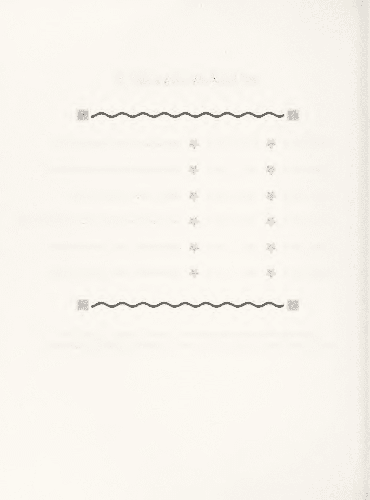 

## 网页魔法师的 JavaScript 指南

 

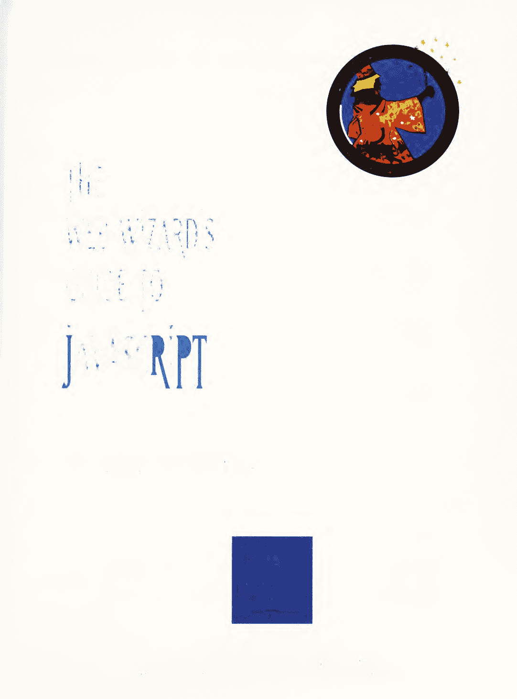 

**STEVEN ESTRELLA**

 

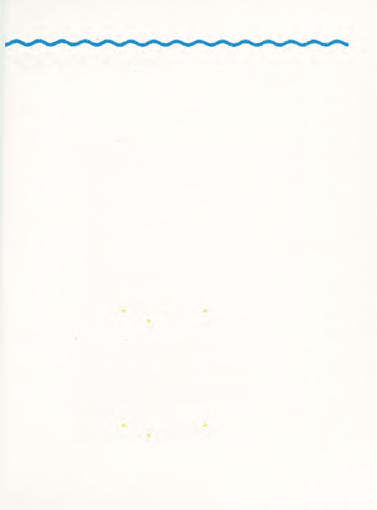 

**前言**

如何工作 .49

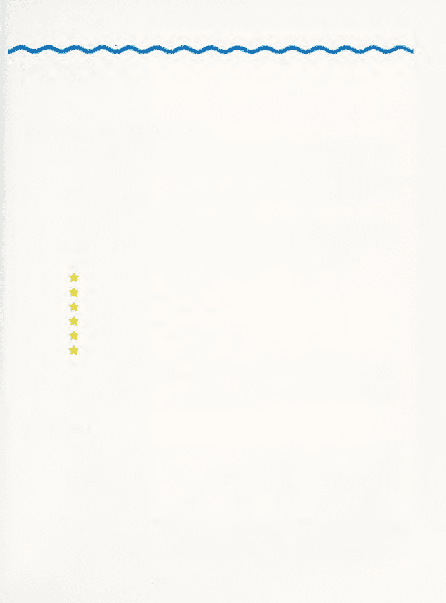 

## 前言

### 关于 Addison-Wesley 的 Web Wizard 系列

Web 的魅力在于，只要付出一点努力，任何人都可以利用它的力量来创建复杂的网站。Addison-Wesley 的 Web Wizard 系列通过在每本书中对一个重要的互联网主题或技术进行简要介绍，帮助学生掌握 Web。这些书籍从零开始，假设读者对所涵盖的技术没有先验经验。掌握 Web 并非挥一下魔杖就能实现的，但通过学习这些易于理解、高度视觉化的教科书，读者将走上正确的道路。

该系列由讲师编写，他们熟悉初学者在学习材料时面临的挑战。为此，Web Wizard 系列书籍不仅提供了食谱式的方法：它们更强调原理并提供清晰的解释，为读者提供坚实的知识基础，以便在此基础上进行构建。

许多特性突出了重点内容并辅助了学习：

- **提示（Tips）**——需要记住的重要要点
- **快捷方式（Shortcuts）**——节省时间的想法
- **警告（Warnings）**——需要注意的事
- **动手尝试（Do It Yourself）**——现在就可以尝试的活动
- **复习题和实践练习**
- **在线参考（Online references）**——获取更多信息的网站

书籍的补充材料（包括更新、额外示例和源代码）可以在 `http://www.aw.com/webwizard` 获取。对于采用本系列书籍的合格讲师，还提供讲师手册、样本测试和答案。请联系您的 Addison-Wesley 销售代表获取讲师资源密码。

### 关于本书

当我最早在 1994 年开始开发网站时，我能显示一个简单的图形或给文本加粗就已感到非常感激了。那时，Web 是一个静态媒介。交互性仅限于您创建的用于在不同页面间跳转的链接。Web 设计师对内容的呈现方式几乎没有控制权。由于带宽限制和缺乏标准，文本和简单图形以外的媒体元素很少被使用。那时网页最流行的背景颜色是灰色。天哪，一切都发生了巨大的变化。

今天的网站具有高度的交互性和丰富的媒体内容。JavaScript 在现代网站的开发中起着巨大作用，因为它提供了一种相对简单的方法来与浏览器创建的对象进行交互。因此，Web 设计师不再将他们的创作视为一系列通过导航图标连接的静态页面。相反，Web 设计师创建了让访问者与文本、图形、动画、声音和视频交互的环境。访问者是主动参与者，而不是被动接受者。

本书将介绍 JavaScript 语言的基础，并帮助你学习可视化浏览器环境中的对象交互。在学习 JavaScript 之前，建议具有坚实的 HTML 4 基础。在这里学的概念技能将让你的 HTML 代码提升一个层次。你将学习在页面加载前后操作你的网页内容。你将学习如何从访问者那里收集信息以定制他们的浏览体验。你将充分理解一种改变了互联网本质的语言。

### 致谢

任何书籍都不是一个人完成的。我要感谢我的编辑 Elinor Actipis 和 Susan Hartman Sullivan 的鼓励——以及美味的巧克力甜点。感谢我勤奋敏锐的校对编辑 Betsy Hardinger，以及 Gillian Hall 的创意排版。非常感谢 Diane Freed 的幽默以及在确保每个人按计划进行方面的勤勉。

此外，书稿评审员提供了许多极好的建议和修改，这真的让这本书变得更好。这些评审员包括：

- John Hollenbeck, 旧金山州立大学
- Donna Occhifinto, Morris 郡学院
- Carla Gesell-Streeter, 辛辛那州立技术社区学院
- Robert N. Barger, 圣母利亚大学
- James A. White, 博士， 佛罗里达南方大学
- Tammy Ashley, 新汉普郡社区技术学院-曼彻斯特
- Don Anderson, 查德龙州立大学

向我的柯基犬 Clara Belle 道歉，在写这本书期间我不小心忽略了她的飞盘。最重要的是，我要向我最好的朋友兼妻子 Kathleen Schietroma 表以感谢和敬意，她的坚持和专注不断激励着我。

**Steven Estrella**

2001年9月

 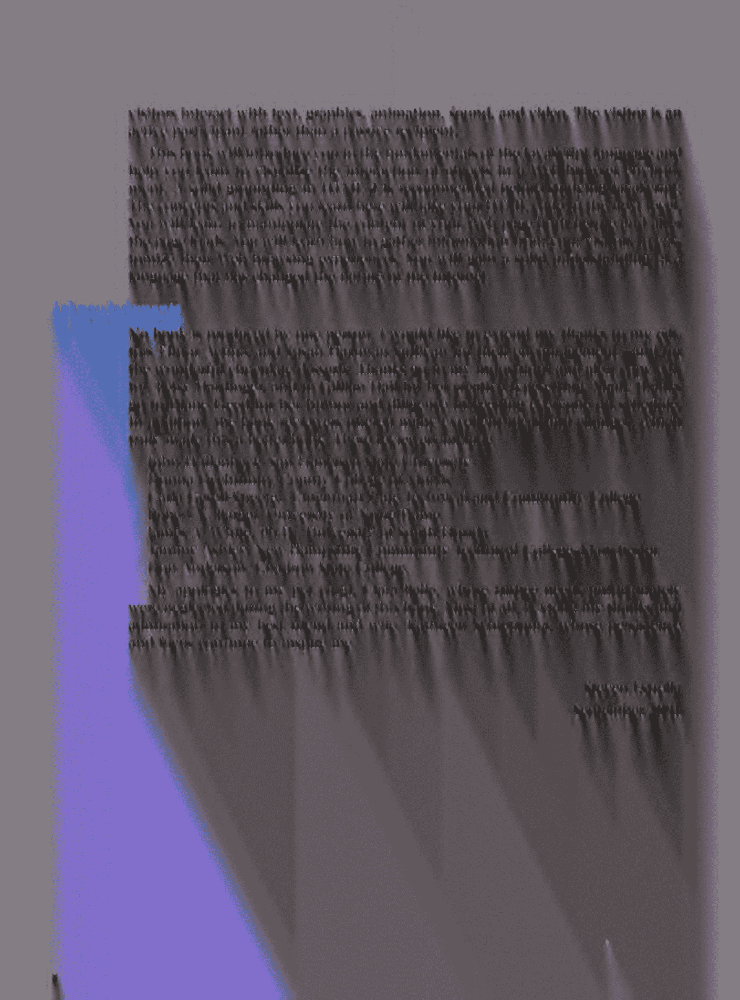

你可能读这本书是因为你已经知道如何用超文本标记语言（HTML）创建网页，现在你想让你的页面更有趣、更动态。本书将通过提供 JavaScript 语言基础的清晰解释，并以代码示例演示关键概念，帮助你起步。

发现学习 JavaScript 的许多充分理由：

- 学习 JavaScript 的历史
- 掌握基础概念：对象、属性、值、方法、事件、变量、数组和函数
- 熟悉文档对象模型（DOM）

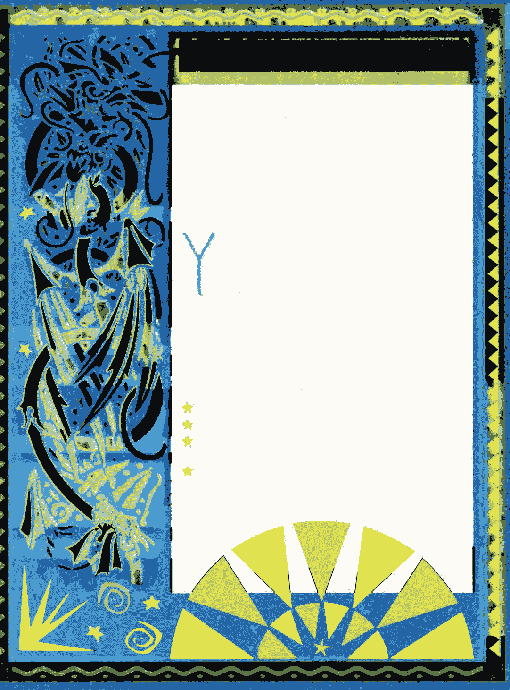 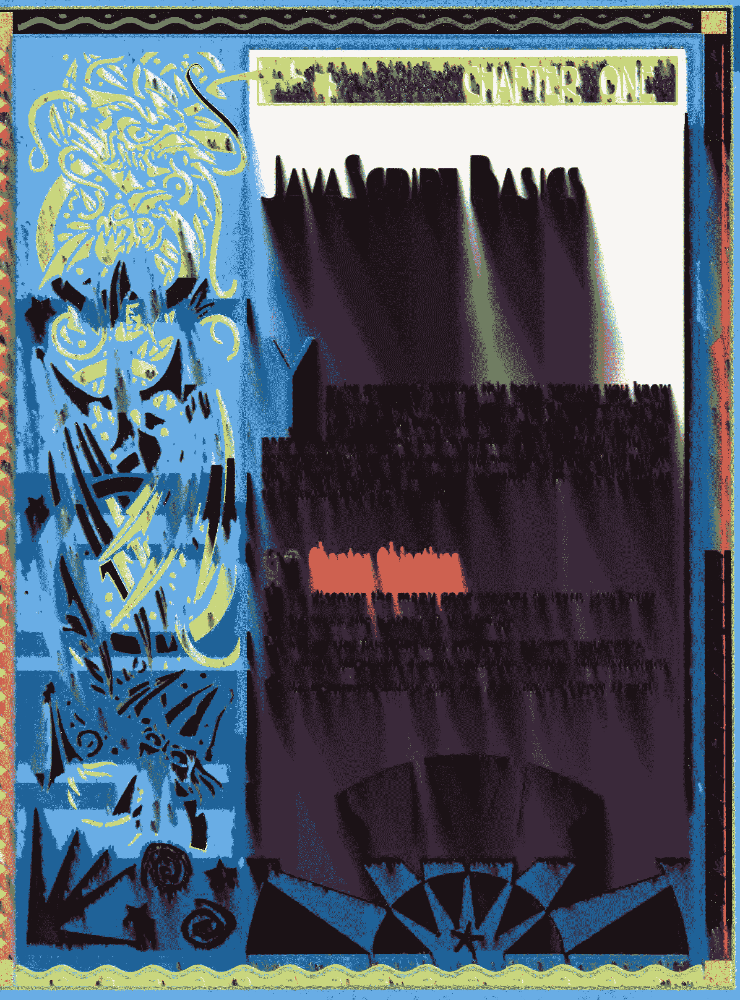

## 第一章：JavaScript基础

### 为什么要学习 JavaScript？

JavaScript 是一种为 Web 设计的脚本语言。你将 JavaScript 代码直接集成到 HTML 文档中，访问者的浏览器在加载文档时会解释这些代码。JavaScript 主要成名于它允许 Web 开发者在网页中包含高水平的交互性。学习 JavaScript 有许多很好的理由。

- 几乎所有的 Web 浏览器都支持 JavaScript。
- JavaScript 是一种非常流行的语言。因此，JavaScript 网站上有成百上千个脚本可以下载。你可以向他人学习。
- 越来越多的多媒体制作软件（如 Macromedia Flash 和 Macromedia Director）依赖 JavaScript 或类 JavaScript 语言来创建交互并增强界面。
- JavaScript 让你可以使用外部代码库（`.js` 文件），鼓励代码复用。
- JavaScript 的语法与 C、C++ 和 Java 的语法非常相似。投入学习 JavaScript 的时间将长期受益。

学习编程语言对大脑有益。要在编程中成功，你需要使用创造性的问题解决逻辑思维。编程的学习有助于培养这些能力。

### 简史

JavaScript 最初被称为 LiveScript，是由 Brendan Eich 在 1995 年在 Netscape 发明的。Netscape 和太阳公司合作将 JavaScript 引入了 Netscape Navigator 2.0 浏览器。这次更名利用了围绕太阳 Java 语言的营销热度。

JavaScript 的流行随着 Netscape Navigator 3.0 的推出而增加。网页作者开始加入图像切换、状态栏滚动文本、表单验证和其他动态效果。不久后，微软的 Internet Explorer 3.0 引入了竞争语言 JScript，它与原始的 LiveScript 语言几乎完全相同。JavaScript 和 JScript 之间的差异大得不可以忽略。JavaScript 不是 Java！这些语言在外观和结构上相似，但 Java 是一种功能完整的结构化编程语言，范围上类似于 C 或 C++。相比之下，JavaScript 是一种用于增强网页的小型脚本语言。对你来说最相关的区别是 JavaScript 学起来容易得多。

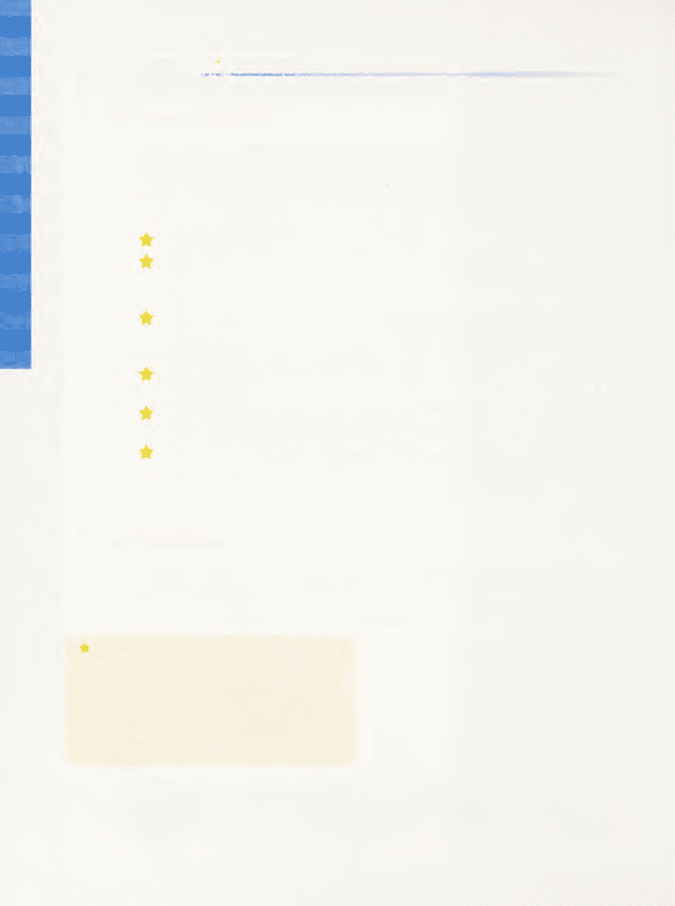 

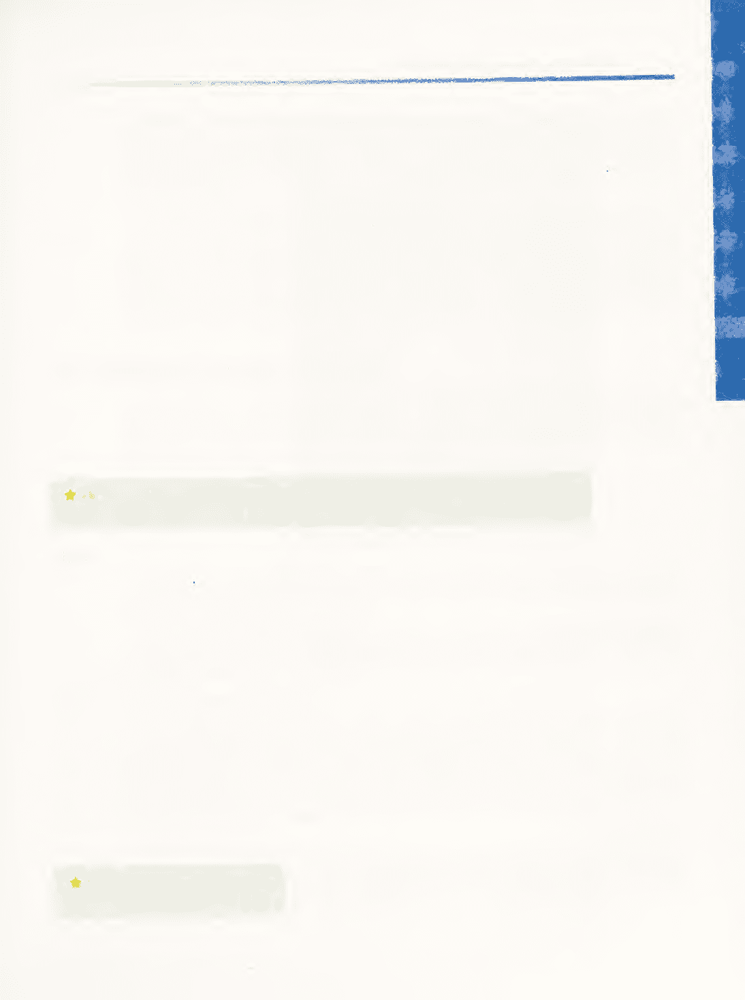 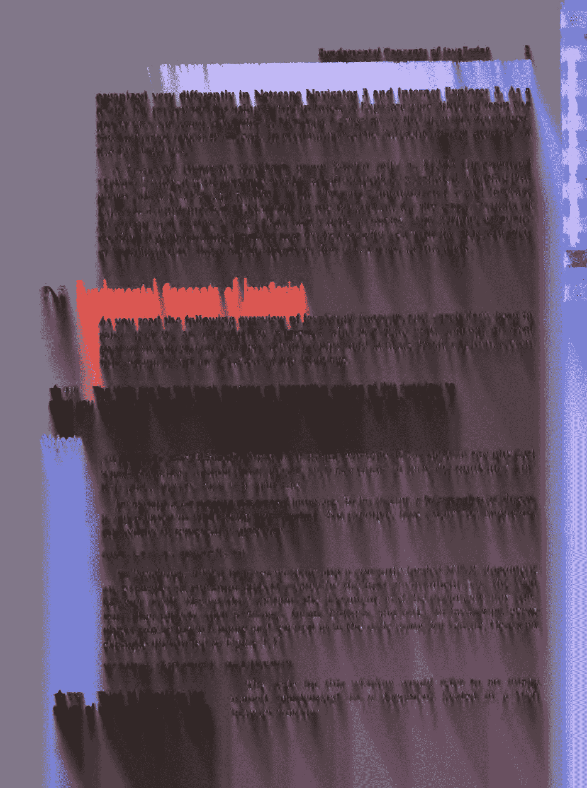

3

### JavaScript 的基本概念

JavaScript 在 Netscape Navigator 3 和 Internet Explorer 3 中的组织方式非常不同。因此，在 Internet Explorer 中使用 JScript 的步骤与在 Netscape Navigator 中使用 JavaScript 的步骤不同。随着浏览器的发展，这两种语言开始分化，以适应这两个浏览器不同的对象模型。

一个仅被称为 ECMA（读作 "Eckma"）的欧洲计算机标准组织与 Netscape 和微软合作，在 1997 年产出了一种名为 ECMAScript 的标准脚本语言。Netscape Communicator 4 和 Internet Explorer 4 都将 ECMAScript 作为最新版本 JavaScript 和 JScript 的基础。通过使用 ECMA 和一些创意，Web 开发者逐渐开发出了在两种浏览器对象模型中运行同样良好的编程实践。这些就是你将在本书中学习到的实践。

### JavaScript 的基本概念

在阅读以下 JavaScript 概念和词汇的概述时，请记住这是一份入门参考。当每个概念或术语在后续章节中首次出现时，将会有更详细的解释。现在，请回顾本节以概述该语言。

**提示** 本书的网站包含此概述的交互版本，以帮助你理解概念。访问 `http://www.awl.com/estrella`。

### 对象

对象是任何可以定义的实体。汽车是物理世界中对象的一个例子。汽车可能包含其他对象，例如后备箱。反之，后备箱可能包含其他对象，例如备胎。

JavaScript 是一种面向对象的语言。在 JavaScript 中，对象的层级结构在代码中使用点语法（dot syntax）表示。例如，这里是你可能如何使用点语法来表示备胎：

```
car.trunk.sparetire
```

在 JavaScript 中，Web 浏览器窗口和当前加载的 HTML 文档是宿主环境（即 Web 浏览器本身）创建的常见对象示例。窗口包含文档，文档可能包含其他对象，如图像、表单、按钮和链接。在 JavaScript 中，每个对象都可以赋予一个名称，并在代码中使用点语法引用。以下是一个示例（如图 1.1 所示）：

```
window.document.gardendog
```

**提示** 将对象想象成 Web 浏览器窗口加载的文档中具命名的“gardendog”。

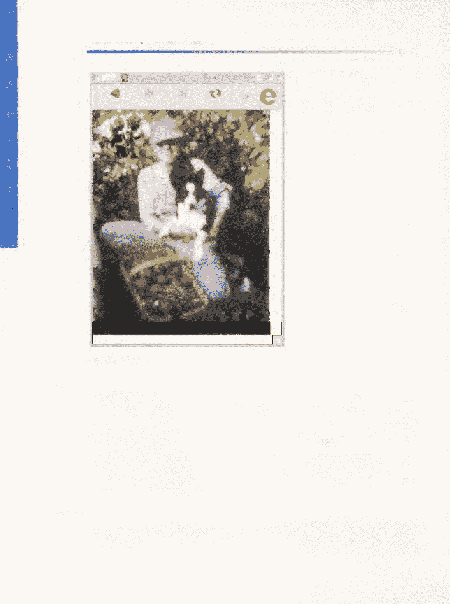 

第一章 JavaScript 基础

4

JavaScript 的基本概念

图 1.1 Web 浏览器窗口中的图像对象

### 实例

实例是对象的一个特定化身。例如，汽车是一个对象，而停在街对面的甲虫汽车（Beetle）就是汽车对象的一个实例。对象的实例继承了对象类型的所有特征。例如，如果一辆汽车都有后备箱和备胎，那么汽车对象的任何实例（包括我邻居的甲虫汽车）都可以被假设拥有这些物品。

```
Beetle.trunk.sparetire
```

将是指定甲虫汽车后备箱中备胎（更通用的汽车对象的一个实例）的代码。

同样，加载到 Web 页面中命名为“gardendog”的照片是更通用图像对象的一个实例。

### 属性

在现实生活中，对象的实例也可以有属性。汽车对象的实例可能有一个名为 `color`（颜色）的属性。该属性在 JavaScript 中将引用为：

```
Beetle.color
```

 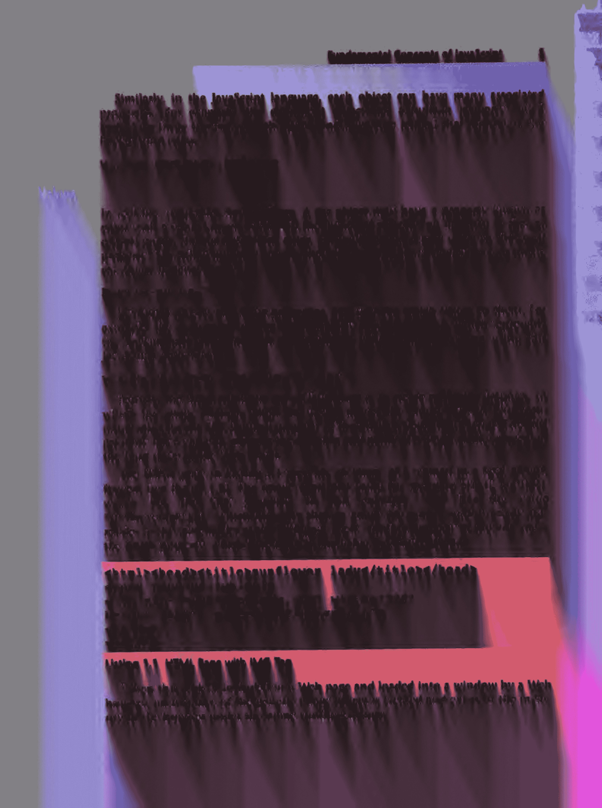

JavaScript 的基本概念

同样，在 JavaScript 语言中，每个对象都可以有许多关联属性。例如，文档对象有一个名为 `bgColor` 的内置属性（注意同时使用了大写和小字母），它表示背景颜色：

```
window.document.bgColor
```

### 值

在现实生活中，属性有值。汽车对象可能有一个名为 `color` 的属性，其值为 `blue`（蓝色）。如果甲虫汽车（汽车对象的一个实例）的所有者将汽车漆成不同的颜色，他将为 `color` 属性分配新值。以下代码为汽车对象实例 `Beetle` 的 `color` 属性分配值 `red`（红色）：

```
Beetle.color="red";
```

JavaScript 对象也有属性，并且你可以为它们赋值。例如，文档对象有一个名为 `bgColor` 的属性，表示背景颜色，并可以使用此 JavaScript 语句分配 `silver`（银色）等值：

```
window.document.bgColor="silver";
```

JavaScript 最常用的用途可能是创建鼠标悬停图形，当观众将鼠标移动到图像上时，图像会变化。这种技术依赖于 JavaScript 中图像对象的 `SRC`（源）属性。`SRC` 属性有一个值，用于指示 Web 服务器硬盘上图形文件的位置和名称。

列表 1.1 中的 HTML 页面展示了一位在向日葵田里的女性（见图 1.2）。该图像使用标准的 HTML 标签 `IMG` 创建的，该标签具有 `SRC` 属性。在这个示例中，`SRC` 的值为 `"sunflowerlady.jpg"`，表示名为 `"sunflowerlady.jpg"` 的图像文件位于 Web 页面本身所在的文件夹中。`IMG` 标签的另一个属性是 `NAME` 属性，这里它被设置为值 `"sunflowerphoto"`。

```html
<html>
<head>
<title>sunflower lady</title>
</head>
<body bgcolor="white">

</body>
</html>
```

列表 1.1 带有 IMG 标签的 HTML 页面

当这段代码包含在 Web 页面中并通过 Web 浏览器加载到窗口中时，就会创建一个通用图像对象的实例，并以 `sunflowerphoto` 的名称存在浏览器内存中。

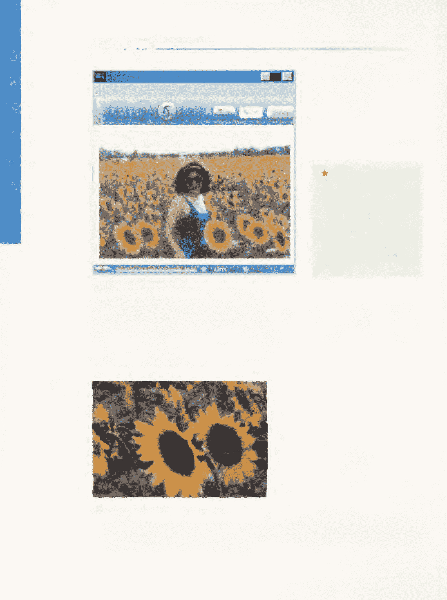 

JavaScript 的基本概念

6

第一章 JavaScript 基础

**提示** 将对象想象成 Web 浏览器窗口加载的文档中具命名的“gardendog”。

图 1.1 Web 浏览器窗口中的图像对象

图 1.2 向日葵田中的女性

图 1.3 向日葵的特写

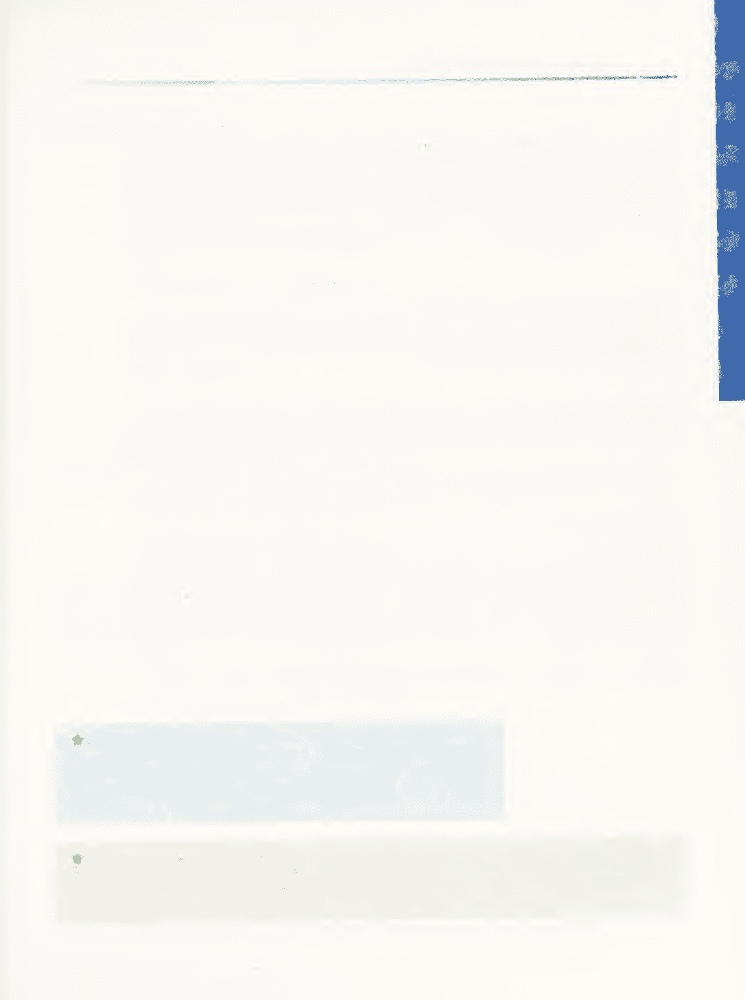

### 事件与事件处理器

在现实生活中，对象的实例有时会遇到事件。事件处理器是响应事件的代码。在这个示例中，爆胎事件由 `onmouseover` 处理器处理，该处理器通过更改轮胎的值来响应事件：

```
onmouseover=Beetle.shape="flat";
```

同样，在 JavaScript 语言中，每个对象都可以遇到许多事件。最常用的事件之一是访问者移动到对象上方时触发的 `mouseover` 事件。锚标签（`<a>`）可以被设置为响应 `mouseover` 事件。在锚标签内的任何文本或图形都可用于触发事件。

在下面的示例中，链接（`<a>` 标签）带有 `onmouseover` 处理器，当访问者将鼠标移动到链接上时将页面颜色更改为银色。

```html
<a href="#" onmouseover="document.bgColor='silver'">鼠标悬停更改背景</a>
```

要实现图像切换，你使用 `IMG` 标签代替文本。列表 1.2 设置了鼠标悬停图形。当用户将鼠标移动到图像上，就会产生 `mouseover` 事件。锚标签有一个 `onmouseover` 事件处理器来处理 `mouseover` 事件。事件处理器向浏览器发送单行代码，更改 `"sunflowerphoto"` 图像的 `SRC` 属性以显示向日葵的特写。

阅读列表 1.2 中的代码。你可能会在学习 JavaScript 的早期阶段理解这么多而感到惊讶。

**切割** 你将在第四章和第五章更详细地学习图像切换。要自己创建列表 1.2，请从 `http://www.awl.com/estrella` 下载两个图像，在任何文本编辑器中输入代码，将其保存为扩展名为 `.html` 的纯文本文件，然后用你的 Web 浏览器打开它。

**提示** 在代码列表中，符号 `->` 表示由于打印页面行长度限制而换行到下一行的文本。避免在代码中放置不必要的换行符是重要的。中间有换行符的 JavaScript 语句在 Web 浏览器中无法正常工作。


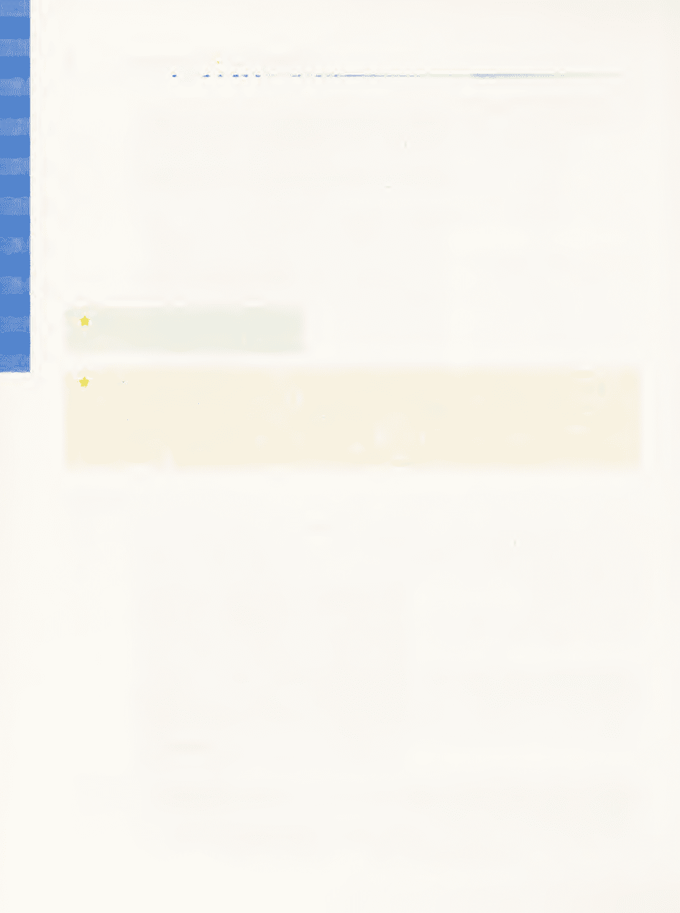

# JavaScript 基础概念

## 第一章 JavaScript 基础

```html
<html><head><title>向日葵图片切换</title></head> 
<body bgcolor="white">
<a href="#" onmouseover="document.sunflowerphoto.src = 'sunflowers.jpg';" 
onmouseout="document.sunflowerphoto.src = 'sunflowerlady.jpg';
</a>
</body>
</html>
```

Listing 列表 1.2 图片切换

> ☆提示  
> 本书中代码列表中的 JavaScript 部分显示为蓝色。

> ☆警告  
> 注意敏感！

当你学习 HTML 时，可能发现 HTML 标签不区分大小写而松了一口气。在 HTML 中，`` 和 `` 是相同的。然而，JavaScript 是区分大小写的。在当前的示例中，`sunflowerphoto` 和 `SunflowerPhoto` 是不等价。在 JavaScript 代码中命名对象并引用它们时，请注意大写和小写字母。

### 变量

在现实生活中，我们一直都在处理变量。在餐馆里，几位常客可能会点“老样子式”。服务员熟悉每位顾客，会为其中一位顾客的变量“the usual”赋值“火腿加奶士”，而为另一位顾客的变量“the usual”赋值“蔬菜汉堡”。在这种情况下，变量的作用域是局部的。它只在特定的餐馆有效。如果顾客去了一家新餐馆并要求“老样子”，服务员将无法理解。相反，全局变量在世界上每家餐厅都能被理解。全局变量的一个例子是“账单”；每个服务员都理解每个顾客必须为食物付费。

当变量包含一个值时，你可以将该值赋值给对象的属性。以下代码说明了如何创建和使用变量将青色（teal）赋值给汽车对象的 Beetle 实例。注意使用`var`关键字来初始化（即创建）变量。

```javascript
var myFavoriteColor = "teal";
Beetle.color = myFavoriteColor;
```

同样，在 JavaScript 中，像`bgColor`这样的属性值可以放在变量中：

```javascript
var myBackgroundColor = "silver";
window.document.bgColor = myBackgroundColor;
```

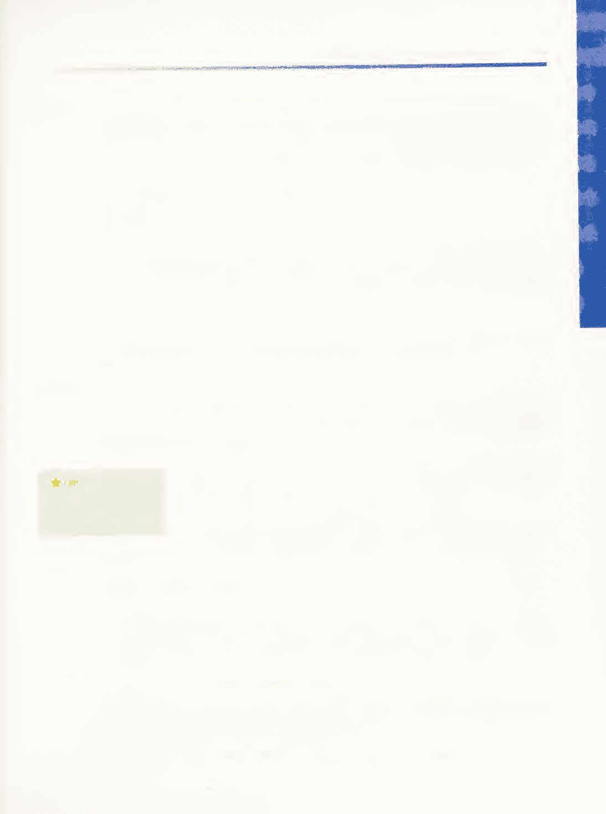

JavaScript 基础概念

### 数组

数组是有序的数据集合。数组的每个元素都是变量，可以包含任何类型的数据。你通常使用数组来存放相关数据。例如，代表调料架上隔间的数组。在这种情况下，数组的每个元素代表一个隔间。每个间都可以包含你喜欢的任何香料。

```javascript
var spicerack = new Array();
spicerack[0] = "oregano";
spicerack[1] = "salt";
spicerack[2] = "pepper";
```

数组元素的编号始终从 0 开始，但有时程序员不会填充`[0]`元素，以便编号可以更自然地从 1 开始。你可以使用像下面这样的语句重新分配数组中任何元素的值：

```javascript
spicerack[0] = "garlic";
```

数组非常有用，因为你可以使用编程循环更改每个数组元素的值。你将在第二章学习循环循环。

### 方法

在现实生活中，对象有时会有与之关联的操作。在 JavaScript 中，与对象关联的操作被称为方法（methods）。每个通用对象都有与其关联的方法。例如，汽车对象的所有实例都有一个名为`brake`的关联方法，用于减慢汽车。

像变量一样，方法可以接收值。例如，`brake`方法可以根据驾驶员对踏板施加的力量大小接受快或慢的值。在 JavaScript 中，括号`()`是 JavaScript 中用于动词，用于包含与方法关联的值。与对象关联的方法由该对象的任何实例继承。Beetle 是一个通用汽车对象的实例。

因此，Beetle 可以`brake`方法：

```javascript
Beetle.brake("fast");
Beetle.brake("slow");
```

方法通常由事件触发。假设我们的 Beetle 汽车对象遇到了爆胎事件（blowout）。Beetle 必须通过执行`brake`方法来处理此事件。在这个示例中，爆胎事件由`onBlowOut`事件处理器处理，它通过启动`brake`方法来响应事件：

```javascript
onBlowOut = Beetle.brake('fast');
```

同样，浏览器对象有很多方法。简单的方法之一是`document`对象的`write`方法。该方法用于在页面加载时向当前写入文本：

```javascript
document.write("Greetings JavaScript Students!");
```

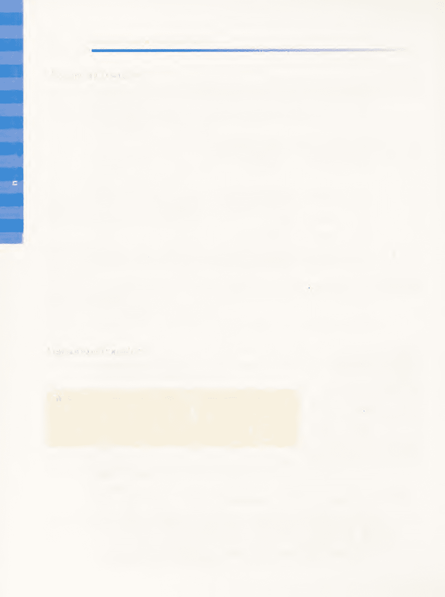

JavaScript 基础概念

### 赋值运算符

要给变量赋值一个值，你使用简单的赋值运算符，如`=`：

```javascript
var myAge = 39;
var myName = "Steven";
```

赋值一个值后，你可以使用复合运算符更改它，例如加赋值`+=`、减法赋值`-=`、乘法赋值`*=`和除法赋值`/=`运算符：

```javascript
var myAge = 39;
myAge += 4; // 结果为 43
myAge -= 4; // 结果为 35
myAge *= 4; // 结果为 156
myAge /= 4; // 结果为 39
```

比较运算符允许你比较值。比较的结果是一个布尔值（true 或 false）。JavaScript 中最常见的错误是使用了赋值运算符`=`，而你想要的是相等运算符`==`。

比较运算符包括：

- `==`（等于）
- `!=`（不等于）
- `>`（大于）
- `<`（小于）
- `>=`（大于或等于）
- `<=`（小于或等于）

比较示例：

```javascript
var myAge = 39;

myAge == 39; // 结果为 true

myAge != 40; // 结果为 true

myAge > 39;  // 结果为 false

myAge < 40;  // 结果为 true

myAge >= 39; // 结果为 true

myAge <= 38; // 结果为 false
```

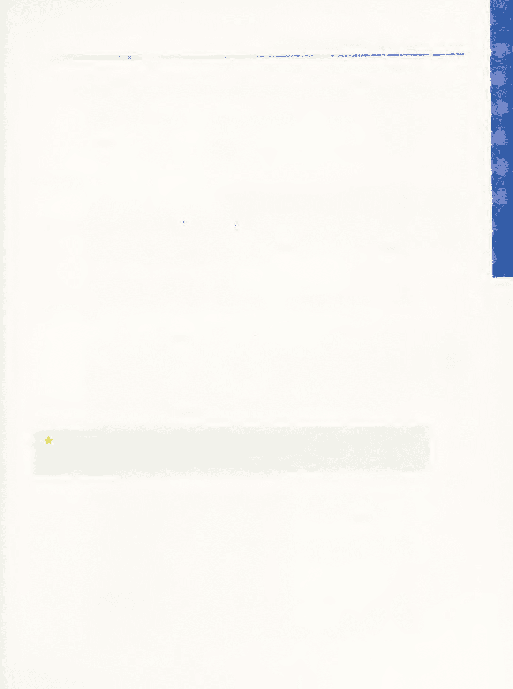

JavaScript 基础概念

### 函数

函数是一组执行指定任务的语句组。函数通常存储在 HTML 文档的 HEAD 部分，并在被其他 JavaScript 语句调用（即调用）时执行工作。

```javascript
function doSomething(){
    var theVisitor = document.myform.visitor.value;
    window.alert("Is this OK, " + theVisitor + "?");
}
```

这是一个简单的示例。列表 1.3 中的 HTML 代码创建了一个表单，包含一个供访问者输入的地方和一个点击按钮（见图 1.4）。当点击按钮时，就会调用`doSomething`函数，并显示包含访问者名字的警告框。警告框是由窗口对象的`alert`方法生成的。`alert`方法接收一个值，该值由字符串加上页面用户名字段中输入的任何值以及一个问号组成。结果以警告框的形式显示。

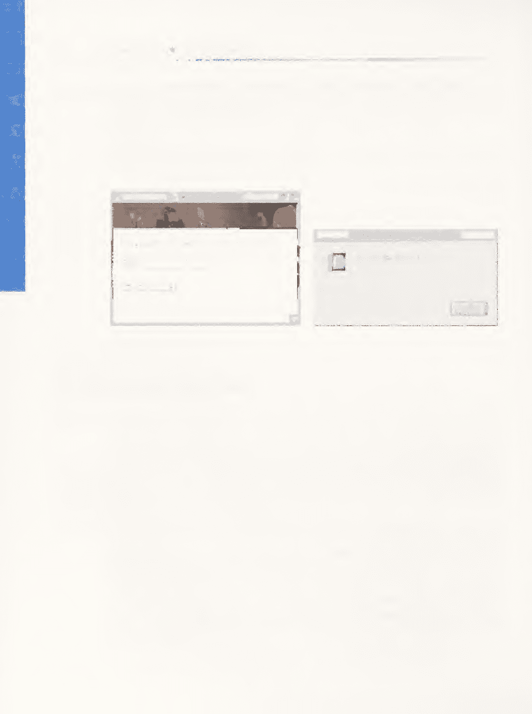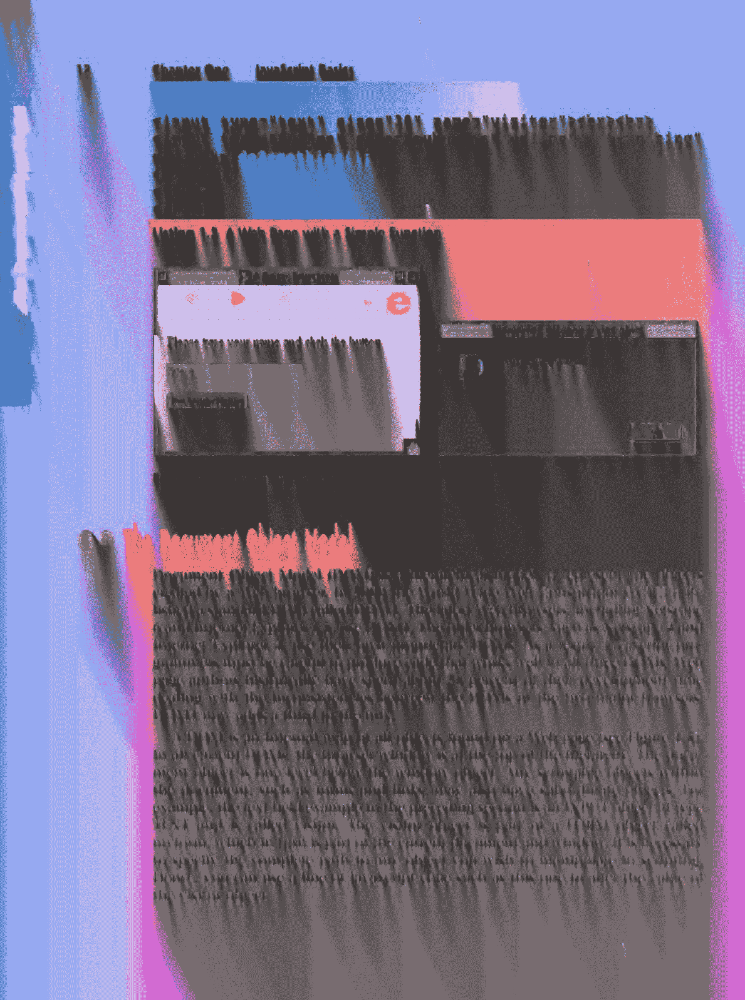

## 第一章 JavaScript 基础

■■■■■■■■■—■■■MBMflBIUIMeflJiaBWSBWtJ \-r R. IHN

```html
<form>
<input type="text" size="30" name="visitor"><br><br>
<input type="button" name="mybutton" value="Do Something" onclick="doSomething();">
</form>
```

列表 1.3 一个带有简单函数的网页

Internet Explorer 脚本警报：这样可以吗，Steve？

### 文档对象模型

文档对象模型（Document Object Model，DOM）是一种表示 Web 浏览器创建的对象的层级模型。2000 年，万维网联盟（W3C）发布了一种名为 DOM1 的标准 DOM。最新的 Web 浏览器（包括 Netscape 6 和 Internet Explorer 5.5）使用 DOM1。较旧的浏览器（如 Netscape 4 和 Internet Explorer 4）则使用它们专有的 DOM。因此，JavaScript 程序员必须小心编写在所有三个 DOM 中都能运行的代码。从历史上来看，网页作者花费了大约 25% 的开发时间来处理两个主流浏览器 DOM 之间不一致的问题。DOM1 现在将第三者也加入了其中。

DOM 是 Web 页面上找到的所有对象的内部映射（参见图 1.5）。在所有当前的 DOM 中，浏览器窗口位于层级结构的顶端。文档对象位于窗口对象的下一层。文档中的任何可脚本对象（如表单和链接）也可能有子对象。例如，前一节中的文本字段示例是一个类型为 TEXT 的 INPUT 对象，并名为`visitor`。visitor 对象是名为`myform`的`FORM`对象的一部分，而该对象又是当前文档和窗口的一部分。在脚本编写中，必须为你想要操作的任何对象指定完整路径。因此，你可以使用类似这样的 JavaScript 代码来更改 visitor 对象的值：

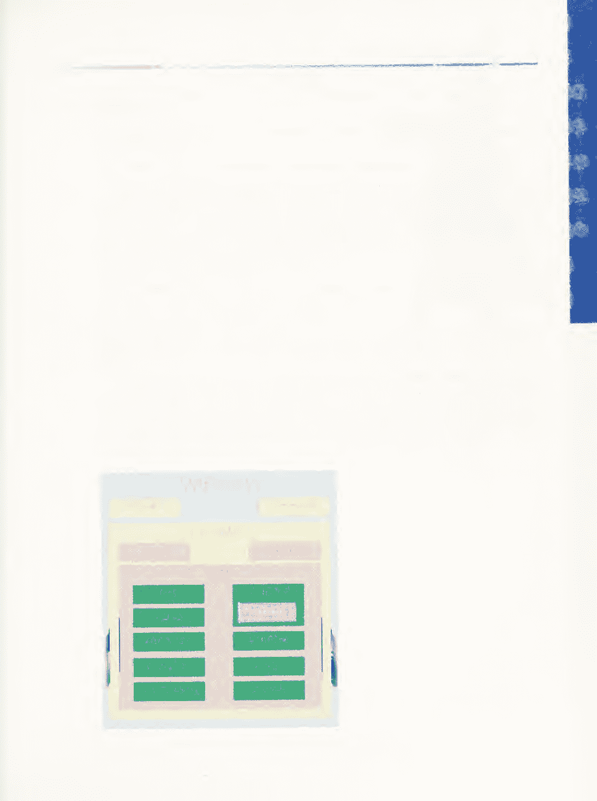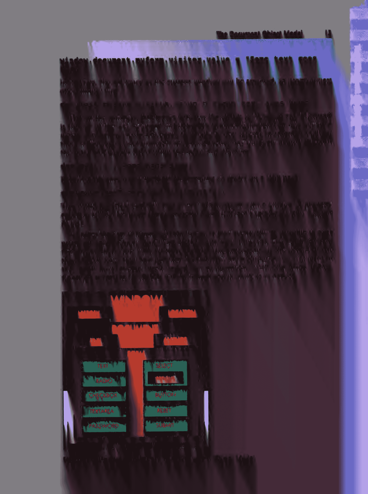

### 文档对象模型

```javascript
window.document.myform.visitor.value = "Some text goes here";
```

在实践中，可以假设对当前窗口的引用，因此程序员通常只需输入：

```javascript
document.myform.visitor.value = "Some text goes here";
```

Netscape 和微软 DOM 之间的主要区别之一是微软 Internet Explorer 中使用了`ALL`关键字。与 Netscape Communicator 相比，Internet Explorer 中的`ALL`关键字创建深嵌套对象的引用变得更容易。你可以使用以下结构引用 Internet Explorer DOM 中任何唯一命名的对象：

```javascript
document.all.someobjectname;
```

DOM1 建立了一种访问网页上对象的新方法：

```javascript
document.getElementByld(elementID);
```


这对于`SPAN`和`DIV`标签或 HTML 中编写了唯一 ID 属性的任何对象都有效。Netscape Communicator 6 和 Internet Explorer 5.x 现在支持 DOM1。

随着旧版本浏览器的废弃，最终可能编写出仅与 DOM1 兼容的页面。但目前，你需要学习适用于所有三个 DOM 的技术。理解三个 DOM 的所有细节需要时间和耐心。幸运的是，你将在书中学习的技术已经通过了与三个 DOM 的兼容性测试。与 DOM 相关的概念将根据需要在上下文中介绍。

| WINDOW |
| :--- |
| HISTORY |
| LOCATION |
| DOCUMENT |
| LINK |
| ANCHOR |
| FORM |
| SELECT |
| CHECKBOX |
| TEXTAREA |
| PASSWORD |

图 1.5 文档对象模型中的对象层级结构


## 总结

JavaScript 是一种专为 Web 设计的脚本语言。它是今天增强网页最流行、支持最好的语言。正如 Netscape 创建它一样，这种语言也被称为 ECMAScript。JavaScript 是一种面向对象的语言。网页上的元素具有属性。就像现实世界一样，对象会对事件做出响应。变量是信息的容器。数组是有序的数据集合。方法是 JavaScript 的动词。最常见的编程错误是混淆赋值运算符（`=`）和等号运算符（`==`）。函数是执行任务并通常返回一个值的语句组。文档对象模型是对象的内部映射。Netscape 和 Internet Explorer 使用不同的 DOM，但 W3C 最近发布的新的 DOM1 为所有浏览器的未来版本创建了标准。

### 参考文献

- Netscape 的 JavaScript 官方页面：`http://developer.netscape.com/docs/manuals/javascript`
- CNET.com 的 JavaScript 技巧：`http://builder.cnet.com`
- W3C 关于 DOM 的官方页面：`http://www.w3.org/TR/DOM-Level-1`

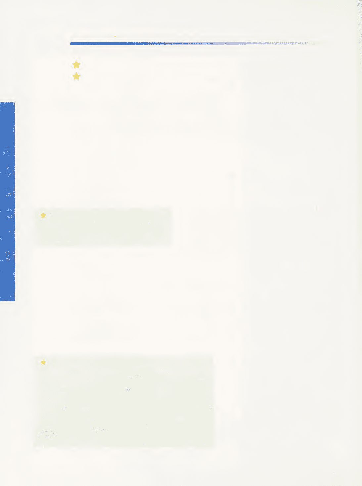[](img/7705a881c3cbfe90339b9b12a38fc1c6_29_1.png)

18

第二章 使用 JavaScript 增强网页

☆ ★

学习如何使用可以创建其他网页的网页

了解如何创建一个用于测试你代码的网页

## 序列：按给定顺序执行任务

想象一下，你是一个 13 岁男孩的父母，他开始长胡须了。我们叫他 Alex 吧。你的任务是教 Alex 如何刮脸。你的解释可能如下：

1. 用湿毛擦脸。
2. 在皮肤上涂抹剃须膏。
3. 用剃须刀在皮肤上刮，以去除胡须。
4. 在脸上涂上须须水。
5. 大声尖叫。

这五个步骤代表了一个指令序列。Alex 只有在完成指令 1 之后才会执行指令 2，依此类推。

同样，Web 浏览器按照它接收语句的顺序执行一系列 JavaScript 语句。然而，与 Alex 不同，你的浏览器并不具备智能。因此，你必须在编写指令时确保精确。

提示：如果你在连接互联网时阅读本章，可以在书籍网站 `http://www.awl.com/estrella/` 查看所有代码示例的运行情况。

列表 2.1 中的 JavaScript 语句序列创建了一个文本字符串，然后通过警告框（alert box）显示给用户，如图 2.1 所示。

`<script> </script>` 标签将其包含的所有语句识别为待解释的代码。`type="text/javascript"` 属性将代码识别为 JavaScript。最新的浏览器（Internet Explorer 5+ 和 Netscape 6+）识别 `<script>` 标签中的 `TYPE` 属性，因为它是 HTML 4.0 规范的一部分。旧版浏览器依赖于 `language="JavaScript"` 属性。为了保险起见，最好同时包含这两个属性，如示例所示。

提示 想写注释吗？

在你的 JavaScript 代码中放置注释将帮助你和他人理解你编写的代码。SCRIPT 标签内的注释文本块可以用 `/*` 开头，以 `*/` 结尾，如列表 2.1 所示。

单行注释可以用 `//` 开头。浏览器在执行代码时会忽略注释文本。然而，HTML 中的注释使用更熟悉的 HTML 注释字符（`<!-- HTML 注释放在这里 -->`）。

脚本的第一行以 HTML 注释标签（`<!--`）开头，这会让旧版浏览器（Netscape 1.0 和 Internet Explorer 2 及更早版本）隐藏脚本。如果你在脚本中忽略包含此标签，这些旧浏览器将在页面主体中显示脚本的文本。

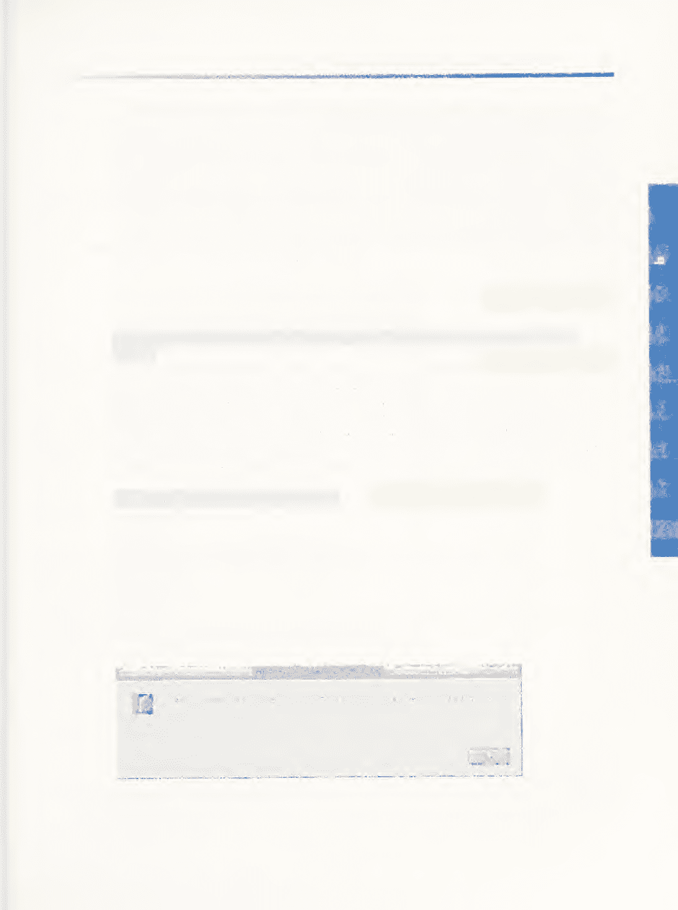[](img/7705a881c3cbfe90339b9b12a38fc1c6_30_1.png)

序列：按给定顺序执行任务

19

SCRIPT 部分包含四个 JavaScript 语句。第一个使用`var`初始化了新变量`myTextContainer`。然后，赋值运算符（`=`）将文本 "A Web browser " 赋值给变量`myTextContainer`。在接下来两行中，累加运算符（`+=`）向变量`myTextContainer`添加额外的文本。然后，`window`对象的`alert`方法在一个小警告框中显示变量`myTextContainer`的内容。访问者点击 OK 后，HTML 文档中 BODY 部分的文本将显示出来。

由于你学习过 HTML，你可能有一个喜爱的文本编辑器。将列表 2.1 中的代码输入你的文本编辑器中，将文档保存为`listing21.html`，用你喜欢的浏览器打开它。

```html
<html>
<head>
<title>alert me</title>
<script type="text/javascript" language="javascript">
// 使用 var 关键字初始化一个变量。
var myTextContainer = "A web browser ";
myTextContainer += "will follow your instructions ";
myTextContainer += "exactly and without an argument.";
/* window 对象的 alert 方法会创建一个警告框，要求访问者注意。 */
window.alert(myTextContainer);
// ends script -->
</script>
</head>
<body bgcolor="white">
<p>计算机按照指令去做，不是很棒吗？</p>
</body>
</html>
```

列表 2.1 一序列 JavaScript 语句

Web 浏览器将完全按照你的指令执行，没有任何争议。

图 2.1 列表 2.1 的输出

[](img/7705a881c3cbfe90339b9b12a38fc1c6_31_1.png)

循环：重复执行任务

20

第二章 使用 JavaScript 增强网页

## 循环：重复执行任务

你是否注意到洗发水瓶上的这些指令？“揉搓、冲洗、重复。”如果你是一台计算机，你永远不会离开淋间，因为这些指令创建了一个无限循环。为了避免这个问题，JavaScript 中的循环结构必须更精确一些。

JavaScript 中最常见的循环形式是`for`循环。其格式如下：

```javascript
for (初始化表达式; 测试条件; 更新表达式){
    这里是 JavaScript 语句。
}
```

`for`循环中的初始化表达式由设置初始值的变量组成。程序员通常使用`i`作为索引变量，但任何变量名都可以。列表 2.2 为索引变量`i`分配初始值5。分号（`;`）分隔初始化表达式和测试条件。测试条件决定循环何时结束。例如，为了避免终生洗头，你可以修改洗发水瓶上的指令为：“揉搓、冲洗、重复。直到头发干净。”

在列表 2.2 中，测试条件规定只有当`i`大于1（`i > 1`）时循环才会继续。如果`i`为1，循环停止。更新表达式指定了每次循环结束后如何更改索引变量。在列表 2.2 中，递减运算符（`--`）在每次循环后将`i`的值减1。

大括号（`{}`）内部有两个语句。第一个语句将`i`的当前值与字符串组合，并将结果写入浏览器中的当前 Web 文档。第二个语句向文档添加另一个句子。注意这两个语句都包含了 HTML 换行标签（`<br>`）作为字符串的一部分。`<br>`标签创建一个换行符。循环一直重复直到`i`的值降到1。循环结束后，大括号外的 JavaScript 语句将向文档添加最后两行文本。图 2.2 显示此示例的输出。

```html
<html>
<head>
<title>loop me</title>
<script type="text/javascript" language="javascript">
<!--
for (i=5;i>1;i--){
    document.write(i + " bottles of root beer on the wall.<br>");
    document.write("You take one down, pour a round.<br>");
    document.write("<br>There is only one bottle of root beer left.<br>");
    document.write("<hl>Now stop drinking all my root beer.</hl>");
}
// -->
</script>
</head>
<body bgcolor="white">
</body>
</html>
```

列表 2.2 经典的 for 循环示例

图 2.2 列表 2.2 的输出

条件分支：会决策的代码

21

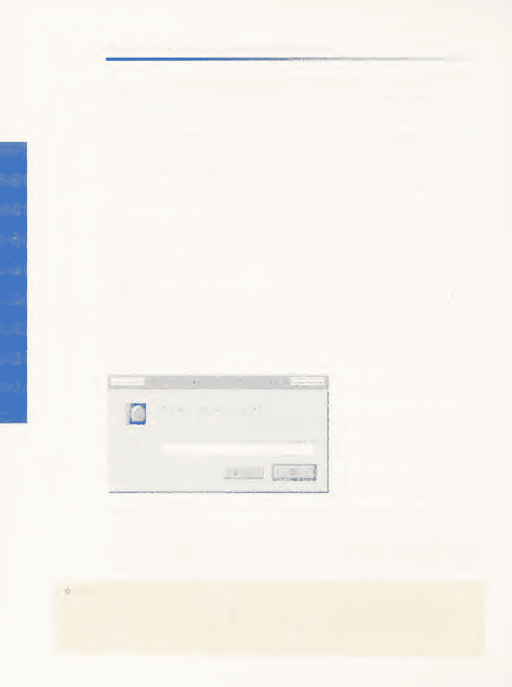

22

第二章 使用 JavaScript 增强网页

```html
<html>
<head><title>prompt me</title>
<script type="text/javascript" language="javascript">
<!--
var yourSpecies = window.prompt("Are you human or -alien?");
if (yourSpecies == "human"){
  document.write("Greetings Earthling.<br>");
}else{
  document.write("Nanu nanu. Kaplagh!<br>");
}
//-->
</script>
</head>
<body bgcolor="white">
</body>
</html>
```

列表 2.3 使用 If-Else 的条件分支

在 SCRIPT 部分的第 1 行，`window`对象的`prompt`方法向网页访问者提了一个一个问题。用户输入答案，该答案被赋值给变量`yourSpecies`。

| Internet Explorer 脚本提示 |
| :--- |
| 你是人类还是外星人？ |

图 2.3 向网页访问者提问

列表 2.3 的第 2 行测试了条件（`yourSpecies == "human"`）。如果访问者输入了 human，则条件为真，并向当前文档写入“Greetings Earthling”。如果访问者输入了其他内容，则条件为假，并向当前文档写入“Nanu nanu. Kaplagh!”。

**警告 为什么要使用`==`？**

初级程序员犯的最常见错误是将赋值运算符（`=`）与等号运算符（`==`）混淆。在编写 if-else 结构时，务必使用等号运算符（`==`）来测试你的条件。如果你误用了赋值运算符，你创建的条件将始终求为真，你无法得到预期的结果。

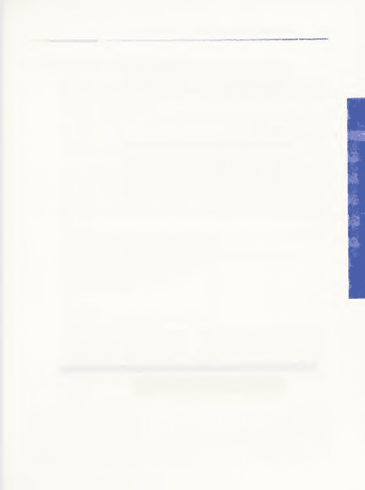

23

### 将脚本置于 HEAD 部分

用 HTML 创建的网页被分为两个大部分部分。HEAD 部分包含有关页的信息，例如标题和指向任何样式表的链接。BODY 部分包含网页访问者可见的文本、图形和媒体元素。

脚本可以存储在 HEAD 和 BODY 部分中。HEAD 使用得最频繁，因为它先加载。通过这种方式，你可以放心地在 BODY 中引用你的代码，确保代码已完全加载到浏览器的内存中。列表 2.4 显示了一个典型的 JavaScript 增强页面，其中在 HEAD 中有一个脚本，并在 BODY 中对该脚本进行引用（见图 2.4）。

在列表 2.4 中，一个值从 BODY 中的一个事件处理程序传递（发送）到 HEAD 中的`showText()`函数。`showText()`函数获取收到的值并将其存储在一个名为`inputdata`的临时变量中。`window`对象的`alert`方法随后将`inputdata`中找到的值显示为警报窗口。被传递的值是`document.sampleform.userinfo.value`，它代表访问者在当前文档`sampleform`表单的`userinfo`字段中输入的文本。

```html
<html>
<head><title>a place for scripts</title>
<script type="text/javascript" language="javascript">
<!--
function showText(inputdata){
  window.alert(inputdata);
}
//-->
</script>
</head>
<body bgcolor="white">
<p>Please type any text and then click the button.</p>
<form name="sampleform">
  <input type="text" size=50 name="userinfo"><br><br>
  <input type="button" name="mybutton" value="show text" onclick="showText(document.sampleform.userinfo.value);">
</form>
</body>
</html>
```

`onclick`事件处理程序将访问者输入的信息发送到 head 中的`showText()`函数，随后`showText()`函数在警报窗口中显示该信息。

列表 2.4 将脚本置于 HEAD 部分

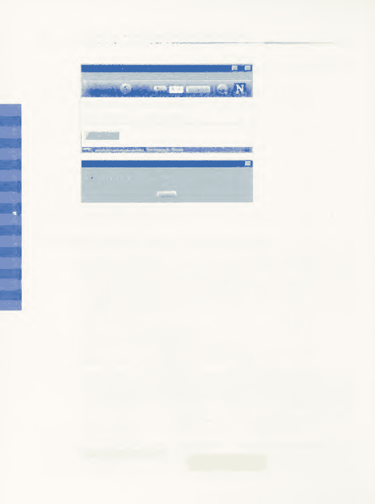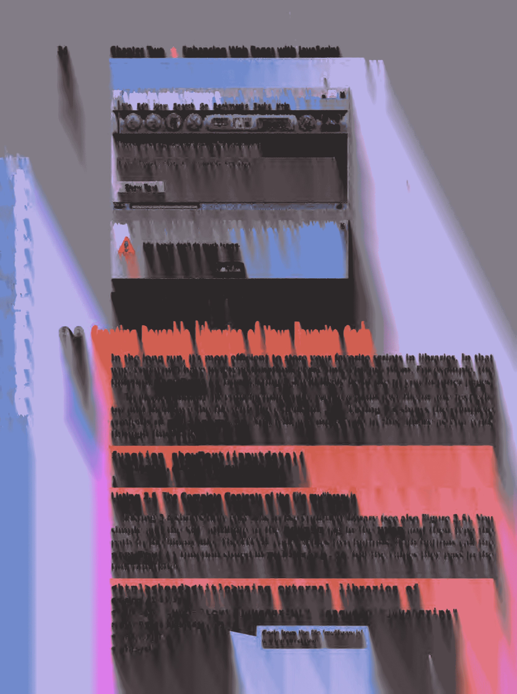

第二章 使用 JavaScript 增强网页

图 2.4 列表 2.4 的输出

### 创建你常用代码的可重用库

从长期来看，将你喜欢的脚本存储在库中是最有效的方法。这样，你就不需要每次使用时都重新输入函数。例如，列表 2.4 中的函数`showText()`可能在其他页面对你有用。

要创建一个常用代码的库，请在任何文本编辑器中创建一个纯文本文件，然后以 .js 扩展保存文件。列表 2.5 显示了`mylibrary.js`的完整内容。在你学习这本书时，你会向此库中添加更多代码。

```javascript
function showText(inputdata){
  window.alert(inputdata);
}
```

列表 2.5 `mylibrary.js`的完整内容

列表 2.6 显示了使用你的新库有多简单（见图 2.5）。你只需要在 HEAD 中的 SCRIPT 标签中添加`SRC`属性，然后输入库文件的路径。HTML 代码创建了两个按钮。两个按钮都调用了存储在`mylibrary.js`中的`showText()`函数，但它们传递的值不同。

```html
<html>
<head><title>using external libraries of code</title>
<script type="text/javascript" language="javascript" src="mylibrary.js">
</script>
</head>
```

这里引用了来自 `mylibrary.js` 文件的代码。

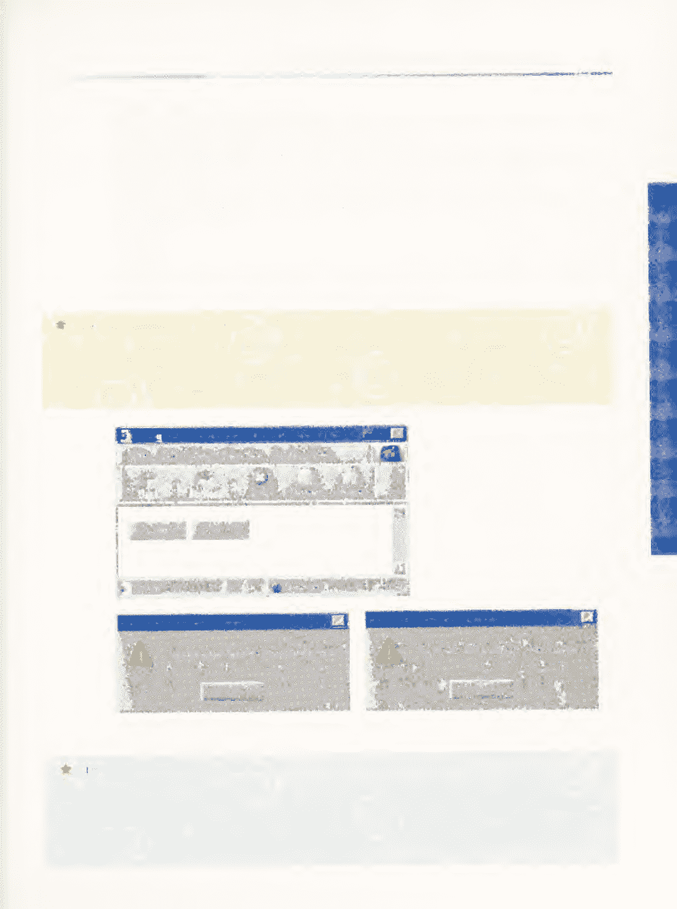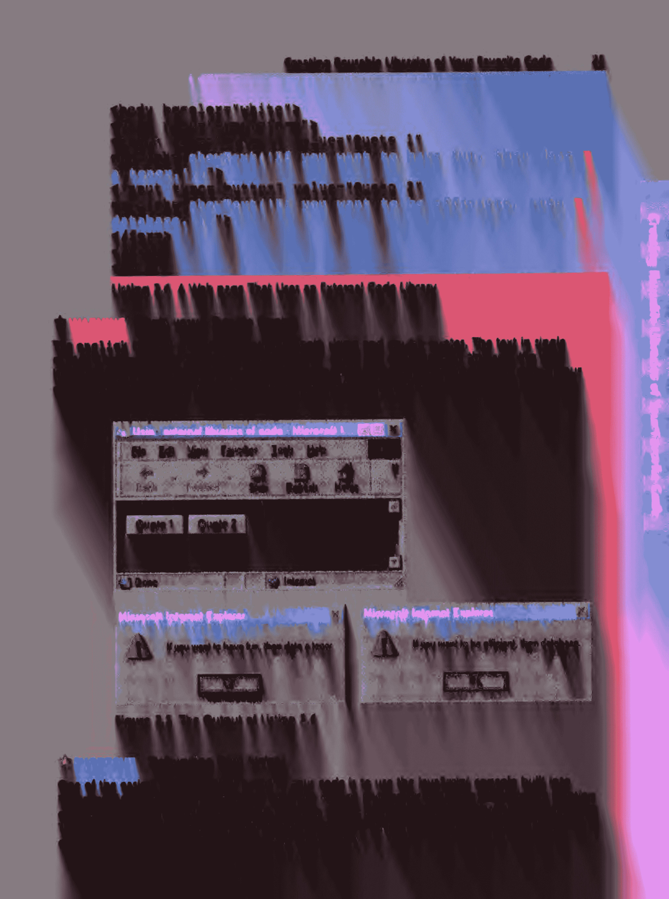

创建你常用代码的可重用库

25

```html
<html>
<body bgcolor="white">
<form name="sampleform">
  <input type="button" value="Quote 1" onclick="showText('If you want to">
  <input type="button" value="Quote 2" onclick="showText(\"If you want\")">
</form>
</body>
</html>
```


## 列表 2.6 使用外部代码库

**警告：单引号与双引号**

列表 2.6 中的 `onclick` 处理程序包含了单引号和双引号。当你这样嵌套引号时，网页浏览器可以正确确定每个表达式的开始和结束。这是一个常见的错误。

| Microsoft |
| :--- |
| Edit View |
| Back Refresh Home |
| Quote 2 |
| Quote 1 |

图 2.5 列表 2.6 的输出

### 调试你的脚本

检测代码中错误的简单方法之一是使用 Netscape 内置的 JavaScript 控制台。在 Netscape 4 或更高版本的 `location` 字段输入 `javascript` 可以打开控制台。在 Netscape 6 中，从 `TASKS` 菜单选择 `TOOLS JCONSOLE`。要查看代码生成的任何错误，请保持控制台打开。

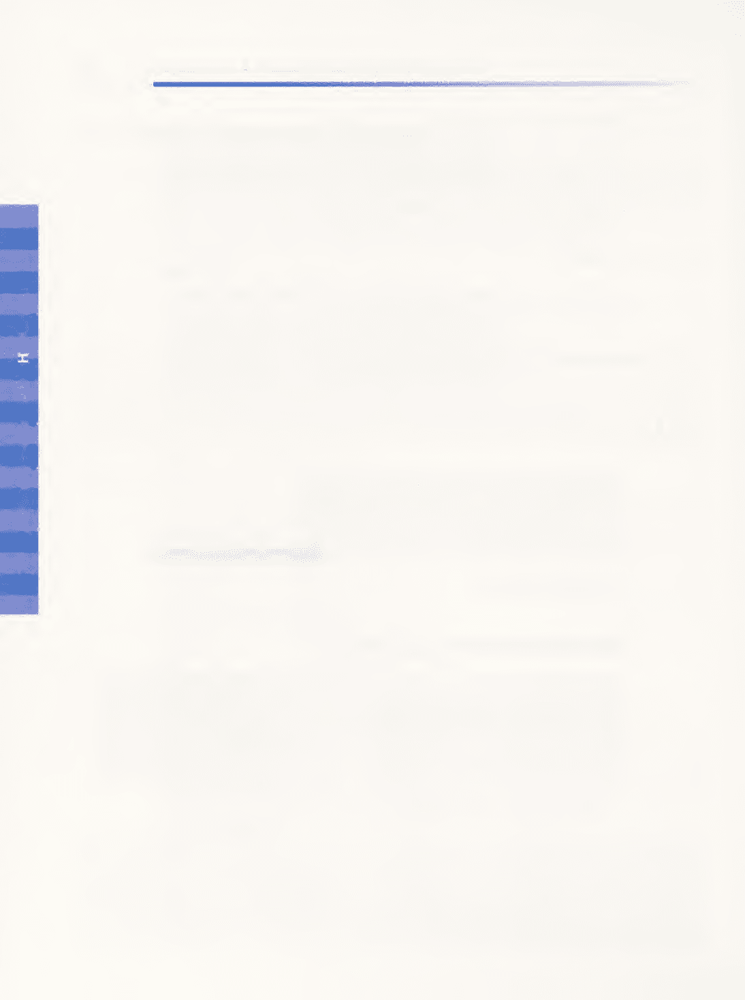

26 第二章 使用 JavaScript 增强网页

### 创建制作 HTML 代码的页面

在你学习这本书的过程中，你将创建许多包含标准 HTML 标记以及 JavaScript 代码的网页。那是大量的输入。通过技巧，你可以构建一个 JavaScript 增强页面来为你的项目快速生成标准的 HTML 代码。

首先，将列表 2.7 中的代码添加到 `mylibrary.js` 文件中。

```javascript
function buildPage() {
  var pagecontent = "<<html><head><title>";
  pagecontent += document.pageform.pagitle.value;
  pagecontent += "</title></head>\n";
  pagecontent += "<body bgcolor='white'>\n";
  pagecontent += document.pageform.bodytext.value;
  pagecontent += "\n</body>\n</html>";
  document.pageform.mycode.value = pagecontent;
}
```

列表 2.7 `buildPage` 函数

接下来，创建一个包含列表 2.8 中 HTML 代码的文本文件。

```html
<html>
<head><title>HTML Builder page</title>
<script type="text/javascript" language="javascript" src="mylibrary.js">
</script>
</head>
<body bgcolor="white">
<h1>HTML Builder</h1>
<p>Fill out the form below to create a basic html page.</p>
<form name="pageform">
  <h2>Title:</h2>
  <p>在下方输入网页标题。</p>
  <input type="text" name="pagitle" size="50" value="a basic html page">
  </p>
  <h2>Body text:</h2>
  <p>在下方输入页面的正文。<br>
  <textarea name="bodytext" cols="80" rows="10"></textarea>
  </p>
</form>
<textarea name="mycode" cols="80" rows="10"></textarea>
</body>
</html>
```

列表 2.8 HTML 代码


### 创建 HTML 页面

```html
<p>
<input type="button" value="生成页面" onclick="buildPage();">
</p>

<h2>下方将显示代码</h2>

<p>
<textarea name="mycode" cols="80" rows="15"></textarea>
</p>

<p>将文本复制并粘贴到任何文本编辑器并保存为 html 文件。</p>
```

示例 2.8 生成页面代码

提示：在 `http://www.com/estrella/` 查看完整的生成页面。

在示例 2.8 中，注意 `<form>` 表单包含三个字段：`pagetitle`、`bodytext` 和 `mycode`。访问者在前两个字段中输入文本，点击按钮，并在 `mycode` 字段中显示 HTML 代码。由于示例 2.7 中的 `buildPage()` 函数，这种魔法操作是可能的。

`buildPage()` 函数首先创建一个名为 `pagecontent` 的变量。然后添加标准的 HTML 标签 `<html>`、`<head>` 和 `<title>`。在 `<title>` 标签之后，将 `pagetitle` 字段的文本添加到 `pagecontent` 中。然后添加闭合的 `</title>` 和 `</head>` 标签。添加换行符 (`\n`) 以增强可读性。接下来，添加 `<body>` 标签。然后添加访问者输入 `bodytext` 字段的文本。闭合的 `</body>` 和 `</html>` 标签完成代码。最后一行代码将变量 `pagecontent` 的完整内容放入屏幕文本字段 `mycode`。准确地说，变量 `pagecontent` 的内容被赋值给当前文档表单文本字段 `mycode`（见图 2.6）。

### 创建 HTML 页面


第二章 使用 JavaScript 增强网页

Netscape：生成页面

1 2 3

黑客向前 重新加载

搜索 Netscape 图片

HTML 生成器

填写下方表单以创建一个基础 html 页面。

标题：在下方输入你的网页标题。

正文：在下方输入你页面的正文。

JavaScript 与我：爱情故事

生成页面

```html
<html><head><title>JavaScript 与我：爱情故事</title></head>
<body bgcolor='white'>
我与 JavaScript 的恋情始于我在朋友页面底部看到一个滚动字体。随着鼠标悬停图形变得流行，我们的感情加深了。今天，JavaScript 和我是亲密的朋友，在一起共同创造幸福的表单验证和令人惊讶的动态效果。JavaScript 服从我的愿望，同时也要求思维和表达的清晰。我们的爱情长久。
</body></html>
```

将复制并粘贴到任何文本编辑器并保存为 html 文件。

图 2.6 示例 2.7 和 2.8 的输出

### 创建一个测试代码的页面

示例 2.9 创建了一个小型页面，在你学习本书的其余部分时可能对你有所帮助。该页面包含一个带有单个字段和一个按钮的表单。按钮调用 `runCode()` 函数，该函数又调用 `eval()`，它是 JavaScript 的内置函数之一。`eval()` 函数接收传递给它的任何文本并尝试作为 JavaScript 代码执行。

### 测试代码的页面

在本书中，使用此页面来实验概念和技术。例如，如果你在字段中输入 `window.alert('some text');` 然后点击按钮，将弹出一个警告窗口显示“some text”。

```html
<html><head><title>代码测试页面</title>
<script type='text/javascript' language='javascript'>
function runCode(){
eval(document.codelab.codefield.value);
}
</script>
</head>
<body bgcolor='white'>
<h1>在下方实验 JavaScript</h1>
<form name="codelab">
<p><textarea name="codefield" rows=4 cols=60></textarea>
<br><br><input type="button" onclick="runCode();" value="运行代码"></p>
</form>
</body>
</html>
```

示例 2.9 用于测试你的 JavaScript 代码的页面

图 2.7 显示了屏幕。

图 2.7 示例 2.9 的输出

### 测试代码的页面

总结：编程需要理解顺序，即任务执行的顺序。当你的脚本需要重复操作时，最佳方法通常是 `for` 循环。需要决策的脚本使用如 `if-else` 等分支结构。脚本可以放在 HEAD 或 BODY 部分，但通常放置在 HEAD 中。外部库通常让创建多个页面更容易。使用 `eval()` 函数可以方便地测试你的代码。

### 在线参考

### 复习题

1. 什么是赋值运算符？
2. 什么是加值运算符，它有什么用？
3. `window` 的哪种方法用于通知访问者？
4. `for` 循环的四个部分是什么？
5. 给出一个 `if-else` 结构的例子。
6. 初学者常犯的最常见错误是什么？
7. 将脚本放在 HEAD 部分有什么好处？
8. 如何在 SCRIPT 标签中引用外部库？
9. 为什么嵌套单引号和双引号是必要的？
10. 如何更改文本字段的内容？

### 实践练习

1. 使用生成器创建五个页面。
2. 将第一页设置为首页，并提供指向所有其他页的链接。
3. 在第二页上，展示你对顺序的理解。以示例 2.1 为模型。
4. 在第三页上，展示你对循环的理解。以示例 2.2 为模型。
5. 在第四页上，展示你对条件分支的理解。以示例 2.3 为模型。
6. 在第五页上，创建一个按钮可以更改 HTML 表单中文本字段的值。以示例 2.8 为模型。

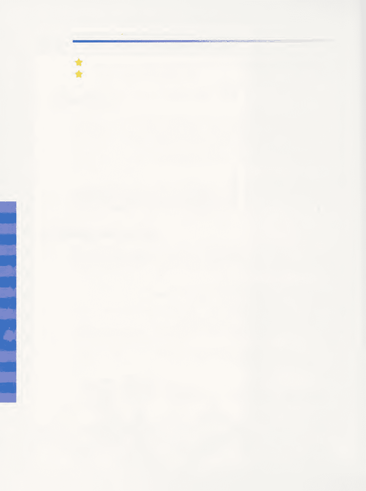

### 文本字段的操作

34 第三章 表单操作

☆

学习如何使用单选按钮、复选框和选择菜单，以及如何创建简单的自评分测试。

### 表单验证

想象你正在 `k9treats.com` 购物（这不是一家真实的公司）。你刚刚点击了按钮，将一盒肝脏零食加入你的在线购物车。然后你点击了“结账”（Check Out）按钮。下一个页面可能会显示一个 HTML 表单，要求你输入姓名、地址和信用卡信息。假设你输入了姓名和地址，但忽略了输入信用卡信息。当你点击“继续”（Continue）时，屏幕上的文字会提醒你，在继续之前必须输入信用卡号。

该提醒页面是使用被称为“表单验证”（form validation）的 JavaScript 技术实现的。当你点击“继续”时，会调用一个 JavaScript 函数。该函数检测到信用卡字段中没有有效输入，并创建了一个页面提醒你输入所需信息。

### 文本字段的操作

表单内的文本字段是通过 HTML `<input type="text">` 标签（用于单行文本输入）或 HTML `<textarea></textarea>` 标签（用于多行文本输入）创建的。你可以使用 `NAME` 和 `VALUE` 属性为这两个标签分配名称和值。

这意味着，当访客在你的页面上向文本字段中输入某些内容时，你可以通过名称查询输入字段，并找到访客输入的值。在许多情况下，你可能希望创建一个包含必填字段的表单。在表单通过电子邮件发送给你之前，能够判断访客是否在必填字段中输入了信息是非常有用的。列表 3.1 演示了一个简单的表单验证程序，以确保访客在发送邮件之前已经在文本字段中输入了内容。

```html
<html><head><title>基础表单验证</title>
<script type="text/javascript" language="JavaScript">
<!-- //
function validate(){
if (document.survey.visitor.value){
alert("提交此表单之前您必须输入姓名.");
document.survey.visitor.focus();
return false;
}else{
return true;
}
}
//-->
</script>
</head>
<body bgcolor="white">
<h1>访客颜色偏好调查</h1>
<form action="mailto:jstext@stevenestrella.com"
method="POST" enctype="text/plain" name="survey"
onsubmit="return validate();">
```

当表单提交时，会调用 `validate()` 函数。它返回一个 `true` 或 `false` 值。如果为 `true`，则表单上的信息将使用 `action` 属性中定义的 `mailto` 方法发送。如果为 `false`，则不发送任何邮件。

```html
<p>姓名（必填）：<input type="text" name="visitor" value="" size="40"></p>

<p>喜欢的颜色：<input type="text" name="color" value="" size="30"></p>
<p>你对使用这项调查有什么看法？<br>
<textarea name="thoughts" rows="5" cols="50" value=""></textarea></p>
<input type="submit" value="发送调查"></p>
</form>
</body>
</html>
```

列表 3.1 文本字段的简单表单验证

### 它是如何工作的？

列表 3.1 中的代码产生了以下事件序列。

1. 浏览器加载 HEAD 部分，其中包含 JavaScript 函数 `validate()`。该函数现在已加载到内存中，准备好在被调用时执行工作。

2. 浏览器加载 BODY 部分并显示一个一级标题 `<h1>`。

3. 一个名为 `survey` 的 `FORM` 对象开始在屏幕上出现。`ACTION` 属性设置为将表单内容（以纯文本编码）通过 post 发送到一个电子邮件地址。

4. 在表单内部，访客文本输入字段出现，并指示访客输入姓名。颜色文本输入字段出现，并指示访客输入喜欢的颜色。这两个字段的 `size` 属性被设置为不同的值，因为人的名字比颜色的名字长。

5. 显示一个 `TEXTAREA` 字段，允许用户输入多行文本以对调查提供反馈。

6. 一个类型为 `submit` 的 `INPUT` 标签创建了一个“提交”按钮。“Send Survey”（发送调查）是按钮上显示的实际文本。

7. 访客在什么都没输入的情况下点击“发送调查”按钮以提交表单。该按钮产生了一个提交事件。

8. `FORM` 对象的 `onSubmit` 处理器将一行代码发送给浏览器中的 JavaScript 解释器。该行代码调用 `validate()` 函数并向 `FORM` 对象返回 `true` 或 `false` 值。如果返回的值为 `false`，则 `FORM` 对象将不发送电子邮件。

9. `validate()` 函数以 `if-else` 结构开始，用于检查调查表单上 `visitor` 字段的值。代码被翻译为“`visitor` 字段中没有值”。在这种情况下，该语句判断为真。弹出一个警告框并显示指令。在访客关闭警告框后，使用 `focus()` 方法将光标方便地放置在 `visitor` 字段上。最后，向 `FORM` 对象返回一个 `false` 值，以防止发送电子邮件。

10. 访客在 `visitor` 字段中输入姓名并再次点击“发送调查”。这一次，`validate()` 函数检测到 `visitor` 字段中有值，并返回 `true` 值。随后，`FORM` 对象将其内容发送到其 `ACTION` 属性列出的电子邮件地址。表单如图 3.1 所示。

文本字段的操作 36 第三章 表单操作

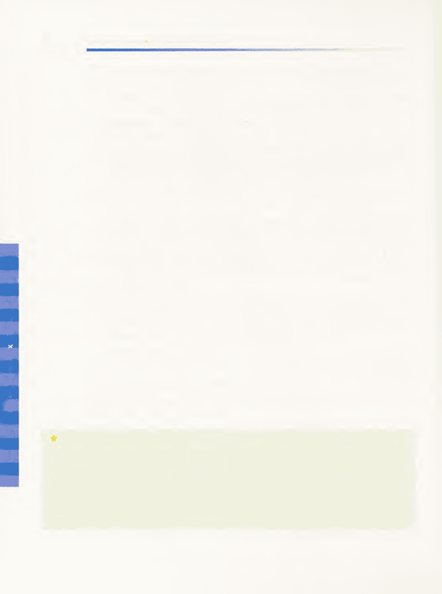

37 文本字段的操作

本地区域

图 3.1 列表 3.1 的输出

调查通常要求网页访客提供电子邮件地址。因为电子邮件地址中的一个错误字符就会导致其无效，因此鼓励访客仔细输入是非常重要的。尽可能短的电子邮件地址将包含一个字符、一个 `@` 符号、另一个字符、一个点（`.`）以及至少两个字符的域名。一个像 `Q@X.ca` 这样的地址不太可能，但确实可能。需要一个验证函数来确保 `@` 符号出现在第一个字符之后的某个地方，点出现在 `@` 符号之后的某个地方（且中间至少有一个字符），并且点之后至少还有两个字符。

列表 3.2 演示了如何验证电子邮件地址，并引入了 `indexOf()` 方法。程序员使用 `indexOf()` 方法在文本字符串中定位一个或多个字符。例如，如果一个名为 `myPet` 的变量具有

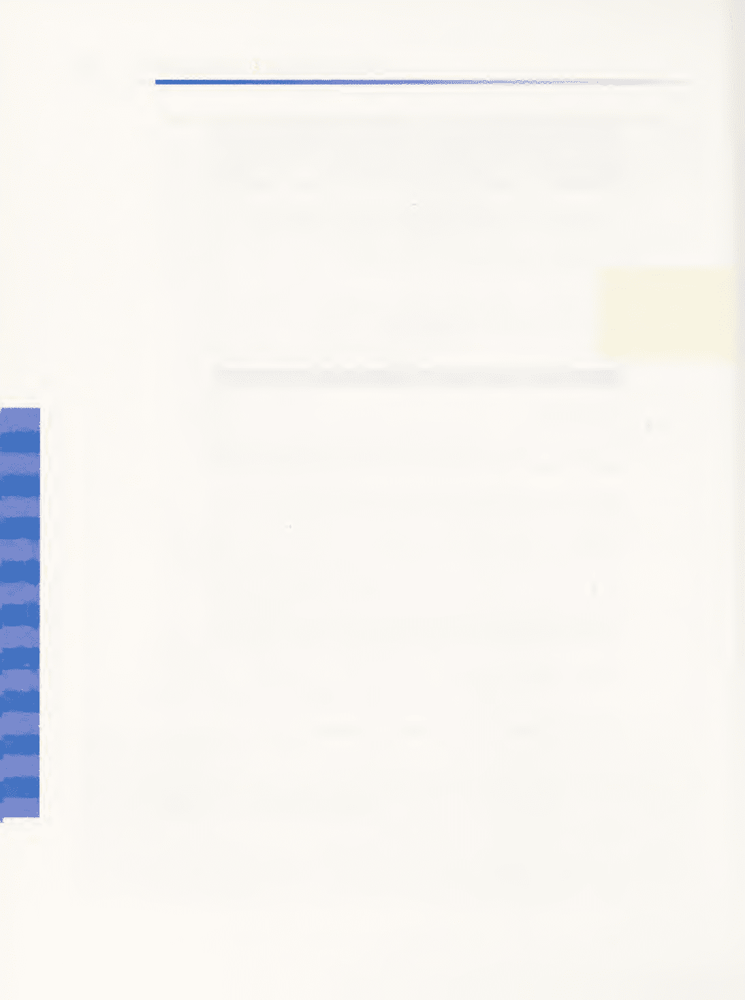

### 第三章 表单操作


假设值为 Clara，那么 `myPet.indexOf("C")` 将返回值 0，因为 C 是字符串从零开始计数的第一个字符。同样，`myPet.indexOf("a")` 将返回值 2，因为从零开始计数 a 是第 2 个字符。第二个 a 的位置可以通过 `myPet.indexOf("a", 3)` 来确定，它将从字符 3 处搜索文本。在这种情况下，`myPet.indexOf("a", 3)` 返回值 4。

```html
<html>
<head>
<title>电子邮件地址表单验证</title>
<script type="text/javascript" language="JavaScript">
// 此表达式仅当电子邮件地址中包含 @ 符号和点，且地址长度足够包含末尾两个字符的域名时才返回 true。
function validate(){
var theEmail = document.survey.email.value;
var atLoc = theEmail.indexOf("@", 1);
var dotLoc = theEmail.indexOf(".",atLoc+2);
var len = theEmail.length;
if (atLoc > 0 && dotLoc > 0 && len > dotLoc+2) {
return true;
}else{
alert("请输入正确的电子邮件地址。");
document.survey.email.focus();
return false;
}
}
</script>
</head>
<body bgcolor="white">
<h1>访客电子邮件调查</h1>
<form action="mailto:jstext@stevenestrella.com"
method="POST" enctype="text/plain" name="survey"
onsubmit="return validate();">
<p>电子邮件（必填）：<input type="text" name="email" value="" size="60"></p>
<p><input type="submit" value="提交问单"></p>
</form>
</body>
</html>
```

列表 3.2 电子邮件地址验证

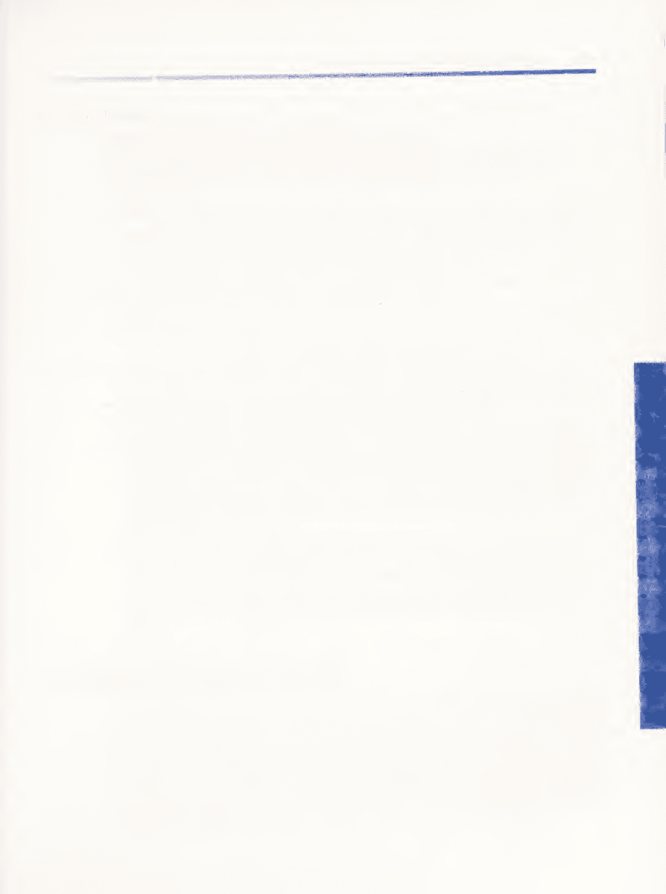


## 操作文本字段

### 它是如何工作的？

列表 3.2 产生了以下事件序列。

1. 浏览器加载 HEAD 部分，其中包含 JavaScript 函数 `validate()`。该函数现在位于内存中，准备好在调用时执行工作。

2. 一个名为 `survey` 的 FORM 对象开始出现在屏幕上。ACTION 属性设置为将表单内容（编码为纯文本）发送到电子邮件地址。在表单内部，出现了文本 INPUT 字段 `email`，并提示访客输入电子邮件地址。

3. 类型为 `submit` 的 INPUT 标签创建了一个提交按钮。`Send Survey` 的值是显示在按钮上的文本。

4. 访客在未输入任何内容的情况下，点击 Send Survey 按钮来提交表单。按钮产生一个提交事件。

5. FORM 对象的 `onsubmit` 处理程序向浏览器中的 JavaScript 解释器发送一行代码。该代码调用 `validate()` 函数并向 FORM 对象返回 `true` 或 `false` 值。如果返回值为 `false`，FORM 对象将不会发送电子邮件。

6. `validate()` 函数创建一个变量 `theEmail` 来存储访客输入的值。创建一个变量 `atLoc` 来存储 `@` 字符的位置（如果它是字符 1 或之后，从零计数）。创建一个变量 `dotLoc` 来存储 `.` 字符的位置（如果它在 `@` 符号之后至少两个字符）。创建一个变量 `len` 来存储访客输入的地址长度。

7. 一个 `if-else` 结构检查 `@` 的位置是否大于 0，点的位置是否大于 0，以及电子邮件地址是否在点之后至少两个字符结束。使用 `&&` 代码创建逻辑与条件来检查所有变量。如果所有条件为 `true`，则 `validate()` 函数返回 `true` 并发送电子邮件。否则，访客将收到提示框。

## 修改文本字段中的信息

有时，表单接收到的信息格式必须是特定的。标准的美国电话号码例如 (555) 333-4444 包含三位区码、三位交换码和四位扩展码。标准格式使用括号隔开区码，并在交换码和扩展码之间使用连字符。列表 3.3 展示了如何对文本字段中输入的信息进行重新格式化。你可以将此技术应用于社会安全码、邮政编码、信用卡号或任何具有一致结构的数字。

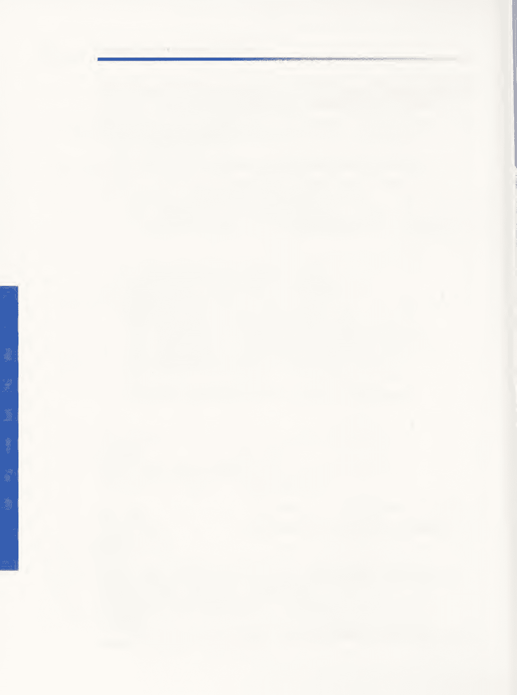


```html
<html>
<head>
<title>字段自动格式化</title>
<script type="text/javascript" language="JavaScript">
function formatNumber(){
var theNumbersOnly = "";
var theChar = "";
var input = document.phoneform.phone.value;
for (i = 0; i < input.length; i++){
theChar = input.substring(i,i+1);
if (theChar >= "0" && theChar <= "9"){
theNumbersOnly = "" + theNumbersOnly + theChar;
}
}
if (theNumbersOnly.length < 10){
alert("必须输入10位数字。");
document.phoneform.focus();
}else{
var areaCode = theNumbersOnly.substring(0,3);
var exchange = theNumbersOnly.substring(3,6);
var extension = theNumbersOnly.substring(6,10);
var newNumber = "(" + areaCode + ") ";
newNumber += exchange + "-" + extension;
document.phoneform.phone.value = newNumber;
}
}
</script>
</head>
<body bgcolor="WHITE">
<h1>基础格式化</h1>
<p>在表单中输入数字，然后按 Tab 键。<br>
您的号码将按照电话系统进行格式化。<br>
</p>
<form name="phoneform"><input type="text" name="phone" value="(555) 555-1234" size="20" onchange="formatNumber();"></form>
</body>
</html>
```

列表 3.3 字段自动格式化

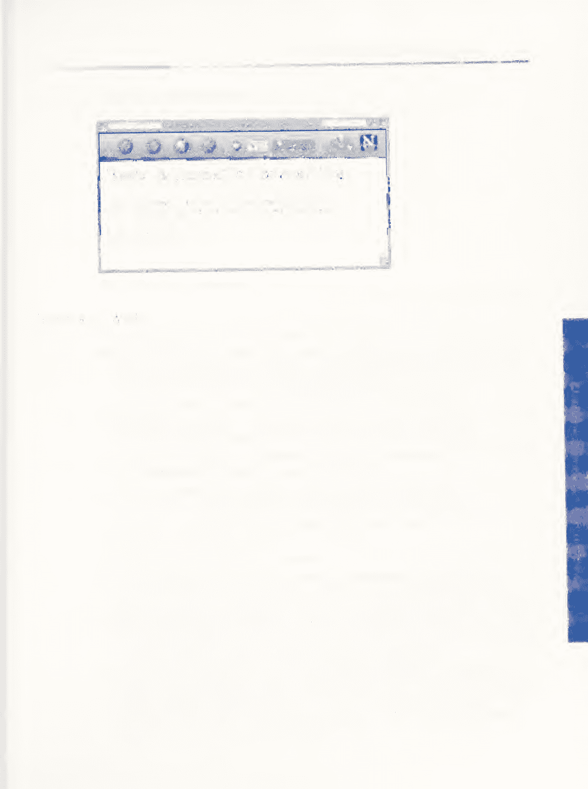

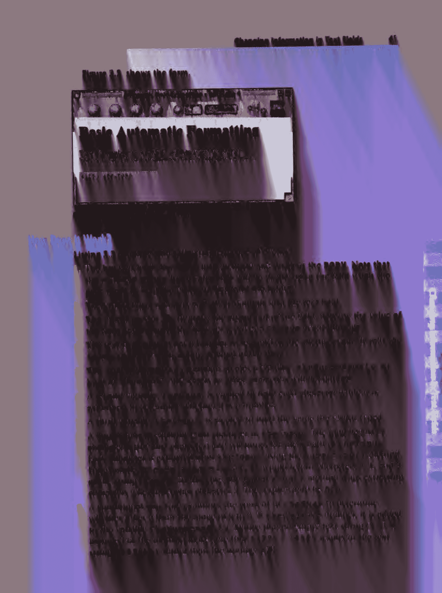

### 它是如何工作的？

列表 3.3 产生了以下事件序列。

1. 浏览器加载 HEAD 到内存并显示 BODY。注意，文本字段 `phone` 在页面加载时有一个值，以帮助访客理解格式。

2. 访客在文本字段中输入数字和其他符号。

3. 访客按 Tab 键使光标离开字段。由于字段值发生了变化，浏览器接收到一个变化事件。

4. 文本字段 `phone` 有一个处理器来响应变化事件。它调用了 HEAD 中定义的 `formatNumber()` 函数。

5. `formatNumber()` 函数创建一个变量 `theNumbersOnly` 来仅存储数字。任何字母或其他字符都将被忽略。

6. 创建第二个变量 `theChar` 来存储每个正在检查的字符，以确定其是否为数字。

7. 创建第三个变量 `input` 来存储访客输入的值。

8. 循环开始检查 `input` 中的每个字符。循环从字符 0（第一个字符）开始，持续到 `input` 的长度。使用 `substring()` 方法从 `input` 中提取每个字符。例如，`Steven.substring(0,3)` 将返回字符串 Steven 的第 0、1 和 2 个字符。在这种情况下，`substring()` 方法在达到字符 3 处停止提取。结果将为 Ste。

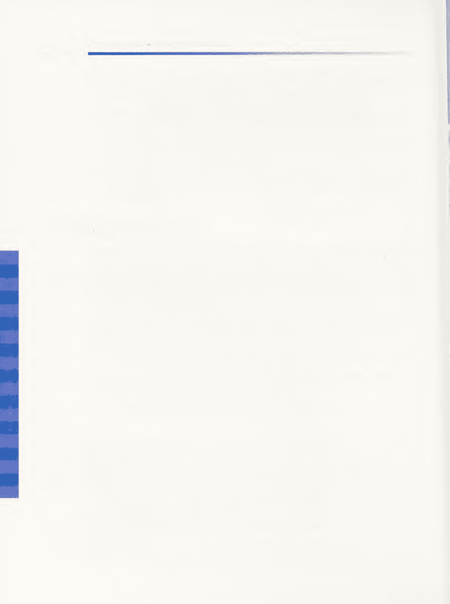


9. 第三章 ★ 处理表单

## 使用单选按钮

10. 随后另一个条件结构将判断 `NumbersOnly` 是否包含少于 10 个字符。如果是，将弹出一个警告框并将光标置在电话字段中。

11. 如果 `NumbersOnly` 中的字符数为 10 个或更多，将创建变量来存储 `NumbersOnly` 的区号、交换局和分机部分。会创建另一个变量 `newNumber`，用于包含格式化后的区号、交换局和分机组合，并带有完整的括号和连字符。

12. 将电话字段的值更改为 `newNumber`。访问者的号码将重新格式化以符合美国电话标准并显示在屏幕上。

典型的问卷包含一些只有有限数量答案才有意义的问题。例如，关于性别的问题只能用“男性”或“女性”回答。在这种情况下，使用开放式文本字段几乎意义。相反，你可以使用单选按钮，这是一系列提供互斥选择的按钮。列表 3.4 展示了你如何确定访问者点击的单选按钮所关联的值。

```html
<html><head><title>单选按钮表单验证</title>
<script type="text/javascript" language="JavaScript">
/* getRadioValue 函数 - 存储在 mylibrary.js 中 */
function getRadioValue(formname,radioname) {
  var theRadioButtons = document[formname][radioname];
  for (i=0;i<theRadioButtons.length;i++) {
    if (theRadioButtons[i].checked) {
      return theRadioButtons[i].value;
    }
  }
}

/* showRadioValue 函数 - 存储在 mylibrary.js 中 */
function showRadioValue(formname,radioname,thevalue) {
  var theRadioButtons = document[formname][radioname];
  for (i=0;i<theRadioButtons.length;i++) {
    var temp = theRadioButtons[i].value;
    if (temp == thevalue) {
      theRadioButtons[i].checked = true;
    }
  }
}
```

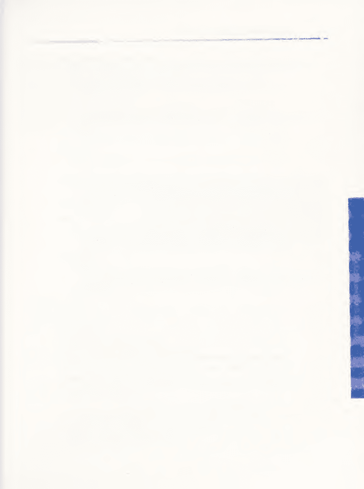


```javascript
function validate() {
  var chosenGender = getRadioValue("survey","gender");
  if (chosenGender==null) {
    alert("这是一个棘手的问题吗？");
    return false;
  }
  if (chosenGender == "male") {
    document.survey.feedback.value = "感谢您，先生。";
  } else {
    document.survey.feedback.value = "感谢您，女士。";
  }
  return true;
}

function changeGender() {
  if (getRadioValue("survey","gender")==null) {
    document.survey.feedback.value = "未指定性别。";
    return;
  }
  if (getRadioValue("survey","gender")=='male') {
    showRadioValue('survey','gender','female');
    document.survey.feedback.value = "感谢您，女士。";
  } else {
    showRadioValue('survey','gender','male');
    document.survey.feedback.value = "感谢您，先生。";
    return;
  }
}
//-->
```

```html
</script>

</head>

<body bgcolor="white">

<h1>访问者性别问卷</h1>

<form action="mailto:jsradio@stevenestrella.com"

method="POST" enctype="text/plain" name="survey"

onsubmit="return validate();">

<p>姓名:<input type="text" name="visitor" value="40"></p>

<p>性别:<input type="radio" name="gender" value="male">男性

<input type="radio" name="gender" value="female">女性</p>
```

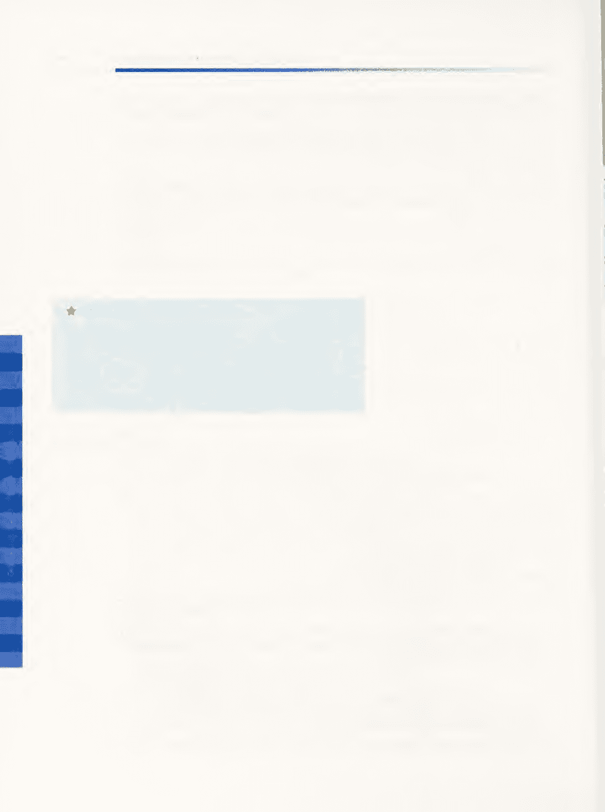


44 第三章 处理表单

45 SSI

你可能最早在高中代数中首次遇到“参数”（parameter）这个术语。参数是值的容器。你可以将参数看作变量的一种类型。例如，一个将华氏度转换为摄氏度的函数需要一个参数来存储温度值。表达式 `convertCelsius(temperature)` 调用该函数并传递找到的值。

### 它是如何工作的？

文档对象（document object）包含一个所有子对象的数组，包括名为 `survey` 的 FORM。`FORM` 反过来创建一个其所有子对象的数组，包括名为 `gender` 的单选按钮。单选按钮集是一个对象，然后存储在新变量 `theRadioButtons` 中，该变量本身是一个由两个按钮组成的数组：一个用于男性，一个用于女性。然后循环遍历 `theRadioButtons` 的每个元素，以确定是否任何一个被选中。如果发现某个单选按钮被选中，它会将该按钮的值（男性或女性）返回给 `validate()` 函数，该函数将该值放入 `chosenGender`。如果没有单选按钮被选中，`chosenGender` 的值将为 `null`，意味着它是空的。注意 `null` 没有引号因为它不是文本字符串。相反，它表示值的缺失。

6. 代码的下一个部分包含三个条件结构，用于检查 `chosenGender` 中可能存在的三个值：`null`、`male` 或 `female`。

7. 如果没有单选按钮被选中，意味着 `chosenGender` 是空的。会出现一个带有指令的警告框。在访问者关闭警告框后，向调用该函数的 `FORM` 对象返回 `false` 值，这将防止电子邮件的发送。脚本在返回值后立即结束，因此 `chosenGender` 不会被进一步测试。

8. 如果 `chosenGender` 为 `male`，则将文本 `Thank you sir` 位于“Send Survey”按钮正下方的反馈字段中。

9. 如果 `chosenGender` 为 `female`，则将文本 `Thank you madame` 放入反馈字段中。

10. 返回 `true` 值给 `FORM` 对象，然后它通过电子邮件向 ACTION 属性中列出的地址发送表单内容。

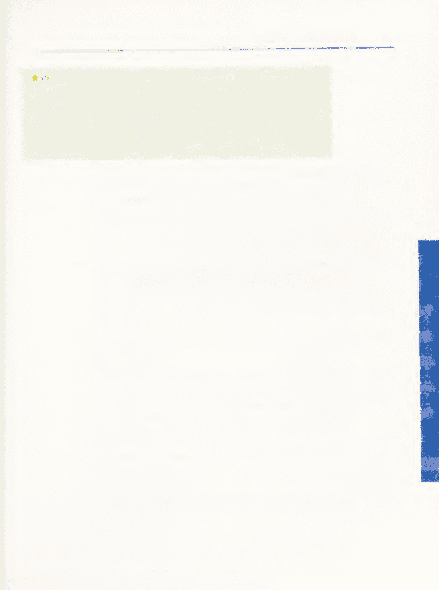


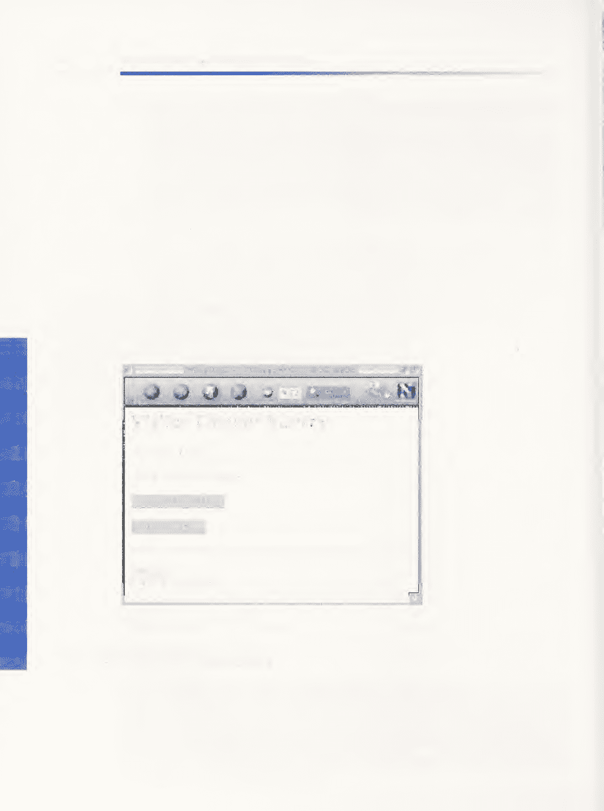


# 第三章 表单操作

## 处理复选框（Check Boxes）

11. 少数情况下，访问者可能更改性别问题的回答。为此，提供了一个标记为“更改性别”（Change Gender）的按钮。点击时它会调用 `changeGender()` 函数。`changeGender()` 函数会调用 `getRadioValue()` 函数来确定哪个单选按钮被选中。如果没有选中的，反馈字段将显示“未指定性别”（Gender not specified）。否则，将调用 `showRadioValue()` 函数将选中的单选按钮改为相反的性别。


## 12. `showRadioValue()` 函数

`showRadioValue()` 函数接收三个参数：表单名称、单选按钮组的名称以及要被选中的单选按钮的值。再次创建一个变量 `theRadioButtons` 来存储单选按钮数组。循环遍历 `theRadioButton` 数组的每个元素，确定其值是否匹配目标值。如果匹配，则该单选按钮的 `checked` 属性设置为 `true`，这会导致按钮显示为选中状态。控制权返回 `changeGender()` 函数，该函数根据情况显示“感谢女士”（Thank you madame）或“感谢先生”（Thank you sir）（见图 3.3）。

图 3.3 Listing 3.4 的输出

## 处理复选框

调查问卷通常使用复选框允许访问者“勾选所有适用”。每个复选框都可以分配 `name` 和 `value` 属性。每个复选框都处于未选中或选中的状态。当提交表单时，任何已选中框的名称和值都会随表单一起发送。未选中框的名称和值则不会发送。要确定哪些框被选中，你需要测试 `checked` 属性。Listing 3.5 演示了在简单的教育程度水平调查中使用复选框的方法。

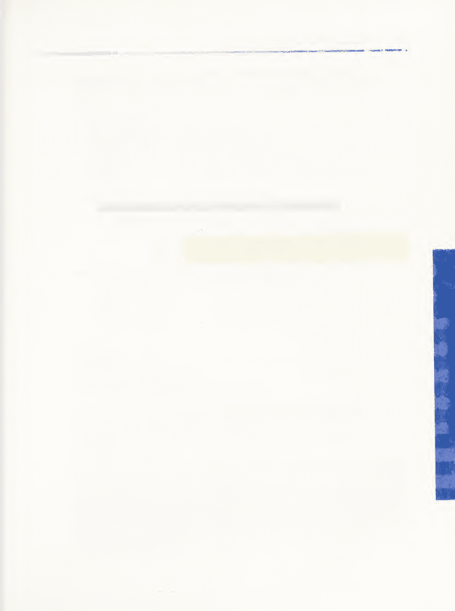

### 处理复选框

```html
<html><head><title>Check Box Form Validation</title>
<script type="text/javascript" language="JavaScript">
<!
function validate(){
var degree = " ";
var comments = new Array(4);
comments[0] = 'You are competent.';
comments[1] = 'You are educated.';
comments[2] = 'You are highly educated.';
comments[3] = 'You spent too much time in school.';
for (i=0;i< 4;i++){
if (document.survey['degree'+i].checked){
degree = document.survey['degree'+i].value;
document.survey.feedback.value = comments[i];
}
}
if (degree == ""){
alert("You need to get an education!");
return false;
}else{
return true;
}
}
//-->
</script>
</head>
<body bgcolor="white">
<h1>Visitor Education Survey</h1>
<form action="mailto:jscheckbox@stevenestrella.com"
method="POST" enctype="text/plain" name="survey"
onsubmit="return validate();">
<p>Name:<input type="text" name="visitor" value="" size="40"></p>
<h4>Degrees you have earned (check all that apply):</h4>
<input type="checkbox" name="degree0" value="H.S.">
High School Diploma<br>
<input type="checkbox" name="degree1" value="B.A.">
Bachelor's Degree<br>
<input type="checkbox" name="degree2" value="M.A.">
Master's Degree<br>
```

`survey` 表单拥有 html 复选框，名为 `degree0`、`degree1` 等。通过将当前的 `i` 值添加到单词 `degree` 中，该条件结构检查特定的框是否被选中。

```html
<input type="checkbox" name="degree3" value="Ph.D.">
Doctorate<br>
<p><input type="submit" value="Send Survey"></p>
<hr>
<p>Feedback:<br>
<input type="text" name="feedback" value="" size="50">
</p>
</form>
</body>
</html>
```

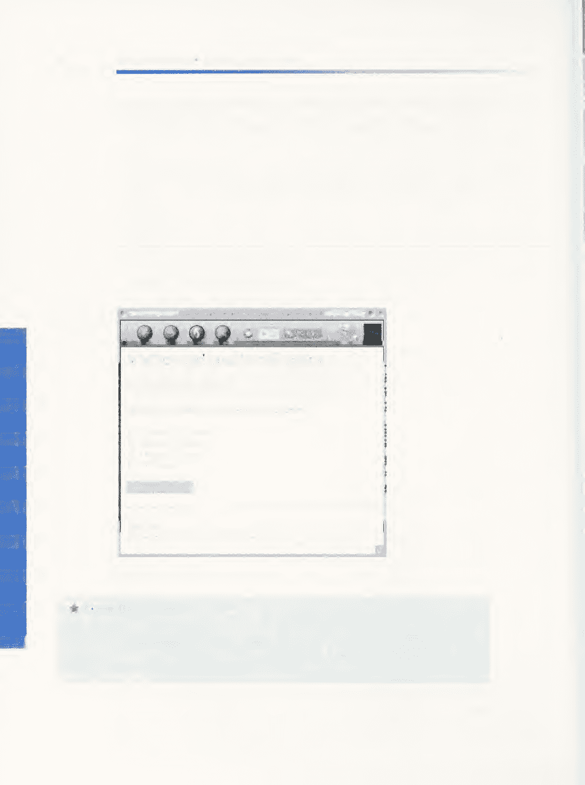

### 处理复选框

图 3.4 Listing 3.5 的输出

Check Box Form Validation - Netscape

Visitor Education Survey

Name

Degrees you have earned (check all that apply):

- High School Diploma
- Bachelor's Degree
- Master's Degree
- Doctorate

Send Survey

Feedback:

spent too much time in school.

### 快捷：名称？

当你创建问卷或测试时，通常将文本字段、单选按钮或复选框命名为如“q1”、“q2”、“q3”等连续名称。使用一致且连续的命名方案允许你使用循环高效地查询这些元素的值。

### 它是如何工作的？

Listing 3.5 生成了以下事件序列：

1. 浏览器将 HEAD 加载到内存并显示 BODY。
2. BODY 包含名为 `survey` 的 FORM 对象。FORM 对象自动创建由 `<form>` 和 `</form>` 标签的所有表单元素。此表单中的四个复选框后面跟着 0 到 3 的数字。该数字可以存储在变量中。通过这种方式，你可以使用 `document.survey['degree'+i].checked` 等表达式来判断给定框是否被选中。这里默认未选中。
3. 访问者点击 Send Survey 按钮提交表单，按钮产生 submit 事件。FORM 对象通过调用 `validate()` 函数处理该事件。如果 `validate()` 返回 `true`，则通过电子邮件发送表单内容。
4. `validate()` 函数通过创建一个名为 `degree` 的变量并将其初始值为空字符串开始。然后创建一个数组来存储与四个学位相关的注释。
5. `validate()` 函数循环四次语句，索引变量 (`i`) 从 0 计数到 3。在每次循环中，都会检查 `survey` 表单的一个元素以查看其是否被选中。该元素通过 `degree` 与索引变量 (`i`) 的当前值组合来确定。
6. 如果找到选中的框，其值存储在 `degree` 变量中。如果选中了多个学位，每个学位将替换 `degree` 变量之前的内容。
7. 此循环的索引变量 (`i`) 用于在反馈字段中显示 `comments` 数组的哪个元素。
8. 代码的下一个部分包含测试 `degree` 变量值的条件结构。
9. 如果没有框被选中，意味着 `degree` 为空。出现提示框。访问者关闭框后，向调用该函数的 FORM 对象返回 `false` 值，从而防止发送电子邮件。
10. 如果 `degree` 包含空字符串以外的任何内容，则向 FORM 对象返回 `true` 值，然后通过电子邮件向 ACTION 属性列出的地址发送表单内容。
11. 接收者收到一条包含每个复选框名称-值对的电子邮件消息。

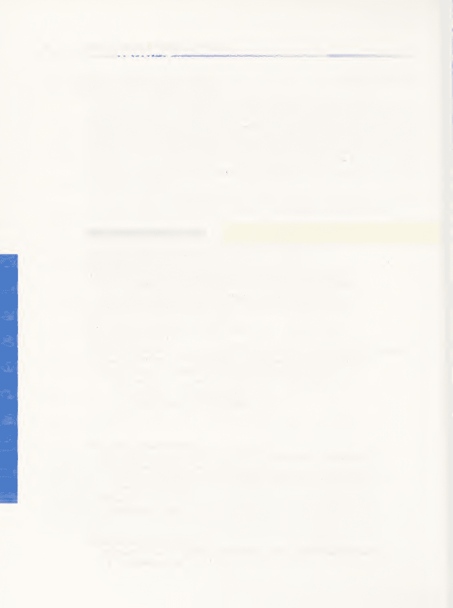

## 处理下拉菜单

在调查问卷问题上呈现多个选项的另一种方便方法是使用下拉菜单。`<select>` 标签在屏幕上创建一个弹出式选择菜单，其菜单项如 `<option>` 标签所示。Listing 3.6 演示了如何确定访问者所选命令的值。在示例中（见图 3.5），访问者选择一个喜欢的网站，并可以点击按钮在新窗口中查看它。在做出选择后，访问者可以通过电子邮件提交表单。这种“选择并跳转”的导航是下拉菜单日益流行的用法。

```html
<html><head><title>Selection Menu Form Validation</title>
<script type="text/javascript" language="JavaScript">
<!
var chosenSite = 
/* getSelectValue 函数 - 存储在 mylibrary.js. */
function getSelectValue(formname,selectname){
var theMenu = document[formname][selectname];
var selecteditem = theMenu.selectedIndex;
return theMenu.options[selecteditem].value;
}
/* showSelectValue 函数 - 存储在 mylibrary.js. */
function showSelectValue(formname,selectname,thevalue){
var theMenu = document[formname][selectname];
for (i=0;i<theMenu.options.length;i++){
var temp = theMenu.options[i].value;
if (temp == thevalue){
theMenu.selectedIndex = i;
}
}
}
function validate(){
...
```

`chosenSite` 是一个全局变量，因为它是在任何函数之外定义的。`chosenSite` 中的值将对页面上的所有函数可用。


## 使用选择菜单

51

```javascript
alert("Please select your favorite Web site.");
}else{
  window.location.href = chosenSite;
}
}
//-->
</script>
</head>
<body bgcolor="white">
<h1>访客网站偏好调查</h1>
<form action="mailto:jsselect@stevenestrella.com"
method="POST" enctype="text/plain" name="survey"
onsubmit="return validate();">
<p>姓名:<input type="text" name="visitor" value="" size="40"></p>
<h4>选择你最喜欢的网站：</h4>
<select name="websites">
<option selected>选择一个站点</option>
  <option value="http://www.javascript.com/">javascript.com</option>
  <option value="http://www.beatnik.com/">beatnik.com</option>
  <option value="http://www.awl.com/">Addison-Wesley</option>
  <option value="http://www.stevenestrella.com/">作者网站</option>
</select>
<p><input type="button" value="显示作者选择"
onclick="showSelectValue('survey','websites', 'http://www.beatnik.com/');"></p>
<input type="button" value="立即前往！"
onclick="openSite();">
<p><input type="submit" value="提交调查"></p>
</form>
</body>
</html>
```

Listing 3.6 带有导航按钮的选择菜单表单验证

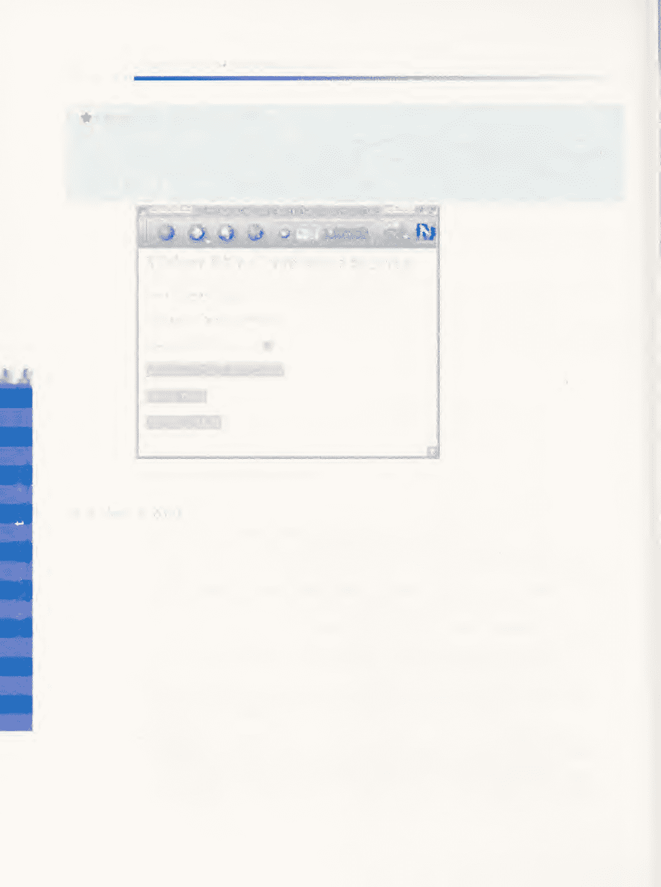

使用选择菜单

52 第三章 ★ 使用表单

★ 快捷：将其放入库中

请务必将列表 3.6 中的 `getSelectValue()` 和 `showSelectValue()` 函数添加到你的 `mylibrary.js` 文件中。这些函数控制 FORM 中 SELECT 菜单的选值。由于你将创建许多带有 SELECT 菜单的页面，将这些函数存储在 `mylibrary.js` 中比复制到每个页面中更合理。

选择菜单表单验证 - Netscape

访客网站偏好调查

姓名：Thomas Dolby

选择你最喜欢的网站：

beatnik.com

显示作者选择

立即前往！

提交调查

图 3.5 列表 3.6 的输出

### 如何工作？

列表 3.6 生成了以下事件序列。

1. 浏览器加载页面并在内存中创建必要的 FORM 和 SELECT 对象。会创建一个名为 `chosenSite` 的全局变量，初始值为空文本字符串。HEAD 中的三个函数将使用该变量，因此它必须放置在任何函数之外。
2. 访客从标记为“选择一个站点”的 SELECT 菜单中选择一个命令，然后点击“立即前往！”按钮。该按钮是一个类型为 "button" 的输入，带有一个调用 `openSite()` 函数的 `onclick` 句处理器。
3. HEAD 中的 `openSite()` 函数调用 `getSelectValue()` 函数，并传递表单名称 (`survey`) 和选择菜单的名称 (`websites`) 以确定访客的选择。
4. `getSelectValue()` 函数创建一个名为 `theMenu` 的临时变量，并用 `survey` 表单上的 `websites` SELECT 对象填充它。它通过利用 `document` 和 `form` 内置数组来实现。`document` 包含了页面上所有对象的数组。

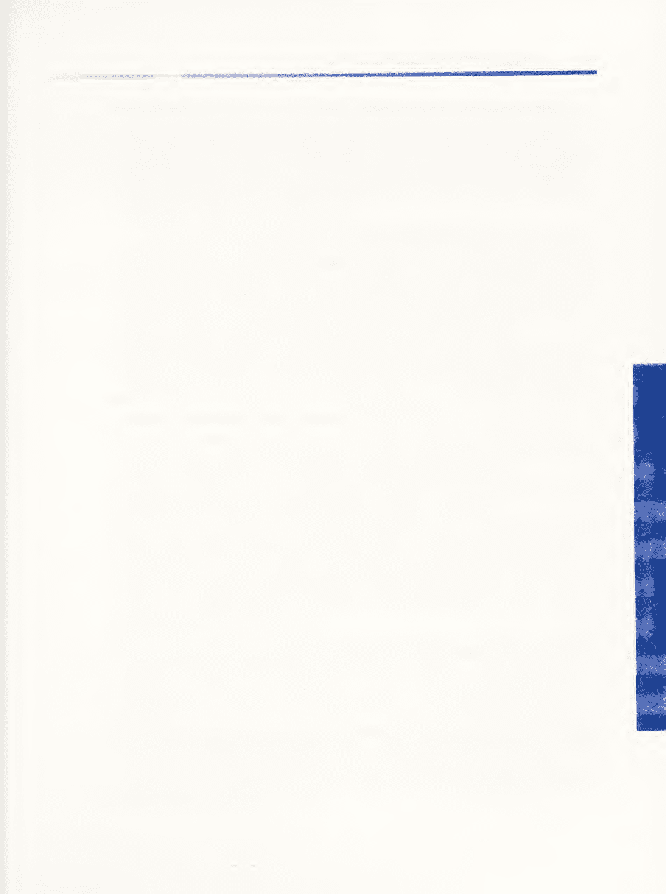

使用选择菜单

53

FORM `survey` 是此类对象之一。表达式 `document["survey"]` 代表该 FORM。反之，表单创建了其所有对象的另一个数组。SELECT `websites` 是其中一个对象。由于 `survey` 和 `websites` 存储在变量中，表达式 `document[name][selectname]` 正确地引用了名为 `websites` 的 SELECT 对象。然后，第二个变量 `selecteditem` 被填充为 `theMenu` 的 `selectedIndex`。`selectedIndex` 指 SELECT 菜单上被选命令的数字。编号从 0 开始。然后可以使用表达式 `theMenu.options[item].value` 确定 Menu 上被选命令的值。这之所以能通，是因为 SELECT 对象包含了其 OPTIONS 的数组。在这种情况下，编号为 1 的选项（从 0 开始编号的第二个选项）是 `javascript.com`，其值为 `http://www.javascript.com`。表达式 `document.survey.websites.options[1].value` 将返回值 `http://www.javascript.com`。由于该表达式的第一部分被赋值给变量 `theMenu`，因此可以使用表达式 `theMenu.options[1].value` 代替。

5. 全局变量 `chosenSite` 现在包含了访客选择的命令值。`getSelectValue()` 函数完成了工作，因此 `openSite()` 函数继续执行下一行。
6. 测试变量 `chosenSite` 是否为空。如果为空，访客将收到一个带有选择指令的警报框。
7. 如果访客选择了某些内容，浏览器将加载访客选择的站点。代码窗口 `location.href=URL` 将给定的 URL 加载到当前窗口 `location` 对象的 `href` 属性中。因为 `location` 对象在它的 HREF 属性中存储了已加载文档的 URL，所以更改 HREF 属性的值会导致浏览器加载新页面。
8. 访客对哪个站点更受青睐感到好奇心勃勃。访客点击标记为“作者选择”的按钮，这会调用 `showSelectValue()` 并传递三个参数：FORM 的名称 (`survey`)、SELECT 的名称 (`websites`) 以及要选中的值 (`http://www.beatnik.com`)。
9. `showSelectValue()` 函数逐步遍历 SELECT 数组中的元素，直到找到一个与所需值匹配的值。然后，它将 SELECT 的 `selectedIndex` 设置为匹配值选项的数字。SELECT 显示的文本将更改以匹配新值。

使用选择菜单


# 第三章 ★ 使用表单

## 全局变量与局部变量

如果你在函数内部创建一个变量，它是局部的。这意味着它在函数外部是不可访问的。如果你在函数外部创建一个变量，它是全局的。这意味着它在任何函数中都可以被访问。请确保在任何特定函数之外声明它。

教育者经常使用表单创建自测题，这有助于学习。如列表 `3.6` 所示，创建一个简单的音乐自测题：

```html
<html><head><title>Composer Dates</title>
<script type="javascript" src="mylibrary.js"></script>
<!--
var correctAnswers = new Array();

function checkAnswers(){
  for (i=1; i<4; i++){
    deathDate = getSelectValue("q" + i);
    if (deathDate == correctAnswers[i])){
      score++;
    }
  }
  document.quiz.scorefield.value = score;
}
//-->
</script>
</head>
<body bgcolor="white">
<h1>作曲家日期测试</h1>
<form name="quiz">
<h4>问题 1：巴赫去世于哪一年？</h4>
<select name="q1">
<option selected>选择一个答案</option>
  <option value="1670">1670</option>
  <option value="1685">1685</option>
  <option value="1695">1695</option>
  <option value="1725">1725</option>
  <option value="1750">1750</option>
</select>
<h4>问题 2：莫扎特的去世于哪一年？</h4>
<select name="q2">
<option selected>选择一个答案</option>
  <option value="1750">1750</option>
  <option value="1765">1765</option>
  <option value="1773">1773</option>
  <option value="1791">1791</option>
  <option value="1812">1812</option>
</select>
<h4>问题 3：贝多芬的去世于哪一年？</h4>
<select name="q3">
<option selected>选择一个答案</option>
  <option value="1770">1770</option>
  <option value="1791">1791</option>
  <option value="1827">1827</option>
  <option value="1833">1833</option>
  <option value="1841">1841</option>
</select>
<hr>
<p><input type="button" value="检查答案" onclick="checkAnswers();"></p>
<p>你的分数是：<input type="text" name="scorefield" value="" size="10"></p>
</form>
</body>
</html>
```

列表 `3.7` 带有选择菜单的测验

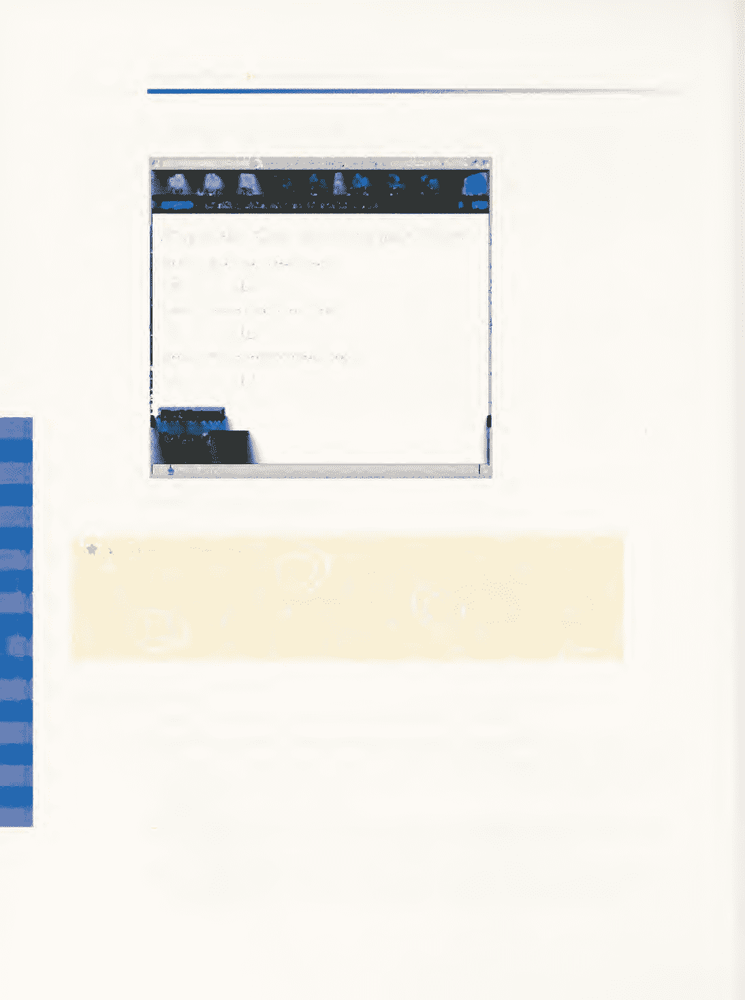

## 第三章 表单操作

图 `3.6` 显示了表单。

### 选择菜单诊断测验

上一个 向后 停止 刷新 首页 自动填充 打印 邮件

`http://www.angelo/stevenestrella.com/stdev/listings.html`

作曲家诊断测验

问题 1：巴赫的去世年份是哪？1750

问题 2：莫扎特的去世年份是哪？1791

问题 3：贝多芬的去世年份是哪？1827

检查答案

你的得分是

.... USkss?,1 20n.............

图 `3.6` 列表 `3.7` 的输出

**警告 不要偷看！**

访问由列表 `3.7` 创建的页面可以通过查看源代码来作弊。为了避免这个问题，你可以通过将脚本部分放在外部库中来隐藏答案。然而，请注意，经验丰富的计算机用户可以找到外部库的文本。考虑到这一点，此类在线测试适用于诊断性学习辅助工具，但不应被用于确定成绩。

### 它是如何工作的？

列表 `3.7` 生成了以下顺序的事件。

1. 浏览器将页面的 `HEAD` 部分加载到内存中。这包括一个包含测验正确答案的数组。数组的元素 `0` 没有填充任何值；因此，元素编号从 `1` 开始计数，以与问题编号。

2. 加载页面的 `BODY` 部分。页面上的 `SELECT` 对象被创建并赋予了顺序名称 `"q1"`、`"q2"` 和 `"q3"`。

3. 访问者选择每个问题的答案并点击“检查答案”按钮。`onclick` 处理程序调用了 `checkAnswers()` 函数。

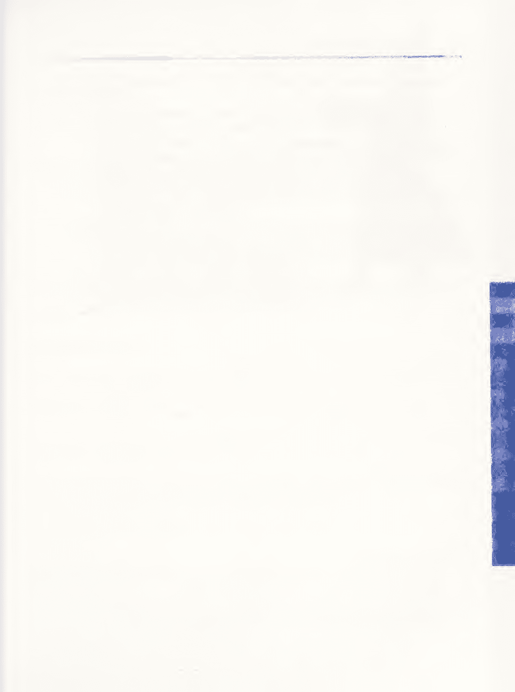

### 创建自评分测验

4. `checkAnswers()` 函数创建了一个名为 `score` 的变量并将其设置为 `0`。

5. `checkAnswers()` 函数执行一个循环。在循环的每次迭代中，索引变量 (`i`) 的值增加 `1`，直到达到 `4`。

6. `checkAnswers()` 函数创建了一个名为 `theMenu` 的临时变量，并根据 `i` 的值用调查卷表单上名称为 `q1`、`q2` 或 `q3` 的 `SELECT` 对象填充它。然后，第二个变量 `selectedIndex` 将用 `theMenu` 的 `selectedIndex` 填充。

7. 创建了一个名为 `deathDate` 的临时变量，并用 `theMenu` 中被选中选项的值填充它。

8. 然后使用此循环的索引变量 (`i`) 来确定 `correctAnswers` 数组中的哪一个元素与 `deathDate` 的值进行比较。如果值匹配，`score` 变量加 `1`。运算符 `++` 是用于将变量增加 `1` 的缩写。

9. 最后，将分数赋值给测验表单上 `score` 字段文本框的值。访问者的得分显示在屏幕上的文本框中。


## 总结

表单是 Web 的流行功能，特别是在电子商务中。JavaScript 通常用于确保访问者在提交表单之前输入所需信息，这一过程被称为表单验证。

- 要验证文本字段，你首先确定是否输入了值。例如，要确定访问者是否忽略了在必填字段中输入信息，你可以测试表达式 `(!document.survey.visitor.value)`。如果该表达式为真，则访问者未在访问者字段中输入必要信息。你还可以检查信息在数字和标点符号方面符合正确的格式。

- 你可以创建 JavaScript 代码，如果访问者输入的文本格式不符合你的需求，则将更改其格式。

- 浏览器会自动将一组具有相同名称的单选按钮存储在数组中。例如，有两个名为 `gender` 的单选按钮，第一个 `gender[0]` 的值可能是男性，第二个 `gender[1]` 的值可能是女性。你可以使用 JavaScript 表达式来查看哪个按钮被选中并获取其值。

- 通常会创建一个如 `degree1`、`degree2` 等顺序命名的复选框。然后你可以使用循环来确定哪些被选中。获取 `SELECT` 菜单中选中项值的一种常见变体允许你创建自评分在线学习辅助工具。

## 在线参考

- Estrella 的交互式 Web 编程。该网站包含表单验证示例。查看“学习脚本”部分的示例，`http://www.steestrella.com/IWP`

- W3Schools.com 有一组实用的表单验证示例，`http://www.w3schools.com/js/jsform.asp`


### 复习题

1. `focus()` 方法如何用于表单验证？

2. 当访问者点击表单上的提交按钮时，浏览器知道下一步做什么？

3. 使用什么方法从文本字符串中提取一个或多个字符？

4. 访问者更改文本框中的值并按下 `{Tab}` 键。需要事件处理器来响应此操作？

5. 数组的哪个属性可以用于查找元素的数量？

6. 如何测试单选按钮是否被选中？如何获取单选按钮的值？

7. 如果你想使用循环查找复选框的值，应该使用什么方案？

8. 当验证函数返回 `false` 时发生什么？

9. `selectedIndex` 是什么？

10. 什么是全局变量？什么是局部变量？

### 动手练习

1. 使用文本字段创建一个五个问题的自评分学习辅助工具。

2. 使用单选按钮创建一个五个问题的自评分学习辅助工具。

3. 使用复选框创建一个五个问题的自评分学习辅助工具。

4. 使用选择菜单创建一个五个问题的自评分学习辅助工具。

5. 为之前的练习添加表单验证，以确保访问者输入电子邮件地址。


## 创建简单的鼠标切换效果

要创建一个粗略的鼠标切换效果，只有当鼠标移动到图像上时，将 `'beethoven'` 图片的 `SRC` 属性更改另一个图像文件。遗憾的是，大多数浏览器创建的图像对象对鼠标事件没有响应。然而，由锚点标签（`<a></a>`）创建的链接对象对鼠标事件有响应。通过简单的链接包裹 `IMG` 标签，你可以绕过当前浏览器的局限性（参见列表 `4.2`）。

```html
<html
<head>
<title>Rollover Beethoven</title>
</head>
<body bgcolor="white">
<div align="center">
<hl>Rollover Beethoven</hl>
<a href="#" onmouseover="document['beethoven'].src='images/beethovenon.jpg'" onmouseout="document['beethoven'].src='images/beethovenoff.jpg';
</a>
</div>
</body>
</</html>
```

列表 `4.2` 用带有鼠标事件处理程序的链接的 `IMG` 标签

`border="0"` 防止图像边框显示与页面上其他链接相同的颜色。锚点标签响应 `mouseover` 和 `mouseout` 事件。

### 它是如何工作的？

列表 `4.2` 产生了以下顺序的事件。

1. HTML 代码中的 `IMG` 标签导致在 Web 浏览器窗口显示的当前文档中出现一张图像。
   a. `IMG` 标签中的 `name` 属性在浏览器内存中创建一个名为 `beethoven` 的图像对象，并具有指定的高度和宽度。
   b. `IMG` 标签的 `SRC` 属性将图像文件 `beethovenoff.jpg` 分配给图像对象 `beethoven` 的 `SRC` 属性。然后图像显示在屏幕上。
   c. `BORDER` 属性设置为 `0`，以防止链接颜色显示在图像边框周围。
   d. `HREF` 属性设置为空值 (`#`)，这样如果访问者点击图形，则不会加载任何页面。如果需要，可以将此值更改为任何 Web 页面。

2. 访问者将鼠标移动到图像上方。浏览器内存中产生一个 `mouseover` 事件。锚点标签通过向浏览器发送单行 JavaScript 代码来处理 `mouseover` 事件。该代码指令浏览器在与当前文档相同位置的名为 `images` 的文件夹中寻找图像 `beethovenon.jpg`。根据图像的大小和连接速度，检索该图像可能需要几秒钟或几分钟。

3. 浏览器将 `beethovenon.jpg` 加载到其内存中，并将其分配以替换已加载到当前文档中、当前已分配给图像对象 `beethoven` 的 `SRC` 属性的图像文件。

4. 浏览器在与旧文件相同的位置显示新图像文件。鼠标切换图像切换完成。


## 通过预加载图像创建更有效的鼠标切换

所描述的技术简单易于理解。遗憾的是，它在检索和显示第二张图像时会产生不可接受的延迟。列表 `4.3` 通过预加载图像文件解决了这个问题。阅读代码中的注释以理解它是如何工作的。

```html
<html
<head>
<title>Rollover Beethoven</title>
<script type='text/javascript'>
/* 在浏览器内存中创建空白图像对象，
   并将它们分配给这里列出的变量 */
var theOffImage = new Image;
var theOnImage = new Image;
theOffImage.src = "images/beethovenoff.jpg";
theOnImage.src = "images/beethovenon.jpg";

function rollOn(imagename){
    document[imagename].src = theOnImage.src;
    /* 另一个处理 mouseout 事件的类似函数 */
}
function rollOff(imagename){
    document[imagename].src = theOffImage.src;
}
</script>
</head>
<body bgcolor="white">
<div align="center">
<hl>Rollover Beethoven</hl>
<a href="#" onmouseover="rollOn('beethoven')" onmouseout="rollOff('beethoven');
</a>
</div>
</body>
</</html>
```

列表 `4.3` 新且改进的鼠标切换技术


### 它是如何工作的？

因为网页页面 `HEAD` 部分的所有代码在 `body` 之前加载，这里列出的所有图像将在显示任何内容之前开始加载。列表 `4.3` 产生了以下事件序列。

1. 浏览器将 HTML 文档的 `HEAD` 部分加载到内存中。

2. 浏览器创建两个名为 `theOffImage` 和 `theOnImage` 的空白图像对象。

3. 浏览器通过检索位于当前文档相同文件夹下的 `images` 图形文件来填充新图像的 `SRC` 属性。这些图像文件现在位于访问者的硬盘缓存中。

4. 浏览器将 `rollOn()` 和 `rollOff()` 函数加载到内存中。这些函数在被调用之前什么都不做。

5. 浏览器加载文档的 `BODY` 部分。HTML 代码中的 `IMG` 标签导致当前文档中出现一个图像，浏览器在文档内部映射中创建一个名为 `beethoven` 的图像对象。

6. 访问者将鼠标移动到图像上方。浏览器内存中产生一个 `mouseover` 事件。

7. 锚点标签通过调用函数 `rollOn()` 并传递图像名称 `beethoven` 来处理 `mouseover` 事件。

8. `rollOn()` 函数获取图像名称 `beethoven` 并将其放入变量 `imagename`。然后找到图像对象 `theOnImage` 的 `SRC` 属性值，并将其分配以替换 `beethoven` 对象的 `SRC` 属性。鼠标切换完成。

9. 访问者将鼠标移出图像，函数 `rollOff()` 将图像切回原始状态。

这种技术更复杂，但由于没有切换延迟而有效得多。该技术也足够灵活，适用于单个页面上的多个鼠标切换。

**警告**：花些额外时间研究列表 `4.3` 中的步骤和概念。在学习编程时，初期的严谨可以减少以后调试的时间。

**提示**：处理旧浏览器

一些 Web 访问者使用的浏览器不将 `Image` 对象视为文档模型的一部分。为了避免在这些早期浏览器加载页面时产生错误，你可能希望包含一个条件语句来测试 `document.images` 数组是否存在。该数组仅存在支持 `Image` 对象的浏览器内存中。接下来的示例显示了如何实现这一点。


# 第四章 图像切换

## 创建多个切换图像

列表 4.4 创建了一个包含四张图像的单个 Web 页面，每张图像在鼠标切换时都会显示。注意，`rollOn()` 和 `rollOff()` 函数被替换为了单一的 `swapImage()` 函数。

```html
<html
<head>
<title>Rollover Composers</title>
<script type='text/javascript'>
/* 在浏览器内存中创建空白图像对象，
   并将它们分配给这里列出的变量 */
var greatcomposersON = new Image;
var bachON = new Image;
var mozartON = new Image;
var beethovenON = new Image;
var greatcomposersOFF = new Image;
var bachOFF = new Image;
var mozartOFF = new Image;
var beethovenOFF = new Image;
greatcomposersON.src = "images/greaterson.jpg";
bachON.src = "images/bachon.jpg";
mozartON.src = "images/mozarton.jpg";
beethovenON.src = "images/beethovenon.jpg";
greatcomposersOFF.src = "images/greatcomposersoff.jpg";
bachOFF.src = "images/bachoff.jpg";
mozartOFF.src = "images/mozartoff.jpg";
beethovenOFF.src = "images/beethovenoff.jpg";

function swapImage(version, imagename){
    if (document.images){
        document[imagename].src = eval(imagename + version + ".jpg");
    }
}
/* 此函数将所有图像切回它们的“off”版本 */
function rollOffAll(){
    swapImage('OFF','greatcomposers');
    swapImage('OFF','bach');
    swapImage('OFF','mozart');
    swapImage('OFF','beethoven');
}
</script>
</head>
<body bgcolor="white">
<div align="center">
<hl>Rollover Composers</hl>
<a href="#" onmouseover="swapImage('ON','greatcomposers')" onmouseout="rollOffAll();"
</a>
<a href="#" onmouseover="swapImage('ON','bach')" onmouseout="rollOffAll();"
</a>
<a href="#" onmouseover="swapImage('ON','mozart')" onmouseout="rollOffAll();"
</a>
<a href="#" onmouseover="swapImage('ON','beethoven')" onmouseout="rollOffAll();"
</a>
</div>
</body>
</</html>
```

此函数接受两个参数：版本名称（`ON` 或 `OFF`）和图像名称。这使得仅通过这一个函数即可处理所有的图像切换。

## 创建多个翻滚切换图像


### 工作原理是什么？

列表 4.4 产生了以下事件序列。请仔细阅读并结合代码检查每一个步骤。

1. 浏览器将 HTML 文档的 `HEAD` 部分加载到内存中。
2. 浏览器创建了八个空白图像对象，其名称与页面上四个图像的开启（`on`）和关闭（`off`）状态对应。
3. 浏览器通过从与当前文档相同文件夹下的 `images` 文件夹中检索图形文件，填充新图像的 `SRC` 属性。现在，图像文件位于访问者硬盘上的浏览器缓存文件夹中。
4. 浏览器将 `swapImage()` 和 `rollOffAll()` 函数加载到内存中，但这些函数在被调用之前什么都不会做。
5. 浏览器加载文档的 `BODY` 部分，包括使用 `IMG` 标签创建的四个命名图像对象。
6. 访问者将鼠标移动到名为 `beethoven` 的图像上。浏览器内存中生成了一个 `mouseover` 事件。
7. 锚点标签通过调用函数 `swapImage()` 来处理 `mouseover` 事件，并将所需的版本 `ON` 以及图像名称 `beethoven` 传递给该函数。
8. `swapImage()` 函数获取图像名称 `beethoven` 并将其放入名为 `imagename` 的变量中。然后，它使用 `eval()` 函数将 `imagename` 与 `version`（`ON`）以及 `.src` 组合生成 `beethovenON.src`。`eval()` 函数获取 `beethovenON.src` 的内容（一个图像文件），并将其赋值以替换 `beethoven` 图像对象的 `SRC` 属性。翻滚时的图像切换完成。
9. 访问者将鼠标移出图像外部，`onmouseout` 事件处理器调用 `rollOffAll()` 函数。`rollOffAll()` 函数调用四次 `swapImage()` 函数，将每个图像都改回其关闭版本。
10. 访问者将鼠标悬过任何图像。`mouseover` 和 `mouseout` 事件按之前描述的方式处理。每个图像的发亮版本会在翻滚时出现。
11. 访问者点击 `bach` 图像，意图查看关于 J.S. Bach 的相关页面。
12. 浏览器通过调用 `rollOffAll()` 函数来处理点击事件。所有图像都恢复到它们的关闭版本。当你在框架集（`frameset`）中使用此页面时，`rollOffAll()` 特别有用。
13. 点击事件处理器返回值 `true`，这允许浏览器继续其正常的链接行为，并加载 `<a>` 标签中 `HREF` 属性指定的新网页。

## 创建双重翻滚切换

经典的翻滚技术是一种很好的界面增强。它在访问者移动鼠标时为其提供反馈。一种更有用的增强是，每当鼠标悬停在链接图像上时，为访问者提供每个链接的额外信息。这种技术可以被称为双重翻滚，因为鼠标悬停在链接图像上会导致两次图像切换。列表 4.5 创建了与列表 4.4 相同的翻滚效果，但同时也显示了每位作曲家的出生和死亡日期。


## 创建双重翻滚效果（Double Rollover）


### 图 4.3 列表 4.5 的输出

以下是列表 4.5 和 4.4 之间最重要的区别：

- 在页面最后一个 `<hr>` 标签之后添加了第五张图像。图像文件 `images/info.jpg` 是一个宽 250 像素、高 40 像素的空白矩形。`IMG` 标签的 `name` 属性将此图像指定为 `info`。
- 每一个 `onmouseover` 事件处理器都会调用列表 4.5 中的 `swapImage()` 函数。该调用将值 `ON` 作为版本发送，并将作曲家的名称作为图像名称。`swapImage()` 函数会将具有相应作曲家名称的图像文件更改为显示发光的 `ON` 版本。`swapImage()` 函数会更改与名为 `info` 的图像关联的图像文件，以显示包含作曲家出生日期的相应图像文件。
- 每一个 `onmouseout` 事件处理器都会调用 `rollOfAll()` 函数，将所有图像对象（包括 `info` 图像对象）的 `SRC` 属性还原为 `off` 版本。


## 总结

- 使用 `IMG` 标签的 `SRC` 属性编写简单的翻滚效果是很容易的。
- 通过在 `onmouseover` 事件处理器中使用简单的 JavaScript 语句更改图像的 `SRC` 属性，可以创建一个粗略的翻滚效果。然而，不建议这种技术，因为它会导致加载第二张图像时出现延迟。
- 将图像文件预加载到浏览器缓存中可以创建更有效的翻滚效果，并允许你扩展翻滚代码以适应多幅翻滚图像甚至双重翻滚。测试 `document.images` 数组是否存在，是确保只有支持 `Image` 对象的浏览器才会尝试运行你的图像切换代码的简单方法。通过传递参数值，你可以使用单个函数实现许多类型的翻滚图像切换。
- 双重翻滚在鼠标悬停在每张图像上时会更改两个图像文件。这种界面增强让访问者在鼠标悬过链接图像时获得有关每个链接的额外信息。

## 在线参考

W3Schools.com 有一个有趣的图像切换示例，使用按钮来更改图像。

http://www.w3schools.com/dhtml/tryit.asp?filename=try_dom_image_src

Dr. Estrella's Interactive Web Programming 该网站包含图像切换示例以及理解 Web 图形处理的教程。请查看“Scripts to Study”和“Review”部分中的示例。

http://www.stevenestrella.com/IWP

## 复习题

1. 在 JavaScript 中，名为 `beethoven` 的图像对象可以引用为 `document.beethoven` 或 `document['beethoven']`。为什么第二种形式更好？
2. 为什么将鼠标事件处理器放在 `<a>` 标签而不是 `` 标签中？
3. 当你在 HTML 中添加 `mouseover` 和 `mouseout` 事件处理器时，正确的大小写是什么？
4. 在 Web 页面加载的哪个点，翻滚图形的图像文件实际上被下载到访问者硬盘的缓存文件夹中？
5. 你如何确保与不支持 `Image` 对象的非常旧浏览器的兼容性？
6. 数组对象的哪个属性包含数组中的元素个数？
7. 为什么你可能希望创建一个双重翻滚效果的页面？

## 动手练习

1. 使用第二章中的 HTML Builder 创建一组四个页面。
2. 将第一页设置为“伟大作曲家”主页，并带有你喜欢的任何文本。创建另外三个与巴赫、莫扎特和贝多芬相关文本的页面。
3. 创建一个框架集（`frameset`），左帧命名为“navigation”，宽度 300 像素，右帧命名为“content”，宽度 500 像素。
4. 将列表 4.5 中的双重翻滚页面加载到导航帧中。将你新的“伟大作曲家”页面加载到内容帧中。
5. 将导航帧中的链接指向内容帧（`target="content"`），并测试你的新网站。


在第四章中，你学习了基本的图像切换技术并将其应用于创建翻滚图像。现在，你将把这些技术与其他技术相结合，创建幻灯片和动画横幅广告。

- 理解如何创建由导航按钮控制的带说明幻灯片。
- 学习如何创建动画横幅广告并将横幅图像链接到各种 Web 地址。


# 第五章 图像切换

## 创建幻灯片

为了在 Web 上创建幻灯片，你需要预加载一组图像，并在访问者点击前进或后退时显示它们。例如，使用你在第三章中学习的技术，可以为幻灯片添加说明。


## 让 `if-else` 变得简单

`showSlide()` 函数引入了 `if-else` 结构的简写形式，它使用了条件运算符（问号）。

```javascript
(slidenumber == totalSlides) ? slidenumber = 1 : slidenumber++;
```

问号之前的内容是条件。如果条件为真，则执行冒号（`:`）之前的语句。否则，执行冒号之后的语句。

图 5.1 显示了列表 5.1 的输出。

### 它是如何工作的？

1. 浏览器加载 `HEAD` 部分，并在一个名为 `mySlides` 的数组中存储六个新的图片对象，从数组元素 1 开始。每个图片的 `SRC` 属性都填充了位于 `images` 文件夹中的 `.jpg` 文件。这一步骤有效地预加载了所有图片。

   **提示：**注意，系列中的每张图片的宽度和高度必须完全相同。


2. 浏览器将所有说明存储在一个名为 `myCaptions` 的数组中，从数组元素 1 开始。每个说明都是简单的文本字符串。注意使用值加运算符（`+=`）将第一个图片的详细说明存储在 `myCaptions[1]` 中。
3. 创建一个全局变量 `slidenumber` 来存储当前幻灯片的编号。创建第二个全局变量 `totalSlides` 来存储演示中幻灯片的总数。由于 `mySlides` 数组的元素 0 未被使用，我们必须从数组长度中减 1 来确定幻灯片的数量。
4. 函数 `showSlide(direction)` 被存储在内存中，并在以后被调用时执行其任务。
5. 文档的 `BODY` 包括一个名为 `slideframe` 的图片和一个名为 `slidecontrols` 的 `FORM`。表单内有一个名为 `caption` 的 `TEXTAREA`，设置为显示 2 行 50 列。初始文本字符串告知访问者幻灯片从印度国旗开始。表单还包含两个按钮。第一个按钮调用 `showSlide()` 函数并向其发送 `previous` 值。第二个按钮调用 `showSlide()` 函数并向其发送 `next` 值。
6. `HEAD` 中的 `showSlide()` 函数获取接收到的参数值（`previous` 或 `next`），并将其放在一个名为 `direction` 的临时变量中。如果 `direction` 为 `next`，函数检查当前幻灯片编号（存储在全局变量 `slidenumber` 中）是否为系列中的最后一张图片。如果是，`slidenumber` 重置为 1。否则，`slidenumber` 加 1。如果 `direction` 为 `previous`，函数检查当前幻灯片编号（存储在全局变量 `slidenumber` 中）是否为系列中的第一张图片。如果是，`slidenumber` 设置为幻灯片的总数。否则，`slidenumber` 减 1。通过这种技术，幻灯片会从最后一张图片循环回到第一张。
7. `showSlide()` 函数检查浏览器是否支持图片数组。然后使用 `slidenumber` 的当前值来确定显示 `mySlides` 数组的哪个元素以及 `myCaptions` 数组的哪个元素。最后，`slidenumber` 也显示在名为 `currentslide` 的字段中，以便访问者看到当前幻灯片的编号。


这种幻灯片技术用于构建你希望访问者通过点击按钮浏览一系列图片的页面。公司演示、旅行日志和演示都是一些可能的应用。然而，有时我们希望图片按预定间隔发生变化以产生动画。我们来看一下。

## 创建幻灯片


## 创建动画广告横幅

在 20 世纪 90 年代末的 dot 热期间，一种新型广告形式诞生了。创建动画横幅是为了鼓励 Web 访问者访问显示相关信息或产品的网站。例如，让我们看一个关于音乐历史的页面，它有一个广告横幅鼓励访问者使用在线作曲家字典。横幅由字典 Logo 开头，随后是三个作曲家的名字。如果访问者点击字典 Logo，就会加载字典首页。如果访问者点击某个名字，就会加载相应的传记页。列表 5.2 使用第四章中一些熟悉的图片演示了此横幅。

```html
<html>
<head>
<title>Rotating Ad</title>
<script language="JAVASCRIPT" type="text/javascript">
var myAds = new Array();
myAds[1] = new Image();
myAds[2] = new Image();
myAds[3] = new Image();
myAds[4] = new Image();
myAds[1].src = "images/composerdictionary.jpg";
myAds[2].src = "images/bachoff.jpg";
myAds[3].src = "images/mozartoff.jpg";
myAds[4].src = "images/beethovenoff.jpg";

var myTimings = new Array();
myTimings[1] = 3000;
myTimings[2] = 1500;
myTimings[3] = 1500;
myTimings[4] = 1500;
// 计时代表图片之间的毫秒延迟时间。

var my = new Array();
mySites[1] = "http://www.stevenestrella.com/composers";
mySites[2] = "http://www.stevenestrella.com/bach.html";
mySites[3] = "http://www.stevenestrella.com/mozart.html";
mySites[4] = "http://www.stevenestrella.com/beethoven.html";

var adnumber = 0;
var totalads = myAds.length - 1;
var timerID = "";

function startBanner() {
    adnumber = 0;
    showAd();
}

function showAd() {
    if (document.images) {
        if (document.myBanner.complete) {
            adnumber++;
            (adnumber > totalads) ? adnumber = 1 : adnumber = adnumber;
            document.myBanner.src = myAds[adnumber].src;
        }
        timerID = setTimeout("showAd()", myTimings[adnumber]);
    }
}

function goSite() {
    clearTimeout(timerID);
    window.location.href = mySites[adnumber];
}
</script>
</head>
<body bgcolor="#FFFFFF" onload="startBanner();">
<div align="CENTER">
    <a href="http://www.stevenestrella.com/composers" onclick="goSite();return false;">
        
    </a>
</div>
</body>
</html>
```

列表 5.2 动画广告横幅

旧浏览器忽略 `onclick` 处理器并加载 `HREF` 属性中的 URL。新浏览器支持 `onclick` 处理器并调用 `goSite()` 函数来加载相应的 URL。`return false;` 语句确保在新浏览器中不会加载 `HREF` 属性中的 URL。

此条件确保了每张图片在序列中的下一张出现之前完全加载。

图 5.2 显示了列表 5.2 的输出。


## 第五章 更多图片切换

图 5.2 显示所有图片的列表 5.2 输出


## 创建动画广告横幅

2. 浏览器在一个名为 `myTimings` 的数组中存储幻灯片的时间间隔。

这些值的单位是毫秒。例如，`myTimings` 中的值 `3000[1]` 表示图片 1 出现与图片 2 出现之间有 3 秒的延迟。

3. `mySites` 数组存储了将链接到图片的 Web 地址。

4. 创建了一个全局变量 `adnumber` 来存储当前图片的编号。创建了第二个全局变量 `totalads` 来存储动画中的图片数量。由于 `myAds` 数组的元素 0 未被使用，我们必须从数组长度中减去 1 来确定图片的数量。在这里初始化了第三个全局变量 `timerID` 以备后用。

5. 函数 `showAd()` 和 `goSite()` 被存储在内存中，并在稍后被调用时执行它们的任务。

6. 文档的 `BODY` 部分包含一个名为 `myBanner` 的图片，它被一个锚点标签（`<a></a>`）包围。4.0 及更高版本的 Web 浏览器可以识别锚点标签中的 `onclick` 处理器。早期的浏览器忽略它，但识别 `HREF` 属性。

7. 当页面加载完成后，会发生 `LOAD` 事件。如果 `BODY` 标签中存在 `onload` 事件处理器，`window` 对象将对 `LOAD` 事件做出响应。在这个示例中，`onload` 处理器调用 `startBanner()` 函数，该函数将 `adnumber` 变量设置为 0 并调用 `showAd()` 函数来启动横幅动画。

8. `HEAD` 中的 `showAd()` 函数首先检查浏览器是否支持图片数组。然后它检查当前图片是否加载完成；如果图片 1 还没有显示，那么开始加载图片 2 是没有意义的。全局变量 `adnumber` 加 1。然后测试 `adnumber` 是否大于 `totalads`。如果是，则将 `adnumber` 重置为 1，动画从第一张图片重新开始。`adnumber` 中的值决定了哪个图片文件被加载到 `myBanner` 的 `SRC` 属性中。

9. `setTimeout()` 方法反复调用 `showAd()` 函数。调用之间的延迟由 `myTimings` 数组中元素 `adnumber` 的值决定。通过这种方式，图片之间的时间可以根据图片的内容而变化。例如，你可以为文本较多的图片设置较长的延迟，从而为访问者留出阅读文本的时间。对于每个由 `setTimeout()` 方法调度的任务，全局变量 `timerID` 中都存储了一个唯一的 ID 数字。

10. 访问者点击了巴赫图片，即系列中的第二张图片。在此时，`adnumber` 的值为 2。产生了一个点击事件。包围图片的锚点标签中的 `onclick` 事件处理器通过调用 `goSite()` 函数对点击事件做出响应。

## 创建动画广告横幅


## 第五章 更多图片切换

11. `goSite()` 函数使用 `clearTimeout()` 方法停止横幅动画。`goSite()` 函数传递了 `timerID` 变量，这告诉 `clearTimeout()` 方法取消哪个任务。

12. `goSite()` 函数更改当前窗口的 `location` 对象的 `href` 属性，将其更改为存储在 `mySites` 数组元素 `adnumber` 中的 Web 地址。由于 `adnumber` 目前为 2，巴赫页面将在当前窗口中加载。这之所以有效是因为 `location` 对象代表了当前加载到窗口的 URL。如果 `location` 对象的 `href` 属性被更改为不同的 URL，新 URL 将自动加载。


## 总结

- 预加载多个图片的技巧可以创建幻灯片。图片切换可以由多种事件触发。鼠标悬停（`mouseover`）事件是常见的触发器，但点击（`CLICK`）事件同样有效。

- 然后可以使用带有单个点击处理器的按钮或链接来触发图片切换。如果函数接受参数，其行为将根据参数的值而变化。用于更改幻灯片图片的函数在接收到 `next` 参数时可能执行一种操作，而在接收到 `previous` 参数时执行另一种操作。

- 按照时间表更改图片的广告横幅是 `setTimeout()` 方法的应用。`window` 对象的这种方法允许你为 Web 浏览器调度任务，以便在指定的延迟后执行。每个请求任务的唯一数字可以存储在变量中，以便使用 `clearTimeout()` 方法取消任务。

## 在线参考

- Raymond Camden 发布了一个可以免费使用的幻灯片模板：http://www.camdenfamily

- Maricopa学习与教学中心发布了一个实用的幻灯片模板，由几个 HTML 文件和一些 JavaScript 组成：http://www.maricopa.edu

- Webreference.com 提供了关于 JavaScript 的有用教程：http://www.webreference.com

- ZNet 网站提供了一个关于日期对象的示例：http://www.zdnet.com

- Builder 网站提供了关于创建 banner 的有用信息：http://www.builder-


## 复习题

1. 什么对象可以根据点击更改图片？

2. 给出一个日期对象的示例。

3. 什么是参数？

4. `setTimeout()` 方法的作用是什么？

5. `clearTimeout()` 方法是什么？

6. 在页面加载时如何显示日期？

7. 如何使用日期对象？

## 练习题

1. 创建一个根据时间变化的幻灯片。

2. 创建一个允许用户切换图片的按钮。

3. 创建一个根据点击显示不同内容的 banner。

## 与日期和时间工作

## Date 对象

- 了解随时间变化的 `Date` 对象

- 学习如何在 Web 页面上添加时钟

- 发现基于日期的计算

## Date 对象

JavaScript 在宿主环境中工作，通常是 Web 浏览器。到目前为止，你已经熟悉 `window`、`document`、`form` 和 `image` 对象。浏览器创建了这些对象。然而，`Date` 对象是 JavaScript 语言中少数几个核心对象之一。如果你使用 JavaScript 只是为了创建 Web 页面，那么这种区别并不重要。但是 JavaScript 正在日益流行，这意味着你的 JavaScript 编程技能在为其他环境编写脚本时将非常有价值。

要使用 `Date` 对象，你必须先在内存中创建一个实例：

`var currentDate = new Date();`

变量 `currentDate` 现在包含一个等于自 1970 年 1 月 1 日午夜经过的毫秒数。1970 年之前的日期用负毫秒表示。

在创建实例后，你可以应用各种方法来确定当前的分钟、小时、秒、月份等。以下是一些常用的 `Date` 方法：

- `currentDate.getDate()` 返回月份中的日期（1-31）。

- `currentDate.getDay()` 返回星期几（0-6 代表星期日到星期六）。

- `currentDate.getFullYear()` 返回四位年份（例如 2001）。

- `currentDate.getHours()` 返回小时（0-23）。

- `currentDate.getMilliseconds()` 返回自上一个秒经过的毫秒（0-999）。

- `currentDate.getMinutes()` 返回自上一个小时经过的分钟（0-59）。

- `currentDate.getMonth()` 返回月份（0-11 代表1月到12月）。

- `currentDate.getSeconds()` 返回自上一个分钟经过的秒（0-59）。

- `currentDate.getTime()` 返回自1970 年1 月 1 日以来经过的毫秒数。


`currentDate.getYear()` 返回两位数的年份（例如，01）。

该方法在 2000 年之前很常见，但之后已被 `getFullYear()` 方法取代。

`currentDate.toLocaleString()` 将日期和时间表示为符合本地标准格式的文本（例如 "Tuesday, 31 July, 2001 11:03:19 AM"）。

注意，`getDate()` 方法返回 1 到 31 之间的日期。大多数其他方法返回的是从 0 开始的信息。例如，在 `getMonth()` 方法中，0 代表 1 月。注意，`Date()` 对象返回的值准确性仅取决于访问者计算机上的时钟。

## 创建一个简单的时钟

列表 6.1 展示了在 Web 页面上添加简单时钟是多么简单。

```html
<html><head><title>Basic Clock</title>
<script type="text/javascript" language="JavaScript">
<!--
function showTime(){
  // 创建一个新的 Date() 对象并存储在变量中。
  var now = new Date();
  document.clock.face.value = now.toLocaleString();
}
</script>
<body onload="setInterval(showTime(),1000);">
<div align="CENTER">
<h1>A Very Basic JavaScript Clock</h1>
<form name="clock"><input name="face" size="50"></form>
</div>
</body> 
</html>
```

列表 6.1 简单的时钟

### 使用 setInterval() 方法

`window` 对象的 `setInterval()` 方法与 `setTimeout()` 方法非常相似。`setTimeout()` 方法调度任务在给定的延迟后执行一次。`setInterval()` 方法调度任务在给定的重复间隔内重复执行。`setInterval()` 方法是生成每秒（1000 毫秒）更新一次的时钟的理想选择，并被版本号为 4 及以上的浏览器支持。

## 创建一个简单的时钟


## 第六章 日期与时间处理

图 6.1 显示了列表 6.1 的输出。

- Basic Clock 

- Tuesday, 31 July, 2001 11:03:19 AM

- Back, Forward, Stop, Refresh, Home, AutoFill

- A Very Basic JavaScript Clock

- Jul 31 11:04:27 2001

图 6.1 在 Internet Explorer（顶部）和 Netscape 中列表 6.1 的输出

### 它是如何工作的？

1. 页面加载，`setInterval()` 方法开始每 1000 毫秒重复调用一次 `showTime()` 函数。

2. 每次调用 `showTime()` 函数时，变量 `now` 作为 `Date` 对象的实例被创建。

3. 对 `now` 日期对象应用 `toLocaleString()` 方法。


4. 结果显示在名为`clock`的表单中名为`face`的字段中。日期的具体格式将取决于位置、浏览器和操作系统。图 6.1 显示了在 Internet Explorer 5（顶部）和 Macintosh 上的 Netscape Communicator 4.7 的输出。

在 Web 页面上实现列表 6.1 很容易，但它对日期和时间的格式提供的控制力很小。例如，`toLocaleString()`方法同时显示日期和时间，但你可能只想显示时间。某些浏览器和操作系统将显示 24 小时制时间，而另一些将显示美国时间（AM 和 PM）。幸运的是，你可以对日期和时间进行更多控制，正如接下来的讨论。


91

## 创建一个更好的时钟

列表 6.2 展示了一种向你的 Web 页面上添加自定义时钟的方法。

```html
<html><head><title>A Better Clock</title>
<script type="text/javascript" language="JavaScript">
<!--
var timerID = "";
function startClock(){
  timerID = setInterval('showTime()', 1000);
}
function stopClock(){
  clearInterval(timerID);
}
function showTime(){
  var now = new Date();
  var hours = now.getHours();
  var minutes = now.getMinutes();
  var seconds = now.getSeconds();

  // getHours(), getMinutes(), and getSeconds() 是 Date 对象的内置方法。
  /* 此程序在需要时添加前导零。 */
  var timeValue = hours > 12 ? hours - 12 : hours;
  if (timeValue == 0) timeValue = 12;
  
  timeValue += ":" + (minutes < 10 ? "0" + minutes : minutes);

  timeValue += ":" + (seconds < 10 ? "0" + seconds : seconds);

  var suffix = hours >= 12 ? " PM" : " AM";
  document.clock.face.value = timeValue + suffix;
}
//-->
</script>
</head>
<body bgcolor="white" onload="startClock()">
<div align="CENTER">
<h1>A Better Clock</h1>
<form name="clock"><input name="face" size="50"></form>
<input type="button" value="Start Clock" onclick="startClock()">
<input type="button" value="Stop Clock" onclick="stopClock()">
</div>
</body>
</html>
```

列表 6.2 自定义时钟

当浏览器窗口完全加载时，`startClock()`函数被调用。

### 它是如何工作的？

1. 页面加载，`setInterval()`方法每 1000 毫秒重复调用一次`showTime()`函数。
2. 每次调用`showTime()`函数时，变量`now`作为`Date`对象的实例被创建。
3. 使用了`getHours()`、`getMinutes()`和`getSeconds()`。
4. 创建了一个名为`timeValue`的变量来存储需要添加前导零的时间。
5. 结果显示在名为`clock`的表单中名为`face`的字段中。
6. `stopClock()`函数使用 window 对象的`clearInterval()`方法来防止进一步调用`showTime()`函数。


93

## 创建动态问候

现在你已经知道如何确定时间，相应地问候访问者可能会很好。列表 6.3 展示了一种随时间变化的问候方法。

```html
<html><head><title>Dynamic Greeting</title>
<script type="text/javascript" language="JavaScript">
<!--
var now = new Date();
var hours = now.getHours();
var greeting = "";

if (hours < 24) {
  if (hours <= 17) {
    if (hours <= 11) {
      greeting = "Good morning";
    } else {
      greeting = "Good afternoon";
    }
  } else {
    greeting = "Good evening";
  }
} else {
  greeting = "Isn't it past your bedtime?";
}
//-->
</script>
</head>
<body bgcolor="white">
<div align="CENTER">
<h1>Dynamic Greetings</h1>
<h2>
<script type="text/javascript" language="JAVASCRIPT">
<!--
document.write(greeting);
//-->
</script>
</h2>
<p>上面的问候是根据一天的时间通过 JavaScript 生成的。</p>
</div>
</body>
</html>
```

列表 6.3 动态问候

图 6.3 显示了列表 6.3 的输出。


94

第六章 日期与时间处理

### 动态问候 - Microsoft Internet Explorer

动态 view_sites_

后退 “ 向进

停止 刷新 首页

动态问候

早上好

上面的问候是根据当天的时间使用 JavaScript 生成的。

M 已完成

iJ A

图 6.3 列表 6.3 的输出

### 它是如何工作的？

1. 页面的 HEAD 部分加载。由于 HEAD 中没有函数，所有的 JavaScript 语句在页面加载时立即执行。首先，会创建一个名为`now`的新`Date`对象。
2. 创建全局变量来存储当前小时和问候语。
3. 通过一系列条件结构测试小时数以选择合适的问候语。
4. BODY 开始加载。出现一个1 级标题。
5. 随后是一个2 级标题。2 级标题的文本是通过脚本创建的。
6. 脚本使用 document 对象的`write()`方法添加在 HEAD 中选定的问候语。
7. 文档的其余部分正常加载。

### 为什么在 BODY 中编写脚本？

你可以在文档的 body 部分包含脚本。通常，此类脚本会引用 HEAD 中已经创建的变量和值。在列表 6.3 中，脚本在 BODY 中运行，是因为全局变量`greeting`在头中创建的。

列表 6.3 有一个缺点。页面加载后，问候语是固定的。没有使用`setInterval()`方法来反复更新时间时间和问候语。如果访问者在下午 5:59 加载页面，问候语将显示“下午好”。分钟后，当晚上开始时，问候语就会过时。在问候语中包含日期可能也会不错。请继续阅读。


95

## 创建一个带日期的决策时钟

在列表 6.4 中，日期和时间被格式化为一个长文本字符串并显示在字段中。第二个字段显示一个随时间变化而变化的问候语，并每秒更新一次。当下午变为晚上时，问候语会随之改变。

列表 6.4 中的代码包含一个用于星期几的数组和另一个用于一年月份的数组。为了节省时间，你可以将这些数组复制到`mylibrary.js`中，供后续页面使用。

```html
<html><head><title>带日期的决策时</title>
<script type="text/javascript" language="JavaScript">
<! —
var theDays = new Array();
theDays[0]="Sunday";
theDays[1]="Monday";
theDays[2]="Tuesday";
theDays[3]="Wednesday";
theDays[4]="Thursday";
theDays[5]="Friday";
theDays[6]="Saturday";
// 星期数组 - 存储在 mylibrary.js 中。
var theMonths = new Array();
theMonths[0]="January";
theMonths[1]="February";
theMonths[2]="March";
theMonths[3]="April";
theMonths[4]="May";
theMonths[5]="June";
theMonths[6]="July";
theMonths[7]="August";
theMonths[8]="September";
theMonths[9]="October";
theMonths[10]="November";
theMonths[11]="December";
// 月份数组 - 存储在 mylibrary.js 中。
function showTime(){
var now = new Date();
var hours = now.getHours();
var minutes = now.getMinutes();
var seconds = now.getSeconds();
var timeValue = "" + ((hours > 12) ? hours - 12 :
hours);
```

带日期的决策时钟


96

第六章

日期与时间处理

### 创建一个带日期的决策时钟

```javascript
var timeValue = "";
timeValue += minutes;
timeValue += seconds;
timeValue += ((minutes < 10) ? "0" : "");
timeValue += ((seconds < 10) ? "0" : "");
timeValue += ((hours >= 12) ? " PM" : " AM");
var greeting;
if (hours < 12) {
    greeting = "Good morning.";
} else if (hours <= 17) {
    greeting = "Good afternoon.";
} else if (hours <= 21) {
    greeting = "Good evening.";
} else {
    greeting = "Isn't it past your bedtime?";
}
var year = now.getFullYear();
var month = now.getMonth();
var date = now.getDate();
var day = now.getDay();
// 使用 getFullYear() 获取 4 位年份。旧的 getYear() 方法
// 仅提供 2 位年份，在世纪变更时会产生问题。
var theLongDate = theDays[day] + ", ";
theLongDate += date + " " + theMonths[month];
theLongDate += ", " + year;
document.clock.calendarpage.value = theLongDate + " " + timeValue;
document.clock.feedback.value = greeting;
}
//-->
</script>
</head>
<body bgcolor="white" onload="showTime(1000);">
<div align="center">
<h1>一个带日期的决策时钟</h1>
<form name="clock">
<input name="calendarpage" size="45">
<br>
<input name="feedback" size="45">
<br>
</form>
</div>
</body>
</html>
```

列表 6.4 带日期的动态问候

图 6.4 显示了列表 6.4 的输出。


97

### 创建一个带日期的决策时钟

Netscape: 带日期的决策

后退 “ 首页 搜索 Netscape

带日期的决策

周二，7月31日 2001 11:17:39 AM 早上好。

图 6.4 列表 6.4 的输出

### 它是如何工作的？

1. 页面的 HEAD 部分加载。创建了存储星期几和月份的两个数组。通过`getDay()`和`getMonth()`方法创建日期。
2. BODY 加载一个包含`calendarpage`和`feedback`字段的表单，用于存储日期和问候语。页面加载完成后，BODY 中的处理器通过`setInterval`方法每秒调用一次`showTime()`。
3. `showTime()`函数创建一个`Date`实例`now`。创建存储小时、分钟和秒的新变量。
4. 创建了名为`timeValue`的变量来格式化小时、分钟和秒（带有 AM 或 PM）。通过一系列条件结构测试小时以选择合适的问候语。
5. 创建了存储年份、月份、日期和日的四个新变量。使用之前提到的日期方法填充。如果日期是 2001 年 7 月 31 日周二，那么年份为 2001，月份为 6，日期为 31，星期为 2。
6. 创建了名为`theLongDate`的新变量来存储日期的字符串表达式。
7. 如果日期是周二，7月31日2001，`theDays`数组的元素 2 是文本字符串 Tuesday。添加逗号和空格。在下一行添加日期（31）、空格以及`theMonths`数组中的当前月份。在最后一行添加逗号、空格和年份（2001）。`theLongDate`现在包含字符串“Tuesday, 31 July, 2001”。
8. `theLongDate`附加`timeValue`变量，包含如“11:17:39 AM”的格式化文本。结果显示在名为`clock`表单的`calendarpage`字段中。步骤 4 中的问候语出现在同一个表单的`feedback`字段中。

## 创建一个页面

现在你已经了解处理日期时间的基本知识，就可以开始创建提供有用信息的页面了。列表 6.9 使用基础数学创建一个计算访问者在退休前剩余秒、分钟、小时、天数的页面。列表 6.9 中的代码还使用了你在列表 6.7 中创建并存储在`mylibrary.js`文件中的日月数组。

```html
<html><head><title>退休倒计时</title>
<script type="text/javascript" language="JAVASCRIPT" src="mylibrary.js">
</script>
请确保正确引用了你的库。

<script type="text/javascript" language="JavaScript">
< 1 —
var birthyear = "";
var birthday = "";
var birthmonth = "";
var retirementyear = "";
var timerID = "";
var firstdate = new Date();
var lastdate = new Date();
function startClock(){
var question1 = "输入你出生的 4 位年份。";
birthyear = prompt(question1,"1962 ");
birthmonth = prompt("什么月份？(1-12) -> ","9") - 1;
birthday = prompt("几号？(1-31)","12");
var question2 = "你计划在几岁退休？";
retirementage = prompt(question2 ,"65");
```

[](img/7705a881c3cbfe90339b9b12a38fc1c6_110_1.png)


## 创建倒计时页面

创建一个`Date`对象来存储访问者的出生日期。

```javascript
firstdate = new Date (birthyear, birthmonth, birthday);
retirementyear = parseInt(birthyear) + parseInt(retirementage);
lastdate = new Date(retirementyear, birthmonth, birthday);
timerID = setInterval('showTime()', 1000);
}

function stopClock(){
    clearInterval(timerID);
} 

function showTime(){
    var now = new Date();
    var seconds = (lastdate.getTime() - now.getTime()) / 1000;
    document.clock.secondsface.value = -Math.round(seconds);
    document.clock.minutesface.value = -Math.round(seconds/60);
    document.clock.hoursface.value = Math.round(seconds/60/60);
    document.clock.daysface.value = Math.round(seconds/60/60/24);
    document.clock.workdays.value = Math.round((seconds/60/60/24)*65);
    document.clock.fundays.value = Math.round((seconds/60/60/24)*35);
    document.clock.yearsface.value = -Math.round(seconds/60/60/24/365.25);

    birthdatedisplay = theDays[firstdate.getDay()] + ", ";
    birthdatedisplay += birthday + " ";
    birthdatedisplay += theMonths[birthmonth] + ", " + birthyear;
    // getDay() 方法决定星期几几几。

    创建一个 `Date` 对象来存储访问者的退休日期。
    retirementdisplay = theDays[lastdate.getDay()];
    retirementdisplay += birthday + " ";
    retirementdisplay += theMonths[birthmonth] + ", " + retirementyear;

    document.clock.birthdate.value = birthdatedisplay;
    document.clock.retirementdate.value = retirementdisplay;
}
</script>
</head>
<body bgcolor="white">
<h1>退休倒计时</h1>
```

[](img/7705a881c3cbfe90339b9b12a38fc1c6_111_1.png)

## 第六章 处理日期和时间

```html
<form name="clock">
    <p>点击开始计时按钮以开始 <input type="button" name="startclock" value="开始计时" onclick="startClock();"><input type="button" name="stopclock" value="停止计时" onclick="stopClock();"></p>
    <p>出生日期: <input name="birthdate" size="20"><br>
    退休日期: <input name="retirementdate" size="20"><br>
    <b>距离退休倒计时：</b><br>
    秒: <input name="secondsface" size="18"> 分: <input name="minutesface" size="15"><br>
    小时: <input name="hoursface" size="13"> 天: <input name="daysface" size="8"> 年: <input name="yearsface" size="5"></p>
    <p><b>工作日与娱乐日的对比</b><br>
    一个典型的全职员工每 100 天中有 65 天是工作日。<br>
    剩余工作日: <input name="workdays" size="10"> 退休前的娱乐日: <input name="fundays" size="10"></p>
    <h2>这确实值得深思！</h2>
</form>
</body>
</html>
```

### 6.5 使用 Math 对象

`Math`对象和和`Date`对象一样，是 JavaScript 的核心对象。两者之间主要的区别在于`Math`对象是静态的，这意味着你永远不会创建它的实例。相反，可以把它看作 JavaScript 内置的计算器。当你需要四舍五入一个数字时，使用`Math.round(number)`。以下是`Math`对象的其他常用方法：

- `Math.abs(x)`返回 x 的绝对值。
- `Math.floor(x)`返回 x 的整数部分。
- `Math.max(x, y)`返回 x 或 y 中的较大者。
- `Math.min(x, y)`返回 x 或 y 中的较小者。
- `Math.random()`返回 0 到 1 之间的随机数。

[](img/7705a881c3cbfe90339b9b12a38fc1c6_112_1.png)

### 从文本字符串获取数字

在列表 6.9 中，代码`retirementyear = parseInt(birthyear) + parseInt(retirementage)`将访问者的退休年龄加到其出生年份。如果访问者出生于 1962 年并计划在 65 岁退休。如果访问者出生于 1962 年并计划在 65 岁退休。


## 创建倒计时页面

10. 时钟表中的各种字段都根据变量`seconds`填充了计算值。例如，分钟字段将包含分钟数，该数值等于秒数除以 60。

工作日的字段值通过将天数乘以 0.65 计算得出，因为距离退休的剩余天数中约有 65% 将用于工作。

11. 创建了一个名为`birthdatedisplay`的变量，用于存储包含访问者出生日期的格式化文本字符串。创建了一个名为`retirementdisplay`的变量，用于存储包含访问者退休日格式化文本字符串。这些字符串是使用列表 6.4 中解释的技术创建的。

12. 随后将文本字段`birthdate`和`retirementdate`中的值更改为变量`birthdatedisplay`和`retirementdate`中的值。


JavaScript 包含一组核心对象，包括`Date`对象，它们独立存在于任何宿主环境（如 Web 浏览器）。要使用`Date`对象，你首先需要创建一个实例，然后应用方法来获取日期和时间信息。

创建简单时钟的一种快速方法是使用`Date`对象的`toLocaleString()`方法，该方法返回格式化为文本的日期和时间。

- 要创建自定义的时间展示，你可以使用`Date`对象的方法获取当前的小、分、秒。这些值可以存储在变量中，然后进行拼接（连接在一起），以创建一个表示时间的文本字符串。

- 可以根据时间或日期更改你的 Web 页面上显示的信息。如果`HEAD`中存在用于测试一天中时间的代码，你可以使用`document.write()`方法在`BODY`中创建变量内容。

JavaScript 的`Math`对象是一个内置计算器。要对从文本字段获取的信息进行数学运算，你首先需要使用`parseInt()`或`parseFloat()`函数将值转换为数字。

## 在线参考

Netscape 在其开发者网站上提供了 JavaScript 1.5 的完整参考。第一章中关于 Date 对象的章节有完整的文档
http://developer.netscape.com/docs/manuals/js/core/jsref15/contents.html

W3Schools.com 提供教程和代码示例，帮助你学习如何在 JavaScript 中使用日期和时间。
http://www.w3schools.com/js/js_datetime.asp

Earthweb 提供了一组很好的时间/日期示例和模板。
http://webdeveloper.earthweb.com/pagedev/websjs/timedate

## 复习题

1. 什么是宿主环境？
2. JavaScript 中使用哪个日期作为所有日期和时间的的基础？
3. `Date`对象的`getTime()`方法返回什么值？
4. 列出三个返回从零开始数据的`Date`对象方法。


### 动手练习

5. `Date`对象的哪个方法返回格式化为本地标准文本字符串的日期时间和？
6. `setInterval()`和`setTimeout()`方法之间有什么区别？
7. 包含在`HEAD`函数中的 JavaScript 语句会在页面加载时自动执行吗？
8. 什么时候可以在`BODY`中包含脚本？
9. 如果`now.getDay()`返回数字 6，它代表星期几？
10. 如果`now.getMonth()`返回数字 8，它代表几月份？

### 动手练习

1. 创建一个带有自定义时的 Web 页面，以你选择的任何形式显示日期和。
2. 创建一个页面，用符合时间的各种问候访问者。
3. 创建一个页面给访问者提供星座运。
4. 创建一个页面，计算到某个重要事件发生的秒、分、小时、天和年。选择任何你喜欢的事件。
5. 创建一个包含电子邮件表单的页面（见第三章）。在其中一个字段中，更新访问者查看表单的秒。


## 第七章：维护状态

### 目标

- 理解 cookie 的本质和局限性
- 发现如何创建删除 cookie
- 学习如何在 cookie 中设置和检索你的偏好
- 理解如何使用 cookie 自定义你的 Web 页面
- 学习如何使用 cookie 创建简单的购物车

### 什么是 Cookie？

在互联网术语中，有服务器和客户端。服务器是存储和传输 Web 页面的计算机。客户端是接收和显示这些页面的计算机。Web 浏览器通常被称为客户端软件。

假设你正在管理一个带有会员区域的网站。服务器发送的页面可能包含一个显示在客户端的登录表单。使用客户端软件（浏览器）的访问者填写用户名和密码。这些信息随后发送回服务器存储在数据库中。每当访问者返回你的页面时，必须记住他的用户名和密码登录。

现在想象访问者可以点击你登录屏幕上的按钮，将用户名和密码方便地存储在他的硬盘上。现在每当他访问时，客户端软件会自动检索用户名和密码并发送到服务器。

Cookie 是计算机科学术语，指的是由中间层持有的数据。在这种情况下，访问者的硬盘是位于客户端和服务器之间的中间层。Cookie 实际上是存储在客户端硬盘上的普通文本文件的小数据块。20世纪初，Lou Montuili 为 Netscape Navigator 1.0 创建了最初的 cookie 规范，这是第一个具有此功能的浏览器。

大多数主要的网站都使用 cookie 为每个访问者个性化浏览体验。自定义主页就是一个常见的例子。Yahoo、Excite、Netscape 以及许多其他网站都允许访问者创建页面。这些页面允许你设置偏好，然后显示例如你的当地天气、喜喜网站的链接，甚至是显示你股票组合的表格。当你第一次访问新主页时，输入用户名和密码。然而，之后的每次访问都不再需要登录了，因为硬盘上的 cookie 包含了登录信息。


关于 Cookie 的常见问题 109

关于 Cookie 的常见问题

问：Cookie 会传输计算机病毒？

答：不能。病毒是计算机程序。纯文本文件不是计算机程序。

由于 Cookie 是存储在文本文件中的纯文本，它们无法像病毒那样存储或运行计算机程序。此外，Cookie 的大小被限制在 4 千字节。即使计算机程序可以存储在 Cookie 中，要创建一个那么小的程序也是困难的。

问：黑客能利用 Cookie 窃取信用卡信息吗？

答：不太可能。Cookie 只包含你提供的信息。当你在在线购买期间提供信用卡号时，Web 服务器会将该信息存储在它的安全数据库中，而不是存储在你硬盘上的 Cookie 中。任何愚蠢到将敏感信息存储在 Cookie 中的公司很快就会倒闭。因为 Cookie 是可读的文本文件，某个警觉的访问者发现自己硬盘 Cookie 中存在信用卡号只是几小时内的事。

问：黑客能读取我 Cookie 中存储的信息吗？

答：不能。Cookie 包含有关创建它的站点的信息。只有创建 Cookie 的站点才能读取该 Cookie。如果某个站点确实将敏感信息存储在 Cookie 中，它将是唯一能够检索它的站点。

问：营销公司会利用 Cookie 侵犯我的隐私吗？

答：可能。。DoubleClick 网络在 Cookie 中存储客户画像，但不存储用户名、电子邮件或电话号码。相反，每个客户画像都是匿名的。使用 Doubleclick 服务网站上的横幅广告是定制的，以符合客户画像中描述的人的兴趣。2000 年 2 月，DoubleClick 提议将这些客户画像与真实身份关联起来。引发的骚动足以说服 Doubleclick 和其他公司，这种行为只会产生恶感。尽管如此，许多人对自己在互联网上被画像化的想法感到不适。

问：我能做什么来减少 Cookie 带来的隐私问题吗？

答：当然可以。所有 Web 浏览器都有偏好设置，允许你管理 Cookie。你可以选择让浏览器自动接受所有 Cookie、从不接受任何 Cookie，或在每次站点想要发送 Cookie 时询问你。此外，使用 Cookie 存储访问者偏好的站点应该发布关于存储了哪些信息以及如何使用这些策略。

问：我可以为我的 Web 页面创建多少 Cookie？

答：每个域名的 Cookie 属性最多可以存储 20 条 Cookie 记录。大多数使用 Cookie 的专业网站只存储一个 Cookie，用唯一的 ID 数字或文本字符串来标识访问者。定制访问者体验所需的其余数据存储在服务器上相关的数据库记录中。这是一个良好的做法，因为避免了在 Cookie 记录中存储敏感信息。


## 第章 Cookie：维护状态

### 创建和删除 Cookie 110

Cookie 是文档对象的一个属性。Cookie 属性的值由一个字符串组成。在大多数情况下，创建 Cookie 仅涉及创建一个 Cookie 名称及其关联的值。在本示例中，Cookie 属性被设置为包含一个名为`username`且值为`clara`的 Cookie：

`document.cookie = "username=clara";`

Cookie 中的可选信息可以指定它的过期时间。过期日期后，浏览器会自动删除该 Cookie。如果没有指定过期日期，Cookie 将访问者退出或关闭 Web 浏览器时过期。

`document.cookie = "username=clara; expires=Mon, 18-Jun-01 00:00:01 GMT";`

过期日期始终以 GMT（格林尼治时间）表示。要将本地时间转换为 GMT，可以使用如下代码所示的语句序列。该序列通过查找自 1970 年 1 月 1 日以来经过的毫秒数（`getTime()`方法），并加上一年的毫秒数（`365*24*60*60*1000`），来创建一个一年后的过期日期。`toGMTString()`方法将新日期转换为 GMT。

```javascript
var expirationdate = new Date();
var oneyear = expirationdate.getTime() + (365 * 24 * 60 * 60 * 1000);
expirationdate.setTime(oneyear);
```


# Cookie 的使用

`document.cookie = "username=clara; expires=" + expirationdate.toGMTString();`

路径和域信息有时会被添加到 Cookie 中，以指定授权检索 Cookie 的页面位置。如果未设置这些选项，则假设创建 Cookie 的页面的位置和域。

`document.cookie = "username=clara; expires=Mon, 18-Jun-01 00:00:01 GMT; path=/aw; domain=stevenestrella.com";`

最后，你可能要求在发送 Cookie 之前使用安全通道（HTTPS 协议）。

`document.cookie = "username=clara; expires=Mon, 18-Jun-01 00:00:01 GMT; path=/aw; domain=stevenestrella.com; secure";`

浏览器以纯文本存储 Cookie。Cookie 的具体外观在不同浏览器之间会有不同。以下 Cookie 记录来自 Netscape Communicator 4.7 的 Cookie 文本文件。它们是由位于 `stevenestrella.com` 的 `/aw` 目录下的页面创建的。既没有设置过期日期也没有设置 `secure` 选项，这就是为什么每个 Cookie 记录中会出现两次 `FALSE`。


## 创建删除 Cookie

Cookie 是文档对象的一个属性。Cookie 属性的值由一个字符串组成。在大多数情况下，创建 Cookie 仅涉及创建一个 Cookie 名称及其关联的值。在本示例中，Cookie 属性被设置为包含一个名为 `username` 且值为 `clara` 的 Cookie：

`document.cookie = "username=clara";`

Cookie 中的可选信息可以指定它的过期时间。过期日期后，浏览器会自动删除该 Cookie。如果没有指定过期日期，Cookie 将访问者退出或关闭 Web 浏览器时过期。

`document.cookie = "username=clara; expires=Mon, 18-Jun-01 00:00:01 GMT";`

过期日期始终以 GMT（格林尼治时间）表示。要将本地时间转换为 GMT，可以使用如下代码所示的语句序列。该序列通过查找自 1970 年 1 月 1 日以来经过的毫秒数（`getTime()` 方法），并加上一年的毫秒数（`365*24*60*60*1000`），来创建一个一年后的过期日期。`toGMTString()` 方法将新日期转换为 GMT。

```javascript
var expirationdate = new Date();
var oneyear = expirationdate.getTime() + (365 * 24 * 60 * 60 * 1000);
expirationdate.setTime(oneyear);
document.cookie = "username=clara; expires=" + expirationdate.toGMTString();
```

路径和域信息有时会被添加到 Cookie 中，以指定授权检索 Cookie 的页面位置。如果未设置这些选项，则假设创建 Cookie 的页面的位置和域。

`document.cookie = "username=clara; expires=Mon, 18-Jun-01 00:00:01 GMT; path=/aw; domain=stevenestrella.com";`

最后，你可能要求在发送 Cookie 之前使用安全通道（HTTPS 协议）。

`document.cookie = "username=clara; expires=Mon, 18-Jun-01 00:00:01 GMT; path=/aw; domain=stevenestrella.com; secure";`

浏览器以纯文本存储 Cookie。Cookie 的具体外观在不同浏览器之间会有不同。以下 Cookie 记录来自 Netscape Communicator 4.7 的 Cookie 文本文件。它们是由位于 `stevenestrella.com` 的 `/aw` 目录下的页面创建的。既没有设置过期日期也没有设置 `secure` 选项，这就是为什么每个 Cookie 记录中会出现两次 `FALSE`。


## 设置和获取你的第一个 Cookie

现在你已经将代码列表 7.1 添加到 `mylibrary.js`，是时候创建你的第一个 cookie 了。代码列表 7.2 是一个简单的页面，带有文本框供访客输入其姓名和喜爱的颜色。访客可以通过点击“Make Cookies”按钮将信息存储在 cookie 中。当他下次加载页面时，将从 cookie 中检索信息并显示在页面底部两个字段中。

```html
<html><head><title>Cookie Factory</title>
<script type="text/javascript" language="JavaScript" src="mylibrary.js"></script>
<script type="text/javascript" language="JavaScript">
// 除非你已经在 mylibrary.js 中放置了 Bill Dort 的 cookie 代码，否则此页面无法工作。
function showCookies(){
    if (GetCookie("visitor") || GetCookie("colorchoice")){
        document.cookieform.visitorcookie.value = GetCookie("visitor");
        document.cookieform.colorcookie.value = GetCookie("colorchoice");
    }else{
        document.cookieform.visitorcookie.value = "No visitor cookie found.";
        document.cookieform.colorcookie.value = "No color cookie found.";
    }
}
function makeCookies(){
    var visitorname = document.cookieform.visitor.value;
    var visitorcolor = document.cookieform.color.value;
    SetCookie("visitor",visitorname);
    SetCookie("colorchoice",visitorcolor);
    alert("Two cookies have been created.");
}
</script>
</head>
<body bgcolor="white" onload="showCookies();">
<h1>Your First Cookie</h1>
<form name="cookieform">
    <p><input type="text" name="visitor" size="35" value="Type your name."></p>
    <p><input type="text" name="color" size="35" value="Type your favorite color."></p>
    <ol>
        <li>点击此按钮创建你的 cookies。<br>
        <input type="button" value="Make Cookies" onclick="makeCookies()"></li>
        <li>浏览互联网上的任何其他页面。</li>
        <li>返回此页面以查看你的 cookies。</li>
    </ol>
    <br><br>
    <hr>
    <p>Cookies 将在这里显示。</p>
    <p><input type="text" name="visitorcookie" size="35" value="">
    <input type="text" name="colorcookie" size="20" value=""></p>
</form>
</body>
</html>
```

代码列表 7.2 设置两个 Cookie 的简单页面


图 7.1 显示了列表 7.2 的输出。
图 7.1 列表 7.2 显示检索到的 Cookie 输出

### 它是如何工作的？

1. `mylibrary.js` 文件在 HEAD 加载时加载到内存中。当页面加载完成后，BODY 标签中的 `onload` 处理器调用 `showCookies()` 函数。`showCookies()` 函数调用 `GetCookie()` 函数检查 `visitor` 和 `colorchoice` cookie 是否存在。如果存在任何一个 cookie，`showCookies()` 函数会在 `visitorcookie` 和 `colorcookie` 字段中显示它们的值。
2. 访客输入姓名和颜色选择并点击“Make Cookies”按钮。
3. `makeCookies()` 函数将访客输入的值放入两个变量：`visitorname` 和 `visitorcolor`。
4. 调用存储在 `mylibrary.js` 中的 `SetCookie()` 函数，将 `visitor` 作为 cookie 名称，将变量 `visitorname` 作为 cookie 值。
5. 调用存储在 `mylibrary.js` 中的 `SetCookie()` 函数，将 `colorchoice` 作为 cookie 名称，将变量 `visitorcolor` 作为 cookie 值。
6. 警示框通知访客其 cookie 已创建。
7. 访客浏览互联网上的任何其他页面，然后返回此页面。
8. `onload` 处理器调用 `showCookies()` 函数并检索 cookie 中发现的信息。


117

使用 Cookies 定制网页

```javascript
SetCookie("visitor",visitorname,expireDate);
SetCookie("colorchoice",visitorcolor,expireDate);
alert("Go away and come back to this page to see the results.");
}
function trashCookies(){
DeleteCookie("lastvisited");
DeleteCookie("visitor");
DeleteCookie("colorchoice");
alert("All cookies have been deleted.") ;
showSelectValue("cookieform","colorpicker","none");
document.bgColor = "white";
document.cookieform.visitor.value = "Type your name here.";
document.cookieform.cookiejar.value = "No cookies found.";
}
function setBG(){
document.bgColor = getSelectValue("cookieform", "colorpicker");
}
//—>
</script>
</head>
<body bgcolor="white" onload="showCookies( ) ; ">
<form name="cookieform">
<h1 align="center">Cookie 工厂</h1>
<table border="0" align="center">
<tr>
<td align="center" valign="top">
</td>
<td align="left" valign="top">
<p><b>您的姓名：</b><br>
<textarea name="visitor" rows="3" cols="60" value="">
在此处输入您的姓名。</textarea></p>
```


## 使用 Cookies 定制网页

**背景颜色：** `<select name="colorpicker" onchange="setBG() ; ">`
- `<option selected value="none">选择颜色</option>`
- `<option value="aqua">青色 (aqua)</option>`
- `<option value="fuchsia">洋红色 (fuchsia)</option>`
- `<option value="lime">石灰绿 (lime)</option>`
- `<option value="teal">蓝绿色 (teal)</option>`
- `<option value="white">白色 (white)</option>`
- `<option value="yellow">黄色 (yellow)</option>`
- `</select>`

### 使用 Cookies 定制网页

``

`<input type="button" value="制作 Cookies" onclick="makeCookies();">`
`<input type="button" value="删除 Cookies" onclick="trashCookies();">`

**您的 Cookies：** `<textarea name="cookiejar" rows="3" cols="60" value=""></textarea>`

列表 7.3 使用 Cookies 定制的网页

### 使用 `mylibrary.js` 文件

在列表 7.3 中，调用了 `getSelectValue()` 和 `showSelectValue()` 函数，但代码中并没有定义它们。相反，它们存储在 `mylibrary.js` 文件中。这两个函数是在第三章创建的。通过继续向 `mylibrary.js` 添加函数，你将能够更快地创建新页面，而无需每次执行熟悉任务时都重新发明轮子。

图 7.2 显示了列表 7.3 的输出。

图 7.2 列表 7.3 显示已获取 Cookies 的输出

``

### 它是如何工作的？

1. 当 `HEAD` 加载时，`mylibrary.js` 文件被加载到内存中。当页面加载完成后，`BODY` 标签中的 `onload` 处理器调用 `showCookies()` 函数。`showCookies()` 函数调用 `GetCookie()` 函数尝试检索包含访问者上次访问日期的 `lastvisited` Cookie。结果存储在名为 `lastvisit` 的变量中。如果 `lastvisit` 为空，则在 `cookieform` 的 cookie jar 字段中显示字符串 "No cookies found"。如果 `lastvisit` 包含任何内容，剩余的 `visitor` 和 `colorchoice` Cookie 也会被检索。这些 Cookie 值存储在变量 `thevisitor` 和 `color` 中。

2. 存储在 `mylibrary.js` 文件中的 `showSelectValue()` 函数（来自第三章）会更改 `colorpicker` `SELECT` 的显示，以匹配访问者的偏好颜色。

3. 创建一个新变量 `welcome` 来存储欢迎消息。它被一个包含访问者姓名和其上次访问日期的拼接文本字符串填充。

4. 创建一个新变量 `feedback` 来存储显示 Cookie 格式的文本字符串。它被一个包含 Cookie 中每个键值对的拼接文本字符串填充。

5. `feedback` 的内容显示在 `cookieform` 的 cookie jar 字段中。

6. `welcome` 的内容显示在 `cookieform` 的 visitor 字段中。

7. 调用 `setBG()` 函数。`setBG()` 函数调用 `getSelectValue()` 函数（来自第三章）从 `colorpicker` `SELECT` 中获取选中的值。然后将 `document` 对象的 `bgColor` 属性更改为选的背景颜色。

8. 访问者使用 `colorpicker` `SELECT` 选择新的背景颜色。`SELECT` 中的 `onchange` 处理器调用 `setBG()` 函数以立即更改背景颜色。

9. 访问者更改 `visitor` 字段中的名称，然后点击“制作 Cookies”按钮。按钮中的 `onclick` 处理器调用 `makeCookies()` 函数。

10. `makeCookies()` 函数创建一个新的 `Date` 对象，将当前日期设定为访问者上次访问页面的日期。该日期通过日期对象的 `toLocaleString()` 方法以本地格式作为文本字符串存储在变量 `lastvisit` 中。

11. 创建变量 `expHours` 来存储 Cookie 过期前的小时数。创建第二个 `Date` 对象 `expireDate`，并填充未来 24 小时后的新时间。

``

12. 两个新变量——`visitorname` 和 `visitorcolor` 被访问者在 `visitor` 字段和 `colorpicker` `SELECT` 中输入的值填充。

13. 调用三次 `SetCookie()` 函数来创建 `lastvisit`、`visitor` 和 `colorchoice` Cookies，并设置为 24 小时后过期。

14. 提示框通知访问者 Cookies 已完成。

15. 访问者进入另一个网页然后返回此页面。当她返回时，`BODY` 标签中的 `onload` 处理器调用 `showCookies()` 函数显示适当的欢迎消息并更改背景颜色以反映访问者的偏好。

16. 访问者点击“删除 Cookies”按钮。调用 `trashCookies()` 函数。

17. `trashCookies()` 函数调用三次 `DeleteCookie()` 函数以删除三个 Cookies。提示框通知访问者 Cookies 已删除。`SELECT` 重置。背景颜色设置为白色。为 `visitor` 和 `cookiejar` 字段设置了默认值。

## 创建一个简单的购物车

在线商店最基本的购物车涉及三个页面。第一个页面显示产品并带有按钮，以便访问者可以将产品添加到购物车中。第二个页面显示购物车内容并计算应付金额。第三个页面显示一个表单，供访问者填写地址和信用卡信息。在接下来的两个示例中，你将创建前两个页面，以学习如何在购物车应用程序中使用 Cookies。

列表 7.4 创建了第一个页面。在此示例商店中，你将出售加拿大、美国和英国的旗帜。

> **提示：** 你可以将此示例修改用于任何希望在 Cookie 中存储访问者输入的项目中。在线调查或自评分测试是两个例子。

```html
<html><head><title>Flag Store</title> 

<script type="text/javascript" language="JavaScript" 

src="mylibrary.js"> 

</script> 

<script type="text/javascript" language="JavaScript"> 

<! — 

var myproducts = new Array("Canada","usa","uk"); 

var itemqty = 0; 

function showCookies(){ 

for (i=0;i<myproducts.length;i++){ 

var qtyWanted = GetCookie(myproducts[i]) ; 
```

`!(img/7705a881c3cbfe90339b9b12a38fc1c6_132_1.png)`

```javascript
itemqty = qtyWanted ? qtyWanted : "0";
document.flagform[myproducts[i]+"qty"].value = itemqty;
}

function addToCart(country){ 
    itemqty = document.flagform[country + "qty"].value;
    itemqty = parseInt(itemqty);
    SetCookie(country,itemqty);
    var feedback = "An order for " + itemqty + " flag(s) of ";
    feedback += country.toUpperCase();
    feedback += " has been added to your shopping cart";
    feedback += " Please click 'Check Out' when finished.";
    alert(feedback);
}

function checkout(){ 
    window.location.href = "listing7.5.html";
}
//-->
</script>
</head>

<body bgcolor="white" onload="showCookies();">

<form name="flagform"> 
    <h1 align="center">旗帜商店</h1>
    <table border="0" align="center">
        <tr>
            <td align="center">
                
                <h4>加拿大</h4>
            </td>
            <td align="center">
                <p><b>数量：</b><br>
                <input type="TEXT" name="canadaqty" size="5" value="0"><br>
                <b>每个 45 美元</b></p>
            </td>
            <td align="center">
                <p><input type="button" value="加入购物车" onclick="addToCart('Canada');"></p>
            </td>
        </tr>
        <tr>
            <td align="center">
                
                <h4>美国</h4>
            </td>
            <td align="center">
                <p><b>数量：</b><br>
                <input type="TEXT" name="usaqty" size="5" value="0"><br>
                <b>每个 35 美元</b></p>
            </td>
            <td align="center">
                <p><input type="button" value="加入购物车" onclick="addToCart('usa');"></p>
            </td>
        </tr>
        <tr>
            <td align="center">
                
                <h4>英国</h4>
            </td>
            <td align="center">
                <p><b>数量：</b><br>
                <input type="TEXT" name="ukqty" size="5" value="0"><br>
                <b>每个 40 美元</b></p>
            </td>
            <td align="center">
                <p><input type="button" value="加入购物车" onclick="addToCart('uk');"></p>
            </td>
        </tr>
    </table>
    <div align="center">
        <p><input type="button" value="结账" onclick="checkOut();"></p>
    </div>
</form>

</body>
</html>
```

列列表 7.4 基于 Cookie 的购物车前端

图 7.3 显示了列表 7.4 的输出。

`!(img/7705a881c3cbfe90339b9b12a38fc1c6_134_1.png)`

### 它是如何工作的？

1. 文档的 `HEAD` 部分加载包含所有 Cookie 代码的 `mylibrary.js` 文件。然后创建一个名为 `myproducts` 的新数组，用于存储你出售的旗帜名称。
2. `BODY` 部分加载一个显示旗帜的表格。一个 `FORM` 表单包含了一些文本字段，供访客指定每种旗帜的所需数量，以及用于将每个项目添加到购物车的按钮。`BODY` 标签中的 `onload` 处理程序调用 `showCookies()` 函数，以查找如果访客之前购物过则可能存在的任何 Cookie。`showCookies()` 函数使用循环检查与 `myproducts` 数组找到的名称对应的 Cookie。它找到的任何值都会显示在相应的表单字段中。
3. 访客修改数量字段并点击“加入购物车”按钮。按钮上的 `onclick` 处理程序调用 `addToCart()` 函数并传递一个包含旗帜所在国家的参数。
4. `addToCart()` 函数找到名称为国家和字符 `qty` 组合的字段中的值。该值被放入变量 `itemqty`，然后通过 `parseInt()` 函数转换为整数。
5. 调用 `SetCookie()` 函数创建一个 Cookie，其名称设置为变量 `country` 的内容，值设置为变量 `itemqty` 的内容。
6. 创建一个名为 `feedback` 的变量，用于存储一段字符串文本，通知用户其订单已添加到购物车中。
7. 访客点击“结账”。调用 `checkout()` 函数，浏览器加载名为 `listing7.5.html` 的页面。列表 7.5 创建了第二个页面，访客在继续支付之前可以在那里查看购物车中的项目。

```html

<head>

<title>旗帜购物车</title>

<script type="text/javascript" language="JavaScript" src="mylist.js">

var myproducts = new Array("Canada","usa","uk");

var myprices = new Array("45","35","40");

var itemqty = 0;

function showCookies() {

    for (i=0; i<myproducts.length; i++){

        qtyWanted = GetCookie(myproducts[i]);

        if (qtyWanted != "") {
```


`document.flagform[myproducts[i]+"qty"].value = qtyWanted;`

```
        }

    }

}

function trashCookies() {

    for (i=0; i<myproducts.length; i++){

        DeleteCookie(myproducts[i]);

        document.flagform[myproducts[i]+"qty"].value = "0";

    }

    calculate();

}

function calculate(){

    var amountdue=0;

    for (i=0; i<myproducts.length; i++){

        itemtotal = parseInt(document.flagform[myproducts[i]+"qty"].value) * myprices[i];

        amountdue += itemtotal;

    }

    document.grandtotal.value = amountdue;

}

function qtyUpdate(){

    for (i=0; i<myproducts.length; i++){

        itemqty = document.flagform[myproducts[i]+"qty"].value;

        SetCookie(myproducts[i],itemqty);

    }

    calculate();

}

function goStore(){

    window.location.href = "listing7.4.html";

}

//-->
```

```
</script>

</head>
```


# 创建一个简单的购物车

127

mh

旗帜商店购物车

返回 上一页 停止 刷新 首页

0 tS

自动填充 打印

您的购物车

返回商店 | 清空表单 | 结算

| 产品 | 数量 | 价格 | 总计 |
| :--- | :--- | :--- | :--- |
| 加拿大旗 | 6 | $45 | $270 |
| 美国国旗 | 35 | $35 | $1225 |
| 英国国旗 | 1 | $320 | $320 |
| **应付款** | | | **$1815** |

图 7.4 列表 7.5 的输出，显示计算出的应付款

2. `BODY` 加载了一个表格，每个产品各有一行，最后一行是应付款。表格有四列：产品、数量、价格和总计。一个 `FORM` 在第二列中包含文本字段，用于显示每种旗帜所需的数量。第三列的价格已经设置好，因此它们以纯文本的形式显示。第四列的总计是根据第二列的数量计算出的。

3. `BODY` 标签中的 `onload` 处理程序调用 `showCookies()` 函数，用以查找访问客在上一个页面购物时创建的 cookie。`showCookies()` 函数使用循环来检查与 `myproducts` 数组中找到的名称对应的 cookie。它找到的任何值都会显示在相应的表单字段中。

4. `calculate()` 函数作为 `showCookies()` 函数的最后一条语句被调用。创建一个名为 `amountdue` 的变量。然后，通过循环遍历 `myproducts` 数组的元素。循环内部的第一条语句找到名称为国家名称与字符 `qty` 组合的字段中的值。该值存放在变量 `itemqty` 中。然后使用 `parseInt()` 函数将 `itemqty` 的内容转换为整数，并将该值乘以 `myprices` 数组中找到的产品价格。结果存储在变量 `itemtotal` 中，然后显示在名称为当前 `myproducts` 数组元素（`Canada`, `usa`, 或 `uk`）与单词 `total` 组合的字段中。随后，`amountdue` 变量增加存储在 `itemtotal` 中的金额，并显示在 `grandtotal` 字段中。

5. 访问客对数量字段进行任何所需的更改。每个字段中的 `onchange` 处理程序都会调用 `qtyUpdate()` 函数。`qtyUpdate()` 函数更新三个 cookie 并调用 `calculate()` 函数来更新项目总计和应付款。


128

第七章 Cookie：维护状态

6. 访问客决定在继续操作之前再次查看旗帜商店页面上的产品照片。他点击“返回商店”按钮，这会调用 `goStore()` 函数并加载名为 `listing7.4.html` 的页面。

7. 列表 7.4 中的旗帜商店页面加载到浏览器窗口。加载完成后，`BODY` 标签中的 `onload` 处理程序从 cookie 中检索并显示每个项目更新后的数量。

## 成为互联网大亨

像 `PayPal.com` 等在线支付系统允许小企业和个人无需设置昂贵的信用卡处理和商户银行账户，即可从他们的网站销售产品。`PayPal` 处理所有的信用卡交易，并保留支付金额的一小部分作为费用。收集到的剩余资金将转入您的结算账户。访问 `http://www.time.org` 查看小型非营利组织如何使用 `PayPal` 在线接受会员费。


## 总结

- Cookie 是存储在访问者硬盘上的极小部分信息。Cookie 大多是无害的，但在结合侵入性营销技术使用 cookie 时，确实存在隐私担忧。你每个域名最多可以创建 20 个 cookie。
- 当 Web 页面中的 JavaScript 语句将内容分配给对象的 `cookie` 属性时，cookie 就会被设置。默认情况下，内容包含有关创建它的页面的域名和目录位置的信息。当 Web 页面尝试检索 cookie 时，会将该页面的位置与创建 cookie 的页面的域名和目录进行比较。如果两个位置不匹配，则无法检索 cookie。你可以为 cookie 设置过期日期。过期日期的格式始终是 GMT。`Bill Dortch` 的 cookie 代码在互联网上被广泛使用，并已置于公共领域。
- Cookie 的一个流行用途是存储访问客偏好，例如背景颜色和登录信息。
- 当 Web 页面从 cookie 中检索信息时，页面可以通过更改页面外观来适应访问客的偏好，从而对该信息采取行动。
- Cookie 的另一个流行用途是在访问客在在线购物车的页面之间移动时保留选定的项目。购物车技术也可以用于在线交付调查问卷或测试。

### 参考文献

- `Marshall Brain` [关于 cookie 文章](http://www.howstuffworks.com/cookie.htm)
- `Webopedia` [cookie 的基本定义](http://www.webopedia.com/term/c/cookie)
- `CookieCentral` [cookie 概览](http://www.cookiecentral.com)
- `Electronic Privacy Center` [关于 cookie 的隐私信息](http://www.epic.org/privacy/internet)
- `Roger Clarke` [关于 cookie 的学术文章](http://www.anu.edu.au/people/Roger/II/Cookies.html)

129


13 维护状态

## 复习题

1. 什么是计算机术语 cookie？
2. 客户端和服务器的区别是什么？
3. 谁创建了 cookie 规范？
4. 什么是客户端软件？
5. 为什么 cookie 无法传输病毒？
6. 什么可以防止查看 cookie 中的信息？
7. `while` 循环与熟悉的 `for` 循环有什么区别？
8. `escape()` 和 `unescape()` 函数的作用是什么？
9. 使用什么函数存储数值？
10. 描述删除 cookie 的标准。

### 动手练习

1. 创建一个页面，允许访问客存储背景颜色、名称和问候的偏好。
2. 在你的网站上创建一个页面，如果访问客的名字存储在 cookie 中，则使用 `document.write()` 对访问客进行问候。参考列表 6.3 中使用 `document.write()` 显示文本的示例。
3. 创建一个简单的购物车来销售你喜选的产品。
4. 创建一个多页测试，每个问题都在单独页面上，但累计分数存储在 cookie 中并显示在测试的每个页面。
5. 修改列表 7.5，使用 `document.write()` 显示数量和总计，而不是使用输入文本字段。

[](img/7705a881c3cbfe90339b9b12a38fc1c6_143_1.png)

## 使用窗口方法增强 HTML 构建器

第八章 窗口与框架的操作

在第二章中，你学习了如何创建一个能够组装页面基础 HTML 代码的网页。列表 8.1 扩展了这一概念，添加了一个按钮用于在新窗口中显示组装后的页面。添加了来自列表 2.9 的代码测试功能，以便你可以对 JavaScript 命令进行实验。

```html
<html>

<head>

<title>带有窗口生成器的 HTML 构建器页面</title>

<script type="text/javascript" language="Javascript" src="mylibrary.js">

</script>

<script type="text/javascript" language="Javascript">

/* 确保将以下代码放在 mylibrary.js 中 */

var myWindow = null;

function openWin(url,targetname,W,H,L,T,thefeatures) {

    var params = "";

    var nofeatures = "toolbar=0,location=0,directories=0,status=0;";

    nofeatures += "menubar=0,scrollbars=0,resizable=0,copyhistory=0";

    var basicfeatures = "scrollbars=1,resizable=1,menubar=1";

    var morefeatures = "toolbar=1,location=1,directories=1;";

    morefeatures += "status=1,copyhistory=1";

    var dimensions = "width=" + W + ",height=" + H;

    var placement = "left=" + L + ",top=" + T;

    placement += "screenX=" + L + ",screenY=" + T;

    // switch 控制结构根据变量的值做出决策。

    // 在这种情况下，参数变量 thefeatures 的值决定了变量 params 的值。

    // placement 变量包含 left/top 以及 screenX/screenY 的值。

    // 使用两者以确保与所有浏览器的兼容性。

    switch (thefeatures){

        case "none":

            params += nofeatures;

            break;

        case "basic":

            params += basicfeatures;

            break;

        case "full":

            params += basicfeatures + morefeatures;

            break;

        default:

            params += thefeatures;

    }

    /* 将尺寸和位置信息添加到 params 变量中。 */

    params += "," + dimensions + "," + placement;

    /* window.open() 方法创建 myWindow。 */

    myWindow = window.open(url,targetname,params);

}

function closeWin() {

    if (myWindow != null){

        myWindow.close();

        myWindow = null;

    }

}

/* mylibrary.js 文件中的 openWin() 和 closeWin() 函数结束 */

function showPage(){

    var displaycode = document.pageform.mycode.value;

    openWin("","myPopup",400,200,100,40,"basic");

    myWindow.document.write(displaycode);

    myWindow.focus();

    myWindow.document.close();

}

function runCode(){

    var thecode = document.pageform.codefield.value;

    eval(thecode);

}

</script>

</head>

<body bgcolor="white">

<h1>带有窗口生成器的 HTML 构建器</h1>

<p>填写下面的表单以创建一个基础的 HTML 页面。</p>

<form name="pageform">

    <h2>标题：<input type="text" name="pagetitle" size="50" value="一个 HTML 页面"></h2>

    <h2>正文文本：</h2>

    <p><textarea name="bodytext" cols="80" rows="6">将你现在阅读的文本替换为你选择的文本。</textarea></p>

    <p><input type="button" value="构建我的页面" onclick="buildPage();"></p>

    <h2>供你复制的代码将出现在下方。</h2>

    <p><textarea name="mycode" cols="80" rows="8">代码将显示在这里。</textarea></p>

    <p><input type="button" name="ShowIt" value="显示页面" onclick="showPage();"></p>

    <input type="button" name="CloseIt" value="关闭窗口" onclick="closeWin();"></p>

    <h2>在此处尝试 JavaScript 命令。</h2>

    <p><textarea name="codefield" cols="80" rows="6">var displaycode=document.pageform.mycode.value;

openWin("somename",400,200,100,40,"none");

myWindow.document.write(displaycode);

myWindow.focus();

myWindow.document.close();</textarea></p>

    <p>这段文本看起来像 JavaScript 代码，但没有被 SCRIPT 标签包裹。因此，浏览器将其解释为普通文本。</p>

    <input type="button" name="RunIt" value="执行" onclick="runCode()">

</form>

</body>

</html>
```


## 使用窗口方法增强 HTML 构建器

第八章 窗口与框架的操作

在第二章中，你学习了如何创建一个能够组装页面基础 HTML 代码的网页。列表 8.1 扩展了这一概念，添加了一个按钮用于在新窗口中显示组装后的页面。添加了来自列表 2.9 的代码测试功能，以便你可以对 JavaScript 命令进行实验。

### 列表 8.1 带有窗口生成器的 HTML 构建器测试

当点击此按钮时，浏览器会调用`runCode()`函数。`runCode()`函数调用`eval()`函数来获取上方文本框中的文本并作为 JavaScript 代码执行。

```javascript
/* 确保你将以下代码放在 mylibrary.js 中 */
var myWindow = null;

function openWin(url,targetname,W,H,L,T,thefeatures) {
    var params = "";
    var nofeatures = "toolbar=0,location=0,directories=0,status=0;";
    nofeatures += "menubar=0,scrollbars=0,resizable=0,copyhistory=0";
    var basicfeatures = "scrollbars=1,resizable=1,menubar=1";
    var morefeatures = "toolbar=1,location=1,directories=1;";
    morefeatures += "status=1,copyhistory=1";
    var dimensions = "width=" + W + ",height=" + H;
    var placement = "left=" + L + ",top=" + T;
    placement += "screenX=" + L + ",screenY=" + T;

    // switch 控制结构根据变量的值做出决策。
    // 在这种情况下，参数变量 thefeatures 的值决定了变量 params 的值。
    // placement 变量包含 left/top 以及 screenX/screenY 的值。
    // 使用两者以确保与所有浏览器的兼容性。

    switch (thefeatures){
        case "none":
            params += nofeatures;
            break;
        case "basic":
            params += basicfeatures;
            break;
        case "full":
            params += basicfeatures + morefeatures;
            break;
        default:
            params += thefeatures;
    }

    /* 将尺寸和位置信息添加到 params 变量中。 */
    params += "," + dimensions + "," + placement;

    /* window.open() 方法创建 myWindow。 */
    myWindow = window.open(url,targetname,params);
}

function closeWin() {
    if (myWindow != null){
        myWindow.close();
        myWindow = null;
    }
}

/* mylibrary.js 文件中的 openWin() 和 closeWin() 函数结束 */
function showPage(){
    var displaycode = document.pageform.mycode.value;
    openWin("","myPopup",400,200,100,40,"basic");
    myWindow.document.write(displaycode);
    myWindow.focus();
    myWindow.document.close();
}

function runCode(){
    var thecode = document.pageform.codefield.value;
    eval(thecode);
}
```

当点击此按钮时，浏览器会调用`runCode()`函数。`runCode()`函数调用`eval()`函数来获取上方文本框中的文本并作为 JavaScript 代码执行。


```html
<html>
<head>
<title>带有窗口生成器的 HTML 构建器页面</title>
<script type="text/javascript" language="Javascript" src="mylibrary.js">
</script>
<script type="text/javascript" language="Javascript">
/* 确保你将以下代码放在 mylibrary.js 中 */
var myWindow = null;

function openWin(url,targetname,W,H,L,T,thefeatures) {
    var params = "";
    var nofeatures = "toolbar=0,location=0,directories=0,status=0;";
    nofeatures += "menubar=0,scrollbars=0,resizable=0,copyhistory=0";
    var basicfeatures = "scrollbars=1,resizable=1,menubar=1";
    var morefeatures = "toolbar=1,location=1,directories=1;";
    morefeatures += "status=1,copyhistory=1";
    var dimensions = "width=" + W + ",height=" + H;
    var placement = "left=" + L + ",top=" + T;
    placement += "screenX=" + L + ",screenY=" + T;

    // switch 控制结构根据变量的值做出决策。
    // 在这种情况下，参数变量 thefeatures 的值决定了变量 params 的值。
    // placement 变量包含 left/top 以及 screenX/screenY 的值。
    // 使用两者以确保与所有浏览器的兼容性。

    switch (thefeatures){
        case "none":
            params += nofeatures;
            break;
        case "basic":
            params += basicfeatures;
            break;
        case "full":
            params += basicfeatures + morefeatures;
            break;
        default:
            params += thefeatures;
    }

    /* 将尺寸和位置信息添加到 params 变量中。 */
    params += "," + dimensions + "," + placement;

    /* window.open() 方法创建 myWindow。 */
    myWindow = window.open(url,targetname,params);
}

function closeWin() {
    if (myWindow != null){
        myWindow.close();
        myWindow = null;
    }
}

/* mylibrary.js 文件中的 openWin() 和 closeWin() 函数结束 */
function showPage(){
    var displaycode = document.pageform.mycode.value;
    openWin("","myPopup",400,200,100,40,"basic");
    myWindow.document.write(displaycode);
    myWindow.focus();
    myWindow.document.close();
}

function runCode(){
    var thecode = document.pageform.codefield.value;
    eval(thecode);
}
</script>
</head>
<body bgcolor="white">
<h1>带有窗口生成器的 HTML 构建器</h1>
<p>填写下面的表单以创建一个基础的 HTML 页面。</p>
<form name="pageform">
    <h2>标题：<input type="text" name="pagetitle" size="50" value="一个 HTML 页面"></h2>
    <h2>正文文本：</h2>
    <p><textarea name="bodytext" cols="80" rows="6">将你现在阅读的文本替换为你选择的文本。</textarea></p>
    <p><input type="button" value="构建我的页面" onclick="buildPage();"></p>
    <h2>供你复制的代码将出现在下方。</h2>
    <p><textarea name="mycode" cols="80" rows="8">代码将显示在这里。</textarea></p>
    <p><input type="button" name="ShowIt" value="显示页面" onclick="showPage();"></p>
    <input type="button" name="CloseIt" value="关闭窗口" onclick="closeWin();"></p>
    <h2>在此处尝试 JavaScript 命令。</h2>
    <p><textarea name="codefield" cols="80" rows="6">var displaycode=document.pageform.mycode.value;
openWin("somename",400,200,100,40,"none");
myWindow.document.write(displaycode);
myWindow.focus();
myWindow.document.close();</textarea></p>
    <p>这段文本看起来像 JavaScript 代码，但没有被 SCRIPT 标签包裹。因此，浏览器将其解释为普通文本。</p>
    <input type="button" name="RunIt" value="执行" onclick="runCode()">
</form>
</body>
</html>
```

当点击此按钮时，浏览器会调用`runCode()`函数。`runCode()`函数调用`eval()`函数来获取上方文本框中的文本并作为 JavaScript 代码执行。

### 列表 8.1 带有窗口生成器的 HTML 构建器测试

当点击此按钮时，浏览器会调用`runCode()`函数。`runCode()`函数调用`eval()`函数来获取上方文本框中的文本并作为 JavaScript 代码执行。

当点击此按钮时，浏览器会调用`runCode()`函数。`runCode()`函数调用`eval()`函数来获取上方文本框中的文本并作为 JavaScript 代码执行。

当点击此按钮时，浏览器会调用`runCode()`函数。`runCode()`函数调用`eval()`函数来获取上方文本框中的文本并作为 JavaScript 代码执行。

当点击此按钮时，浏览器会调用`runCode()`函数。`runCode()`函数调用`eval()`函数来获取上方文本框中的文本并作为 JavaScript 代码执行。

当点击此按钮时，浏览器会调用`runCode()`函数。`runCode()`函数调用`eval()`函数来获取上方文本框中的文本并作为 JavaScript 代码执行。

当点击此按钮时，浏览器会调用`runCode()`函数。`runCode()`函数调用`eval()`函数来获取上方文本框中的文本并作为 JavaScript 代码执行。

当点击此按钮时，浏览器会调用`runCode()`函数。`runCode()`函数调用`eval()`函数来获取上方文本框中的文本并作为 JavaScript 代码执行。


## 用于增强 HTML 生成器的窗口方法

136

第八章 窗口与框架的操作

创建一个包含所有属性的新窗口需要以下语句。示例中为了可读性包含了换行符。你应该确保将其全部写在一行，且没有空格。

```javascript
window.open("somepage.html","myWin","width=750, height=550,left=100,screenX=100,top=50,screenY=50, copyhistory=0,directories=1,location=1,menubar=0, resizable=1,scrollbars=1, status=0,toolbar=1); 
```

此示例创建了一个启用了所有功能（值设置为1）的窗口，但`copyhistory`、`menubar`和`status`除外（值设置为0）。包含了`left/top`和`screenX/screenY`属性，以兼容所有版本的 Netscape 4 以及 Internet Explorer 4 及以后的浏览器。

通过这种方式创建窗口的唯一问题是，你无法通过脚本轻松关闭它。幸运的是，`open()`方法返回一个值来标识新窗口。通过设置一个全局变量，你可以存储该值并在稍后引用它来关闭窗口。

```javascript
var Wl = null;
Wl = window.open("foo.html","myW","width=750,height=550,scrollbars=1);
```

稍后当你想关闭窗口时，使用窗口对象的`close()`方法并将变量重置为`null`。

```javascript
Wl.close();
Wl = null;
```

创建窗口繁琐方面之一是输入长功能列表并决定需要哪些功能。列表 8.1 通过使用函数创建一个名为`myWindow`的新窗口解决了这个问题。该函数接受七个参数。前两个是 URL 和目标名称。接下来的四个指定新窗口的大小和位置。最后一个参数包含功能集。

有三个预构建的功能集。变量`nofeatures`包含所有常用列表，值设置为 0 以禁用它们。变量`basicfeatures`启用滚动条、使窗口可调整大小并显示菜单栏（仅限 Microsoft Windows）。变量`morefeatures`启用所有其他功能。变量`dimensions`包含一个指定所需宽度高度的字符串。变量`placement`包含一个长字符串，以一种适用于所有当前浏览器的方式指示左侧顶部坐标。

`switch`控制结构允许你选择所需的功能集。如果你将值`none`作为第七个参数传递，则将使用`nofeatures`集。如果你传递值`basic`，则将使用`basicfeatures`集。如果你传递值`full`，则将同时使用`basicfeatures`和`morefeatures`集。如果值不是其中任何一个，则假设 JavaScript 控制台（见第二章）的值为有效文本字符串，以帮助你调试脚本中的自定义功能集。


137

使用窗口方法增强 HTML 生成器

要开始实验管理窗口的代码，请从列表 8.1 创建页面并将其加载到 Netscape 4.7 或更高版本的浏览器中。

**☆ 提示 放入库中**

始终将可重用的脚本放在你的`mylibrary.js`文件中。在列表 8.1 中，当你想创建一个新窗口并控制其大小、位置和功能时，`openWin()`函数将非常有用。

**☆ 提示 使用 switch**

当你想让脚本根据变量的值执行操作时，请使用`switch`控制结构。它测试变量或其他表达式的值，以检查它是否匹配多个可能值之一。当找到匹配时，会执行特定的语句；然后`break;`语句告诉`switch`控制结构不要测试其他可能的情况。如果没有一个情况匹配，将执行`default`关键字下的语句。`switch`控制结构在 Netscape 和 Internet Explorer 4 及更高版本中均有效。

图 8.1 显示了列表 8.1 的输出。

图 8.1 列表 8.1 输出：带有窗口生成器的 HTML 生成器页面 - Netscape 6.0


使用窗口方法增强 HTML 生成器

138

第八章 窗口与框架的操作

它是如何工作的？

1. 页面的`HEAD`部分加载到内存中。`mylibrary.js`文件加载，创建一个名为`myWindow`的全局变量，函数被加载到内存中准备好调用。

2. `BODY`加载并显示带有字段的表单。访问者在第一个字段中输入标题并点击“Build”按钮。调用位于`mylibrary.js`中的`buildPage()`函数。

3. 访问者点击“Show My”按钮，这调用了`showPage()`。

4. `showPage()`函数获取字段的内容并将其存储在变量`displaycode`中。调用`openWin()`。第一个参数为空，因为你想要显示的窗口不是空的。第二个参数是任意名称`popup`。

5. `openWin()`函数接收七个参数并将它们存储在变量`params`中。创建新窗口。

6. `params`的内容指示定义了三个预构建的功能集：`nofeatures`、`basicfeatures`和`morefeatures`。

7. `switch`控制结构根据第七个参数选择功能集。在这种情况下，传递了值`basic`，因此`basicfeatures`被添加到`params`中。

8. `dimensions`和`placement`变量被添加到`params`中。生成的字符串包含：`scrollbars=1,resizable=1,menubar=1,width=750,height=550,left=100,screenX=100,screenY=50`。

9. `open()`方法返回一个值来标识新窗口。该值被放在全局变量`Wl`中。新窗口显示标准的 HTML 页面。

10. 在`open()`完成后，假设 JavaScript 控制台值为有效文本字符串。

11. 将窗口对象的`focus()`方法应用于新窗口，以确保它不会隐藏在任何窗口之后。

12. 将文档对象的`close()`方法应用于文档，以指示不再有进一步内容被写入。

13. 访问者赞赏地盯着新窗口，将其移动到屏幕一侧，回到主窗口，并点击“Close New Window”按钮。调用`closeWin()`函数。它检查`Wl`中的值是否为`null`。如果是，则调用窗口对象的`close()`方法。因为这关闭了窗口，所以将`Wl`的值设置为`null`是合有意义的，表示窗口不再存在。

14. 访问者在最后一个字段中注意到一些示例代码。示例代码包含对`openWin()`的调用。访问者更改了`openWin()`调用中第三、第四参数的宽度高度值，并将第七个参数从`basic`改为`full`。

15. 访问者点击“Execute My Code”按钮，这调用了`runCode()`函数。

16. `runCode()`函数获取访问者在字段中修改的文本并将其分配给变量`thecode`。然后`eval()`函数评估`thecode`的内容。由于内容包含有效的 JavaScript 语句，代码被执行，屏幕上会显示一个带有更改后的功能集和尺寸的新窗口。

窗口对象的其他方法

在本书中，你大量使用了`window.alert()`方法来显示警告框。你还使用了`window.prompt()`方法来获取访问者的文本输入。窗口对象的另一个有用方法是`confirm()`方法，它显示一个包含你传递给它的任何文本的对话框。如果访问者点击 OK，`confirm()`返回值`true`。如果访问者点击 Cancel，返回的值为`false`。返回的值可以放在变量中进行测试，如列表 8.2 所示。

[](img/7705a881c3cbfe90339b9b12a38fc1c6_151_1.png)

## Window对象的其他方法

140

第八章 窗口与框架的操作


以下是排版后的内容：

---

**列表 8.2 `window.confirm()` 方法**

图 8.2 显示了列表 8.2 的输出。

`window`对象的另一个有用功能是 `location` 对象，你在第五章中遇到过它。`location` 对象是当前窗口加载的 URL。`location` 对象的 `href` 属性包含整个 URL。将 `href` 属性更改为不同的 URL会导致窗口加载不同的页面。在列表 8.1 中，创建了一个名为 `myWindow` 的新窗口。要更改新窗口的 URL，可以使用如下语句：

`myWindow.location.href = "someURL.html";`

`window` 对象有一个非常有用的 `history` 对象，它存储了最近加载到窗口的页面列表。要导航到列表中的任何页面，请使用以下语句并用正整数或负整数作为参数。

`window.history.go(integer);`

例如，`window.history.go(-3)` 产生的结果类似于点击了三次“后退”按钮。

框架在各种大小的网站中都很常见。一种典型的布局由一组两个框架（称为 `frameset`）组成：左侧是导航框架，右侧是内容框架。列表 8.3 创建了一组名为 `navigation` 和 `content` 的两个框架，帮助访问者查看第二章中的列表。列表 8.4 显示了将出现在导航框架中的 `navbar.html` 文件。列表 8.5 显示了最初加载到内容框架中的 `home.html` 文件的代码。

```html
<head><title>Frameset for Chapter Two</title></head>
<frameset cols="150,*">
<frame src="navbar.html" name="navigation">
<frame src="home.html" name="content">
</frameset>
</html>
```

**列表 8.3 第二章示例的 Frameset**

```html
<head><title>Navigation Bar for Chapter Two</title></head>
<body bgcolor="aqua">
<h4><a href="home.html" target="content">首页</a></</h4>
<h4><a href="listing2.1.html" target="content">列表 2.1</a></</h4>
<h4><a href="listing2.2.html" target="content">列表 2.2</a></</h4>
<h4><a href="listing2.3.html" target="content">列表 2.3</a></</h4>
<h4><a href="listing2.4.html" target="content">列表 2.4</a></</h4>
<h4><a href="listing2.6.html" target="content">列表 2.6</a></</h4>
<h4><a href="listing2.8.html" target="content">列表 2.8</a></</h4>
<h4><a href="listing2.9.html" target="content">列表 2.9</a></</h4>
</body>
</html>
```

**列表 8.4 `navbar.html`，列表 8.3 Frameset 的导航框架**

```html
<head><title>Frame Scripting</title>
<script type="text/javascript" language="JavaScript">
<! —
不带框架的情况下显示页面。
function unframelt(){
    if (top.location != self.location){
        top.location.replace(self.location);
    }
}
在框架集内显示页面。
function framelt(){
    if (top.location == self.location){
        top.location.replace("listing8.3.html");
    }
}
// —>
</script>
</head>
<body bgcolor="white">
<p><a href="javascript:unframelt()">不带框架的情况下显示页面。</a></p>
<p><a href="javascript:framelt()">在框架集内显示页面。</a></p>
</body>
</html>
```

**列表 8.5 最初加载到内容框架的 `home.html` 文件代码**（注：此处原文存在大量乱码，已清理）。

```html
<html><head><title>带框架的 HTML 生成器页面</title> 

<script type="text/javascript" language="Javascript" 

src="mylibrary.js"> 

</script> 

<script type="text/javascript" language="Javascript"> 

<! — 

function showPage(){ 

buildPage(); 

var displaycode \= document.pageform.mycode.value; 

parent.content.document.write(displaycode); 

parent.content.document.close(); 

} 

//--> 

</script> 

</head> 

<body bgcolor="white"> 

<h3>带框架的 HTML 生成器</h3> 

<form name="pageform"> 

<p><b>标题：</b>> <input type="text" name="pagetitle" 

size="35" value="一个基础 HTML 页面"></p> 

<p><b>正文文本：</b><br> 

<textarea name="bodytext" cols="40" rows="4"> 

将你现在正在阅读的文本替换为

你选择的文本。 

</textarea></p> 

<p><input type="button" value="显示我的页面" 

onclick="showPage();"></p> 

<p><b>你的代码将出现在下方。页面将显示

在右侧的框架中。</b><br> 

<textarea name="mycode" cols="40" rows="8"> 

此处将在此显示代码。 

</textarea></p> 

</form> 

</body> 

</html> 
```

你在第二章中创建了 `buildPage()` 函数并将其存储在 `mylibrary.js` 中。

**列表 8.7 `htmlframebuilder.html`，列表 8.6 的生成器框架**

## 总结

- 你可以使用 `window.open()` 方法打开任何大小或位置的新窗口，该方法会返回一个可以存储在变量中的 ID 值。你通过脚本关闭新窗口（例如，`window.close()`）。你可以使用 `switch` 控制结构来根据变量的值来实现决策。`eval()` 函数是 JavaScript 内置的，它会评估传递给它的任何文本。传递给 `eval()` 函数的有效 JavaScript 语句将由浏览器中的 JavaScript 解释器执行。

- 你可以使用 `window.confirm()` 方法查询访问者并获取真或假响应，将其存储在变量中以决定接下来发生什么。`location` 对象的 `HREF` 属性显示了当前页的 URL；更改 `HREF` 会加载新页面。每个 `window` 对象还包含一个 `history` 对象。`history` 对象维护了在当前窗口中加载的页面列表。

框架（`Frames`）可以被视为 `window` 对象的父子层级结构。窗口中的任何脚本都可以将该窗口称为 `self`；层级结构顶部的窗口可以称为 `top`。由于框架集可以嵌套，对 `parent` 的引用并不等同于 `top`。`location` 对象的 `replace()` 方法会更改存储在该页面历史索引中的 URL。当你创建一个在加载时更改位置的页面时，请使用 `replace()` 方法而不是更改 `HREF` 属性。这种做法可以避免产生返回按钮的问题。

## 在线参考

- Danny Goodman 的 JavaScript 和浏览器对象快速参考

  http://www.dannyg.com/javascript/quickref/index.html

- W3Schools.com 使用框架创建网站的参考和教程

  http://www.w3schools.com/html/html_frames.asp

- W3Schools.com 使用 `window` 方法的交互式示例

  http://www.w3schools.com/js/js_window.asp

- W3Schools.com 使用框架的交互式示例

  http://www.w3Schools.com/js/js_frames.asp

## 动手练习

### 复习题

1. 解释 `screenX` 和 `screenY` 与 `left` 和 `top` 的区别。

2. 为什么为你创建的每个新窗口创建一个全局变量名称是理想的？

3. 解释 `switch` 控制结构的默认部分。

4. `focus()` 方法是什么？

5. 窗口 `location` 对象的 `HREF` 属性与 `document` 对象的 `URL` 属性有什么区别？

6. 为什么在框架层级结构中，`parent` 并不总是 `top`？

7. 什么是 `self`？

8. 解释 `eval()` 函数如何用于测试。

9. 给定一个名为 `nav` 的框架和一个名为 `stuff` 的框架的集，向 `stuff` 框架写入代码是什么？

### 动手练习

1. 确保你已将列表 8.1 中的 `var window = null` 声明、`openWin()` 函数和 `closeWin()` 函数放入 `mylibrary.js` 文件。创建一个在访问者点击按钮时打开新窗口的页面。代码将在此显示。

2. 更改上练习中的参数以创建不同大小的窗口。

3. 创建带有 `window.confirm()` 方法的页面。创建一个调用它的按钮。如果访问者确认，则关闭窗口；否则。

4. 创建上练习的变体。在这个版本中，点击按钮时打开新窗口。

5. 创建包含两个框架的集。在左侧框架中创建一个按钮更改右侧框架的内容。在右侧框架中创建一个按钮更改左侧框架的内容。内容将在两个框架中加载。

6. 使用嵌套循环生成内容

---

**原始代码（列表 8.2 的输入输出未在原文中提供，此处保留原始代码段）：**

```html
<head><title>Confirmation</title>
<script type='text/javascript' language='Javascript'>
<! —
var visitorChoice = window.confirm("Are you sure you want to be here?");
var stuffToWrite = "";

if (visitorChoice){
    stuffToWrite = "It is good to see you can make decisions.";
    visitorChoice will be true if the visitor clicks OK.
}else{
    stuffToWrite = "Too bad.";
}
// —>
</script>
</head>
<body bgcolor='white'>
<p>
<script type='text/javascript' language='Javascript'>
document.write(stuffToWrite);
</script>
</p>
</body>
</html>
```

---

**图 8.2 列表 8.2 的输出（原始未提供图片）**：原文涉及图片链接，此处保留占位符。

---

**注意**：原文中的图片链接（如 ``）已保留，但未渲染。


```javascript
/* 在循环生成所有行和单元格后，
我们添加表格结束标签。 */

tablecontent += "</table>";

//-->

</script>

</head>

<body bgcolor="white">

<div align="CENTER">

<h1>216种网络安全色表</h1>

<form name="colorform">

<table width="480" border="2">

<tr>

<td align="CENTER" bgcolor="white">

<h3>点击任何数字来更改背景颜色。</h3>

<input type="button" value="RESET"
onclick="location.reload();">

</td>

</tr>

</table>

<script type="text/javascript" language="JavaScript">

<! —

document.write(tablecontent);

//-->

</script>

</form>

<p>以下是示例文本，帮助您判断黑色文字在各种背景颜色上的显示效果。</p>

<h6>示例6级标题</h6>
<h5>示例5级标题</h5>
<h4>示例4级标题</h4>
<h3>示例3级标题</h3>
<h2>示例2级标题</h2>
<h1>示例1级标题</h1>

</div>

</body>

</html>
```

列表 9.1 网络安全色预览表

## 使用嵌套循环生成内容


## JavaScript 中的嵌套引号

在将字符串赋值给变量时，必须用引号将文本括起来。如果文本本身包含引号，可以使用单引号作为嵌套引号。然而，如果嵌套单引号内的文本也需要引号，则该引号必须使用反斜杠（`\`）进行转义，以确保浏览器将该引号视为目标文本字符串的一部分。

否则，引号将提前标记文本字符串的结束，导致您的脚本无法工作。在这里，反斜杠确保了赋值给 `tdcontent` 的文本字符串包含了十六进制颜色值周围的引号：

`var tdcontent = "onclick = 'document.bgColor = \"#FFFFFF\""`

006699  
009999  
009933  
00CCFF  
139999  
3399CC  
33CC66  
FFFFFF  
66FFD0  
993300  
99FF00  
CC6600  
CC6633  

### 网络安全色 - Netscape 6

### 216 种网络安全色表

点击任何数字来更改背景颜色。

重置（RESET）

| | | | | | |
|---|---|---|---|---|---|
| 003333 | 003366 | 003399 | 0033CC | 00FF | |
| 006600 | 006633 | 006699 | 0099CC | 0099FF | |
| 009900 | 009966 | 00CC00 | 00CC33 | 00CC66 | |
| 00CC99 | 00CCCC | | | | |
| 00FF00 | 00FF33 | 00FF66 | 00FF99 | 00FFCC | |
| 00FFFF | 333300 | 333333 | 333366 | 333399 | |
| 339900 | 339933 | 339966 | 3399CC | 3399FF | |
| 33FFFF | 666600 | 666633 | 666666 | 666699 | |
| 66CC00 | 66CC33 | 66CC66 | 66CC99 | 66FFFF | |
| 990000 | 990033 | 990066 | 990099 | 9900CC | |
| 993300 | 993366 | 999999 | | | |
| 99FFFF | | | | | |

图 9.1 列表 9.1 的输出


## 它是如何工作的？

1. `HEAD` 中的 `<script>` 标签所有内容在页面加载时执行。
2. 建立一个数组来存储 216 种网络安全的十六进制值。变量 `hexvalue` 用于存储显示在每个单元格中的十六进制值。然后创建变量 `tablecontent` 用于存储创建表格所需的 HTML 代码。
3. 初始化几个变量来存储每个单元格的各个部分（`<td>` 标签）。每个单元格将以不同的背景颜色显示，并包含一个按钮；点击按钮时，处理程序将更改背景颜色。在后续的循环中，单元格的部分将与颜色值相结合。
4. 开始三重嵌套循环，外层循环从红色值开始。对于每个红色值，创建六行。这六行具有相同的红色，但绿色值不同。每行的六个单元格具有相同的红色和绿色，但蓝色值不同。
5. 组合 RGB 数组并存储在变量 `hexvalue` 中。然后将每个单元格的片段组合成标准的表格单元格代码。一个单元格的字符串（参见“JavaScript 中的嵌套引号”）：

   `<td width=80 height=40 bgcolor=#ffcc99 align=center valign=middle><input type=button value="ffcc99" onclick="document.bgColor='#ffcc99'"></td>`

6. 将表格每个单元格添加到 `tablecontent` 中。创建六个单元格后，还会添加新行的代码。在添加所有单元格后，添加最后的表格结束标签，表格即完成。
7. `BODY` 加载一个包含普通表格的 `<form>`，其中包含一个点击会刷新页面的按钮。
8. `BODY` 中的 `<script>` 使用 `document.write()` 方法将表格（来自 `tablecontent` 内容）添加到文档。`<form>` 结束。
9. 文档末尾添加文本，协助访问者判断给定背景颜色与黑色文字配合时的适用性。
10. 访问者点击按钮尝试颜色。如果她在某些 Netscape 浏览器中调整窗口，表格将不会重绘，但她点击重置按钮可以恢复表格。

## 将 JavaScript 与客户端图像映射结合

**点击州查看详情。**

```html
<form name="rockies">
  
  <p><textarea name="facts" cols="50" rows=""></textarea></p>
</form>

<map name="Rockies">
  图像映射区域通过坐标定义。
  <area shape="POLY" coords="69,83,118,85,121,50,73,45" href="javascript:showStateFacts(0);" alt="怀俄明州" title="怀俄明州" onmouseover="showStateName(0);">
  <area shape="POLY" coords="38,1,27,64,68,71,70,48,57,43,5" href="javascript:showStateFacts(1);" alt="爱达荷州" title="爱达荷州" onmouseover="showStateName(1);">
  <area shape="POLY" coords="120,47,121,10,46,1,59,44" href="javascript:showStateFacts(2);" alt="蒙大拿州" title="蒙大拿州" onmouseover="showStateName(2);">
</map>
```

当鼠标悬停在定义区域时，`onmouseover` 处理器会将一个数字传递给 `showStateName()` 函数。

9.2 JavaScript 与客户端图像映射

图 9.2 显示了 9.2 的输出。

当点击定义区域时，`href` 属性发送一个伪 URL 给 `showStateFacts()` 函数。

| 洛基山脉各州 |
|---|
| 将鼠标悬停在地图上查看州名。 |
| 点击州查看详情。 |
| 怀俄明州 |
| 人口：455,975 |
| 首府：切雅西 |
| 1890 年加入联邦的第 44 州。 |
| `javascript:showStateFacts(0);` |

图 9.2 9.2 的输出


有时当用户点击图像映射中的定义区域时触发 JavaScript 函数或语句非常方便。实现这一点有两种：`onclick` 技术和伪 URL 技术。

`onclick` 技术在 `AREA` 标签上添加一个 `onclick` 处理器并返回 `false`，以防止浏览器加载 `HREF` 属性中的页面。

`<area shape="RECT" coords="0,0,200,300" href="alternatecontent.html" onclick="myEffect(); return false">`

现代浏览器（4.0 及以后）识别 `AREA` 标签中的 `onclick` 事件。用户点击链接时，`myEffect()` 函数执行并返回 `false`。结果是，链接 `alternatecontent.html` 不执行，用户留在页面上。

第二种技术使用伪 URL。伪 URL 使用 `javascript:` 协议代替预期的 `http:`，并告诉浏览器执行后面的 JavaScript 代码。这种技术的优点是简洁且对旧版浏览器兼容性良好。

`<area shape="RECT" coords="0,0,200,300" href="javascript:myEffect();">`

伪 URL 技术的一个小缺点是 `javascript:myEffect();` 会显示在窗口的状态栏中。此外，如果调用的函数返回值，可能会产生错误。为了指示浏览器忽略返回的值，可以使用 `void` 操作符：

`"javascript:void myEffect();"`

在 9.2 中，不需要 `void` 操作符，因为函数没有返回值。

### 它是如何工作的？

1. 当 `HEAD` 加载时，会创建几个数组来存储每个州的详细信息。
2. 创建 `showStateName()` 函数来显示州名。
3. 创建 `showStateFacts()` 函数来显示关于州的格式化字符串。
4. 页面的 `BODY` 部分显示洛基山脉各州的图像和一个空白字段。`IMG` 标签的 `USEMAP` 属性将图像连接到页面下方名为 `Rockies` 的 `MAP`。
5. `MAP` `Rockies` 使用坐标定义了每个州的多边形。
6. 每个 `AREA` 标签包含一个 `onmouseover` 处理器，调用 `showStateName()` 并传递一个数字。`showStateName()` 函数在州名数组中查找该数字并将州显示在字段中。
7. 每个 `AREA` 标签还包含一个调用伪 URL 的 `HREF` 属性。这向 `showStateFacts()` 函数传递一个数字。`showStateFacts()` 函数接收传递的数字，并在包含州信息的数组中查找必要信息。信息组合成文本字符串显示在字段中。

## 检测用户的浏览器和平台

Web 开发中约 25% 的工作涉及在不同浏览器和平台上进行测试，并为任何兼容性问题创建替代方案。有些网站甚至有多个版本的页面以适应不同的浏览器。为了确定加载哪个页面，它们首先“嗅探”（识别）用户的浏览器。

9.3 展示了一个简单的浏览器嗅探脚本，带有一个字段和一个按钮。当点击按钮时，字段会显示用户的浏览器和计算机平台信息。

```html
<head>
  <title>browser test</title>
  <script type="text/javascript" language="JavaScript">
    /* 将此浏览器检测代码加入 library.js */

    var theApp = navigator.appName.toLowerCase();

    /* 目前两个主流浏览器的变量 */
    var isIE = (UA.indexOf('msie') >= 0) ? true : false;
    var isNS = (UA.indexOf('mozilla') >= 0) ? true : false;

    /* 'compatible' 字符串仅存在于非 Netscape 浏览器 */
    if (UA.indexOf('compatible') > 0) {
      isNS = false;
    }

    /*  */
    var thePlatform = navigator.platform.toLowerCase();
    var isMAC = (UA.indexOf('mac') >= 0) ? true : false;
    var isWIN = (UA.indexOf('win') >= 0) ? true : false;

    /* 大多数 UNIX 用户使用 X-Windows，所以大多数时候这检测的是 UNIX。 */
    var isUNIX = (UA.indexOf('x11') >= 0) ? true : false;

    /* 浏览器版本 */
    var version = navigator.appVersion;
    var isMajor = parseInt(version);

    /* Mac 上的 Internet Explorer 版本 5 报告版本 4。这段代码修复了问题。 */
    if (isIE && isMAC) {
      if (UA.indexOf("msie 5")) {
        isMajor = 5;
        var stringLoc = UA.indexOf("msie 5");
        version = UA.substring(stringLoc + 5, stringLoc + 8);
      }
    }

    /* Netscape 6 在所有平台上都报告版本为 5。这段代码修复了问题。 */
    if (isNS && isMajor > 4) {
      if (UA.indexOf("netscape6")) {
        isMajor = 6;
        var stringLoc = UA.indexOf("netscape6");
        version = UA.substring(stringLoc + 10, stringLoc + 14);
      }
    }

    var isMinor = parseFloat(version);
    var obsolete = (document.getElementById) ? false : true;

    /* 浏览器检测代码结束 */

    function showInfo() {
      var temp = "";
      temp += "User Agent: " + UA + "\n";
      temp += "Platform: " + thePlatform + "\n";
      temp += "Macintosh: " + isMAC + "\n";
      temp += "Windows: " + isWIN + "\n";
      temp += "Application: " + theApp + "\n";
      temp += "Version: " + version + "\n";
      temp += "Netscape: " + isNS + "\n";
      temp += "Internet Explorer: " + isIE + "\n";
      temp = "Major Version: " + isMajor + "\n";
      temp += "Full Version: " + isMinor + "\n";
      temp += " \n";

      if (obsolete) {
        temp += "You really should upgrade to a modern browser,";
      } else {
        temp += "You appear to have a modern browser.";
      }

      document.detectionform.info.value = temp;
    }
  </script>
</head>

<body bgcolor="white">
  <h1>Browser信息</h1>

  <form name="detectionform">
    <p>
      <textarea name="info" cols="60" rows="20"></textarea>
    </p>
    <p>
      <input type="button" name="Show" value="Show Browser Info" onclick="showInfo();">
    </p>
  </form>
</body>
</html>
```

变量 `obsolete` 是鼓励用户升级到现代浏览器的方便方法。

列表 9.3 浏览器检测

列表 9.3 中的嗅探脚本对很多用途非常有用。将此可重用代码添加到你的 `library.js` 文件中是一个好主意。

### 向优秀人士学习

列表 9.3 中的浏览器检测脚本是基于苹果公司在其开发者网站上公开的代码。苹果的版本可以检测更多的浏览器，并提供更多信息。使用 JavaScript 的伟大之处之一是可以在如 `http://developer.apple.com/`、`http://www.builder.com` 和 `http://www.javascripts.com` 等网站上找到大量的示例代码。

图 9.3 显示了列表 9.3 的输出。


## 图 9.3 列表 9.3 的输出

### 它是如何工作的？

1. `HEAD` 中 `SCRIPT` 的第一行创建了一个变量 `app`，用于存储描述 `navigator` 对象 `appName` 属性的文本字符串的小写版本。`navigator` 对象代表浏览器。`appName` 属性持有如 Microsoft Internet Explorer 或 Netscape 之类的文本字符串，用于描述浏览器。
2. 创建了变量 `UA` 来存储描述 `navigator` 对象 `userAgent` 的文本字符串的小写版本。该属性包含关于浏览器的标识信息。返回的值会有所不同（参见“提示：常用浏览器的 User Agent 值”）。
3. 创建了变量 `IE`，如果 `UA` 包含字符串 `ie`，则将其设置为 `true`。为了确定这一点，使用了熟悉的 `indexOf()` 方法。
4. 创建了名为 `isNS` 的变量，如果 `UA` 包含字符串 `mozilla`，则将其设置为 `true`。
5. Netscape 使用 `mozilla` 商标，但其他浏览器在它们的 `userAgent` 属性中也包含了 `mozilla` 和 `compatible` 字样。因此，必须测试 `UA` 中是否存在 `compatible`。如果找到，则该浏览器不是 Netscape 浏览器，`isNS` 被设置为 `false`。
6. 创建了变量 `platform`，用于存储正在使用的硬件和操作系统信息。`navigator` 对象的 `platform` 属性返回如 `Win32`（针对最新 Windows 版本）和 `MacPPC`（针对最新 Macintosh 版本）等值。
7. 建立了用于存储标识平台以及各种流行操作系统版本的布尔值。由于 X-Windows 图形浏览器在各种 UNIX 版本上非常流行，你可以通过在 `UA` 中搜索 `unix` 字符串来测试 UNIX 平台。
8. 创建了一个版本变量来存储 `navigator` 对象 `appVersion` 属性中提供的版本号信息。创建了 `isMajor` 变量来存储版本号的整数部分。
9. Macintosh 上的 Internet Explorer 5 和两个平台上的 Netscape 6 报告的版本号是不正确的。因此，通过两个短条件结构来识别浏览器和平台，并在必要时调整版本号。
10. `isMinor` 持有完整的版本号。
11. 创建了 `obsolete` 变量来存储一个指示浏览器是否为新的布尔值。你对什么是过时的观点可能不同。只有少数浏览器（如 Netscape 6 和 Internet Explorer 5）使用了万维网联盟批准的新型文档对象模型（DOM1）。所有 DOM1 浏览器都能识别文档对象的 `getElementById()` 方法。不符合的在此代码段中被标记为过时。
12. 创建了函数 `showInfo()` 来组合一个文本字符串以报告浏览器和平台信息。当访问者点击“Show Browser Info”按钮时会调用 `showInfo()` 函数。如果变量 `obsolete` 结果为 `true`，则引导访问者升级其浏览器。

### 提示：常用浏览器的 User Agent 值

- Macintosh 上的 Internet Explorer 5：`mozilla/4.0 (compatible; msie)`
- Windows 上的 Internet Explorer 5：`mozilla/4.0 (compatible; msie)`
- Macintosh 上的 Netscape 4：`mozilla/4.77 (macintosh)`
- Windows 上的 Netscape 4：`mozilla/4.77 (windows)`
- Macintosh 上的 Netscape 6：`mozilla/6.1 (macpc)`
- Windows 上的 Netscape 6：`mozilla/6.1 (windows)`


### 文本框中的滚动文本

现在当访问者将鼠标悬停在链接上时，`onmouseover` 处理器会在链接处理它之前响应 `mouseover` 事件。`onmouseover` 处理器调用一个函数，将窗口对象的 `status` 属性更改为 `"stuff"`。

然而，链接在状态栏中显示文本的内置行为并没有发生，因为链接没有接收到 `mouseover` 事件。

你需要第二个语句：

```javascript
return true;
```

来让链接识别 `mouseover` 事件并显示 `window.status` 的当前值。否则，状态文本会被更改，但没有人能看到它，因为链接永远不会接收到显示它的消息。

### 它是如何工作的？

1. 一个名为 `statusText` 的数组被填充了四个文本字符串。第一个是空白的，用于清除状态文本。其余三个文本字符串描述了页面上的链接。
2. 每个链接包含 `onmouseover` 和 `onmouseout` 处理器，它们拦截 `mouseover` 和 `mouseout` 事件并调用 `statusUpdate()` 函数。一个数字被传递给 `statusUpdate()`，该数字决定将 `statusText` 数组中的哪个元素赋值给窗口对象的 `status` 属性。
3. `return true` 语句将控制权返回给响应 `mouseover` 事件的链接，并在状态栏中显示 `window.status` 属性中的当前文本。

### 文本框中的滚动文本

虽然状态栏中的滚动文本可能显得乏味，但文本框中的滚动文本可能是很有用的。有时你可能希望吸引访问者注意某项重要公告，但你的设计不允许花哨的动画。

增加页面趣味并吸引注意力而不产生过多多媒体开销的方法之一，是使用带有滚动文本的小型文本框。列表 9.5 展示了涉及的基本代码。在这个示例中，访问者控制文本及其速度。当你创建页面时，你可能会选择自己设置这些参数。

```html
``` 


```html
<html>
<head>
<title>Scrolling Text</title>

<script type="text/javascript" language="JavaScript">

//-->

var blurb="";

var firstpart="";

var secondpart="";

var delay = 0;

var timerID;

var counter=0;

var scrollstatus="Not Scrolling";

// 存储字段中滚动的文本字符串中最左侧字符的数字。
```


165

文本框中的滚动文本

```javascript
function scrolllt(){

    if (scrollstatus == "Scrolling"){

        blurb = document.myform.usertext.value;

        firstpart = blurb.substring(counter, blurb.length) + " ";

        secondpart = blurb.substring(0,counter);

        document.myform.scrolledtext.value = firstpart + secondpart;

        (counter > blurb.length) ? counter = 0 : counter+1;

        delay = document.myform.speed.value;

        timerID = setTimeout("scrolllt()",delay);

    }

}

// 当 counter 到达 blurb 的末时，它将从 0 开始。否则，它加 1。

function startScroll(){

    scrollstatus = 'Scrolling';

    document.myform.scrollfeedback.value = scrollstatus;

    scrolllt();

}

function stopScroll(){

    clearTimeout(timerID);

    scrollstatus = 'Not Scrolling';

    document.myform.scrollfeedback.value = scrollstatus;

}

//-->
```

```html
</script>
</head>

<body bgcolor="white">

<form name="myform">
<hl>文本框中的滚动文本</hl>
<p>在此输入你想要滚动的文本。<br>
<input type="text" name="usertext" size="50"></p>
<p>在此输入毫秒级延迟。<br>
<input type="text" name="speed" size="10"></p>
<p><input type="BUTTON" onclick="startScroll();" value="滚动它!">
<input type="BUTTON" onclick="stopScroll();" value="停止这个疯狂的东西!">
<input type="RESET" onclick="stopScroll();return true;" value="重置所有字段"></p>
<p>点击上方按钮控制下方的滚动文本。<br>
<input type="text" name="scrolledtext" size="50"></p>
<p>状态<br>
<input type="text" name="scrollfeedback" size="25"></p>
</form>

</body>
</html>
```

列表 9.5 在表单字段中显示的滚动文本


166

# 第九章 应用 Web 编程技术

## 重置按钮

为了帮助访问者清除表单内容并重新开始，包含一个 `type="reset"` 的按钮是有用的。你只需要一个 `type="reset"` 的元素。图 9.5 显示了列表 9.5 的输出。

### 它是如何工作的？

1. 访问者在 `usertext` 字段中输入文本。然后点击“滚动它!”按钮调用 `startScroll()` 函数。

2. `startScroll()` 函数将 `scrollstatus` 设置为 `'Scrolling'`，在 `scrollfeedback` 中显示状态，并调用 `scrolllt()` 函数。

3. `scrolllt()` 函数首先检查 `scrollstatus` 是否为 `"Scrolling"`。如果是，`scrolllt()` 将访问者输入的值放入变量 `blurb`。循环第一次运行时，`counter` 的值为 0，因此 `firstpart` 将包含整个 `blurb`。但在第五次运行时，`counter` 的值为 4，因此 `firstpart` 将包含从字符 4 到结尾的内容加上一个空格。变量 `secondpart` 将包含 0 到 4 的字符。

4. `firstpart` 和 `secondpart` 的内容显示在 `scrolledtext` 字段中。

5. 条件结构检查 `counter` 是否到达 `blurb` 的末尾。如果是，则将其重置为 0。否则，加 1。

6. 变量 `delay` 被设置为访问者在 `speed` 字段中输入的值。

7. 变量 `timerID` 被设置为标识 `setTimeout()` 方法生成的调度任务的数字。

8. `setTimeout()` 方法在等待变量 `delay` 指定的毫秒后调度 `scrolllt()` 函数。由于 `setTimeout()` 调用了它所在的函数，因此创建了一个循环。

9. 访问者点击“停止这个疯狂的东西!”调用 `stopScroll()` 函数。`clearTimeout()` 取消了下一次 `scrolllt()` 执行。变量 `scrollstatus` 被设置为 Not Scrolling 并显示在 `scrollfeedback` 中。

10. 创建变量 `blurb` 用于存储访问者的文本。创建变量 `firstpart` 和 `secondpart` 用于存储滚动时 `blurb` 的两个部分。

11. 创建变量 `counter` 用于跟踪字段中滚动文本字符串中最左侧字符的数字。最后，创建变量 `scrollstatus` 用于根据情况显示滚动或未滚动。

## 接下来？

JavaScript 是为 Web 页面添加交互性的极佳工具，但单凭它无法完成某些事情。其中包括以下内容：

- 控制屏幕上图形和文本的位置并制作动画
- 控制 Web 页面元素的堆叠顺序以允许对象重叠


168

## 第九章

## 应用 Web 编程技术

- 允许访问者在窗口中拖动对象
- 选择性地隐藏或显示窗口中的元素

你可以使用动态 HTML（Dynamic HTML）创建这些效果以及许多其他效果。

动态 HTML 结合了 HTML 4 版本、层级样式表（CSS）以及如 JavaScript 等脚本语言。如果你最近学习了 HTML 4，那么你对 CSS 并不陌生。层级样式表级（称为 CSS1）为你提供了许多格式化选项。当前版本是 CSS2。Internet Explorer 5.5 (IE5.5) 及更高版本以及 Netscape Navigator 6 (NN6) 及更高版本完全支持 CSS1 和 CSS2 的大部分功能。IE4 和 NN4 也支持 CSS1 的部分内容以及 CSS2 的大部分内容定位功能。

CSS2 最具吸引力的特征可能是内容定位。多年来，Web 作者一直希望有一种简单的方法来完全控制内容的位置。CSS2 允许你在屏幕上精确定位每个元素，使得该过程比之前的版本更高效。此外，你可以使用 `z-index` 属性指定堆叠顺序，允许页面元素重叠。你甚至可以在页面加载后修改元素的颜色、大小、形状和位置。其结果是更高水平的交互性、动画、声音和视频，甚至具有实现拖放接口的能力。动态 HTML 将你和 JavaScript 提升到了新的高度。

JavaScript 的另一个流行用途是增强如 Macromedia 的 Flash、Shockwave 和 Dreamweaver，Apple 的 QuickTime，Adobe 的 Livemotion 和 Acrobat 以及许多其他程序等可能的交互性。这些软件包使用 JavaScript 或类 JavaScript 语言为开发者提供更多的创意控制。因此，你在 JavaScript 编程方面的新技能将为创建引人入目的交互式内容提供许多机会。


## 总结

你可以使用一组简短的嵌套循环来创建包含背景颜色和 JavaScript 代码的长且复杂的表格。当你引号中嵌套引号、引号中再嵌套引号时，你可能需要使用反斜杠字符来转义深度嵌套的引号。

通过使用 JavaScript 使用图像映射（image maps），你可以创建具有实质性交互性的新颖且迷人的用户界面。你可以使用伪 URL（pseudo-URLs）和 `onclick` 处理程序在点击链接和映射区域时执行 JavaScript 代码。

为了给不同的浏览器和平台交付不同的内容，浏览器检测通常是必要的。浏览器检测脚本（嗅探器）是放置在外部代码库（例如你的 `mylibrary.js` 文件）中的理想人选。

- 你可以控制在访问者计算机状态栏中显示的文本。为了避免干扰来自浏览器的状态消息，请务必只在状态栏中放置临时信息。例如，当访问者将鼠标移动到链接上时显示的简短消息。
- 表单字段中的滚动文本是一种经济、低带宽的方法，可以吸引访问者注意你页面上的重要公告。
- 你在 JavaScript 编程方面的新技能将帮助你创建动态 HTML 并使用 Flash 和 Director 等编写环境。动态 HTML 是 JavaScript、HTML 4 和层级样式表的结合。Flash 和 Director 是许多使用 JavaScript 或类 JavaScript 语言创建交互性的产品之一。

## 在线参考

在 Apple 计算机开发者网站上提供了 Internet 开发教程和脚本。

`http://developer.apple.com`

W3Schools.com 交互式教程包含许多的脚本思路。

`http://www.w3schools.com/`

Estrella 博士的交互式 Web 编程网站包含动态 HTML 代码示例。

`http://www.stevenestrella.com/IWP`

169


170

# 第九章 应用 Web 编程技术

## 复习题

1. 所有 Web 安全颜色中使用的六个十六进制值是什么？
2. 何时需要使用反斜杠来转义单引号或双引号？请举例说明。
3. 什么是伪 URL？
4. `userAgent` 属性是什么？
5. `mozilla` 是什么？
6. 布尔值在浏览器检测中是如何使用的？
7. 哪些主流浏览器支持 DOM1？
8. 为什么 `return true;` 必须是更改状态栏文本的 `onmouseover` 处理程序中的最后一个语句？
9. 允许访问者清空表单上所有字段并重新开始的最简单方法是什么？
10. 什么是递归函数？

## ★ 练习

1. 创建一个使用两个嵌套循环通过 `document.write()` 方法创建内容的页面。然后扩展页面以包含三个嵌套循环。
2. 创建一个带有客户端图像映射和 JavaScript 代码的页面，当访问者在图像的不同部分上移动鼠标或点击时，在页面上显示文本或切换图像。
3. 创建一个检测访问者浏览器并使用 `window.location.href` 的页面。
4. 创建一个当鼠标悬停时显示不同内容的页面。
5. 创建一个在状态栏中滚动文本的示例。你可以获取滚动文本吗？


# 附录 A 简 JavaScript 对象引用

简版 JavaScript 对象引用列出了那些新接触 JavaScript 的常用方法、属性和事件处理器。该列表按对象组织，并适用于 Netscape Navigator 4+ 和 Internet Explorer 4+。在附录末尾，你将找到更详尽的在线信息。

## 核心 JavaScript 对象

### Boolean

| 属性 | 方法 |
| :--- | :--- |
| | |

### String

| 属性 | 方法 |
| :--- | :--- |
| `length` | `charAt()`, `concat()`, `valueOf()`, `charCode()`, `substring()`, `toLowerCase()`, `toUpperCase()` |

### Array

| 属性 | 方法 |
| :--- | :--- |
| `length` | `toString()`, `join()`, `reverse()`, `sort()` |

171


# 附录 A 对象引用

### Math

| 属性 | 方法 |
| :--- | :--- |
| `PI` | `abs()`, `log()`, `max()`, `min()`, `pow()`, `random()`, `sqrt()`, `ceil()`, `floor()`, `exp()`, `sin()`, `tan()` |

### Date

| 属性 | 方法 |
| :--- | :--- |
| | `getDate()`, `getDay()`, `getMonth()`, `getFullYear()`, `getYear()`, `getHours()`, `getMinutes()`, `getSeconds()`, `getMilliseconds()`, `getTime()`, `getTimezoneOffset()`, `getUTCDate()`, `getUTCDay()`, `getUTCFullYear()`, `getUTCHour()`, `getUTCMinutes()`, `getUTCMth()`, `getUTCSeconds()`, `getUTCMilliseconds()`, `setDate()`, `setFullYear()`, `setHours()`, `setMilliseconds()`, `setMinutes()`, `setMonth()`, `setSeconds()`, `setTime()`, `setYear()`, `setUTCDate()`, `setUTCDay()`, `setUTCFullYear()`, `setUTCHour()`, `setUTCMinutes()`, `setUTCMth()`, `setUTCSeconds()`, `setUTCMilliseconds()`, `toGMTString()`, `toLocaleString()`, `toString()`, `parse()` |

184


173

## 浏览器对象

### window

| 属性 | 方法 |
| :--- | :--- |
| `closed` | `alert()`, `close()`, `blur()`, `getElementById(ID)`, `clearlnterval()`, `getElementByName(name)`, `clearTimeout()`, `open()`, `close()`, `focus()`, `write(text)`, `writeln(text)` |
| `document` | |
| `history` | |
| `location` | |
| `name` | |
| `images` | |
| `navigator` | |
| `links` | |
| `referrer` | |
| `title` | |
| `URL` | |
| `self` | |
| `status` | |
| `top` | |
| | `moveBy()`, `moveTo()`, `navigate()`, `print()`, `prompt()`, `scroll()`, `scrollBy()`, `scrollTo()`, `resizeBy()`, `resizeTo()` |


## 浏览器对象

附录 A 简版 JavaScript 对象引用

### navigator

| 属性 | 方法 | 事件处理器 |


### image

| 属性 | 方法 | 事件处理器 |
| :--- | :--- | :--- |
| `appCodeName` | | |
| `alt` | | |
| `appMinorVersion` | `reset()` | `blur()` |
| `height` | `submit()` | `onblur` |
| `appName` | | `onchange` |
| `isMap` | | `focus()` |
| `appVersion` | | `select()` |
| `lowSrc` | | `onclick` |
| `cookieEnabled` | `click()` | `onfocus` |
| `name` | | `onmousedown` |
| `cpuClass` | | `onmouseup` |
| `src` | | |
| `platform` | | |
| `useMap` | | |
| `userAgent` | | |
| `width` | | |

### form

| 属性 | 方法 | 事件处理器 |
| :--- | :--- | :--- |
| `action` | | |
| `elements` | | |
| `enctype` | | |
| `length` | | |
| `method` | | |
| `name` | | |
| `target` | | |


### input (续)

| 属性 | 方法 | 事件处理器 |
| :--- | :--- | :--- |
| `name` | | |
| `readOnly` | | `onselect` |
| `size` | | `select()` |
| `src` | | |
| `tabindex` | | |
| `type` | `.add()` | `onchange` |
| `useMap` | `.remove()` | `focus()` |
| `value` | | |

### select

| 属性 | 方法 | 事件处理器 |
| :--- | :--- | :--- |
| `length` | | |
| `multiple` | | |
| `options` | | |
| `options[index].defaultSelected` | | |
| `options[index].index` | | |
| `options[index].selected` | | |
| `options[index].text` | | |
| `options[index].value` | | |
| `selectedIndex` | | |
| `size` | | |
| `tabindex` | | |
| `type` | | |
| `value` | | |


### textarea

| 属性 | 方法 | 事件处理器 |
| :--- | :--- | :--- |
| `accessKey` | `blur()` | `onchange` |
| `cols` | `focus()` | |
| `defaultValue` | `select()` | |
| `disabled` | | |
| `form` | | |
| `name` | | |
| `readonly` | | |
| `rows` | | |
| `tabindex` | | |
| `type` | | |
| `value` | | |

### a (锚点标签)

| 属性 | 方法 | 事件处理器 |
| :--- | :--- | :--- |
| `href` | `blur()` | `onclick` |
| `name` | `focus()` | `onblclick` |
| `tabindex` | | `onmousedown` |
| `target` | | `onmouseout` |
| | | `onmouseover` |
| | | `onmouseup` |


# 在线参考资料

ECMA 提供 ECMAScript 规范的可下载 PDF 文件。

http://www.ecma.ch/ecmal/STAND/ECMA-262.HTM

Netscape JavaScript 1.5 版本在线指南与参考。

http://developer.netscape.com/docs/manuals/js/core/jsguidel5/contents.html

http://developer.netscape.com/docs/manuals/js/core/jsref15/contents.html

W3schools.com 提供了丰富的 JavaScript 和动态 HTML 参考以及令人深刻的教程。

http://www.w3schools.com/

世界维网联盟（W3C）提供了文档对象模型（DOM）的权威技术规范。

http://www.w3.org/DOM/


## 附录 E 单数复习题答案

1. 一个例子是使用 `` 标签创建的图像。它以图像对象的形式存在浏览器内存中。

3. 属性具有值。例如，文档对象的 `bgColor`（背景颜色）属性的值可以是白色、栗红色、蓝色或任何其他有效颜色。

5. 这里有一个例子。在一个有五位客人的派对上，客人们被要求透露他们过的最尴尬的时刻。在 JavaScript 中，这个变量可能命名为 `embarrassingMoment`，且每个客人的值都会不同。

7. 方法是 JavaScript 语言中的动词。

9. 布尔值只有 `true`（真）或 `false`（假）。

1. 赋值运算符 (`=`) 用于将左操作数的值更改为右操作数的值。例如，`myFavorite = "maroon"`。

3. `setTimeout()` 方法用于在给定的延迟后调度浏览器执行某个任务。会为该任务分配一个 ID 编号。

7. 不。函数只有在被调用时才会执行其语句。要自动执行函数中的语句，必须在 `<body>` 标签中创建一个 `onload` 处理器，在页面加载完成后调用该函数。

9. 数字 6 代表星期六。

1. `window.location.href="http://www.somewebsite.com";`

2. 浏览器是 JavaScript 最常见的宿主环境。

3. JavaScript 也可以用于其他环境。例如，Macromedia Dreamweaver 和 Adobe Acrobat 是为 JavaScript 提供新环境的计算机程序。你可以利用创建动态页面的技能来自定义 Dreamweaver 界面，或在 Acrobat 中创建工作流程。

4. `Date` 对象的 `getTime()` 方法返回自 1970 年 1 月 1 日以来经过的毫秒数。

5. `Date` 对象的 `toLocaleString()` 方法返回一个带有日期和时间的格式化文本字符串。


6. 只有在`document.images`数组中存储图像的浏览器才会尝试运行你的图像切换代码。

```javascript
if (document.images){
    /* 图像切换代码 */
}
```

7. 双重滚动技术（double rollover）在用户点击链接之前为他们提供更多信息。这种界面增强是让导航更方便的一种深刻且有效的方法。

8. 必须在链接上添加`onclick`事件处理器来调用函数。

9. JavaScript 是大小写敏感的，因此在示例中，必须使用小写字母。


## 附录 B

奇数复习题答案

### 第七章

1. Cookie（饼）是中间媒介所持有的任何数据。访问者的硬盘是客户端和服务器之间的中间媒介。

3. Lou Montulli 为 Netscape Navigator 1.0 版本创建了原始 cookie 规范。

5. 病毒是计算机程序。Cookie 是纯文本，不是计算机程序。

7. `while`循环设置一个条件并持续执行语句直到该条件为假。`for`循环设置一个条件，该条件在循环指定次数后自动变为假。

9. `parseInt()`函数接收以数字开头的文本值并返回一个整数。当第一个字符是数值时，该函数有效。由于文本字段通常用于从访问者处收集数值数据，因此通常需要确保数字被解释为整数而非文本。

1. `screenX`、`screenY`、`left`和`top`属性可用于指定使用`window.open()`方法创建的窗口的左上坐标。然而`screenX`和`screenY`仅受 Netscape 浏览器支持。

3. 如果`switch`控制结构中的`CASE`语句都不包含测试值的匹配，则`default`部分的语句将执行。

5. 窗口 location 对象的`HREF`属性包含加载到窗口中的文档 URL。窗口可以包含任何所需的 URL，因此可以将`HREF`属性更改为不同的 URL 并加载新页面。然而，文档对象的`URL`属性无法更改，因为它代表文档在 Web 服务器上的位置。因此，`document.URL`属性是只读的。

7. 文档中的脚本可以使用`self`引用文档的窗口或框架（frame）。

9. `parent.stuff.document.write("Anything you wish to write. "); parent.stuff.document.close();`


## 附录 B

奇数复习题答案

### 第九章

1. 00 33 66 99 cc ff

3. 可以在标准的`<a></a>`标签中触发 JavaScript 语句，通过包含属性`href = " javascript: someFunction( ) ; "`，在点击链接时调用函数。

5. Netscape Communications 使用贸易名 mozilla 来描述其浏览器。其他浏览器在它们的 user-agent 字符串中声明自己为 mozilla 兼容。

7. Microsoft Internet Explorer 5.x 和 Netscape Communicator 6.x 支持 DOM1。

9. 包含`<input type="RESET" value="RESET THIS FORM">`代码创建一个适用于任何表单的标准重置按钮。


## 索引

| 术语 | 页码 |
| :--- | :--- |
| a (锚点) 引用，浏览器对象 | 176 |
| Adobe Acrobat | 168 |
| alert 框定义 | 11 |
| window.confirm() 方法 | 139-141 |
| 应付金额，计算 | 127-128 |
| 锚点 (a) 引用，浏览器对象 | 176 |
| AND 语句 | 10 |
| 动画横幅广告 | 80-84 |
| 苹果计算机 | 159 |
| 应用 Web 编程技术。参见编程技术 | |
| 数组日期和时间，处理 | 95-96 |
| 数组定义 | 9, 14 |
| document.images | 65, 73 |
| 对象引用 | 171 |
| 幻灯片，创建 | 76-79 |
| 赋值运算符定义 | 10, 14 |
| 与相关的赋值运算符 | 22 |
| 属性，window.open() 方法 | 134-136 |
| 自动字段格式化 | 40-42 |
| 动画横幅广告 | 80-84 |
| BODY 部分全局变量问候脚本 | 94 |
| 脚本放置于 | 23-24, 30 |
| 布尔值 | 10, 171 |
| 浏览器对象 | 173-176 |
| 浏览器缓存 | 65, 73 |
| 处理旧版的浏览器 | 65 |
| 浏览器检测访问者 | 157-161 |
| Builder, HTML。参见 HTML Builder | |
| C+ | 2 |
| C++ | 2 |
| 浏览器缓存 | 65, 73 |
| 缓存调用函数 | 11 |
| 大小敏感 | 8 |
| CGI (通用网关接口) | 37 |
| 复选框 | 46-49 |
| 子窗口 | 142-145 |
| chrome | 135 |
| clearTimeout() 方法 | 85 |
| 点击事件 | 79, 85 |
| 客户端图像映射 | 154-155 |
| 客户端软件 | 108 |
| 客户端，定义 | 108 |
| 倒计时页面和 | 98-103 |
| 倒计时自定义 | 91-92 |
| 倒计时判断和 | 95-98 |
| 倒计时页面 | 98-103 |
| 简单倒计时创建 | 89-90 |
| 倒计时判断 | 95-98 |
| 倒计时页面 | 98-103 |
| Date 对象 | 88-89, 172 |
| 动态问候创建 | 93-94 |
| 过期日期 | 110 |
| 从字符串获取数字 | 101 |
| Math 对象，使用 | 100-101 |
| 在线引用 | 104 |
| 概述 | 87-88, 104 |
| 复习题 | 104-105 |
| setInterval() 方法 | 89-92 |
| toLocaleString() 方法 | 104 |
| 错误的嵌套引号 | 25 |
| 使用 Netscape JavaScript 控制台 | 136 |
| 带日期的判断 | 95-98 |
| 递减运算符 | 20 |
| 文档对象模型 (DOM) 定义 | 12-14 |
| DOM1 | 161 |
| 文档引用，浏览器对象 | 173 |
| document.images 数组 | 65 |
| document.write() 方法 | 104 |
| DOM (文档对象模型) 定义 | 12-14 |
| DOM1 | 161 |
| Dortch, Bill | 111-112, 129 |
| 点 语法 | 3 |
| 双引号 | 25 |
| Dreamweaver | 168 |
| 动态问候创建 | 93-94 |
| Dynamic HTML | 168 |
| 电子邮件 | 34-39 |
| Earthweb | 104 |
| ECMAScript 介绍 | 3 |
| 私有标准 | 14 |
| 参考材料 | 177 |
| HTML Center | 129 |
| 等于运算符 | 10 |
| 转义引号 | 25 |
| eval() 函数 | |
| 外部代码调试 | 25, 136 |
| 过期日期 | 110 |
| 常见问题 | 109 |
| 状态维护 | 107 |
| mylibrary.js 文件 | 118-120 |
| 偏移量数字 | 113 |
| 在线支付系统 | 128 |
| 在线引用 | 129 |
| 复习题 | 130 |
| 设置 | 113-115 |
| 购物车，订单表 | 124-127 |
| 购物车，商店 | 120-123 |
| 核心对象引用 | 171-172 |
| 倒计时页面，创建 | 98-103 |
| 日期和时间，处理 | 95-96 |
| document.images | 65, 73 |
| 对象引用 | 171 |
| 幻灯片，创建 | 76-79 |
| 赋值运算符定义 | 10, 14 |
| 相关的错误 | 22 |
| 属性，window.open() 方法 | 134-136 |
| 自动字段格式化 | 40-42 |
| 动画横幅广告 | 80-84 |
| BODY 部分全局变量问候脚本 | 94 |
| 脚本放置于 | 23-24, 30 |
| 布尔值 | 10, 171 |
| 浏览器对象 | 173-176 |
| 浏览器缓存 | 65, 73 |
| 处理旧版的浏览器 | 65 |
| 浏览器检测访问者 | 157-161 |
| Builder, HTML。参见 HTML Builder | |


## 索引

187

- 文本字段中的滚动文本, 164-167
- 选择菜单, 50-54
- 自批测试, 54-57
- 序列, 18-19
- 幻灯片, 76-79
- 代码测试, 28-29
- 状态栏中文本, 162-164
- 文本字段, 34-42

## HTML 生成器

- 用于创建 HTML 代码的页面, 27-28
- 增强, 132-139
- 用于修改的框架集 (framesets), 142-145
- 窗口生成器 (Window Generator), 132-134, 137
- http://builder.cnet.com, 85
- http://builder.net, 30
- http://developer.apple.com, 159, 169
- http://developer.netscape.com, 104, 177
- http://webdeveloper.earthweb.com, 104
- http://webopedia.internet.com, 129

## if-else

- 条件分支, 22, 30
- 邮箱地址验证, 39
- 图像切换, 78
- 图像映射, 154-155
- 图像切换
    - 动画横幅广告和, 80-84
    - 定义, 7
    - 练习, 74, 86
    - 在线参考, 73, 85
    - 概述, 61-62, 73, 75, 85
    - 复习题, 73-74, 85-86
    - 双重鼠标悬停 (rollovers), 69-72
    - 多重鼠标悬停, 66-69
    - 预加载图像以创建更有效的鼠标悬停, 64-65
    - 简单鼠标悬停, 62-64
    - 幻灯片和, 76-79

## 图像

- 客户端图像映射, 154-155
- img (图像) 引用, 浏览器对象, 174
- img (图像) 引用, 浏览器对象, 174
- IMG 标签
    - 双重鼠标悬停, 69-72
    - 多重鼠标悬停, 66-69
    - 预加载图像以便更有效的鼠标悬停, 64-65
    - 简单鼠标悬停, 62-64
    - 索引变量, 20
    - 初始表达式, 20
    - 变量变量, 8
    - 输入引用, 浏览器对象, 174-175
    - 实例, 定义, 4
- Internet Explorer. 参见 Microsoft Internet Explorer
    - 调用函数, 11
- Java, 2

## JavaScript 基础

- 数组, 9
- 赋值运算符, 10
- 大小敏感性, 8
- 比较运算符, 10-11
- 文档对象模型 (DOM) 和, 12-13
- 增强网页, 参见 网页, 增强
- 事件处理器, 7-8
- 事件, 7-8
- 练习, 15
- 函数, 11-12
- 基础概念, 3-12
- 历史, 2-3
- 实例, 4
- 方法, 9
- 对象引用, 171-177
- 对象, 2-4
- 在线参考, 14, 177
- 概述, 1, 14
- 属性, 4-5
- 学习原因, 2
- 复习题, 15
- 值, 5-7
- 变量, 8
- 外部库. 另另 library.js 文件, 24-25, 30
- 链接
    - 定义, 7
    - 鼠标悬停, 162-164
- Livemotion, 168
- LiveScript, 2
- 局部变量
    - 定义, 8
    - 全局变量对比, 54
    - 登录信息, 129
- 循环
    - cookies, 112
    - 嵌套循环, 150-153


- 网页增强, 20-21, 30
- `Macintosh`, 160-161
- `Macromedia Director`, 2
- `Macromedia Flash`, 2, 168
- `mailto:` 协议, 34-37
- 维护状态. 另见 `cookies`, 107
- `Maricopa` 学习与教学中心, 85
- 数学对象
  - 引用, 172
  - 使用, 100-101
  - 方法. 参见按类型
  - 布尔, 171
  - 浏览器对象, 173-176
  - 定义, 9, 14
  - `Javascript` 核心对象, 171-172
- `Microsoft Internet Explorer`
  - 浏览器检测, 160, 160-161
  - `DOM1` (文档对象模型 1), 12-13
  - 简介, 2-3
  - `switch` 控制, 136
  - 鼠标悬停
    - 定义, 7
    - 链接消息, 162-164
  - `mylibrary.js` 文件
    - `cookies`, 118
    - 时间数组, 95-96
    - `getRadioValue()`, 44
    - `getSelectValue()`, 52
    - `HTML` 代码, 26
    - `openWin()` 函数, 137-139
    - 公共域代码, 112
    - 可复用库, 24-25
    - `showRadioValue()`, 44
    - `showSelectValue()`, 52
    - 嗅探脚本, 159, 169
    - 使用, 118-120


# 索引 188

- 按钮, 51
- 选择跳转, 50
- `Navigator`. 参见 `Netscape Navigator`
  - 浏览器对象, 174
  - 嵌套循环, 150-153
- `Netscape Navigator`
  - 浏览器检测, 160-161
  - 日期对象, 104
  - `DOM1` (文档对象模型 1), 12-13
  - 简介, 2-3
  - `JavaScript` 在线指南与参考
  - 新行代码, 27
  - 获取字符串, 101
  - 面向对象语言
    - 浏览器, 173-176
    - 核心, 171-172
    - 定义, 3, 14
    - `DOM`, 12-13
    - 层级, 3
    - 参考, 171-177
  - 偏移量, 113
  - 伪-`URL` 技术, 156-157
  - 在线参考, 129
  - 日期和时间, 104-105
  - 表单, 147
  - 图像切换, 73-74, 85-86
  - `JavaScript` 基础, 15
  - 网页增强, 30
  - 窗口, 147
  - 鼠标悬停
    - 双重, 69-72
    - 多重, 66-69
    - 简单, 62-64
  - `SCRIPT` 标签, 18-19
  - 脚本, 定义, 2
  - 选择跳转, 50
  - 选择引用, 浏览器对象, 175
  - 选择菜单, 50-54
  - 自批测试, 创建, 54-57
  - 序列, 定义, 18-20, 30
  - 服务器, 定义, 108
  - `setInterval()` 方法, 89-92
  - `setTimeout()` 方法, 82-84, 85
  - `Shockwave`, 168
  - 购物车, 120-128
    - 订单表, 124-127
    - 店面, 120-123
  - `showRadioValue()`, 44, 46
  - `showSelectValue()`, 52-53
  - `showSlide()` 函数, 76-79
  - 简单鼠标悬停, 创建, 62-64
  - 幻灯片, 创建, 76-79
  - 嗅探, 157-159
  - `SRC` 属性, `IMG` 标签
    - 双重鼠标悬停, 69-72
    - 多重鼠标悬停, 66-69
    - 预加载图像以便更有效的鼠标悬停, 64-65
    - 简单鼠标悬停, 62-64
  - 状态, 维护. 另见 `cookies`, 107
  - 文本字段中的滚动文本, 164-167
  - 状态栏中文本, 162-164
  - 运算符
    - 赋值, 10, 14
    - 比较, 10-11
    - 递减, 20
    - 等于, 10, 14
    - `OR` 语句, 定义, 10
    - 参数, 45
    - 下一个, 79, 85
    - `parseFloat()` 函数, 101, 104
    - `parseInt()` 函数, 101
    - 传递值, 定义, 23
    - `PayPal.com`, 128
    - 平台, 检测, 157-161
- 编程技术, 149-168
  - 客户端图像映射, 154-155
  - 嵌套循环, 150-153
  - 在线参考, 169
  - 概述, 149-150
  - 伪-`URL` 备选 `.onclick` 技术, 156-157
  - 重置按钮, 166
  - 复习题, 170
  - 访问者和平台, 173-176
  - 属性, 定义, 4-5
  - `SRC` 属性, `IMG` 标签
  - `JavaScript` 核心对象, 171-172
  - 伪-`URL` 备选 `.onclick` 技术, 156-157

## 全球维网/JavaScript

**Web 魔法师指南**

任何 Web 冲浪者对网页都有很高的期望——他们希望看到鼠标悬停效果、表单和其他类型的交互。通过学习 `JavaScript` 的基础知识，你可以迈出进入交互式网站世界的第一步。

《Web 魔法师 `JavaScript` 指南》将向你展示如何创建和修改脚本等内容。从创建悬停效果到设置 `Cookie`，本书将帮助你构建设计良好且用户友好的网站。

**Addison-Wesley Web 魔法师系列**


适用于任何想要创建、设计或了解更多网站知识的人士。每本彩色书籍都对一个 Web 相关主题提供了简洁、易于阅读且循序渐进的介绍。

欲了解 `Addison-Wesley` Web 魔法师系列的更多信息，请访问 `www.aw.com/info/webwizard`。

- 教授交互式 Web 所需的技能和技术。
- 培养在未来多年中受益的良好编程习惯。
- 清晰地解释 `JavaScript` 与 Web 浏览器创建的对象之间的关系。
- 教授如何通过将频繁使用的脚本存储在代码库中创建模块化代码。
- 提供在所有主流浏览器和平台上测试过的几十个脚本示例。

`9780201758337`

`02/13/2017 8:18-2`

`Addison-Wesley`
