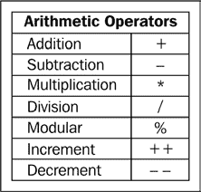
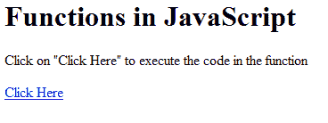
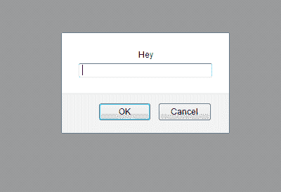
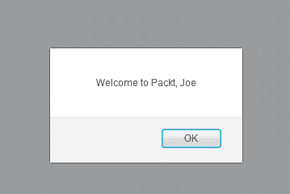
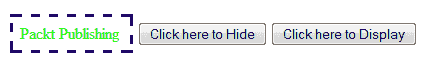

# JavaScript 思维：帮助你理解并掌握 Web 语言的专注指南


## 致谢

### 作者
Aravind Shenoy

### 审核员
- Arturas Lebedevas
- Anirudh Prabhu

### 内容开发编辑
- Nehma Ramakrishnan

### 技术编辑
- Dennis John

### 校对员
- Stephen Copestake

### 制作协调员
- Nitesh Thakur
- Pooja Chiplunkar

### 封面制作
- Prachali Bhiwandkar

## 关于作者

Aravind Shenoy 是 Packt Publishing 的内部作者。他毕业于马尼帕尔理工学院（Manipal Institute of Technology），他的核心兴趣包括技术写作、网页设计和软件测试。他是印度孟买人，目前居住在那里。他曾编写过 *Hadoop: A Big Data Initiative* 和 *Thinking in CSS* 等书籍。他还编写了畅销书：*HTML5 and CSS3 Transition, Transformation, and Animation*, *Packt Publishing*, (http://www.packtpub.com/html5-and-css3-for-transition-transformation-animation/book)。他是一个音乐爱好者，他的歌单里被 *The Doors*、*Oasis* 和 *R.E.M* 占据。


## 概述

在书中没有在海量的理论中徘徊，而是使用了实践示例。书中的示例兼容几乎所有的浏览器。你不需要照抄代码，而是修改代码并查看输出的变化，从而理解 JavaScript 的细微差别。

通过练习，在本书结束时，你可以取得更好的成就并更熟悉 JavaScript。

## JavaScript 思维

JavaScript 是一种用于 Web 的脚本语言。在我们深入研究 JavaScript 的复杂性之前，我们需要知道为什么要使用它。虽然 HTML 告诉浏览器页面应该什么样，但 JavaScript 将用于动态内容和添加功能。

开始学习 JavaScript 的前提条件如下：

- HTML 的先验知识
- 一个如记事本之类的文本编辑器
- 你的网页浏览器已启用 JavaScript

JavaScript 执行代码不需要编译器。JavaScript 可以嵌入到 HTML 代码中。网页浏览器在页面加载时解释 JavaScript。

在书中，我们将采用实践方法，以便对 JavaScript 有更深入的了解。在本书结束时，我们应该能够理解 JavaScript 的概念，以便我们可以在现实应用中实现它。

## 应用 JavaScript

我们不会绕圈子或在海量的理论中徘徊，而是将直接从简单的代码开始。

让我们来看下面的代码，了解 JavaScript是如何应用于网页的：

```html
<!DOCTYPE html>
<html>
<head>
<title> JavaScript 简介 </title>
<script type="text/javascript">
 alert(" Welcome to Packt ");
</script>
</head>
</html>
```

当我们 own看这段代码时，可以看到我们在 `<head>` 部分包含了一行：`script type="text/javascript"`。`<script>` 标签及其类型属性告诉浏览器我们在 HTML 代码中引入了 JavaScript。我们还可以看到代码中有一个 `alert` 命令。我们将在书的稍后部分讨论 `alert` 命令。执行代码后，我们可以在屏幕上看到以下输出：


我们可以看到 JavaScript 代码必须插入在 `<script>` 和 `</script>` 标签之间。

我们的 JavaScript 代码可以放在 `<head>` 或 `<body>` 标签中。这取决于选择并取决于网页。如果有很多样式和视频，最好将 JavaScript 代码保留在 `<body>` 标签中。这确保了网页及其资源在 JavaScript 出现之前完全加载。另一个原因是除了 JavaScript 文件外，任何资源都是异步加载的。然而，当加载 JavaScript 文件时，它是一个一个加载的。这会影响性能。

我们必须理解，如果有代码要写，将 JavaScript 代码与 HTML 代码分离始终是系统化的。在书中，为了方便起见，我们将 JavaScript 嵌入在 HTML 的 `<script>` 标签之间。然而，在现实世界中，将 JavaScript 代码保持为独立是一个良好的做法。为了这样做，我们需要创建一个独立的 JavaScript 文件并以 .js 扩展名保存它。JavaScript 代码必须写在这个单独的 .js 文件中。假设我们创建了一个名为 `main.js` 的 JavaScript 文件。然后我们在 HTML 代码中调用 `main.js` 文件。让我们看一下代码示例以查看该过程：

```html
<!DOCTYPE html>
<html>
<head>
<title> JavaScript 简介 </title>
<script type="text/javascript" src="main.js"></script>
</head>
</html>
```

在 `.js` 文件中，我们需要编写以下代码段：

```javascript
alert(" Welcome to Packt ");
```

当我们执行代码时，将得到与之前示例相同的输出。正如我们所看到的，我们通过在 HTML 文件中使用以下代码调用了 `main.js` 文件：

`<script type="text/javascript" src="main.js"></script>`

在这里，`main.js` 文件应该与 HTML 文件处于同一路径。如果它在不同的文件夹，我们需要指定整个路径。

由此，我们看到了在代码中应用 JavaScript 的方法。

## 变量

在 JavaScript 中，我们需要用于存储数据和值的容器。因此，我们在 JavaScript 中使用变量。我们可以为变量分配数值或字符串值。字符串需要包含引号内。我们还有常量的概念。常量被分配了一个永久的值，而变量的值可以改变。

让我们来看看 JavaScript 中声明变量和常量的方式：

```javascript
var amount;
var amount=5;
const a;
```

显而易见，变量之前应该是 `var` 关键字，而常量应该是 `const` 关键字。我们还可以看到可以在声明时给变量赋值。`const` 兼容除 Internet Explorer 以外的所有现代版本。

变量可以是局部的也可以是全局的。让我们看看如何区分局部和全局变量。

记住 JavaScript 是区分大小写的。因此 "myAttribute" 不等于 "myattribute"。另一个注意点是每条语句都以分号结束。引号内的空格将反映在输出中。

### 全局变量和局部变量

全局变量可以在脚本的任何位置访问，而局部变量只能在函数内部访问。

让我们来看下面的代码以更好地理解：

```html
<!DOCTYPE html>
<html>
<head>
<title> JavaScript 简介 </title>
</head>
<body>
<h1> JavaScript 中的变量 </h1>
<script type="text/javascript">
 function subtraction(a, b)
{
 var c;
 c = a-b;
 return c;
 }
var z = subtraction(10, 7);
 document.write("相减后，差值是 " + z);
</script>
</body>
</html>
```


5

在代码中，a 和 b 都已作为参数传递给函数。a 和 b 是局部变量，只能在函数内部访问，因为它们存在于函数之中。然而，z 是在函数外部声明的，因此是一个全局变量。

我们可以在下面的截图中看到执行代码的输出：


函数将在本书的 *Functions*（函数）章节下进行介绍，所以我们目前先关注变量。

为了更好地理解变量的作用域和概念，让我们来看下面的代码：

<html>

<head>

<title> 变量的作用域 </title>
</head>

<body>

<script type="text/javascript">

 var a = "Packt des Books on Technology";

 var b = "Welcome to Packt";

 function Packt()

 {

 var a = "Packt Publishing has an online book library";

 alert(a);

 alert(b);

 } 

 Packt();

 alert(a);

</script>

</body>
</html>

执行时，我们按照以下顺序看到三个 alert：

Packt Publishing has an online book library

Welcome to Packt

Packt publishes Books on Technology

6

从输出中显而易见，函数可以访问局部变量（因此是第一个 alert）以及全局变量（因此是第二个 alert）。然而，特定函数外部的任何内容无法访问该函数内部的变量（因此是第三个 alert）。这解释了全局变量和局部变量的概念。

## 运算符

JavaScript 中常用的三种运算符如下：

- 算术运算符
- 逻辑运算符
- 比较运算符

### 算术运算符

下表显示了各种算术运算符：



表中提到的运算符用于算术运算。

加、减、乘、除运算符是自言自懂的。取模运算符 (%) 用于除法后留下的余数（我们称之为模）。自增运算符用于将值加一，而自减运算符用于将值减一。

例如，x=x+1 也可以写成 x++，而 y=y-1 可以写成 y--。

7

逻辑运算符

下表显示了不同类型的逻辑运算符：


AND（与）运算符用于所有条件都必须满足的情况。例如，X>5 && y=5 意味着 x 必须大于 5 且 y 必须等于 5，条件才成立。

OR（或）运算符用于其中一个条件为真的情况。例如，x=5 || y<3 意味着 x 等于 5 或 y 小于 3 时条件为真。

NOT（非）运算符用于反面为真的情况。例如，!(x>5) 在 x 等于或小于 5 时为真。

## 条件与循环

JavaScript 的主要目的是添加动态功能。为了执行大量的操作和迭代，我们在 JavaScript 中有了条件和循环的概念。if-else 语句主要用于各种条件。if-else 语句的结构如下：

if (condition)
 {
 要执行的 JavaScript 语句
 }
else
 {
 要执行的 JavaScript 语句
 }

例如，考虑以下代码片段：

If (i>5)
 {
 x=50;
 }
else
 {
 x=100;
 }

8

这段代码的解释非常简单。如果 i 的值大于 5，则 x 的值将是 50。如果 i 的值大于 5，那么 x 的值将是 100。

有时，我们知道需要执行的迭代次数。假设我们需要执行代码并获取输出，比如 10 次。这时，我们使用循环来执行多次迭代，因为我们知道循环重复的次数。我们将在本章查看 for 循环的示例。

for 循环的结构如下：

for (initialization;condition;increment)
 {
 JavaScript 语句
 }

让我们来看代码片段：

<!DOCTYPE html>
<html>
<body>
<script type="text/javascript">

 for (i=0;i<5;i++)
 {
 document.write(i+ "<br>");
 }
</script>
<p>Hi</p>
<p>这是一个 for 循环执行的示例</p>
</body>
</html>

代码执行后的输出将如下：


9

## 函数

函数是 JavaScript 的不可或缺的一部分。让我们理解函数的概念。我们知道 JavaScript 的命令性目的是为网页添加功能。假设我们想在 JavaScript 中添加某些功能。假设我们需要在网站的不同页面或同一网页的不同位置实现它。与其每次都添加一次功能，不如使用函数的概念，我们可以只声明一次函数。从那时起，我们可以在多个网页上或在网站的不同位置多次使用它。

JavaScript 中有很多内置函数。我们也可以在 JavaScript 中编写自己的函数并根据需要进行自定义。让我们来看下面的代码以理解函数是如何工作的：

<!DOCTYPE html>
<html>
<head>
<title> 简述 JavaScript </title>
<h1> JavaScript 中的函数 </h1>
<p> 点击“Click Here”执行函数中的代码 </p>
<script type="text/javascript">

 function PacktPub()
 {
 var x = prompt("Hey", "");
 alert("Welcome to Packt, " + x);
 }
</script>
</head>
<body>

<a href="javascript:PacktPub()">Click Here</a>
</body>
</html>

代码的执行将给我们带来以下输出：



10

点击 Click Here 链接后，我们看到以下输出：



我们得到一个请求输入的提示框。假设我们输入名字 Joe 并点击 OK。我们将得到代码中定义的以下 alert 框：



11

这两个函数在 JavaScript 中常用。当我们需要向用户告知某些进展时，使用 alert 框。同样，当我们在用户访问页面之前想要输入时，使用 prompt 框。观察代码可以显而易见，PacktPub() 函数在调用之前已经声明。在 PacktPub() 函数中，我们使用了 prompt 和 alert 函数。执行 prompt 命令将提示用户输入。Hey 后面的双引号是作为输入的默认字符串。在代码中，x 是赋值给 prompt 函数的变量。再次，x 在紧接的一行的 alert 命令中使用。

一旦输入名字 Joe，我们就得到 alert：Welcome to Packt, Joe。

现在应该理解函数的概念。函数在 JavaScript 中被广泛使用，并在实际编程中广泛用于返回值。因此，函数是 JavaScript 的重要部分。

## 对象在 JavaScript 中的作用

JavaScript 是一种面向对象的语言。我们提到了一些内置对象，我们也可以创建自己的对象并根据需要进行自定义。

对象通过属性和方法来定义。这些属性为 JavaScript 中的对象概念赋予了意义。属性是定义对象的属性。方法定义可以在对象上实现的操作。

让我们来看下面的代码，理解属性是如何定义对象的：

<!DOCTYPE html>
<html>
<body>
<script>

 var animal=new Object();

 animal.species="Dog";

 animal.nickname="Monster";

 animal.age=10;

 animal.eyecolor="brown"; 

 document.write(animal.nickname + " is a dog that has " +
animal.eyecolor + " eyes");

</script>
</body>
</html>


12

代码的输出如下：


因此，我们为一只名为 Monster 的狗定义了属性。如果我们观察代码和输出，我们可以看到我们使用被称为连接运算符（concatenation operator）的运算符通过字符串值连接属性。连接运算符用于将几段文本连接在一起。记住的一点是，字符串中的空格是被考虑在内的。观察我们在 " is a dog that has " 字符串前后各有一个空格，以及它是如何反映在输出中的。回到对象，我们通过指定名称、年龄和眼睛颜色定义了只狗的属性。

在 JavaScript 中，所有用户定义的对象和内置对象都属于一个名为 `Object` 的对象。让我们来理解 `new` 运算符和构造函数的概念。在之前的代码中，有一行代码 `var animal=new Object();`。因此，显而易见，`new` 运算符被用于创建对象的实例。在这种情况下，使用的构造函数是 `Object()`。`new` 运算符后面总是跟着一个构造方法。这解释了创建新对象的代码结构。

除了内置函数，我们也可以使用用户定义的函数。让我们来看下面的代码以理解它是如何工作的：

<html>

<head>

<script type="text/javascript">

 function rate(cost){

 this.sellingPrice = cost;

 }

 function prose(name, company){

 this.name= name; 

 this.company = company;

 this.rate = rate; 

 }

</script>
</head>

<body>

<script type="text/javascript">

 var y = new prose("JavaScript", "Packt Publishing");

 y.rate(50);

 document.write("The name of the book is " + y.name+"<br>");

 document.write("The name of the publishing company is : " + 
y.company + "<br>");

 document.write("The cost of the book is $" + y.sellingPrice+ 
"<br>");

</script>
</body>

</html>

代码的输出如下：


我们需要理解函数和方法非常相似。唯一的区别是，函数是一组独立的语句，而方法属于一个对象，并可以通过 `this` 关键字进行引用。在代码中，我们定义了 `rate` 函数它将作为方法运行；然后我们将 `rate` 方法赋值为 `prose` 函数中的一个属性。因此，我们已经看到了 JavaScript 对象中属性和方法的概念。

正如我们所提到的，JavaScript 是一种面向对象的语言。和任何其他面向对象的语言一样，OOP 概念也适用于 JavaScript。封装、继承、抽象和多态是适用于 JavaScript 的 OOP 特性。

## 数组 (Arrays)

在许多编程语言中，如 C++、Java 和 PHP 等，我们使用数组的概念。同样，我们在 JavaScript 中也使用数组的概念。JavaScript 对象存储并允许对数据进行操作。到为止，我们看到的变量局限于单个数据。然而，在数组中，我们可以存储多个项目并轻松地检索它们。

数组可以通过不同的方式创建。让我们来看下面的代码片段以更好地理解：

```javascript
var animals = new Array();
animals[0]="cat";
animals[1]="dog";
animals[2]="mouse";
```

我们也可以通过在 `new Array` 构造函数直接输入项目来创建数组。下面的代码片段将显示它是如何工作的：

```javascript
var animals = new Array("cat", "dog", "mouse");
```

我们也可以不使用 `new Array` 构造函数来定义数组。

```javascript
var animals = ["cat", "dog", "mouse"];
```

数组的索引位置从 0 开始。索引功能帮助我们访问存储在数组中的数据。假设我们如下定义数组：

```javascript
var animals = ["cat", "dog", "mouse"];
```

如果我们想检索数组中的第三项，我们需要指定它的索引位置。

让我们来看下面的代码以理解它是如何工作的：

<html>

<head>

<title> 中的索引 </title>
</head>

<body>

<script type= "text/javascript">

var animals = ["cat", "dog", "mouse"];

var x = animals[2];

document.write(x);

</script>
</body>

</html>

以下代码的输出如下：


数组有内置属性和方法。例如，`length` 是数组的属性。让我们来看下面的代码看看它是如何工作的：

<html>

<head>

<title> 中的索引 </title>
</head>

<body>

<script type= "text/javascript">

var animals = ["cat", "dog", "mouse"];

y=animals.length

document.write(y);

</script>
</body>

</html>

代码的输出为 3。

简而言之，让我们来看数组的各种属性和方法：

- push: 在数组末尾添加项目
- pop: 从数组末尾删除项目
- reverse: 反转数组中元素的顺序
- toString: 将数组转换为字符串
- sort: 按字母顺序或数字顺序升序或降序对项目进行排序

## jQuery 概述 – 时代所需之需

jQuery 是一个多浏览器 JavaScript 库，由 John Resig 发明。它是一个开源库。具有大量动画和导航的现代复杂网站可以使用 jQuery 轻松开发。jQuery mobile (JQM) 也是智能手机和平板电脑的衍生产品，响应式设计是今天的趋势。

包含托管副本的 jQuery

我们可以使用 Google 或 Microsoft 的内容传递网络 (CDN) 来托管 jQuery 文件。让我们来看下面的代码片段看看它是如何工作的。

如果我们去 Google CDN，我们可以看到为了使用 jQuery 必须包含的代码片段：

```html
<script src="//ajax.googleapis.com/ajax/libs/jquery/2.0.0/jquery.min.js"></script>
```

如果我们去 Microsoft CDN，我们可以看到为了使用 jQuery 必须包含的代码片段：

```html
<script src="http://ajax.aspnetcdn.com/ajax/jquery/jquery-1.9.0.js"></script>
```

我们还有一个可以使用的压缩版本：

```html
<script src="http://ajax.aspnetcdn.com/ajax/jquery/jquery-1.9.0.min.js"></script>
```


18

$("p").click(function() {
  alert("Welcome to Packt Publishing");
});

</script>
</head>

<body>

<p>点击此处理解文档准备就绪（document ready）功能</p>

</body>
</html>

执行时，我们可以看到以下输出：

根据代码，当我们点击文本时，会显示一个如下内容的警告对话框：

Welcome to Packt Publishing.

然而，我们并没有看到任何警告框。这是因为事件必须在页面加载之前触发，或者执行预期的操作。如果你观察代码，警告框没有显示，是因为该方法在点击事件发生之前没有被调用。通过使用文档准备就绪功能，我们可以解决这个问题。让我们稍微调整一下代码并包含文档准备就绪功能。

<html>

<head>
<title>理解文档准备就绪函数</title>
<script src="http://ajax.aspnetcdn.com/ajax/jquery/jquery-1.9.0.js"></script>
<script type="text/javascript">
$(document).ready(function() {
  $("p").click(function() {
    alert("Welcome to Packt Publishing");
  });
});
</script>
</head>

<body>

<p>点击此处理解文档准备就绪（document ready）功能</p>
</body>
</html>

19


然而，这里的区别在于，当点击输出中的文本时，会显示以下警告框：


因此，在 jQuery 中包含文档准备就绪功能是一个良好的习惯。我们必须使用以下语法来实现文档准备就绪功能：

$(document).ready(function()

如果我们观察代码片段，该函数是在文档准备就绪以实现 jQuery 后必须执行的回调函数。我们还可以看到一个 $ 符号。$ 符号是 jQuery() 函数的同义词。在标签名、标签 ID 或类名之前不需要写 jQuery，而是使用 $。它简化了代码并表明这是一个 jQuery 代码片段。使用适当的语法使代码更整洁、更短；这在页面加载时至关重要。

## 使用 jQuery 访问 DOM 元素

与 CSS 类似，我们可以使用 jQuery 访问文档对象模型（DOM）中的元素。在 JavaScript 中，我们使用 `getElementByID` 函数通过 ID 访问 DOM 中的元素。然而，在 jQuery 中可以用更短的代码实现这一点。

20

### 使用 ID

让我们来看这段代码，查看如何通过 ID 访问元素：

$(document).ready(function() {
  var x = $("#packt");
});

对于 ID 为 `packt` 的元素，我们可以使用 `#` 运算符来引用它，就像在 CSS 中一样。我们需要记住 ID 前必须有一个 `#`，并且应该包含在双引号中。

### 使用类

让我们来看这段代码，查看如何通过类访问元素：

$(document).ready(function() {
  var y = $(".pubman");
});

对于定义类为 `pubman` 的元素，我们可以使用点 `.` 运算符来引用它。类的前必须有一个点 `.` 运算符，就像在 CSS 中一样。然而，类必须包含在双引号中。

### 使用标签

让我们来看这段代码，查看如何通过标签名访问元素：

$(document).ready(function) {
  var links = $("a");
});

在 jQuery 中，可以通过引用包含在双引号中的标签通过标签名访问元素。

### 匿名函数

让我们来看看在 jQuery 中如何使用匿名函数。以下代码将让我们对其功能有所了解：

$(document).ready(function() {
  $('#packt').click(function() {
    $('div').remove();
  });
});

让我们理解这段代码的含义。

文档准备就绪功能已经解释过了。然后我们查询 DOM 中 ID 为 `packt` 的元素，并为它分配一个点击事件。在函数内部，我们包含了 `remove` 方法，它将移除该元素。

21

文档准备就绪功能已经解释过了。然后我们查询 DOM 中 ID 为 `packt` 的元素，并为它分配一个点击事件。在函数内部，我们包含了 `remove` 方法，它将移除该元素。（等等，让我们重新读一下流程）。

<html>

<head>
<title>jQuery Animation</title>
<script src="http://ajax.aspnetcdn.com/ajax/jquery/jquery-1.9.0.js"></script>
<script type="text/javascript">
$(document).ready(function() {
  $("#packt").click(function() {
    $(".pubman").show(2000);
  });
  $(packt).click(function() {
    $(".pubman").hide(3500);
  });
});
</script>
<style>
.pubman{
margin:5px;
padding:5px;
border:3px dashed;
color:lime;
display:inline;
width:110px;
height:40px;
}
</style>
</head>

<body>

<br>
<div class="pubman">Packt Publishing</div>
<input id="packpub" type="button" value="隐藏" />
<input id="packt" type="button" value="显示" />
</body>
</html>

让我们看看执行时的输出：



当我们点击“隐藏”时，包含文本的框会消失。当我们点击“显示”时，框再次出现。我们在 jQuery 中使用了 `show()` 方法以及 `hide()` 方法。我们还指定了过渡的毫秒数。因此，我们可以看到使用 jQuery 创建动画是多么简单。还有其他如 `toggle` 和 `fade` 等方法（仅举例），但我们无法在书中涵盖 jQuery 的所有内容。

23

编程会随着练习而进步。我们非常感谢你将书中提到的代码复制到 Notepad 或 Notepad++ 等编辑器中进行练习。当你在生活中实现书中中学到的内容时，你会发现操作 JavaScript 是多么有趣。我们在书中涵盖了对象和数组。有不同类型的对象，例如 `Math` 对象和 `Date` 对象（仅举例）。然而，这里无法涵盖所有内容。

如果你需要的书没有在这里列出，可以访问我们的在线库 PacktLib (http://packtlib.packtpub.com/) 查看我们完整的 JavaScript 书籍以及广泛的其他技术。或者，你可以使用智能手机或平板电脑查看我们的响应式浏览器应用程序 (https://app.packtpub.com/)。

随时告诉我们希望在 JavaScript 上看到哪些类型的书籍。可以通过 contact@packtpub.com 与我们联系。

你的反馈对我们非常重要；它帮助我们生产更好的产品，更好地帮助社区。如果你对书籍有任何反馈，或者在我们涵盖的内容上遇到困难，务必告诉我们。你可以发送电子邮件至 customercare@packtpub.com。

要了解更多关于我们未来的发布信息、完整目录和每日优惠，请访问 http://www.packtpub.com/。
