# JavaScript 入门指南

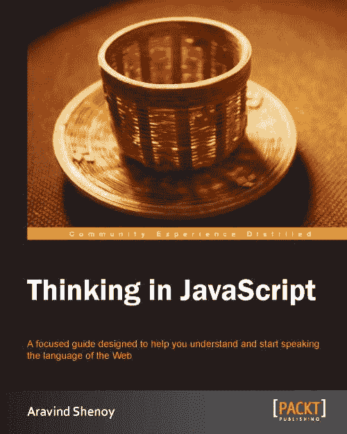

## JavaScript 思维

JavaScript 思维

## 致谢

- **作者**: Aravind Shenoy
- **审稿员**: Arturas Lebedev, Anirudh Prabhu
- **内容开发编辑**: Nehma Ramakrishnan
- **技术编辑**: Dennis John
- **校对**: Stephen Cope
- **制作协调员**: Nitesh Thakur, Pooja Chiplunkar
- **封面设计**: Prachali Bhandkar

## 关于作者

Aravind Shenoy 是 Packt Publishing 的内部作者。他毕业于马尼帕尔理工学院工程专业，核心兴趣包括技术写作、网页设计和软件测试。他是印度孟买本地人，目前居住在那里。他写过 *Hadoop: A Big Data Initiative* 和 *Thinking in CSS* 等书籍。他还编写了 *HTML5 and CSS3 Transition, Transformation, and Animation*。他是一个音乐爱好者，歌单里充满了 *The Doors*、*Oasis* 和 *R.E.*。

## www.PacktPub.com

在`www.PacktPub.com`，你可以阅读到系列免费技术文章，订阅一系列新闻邮件，并接收 Packt 书籍和电子书的专属折扣和优惠。


你需要为你的 IT 问题寻求即时解决方案吗？PacktLib 是 Packt 的在线数字图书馆。在这里，你可以访问、阅读并搜索 Packt 的整个书库。

### 为什么要订阅？

- 可对 Packt 出版的每本书进行全文搜索
- 允许复制和粘贴、打印和标记内容
- 按需提供并可通过网络浏览器访问

### Packt 账户持有者的免费访问

如果你在`www.PacktPub.com`拥有 Packt 账户，你现在就可以用它访问 PacktLib 查看完全免费的书。只需使用你的登录凭据即可立即访问。

## 概述

我们没有在海量的理论中徘徊，而是在书中使用了实践示例。书中的示例兼容几乎所有的浏览器。你不需要逐封地使用代码，可以修改代码并观察输出的变化，从而理解 JavaScript 的细微差别。在书结束时，通过练习，你可以取得更好的成就并更熟悉 JavaScript。

## 第 1 章. JavaScript 思维

JavaScript 是一种用于 Web 的脚本语言。在我们开始深入研究 JavaScript 的复杂性之前，我们需要知道为什么要使用它。HTML 告诉浏览器页面看起来什么样，而 JavaScript 将用于动态内容和添加功能。

开始学习 JavaScript 的前提条件如下：

- 之前的 HTML 知识
- 文本编辑器（如记事本）
- 你的网络浏览器已启用 JavaScript

JavaScript 执行代码不需要编译器。JavaScript 可以嵌入到 HTML 代码中。网络浏览器在页面加载时解释 JavaScript。

在本书中，我们将采用实践方法，以便对 JavaScript 有更深入的了解。在书结束时，我们应该能够理解 JavaScript 的概念，以便我们可以在现实应用中实现它。

### 应用 JavaScript

我们不再绕圈子或在海量的理论中徘徊，而是直接从一段简单的代码开始。让我们来看下面的代码，理解 JavaScript 是如何应用于网页的：

```html
<!DOCTYPE html>
<html>
<head>
<title> JavaScript 简介 </title>
<script type="text/javascript">
  alert(" Welcome to Packt ");
</script>
</head>
</html>
```

当我们看这段代码时，可以看到我们在`<head>`部分包含了一行：`script type="text/javascript"`。`script`标签及其`type 属性`告诉浏览器我们已在 HTML 代码中引入了 JavaScript。我们还可以看到代码中有一个`alert`命令。我们将在本书的稍后部分讨论`alert`命令。在执行代码时，我们可以在屏幕上看到以下输出：

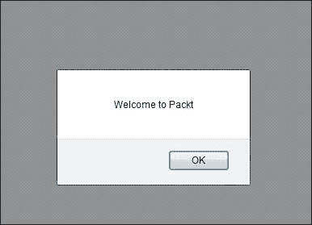

我们可以看到 JavaScript 代码必须插入在`<script>`和`</script>`标签之间。

我们的 JavaScript 代码可以放在`<head>`或`<body>`标签中。这取决于选择，并取决于网页。如果有很多样式和视频，最好将 JavaScript 代码保留在`<body>`标签中。这可以确保在 JavaScript 出现之前，网页及其资源已经完全加载。另一个原因是，除了 JavaScript 文件外，任何资源都是异步加载的。然而，当正在加载 JavaScript 文件时，它们是由于一个接一个地加载的。这会阻碍性能。

我们必须理解，如果有很多代码要写，那么将 JavaScript 代码与 HTML 代码分离始终是系统化的做法。在书中，为了方便起见，我们将 JavaScript 嵌入在 HTML 的`<script>`标签之间。然而，在实际情况中，将 JavaScript 代码作为独立文件是一个良好的实践。为此，我们需要创建一个独立的 JavaScript 文件，并以`.js`扩展名保存它。JavaScript 代码必须写在这个单独的`.js`文件中。假设我们创建了一个名为`main.js`的 JavaScript 文件。然后我们在 HTML 代码中调用该`main.js`文件。让我们来看代码示例以查看过程：

```html
<!DOCTYPE html>
<html
<head>
<title> JavaScript 简介 </title>
<script type="text/javascript" src="main.js"></script>
</head>
</html>
```

在`.js`文件中，我们需要编写以下代码段：

```javascript
alert(" Welcome to Packt ");
```

当我们执行该代码时，我们将得到与之前的示例相同的输出。正如我们所看到的，我们在 HTML 文件中通过使用以下代码调用了`main.js`文件：

```html
<script type="text/javascript" src="main.js"></script>
```

在这里，`main.js`文件应该与 HTML 文件在相同的路径下。如果它在不同的文件夹中，我们需要指定整个路径。

因此，我们已经看到了在代码中应用 JavaScript 的过程。

## 变量

在 JavaScript 中，我们需要容器来存储数据和值以供处理使用。因此，我们在 JavaScript 中使用变量。我们可以为变量分配数值或字符串值。字符串需要包含在引号中。我们还有常量的概念。`constant`（常量）被赋值的值在脚本中是永久的，这与可以更改值的变量不同。

让我们看看在 JavaScript 中声明变量和常量的方法：

```javascript
var amount;
var amount=5;
const a;
```

显而易见，变量前面应该有`var`关键字，而常量前面必须有`const`关键字。我们还可以看到在声明变量时可以给它赋值。

### 注意

`const`兼容除 Internet Explorer 之外的所有现代浏览器版本。

变量可以是局部的也可以是全局的。让我们看看我们如何区分局部变量和全局变量。

### 注意

记住 JavaScript 是区分大小写的。因此 "myAttribute" 不等于 "myattribute"。另一个需要注意的点是，每个语句都以分号结束。引号内的空格将反映在输出中。

## 全局和局部变量

`Global variables`（全局变量）可以从脚本的任何位置访问，而`local variables`（局部变量）只能在函数内部访问。

让我们通过以下代码更好地理解：

```html
<!DOCTYPE html>
<html>
<head>
<title> JavaScript 简介 </title>
</head>
<body>
<h1> JavaScript 中的变量 </h1>
<script type="text/javascript">
  function subtraction(a, b)
     {
      var c;
      c = a-b;
      return c;
     }
  var z = subtraction(10, 7);
</script>
</body>
</html>
```

让我们来看这段代码段：

```html
<!DOCTYPE html>
<html>
<body>
<script type="text/javascript">
  for (i=0;i<5;i++)
     {
       document.write(i+ "<br>");
     }
</script>
<p>Hi</p>
<p>This is an example of the execution of the for loop</p>
</body>
</html>
```

该代码执行后的输出结果所示：

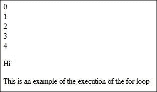

## 函数

函数是 JavaScript 中不可或缺的一部分。让我们来理解函数的概念。我们知道 JavaScript 的命令式目的是为了给网页添加功能。假设我们想在 JavaScript 中添加某些功能。假设我们需要在网站的不同页面或同一个网页的不同位置实现它。与其每次都添加这些功能，不如使用函数的概念，我们可以只声明一次函数。从那时起，我们可以在多个网页上或网站的不同位置多次使用它。

JavaScript 中有许多内置函数。我们也可以在 JavaScript 中编写自己的函数，并根据需要进行自定义。让我们看看以下代码来理解函数是如何工作的：

```html
<!DOCTYPE html>
<html>
<head>
<title> 简述 JavaScript </title>
<h1> JavaScript 中的函数 </h1>
<p> 点击“点击此处”执行函数中的代码 </p>
<script type="text/javascript">
  function PacktPub()
     {
       var x = prompt("Hey", "");
       alert("Welcome to Packt, " + x);
     }
</script>
</head>
<body>
<a href="javascript:PacktPub()">Click Here</a>
</body>
</html>
```

代码的执行将带给我们以下输出：

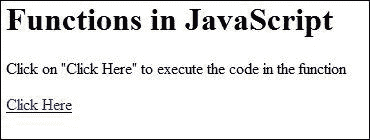

在点击`Click Here`链接后，我们可以看到以下输出：

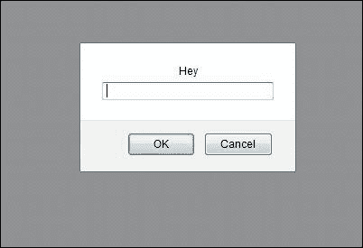

我们得到一个请求输入的提示框。假设我们输入名称`Joe`并点击`OK`。我们将得到如代码中定义的如下警报框。

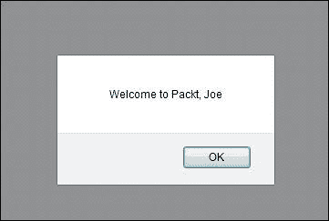

现在让我们理解代码是如何运行的。我们在代码使用了两个内置函数：

- `alert`
- `prompt`

`alert`和`prompt`是 JavaScript 中的内置函数。

### 注意

JavaScript 是区分大小写的；因此，我们必须使用小写的`alert`和`prompt`，否则代码将无法运行。

`alert`和`prompt`函数在 JavaScript 中常用。当我们需要通知用户某些进展时，使用 alert 框。当我们要在用户点击链接或浏览网站之前提供一些信息时，也会使用它。同样，当我们要在用户访问页面之前获取输入时，就会使用`prompt`框。

如果你观察代码可以明显看出`PacktPub()`函数在调用它之前已经声明。在`PacktPub()`函数中，我们使用了`prompt`和`alert`函数。`prompt`命令在执行时会提示用户输入。`Hey`后的双引号`""`是用于输入的默认字符串。在代码中，`x`是一个变量，被了`prompt`函数的结果。同样，`x`在下一行的`alert`命令中被使用。一旦我们输入名称`Joe`，就会得到一个警报：`Welcome to Packt, Joe`。

现在必须已经理解了函数的概念。函数在 JavaScript 中被广泛使用，并在现实编程中广泛用于返回结果。因此，函数是 JavaScript 的核心组成部分。

## 对象及其在 JavaScript 中的作用

JavaScript 是一种面向对象的语言。我们有了一些内置对象，例如`Math`、`Date`和`Document`。然而，我们也可以创建自己的对象并进行自定义以适应我们的需求。

对象通过属性和方法来定义。这些是赋予 JavaScript 中面向对象概念意义的属性。属性（property）是定义对象值的属性。方法定义了可以在对象上执行的操作。让我们看看以下代码来理解属性如何定义对象的值：

```html
<!DOCTYPE html>
<html>
<body>
<script>
  var animal=new Object();
  animal.species="Dog";
  animal.nickname="Monster";
  animal.age=10;
  animal.eyecolor="brown";
  document.write(animal.nickname + " is a dog that has " + animal.eyecolor);
</script>
</body>
</html>
```

代码的输出将如下：

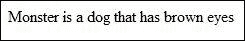

因此，我们为一只名为`Monster`的狗定义了属性。如果你观察代码和输出，我们可以看到我们使用连接运算符（concatenation operator）通过字符串值连接了属性。需要记住的一点是，字符串中的空格是被考虑在内的。观察我们在`" is a dog that has "`字符串前后各有一个空格，以及它是如何反映在输出中的。回到对象，我们通过指定名称、年龄和眼睛颜色定义了这只狗。在 JavaScript 中，所有用户定义的对象和内置对象都属于一个名为`Object`的对象。让我们理解`new`运算符和构造函数。在前面的代码中，有一行代码`var animal=new Object();`。因此，显然`new`运算符用于创建对象的实例。在这种情况下使用的构造函数是`Object()`。`new`运算符后面跟着构造方法。这解释了创建新对象的结构。除了内置函数，我们也可以使用自定义函数。让我们看看以下代码来理解它是如何工作的：

```html
<html>
<head>
<script type="text/javascript">
  function rate(cost){
    this.sellingPrice = cost;
  }
  function prose(name, company){
    this.name= name;
    this.company = company;
    this.rate = rate;
  }
</script>
</head>
<body>
<script type="text/javascript">
  var y = new prose("JavaScript", "Packt Publishing");
  y.rate(50);
  document.write("The name of the book is " + y.name+"<br>");
  document.write("The name of the publishing company is : " + y.company + "<br>");
  document.write("The cost of the book is $" + y.sellingPrice+"<br>");
</script>
</body>
</html>
```

代码的输出将如下：

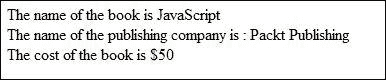

我们需要理解函数和方法非常相似。唯一的区别在于，函数是一个独立的语句块，而方法属于一个对象，并且可以通过`this`关键字被引用。在代码中，我们定义了`rate`函数将作为方法使用；然后我们将`rate`方法作为属性赋值到`prose`函数中。因此，我们看到了 JavaScript 对象中属性和方法的概念。

正如我们提到的，JavaScript 是一种面向对象的语言。正如任何面向对象的语言一样，面向对象编程（OOP）概念也适用于 JavaScript。封装、继承、抽象和多态是可以应用于 JavaScript 的 OOP 特性。

我们也可以通过在`new Array`构造函数直接输入项来创建一个数组。下面的代码段将展示它的工作原理：

```javascript
var animals = new Array("cat", "dog", "mouse");
```

我们还可以不使用`new Array`构造函数来定义数组。

```javascript
var animals = ["cat", "dog", "mouse"];
```

数组的索引位置从 0 开始。索引功能帮助我们访问存储在数组中的数据。假设我们这样定义数组：

```javascript
var animals = ["cat", "dog", "mouse"];
```

如果我们想获取数组中的第三元素，我们需要指定它的索引位置。

让我们来看下面的代码以理解它的工作原理：


```html
<<html>
<head>
<title> Index in Arrays </title>
</head>
<body>
<script type="text/javascript">
var animals = ["cat", "dog", "mouse"];
var x = animals[2];
document.write(x);
</script>
</body>
</html>
```

以下代码的输出将如下：

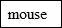

数组具有内置的属性和方法。例如，`length` 是数组的一个属性。让我们来看下面的代码看看它是如何工作的：

```html
<<html>
<head>
<title> Index in Arrays </title>
</head>
<body>
<script type="text/javascript">
var animals = ["cat", "dog", "mouse"];
y=animals.length;
document.write(y);
</script>
</body>
</html>
```

代码的输出将是 `3`。

简而言之，让我们来看数组的各种属性和方法：

- `push`：在数组末尾添加项
- `pop`：从数组末尾删除项
- `reverse`：反转数组中元素的顺序
- `toString`：将数组转换为字符串
- `sort`：按字母顺序或数字按升序或降序对项目进行排序

# jQuery 概览——时代之需

jQuery 是一个多浏览器 JavaScript 库，由 John Resig 发明。它是一个开源库。具有大量动画和导航的现代复杂网站可以使用 jQuery 轻松开发。`jQuery mobile`（`JQM`）也是 jQuery 的一个衍生产品。随着智能手机和平板电脑的出现，响应式网页设计是当今趋势。使用 jQuery 可以实现响应式网页设计。

## 将 jQuery 添加到网页中

可以通过以下方式将 jQuery 添加到网站：

- 通过下载库副本在本地引入 jQuery
- 引入托管的 jQuery 副本

让我们在接下来的章节中查看这两种方法。

### 通过下载库副本在本地引入 jQuery

当我们访问 [`jquery.com/`](http://jquery.com/) jQuery 官网下载库副本时，我们可以看到两个不同的版本。下载部分的第一个版本是精简生产版 jQuery（Minified Production jQuery version），而第二个版本是未压缩的开发版本（Uncompressed Development version）。两者之间存在差异。

未压缩的开发版本具有可读性，并有大量的空格和注释，以便更好地理解代码。因此，当您学习 jQuery 或处于开发阶段时，建议使用未压缩的开发版本。

精简生产版非常精确，没有像未压缩版本那样的空格。此外，变量被赋予了短名称，并删除了注释，还结合了其他压缩技巧，以尽可能地减小文件大小。因此，在部署期间建议使用精简版，因为在加载页面时必须下载更短的文件。让我们看看如何在本地添加 jQuery 文件。

当我们进入该网站时，可以看到精简生产版和未压缩的开发版本。点击您选择的版本，它将如如下图所示加载到浏览器中。

在我们的案例中，我们将下载精简版：

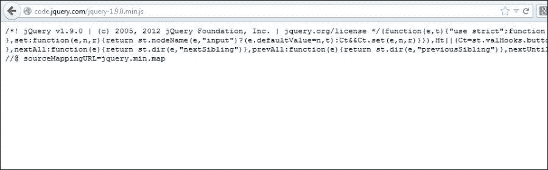

复制文件内容并将其保存为扩展名为 `.js` 的文本文件。在我们的案例中，我们将其保存为 `latestjquery.js`。确保您将文件保存在项目相同的目录下，这样我们就可以直接调用它。下面的代码段显示了我们在网站中引入 jQuery 的方法：

```html
<!DOCTYPE html>
<html>
<head>
<title>Including jQuery</title>
<script type="text/javascript" src="latestjquery.js"></script>
<script type="text/javascript" src="ourjavascriptpage.js"></script>
</head>
<body>
<p>jQuery: an amazing JavaScript library</p>
</body>
</html>
```

在前面的代码中，我们在调用任何 JavaScript 代码（例如 `ourjavascriptpage.js`）之前调用了 `latestjquery.js`（我们的 jQuery 文件）。因此，显而易见，我们需要先引入 jQuery，因为我们的代码在使用它之前需要找到 jQuery 已完全加载。将 jQuery 文件包含在我们的 `<head>` 部分是一个良好的做法，因为它必须被完全加载。现在让我们来看向网站引入 jQuery 的第二种方法。

### 引入托管的 jQuery 副本

我们可以使用 Google 或 Microsoft 的`内容分发网络`（`CDN`）来托管 jQuery 文件。让我们来看下面的代码看看它是如何工作的：

```html
<script src="//ajax.googleapis.com/ajax/libs/jquery/3.6.0/jquery.min.js"></script>
```

```html
<script src="http://ajax.aspnetcdn.com/ajax/jquery/1.9.0/jquery.min.js"></script>
```

## 使用 document ready 功能

在理解 document ready 功能之前，让我们来看下面的代码：

```html
<html>
<head>
<title> Index in Arrays </title>
</head>
<body>
<script src="http://ajax.aspnetcdn.com/ajax/jquery/1.9.0/jquery.min.js"></script>
<script type="text/javascript">
$("p").click(function() {
alert("Welcome to Packt Publishing");
});
</script>
</head>
<body>
<p>Click here to understand the document ready feature</p>
</body>
</html>
```

执行后，我们可以看到如下输出：

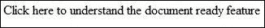

根据代码，当我们点击文本时，会显示显示 `Welcome to Packt Publishing` 的对话框。

然而，我们没有看到任何对话框。这是因为事件必须在页面加载之前触发或执行操作。如果你观察代码，当 `click` 事件发生时对话框并未显示。通过使用 document ready 功能，我们可以解决这个问题。让我们稍微调整代码并引入 document ready 功能。

```html
<html>
<head>
<title> Index in Arrays </title>
<script src="http://ajax.aspnetcdn.com/ajax/jquery/1.9.0/jquery.min.js"></script>
<script type="text/javascript">
$(document).ready(function() {
$("p").click(function() {
alert("Welcome to Packt Publishing");
});
});
</script>
</head>
<body>
<p>Click here to understand the document ready feature</p>
</body>
</html>
```

代码执行后将显示如下输出：

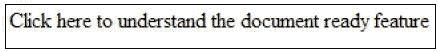

然而，这里的不同在于，在点击输出中的文本时，会显示以下对话框：

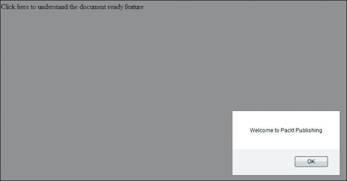

因此，在 jQuery 中包含 document ready 功能是一个良好的做法。我们必须使用以下语法来来实现 document ready 功能：

```javascript
$(document).ready(function()
```

如果我们观察这段代码段，该函数是在文档准备就绪以实现 jQuery 时必须执行的回调函数。我们还可以观察到 `$` 符号。`$` 符号是 `jQuery()` 函数的同义词。在标签名、标签 ID 或类之前，我们不需要编写 `jQuery`，而是可以使用 `$`。它简化了代码并表明这是一段 jQuery 代码段。使用适当的语法可以让代码更整洁、更短；这在页面加载时非常重要。

## 使用 jQuery 访问 DOM 元素

与 CSS 类似，我们可以使用 jQuery 访问`文档对象模型`（`DOM`）中的元素。在 JavaScript 中，我们使用 `getElementByID` 函数通过 ID 访问 DOM 中的元素。然而，在 jQuery 中我们可以用更短的代码来实现这一点。

### 使用 ID

让我们看看下面的代码段，看看我们如何通过 ID 访问元素：

```javascript
$(document).ready(function()
 {
   var x = $("#packt");
});
```

对于 ID 为 `packt` 的元素，我们可以像 CSS 那样使用 `#` 运算符来引用它。我们需要记住，ID 之前必须有一个 `#` 并且应该包含在双引号中。

### 使用类

让我们看看下面的代码段，看看如何通过类访问元素：

```javascript
$(document).ready(function()
 {
   var y = $(".pubman");
});
```

对于定义为类 `pubman` 的元素，我们可以使用点（`.`）运算符来引用它。类之前必须有一个点（`.`）运算符，类似于 CSS 中的写法。然而，类必须包含在双引号中。

### 使用标签

让我们看看下面的代码段，看看我们如何通过标签名访问元素：

```javascript
$(document).ready(function)
 {
   var links = $("a");
});
```

在 jQuery 中，可以通过引用包含双引号的标签来通过标签名访问元素。

## 匿名函数

让我们来看看如何在 jQuery 中使用匿名函数。

下面的代码将让我们对它的功能有一个直观的理解：

```javascript
$(document).ready(function()
 {
   $('#packt').click(function()
     {
       $('div').remove();
     });
});
```

让我们来理解这段代码的含义。

document ready 功能已经解释过了。然后我们查询 DOM 以查找 ID 为 `packt` 的元素，并为其分配一个 `click` 事件。在函数内部，我们包含了 `remove` 方法，它将移除所有的 `<div>` 元素。

### 注意

对于 jQuery 中使用的各种方法，我们可以参考诸如 *jQuery for Designers: Beginner's Guide* 等书籍，这些书籍可以在 Packt 网站 [www.packtpub.com](http://www.packtpub.com) 上。或者，我们可以参考 Packt 在线库 [`packtlib.packtpub.com/`](http://packtlib.packtpub.com/)。

jQuery 被广泛用于动画。我们现在来看看下面的代码，代码中我们在网页上隐藏和显示元素：

```html
<<html>
<head>
<title>jQuery Animation</title>
<script src="http://ajax.aspnetcdn.com/ajax/jquery/jquery-1.9.0.js"></script>
<script type="text/javascript">
  $(document).ready(function() {
     $("#packt").click(function () {
       $(".pubman").show( 2000);
     });
     $("#packtpub").click(function () {
        $(".pubman").hide( 3500 );
     });
  });
</script>
<style>
.pubman{ margin:5px;padding:7px;
     border:3px dashed navy;
     color:lime;
     width:110px;
     height:40px;
     display:inline;
         }
</style>
</head>
<body>
<br>
<div class="pubman">
Packt Publishing
</div>
<input id="packtpub" type="button" value="Click here to Hide" />
<input id="packt" type="button" value="Click here to Display" />
</body>
</html>
```

让我们来看看代码执行后的输出：

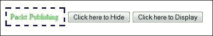

当我们点击 `Click here to Hide` 时，包含 `Packt Publishing` 的框消失了。当我们点击 `Click here to Display` 时，框再次出现。我们在 jQuery 代码中使用了 `show()` 方法和 `hide()` 方法。我们还指定了过渡发生的毫秒时间。

因此，我们可以看到使用 jQuery 创建动画是多么简单。还有许多其他方法，例如 `toggle` 和 `fade`（仅列举几项），但我们无法在书中涵盖 jQuery 所提供的所有功能。

jQuery 是一个庞杂的主题，这本书将只关注它的某一方面。Packt 有许多关于 jQuery 的书籍，例如 *jQuery for Designers: Beginner's Guide*（Packt Publishing），你可以访问我们的网页 [`www.packtpub.com/books?keys=jquery`](http://www.packtpub.com/books?keys=jquery) 来查看针对你的需求定制的各种 jQuery 书籍。

编程会随着练习变得更好。如果你能将书中提到的代码复制到记事本或 Notepad++ 等编辑器中练习，我们将不胜感激。当你在现实生活中实现书中学到的内容时，你将发现实际操作 JavaScript 是多么有趣的事情。我们在书中涵盖了对象和数组。还有不同类型的对象，例如 `Math` 对象和 `Date` 对象等（等等）。然而，这里无法涵盖所有内容。
