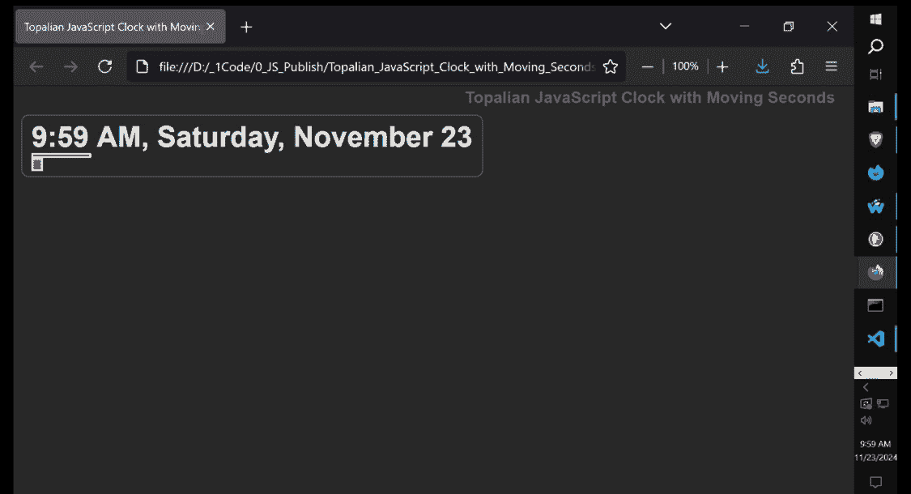
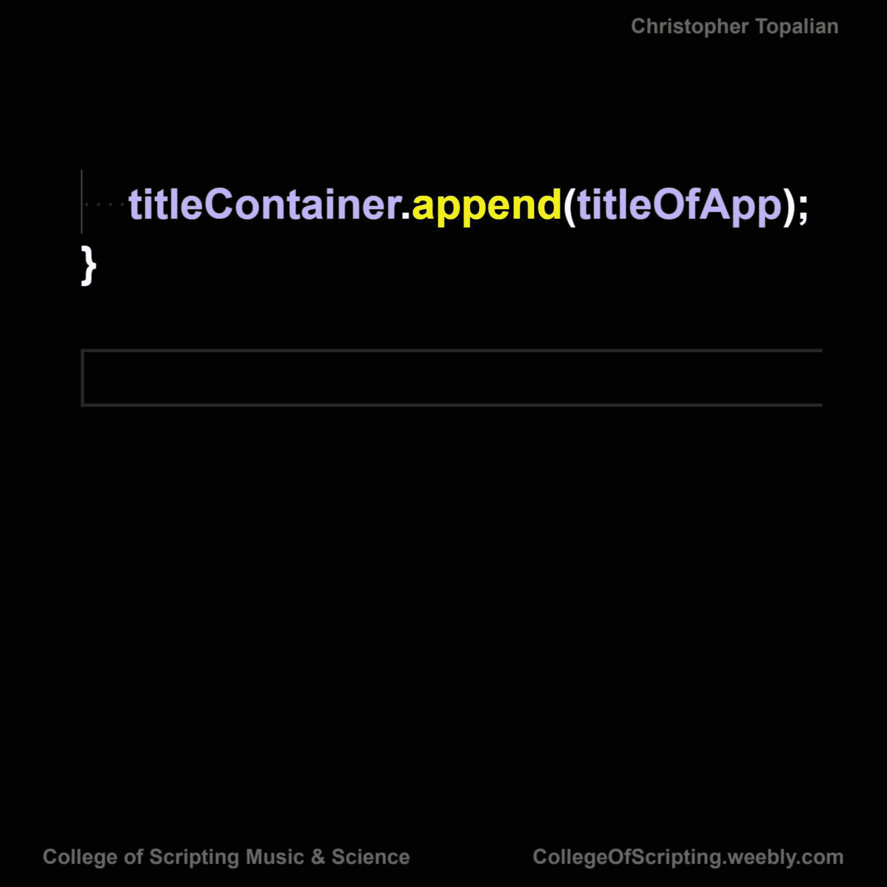

# 带有动态秒的 Topalian JavaScript 钟

**献给**

**天父**

**父神**

## Christopher Topalian



脚本音乐与科学学院

`CollegeOfScripting.weebly.com`


```html
<!-- 献给天父 -->
<!-- 版权所有 Christopher Andrew
Topalian 版权 2000-2024 -->
<!-- https://github.com/ChristopherTopalian -->
<!--
https://github.com/ChristopherAndrewTopalia
n -->
<!--
Topalian_JavaScript_Clock_with_Moving_Se
conds_(Online_Version).html -->
<!-- 版本 001 - (2024-11-23) -->

<html>
<head>
<title>带动态秒级的 Topalian JavaScript 时钟</title>

<style>
/* style001.css */

body
{
    background-color:rgb(40, 40, 40);
    font-family:Arial;
    font-size:30px;
    font-weight:bold;
    color:rgb(255, 255, 255);
}

.mainDiv
{
    border:solid 1px rgb(100, 100, 100);;
    border-radius:8px;
    padding:5px 10px;
    word-wrap:break-word;
}

.secondsRectangle
{
    width:1px;
    height:10px;
    background:rgb(200, 200, 200);
    border:solid 2px rgb(255, 255, 255);;
    border-radius:0px;
}

.timeLine
{
    width:5px;
    height:1px;
    background:rgb(0, 0, 0);
    border:solid 2px rgb(255, 255, 255);;
    border-radius:0px;
    color:rgb(255, 255, 255);;
}

/* 献给天父 */
/* 版权所有 Christopher Andrew
Topalian 版权 2000-2024 */
/* https://github.com/ChristopherTopalian */
/* https://github.com/ChristopherAndrewTopalia */
/* https://sites.google.com/view/CollegeOfScripting */
</style>
```

```javascript
// shortcuts.js

function ge(whichId)
{
    let result = document.getElementById(whichId);
    return result;
}

function ce(whichType)
{
    let result = document.createElement(whichType);
    return result;
}

function ba(whichElement)
{
    let result = document.body.append(whichElement);
    return result;
}

function cl(whichMessage)
{
    let result = console.log(whichMessage);
    return result;
}

//--//

// 献给天父

// 版权所有 Christopher Andrew
// Topalian 版权 2000-2024

// https://github.com/ChristopherTopalian
// https://github.com/ChristopherAndrewTopalia
// https://sites.google.com/view/CollegeOfScripting

// worldVariables.js

let timer001;

// makeDateTimeDiv.js

function makeDateTimeDiv()
{
    let dateTimeDiv = ce('div');
    dateTimeDiv.id = 'dateTimeDiv';
    dateTimeDiv.title = 'dateTimeDiv';
    ge('mainDiv').append(dateTimeDiv);
}

//--//

// 献给天父

// 版权所有 Christopher Andrew
// Topalian 版权 2000-2024

// https://github.com/ChristopherTopalian
// https://github.com/ChristopherAndrewTopalia
// https://sites.google.com/view/CollegeOfScripting

// makeInterface.js

function makeInterface()
{
    makeDiv();
    makeDateTimeDiv();
    makeClock();
    makeLine();
    makeRectangle();
    makeTitleApp();
}

//--//

// 献给天父

// 版权所有 Christopher Andrew
// Topalian 版权 2000-2024

// https://github.com/ChristopherTopalian
// https://github.com/ChristopherAndrewTopalia
// https://sites.google.com/view/CollegeOfScripting

// makeDiv.js

function makeDiv()
{
    let mainDiv = ce('div');
    mainDiv.id = 'mainDiv';
    mainDiv.title = 'mainDiv';
    mainDiv.className = 'mainDiv';
    mainDiv.style.position = 'absolute';
    mainDiv.style.top = 30px;
    ba(mainDiv);
    makeDraggable(mainDiv);
}

//--//

// 献给天父

// 版权所有 Christopher Andrew
// Topalian 版权 2000-2024

// https://github.com/ChristopherTopalian
// https://github.com/ChristopherAndrewTopalia
// https://sites.google.com/ing

// makeTitleApp.js

function makeTitleApp()
{
    let mainDiv = ce('div');
    mainDiv.style.position = 'absolute';
    mainDiv.style.right = '20px';
    mainDiv.style.top = '2px';
    mainDiv.style.zIndex = 1;
    ba(mainDiv);

    //-//

    let titleOfApp = ce('a');
    titleOfApp.id = 'titleOfApp';
    titleOfApp.textContent = '带动态秒级的 Topalian JavaScript 时钟';;
    titleOfApp.href = 'https://github.com/christophertopalian/;
    titleOfApp.target = '_blank';
    titleOfApp.style.fontSize = '17px';
    titleOfApp.style.fontWeight = 'bold';
    titleOfApp.style.textDecoration = 'none';
    titleOfApp.style.color = 'rgb(100, 100, 100)';;;
    mainDiv.append(titleOfApp);
}

// https://github.com/ChristopherTopalian

// //

https://github.com/ChristopherAndrewTopalian

n

// //

https://sites.google.com/view/CollegeOfScripting

// makeClockContainer.js

function makeClockContainer()
{
    let clockContainer = document.createElement('div');
    clockContainer.id = 'clockContainer';
    clockContainer.title = 'clockContainer';
    clockContainer.style.display = 'flex';
    clockContainer.style.flexDirection = 'column';
    document.getElementById('mainDiv').append(clockContainer);
}

//----

// 献给父神

// 版权所有 Christopher Andrew Topalian 2000-2024

// https://github.com/ChristopherTopalian

// //

https://github.com/ChristopherAndrewTopalian

n

//

https://sites.google.com/view/CollegeOfScripting

// makeRectangle.js

function makeRectangle()
{
    let secondsRectangle = document.createElement('div');
    secondsRectangle.id = 'secondsRectangle';
    secondsRectangle.className = 'secondsRectangle';
    document.getElementById('clockContainer').append(secondsRectangle);
}

//----

// 献给父神

// 版权所有 Christopher Andrew Topalian 2000-2024

// https://github.com/ChristopherTopalian

https://github.com/ChristopherAndrewTopalian

n

//

https://sites.google.com/view/CollegeOfScripting

// makeTimeLine.js

function makeTimeLine()
{
    let timeLine = document.createElement('div');
    timeLine.id = 'timeLine';
    timeLine.title = 'timeLine';
    timeLine.className = 'timeLine';
    document.getElementById('clockContainer').append(timeLine);
}

//----

// 献给父神

// 版权所有 Christopher Andrew Topalian 2000-2024

// https://github.com/ChristopherTopalian

// //

https://github.com/ChristopherAndrewTopalian

n

//

https://sites.google.com/view/CollegeOfScripting

// getDayName.js

function getDayName()
{
    let dateTime = new Date();
    let day = dateTime.getDay();

    if (day == 0)
    {
        return "Sunday";
    }

    if (day == 1)
    {
        return "Monday";
    }

    if (day == 2)
    {
        return "Tuesday";
    }

    if (day == 3)
    {
        return "Wednesday";
    }

    if (day == 4)
    {
        return "Thursday";
    }

    if (day == 5)
    {
        return "Friday";
    }

    if (day == 6)
    {
        return "Saturday";
    }
}

//----

// 献给父神

// 版权所有 Christopher Andrew Topalian 2000-2024

// 版权所有 Christopher Andrew Topalian 2000-2024

// https://github.com/ChristopherTopalian

n

//

https://sites.google.com/view/CollegeOfScripting
```


// `getDayOfMonth.js`

```
function getDayOfMonth()
{
    let dateTime = new Date();
    let dayOfMonth = dateTime.getDate();
    return dayOfMonth;
}
```

//----
// 献给父神
// 版权所有 Christopher Andrew Topalian 2000-2024
// https://github.com/ChristopherTopalian
// //
https://github.com/ChristopherAndrewTopalian
n
https://sites.google.com/view/CollegeOfScripting

// `getMonthName.js`

```
function getMonthName()
{
    let dateTime = new Date();
    let month = dateTime.getMonth();
    if (month == 0)
    {
        return "January";
    }
    if (month == 1)
    {
        return "February";
    }
    if (month == 2)
    {
        return "March";
    }
    if (month == 3)
    {
        return "April";
    }
    if (month == 4)
    {
        return "May";
    }
    if (month == 5)
    {
        return "June";
    }
    if (month == 6)
    {
        return "July";
    }
    if (month == 7)
    {
        return "August";
    }
    if (month == 8)
    {
        return "September";
    }
    if (month == 9)
    {
        return "October";
    }
    if (month == 10)
    {
        return "November";
    }
    if (month == 11)
    {
        return "December";
    }
}
```

//----
// 献给父神
// 版权所有 Christopher Andrew Topalian 2000-2024
// https://github.com/ChristopherTopalian
// //
https://github.com/ChristopherAndrewTopalian
n
 //
https://sites.google.com/view/CollegeOfScripting

// `getAmPm.js`

```
function getAmPm()
{
    let hours = new Date().getHours();
    let amPm;
    if (hours < 12)
    {
        amPm = "AM";
    }
    else
    {
        amPm = "PM";
    }
    return amPm;
}
```

//----
// 献给父神
// 版权所有 Christopher Andrew Topalian 2000-2024
// https://github.com/ChristopherTopalian

// `getHours.js`

```
function getHours()
{
    let dateTime = new Date();
    let hours = dateTime.getHours();
    // 将军用时间转换
    if (hours > 12)
    {
        hours -= 12;
    }
    else if (hours === 0)
    {
        hours = 12;
    }
    return hours;
}
```

// 版权所有 Christopher Andrew 
// Topalian 版权 2000-2024
// https://github.com/ChristopherTopalian
// 
https://github.com/ChristopherAndrewTopalia
n
// 
https://sites.google.com/view/CollegeOfScript
ing

// `getMinutes.js`

```
function getMinutes()
{
    let dateTime = new Date();
    let minutes = dateTime.getMinutes();
    // 如果小于 10 则加零
    if (minutes < 10) {
        minutes = "0" + minutes;
    }
    return minutes;
}
```

//----//
// 献给天父神
// 版权所有 Christopher Andrew 
// Topalian 版权 2000-2024
// https://github.com/ChristopherTopalian
// 
https://github.com/ChristopherAndrewTopalia
n
https://sites.google.com/view/CollegeOfScript
ing

// `getSeconds.js`

```
function getSeconds()
{
    let dateTime = new Date();
    let seconds = dateTime.getSeconds();
    return seconds;
}
```

//----//
// 献给天父神
// Topalian 版权 2000-2024
// https://github.com/ChristopherTopalian
// 
https://github.com/ChristopherAndrewTopalia
n
// 
https://sites.google.com/view/CollegeOfScript
ing

// `startTimer.js`

```
function startTimer()
{
    timer001 = setInterval(function()
    {
        updateDateTime();
    }, 1000);
}
```

//----//
// 献给天父神
// 版权所有 Christopher Andrew 
// Topalian 版权 2000-2024
// https://github.com/ChristopherTopalian
// 
https://github.com/ChristopherAndrewTopalia
n
// 
https://sites.google.com/view/CollegeOfScript
ing

// `updateDateTime.js`

```
function updateDateTime()
{
    if (ge("dateTimeDiv")) {
        ge("dateTimeDiv").innerHTML =
            getHours() + ":" + getMinutes() + "" +
            getAmOrPm() + ', ' +
            getDayName() + ", " +
            getMonthName() + ""
            getDayOfMonth();
    }
    //-//
    // 调整 secondsRectangle 的大小
    let theElement = ge("secondsRectangle");
    theElement.style.backgroundColor = "rgb(128, 128, 128)";
    if (getSeconds() == 0) {
        theElement.style.width = 0 + "px";
    }
    else {
        theElement.style.width = getSeconds() + "px";
    }
}
```

//----//
// 献给天父神
// 版权所有 Christopher Andrew 
// Topalian 版权 2000-2024
// https://github.com/ChristopherTopalian

// 
https://sites.google.com/view/CollegeOfScript
ing

// `makeElementDraggable.js`

```
// 为鼠标按下创建事件处理器
function createMouseDownHandler(element, state)
{
    return function(e)
    {
        // 忽略 textarea 或 input 元素上的按下事件
            return;
        }
        e.preventDefault();
        state.startX = e.clientX;
        state.startY = e.clientY;
        document.onmousemove = createMouseMoveHandler(element, state);
        document.onmouseup = createMouseUpHandler();
    };
}
```

```
// 为鼠标移动创建事件处理器
function createMouseMoveHandler(element, state)
{
    return function(e)
    {
        // 忽略 textarea 或元素上的移动事件
        if (e.target == "TEXTAREA" || e.target == "INPUT") {
            return;
        }
        e.preventDefault();
        let deltaX = state.startX - e.clientX;
        let deltaY = state.startY - e.clientY;
        state.startX = e.clientX;
        state.startY = e.clientY;
        let newTop = element.offsetTop - deltaY;
        let newLeft = element.offsetLeft - deltaX;
        element.style.top = newTop + "px";
        element.style.left = newLeft + "px";
    };
}
```

```
// 为鼠标释放创建事件处理器
function createMouseUpHandler()
{
    return function() {
        document.onmousemove = null;
        document.onmouseup = null;
    };
}
```

```
// 让元素可拖拽
function makeElementDraggable(element)
{
    let state = {startX: 0, startY: 0};
    element.onmousedown = createMouseDownHandler(element, state);
}
```

//----//
// 献给天父神
// Topalian 版权 2000-2024
// https://github.com/ChristopherTopalian
// 
https://github.com/ChristopherAndrewTopalia
n
// 
https://sites.google.com/view/CollegeOfScript
ing

// `whenLoaded.js`

```
function whenLoaded()
{
    makeInterface();
    updateDateTime();
    startTimer();
}
```

//----//
// 献给天父神
// 版权所有 Christopher Andrew 
// Topalian 版权 2000-2024
// https://github.com/ChristopherTopalian
// 
https://github.com/ChristopherAndrewTopalia
n
// 
https://sites.google.com/view/CollegeOfScript
ing

```
</script>
<body onload='whenLoaded()'>
</body></html>
```

# 如何将 `.js` 文件合并成一个 `main.js` 文件

使用命令行提示符，适用于我们想要合并单个文件的情况。

## // 如何合并一个文件夹下的JS文件.js

首先，我们在**每个脚本**的末尾添加**两个新行**。这样它们以后就可以在每个脚本之间通过换行符完美地合并。

我们打开 `js` 文件夹。

在我们的 `js` 项目文件夹中，在文件夹的地址栏中输入 `cmd` 然后按回车。这会在命令提示符中打开我们的 `js` 文件夹。

我们输入 `copy *.js main.js` 然后按回车。

这将创建一个名为 `main.js` 的新文件。这个新文件将所有的 `.js` 文件包含在**一个**文件中。但是，在 `main.js` 脚本的末尾有一个杂质字符，我们需要删除它。在 VSCode 中，该字符可能被称为 SUB。



我们移除这个杂质 SUB 字符，代码就可以运行了。正如我们看到的，杂质字符已被删除。

<!-- 现在，在我们的 html 代码中，我们可以输入 -->

`<script src = 'main.js'></script>`

这使得将 `js` 代码上传到网站变得简单得多。

## 如何使用命令提示符将 `.js` 文件合并为一个 `main.js` 文件

此适用于 `js` 项目文件夹的子文件夹中有想要合并的 `js` 脚本的情况。

## // 如何合并所有文件夹下的JS文件.js

### 教程：

如何合并我们 `js` 文件夹中所有文件夹下的所有 `.js` 文件。

**准备工作：**

我们应该在每个脚本的末尾添加两个新行。这样它们就可以在每个脚本之间通过换行符完美地合并。

第一步：打开我们的 `js` 文件夹

第二步：在 `js` 文件夹的地址栏输入 `cmd`，按**回车**。这会在命令提示符中打开我们的 `js` 文件夹。

第三步：在命令提示符中输入下面的命令然后按回车

```
for /r "%CD%" %i in (*.js) do type "%i" >> main.js
```

现在我们有一个名为 `main.js` 的新 `.js` 文件，它将所有的 `js` 文件包含在一个文件中。这使得上传应用程序变得容易，并且容易发现我们的项目有多少行代码。

要使用我们的 `main.js` 文件，我们在 `html` 文件代码中包含它：

```
<script src = 'js/main.js'></script>
```

编写愉快 :-)

## 如何使用批处理文件将 `.js` 文件合并为一个 `main.js` 文件

此适用于我们的 `js` 项目文件夹的子文件夹中有想要合并的 `js` 脚本的情况。

## // 如何使用Bat文件合并JS文件.js

我们可以使用以下方法将位于 `js` 文件夹中的所有 `.js` 文件合并为一个 `main.js` 文件：

- 命令提示符方法
- 或者
- `.bat` 文件方法

`.bat` 文件方法非常简单。我们双击位于 `js` 文件夹中的 `bat` 文件，它就会生成一个 `main.js` 文件，该文件包含了 `js` 文件夹中的所有 `.js` 文件，包括我们 `js` 文件夹下所有子目录中的所有 `.js` 文件。

这是一种合并我们 `.js` 文件的非常简单的方法，因为我们可以随时双击 `.bat` 文件，它会再次生成 `main.js` 文件，包含 `js` 文件夹中的所有 `js` 文件，包括 `js` 文件夹下所有子目录中的所有 `.js` 文件。这使得上传我们的应用程序变得简单得多。

## `Topalian_Combine_JS_Files.bat`

```
:: 此 .bat 文件将我们项目文件夹中所有文件夹中的所有 js 文件合并为一个 main.js 文件。
:: 要激活此 bat 文件，在它位于 js 文件夹时双击该 bat 文件。
```


```batch
@echo off
:: 设置输出名称
set "output=main.js"
:: 清空现有的输出文件
type nul>"%output%"
:: 遍历子目录中的 JavaScript 文件
for /r %%i in (*js) do (
:: 将每个文件的内容追加到输出文件
type "%%i"%"%output%"
)
echo "JavaScript files combined into %output% successfully."
```

## 如何使用 Node.js 将 .js 文件合并为一个 main.js 文件

此版本将成功合并单个文件夹的 js 文件。它也可以合并所有子目录中的 js 文件。

```javascript
// Topalian_Combine_JS_Files.js
let fs = require('fs');
let path = require('path');

function combineJSFiles(directory, scriptFilename) {
    let outputFilePath = path.join(directory, 'main.js');
    let fileContents = [];

    function traverseFolder(folder) {
        let files = fs.readdirSync(folder);
        for (let i = 0; i < files.length; i++) {
            let file = files[i];
            let filePath = path.join(folder, file);
            let stats = fs.statSync(filePath);
            if (stats.isDirectory()) {
                traverseFolder(filePath);
            } else if (path.extname(filePath) === '.js') {
                let content = fs.readFileSync(filePath, 'utf8');
                // 检查是否为脚本本身
                if (filePath !== scriptFilename) {
                    fileContents.push(content);
                }
            }
        }
    }

    traverseFolder(directory);
    fs.writeFileSync(outputFilePath, fileContents.join('\n'), 'utf8');
    console.log(`Combined ${fileContents.length} .js files into ${outputFilePath}`);
}

// 获取脚本目录
let currentDirectory = process.cwd();

// 获取脚本文件名
let scriptFilename = __filename;
combineJSFiles(currentDirectory, scriptFilename);
```

## 如何使用 Python 将 .js 文件合并为一个 main.js 文件

此版本将成功合并单个文件夹的 js 文件。它也可以合并所有子目录中的 js 文件。

```python
# Topalian_Combine_JS_Files.py
import os
def combineJSFiles(directory, scriptFileName):
    outputFilePath = os.path.join(directory, 'main.js')
    fileContents = []

    def traverseFolder(folder):
        for root, dirs, files in os.walk(folder):
            for file in files:
                filePath = os.path.join(root, file)
                if filePath != scriptFileName and filePath.endswith('.js'):
                    with open(filePath, 'r', encoding='utf-8') as f:
                        fileContents.append(f.read())

    traverseFolder(directory)
    with open(outputFilePath, 'w', encoding='utf-8') as f:
        f.write('\n'.join(fileContents))

    fileContents.append(f.read())

    traverseFolder(directory)

    with open(outputFilePath, 'w', encoding='utf-8') as f:
        f.write('\n'.join(fileContents))

    print(f"Combined {len(fileContents)} .js files into {outputFilePath}")

    # get current directory of script
    currentDirectory = os.path.dirname(os.path.abspath(__file__))

    # get filename of script
    scriptFileName = os.path.abspath(__file__)

    combineJSFiles(currentDirectory, scriptFileName)
```

### 我们还可以合并哪些文件类型？

我们在本书中合并了 `.js` 文件，但我们也可以选择合并：

`.py` 或 `.html` 或 `.txt`

这对于制作书籍非常有用。

在本书所示的每个脚本中，如果我们想这样做，可以手动将写有 `.js` 的部分改为 `.py`，例如将所有 `.py` 文件复制到一个主文件 `main.py` 文件中。

我们也可以对 `.html` 文件执行相同的操作，将它要合并的文件类型更改为 `.html`，它就会将所有 `.html` 文件合并到一个主文件 `main.html` 文件中。

我们在所有文件的末尾添加了两个换行符，这样在合并它们时，文件之间会有间隔。

同时记住，并不是所有的文件类型都可以合并，但上述类型是可以的。

原始文件不会被修改。内容仅是从原始文件中复制而的。

真正的人工智能系统

同义反复

| 二进制 | 逻辑 |
| :--- | :--- |
| 1111 | 逆矛盾 |
| 0000 | 异或 |
| 0110 | 异非 |
| 1001 | 与 |
| 0001 | 非与 |
| 1110 | 或 |
| 0111 | 非或 |
| 1000 | MI |
| 1101 | MNI |
| 0010 | LP |
| 0011 | LC |
| 1100 | RP |
| 0101 | RC |
| 1010 | CI |
| 1011 | CNI |
| 0100 | 十六形 (16-Gon) |

### 教程：

- GitHub.com/ChristopherTopalian
- GitHub.com/ChristopherAndrewTopalian
- Sites.google.com/view/CollegeOfScripting
- CollegeOfScripting.weebly.com

献给父神

本书由脚本音乐科学学院 (College of Scripting Music & Science) 创建

始终记住，每当你用笔和纸写一个脚本时，它就会深深地印在记忆中，使得材料和方法被掌握得非常好。

编写并输入你找到每一个示例。

整理好你所有的脚本。

你创建每一个脚本都会提升你的编程能力。

看到代码是一回事，编写代码是另一回事。写下，输入它，说出来，看到它，梦到它。
