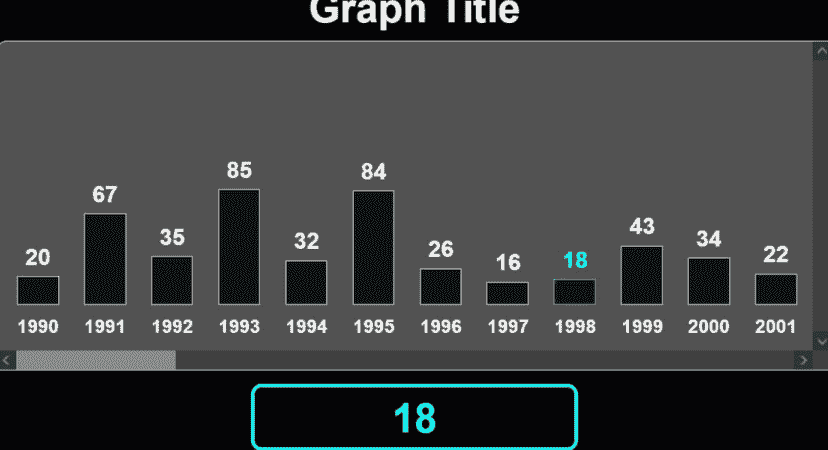
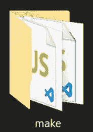
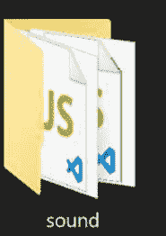
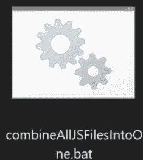
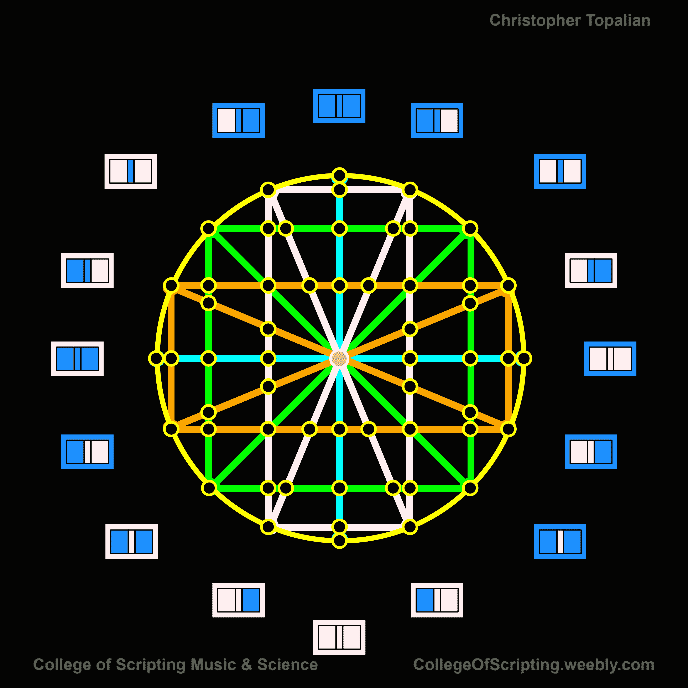

# Topalian JavaScript 图论


**作者**

**Christopher Andrew Topalian**


**献给**

**上帝**

**父神**

## 图表标题




# Christopher Topalian

js

首页

分享 视图

Topalian_JavaScript_Graph > js









脚本音乐与科学学院

CollegeOfScripting.weebly.com


<!-- 献给上帝父神 -->

<!-- Topalian_JavaScript_Graph.html -->


<!-- 版本 001 - (2024-04-23) -->

```html
<html>

<head>

<title>Topalian JavaScript 图表</title>

<link rel="stylesheet" href="css/style001.css">

<script src="js/1shortcuts/shortcuts.js"></script>

<script src="js/2worldVariables/worldVariables.js"></script>

<script src="js/data/temperature.js"></script>


<script src="js/make/makeGraph.js"></script>

<script src="js/make/makeGraphTitle.js"></script>

<script src="js/make/makeInfoDiv.js"></script>

<script src="js/make/makeTitleOfApp.js"></script>

<script src="js/sound/sounds.js"></script>

<script src="js/sound/loadSounds.js"></script>

<script src="js/sound/audioPlay.js"></script>


<script src="js/whenLoaded/whenLoaded.js"></script>

</head>

<body onload="whenLoaded()">

</body>

</html>
```


```css
/* 献给上帝父神 */

body {

background-color: rgb(0, 0, 0);

}
```


```css
a {

color: rgb(100, 100, 100);

text-decoration: none;

}

a:hover {

text-decoration: underline;

}

#graphTitle {

font-family: Arial;

}

#mainDiv {


position: relative;

width: 75%;

height: 55%;

margin: auto;

padding-right: 25px;

border: 1px solid rgb(255, 255, 255);

border-radius: 8px;

background-color: rgb(83, 83, 83);

overflow: scroll;

}

.dataPoint {

width: 30px;

border: 1px solid rgb(255, 255, 255);

background-color: rgb(20, 20, 20);

font-family: arial;

font-size: 17px;


font-weight: bold;

color: rgb(255, 255, 255);

text-align: center;

}

.temperatureText {

position: absolute;

top: -25px;

left: 50%;

transform: translateX(-50%);

}

.yearLabel {

position: absolute;

bottom: -25px;

left: 50%;


transform: translateX(-50%);

font-family: arial;

font-size: 14px;

color: rgb(255, 255, 255);

}

#infoContainer {

position: absolute;

left: 0px;

right: 0px;

width: 30%;

height: 50px;

margin: auto;

margin-top: 10px;

border: 3px solid rgb(255, 255, 255);

border-radius: 8px;

padding-left: 10px;

padding-right: 10px;

padding-top: 10px;

padding-bottom: 10px;

background-color: rgb(0, 0, 0);

font-family: Arial;

font-size: 30px;

font-weight: bold;

color: rgb(255, 255, 255);

text-align: center;

line-height: 43px;

overflow: hidden;

resize: none;

}

#titleOfApp {

font-family: Arial;

font-weight: bold;

color: rgb(100, 100, 100);

}
```


```javascript
/* 献给上帝父神 */

// shortcuts.js

function ge(whichId) {

let result = document.getElementById(whichId);

return result;

}

function ce(whichType) {

let result = document.createElement(whichType);

return result;

}

function ba(whichElement) {

let result = document.body.append(whichElement);

return result;

}
```


```javascript
/* 献给上帝父神 */

// worldVariables.js

let online = false;
```


```javascript
// temperature.js

let temperature = [20, 67, 35];
```


```javascript
85,

32,

84,

26,

16,

18,

43,

34,

22,

83,

98,

38,

48,

77,

70,

40,

82,

21,
```


```javascript
50,

78,

87,

45,

75,

45,

48,

90,

50,

70,

55,

45,

35,

20,

10,

98,

100,

125,
```


```javascript
100,

83,

77,

70,

53,

100,

97,

30,

45,

16,

82];
```


```javascript
// 献给父神

// makeGraph.js

function makeGraph(whichArray) {

  let xPos = 15;

  let yPos = 195;


//-//

  let mainDiv = createElement("div");

  mainDiv.id = 'mainDiv';

  body(mainDiv);

// //-//

  for (let x = 0; x < whichArray.length; x++) {

    let dataPoint = createElement("div");

    dataPoint.id = 'dataPoint' + x;

    dataPoint.className = "dataPoint";

    dataPoint.style.position = 'absolute';

    dataPoint.style.left = xPos + "px";

    dataPoint.style.top = yPos - whichArray[x] + "px";


    dataPoint.style.height = whichArray[x] + "px";

    dataPoint.onmouseover = function() {

      audioPlay('sfx_001', 1.0);

      ('temperature' + x).style.color = 'rgb(0, 255, 255)';

      ('dataPoint' + x).style.borderColor = 'rgb(0, 255, 255)';

      (infoContainer).value = whichArray[x];

      (infoContainer).style.borderColor = 'rgb(0, 255, 255)';


    };

    dataPoint.onmouseleave = function() {

      ('temperature' + x).style.color = 'rgb(255, 255, 255)';

      ('dataPoint' + x).style.borderColor = 'rgb(255, 255, 255)';

      (infoContainer).style.borderColor = 'rgb(255, 255, 255)';

      (infoContainer).style.color = 'rgb(255, 255, 255)';

    };


    dataPoint.onclick = function() {

      audioPlay('sfx_blip_001', 1.0);

      ('temperature' + x).style.color = 'rgb(255, 0, 255)';

      ('dataPoint' + x).style.borderColor = 'rgb(255, 0, 255)';

      (infoContainer).style.borderColor = 'rgb(255, 0, 255)';

      (infoContainer).style.color = 'rgb(255, 0, 255)';

    };

    mainDiv.append(dataPoint);


// //-//

    let temperatureText = createElement("div");

    temperatureText.id = 'temperature' + x;

    temperatureText.className = "temperatureText";

    temperatureText.textContent = whichArray[x];

    dataPoint.append(temperatureText);

// //-//

    let yearLabel = document.createElement("div");

    yearLabel.className = "yearLabel";

    yearLabel.textContent = 1990 + x;

    dataPoint.append(yearLabel);


// //-//

    xPos += 50;

  }

// //-//

  let infoContainer = createElement("textarea");

  infoContainer.id = 'infoContainer';

  mainDiv.insertAdjacentElement("end", infoContainer);

}
```


```javascript
// makeTitle.js

function makeTitle() {

  let graphTitle = createElement("div");

  graphTitle.id = 'graphTitle';

  graphTitle.innerHTML = '图表';


  graphTitle.style.marginBottom = '7px';

  graphTitle.style.fontSize = '30px';

  graphTitle.style.fontWeight = 'bold';

  graphTitle.style.color = 'rgb(255, 255, 255)';

  graphTitle.style.textAlign = 'center';

  mainDiv.before(graphTitle);

}
```


```javascript
// 献给父神

// makeInfoDiv.js

function makeInfoDiv() {

  let infoContainer = createElement("textarea");

  infoContainer.id = 'infoContainer';

  infoContainer.style.position = 'relative';


```


```javascript
infoContainer.style.margin = 'auto';

mainDiv.after(infoContainer);
```


`n`

```javascript
// makeTitleOfApp.js

function makeTitleOfApp() {
  let titleContainer = createElement("div");

  titleContainer.style.position = 'absolute';
```


```javascript
  titleContainer.style.right = '10px';

  titleContainer.style.bottom = '5px';

  titleContainer.style.zIndex = 1;

  body(titleContainer);

// //-//

// titleOfApp

  let titleOfApp = createElement("div");

  titleOfApp.id = 'titleOfApp';

  titleOfApp.innerHTML = `<a href='https://github.com/christophertopalian/topalian_javascript_graph' target='blank'>Topalian JavaScript 图表</a>`;

  titleContainer.append(titleOfApp);
}
```


```javascript
// 献给父神上帝

n

// audioPlay.js

function audioPlay(whichId, whichVolume) {
  let audio = ge(whichId);

  if (audio) {
    audio.volume = whichVolume;
    audio.play();
  }
}
```


```javascript
// 献给父神上帝

n

// loadSounds.js

function loadSounds(whichArray) {
  for (let x = 0; x < whichArray.length; x++) {
    let theSound = ce('audio');

    if (online == false) {
      theSound.src = whichArray[x].soundFileOffline;
    } else {
      theSound.src = whichArray[x].soundFileOnline;
    }

    theSound.id = whichArray[x].name;

    theSound.loop = false;

    theSound.volume = 1.0;

    ba(theSound);
  }
}
```


`https://github.com/ChristopherAndrewTopalia`

`n`

```javascript
// sounds.js

let sounds = [
  {
    name: 'sfx_blip_001',
    soundFileOffline: 'media/sounds/sfx_blip_001.mp4',
    soundFileOnline: 'https://collegeofscripting.weebly.com/upload/6/4/4/8/64482293/sfx_blip_001.mp4'
  },
  {
    name: 'sfx_warp_001',
    soundFileOffline: 'media/sounds/sfx_warp_001.mp4',
    soundFileOnline: 'https://collegeofscripting.weebly.com/upload/6/4/4/8/64482293/sfx_warp_001.mp4'
  }
];
```


```javascript
// 献给父神上帝

n

// whenLoaded.js

function whenLoaded() {
  loadSounds(sounds);

  makeGraph(sounds);

  makeGraphTitle();

  makeTitleOfApp();
}
```




## 真人工智能系统

| 名称 | 编码 |
|---|---:|
| 同义反复 | 1111 |
| 矛盾 | 0000 |
| 异或 (XOR) | 0110 |
| 同异否 (XNOR) | 1001 |
| 与 (AND) | 0001 |
| 非与 (NAND) | 1110 |
| 或 (OR) | 0111 |
| 非或 (NOR) | 1000 |
| MI | 1101 |
| MNI | 0010 |
| LP | 0011 |
| LC | 1100 |
| RP | 0101 |
| RC | 1010 |
| CI | 1011 |
| CNI | 0100 |

## 16边形


## 更多教程：

- `GitHub.com/ChristopherTopalian`
- `GitHub.com/ChristopherAndrewTopalia`
- `Sites.google.com/view/CollegeOfScripting`
- `CollegeOfScripting.weebly.com`
- `CollegeOfScripting.wordpress.com`
- `Youtube.com/ScriptingCollege`
- `Twitter.com/CollegeOfScript`


献给父神上帝

本书由编程音乐与科学学院 (College of Scripting Music & Science) 创建。

请始终记住，每当你用铅笔和纸书写脚本时，它就会深深地印在记忆中，从而很好地学会材料和方法。

当你输入脚本时，也是如此。你越通过键盘或铅笔和纸输入并写出脚本，你就能越学到编程！

写下并输入你找到每一个例子。

保持你所有的脚本整洁。

你创建的脚本都会提高你的编程能力。

写下它，输入它，说出它，看到它，梦见它。

`CollegeOfScripting.weebly.com`
