# Topalian JavaScript 真正 AI 2024

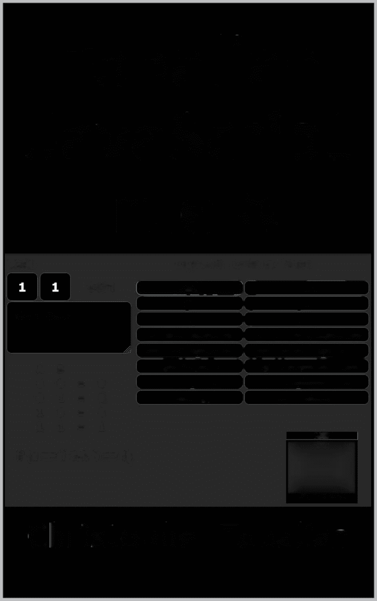[](img/a5e700354e2f5d8a8c279b4edad9e6c6_0_1.png)[](img/a5e700354e2f5d8a8c279b4edad9e6c6_0_2.png)

献给父神

[](img/a5e700354e2f5d8a8c279b4edad9e6c6_1_1.png)

[](img/a5e700354e2f5d8a8c279b4edad9e6c6_2_1.png)

| 0 | 0 | 0 | 1 | 0 | 1 | 0 | 1 | 1 | 0 | 1 | 0 | 0 | 1 | 0 | 1 | 1 | 0 |
| 0 | 1 | 0 | 1 | 1 | 0 | 1 | 0 | 0 | 1 | 0 | 1 | 1 | 0 | 1 | 0 | 0 | 1 |
| 1 | 0 | 0 | 1 | 1 | 0 | 1 | 0 | 0 | 1 | 0 | 1 | 1 | 0 | 0 | 1 | 0 | 1 |
| 1 | 1 | 1 | 0 | 1 | 0 | 0 | 1 | 1 | 0 | 1 | 0 | 1 | 0 | 1 | 0 | 1 | 0 |

- `if (a == 1 && b == 1)` 仅当两者皆为真时才成立

## 真人工智能系统

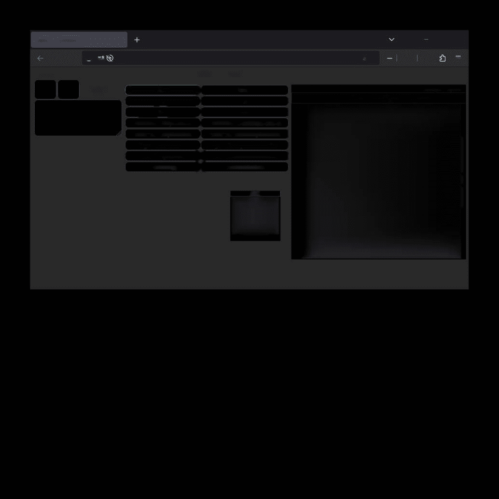[](img/a5e700354e2f5d8a8c279b4edad9e6c6_3_1.png)[](img/a5e700354e2f5d8a8c279b4edad9e6c6_3_2.png)[](img/a5e700354e2f5d8a8c279b4edad9e6c6_3_3.png)

## 游戏中

异或门 (`Xor`) 的反门是：异异门 (`Xnor`)

| 0 | 0 | 0 | 1 | 0 | 1 | 0 | 1 |
| 0 | 1 | 0 | 1 | 1 | 0 | 1 | 0 |
| 1 | 0 | 0 | 1 | 1 | 0 | 1 | 0 |
| 1 | 1 | 1 | 0 | 1 | 0 | 0 | 1 |

### 逆蕴含

- 逆非蕴含
- 质蕴含
- 实非蕴含
- 右投影
- 右补集
- 左投影
- 左补集
- 永真式
- 矛盾

`if ((a == 1 && b == 0) || (a == 0 && b == 1))`

`XOR`

真人工智能系统

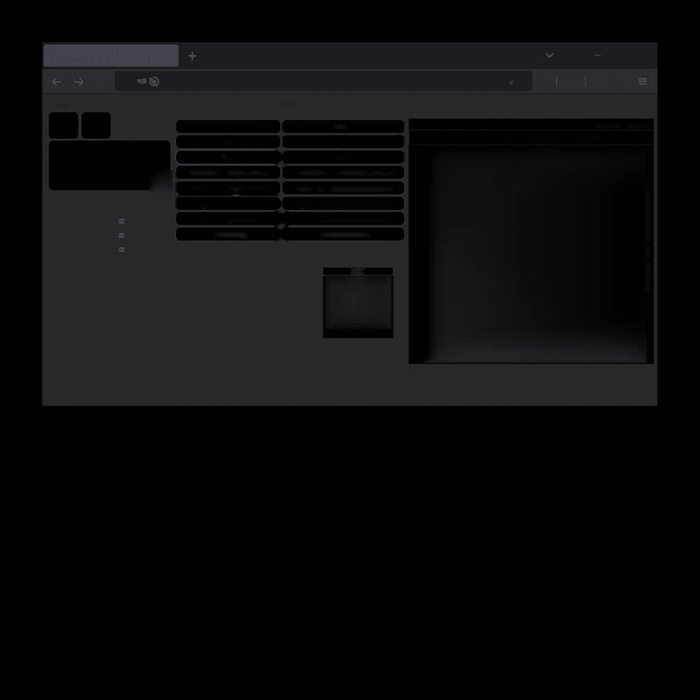[](img/a5e700354e2f5d8a8c279b4edad9e6c6_8_1.png)[](img/a5e700354e2f5d8a8c279b4edad9e6c6_8_2.png)[](img/a5e700354e2f5d8a8c279b4edad9e6c6_8_3.png)[](img/a5e700354e2f5d8a8c279b4edad9e6c6_8_4.png)

Topalian JavaScript 真人工智能

逆蕴含门的反门是：逆非蕴含

| 0 | 0 | 0 | 1 | 0 | 1 | 0 | 1 |
| 0 | 1 | 0 | 1 | 1 | 0 | 1 | 0 |
| 1 | 0 | 0 | 1 | 1 | 0 | 1 | 0 |
| 1 | 1 | 1 | 0 | 1 | 0 | 0 | 1 |

### 逆蕴含

- 逆非蕴含
- 质蕴含
- 实非蕴含
- 右投影
- 右补集
- 左投影
- 左补集
- 永真式
- 矛盾

`if (a == 1 || b == 0)`

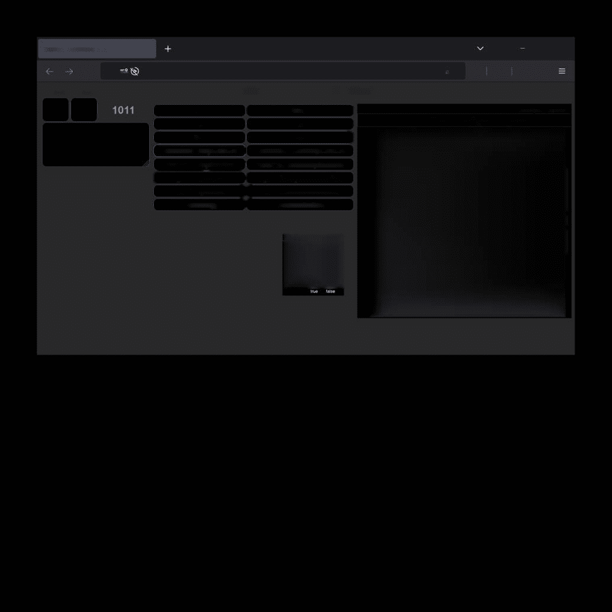[](img/a5e700354e2f5d8a8c279b4edad9e6c6_9_1.png)[](img/a5e700354e2f5d8a8c279b4edad9e6c6_9_2.png)[](img/a5e700354e2f5d8a8c279b4edad9e6c6_9_3.png)

左投影

反门是：左补集

| 0 | 0 | 0 | 1 | 0 | 1 | 0 | 1 |
| 0 | 1 | 0 | 1 | 1 | 0 | 1 | 0 |
| 1 | 0 | 0 | 1 | 1 | 0 | 1 | 0 |
| 1 | 1 | 1 | 0 | 1 | 0 | 0 | 1 |

### 逆蕴含

- 逆非蕴含
- 质蕴含
- 实非蕴含
- 右投影
- 右补集
- 左投影
- 左补集
- 永真式
- 矛盾

`10 == 1`

`11 == 1`

`if (a == 1)`

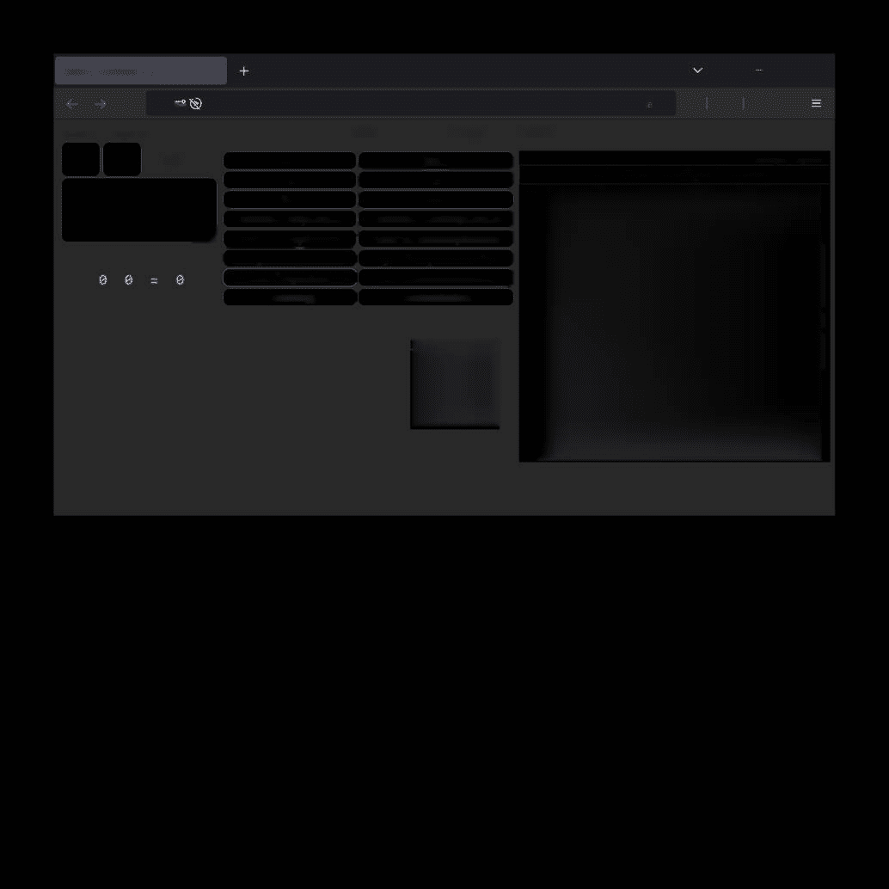[](img/a5e700354e2f5d8a8c279b4edad9e6c6_10_1.png)[](img/a5e700354e2f5d8a8c279b4edad9e6c6_10_2.png)[](img/a5e700354e2f5d8a8c279b4edad9e6c6_10_3.png)

左投影

反门是：左补集

| 0 | 0 | 0 | 1 | 0 | 1 | 0 | 1 |
| 0 | 1 | 0 | 1 | 1 | 0 | 1 | 0 |
| 1 | 0 | 0 | 1 | 1 | 0 | 1 | 0 |
| 1 | 1 | 1 | 0 | 1 | 0 | 0 | 1 |

### 逆蕴含

- 逆非蕴含
- 质蕴含
- 实非蕴含
- 右投影
- 右补集
- 左投影
- 左补集
- 永真式
- 矛盾

`10 == 0`

`11 == 1`

`if (a == 1)`

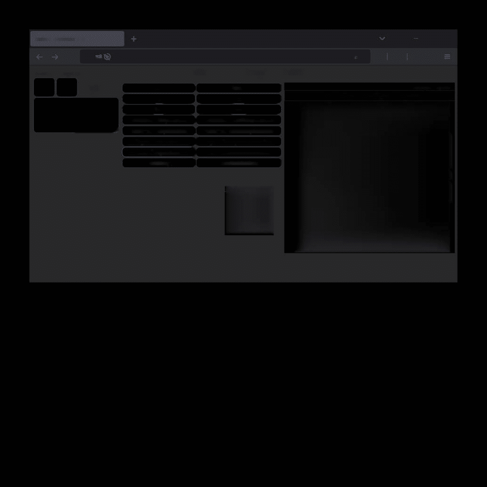[](img/a5e700354e2f5d8a8c279b4edad9e6c6_11_1.png)[](img/a5e700354e2f5d8a8c279b4edad9e6c6_11_2.png)[](img/a5e700354e2f5d8a8c279b4edad9e6c6_11_3.png)

Topalian JavaScript 真人工智能

## 游戏中

异或门 (`Xor`) 的反门是：异异门 (`Xnor`)

| 0 | 0 | 0 | 1 | 0 | 1 | 0 | 1 |
| 0 | 1 | 0 | 1 | 1 | 0 | 1 | 0 |
| 1 | 0 | 0 | 1 | 1 | 0 | 1 | 0 |
| 1 | 1 | 1 | 0 | 1 | 0 | 0 | 1 |

### 逆蕴含

- 逆非蕴含
- 质蕴含
- 实非蕴含
- 右投影
- 右补集
- 左投影
- 左补集
- 永真式
- 矛盾

`10 == 0`

`11 == 1`

`if (a == 1)`

分享 查看

`Topalian_JavaScript... > Topalian_JavaScript_True_AI`

搜索 `Topalian_...`

指令

`css`

`js`

`media`

`Topalian_JavaScript_True_AI.html`

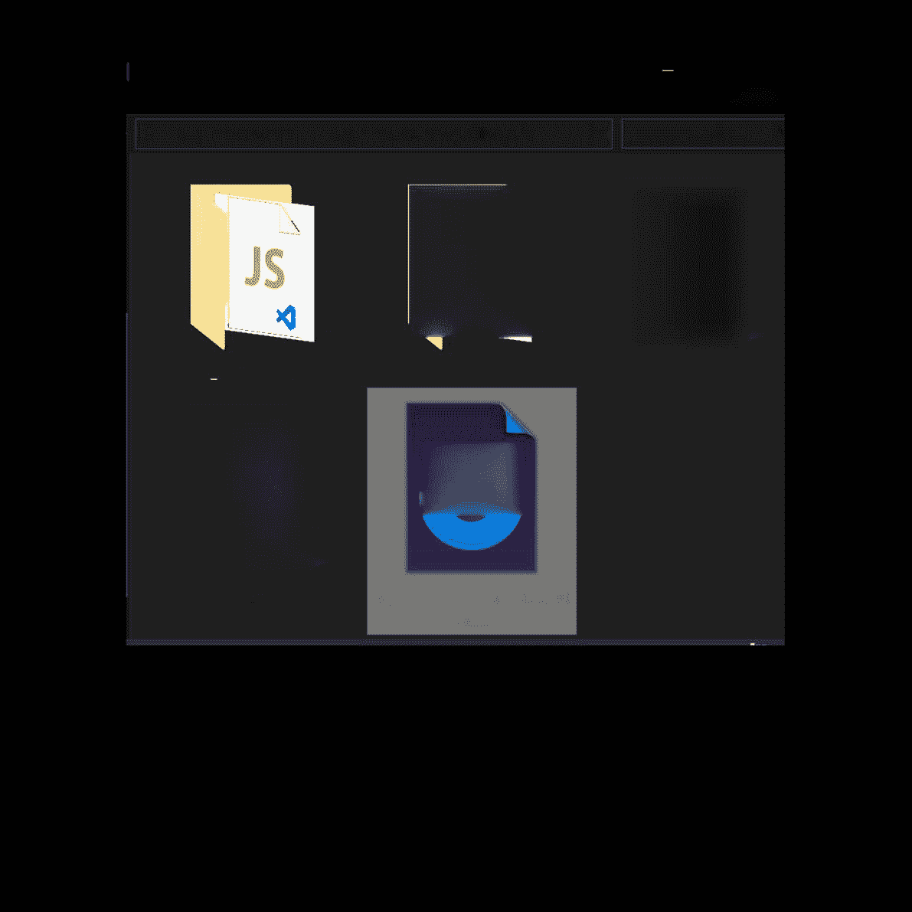[](img/a5e700354e2f5d8a8c279b4edad9e6c6_14_1.png)[](img/a5e700354e2f5d8a8c279b4edad9e6c6_14_2.png)[](img/a5e700354e2f5d8a8c279b4edad9e6c6_14_3.png)[](img/a5e700354e2f5d8a8c279b4edad9e6c6_14_4.png)[](img/a5e700354e2f5d8a8c279b4edad9e6c6_14_5.png)[](img/a5e700354e2f5d8a8c279b4edad9e6c6_14_6.png)

`js`

分享 查看

`Topalian_JavaScript_True_AI > js`

- 

搜索 `js`

1 快捷方式

`JS`

4

`dataFunctions`

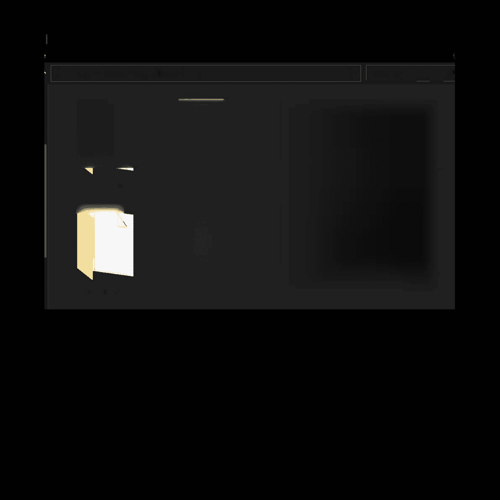[](img/a5e700354e2f5d8a8c279b4edad9e6c6_15_1.png)[](img/a5e700354e2f5d8a8c279b4edad9e6c6_15_2.png)[](img/a5e700354e2f5d8a8c279b4edad9e6c6_15_3.png)[](img/a5e700354e2f5d8a8c279b4edad9e6c6_15_4.png)[](img/a5e700354e2f5d8a8c279b4edad9e6c6_15_5.png)

```javascript
// 献给父神
//
// https://github.com/ChristopherAndrewTopalian
```

`n`

```javascript
// HowToCombineJSFiles.js
```

## 教程：如何合并 `js` 文件夹中所有文件夹下的所有 `.js` 文件。

### 准备工作：

[](img/a5e700354e2f5d8a8c279b4edad9e6c6_16_1.png)

Christopher Topalian

我们应该在每个脚本的末尾添加两个空行。这样在脚本之间就能很好地合并。

第一步：打开我们的 `js` 文件夹。

第二步：在 `js` 文件夹的地址栏输入 `cmd` 并按回车。在命令提示符中打开 `js` 文件夹。

第三步：在命令提示符中输入以下命令并按回车

`for /r "%CD%" (*.js) do type "%i" >> main.js`

脚本、音乐与科学学院

[](img/a5e700354e2f5d8a8c279b4edad9e6c6_17_1.png)

现在我们有一个名为 `main.js` 的新文件，它包含了所有的 `js` 文件。这使得上传我们的应用程序变得简单，并且容易找到项目有多少行代码。

要使用我们的 `main.js` 文件，在我们的 `html` 文件中包含它：

`<script src='js/main.js'></script>`

快乐脚本

[](img/a5e700354e2f5d8a8c279b4edad9e6c6_18_1.png)

```html
<!-- 献给父神 -->
<html>
<head>

[](img/a5e700354e2f5d8a8c279b4edad9e6c6_19_1.png)

<title>Topalian AI</title>
<link rel="stylesheet" href="css/style01.css">

[](img/a5e700354e2f5d8a8c279b4edad9e6c6_20_1.png)

[](img/a5e700354e2f5d8a8c279b4edad9e6c6_21_1.png)

</head>
<body onload="Loaded()">

[](img/a5e700354e2f5d8a8c279b4edad9e6c6_22_1.png)
</body>
</html>
```

`style01.css`

```css
body {
    background-color: rgb(40, 40, 40);
    font-family: Arial;
    font-size: 20px;
    color: rgb(255, 255, 255);
    font-weight: bold;
}

a {
    color: rgb(100, 100, 100);
    text-decoration: none;
}

a:hover {
    text-decoration: underline;
}

input {
    padding: 10px;
}
```

[](img/a5e700354e2f5d8a8c279b4edad9e6c6_24_1.png)

```css
body {
    background-color: rgb(0, 0, 0);
    border: 1px solid rgb(100, 100, 100);
    border-radius: 8px;
    font-family: Arial;
    font-size: 20px;
    font-weight: bold;
    color: rgb(255, 255, 255);
    text-align: center;
}

textarea {
    padding: 10px;
    background-color: rgb(0, 0, 0);
    border: 1px solid rgb(100, 100, 100);
    border-radius: 8px;
    font-family: Arial;
    font-size: 20px;
    font-weight: bold;
}
```

```css
{
  color: rgb(255, 255, 255);
}

.logicButtonsDiv {
  display: grid;
  grid-template-columns: auto auto;
}

.logicGateButton {
  margin: 1px;
  padding-left: 7px;
  padding-right: 7px;
  padding-top: 5px;
  padding-bottom: 5px;
  border: solid 1px rgb(100, 100, 100);
  border-radius: 8px;
}
```

[](img/a5e700354e2f5d8a8c279b4edad9e6c6_26_1.png)

```css
.logicGateButton {
  background-color: rgb(0, 0, 0);
  font-size: 14px;
  font-weight: bold;
  color: rgb(100, 100, 100);
  line-height: 12px;
}

.logicGateButton:hover {
  border-color: rgb(0, 255, 255);
  color: rgb(255, 255, 255);
}

.logicGateButton:active {
  position: relative;
  top: 1px;
  border-color: rgb(100, 100, 255);
  color: rgb(100, 100, 255);
}
```

[](img/a5e700354e2f5d8a8c279b4edad9e6c6_27_1.png)

```javascript
// 献给父亲

// 快捷方式
function ge(whichId) {
  let result = document.getElementById(whichId);
  return result;
}

function ce(whichType) {
  let result = document.createElement(whichType);
  return result;
}

function ba(whichElement) {
  let result = document.body.append(whichElement);
  return result;
}
```

[](img/a5e700354e2f5d8a8c279b4edad9e6c6_29_1.png)

```javascript
// 献给父亲

// 变量
let online = false;
```

[](img/a5e700354e2f5d8a8c279b4edad9e6c6_31_1.png)


```javascript
// 献给父亲
// 版权所有 Andrew Topalian 2000-2024

// 逻辑
let logic = [
  {
    name: "And",
    imgSrcOffline: 'media/textures/topalianDiagrams/and.png',
    imgSrcOnline: 'https://collegeofscripting.weebly.com/upload/6/4/8/644293/orig.png',
    function: "gateAnd(a, b)",
    formula: "if(a == 1 && b == 1)",
    opposite: "n",
    truthTable: "0001",
    truthTableFormatted: `
      | A | B | Result |
      |---|---|---|
      | 0 | 0 | 0 |
      | 0 | 1 | 0 |
      | 1 | 0 | 0 |
      | 1 | 1 | 1 |
    `
  },
```

 

```javascript
  {
    name: "n",
    imgSrcOffline: 'media/textures/topalianDiagrams/n.png',
    imgSrcOnline: 'https://collegeofscripting.weebly.com/upload/6/4/8/644293/orig.png',
    function: "gateN(a, b)",
    formula: "if(a == 0 || b == 0)",
    opposite: "And",
    truthTable: "1110",
    truthTableFormatted: `
      | A | B | Result |
      |---|---|---|
      | 0 | 0 | 1 |
      | 0 | 1 | 1 |
      | 1 | 0 | 1 |
      | 1 | 1 | 0 |
    `
  },
  {
    name: "Or",
    imgSrcOffline: 'media/textures/topalianDiagrams/or.png',
    imgSrcOnline: 'https://collegeofscripting.weebly.com/upload/6/4/8/644293/orig.png',
    function: "gateOr(a, b)",
    formula: "if(a == 1 || b == 1)",
    opposite: "Nor",
    truthTable: "0111",
    truthTableFormatted: `
      | A | B | Result |
      |---|---|---|
      | 0 | 0 | 0 |
      | 0 | 1 | 1 |
      | 1 | 0 | 1 |
      | 1 | 1 | 1 |
    `
  },
  {
    name: "Nor",
    imgSrcOffline: 'media/textures/topalianDiagrams/nor.png',
    imgSrcOnline: 'https://collegeofscripting.weebly.com/upload/6/4/8/644293/orig.png',
    function: "gateNor(a, b)",
    formula: "if(a == 0 && b == 0)",
    opposite: "Or",
    truthTable: "1000",
    truthTableFormatted: `
      | A | B | Result |
      |---|---|---|
      | 0 | 0 | 1 |
      | 0 | 1 | 0 |
      | 1 | 0 | 0 |
      | 1 | 1 | 0 |
    `
  },
  {
    name: "Xor",
    imgSrcOffline: 'media/textures/topalianDiagrams/xor.png',
    imgSrcOnline: 'https://collegeofscripting.weebly.com/upload/6/4/8/644293/orig.png',
    function: "gateXor(a, b)",
    formula: "if((a == 1 && b == 0) || (a == 0 && b == 1))",
    opposite: "Xnor",
    truthTable: "0110",
    truthTableFormatted: `
      | A | B | Result |
      |---|---|---|
      | 0 | 0 | 0 |
      | 0 | 1 | 1 |
      | 1 | 0 | 1 |
      | 1 | 1 | 0 |
    `
  }
];
```

 

 

 

 

`truthTableFormatted`：

```text
| A | B |
|---|---|
| 0 | 0 | 0 |
| 0 | 1 | 1 |
| 1 | 0 | 1 |
| 1 | 1 | 0 |
```

```json
{
  "name": "异否门",
  "imgSrcOffline": "media/textures/topalianDiagrams/xnor.png",
  "imgSrcOnline": "https://collegeofscripting.weebly.com/uploads/6/4/4/8/64482293/xnor_orig.png",
  "function": "gateXnor(a, b)",
  "formula": "if((a==0&&b==0)||(a==1&&b==1))",
  "opposite": "异或门",
  "truthTable": "1001",
  "truthTableFormatted": "
| A | B |
|---|---|
| 0 | 0 | 1 |
| 0 | 1 | 0 |
| 1 | 0 | 0 |
| 1 | 1 | 1 |
"
}
```

```json
{
  "name": "逆蕴含",
  "imgSrcOffline": "media/textures/topalianDiagrams/converse_implication.png",
  "imgSrcOnline": "https://collegeofscripting.weebly.com/uploads/6/4/4/8/64482293/converse-implication_orig.png",
  "function": "gateCi(a, b)",
  "formula": "if(a==1||b==0)",
  "opposite": "逆非蕴含",
  "truthTable": "1011",
  "truthTableFormatted": "
| A | B |
|---|---|
| 0 | 0 | 1 |
| 0 | 1 | 0 |
| 1 | 0 | 1 |
| 1 | 1 | 1 |
"
}
```

```json
{
  "name": "逆非蕴含",
  "imgSrcOffline": "media/textures/topalianDiagrams/converse_non_implication.png",
  "imgSrcOnline": "https://collegeofscripting.weebly.com/uploads/6/4/4/8/64482293/converse-non-implication_orig.png",
  "function": "gateCni(a, b)",
  "formula": "if(a==0&&b==1)",
  "opposite": "逆蕴含",
  "truthTable": "0100",
  "truthTableFormatted": "
| A | B |
|---|---|
| 0 | 0 | 0 |
| 0 | 1 | 1 |
| 1 | 0 | 0 |
| 1 | 1 | 0 |
"
}
```

```json
{
  "name": "实质蕴含",
  "imgSrcOffline": "media/textures/topalianDiagrams/material_implication.png",
  "imgSrcOnline": "https://collegeofscripting.weebly.com/uploads/6/4/4/8/64482293/material-implication_orig.png",
  "function": "gateMi(a, b)",
  "formula": "if(a==0||b==1)",
  "opposite": "实质非蕴含",
  "truthTable": "1101",
  "truthTableFormatted": "
| A | B |
|---|---|
| 0 | 0 | 1 |
| 0 | 1 | 1 |
| 1 | 0 | 0 |
| 1 | 1 | 1 |
"
}
```

```json
{
  "name": "实质非蕴含",
  "imgSrcOffline": "media/textures/topalianDiagrams/material_non_implication.png",
  "imgSrcOnline": "https://collegeofscripting.weebly.com/uploads/6/4/4/8/64482293/material-non-implication_orig.png",
  "function": "gateMni(a, b)",
  "formula": "if(a==1&&b==0)",
  "opposite": "实质蕴含",
  "truthTable": "0010",
  "truthTableFormatted": "
| A | B |
|---|---|
| 0 | 0 | 0 |
| 0 | 1 | 0 |
| 1 | 0 | 1 |
| 1 | 1 | 0 |
"
}
```

```json
{
  "name": "右投影",
  "imgSrcOffline": "media/textures/topalianDiagrams/right_projection.png",
  "imgSrcOnline": "https://collegeofscripting.weebly.com/uploads/6/4/4/8/64482293/right-projection_orig.png",
  "function": "gateRp(a, b)",
  "formula": "if((a==0&&b==1)||(a==1&&b==1))",
  "opposite": "右补集",
  "truthTable": "0101",
  "truthTableFormatted": "
| A | B |
|---|---|
| 0 | 0 | 0 |
| 0 | 1 | 1 |
| 1 | 0 | 0 |
| 1 | 1 | 1 |
"
}
```

```json
{
  "name": "右补集",
  "imgSrcOffline": "media/textures/topalianDiagrams/right_complementation.png",
  "imgSrcOnline": "https://collegeofscripting.weebly.com/uploads/6/4/4/8/64482293/right-complementation_orig.png",
  "function": "gateRc(a, b)",
  "formula": "if((a==0&&b==0)||(a==1&&b==0))",
  "opposite": "右投影",
  "truthTable": "1010",
  "truthTableFormatted": "
| A | B |
|---|---|
| 0 | 0 | 1 |
| 0 | 1 | 0 |
| 1 | 0 | 1 |
| 1 | 1 | 0 |
"
}
```

```json
{
  "name": "左投影",
  "imgSrcOffline": "media/textures/topalianDiagrams/left_projection.png",
  "imgSrcOnline": "https://collegeofscripting.weebly.com/uploads/6/4/4/8/64482293/left-projection_orig.png",
  "function": "gateLp(a, b)",
  "formula": "if(a==1)",
  "opposite": "左补集",
  "truthTable": "0011",
  "truthTableFormatted": "
| A | B |
|---|---|
| 0 | 0 | 0 |
| 0 | 1 | 0 |
| 1 | 0 | 1 |
| 1 | 1 | 1 |
"
}
```

```json
{
  "name": "左补集",
  "imgSrcOffline": "media/textures/topalianDiagrams/left_complementation.png",
  "imgSrcOnline": "https://collegeofscripting.weebly.com/uploads/6/4/4/8/64482293/left-complementation_orig.png",
  "function": "gateLc(a, b)",
  "formula": "if(a==0)"
}
```

```json
{
  "opposite": "左射投影",
  "truthTable": "1100",
  "truthTableFormatted": "| A B |\n|---||\n| 0 0 | 1 |\n| 0 1 | 1 |\n| 1 0 | 0 |\n| 1 1 | 0 |",
  "name": "永真式",
  "imgSrcOffline": "media/textures/topalianDiagrams/tautology.png"
}
```

 

```json
{
  "imgSrcOnline": "https://collegeofscripting.weebly.com/uploads/6/4/4/8/64482293/tautology_orig.png",
  "function": "gateTautology(a, b)",
  "formula": "if((a==0 && b==0) || (a==0 && b==1) || (a==1 && b==0) || (a==1 && b==1))",
  "opposite": "矛盾式",
  "truthTable": "1111",
  "truthTableFormatted": "| A B |\n|---||\n| 0 0 | 1 |\n| 0 1 | 1 |\n| 1 0 | 1 |\n| 1 1 | 1 |"
}
```

 

```json
{
  "name": "矛盾式",
  "imgSrcOffline": "media/textures/topalianDiagrams/contradiction.png",
  "imgSrcOnline": "https://collegeofscripting.weebly.com/uploads/6/4/4/8/64482293/contradiction_orig.png",
  "function": "gateContradiction(a, b)",
  "formula": "if((a==0 && b==0) || (a==0 && b==1) || (a==1 && b==0) || (a==1 && b==1))"
}
```


`"opposite": "永真式"`

`"truthTable": "0000"`

`"truthTableFormatted": "| A B |\n|---||\n| 0 0 | 0 |\n| 0 1 | 0 |\n| 1 0 | 0 |\n| 1 1 | 0 |"`


```javascript
// 献给父神

// logicGates.js

function gateAnd(a, b) {
  if (a==1 && b==1) {
    return "Both True";
  } else {
    return 0;
  }
}

function gateNand(a, b) {
  /*
  if ((a==0 && b==0) || (a==1 && b==0) || (a==0 && b==1))
  */
  if (a==0 || b==0) {
    return "Both False or A True or B True";
  } else {
    return 0;
  }
}

function gateOr(a, b) {
  /*
  if ((a==1 && b==0) || (a==0 && b==1) || (a==1 && b==1))
  */
  if (a==1 || b==1) {
    return "One or Both True";
  } else {
    return 0;
  }
}

function gateNor(a, b) {
  if (a==0 && b==0) {
    return "Both False";
  } else {
    return 0;
  }
}

function gateXor(a, b) {
  if ((a==1 && b==0) || (a==0 && b==1)) {
    return "A or B True";
  } else {
    return 0;
  }
}

function gateXnor(a, b) {
  if ((a==1 && b==1) || (a==0 && b==0)) {
    return "Both True or Both False";
  } else {
    return 0;
  }
}

function gateCi(a, b) {
  if ((a==0 && b==0) || (a==1 && b==1)) {
    return "Both False or Both True";
  } else {
    return 0;
  }
}

function gateMi(a, b) {
  /*
  if ((a==0 && b==0) || (a==0 && b==1) || (a==1 && b==1))
  */
  if (a==0 || b==1) {
    return "Both False or B True or Both True";
  } else {
    return 0;
  }
}

function gateMni(a, b) {
  if (a==1 && b==0) {
    return "A True";
  } else {
    return 0;
  }
}

function gateRp(a, b) {
}

if ((a == 0 && b == 1) || (a == 1 && b == 1)) {
  return "BTrueorBothTrue";
}
else {
  return 0;
}
}

function gateRc(a, b) {
  if ((a == 0 && b == 0) || (a == 1 && b == 0)) {
    return "BothFalseorATrue";
  }
  else {
    return 0;
  }
}

function gateLp(a, b) {
  /*
  if ((a == 1 && b == 0) || (a == 1 && b == 1))
  */
  if (a == 1) {
    return "ATrueorBothTrue";
  }
  else {
    return 0;
  }
}

function gateLc(a, b) {
  /*
  if ((a == 0 && b == 0) || (a == 0 && b == 1))
  */
  if (a == 0) {
    return "BothFalseorBTrue";
  }
  else {
    return 0;
  }
}

function gateTautology(a, b) {
  if ((a == 0 && b == 0) || (a == 0 && b == 1) || (a == 1 && b == 0) || (a == 1 && b == 1)) {
    return "OneorBothFalseorTrue";
  }
  else {
    return 0;
  }
}

function gateContradiction(a, b) {
  if ((a == 0 && b == 0) || (a == 0 && b == 1) || (a == 1 && b == 0) || (a == 1 && b == 1)) {
    return "OneorBothFalseorTrue. NegativeMessageisplacedhere, or we can leaveit blank";
  }
  else {
    return 0;
  }
}

// 献给天父
// 版权所有 Christopher Andrew Topalian 版权 2000-2024
// https://github.com/ChristopherTopalian
// https://github.com/ChristopherAndrewTopalian

// findIndexByName.js
function findIndexByName(whichArray, whichName) {
  let index = whichArray.findIndex(function(a) {
    if (a.name === whichName) {
      return a;
    }
  });
  return index;
}

// 献给天父
// 版权所有 Christopher Andrew Topalian 版权 2000-2024
// https://github.com/ChristopherTopalian
// https://github.com/ChristopherAndrewTopalian

// makeCredits.js
function makeCredits() {
  let creditsDiv = document.createElement('div');
  creditsDiv.style.position = 'absolute';
  creditsDiv.style.right = '10px';
  creditsDiv.style.top = '5px';
  creditsDiv.style.zIndex = 1;
  ba(creditsDiv);
  let titleDiv = document.createElement('div');
  titleDiv.innerHTML = '<a href="https://github.com/christertopalian" target="_blank">TopalianAI</a>';
  titleDiv.style.fontSize = '15px';
  titleDiv.style.color = 'rgb(120,120,120)';
  creditsDiv.append(titleDiv);
}

// 献给天父
// 版权所有 Christopher Andrew Topalian 版权 2000-2024
// https://github.com/ChristopherTopalian
// https://github.com/ChristopherAndrewTopalian

// makeLogicCalculator.js
function makeLogicCalculator(whichItem) {
  if (ge("logicCalcDiv")) {
    ge("logicCalcDiv").remove();
  }
  let logicCalcDiv = document.createElement("div");
  logicCalcDiv.id = "logicCalcDiv";
  logicCalcDiv.className = "logicCalcDiv";
  logicCalcDiv.style.position = 'absolute';
  logicCalcDiv.style.left = '10px';
  logicCalcDiv.style.top = '5px';
  logicCalcDiv.style.display = 'flex';
  logicCalcDiv.style.flexDirection = 'column';
  ba(logicCalcDiv);
  let logicGateTitle = document.createElement("div");
  logicGateTitle.innerHTML = findIndexByName(logic, whichItem).name;
  logicGateTitle.id = "logicGateTitle";
  logicGateTitle.style.position = 'relative';
  logicGateTitle.style.left = '3.5px';
  logicGateTitle.style.top = '-1.5px';
  logicGateTitle.style.color = 'rgb(0,255,255)';
  logicCalcDiv.append(logicGateTitle);
  let textboxDiv = document.createElement('div');
  textboxDiv.id = 'textboxDiv';
  textboxDiv.style.display = 'flex';
  textboxDiv.style.flexDirection = 'row';
  logicCalcDiv.append(textboxDiv);
}
```

Christopher Topalian

```javascript
////-

let textBox001 = createElement("input");

textBox001.type = 'text';

textBox001.id = "textBox001";

textBox001.placeholder = "A";

textBox001.style.width = '50px';

textBox001.style.marginRight = '3px';

textBox001.onkeyup = function() {

    let a = textBox001.value;

    let b = textBox002.value;

    if (b != '') {

        getElementById("textBoxResult").value = eval(logic[findIndexByName(logic, whichItem)].function);

    }

};

textboxDiv.append(textBox001);

////-

let textBox002 = createElement("input");

textBox002.type = 'text';

textBox002.id = "textBox002";

textBox002.placeholder = "B";

textBox002.style.width = '50px';

textBox002.onkeyup = function() {

    let a = textBox001.value;

    let b = textBox002.value;

    if (a != '' && b != '') {

        getElementById("textBoxResult").value = eval(logic[findIndexByName(logic, whichItem)].function);

    }

    else {

        getElementById("textBoxResult").value = '';

    }

};

textboxDiv.append(textBox002);

////-

let textBoxResult = createElement("textarea");

textBoxResult.id = "textBoxResult";

textBoxResult.placeholder = "结果";

textBoxResult.style.width = '200px';

textBoxResult.onchange = function() {

    if (getElementById('textBoxResult').value == 0) {

        getElementById('textBoxResult').style.borderColor = 'rgb(255,255,255)';

    }

    else {

        getElementById('textBoxResult').style.borderColor = 'rgb(0,255,255)';

    }

};

logicCalcDiv.append(textBoxResult);

////-

let truthTableAbbreviated = createElement('div');

truthTableAbbreviated.innerHTML = logic[findIndexByName(logic, whichItem)].truthTable;

truthTableAbbreviated.id = 'truthTableAbbreviated';

truthTableAbbreviated.style.position = 'absolute';

truthTableAbbreviated.style.left = '140px';

truthTableAbbreviated.style.top = '40px';

truthTableAbbreviated.style.color = 'rgb(150,150,150)';

if (getElementById('truthTableAbbreviated')) {

    getElementById('truthTableAbbreviated').remove();

}

appendChild(truthTableAbbreviated);

////-

let truthTableComplete = createElement('div');

truthTableComplete.innerHTML = '<pre>' + logic[findIndexByName(logic, whichItem)].truthTable + '</pre>';

truthTableComplete.id = 'truthTableComplete';

truthTableComplete.style.position = 'absolute';

truthTableComplete.style.left = '-30px';

truthTableComplete.style.top = '15px';

truthTableComplete.style.color = 'rgb(150,150,150)';

if (getElementById('truthTableComplete')) {

    getElementById('truthTableComplete').remove();

}

appendChild(truthTableComplete);

////-

let booleanGate = createElement('div');

booleanGate.innerHTML = logic[findIndexByName(logic, whichItem)].formula;

booleanGate.id = 'booleanGate';

booleanGate.style.position = 'absolute';

booleanGate.style.left = '25px';

booleanGate.style.top = '310px';

booleanGate.style.width = '400px';

booleanGate.style.color = 'rgb(0,255,255)';

if (getElementById('booleanGate')) {

    getElementById('booleanGate').remove();

}

appendChild(booleanGate);

////-

let oppositeGate = createElement('div');
```


```javascript
oppositeGate.innerHTML = '反向门: ' + logic[findIndexByName(logic, whichItem)].opposite;

oppositeGate.id = 'oppositeGate';

oppositeGate.style.position = 'absolute';

oppositeGate.style.left = '280px';

oppositeGate.style.top = '3px';

oppositeGate.style.color = 'rgb(100,100,100)';

if (getElementById('oppositeGate')) {
    getElementById('oppositeGate').remove();
}

appendChild(oppositeGate);

// //-

let topalianDiagram = createElement('img');

topalianDiagram.id = 'topalianDiagram';

if (online == false) {
    topalianDiagram.src = logic[findIndexByName(logic, whichItem)].imgSrcOffline;
} else {
    // 处理在线 src 的逻辑
}

topalianDiagram.src = findIndexByName(logic, whichItem).imgSrcOnline;
}

topalianDiagram.style.position = 'absolute';
topalianDiagram.style.left = '458px';
topalianDiagram.style.top = '283px';
topalianDiagram.style.width = '115px';

ba(topalianDiagram);
}
```

脚本音乐科学学院

CollegeOfScripting.weebly.com


// 献给父神

// 版权所有 Christopher Andrew Topalian Copyright 2000-2024

// https://github.com/ChristopherTopalian

// https://github.com/ChristopherAndrewTopalianian

// makeLogicGateButtons.js

```javascript
function makeLogicGateButtons()
{
    let logicButtonsDiv = ce("div");

    logicButtonsDiv.id = "logicButtonsDiv";

    logicButtonsDiv.className = "logicButtonsDiv";

    logicButtonsDiv.style.position = 'absolute';

    logicButtonsDiv.style.left = '217px';

    logicButtonsDiv.style.top = '40px';

    logicButtonsDiv.style.width = '375px';

    ba(logicButtonsDiv);

    //-//

    for (let x = 0; x < logic.length; x++)
    {
        let logicGateButton = ce("button");

        logicGateButton.innerHTML = logic[x].name;

        logicGateButton.id = "logicGateButton" + logic[x].name;

        logicGateButton.className = "logicGateButton";

        logicGateButton.onclick = function()
        {
            ge('sfx_blip_001').play();

            makeLogicCalculator(logic[x].name);
        };

        logicGateButton.onmouseover = function()
        {
            ge('sfx_warp_001').play();
        };

        logicButtonsDiv.append(logicGateButton);
    }
}
```

脚本音乐科学学院

CollegeOfScripting.weebly.com


```javascript
// 献给父神

// 版权所有 Christopher Andrew Topalian Copyright 2000-2024

// https://github.com/ChristopherTopalian

// https://github.com/ChristopherAndrewTopalianian

// makeTrueAiDiagram.js

function makeTrueAiDiagram()
{
    let trueAiDiagram = ce('img');

    trueAiDiagram.id = 'trueAiDiagram';

    if (online == false)
    {
        trueAiDiagram.src = 'media/textures/true_ai_by_christalian.png';
    }
    else
    {
        trueAiDiagram.src = 'https://collegeofscripting.weebly.com/uploads/6/4/8/6448293/true-ai-by-topalian.png';
    }

    trueAiDiagram.style.position = 'absolute';

    trueAiDiagram.style.left = '598px';

    trueAiDiagram.style.top = '40px';

    trueAiDiagram.style.width = '400px';

    ba(trueAiDiagram);
}
```

脚本音乐科学学院

CollegeOfScripting.weebly.com

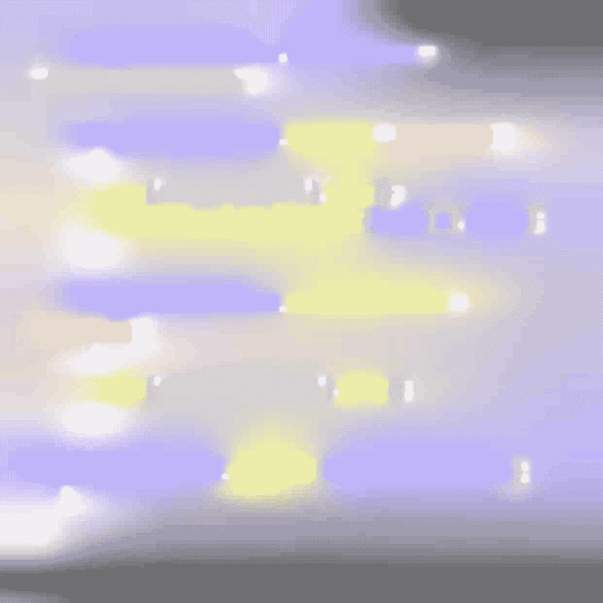

```javascript
// 献给父神

// 版权所有 Christopher Andrew Topalian Copyright 2000-2024

// https://github.com/ChristopherTopalian

// https://github.com/ChristopherAndrewTopalianian

// loadSounds.js

function loadSounds()
{
    let sounds = [
        {
            name: 'sfx_blip_001',

            soundFileOffline: 'media/sounds/sfx_blip_001.mp4',

            soundFileOnline: 'https://collegeofscripting.weebly.com/uploads/6/4/8/6448293/sfx_blip_001.mp4'
        },
        {
            name: 'sfx_warp_001',

            soundFileOffline: 'media/sounds/sfx_warp_001.mp4',

            soundFileOnline: 'https://collegeofscripting.weebly.com/uploads/6/4/8/6448293/sfx_warp_001.mp4'
        }
    ];

    for (let x = 0; x < sounds.length; x++)
    {
        let theSound = ce('audio');

        if (online == false)
        {
            theSound.src = sounds[x].soundFileOffline;
        }
        else
        {
            theSound.src = sounds[x].soundFileOnline;
        }

        theSound.id = sounds[x].name;

        theSound.loop = false;

        theSound.volume = 1.0;

        ba(theSound);
    }
}
```

脚本音乐科学学院

CollegeOfScripting.weebly.com


```javascript
// 献给父神

// 版权所有 Christopher Andrew Topalian Copyright 2000-2024

// https://github.com/ChristopherTopalian

// https://github.com/ChristopherAndrewTopalianian

// whenLoaded.js

function whenLoaded()
{
    loadSounds();

    makeLogicCalculator("And");

    makeLogicGateButtons();

    makeTrueAiDiagram();

    makeCredits();
}
```

脚本音乐科学学院

CollegeOfScripting.weebly.com


Christopher Topalian

## 真正的人工智能系统

| 标签 | 二进制 |
| :--- | :--- |
| MI | 1101 |
| CI | 1011 |
| 16边形 | LP 0011 |
| XNOR | 1001 |
| 永真式 | 1111 |
| RC | 1010 |
| AND | 0001 |
| OR | 0111 |
| NAND | 1110 |
| 矛盾 | 0000 |
| LC | 1100 |
| NOR | 1000 |
| XOR | 0110 |
| CNI | 0100 |
| MNI | 0010 |
| RPH | 0101 |

脚本、音乐与科学学院

CollegeOfScripting.weebly.com

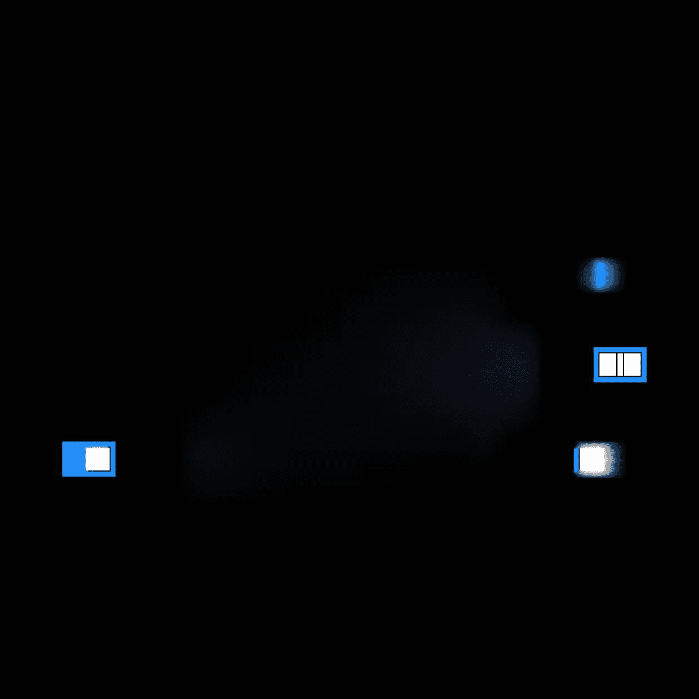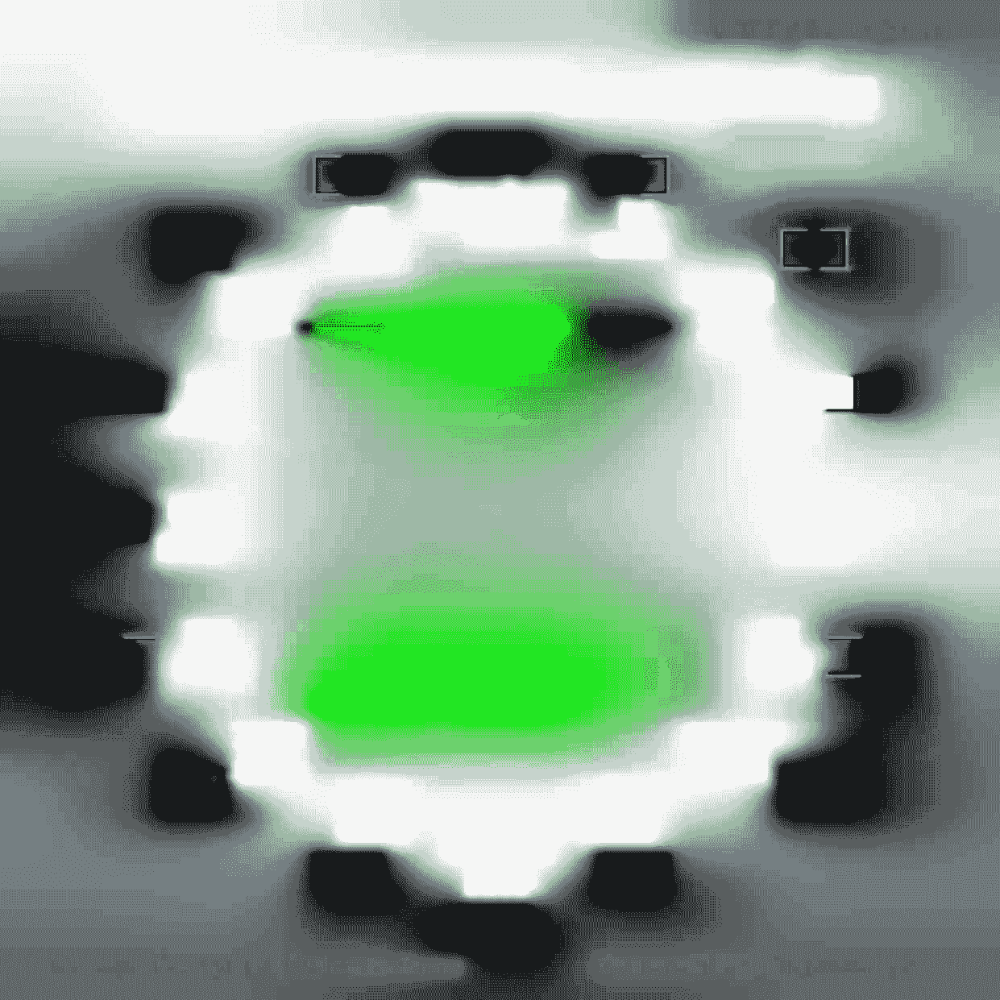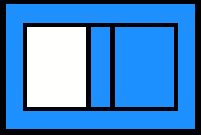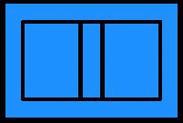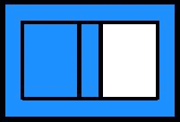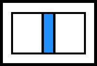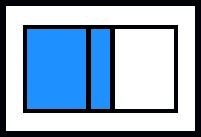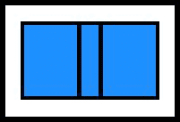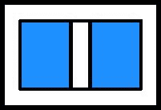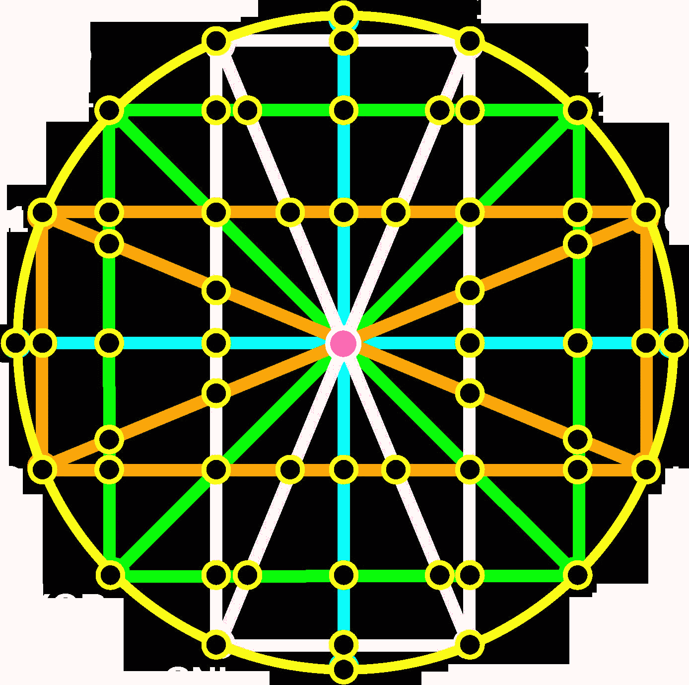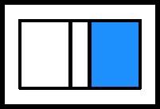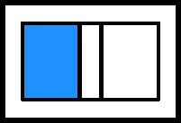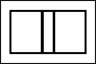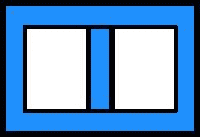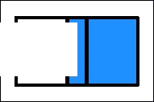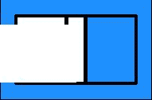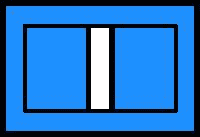

Christopher Topalian

**获取更多教程：**

- CollegeOfScripting.weebly.com
- CollegeOfScripting.wordpress.com
- Youtube.com/ScriptingCollege
- Twitter.com/CollegeOfScript
- GitHub.com/ChristopherTopalian
- GitHub.com/ChristopherAndrewTopalian
- Sites.google.com/view/CollegeOfScripting

脚本、音乐与科学学院

CollegeOfScripting.weebly.com


Christopher Topalian

献给父神

本书由脚本、音乐与科学学院创建。

请始终记住，每当你用铅笔和纸写脚本时，它就会深深地烙印在记忆中，使得材料和方法被学得透彻。

当你输入脚本时，也是如此。你通过键盘或纸笔输入并编写脚本越多，你的编程就学得越好！

编写并输入你找到每一个示例。

整理好你所有的脚本。

你创建每一个脚本都能提升你的编程能力。

**看到代码**是一种，但**编写代码**是另一回事。

写下它，输入它，说出来，看到它，梦到它。

CollegeOfScripting.weebly.com

脚本、音乐与科学学院

CollegeOfScripting.weebly.com

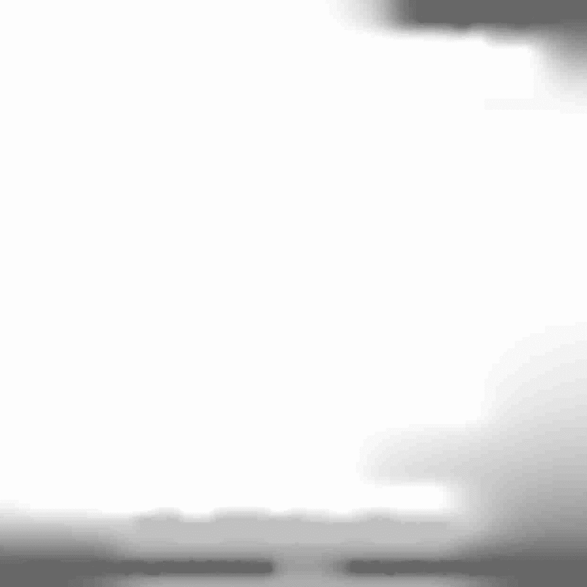
