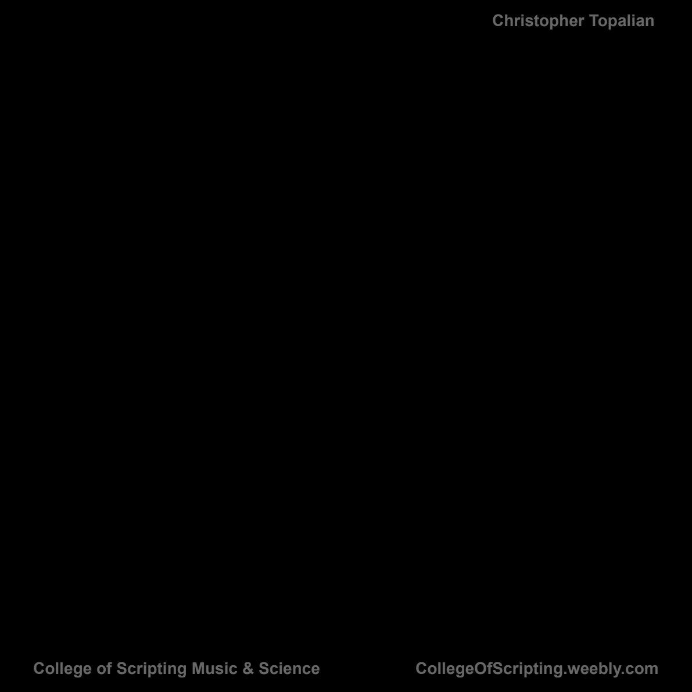

# Topalian JavaScript 真 AI 实战

**作者：**

**克里斯托弗·安德鲁·托帕利安**

**献给**

**父**

**父神**

// https://github.com/ChristopherTopalian

// ** https://github.com/ChristopherAndrewTopalia

n

// 如何合并JS文件.js

## 教程：

如何合并我们`js`文件夹中所有子文件夹下的所有`.js`文件。

## 准备工作：

我们应该在每个脚本的末尾添加两个新行。这样它们就能每个脚本之间通过换行符完美合并。

## 第一步：打开我们的`js`文件夹

## 第二步：在`js`文件夹的地址栏中输入`cmd`，按回车。这会在命令提示符中打开`js`文件夹

## 第三步：在提示符中输入所示命令并按回车

```
for /r "%CD%" %i in (**.js) do type "%i" >> main.js
```

现在我们有了一个名为`main.js`的新`.js`文件，它将所有的`js`文件都包含在一个文件中。这使得我们很容易上传应用程序，并且易于发现项目有多少行代码。要使用我们的`main.js`文件，我们要在`html`文件中引入它：`<script src='js/main.js'></script>`

// https://github.com/ChristopherTopalian

// 版本 0.1 (2024-02-28)

// <head>

```
<title>Topalian AI</title>

<link rel="stylesheet" href="css/style01.css">

<script src="js/shortcuts.js"></script>
<script src="js/world.js"></script>
<script src="js/dataLogic.js"></script>
<script src="js/dataByName.js"></script>
<script src="js/logicGates/logicGates.js"></script>
<script src="js/make/makeLogicButtons.js"></script>
<script src="js/make/makeLogicCalculator.js"></script>
<script src="js/make/makeTrueAiDiagram.js"></script>
<script src="js/make/makeCredits.js"></script>
<script src="js/sound/loadSounds.js"></script>
<script src='js/whenLoaded/whenLoaded.js'></script>
```

</head>

<body onload="whenLoaded()">

</body>

</html>

```css
* {
  font-weight: bold;
  color: rgb(255, 255, 255);
}

a {
  color: rgb(100, 100, 100);
  text-decoration: none;
}

a:hover {
  text-decoration: underline;
}

input {
  padding: 10px;
  background-color: rgb(0, 0, 0);
  border: solid 1px rgb(100, 100, 100);
  border-radius: 8px;
  font-size: 20px;
  font-weight: bold;
  color: rgb(255, 255, 255);
  text-align: center;
}

textarea {
  padding: 10px;
  background-color: rgb(0, 0, 0);
  border: solid 1px rgb(100, 100, 100);
  border-radius: 8px;
  font-family: Arial;
  font-size: 20px;
  font-weight: bold;
  color: rgb(255, 255, 255);
}

.logicButtons {
  display: grid;
  grid-template-columns: auto auto;
}

.logicButton {
  margin: 1px;
  padding-left: 7px;
  padding-right: 7px;
  padding-top: 5px;
  padding-bottom: 5px;
  border: solid 1px rgb(100, 100, 100);
  border-radius: 8px;
  background-color: rgb(0, 0, 0);
  font-size: 14px;
  font-weight: bold;
  color: rgb(100, 100, 100);
  line-height: 12px;
}

.logicButton:hover {
  border-color: rgb(0, 255, 255);
  color: rgb(255, 255, 255);
}

.logicButton:active {
  position: relative;
  top: 1px;
  border-color: rgb(100, 100, 255);
  color: rgb(100, 100, 255);
}
```

```javascript
// Christopher Andrew Topalian 版留所有权利
// 版权 2000-2024
// https://github.com/ChristopherTopalian
//
// https://github.com/ChristopherAndrewTopalian

function ge(whichId) {
  let result = document.getElementById(whichId);
  return result;
}

function ce(whichType) {
  let result = document.createElement(whichType);
  return result;
}

function ba(whichElement) {
  let result = document.body.append(whichElement);
  return result;
}

// variables.js
let online = false;

let logic = [
  {
    name: "And",
```

**离线图片源:** `'media/textures/topalianDiagrams/and.png'`,

**在线图片源:** `'https://collegeofscripting.weebly.com/uploads/6/4/4/8/64482293/and_orig.png'`,

**函数:** `"gateAnd(a, b)"`,

**公式:** `"if (a == 1 && b == 1)"`,

**反向门:** `"Nand"`,

**真值表:** `"0001"`,

**格式化真值表:**

| A | B | 结果 |
|---|---|---|
| 0 | 0 | 0 |
| 0 | 1 | 0 |
| 1 | 0 | 0 |
| 1 | 1 | 1 |

{

**名称:** `"Nand"`,

**离线图片源:** `'media/textures/topalianDiagrams/nand.png'`,

**在线图片源:** `'https://collegeofscripting.weebly.com/uploads/6/4/4/8/64482293/nand_orig.png'`,

**函数:** `"gateNand(a, b)"`,

**公式:** `"if (a == 0 || b == 0)"`,

**反向门:** `"And"`,

**真值表:** `"1110"`,

**格式化真值表:**

| A | B | 结果 |
|---|---|---|
| 0 | 0 | 1 |
| 0 | 1 | 1 |
| 1 | 0 | 1 |
| 1 | 1 | 0 |

**名称:** `"Or"`,

**离线图片源:** `'media/textures/topalianDiagrams/or.png'`,

**在线图片源:** `'https://collegeofscripting.weebly.com/uploads/6/4/4/8/64482293/or_orig.png'`,

**函数:** `"gateOr(a, b)"`,

**公式:** `"if (a == 1 || b == 1)"`,

**反向门:** `"Nor"`,

**真值表:** `"0111"`,

**格式化真值表:**

| A | B | 结果 |
|---|---|---|
| 0 | 0 | 0 |
| 0 | 1 | 1 |
| 1 | 0 | 1 |
| 1 | 1 | 1 |

{

**名称:** `"Nor"`,

**离线图片源:** `'media/textures/topalianDiagrams/nor.png'`,

**在线图片源:** `'https://collegeofscripting.weebly.com/uploads/6/4/4/8/64482293/nor_orig.png'`,

**函数:** `"gateNor(a, b)"`,

**公式:** `"if (a == 0 && b == 0)"`,

**反向门:** `"Or"`,

**真值表:** `"1000"`,

**格式化真值表:**

| A | B | 结果 |
|---|---|---|
| 0 | 0 | 1 |
| 0 | 1 | 0 |
| 1 | 0 | 0 |
| 1 | 1 | 0 |



{

**名称:** `"Xor"`,

**离线图片源:** `'media/textures/topalianDiagrams/xor.png'`,

**在线图片源:** `'https://collegeofscripting.weebly.com/uploads/6/4/4/8/64482293/xor_orig.png'`,

**函数:** `"gateXor(a, b)"`,

**公式:** `"if ((a == 1 && b == 0) || (a == 0 && b == 1))"`,

**反向门:** `"Xnor"`,

**真值表:** `"0110"`,

**格式化真值表:**

| A | B | 结果 |
|---|---|---|
| 0 | 0 | 0 |
| 0 | 1 | 1 |
| 1 | 0 | 1 |
| 1 | 1 | 0 |

}

**name**: `"逆命非蕴含"`,

**imgSrcOffline**: `'media/textures/topalianDiagrams/converse_non_implication.png'`,

**imgSrcOnline**: `'https://collegeofscripting.weebly.com/uploads/6/4/4/8/64482293/converse-non-implication_orig.png'`,

**function**: `"gateCni(a, b)"`,

**formula**: `"if (a == 0 && b == 1)"`,

**opposite**: `"逆命蕴含"`,

**truthTable**: `"0100"`,

**truthTableFormatted**:

```
| A | B | 结果 |
|---|---|---|
| 0 | 0 | 0 |
| 0 | 1 | 1 |
| 1 | 0 | 0 |
| 1 | 1 | 0 |
```

},

{

**name**: `"实质蕴含"`,

**imgSrcOffline**: `'media/textures/topalianDiagrams/material_implication.png'`,

**imgSrcOnline**: `'https://collegeofscripting.weebly.com/uploads/6/4/4/8/64482293/material-implication_orig.png'`,

**function**: `"gateMi(a, b)"`,

**formula**: `"if (a == 0 || b == 1)"`,

**opposite**: `"实质非蕴含"`,

**truthTable**: `"1101"`,

**truthTableFormatted**:

```
| A | B | 结果 |
|---|---|---|
| 0 | 0 | 1 |
| 0 | 1 | 1 |
| 1 | 0 | 0 |
| 1 | 1 | 1 |
```

{

**name**: `"实质非蕴含"`,

**imgSrcOffline**: `'media/textures/topalianDiagrams/material_non_implication.png'`,

**imgSrcOnline**: `'https://collegeofscripting.weebly.com/uploads/6/4/4/8/64482293/material-non-implication_orig.png'`,

**function**: `"gateMni(a, b)"`,

**formula**: `"if (a == 1 && b == 0)"`,

**opposite**: `"实质蕴含"`,

**truthTable**: `"0010"`,

**truthTableFormatted**:

```
| A | B | 结果 |
|---|---|---|
| 0 | 0 | 0 |
| 0 | 1 | 0 |
| 1 | 0 | 1 |
| 1 | 1 | 0 |
```

{

**name**: `"右投射"`,

**imgSrcOffline**: `'media/textures/topalianDiagrams/right_projection.png'`,

**imgSrcOnline**: `'https://collegeofscripting.weebly.com/uploads/6/4/4/8/64482293/right-projection_orig.png'`,

**function**: `"gateRp(a, b)"`,

**formula**: `"if ((a == 0 || b == 1)"`,

**opposite**: `"右否补"`,

**truthTable**: `"0101"`,

**truthTableFormatted**:

```
| A | B | 结果 |
|---|---|---|
| 0 | 0 | 0 |
| 0 | 1 | 1 |
| 1 | 0 | 0 |
| 1 | 1 | 1 |
```

{

**name**: `"右否补"`,

**imgSrcOffline**: `'media/textures/topalianDiagrams/right_complementation.png'`,

**imgSrcOnline**: `'https://collegeofscripting.weebly.com/uploads/6/4/4/8/64482293/right-complementation_orig.png'`,

**function**: `"gateRc(a, b)"`,

**formula**: `"if ((a == 0 || b == 0)"`,

**opposite**: `"右投射"`,

**truthTable**: `"1010"`,

**truthTableFormatted**:

```
| A | B | 结果 |
|---|---|---|
| 0 | 0 | 1 |
| 0 | 1 | 0 |
| 1 | 0 | 1 |
| 1 | 1 | 0 |
```

{

**name**: `"左投射"`,

**imgSrcOffline**: `'media/textures/topalianDiagrams/left_projection.png'`,

**imgSrcOnline**: `'https://collegeofscripting.weebly.com/uploads/6/4/4/8/64482293/left-projection_orig.png'`,

**function**: `"gateLp(a, b)"`,

**formula**: `"if (a == 1)"`,

**opposite**: `"左否补"`,

**truthTable**: `"0011"`,

**truthTableFormatted**:

```
| A | B | 结果 |
|---|---|---|
| 0 | 0 | 0 |
| 0 | 1 | 0 |
| 1 | 0 | 1 |
| 1 | 1 | 1 |
```

oppositeopposite: `"左投影"`,

truthTable: `"1100"`,

truthTableFormatted: `

| A | B |


| 0 | 0 = 1 |

| 0 | 1 = 1 |

| 1 | 0 = 0 |

| 1 | 1 = 0 |

```javascript
},

{
    name: "永真式",
    imgSrcOffline: 'media/textures/topalianDiagrams/tautology.png',
    imgSrcOnline: 'https://collegeofscripting.weebly.com/upload/6/4/4/8/64482293/tautology_orig.png',
    function: "gateTautology(a, b)",
    formula: "if ((a == 0 && b == 0) || (a == 0 && b == 1) || (a == 1 && b == 0) || (a == 1 && b == 1))",
    opposite: "矛盾式",
    truthTable: "1111",
    truthTableFormatted: `

| A | B |

| 0 | 0 = 1 |

| 0 | 1 = 1 |

| 1 | 0 = 1 |

| 1 | 1 = 1 |

`
},

{
    name: "矛盾式",
    imgSrcOffline: 'media/textures/topalianDiagrams/contradiction.png',
    imgSrcOnline: 'https://collegeofscripting.weebly.com/upload/6/4/4/8/64482293/contradiction_orig.png',
    function: "gateContradiction(a, b)",
    formula: "if ((a == 0 && b == 0) || (a == 0 && b == 1) || (a == 1 && b == 0) || (a == 1 && b == 1))",
    opposite: "永真式",
    truthTable: "0000",
    truthTableFormatted: `

| A | B |

| 0 | 0 = 0 |

| 0 | 1 = 0 |

| 1 | 0 = 0 |

| 1 | 1 = 0 |

`
};

{
    return "均为为假 或 均为真";
}

else
{
    return 0;
}

}

function gateCi(a, b)
{
    /*
    if ((a == 0 && b == 0) ||
    (a == 1 && b == 0) ||
    (a == 1 && b == 1))
    */

    if (a == 1 || b == 0)
    {
        return "均为为假 或 A为真 或 均为真";
    }
    else
    {
        return 0;
    }
}

function gateCni(a, b)
{
    if (a == 0 && b == 1)
    {
        return "B为真";
    }
    else
    {
        return 0;
    }
}

function gateMi(a, b)
{
    /*
    if ((a == 0 && b == 0) ||
    (a == 0 && b == 1) ||
    (a == 1 && b == 1))
    */

    if (a == 0 || b == 1)
    {
        return "均为为假 或 B为真";
    }
    else
    {
        return 0;
    }

function gateMni(a, b)
{
    if (a == 1 && b == 0)
    {
        return "A为真";
    }
    else
    {
        return 0;
    }
}

function gateRp(a, b)
    if ((a == 0 && b == 1) ||
    (a == 1 && b == 1))
    {
        return "B为真 或 均为真";
    }
    else
    {
        return 0;
    }
}

function gateRc(a, b)
{
    if ((a == 0 && b == 0) ||
    (a == 1 && b == 0))
    {
        return "均为为假 或 A为真";
    }
    else
    {
        return 0;
    }
}

function gateLp(a, b)
{
    /*
    if ((a == 1 && b == 0) ||
    (a == 1 && b == 1))
    */

    if (a == 1)
    {
        return "A为真 或 均为真";
    }
    else
```


```javascript
else
{
    return 0;
}

}

function gateLc(a, b)
{
    /*
    if ((a == 0 && b == 0) ||
    (a == 0 && b == 1))
    */

    if (a == 0)
    {
        return "均为为假 或 B为真";
    }
    else
    {
        return 0;
    }
}

function gateAutology(a, b)
{
    if ((a == 0 && b == 0) ||
    (a == 0 && b == 1) ||
    (a == 1 && b == 0) ||
    (a == 1 && b == 1))
    {
        return "一个或均为为假或 真";
    }
    else
    {
        return 0;
    }
}

// https://github.com/ChristopherTopalian
// //
// https://github.com/ChristopherAndrewTopalian
// findIndexByName.js

function findIndexByName(whichArray, whichName) {
    let index = whichArray.findIndex(function(a) {
        return a.name === whichName;
    });

    return index;
}

// https://github.com/ChristopherTopalian
// //
// https://github.com/ChristopherAndrewTopalian
// makeCredits.js

function makeCredits() {
    let creditsDiv = document.createElement('div');

    creditsDiv.style.position = 'absolute';
    creditsDiv.style.right = '10px';
    creditsDiv.style.top = '5px';
    creditsDiv.style.zIndex = 1;

    appendChild(creditsDiv);

    // //

    let titleDiv = document.createElement('div');

    titleDiv.innerHTML = `<a href="https://github.com/christophertopalian" target="_blank">Topalian JavaScript AI</a>`;

    titleDiv.style.fontSize = '15px';
    titleDiv.style.color = 'rgb(120, 120, 120)';

    creditsDiv.append(titleDiv);
}

// https://github.com/ChristopherTopalian
// //
// https://github.com/ChristopherAndrewTopalian
// makeLogicCalculator.js

function makeLogicCalculator(whichItem) {
    if (ge("logicCalcDiv")) {
        ge("logicCalcDiv");
    }

    // //

    let logicCalcDiv = createElement("div");

    logicCalcDiv.id = "logicCalcDiv";
    logicCalcDiv.className = "logicCalcDiv";
    logicCalcDiv.style.position = 'absolute';
    logicCalcDiv.style.left = '10px';
    logicCalcDiv.style.top = '5px';
    logicCalcDiv.style.display = 'flex';
    logicCalcDiv.style.flex = 'column';

    appendChild(logicCalcDiv);

    // //

    let logicGateTitle = createElement("div");

    logicGateTitle.innerHTML = findIndexByName(logic, whichItem).name;
    logicGateTitle.id = "logicGateTitle";
    logicGateTitle.style.position = 'relative';
    logicGateTitle.style.left = '3.5px';
    logicGateTitle.style.top = '-1.5px';
    logicGateTitle.style.color = 'rgb(0, 255, 255)';

    logicCalcDiv.append(logicGateTitle);

    // //

    let textboxDiv = createElement("div");

    textboxDiv.id = "textboxDiv";
    textboxDiv.style.display = 'flex';
    textboxDiv.style.flex = 'row';

    logicCalcDiv.append(textboxDiv);

    // //

    let textbox001 = createElement("input");

    textbox001.type = 'text';
    textbox001.id = "textbox001";
    textbox001.placeholder = "A";
    textbox001.style.width = '50px';
    textbox001.style.marginRight = '3px';

    textbox001.onkeyup = function() {
        let a = textbox001.value;
        let b = textbox002.value;

        if (b != '') {
            // ... 逻辑继续
        }
    };
```

```javascript
document("textBoxResult").value = eval(logic[findIndexByName(logic, whichItem)].function);
};
textboxDiv.append(textBox001);

//---

let textBox002 = createElement("input");

textBox002.type = 'text';
textBox002.id = "textBox002";
textBox002.placeholder = "B";
textBox002.style.width = '50px';

textBox002.onkeyup = function() {
    let a = textBox001.value;
    let b = textBox002.value;
```

```javascript
if (a != '' && b != '') {
    document("textBoxResult").value = eval(logic[findIndexByName(logic, whichItem)].function);
}
else
{
    document("textBoxResult").value = '';
}

};
textboxDiv.append(textBox002);

//---

let textBoxResult = createElement("textarea");

textBoxResult.id = "textBoxResult";
textBoxResult.placeholder = "Result";
textBoxResult.style.width = '200px';

textBoxResult.onchange = function() {
    if (textBoxResult.value == 0) {
        textBoxResult.style.borderColor = 'rgb(255, 255, 255)';
    }
    else
    {
        textBoxResult.style.borderColor = 'rgb(0, 255, 255)';
    }
};

logicDiv.append(textBoxResult);

//---

let truthAbbreviated = createElement("div");

truthAbbreviated.innerHTML = logic[findIndexByName(logic, whichItem)].truth;
truthAbbreviated.id = "truthAbbreviated";
truthAbbreviated.style.position = "absolute";
truthAbbreviated.style.left = "140px";
truthAbbreviated.style.top = "40px";
truthAbbreviated.style.color = "rgb(150, 150, 150)";

if (truthAbbreviated) {
    truthAbbreviated.remove();
}

ba(truthAbbreviated);
```

```javascript
// ---

let truthComplete = createElement("div");

truthComplete.innerHTML = "<pre>" + logic[findIndexByName(logic, whichItem)].truthFormatted + "</pre>";

truthComplete.id = "truthComplete";
truthComplete.style.position = "absolute";
truthComplete.style.left = "-30px";
truthComplete.style.top = "151px";
truthComplete.style.color = "rgb(150, 150, 150)";

if (truthComplete) {
    truthComplete.remove();
}
```


```javascript
if (truthComplete) {
    truthComplete.remove();
}

ba(truthTableComplete);

//---
```


`let booleanGate = createElement("div");`

`booleanGate.innerHTML = logic[findIndexByName(logic, whichItem)].formula;`

`booleanGate.id = "booleanGate";`

`booleanGate.style.position = "absolute";`

`booleanGate.style.left = "25px";`

`booleanGate.style.top = "310px";`

`booleanGate.style.width = "400px";`

`booleanGate.style.color = "rgb(0, 255, 255)";`

`if (booleanGate)`

```javascript
if (booleanGate) {
    booleanGate.remove();
}
ba(booleanGate);
```

`//---`

`let oppositeGate = createElement("div");`

`oppositeGate.innerHTML = "Opposite Gate is: " + logic[findIndexByName(logic, whichItem)].opposite;`

`oppositeGate.id = "oppositeGate";`

`oppositeGate.style.position = "absolute";`

`oppositeGate.style.left = "280px";`

`oppositeGate.style.top = "3px";`

`oppositeGate.style.color = "rgb(100, 100, 100)";`

`if (oppositeGate)`

```javascript
{
    ge('oppositeGate').remove();
}
ba(oppositeGate);
```

`//-//`

`let topalianDiagram = ce('img');`

`topalianDiagram.id = 'topalianDiagram';`

`if (online == false) {`

`topalianDiagram.src = logic[findIndexByName(logic, whichItem)].imgSrcOffline;`

`} else {`


`topalianDiagram.src = logic[findIndexByName(logic, whichItem)].imgSrcOnline;`

`topalianDiagram.style.position = 'absolute';`

`topalianDiagram.style.left = '458px';`

`topalianDiagram.style.top = '283px';`

`topalianDiagram.style.width = '115px';`

`ba(topalianDiagram);`

```javascript
// https://github.com/ChristopherAndrewTopalian
// makeLogicGateButtons.js
function makeLogicGateButtons() {
    let logicButtonsDiv = ce("div");
    logicButtonsDiv.id = "logicButtonsDiv";
    logicButtonsDiv.className = "logicButtonsDiv";
    logicButtonsDiv.style.position = 'absolute';
    logicButtonsDiv.style.left = '217px';
    logicButtonsDiv.style.top = '40px';
    logicButtonsDiv.style.width = '375px';
    ba(logicButtonsDiv);
    //-//
    for (let x = 0; x < logic.length; x++) {
        let logicGateButton = ce("button");
        logicGateButton.innerHTML = logic[x].name;
        logicGateButton.id = "logicGateButton" + logic[x].name;
        logicGateButton.className = "logicGateButton";
        logicGateButton.onclick = function() {
            ge('sfx_blip_001');
            makeLogicCalculator(logic[x]);
        };
        logicGateButton.onmouseover = function() {
            ge('sfx_warp_001');
        };
        logicButtonsDiv.append(logicGateButton);
    }
}
```

```javascript
// https://github.com/ChristopherTopalian
// https://github.com/ChristopherAndrewTopalian
// makeTrueAi.js
function makeTrueAiDiagram() {
    let trueAiDiagram = ce('img');
    trueAiDiagram.id = 'trueAiDiagram';
    if (online == false) {
        trueAiDiagram.src = 'media/textures/true_ai_by_christopher_topalian.png';
    } else {
        trueAiDiagram.src = 'https://collegeofscripting.weebly.com/uploads/6/4/64482293/true-ai-by-christopher.png';
    }
    trueAiDiagram.style.position = 'absolute';
    trueAiDiagram.style.left = '598px';
    trueAiDiagram.style.top = '40px';
    trueAiDiagram.style.width = '400px';
    ba(trueAiDiagram);
}
```

```javascript
[
  {
    name: 'sfx_blip_001',
    soundFileOffline: 'media/sounds/sfx_blip_001.mp4',
    soundFileOnline: 'https://collegeofscripting.weebly.com/uploads/6/4/4/8/64482293/sfx_blip_001.mp4'
  },
  {
    name: 'sfx_warp_001',
    soundFileOffline: 'media/sounds/sfx_warp_001.mp4',
    soundFileOnline: 'https://collegeofscripting.weebly.com/uploads/6/4/4/8/64482293/sfx_warp_001.mp4'
  }
];

for (let x = 0; x < sounds.length; x++) {
  let theSound = ce('audio');
  if (online == false) {
    theSound.src = sounds[x].soundFileOffline;
  } else {
    theSound.src = sounds[x].soundFileOnline;
  }
  theSound.id = sounds[x].name;
  theSound.loop = false;
  theSound.volume = 1.0;
  ba(theSound);
}

function whenLoaded() {
  loadSounds();
  makeLogic("And");
  makeLogicGateButtons();
  makeTrueAiDiagram();
  makeCredits();
}
```

献给父亲

版权所有 Andrew Talia

Copyright 2020-2024

https://github.com/ChristopherAndrew

https://github.com/ChristopherAndrew

`whenLoaded.js`

| 真人工智能系统 | 逻辑门 |
| :--- | :--- |
| 永真式 | 1111 |
| 矛盾 | 0000 |
| 异或 (XOR) | 0110 |
| 异或否 (XNOR) | 1001 |
| 与 (AND) | 0001 |
| 或 (OR) | 0011 |
| 与非 (NAND) | 1110 |
| 或非 (NOR) | 1100 |
| 非 (NOT) | 1010 |
| 异或否 (XNOR) | 1001 |
