# Twitter Bootstrap 3 精简指南


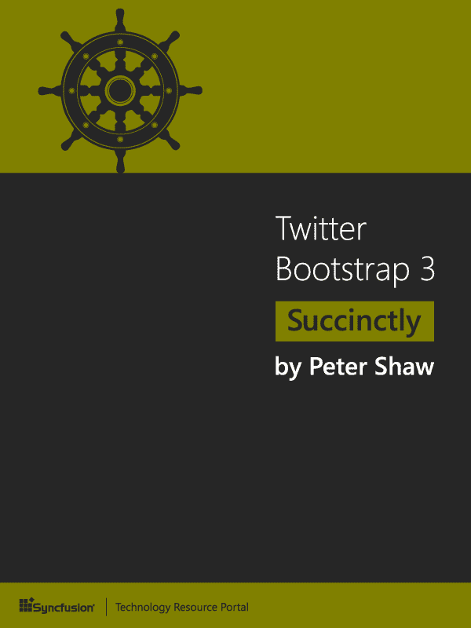


序言：Daniel Jebaraj


SYNCFUSION, SUCCINCTLY, DELIVER INNOVATION WITH EASE, ESSENTIAL, 和 .NET ESSENTIALS 均为 Syncfusion, Inc. 的注册商标。

**技术审核员：** Zoran Maksimovic, @zoranmax, www.agile-code.com
**文字编辑：** Courtney Wright
**收购协调：** Hillary Bowling，市场协调员，Syncfusion, Inc.
**校对员：** Darren West，内容制作人，Syncfusion, Inc.

I


**关于作者 ......................................................................................................................................... 8**
**引言 ................................................................................................................................................. 9**


## 《精要教程》系列书籍背后的故事

Daniel Jebaraj，副总裁
Syncfusion, Inc.

### 保持前沿

正如你们中的许多人所知，Syncfusion 是微软平台软件组件的提供商。这使我们处于一个既兴奋又充满挑战的地位：始终处于最前沿。

每当微软发布新平台或工具时（如今似乎每隔两周就有一次），我们必须快速地自我教育。

### 信息虽丰富，但更难消化

在现实中，这意味着大量的书籍订单、博客搜索和 Twitter 扫描。虽然互联网上的可用信息越来越多，出版的书籍也越来越多多（即使是针对相对较新的话题），但一个持续阻碍我们的方面是无法找到简洁的技术概览类书籍。

我们通常面临两个选择：读几本 500 页以上的大书，或者在网络上搜索相关的博客文章和其他文章。和其他那些有工作要做、有客户要服务的一样，我们觉得这非常令人沮丧。

### 《精要教程》系列

这种挫败感转化为一种强烈的渴望，希望编写一系列针对在微软平台平台上工作的开发者的简洁技术书籍。

我们坚信，考虑到这些开发者所具备的背景知识，大多数主题都可以转化成 50 到 100 页之间的书籍。

这正是我们决定通过 *Succinctly*（精要）系列来实现的。难道不是所有美好的事物都是源于改变现状的深刻渴望吗？


### 最好的作者，最好的内容

每位作者都是从共享我们愿景的才华专家中精心挑选出来的。你现在手中的这本书以及该系列中的其他书籍，都是作者们不懈努力的结果。你将发现原创内容，这些内容保证让你在喝几杯咖啡的时间内上手。

### 永久免费

Syncfusion 将致力于编写关于多个主题的书籍。这些书籍将永远免费。我们发布的任何更新也将是免费的。

### 免费？有什么猫腻？

这里没有猫腻。Syncfusion 在这项工作中拥有利益。

作为组件供应商，我们独特的诉张一直是提供比市场上任何其他产品都更深层、更广泛的框架。开发者教育极大地帮助我们对抗了那些承诺“一键开启 AJAX 支持”或“点石成金”的竞争对手商。

### 告诉我们你的想法

如果你有任何感兴趣的话题、想法或反馈，请随时通过 succinctly-series@syncfusion.com 与我们联系。

我们诚地希望你喜欢这本书，并且它能帮助你更好地理解学习的主题。感谢阅读。

请在 Twitter 上关注我们，并在 Facebook 上“点赞”我们，帮助我们传播 *Succinctly* 系列的消息！


### 关于作者

作为 20 世纪 70 年代后期和 80 年代初 IT 的早期采用者，我从一台简陋的 1k Sinclair ZX81 家用电脑开始的。

随着时间的推移，这台小小的 1k 机器变成了 16k 的 Tandy TRS-80，然后是 Acorn Electron，最终变成了一台 4mb arm 驱动的 Acorn A5000。

在离开学校并接触基于 DOS 的 PC 后，我在计算机网络和通信行业的许多不同领域接受了培训。

在世纪 90 年代中期回到大学并获得工业计算科学理学学士学位后，我现在在英国经营着自己的咨询公司 Digital Solutions Computer Software Ltd。我在许多不同的 IT 领域从硬件和软件两个层面上为客户提供建议，涵盖了从移动通信和网络到地理信息系统、银行金融以及网页设计的广泛领域特定知识。

在 IT 行业内的各种平台和操作系统中拥有 30 多年的经验后，我有许多知识可以分享。

你经常可以在我帮助运营的 LinkedIn Lidnug.NET 用户组中找到我，你也可以在通常的地方轻松找到我，如 Stack-Overflow（以及它的 GIS 专用版块）、在 twitter (@shawty_ds) 上，现在现在，在 Pluralsight 上你也可以找到我，那里有我的各种视频。

我希望你喜欢这本书，并从中有所收获。

请记得感谢 Syncfusion (@Syncfusion) 让这本书成为可能，并允许像我这样的人与 .NET 社区分享知识。*Succinctly* 系列对于忙碌的程序员来说是一个绝佳的主意。


## 引言

欢迎阅读 *Succinctly* 系列的第二本书，涵盖了 Twitter Bootstrap (BS) UI 和 CSS 框架。

在我的第一书中，我奠定了初步基础并让你开始学习 Bootstrap 2。然而，自该书发布以来，Bootstrap 3 已成为主流版本。在这本书中，我们将继续在该基础的基础上进行构建，转向使用 BS v3。我们将查看哪些地方有所不同，并在探索新功能时，我们会发现 v2 中的很大一部分仍然适用于 v3。

如果你还没有读过关于 Bootstrap 2 的第一本书，我鼓励你读一下，因为我在整本书的许多地方都会引用它。


这本书的风格和布局与第一本略有不同，因为它更多是基于第一本的扩展，而不是一本独立的书。

为什么？我坚信，为了理解整个 Bootstrap 领域，你需要从开始研究。


- 文本
- 标签
- 警报

- 文本
- 标签、徽章、警报


悬停类（hover classes）不再具有精美的渐变效果，进度条和按钮也不再像 v2 版本中
那样具有半 3D 效果。相反，Twitter Bootstrap 的维护者决定让对 CSS 中元素 
外观和感受的自定义变得更加简单。

维护者甚至提供了一个“Bootstrap”主题，可以让你 v3 看起来像原始的 v2 设计，以
方便你开始使用。在本书的最后一章节中，我将向你展示现在覆盖各种类是多么简单，
并向你展示如何彻底翻新扁平主题，以呈现出你自己的外观和感受。

不过，现在如果你想要 v2 的体验，你需要确保也按照要求包含了相应的 
CSS 文件。如果你坚持使用 v3 默认设置，则不需要任何额外内容。


当 BS2 最初发布时，获取它的唯一方法是通过项目网站下载。这在第一书中有详尽的介绍，并深入讨论了压缩包中到底包含哪些文件以及为什么。

由于有这么多人都在使用 Bootstrap，没过多久，MaxCDN 的运营人员就在在 CDN 上 
免费提供了它。这种传统延续到了 v3 代码库，你现在只需简单地通过以下 HTML 
脚本标签来获取你选择的标准 v3 安装版本：

如果你使用 CDN 版本，请记住你还需要确保包含较新版本的 JQuery；否则任何 BS3 的 JS 
功能都将无法正常工作。

除了 CDN 链接外，现在 getbootstrap.com 网站上也有直接下载，不仅有前一书中 
描述的标准 JavaScript & CSS 组合包，还提供指向原始“Less”源码压缩包的直接 
链接，以及一个转换为“Sass”的链接，供那些希望使用像 Grunt 等工具进行 
自动化处理，以便在自己的构建系统中包含一个完全基于变量、可自定义的套件版本。

除了新源码外，你现在还可以使用 Bower 在项目文件夹的命令行中通过以下命令 
安装你需要的所有内容：

`bower install bootstrap `

`<link rel="stylesheet" href="//netdna.bootstrapcdn.com/bootstrap/3.1.1/css/bootstrap.min.css">` 

`<link rel="stylesheet" href="//netdna.bootstrapcdn.com/bootstrap/3.1.1/css/bootstrap-theme.min.css">` 

`<script src="//netdna.bootstrapcdn.com/bootstrap/3.1.1/js/bootstrap.min.js"></script>` 

Bower 是一个 HTML 脚架和包系统，旨在自动化处理应用程序的大部分样板代码。你不需要
理解它就能理解 BS v3，但只需在 Google 上搜索“Bower”，就会出现很多 
参考文献，以加深你的理解。

类似地，如果你在 Visual Studio 中工作，BS v3 也可以使用 NuGet 包管理器进行安装。
像 Bower 一样，这将自动化安装和设置所需文件的大部分过程。不过要 
小心——NuGet 中有许多 Bootstrap 软件包，其中某些让你的工作量比 
节省的还要多。

最后，TWB 定制器仍然可以在 http://getbootstrap.com/customize/ 访问。它经过了 
重大的结构调整和重建，以提供更多选项，并让你更直观地查看你正在更改 
的内容以及原因。

事实上，现在使用定制器更改内容是如此简单，以至于你的设计师或设计 
团队在下载所需文件之前，就能完成设置下载颜色和品牌所需的 90% 工作。这 
让你的设计部门能够开始工作。


官方情况下，BS v3 仅支持最新的 HTML5 浏览器。

在现实中，BS v3 也支持 Internet Explorer 10 及以上版本。对于 IE8 和 IE9， 
并没有像预期那样工作。不过，如果你需要响应式布局，你必须确保也包含了 
`respond.js`；你可以从此处获取它：https://github.com/scottjehl/Respond

一旦你添加了 `respond.js`，即使你禁用了响应式功能，在 v2 版本中使用的某些 
功能也能符合预期。

缺失的部分大致如下：

对于 IE8：
- `border-radius` 不支持
- `box-shadow` 不支持
- `transform` 不支持
- `transition` 不支持
- `placeholder` 文本不支持

对于 IE9：
- `border-radius` 支持
- `box-shadow` 支持
- `transform` 支持（但需要 -ms- 前缀）
- `transition` 不支持
- `placeholder` 文本不支持

在针对 IE9 方面情况有所改进，圆角和阴影现在可以工作，只要它们 
带有 -ms- 前缀。

BS3 当前版本的官方支持矩阵如下：

***表格 1：官方支持矩阵***

| | Chrome | Firefox | IE | Opera | Android | iOS |
| :--- | :--- | :--- | :--- | :--- | :--- | :--- |
| | Yes | Yes | Yes | Yes | Yes | Yes |
| | No | No | No | No | No | No |
| | No | No | No | No | No | No |
| | Yes | Yes | Yes | Yes | Yes | Yes |
| | No | No | No | No | No | No |
| | Yes | Yes | Yes | Yes | Yes | Yes |
| | Yes | Yes | Yes | Yes | No | No |
| | Yes | Yes | Yes | Yes | Yes | Yes |

如果你需要它，你仍然需要确保使用 `respond.js`，即使你按照所述禁用了 
响应式。


那么，从 v2 迁移到 v3 涉及到什么？事实上，并没有多少。尽管有许多 
变化，你实际需要更改的内容仍然不多，你需要做的更改通常只是类名。

你可能想要做的一件事，特别是如果你仅将 Bootstrap 用于通用网页开发 
而不是任何响应式设计，就是禁用 BS3 的响应式功能。

这很容易做到，但完全不建议。

可以通过以下方式实现：

- 不要在文档头部添加包含设备宽度和其他尺寸信息的标签。
- 覆盖标记为 `container` 类元素的 `width`，并确保在这样做时使用 
`style='width: xxx !important'`。
- 确保任何宽度覆盖都在加载 Bootstrap CSS 之后处理。
- 移除文档中所有 `navbar` 结构中的折叠和展开行为及规则。
- 将所有网格布局类改为仅使用 `col-xs-*` 类，而不使用其他四个级别。
## 类变化

正如我之前提到的，两个版本之间有很多类名变化，许多类已被 
废弃和撤回。

一个让很多人（如果你在 Stack Overflow 上看的话）感到惊讶的事情是
流宽度类的撤回。

在版本 2 中，如果你想要一个全宽的弹性容器，你需要进行类似下面的 
操作：


*代码示例 1：版本 2 灵活容器*

在版本 3 中，`**container**` 和 `**row-fluid` 类已不再存在。

那么，如何获取流式容器呢？简单：你不需要了。

与其将内容包裹在 `**container**` 然后是 `**row` 中，你只需简单地将它们包裹在任何元素中。

你仍然可以使用网格系统为你的内容提供包含容器，以便内容能够与 Bootstrap 的网格良好对齐，但你不再需要在使用这些 `**<div>` 元素集合之前在它们外面套一个容器了。

事实上，如果你使用 `**container**` 和 `**row`（非流式版本仍然存在），你最终将导致所有内容都自动放置在 1024 像素的中央列中，而如果不使用它们，则可以使用整个页面的宽度。


接下来的主要类变化是网格系统本身。

在版本 2 中，你通常以以下方式创建网格：

*代码示例 2：版本 2 网格类*

这段代码将为你提供两个容器，它们在水平方向上整齐地填充了所有布局拥有的 12 个网格（通常是一个侧边栏）。

在版本 3 中，“中级”网格现在等同于 v2 的 `**span**` 类，因此要重写之前的代码以适配 V3，你只需执行以下操作：

*代码示例 3：等同于 'Span' 的版本 3 网格类*

`<div class="container-fluid" id="myParentContainer"> `
` <div class="row-fluid" id="mycontentrow"> `
` <h1>A headline</h1> `
` <p>Some paragraph text</p> `
` </div> `
`</div> ` 
` `
`<div class="container"> `
` <div class="span2">Content here</div>` 
` <div class="span10">Content here</div>` 
`</div> ` 
` `
`<div class="container"> `
` <div class="col-md-2">Content here</div>` 

然而，与版本 2 不同的是，版本 2 只有一个级别的网格大小，而版本 3 现在有四个级别。每个级别都是为你预期终端产品运行的预期目标设备量身定制的。

这些网格单元现在的命名如下：

- 极小设备：`**col-xs-*`
- 小设备：`**col-sm-*`
- 中等设备：`**col-md-*`
- 大设备：`**col-lg-*`

BS3 内部使用媒体查询来决定使用上述的哪类网格类，不同尺寸定义如下：

- 极小：显示宽度小于 768 像素
- 小：显示宽度大于或等于 768 像素，或小于 992 像素
- 中等：显示宽度大于或等于 992 像素，或小于 1,200 像素
- 大：显示宽度大于或等于 1,200 像素

你可以为 BS3 编写多个版本的网格，以便在针对多个显示器时决定使用哪类型。例如，如果你执行了以下操作：

*代码示例 4：多个网格大小声明*

`<div class="col-md-10">Content here</div>`
`</div>` 
` `
`<div class="container"> `
` <div class="col-xs-2">Content here</div>`
` <div class="col-xs-10">Content here</div>`
` <div class="col-sm-2">Content here</div>`
` <div class="col-sm-10">Content here</div>`
` <div class="col-md-2">Content here</div>`
` <div class="col-md-10">Content here</div>`
` <div class="col-lg-2">Content here</div>`
` <div class="col-lg-10">Content here</div>`
`</div>` 
` `

BS3 将根据设备显示宽度和媒体查询的操作，按需要隐藏和显示容器。

与之前的网格系统相同，在所有不同尺寸中，水平方向上都有 12 列，因此无论显示的是哪种网格大小，你在每个设备上始终始终会获得 12 个网格。

然而，列的宽度本身发生了变化，因此你可能需要规划这些网格中的内容，以利用不同尺寸的优势。它们的尺寸如下：

- `**col-xs-*` = 自动调整大小，无固定尺寸
- `**col-sm-*` = 60 像素
- `**col-md-*` = 78 像素
- `**col-lg-*` = 95 像素

在所有情况下，间隙边缘（gutter）将保持在网格容器两侧的 15 像素，总间隙为 30 像素。无论你使用哪种网格大小，此尺寸将保持一致。

嵌套和偏移的工作方式与之前相同，但网格本身通过对实际使用的类进行细微重命名来实现。应用偏移，只需使用 `**col-md-offset-*`，记得根据你的网格大小按需要将 `md` 替换为 `xs`、`sm` 或 `lg`。

嵌套只需通过将容器嵌套在每个内部的 `**col-xx-*` 类控制下来实现，其中它们将调整大小并表现得与之前的版本相同。以下示例展示了实现这两种技术的正确方法：

*代码示例 5：嵌套网格*

这将导致所有内容都自动放置在 1024 像素的中央列中，而如果不使用它们，则可以使用整个页面的宽度。

*代码示例 6：版本 3 中的偏移网格*

这将导致所有内容都自动放置在 1024 像素的中央列中，而如果不使用它们，则可以使用整个页面的宽度。

*代码示例 7：提供多分辨率布局的推荐方法*


好的，也许你的元素上可能会出现一堆地狱般的类名列表，但一组标记将适应所有显示尺寸，并在需要的地方调整大小。

这也适用于各种偏移（offset）、排序（order）和嵌套（nesting）类。


除了我们已经讨论过的，如果你从 V2 布局迁移到 V3 布局，以下类名也需要更改（注意：下表直接取自 Bootstrap 3 文档，在编写时是正确的。然而，随着 Bootstrap 的成熟，这种情况可能不再如此）。

*表 2：V3 类名更改*

| Bootstrap 版本 2 类名 | Bootstrap 版本 3 类名 | 
| :--- | :--- |
| .row-fluid | .row |
| .span\* | .col-md-\* |
| .offset\* | .col-md-offset-\* |
| .brand | .navbar-brand |
| .nav-collapse | .navbar-collapse |
| .nav-toggle | .navbar-toggle |
| .btn-navbar | .navbar-btn |
| .hero-unit | .jumbotron |
| .icon-\* | .glyphicon .glyphicon-\* |
| .btn | .btn .btn-default |
| .btn-mini | .btn-xs |
| .btn-small | .btn-sm |
| .btn-large | .btn-lg |
| .alert-error | .alert-danger |
| .visible-phone | .visible-xs |
| .visible-tablet | .visible-sm |
| .visible-desktop | ***拆分为*** .visible-md .visible-lg |
| .hidden-phone | .hidden-xs |
| .hidden-tablet | .hidden-sm |
| .hidden-desktop | ***拆分为*** .hidden-md .hidden-lg |
| .input-block-level | .form-control |
| .control-group | .form-group |

| Bootstrap 版本 2 类名 | Bootstrap 版本 3 类名 | 
| :--- | :--- |
| .control-group.warning | .control-group.error |
| .control-group.success | .form-group.has-\* |
| .checkbox.inline | .radio.inline |
| .input-group.prepend | .input-append |
| .input-group.add-on | .input-group-addon |
| .img-polaroid | .img-thumbnail |
| .ul.unstyled | .list-unstyled |
| .ul.inline | .list-inline |
| .ul.muted | .text-muted |
| .label | .label-default |
| .label.important | .label-danger |
| .label.danger | .text-danger |
| .table.error | .text-error |
| .table.bar | .progress-bar |
| .bar-\* | .progress-bar-\* |
| .accordion | .accordion-group |
| .panel.default | .panel-heading |
| .panel-heading | .accordion-body |
| .panel-collapse | .accordion-inner | .panel-body |

如前提到的，大多数更改是为了与各种类所使用的命名方案保持一致。但许多类名之所以被重命名，是因为它们的整体用途发生了变化。我们将在书中接下来的章节中讨论更多细节，但现在，如果你正在进行转换，表 2 将告诉你将 v2 布局目标到 v3 所需的所有信息。你可能希望考虑在 Grunt.js 之类的工具中使用自定义任务，这样当你运行构建系统时，这些更改就会自动执行。这将允许你的开发者在继续使用 v2 的同时逐渐过渡到 v3。

那么 Bootstrap 到底增加了哪些新内容，又删除了哪些内容？在第 3 章“更改的 CSS 特性”中，了解删除了什么更为重要，因为这可能是你在迁移布局时可能会参考的章节。首先，我们从表单方面的移除部分开始，遗憾的是，非常多。我们不再提供搜索表单的特定类型，通常位于表单底部的表单操作栏在 v3 中也被弃用了。此外，通常用于显示验证错误的类 `control-group-info` 及其对应的帮助类 `help-inline` 也消失了。这些类在 v3 代码库中没有任何推荐的替代方案，这意味着为了构建它们的等效物，你需要在适用的地方使用其他元素和类。

继续表单，用于封装整个控件集的主要控制类 `controls-row` 消失了。相反，建议你使用 `row` 或新的 `form-group` 类。表单也丢失了大部分尺寸类；固定尺寸类如 `input-mini`、`input-small`、`input-medium`、`input-large`、`input-xlarge` 和 `input-xxlarge` 现在已全部消失，连同块级控件 `input-block-level`。相反，现在建议你使用 `form-control` 结合网格系统中可用的新尺寸和布局来控制你的表单元素大小。

从单个控件的角度来看，按钮和其他类似控件中的反转类（inverse classes）已被移除，我们还失去了 `dropdown-submenu` 类，转而仅使用拆分按钮（split-down buttons）来实现相同的功能。

对于标签页，`tabs-left`、`tabs-right` 和 `tabs-below` 类不再存在，这意味着我们现在只有将标签页放在内容顶部并左对齐的能力。用于胶囊标签设置（pill-based tab setup）内容的类也已移除，这意味着 `pill-pane` 和 `pill-content` 现在应该使用通用的 `tab-content` 和 `tab-pane` 类。

最后，各种导航栏（navbar）类并没有幸免：`navbar-inner`、`navbar-divider-vertical`、`nav-list` 和 `nav-header` 不再是框架的一部分。大多数情况下，这些类在 v3 中没有直接的等效物，但其他类中的某些相似之处可能有用。例如，`nav-list` 和 `nav-header` 可以使用列表组（list groups）重建。


在研究过程中，我遇到了许多潜在问题，这些都会让你感到困扰。反复，我查看了 `meta` 标签，发现它是问题所在。所以如果你在 IE11 中遇到任何奇怪错误，如前所述，大多数更改是为了与各种类所使用的命名方案保持一致。但许多类名之所以被重命名，是因为它们的整体用途发生了变化。我们将在书中接下来的章节中讨论更多细节，但现在，如果你正在进行转换，表 2 将告诉你将 v2 布局目标到 v3 所需的所有信息。你可能希望考虑在 Grunt.js 之类的工具中使用自定义任务，这样当你运行构建系统时，这些更改就会自动执行。这将允许你的开发者在继续使用 v2 的同时逐渐过渡到 v3。

那么 Bootstrap 到底增加了哪些新内容，又删除了哪些内容？在第 3 章“更改的 CSS 特性”中，了解删除了什么更为重要，因为这可能是你在迁移布局时可能会参考的章节。首先，我们从表单方面的移除部分开始，遗憾的是，非常多。我们不再提供搜索表单的特定类型，通常位于表单底部的表单操作栏在 v3 中也被弃用了。此外，通常用于显示验证错误的类 `control-group-info` 及其对应的帮助类 `help-inline` 也消失了。这些类在 v3 代码库中没有任何推荐的替代方案，这意味着为了构建它们的等效物，你需要在适用的地方使用其他元素和类。

继续表单，用于封装整个控件集的主要控制类 `controls-row` 消失了。相反，建议你使用 `row` 或新的 `form-group` 类。表单也丢失了大部分尺寸类；固定尺寸类如 `input-mini`、`input-small`、`input-medium`、`input-large`、`input-xlarge` 和 `input-xxlarge` 现在已全部消失，连同块级控件 `input-block-level`。相反，现在建议你使用 `form-control` 结合网格系统中可用的新尺寸和布局来控制你的表单元素大小。

从单个控件的角度来看，按钮和其他类似控件中的反转类已被移除，我们还失去了 `dropdown-submenu` 类，转而仅使用拆分按钮来实现相同的功能。

对于标签页，`tabs-left`、`tabs-right` 和 `tabs-below` 类不再存在，这意味着我们现在只有将标签页放在内容顶部并左对齐的能力。用于胶囊标签设置（pill-based tab setup）内容的类也已移除，这意味着 `pill-pane` 和 `pill-content` 现在应该使用通用的 `tab-content` 和 `tab-pane` 类。

最后，各种导航栏（navbar）类并没有幸免：`navbar-inner`、`navbar-divider-vertical`、`nav-list` 和 `nav-header` 不再是框架的一部分。大多数情况下，这些类在 v3 中没有直接的等效物，但其他类中的某些相似之处可能有用。例如，`nav-list` 和 `nav-header` 可以使用列表组（list groups）重建。

### Internet Explorer 10 视口

是的，伙计们，另一个 IE 相关问题。IE10 无法区分设备宽度和视口宽度；结果是 IE10 很多时候会错误处理媒体查询（不仅是 Bootstrap，其他框架也是如此）。修复方法足够简单：在你的全局 CSS 样式中添加一个伪 CSS 规则，如下所示：

*代码示例 8：Bootstrap 模板*

```html
<!DOCTYPE html>
<html>
<head>
<meta charset="utf-8">
<title>My Site</title>
<meta name="viewport" content="width=device-width, initial-scale=1.0">
<link href="css/bootstrap.css" rel="stylesheet" type="text/css">
</head>
<body>
<!-- code goes here -->
<script src="js/jquery-2.0.js" type="javascript"></script>
<script src="js/bootstrap.js" type="javascript"></script>
</body>
</html>
```

### Internet Explorer 8 修复

对于早于 Update 3 的 Windows Phone 版本，设备将无法正确解析并将页面置于桌面视图。要修复此，需要以下 CSS 规则和 JavaScript 代码：

*代码示例 9：Windows Phone 8 IE 修复*

```css
@-ms-viewport { width: device-width; }
@-webkit-viewport { width: device-width; }
@-moz-viewport { width: device-width; }
@-ms-viewport { width: device-width; }
@-o-viewport { width: device-width; }
@viewport { width: device-width; }
```


不过，这个修复不能归功于我——因为它在在线的 BS3 文档中有详细的说明。

在 Windows 8 开发指南中也有关于该主题的更多信息。

## Safari 百分比舍入

在某些版本的 Safari 中，渲染引擎在处理百分比值的小位数时表现挣扎。

这些百分比经常被用于 `col-*-1` 网格类，因此当遇到这种情况时，12 列布局的渲染中会出现错误。

BS3 错误报告系统中有一个已开启的 Bug，但他们对解决该问题也无能为力。BS3 文档确实建议尝试在最后一列上添加 `pull-right`，但最好的解决方法似乎是手动调整你的基于百分比的值，直到找到平衡点。

## Android 原生浏览器

目前，Android 4.1 及以上版本自带“浏览器”应用作为默认 Web 浏览器。由于浏览器代码库中存在大量问题，BS3（以及许多其他框架）在浏览器应用中无法正确渲染，在 CSS 引擎更是如此，那里有大量已知问题。

BS3 文档中提供了一个基于 JavaScript 的解决方案来修复你的布局，但最好的解决方法是让用户改用 Chrome 应用，对于 Android 来说，Chrome 显然是更好、更稳定的浏览器。

## 其他还有呢？

还有很多需要注意的地方，再次强调，这些大部分内容在 BS3 文档中都有记录，涵盖了如指缝缩放、虚拟键盘以及不同类型的视口（viewport）在涉及媒体查询时的反应等内容。

事实上，快速扫描 www.stackoverflow.com 上最常见的问题可以告诉我们，很多问题都围绕着滚动、调整大小、缩放以及通用的触摸屏问题，这些问题似乎源于元素太小，或者对平均手指尺寸不够敏感。

这些尺寸问题中的许多项可以通过下载 BS3 源码分发包，并修改可用的 `Less` 变量和混入（mixins），或者使用现有的自定义工具进行定制来解决；现在，除非你只针对桌面应用，否则仅仅下载并使用 BS3 不再是一个好主意了。

如果你针对多个平台并期望完全的响应式，那么你真的需要在框架作者提供的钩子（hooks）中进行大量的自定义。


到目前为止，你已经看到了 Bootstrap 版本 3 中提供的许多新 CSS 特性。在本章中，我们将更详细地介绍哪些是新的，哪些不是。

在很多情况下，这些新类仅仅是旧类的重命名，但我们在这里将它们视为新的，以便你可以轻松地区分。


构成 BS3 字体学部分的各种类没有像其他元素变化得那么大。`H1` 到 `H6` 标签的处理方式与 v2 相同，不同之处在于你现在可以在任何标题元素中内联使用 `<small>`，而不需要先将其封装在使用 `page-header` 类的 `div` 中。这意味着现在不再需要额外的标记，除非你想让你的块级标题带有不同段落边距的下划线。

*代码示例 10: BS V2 头部*

在 v2 中，你不得不将 `H1` 包裹在 `page-header` `div` 中，因为这是让 `small` 标签输出保持整齐的唯一方法。

*代码示例 11: BS V3 头部*

继续下去，标准正文没有变化，保持 14 像素的默认大小和 1.4 的行高。正文应用到段落标签内的所有文本，因此除非你想使用某些特殊功能（我们很快就会看到），否则不需要类。导读正文（带有类名 `lead` 的段落）的名称或样式也没有变化，并且像 v2 一样，它们旨在为你的开头段落提供比其他正文更多的强调。

<div class="page-header">
<h1>这是我的超级页面 <small>它是最好的</small></h1>
</div>
<h1>这是我的超级页面 <small>它是最好的</small></h1></h1> <!-- 注意：原文此处有多余的闭合标签已保留 -->

*代码示例 12: 头部和正文*

在你的浏览器中渲染时，它看起来应该像下面：`<small>` 标签也可以单独使用，因为它的样式现在在其使用的上下文中被正确处理和应用了，所以无论父标签是什么，它的样式都会遵循它在文档中的位置。

同样，粗体文本仍然使用 `strong` 标签创建，斜体使用 `em` 标签创建；与许多字体排学类一样，这与 v2 无二致。对齐类也保留了 `text-left`、`text-center`、`text-right` 和 `text-justify` 的名称，并且仍然执行与之前相同的功能。

同样，缩写仍然使用 `<abbr>` 标签创建，`title` 属性作为缩写的完整描述。这里有一个新类 `initialism`，可以添加到缩写中，并使渲染输出看起来比周围文本略小。地址（使用 `<address>` 标签）和块引用（使用 `<blockquote>` 标签）在 v2 和 v3 之间的基础规则没有变化。该类别中保留的最终标签包括 `<code>`，用于创建内联代码。再次，这没有发生任何变化，其预期的用途仍是用于与普通文本对齐的代码示例。

<div class="container">
<div class="page-header">
<h1>这是我的超级页面 <small>它是最好的</small></h1>
</div>
<p class="lead">欢迎来到超级网页，世界上没有像它这样的网页了</p>
<p>在这个页面上我有一些文本供你阅读，还有一个漂亮的标题</p>
</div>

对于必须保持缩进和换行格式的代码（或任何纯文本），你仍然应该使用 `<pre>` 标签；再次，这里的样式没有从 v2 变化，使用该标签的布局应该仍然符合预期。

最后的字体排学元素是增加了一个名为 `<kbd>` 的元素。这个新标签的目的是以某种方式显示用户应该向计算机输入信息，通常是通过输入。

例如：

*代码示例 13: '<kbd>' 标签示例*

在 HTML 文档中渲染时，它应该像下面：

*图 2: 代码示例 13 的输出*


通常，由 `<ul>`、`<ol>` 和 `<dl>` 元素组成的普通列表没有变化；布局仍然与 v2 相同，不需要额外的类。请注意，`list-unstyled`、`list-inline` 以及定义列表的 `dl-horizontal` 类在 v3 中也保持不变，行为与 v2 相同。

然而，列表元素有一些变化，但由于这些变化出现在用于菜单和导航列表的特殊类中，我们将在下一章讨论导航元素时涵盖这些内容。


此标记将为您呈现以下内容：

*图 3：代码示例 14 的输出*

与 BS2 一样，为表格添加可选样式的类 `table-striped`、`table-bordered`、`table-hover` 和 `table-condensed` 的工作方式与 BS2 完全相同；这些额外的类作为次要类添加到表格元素本身的主表格类中。

例如，这段代码将为您生成一个具有外边框且每行交替颜色的表格。

然而，需要注意的是，表格条纹现在使用 `:nth-child` 伪选择器，这意味着在没有补丁（poly-fill）或其他修复帮助的情况下，它将无法在 IE8 或更早版本中运行。用于表格行的其余表格类发生了细微变化。首先，有一个名为 `active` 的新类。在 BS3 之前，`active` 类并不适用于所有元素，而是主要用于导航和按钮元素。从 BS3 开始，它现在可以应用于 `<tr>` 元素，以将该行显示为高亮行（默认为浅灰色）。

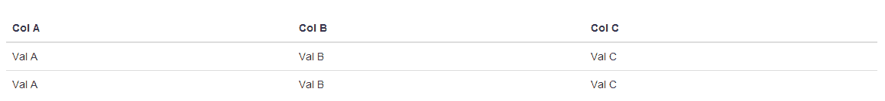

```html
<table class="table table-striped table-bordered">
  <thead>
    <tr>
      <th>Col A</th>
      <th>Col B</th>
      <th>Col C</th>
    </tr>
  </thead>
  <tbody>
    <tr>
      <td>Val A</td>
      <td>Val B</td>
      <td>Val C</td>
    </tr>
    <tr>
      <td>Val A</td>
      <td>Val B</td>
      <td>Val C</td>
    </tr>
  </tbody>
</table>
```
（注：此处原文代码块中 table 闭合标签缺少斜杠，已按要求保持原样，代码不翻译）

剩余的上下文类与 BS2 一样，设计用于高亮表格行以显示不同的条件，除了一个微小变化外，它们是相同的。

代表危险或负面操作的类名已重命名为 `danger`。在 BS2 中，红色类名为 `error`。除此之外，这些类的应用方式如下代码所示，均应用于 `<tr>` 元素：

*代码示例 15：可选行颜色*

渲染时，它看起来应该像这样：

```html
<table class="table">
  <thead>
    <tr>
      <th>Class</th>
      <th>Col B</th>
      <th>Col C</th>
    </tr>
  </thead>
  <tbody>
    <tr class="active">
      <td>Active</td>
      <td>Val B</td>
      <td>Val C</td>
    </tr>
    <tr class="success">
      <td>Success</td>
      <td>Val B</td>
      <td>Val C</td>
    </tr>
    <tr class="info">
      <td>Info</td>
      <td>Val B</td>
      <td>Val C</td>
    </tr>
    <tr class="warning">
      <td>Warning</td>
      <td>Val B</td>
      <td>Val C</td>
    </tr>
    <tr class="danger">
      <td>Danger</td>
      <td>Val B</td>
      <td>Val C</td>
    </tr>
  </tbody>
</table>
```

*图 4：代码示例 15 的输出*

在支持表格的类中有两个新增内容。首先，有一个新的响应式类，它考虑了您的网格系统尺寸，并提供垂直滚动条或适应不同显示的重新排列表格。其次，现在可以在单个单元格上使用上述颜色类，而不再像 BS2 那样仅限于行。

要在单元格级别使用颜色类，您只需要如下对单个 `<td>` 或 `<th>` 元素添加类：

*代码示例 16：将行类应用于单个单元格*

这段代码应产生如下：

*图 5：代码示例 16 的输出*

最后一个表格添加是一个名为 `table-responsive` 的类，您可以通过将其应用于包裹 `<table>` 的 `<div>` 元素来使用：

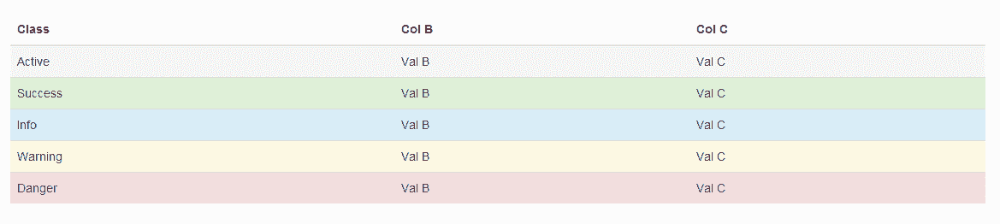

```html
<div class="table-responsive">
  <table class="table">
    <thead>
      <tr>
        <th class="active">Class</th>
        <th class="success">Col B</th>
        <th class="info">Col C</th>
      </tr>
    </thead>
    <tbody>
      <tr>
        <td class="warning">Val A</td>
        <td class="danger">Val B</td>
        <td>Val C</td>
      </tr>
    </tbody>
</table>
</div>
```

*代码示例 17：新的 BS3 响应式表格*

当此新类用于大于 768 像素的显示（即除 `-xs` 外的任何尺寸）时，表格显示将像正常表格。但是，如果表格在针对 `-xs` 且宽度小于 768 像素的设备上显示，容器将进行调整，允许整个表格左右移动而不影响页面其他部分。

*图 6：宽度大于 768 像素的设备上代码示例 17 的输出*

*图 7：宽度小于 768 像素的设备上代码示例 17 的输出*

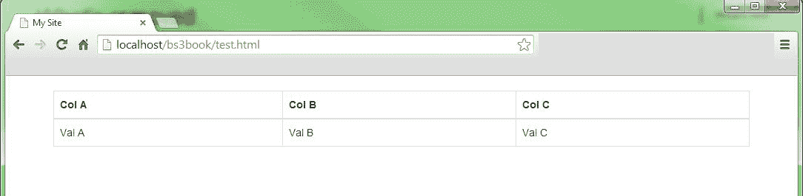

```html
<div class="table-responsive">
  <table class="table table-bordered">
    <thead>
      <tr>
        <th>Col A</th>
        <th>Col B</th>
        <th>Col C</th>
      </tr>
    </thead>
    <tbody>
      <tr>
        <td>Val A</td>
        <td>Val B</td>
        <td>Val C</td>
      </tr>
    </tbody>
  </table>
</div>
```


与 BS2 一样，所有普通表单元素默认都有最小级别的标记来提供基础样式。这意味着，只需标记普通的 `<form>` 标签和关联控件即可为您的表单提供默认外观。

参考以下示例：

*代码示例 18：无类的基础 BS3 表单*

如果我们在浏览器中渲染此示例，将发现即使不添加任何额外类，也能获得较好的输出，如下图所示：

代码示例 18 的输出

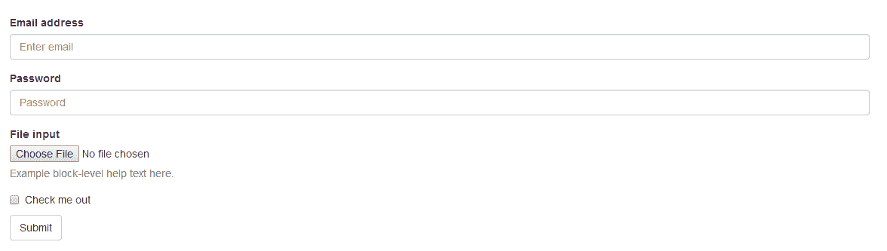

```html
<form>
  <div>
    <label for="exampleInputEmail1">Email address</label>
    <input type="email" id="exampleInputEmail1" placeholder="Enter email">
  </div>
  <div>
    <label for="exampleInputPassword1">Password</label>
    <input type="password" id="exampleInputPassword1" placeholder="Password">
  </div>
  <div>
    <label for="exampleInputFile">File input</label>
    <input type="file" id="exampleInputFile">
    <p>Example block-level help text here.</p>
  </div>
  <div>
    <label>
      <input type="checkbox"> Check me out
    </label>
  </div>
  <button type="submit">Submit</button>
</form>
```

注意：自之前的示例编写以来，BS3 代码进行了细微更新。如果您按照此处编写的方式尝试该示例，输出可能不符合预期。BS3 中所做的更改似乎意味着，现在在不添加任何 BS3 类的情况下仅标记表单，将无法为表单提供一致的外观和感受。我在本书中保留了该示例，因为它与文档网站上仍然存在的信息保持一致，因此这似乎仍然是框架作者的官方建议。

正如我在迁移章节中提到的，在 HTML 表单周围的类和组件在涉及类名更改时是受影响最大的受害者之一，但这是有原因的。在 BS3 之前，许多用于表单的类范围很窄——许多用途都有单独的类，而不是一个涵盖所有情况的类。例如，有单独的类来处理复选框和单选按钮的对齐，也有单独的类来处理输入框和文本区域的行。在 BS3 中，这些许多类已被删除，现在都合并到了更少数的类和元素下。

在我们之前的示例基础上添加 BS3 文档所示的推荐标记，将得到如下内容：

*代码示例 19：添加推荐类的示例 18 基础 BS3 表单*


```html
<form role="form">
  <div class="form-group">
    <label for="exampleInputEmail1">Email address</label>
    <input type="email" class="form-control" id="exampleInputEmail1" placeholder="Enter email">
  </div>
  <div class="form-group">
    <label for="exampleInputPassword1">Password</label>
    <input type="password" class="form-control" id="exampleInputPassword1" placeholder="Password">
  </div>
  <div class="form-group">
    <label for="exampleInputFile">File input</label>
    <input type="file" id="exampleInputFile">
    <p class="help-block">Example block-level help text here.</p>
  </div>
  <div class="checkbox">
    <label>
      <input type="checkbox"> Check me out
    </label>
  </div>
  <button type="submit" class="btn btn-default">Submit</button>
</form>
```


从外部来看，如果你渲染这段代码，你会发现它的输出与示例 18 生成的输出没有区别。从内部来看，Bootstrap 现在可以比以前更轻松地找到并处理单个元素。

在 BS2 中，除非你想使用自动验证类，否则并不要求对控件进行分组。虽然现在仍然没有绝对要求使用这些类，但这样做可以允许 BS 在使用网格系统（以及许多其他功能）时，能够正确地调整这些项的大小并对其进行重新定位。你还会注意到，每个控件现在都只被分配了一个单一 `form-control` 类，而不是针对不同方面的许多不同类。

另外请注意，`form` 标签本身现在也被分配了一个 `role` 属性。这不仅是一项良好的通用实践，现在还受到了 BS3 的强制执行，以辅助 aria 角色以及引导残障人士使用 Web 应用的标准。

最后，如果你查看带有 `help-block` 的 `<p>` 标签，你会发现它现在在所有情况下都被用于内联表单文本，而在 BS2 中，我们有许多种不同的类，例如 `form-info`。

遗憾的是，表单支持方面仍然缺失一个领域——文件上传控件。与 BS2 类似，这是由于当前所有浏览器的安全性限制了对文件输入控件进行样式设置以与其他可用输入控件匹配的能力。

然而，正如我在前一书中提到的，仍然有一些第三方插件涵盖了这一领域，而且由于你现在可以使用 HTML5 类构建自己的上传系统，从严格来说说，你不需要文件上传控件——你可以自己制作一个。

在 BS2 中，有很多特定的表单类型，例如 `search-form`；在 BS3 中，所有这些类型都合并成了三种主要的表单类型。首先，你有标准表单；正如我们所看到的，这是一个普通的表单，没有在 `form` 标签上添加额外的类。另外两种表单类型是 `form-inline`（内联表单）和 `form-horizontal`（水平表单）。

`form-inline` 类设计用于小型、高度限制区域的表单，例如菜单和导航栏。但需要警告的是：此类类以及其他表单类型中的所有输入元素默认大小均为 100%，因此如果你需要表单只占用一小部分空间（特别是在导航栏表单中），你将对单个控件设置手动尺寸。

在代码示例 19 的示例中，添加 `form-inline` 或 `form-horizontal` 分别将改变你的基础表单布局，如下所示：

*图 8：代码示例 19 在 form 标签上添加 `form-inline` 类后生成的表单。*

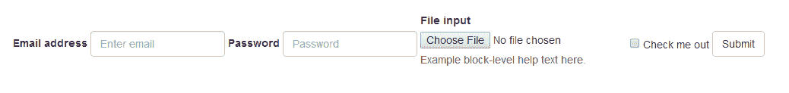

`form-horizontal` 类用于创建普通的自上向下表单，其关联标签位于控件左侧，而不是像默认表单那样位于上方。但请注意，为了让水平表单正常工作，你需要对表单整体添加一些额外的标记，如下代码示例所示。

*注意：在当今 HTML 5 的奇新世界中，用关联的标签正确标记输入元素比以往任何时候都重要。因为弱势用户可能正在使用辅助工具来帮助他们，如果不提供让这些辅助工具正常运行的必要部分，未来将会被视为一种坏事，而忽视这些点的公司可能会因此受到排斥。不过担心——BS3 会为你解决问题。如果你决定不想在表单中使用标签，你可以用可选的类 `sr-only` 来标记它们。添加此类将在视觉上防止标签或相关的帮助文本出现在你的文档中，但将确保其标记方式能够被屏幕阅读器或其他类似的设备或软件可见。*

*代码示例 20：示例 19 的代码通过额外类进行标记以支持水平表单*


```html
<form role="form" class="form-horizontal">
  <div class="form-group">
    <label for="exampleInputEmail1" class="col-sm-2 control-label">邮箱地址</label>
    <div class="col-sm-10">
      <input type="email" class="form-control" id="exampleInputEmail1" placeholder="Enter email">
    </div>
  </div>
  <div class="form-group">
    <label for="exampleInputPassword1" class="col-sm-2 control-label">密码</label>
    <div class="col-sm-10">
      <input type="password" class="form-control" id="exampleInputPassword1" placeholder="Password">
    </div>
  </div>
  <div class="form-group">
    <label for="exampleInputFile" class="col-sm-2 control-label">文件输入</label>
    <div class="col-sm-10">
      <input type="file" id="exampleInputFile">
      <p class="help-block">此处是示例块级帮助文本。</p>
    </div>
  </div>
  <div class="form-group">
    <div class="col-sm-offset-2 col-sm-10">
      <div class="checkbox">
        <label>记住我</label>
      </div>
    </div>
  </div>
  <div class="form-group">
    <div class="col-sm-offset-2 col-sm-10">
```

如果你在浏览器中渲染这段代码，你会发现它的输出与示例 18 生成的输出没有区别。从内部来看，Bootstrap 现在可以比以前更轻松地找到并处理单个元素。

在 BS2 中，除非你想使用自动验证类，否则并不要求对控件进行分组。虽然现在仍然没有绝对要求使用这些类，但这样做可以允许 BS 在使用网格系统（以及许多其他功能）时，能够正确地调整这些项的大小并对其进行重新定位。你还会注意到，每个控件现在都只被分配了一个单一 `form-control` 类，而不是针对不同方面的许多不同类。

另外请注意，`form` 标签现在也被分配了一个 `role` 属性。这不仅是一项良好的通用实践，现在还受到了 BS3 的强制执行，以辅助 aria 角色以及引导残障人士使用 Web 应用的标准。

最后，如果你查看带有 `help-block` 的 `<p>` 标签，你会发现它现在在所有情况下都被用于内联表单文本，而在 BS2 中，我们有许多种不同的类，例如 `form-info`。

遗憾的是，表单支持方面仍然缺失一个领域——文件上传控件。与 BS2 类似，这是由于当前所有浏览器的安全性限制了对文件输入控件进行样式设置以与其他可用输入控件匹配的能力。

然而，正如我在前一书中提到的，仍然有一些第三方插件涵盖了这一领域，而且由于你现在可以使用 HTML5 类构建自己的上传系统，从严格来说说，你不需要文件上传控件——你可以自己制作一个。

在 BS2 中，有很多特定的表单类型，例如 `search-form`；在 BS3 中，所有这些类型都合并成了三种主要的表单类型。首先，你有标准表单；正如我们所看到的，这是一个普通的表单，没有在 `form` 标签上添加额外的类。另外两种表单类型是 `form-inline`（内联表单）和 `form-horizontal`（水平表单）。

`form-inline` 类设计用于小型、高度限制区域的表单，例如菜单和导航栏。但需要警告的是：此类类以及其他表单类型中的所有输入元素默认大小均为 100%，因此如果你需要表单只占用一小部分空间（特别是在导航栏表单中），你将对单个控件设置手动尺寸。

在代码示例 19 的示例中，添加 `form-inline` 或 `form-horizontal` 分别将改变你的基础表单布局，如下所示：

*图 8：代码示例 19 在 form 标签上添加 `form-inline` 类后生成的表单。*


`form-horizontal` 类用于创建普通的自上向下表单，其关联标签位于控件左侧，而不是像默认表单那样位于上方。但请注意，为了让水平表单正常工作，你需要对表单整体添加一些额外的标记，如下代码示例所示。

*注意：在当今 HTML 5 的奇新世界中，用关联的标签正确标记输入元素比以往任何时候都重要。因为弱势用户可能正在使用辅助工具来帮助他们，如果不提供让这些辅助工具正常运行的必要部分，未来将会被视为一种坏事，而忽视这些点的公司可能会因此受到排斥。不过担心——BS3 会为你解决问题。如果你决定不想在表单中使用标签，你可以用一个可选的类 `sr-only` 来标记它们。添加此类将在视觉上防止标签或相关的帮助文本出现在你的文档中，但将确保其标记方式能够被屏幕阅读器或其他类似的设备或软件可见。*

*代码示例 20：示例 19 的代码通过额外类进行标记以支持水平表单*


```html
<form role="form" class="form-horizontal">
  <div class="form-group">
    <label for="exampleInputEmail1" class="col-sm-2 control-label">邮箱地址</label>
    <div class="col-sm-10">
      <input type="email" class="form-control" id="exampleInputEmail1" placeholder="Enter email">
    </div>
  </div>
  <div class="form-group">
    <label for="exampleInputPassword1" class="col-sm-2 control-label">密码</label>
    <div class="col-sm-10">
      <input type="password" class="form-control" id="exampleInputPassword1" placeholder="Password">
    </div>
  </div>
  <div class="form-group">
    <label for="exampleInputFile" class="col-sm-2 control-label">文件输入</label>
    <div class="col-sm-10">
      <input type="file" id="exampleInputFile">
      <p class="help-block">此处是示例块级帮助文本。</p>
    </div>
  </div>
  <div class="form-group">
    <div class="col-sm-offset-2 col-sm-10">
      <div class="checkbox">
        <label>记住我</label>
      </div>
    </div>
  </div>
  <div class="form-group">
    <div class="col-sm-offset-2 col-sm-10">
```

如果你在浏览器中渲染这段代码，你会发现它的输出与示例 18 生成的输出没有区别。从内部来看，Bootstrap 现在可以比以前更轻松地找到并处理单个元素。

在 BS2 中，除非你想使用自动验证类，否则并不要求对控件进行分组。虽然现在仍然没有绝对要求使用这些类，但这样做可以允许 BS 在使用网格系统（以及许多其他功能）时，能够正确地调整这些项的大小并对其进行重新定位。你还会注意到，每个控件现在都只被分配了一个单一 `form-control` 类，而不是针对不同方面的许多不同类。

另外请注意，`form` 标签现在也被分配了一个 `role` 属性。这不仅是一项良好的通用实践，现在还受到了 BS3 的强制执行，以辅助 aria 角色以及引导残障人士使用 Web 应用的标准。

最后，如果你查看带有 `help-block` 的 `<p>` 标签，你会发现它现在在所有情况下都被用于内联表单文本，而在 BS2 中，我们有许多种不同的类，例如 `form-info`。

遗憾的是，表单支持方面仍然缺失一个领域——文件上传控件。与 BS2 类似，这是由于当前所有浏览器的安全性限制了对文件输入控件进行样式设置以与其他可用输入控件匹配的能力。

然而，正如我在前一书中提到的，仍然有一些第三方插件涵盖了这一领域，而且由于你现在可以使用 HTML5 类构建自己的上传系统，从严格来说说，你不需要文件上传控件——你可以自己制作一个。

在 BS2 中，有很多特定的表单类型，例如 `search-form`；在 BS3 中，所有这些类型都合并成了三种主要的表单类型。首先，你有标准表单；正如我们所看到的，这是一个普通的表单，没有在 `form` 标签上添加额外的类。另外两种表单类型是 `form-inline`（内联表单）和 `form-horizontal`（水平表单）。

`form-inline` 类设计用于小型、高度限制区域的表单，例如菜单和导航栏。但需要警告的是：此类类以及其他表单类型中的所有输入元素默认大小均为 100%，因此如果你需要表单只占用一小部分空间（特别是在导航栏表单中），你将对单个控件设置手动尺寸。

在代码示例 19 的示例中，添加 `form-inline` 或 `form-horizontal` 分别将改变你的基础表单布局，如下所示：

*图 8：代码示例 19 在 form 标签上添加 `form-inline` 类后生成的表单。*


`form-horizontal` 类用于创建普通的自上向下表单，其关联标签位于控件左侧，而不是像默认表单那样位于上方。但请注意，为了让水平表单正常工作，你需要对表单整体添加一些额外的标记，如下代码示例所示。

*注意：在当今 HTML 5 的奇新世界中，用关联的标签正确标记输入元素比以往任何时候都重要。因为弱势用户可能正在使用辅助工具来帮助他们，如果不提供让这些辅助工具正常运行的必要部分，未来将会被视为一种坏事，而忽视这些点的公司可能会因此受到排斥。不过担心——BS3 会为你解决问题。如果你决定不想在表单中使用标签，你可以用一个可选的类 `sr-only` 来标记它们。添加此类将在视觉上防止标签或相关的帮助文本出现在你的文档中，但将确保其标记方式能够被屏幕阅读器或其他类似的设备或软件可见。*

*代码示例 20：示例 19 的代码通过额外类进行标记以支持水平表单*


```html
<form role="form" class="form-horizontal">
  <div class="form-group">
    <label for="exampleInputEmail1" class="col-sm-2 control-label">邮箱地址</label>
    <div class="col-sm-10">
      <input type="email" class="form-control" id="exampleInputEmail1" placeholder="Enter email">
    </div>
  </div>
  <div class="form-group">
    <label for="exampleInputPassword1" class="col-sm-2 control-label">密码</label>
    <div class="col-sm-10">
      <input type="password" class="form-control" id="exampleInputPassword1" placeholder="Password">
    </div>
  </div>
  <div class="form-group">
    <label for="exampleInputFile" class="col-sm-2 control-label">文件输入</label>
    <div class="col-sm-10">
      <input type="file" id="exampleInputFile">
      <p class="help-block">此处是示例块级帮助文本。</p>
    </div>
  </div>
  <div class="form-group">
    <div class="col-sm-offset-2 col-sm-10">
      <div class="checkbox">
        <label>记住我</label>
      </div>
    </div>
  </div>
  <div class="form-group">
    <div class="col-sm-offset-2 col-sm-10">
```

如果你在浏览器中渲染这段代码，你会发现它的输出与示例 18 生成的输出没有区别。从内部来看，Bootstrap 现在可以比以前更轻松地找到并处理单个元素。

在 BS2 中，除非你想使用自动验证类，否则并不要求对控件进行分组。虽然现在仍然没有绝对要求使用这些类，但这样做可以允许 BS 在使用网格系统（以及许多其他功能）时，能够正确地调整这些项的大小并对其进行重新定位。你还会注意到，每个控件现在都只被分配了一个单一 `form-control` 类，而不是针对不同方面的许多不同类。

另外请注意，`form` 标签现在也被分配了一个 `role` 属性。这不仅是一项良好的通用实践，现在还受到了 BS3 的强制执行，以辅助 aria 角色以及引导残障人士使用 Web 应用的标准。

最后，如果你查看带有 `help-block` 的 `<p>` 标签，你会发现它现在在所有情况下都被用于内联表单文本，而在 BS2 中，我们有许多种不同的类，例如 `form-info`。

遗憾的是，表单支持方面仍然缺失一个领域——文件上传控件。与 BS2 类似，这是由于当前所有浏览器的安全性限制了对文件输入控件进行样式设置以与其他可用输入控件匹配的能力。

然而，正如我在前一书中提到的，仍然有一些第三方插件涵盖了这一领域，而且由于你现在可以使用 HTML5 类构建自己的上传系统，从严格来说说，你不需要文件上传控件——你可以自己制作一个。

在 BS2 中，有很多特定的表单类型，例如 `search-form`；在 BS3 中，所有这些类型都合并成了三种主要的表单类型。首先，你有标准表单；正如我们所看到的，这是一个普通的表单，没有在 `form` 标签上添加额外的类。另外两种表单类型是 `form-inline`（内联表单）和 `form-horizontal`（水平表单）。

`form-inline` 类设计用于小型、高度限制区域的表单，例如菜单和导航栏。但需要警告的是：此类类以及其他表单类型中的所有输入元素默认大小均为 100%，因此如果你需要表单只占用一小部分空间（特别是在导航栏表单中），你将对单个控件设置手动尺寸。

在代码示例 19 的示例中，添加 `form-inline` 或 `form-horizontal` 分别将改变你的基础表单布局，如下所示：

*图 8：代码示例 19 在 form 标签上添加 `form-inline` 类后生成的表单。*


`form-horizontal` 类用于创建普通的自上向下表单，其关联标签位于控件左侧，而不是像默认表单那样位于上方。但请注意，为了让水平表单正常工作，你需要对表单整体添加一些额外的标记，如下代码示例所示。

*注意：在当今 HTML 5 的奇新世界中，用关联的标签正确标记输入元素比以往任何时候都重要。因为弱势用户可能正在使用辅助工具来帮助他们，如果不提供让这些辅助工具正常运行的必要部分，未来将会被视为一种坏事，而忽视这些点的公司可能会因此受到排斥。不过担心——BS3 会为你解决问题。如果你决定不想在表单中使用标签，你可以用一个可选的类 `sr-only` 来标记它们。添加此类将在视觉上防止标签或相关的帮助文本出现在你的文档中，但将确保其标记方式能够被屏幕阅读器或其他类似的设备或软件可见。*

*代码示例 20：示例 19 的代码通过额外类进行标记以支持水平表单*


```html
<form role="form" class="form-horizontal">
  <div class="form-group">
    <label for="exampleInputEmail1" class="col-sm-2 control-label">邮箱地址</label>
    <div class="col-sm-10">
      <input type="email" class="form-control" id="exampleInputEmail1" placeholder="Enter email">
    </div>
  </div>
  <div class="form-group">
    <label for="exampleInputPassword1" class="col-sm-2 control-label">密码</label>
    <div class="col-sm-10">
      <input type="password" class="form-control" id="exampleInputPassword1" placeholder="Password">
    </div>
  </div>
  <div class="form-group">
    <label for="exampleInputFile" class="col-sm-2 control-label">文件输入</label>
    <div class="col-sm-10">
      <input type="file" id="exampleInputFile">
      <p class="help-block">此处是示例块级帮助文本。</p>
    </div>
  </div>
  <div class="form-group">
    <div class="col-sm-offset-2 col-sm-10">
      <div class="checkbox">
        <label>记住我</label>
      </div>
    </div>
  </div>
  <div class="form-group">
    <div class="col-sm-offset-2 col-sm-10">
```


当在浏览器中渲染时，这将产生一个普通的表单布局，其中静态控件被清晰地标记为不可编辑或不像输入控件，如图所示：

*图 11：由代码示例 22 生成的带有静态字段表单*

表单控件的禁用样式仍然以与 BS2 相同的方式标记和使用，只需在输入元素上添加“disabled”属性，如下所示：

这将产生经典的禁用和阴影控件外观，类似于下所示：

*图 12：BS2 和 BS3 中经典的禁用控件外观*

如果你向环围表单的字段集（field-set）添加 `disabled` 属性，则该组中的所有控件将同时被禁用，并使用相同的样式。这在 BS2 中是不可能的——在 BS2 中，你必须逐个标记每个控件。

表单这个话题上，我想最后提到的是验证类和焦点类（focus classes）。正如我之前提到的，在 HTML5 元素中添加正确的输入类型对于使用验证类非常有帮助。这是由于为什么呢？

除了有供你使用的专用类名和样式外，验证类还挂钩了新的 HTML5 伪元素，例如 `focus:`、`error:` 等。

这意味着，如果你将文本框标记为 `type="email"`，然后在提交时没有向其中输入邮箱地址，浏览器应该自动为你将字段高亮为红色。

如果 de这样做，或者你有其他方法让你的验证生效，那么你只需简单地在表单组上使用 `has-success`、`has-warning` 和 `has-error` 类，如下方的代码所示：

*代码示例 23：在 BS3 中标记表单以使用验证类*

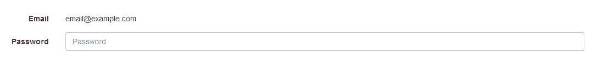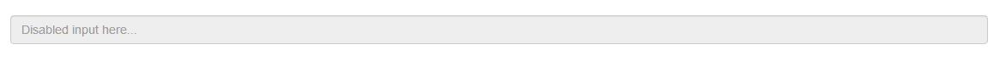

`</div>`
`</div>`
`</form>`

`<input class="form-control" id="disabledInput" type="text" placeholder="Disabled input here..." disabled>`

`<form role="form">`
`<div class="form-group has-success">`

如果你在浏览器中渲染这段代码，你应该看到如下的内容：

*图 13：代码示例 23 生成的输出*

需要注意的是，我将这些类添加到了表单组中以产生静态显示；然而，你也应该尝试仅通过正确的输入类型来标记表单。我发现浏览器对伪类的支持仍然有些不完善，尽管 BS3 文档中没有提到这一点，所以我建议你在使用 JavaScript 操控元素时，也利用这些类名。

另外请注意，标签（label）和块级帮助文本也会采用该组的正确颜色，因此你不需要单独为表单控件组中的这些添加颜色或样式。

记住，`form-group` 部分也可以使用我们目前提到的所有其他内容，根据需要对分组进行禁用、着色和调整表单元素的大小。

验证组最后要提到的是，你还可以直接在表单控件中提供可选的反馈图标，以帮助显示状态。

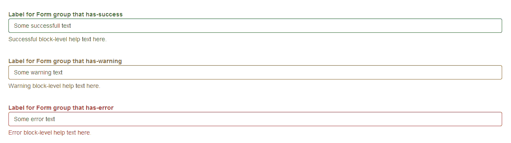

`<label class="control-label" for="inputSuccess1">Label for Form group that has-success</label>`
`<input type="text" class="form-control" id="inputSuccess1" value="Some successful text">`
`<p class="help-block">Successful block-level help text here.</p>`
`</div>`
`<div class="form-group has-warning">`
`<label class="control-label" for="inputWarning1">Label for Form group that has-warning</label>`
`<input type="text" class="form-control" id="inputWarning1" value="Some warning text">`
`<p class="help-block">Warning block-level help text here.</p>`
`</div>`
`<div class="form-group has-error">`
`<label class="control-label" for="inputError1">Label for Form group that has-error</label>`
`<input type="text" class="form-control" id="inputError1" value="Some error text">`
`<p class="help-block">Error block-level help text here.</p>`
`</div>`
`</form>`

你通过在使用的输入元素**紧邻**之后提供一个 `span` 元素来实现此。这个 `span` 元素应用了常用的图标类（我们将在下一章看到），以及 `form-control-feedback` 类。由于控件重新定位以使其显示在控件中的方式，这**必须**被放在输入控件之后，并在输入组中任何其他标记之前。一旦你添加了 `span`，你还需要在表单组类列表中添加 `has-feedback` 类，与其他用于显示验证状态的 `has-xxxxx` 类并列一起使用。

如果我们扩展代码示例 23 以将此考虑在内并添加反馈图标，它看起来应该是这样的：

*代码示例 24：示例 23，修改后添加反馈图标*

一旦我们使用这些更改进行重新渲染，你应该看到如下：

`<form role="form">`
`<div class="form-group has-success has-feedback">`
`<label class="control-label" for="inputSuccess1">Label for Form group that has-success</label>`
`<input type="text" class="form-control" id="inputSuccess1" value="Some successfull text">`
`<span class="glyphicon glyphicon-ok form-control-feedback"></span>`
`<p class="help-block">Successful block-level help text here.</p>`
`</div>`
`<div class="form-group has-warning has-feedback">`
`<label class="control-label" for="inputWarning1">Label for Form group that has-warning</label>`
`<input type="text" class="form-control" id="inputWarning1" value="Some warning text">`
`<span class="glyphicon glyphicon-warning-sign form-control-feedback"></span>`
`<p class="help-block">Warning block-level help text here.</p>`
`</div>`
`<div class="form-group has-error has-feedback">`
`<label class="control-label" for="inputError1">Label for Form group that has-error</label>`
`<input type="text" class="form-control" id="inputError1" value="Some error text">`
`<span class="glyphicon glyphicon-remove form-control-feedback"></span>`
`<p class="help-block">Error block-level help text here.</p>`
`</div>`
`</form>`

*图 14：代码示例 24 生成的输出*

## 按钮变化

BS3 中用于样式化按钮的类最显著的变化是默认样式。在 BS2 中，只需为 `input` 元素或 `anchor` 标签添加 `btn` 类即可赋予控件默认的外观和感觉。从 BS3 开始，你现在显式地添加 `btn-default`；单独添加 `btn` 将不再产生任何效果。

第二个主要变化是某些基础类的重命名。具体来说，`btn-error` 被重命名为 `btn-danger`，以便与其他类似命名的类更改匹配，并为 Bootstrap 库带来统一性。

除此之外，基础按钮类保持不变，如下代码示例所示：

*代码示例 25：BS3 按钮类*

在浏览器中渲染时，你将看到 BS3 现在为控件提供的普通扁化按钮外观：

*图 15：由代码示例 25 生成的 Bootstrap 按钮*

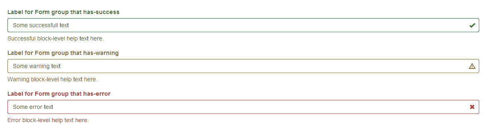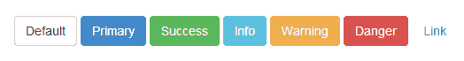

`<button type="button" class="btn btn-default">Default</button>`
`<button type="button" class="btn btn-primary">Primary</button>`
`<button type="button" class="btn btn-success">Success</button>`
`<button type="button" class="btn btn-info">Info</button>`
`<button type="button" class="btn btn-warning">Warning</button>`
`<button type="button" class="btn btn-danger">Danger</button>`
`<button type="button" class="btn btn-link">Link</button>`


为按钮元素新增了几个新类，旨在使网格尺寸类保持一致性。这些类是 `btn-lg`、`btn-sm` 和 `btn-xs`；没有 `btn-md`，因为中等尺寸按钮是未指定类名时使用的标准尺寸。

以下代码示例演示了不同尺寸下所有的按钮样式：

*代码示例 26：不同尺寸下的所有 BS3 按钮样式*

`<p>
  <button type="button" class="btn btn-default btn-lg">大默认按钮</button>
  <button type="button" class="btn btn-default">中等默认按钮</button>
  <button type="button" class="btn btn-default btn-sm">小型默认按钮</button>
  <button type="button" class="btn btn-default btn-xs">极小默认按钮</button>
</p>

`<p>
  <button type="button" class="btn btn-primary btn-lg">大主按钮</button>
  <button type="button" class="btn btn-primary">中等主按钮</button>
  <button type="button" class="btn btn-primary btn-sm">小型主按钮</button>
  <button type="button" class="btn btn-primary btn-xs">极小主按钮</button>
</p>`

`<p>
  <button type="button" class="btn btn-success btn-lg">大成功按钮</button>
  <button type="button" class="btn btn-success">中等成功按钮</button>
  <button type="button" class="btn btn-success btn-sm">小型成功按钮</button>
  <button type="button" class="btn btn-success btn-xs">极小成功按钮</button>
</p>

`<p>
  <button type="button" class="btn btn-info btn-lg">大信息按钮</button>
  <button type="button" class="btn btn-info">中等信息按钮</button>
  <button type="button" class="btn btn-info btn-sm">小型信息按钮</button>
  <button type="button" class="btn btn-info btn-xs">极小信息按钮</button>
</p>`

`<p>
  <button type="button" class="btn btn-warning btn-lg">大警告按钮</button>
  <button type="button" class="btn btn-warning">中等警告按钮</button>
  <button type="button" class="btn btn-warning btn-sm">小型警告按钮</button>
  <button type="button" class="btn btn-warning btn-xs">极小警告按钮</button>
</p>

`<p>
  <button type="button" class="btn btn-danger btn-lg">大危险按钮</button>
  <button type="button" class="btn btn-danger">中等危险按钮</button>
  <button type="button" class="btn btn-danger btn-sm">小型危险按钮</button>
  <button type="button" class="btn btn-danger btn-xs">极小危险按钮</button>
</p>`

`<p>
  <button type="button" class="btn btn-link btn-lg">大链接按钮</button>
  <button type="button" class="btn btn-link">中等链接按钮</button>
</p>`

当在浏览器中渲染时，此代码示例应产生如下输出：

*图 16：代码示例 26 生成的输出*

当你对使用之前任何按钮类样式的按钮或锚点元素添加 `btn-block` 类时，该按钮将扩展以填充 100% 的可用空间。这在用 BS3 网格系统制作对话框和尺寸控制控件时非常有用，因为它允许你专门调整按钮（和其他元素）的尺寸，以在表单设计中保持良好的平衡。

在大多数情况下，你不需要手动设置按钮的激活（active）状态，但如果需要，你可以轻松地为任何使用按钮类标记的元素添加 `active` 类。通常情况下，“激活”（至少在 `<button>` 元素上）使用 `:active` 伪选择器来更改按钮样式。然而，添加 `active` 类将强制按钮显示其激活状态。

注意：如果你正在考虑使用 `active` 状态来创建粘性按钮，请注意在接下来的章节中，我们将使用可用的组件和 JavaScript 功能来讨论按钮状态。BS3 通过这些功能提供的额外特性已经提供了这样的粘性按钮，因此在大多数情况下，你不需要使用 `active` 创建自己的粘性按钮。

你也可以使用我们之前讨论过的表单元素更改中相同的“disabled”类和属性来禁用按钮并将其标记为非活动状态。

(img/3ef3f89d4853001235bf8b5b1e48737_44_1.png)

`<p>
  <button type="button" class="btn btn-link btn-sm">小型链接按钮</button>
  <button type="button" class="btn btn-link btn-xs">极小链接按钮</button>
</p>`

以下代码显示了被标记为激活和禁用的按钮：

*代码示例 27：BS3 激活和禁用按钮*

*图 17：代码示例 27 生成的输出*

但请注意，对于锚点按钮，`disabled` 元素/类**不会**禁用链接；要确保禁用的锚点不会触发，你需要使用 JavaScript。出于此原因，BS3 团队建议尽可能使用 `<button>` 元素，仅在特定情况下使用锚点标签。我们也不要忘记“幂等性”主题以及使用按钮而非锚点的重要性。通常情况下，如果目标是一个请求且多次点击链接不会引起任何问题，则锚点是合适的；否则，请使用按钮。

## 图片更改

在图像标签方面，CSS 的变化没有像 BS3 中那样深远。以前，图像默认不是响应式的，在 BS2 的许多功能中，你必须添加响应式类才能使其具有响应效果。遗憾的是，即使添加了响应式类，情况也并不完美；许多人提到了使用图像的页面存在问题。

![](img/3ef3f89d4853001235bf8b5b1e48737_45_0.png

`<p>
  <button type="button" class="btn btn-primary active">激活的主按钮</button>
  <button type="button" class="btn btn-default active">激活的中等按钮</button>
</p>

`<p>
  <button type="button" class="btn btn-primary" disabled="disabled">禁用的主按钮</button>
  <button type="button" class="btn btn-default" disabled="disabled">禁用的中等按钮</button>
</p>`

BS3 改变了这一切。现在，默认情况下，使用 `` 标签就是完全响应式的。为了扩展这种响应性并使其更流畅，你可以对任何 `` 标签添加 `img-responsive`，以确保在缩放时图像的高宽也保持比例。除此之外，对图像部分的唯一更改是将 `img-polaroid` 类（用于生成缩略图）重命名为 `img-thumbnail`，以便与库的其他命名保持一致。

BS2 的 `img-rounded` 和 `img-circle` 类仍然像以前一样工作，提供圆形和圆矩形形效果。

## 辅助与可见性更改

最后，我们来看涵盖不属于特定类别的更改。

在 BS2 的排版类中，最初引入了一组颜色类，用于将文本元素的颜色设置为框架中其他元素使用的相同品牌颜色。BS3 更进了一步，引入了将相同颜色也用于上下文背景的概念。在这种情况下，背景是较浅的版本，正如在其他地方面板和警报框中使用那样。还有一个额外的奖励：如果你在锚点标签以及任何设置了默认悬停效果的对象上这些上下文颜色类，颜色会自动变暗，以显示它们被悬停。

与其他颜色类的命名方式一样，这里可用的类有 `text-muted`、`text-primary`、`text-success`、`text-info`、`text-warning` 和 `text-danger`，用于段落、span 以及其他行内或块文本元素。对于背景颜色，类名分别为 `bg-primary`、`bg-success`、`bg-info`、`bg-warning` 和 `bg-danger`。

以下代码显示了使用它们的示例：

*代码示例 28：BS3 上下颜色类*

`<p class="text-muted">此段落使用了淡文本类，**通常用于不真正重要或不那么显目的内容。**</p>`
`<p class="text-primary">此段落使用了主文本类，**通常用于重要或默认可见的内容。**</p>`
`<p class="text-success">此段落使用了成功文本类，**通常用于刚刚成功的操作或令人愉快且祝贺的内容。**</p>`


*图 18：代码示例 28 的输出*

BS3 中提到的一个需求但在 BS2 中不存在的功能是：为按钮和其他屏幕组件上的下拉指示器提供了一个专门的 `caret` 类。

现在你已经通过为自己的外部容器添加 `caret` 类名来使用它——该容器可以是包裹你内部内容的 `<span>` 或 `<div>`。

BS3 的另一个新特性，虽然它实际上不是一个类，但仍然值得提及：对话框的关闭叉号。

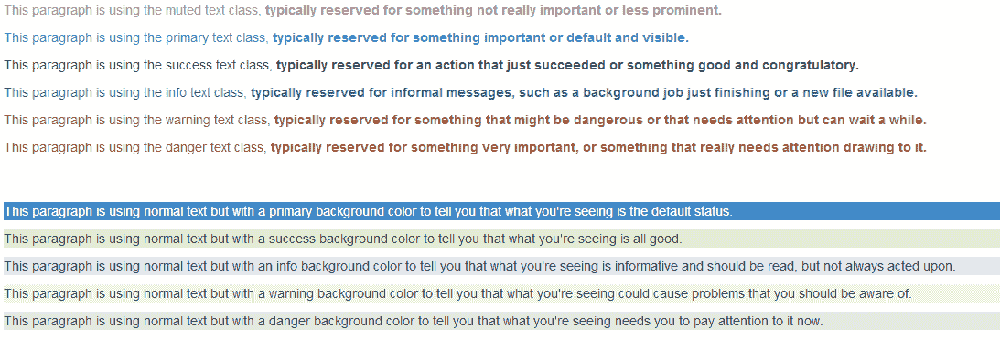

`<p class="text-info">此段使用了 info 文本类，<strong>通常保留用于非正式消息，例如后台作业刚刚完成或有新文件可用。</strong></p>`

`<p class="text-warning">此段使用了 warning 文本类，<strong>通常保留用于某些可能危险或需要注意但可以等一会儿的情况。</strong></p>`

`<p class="text-danger">此段使用了 danger 文本类，<strong>通常保留用于非常重要的事情，或确实需要引起关注的事情。</strong></p>`

`<br/><br/>`

`<p class="bg-primary">此段使用了普通文本，但带有 primary 背景色，以告知你所看到的是默认状态。</p>`

`<p class="bg-success">此段使用了普通文本，但带有 success 背景色，以告知你看到的结果一切良好。</p>`

`<p class="bg-info">此段使用了普通文本，但带有 info 背景色，以告知你看到的内容具有信息性，应该阅读，但不一定需要采取行动。</p>`

`<p class="bg-warning">此段使用了普通文本，但带有 warning 背景色，以告知你看到的内容可能会引起你应该注意的问题。</p>`

`<p class="bg-danger">此段使用了普通文本，但带有 danger 背景色，以告知你看到的内容你现在需要注意。</p>`

就像 `caret` 一样，这在 BS2 中就存在，但无法在用于模态对话框和警报栏的预期用途之外单独使用。然而，从 BS3 开始，你可以很好地独立使用它。

以下代码示例展示了如何在通用标记中同时使用 `caret` 类和关闭叉号：

*代码示例 29：使用 BS3 Caret 和关闭叉号助手*

*图 19：代码示例 29 的输出*

与 BS2 一样，快速浮动类 `pull-left` 和 `pull-right` 仍然存在，但它们现在加入了 `center-block`（它简单地让左右外边距变为自动并将元素在父元素中居中）以及 `clearfix`（它清除任何浮动，从而恢复正常流）。

其他新类包括 `show`、`hidden` 和 `invisible`。`Show` 几乎是不言自明的，但后两者之间有什么区别呢？`Hidden` 会物理上折叠元素占据的空间，因此如果你在一个全高的 `div` 中使用它，它将折叠到最小高度。然而，如果你使用 `invisible`，元素将保留其空间（仍占据流的位置），但会从视图中消失。

我们已经看到引入了一个名为 `sr-only` 的新类，用于标记某个块仅对屏幕阅读器可见而其他地方隐藏。现在有了另一个类似的类用于图形化标题。

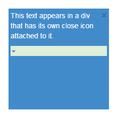

`<div class="bg-primary" style="width: 200px; height: 200px; padding: 4px;">`
`<button class="close" aria-hidden="true">&times;</button>`
`<p>这段文字出现在一个带有自定义图标的 div 中。</p>`
`<div class="bg-success text-primary"></div>`
`</div>`

如果你使用图像横幅定义页面标题，普通的屏幕阅读器将无法识别图像中的文字。长期以来，许多作者一直使用一种名为“图像替换”（image replacement）的黑科技方法来绕过这个问题。图像替换的工作原理是将图像横幅包裹在 `<h1>` 或其他标准类型标签中，将名称作为清晰文本与横幅并放在其中，然后使用 CSS 将文本移到屏幕外。

这样产生的结果是：在视觉上，视力良好的人可以看到图像横幅，但使用屏幕阅读器的人能听到图像横幅中的实际文本。BS3 现在提供了一个名为 `text-hide` 的类来方便这一操作。下面是一个简单的示例：

*代码示例 30：使用 Text-Hide 类制作对阅读器友好的标题*

*图 20：在普通浏览器中代码示例 30 生成的输出*

最后，我们来到 CSS 部分的最后一个部分。如果没有帮助你管理响应式布局的工具类，一个响应式设计框架又有什么用处呢？

“等一下，我们已经通过网格涵盖了这一点，”我听到你这么说，是的，我们涵盖了。但 BS3 还有一个杀手锏，公平地说，这个插件在 BS2 中就存在，但效果并不十分理想。

那么这个额外的魔法是什么？让我向你介绍响应式可见性类（responsive visibility classes）。基本上，这些小宝贝的作用是允许你根据网格和显示尺寸切换并更改 UI 的部分。

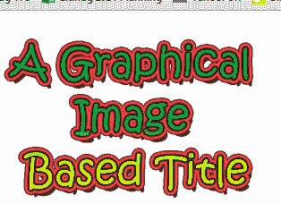

`<header>`
``
`<h1 class="text-hide">图形化标题</h1>`
`</header>`

想象一下，例如你有一个收件箱列表，在桌面端查看时，每个项目旁边都有预览，就像经典的电子邮件应用程序。如下：

邮件 1
邮件 2：已收到
致：某人

亲爱的某人，
啦啦啦啦啦啦

*图 21：电子邮件应用程序布局*

这在某些情况下很棒，但当你尝试在移动设备上拟合它时，那时你绝对想隐藏预览面板，只留下邮件列表。通常这类任务使用少量 JavaScript 通过更改元素的可见性设置来完成。BS3 提供了一个使用 CSS 类的内置解决方案，可以让你轻松处理此类情况。参考以下代码：

*代码示例 31：电子邮件应用程序原型*

`<div class="col-md-12" style="border: 1px solid black">`
`<div class="col-md-3">`
`<table class="table">`
`<tr><td>邮件 1 (1/1/11)</td></tr>`
`<tr><td class="info">邮件 2 (1/1/11)</td></tr>`
`<tr><td>邮件 3 (1/1/11)</td></tr>`
`<tr><td>邮件 4 (1/1/11)</td></tr>`
`<tr><td>邮件 5 (1/1/11)</td></tr>`
`</table>`
`</div>`
`</div>`

如果你在浏览器中渲染它，你应该得到类似下面的效果：

*图 22：代码示例 31 生成的电子邮件应用程序原型*

然而，如果你将浏览器调整为移动设备屏幕大小，情况看起来就会有些奇怪：

*图 23：调整视图下的电子邮件应用程序原型*

这对于某些人可能可行，但通常来说，这是一个坏主意。当你有 100 封未读邮件，并且每次都要滚动到视图底部才能阅读预览时，会发生什么？


获取主预览 `<div>` 并为其添加一个新类 `hidden-sm`，如下所示：

然后，如果你刷新浏览器并尝试调整大小，你会发现预览 `<div>` 现在在超过某些宽度时会隐藏，而不是堆叠。

*图 24：邮件应用程序原型，已调整大小，并添加了隐藏类*

与网格系统一样，这里有四种不同的尺寸，以及用于隐藏和显示的类。显示类会使目标元素**仅**在指定的屏幕尺寸下可见，而隐藏类则使目标元素**仅**在指定的屏幕尺寸下隐藏。类名如下：

- `visible-xs` - 在超小屏幕上显示
- `visible-sm` - 在小屏幕上显示
- `visible-md` - 在中等屏幕上显示
- `visible-lg` - 在超大屏幕上显示
- `hidden-xs` - 在超小屏幕上隐藏
- `hidden-sm` - 在小屏幕上隐藏
- `hidden-md` - 在中等屏幕上隐藏
- `hidden-lg` - 在大屏幕上隐藏

设备宽度和相关的触发点与普通网格系统相同，其中 `-xs` 覆盖掌上级平板手机和更小设备，`-sm` 覆盖中等到较大的平板电脑，`-md` 覆盖大多数桌面电脑，`-lg` 覆盖宽屏桌面。

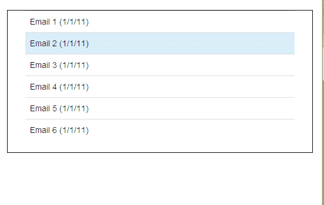

`<div class="col-md-9 hidden-sm" style="border-left: 1px solid black">`

该类别还有最后两个类用于帮助你处理显示与打印布局。

你可以以与上述尺寸类完全相同的方式使用 `visible-print` 和 `hidden-print`，但这次是在页面发送到打印机时使元素可见或不可见。

# 第 4 章 变更组件特性

## Glyphicon 变化

BS3 提供的组件中最大的新闻是 Glyphicons图标集。当 V3.0 beta 首次发布时，作为 BS3 图标集核心的 Glyphicons 字体被移除了。社区对此表示强烈抗议，特别是当图标集被拆分到独立仓库时。

然而，这种拆分是短暂的，从正式发布开始，Glyphicons 字体被恢复到主分支，但获得了一个新奖励。

图标集不再由一组黑白位图 `png` 组成——它现在是一套完整的、基于矢量的字体集，包含 `ttf`、`svg`、`woff` 等格式。由于它现在是矢量格式，因此可以使用标准的 CSS 颜色技术轻松着色，并且可以缩放到所需的任何尺寸。

在 BS3 的当前版本中，有 200 多个图标供选择，涵盖了许多不同的用例。要使用图标，只需添加 `glyphicon` 类以及 `glyphicon-xxxxx` 来选择要使用的实际图标。然后，将此添加到嵌套在你想显示图标的元素内的 `span` 类中。

使用 glyphicons 必须遵守的一条规则是：不能将图标内容与任何其他元素混合。你必须确保图标类仅应用于其自身的元素，并在周围留有足够的内边距，以确保它与旁任何其他内容之间有足够的空间。

以下代码提供了如何使用 glyphicon 类的简单概述：

*代码示例 32：BS3 Glyphicons 示例*

`<<h1>这是标题文本 <small>带有一些小字文本和一个图标 <span class="glyphicon glyphicon-home"></span></small></h1>`

`<p>这是一个普通段落，再次像标题一样，它有一个内联图标 <span class="glyphicon glyphicon-headphones"></span></p>`

`<div style="background-color: beige; width: 200px; height: 200px; padding: 4px;">`
`<p>这是一个固定尺寸的 div，其中包含一个缩放后的图标</p>`
`<span class="glyphicon glyphicon-road" style="font-size: 150px;"></</span>`
`</div>`

`<p class="text-success">这是一个普通段落，给它应用了不同的颜色 <span class="glyphicon glyphicon-cog"></span></p>`

*图 25：代码示例 32 的输出结果*

可用图标太多，无法在此列出所有，但如果你访问 http://getbootstrap.com/components/#glyphicons-how-to-use，你会发现一个包含获取所需图标的所有类名的网格。

图标在添加的的任何容器中都能正常工作，它们也遵循尺寸类。例如，如果你将一个图标添加到带有 `btn-lg` 类的 `<button>` 元素内部，图标将按要求缩放以匹配按钮大小。

## 按钮变化

从组件的角度来看，BS3 对按钮的更改非常细微。有一些新的类和建议，以及正如提到的外观和感受上的某些变化，除此之外，你在 BS2 中执行的所有操作应该仍能按预期工作。

从组件的角度来看，`btn-group` 和 `btn-toolbar` 类保持不变，但现在建议尽可能尝试确保使用 `btn-group` 对按钮进行分组。此外，在标记工具栏时，你应该尝试确保为它们应用了 `btn-toolbar`。


*图 27：代码示例 34 生成的输出*

注意上一个代码示例，我更改了下拉按钮的颜色；要实现这一效果，你只需要在各个按钮的类上添加单独的按钮颜色即可。这适用于所有按钮组和工具栏——而不是在嵌套它们时——这意味着你可以根据使用情况更改组内按钮的颜色。

用于按钮布局的两个新类是 `btn-group-vertical` 类和 `btn-group-justified` 类。

在 BS2 中，很难将按钮垂直堆叠，或者在保持尺寸平衡的同时让它们占据可用区域的全部宽度。BS3 中的这两个新类同时解决了这两个棘手的问题。但请注意，为了让等对齐组（justified groups）正常工作，你可能比预期的要多为按钮组添加一些标记标记。

下一个代码示例展示了如何使用垂直分组：

*代码示例 35：垂直按钮组*

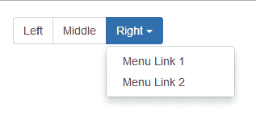

```html
<li><a href="#">Menu Link 1</a></li>
<li><a href="#">Menu Link 2</a></li>
</ul>
</div>

<div class="btn-group-vertical btn-group-lg">
  <button type="button" class="btn btn-default">Top</button>
  <button type="button" class="btn btn-default">Middle</button>
  <button type="button" class="btn btn-default">Bottom</button>
</div>
<div class="btn-group-vertical">
  <button type="button" class="btn btn-primary">Top</button>
  <button type="button" class="btn btn-primary">Middle</button>
  <button type="button" class="btn btn-primary">Bottom</button>
</div>
<div class="btn-group-vertical btn-group-sm">
  <button type="button" class="btn btn-success">Top</button>
  <button type="button" class="btn btn-success">Middle</button>
  <button type="button" class="btn btn-success">Bottom</button>
</div>
<div class="btn-group-vertical btn-group-xs">
```

*图 28：代码示例 35 生成的输出*

正如我刚刚指出的，标记等齐类（justification classes）要稍微复杂一些，但为了平滑处理遗憾仍然存在的少数浏览器不一致之处是必要的。如果你使用以下代码所示的模式来标记你的等齐组，那么你会发现这些不一致之处都不会给你带来任何问题：

*代码示例 36：BS3 等齐按钮示例*

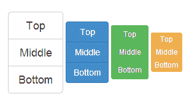

```html
<button type="button" class="btn btn-warning">Top</button>
<button type="button" class="btn btn-warning">Middle</button>
<button type="button" class="btn btn-warning">Bottom</button>
</div>

<div class="btn-group btn-group-justified" style="padding-top: 4px;">
  <div class="btn-group">
    <button type="button" class="btn btn-default">Left</button>
  </div>
  <div class="btn-group">
    <button type="button" class="btn btn-default">Middle</button>
  </div>
  <div class="btn-group">
    <button type="button" class="btn btn-default">Right</button>
  </div>
</div>
<div class="btn-group btn-group-justified" style="padding-top: 4px;">
  <div class="btn-group">
    <button type="button" class="btn btn-primary">Left</button>
  </div>
  <div class="btn-group">
    <button type="button" class="btn btn-primary">Middle 1</button>
  </div>
  <div class="btn-group">
    <button type="button" class="btn btn-primary">Middle 2</button>
  </div>
  <div class="btn-group">
    <button type="button" class="btn btn-primary">Right</button>
  </div>
</div>
<div class="btn-group btn-group-justified" style="padding-top: 4px;">
  <div class="btn-group">
    <button type="button" class="btn btn-success">Left</button>
  </div>
```

*图 29：示例 36 生成的输出*

标记的黄金法是，每个单独的按钮必须封装在一个应用了 `btn-group` 类的 `div` 中。然后，这些单组中的每一个组都需要封装在一个外部 `div` 中，该外部 `div` 同时应用了 `btn-group` 和 `btn-group-justified` 类。

如果你在使用等齐组，有一点需要注意：由于按钮被渲染为块级元素（block elements），组尺寸类将无法按预期工作。这其实并不令人意外，因为它们无法作用于添加了 `btn-block` 类的单个按钮上，就像内联元素通常无法进行流式控制一样。

如果你的按钮是由 `<a>` 标签组成的，那么你不需要这些额外的标记——你只需要在外部 `div` 上添加 `btn-group-justified` 类，并在内部放入普通按钮即可。

带有菜单的下拉按钮的创建方式与 BS2 中完全相同。首先，你创建一个应用了 `btn-group` 类的外部 `div`。紧接着在内部，你创建一个应用了普通按钮样式的按钮，带有 `dropdown-toggle` 类以及名为 `toggle` 属性值为 `dropdown`。在按钮之后、关闭组 `div` 之前，你再使用应用了 `dropdown-menu` 类和 `role` 属性的标准无序列表（unordered list）来定义实际菜单。

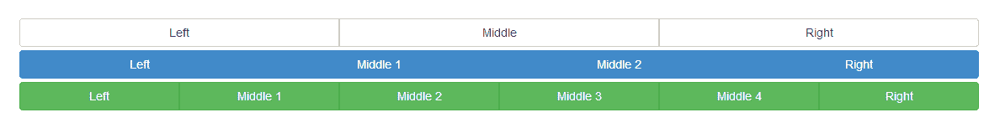

```html
</div>
<div class="btn-group">
  <button type="button" class="btn btn-success">Middle 1</button>
</div>
<div class="btn-group">
  <button type="button" class="btn btn-success">Middle 2</button>
</div>
<div class="btn-group">
  <button type="button" class="btn btn-success">Middle 3</button>
</div>
<div class="btn-group">
  <button type="button" class="btn btn-success">Middle 4</button>
</div>
<div class="btn-group">
  <button type="button" class="btn btn-success">Right</button>
</div>
</div>
```

**注意：** HTML 5 带来的新功能之一是数据属性（data attributes）。BS3（确切地说包括 BS2）在许多不同的地方使用这些属性，允许元素和 JavaScript 函数连接在一起，而无需开发者编写任何单行 JavaScript。数据属性始终以 `data-*` 的形式存在，其中 `name` 是开发者想要分配给该属性的名称。使用 `data-*` 可以确保你定义的属性永远不会与 WHATWG 标准向规范中添加的任何内容冲突，为开发者在使用这些属性的方面提供了最大的灵活性。

在大多数情况下，这些数据属性的使用方式正如 BS3 使用所示：将信息从元素传递到处理该元素的 JavaScript 程序中。它们可以用于传递 ID 名称、选项、尺寸参数以及许多其他内容，这意味着你通常不需要在应用程序中实际编写任何样板代码。在本章中，你将接触更多此类数据属性。

为了让下拉按钮工作，你**必须**将下拉 JavaScript 插件添加到你的 BS3 构建中。如果你只是下载了默认set，那么这将不是问题，因为 `dropdown.js` 已经是主 `bootstrap.js` 文件的一部分。如果你执行了自定义构建，甚至是你自己从 Less 源码编译的，你需要确保它的存在。

以下代码展示了一个基础的下拉按钮示例：

*代码示例 37：下拉按钮示例*


```html
<div class="btn-group">
  <button type="button" class="btn btn-success dropdown-toggle" data-toggle="dropdown">
    A dropdown button <span class="caret"></span>
  </button>
  <ul class="dropdown-menu" role="menu">
    <li><a href="#">1st Link</a></li>
    <li><a href="#">2nd Link</a></li>
    <li><a href="#">3rd Link</a></li>
    <li class="divider"></li>
    <li><a href="#">1st Link after divider</a></li>
  </ul>
</div>
```


*图 30：代码示例 37 生成的输出*

通过对代码示例 37 进行简单的修改，你可以轻松将按钮转换为拆分下拉菜单（split drop-down menu），其中按钮的操作本身保持为一个独立动作，但点击 Caret（箭头）时仍允许菜单出现。

要实现这一点，只需在按钮元素之前直接添加另一个按钮元素，然后将文本（但**不是** Caret）从（现有的）第二个按钮移动到第一个按钮中，使得新的按钮标签看起来如下所示：

如果你随后在浏览器中重新渲染输出，你应该看到以下内容：

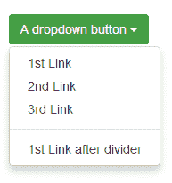

```html
<button type="button" class="btn btn-success">A dropdown button</button>
<button type="button" class="btn btn-success dropdown-toggle" data-toggle="dropdown">
  <span class="caret"></span>
</button>
<ul class="dropdown-menu" role="menu">
  <li><a href="#">1st Link</a></li>
  <li><a href="#">2nd Link</a></li>
  <li><a href="#">3rd Link</a></li>
  <li><li class="divider"></li>
  <li><a href="#">1st Link divider</a></li>
</ul>
```

*图 31：代码示例 37 修改后生成的输出*

在继续下文之前，最后要提到的一点是尺寸调整（sizing）和向上弹出（drop-up）变体。尺寸调整非常简单；章节中提到的尺寸类在下拉按钮上的工作符合预期，其方式与它们在普通按钮上的方式相同（`lg` 表示大号，`md` 是默认值，`sm` 表示小号，`xs` 表示超小）。`Drop-up` 是一个类名，当你在构建下拉菜单或拆分下拉按钮时，将其应用到带有 `btn-group` 类的外部元素上，正如其名称所示，它会导致菜单向上弹出而不是向下弹出。

## 关于下拉菜单的最后说明

下拉菜单不仅可以附加在按钮上——**任何**可以包裹在外部父级元素中的元素都可以使用。你可以对被包裹的元素应用 `dropdown` 类，并带有 `toggle` 属性，其属性值为 `dropdown`，这将导致该元素成为下拉菜单显示的触发器。

## 输入组的变化

简而言之，在 BS2 和 BS3 之间输入组（input group）的功能没有变化。输入组的标记方式仍然与之前完全相同，并具有相同的的注意事项，即：

- 你不能在同一侧添加多个添加项，每端各只能添加一个。
- 不支持在一个输入组中使用多个元素。
- 你不能将输入组与其他组件混合；你必须对它们嵌套。

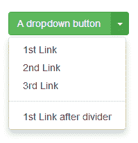

如果你正在附加工具提示（tooltips）和弹出框（popovers），你必须像之前在按钮更改部分提到的那样添加一个容器。尽可能避免在带有选择列表（select lists）在使用输入组，特别是针对基于 WebKit 的浏览器时。要创建一个输入组，只需将你的输入控件及其前缀（通常是 `<span>`）包裹在 `<div>` 或其他块级元素中，并对其应用 `input-group` 类。接下来，确保额外的 `<span>` 应用了 `input-group-addon` 类。

例如，以下代码将为 Twitter 句柄创建一个输入框，并为不需要输入小数部分的金额创建一个输入框。

*代码示例 38：使用输入组的 BS3 输入附加框* 

*图 32：代码示例 38 生成的输出*

标准的尺寸类也适用于这些内容，就像它们适用于其他表单输入一样，因此在外部输入组上添加 `input-group-lg` 和 `input-group-sm`（再次，没有 `md`）将对整个控制set进行相应的尺寸调整。

在 BS3 中不是新功能、但变得更容易实现的一点是在输入组中添加复选框、单选按钮、普通按钮和下拉菜单。这些选项中的每一个都比使用普通 `<span>` 时需要更多的标记，但结果是你可以为你的字段添加交互性。例如，你可能使用这些输入来创建自己的文件上传控件，或者一个创建随机密码的按钮。以下代码显示了如何实现这一点：

*代码示例 39：使用按钮和单选框的输入组*

```html
<div class="input-group">
  <span class="input-group-addon">@</span>
  <input type="text" class="form-control" placeholder="Username">
</div>
<br/>
<div class="input-group">
  <input type="text" class="form-control">
  <span class="input-group-addon">.00</span>
</div>
<div class="input-group">
  <span class="input-group-addon"></span>
</div>
```

*图 33：代码示例 39 生成的输出*

## 导航的变化

导航组件也有自己的变化，但与其他组类似，这主要是为了整理工作以使其更有意义。在涉及导航时，有两个主要部分：基础导航（basic navigation）和导航栏（nav-bars）。在这两者中，导航栏的变化最大。

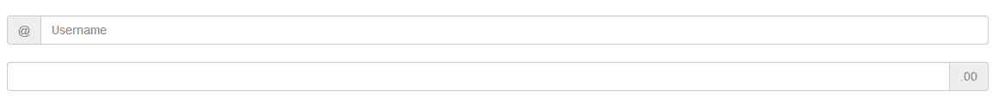

最初，在 BS2 中，你真正拥有的导航栏；没有按钮类或文本类——只有品牌（brand）。这导致了开发者之间的许多困惑和许多问题，例如“如何让导航栏中的文本居中？”以及“如何防止我的按钮增加导航栏的高度？”BS3 现在引入了许多专门为这些场景设计的类，我们将很快介绍。

首先：BS2 中的导航组件消失了。不仅仅是过时了，而是被移除了。虽然它很容易使用（你创建一个无序列表，添加一点 Bootstrap 魔法就可以搞定），但它很杂乱，在所有浏览器中工作都不一致，并且存在一些渲染问题。我们现在有了什么？我们有了列表组（List groups），稍后我们将详细介绍。现在，让我们讨论剩余的部分，因为它为稍后使用列表组奠定了基础。那么基础类是什么呢？可能会让你惊讶的是，它简单是一个名为 `nav` 的类，结合 `nav-tabs`、`nav-pills` 和 `nav-stacked`，可以像你以前在 BS2 中制作 `nav` 列表一样制作标签、药丸和侧边栏导航结构。现在的标记要简单得多。你不需要担心任何额外的内边距或浏览器异常，你绝对不需要自定义内容来完成任务。

要使用标签，只需取无序列表，并添加 `nav` 和 `nav-tabs` 类，如以下代码所示：

*代码示例 40：基于标签的导航*

*图 34：代码示例 40 生成的输出*

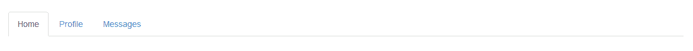

```html
<ul class="nav nav-tabs">
  <li class="active"><a href="#">Home</a></li>
  <li><a href="#">Profile</a></li>
  <li><a href="#">Messages</a></li>
</ul>
```


现在需要的标记仅包含几个 `<li>` 元素；唯一需要应用类名的地方是外层 `<ul>` 标签本身。你还会看到我们在列表的第一个 `<li>` 上有一个 `active` 类，用以显示哪个标签是激活状态标签。

如果你想让 BS3 提供整个标签页（tab）体验（即根据需要实际更改内容），那么你还需要做更多工作。为了这一点，正如我们将在 JavaScript 部分中看到的，你需要使用 JavaScript 扩展插件之一。然而，如果你想自己处理标签页切换和内容，切换标签页时你只需要将 `active` 类从一个 `<li>` 移动到下一个 `<li>` 即可。

胶囊按钮（pills）的情况并没有更复杂：只需将代码示例 40 中的 `nav-tabs` 替换为 `nav-pills`，你就能看到输出结果变为如下所示：

*图 35：代码示例 40 更改到“胶囊”模式后的输出*

如果我们对其中任何一个类添加 `nav-stacked`，我们的导航将整齐地一个一个堆叠在一起：

*图 36：代码示例 40，更改为“胶囊”模式并添加了 nav-stacked*

与框架中的大多数其他组件和变化一样，输出现在被渲染为一个块级元素，占据所有可用空间。同样，你只需要使用网格系统和其他可用类名来确保它只占据你需要的空间。现在，任何因为屏幕分辨率不同而改变大小的父容器都会导致其子元素根据需要响应地调整大小。

顺便提一下，这也适用于标签页导航，但输出结果可能不是你预期的：

*图 37：代码示例 40 渲染为堆叠标签页*

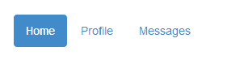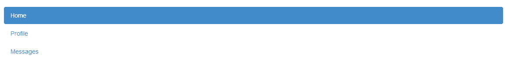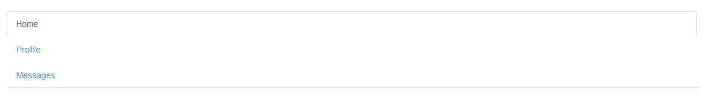

公平地说，尽管它并不是真的为了这种方式而设计的——标签页通常从左到右运行，虽然 BS2 确实有一些将标签放在元素侧面和底部的类，但这些类在 BS3 中被删除了。制作完整标签式输出的 JavaScript 插件仍然具有定位标签的能力，但通用导航不再具备这种能力。

与按钮组件中做的更改一样，导航辅助工具现在也增加了一个新的两对齐类，名为 `nav-justified`，就像按钮版本一样，它会使导航类跨越容器的全宽度，使每个兄弟元素具有相等的大小。

如果我们取示例 40 中的代码，并在已有的两个类中添加 `nav-justified`，我们就会得到以下结果：

*图 38：应用了全宽两对齐的代码示例 40 导航标签页*

导航辅助工具与按钮类和组件还有另一个共同点：基于状态的变化（用于显示特定状态），以及处理下拉菜单和子导航的能力。

只需在导航集中的 `<li>` 内部添加 `disabled` 类即可禁用并淡化该链接，使其具有 `muted-text` 的视觉效果。但记住，它并不会禁用链接——链接仍然可以点击，这取决于你编写代码让链接不产生反应。

要在任何基于胶囊或标签页的导航项中添加下拉菜单，只需使用与按钮部分所示相同的布局和类名。在 `<li>` 内部嵌套一个 `<a>`，后面跟着另一个 `<ul>`，并带有相应的类名和数据属性以使这一切正常工作。

在基础导航和导航栏的交叉部分，我们还有面包屑导航（breadcrumbs）和页面/分页导航辅助工具。

面包屑通常用于标记你在网站层级中的位置，正如我们上面看到的，使用它们简单就是将它们添加到无序列表中，如下所示代码所示：

*代码示例 41：BS3 面包屑导航示例*

*图 39：代码示例 41 生成的输出*

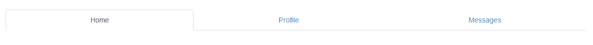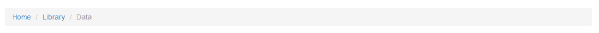

`<ul class="breadcrumb"> `
` <li><a href="#">Home</a></li> `
` <li><a href="#">Library</a></li> `
` <li class="active">Data</li> `
`</ul>`

在我们转向完全导航栏之前，最后的控件是分页控件。这些控件承担了大量的体力工作，即将一个带有“上一页/下一页”的栏对齐，并在中间排列一组数字。分页栏通常用于数据密集型网站，你希望一次显示一页而不是一次性显示所有内容，分页栏既简单用又于与输出的其他部分对齐。

与其他基础元素一样，创建分页栏只需向无序列表添加适当的类，如下所示：

`<ul class="pagination"> ` ...（注：原文此处似乎有重复，已根据逻辑重新梳顺翻译）

正如其他基础元素一样，创建分页栏只需向无序列表添加适当的类，如下代码所示：

`<ul class="pagination"> `
*代码示例 42：分页*

*图 40：分页的输出*

正如其他元素一样，通过在列表中的 `<li>` 中添加 `active` 和 `disabled` 类，可以标记哪些是激活或禁用的。创建分页栏非常简单，只需向无序列表添加适当的类，如下代码所示：

`<ul class="pagination"> ` ...（注：由于原文文本存在大量逻辑重复和断句，译文已根据 Markdown 结构进行了整理，确保不漏译且不重复原文）


基础导航栏现在在你的页面显示中以折叠项的形式开始运行。这意味着，如果第一个显示是在移动设备上，你的设计将从一个精致的折叠菜单栏开始，并准备好完全按照移动用户的预期进行展开。在 BS2 中，情况恰相反，你必须在显示它之前采取额外的步骤来对其进行折叠。

导航栏将随着显示宽度的增加逐渐变得可见，直到整个单元在全尺寸下有足够的空间跨页面进行水平渲染。

但请注意——即使列宽为非流式的 1024px，且整个显示宽度是流式的，仍然可能空间不足。当这种情况发生时，你可能会面临严重的内容溢出场景。例如，将你的导航栏推到两或更多行高并不困难。

确保这种情况发生的推荐方法是使用自定义样式来控制元素的宽度，和/或使用响应式可见性类来控制不同屏幕尺寸下显示和不显示的内容。

如果你使用 Less，现在还可以自定义 `@grid-float-breakpoint` 变量来控制导航栏折叠的触发点，或者你可以直接在基础 CSS 中自定义相应的媒体查询。

导航栏需要启用 JavaScript 才能正常工作；如果没有启用，导航栏仍然会显示，但折叠功能将无法正常运行。你还需要确保如果你进行了自定义构建，也已经包含了折叠 JavaScript 插件。

下面的代码示例显示了如何创建一个基础的、可折叠的导航栏：

*代码示例 45: 简单的空 BS3 折叠导航栏*

*图 45: 由代码示例 45 生成空白空白栏*

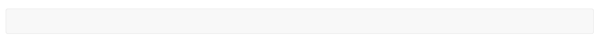

```html
<nav class="navbar navbar-default" role="navigation">
  <div class="container-fluid">
    <div class="navbar-header">
      <button type="button" class="navbar-toggle" data-toggle="collapse" data-target="#bs-example-navbar-collapse-1">
        <span class="sr-only">Toggle navigation</span>
        <span class="icon-bar"></span>
        <span class="icon-bar"></span>
        <span class="icon-bar"></span>
      </button>
    </div
    <div class="collapse navbar-collapse" id="bs-example-navbar-collapse-1">
    </</div>
    <!-- /.navbar-collapse -->
  </div>
  <!-- /.container-fluid -->
</nav>
```

它看起来可能没什么什么，但这个栏会根据不同尺寸的需求进行折叠和展开，我们现在需要做的只是向它添加一些内容。让我们从品牌化开始。

如果你打算在 `<a>` 链接上使用 `navbar-brand` 类为你的导航栏进行品牌化，那么 BS3 的最佳实践是将此元素与构建三线折叠图标的 `navbar-toggle` 元素组合在一起。这确保了在折叠时，文本在变得不可见并垂直堆叠之前会尽可能地缩小。

要进行此项更改，在代码示例 45 中，只需在包含三个类为 `icon-bar` 的 `<span>` 元素的闭合按钮标签之后添加：

然后刷新你的浏览器。结果现在应该像这样：

*图 46: 添加了品牌的空白导航栏*

*当你将鼠标悬停在品牌文本上时，你会发现它也是一个活动链接，通常用于返回网站主页。你也可以在这里放一张图像，但这里没有专门的类来帮助你。我在某些设计中这样做过，但遗憾的是，这仍然需要一些手动工作。如果你让图像的高度与 `<h1>` 元素相近，事物就会保持良好的对齐。否则，我发现的让其生效的最佳方法是在持有品牌名称的元素前面添加一些内边距，然后使用合适的底部边距/内边距对你的标志进行绝对定位，以便它不会隐藏下方的任何内容。*

在品牌类之后，我们还为表单、按钮和文本提供了特定的类，如下：

- `navbar-nav`: 用于创建导航链接和下拉菜单的主 `<ul>`
- `navbar-form`: 用于创建内联微型表单
- `navbar-btn`: 用于标记按钮组件以适应导航栏（navbar-friendly）
- `navbar-text`: 用于在你的栏目中包含独立的文本行
- `navbar-link`: 用于添加不属于常规导航项的独立链接

你可以根据需要将它们放在一起使用，或者单独使用，或者将它们与新颖的 Web 组件规范相结合，创建一个接收配置并按需要绘制所需内容的单栏。

下面的代码示例扩展了 45 以包含一些导航链接：

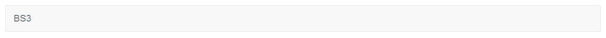

```html
<a class="navbar-brand" href="#">BS3</a>
```

*代码示例 46: 扩展包含链接的示例*

与所有其他导航链接和元素一样，你会看到我们采用了 `active` 类来将第一个链接标记为活动状态，与其他项目一样，你可以应用 `disabled` 类似的类来根据需要标记项目。创建一个从按钮展开的菜单同样简单。你所做的是使用与创建下拉菜单时相同的标记，只需将其封装在 `navbar-nav` 元素中，如：

*代码示例47: 带有下拉按钮的导航栏*

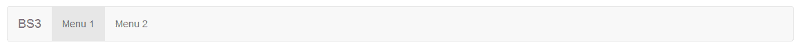

```html
<nav class="navbar navbar-default" role="navigation">
  <div class="container-fluid">
    <div class="navbar-header">
      <button type="button" class="navbar-toggle" data-toggle="collapse" data-target="#bs-example-navbar-collapse-1">
        <span class="sr-only">Toggle navigation</span>
        <span class="icon-bar"></span>
        <span class="icon-bar"></span>
        <span class="icon-bar"></span>
      </button>
      <a class="navbar-brand" href="#">BS3</a>
    </div
    <div class="collapse navbar-collapse" id="bs-example-navbar-collapse-1">
      <ul class="nav navbar-nav">
        <li class="active"><a href="#">Menu 1</a></li>
        <li><a href="#">Menu 2</a></li>
      </ul>
    </</div>
    <!-- /.navbar-collapse -->
  </div>
  <!-- /.container-fluid -->
</nav>
```

*图 48: 由代码示例 47 生成的下拉菜单*

你可以组合这些中的每一项，只需根据需要标记每个 `<li>` 元素，即可在一个 `navbar-nav` `<ul>` 中拥有下拉和非下拉链接。

导航栏的另一个常见需求是强制登录表单，通常用于登录网站的受保护区域。

BS3 使用 `navbar-form` 类使这些表单更容易构造。到目前为止，我们看到所有元素在导航栏的内部区域都是左对齐的。由于登录表单通常是右对齐，BS3 团队提供了 `navbar-right` 类来执行此类操作。以下代码说明了一个示例：

*代码示例 48: 右对齐登录表单的 BS3 导航栏*

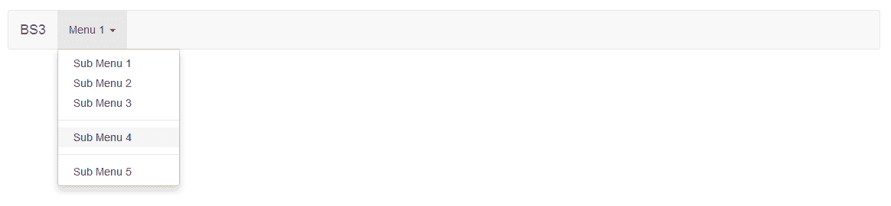

```html
<div class="collapse navbar-collapse" id="bs-example-navbar-collapse-1">
  <ul class="nav navbar-nav">
    <li class="dropdown">
      <a href="#" class="dropdown-toggle" data-toggle="dropdown">Menu 1 <b class="caret"></b></a>
      <ul class="dropdown-menu">
        <li><a href="#">Sub Menu 1</a></li>
        <li><a href="#">Sub Menu 2</a></li>
        <li><a href="#">Sub Menu 3</a></li>
        <li class="divider"></li>
        <li><a href="#">Sub Menu 4</a></li>
        <li class="divider"></li>
        <li><a href="#">Sub Menu 5</a></li>
      </ul>
    </li>
  </ul>
</div>
```


*图 49：带有登录表单的导航栏，由代码示例 48 生成*

同样地，通常还要求当用户登录您的应用程序时，显示他们的姓名而不是表单，并可选地提供一个注销或更改选项的链接和/或按钮。

按钮、文本和链接类都涵盖了这些功能，如下面的代码所示：

*代码示例 49：将登录表单替换为信息显示*

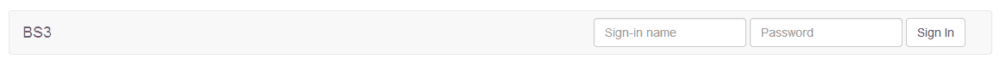

```html
<span class="icon-bar"></span>
</button>
<a class="navbar-brand" href="#">BS3</a>
</div>
<div class="collapse navbar-collapse" id="bs-example-navbar-collapse-1">
  <form class="navbar-form navbar-right">
    <div class="form-group">
      <input type="text" class="form-control" placeholder="Sign-in name">
    </div>
    <div class="form-group">
      <input type="password" class="form-control" placeholder="Password">
    </div>
    <button type="submit" class="btn btn-default">Sign In</button>
  </form>
</div>
</nav>
<nav class="navbar navbar-default" role="navigation">
  <div class="container-fluid">
    <div class="navbar-header">
      <button type="button" class="navbar-toggle" data-toggle="collapse" data-target="#bs-example-navbar-collapse-1">
        <span class="sr-only">Toggle navigation</span>
        <span class="icon-bar"></span>
        <span class="icon-bar"></span>
        <span class="icon-bar"></span>
      </button>
      <a class="navbar-brand" href="#">BS3</a>
    </div>
    <div class="collapse navbar-collapse" id="bs-example-navbar-collapse-1">
      <div class="navbar-right">
        <p class="navbar-text">Signed in as <strong>Peter Shaw</strong></p>
        <a href='#' class="navbar-link">Options</a>&nbsp;&nbsp;
        <button class="btn btn-primary navbar-btn">Sign Out</button>
```

*图 50：由代码示例 49 生成带有信息显示的导航栏*

导航栏本身还有一些巧妙的技巧，你可以将导航栏放置在 `container` 或其他对齐类中，然后给它添加 `navbar-fixed-top`，这样你的导航栏将固定在其容器的顶部，并如图所示与它完美对齐：

*图 51：来自示例 49 并应用了 `navbar-fixed-top` 类的导航栏*

你也可以添加 `navbar-fixed-bottom` 类，它会将你的导航栏固定在页面底部；以及 `navbar-static-top` 类，它会将导航栏固定在容器的顶部，但允许它随页面内容一起滚动。

最后，如果你想要一个深色的导航栏，可以使用 `navbar-inverse` 类，它将反转整个组件所使用的颜色设置：

*图 52：设置了 `inverse` 类的来自示例 49 的导航栏*

## 标签和徽章的变化

这部分将非常短小，因为标签只有两处变化，而徽章（badge）有一处重大变化。在 BS2 中，我们只需为标签提供一个 `label-xxxx` 名称，其中 `xxxx` 代表标签要描绘的状态。在 BS3 下，我们现在有了双部分类定义，并将颜色类中的 `error` 重命名为 `danger`，以便命名方式现在与所有其他内容保持一致，基本上就这些了。

在 BS3 中，这些标签也没有了尺寸类，因为标签的大小取决于其周围容器的大小。因此，如果你创建一个带有适当标签类的 `<span>`，然后将其封装在 `<h1>` 中，该标签的尺寸将比其他部分大得多。接下来的代码示例演示了这一点：

*代码示例 50：不同尺寸的 BS3 标签*

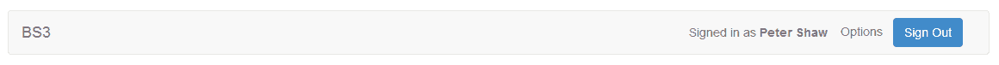(img/3ef3f89d48533001235bf8b5b1e48737_76_1.png)(img/3ef3f89d48533001235bf8b5b1e48737_76_2.png)

```html
</div>
</div>
</div>
</nav>
<h1><span class="label-default">Default</span>span></h1>
```

*图 53：由代码示例 50 生成的输出*

另一方面，徽章经历了更大的变化。在 BS3 中，徽章不再具有上下文类（contextual classes）。也就是说，像之前的标签和其他元素那样，不再有 `label-success` 或 `label-warning` 了。这意味着你不能像在 BS2 中那样为徽章着色，而且你创建的任何标签只能使用标准颜色渲染。嗯，至少从官方上来说你做不到。

如果你在标签旁边应用 `alert-xxxxx` 配合 `label` 类，那么标签将采用 alert 的颜色，虽然这并不是支持的方法，但它确实像你在 BS2 中那样使用标签。为了标记标准标签，你只需要：

*代码示例 51：标准标签示例*

*图 54：示例 51 生成的标签*

如果你想让标签使用不同的颜色，可以这样做：

*代码示例 52：使用 hack 技巧的标签*

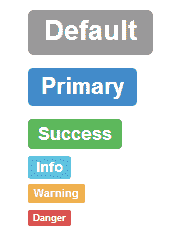

```html
<span class="label-primary">Primary</span></h2>
<span class="label-success">Success</span><h3>
<span class="label-info">Info</span><h4>
<span class="label-warning">Warning</span></h5>
<span class="label-danger">Danger</span></h6>
<span class="label-default">This is a label</span>
<span class="badge">Normal</span>
<span class="badge alert-success">
```

*图 55：示例示例的输出*

然而，徽章组件仍然有一个非常实用的功能，就是使用 `:empty` 伪类，这使得它在内容为空时自动消失。这有助于创建像收箱列表这样的功能，因为当 `<span>` 内容被移除时，它们会消失。这是一个示例：

*代码示例 53：徽章的列表样式*

*图 56：由代码示例 53 生成的输出*

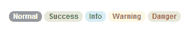(img/3ef3f89d48533001235bf8b5b1e48737_78_1.png)

```html
<span class="badge alert-info">Info</span>
<span class="badge alert-warning">Warning</span>
<span class="badge alert-danger">Danger</span>
<div class="col-md-4">
  <ul class="nav nav-pills nav-stacked">
    <li class="active">
      <a href="#"><span class="badge pull-right">42</span>Inbox</a>
    </li>
    <li class="active">
      <a href="#"><span class="badge pull-right">10000</span>Spam</a>
    </li>
    <li class="active">
      <a href="#"><span class="badge pull-right"></span>Lottery</a>
    </li>
  </ul>
</div>
```

## 列表组（List Group）的变化

列表组是 BS3 中添加的新内容，旨在取代 BS2 的导航列表，并且比其 BS2 版本具有更多的功能。一旦你开始使用它们，你会发现列表组更像是完全样式化的列表项框，坦率地说，创建一个完全样式化的列表框实际上只需要将它们封装在自己的 `<div>` 中并设置溢出为滚动即可。基础列表组组件可以使用类似下面的标记创建：

*代码示例 54：基础 BS3 列表组*

*图 57：由代码示例 54 生成的输出*


*图 58：代码示例 55 的输出*

你们中最敏锐的可能在想：“好吧，所以列表组看起来很不错，但底层仍然只是 <ul> 标签，它们其实并没有什么特别的。”

嗯，也许你在这方面是对的……又也许我们还需要再多做一些实验。

列表组（List groups）与我们在导航章节看到的类不同，它们不能简单地应用于无序列表。列表组可以应用于任何父容器，一旦这样做，其样式将导致该容器的所有子元素都相互链接。请看下面的示例：

*代码示例 56：使用 <a> 标签创建的列表组*

*图 59：代码示例 56 生成的输出*

如代码示例 56 所示，我们只需要在列表周围包围一个 `<div>` 就可以创建一个链接列表，然后该列表会立即变成一个带有浅灰色悬停效果的列表样式菜单。然而，由于内部标签是 `<a>` 标签，我们现在可以更进一步：

*代码示例 57：扩展列表组，以使用不仅仅是简单列表*

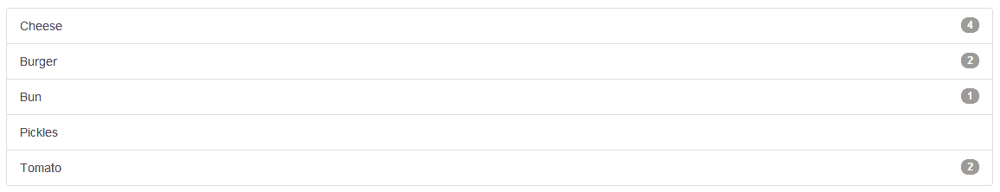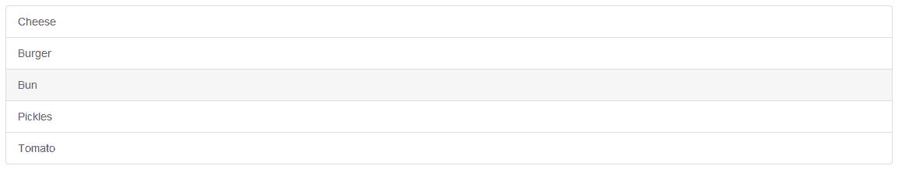

```html
<li class="list-group-item"><span class="badge pull-right">2</span>Tomato</li>
</ul>

<div class="list-group">
  <a class="list-group-item">Cheese</a>
  <a class="list-group-item">Burger</a>
  <a class="list-group-item">Bun</a>
  <a class="list-group-item">Pickles</a>
  <a class="list-group-item">Tomato</a>
</div>

<div class="list-group">
  <a class="list-group-item active">
```

*图 60：代码示例 57 生成的输出*

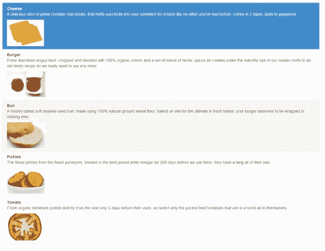

```html
  <strong>Cheese</strong>
  <p>A delicious slice of ...</p>
  
</a>
<a class="list-group-item">
  <strong>Burger</strong>
  <p>Prime Aberdeen angus beef ...</p>
  
</a>
<a class="list-group-item">
  <strong>Bun</strong>
  <p>A freshly baked soft sesame seed bun ...</p>
  
</a>
<a class="list-group-item">
  <strong>Pickles</strong>
  <p>The finest pickles from the finest purveyors ...</p>
  
</a>
<a class="list-group-item">
  <strong>Tomato</strong>
  <p>Fresh organic tomatoes picked directly from the vine ...</p>
  
</a>
</div>
```

注意，当你的鼠标悬停在链接上时，我们仍然获得完整的单元格悬停效果，通过像我们在其他示例中那样简单地添加 `active` 类，我们可以将某个项目标记为激活状态，而这一切保持了单组边框以及每个项目的行为看起来就像普通的 `<ul>` 元素。

但为什么停于此呢？

正如 BS3 中的任何其他元素一样，列表组也有自己的上下文类来赋予它们意义：*代码示例 58：带有上下文颜色的列表组*

```html
<div class="list-group">
  <a class="list-group-item-success">
    <strong>Cheese</strong>
    <p>...</p>
    
  </a>
  <a class="list-group-item-success">
    <strong>Burger</strong>
    <p>...</p>
    
  </a>
  <a class="list-group-item-success">
    <strong>Bun</strong>
    <p>...</p>
    
  </a>
  <a class="list-group-item-danger">
    <strong>Pickles</strong>
    <p>...</p>
    
  </a>
  <a class="list-group-item-warning">
    <strong>Tomato</strong>
    <p>...</p>
    
  </a>
</div
```

*图 61：代码示例 58 的输出*

你可以看到，如果没有奶酪和面包，还有什么？

## 媒体对象与自定义缩略图

我们在 CSS 章节中涵盖了缩略图的变化，但我们还没有进入周围组件的变化。BS3 允许我们将缩略图类与网格类相结合以创建易于使用的列表。最基本的方法是使用 `row` 类和网格类制作完美对齐的缩略图，如下所示：

*代码示例 59：带有网格的基础缩略图*

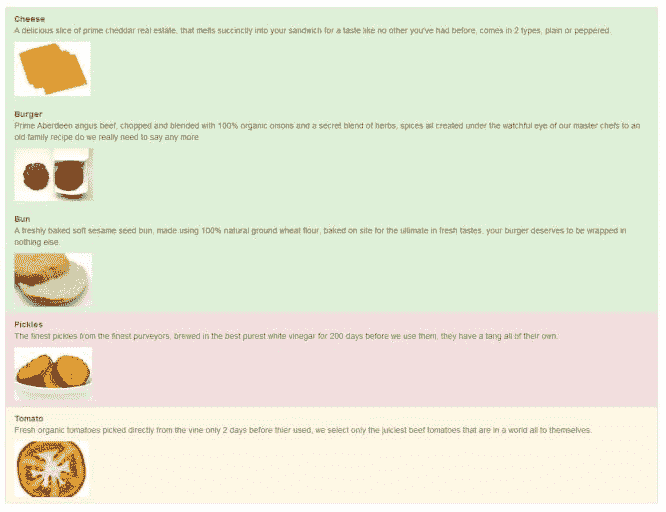

```html
<div class="row">
  <div class="col-md-3">
    <a href="#" class="thumbnail">
      
    </a>
  </div>
  <div class="col-md-3">
    <a href="#" class="thumbnail">
      
    </a>
  </div>
  <div class="col-md-3">
    <a href="#" class="thumbnail">
      
    </a>
  </div>
  <div class="col-md-3">
    <a href="#" class="thumbnail">
      
    </a>
  </div>
</div>
```

*图 62：代码示例 59 的输出*

对于那些感到好奇的人，我使用 **placeholder.js** 来生成占位图。如果我们再增加一点工作，就可以轻松产生如下的内容：

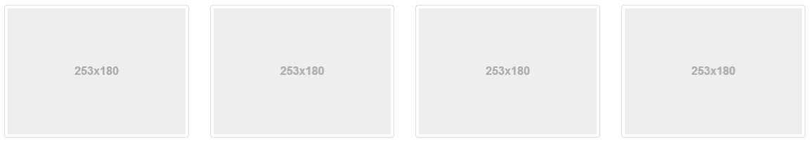

```html
<div class="row">
  <div class="col-md-3">
    <a href="#" class="thumbnail">
      
    </a>
  </div>
  <div class="col-md-3">
    <a href="#" class="thumbnail">
      
    </a>
  </div>
  <div class="col-md-3">
    <a href="#" class="thumbnail">
      
    </a>
  </div>
  <div class="col-md-3">
    <a href="#" class="thumbnail">
      
    </a>
  </div>
</div>
</div>
```


*图 63：代码示例 60 生成的输出*

创建垂直列表同样简单，但我们现在不再使用 `thumbnail` 类，而是需要使用 `media` 对象类。这些类以及相关的标记创建了与上一个示例相似的布局，但文本不再出现在缩略图下方，而是对齐在右侧。

这里的主要的设计意图是带有头像图像的评论和消息列表，但它们也可以用于新闻项目、产品列表以及许多其他地方。

要标记一个媒体对象（media object），只需使用一个类为 `media` 的外部 `div` 即可。然后，在其内部使用 `media-object`、`media-body` 和 `media-heading` 类来标记各个部分，如下例所示：

*代码示例 61：单个 BS3 媒体对象的标记*

*图 64：代码示例 61 生成的媒体对象*

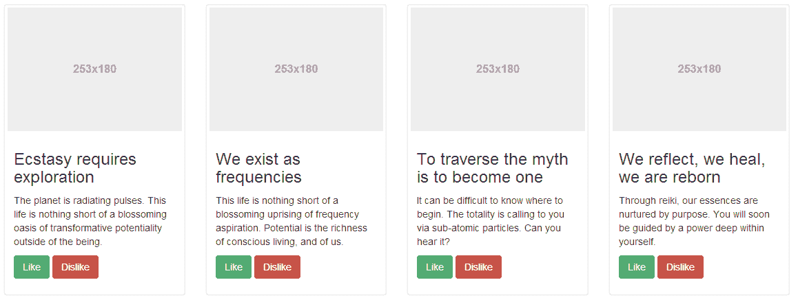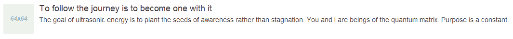

```html
<div class="media">
  <a class="pull-left" href="#">
    
  </a>
  <div class="media-body">
    <h4 class="media-heading">追随旅程就是与它合一</h4>
    <p>超声能量的目标是播下意识的种子，而不是停滞。你和我都是量子矩阵中的生物。目标是永恒。</p>
  </div>
</div>
```

通过稍作修改你的标记，你可以生成完整的媒体对象列表，如下：

*代码示例 62：完整的媒体对象列表*

*图 65：代码示例 62 生成的完整媒体对象列表*

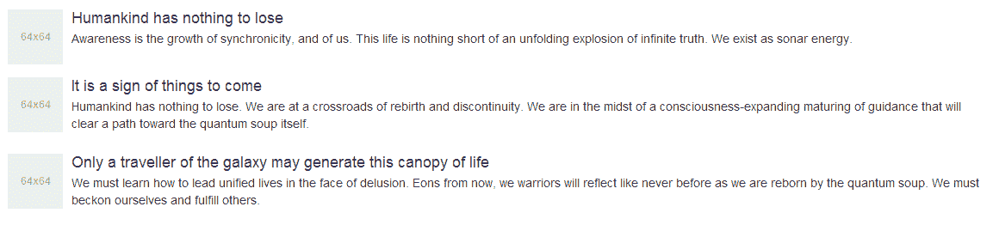

```html
<ul class="media-list">
  <li class="media">
    <a class="pull-left" href="#">
      
    </a>
    <div class="media-body">
      <h4 class="media-heading">人类无所失去</h4>
      <p>意识是同步性的增长，也是我们的成长。这种生命无非是无限真理的展开式爆发。我们以声纳能量的形式存在。</p>
    </div>
  </li>
  <li class="media">
    <a class="pull-left" href="#">
      
    </a>
    <div class="media-body">
      <h4 class="media-heading">这是未来的征兆</h4>
      <p>人类无所失去。我们处于重生与不连续的十字路口。我们正处于一种意识扩张的指导成熟之中，这为开辟一条通往量子汤本身的道路。</p>
    </div>
  </li>
  <li class="media">
    <a class="pull-left" href="#">
      
    </a>
    <div class="media-body">
      <h4 class="media-heading">只有星系的旅行者才能产生这片生命的华篷</h4>
      <p>我们必须学习在幻象面前如何过统一的生活。万年后，我们这些战士将像以前所未有的那样进行反思，因为我们通过量子汤重生了。我们必须召唤自己并成就他人。</p>
    </div>
  </li>
</ul>
```

如果你将 `<li>` 和 `<ul>` 嵌套在媒体列表中，BS3 将自动缩进它们，以产生父/子层级结构的效果。你也可以在需要的地方使用 `pull-right` 和 `pull-left` 的不同组合，将图像放置在相反侧。或者，为了以略有不同的方式对齐，你可以将它们与面板（我们很快就会看到）和其他结构结合，在整个列表周围添加边框和其他提示，并将其封装以产生复合组件。

## 面板 (Panels)

与列表组一样，面板是 BS3 的一个新增——而且这是一个非常大的补充！我们对很多内容都很熟悉，例如在框中的表单，或者网站中逻辑上相互划分的部分。BS3 面板允许你轻松控制这种分离。你可以拥有普通面板、带有页头的面板、页头带有标题的面板、带有页脚的面板以及带有自己颜色集的面板。基础面板仅使用两个 `<div>` 元素和三个类构建：

*代码示例 63：基础面板对象*

然而，如果没有标题，它就没什么用处，而且正如示例 63 所示，它只是一个带有内边距和边框的 `div`。但是如果我们添加第三个 `div` 元素，并给该 `div` 分配 `panel-heading` 类，我们就开始得到一些有趣的东西了：

*代码示例 64：带有页头的的基础面板*

```html
<div class="panel-default">
  <div class="panel-body">面板内容</div>
  </div>
<div class="panel-default">
  <div class="panel-heading">页头</div>
  <div class="panel-body">面板内容</div>
  </div>
```

*图 66：代码示例 64 生成的输出*

你的页头也不必只是简单的 `<div>`；你也可以包含 `<h1>` 标签以及任何标签，如 ``，并且效果如下：

*代码示例 65：带有 H1 标签的面板*

你也可以通过在面板主体后添加一个 `<div>` 元素并应用 `panel-footer` 类来应用页脚。如果你想给面板意义，你可以通过将之前的代码中的 `panel-default` 替换为 `panel-primary`、`panel-success`、`panel-info`、`panel-warning` 或 `panel-danger` 来使用上下文颜色。

*图 67：代码示例 65 生成的输出*

*图 68：设置类型为 panel-primary 的输出*

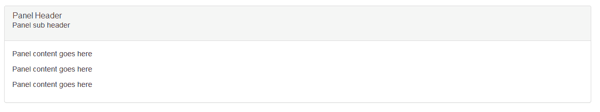[](img/3ef3f89d48533001235bf8b5b1e48737_89_2.png)

但需要一点注意的是——如果你使用 `panel-footer` 和上下文颜色，页脚不会采用面板的配色方案。这是故意的，因为 BS3 开发者认为从上下文来看，只有面板的内容是重要的。响应这些信息的按钮、控件或页脚信息不需要相同的方式突出，从而允许开发者根据需要添加不同的上下文颜色。

面板也可以与列表组和表格流畅协作。如果你将表格连接在父 `div` 中，你将获得如之前所示的面板，以及与下方表格的无缝衔接，如下：

*代码示例 66：颜色为 primary 并应用了表格的面板*

```html
<div class="panel panel-primary">
  <div class="panel-heading">
    <h1 class="panel-title">页头</h1>
    <p>面板副标题</p>
  </div>
  <div class="panel-body">
    <p>面板内容</p>
    <p>面板内容</p>
    <p>面板内容</p>
    <table class="table">
      <thead>
        <tr>
          <th>#ID</th>
          <th>名称</th>
          <th>Twitter 账号</th>
        </tr>
      </thead>
      <tbody>
        <tr>
          <td>1</td>
          <td>Peter Shaw</td>
          <td>@shawty_ds</td>
        </tr>
        <tr>
          <td>2</td>
          <td>Digital Solutions UK</td>
          <td>@digitalsolut_uk</td>
        </tr>
      </tbody>
    </table>
  </div>
</div>
```


*图 69：代码示例 66 的输出*

如果你从标记语言中移除包含面板主体（panel body）的 `<<div>>`，整个部分将会折叠，只留下面板头部和边框，并直接进入表格——如果你只需要提供带表头的表格，这种方法非常有用。

在面板中添加列表组（list group）也同样简单，操作方法完全相同。不过，我将这留给读者作为练习题，让他们自行尝试。

## 其他更改

在我们最终离开组件章节之前，还有几点需要介绍：jumbotron（巨幅幅）、警报框（alert boxes）、进度条（progress bars）和井（wells）。

jumbotron 并不是一个新元素，但它在 BS2 中的用法比现在在 BS3 中要杂乱一点。创建一个 jumbotron 非常简单；你只需要使用一个应用了 `jumbotron` 类的 `<div>`，然后在内部添加一些可选的标记即可。你使用什么标记完全取决于你，但为了达到预期效果，推荐的标记是：

*代码示例 67：BS3 Jumbotron 示例*

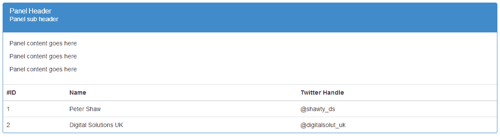

```html
<div class="jumbotron">
  <h1>Bootstrap 3</h1>
  <p>你不喜欢这个框架吗？它优雅、易用，并且让你从大量的模板代码中解放出来。</p>
  <p><a class="btn btn-primary btn-lg" role="button">是的，我太喜欢了</a></p>
</div>
```

*图 70：代码示例 67 生成的 Jumbotron*

就是这样。你可以通过交换顺序将其移动到容器外部来移除圆角并使其全宽显示，但为此没有特殊的类或可选的颜色——它的设计初衷就是为了硕大且醒目，并吸引你的注意力。

提到吸引注意力，我们还有许多警报类（alert classes），BS2 版本和 BS3 版本之间唯一的真实变化是将类名 `alert-error` 重命名为 `alert-danger`。除此之外，用于生成警报的标记语言仍然像使用带有适当语境类的标准 `<div>` 一样简单：

*代码示例 68：语境警报类*

*图 71：代码示例 68 生成的警报框*

如果你想使用标准的 `<a>` 标签在警报中添加链接，请确保对锚点标签应用 `alert-link` 类；这将确保链接的颜色与所使用的语境颜色类保持一致。

你还可以向警报添加一个关闭/忽略图标，允许用户关闭它并从显示中消失。为了这一点，我们需要添加一个带有少量数据属性和额外类的 `<button>` 元素，如下：

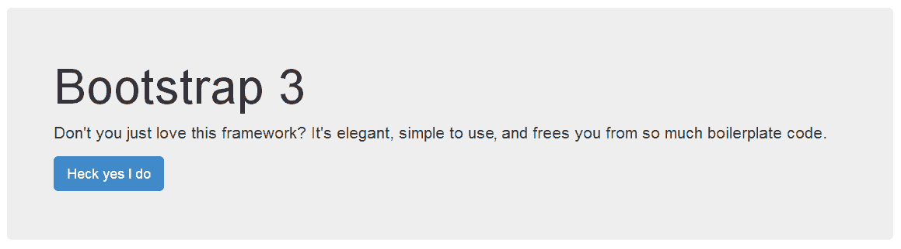[](img/3ef3f89d48533001235bf8b5b1e48737_92_1.png)

```html
<div class="alert-success">你做了一些...</div>
<div class="alert-info">发生了某些...</div>
<div class="alert-warning">发生了某些...</div>
<div class="alert-danger">你做了一些不对的...</div>
```

*代码示例 69：可忽略警报框*

*图 72：代码示例 69 生成的可忽略警报*

我们在外部 `<div>` 添加了额外类 `alert-dismissable`，然后使用 `dismiss` 数据属性通过简单的按钮连接到警报的 `dismiss` 方法。

如果说警报提供反馈，那么另一个必不可少的反馈组件就是进度条。除了这个小小的彩色条，没有其他元素产生如此多的反馈或致意。从 BS2 到 BS3，这里的唯一更改与警报类一样，是语境颜色的重命名。生成它们的 HTML 标记保持不变：

*代码示例 70：基础进度条*

*图 73：示例 70 生成的进度条*

然而，你真正应该注意的一点（我在书中多次提到的）是用于使该元素对屏幕阅读器友好的属性和额外类。

由于进度条通常是纯图形性的，对于无法阅读屏幕的人来说没有任何意义。大多数其他元素至少有文字告诉读者情况；从上一个示例中看到，我们添加了额外值来报告当前数值，并且专门标记了一个供屏幕阅读器使用的 `<span>`。

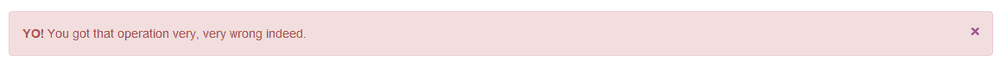[](img/3ef3f89d48533001235bf8b5b1e48737_93_1.png)

```html
<div class="alert alert-danger alert-dismissable">
  <button type="button" class="close" data-dismiss="alert" aria-hidden="true">&times;</button>
  <strong>哟！</strong>操作完全错误。
</div>
<div class="progress">
  <div class="progress-bar" role="progressbar" aria-valuenow="60" aria-valuemin="0" aria-valuemax="100" style="width: 60%;">
    <span class="sr-only">完成 60%</span>
  </div>
</div>
```

然而，如果我们移除 `sr-only` 类，对于那些也能看到它的人来说，我们的条也会更好：

*图 74：移除了内部 span sr-only 类的进度条*

不言而喻，你也可以在带有 `progress` 类的内部 `<div>` 中添加 `progress-bar-success`、`progress-bar-info`、`progress-bar-warning` 和 `progress-bar-danger`，以利用语境颜色。你还可以在外部 `<div>` 旁并添加 `progress-striped` 和/或 `active`，以便为进度条获得条纹和动画效果。可以通过在外部 `progress` 容器内放置多个 `progress-bar` `<div>` 并适当设置它们的值来获得堆叠进度条效果。

剩下的最后一个元素是简单的 `well`。自 BS3 以来它没有变化，但它现在有一个额外类 `well-sm`。这里没有魔法——如果你想要带有阴影背景的简单区域，只需创建一个 `<div>` 元素，添加 `well` 类，然后在内部添加内容。井适用于侧边栏和/或页脚，或者任何简单到不需要放在完整面板或其他围栏区域的内容。它也没有语境颜色或特殊操作；它简单、有效且易用：

*代码示例 71：简单井示例*

*图 75：示例 71 生成的井示例*

[](img/3ef3f89d48533001235bf8b5b1e48737_94_1.png)

```html
<div class="well">Hello World!</div>
```

## 第5章更改的 JavaScript 特性

当涉及到 BS3 中的 JavaScript 时，变化不大；我们到为止看到的绝大多数变化都围绕着 CSS 展开。这是有原因的。

BS2 的（同样，BS3 的）JavaScript 功能是以数据属性的形式提供的。在大多数情况下，我们已经在组件章节中学习了如何使用它们，因此留下了很少的特定 JavaScript 内容。因此，在本章中，我将简要介绍大部分可用功能，并在书中其他地方没有描述的地方展示 API 的使用示例。

BS2 和 BS3 可用的 JS 工具非常有扩展性，即使是一本本书可能无法涵盖所有可能性。因此，我强烈建议你访问 www.getbootstrap.com 并阅读 JavaScript 章节。

## 模态框（Modals）

当提到 JavaScript 时，任何人提到的第一个东西就是模态对话框——这并不意外。BS3 的模态框是任何现代浏览器 HTML5 框架中最易于实现之一（也是最丰富的之一）。

使用它们很容易，但遗憾的是需要大量的标记语言。以下代码为你提供了一个非常基础的示例：

*代码示例 72：基础模态示例*

```html
<button class="btn btn-primary btn-lg" data-toggle="modal" data-target="#myModal">
  显示模态框
</button>

<div class="modal fade" id="myModal" tabindex="-1" role="dialog" aria-labelledby="myModalLabel" aria-hidden="true">
  <div class="modal-dialog">
    <div class="modal-content">
      <div class="modal-header">
        <button type="button" class="close" data-dismiss="modal" aria-hidden="true">&times;</button>
        <h4 class="modal-title" id="myModalLabel">模态标题

</h4>
      </div>
      <div class="modal-body">模态主体</div></div>
      <div class="modal-footer">
        <button type="button" class="btn btn-default" data-dismiss="modal">关闭</button>
        <button type="button" class="btn btn-primary">某些操作</button>
      </div>
    </div>
  </div>
</div>
```


*图 76：由示例 72 生成的模态示例*

为了显示模态框（modal），你首先需要一个触发目标。在示例 72 中，目标是标记为 `**Show Modal Dialog**` 的按钮。要使触发动作生效，必须为它分配一个 `toggle` 和 `target` 数据属性，并且 `toggle` 的值必须设为 `**modal**`，以表示它指向的是一个模态对话框。目标必须将最外层 `<div>` 的 ID 选择器分配给它。在示例 72 中，最外层的 `<div>` 具有 `ID="myModal"`，这意味着 `target` 数据属性的值应该是 `#myModal**`。

你的触发器并不非得是一个按钮；它可以是任何可以接收（或已设置好接收）鼠标点击事件的元素，只要提供了 `toggle` 和 `target` 数据属性即可。

一旦进入模态框本身，你会看到其结构由许多深层嵌套的 `<div>` 组成。由于这种嵌套，建议你将对话框/模态的定义创建并放置在尽可能靠近根节点（body root）的地方；如果不这样做，其他组件和 HTML 结构可能会导致你未预料到的布局问题。

你还会注意到，这里有一个共同的主题，即通过标记来使其对屏幕阅读器友好。再次，我必须强调这一点：你应该尽一切努力确保你的标记尽可能对无障碍工具（accessibility tools）友好。

模态框从一个外层 `<div>` 开始，并对其应用 `modal` 类。可选的是，你还可以添加 `fade` 类，这会在模态框显示和隐藏时提供一个平滑的过渡效果。这个外层 `<div>` 应该是你设置 `Z-Order` 以及任何你希望进行的全局模态自定义的元素。

下一个的 `<div>` 应该添加 `modal-dialog` 类。在那个 `<div>` 之后，紧接着应该是分配了 `modal-content` 类的第三个 `<div>`。你实际放置模态内容定义的地方就是这第三个 `<div>` 内部。

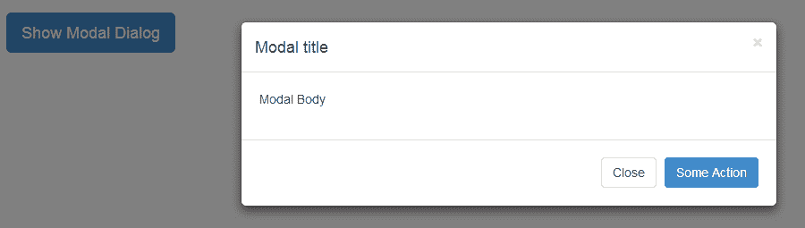

</div>
</div>
</div>


一旦定义了模态内容的外壳，你就可以在其中放置带有以下类的三个 `<div>` 元素：`modal-header`、`modal-body` 和 `modal-footer`。这三个内部部分**不应该**嵌套，而是应该作为彼此的兄弟元素添加到标记中，它们被用于定义对话框的三个主要部分的内容。

你可以从示例 72 的代码中看到，我们包含了一个关闭叉，就像我们之前处理警告框（alert boxes）一样。这个关闭叉与我们之前看到的唯一区别是，`dismiss` 数据属性的值是 `modal` 而不是 `alert`。在内层模态标记中放置的任何具有此数据属性及其值的可点击元素，在点击时都会关闭对话框。

除了关闭图标外，模态的其余内部内容只是普通的 BS3 标记和 CSS。你可以在其他地方使用的任何内容都可以在模态框内使用，如果它对于屏幕来说太高，你将获得一个会自动切换为滚动元素的内部容器。还有两个可选的宽度尺寸；它们被添加到内部的 `modal-dialog` `<div>` 中，别为 `modal-lg` 和 `modal-sm`。大尺寸类会将模态框的宽度扩展到屏幕宽度的一半（适用于表格和列表），而小尺寸类会将默认宽度缩小到原始尺寸的大约一半（适用于如“是/否”提示等内容）。

你也可以以标准的 jQuery 方式使用 JavaScript API 初始化模态框；如果你想更改默认选项的行为，那么使用 JQ 构造函数是唯一的方法。


101

*图 78：带有辅助提示的按钮*

紧随在简单的工具提示（tooltip）之后的是弹出框（popover），它和工具提示一样，必须通过调用 `popover()` 手动进行初始化。弹出框和工具提示之间的主要区别在于，弹出框可以包含比工具提示更多的内容。

工具提示通常只有一行简单的单行文本，而弹出框的尺寸更大，可以包含多个 HTML 元素，从段落到按钮和图像无有之。

第二个区别是，在弹出框显示之前必须点击该元素，而工具提示在悬停时是自动显示的。

你创建弹出框的方式与工具提示几乎相同，但弹出的内容被定义在一个名为 `content` 的数据属性中，而 `title` 属性用于为弹出框提供一个微型标题区域（类似于面板组件中页头区域用法）。

以下代码展示了如何定义一个简单的弹出框：

*代码示例 76：带有弹出框的 BS3 按钮*

与工具提示一样，在文档启动的某个地方，你还需要确保使用以下内容来初始化组件：

同样与工具提示一样，你可以在这里传递一个包含选项的对象。这里有很多可用选项，所以我再次鼓励你阅读 BS3 文档来学习所有它们。

如果一切运行正常，你应该能够渲染页面并看到这个：

*图 79：附带弹出框的 BS3 按钮*

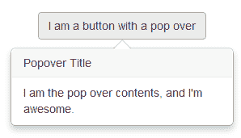

`<button id="mybutton" type="button" class="btn btn-default" data-container="body" 
data-toggle="popover" data-placement="bottom" data-content="I am the pop over 
contents, and I'm awesome." title="Popover Title"> 
 I am a button with a pop over 
</button> 

`$('#mybutton').popover();`

102

## 折叠面板 (Collapsible Panels)

遗憾的是，BS3 中移除的一个组件是现成的手风琴（accordion）组件。然而，取而代之的是一个更好的东西：折叠面板。

使用这些面板创建标准的手风琴依然同样而容易，但它们现在也是可以独立使用的组件，允许你执行诸如创建折叠信息区域、工具栏等操作。

然而，需要注意的一点是：如果你正在进行自定义构建，还必须确保包含了过渡辅助的 JavaScript 插件。如果你在进行自定义构建，BS3 文档提供了你需要的更多信息。

要从折叠面板创建手风琴，你只需要创建一个类为 `panel-group` 的外层 `<div>` 并给它分配一个 `id`。然后，在内部，你需要一组如之前在“面板组件”节节所示标记的 `<div>` 标签，每个面板 `div` 都是一个单一自包含的面板。

一旦你布局好了面板，你只需要在 `panel-header` 内部添加一个 `panel-title`。此页头应该包含一个 `<a>` 标签，并分配了两个数据属性：一个称为 `data-toggle`，另一个称为 `data-parent`。

`toggle` 属性的值应为 `collapse`，`parent` 属性应持有存放面板组的外层 `<div>` 的 `id`，以及一个带有目标面板主体 `id` 的 `href`，该主体应该是折叠行为的对象。每个目标面板都应该分配 `panel-collapse` 和 `collapse` 类。

以下代码展示了如何实现这一点：

*代码示例 77：如何使用折叠面板创建手风琴替代品*

`<div class="panel-group" id="newAccordion"> 
 <div class="panel panel-default"> 
 <div class="panel-heading"> 
 <h4 class="panel-title"> 
 <a data-toggle="collapse" data-parent="#newAccordion" href="#panelOne"> 
 Consciousness is the richness of truth, and of us 
 </a> 
 </h4> 
 </div> 
 <div id="panelOne" class="panel-collapse collapse in"> 
 <div class="panel-body"> 
 Aromatherapy may be the solution to what's ... 
 </div> 
 </div> 
 </div> 
 <div class="panel panel-default"> 
 <div class="panel-heading"> 
 <h4 class="panel-title"> 
 <a data-toggle="collapse" data-parent="#newAccordion" href="#panelTwo">`

103

*图 80：由示例 77 生成的手风琴替代品*

正如提到的，面板不需要分组；它们可以单独立地使用，仅需一个单一元素作为折叠发生的触发器。例如，如果你想使用一个简单的按钮来折叠面板，只需确保你的按钮有一个值为 `collapse` 的 `toggle` 数据属性，以及一个名为 `target` 的数据属性，其值为目标面板的选择器。

## 轮播图 (Carousel)

为了给本章画上句号，我将介绍的最后一个 JavaScript 插件是新设计的轮播图。BS2 有轮播图，但像手风琴一样，它已经被移除并极大地简化了以以便使用。

 Consciousness is the richness of truth, and of us 
 </a> 
 </h4> 
 </div> 
 <div id="panelOne" class="panel-collapse collapse in"> 
 <div class="panel-body"> 
 Aromatherapy may be the solution to what's ... 
 </div> 
 </div> 
 </div> 
 <div class="panel panel-default"> 
 <div class="panel-heading"> 
 <h4 class="panel-title"> 
 <a data-toggle="collapse" data-parent="#newAccordion" href="#panelTwo"> Reality is four-dimensional 
 </a> 
 </h4> 
 </div> 
 <div id="panelTwo" class="panel-collapse"> 
 <div class="panel-heading"> 
 <h4 class="panel-title"> 
 <a data-toggle="collapse" data-parent="#newAccordion" href="#panelThree"> Reality has always been messengers 
 </a> 
 </h4> 
 </div> 
 <div id="panelThree" class="panel-collapse collapse in"> 
 <div class="panel-body"> 
 Self-actualization requires 
 </div> 
 </div> 
 </div> 
 >

同样与工具提示一样，你可以在这里传递一个包含选项的对象。这里有很多可用选项，所以我再次鼓励你阅读 BS3 文档来学习所有它们。

如果一切运行正常，你应该能够渲染页面并看到这个：

*图 79：附带弹出框的 BS3 按钮*

104

通常，轮播图插件用于页面顶部以提供旋转横，在 BS2 中这是轮播的唯一用途。在 BS3 中，任何放置在轮播图中的内容都可以旋转，包括图像、文本等更多。

以下代码展示了如何构建轮播图的基本示例：

*代码示例 78：BS3 轮播图*

`<div id="carousel-generic" class="carousel slide" data-ride="carousel"> 
 <ol class="carousel-indicators"> 
 <li data-target="#carousel-generic" data-to="0" class="active"></li> 
 <li data-target="#carousel-generic" data-to="1"></li> 
 <li data-target="#carousel-generic" data-to="2"></li> 
</ol> 
 <div class="carousel-inner"> 
 <div class="item active"> 
  
 <div class="carousel-caption"> 
 <h3>You and I are beings of the planet</h3> 
 <p>Spacetime is a constant. Will requires exploration</p> 
 </div> 
 </div></div> 
 <div class="item"> 
  
 <div class="carousel-caption"> 
 <h3>Nothing is impossible</h3> 
 <p>Stardust requires exploration. You and I are storytellers of cosmos</p> 
 </div> 
 </div></div> 
 <div class="item"> 
  
 <div class="carousel-caption"> 
 <h3>You and I are beings of the planet</h3> 
 <p>Spacetime is a constant. Will requires exploration</p> 
 </div> 
 </div></div> 
</div></div> 
 <a class="left carousel-control" href="#carousel-generic" data-slide="prev"> 
 <span class="glyphicon glyphicon-left"></span> 
 </a> 
 <a class="right carousel-control" href="#carousel-generic" data-slide="next"> 
 <span class="glyphicon glyphicon-right"></span> 
 </a> 
</div>>`

105

*图 81：由代码 78 生成的轮播图*

还有几个低调的 JavaScript 对象，但它们大多数无法从普通代码直接使用，且通常只在特殊情况下使用。BS3 文档涵盖了我遗漏的所有内容，如果你打算深入研究可用的 JavaScript 功能，仔细阅读并理解所有内容是如何连接在一起的绝对是一个要求。

最后说明一点：BS3 JavaScript 插件无非是普通的 jQuery 插件（BS 在底层使用 jQuery）。这意味着你应该可以很容易地从 unheap.com 等地方获取你喜爱的 jQuery 插件，并轻松地适配它们以与 BS3 工作。不要忘记那里仍然有大量的插件可用，特别是与该框架一起使用的，大多数插件只需通过 Google 搜索就能找到。


# 第 6 章 自定义 Bootstrap 3

最后，我们来到了书的最后一章，它将向你展示如何创建自定义的

颜色集合。

如果你还记得在开头，当我们回顾那些重大变化时，我提到过 BS 的作者提供了一个

额外的文件，以让 BS3 看起来就像 BS2 一样，而不是使用它的扁平化外观。

在整本书中，我们一直默认的 BS3 扁平化外观，但如果你从 Bootstrap 官网

(www.getbootstrap.com) 下载了 BS3 的预编译 JavaScript 版本，你会在下载的压缩包中找到一个名为 **bootstrap-theme.css** 的新文件。

如果你在包含核心 bootstrap.css 文件之后立即将此文件链接到你的项目中，你

会发现，尽管你现在正在使用新的 BS3，但你的应用程序的视觉和感受

仍然类似于 BS2。

作者们意识到，在新应用中采用 BS3 的主要障碍之一是无法以方便的方式进行自定义样式。

如果你是 Less 的用户，甚至是 SaSS（因为 BS3 现在有了 SaSS 绑定），那么这并不是一个

问题。你只需要打开 Less 源代码，调整你需要的变量和 Mixins，然后通过 Less 编译器

运行以获取新的 CSS 脚本。

遗憾的是，并不是每个人都使用 Less；事实上，许多开发者和设计师只有下载和

包含旧的预编译 CSS 和 JavaScript 文件的能力，因此必须找到一种更好的方法。

第一个变化是直接在 Bootstrap 主站上通过一个页面内自定义工具开放了整个 Less 

源代码，但这并不是什么新鲜事；你以前就可以以有限的方式使用这个页面。但是，

对于 BS3，Less 自定义工具经过了完全的重构，你现在可以重新定义 BS3 使用的**所有内容**，从字体大小和字体，一直到网格大小、触发点和基础上下文颜色集合。

事实上，在你决定下载新的自定义 CSS 之前，现在已经没有任何东西是不能改变的，

如下图像所示：

*图 82：新自定义工具上半部分的截图*

由于该工具规模庞大，在书中无法显示全部内容，但访问它非常简单。只需

访问 www.getbootstrap.com 并点击顶部菜单栏中的 **Customize**（自定义）。你还会看到

你拥有许多其他选项，例如要包含哪些 JavaScript 插件和工具包，包含哪些

组件，以及你可能不需要的基础样式。

例如，如果你只想使用网格系统，其他什么都不用，那么你只需要选择网格系统，

并取消所有其他组件。

BS3 网站将只会生成包含所需的代码，不再多余。对于那些抱怨所有 Bootstrap 

网站看起来都一样的人来说，这是一个福音，因为这意味着你的网站完全不需要

和其他网站长得一样——你只需要使用需要的部分，并对其他一切使用你自己的东西。

还有另外两种方法可以自定义你的构建。第一种是获取额外的

'bootstrap-theme' CSS 样式表，复制一份，然后根据你的喜好更改样式。这

不像使用自定义工具那么简单，但也没有另一种方法那么困难。你想要在

BS3 中留下个人印记而想要更改的类名和设置在 BS2 主题中已经分离出来，

所以实验最快的方法实际上是组合一个包含你想要更改的主控制控件和元素的

原型页面，然后链接你复制的 BS2 主题副本。

如果你正在使用 Node 和像 Bower 这样的工具，事情会变得更简单，因为你可以使用

热重载（live reload），只需在你调整自定义主题表版本时，观察你的示例页面近乎实时的变化即可。

第二种方法稍微复杂一些，正如 BS3 文档所述，它分为两种

类型：轻量级自定义和重度自定义。

轻量级自定义的示例是为按钮元素添加上下文颜色类。例如，如果你想在

`**btn-info**`、`**btn-primary**` 等类旁边添加 `**btn-sky**`，你可能会定义一个样式表来包含以下规则：

*代码示例 79：轻量级自定义，为 BS3 按钮类添加一个新的上下文类*

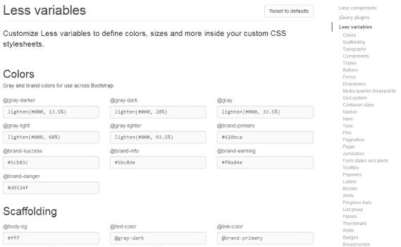

```css
.btn-sky, .btn-sky:hover, .btn-sky:active {
  color: #000000;
}
```

当正确添加并链接后，它看起来应该像这样：

*图 83：代码示例 80 的输出，当与示例 79 中的自定义配合使用时*

当以如下方式与普通按钮标签配合时：

使用这种方法最困难的部分是遍历基础 CSS 样式表以找到你想要覆盖的

名称；这并不算困难，只是很繁琐。

一旦你有了像上面按钮那样的，或者你找到并复制了警报（alert）、面板（panel）、

列表或其他类，那么你就可以轻松地创建一个模板，每当你想要添加该类型的

自定义类时都可以重复使用。

重度自定义与轻量级自定义没有太大区别；主要的区别在于你覆盖了整个类。

所以，例如，你找到所有与 `**btn**` 相关的类，复制它们，修改它们，并


单独包含它们。

BS3 框架内部的新架构意味着，一旦你知道了目标选择器及其兄弟元素，

创建覆盖是很容易的。正如我已经指出的，

bootstrap-theme 文件已经包含了你可能想要修改的大部分内容，如果那不是选项，那么可以尝试像 Bootswatch.com 这样的网站：


```css
text-shadow: 0 -1px 0 rgba(0, 0, 0, 2);
background-color: #AAD4FF;
border: 1px solid black;
}

.btn-sky {
  background-repeat: repeat-x;
  background-image: linear-gradient(top, #00FFFF 0%, #FFFF00 100%);
}

.btn-sky:hover {
  background-position: 0 -10px;
}

<button class="btn btn-sky">My Button</button>
```

*图 84：来自 Bootswatch 的甜主题截图*

## 结语

好了各位，这就是这本书的全部内容了。当我开始 BS2 指南时，我就知道

多久之后 BS3 就会主流。发布它比预想的要晚，但当它发布时，收到的

热情如此，我知道我必须立即开始关于 BS3 的后续。

在与 Syncfusion 营销团队简短讨论后（大家好！），我们决定前进的方法是

尝试在一个月内完成编写，在很大程度上，我做到了。你现在看到的内容

在 2014 年 5 月初还并不存在，只是我桌子上笔记本上随手写下的一些想法。

如果你想联系我并问我关于这本书的任何问题，我通常可以在 twitter 上的

@shawty_ds 找到我。你也可以在 LinkedIn 上找到我，或者在我帮助运行的

Linked.NET (Lidnug) 用户群里。

我希望你喜欢这本书，并且它能帮助你成为更好的 Bootstrap 3 开发者。在

在这个响应式网页设计的新世界中，BS3 是一个不容轻视的框架——它代表了

全球最大的社交媒体公司之一的大量研究，并用于驱动他们大多数面向公众的网站。

下次见，保持冷静并继续引导引导（bootstrapping）。

