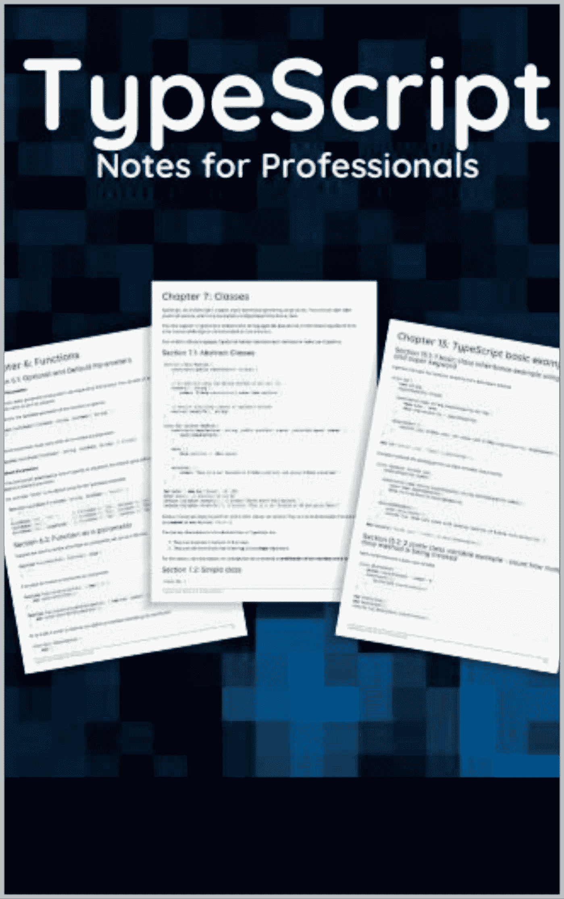
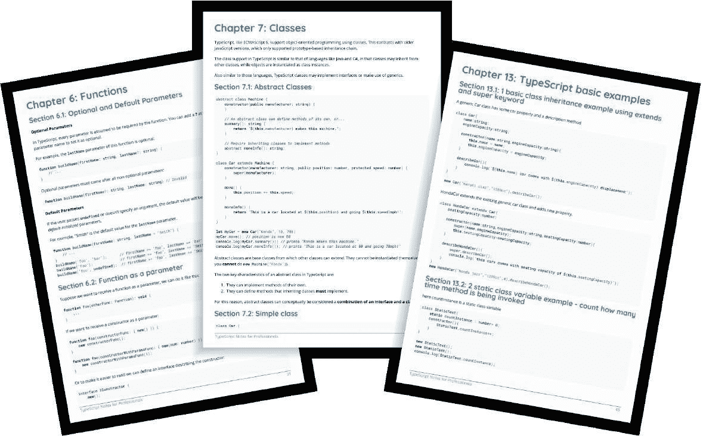
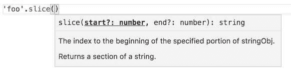
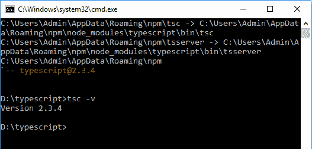

# TypeScript 专业人士笔记：JavaScript 的类型超集








## 第 27.3 节：TSLint 规则集

## 第 27.4 节：基础 tslint.json 设置

## 第 27.5 节：使用预定义的规则集作为默认

# 第 28 章：tsconfig.json

## 第 28.1 节：使用 tsconfig.json 创建 TypeScript 项目

## 第 28.2 节：减少编程错误的配置


## 第 28.3 节：compileOnSave 80
## 第 28.4 节：注释 80
## 第 28.5 节：preserveConstEnums 81

## 第 29 章：调试 82
## 第 29.1 节：在 WebStorm 中配合 ts-node 使用 TypeScript 82
## 第 29.2 节：在 Visual Studio Code 中配合 ts-node 使用 TypeScript 83
## 第 29.3 节：在 Visual Studio Code 中配合 SourceMaps 使用 JavaScript 84
## 第 29.4 节：在 WebStorm 中配合 SourceMaps 使用 JavaScript 84

## 第 30 章：单元测试 86
## 第 30.1 节：tape 86
## 第 30.2 节：jest (ts-jest) 87
## 第 30.3 节：Als 89
## 第 30.4 节：chai-immutable 插件 89

## 致谢 91

你可能喜欢 93

# 第 1 章：TypeScript 入门

## 版本发布日期

- 2.8.3 2018-04-20
- 2.8 2018-03-28
- 2.8 RC 2018-03-16
- 2.7.2 2018-02-16
- 2.7.1 2018-02-01
- 2.7 beta 2018-01-18
- 2.6.1 2017-11-01
- 2.5.2 2017-09-01
- 2.4.1 2017-06-28
- 2.3.2 2017-04-28
- 2.3.1 2017-04-25
- 2.3.0 beta 2017-04-04
- 2.2.2 2017-03-13
- 2.2 2017-02-17
- 2.1.6 2017-02-07
- 2.2 beta 2017-02-02
- 2.1.5 2017-01-05
- 2.1.4 2016-12-05
- 2.0.8 2016-11-08
- 2.0.7 2016-11-03
- 2.0.6 2016-10-23
- 2.0.5 2016-09-22
- 2.0 Beta 2016-07-08
- 1.8.10 2016-04-09
- 1.8.9 2016-03-16
- 1.8.5 2016-03-02
- 1.8.2 2016-02-17
- 1.7.5 2015-12-14
- 1.7 2015-11-20
- 1.6 2015-09-11
- 1.5.4 2015-07-15
- 1.5 2015-07-15
- 1.4 2015-01-13
- 1.3 2014-10-28
- 1.1.0.1 2014-09-23

## 第 1.1 节：安装与设置

### 背景
TypeScript 是 JavaScript 的带类型超集，可以直接编译为 JavaScript 代码。TypeScript 文件通常使用 `.ts` 扩展名。许多 IDE 无需任何额外配置即可支持 TypeScript，但也可以通过命令行使用 TypeScript Node.JS 软件包进行编译。

### ID
TypeScript 是 JavaScript 的带类型超集，可以直接编译为 JavaScript 代码。TypeScript 文件通常使用 `.ts` 扩展名。许多 IDE 无需任何额外配置即可支持 TypeScript，但也可以通过命令行使用 TypeScript Node.JS 软件包进行编译。

### IDE
TypeScript 是 JavaScript 的带类型超集，可以直接编译为 JavaScript 代码。TypeScript 文件通常使用 `.ts` 扩展名。许多 IDE 无需任何额外配置即可支持 TypeScript，但也可以通过命令行使用 TypeScript Node.JS 软件包进行编译。

### Visual Studio
TypeScript 是 JavaScript 的带类型超集，可以直接编译为 JavaScript 代码。TypeScript 文件通常使用 `.ts` 扩展名。许多 IDE 无需任何额外配置即可支持 TypeScript，但也可以通过命令行使用 TypeScript Node.JS 软件包进行编译。

### Studio Code
TypeScript 是 JavaScript 的带类型超集，可以直接编译为 JavaScript 代码。TypeScript 文件通常使用 `.ts` 扩展名。许多 IDE 无需任何额外配置即可支持 TypeScript，但也可以通过命令行使用 TypeScript Node.JS 软件包进行编译。

### WebStorm
TypeScript 是 JavaScript 的带类型超集，可以直接编译为 JavaScript 代码。TypeScript 文件通常使用 `.ts` 扩展名。许多 IDE 无需任何额外配置即可支持 TypeScript，但也可以通过命令行使用 TypeScript Node.JS 软件包进行编译。

### IntelliJ IDEA
TypeScript 是 JavaScript 的带类型超集，可以直接编译为 JavaScript 代码。TypeScript 文件通常使用 `.ts` 扩展名。许多 IDE 无需任何额外配置即可支持 TypeScript，但也可以通过命令行使用 TypeScript Node.JS 软件包进行编译。

### Atom
TypeScript 是 JavaScript 的带类型超集，可以直接编译为 JavaScript 代码。TypeScript 文件通常使用 `.ts` 扩展名。许多 IDE 无需任何额外配置即可支持 TypeScript，但也可以通过命令行使用 TypeScript Node.JS 软件包进行编译。

### Sublime Text
TypeScript 是 JavaScript 的带类型超集，可以直接编译为 JavaScript 代码。TypeScript 文件通常使用 `.ts` 扩展名。许多 IDE 无需任何额外配置即可支持 TypeScript，但也可以通过命令行使用 TypeScript Node.JS 软件包进行编译。

### Node.js
TypeScript 是 JavaScript 的带类型超集，可以直接编译为 JavaScript 代码。TypeScript 文件通常使用 `.ts` 扩展名。许多 IDE 无需任何额外配置即可支持 TypeScript，但也可以通过命令行使用 TypeScript Node.JS 软件包进行编译。

### 安装
TypeScript 是 JavaScript 的带类型超集，可以直接编译为 JavaScript 代码。TypeScript 文件通常使用 `.ts` 扩展名。许多 IDE 无需任何额外配置即可支持 TypeScript，但也可以通过命令行使用 TypeScript Node.JS 软件包进行编译。

### 全局
TypeScript 是 JavaScript 的带类型超集，可以直接编译为 JavaScript 代码。TypeScript 文件通常使用 `.ts` 扩展名。许多 IDE 无需任何额外配置即可支持 TypeScript，但也可以通过命令行使用 TypeScript Node.JS 软件包进行编译。

### 本地
TypeScript 是 JavaScript 的带类型超集，可以直接编译为 JavaScript 代码。TypeScript 文件通常使用 `.ts` 扩展名。许多 IDE 无需任何额外配置即可支持 TypeScript，但也可以通过命令行使用 TypeScript Node.JS 软件包进行编译。

### 通道
TypeScript 是 JavaScript 的带类型超集，可以直接编译为 JavaScript 代码。TypeScript 文件通常使用 `.ts` 扩展名。许多 IDE 无需任何额外配置即可支持 TypeScript，但也可以通过命令行使用 TypeScript Node.JS 软件包进行编译。

### 稳定
TypeScript 是 JavaScript 的带类型超集，可以直接编译为 JavaScript 代码。TypeScript 文件通常使用 `.ts` 扩展名。许多 IDE 无需任何额外配置即可支持 TypeScript，但也可以通过命令行使用 TypeScript Node.JS 软件包进行编译。

### Beta
TypeScript 是 JavaScript 的带类型超集，可以直接编译为 JavaScript 代码。TypeScript 文件通常使用 `.ts` 扩展名。许多 IDE 无需任何额外配置即可支持 TypeScript，但也可以通过命令行使用 TypeScript Node.JS 软件包进行编译。

### 开发
TypeScript 是 JavaScript 的带类型超集，可以直接编译为 JavaScript 代码。TypeScript 文件通常使用 `.ts` 扩展名。许多 IDE 无需任何额外配置即可支持 TypeScript，但也可以通过命令行使用 TypeScript Node.JS 软件包进行编译。

### 编译 TypeScript
TypeScript 是 JavaScript 的带类型超集，可以直接编译为 JavaScript 代码。TypeScript 文件通常使用 `.ts` 扩展名。许多 IDE 无需任何额外配置即可支持 TypeScript，但也可以通过命令行使用 TypeScript Node.JS 软件包进行编译。

### 使用 tsconfig.json
TypeScript 是 JavaScript 的带类型超集，可以直接编译为 JavaScript 代码。TypeScript 文件通常使用 `.ts` 扩展名。许多 IDE 无需任何额外配置即可支持 TypeScript，但也可以通过命令行使用 TypeScript Node.JS 软件包进行编译。

```json
{
  "compilerOptions": {
    "module": "commonjs",
    "target": "es5",
    "noImplicitAny": false,
    "sourceMap": false,
    "pretty": true
  },
  "exclude": [
    "node_modules"
  ]
}
```

## 第 1.2 节：基础语法

TypeScript 是 JavaScript 的带类型超集，这意味着所有的 JavaScript 代码都是有效的 TypeScript。TypeScript 在此基础上增加了许多新功能。

TypeScript 让 JavaScript 变得像 C# 和 Java 那种强类型面向对象的语言。这意味着 TypeScript 代码在大型项目中更容易使用，也更容易理解和维护。强类型意味着语言可以（并且已经）编译，且变量不能赋值超出范围的值。例如，当 TypeScript 变量声明为数字时，你不能给它赋值文本值。

### 类型声明

你可以为变量、函数参数和函数返回值添加类型声明。类型写在变量名后面的冒号之后，例如`var num: number = 5;`。编译器将在编译时（尽可能）检查类型并报告类型错误。

```typescript
var num: number = 5;
num = "this is a string"; // 错误：类型 'string' 不赋值给类型 'number'
```

基本类型有：

- number（整数和浮点数）
- string
- boolean

### 数组

你可以指定数组元素的类型。定义数组类型有两种等效方式：`Array<T>`和`T[]`。例如：

- `number[]` - 数字数组
- `Array<string>` - 字符串数组

### 元组

元组具有固定数量且类型特定的元素。

- `[boolean, string]` - 第一个元素为布尔值、第二个元素为字符串的元组
- `[number, number, number]` - 三个数字的元组


- `{}` - 对象，你可以定义它的属性或索引器
- `{ name: string, age: number}` - 具有 name 和 age 属性的对象
- `{[ key: string]: number}` - 一个以字符串索引的数字字典
- `enum` - `{ Red = 0 , Blue, Green }` - 映射到数字的枚举

### Function
为参数和返回值指定类型：

- `( param: number) => string` - 接收一个数字参数并返回字符串的函数
- `() => number` - 无参数返回数字的函数
- `( a: string, b?: boolean ) => void` - 接收一个字符串和一个可选布尔值且没有返回值的函数
- `any` - 允许任何类型。涉及 `any` 的表达式不会进行类型检查。
- `void` - 表示“无”，可以用作函数的返回值。只有 `null` 和 `undefined` 是 `void` 类型的一部分。
- `never`: `let foo: never;` - 用于类型守卫下永远为假的变量的类型。
- `function error( message: string): never { throw new Error( message); }` - 作为永不返回的返回类型。
- `null` - 值 `null` 的类型。除非启用了严格空检查，否则 `null` 隐式是每个类型的一部分。

### Casting
你可以通过角括号执行显式转换，例如：

```typescript
var derived: MyInterface;
(< ImplementingClass> derived) .someSpecificMethod ();
```

此示例显示了一个派生类，它被编译器视为 `MyInterface`。如果没有第二行的转换，编译器将抛出异常，因为它不理解 `someSpecificMethod()`，但通过 `<ImplementingClass>` 对 `derived` 进行转换告诉了编译器该做什么。

TypeScript 中另一种类型转换方法是使用 `as` 关键字：

```typescript
var derived: MyInterface;
( derived as ImplementingClass) .someSpecificMethod ();
```

从 TypeScript 1.6 开始，默认使用 `as` 关键字，因为在 `.jsx` 文件中使用 `< >` 具有歧义。这在 TypeScript 官方文档中有所提到。

---

### Classes
可以在 TypeScript 代码中定义和使用类。要了解更多关于类，请参见类的文档页面。

### Section 1.3: Hello World
```typescript
class Greeter {
  greeting: string;
  constructor ( message: string) {
    this .greeting = message;
  }
  greet(): string {
    return this .greeting ;
  }
};

let greeter = new Greeter( "Hello, world!" ); console.log ( greeter.greet ());
```
在这里我们有一个类 `Greeter`，它有一个构造函数和一个 `greet` 方法。我们可以使用 `new` 关键字构造类的实例，并传入我们希望 `greet` 方法在控制台输出的字符串。我们的 `Greeter` 类实例存储在变量 `greeter` 中，然后我们使用它来调用 `greet` 方法。

### Section 1.4: 使用 ts-node 运行 TypeScript
`ts-node` 是一个 npm 包，允许用户直接运行 typescript 文件，而无需使用 `tsc` 预编译。它还提供了 REPL。

使用以下命令全局安装 `ts-node`：
```bash
npm install -g ts-node
```
`ts-node` 不包含 typescript 编译器，所以你可能需要安装它：
```bash
npm install -g typescript
```

**执行脚本**
要执行名为 `main.ts` 的脚本，运行：
```bash
ts- node main.ts
```
```typescript
// main.ts
console.log ( "Hello world" );
```
示例用法：
```bash
$ ts- node main.ts
Hello world
```

**运行 REPL**
运行命令 `ts- node` 来运行 REPL
示例用法：
```bash
$ ts - node
> const sum = ( a, b): number => a + b;
undefined
> sum( 2 , 2 )
4
> .exit
```
退出 REPL 使用命令 `.exit` 或按两次 CTRL+ C。

### Section 1.5: Node.js 中的 TypeScript REPL
为了在 Node.js 中使用 TypeScript REPL，你可以使用 `tsun` 包。
全局全局安装它：
```bash
npm install -g tsun
```
并在你的终端或命令提示符中使用 `tsun` 命令运行。
用法示例：
```bash
$ tsun
TSUN : TypeScript Upgraded Node
输入 TypeScript 表达式以求值类型：输入 help 查看 repl 中的命令
$ function multiply( x, y) {
  return x * y;
}
undefined
$ multiply( 3 , 4 )
12
```

---

# Chapter 2: 为什么以及何时使用 TypeScript
如果你发现发现类型系统的论点通常很有说服力，那么你会喜欢 TypeScript。
它为 JavaScript 生态系统带来了类型系统的许多优势（安全性、可读性、改进的工具）。它也存在类型系统的一些缺点（增加复杂性和不完整性）。

## Section 2.1: 安全性
TypeScript 通过静态分析早期捕捉类型错误：
```typescript
function double ( x: number): number {
  return 2 * x;
}
double ( '2' );
// ~~~ 类型为 '"2"' 的参数不可给类型为 'number' 的参数。
```

## Section 2.2: 可读性
TypeScript 使编辑器提供上下文文档：
 你永远不会忘记 `String.prototype.slice` 接收的是 `(start, stop)` 还是...

## Section 2.3: 工具支持
TypeScript 允许编辑器执行感知的重构：
 在这里，例如 Visual Studio Code 能够重命名。

# Chapter 3: TypeScript 核心类型

## Section 3.1 字符串字面量类型
字符串字面量类型允许你指定字符串可以拥有的精确值。
```typescript
let myFavoritePet: "dog";
myFavoritePet = "cat"; // 错误：类型 '"cat"' 不赋值 '"dog"。
```
结合别名和联合类型，你可以获得类似枚举的行为：
```typescript
type Species = "cat" | "dog" | "bird";
```
字符串字面量类型可以用于区分重载：
```typescript
function buyPet(pet: "cat", name: string): Cat;
function buyPet(pet: "dog", name: string): Dog;
function buyPet(pet: "bird", name: string): Bird;
```

### 自定义类型守卫
它们对于自定义类型守卫效果良好。
```typescript
interface Pet {
  species: Species;
  eat();
  sleep();
}

interface Cat extends Pet {
  species: "cat";
}

interface Bird extends Pet {
  species: "bird";
  sing();
}

function petIsCat(pet: Pet): pet is Cat {
  return pet.species === "cat";
}

function petIsBird(pet: Pet): pet is Bird {
  return pet.species === "bird";
}

function playWithPet(pet: Pet) {
  if (petIsCat(pet)) {
    // pet 现在是类型 Cat (pet: Cat)
    pet.eat();
    pet.sleep();
  } else if (petIsBird(pet)) {
    // pet 现在是类型 Bird (pet: Bird)
    pet.eat();
    pet.sing();
    pet.sleep();
  }
}
```

### 完整示例代码
```typescript
let myFavoritePet: "dog";
myFavoritePet = "rock"; // 错误：类型 '"rock"' 不赋值 '"dog"。

type Species = "cat" | "dog" | "bird";

interface Pet {
  species: Species;
  name: string;
  eat();
  sleep();
}

interface Cat extends Pet {
  species: "cat";
}

interface Dog extends Pet {
  species: "dog";
}

interface Bird extends Pet {
  species: "bird";
  sing();
}

// 错误：接口 'Rock' 错误地扩展了接口 'Pet'。属性 'species' 的类型不兼容。类型 '"rock"' 不赋值 '"cat" | "dog" | "bird"'。类型 '"rock"' 不赋值 '"bird"'。
```


```typescript
function buyPet( pet: Species, name: string) : Pet;
function buyPet( pet: "cat" , name: string): Cat;
function buyPet( pet: "dog" , name: string): Dog;
function buyPet( pet: "bird" , name: string): Bird;
function buyPet( pet: Species, name: string) : Pet {
  if ( pet === "cat" ) {
    return {
      species: "cat" ,
      name: name,
      eat: function () {
        console. log ( `${this.name } eats.`);
      }, walk: function () {
        console.log ( `${this.name } walks.`);
      }, sleep: function () {
        console.log ( `${this.name } sleeps.`);
      }
    } as Cat;
  } else if ( pet === "dog" ) {
    return {
      species: "dog" ,
      name: name,
      eat: function () {
        console.log ( `${this.name } eats.`);
      }, walk: function () {
        console.log ( `${this.name } walks.`);
      }, sleep: function () {
        console.log ( `${this.name } sleeps.`);
      }
    } as Dog;
  } else if ( pet === "bird" ) {
    return {
      species: "bird" ,
      name: name,
      eat: function () {
        console.log ( `${this.name } eats.`);
      }, walk: function () {
        console.log ( `${this.name } walks.`);
      }, sleep: function () {
        console.log ( `${this.name } sleeps.`);
      }, sing: function () {
        console.log ( `${this.name } sings.`);
      }
    } as Bird;
  } else {
    throw `Sorry we do not have a ${ pet} . Would you like to buy a dog? `;
  }
}

function petIsCat( pet: Pet): pet is Cat { 
  return pet.species === "cat" ;
}

function petIsDog( pet: Pet): pet is Dog { 
  return pet.species === "dog" ;
}

function petIsBird( pet: Pet): pet is Bird { 
  return pet.species === "bird" ;
}

function playWithPet( pet: Pet) {
  console.log ( `Hey ${ pet.name }, lets play.`);
  if ( petIsCat( pet)) {
    // pet is now from type Cat (pet: Cat)
    pet.eat (); pet.sleep ();
    // Error: Type '"bird"' is not assignable to type '"cat". // pet.type = "bird";
    // Error: Property 'sing' does not exist on type 'Cat'. // pet.sing();
  } else if ( petIsDog( pet)) {
    // pet is now from type Dog (pet: Dog)
    pet. eat (); pet.walk (); pet.sleep ();
  } else if ( petIsBird( pet)) {
    // pet is now from type Bird (pet: Bird)
    pet. eat ();
    pet.sing ();
    pet.sleep ();
  } else {
    throw "An unknown pet. Did you buy a rock?" ;
  }
}

let dog = buyPet( myFavoritePet /* "dog" as defined above */ , "Rocky" ); // dog is from type Dog (dog: Dog)
// Error: Argument of type '"rock"' is not assignable to parameter of type "'cat' | "dog" | "bird". Type '"rock"' is not assignable to type '"bird"'.
// buyPet("rock", "Rocky");

playWithPet ( dog);
// Output: Hey Rocky, lets play. // Rocky eats.
// Rocky walks.
// Rocky sleeps.
```

### 章节 3.2: 元组 (Tuple)

具有已知且可能不同类型的数组类型：

`let day: [ number, string];`

day = [ 0 , 'Monday' ]; // 有效
day = [ 'zero' , 'Monday' ]; // 无效：'zero' 不是数字 console.log ( day[ 0 ]); // 0
console.log ( day[ 1 ]); // Monday
day[ 2 ] = 'Saturday' ; // 有效：[0, 'Saturday']
day[ 3 ] = false; // 无效：必须是类型 'number | string'

### 章节 3.3: 布尔值 (Boolean)

布尔值表示 TypeScript 中最基础的数据类型，用于分配 true/false 值。

// 带有初始值的设置（true 或 false）
`let isTrue: boolean = true ;`

// 当未显式设置时，默认为 'undefined'
`let unsetBool: boolean ;`

// 也可以被设置为 'null' `let nullableBool: boolean = null ;`

### 章节 3.4: 交叉类型 (Intersection Types)

一个交叉类型结合了两个或多个类型的成员。

```typescript
interface Knife {
  cut();
}

interface BottleOpener{
  openBottle();
}

interface Screwdriver{
  turnScrew();
}

type SwissArmyKnife = Knife & BottleOpener & Screwdriver;
```

`function use( tool: SwissArmyKnife){
  console.log ( "I can do anything!" );
  tool. cut ();
  tool.openBottle();
}`

### 章节 3.5: 函数参数和返回值的类型

你可以指定函数参数和返回值的类型。例如：

`function use( tool: SwissArmyKnife){
  console.log ( "I can do anything!" );
  tool. cut ();
  tool.openBottle();
}`

### 章节 3.6: 函数参数和返回值的类型

你可以指定函数参数和返回值的类型。例如：

`function use( tool: SwissArmyKnife){
  console.log ( "I can do anything!" );
  tool. cut ();
  tool.openBottle();
}`

### 章节 3.7: 常量枚举 (const Enum)

const enum 与普通枚举相同，区别在于运行时不会生成对象。

```typescript
const NinjaActivity {
  Espionage,
  Sabotage,
  Assassination
}
```

`let myFavoriteNinjaActivity = NinjaActivity.Espionage ;`

### 章节 3.8: 数字 (Number)

像 JavaScript 一样，数字是浮点值。

`let pi: number = 3.14 ; // 默认十十进制小数` `let hexadecimal: number = 0xFF; // 十进制为 255`

ECMAScript 2015 允许二进制和八进制。


```typescript
let binary: number = 0b10; // 2 in decimal
let octal: number = 0o755; // 493 in decimal
```

### 第 3.9 ：字符串

文本数据类型：

```typescript
let singleQuotes: string = 'single' ;
let doubleQuotes: string = "double" ;
let templateString: string = `I am ${ singleQuotes } `; // I am single
```

### 第 3.10 ：数组

值的数组：

```typescript
let threePigs: number[] = [ 1 , 2 , 3 ];
let genericStringArray: Array< string> = [ 'first' , '2nd' , '3rd' ];
```

### 第 3.11 ：枚举 (Enum)

用于为一组数值命名的类型：

数值默认认为 0：

```typescript
enum Day { Monday, Tuesday, Wednesday, Thursday, Friday, Saturday, Sunday };
let bestDay: Day = Day.Saturday ;
```

设置默认起始数字：

```typescript
enum TenPlus { Ten = 10 , Eleven, Twelve }
```

或者直接赋值：

```typescript
enum MyOddSet { Three = 3 , Five = 5 , Seven = 7 , Nine = 9 }
```

### 第 3.12 ：Any

当不确定类型时，可以使用 `any`：

```typescript
let anything: any = 'I am a string' ;
anything = 5 ; // 但现在我变为了数字 5
```

### 第 3.13 ：Void

如果你完全没有类型，通常用于不返回任何内容的函数：

```typescript
function log(): void {
  console.log ( 'I return nothing' );
}
```

`void` 类型只能赋值为 `null` 或 `undefined`。

# 第 4 章：数组

## 第 4.1 节：在数组中查找对象

### 使用 `find()`

```typescript
const inventory = [
  { name: 'apples' , quantity: 2 },
  { name: 'bananas' , quantity: 0 },
  { name: 'cherries' , quantity: 5 }
];

function findCherries( fruit) {
  return fruit.name === 'cherries' ;
}

inventory.find ( findCherries); // { name: 'cherries', quantity: 5 }

/* 或者 */
inventory.find ( e => e.name === 'apples' ); // { name: 'apples', quantity: 2 }
```

# 第 5 章：枚举 (Enum)

## 第 5.1 节：带有显式值的枚举

默认情况下，所有枚举值都解析为数字。假设你有如下内容：

```typescript
enum MimeType {
  JPEG,
  PNG,
  PDF
}
```

那么例如 `MimeType.PDF` 的真实值将是 `2`。

但某些时候让枚举解析为不同的类型是非常重要的。例如，你从后端/前端/另一个系统接收到的确定是字符串的值。这可能会很麻烦，但幸运的是有这种方法：

```typescript
enum MimeType {
  JPEG = < any> 'image/jpeg' ,
  PNG = < any> 'image/png' ,
  PDF = < any> 'application/pdf'
}
```

这会将 `MimeType.PDF` 解析为 `application/ pdf`。

从 TypeScript 2.4 开始，可以声明字符串枚举：

```typescript
enum MimeType {
  JPEG = 'image/jpeg' , PNG = 'image/png' ,
  PDF = 'application/pdf' ,
}
```

你可以使用相同的方法显式地提供数值值：

```typescript
enum MyType {
  Value = 3 ,
  ValueEx = 30 , ValueEx2 = 300
}
```

更复杂的类型也有效，因为非常量枚举在运行时是真实的对象，例如：

```typescript
enum FancyType {
  OneArr = < any>[ 1 ],
  TwoArr = < any>[ 2 , 2 ], ThreeArr = < any>[ 3 , 3 , 3 ]
}
```

变为：

```typescript
var FancyType;
(function ( FancyType) {
  FancyType[ FancyType[ "OneArr" ] = [ 1 ]] = "OneArr" ; FancyType[ FancyType[ "TwoArr" ] = [ 2 , 2 ]] = "TwoArr" ;
  FancyType[ FancyType[ "ThreeArr" ] = [ 3 , 3 , 3 ]] = "ThreeArr" ;
})( FancyType || ( FancyType = {}));
```

### 第 5.2 节：如何获取所有枚举值

```typescript
enum SomeEnum { A, B }
let enumValues: Array< string>= [];
for ( let value in SomeEnum) {
  if ( typeof SomeEnum[ value] === 'number' ) {
    enumValues.push ( value);
  }
}
enumValues. forEach ( v=> console.log ( v))
//A
B
```

### 第 5.3 节：在没有自定义枚举的情况下扩展枚举

```typescript
enum SourceEnum {
  value1 = < any> 'value1' ,
  value2 = < any> 'value2'
}

enum AdditionToSourceEnum { 
  value3 = < any> 'value3' , value4 = < any> 'value4'
}
```

// 我们需要这种类型以便 TypeScript 能够正确解析类型* `type TestEnumType = SourceEnum | AdditionToSourceEnum;` // 并且我们需要这个值“实例”来使用值

```typescript
let instance: TestEnumType = { value1: 'value1' }; // 示例
```

（注：第 5.3 节提供的原始文本在源码中变得碎片；我根据上下文对逻辑进行了格式化处理）。


```typescript
function foo( func: IFunction ) {
  func();
}
```

或者带有参数：

```typescript
interface INumberFunction {
  ( num: number): string;
}
```

```typescript
function foo( func: INumberFunction ) {
  func( 1 );
}
```

即使带有泛型：

```typescript
interface ITFunc< T, U> {
  ( item: T): U;
}
```

```typescript
function foo< T, U>( contructorFunc: ITFunc< T, U>, item: T): U {
  return func( item);
}
```

## 第 6.3 节：使用联合类型的函数

TypeScript 函数可以使用联合类型来接收多个预定义类型的参数。

```typescript
function whatTime( hour: number| string, minute: number| string): string{
  return hour+ ':' + minute;
}
```

`whatTime( 1 , 30 )` //'1:30'*

`whatTime( '1' , 30 )` //'1:30'*

`whatTime( 1 , '30' )` //'1:30'*

`whatTime( '1' , '30' )` //'1:30'*

TypeScript 将这些参数视为其他类型联合的单一类型，因此你的函数必须能够处理联合类型中任何类型的参数。

```typescript
function addTen( start: number| string): number{
  if ( typeof number === 'string' ){
    return parseInt( number)+ 10 ;
  } else {
    return number+ 10 ;
  }
}
```

## 第 6.4 节：函数的类型

### 命名函数

```typescript
function multiply( a, b) {
  return a * b;
}
```

### 匿名函数

```typescript
let multiply = function ( a, b) { return a * b; };
```

### Lambda / 箭头函数

```typescript
let multiply = ( a, b) => { return a * b; };
```

# 第 7 章：类

TypeScript 像 ECMAScript 6 一样支持使用类进行面向对象编程。这与旧版本的 JavaScript 形成对比，旧版本仅支持基于原型的继承链。

TypeScript 对类的支持与 Java 和 C# 等语言相似，即类可以继承自其他类，而对象被实例化为类的实例。

同样与这些语言相似的是，TypeScript 类可以实现接口或使用泛型。

## 第 7.1 节：抽象类

```typescript
abstract class Machine {
  constructor( public manufacturer: string) {
  }
  // 抽象类可以定义自己的方法，或者...
  summary(): string {
    return `${ this .manufacturer } makes this machine.`;
  }
  // 要求继承类实现该方法
  abstract moreInfo(): string;
}
```

```typescript
class Car extends Machine {
  constructor( manufacturer: string, public position: number, protected speed: number) { 
    super ( manufacturer);
  }
  move () {
    this .position += this .speed ;
  }
  moreInfo () {
    return `This is a car located at ${ this .position } and going ${ this .speed } mph! `;
  }
}
```

```typescript
let myCar = new Car( "Konda" , 10 , 70 );
myCar.move ( ); // position is now 80
console.log ( myCar.summary ()); // prints "Konda makes this machine."
console.log ( myCar.moreInfo ()); // prints "This is a car located at 80 and going 70mph!"
```

抽象类是其他类可以扩展的基类。它们本身不能被实例化（即你不能执行 `new Machine( "Konda" )`）。

TypeScript 中抽象类的两个关键特性是：

1. 它们可以实现自己的方法。
2. 它们可以定义继承类必须实现的方法。由于这个原因，抽象类在概念上可以认为是**接口和类的结合**。

## 第 7.2 节：简单类

```typescript
class Car {
  public position: number = 0 ; 
  private speed: number = 42 ;
  move () {
    this .position += this .speed ;
  }
}
```

在这个示例中，我们声明了一个简单的类 `Car`。该类有三个成员：一个私有属性 `speed`、一个公共属性 `position` 和一个公共方法 `move`。注意，每个成员默认都是公共的。这就是为什么 `move()` 是公共的，即使我们没有使用 `public` 关键字。

```typescript
var car = new Car(); // 创建一个 Car 实例
car.move ( ); // 调用方法
console.log ( car.position ); // 访问公共属性
```

## 第 7.3 节：基础继承

```typescript
class Car {
  public position: number = 0 ;
  protected speed: number = 42 ;
  move () {
    this .position += this .speed ;
  }
}

class SelfDrivingCar extends Car {
  move () {
    // 开始移动了 :-) 
    super .move ();
    super .move ();
  }
}
```

这个示例展示了如何使用 `extends` 关键字为 `Car` 类创建一个非常简单的子类。`SelfDrivingCar` 类重写了 `move()` 方法，并使用 `super` 调用了基类的实现。

## 第 7.4 节：构造函数

在这个示例中，我们使用 `constructor` 在基类中声明一个公共属性 `position` 和一个受保护属性 `speed`。这些属性被称为*参数属性*。它们允许我们在一处声明构造参数和成员。

```typescript
class Car {
  public position: number;
  protected speed: number;
}
```

TypeScript 访问器（accessors）允许我们向 getter（get 器）或 setter（赋值）添加代码。

```typescript
class Car {
  public position: number = 0 ;
  private _speed: number = 42 ;
  private _MAX_SPEED = 100;

  get speed(): number {
    return this ._speed;
  }

  set speed(value: number) {
    this ._speed = Math.min(value, this._MAX_SPEED);
  }
}
```

```typescript
let car = new Car();
car.speed = 120;
console.log ( car.speed ); // 100
```

## 第 7.6 节：编译

给定一个类 `SomeClass`，让我们 TypeScript 是如何编译成 JavaScript 的。

```typescript
class SomeClass {
  static SomeValueValue: string = "hello" ;
  public someMemberValue: number = 15 ;
  private somePrivateValue: boolean = false ;

  constructor () {
    SomeClass.SomeStaticValue = SomeClass.getGoodbye();
    this.someMemberValue = this.getFortyTwo();
    this.somePrivateValue = this.getTrue();
  }

  static getGoodbye(): string {
    return "goodbye!" ;
  }

  public getFortyTwo(): number {
    return 42 ;
  }

  private getTrue(): boolean {
    return true ;
  }
}
```

```javascript
var SomeClass = (function () {
  function SomeClass() {
    this.someMemberValue = 15;
    this.somePrivateValue = false;
    SomeClass.SomeStaticValue = SomeClass.getGoodbye();
    this.someMemberValue = this.getFortyTwo();
    this.somePrivateValue = this.getTrue();
  }
  SomeClass.getGoodbye = function () {
    return "goodbye!" ;
  };
  SomeClass.prototype.getFortyTwo = function () {
    return 42 ;
  };
  SomeClass.prototype.getTrue = function () {
    return true ;
  };
  return SomeClass;
})());
```

**观察**

对类原型的修改被封装在一个 IIFE（立即调用函数表达式）中。


成员变量定义在主类 `function` 内部。

静态属性直接添加到类对象上，而实例属性被添加到原型上。

## 第 7.7 节：向现有类猴子补丁（Monkey patch）函数

有时候，用新函数扩展类是非常有用的。例如，假设我们需要将一个字符串转换为驼峰命名法（camel case）。因此，我们需要告诉 TypeScript `String` 包含一个名为 `toCamelCase` 的函数，该函数返回一个字符串。

```typescript
interface String {
  toCamelCase(): string;
}
```

现在我们可以将这个函数补丁到 `String` 的实现中。

```typescript
String.prototype.toCamelCase = function () : string {
  return this.replace(/[^a-z ]/ig, '')
    .replace(/(?:^\w|[A-Z]|\b\w|\s+)/g, (match: any, index: number) => {
      return +match === 0 ? "" : match[index === 0 ? 'toLowerCase' : 'toUpperCase']();
    });
}
```

如果加载了此 `String` 扩展，可以这样使用：`"This is an example".toCamelCase(); *// => "thisIsAnExample"*

# 第 8 章：类装饰器

**参数详情**
`target` 被装饰的类

## 第 8.1 节：使用类装饰器生成元数据

这一次，我们将声明一个类装饰器，它会在被应用到类时为该类添加一些元数据：

```typescript
function addMetadata(target: any) {
  // 添加一些元数据
  target.__customMetadata = {
    someKey: "someValue"
  };
  // 返回 target
  return target;
}
```

然后我们可以应用该类装饰器：

```typescript
@addMetadata
class Person {
  private _name: string;
  public constructor(name: string) {
    this._name = name;
  }
  public greet() {
    return this._name;
  }
}
```

```typescript
function getMetadataFromClass(target: any) {
  return target.__customMetadata;
}

console.log(getMetadataFromClass(Person));
```

装饰器是在类声明时应用的，而不是在创建类实例时。这意味着元数据在类的所有实例之间是共享：

```typescript
function getMetadataFromInstance(target: any) {
  return target.constructor.__customMetadata;
}

let person1 = new Person("John");
let person2 = new Person("Lisa");

console.log(getMetadataFromInstance(person1));
console.log(getMetadataFromInstance(person2));
```

## 第 8.2 节：向类装饰器传递参数

我们可以用另一个函数封装类装饰器，以允许定制化：

```typescript
function addMetadata(metadata: any) {
  return function log(target: any) {
    // 添加元数据
    target.__customMetadata = metadata;
    // 返回 target
    return target;
  }
}
```

`addMetadata` 接收一些参数作为配置，然后返回一个匿名函数，该函数才是实际的装饰器。在装饰器中我们可以访问这些参数，因为存在闭包。

然后我们可以传递一些配置值来调用装饰器：

```typescript
@addMetadata({ guid: "417c6ec7-ec05-4954-a3c6-73a0d7f9f5bf" })
class Person {
  private _name: string;
  public constructor(name: string) {
    this._name = name;
  }
  public greet() {
    return this._name;
  }
}
```

我们可以使用以下函数来访问生成的元数据：

```typescript
function getMetadataFromClass(target: any) {
  return target.__customMetadata;
}

console.log(getMetadataFromClass(Person));
```

如果一切顺利，控制台应该显示：`{ guid: "417c6ec7-ec05-4954-a3c6-73a0d7f9f5bf" }`

## 第 8.3 节：基础类装饰器

类装饰器只是一个函数，它接收类作为唯一参数，并在对其进行处理后返回它：

```typescript
function log<T>(target: T) {
  // 对 target 进行某些操作
  console.log(target);
  // 返回 target
  return target;
}
```

然后我们可以将类装饰器应用到类上：

```typescript
@log
class Person {
  private _name: string;
  public constructor(name: string) {
    this._name = name;
  }
  public greet() {
    return this._name;
  }
}
```

# 第 9 章：接口

接口指定了一个字段和函数列表，这些字段和函数在实现接口的任何类中都是可以期的。相反，除非类拥有接口上指定的每个字段和函数，否则类无法实现该接口。

使用接口的主要优势是它允许人们以多态的方式使用不同类型的对象。这是因为任何实现接口的类至少包含这些字段和函数。

## 第 9.1 节：扩展接口

假设我们有一个接口：

```typescript
interface IPerson {
  name: string;
  age: number;
  breath(): void;
}
```

如果我们想创建一个具有人类相同属性的更具体的接口，可以使用 `extends` 关键字来实现：

```typescript
interface IManager extends IPerson {
  managerId: number;
  managePeople(people: IPerson[]): void;
}
```

## 第 9.2 节：类接口

接口指定了一个字段和函数列表，这些字段和函数在实现接口的任何类中都是可以期的。相反，除非类拥有接口上指定的每个字段和函数，否则类无法实现该接口。

使用接口的主要优势是它允许人们以多态的方式使用不同类型的对象。这是因为任何实现接口的类至少包含这些字段和函数。

```typescript
interface ISampleInterface {
  sampleVariable: string;
  sampleMethod(): void;
}
```

示例显示了如何创建一个接口 `ISampleInterface` 以及实现它的类 `SampleClass`。

```typescript
class SampleClass implements ISampleInterface {
  sampleVariable: string;
  private answerToAndEverything: number;

  constructor() {
    this.sampleVariable = 'string value';
    this.answerToAndEverything = 42;
  }

  public sampleMethod(): void {
    // 什么都不做
  }

  private answer(q: any): number {
    return this.answerToAndEverything;
  }
}
```

## 第 9.3 节：使用接口实现多态

使用接口的主要原为了实现多态，并允许开发者在未来通过实现接口来实现自己的方式。

假设我们有一个接口和三个类：

```typescript
interface Connector {
  doConnect(): boolean;
}
```

这是 `connector` 接口。现在我们将为 wifi 通实现它。

```typescript
export class WifiConnector implements Connector {
  public doConnect(): boolean {
    console.log("Connecting via wifi");
    console.log("Get password");
    console.log("Lease an IP for 24 hours");
    console.log("Connected");
    return true;
  }
}
```

在这里开发了一个名为 `WifiConnector` 的具体类，它有自己的实现。现在它是 `Connector` 类型。

现在我们创建一个包含 `Connector` 组件的 `System` 类。这被称为依赖注入。

```typescript
export class System {
  constructor(private connector: Connector) {
    this.connector.doConnect();
  }
}
```

`constructor(private connector: Connector)` 这一行在这里非常重要。`Connector` 是一个接口，并且必须有 `doConnect()`。由于 `Connector` 是一个接口，这个 `System` 类具有更大的灵活性。我们可以传递任何实现了 `Connector` 接口的类型。在未来，开发者获得了更大的灵活性。例如，现在开发者想要添加蓝牙连接：

```typescript
export class BluetoothConnector implements Connector {
  public doConnect(): boolean {
    console.log("Connecting via Bluetooth");
    console.log("Pair with PIN");
    console.log("Connected");
    return true;
  }
}
```

可以看到，`System` 类现在无法感知到是蓝牙还是 wifi，即使我们以后可以仅仅通过实现 `Connector` 接口来添加其他通信模块，如红外、蓝牙 5 等。这被称为鸭子类型（Duck typing）。`Connector` 类型现在是动态的，因为 `doConnect()` 只是一个占位符，开发者按照自己的方式来实现它。


`if at constructor( private connector: WifiConnector) where `WifiConnector` is a concrete class what will happen?` 那么 `System` 类将与 `WifiConnector` 紧耦合，不再包含其他。这里接口通过多态解决了我们的问题。

## 第 9.4 节：泛型接口

和类一样，接口也可以接收多态参数（即泛型）。

### 在接口上声明泛型参数

```typescript
interface IStatus< U> {
  code: U;
}

interface IEvents< T> {
  list: T[];
  emit( event: T): void;
  getAll(): T[];
}
```

在这里，你可以看到我们的两个接口使用了一些泛型参数，`T` 和 `U`。

### 实现泛型接口

我们将创建一个简单的类来实现 `IEvents` 接口。

```typescript
class State< T> implements IEvents< T> {
  list: T[];
  constructor () {
    this.list = [];
  }
  emit ( event: T): void {
    this.list .push ( event);
  }
  getAll (): T[] {
    return this.list ;
  }
}
```

让我们为 `State` 类创建一些实例。

在我们的示例中，`State` 类将通过使用 `IStatus< T>` 来处理泛型状态。这样，接口 `IEvent< T>` 也会处理 `IStatus< T>`。

```typescript
const s = new State< IStatus< number>>();
// 预期 'code' 属性为数字，所以：s.emit ({ code: 200 }); // 正常工作
s.emit ({ code: '500' }); // 类型错误
s.getAll () .forEach ( event => console.log ( event.code ));
```

在这里，我们的 `State` 类被类型化为 `IStatus< number>`。

```typescript
const s2 = new State< IStatus< Code>>();
// 我们能够以 Code 类型发射 code
s2.emit ({ code: { message: 'OK' , status: 200 } });
s2. getAll () .map ( event => event.code ) .forEach ( event => {
  console.log ( event.message );
  console.log ( event.status );
});
```

我们的 `State` 类被类型化为 `IStatus< Code>`。通过这种方式，我们能够向 `emit` 方法传递更复杂的类型。如你所见，泛型接口是静态类型代码非常有用的工具。

## 第 9.5 节：向现有接口添加函数或属性

假设我们有一个 `JQuery` 类型定义的引用，并且想要扩展它，以包含来自我们引入的插件的额外函数，而该插件没有官方的类型定义。我们可以通过在单独接口声明中声明插件添加的函数，并使用相同的 `JQuery` 名称来轻松地扩展它：

```typescript
interface JQuery {
  pluginFunctionThatDoesNothing(): void;
  // 创建链式函数
  manipulateDOM( HTMLElement): JQuery;
}
```

编译器会将所有同名的声明合并为一个 - 更多细节请参阅声明合并（declaration merging）。

### 第 9.6 节：隐式实现与对象形状

TypeScript 支持接口，但编译器输出的是 JavaScript，而 JavaScript 不支持。因此，接口在编译步骤实际上丢失了。这就是为什么对接口的类型检查取决于对象的*形状*（shape），这意味着对象是否支持接口上的字段和函数——而不是取决于接口是否真的被实现。

```typescript
interface IKickable {
  kick( distance: number): void;
}

class Ball {
  kick( distance: number): void {
    console.log ( "Kicked" , distance, "meters!" );
  }
}
let kickable: IKickable = new Ball();
kickable.kick ( 40 );
```

所以，即使 `Ball` 没有显式实现 `IKickable`，`Ball` 实例也可以赋值给（并作为）`IKickable` 进行操作，即使指定了类型。

### 第 9.7 节：使用接口强制类型

TypeScript 的核心优势之一是它能够强制你在代码中传递的值具有数据类型，以帮助防止错误。

假设你正在开发一个宠物约会应用程序。你有一个简单的函数来检查两只宠物是否相互兼容……

```typescript
checkCompatible( petOne, petTwo) {
  if ( petOne.species === petTwo.species &&
  Math.abs ( petOne.age petTwo.age ) <= 5 ) {
    return true ;
  }
}
```

这是一段完全功能代码，但对于某人（特别是其他编写此应用程序但没有编写此函数的人）来说，要意识到他们应该传递带有 'species' 和 'age' 属性的对象是非常的。他们可能会错误地尝试 `checkCompatible( petOne.species , petTwo.species )`，然后只能去解决函数尝试访问 `petOne.species.species` 或 `petOne.species.age` 时抛出的错误！

我们可以防止这种情况发生的一种方法是在宠物参数上指定我们需要的属性：

```typescript
checkCompatible ( petOne: { species: string, age: number}, petTwo: { species: string, age: number}) {
  //...
}
```

在这种情况下，TypeScript 将确保传递到函数的所有所有内容都具有 'species' 和 'age' 属性（即使它们有额外的属性也可以的），但即使只指定了两个属性，这个解决方案也有些笨拙。使用接口，有更好的方法！

首先，我们定义接口：

```typescript
interface Pet {
  species: string;
  age: number;
  // 如果需要，我们可以添加更多属性。
}
```

现在，我们需要做的只是将参数的类型指定为我们的新接口，如下……

```typescript
checkCompatible ( petOne: Pet, petTwo: Pet) {
  //...
}
```

……TypeScript 将确保传递到我们函数的参数包含 `Pet` 接口中指定的属性！

# 第 10 章：泛型

## 第 10.1 节：泛型接口

#### 声明泛型接口

```typescript
interface IResult< T> {
  wasSuccessful: boolean ;
  error: T;
}

var result: IResult< string> = ....
var error: string = result.error ;
```

**带有多个类型参数的泛型接口**

```typescript
interface IRunnable< T, U> {
  run( input: T): U;
}

var runnable: IRunnable< string, number> = ... 
var input: string;
var result: number = runnable.run ( input);
```

### 实现泛型接口

```typescript
interface IResult< T>{
  wasSuccessful: boolean ; error: T;
  clone(): IResult< T>;
}
```

使用泛型类实现：

```typescript
class Result< T> implements IResult< T> {
  constructor( wasSuccessful: boolean , error: T) { }
  clone (): IResult< T> {
    return new Result< T>( this.result , this.error );
  }
}
```

使用非泛型类实现：

```typescript
class StringResult implements IResult< string> {
  constructor( wasSuccessful: boolean , error: string) { }
  clone (): IResult< string> {
    return new StringResult( this.result , this.error );
  }
}
```

## 第 10.2 节：泛型类

```typescript
class Result< T> {
  constructor( wasSuccessful: boolean , error: T) { }
  clone (): Result< T> { ... }
}

let r1 = new Result( false , 'error: 42' ); // 编译器推断 T 为 string
let r2 = new Result( false , 42 ); // 编译器推断 T 为 number
let r3 = new Result< string>( true ,null ); // 显式设置 T 为 string
let r4 = new Result< string>( true ,4 ); // 编译错误，因为 4 不是 string
```

### 第 10.3 节：类型参数作为约束

从 TypeScript 1.8 开始，类型参数约束可以引用同一类型参数列表中的类型参数。以前这是一个错误。

```typescript
function assign< T extends U, U>( target: T, source: U): T {
  for (let id in source) {
    target[ id] = source[ id];
  }
  return target;
}

let x = { a: 1 , b: 2 , c: 3 , d: 4 }; 
assign( x, { b: 10 , d: 20 });
assign( x, { e: 0 }); // 
```

## 第 10.4 节：泛型约束

简单的约束：

```typescript
interface IRunnable {
  run(): void ;
}

interface IRunner< T extends IRunnable> {
  runSafe( runnable: T): void ;
}
```

更复杂的约束：

```typescript
interface IRunnble< U> {
  run(): U;
}

interface IRunner< T extends IRunnble< U>, U> {
  runSafe( runnable: T): U;
}
```

更复杂的：

```typescript
interface IRunnble< V> {
  run( parameter: U): V;
}

interface IRunner< T extends IRunnble< U, V>, U, V> { 
  runSafe( runnable: T, parameter: U): V; 
}
```

内联类型约束：


```typescript
interface IRunnable< T extends { run(): void }> { runSafe( runnable: T): void ;

}
```

## 第 10.5 节：泛型函数

在接口中：

```typescript
interface IRunner {
  runSafe< T extends IRunnable>( runnable: T): void ;
}
```

在类中：

```typescript
class Runner implements IRunner {
  public runSafe< T extends IRunnable>( runnable: T): void { 
    try {
      runnable.run ();
    } catch ( e) {

    }
  }
}
```

简单函数：

```typescript
function runSafe< T extends IRunnable>( runnable: T): void { 
  try {
    runnable.run ();
  } catch ( e) {

  }
}
```

### 第 10.6 节：使用泛型类和函数：

创建泛型类实例：

```typescript
var stringRunnable = new Runnable< string>();
```

运行泛型函数：

```typescript
function runSafe< T extends Runnable< U>, U>( runnable: T);
```

// 指定泛型类型：

```typescript
runSafe< Runnable< string>, string>( stringRunnable);
```

// 让 typescript 自动推断泛型类型：

```typescript
runSafe( stringRunnable);
```

### 第 11 章：严格空值检查

#### 第 11.1 节：严格空值检查的应用

默认情况下，TypeScript 中的所有类型都允许 `null`：

```typescript
function getId( x: Element) {
  return x.id ;
}
```

`getId( null );` // TypeScript 不报错，但这是一个运行时错误。

TypeScript 2.0 增加了对严格空值检查的支持。如果你在运行 `tsc` 时设置了 `-strictNullChecks`（或在 `tsconfig.json` 中设置此标志），类型将不再允许 `null`：

```typescript
function getId( x: Element) {
  return x.id ;
}
```

`getId( null );` // 错误：类型为'null'不能赋值给类型为'Element'的参数。

你必须显式地允许 `null` 值：

```typescript
function getId( x: Element| null ) {
  return x.id ; // 错误 TS2531: 对象可能为 'null'。
}
```

`getId( null );`

通过适当的守卫，代码类型检查和运行将正常：

```typescript
function getId( x: Element| null ) {
  if ( x) {
    return x.id ; // 在此分支中，x 的类型是 Element
  } else {
    return null ; // 在此分支中，x 的类型是 null。
  }
}
```

`getId( null );`

## 第 11.2 节：非空断言

非空断言运算符 `!` 允许你在 TypeScript 编译器无法自动推断时，断言某个表达式不为 `null` 或 `undefined`：

```typescript
type ListNode = { data: number; next?: ListNode; };
```

```typescript
function addNext( node: ListNode) {
  if ( node.next === undefined ) {
    node.next = { data: 0 };
  }
}
```

```typescript
function setNextValue( node: ListNode, value: number) {
  addNext( node);
  // 尽管我们知道 `node.next` 是定义的，因为我们刚刚调用了 `addNext`，
  // TypeScript 无法在下面的代码行中推断这一点：
  // node.next.data = value;
  // 所以，我们可以使用非空断言运算符 !，
  // 来断言 node.next 不是 undefined 并消除编译器警告
  node.next ! .data = value;
}
```

### 第 12 章：用户自定义类型守卫

#### 第 12.1 节：类型守卫函数

你可以使用任何喜欢的逻辑来声明作为类型守卫的函数。

它们的形式如下：

```typescript
function functionName( variableName: any): variableName is DesiredType {
  // 返回布尔值的体
}
```

如果函数返回 true，TypeScript 将在任何由函数调用守卫的块中将类型缩小为 `DesiredType`。

例如（尝试一下）：

```typescript
function isString( test: any): test is string {
  return typeof test === "string" ;
}
```

```typescript
function example( foo: any) {
  if ( isString( foo)) {
    // 在此块中，foo 的类型为 string
    console.log ( "it's a string: " + foo);
  } else {
    // 在此块中，foo 的类型为 any
    console.log ( "don't know what this is! [" + foo + "]" );
  }
}
```

`example( "hello world" );` // 输出 "it's a string: hello world"

`example({ something: "else" });` // 输出 "don't know what this is! [[object Object]]"

类型谓词（返回类型位置中的 `foo is Bar`）在编译时用于缩小类型，而函数体在运行时使用。类型谓词和函数必须一致，否则你的代码将无法工作。

类型守卫函数不一定使用 `typeof` 或 `instanceof`，可以使用更复杂的逻辑。

例如，此代码通过检查版本字符串来确定你是否拥有一个 jQuery 对象。

```typescript
function isJQuery( foo): foo is JQuery { 
  // 测试 jquery 的版本字符串
  return foo !== undefined;
}
```

```typescript
function example( foo) {
  if ( isJQuery( foo)) {
    // ...
  }
}
```

## 第 12.2 节：使用 instanceof

`instanceof` 要求变量是特定类的实例。

示例：

```typescript
class Pet { }
class Dog extends Pet {
  bark() { }
}
class Cat extends Pet {
  purr() { }
}
```

用法：

```typescript
function example(foo: any) {
  if (foo instanceof Dog) {
    // ...
  } else if (foo instanceof Cat) {
    // ...
  }
}
```

## 第 12.3 节：使用 typeof

`typeof` 用于区分 `number`、`string`、`boolean`, `symbol`。与 `instanceof` 不同，它作用于原始类型。

```typescript
function example(foo: any) {
  if (typeof foo === "number") {
    // ...
  } else if (typeof foo === "string") {
    // ...
  }
}
```

# 第 13 章：TypeScript 基础示例

#### 第 13.1 节：使用 super 关键字的类继承示例

通用 Car 类有一些属性和一个描述方法。

```typescript
class Car {
  name: string;
  engineCapacity: string;

  constructor(name: string, engineCapacity: string) {
    this.name = name;
    this.engineCapacity = engineCapacity;
  }

  describeCar() {
    console.log(`${this.name} car comes with ${this.engineCapacity} displacement`);
  }
}
```

`HondaCar` 继承了现有的通用类并增加了新属性。

```typescript
class HondaCar extends Car {
  seatingCapacity: number;

  constructor(name: string, engineCapacity: string, seatingCapacity: number) {
    super(name, engineCapacity);
    this.seatingCapacity = seatingCapacity;
  }

  describeHondaCar() {
    super.describeCar();
    console.log(`${this.name} cars comes with seating capacity of ${this.seatingCapacity}`);
  }
}
```

#### 第 13.2 节：静态类变量示例 - 计算方法被调用的次数

这里 `countInstance` 是一个静态类变量。

```typescript
class StaticTest {
  static countInstance: number = 0;
  constructor() {
    StaticTest.countInstance++;
  }
}
```

`new StaticTest();`

`new StaticTest();`

`console.log(StaticTest.countInstance);`

### 第 14 章：导入外部库

## 第 14.1 节：查找定义文件

对于 typescript 2.x：

来自 DefinitelyTyped 的定义通过 `@types` npm 包可用：

```bash
npm i --save lodash
npm i --save-dev @types/lodash
```

但，如果你想从其他仓库使用类型，可以使用旧方法：

对于 typescript 1.x：

Typings 是一个可以自动将类型定义文件安装到本地项目的 npm 包。我建议你阅读快速入门 .

```bash
npm install -global typings
```


lodash npm `https://www.npmjs.com/package/lodash 1

2016-07-01T20:51:07.000Z

2. 然后决定你应该从哪个源安装。我使用 `dt`，它代表 `DefinitelyTyped`，这是一个社区可以编辑类型定义（typings）的 GitHub 仓库，它通常是最新更新的。

3. 安装类型定义文件

```
typings install dt~lodash -global -save
```

让我们拆解最后一条命令。我们正在将 DefinitelyTyped 版本的 `lodash` 作为全局类型定义文件安装到项目中，并将其作为依赖保存到 `typings.json` 中。现在，无论何时何导入 `lodash`，typescript 都会加载 `lodash` 的类型定义文件。

4. 如果我们想安装仅用于开发环境的类型定义，可以提供 `-save-dev` 标志：

```
typings install chai -save-dev
```

#### 14.2 节：从 npm 导入模块

如果你有该模块的类型定义文件 (`d.ts`)，可以使用 import 语句。

```
typescriptimport _ = require('lodash');
```

如果你没有该模块的定义文件，TypeScript 在编译时会抛出错误，因为它找不到你尝试导入的模块。

在这种情况下，你可以使用普通的运行时 `require` 函数导入该模块。然而，它将其返回为 `any` 类型。

```typescript
// _ 变量类型为 any，因此 TypeScript 不会执行任何类型检查。
const _: any = require('lodash');
```

从 TypeScript 2.0 开始，你还可以使用*简写环境模块声明 (shorthand ambient module declaration)*，在没有模块类型定义文件的情况下告诉 TypeScript 模块存在。尽管在这种情况下，TypeScript 无法提供任何意义的类型检查。

```typescript
declare module "lodash";
```

```typescript
// 现在你可以以任何想要的方式从 lodash 导入：
import { flatten } from "lodash";
import * as _ from "lodash";
```

从从 TypeScript 2.1 开始，规则进一步放宽。现在，只要你的 `node_modules` 目录存在该模块，TypeScript 就会允许你导入它，即使没有没有模块声明。（注意，如果使用 `-noImplicitAny` 编译器选项，下例仍会生成警告。）

```typescript
// 如果 `node_modules/someModule/index.js` 存在，或者 `node_modules/someModule/package.json` 有有效的 "main" 入口点，则可行
import { foo } from "someModule";
```

#### 14.3 节：使用没有类型定义的全局外部库

虽然模块是理想的，但如果你使用的库是通过全局变量（如 `$` 或 `_`）引用的（因为它通过脚本标签加载），你可以创建一个环境声明来引用它：

```typescript
declare const _: any;
```

#### 14.4 节：使用 TypeScript 2.x 查找定义文件

在 TypeScript 2.x 版本中，类型定义现在从 npm 的 `@types` 仓库获取。这些由 TypeScript 编译器自动解析，使用起来简单得多。

要安装类型定义，只需将其作为开发依赖安装在项目的 `package.json` 中

例如：

```bash
npm i -S lodash
npm i -D @types/lodash
```

安装后，你只需像以前一样使用该模块

```typescript
import * as _ from 'lodash'
```

# 第 15 章：模块 - 导出与导入

#### 15.1 节：Hello world 模块

```typescript
//hello.ts
export function hello(name: string){
  console.log (`Hello ${name}!`);
}

function helloES(name: string){
  console.log (`Hola ${name}!`);
}

export {helloES};
export default hello;
```

### 使用目录加载

如果目录包含名为 `index.ts` 的文件，则可以使用目录名加载（`index.ts` 是可选的）。

```typescript
//welcome/index.ts
export function welcome(name: string){ console.log (`Welcome ${name}! }
```

### 定义模块的示例

```typescript
import { hello, helloES} from "./hello"; // 导入指定的元素
import defaultHello from "./hello"; 
import * as Bundle from "./hello"; // 所有导出到 Bundle
import { welcome} from "./welcome"; // 默认导出到 name

// index.ts 被省略

hello ("World");
helloES ("undo");
defaultHello ("World"); // Hello World! // Hola Mundo!

Bundle.hello ("World"); Bundle.helloES ("undo"); // Hello World! // Hola Mundo!

welcome ("Human"); // Welcome Human!
```

#### 15.2：重新导出

TypeScript 允许重新导出声明。

```typescript
//Operator.ts
interface Operator {
  eval(a: number, b: number): number;
}
export default Operator;
```

```typescript
//Add.ts
import Operator from "./Operator";
export class Add implements Operator {
  eval(a: number, b: number): number { return a + b; }
}
```

```typescript
//Mul.ts
import Operator from "./Operator"; 
export class Mul implements Operator {
  eval(a: number, b: number): number { return a * b; }
}
```

可以在单个库中打包所有操作

```typescript
//Operators.ts
import {Add} from "./Add"; 
import {Mul} from "./Mul";
export {Add, Mul};
```

**命名声明**可以使用更短的语法重新导出

```typescript
//NamedOperators.ts
export {Add} from "./Add"; 
export {Mul} from "./Mul";
```

**默认导出**也可以导出，但没有简写语法。记住，每个模块只能有一个默认导出。

```typescript
//Calculator.ts
export {Add} from "./Add";
export {Mul} from "./Mul";
import Operator from "./Operator";
export default Operator;
```

重新导出**打包导入**是可能的

```typescript
//RepackedCalculator.ts 
export * from "./Operators";
```

重新导出打包时，显式声明可能会被覆盖。

```typescript
//FixedCalculator.ts
export * from "./Calculator"
import Operator from "./Calculator";
export class Add implements Operator {
  eval(a: number, b: number): number { return 42; }
}
```

用法示例

```typescript
//run.ts
import { Add, Mul} from "./FixedCalculator";
const add = new Add(); const mul = new Mul();
console.log (add.eval(1, 1)); // 42
console.log (mul.eval(3, 4)); // 12
```

#### 15.3 节：导出/导入

任何声明（变量、const、函数等）都可以从模块导出并在其他模块中导入。

TypeScript 提供两种类型：命名和默认。

**命名导出**

```typescript
// adams.ts
export function hello(name: string){
  console.log (`Hello ${name}!`);
}
export const answerToUniverseAndEverything = 42;
export const unused = 0;
```

导入命名导出时，你可以指定想要导入的元素。

```typescript
import {hello, answerToUniverseAndEverything} from "./adams"; 
hello(answerToUniverseAndEverything); // Hello 42!
```

**默认导出**

每个模块可以有一个默认导出

```typescript
// dent.ts
const defaultValue = 54; export default defaultValue;
```

可以使用以下方式导入

```typescript
import defaultValue from "./dent";
console.log(defaultValue); // 54
```

**打包导入**

TypeScript 提供了将整个模块导入到变量的方法

```typescript
// adams.ts
export function hello(name: string){
  console.log (`Hello ${name}!`);
}
export const answerToUniverseAndEverything = 42;
export const unused = 0;
```

```typescript
import * as Bundle from "./adams";
Bundle.hello(Bundle.answerToUniverseAndEverything); // Hello 42!
console.log(Bundle.unused); // 0
```

#### 第 16 章：发布 TypeScript 定义文件

#### 16.1 节：在 npm 库中包含定义文件

在你的 `package.json` 中添加 `typings`

```json
{
  ...
  "typings" : "path/file.d.ts"
  ...
}
```

现在每当导入该库时，typescript 都会加载类型文件

#### 第 17 章：配合 webpack 使用 TypeScript

#### 17.1 节：webpack.config.js

安装加载 `npm install --save-dev ts-loader source-map-loader`

**tsconfig.json**

```json
{
  "compilerOptions" : {
    "sourceMap" : true,
    "noImplicitAny" : true,
    "module" : "commonjs",
    "target" : "es5",
    "jsx" : "react" // 如果你想使用 react jsx
  }
}
```

```javascript
module.exports = {
  entry: "./src/index.ts",
  output: {
    filename: "./dist/bundle.js",
  },
  // 为调试 webpack 的输出启用源 cemaps。
  devtool: "source-map",
  resolve : {
```


```javascript
// 添加 '.ts' 和 '.tsx' 为可解析的扩展名。
extensions: [ "" , ".webpack.js" , ".web.js" , ".ts" , ".tsx" , ".js" ],

},

module : {
  loaders: [
    // 所有扩展名为 '.ts' 或 '.tsx' 的文件将由 'ts-loader' 处理。
    { test: */\.tsx?$/* , loader: "ts-loader" }
  ],
  preLoaders : [
    // 所有输出 '.js' 文件将由 'source-map-loader' 处理任何 sourcemaps。
    { test: */\.js$/* , loader: "source-map-loader" }
  ]
},
```
/******************************
** 如果你想使用 react
********************************************/
// 当导入的模块路径匹配以下任意之一时，只需
// 假设存在相应的全局变量并使用该变量即可。
// 这很重要，因为这允许我们避免打包所有的
// 依赖，从而允许浏览器在多次构建之间缓存这些库。
// externals: {
// "react": "React",
// "react-dom": "ReactDOM"
// },
};
```

# 第 18 章：混入 (Mixins)

## 参数描述

- `derivedCtor`: 你想要用作组合类（composition class）的类
- `baseCtors`: 一个类数组，将这些类添加到组合类中

## 第 18.1 节：混入的示例

要创建混入，只需声明可以作为“行为”使用的轻量级类。

```typescript
class Flies {
  fly() {
    alert( '这是鸟吗？还是飞机？' );
  }
}

class Climbs {
  climb() {
    alert( '我的蜘蛛感在抽动。' );
  }
}

class Bulletproof {
  deflect() {
    alert( '我的翅膀是钢铁之盾。' );
  }
}
```

然后你可以将这些行为应用到组合类中：

```typescript
class BeetleGuy implements Climbs, Bulletproof { 
  climb: () => void ;
  deflect: () => void ;
}

applyMixins ( BeetleGuy, [ Climbs, Bulletproof]);
```

需要 `applyMixins` 函数来完成组合工作。

```typescript
function applyMixins( derivedCtor: any, baseCtors: any[]) { 
  baseCtors.forEach ( baseCtor => {
    Object.getOwnPropertyNames ( baseCtor.prototype ) .forEach ( name => {
      if ( name !== 'constructor' ) {
        derivedCtor.prototype [ name] = baseCtor.prototype [ name];
      }
    });
  });
}
```

# 第 19 章：如何在没有类型定义文件使用 JavaScript 库

虽然某些现有的 JavaScript 库拥有定义文件，但有很多并没有。TypeScript 提供了模式来处理缺失的声明。

## 第 19.1 节：创建一个导出默认 any 的模块

对于更复杂的项目，或者在你打算逐步对依赖进行类型的情况下，创建一个模块可能会更整洁。

以 JQuery 为例（尽管它有可用的类型）：

```typescript
// 放在 jquery.d.ts 中
declare let $: any;
export default $;
```

然后在项目的任何一个文件中，你可以通过以下方式导入此定义：

```typescript
// 其他 .ts 文件
import $ from "jquery";
```

在导入之后，`$` 将被标记为 `any`。

如果库有多个顶层变量，请按名称导出和导入：

```typescript
// 放在 jquery.d.ts 中
declare module "jquery" {
  let $: any;
  let jQuery: any;
  export { $ };
  export { jQuery };
}
```

然后你可以同时导入并使用这两个名称：

```typescript
// 其他 .ts 文件
import { $, jQuery} from "jquery";
$.doThing ();
jQuery.doOtherThing ();
```

## 第 19.2 节：声明一个 any 全局变量

有时直接声明一个类型为 `any` 的全局是最简单的，特别是在简单的项目中。

如果 jQuery 没有类型声明（它有），你可以写：

```typescript
declare var $: any;
```

现在任何对 `$` 的使用都会被标记为 `any`。

## 第 19.3 节：使用环境模块 (ambient module)

如果你只想表示导入的*意图*（所以你不想声明全局变量），但又不想处理任何显式定义，你可以导入一个环境模块。

```typescript
// 在声明文件中（如 declarations.d.ts）
declare module "jquery"; // 注意这里没有定义的导出内容
```

然后你可以从该环境模块导入。

```typescript
// 其他 .ts 文件
import { $, jQuery} from "jquery";
```
从上述声明的模块中导入的任何内容（如 `$` 和 `jQuery`）都将是 `any` 类型。

# 第 20 章：TypeScript 安装 typescript 和运行 typescript 编译器 tsc

如何从命令行安装 TypeScript 并针对 `.ts` 文件运行 TypeScript 编译器。

## 第 20.1 节：步骤

安装 TypeScript 并运行 typescript 编译器。

### 安装 TypeScript 编译器
```bash
npm install -g typescript
```

### 检查 typescript 版本
```bash
tsc - v
```

 **下载 Linux/Windows 版本的 Visual Studio Code**

Visual Code 下载链接

1. 打开 Visual Studio Code
2. 打开 Visual Studio Code
3. 点击左侧面板的加号
4. 创建一个基础类。
5. 编译你的类型文件并输出。


# 第 21 章：TypeScript 配置

## 第 21.1 节：步骤

### 配置 tsconfig
```bash
tsc --init
```
这会创建一个 `tsconfig.json` 文件。

### 使用 Gulp
```typescript
var gulp = require( "gulp" );
var ts = require( "gulp-typescript" );


var tsResult = gulp.src ( "src/*.ts" )
. pipe ( ts({
  noImplicitAny: true,
  out: "output.js"
}));

return tsResult.js .pipe ( gulp.dest ( "built/local" ));
```

# 第 22 章：与构建工具集成

## 第 22.1 节：Browserify

### 安装
```bash
npm install tsify
```

### 使用命令行
```javascript
var browserify = require( "browserify" );
var tsify = require( "tsify" );

browserify ()
  .pipe ( tsify({ noImplicitAny: true }))
  .bundle()
  .pipe( process.stdout );
```

## 第 22.2 节：Webpack

### 安装
```bash
npm install ts-loader --save-dev
```

### 基础 webpack.config.js
```javascript
module.exports = {
  entry: ['./index.tsx'],
  output: {
    filename: "bundle.js"
  },
  resolve: {
    extensions: [ '.webpack.js', '.web.js', '.ts', '.tsx', '.js' ]
  },
  module: {
    loaders: [
      { test: /\.ts(x)?$/, loader: 'ts-loader', exclude: /node_modules/ }
    ]
  }
};
```

## 第 22.3 节：Grunt

### 安装
```bash
npm install grunt-ts
```

### 基础 Gruntfile.js
```javascript
module.exports = function ( grunt) {
  grunt.initConfig ({
    ts: {
      default: {
        src: [ "**/*.ts", "!node_modules/**/*.ts" ]
      }
    }
  });
  grunt.loadNpmTasks ( "grunt-ts" );
  grunt.registerTask ( "default" , [ "ts" ]);
};
```

## 第 22.4 节：Gulp

### 安装
```bash
npm install gulp-typescript
```

### 基础 gulpfile.js
```javascript
var gulp = require( "gulp" );
var ts = require( "gulp-typescript" );

gulp.task ( "default" , function () {
  var tsResult = gulp.src ( "src/*.ts" )
    . pipe ( ts({
      noImplicitAny: true,
      out: "output.js"
    }));

  return tsResult.js .pipe ( gulp.dest ( "built/local" ));
});
```


```javascript
var tsProject = ts.createProject('tsconfig.json', {
  noImplicitAny: true // 你可以在这里添加并覆盖参数
});

gulp.task("default", function () {
  var tsResult = tsProject.src()
    .pipe(tsProject());

  return tsResult.js.pipe(gulp.dest('release'));
});
```
更多详情：ivogabe/gulp-typescript

## 第 22.5 ：MSBuild

更新项目文件以包含本地安装的 `Microsoft.TypeScript.Default.props`（位于顶部）和 `Microsoft.TypeScript.targets`（位于底部）：

```xml
<?xml version="1.0" encoding="utf-8"?>
<Project ToolsVersion="4.0" DefaultTargets="Build" xmlns="http://schemas.microsoft.com/developer/msbuild/2003">
  <!-- 在底部引入默认属性 -->
  <Import
    Project="$(MSBuildExtensionsPath32)\Microsoft\VisualStudio\v$(VisualStudioVersion)\TypeScript\Microsoft.TypeScript.Default.props"
    Condition="Exists('$(MSBuildExtensionsPath32)\Microsoft\VisualStudio\v$(VisualStudioVersion)\TypeScript\Microsoft.TypeScript.Default.props')" />
  <!-- TypeScript 配置放置在此处 -->
  <PropertyGroup Condition="'$(Configuration)' == 'Debug'">
    <TypeScriptRemoveComments>false</TypeScriptRemoveComments>
    <TypeScriptSourceMap>true</TypeScriptSourceMap>
  </PropertyGroup>
  <PropertyGroup Condition="'$(Configuration)' == 'Release'">
    <TypeScriptRemoveComments>true</TypeScriptRemoveComments>
    <TypeScriptSourceMap>false</TypeScriptSourceMap>
  </PropertyGroup>
  <!-- 在底部引入默认目标 -->
  <Import
    Project="$(MSBuildExtensionsPath32)\Microsoft\VisualStudio\v$(VisualStudioVersion)\TypeScript\Microsoft.TypeScript.targets"
    Condition="Exists('$(MSBuildExtensionsPath32)\Microsoft\VisualStudio\v$(VisualStudioVersion)\TypeScript\Microsoft.TypeScript.targets')" />
</Project>
```
关于定义 MSBuild 编译器选项的更多详情：在 MSBuild 项目中设置编译器选项

## 第 22.6 ：NuGet

右键点击 -> 管理 NuGet 包 搜索 `Microsoft.TypeScript.MSBuild` 并点击安装

安装完成后，重新生成！

更多详情可以在包管理器对话框和使用 NuGet 使用每日构建中找到

## 第 22.7 ：安装并配置 webpack + loaders

### 安装

```bash
npm install -D webpack typescript ts-loader
```

webpack.config.js
```javascript
module.exports = {
  entry: {
    app: ['./src/'],
  },
  output: {
    path: __dirname,
    filename: './dist/[name].js',
  },
  resolve: {
    extensions: ['', '.js', '.ts'],
  },
  module: {
    loaders: [{
      test: /\.ts(x)$/,
      loaders: ['ts-loader'],
      exclude: /node_modules/
    }],
  }
};
```

# 第 23 章：配合 RequireJS 使用 TypeScript

RequireJS 是一个 JavaScript 文件和模块加载器。它针对浏览器内使用进行了优化，但也可以用于其他 JavaScript 环境，如 Rhino 和 Node。使用诸如 RequireJS 这样的模块化脚本加载器将提高代码的速度和质量。

配合 RequireJS 使用 TypeScript 需要配置 `tsconfig.json` 并在任何 HTML 文件中包含代码段。编译器会将导入从 TypeScript 语法翻译为 RequireJS 的格式。

### 第 23.1 ：使用 RequireJS CDN 引入已编译 TypeScript 文件的 HTML 示例

```html
<body onload="__init();">
...
<script src="http://requirejs.org/docs/release/2.3.2/comments/require.js"></script>
<script>
function __init() {
  require(["view/index.js"]);
}
</script>
</body>
```

### 第 23.2：使用 RequireJS 导入样式编译到 view 文件夹的 tsconfig.json 示例

```json
{
  "module": "amd", // 使用适用于 RequireJS 的 AMD 模块代码生成器
  "rootDir": "./src", // 修改为源文件夹
  "outDir": "./view",
  ...
}
```

# 第 24 章：配合 AngularJS 使用 TypeScript

| 名称 | 描述 |
| :--- | :--- |
| `controllerAs` | 别名，可以为其分配变量或函数。@参: https://docs.angularjs.org/guide/directive |
| `$inject` | 依赖注入列表，由 angular 解析并作为参数传递给构造函数。 |

### 第 24.1：指令

```typescript
interface IMyDirectiveController {
  //在此处指定暴露的控制器方法和属性
  getUrl(): string;
}

class MyDirectiveController implements IMyDirectiveController {
  // 内部注入，针对每个指令
  public static $inject = ["$location", "toaster"];
  constructor(private $location: ng.ILocationService, private toaster: any) {
    // $location 和 toaster 现在是控制器的属性
  }
  public getUrl(): string {
    return this.$location.url(); // 利用 $location 获取 URL
  }
}

/*
外部注入，用于运行一次的控制。
例如，我们把所有模板都放在一个 value 中，并想使用它。 
*/
export function myDirective(templatesUrl: ITemplates): ng.IDirective {
  return {
    controller: MyDirectiveController,
    controllerAs: "vm"
  };
}
```

### 第 24.2：简单示例

```typescript
export function myDirective($location: ng.ILocationService): ng.IDirective {
  return {
    controller: MyDirectiveController,
    controllerAs: "vm",
    link: (scope: ng.IScope, element: ng.AugmentedJQuery, attributes: ng.ttributes) => {
      let url = $location.url();
      element.text("Current URL: " + url);
    },
    replace: true,
    require: "ngModel",
    templateUrl: templatesUrl,
  };
}
```

### 第 24.3：组件

为了更容易过渡到 Angular 2，建议使用从 1.5.8 开始提供的 `Component`。

myModule.ts
```typescript
import { MyModuleComponent } from "./components/myModuleComponent";
import { MyModuleService } from "./services/MyModuleService";

angular.module("myModule", [])
  .component("myModuleComponent", new MyModuleComponent())
  .service("myModuleService", MyModuleService);
```

components/myModuleComponent.ts
```typescript
import IComponentOptions = angular.IComponentOptions;
import IControllerConstructor = angular.IControllerConstructor;
import Injectable = angular.Injectable;
import { MyModuleController } from "../controller/MyModuleController";

export class MyModuleComponent implements IComponentOptions {
  public templateUrl = "./app/myModule/templates/myComponentTemplate.html";
  public controller: Injectable<IControllerConstructor> = MyModuleController;
  public bindings: { [boundProperty: string]: string } = {};
}
```

templates/myModuleComponent.html
```html
<div class="my-module-component">{{$ctrl.someContent}}</div>
```

controller/MyModuleController.ts
```typescript
import IController = angular.IController;
import { MyModuleService } from "../services/MyModuleService";

export class MyModuleController implements IController {
  public static readonly $inject: string[] = ["$element", "myModuleService"];
  public someContent: string = "Hello World";

  constructor($element: JQuery, private myModuleService: MyModuleService) {
    console.log("element", $element);
  }

  public doSomething(): void {
    // 实现..
  }
}
```


### `services/MyModuleService.ts`

```typescript
export class MyModuleService {
  public static readonly $inject: string[] = [];

  constructor() { }

  public doSomething(): void { // do something }
}
```

### `somewhere.html <my-module-component></my-module-component>`

# 第 25 章：配合 SystemJS 使用 TypeScript

## 第 25.1 节：使用 SystemJS 在浏览器中使用 Hello World

### 安装 systemjs 和 plugin-typescript

```bash
npm install systemjs
npm install plugin-typescript
```

注意：这将安装尚未发布的 typescript 2.0.0 编译器。
要使用 TypeScript 1.8，你需要使用 plugin-typescript 4.0.16。

### 创建 hello.ts 文件

```typescript
export function greeter(person: String) {
  return 'Hello, ' + person;
}
```

### 创建 hello.html 文件

```html
<!doctype html>
<html>
<head>
  <title>Hello World in TypeScript</title>
  <script src="node_modules/systemjs/dist/system.src.js"></script>
  <script src="config.js"></script>
  <script>
    window.addEventListener('load', function() {
      System.import('./hello.ts').then(function(hello) {
        document.body.innerHTML = hello.greeter('World');
      });
    });
  </script>
</head>
<body>
</html>
```

### 创建 config.js - SystemJS 配置文件

```javascript
System.config({
  packages: {
    "plugin-typescript": {
      "main": "plugin.js"
    },
    "typescript": {
      "main": "lib/typescript.js",
      "meta": {
        "lib/typescript.js": {
          "exports": "ts"
        }
      }
    }
  },
  map: {
    "plugin-typescript": "node_modules/plugin-typescript/lib/",
    /** 注意：这是针对 npm 3 (node 6) */
    /* 对于 npm 2，typescript 路径将为 */
    /** node_modules/plugin-typescript/node_modules/typescript/** "typescript": "node_modules/typescript/" */
  },
  transpiler: "plugin-typescript",
  meta: {
    "./hello.ts": {
      format: "esm",
      loader: "plugin-typescript"
    }
  },
  typescriptOptions: {
    typeCheck: 'strict'
  }
});
```

注意：如果你不想进行类型检查，请从 config.js 中移除 `loader: "plugin-typescript"` 和 `typescriptOptions`。另外注意，它永远不会检查 JavaScript 代码，特别是 html 示例中 `<script>` 标签中的代码。

### 测试

```bash
npm install live-server
./node_modules/.bin/live-server --open=hello.html
```

### 构建生产环境版本

```bash
npm install systemjs-builder
```

创建 build.js 文件：

```javascript
var Builder = require('systemjs-builder');
var builder = new Builder();
builder.loadConfig('./config.js').then(function () {
  builder.bundle('./hello.ts', './hello.js', { minify: true });
});
```

从 hello.ts 构建 hello.js
```bash
node build.js
```

### 在生产环境中使用

在首次使用之前，只需用 `<script>` 标签加载 `hello.js`。
hello-production.html 文件：

```html
<!doctype html>
<html>
<head>
  <title>Hello World in TypeScript</title>
  <script src="node_modules/systemjs/dist/system.src.js"></script>
  <script src="config.js"></script>
  <script src="hello.js"></script>
  <script>
    window.addEventListener('load', function() {
      System.import('./hello.ts').then(function(hello) {
        document.body.innerHTML = hello.greeter('World');
      });
    });
  </script>
</head>
<body>
</html>
```

# 第 26 章：配合 React 使用 TypeScript (JS & 原生)

## 第 26.1 节：用 TypeScript 编写 ReactJS 组件

你可以在 TypeScript 中轻松地使用 ReactJS 组件。只需将 `.jsx` 文件扩展名重命名为 `.tsx` 即可：

*helloMessage.tsx:*

```javascript
var HelloMessage = React.createClass({
  render: function () {
    return <div>Hello {this.props.name}</div>;
  }
});

ReactDOM.render(<HelloMessage name="John" />, mountNode);
```

但为了充分利用 TypeScript 的主要特性（静态类型检查），你必须完成几件事：

##### 1) 将 React.createClass 转换为 ES6 Class：

*helloMessage.tsx:*

```typescript
class HelloMessage extends React.Component {
  render() {
    return <div>Hello {this.props.name}</div>;
  }
}
ReactDOM.render(<HelloMessage name="John" />, mountNode);
```

关于转换为 ES6 的更多信息请参阅此处。

##### 2) 添加 Props 和 State 接口：

```typescript
interface Props {
  name: string;
  optionalParam?: number;
}

interface State { // 在我们的案例中是空的 }

class HelloMessage extends React.Component {
  render() {
    return <div>Hello {this.props.name}</div>;
  }
}
```


"no-unsafe-finally" : true , // 禁止在 finally 块中使用控制流语句，例如 `return`、`continue,` break 和  throws。

"no-var-keyword" : true , // 禁止使用 `var` 关键字。

"radix" : true , // 调用 `parseInt` 时要求指定 `radix` 参数。 "triple-equals" : true , // 要求使用 `===` 和 `!==` 代替 `==` 和 `!=`。

"use-isnan" : true , // 强制使用 `isNaN()` 函数来检查 `NaN` 引用，而不是与 `NaN` 常量进行比较。

# Style

"class-name" : true , // 强制使用 PascalCase（大驼峰命名法）的类和接口名称。

"interface-name" : [ true , "never-prefix" ], // 要求接口名称以大写字母 I 开头。

"no-angle-bracket-type-assertion" : true , // 强制使用 `as Type` 进行类型断言，而不是 `<Type>`。

"one-variable-per-declaration" : true , // 禁止在同一声明语句中定义多个变量。

"quotemark" : [ true , "double" , "avoid-escape" ], // 要求字符串字面量使用双引号。 "semicolon" : [ true , "always" ], // 强制在每个语句末尾一致使用分号。

"variable-name" : [ true , "ban-keywords" , "check-format" , "allow-leading-underscore" ] // 检查变量名的各种错误。禁止将某些 TypeScript 关键字（`any`, `Number`, `number`, `String`, `string`, `Boolean`, `boolean`, `undefined`）用变量或参数。仅允许 camelCase（小驼峰）或 UPPER_CASE（全大写）变量名。允许下划线开头（仅在指定了 `checkformat` 时有效）。

}

}

## 第 27.2 节：安装与设置

安装 `tslint` 请运行命令

```bash
npm install -g tslint
```

Tslint 通过文件 `tslint.json` 进行配置。初始化默认配置请运行命令：

```bash
tslint -init
```

检查文件中的可能错误请运行命令：

```bash
tslint filename.ts
```

## 第 27.3 节：TSLint 规则集

tslint-microsoft-contrib

tslint-eslint-rules

codelyzer

Yeoman 生成器支持所有这些预设并也可以扩展：`generator-tslint`

## 第 27.4 节：基础 tslint.json 配置

这是一个基础的 `tslint.json` 配置，它防止使用 `any`，要求 `if` / `else` / `for` / `do/while` 语句使用大括号，并要求字符串使用双引号 (`"`)

```json
{
  "rules" : {
    "no-any" : true ,
    "curly" : true ,
    "quotemark" : [ true , "double" ]
  }
}
```

## 第 27.5 节：使用预定义规则集作为默认

tslint 可以扩展现有的规则集，并带有默认的 `tslint:recommended` 和 `tslint:latest`。

`tslint:recommended` 是一个稳定的、带有一定主倾向的规则集，我们鼓励在通用 TypeScript 编程中使用。此配置遵循语义化版本（semver），因此在次版本或修订版本中不会有破坏性更改。

`tslint:latest` 扩展了 `tslint:recommended` 并持续更新，以包含每次 TSLint 发布中的最新规则配置。使用此配置可能会在次版本之间引入破坏性更改，因为启用的新规则会导致代码出现 lint 失败。当 TSLint 达到主版本更新时，`tslint:recommended` 将更新为与 `tslint:latest` 完全相同。

### 预定义规则集的文档和源码

因此，可以简单使用：

```json
{ "extends" : "tslint:recommended" }
```

来获得一个合理的初始配置。

随后可以通过 `rules` 覆盖该预设中的规则，例如，对于 Node 开发者来说，将 `no-console` 设置为 `false` 是有意义的：

```json
{ 
  "extends" : "tslint:recommended" 
  "rules" : {
    "no-console" : false
  }
}
```

# 第 28 章：tsconfig.json

## 第 28.1 节：使用 tsconfig.json 创建 TypeScript 项目

`tsconfig.json` 文件的存在表示当前目录是启用 TypeScript 项目的根目录。

初始化一个 TypeScript 项目，或者准确说是 `tsconfig.json` 文件，可以通过以下命令完成：

```bash
tsc -init
```

从 TypeScript v2.3.0 及更高版本开始，这将默认创建以下 `tsconfig.json`：

```json
{
  "compilerOptions" : {
    /* Basic Options */
    "target" : "es5" , /* 指定 ECMAScript 目标版本：'ES3' (默认), 'ES5', 'ES2015', 'ES2016', 'ES2017', 或 'ESNEXT'. */
    "module" : "commonjs" , /* 指定模块代码生成：'commonjs', 'amd', 'system', 'umd' 或 'es2015'. */
    // "lib": [], /* 指定包含在编译中的库文件： */
    // "allowJs": true, /* 允许编译 javascript 文件。 */ // "checkJs": true, /* 报告 .js 文件中的错误。 */
    // "jsx": "preserve", /* 指定 JSX 代码生成：'preserve', 'react'. */
    // "declaration": true, /* 生成对应的 .ts 文件。 */
    // "sourceMap": true, /* 生成对应的 map 文件。 */
    // "outFile": "./", /* 合并输出到单个文件。 */
    // "outDir": "./", /* 重定向输出。 */
    // "rootDir": "./", /* 输入文件的根目录。 */
    // "removeComments": true, /* 移除注释。 */
    // "noEmit": true, /* 不输出。 */
    // "importHelpers": true, /* 从 tlib 导入助手。 */
    // "downlevelIteration": true, /* 在目标为 ES5 时为迭代、展开和解构提供完整支持。 */
    // "isolatedModules": true, /* 将每个文件作为独立的模块（类似于'ts'）。 */

    /* Strict Type-Checking Options */
    "strict" : true /* 所有严格检查选项。 */
    "noImplicitAny" : true, /* 对隐含 'any' 类型的表达式和声明报错。 */
    "strictNullChecks" : true, /* 启用严格空检查。 */
    "noImplicitThis" : true, /* 对隐含 'any' 类型的 'this' 表达式报错。 */
    "alwaysStrict" : true, /* 在每个源文件中严格模式解析并输出 "use strict"。 */

    /* Additional Checks */
    "noUnusedLocals" : true, /* 报告未使用的本地变量。 */ // "noUnusedParameters" : true, /* 报告未使用的参数。 */
    "noImplicitReturns" : true, /* 当函数所有路径未返回值时报错。 */
    "noFallthroughCasesInSwitch" : true, /* 报告 switch 语句中的穿透情况。 */

    /* Module Resolution Options */
    "moduleResolution" : "node", /* 模块解析策略：'node' 或 'classic' (TypeScript)。 */
    "baseUrl" : "./", /* 解析非绝对模块名的基目录。 */
    "paths" : {}, /* 一系列将导入映射到相对于 'baseUrl' 查找位置的条目。 */
    "rootDirs" : [], /* 代表运行时项目结构的根文件夹列表。 */
    "typeRoots" : [], /* 包含类型定义的文件夹列表。 */
    "types" : [], /* 编译包含的类型声明文件。 */
    "allowSyntheticDefaultImports" : true, /* 允许从没有默认出的模块导入默认。这不影响代码输出，影响类型检查。 */

    /* Source Map Options */
    "sourceRoot" : "./", /* 指定调试器查找 TypeScript 文件的位置而不是源位置。 */
    "mapRoot" : "./", /* 指定调试器查找 map 文件的位置而不是生成的位置。 */
    "inlineSourceMap" : true, /* 输出包含 map 的单个文件而不是单独的文件；需要设置 '--inlineSourceMap' 或 '--sourceMap'。 */
    "inlineSources" : true, /* 在单个文件中输出源码。 */

    /* Experimental Options */
    "experimentalDecorators" : true, /* 启用对 ES7 装饰器的实验性支持。 */ // "emitDecoratorMetadata" : true, /* 启用发射装饰器类型元数据的实验性支持。 */
  }
}
```

大部分，甚至所有选项都是自动生成的，只留下了最基本的未注释选项。


旧版本的 TypeScript（例如 v2.0.x 及以下版本）会生成如下 `tsconfig.json`：

```json
{
  "compilerOptions" : {
    "module" : "commonjs" , "target" : "es5" ,
    "noImplicitAny" : false , "sourceMap" : false
  }
}
```

## 第 28.2 节：减少编程错误的配置

有一些非常好的配置可以强制类型检查并获取更有帮助的错误，这些配置默认是不启用的。

```json
{
  "compilerOptions" : {
    "alwaysStrict" : true , // 在严格模式下解析并为每个源文件生成 "use strict"。
    // 如果在引用的文件中大小写错误，例如文件名是 Global.ts，而你使用了 /// <reference path="global.ts" /> 来引用该文件，这可能会导致意外错误。请访问：http://stackoverflow.com/questions/36628612/typescript-transpiler-casing-issue
    "forceConsistentCasingInFileNames" : true, // 不允许对同一个文件进行大小写一致的引用。
    // "allowUnreachableCode": false, // 不对不可达代码报告错误。（默认: False） // "allowUnusedLabels": false, // 不对未使用标签报告错误。（默认: False）
    "noFallthroughCasesInSwitch" : true, // 对 switch 语句中的穿透情况（fallthrough）报告错误。
    "noImplicitReturns" : true, // 当函数中并非所有代码路径都返回值时报告错误。
    "noUnusedParameters" : true, // 对未使用的参数报告错误。
    "noUnusedLocals" : true, // 对未使用的局部变量报告错误。
    "noImplicitAny" : true, // 对隐式 "any" 类型的表达式和声明引发错误。
    "noImplicitThis" : true, // 对隐式 "any" 类型的 this 表达式引发错误。
    "strictNullChecks" : true, // null 和 undefined 值不属于所有类型的范围，且只能赋值给自身和 any。
    // 若要强制执行此规则，请添加此配置。
    "noEmitOnError" : true // 如果报告了任何错误，则不生成输出。
  }
}
```

不够吗？如果你是一个硬核编码者并想要更多，你可能感兴趣在用 `tsc` 编译之前用 tslint 检查你的 TypeScript 文件。查看如何配置 tslint 以获得更严格的代码。

## 第 28.3 节：compileOnSave

设置顶层属性 `compileOnSave` 会向 IDE 信号，在保存时为指定的 `tsconfig.json` 生成所有文件。

```json
{
  "compileOnSave" : true ,
  "compilerOptions" : {
    ...
  },
  "exclude" : [
    ...
  ]
}
```

此功能自 TypeScript 1.8.4 起可用，但需要 IDE 的直接支持。目前支持的 IDE 示例包括：

- 带 Update 3 的 Visual Studio 2015
- JetBrains WebStorm
- 带有 atom-typescript 的 Atom

## 第 28.4 节：注释

`tsconfig.json` 文件可以包含行注释和块注释，使用与 ECMAScript 相同的规则。

```javascript
//行首注释
{
  "compilerOptions" : {
    //这是一行行注释
    "module" : "commonjs" , //行尾注释
    "target" /*内联块*/ : "es5" , /* 这是一个块注释 */
  }
}
/*尾随注释 */
```

## 第 28.5 节：preserveConstEnums

TypeScript 支持通过 `const` enum 声明常量枚举（constant enumerables）。

这通常只是语法糖，因为常量枚举在编译后的 JavaScript 中被内联了。

例如，以下代码

```typescript
const enum Tristate {
  True,
  False,
  Unknown
}

var something = Tristate.True ;
```

编译为：

```javascript
var something = 0 ;
```

虽然内联带来了性能上的处，但你可能更倾向于保留枚举即使它是常量（即：你可能希望开发代码具有可读性），要做到这一点，你必须在 `tsconfig.json` 的 `compilerOptions` 中将 `preserveConstEnums` 子句设置为 `true`。

```json
{ 
  "compilerOptions" : {
    "preserveConstEnums" = true , ...
  },
  "exclude" : [
    ...
  ]
}
```

通过这种方式，之前的示例将像其他枚举一样被编译，如下所示所示。

```javascript
var Tristate;
( function ( Tristate) {
  Tristate[ Tristate[ "True" ] = 0 ] = "True" ; Tristate[ Tristate[ "False" ] = 1 ] = "False" ; Tristate[ Tristate[ "Unknown" ] = 2 ] = "Unknown" ;
})( Tristate || ( Tristate = {}));
var something = Tristate.True
```

# 第 29 章：调试

运行和调试 TypeScript 有两种方法：

1. **编译为 JavaScript**，在 node 中运行并使用映射链接回 TypeScript 源文件。
2. **使用 `ts-node` 直接运行 TypeScript**

本文描述了使用 Visual Studio Code 和 WebStorm 的这两种方法。所有示例均假设你的主文件是 `index.ts`。

### 第 29.1 节：配合 ts-node 的 TypeScript

在 WebStorm 中将此脚本添加到 `package.json`：

```json
{
  "scripts": {
    "start": "ts-node index.ts"
  }
}
```

### 第 29.2 节：配合 ts-node 的 TypeScript

在 VS Code 中将此脚本添加到 `package.json`：

```json
{
  "scripts": {
    "start": "ts-node index.ts"
  }
}
```

### 第 29.3 节：配合 ts-node 的 TypeScript

### 第 29.4 节：带有 SourceMaps 的 JavaScript

# 第 30 章：单元测试

## 第 30.1 节：tape

tape 是一个极简的 JavaScript 框架，它输出符合 TAP 标准的标记。

使用 npm 命令安装 tape：

`npm install --save-dev tape @types/**`

为了配合 TypeScript 使用 tape，你需要全局安装 ts-node，运行：

`npm install -g ts-node`

现在你准备好编写第一个测试了：

```typescript
import * as test from "tape" ;

test ( "Math" , ( t) => {
  t.equal ( 4 , 2 + 2 );
  t.true ( 5 > 2 + 2 );
  t.end ();
});
```

执行测试命令：

`ts-node node_modules/ tape/ bin/ tape math.test.ts`

你应该输出中看到：

```text
TAP version 13
# Math test
ok 1 should be equal ok 2 should be truthy
1..2
# tests 2 # pass 2
# ok
```

很好，你运行了 TypeScript 测试。

**运行多个测试文件**

你可以使用路径通配符一次性运行多个测试文件。执行 tests 目录下所有 TypeScript 测试的命令：

`ts-node node_modules/ tape/ bin/ tape tests/**/*.ts`

## 第 30.2 节：jest (ts-jest)

jest 是 Facebook 的无痛 JavaScript 测试框架，配合 ts-jest 可以测试 TypeScript 代码。

使用 npm 命令安装 jest：

`npm install --save-dev jest @types/** jest ts-jest typescript`

为了方便使用，全局安装 jest：

`npm install -g jest`

为了让 jest 与 TypeScript 工作，你需要在 `package.json` 中添加配置：

```json
{
  "jest": {
    "transform": {
      "^.+\\.ts$": "ts-jest"
    }
  }
}
```


```json
".(ts|tsx)" : "<rootDir>/node_modules/ts-jest/preprocessor.js"

},

"testRegex" : "(/__tests__/.*|.*\\.(test|spec)).*.(ts|tsx|js)$" ,

"moduleFileExtensions" : [ "ts" , "tsx" , "js" ]

}
``````

现在 `jest` 已经就绪了。假设我们有一个样例 fizz buz 需要测试。

```typescript
//fizzBuzz.ts
export function fizzBuzz(n: number): string {
  let output = "";
  for (let i = 1; i <= n; i++) {
    if (i % 5 && i % 3) {
      output += i + ' ';
    }
    if (i % 3 === 0) {
      output += 'Fizz ';
    }
    if (i % 5 === 0) {
      output += 'Buzz ';
    }
  }
  return output;
}
```

测试用例可能如下：

```typescript
//FizzBuzz.test.ts
/// <reference types="jest" />
import { fizzBuzz} from "./fizzBuzz";
test("FizzBuzz test", () => {
  expect(fizzBuzz(2)).toBe("1 2 ");
  expect(fizzBuzz(3)).toBe("1 2 Fizz ");
});
```

执行测试运行：

```bash
jest
```

在输出中你应该看到：

```
PASS ./fizzBuzz.test.ts ✓ FizzBuzz test (3ms)
Test Suites: 1 passed, 1 total Tests: 1 passed, 1 total Snapshots: 0 total
Time: 1.46s, estimated 2s Ran all test suites.
```

### 代码覆盖率 (Code coverage)

`jest` 支持生成代码覆盖率报告。

要在 TypeScript 中使用代码覆盖率功能，你需要在 `package.json` 中添加另一行配置。

```json
{
  ...
  "jest" : {
    ...
    "testResultsProcessor" : "<rootDir>/node_modules/ts-jest/coverageprocessor.js"
  }
}
```

运行并生成覆盖率报告的测试：

```bash
jest -coverage
```

如果用于我们的样例 fizz buz，你应该看到：

```
PASS ./fizzBuzz.test.ts ✓ FizzBuzz test (3ms)
-------------|----------|----------|----------|----------|----------------| File | % Stmts | % Branch | % Funcs | % Lines |Uncovered Lines |
-------------|----------|----------|----------|----------|----------------| All files | 92.31 | 87.5 | 100 | 91.67 | | fizzBuzz.ts | 92.31 | 87.5 | 100 | 91.67 | 13 |
-------------|----------|----------|----------|----------|----------------| Test Suites: 1 passed, 1 total
Tests: 1 passed, 1 total
Snapshots: 0 total
Time: 1.857s
Ran all test suites.
```

`jest` 还创建了 `coverage` 文件夹，其中包含各种格式的覆盖率报告，包括位于 `coverage/lcov-report/index.html` 的用户友好的 html 报告。


### 第 30.3 节: Alsatian

Alsatian 是用 TypeScript 编写的单元测试框架。它允许使用测试案例（Test Cases），并输出符合 TAP 标准标记。

要使用它，请从 npm 安装：

```bash
npm install alsatian --save-dev
```

然后设置一个测试文件：

```typescript
import { Expect, Test, TestCase } from "alsatian";
import { SomeModule } from "../src/some-module";

export SomeModuleTests {
  @Test()
  public statusShouldBeTrueByDefault() {
    let instance = new SomeModule();
    Expect(instance.status).toBe(true);
  }

  @Test("Name should be null by default")
  public nameShouldBeNullByDefault() {
    let instance = new SomeModule();
    Expect(instance.name).toBe(null);
  }

  @TestCase("first name")
  @TestCase("apples")
  public shouldSetNameCorrectly(name: string) {
    let instance = new SomeModule();
    instance.setName(name);
    Expect(instance.name).toBe(name);
  }
}
```

欲查看完整文档，请参阅 Alsatian 的 GitHub 仓库。

### 第 30.4 节: chai-immutable 插件

1. 从 npm 安装 `chai`, `chai-immutable` 和 `ts-node`

```bash
npm install --save-dev chai chai-immutable ts-node
```

2. 安装 mocha 和 `chai` 的类型

```bash
npm install --save-dev @types/mocha @types/chai
```

3. 编写简单的测试文件：

```typescript
import { List, Set} from 'immutable';
import * as chai from 'chai';
import * as chaiImmutable from 'chai-immutable';
chai.use(chaiImmutable);
describe('chai immutable example', () => {
  it('example', () => {
    expect(Set.of(1, 2, 3)).to.not.be.empty;
    expect(Set.of(1, 2, 3)).to.include(2);
    expect(Set.of(1, 2, 3)).to.include(5);
  });
})
```

4. 在控制台中运行：

```bash
mocha -r ts:ts-node/register, tsx:ts-node/register 'test/**/*.spec.@(ts|tsx)'
```

### 致谢 (Credits)

非常感谢 Stack Overflow 上所有帮助过此内容的人，更多更改可以发送或更新至 246

