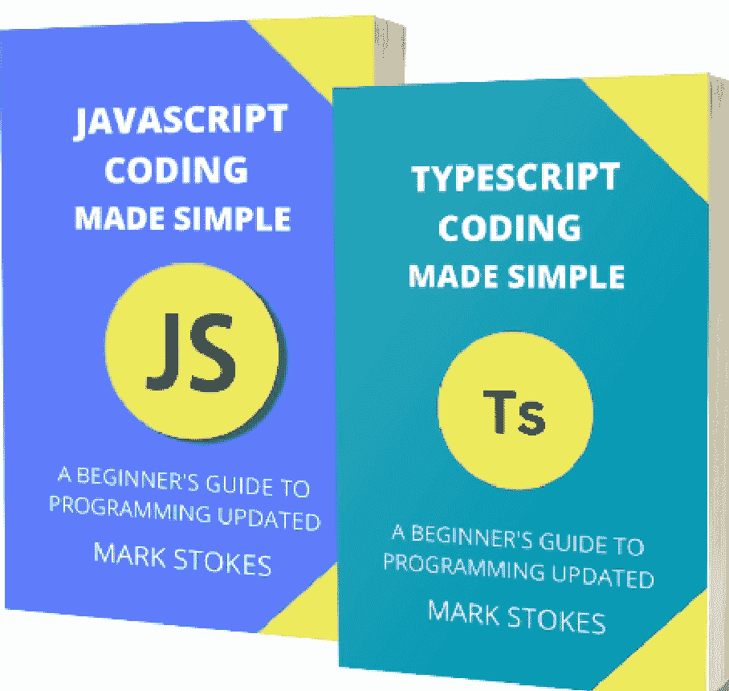

# TypeScript 和 JavaScript 简易编程（二合一）：编程初学者指南



# 书籍简介

欢迎阅读《带示例的简单 TypeScript 编码》。本书旨在成为学习和精通 TypeScript 编程语言的全面指南。无论你是想要开始学习 TypeScript 的初，还是想要提升技能的经验丰富的开发者，这本书都能为你提供所需的内容。

在书中，我们将深入探讨 TypeScript，并探索它的特性、语法和最佳实践。我们将从基础开始，涵盖变量、数据类型、函数和类等主题。然后，我们将转向更高级的概念，如模块、命名空间和类型注解。

TypeScript 的核心优势之一是它提供静态类型检查的能力，这允许你在开发过程早期发现错误。我们将探索类型注解和类型推断的力量，以及它们如何帮助提高代码的可靠性和可维护性。

随着章节的进行，我们将涵盖高级类型、面向对象编程、泛型、装饰器和元数据等主题。我们还将学习如何在 TypeScript 中处理异步编程，包括处理承诺和 `async/await`。

错误处理和调试是任何编程语言至关重要的部分，TypeScript 也不例外。我们将探索处理错误和调试 TypeScript 代码的各种技巧和工具。

测试是软件开发过程中不可或缺的一部分，我们将讨论测试和调试 TypeScript 代码的策略。我们还将查看 TypeScript 如何与现有的 JavaScript 代码库无缝集成，从而实现向 TypeScript 的逐渐迁移。

最后，我们将学习构建和部署 TypeScript 应用，探索辅助开发和部署过程的工具和框架。

在整本书中，我们将提供大量的示例和代码段来解释所讨论的概念和技术。这些示例将帮助你快速掌握这些概念并将其应用于现实场景。

读完本书后，你将拥有坚实的 TypeScript 基础，并具备使用 TypeScript 构建健壮且可维护应用程序的知识和技能。

现在，让我们一起开启这段 TypeScript 之旅，释放这种强大编程语言的全部潜力。

# 第一章：TypeScript 简介

在本章中，我们将通过理解 TypeScript 的用途、优势以及它与 JavaScript 的关系，开启 TypeScript 世界之旅。

TypeScript 是 JavaScript 的静态类型超集，可以编译为纯 JavaScript 代码。它由微软开发，旨在解决 JavaScript 的一些缺点，特别是在处理大型应用时。

TypeScript 的核心特性之一是支持静态类型检查。与 JavaScript 不同（在变量可以持有任何类型的值），TypeScript 允许你显式指定变量的类型。这使得 TypeScript 编译器能够在开发过程早期捕捉类型相关的错误。

要开始使用 TypeScript，我们需要设置开发环境。系统中需要安装 `Node.js` 和 `npm`（Node 包管理器）。一旦准备好这些前提，我们可以使用 `npm` 全局安装 TypeScript：

```bash
npm install -g typescript
```

安装 TypeScript 后，我们就可以创建一个以`.ts`结尾的第一个 TypeScript 文件了。让我们创建一个名为`hello.ts`的文件，并在任的编辑器中打开它。在`hello.ts`文件中，让我们先编写简单的 TypeScript 代码：

```typescript
function sayHello(name: string) {
  console.log("Hello, " + name + "!");
}

sayHello("John");
```

在这个代码段中，我们有一个名为`sayHello`的函数，它接受一个字符串类型的参数`name`。在函数体内部，我们使用`console.log`函数打印消息。

要将此 TypeScript 代码编译为 JavaScript，我们需要运行 TypeScript 编译器。打开终端或命令提示符，导航到`hello.ts`文件所在的目录，并运行以下命令：

```bash
tsc hello.ts
```

TypeScript 编译器（`tsc`）将生成一个同名但扩展名为`.js`的 JavaScript 文件。在这种情况下，它将创建一个名为`hello.js`的文件。

现在，通过在终端执行以下命令来运行我们的 JavaScript 代码：

```bash
node hello.js
```

你应该能看到输出：“Hello, John!”

恭喜你！你成功编写并执行了你的第一个 TypeScript 代码。这个示例演示了 TypeScript 的基本语法和类型检查能力。

在整本书中，我们将探索更多的 TypeScript 概念，包括处理不同的数据类型、函数、类、模块等。我们还将深入研究真实案例和最佳实践，帮助你成为一名熟的 TypeScript 开发者。

在下一章中，我们将深入研究 TypeScript 的基础，探索它提供的各种数据类型。我们将学习如何使用 TypeScript 丰富的内置类型来声明变量、赋值和执行操作。

所以，请保持关注，准备好将你的 TypeScript 技能提升新水平！

# 第二章：TypeScript 基础

在本章中，我们将深入研究 TypeScript 的基础，并探索其丰富的数据类型、变量声明和基础操作。

## 数据类型

TypeScript 提供了几种内置数据类型，允许我们显式定义变量的类型。这些数据类型包括：

- `number` 用于数值，例如 `1`, `2.5` 或 `-3`。
- `string` 用于文本数据，用单引号（`''`）或双引号（`""`）括围。
- `boolean` 用于表示逻辑值，即`true`或`false`。

## 函数

函数在 TypeScript 开发中起着至关重要的作用。它们允许我们定义可以根据不同输入调用的复用代码块，并且它们也可以返回值。

在 TypeScript 中，我们可以使用`function`关键字来定义函数。我们可以指定参数的类型和函数的返回类型。

```typescript
function addNumbers(num1: number, num2: number): number {
  return num1 + num2;
}
let result: number = addNumbers(5, 10); // 15

function sayHello(name: string, age?: number): void {
  console.log(`Hello, ${name}! You are ${age || 'unknown'} years old.`);
}
sayHello("John"); // Hello, John! You are unknown years old.
sayHello("Jane", 25); // Hello, Jane! You are 25 years old.

function sumNumbers(...numbers: number[]): number {
  let sum: number = 0;
  for (let num of numbers) {
    sum += num;
  }
  return sum;
}
let total: number = sumNumbers(1, 2, 3, 4, 5); // 15
```

```typescript
let myCar: Car = new Car("Toyota", "red");

myCar.startEngine(); // Toyota car started!
```

在本章中，我们涵盖了 TypeScript 的其他概念，包括接口（interfaces）和类（classes）。这些概念扩展了 TypeScript 的功能，并使开发者能够编写结构化且可维护的代码。

# 第 4 章：高级 TypeScript 概念

## 简介

在本章中我们将深入研究 TypeScript 的高级概念，这将进一步增强你对该语言的理解和掌握。我们将探索联合类型、交叉类型、类型别名和泛型等主题。这些概念是强大的工具，可以提高代码的灵活性重用性。

## 联合类型 (Union Types)

TypeScript 中的联合类型允许变量具有多种类型。它使用类型之间的管道符号（`|`）表示。这使得变量可以在不同时间持有不同类型的值。

当我们想要处理具有不同数据类型的值时，联合类型非常有用。

```typescript
let pet: string | number;

pet = "dog"; // 有效
pet = 42; // 有效
pet = true; // 无效
```

## 交叉类型 (Intersection Types)

TypeScript 中的交叉类型允许我们将多个类型组合为单一类型。它使用类型之间的安培符号（`&`）表示。这使得对象或变量可以拥有交叉类型的所有属性和方法。

```typescript
interface Order {
  id: number;
  amount: number;
}
interface Customer {
  name: string;
  age: number;
}
type OrderWithCustomer = Order & Customer;
let order: OrderWithCustomer = {
  id: 1,
  amount: 100,
  name: "John Doe",
  age: 30,
};
```

## 类型别名 (Type Aliases)

TypeScript 中的类型别名为类型创建自定义名称的方法。在处理复杂类型或我们想要提高代码的可读读和可维护性时，它们特别有用。类型别名使用`type`关键字创建。

```typescript
type Point = {
  x: number;
  y: number;
};

type Shape = "circle" | "square" | "triangle";

let origin: Point = { x: 0, y: 0 };

let shape: Shape = "circle";
```

## 泛型 (Generics)

TypeScript 中的泛型允许我们创建可以与多种类型工作的重用组件。它们提供了一种定义类型占位符的方法，这些类型在组件在使用时确定。泛型使我们能够编写灵活且类型代码。

```typescript
function reverse<T>(arr: T[]): T[] {
  return arr.reverse();
}

let numbers: number[] = [1, 2, 3, 4, 5];

let reversedNumbers: number[] = reverse(numbers);

let names: string[] = ["John", "Jane", "Joe"];

let reversedNames: string[] = reverse(names);
```

在本章中，我们探索了高级 TypeScript 概念，包括联合类型、交叉类型、类型别名和泛型。这些概念将允许你编写更有表达式且可重用的代码，增强你的 TypeScript 项目的灵活性可维护性。

# 第 5 章：TypeScript 模块与命名空间

## 简介

在 TypeScript 中，模块（modules）和命名空间（namespaces）提供了组织和封装代码的机制，允许在大规模应用中实现更好的模块化、重用性和可维护性。在本章中，我们将探索 TypeScript 中的模块和命名空间概念，以及它们如何帮助构建和管理你的代码库。

## 模块 (Modules)

TypeScript 中的模块提供将代码封装到单独文件中并定义它们之间依赖的方法。模块是一个自包含的单元，可以导出功能并从其他模块导入功能。

## 导出与导入 (Exporting and Importing)

要从模块导出功能，可以在声明（如变量、函数、类或接口）之前使用`export`关键字。

```typescript
// mathUtils.ts
export function add(a: number, b: number): number {
  return a + b;
}

// app.ts
import { add } from "./mathUtils";

console.log(add(2, 3)); // 输出: 5
```

在上面的示例中，`add`函数使用`export`关键字从`mathUtils`模块导出。在`app.ts`文件中，使用`import`语句导入`add`函数并可以在文件中使用。

## 默认导出 (Default Export)

除了命名导出外，模块还可以有一个默认导出。默认导出是模块的主要导出，通常用于导出单个值或功能。

```typescript
// mathUtils.ts
export default function add(a: number, b: number): number {
  return a + b;
}

// app.ts
import add from "./mathUtils";

console.log(add(2, 3)); // 输出: 5
```

在上面的示例中，`add`函数作为默认导出从`mathUtils`模块导出。导入默认导出时，你可以为导入的值选择任何名称。

## 命名空间 (Namespaces)

命名空间（也称为内部模块）提供了一种将相关代码组织到命名作用域的方法。命名空间可以包含变量、函数、类和接口。

```typescript
namespace Geometry {
  export function calculateCircumference(radius: number): number {
    return 2 * Math.PI * radius;
  }

  export function calculateArea(radius: number): number {
    return Math.PI * radius * radius;
  }

  console.log(Geometry.calculateCircumference(5)); // 输出: 31.41592653589793
  console.log(Geometry.calculateArea(5)); // 输出: 78.53981633974483
}
```

在上面的示例中，`Geometry`命名空间包含两个函数：`calculateCircumference`和`calculateArea`。这些函数使用`export`关键字导出，可以通过命名空间名称加上函数名来访问。

## 模块解析 (Module Resolution)

模块解析是在 TypeScript 中定位和加载模块的过程。TypeScript 支持多种模块解析策略。可以在`tsconfig.json`文件中使用`moduleResolution`选项配置模块解析策略。

```json
{
  "compilerOptions": {
    "moduleResolution": "node"
  }
}
```

## 总结

TypeScript 模块和命名空间提供了组织和封装代码的机制。模块允许你将代码封装到单独文件中并定义依赖，实现更好的重用和维护性。命名空间提供了一种在命名作用域内逻辑上分组相关代码的方法。理解 TypeScript 中的模块和命名空间对于构建模块化和可维护的应用至关重要。

```typescript
import { greet } from "./greetings"; // Relative path
import { sum } from "math-lib"; // Package import

greet("John"); // Invoking a function from a module
const result = sum(5, 10); // Using a function from a package
```

## 装饰器 (Decorators)

装饰器是 TypeScript 中一种强大的特性，允许我们在设计时添加元数据并修改类、方法或属性的行为。它们由`@`符号后装饰器函数表示。装饰器提供了一种模块化和可重用的方式来实现交叉关注点，例如日志、身份验证和验证。

```typescript
function log(target: any, propertyKey: string, descriptor: PropertyDescriptor): void {
  const originalMethod = descriptor.value;

  descriptor.value = function (...args: any[]): any {
    console.log(`Calling method ${propertyKey} with arguments: ${args}`);
    const result = originalMethod.apply(this, args);
    console.log(`Method ${propertyKey} returned: ${result}`);
    return result;
  }
}

class Calculator {
  @log
  add(a: number, b: number): number {
    return a + b;
  }
}

const calculator = new Calculator();
const sum = calculator.add(5, 10); // Logs: Calling method add with arguments: 5,10

// Logs: Method add returned:
 15
```

## 代码生成 (Code Generation)


TypeScript 通过 Babel 和 TypeScript 编译器（`tsc`）等工具支持代码生成。这些工具允许我们将 TypeScript 代码编译为 JavaScript，从而实现与不同环境和浏览器的兼容。代码生成在 TypeScript 项目的构建和部署过程中起着至关重要的作用。

在本章，我们探索了 TypeScript 中的高级工具和技术，包括类型推断、类型守卫、模块解析、装饰器和代码生成。这些工具和技术有助于在 TypeScript 项目中编写更高效、模块化且易维护的代码。

# 第 7 章：TypeScript 面向对象编程

## 引言

面向对象编程（OOP）是一种流行的编程范式，允许开发者将代码组织成可重用和模块化的组件，称为对象。TypeScript 通过对类、接口和其他 OOP 特性的支持，为构建健壮且可扩展的应用程序提供了坚实的基础。在本章中，我们将探索 OOP 的核心概念以及它们在 TypeScript 中如何实现。

## 类和对象（Classes and Objects）

OOP 的核心是类和对象的概念。类是一个蓝图或模板，定义了对象的结构和行为。对象是类的实例，代表程序中的特定实体或实例。类封装了与特定概念或实体相关的数据（属性）和行为（方法）。

```typescript
class Circle {
  radius: number;

  constructor(radius: number) {
    this.radius = radius;
  }

  getArea(): number {
    return Math.PI * this.radius ** 2;
  }

  getCircumference(): number {
    return 2 * Math.PI * this.radius;
  }
}

const myCircle = new Circle(5);
console.log(myCircle.getArea()); // Output: 78.5398163397483
console.log(myCircle.getCircumference()); // Output: 31.41592653589793
```

## 继承（Inheritance）

继承是 OOP 中的一种机制，允许类从其他类继承属性和方法。TypeScript 支持单继承，即一个类可以从一个父类继承。这促进了代码的重用，并便于类之间层级关系的创建。

```typescript
class Shape {
  color: string;

  constructor(color: string) {
    this.color = color;
  }

  getColor(): string {
    return this.color;
  }
}

class Rectangle extends Shape {
  width: number;
  height: number;

  constructor(color: string, width: number, height: number) {
    super(color);
    this.width = width;
    this.height = height;
  }
}

const myRectangle = new Rectangle("blue", 10, 20);
console.log(myRectangle.getColor()); // Output: blue
```

## 封装（Encapsulation）

封装是将属性和方法封装在类中并控制对其直接访问的做法。在 TypeScript 中，我们使用访问修饰符（`public`、`private`、`protected`）来限制类成员的可见性。

```typescript
class BankAccount {
  private balance: number;

  constructor(initialBalance: number) {
    this.balance = initialBalance;
  }

  deposit(amount: number): void {
    this.balance += amount;
  }

  withdraw(amount: number): void {
    if (amount <= this.balance) {
      this.balance -= amount;
    }
  }

  getBalance(): number {
    return this.balance;
  }
}

const account = new BankAccount(1000);
account.deposit(500);
account.withdraw(200);
console.log(account.getBalance()); // Output: 1300
```

## 多态（Polymorphism）

多态允许不同类的对象被视为共同超类的实例。方法重写允许派生类对继承的方法提供自己的实现。

```typescript
class Animal {
  makeSound(): void {
    console.log("Animal makes a sound");
  }
}

class Dog extends Animal {
  makeSound(): void {
    console.log("Dog barks");
  }
}

class Cat extends Animal {
  makeSound(): void {
    console.log("Cat meows");
  }
}

function makeAnimalSound(animal: Animal): void {
  animal.makeSound();
}

const dog = new Dog();
const cat = new Cat();

makeAnimalSound(dog); // Output: Dog barks
makeAnimalSound(cat); // Output: Cat meows
```

## 接口（Interfaces）

TypeScript 中的接口定义了类遵循的约定。它们指定了类必须遵守的结构和行为。

```typescript
interface Printable {
  print(): void;
}

class Document implements Printable {
  content: string;

  constructor(content: string) {
    this.content = content;
  }

  print(): void {
    console.log(this.content);
  }
}

class Invoice implements Printable {
  amount: number;

  constructor(amount: number) {
    this.amount = amount;
  }

  print(): void {
    console.log(`Invoice amount: ${this.amount}`);
  }
}

const document = new Document("Sample document");
const invoice = new Invoice(1000);
document.print(); // Output: Sample document
invoice.print(); // Output: Invoice amount: 1000
```

TypeScript 面向对象编程为构建模块化、可重用且易维护的应用程序提供了坚实的基础。通过利用类、对象、继承、封装、多态和接口，你可以设计并开发高效且灵活的软件系统。OOP 原则促进了代码组织、重用和扩展性，使 TypeScript 成为构建复杂应用程序的强大语言。

# 第 8 章：TypeScript 中的泛型（Generics）

## 引言

TypeScript 中的泛型为创建可重用且类型安全的代码组件提供了强大的工具。它们允许你定义处理不同类型的函数、类和接口，提供了灵活性并增强了代码的可用性。在本章中，我们将探索泛型的概念以及它们在 TypeScript 中的用法。

## 泛型基础

泛型允许你创建与一系列类型工作的组件，而不是局限于特定类型。它们提供了一种类型参数化的方式，并允许你为在使用组件时使用的实际类型定义占位符。

```typescript
function identity<T>(arg: T): T {
  return arg;
}

let result = identity<string>("Hello, TypeScript!"); // Type argument explicitly provided
console.log(result); // Output: "Hello, TypeScript"

let anotherResult = identity(42); // Type argument inferred as number
console.log(anotherResult); // Output: 42
```

在上面的示例中，`identity` 函数使用泛型类型参数 `T` 进行声明。这允许函数接受任何类型的参数，并返回相同类型的值。类型参数可以被显式地提供（如第一次用法所示），也可以从参数中推断（如第二次用法所示）。

## 泛型类型参数

泛型类型参数可以在函数、类和接口中以多种方式使用。它们可以用于指定函数参数、函数返回类型、类属性以及方法的返回类型。

```typescript
function toArray<T>(arg: T): T[] {
  return [arg];
}

let stringArray = toArray("TypeScript"); // Type argument inferred as string

console.log(stringArray); // Output: ["TypeScript"]
```

```typescript
let numberArray = toArray(42); // Type argument inferred as number
console.log(numberArray); // Output: [42]
```

在上面的示例中，`toArray` 函数接收一个类型为 `T` 的参数，并返回一个类型为 `T[]` 的数组。类型参数是根据传递给函数的实际参数推出来的。

## 泛型类

泛型类允许你创建处理不同类型的类。类型参数可以用于定义类中的属性、方法参数和返回类型。

```typescript
class Box<T> {
  private value: T;

  constructor(value: T) {
    this.value = value;
  }

  getValue(): T {
    return this.value;
  }
}

let stringBox = new Box<string>("TypeScript");

console.log(stringBox.getValue()); // Output: "TypeScript"

let numberBox = new Box<number>(42);

console.log(numberBox.getValue()); // Output: 42
```

在上面的示例中，`Box` 类被定义为一个带有类型参数 `T` 的泛型类。`value` 属性和 `getValue` 方法使用 `T` 进行类型化。在创建 `Box` 类的实例时，类型参数指定了实际使用的类型。

## 使用泛型约束

TypeScript 允许你对泛型类型参数应用约束，以确保它们满足特定要求。当你想要限制用于泛型组件的类型时，这非常有用。

```typescript
interface Lengthable {
  length: number;
}

function getLength<T extends Lengthable>(arg: T): number {
  return arg.length;
}
```

```typescript
let arrayLength = getLength([1, 2, 3, 4, 5]);

console.log(arrayLength); // Output: 5

let stringLength = getLength("TypeScript");

console.log(stringLength); // Output: 10
```

在上面的示例中，`getLength` 函数定义的泛型类型参数 `T` 扩展了 `Lengthable` 接口。`Lengthable` 接口要求类型 `T` 必须具有一个类型为 `number` 的 `length` 属性。该约束确保了 `length` 属性在函数内部是可以访问的。

## 泛型的实际用例

泛型在 TypeScript 中被广泛用于创建可复用且类型安全的代码组件。以下是泛型可以发挥作用的几个实际用例：

1. **集合和数据结构**：泛型可以用于创建泛型集合和数据结构，如数组、链表、栈和队列，它们可以持有不同类型的元素。
2. **函数转换**：泛型可以用于创建转换或操作其他高阶函数。例如，泛型函数可以接受一个函数作为参数，并返回一个具有修改行为的新函数。
3. **类型安全的 API**：泛型可以用于设计类型安全的 API，其中函数、类和接口等组件可以在保持类型安全的同时与广泛的类型工作。
4. **数据处理和转换**：泛型可以用于数据处理和转换，允许你创建操作不同类型数据的可复用函数或类。

## 泛型的益处

在 TypeScript 中使用泛型提供了多种益处：

1. **代码复用性**：泛型允许你创建可用于不同类型的组件，减少代码重复并促进代码复用。
2. **类型安全**：泛型通过在组件使用的过程中保留类型信息，使你能够维护类型安全。这有助于在开发过程中捕捉潜在的类型错误。
3. **灵活性**：泛型通过允许组件与多种类型工作提供了灵活性。这使得你的代码更具适应性，并适用于多种用例。
4. **表达力**：泛型通过允许你编写更通用、可复用的函数、类和接口，增强了代码的表达能力。这导致了更简洁易读的代码。

## 结论

TypeScript 中的泛型提供了一种创建可复用且类型安全的代码组件的强大机制。通过使用泛型类型参数，你可以构建处理多种类型的函数、类和接口，从而增强代码的复用性、类型安全和灵活性。在创建可以处理不同类型数据而不牺牲类型正确性的组件场景下，泛型特别有用。

# 第 9 章：TypeScript 中的装饰器和元数据

## 引言

装饰器和元数据（Metadata）是 TypeScript 中的高级功能，允许你在运行时添加额外信息并修改类、方法和属性的行为。装饰器提供了一种标注和修改类或成员结构的方法，而元数据允许你附加并检索与这些实体关联的额外数据。在本章中，我们将探索装饰器和元数据的概念以及它们如何在 TypeScript 中使用。

## 装饰器

装饰器是一种特殊的声明，可以附加到类、方法、属性或参数上。它们以 `@` 符号开头，并可以用于修改或增强目标实体的行为。装饰器在运行时执行，可以用于添加功能、修改行为或提供额外的元数据。

## 创建装饰器

要创建一个装饰器，你需要定义一个接受目标实体作为参数的函数。装饰器函数随后可以通过返回新值来执行操作或修改目标实体。

```typescript
function log(target: any) {
  console.log("Decorating class:", target);
}

@log
class MyClass {
  // Class implementation
}
```

在上面的示例中，`log` 装饰器被应用于 `MyClass` 类。当装饰器执行时，它会在控制台中打印一条消息，证明装饰器已应用于类。

## 装饰方法和属性

装饰器也可以应用于类中的方法和属性。这允许你修改类特定成员的行为或为它们添加额外功能。

```typescript
class MyClass {
  @log
  myMethod() {
    // Method implementation
  }

  @readonly
  myProperty: string = "Hello, TypeScript!";
}
```

在上面的示例中，`log` 装饰器应用于 `myMethod` 方法，而 `readonly` 装饰器应用于 `myProperty` 属性。装饰器可以在这些成员被访问或调用时修改它们的行为或执行额外操作。

## 装饰参数

装饰器还可以应用于方法或构造函数的参数。这允许你对传递给函数的参数添加额外的行为或验证。

```typescript
class MyClass {
  myMethod(@validate input: string) {
    // Method implementation
  }
}
```

在上面的示例中，`validate` 装饰器应用于 `myMethod` 方法的 `input` 参数。装饰器可以在方法执行之前对参数值进行验证或修改其行为。

## 元数据

元数据提供了一种向类、方法、属性或参数附加额外数据的方法。这些元数据可以在运行时检索并用于各种用途，例如反射、依赖注入或运行时分析。

## 附加元数据

要向实体附加元数据，你可以使用 TypeScript 提供的 `Reflect.metadata` 函数。`Reflect.metadata` 函数接受两个参数：一个元数据键和一个元数据值。

```typescript
class MyClass {
  @Reflect.metadata("custom:tag", "Some metadata")
  myMethod() {
    // 方法实现
  }
}
```


在上面的示例中，使用`Reflect.metadata`函数来将元数据附加到`myMethod`方法上。元数据键为`"custom-tag"`，元数据值为`"Some metadata"`。这些元数据可以使用反射技术在运行时检索。

## 获取元数据

要在运行时检索元数据，你可以使用 TypeScript 提供的`Reflect.getMetadata`函数。`Reflect.getMetadata`函数接受元数据键和目标实体作为参数。

```typescript
class MyClass {
  @Reflect.metadata("custom:tag", "Some metadata")
  myMethod() {
    // 方法实现
  }
}

const metadata = Reflect.getMetadata("custom:tag", MyClass.prototype, "myMethod");
console.log(metadata); // 输出: "Some metadata"
```

在上面的示例中，使用`Reflect.getMetadata`函数来检索附加到`MyClass`类`myMethod`方法的元数据。元数据键为`"custom:tag"`，结果是元数据值`"Some metadata"`。

## 装饰器和元数据的实际用例

装饰器和元数据提供了强大的功能，可以用于各种场景。以下是装饰器和元数据有益的一些实际用例：

- **日志记录和调试**：装饰器可以通过向方法或类附加元数据来记录方法调用、测量性能或提供调试信息。
- **验证和数据转换**：装饰器可以应用于方法参数，以执行输入验证、数据转换或数据清洗。
- **依赖注入**：装饰器和元数据可以用于依赖注入框架，根据附加到类或其成员的元数据自动接线依赖关系。
- **路由和中间件**：装饰器可以在 Web 框架中用于定义路由、应用中间件或执行身份验证和授权检查。
- **序列化和反序列化**：装饰器可以标记属性或方法以控制序列化和反序列化过程，例如转换数据类型或排除特定字段。

## 装饰器和元数据的优势

装饰器和元数据在 TypeScript 开发中提供了许多优势：

- **代码模块化**：装饰器允许你将交叉关注点（如日志记录、验证）分离到可重用的装饰器函数中，提高了代码的模块化重用性。
- **可扩展性**：装饰器允许你在不修改原始实现的情况下轻松扩展类、方法、属性或参数的行为。这增强了代码的可维护性和活性。
- **可读性**：装饰器通过在装饰器内部封装额外功能可以提高代码的可读性。这有助于保持类或方法的核心逻辑清晰且集中。
- **运行时反射**：附加到实体的元数据可以在运行时检索，实现强大的反射能力。这允许对类及其成员进行动态分析、依赖注入和运行时操作。

## 结论

装饰器和元数据在 TypeScript 中提供了强大的功能，允许你修改类、方法、属性或参数的行为，并在运行时附加额外数据。装饰器允许你添加功能、修改行为并分离交叉关注点。元数据提供了一种在运行时附加和检索有关实体额外信息的方法。通过利用装饰器和元数据，你可以增强 TypeScript 程序的模块化、可扩展性和活性。

# 第 10 节：TypeScript 中的异步编程

## 引言

异步编程是现代软件开发的一个关键方面，特别是在需要处理耗时操作的场景中，例如从服务器获取数据、读取文件或发送网络请求。在本章中，我们将探索 TypeScript 中异步编程的概念和技术。

## 回调

JavaScript 和 TypeScript 中的传统方法之一是使用回调。回调是一个作为参数传递的函数，并在异步操作完成后被调用。

```typescript
function fetchData(callback: (data: any) => void) {
  // 模拟异步操作
  setTimeout(() => {
    const data = "Some data";
    callback(data);
  }, 1000);
}

// 使用方法
fetchData((data) => {
  console.log(data);
});
```

在上面的示例中，`fetchData`函数接受一个回调函数。在模拟 1 秒的延迟后，它会带数据调用回调。

## Promise

Promise 提供了一种更结构化、更直观的方式来处理异步操作。Promise 代表异步操作的最终完成或失败。

```typescript
function fetchData(): Promise<any> {
  return new Promise((resolve, reject) => {
    // 模拟异步操作
    setTimeout(() => {
      const data = "Some data";
      resolve(data);
    }, 1000);
  });
}

// 使用方法
fetchData()
  .then((data) => {
    console.log(data);
  })
  .catch((error) => {
    console.error(error);
  });
```

在上面的示例中，`fetchData`函数返回一个 Promise。在 Promise 构造函数内部执行异步操作，并带数据调用`resolve`函数。`.then()`方法用于处理 Promise 的成功完成，而`.catch()`方法用于处理任何错误。

### Async/Await

Async/await 是 ECMAScript 2017 (ES8) 引入并受 TypeScript 支持的更现代、更简洁的异步操作处理方式。它允许你以类似于同步的方式编写异步代码，使其更容易理解和维护。

```typescript
async function fetchData(): Promise<any> {
  return new Promise((resolve, reject) => {
    // 模拟异步操作
    setTimeout(() => {
      const data = "Some data";
      resolve(data);
    }, 1000);
  });
}

// 使用方法
async function getData() {
  try {
    const data = await fetchData();
    console.log(data);
  } catch (error) {
    console.error(error);
  }
}

getData();
```

在上面的示例中，`fetchData`函数被声明为`async`，表示它返回一个 Promise。在函数内部执行异步操作并解析数据。`await`关键字用于暂停`getData`函数的执行，直到 Promise 被解析或拒绝。

## 异步编程的实际用例

异步编程被广泛应用于各种场景中，包括：

- **HTTP 请求**：在进行 API 调用或从服务器获取数据时，异步编程允许你在不阻塞程序执行的情况下执行这些操作。
- **文件操作**：异步读取或写入文件对于防止程序在等待文件 I/O 操作完成时冻结至关重要。
- **数据库访问**：异步编程在与数据库交互时被广泛使用。异步执行数据库查询和检索数据可以确保应用程序保持响应能力，并且不会在等待数据库操作完成时阻塞执行。
- **并发任务**：异步编程允许并发执行多个任务。当你有可以同时运行的独立操作时，这特别有用，可以提高应用程序的整体性能和响应能力。
- **事件处理**：异步编程在处理用户界面或事件驱动架构中的事件时起着重要作用。它允许你响应用户交互、系统事件或外部触发，而不会阻塞执行的主线程。

## 异步编程的优势

异步编程在 TypeScript 开发中提供了许多益处：

- **提高性能**：通过利用异步技术，你可以避免阻塞程序的执行并更高效地利用系统资源。这带来了更好的性能和响应能力，特别是在涉及耗时操作的场景下。
- **更好的用户体验**：异步编程有助于确保应用程序在处理长时间运行的操作时保持响应，而不会冻结或无响应。这通过提供流畅且具有交互性的界面增强了用户体验。
- **可扩展性**：异步编程使你能够高效地处理多个并发任务。这种可扩展性允许你的应用程序处理更多请求或并行执行多个操作，从而提高整体吞吐量。
- **代码可读性和可维护性**：Promises 和 async/await 语法提供了一种更具结构化且易于读的方式来处理异步代码。这使得理解、调试和维护代码库变得更容易，减少了 Bug 的概率并提升了代码质量。
- **错误处理**：异步编程通过使用 promises 以及结合 async/await 的 try/catch 块，允许进行更好的错误处理。这允许你优雅地处理错误并提供适当的错误消息或回退机制。

## 结论

异步编程是现代软件开发的一个基础方面，TypeScript 提供了强大的工具和语言特性来有效处理异步操作。无论你选择回调、promises 还是 async/await 语法，理解并利用异步技术对于构建响应迅速、可扩展且高效的应用程序都是至关重要的。通过拥抱异步编程，你可以提高性能、增强用户体验，并在 TypeScript 项目中编写更具维护性的代码。

# 第 11 章：TypeScript 中的错误处理与异步编程

## 引言

在本章中，我们将关注 TypeScript 中的错误处理和异步编程。处理错误和处理异步操作是现代 Web 开发中的关键方面。TypeScript 提供了强大的特性和技术来有效管理错误并处理异步任务。

## 错误处理

在 TypeScript 中，错误处理通常使用 try-catch 块。`try`块包含可能抛出错误的代码，`catch`块在发生错误时处理该错误。我们还可以使用可选的`finally`块来运行无论是否发生错误都应该执行的代码。

```typescript
try {
  // 可能抛出错误的代码
  throw new Error("Something went wrong");
} catch (error) {
  // 错误处理逻辑
  console.log("An error occurred:", error.message);
} finally {
  // 始终执行的代码
  console.log("This code always executes");
}
```

## 异步编程

异步编程对于处理如调用 API 或读写文件等耗时操作至关重要。TypeScript 提供了处理异步代码的几种机制，包括回调、promises 和 async/await。

### 回调 (Callbacks)

回调是处理异步操作的传统方法。回调函数作为参数传递给异步函数，并在操作完成时被调用。然而，基于回调的代码可能会变得难以阅读和维护，特别是在处理多个异步任务时。

```typescript
function fetchData(callback: (data: string) => void): void {
  // 模拟一个异步操作
  setTimeout(() => {
    const data = "This is the fetched data";
    callback(data);
  }, 2000);
}

fetchData((data: string) => {
  console.log("Data received:", data);
});
```

### Promises

Promises 提供了一种更具结构化的方式来处理异步操作。Promise 代表异步任务的最终完成或失败。我们可以使用`then`方法处理成功结果，并使用`catch`方法处理任何错误。

```typescript
function fetchData(): Promise<string> {
  return new Promise((resolve, reject) => {
    // 模拟一个异步操作
    setTimeout(() => {
      const data = "This is the fetched data";
      resolve(data);
    }, 2000);
  });
}

fetchData()
  .then((data: string) => {
    console.log("Data received:", data);
  })
  .catch((error) => {
    console.log("An error occurred:", error);
  });
```

### Async/Await

Async/await 是一种现代的异步编程方法，使代码更具可读性且更容易推理。`async`关键字用于定义异步函数，`await`关键字用于暂停函数的执行，直到 promise 被解析（resolved）或拒绝（rejected）。

```typescript
async function fetchData(): Promise<string> {
  return new Promise((resolve, reject) => {
    // 模拟一个异步操作
    setTimeout(() => {
      const data = "This is the fetched data";
      resolve(data);
    }, 2000);
  });
}

async function fetchDataAndProcess(): Promise<void> {
  try {
    const data: string = await fetchData();
    console.log("Data received:", data);
  } catch (error) {
    console.log("An error occurred:", error);
  }
}

fetchDataAndProcess();
```

在本章中，我们探索了使用 try-catch 块的错误处理技术以及异步编程的各种方法，包括回调、promises 和 async/await。这些工具使开发者能够在处理 TypeScript 中的异步任务时优雅地处理错误并编写高效的代码。

# 第 12 章：TypeScript 中的测试与调试

## 引言

测试和调试是软件开发中的基本活动，确保了代码的质量和可靠性。在本章中，我们将关注针对 TypeScript 的测试和调试技术。我们将探索单元测试、调试工具以及有效修复 Bug 的策略。

## 单元测试 (Unit Testing)

单元测试是软件开发中广泛采用的实践，涉及对代码的单个单元或组件进行测试，以确保它们符合预期。TypeScript 支持如 Jest、Mocha 和 Jasmine 等各种测试框架。这些框架提供了编写和执行测试的强大工具。

```typescript
import { sum } from "./math";

test("Adding two numbers", () => {
  expect(sum(2, 3)).toBe(5);
});

test("Adding negative numbers", () => {
  expect(sum(-5, -10)).toBe(-15);
});
```

## 调试工具

TypeScript 与现代调试工具无缝集成，增强了开发体验。像 VS Code 和 Chrome DevTools 这样的调试器提供了断点、单步执行代码、检查变量和评估表达式等功能。这些工具使你能够高效地追踪并解决 TypeScript 项目中的问题。

## 调试策略

当在 TypeScript 代码中遇到 Bug 时，遵循有效的调试策略以快速识别并修复问题至关重要。以下是一些可以考虑的策略：

1. **重现问题**：通过识别触发 bug 的步骤或输入，尝试持续性地重现该错误。这有助于隔离问题并理解其范围。
2. **使用调试语句**：在代码中插入调试语句，以便在运行时向控制台输出相关信息。这允许你检查变量、检查执行流并识别潜在问题。
3. **从微小更改开始**：不要对代码进行重大更改，而是从微小的修改开始，以缩小问题范围。通过逐渐消除可能的原因，你可以更有效地定位根源。
4. **利用调试工具**：充分利用你所选择的调试器提供的断点、单步执行和变量检查功能。这些工具允许你分析代码在特定地点的状态并识别异常。
5. **编写测试用例**：编写专门针对错误行为的测试用例。编写测试不仅有助于验证修复结果，还能防止未来的回归。

## Bug 修复最佳实践

在修复 TypeScript 代码中的 bug 时，请考虑以下最佳实践：

1. **理解问题**：彻底分析 bug，以深入理解问题及其对你代码的影响。
2. **隔离问题**：将问题缩小到代码的特定部分或模块。这使得更容易跟踪和修复 bug，而不会引入意外的副作用。
3. **编写回归测试**：创建复制 bug 行为并验证修复的测试用例。这些测试作为安全网，有助于防止 bug 再次发生。
4. **记录修复工作**：清晰地记录 bug 修复，包括问题的描述、所做的更改以及修复背后的逻辑。这有助于未来的代码维护以及与其他开发者的协作。

在本章中，我们探索了针对 TypeScript 的测试和调试技术。通过采用单元测试实践、利用调试工具并遵循有效的调试和 bug 修复策略，你可以确保 TypeScript 代码的可靠性和稳定性。

# 第 13 章：将 TypeScript 与 JavaScript 集成

## 引言

TypeScript 是 JavaScript 的超集，这意味着任何有效的 JavaScript 代码也是有效的 TypeScript。这种兼容性允许你将 TypeScript 无缝集成到现有的 JavaScript 项目中，让你能够利用 TypeScript 静态类型和高级语言特性的优势。在本章中，我们将探索将 TypeScript 与 JavaScript 集成的各种方式。

### 将 JavaScript 文件重命名为 .ts


在 JavaScript 项目中开始使用 TypeScript 的简单方法之一，是将 JavaScript 文件重命名为`.ts`扩展名。TypeScript 可以理解并转译 JavaScript 代码，允许你逐步将项目引入 TypeScript 特性。

例如，如果你有一个名为`app.js`的文件，可以将其重命名为`app.ts`，以指示它包含 TypeScript 代码。TypeScript 将能够编译并转译文件中的 JavaScript 代码。

## 配置`tsconfig.json`

为了更有效地将 TypeScript 与 JavaScript 集成，你可以在项目的根目录下创建一个`tsconfig.json`文件。该配置文件允许你为项目指定 TypeScript 编译器选项和设置。

这是一个`tsconfig.json`文件的示例：

```json
{
  "compilerOptions": {
    "target": "es6",
    "module": "commonjs",
    "outDir": "dist",
    "strict": true
  },
  "include": ["src/**/*.ts"],
  "exclude": ["node_modules"]
}
```

在上面的示例中，我们将`"target"`选项设置为`"es6"`，表示我们希望 TypeScript 编译器将代码转译为 ECMAScript 6。

`module`选项设置为`"commonjs"`以生成 CommonJS 模块。`outDir`选项指定了转译后的 JavaScript 文件的输出目录。`strict`选项启用了严格类型检查。

通过配置`tsconfig.json`文件，你可以更更好地控制 TypeScript 如何处理 JavaScript 代码，并根据需要应用额外的编译器选项。

## 类型声明

JavaScript 库和框架可能没有原生提供的类型信息。然而，TypeScript 提供了一种使用声明文件（`.dts`文件）为 JavaScript 代码包含类型声明的方法。

声明文件为现有的 JavaScript 库提供了类型信息，让你能够从 TypeScript 的静态类型和工具功能。

你可以在 DefinitelyTyped（<https://github.com/DefinitelyTyped>）中找到流行库的声明文件。

这是一个使用 jQuery 的示例：

1. 安装 jQuery 的声明文件：

```bash
npm install --save-dev @types/jquery
```

2. 在你的 TypeScript 代码中使用 jQuery：

```typescript
import * as $ from 'jquery';

$('#myElement').addClass('highlight');
```

## 渐进迁移

将 TypeScript 与 JavaScript 集成并不意味着你必须一次转换整个代码库。TypeScript 支持渐进迁移，允许你通过转换文件或部分来引入 TypeScript。

你可以从将 JavaScript 文件重命名为 TypeScript 开始，增量地添加类型注解，并根据需要利用 TypeScript 的特性。这种方法允许在保持现有 JavaScript 功能的同时，平滑过渡到 TypeScript。

## 使用 TypeScript 进行测试

TypeScript 的优势之一是它能够在开发阶段捕获与类型相关的错误，减少运行时错误的概率。当你为 JavaScript 代码编写测试时，可以利用这一特性。通过将你的测试文件转换为 TypeScript，你可以从静态类型和增强的工具支持中获益。

要开始操作，你可以将测试文件重命名为`.ts`扩展名并配置它们使用 TypeScript。然后你可以逐渐添加类型。

## 构建和打包

在构建和打包你的项目时，TypeScript 与 webpack 或 Rollup 等流行的构建工具和打包器良好地集成。你可以配置构建过程以包含 TypeScript 编译步骤，并为部署生成优化的包。

通过在构建工具工具中使用 TypeScript，你可以在构建过程中利用 TypeScript 的静态类型检查。这有助于尽早检测潜在问题，并提供更好的优化和错误报告。

## 与 JavaScript 库集成

TypeScript 为与 JavaScript 库和框架工作提供了极佳的支持。许多流行的 JavaScript 库都有官方或社区支持的类型声明。这些类型声明为库提供了 TypeScript 特有的类型信息，让你能够享受静态类型和智能代码补全的好处。

## 渐进迁移

如果你有一个大型 JavaScript 项目，你可能倾向于将其逐渐迁移到 TypeScript，而不是一次性转换整个代码库。TypeScript 允许你在同一个项目中无缝地混合 JavaScript 和 TypeScript 文件。

你可以从将单个 JavaScript 文件转换为 TypeScript 开始，并根据需要逐渐引入类型注解、接口和其他 TypeScript 特性。这种方法允许你增量地享受 TypeScript 的优势，并最大限度地减少对你现有开发工作流的干扰。

## 结论

将 TypeScript 集成到你的 JavaScript 项目中具有许多优势，包括提高代码质量、早期错误检测、增强工具支持以及更好的可维护性。通过逐步引入 TypeScript 并利用其特性，你可以在不需要完全重写代码库的情况下增强你的 JavaScript 代码库。TypeScript 与 JavaScript 的兼容性允许平滑过渡，使其成为增强你的 JavaScript 项目的强大工具。

# 第 14 章：构建和部署 TypeScript 应用

## 引言

一旦你开发了 TypeScript 应用程序，下一步就是为生产环境对其进行构建和部署。构建你的 TypeScript 代码涉及将其转编译为浏览器或 Node.js 可以执行的 JavaScript。部署你的应用程序涉及让用户在生产环境中可以使用它。在本章中，我们将探索构建和部署 TypeScript 应用的过程。

## 构建 TypeScript 应用

要构建 TypeScript 应用，你需要将 TypeScript 代码转编译为 JavaScript。TypeScript 提供了一个名为`tsc`的命令行界面（CLI）工具，用于执行此转编译过程。

1. 安装 TypeScript：

   如果你还没有安装，请使用以下命令在系统中全局安装 TypeScript：

   ```bash
   npm install -g typescript
   ```

2. 创建`tsconfig.json`文件：

   在你的项目根目录下创建一个`tsconfig.json`文件。该文件指定了 TypeScript 编译器的配置选项。

   ```json
   {
     "compilerOptions": {
       "target": "es6",
       "module": "commonjs",
       "outDir": "dist"
     },
     "include": ["src/**/*.ts"]
   }
   ```

   上面的`tsconfig.json`文件指定了目标 ECMAScript 版本、模块系统以及转编译后的 JavaScript 文件的输出目录。它还指定了编译过程中要包含哪些文件。

3. 运行 TypeScript 编译器：

   在项目根目录中打开终端并运行以下命令：

   ```bash
   tsc
   ```

   此命令指示 TypeScript 编译器读取`tsconfig.json`文件，并根据指定的配置将 TypeScript 文件转编译为 JavaScript。

   转编译后的 JavaScript 文件将在指定的`outDir`目录中生成（在本例中为`dist`）。

## 部署 TypeScript 应用

一旦构建了 TypeScript 应用，就是时候将其部署到生产环境了。部署过程可能取决于你的应用程序的目标平台和托管基础设施。以下是一些需要考虑的通用步骤：

### 1. 压缩和优化

在部署应用程序之前，对 JavaScript 文件进行压缩和优化是一个良好的做法。压缩通过删除不必要的空白字符和注释来减小文件大小。代码打包（code bundling）和树摇（tree shaking）等优化技术可以进一步优化你的应用程序性能。

可以使用 webpack、Rollup 或 Parcel 等工具打包并优化 TypeScript 代码。

### 2. 设置生产构建

在许多情况下，你的生产构建将与开发构建不同。考虑创建一个专门用于生产的独立构建配置，其中可能包含额外的优化或特定环境的设置。

例如，你可能希望启用如`--prod`等编译器标志以开启生产模式，或使用环境变量为生产环境配置不同的设置。

### 3. 部署到服务器

将 TypeScript 应用部署到服务器涉及将必要的文件传输到服务器并配置服务器以提供应用服务。

如果你正在部署 Node.js 应用，可以将转编译后的 JavaScript 文件以及任何必要的依赖复制到服务器。你可能还需要设置一个像 PM2 这样的进程管理器，以保持应用程序在生产环境中运行。

对于客户端应用，你可以将打包后的 JavaScript 文件以及任何静态资源（HTML、CSS、图像）部署到 Web 服务器或内容交付网络（CDN）。

### 4. 持续集成和部署（CI/CD）

为了简化部署过程，请考虑设置 CI/CD 流水线。Jenkins、Travis CI 或 GitLab CI 等持续集成工具可用于自动化构建和部署过程。

### 5. 监控和错误跟踪

一旦部署了 TypeScript 应用，监控其性能并跟踪生产环境中发生的任何错误至关重要。New Relic、Sentry 或 Google Analytics 等工具可以提供有关应用程序行为的宝贵洞察，让你能够及时识别并解决问题。

## 结论

构建和部署 TypeScript 应用涉及一系列步骤，包括将 TypeScript 代码转编译为 JavaScript、优化并打包代码、设置生产环境并将应用程序部署到服务器或托管平台。通过遵循最佳实践并利用构建工具，你可以简化这一过程并确保顺畅的部署体验。

---

# JAVASCRIPT 编程

# 简单易懂

# 初学者编程指南

# MARK STES

---

## 简单易懂的 JavaScript 编程

### 第 1 章：JavaScript 简介

欢迎来到精彩的 JavaScript 世界！在本章中，我们将开启探索 JavaScript 基础知识之旅。我们将涵盖 JavaScript 的基础、它在 Web 开发中的作用，以及它如何与 HTML 和 CSS 交互。

### 1.1 什么是 JavaScript？

JavaScript 是一种高级、解释型编程语言，主要用于为网站添加交互性。与关注网页结构和呈现的 HTML 和 CSS 不同，JavaScript 能够实现动态和响应式的行为。它允许你创建交互式元素、处理用户输入、操作页面内容等等。

JavaScript 是一门多功能的语言，多年来一直在演变，获得了广泛采用并成为现代 Web 开发不可或缺的一部分。它受到所有主流浏览器的支持，可以用于从简单的网站增强到复杂的 Web 应用的各种用途。

### 1.2 JavaScript 简史

为了更好地理解 JavaScript，让我们简单回顾一下历史。JavaScript 由 Brendan Eich 在 1995 年在 Netscape Communications 工作期间创建。最初命名为 "LiveScript"，后来为了利用当时 Java 的流行程度，JavaScript 被重新命名。该语言的设计初目的是为网页添加交互性，并为浏览器带来编程能力。

多年来，JavaScript 经历了重大的进步。定义语言规范的 ECMAScript 标准已经出了几个版本，每个版本都引入了新功能和改进。现代 JavaScript（也称为 ECMAScript 6 (ES6) 及更高版本）提供了强大的功能，让开发变得更加高效和愉快。

### 1.3 JavaScript 与 Web 开发

JavaScript 在现代开发中起着至关重要的作用。它主要用于客户端，这意味着它直接在 Web 浏览器中运行。这允许 JavaScript 与文档对象模型（DOM）进行交互，DOM 是网页结构的表示，并能够实时操作其元素。通过利用 JavaScript，Web 开发人员可以创建响应用户操作的动态交互式网站。

除了客户端脚本，JavaScript 的应用范围已扩展到 Web 开发的其他领域。随着 Node.js 的引入，JavaScript 现在也可以用于服务器端。这使得开发者可以使用同一种编程语言构建全栈应用程序，简化了开发流程并提高了代码的可重用性。

### 1.4 设置你的开发环境

在深入学习 JavaScript 编码之前，设置一个合适的开发环境至关重要。拥有正确的工具和舒适的配置可以极大提高你作为开发者的生产力。让我们来看看设置 JavaScript 开发环境的步骤。

首先，你需要一个文本编辑器来编写代码。有很多选择，从轻量级编辑器到功能丰富的集成开发环境（IDE）应有。。开发者流行的选择包括 Visual Studio Code、Sublime Text、Atom 和 WebStorm。根据你对功能、易用性和自定义选项的偏好选择适合你的一个。

一旦你有了文本编辑器，你需要一个 Web 浏览器来运行和测试你的 JavaScript 代码。所有现代浏览器（如 Chrome、Firefox、Safari 和 Edge）都内置了 JavaScript 引擎，可以执行你的代码。在多个浏览器上测试代码是一个良好的习惯，以确保兼容性。

除了文本编辑器和 Web 浏览器，你可能会发现使用浏览器提供的开发者工具很有帮助。这些工具提供了一系列调试、检查元素、监控网络请求等功能。大多数浏览器都有自己的开发者工具，可以通过快捷键或菜单选项访问。

最后，你可能希望考虑使用 Git 等版本控制软件来管理你的代码并与他人协作。Git 允许你跟踪代码库的更改，为功能开发创建分支，并与其他开发者轻松协作。GitHub、GitLab 和 Bitbucket 等平台为 Git 仓库提供托管服务，方便你分享代码并与团队共同工作。

### 1.5 运行 JavaScript 代码

现在开发环境已经就绪，让我们来探索如何运行 JavaScript 代码。JavaScript 代码可以通过两种方式执行：在 HTML 文件中内联，或者在外部 JavaScript 文件中。虽然内联 JavaScript 有用场景，但通常建议将 JavaScript 代码放在外部文件中，并使用`<script>`标签将其链接到 HTML 文件中。这种关注点分离有助于保持整洁且有序的代码结构。

要包含外部 JavaScript 文件，你可以在 HTML 文件中使用以下语法：

```html
<!DOCTYPE html>
<html>
<head>
  <title>我的 JavaScript 页面</title>
  <script src="path/to/your/script.js"></script>
</head>
<body>
  <!-- 在此处放置你的 HTML 内容 -->
</body>
</html>
```

在这个示例中，我们通过使用`script`标签并指定`src`属性（指向 JavaScript 文件的路径）来引入外部 JavaScript 文件。当浏览器遇到此标签时会加载并执行 JavaScript 代码，允许你将 HTML 和 JavaScript 代码分离，以便获得更好的组织性和维护性。

### 1.6 你的第一个 JavaScript 程序

让我们直接开始编码吧！在 JavaScript 中，传统的“Hello, World!”程序可以写如下：

```javascript
console.log("Hello, World!");
```

在这里，我们使用`console.log()`函数在浏览器的控制台中显示“Hello, World!”消息。控制台是开发过程中用于调试和打印输出的有用工具。通过使用`console.log()`，你可以检查变量、跟踪代码流并解决可能出现的问题。

控制台不是与 JavaScript 代码交互的唯一方式。你也可以通过操作 DOM 直接在网页上显示输出。例如，你可以使用`document.getElementById()`函数选择页面上的元素并动态地修改其内容。

```html
<!DOCTYPE html>
<html>
<head>
  <title>我的 JavaScript 页面</title>
</head>
<body>
<h1 id="output">Hello, World!</h1>
<script>
  var outputElement = document.getElementById("output");
  outputElement.textContent = "Hello, JavaScript!";
</script>
</body>
</html>
```

在这个示例中，我们选择了带有`id`属性"output"的`h1`元素，并使用`textContent`属性更新其内容。当页面加载时，JavaScript 代码将执行，并

### 1.7 变量和数据类型

变量是任何编程语言的基础构建块。它们允许你存储和操作数据。在 JavaScript 中，你可以使用`var`、`let`或`const`关键字来声明变量。让我们探索这些关键字及其特性。

`var`关键字在历史上用于在 JavaScript 中声明变量。它具有函数级作用域，意味着用`var`声明的变量在定义的函数内部是可以访问的。然而，如果它没有在函数内部声明，也可以在函数外部访问。

随着 ES6 的引入，引入了`let`和`const`关键字来解决`var`的某些缺点并提供块级作用域。用`let`声明的变量是块级作用域。它们的范围限制在定义它们的块内，例如循环内部或 if 语句内部。这有助于防止变量名冲突并促进更好的代码组织。


另一方面，用`const`关键字声明的变量也是块级作用域，但它们有一个额外的特性：它们是常量。一旦给常量赋值了值，就不能重新赋值。当你有在整个代码中应该保持不变的值时，常量是非常用的。

在声明变量时，考虑它们将持有的的数据类型是非常重要的。JavaScript 有几种内置数据类型，包括：

- 字符串（Strings）：用于表示文本，并包含在单引号或双引号中。例如，"Hello, World!"或"JavaScript"。
- 数字（Numbers）：用于表示数值，包括整数和浮点数。例如，42 或 3.14。
- 布尔值（Booleans）：用于表示逻辑值，即`true`或`false`。布尔值常用于条件语句和比较。
- 数组（Arrays）：用于在单个变量中存储多个值。数组可以包含任何数据类型的元素，并用方括号表示。例如，["apple","banana","orange"]。
- 对象（Objects）：用于存储键值对集合。对象用大括号表示，可以包含属性和方法。例如，{ name: "John", age: 30 }。

JavaScript 是一种动态类型语言，这意味着在声明变量时不需要显式指定其数据类型。变量类型是根据赋值给它的值自动确定的。这种灵活性允许你在整个代码过程中在同一个变量中使用不同的数据类型。

你可以对变量执行各种操作，例如数学计算、字符串拼接和逻辑比较。JavaScript 提供了大量的运算符，包括算术运算符 (`+`, `*`, `/`)、字符串运算符 (`+`)、比较运算符 (`>`, `<`, `===`) 和逻辑运算符 (`&&`, `||`, `!`)。

理解变量和数据类型至关重要，因为它们构成了 JavaScript 编程的基础。掌握了这些知识，你就可以开始编写更复杂的程序、动态地操作数据并构建交互式 Web 应用。

到这里，《JavaScript 世界：Web 开发初学者指南》的第一章就结束了。在本章中，我们概述了 JavaScript、其历史以及它在 Web 开发中的重要性。我们还搭建了开发环境，并编写了第一个 JavaScript 程序。最后，我们介绍了变量和数据类型。

在下一章中，我们将深入探讨 JavaScript 语法、运算符和表达式。准备好提升你的 JavaScript 技能，向成为精通的 Web 开发者迈出一步吧！

## 第 2 章：JavaScript 语法、运算符和表达式

在第 1 章中，我们了解了 JavaScript 的基础，包括它的历史、在 Web 开发中的作用以及如何搭建开发环境。现在，让我们深入研究 JavaScript 语法、运算符和表达式。这些基础概念将为编写更复杂交互的 JavaScript 代码铺平道路。

## 2.1 JavaScript 语法

语法是指规范编程语言中如何编写代码的规则集合。正确的语法可以确保代码结构正确，并且能够被人类和机器理解。让我们探索 JavaScript 语法的一些基本方面。

### 2.1.1 语句和分号

在 JavaScript 中，语句是代码的构建块。语句是执行特定操作的指令。JavaScript 中的每个语句都以分号 (`;`) 结束，表示语句的完成。虽然分号在 JavaScript 中并非总是强制，但一致地使用分号被认为是良好的习惯，可以避免潜在的问题。

例如，以下语句为变量赋值：

```javascript
var name = "John";
var age = 25;
```

### 2.1.2 注释

注释用于在代码中添加解释性说明。JavaScript 引擎会忽略这些注释，其目的是为开发者提供背景信息并提高代码的可读性。JavaScript 中有两种类型的注释：

- 单行注释：用两个正斜杠 (`//`) 表示。`//`之后的所有内容都被视为注释，不会被浏览器执行。

```javascript
// 这是一个单行注释
```

- 多行注释：包含在`/*`和`*/`之间。多行注释可以跨多行，适用于提供较详细的解释或注释掉代码段。

```javascript
/*
这是一个多行注释。
它可以跨多行。
*/
```

## 2.2 JavaScript 运算符

JavaScript 中的运算符是会对操作数（值或变量）执行操作的符号。它们允许我们执行数学计算、比较值、赋值等操作。让我们探索 JavaScript 中一些常用的运算符。

### 2.2.1 算术运算符

算术运算符用于执行数学计算。JavaScript 包含以下算术运算符：

- 加法 (`+`)：相加两个数字或拼接字符串。
- 减法 (`-`)：从一个数字中减去另一个。
- 乘法 (`*`)：两个数字相乘。
- 除法 (`/`)：将一个数字除以另一个。
- 取模 (`%`)：返回除法后的余数。
- 自增 (`++`)：将值加 1。
- 自减 (`--`)：将值减 1。

这里是一个使用算术运算符的示例：

```javascript
var x = 5;
var y = 2;
var sum = x + y; // 7
var difference = x - y; // 3
var product = x*y; // 10
var quotient = x / y; // 2.5
var remainder = x % y; // 1
x++; // x 现在是 6
y--; // y 现在是 1
```

### 2.2.2 赋值运算符

赋值运算符用于给变量赋值。它们将赋值运算符 (`=`) 与其他算术或逻辑运算符结合。常见的赋值运算符有：

- `=`：给变量赋值。
- `+=`：将值加到变量当前值并将结果赋值。
- `-=`：从变量当前值中减去值并将结果赋值。
- `*=`：将变量当前值乘以一个值并将结果赋值。
- `/=`：将变量当前值除以一个值并将结果赋值。

这里有一个使用赋值运算符的示例：

```javascript
var x = 5;
var y = 2;
x += y; // 等于 x = x + y; (x 现在是 7)
y -= 1; // 等于 y = y - 1; (y 现在是 1)
```

### 2.2.3 比较运算符

比较运算符用于比较值并返回布尔结果。以下是一些比较运算符：

- `==`：检查两个值是否相等。
- `!=`：检查值是否不相等。
- `>`：检查左值是否大于右值。
- `<`：检查左值是否小于右值。
- `>=`：检查左值是否大于等于右值。
- `<=`：检查左值是否小于等于右值。
- `===`：检查两个值是否严格相等（值和类型）。

这里有一个使用比较运算符的示例：

```javascript
var x = 5;
var y = 2;
console.log(x == y); // false
console.log(x != y); // true
console.log(x > y); // true
console.log(x < y); // false
console.log(x >= y); // true
console.log(x <= y); // false
console.log(x === 5); // true
```

## 2.3 表达式

表达式是值、变量和运算符的组合，用于产生结果。它们可以简单到只有一个值，也可以复杂到包含多个运算符。理解表达式对于编写动态交互 JavaScript 代码至关重要。

### 2.3.1 算术表达式

算术表达式涉及使用算术运算符进行数学计算。这是一个算术表达式的示例：

```javascript
var x = 5;
var y = 2;
var result = (x + y) * 3;
console.log(result); // 21
```

在这个示例中，表达式`(x + y) * 3`执行了加法乘法。

### 2.3.2 字符串拼接

在 JavaScript 中，`+`运算符也用于字符串拼接。它允许你合并两个或多个字符串。这是一个示例：

```javascript
var firstName = "John";
var lastName = "Doe";
var fullName = firstName + " " + lastName;
console.log(fullName); // "John Doe"
```

### 2.3.3 逻辑表达式

逻辑表达式涉及使用逻辑运算符 (`&&`, `||`, `!`) 来执行逻辑操作。它们通常用于条件语句以评估多个条件。这是一个示例：

```javascript
var x = 5;
var y = 10;
var result = (x > 3) && (y < 15);
console.log(result); // true
```

在这个示例中，逻辑表达式`(x > 3) && (y < 15)`评估两个条件是否都为真并返回`true`。

## 2.4 总结

在本章中，我们深入研究了 JavaScript 语法、运算符和表达式。我们学习了语句、分号和注释，这些有助于构建和记录代码。我们探索了各种运算符，包括算术、赋值和比较运算符，以及如何在 JavaScript 代码中使用。最后，我们检查了表达式以及如何使用它们执行数学计算、字符串拼接和逻辑条件评估。

理解 JavaScript 语法、运算符和表达式对于编写有效且有意义的代码至关重要。有了这些基础概念，你将能够处理更复杂的编程任务并构建交互式应用程序。

在下一章中，我们将探索 JavaScript 控制流语句，例如条件语句和循环。这些控制流语句允许我们根据不同的条件做出决策并重复操作。准备好进入控制流的世界，将你的 JavaScript 提升到新的高度！

## 第 3 章：JavaScript 控制流语句

在第 2 章中，我们学习了 JavaScript 语法、运算符和表达式。现在，让我们探索控制流语句，它们允许我们控制代码的执行流。控制流语句使我们能够根据特定条件做出决策并重复操作。理解控制流对于创建动态且交互的 JavaScript 程序至关重要。

## 3.1 条件语句

条件语句用于根据特定条件执行不同的代码块。它们允许我们通过决策来控制执行流。JavaScript 提供了几种条件语句，包括`if`语句、`if...else`语句和`switch`语句。

### 3.1.1 if 语句

`if`语句是最简单的条件语句。如果给定条件为真，它将执行代码块。以下是`if`语句的基本语法：

```javascript
if (condition) {
  // 如果条件为真则执行的代码
}
```

让我们来看一个示例：

```javascript
var age = 18;
if (age >= 18) {
  console.log("You are eligible to vote.");
}
```

在这个示例中，如果变量`age`大于或等于 18，将显示消息"You are eligible to vote."

### 3.1.2 if...else 语句

`if...else`语句允许我们在条件为真时执行一个代码块，在条件为假时执行另一个代码块。以下是语法：

```javascript
if (condition) {
  // 如果条件为真则执行的代码
} else {
  // 如果条件为假则执行的代码
}
```

让我们修改之前的示例以包含一个`if...else`语句：

```javascript
var age = 16;
if (age >= 18) {
  console.log("You are eligible to vote.");
} else {
  console.log("You are not eligible to vote yet.");
}
```

在这种情况下，如果变量`age`小于 18，将显示消息"You are not eligible to vote yet."

### 3.1.3 switch 语句

`switch`语句用于根据不同的条件执行不同的操作。它评估一个表达式，并执行与表达式值匹配的相应 case。以下是语法：

```javascript
switch (expression) {
  case value1:
    // 如果表达式匹配则执行的代码
    break;
  case value2:
    // 如果表达式匹配则执行的代码
    break;
  default:
    // 如果不匹配任何 case 则执行的代码
    break;
}
```

让我们来看一个示例：

```javascript
var day = "Monday";
switch (day) {
  case "Monday":
    console.log("It's the first day of the week.");
    break;
  case "Tuesday":
    console.log("It's the second day of the week.");
    break;
  // ... 更多 cases ...
  default:
    console.log("It's an unknown day.");
    break;
}
```

在示例示例中，如果变量`day`的值为"Monday"，将显示消息"It's the first day of the week."如果它的值为"Tuesday"，将显示消息"It's the second day of the week."如果不匹配任何 case，将显示消息"It's an unknown day."

## 3.2 循环语句

循环语句允许我们多次重复一个代码块。当我们想要重复执行任务或遍历数据集合时，它们非常有用。JavaScript 提供了几种循环，包括`for`循环、`while`循环和`do...while`循环。

### 3.2.1 for 循环

`for`循环通常用于预先知道迭代次数。它由三部分组成：初始化、条件和更新。以下是语法：

```javascript
for (initialization; condition; update) {
  // 每次迭代时执行的代码
}
```

让我们来看一个`for`循环的示例：

```javascript
for (var i = 1; i <= 5; i++) {
  console.log(i);
}
```

在这个示例中，循环将迭代五次，并显示 1 到 5 的数字。

### 3.2.2 while 循环

`while`循环用于预先不知道确切迭代次数的情况。只要指定的条件为真，它就会继续执行代码块。以下是语法：

```javascript
while (condition) {
  // 每次迭代时执行的代码
}
```

让我们来看一个`while`循环的示例：

```javascript
var i = 1;
while (i <= 5) {
  console.log(i);
  i++;
}
```

在这个示例中，循环将迭代五次，与之前的`for`循环示例类似。

### 3.2.3 do...while 循环

`do...while`循环与`while`循环相似，但它保证在检查条件之前至少执行一次代码块。以下是语法：

```javascript
do {
  // 每次迭代时执行的代码
} while (condition);
```

让我们来看一个`do...while`循环的示例：

```javascript
var i = 1;
do {
  console.log(i);
  i++;
} while (i <= 5);
```

在这个示例中，循环将迭代五次，就像之前的示例一样。

## 3.3 总结

在本章中，我们探索了 JavaScript 控制流语句，包括条件语句和循环语句。我们学习了如何使用`if`和`switch`语句做出决策，以及如何使用`for`、`while`和`do...while`循环重复代码。理解控制流对于创建动态且交互的 JavaScript 程序至关重要。

在下一章中，我们将深入 JavaScript 函数，函数允许我们将代码组织成可重用的块并执行特定任务。准备好学习编写高效且模块化的 JavaScript 代码！

## 第 4 章：JavaScript 函数

在第 3 章中，我们探索了 JavaScript 控制流语句，它们允许我们做出决策并重复代码块。现在，让我们进入 JavaScript 函数，它是构建模块和重用代码的关键部分。

## 4.1 函数简介

JavaScript 函数是执行特定任务或计算值的代码块。函数允许我们将代码组织成逻辑且可重用的单元。它们有助于提高代码的可读性，促进代码重用，并使我们的程序更易管理。

## 4.2 函数声明

在 JavaScript 中，我们使用`function`关键字声明函数，后面跟着函数名、参数列表（可选）以及花括号括的代码块。以下是函数声明的基本语法：

```javascript
function functionName(parameter1, parameter2, ...) {
  // 要执行的代码
}
```

让我们定义一个计算数字平方的简单函数：

```javascript
function square(number) {
  var result = number * number;
  return result;
}
```

在这个示例中，我们声明了一个名为`square`的函数，接受一个名为`number`的参数。在函数内部，我们通过将数字乘以自身来计算平方并赋值变量`result`。最后，我们使用`return`语句返回结果。

## 4.3 函数调用

要执行函数并获取所需的结果，我们需要通过使用函数名后跟括号`()`并传递必要的参数（如果有）来调用函数。以下是调用`square`函数的示例：

```javascript
var number = 5;
var squaredNumber = square(number);
console.log(squaredNumber); // 输出: 25
```


在这个示例中，我们将值`5`赋值给变量`number`。然后，我们通过传递`number`作为参数调用`square`函数。返回的结果`25`被赋值给变量`squaredNumber`，然后我们将其打印到控制台。

## 4.4 函数参数与参数

函数可以接受参数，参数是在调用函数期间传递给函数的值的占位符。参数允许函数具有灵活性，并能够处理不同的值。当我们调用函数时，我们传递的是参数，它们是替换函数参数的实际值。让我们修改`square`函数来利用参数：

```javascript
function square(number) {
  var result = number * number;
  return result;
}
```

```javascript
var number = 5;

var squaredNumber = square(number);

console.log(squaredNumber); // 输出: 25
```

在这个示例中，函数声明中的`number`参数充当我们在调用函数时传递的值的占位符（在此情况下为`5`）。

## 4.5 函数返回语句

函数中的`return`语句用于指定函数应该返回的值。它标志着函数执行的结束，并将指定的值传给调用者。让我们修改`square`函数以包含一个`return`语句：

```javascript
function square(number) {
  return number * number;
}
```

```javascript
var number = 5;

var squaredNumber = square(number);

console.log(squaredNumber); // 输出: 25
```

在这个更新的版本中，`return`语句直接返回计算结果，而无需中间变量。

## 4.6 函数作用域

JavaScript 中的函数有自己的作用域。在函数内部声明的变量是局部作用域，这意味着它们只能在函数内部访问。相反，在任何函数外部声明的变量具有全局作用域，可以从代码的任何地方访问。让我们通过示例来看函数作用域的概念：

```javascript
var globalVariable = "I'm a global variable";

function myFunction() {
  var localVariable = "I'm a local variable";
  console.log(localVariable); // 输出: I'm a local variable
  console.log(globalVariable); // 输出: I'm a global variable
}
```

```javascript
myFunction();
console.log(localVariable); // : localVariable is not defined

console.log(globalVariable); // 输出: I'm a global variable
```

在这个示例中，我们有一个名为`globalVariable`的全局变量，它可以在代码的任何地方访问。在`myFunction`函数内部，我们声明了一个名为`localVariable`的局部变量，它只能在函数内部访问。当我们调用`myFunction`时，它正确地打印了`localVariable`和`globalVariable`的值。然而，如果我们尝试在函数外部访问`localVariable`将会发生错误，因为它在全局作用域中没有定义。

## 4.7 函数表达式

除了函数声明，JavaScript 还支持函数表达式。函数表达式涉及将函数赋值给变量，使其成为一个可以传递和调用的对象。这里有一个函数表达式示例：

```javascript
var greet = function(name) {
  console.log("Hello, " + name + "!");
}
greet("John"); // 输出: Hello, John!
```

在这个示例中，我们通过将匿名函数赋值给变量`greet`来创建一个函数表达式。该函数接收一个`name`参数并记录到控制台。然后我们可以通过调用`greet`并传递参数来调用该函数。

## 4.8 箭头函数

ES6 引入了箭头函数，为编写函数提供了简洁的语法。箭头函数对于编写更短、更易读的代码特别有用。这里有一个箭头函数的示例：

```javascript
var double = (number) => number * 2;
console.log(double(5)); // 输出: 10
```

在这个示例中，我们定义了一个名为`double`的箭头函数，它接收一个`number`并返回该数字的两倍。箭头函数的语法`(number) => number * 2`代表了一种紧凑的写法。

## 4.9 总结

在本章中，我们探索了函数，它允许我们将代码组织成可重用的块。我们学习了函数声明、调用、参数、返回语句、函数作用域、函数表达式和箭头函数。函数是 JavaScript 编程的基础构建，使我们能够编写模块化、高效的代码。在下一章中，我们将深入研究数组。

## 第5章：JavaScript 数组

## 5.1 数组简介

JavaScript 数组是一种允许我们在单个变量中存储多个值的数据结构。数组是有序的、索引集合，每个值都分配了一个从 0 开始的唯一索引。数组可以包含任何数据类型的元素，例如数字、字符串或其他数组。它们提供了各种方法和属性来对存储的数据执行操作。

## 5.2 创建数组

在 JavaScript 中创建数组有两种常用方法：使用数组字面量和`Array`构造函数。

### 5.2.1 数组字面量

数组字面量是创建数组最简单且常用的方法。它们涉及将逗号分隔的值列表封装方括号`[]`中。这里有一个示例：

```javascript
var fruits = ['apple', 'banana', 'orange'];
```

在这个示例中，我们创建了一个名为`fruits`的数组，包含三个元素：`apple`、`banana`和`orange`。

### 5.2.2 使用 Array 构造函数

JavaScript 还提供了`Array`构造函数来创建数组。我们可以使用`new`关键字跟随`Array()`创建空数组，或者在括号内传递值用特定元素初始化数组。这里是几个示例：

```javascript
var emptyArray = new Array();
var numbers = new Array(1, 2, 3, 4, 5);
```

在第一个示例中，我们创建了一个名为`emptyArray`的空数组。在第二个示例中，我们创建了一个名为`numbers`的数组，包含五个元素：`1`、`2`、`3`、`4`和`5`。

## 5.3 访问数组元素

我们可以使用索引访问数组中的单个元素。索引从第一个元素的`0`开始，每个后续元素递增`1`。我们使用方括号`[]`并在指定索引。这里有一个示例：

```javascript
var fruits = ['apple', 'banana', 'orange'];
console.log(fruits[0]); // 输出: 'apple'
console.log(fruits[1]); // 输出: 'banana'
console.log(fruits[2]); // 输出: 'orange'
```

在这个示例中，我们通过各自的索引访问并打印`fruits`数组的元素。

## 5.4 修改数组元素

JavaScript 中的数组是可变的，这意味着我们创建后修改它们的元素。可以使用赋值运算符`=`为特定索引分配新值。这里有一个示例：

```javascript
var fruits = ['apple', 'banana', 'orange'];
fruits[1] = 'grape';
console.log(fruits); // 输出: ['apple', 'grape', 'orange']
```

在这个示例中，我们修改了`fruits`数组索引为`1`的元素，将其从`banana`改为`grape`。

## 5.5 数组长度

数组的`length`属性允许我们确定包含的元素数量。我们可以使用点符号（`array.length`）访问此属性。这里有一个示例：

```javascript
var fruits = ['apple', 'banana', 'orange'];
console.log(fruits.length); // 输出: 3
```

在这个示例中，我们获取并打印了`fruits`数组的长度，为`3`。

## 5.6 数组方法

JavaScript 提供了丰富的内置数组方法，允许对数组高效执行各种操作。让我们探索一些常用的数组方法：

### 5.6.1 `push()`和`pop()`

`push()`方法向数组末尾添加一个或多个元素，而`pop()`方法从数组删除最后一个元素并返回它。这里有一个示例：

```javascript
var fruits = ['apple', 'banana', 'orange'];
fruits.push('grape');
```

```javascript
console.log(fruits); // Output: ['apple', 'banana', 'orange', 'grape']
```

```javascript
var removedFruit = fruits.pop();
console.log(fruits); // Output: ['apple', 'banana', 'orange']
console.log(removedFruit); // Output: 'grape'
```

在这个示例中，我们使用`push()`将元素`grape`添加到`fruits`数组的末尾。然后，我们使用`pop()`移除最后一个元素`grape`并将其存储在变量`removedFruit`中。

### 5.6.2 `shift()`和`unshift()`

`shift()`方法从数组中删除第一个元素并返回它，而`unshift()`方法则将一个或多个元素添加到数组开头。这里有一个示例：

```javascript
var fruits = ['apple', 'banana', 'orange'];
fruits.shift();
console.log(fruits); // Output: ['banana', 'orange']
fruits.unshift('grape', 'kiwi');
console.log(fruits); // Output: ['grape', 'kiwi', 'banana', 'orange']
```

在这个示例中，我们使用`shift()`从`fruits`数组中移除第一个元素`apple`。然后，我们使用`unshift()`将元素`grape`和`kiwi`添加到数组开头。

### 5.6.3 `slice()`

`slice()`方法提取数组的一部分并返回一个包含所选元素的新数组。它接受两个参数：起始索引（包含）和结束索引（不包含）。这里有一个示例：

```javascript
var fruits = ['apple', 'banana', 'orange', 'grape', 'kiwi'];
var slicedFruits = fruits.slice(1, 4);
console.log(slicedFruits); // Output: ['banana', 'orange', 'grape']
```

在这个示例中，我们使用`slice(1, 4)`从`fruits`数组中提取从索引`1`（包含）到索引`4`（不包含）的元素。

### 5.6.4 `concat()`

`concat()`方法合并两个或多个数组并返回一个新数组。它不会修改原始数组。这里有一个示例：

```javascript
var fruits = ['apple', 'banana'];
var moreFruits = ['orange', 'grape', 'kiwi'];
var combinedFruits = fruits.concat(moreFruits);
console.log(combinedFruits); // Output: ['apple', 'banana', 'orange', 'grape', 'kiwi']
```

在这个示例中，我们使用`concat()`将`fruits`数组与`moreFruits`数组合并，并将结果存储在变量`combinedFruits`中。

## 5.7 结论

在本章中，我们探索了 JavaScript 数组，这是一种强大的数据结构，允许我们存储和操作元素集合。我们学习了如何使用数组字面量和`Array`构造函数创建数组，访问和修改数组元素，获取数组长度，以及使用如`push()`、`pop()`和`slice()`等各种数组方法。数组为 JavaScript 中处理数据集合提供了一种灵活且高效的方法。

在下一章中，我们将深入研究 JavaScript 对象，这是语言中的另一个重要概念。对象允许我们表示复杂的数据结构，并将相关数据组织成键值对。

准备好探索 JavaScript 对象的世界并释放它们的全部潜力吧！

## 第 6 章：JavaScript 对象

在第 5 章中，我们探索了 JavaScript 数组，它允许我们存储和操作元素集合。现在，让我们深入研究 JavaScript 对象，这是语言中的另一个基本概念。对象允许我们表示复杂的数据结构，并将相关数据组织成键值对。

## 6.1 对象简介

在 JavaScript 中，对象是一种复合数据类型，允许我们以结构化的方式存储和操作数据。对象是属性的集合，每个属性由一个键（key）和一个值（value）组成。键充当访问对应值的标识符。对象通常用于表示现实世界的实体，例如人、汽车或书。

## 6.2 创建对象

在 JavaScript 中创建对象有多种方法。一种常用方法是使用对象字面量，我们在大括号`{}`中定义属性及其对应值。这里有一个示例：

```javascript
var person = {
  name: "John Doe",
  age: 30,
  profession: "Web Developer"
};
```

在这个示例中，我们创建了一个名为`person`的对象，包含三个属性：`name`、`age`和`profession`。属性名被指定为键，后面跟着冒号`:`，以及它们对应的值。

创建对象的另一种方法是使用`new`关键字和`Object()`构造函数。这里有一个示例：

```javascript
var car = new Object();
car.make = "Toyota";
car.model = "Camry";
car.year = 2022;
```

在这个示例中，我们使用`Object()`构造函数创建了一个名为`car`的对象，并使用点符号为其分配属性。

## 6.3 访问对象属性

我们可以使用点符号或括号表示来访问对象的属性。点符号涉及使用对象名后跟一个点`.`和属性名。这里有一个示例：

```javascript
console.log(person.name); // Output: "John Doe"
console.log(car.make); // Output: "Toyota"
```

在这个示例中，我们使用点符号访问了`person`对象的`name`属性和`car`对象的`make`属性。

括号表示涉及使用方括号`[]`并将属性名作为字符串。这里有一个示例：

```javascript
console.log(person['age']); // Output: 30
console.log(car['year']); // Output: 2022
```

在这个示例中，我们使用括号表示访问了`person`对象的`age`属性和`car`对象的`year`属性。

## 6.4 修改对象属性

JavaScript 中的对象是可变的，这意味着我们可以在创建它们后修改它们的属性。我们可以使用点符号或括号表示来重新分配属性的值。这里有一个示例：

```javascript
person.age = 35;
car['year'] = 2023;
```

在这个示例中，我们修改了`person`对象的`age`属性和`car`对象的`year`属性。

## 6.5 添加和删除对象属性

我们可以通过简单向之前不存在的属性赋值来向对象添加新属性。同样，我们可以使用`delete`关键字删除属性。这里有一个示例：

```javascript
person.gender = "Male";
delete car.model;
```

在这个示例中，我们为`person`对象添加了`gender`属性，并从`car`对象中删除了`model`属性。

## 6.6 对象方法

除了属性之外，JavaScript 中的对象还可以包含方法。方法是与对象关联的函数，并可以使用点符号调用。

JavaScript 中的方法是与对象关联的函数，可以使用对象的属性执行操作。让我们来看一个示例：

```javascript
var calculator = {
  add: function (a, b) {
    return a + b;
  },
  subtract: function (a, b) {
    return a - b;
  }
};
console.log(calculator.add(5, 3)); // Output: 8
console.log(calculator.subtract(10, 4)); // Output: 6
```


在这个示例中，我们创建了一个名为`calculator`的对象，包含两个方法：`add`和`subtract`。这些方法可以使用点符号后跟括号`()`调用并传递所需的参数。

## 6.7 对象遍历

我们可以使用各种技术来遍历对象的属性。一种常用方法是使用`for...in`循环，它允许我们遍历对象的可枚举属性。这里有一个示例：

```javascript
for (var key in person) {
  console.log(key + ":" + person[key]);
}
```

在这个示例中，我们遍历了`person`对象的属性，并记录了属性名（`key`）及其对应的值（`person[key]`）。

## 6.8 对象原型与继承

JavaScript 是一种基于原型的语言，这意味着对象可以从其他对象继承属性和方法。这个概念被称为继承。对象可以有一个原型对象，它作为其所继承的属性和方法的蓝图。

在 JavaScript 中，继承是通过原型链实现的。对象有一个内部的`[[Prototype]]`属性，引用它们的原型对象。如果在对象中未找到属性或方法，JavaScript 将会在原型中查找。该链会一直持续，直到找到属性或方法或到达原型链的末尾。

## 6.9 结论

在本章中，我们探索了 JavaScript 对象，这是语言中的一个核心概念。对象允许我们表示复杂的数据结构，并将相关使用键值对存储数据，并定义用于对数据执行操作的方法。我们学习了如何使用对象字面量和`Object()`构造函数创建对象，使用点表示法和方括号语法访问和修改对象属性，添加和删除属性，定义对象方法，以及使用`for...in`循环遍历对象属性。

在下一章中，我们将深入探讨 JavaScript 事件和事件处理的世界，理解如何响应用户交互并创建动态且交互式的 Web 应用程序。准备好增强你 JavaScript 程序的交互性吧！

## 第 7 章：JavaScript 事件与事件处理

在第 6 章中，我们探索了 JavaScript 对象及其属性和方法。现在，让我们进入 JavaScript 事件和事件处理的精彩世界。事件允许我们响应用户交互，并创建动态且交互式的 Web 应用程序。

## 7.1 事件简介

在 Web 开发中，事件是发生在浏览器中的动作或情况。这些事件可以由用户交互触发，例如点击按钮、悬停在元素上或提交表单。JavaScript 提供了一种强大的机制来捕获和处理这些事件。

## 7.2 事件处理器

事件处理器是在响应特定事件时执行的函数。我们可以将事件处理器附加到 HTML 元素，以定义事件发生时应该发生什么。这里有一个示例：

```javascript
var button = document.getElementById("myButton");

button.onclick = function() {
  alert("Button clicked!");
}
```

在这个示例中，我们使用`document.getElementById()`选择了 id 为 "myButton" 的 HTML 按钮元素。然后，我们将一个匿名函数赋值给按钮的`onclick`事件处理器。当按钮被点击时，该函数会被执行，并显示“Button clicked!”的警报消息。

## 7.3 事件监听器

除了事件处理器之外，我们还可以使用事件监听器来处理事件。事件监听器为向元素附加多个事件处理器提供了更灵活的方法。这里有一个示例：

```javascript
var button = document.getElementById("myButton");

button.addEventListener("click", function() {
  alert("Button clicked!");
});
```

在这个示例中，我们使用`addEventListener()`方法为按钮元素附加一个 "click" 事件监听器。监听器被定义为一个匿名函数，当按钮被点击时会显示警报消息。

## 7.4 事件对象

当事件发生时，JavaScript 会创建一个包含该事件信息的事件对象。可以在事件处理器或监听器函数中访问此对象，以便根据事件细节执行特定操作。这里有一个示例：

```javascript
var button = document.getElementById("myButton");

button.addEventListener("click", function(event) {
  console.log("Button clicked at coordinates:", event.clientX, event.clientY);
});
```

在这个示例中，我们访问了事件对象的`clientX`和`clientY`属性，以记录在按钮上点击鼠标的坐标。

## 7.5 事件传播

事件传播是指当嵌套元素上发生事件时，处理事件的顺序。传播有两种类型：冒泡和捕获。

在冒泡阶段，事件从目标元素开始并传播到根节点。在捕获阶段，事件从根节点向下到目标元素。

## 7.6 事件委托

事件委托是一种技术，通过向父元素附加单个事件监听器来处理处理其子元素的事件。这在处理大量元素或动态添加的元素时非常有用。

## 7.7 总结

在本章中，我们探索了 JavaScript 事件和事件处理。我们学习了事件处理器、事件监听器、事件对象、事件传播和事件委托。这些工具对于创建动态且交互式的 Web 应用程序至关重要。

## 第 8 章：AJAX 和 Fetch API

在第 7 章中，我们深入研究了 JavaScript 事件和处理。现在，让我们探索 AJAX（异步 JavaScript 和 XML）和 Fetch API，这些强大的工具允许我们在不刷新页面的情况下与服务器进行通信。

## 8.1 AJAX 简介

AJAX 是一种能够异步更新页面部分的技术。这带来了更流畅、响应更迅速的用户体验。

## 8.2 XMLHttpRequest 对象

`XMLHttpRequest`对象是 AJAX 的核心组件。它提供了发送和接收数据的方法和属性。让我们来看示例：

```javascript
var xhr = new XMLHttpRequest();
xhr.open("GET", "https://example.com/data", true);

xhr.onreadystatechange = function() {
  if (xhr.readyState === 4 && xhr.status === 200) {
    var response = JSON.parse(xhr.responseText);
    console.log(response);
  }
}
xhr.send();
```

在这个示例中，我们使用`new XMLHttpRequest()`构造函数创建了一个`XMLHttpRequest`对象。然后，我们使用`open()`方法指定 HTTP 方法（在此情况下为 "GET"）和服务器端点的 URL。第三个参数（`true`）表示请求应该是异步的。

我们将一个匿名函数赋值给`onreadystatechange`事件处理器。当请求状态发生变化时执行该函数。在函数内部，我们检查`readyState`属性是否等于 4（表示请求已完成）以及`status`属性是否等于 200（表示响应成功）。如果满足条件，我们将响应文本解析为 JSON 并将其打印到控制台。最后，我们调用`send()`方法向服务器发送请求。

## 8.3 Fetch API

Fetch API 是用于发送 HTTP 请求的`XMLHttpRequest`对象的现代替代方案。它为发送和处理请求提供了更简洁、更直观的接口。这里有一个示例：

```javascript
fetch("https://example.com/data")
.then(function(response) {
  if (response.ok) {
    return response.json();
  } else {
    throw new Error("Error: " + response.status);
  }
})
.then(function(data) {
  console.log(data);
})
.catch(function(error) {
  console.log(error);
});
```

在这个示例中，我们使用`fetch()`函数向指定的 URL 发送 GET 请求。`fetch()`函数返回一个 Promise，其解析结果为服务器的响应。

我们使用`then()`方法链式调用 Promise。在第一个`then()`回调中，我们检查响应是否成功（`response.ok`）。如果是，我们调用响应对象上的`json()`方法将响应数据解析为 JSON。如果发生错误，我们抛出一个带有相应状态的新`Error`对象。

在第二个`then()`回调中，我们接收解析后的数据并将其打印到控制台。`catch()`方法用于处理 Promise 链期间可能发生的任何错误。

## 8.4 处理响应数据

一旦我们从服务器检索了数据，就可以在 JavaScript 代码中对其进行处理。这可能涉及对数据进行操作、更新网页或根据检索的信息执行其他操作。

## 8.5 跨源资源共享 (CORS)

在向不同域发送 AJAX 请求时，我们可能会遇到 CORS 限制。

跨源资源共享（CORS）是浏览器中实现的一种安全机制，用于限制从一个域向另一个域的 AJAX 请求。默认情况下，网页浏览器执行同源策略，防止了 JavaScript 代码向不同域发送请求。CORS 允许服务器指定哪些域可以访问其资源。

要启用 CORS，服务器需要在 HTTP 响应中返回适当的 CORS 标头。标头包含了允许的源、允许的方法和允许的标头等信息。

如果你在发送 AJAX 请求时遇到 CORS 限制，有几种可能的解决方案：

- 1. 服务器端 CORS 配置：如果你对服务器有控制权，可以配置它在响应中包含必要的 CORS 标头。这允许特定域访问服务器的资源。

- 2. 代理服务器：你可以在你的域上设置一个代理服务器，作为你的 JavaScript 代码和远程服务器之间的中介。代理服务器可以代表你的代码发送请求，从而绕过 CORS 限制。

- 3. JSONP (带填充的 JSON)：JSONP 是一种利用从不同域包含脚本的能力来实现跨域请求的技术。它涉及将响应数据封装在函数调用中，并作为脚本加载到浏览器中。

需要注意的是，CORS 限制是由网页浏览器强制的，其目的是保护用户的安全和隐私。通常建议配置服务器允许必要的 CORS 请求，而不是依赖代理或 JSONP 等变通方案。

## 8.6 处理 AJAX 错误

在发送 AJAX 请求时，恰当地处理错误以提供流畅的用户体验至关重要。错误可能由于各种原因引起，例如网络问题、服务器错误或无效请求。

要处理 AJAX 错误，你可以利用`XMLHttpRequest`对象或 Fetch API 的错误处理能力。例如，使用`XMLHttpRequest`对象，你可以监听`onerror`事件并在相应的事件处理器中处理错误。

这里是一个使用 Fetch API 的示例：

```javascript
fetch("https://api.example.com/data")
.then(function(response) {
  if (response.ok) {
    return response.json();
  } else {
    throw new Error("Error: " + response.status);
  }
})
.then(function(data) {
  console.log(data);
})
.catch(function(error) {
  console.log("An error occurred:", error);
});
```

在这个示例中，`catch()`方法用于捕获 Promise 链过程中发生的任何错误。然后，错误对象被打印到控制台以便进行调试。

通过正确处理 AJAX 错误，你可以向用户提供反馈，并优雅地处理数据检索过程中可能出现的任何问题。

## 8.7 总结

在本章中，我们探索了 AJAX（异步 JavaScript 和 XML）和 Fetch API，这些都是与服务器进行通信和异步检索数据的强大工具。我们学习了`XMLHttpRequest`对象，及其用于发送 HTTP 请求的方法和属性。我们还探索了 Fetch API，它为处理 AJAX 请求提供了一种更现代、更精简的方法。此外，我们讨论了 CORS（跨源资源共享）以及处理 AJAX 错误的各种技术。

通过 AJAX 和 Fetch API，你可以创建动态且交互式的 Web 应用程序，这些程序可以在后台从服务器检索数据，提供无缝的用户体验。在下一章中，我们将深入探讨 JavaScript 的高级概念，包括 Promises、`async/await`和错误处理技术。准备好将你的 JavaScript 提升到新的水平！

## 第 9 章：高级 JavaScript 概念

在之前的章节中，我们涵盖了 JavaScript 的基础知识，包括变量、数据类型、函数、对象、事件和 AJAX。现在，是时候探索将你的技能提升到新水平的高级 JavaScript 概念了。在本章中，我们将深入研究 Promises、`async/await`、错误处理技术等内容。

## 9.1 Promises

Promises 是 JavaScript 中处理异步操作的强大工具。与回调函数相比，它们提供了一种更整洁、更直观的方式来管理异步代码。Promise 代表异步操作的最终完成或失败，并允许我们将多个异步操作链在一起。

Promise 的基本结构如下：

```javascript
const myPromise = new Promise((resolve, reject) => {
  // 异步操作
  // 如果成功，调用 resolve(value)
  // 如果发生错误，调用 reject(error)
});

myPromise
.then((value) => {
  // 处理解析出的值
})
.catch((error) => {
  // 处理错误
});
```

在这个示例中，我们使用`new Promise()`构造函数创建一个新的 Promise，并传递一个带有`resolve`和`reject`参数的回调函数。在回调函数内部，我们执行异步操作。如果成功，调用`resolve(value)`；如果发生错误，则调用`reject(error)`。我们可以通过`.then()`方法处理解析出的值，通过`.catch()`方法处理错误。

## 9.2 Async/Await

Async/await 是 JavaScript 最近引入的特性，它是 Promise 之上的语法糖。它允许以更同步的方式编写异步代码，减少了 Promise 链的复杂性。为了使用 async/await，我们需要使用`async`关键字声明函数，并使用`await`来等待 Promise。这里有一个示例：

```javascript
async function fetchData() {
  try {
    const response = await fetch('https://api.example.com/data');
    const data = await response.json();
    console.log(data);
  } catch (error) {
    console.log(error);
  }
}

fetchData();
```

在这个示例中，`fetchData()`函数使用`async`关键字声明。在`try`块中，我们使用`await`关键字暂停执行并等待`fetch()` Promise 的解析。一旦解析完成，我们将结果赋值给`response`变量。我们再次使用`await`来解析 JSON。

## 9.3 错误处理

适当的错误处理对于任何 JavaScript 应用都是至关重要的。在处理异步代码时，有效地处理错误对于确保流畅的用户体验和提供有意义的反馈非常重要。

除了之前示例所示的 try/catch 块外，我们还可以使用 Promise 的`.catch()`方法或抛出自定义错误来处理错误。这里有一个示例：

```javascript
fetch('https://api.example.com/data')
  .then((response) => {
    if (!response.ok) {
      throw new Error('Error:' + response.status);
    }
    return response.json();
  })
  .then((data) => {
    console.log(data);
  })
  .catch((error) => {
    console.log(error);
  });
```

在上面的示例中，我们展示了如何在 Promise 链中使用`.catch()`方法处理错误。在发送`fetch()`请求后，我们检查响应是否正常（`!response.ok`）。如果不是，我们抛出一个包含响应状态码的自定义`Error`对象。在 Promise 链中抛出错误允许我们在后续的`.catch()`方法中处理该错误。通过这种方式，我们可以优雅地处理错误并向用户提供适当的反馈。

```javascript
throw new Error('Division by zero is not allowed');
}
return a / b;
}
try {
  const result = divide(10, 0);
  console.log('Result:', result);
} catch (error) {
  console.log('An error occurred:', error.message);
}
```


在这个示例中，`divide()`函数检查除数`b`是否等于零。如果等于，我们就会抛出一个带有自定义错误消息的新`Error`对象。随后，该错误会在`catch`块中被捕获，并将错误消息会被日志打印到控制台。

通过利用适当的错误处理技术，你可以确保你的 JavaScript 代码能够优雅地处理错误，并在出现问题时为用户提供有意义的反馈。

## 9.4 生成器 (Generators)

生成器是 ECMAScript 2015 (ES6) 引入的一种独特特性，允许函数暂停和恢复其执行。它们使用`function*`语法进行定义，并使用`yield`关键字来暂停执行并返回一个值。

在处理迭代算法或涉及复杂控制流的异步操作时，生成器特别别用。它们为编写涉及迭代或异步任务的代码提供了一种更灵活、更有表现力的方式。

这里有一个简单的示例，用于演示生成器的基本用法：

```javascript
function* countUpTo(n) {
  for (let i = 0; i <= n; i++) {
    yield i;
  }
}
```

`const generator = countUpTo(5);`

```javascript
console.log(generator.next().value); // 输出: 0
console.log(generator.next().value); // 输出: 1
console.log(generator.next().value); // 输出: 2
console.log(generator.next().value); // 输出: 3
console.log(generator.next().value); // 输出: 4
console.log(generator.next().value); // 输出: 5
...
```

在这个示例中，我们定义了生成器函数`countUpTo()`，它可以生成从 0 到`n`的数字。在函数内部，我们使用`yield`关键字暂停执行并返回`i`的当前值。

我们使用`countUpTo(5)`创建了生成器的实例。通过在生成器上调用`next()`方法，我们可以恢复执行并获取序列中的下一个值。

生成器为控制执行流提供了一种强大的机制，并可以用于各种场景以简化复杂逻辑。

## 9.5 总结

在本章中，我们探索了能够提升你编程技能的高级 JavaScriptget。我们学习了 Promise 以及它们如何提供一种更简洁、更直观的方式来处理异步操作。我们还深入研究了 async/await，这是一种简化了 Promise 操作并使异步代码更具可读性的现代方法。

此外，我们讨论了错误处理技术，以确保平 错误恢复和有效的用户反馈。我们触及了抛出自定义错误、在 Promise 链中捕获错误以及使用 try/catch 块。

最后，我们引入了生成器，这是一种允许函数暂停和恢复执行的强大特性。生成器为处理迭代算法和异步任务提供了一种灵活且表现力的方式。

在下一章中，我们将探索更多高级的 JavaScript 主题，包括模块、类和面向对象的编程原则。这些概念将进一步扩展你作为 JavaScript 开发者的能力，使你能够构建更具扩展性和可维护性的应用程序。准备好深入探索 JavaScript 的世界吧！

注意：本章提供的示例旨在说明这些概念，可能无法涵盖所有可能的用例或最佳实践。建议咨询官方文档和额外资源，以更全面地理解这些高级 JavaScript 概念。

## 第 10 章：JavaScript 模块与模块化开发

在本章中，我们将探索 JavaScript 模块和模块化开发。模块允许我们将代码组织成可重用和封装的单元，使我们的代码库更具可维护性和可扩展性。我们将涵盖模块的基础知识、模块语法、导出和导入，以及模块化开发的一些最佳实践。

## 10.1 JavaScript 模块简介

JavaScript 模块是自包含的单元单元，可以导出并导入到我们应用程序的其他部分中使用。它们提供了一种封装相关功能、变量和类的方法，防止它们污染全局命名空间并促进代码的重用。

在 JavaScript 引入原生模块之前，开发者使用各种模块系统（如 CommonJS 和 AMD）来实现 模块化开发。然而，随着 ECMAScript 2015 (ES6) 的发布，引入了对模块的原生支持，使得无需第三方库或框架就能更轻松地处理模块。

## 10.2 模块语法：导出与导入

在 ES6 模块中，我们使用`export`和`import`关键字来定义模块的哪些部分可以在外部访问，并将这些导出的实体导入到其他模块中。

要从模块导出实体，我们使用`export`关键字。我们可以导出变量、函数、类，甚至是一个默认导出。这是一个示例：

```javascript
// module.js
export const PI = 3.14;

export function double(number) {
  return number * 2;
}

export default function greet(name) {
  return `Hello, ${name}!`;
}
```

在这个示例中，我们导出了常量`PI`、一个函数`double()`和一个默认导出函数`greet()`。默认导出通过使用`export default`语法表示。

要从模块导入实体，我们使用`import`关键字。我们可以导入特定的实体、将所有实体作为命名空间，或导入默认导出。以下是如何从`module.js`模块导入实体的方法：

```javascript
// main.js
import { PI, double } from './module.js';

console.log(PI); // 输出: 3.14
console.log(double(5)); // 输出: 10
```

在这个示例中，我们从`module.js`模块导入了常量`PI`和函数`double()`。然后我们可以在我们的`main.js`模块中使用这些导入的实体。

## 10.3 模块最佳实践

在处理 JavaScript 模块时，遵循一些最佳实践以确保代码整洁且可维护是非常重要的：

-   保持模块聚焦：每个模块应该具有单一职责或专注于特定功能。这有助于保持代码库组织有序并使其更容易维护。

-   使用显式导出：与其依赖默认导出，建议显式导出你想要从模块中暴露的实体。这可以明确哪些内容打算供其他模块使用。

-   谨慎使用默认导出：默认导出在某些场景下很有用，但应该节节使用。使用命名导出更便于理解从模块中导入了什么。

-   最小化模块依赖：避免创建对其他模块过度依赖的模块。这减少了循环依赖的风险并简化了重构或移除模块的过程。

-   注意模块大小：虽然模块促进了组织结构，但寻求平衡并避免创建过大的模块也很重要。如果一个模块变得太大或太复杂，考虑将其重构为更小、更集中的模块。

通过遵循这些最佳实践，你可以确保你的模块化 JavaScript 代码是可维护、可重用且易理解的。

## 10.4 模块环境与工具

JavaScript 模块可以在不同的环境中使用，例如 浏览器和 Node.js。然而，支持的具体模块语法和功能可能会取决于环境。

在 Web 浏览器中，现代浏览器支持原生模块系统。然而，如果你需要支持旧浏览器或有更复杂的需求，你可能需要使用如 webpack 或 Rollup 这样的打包器将你的模块转换并打包成与旧浏览器兼容的单个 JavaScript 文件。

在 Node.js 中，传统上 CommonJS 模块系统。然而，从 Node.js 版本 12 开始，增加了对 ECMAScript 模块 (ESM) 的支持，允许你在 Node.js 应用中使用原生模块语法。

## 10.5 总结

JavaScript 模块在现代 JavaScript 开发中起着至关重要的作用。它们允许我们编写模块化、可用的代码并防止全局命名空间污染。通过利用`export`和`import`关键字，我们可以定义模块中其他模块访问的部分，并根据需要轻松导入它们。

在本章中，我们涵盖了 JavaScript 模块的基础知识，包括模块语法、实体的导出和导入以及模块化开发的最佳实践。我们还讨论了模块环境以及在不同场景下支持模块开发的可用工具。

通过采用模块化开发实践并利用 JavaScript 模块的力量，你可以创建更具维护性、可扩展且组织良好的代码库。在下一章中，我们将深入探索 JavaScript 中类和面向对象编程的世界，将我们的代码组织和重用推向新的高度。

## 第 11 章：JavaScript 中的面向对象编程

在本章中，我们将探索 JavaScript 中的面向对象编程 (OOP)。面向对象编程是一种强大的范式，允许我们将现实世界的实体建模为对象，在对象内部封装数据和行为，并在它们之间进行交互。JavaScript 通过其基于原型的继承系统支持 OOP 原则。

## 11.1 面向对象编程简介

面向对象编程是一种以对象为核心概念的编程范式。对象是类的实例，而类充当蓝图，定义了属于该类的对象的属性和行为。

面向对象编程的核心原则是：

- 封装：封装允许我们将相关的数据（属性）和功能（方法）封装在对象内部，防止从外部直接访问，并通过定义的接口提供受控的访问。

- 继承：继承允许对象从其他对象继承属性和方法。它促进了代码重用和类之间的层级关系。

- 多态：多态允许不同类的对象被视为同一公共父类的对象。它使得能够根据它们共享的行为，对对象进行灵活且可互换的使用。

## 11.2 在 JavaScript 中创建对象

在 JavaScript 中，可以使用对象字面量或构造函数创建对象。

对象字面量是创建对象的方便方法，通过直接定义它们的属性和方法。这里有一个示例：

```javascript
const person = {
  name: 'John',
  age: 30,
  greet() {
    console.log(`Hello, my name is ${this.name} and I'm ${this.age} years old.`);
  }
};

person.greet(); // Output: Hello, my name is John and I'm 30 years old.
```

构造函数提供了一种使用`new`关键字基于蓝图（类）创建对象的方法。这里有一个示例：

```javascript
function Person(name, age) {
  this.name = name;
  this.age = age;
}

Person.prototype.greet = function() {
  console.log(`Hello, my name is ${this.name} and I'm ${this.age} years old.`);
};

const person = new Person('John', 30);

person.greet(); // Output: Hello, my name is John and I'm 30 years old.
```

在此示例，我们定义了一个接受`name`和`age`参数的`Person`构造函数。我们使用`this`关键字将这些值赋值给对象。`greet()`方法被添加到`Person`构造函数的原型上，以便在所有实例之间共享该功能。

## 11.3 JavaScript 中的继承与原型

JavaScript 使用原型继承来实现对象之间的继承。每个对象都有一个名为`[[Prototype]]`的内部属性，指向它的原型对象。原型被用于继承其他对象的属性和方法。

我们可以使用`Object.create()`方法或 ECMAScript 2015 (ES6) 引入的`class`语法在对象之间创建继承关系。

这是一个使用`Object.create()`的示例：

```javascript
const personPrototype = {
  greet() {
    console.log(`Hello, my name is ${this.name} and I'm ${this.age} years old.`);
  }
};

const person = Object.create(personPrototype);

person.name = 'John';
person.age = 30;

person.greet(); // Output: Hello, my name is John and I'm 30 years old.
```

在此示例中，我们创建一个`personPrototype`对象作为`person`对象的原型。`person`对象继承了`personPrototype`对象的`greet()`方法。

或者，我们可以使用`class`语法来定义类并创建继承关系。这里有一个示例：

```javascript
class Person {
  constructor(name, age) {
    this.name = name;
    this.age = age;
  }

  greet() {
    console.log(`Hello, my name is ${this.name} and I'm ${this.age} years old.`);
  }
}

class Student extends Person {
  constructor(name, age, grade) {
    super(name, age);
    this.grade = grade;
  }

  study() {
    console.log(`${this.name} is studying hard for the ${this.grade} grade.`);
  }
}

const student = new Student('John', 15, 9);

student.greet(); // Output: Hello, my name is John and I'm 15 years old.

student.study(); // Output: John is studying hard for the 9th grade.
```

在此示例中，我们定义了一个带有构造函数和`greet()`方法的`Person`类。然后，我们创建了一个`Student`类来继承`Person`类。`Student`类的构造函数通过`super(name, age)`调用父类的构造函数。它还有一个特定的`study()`方法。

通过继承，我们可以创建共享共同属性和行为的对象体系，同时为特定目的进行扩展。

## 11.4 JavaScript 中的多态

多态允许不同类的对象被视为同一公共父类的对象。在 JavaScript 中，多态可以通过在不同类中定义同名的方法来实现。

这里有一个示例：

```javascript
class Shape {
  constructor() {
    this.name = 'Shape';
  }

  draw() {
    console.log('Drawing a shape.');
  }
}

class Circle extends Shape {
  constructor() {
    super();
    this.name = 'Circle';
  }

  draw() {
    console.log('Drawing a circle.');
  }
}

class Square extends Shape {
  constructor() {
    super();
    this.name = 'Square';
  }

  draw() {
    console.log('Drawing a square.');
  }
}

const shape = new Shape();
const circle = new Circle();
const square = new Square();

shape.draw(); // Output: Drawing a shape.
circle.draw(); // Output: Drawing a circle.
square.draw(); // Output: Drawing a square.
```

在此示例中，我们定义了一个带有`draw()`方法的`Shape`类。然后我们创建了`Circle`和`Square`类，它们继承自`Shape`类并用自己的实现覆盖了`draw()`方法。尽管调用的是相同的方法，每个对象根据其特定类表现出不同的行为。

多态允许我们编写可以互换使用不同类对象的代码，增加了灵活性扩展性。

## 11.5 总结

JavaScript 中的面向对象编程提供了一种利用对象、封装、继承和多态来构建和组织代码的强大方法。通过理解 OOP 的原则和技术，我们可以创建更模块化、可用且易于维护的 JavaScript 应用程序。在本章中，我们探索了 JavaScript 面向对象编程的基础，包括对象、继承和多态。我们还讨论了如何使用构造函数和 ES6 引入的`class`语法。在下一章中，我们将进入 JavaScript 编程另一个另一个方面：错误处理和调试技术。理解如何处理错误以及有效地调试代码将极大地提升我们的开发流程，并帮助我们构建健壮的 JavaScript 应用程序。

## 第 12 章：JavaScript 中的错误处理与调试

在本章中，我们将探索 JavaScript 中的错误处理和调试技术。作为开发者，遇到错误和 bug 是开发过程中的常见部分。能够有效地处理错误并调试我们的代码对于构建健壮且可靠的 JavaScript 应用程序至关重要。

## 12.1 理解 JavaScript 中的错误

JavaScript 中的错误可能由于多种原因引起，例如语法错误、逻辑错误或运行时异常。当代码执行过程中发生错误时，可能会中断正常流程并可能导致应用程序崩溃。


JavaScript 提供了内置的错误对象，如`SyntaxError`、`TypeError`和`ReferenceError`来表示不同类型的错误。这些错误对象包含了有用信息，包括错误消息和帮助识别错误来源的堆栈跟踪（stack trace）。

## 12.2 使用 try...catch 处理错误

`try...catch`用于处理 JavaScript 中的错误。它允许我们将一段代码封装在`try`块中，并指定一个`catch`块，如果在`try`块内发生错误，则将执行该块。

这是一个示例：

```javascript
try {
  // 可能会抛出错误的代码
  const result = someFunction();
  console.log(result);
} catch (error) {
  // 处理错误的代码
  console.log('发生了错误:', error.message);
}
```

在这个示例中，`try`块包含了可能抛出错误的代码。如果发生错误，它将被`catch`块捕获，我们可以进行相应的处理。`catch`块中的`error`参数表示错误对象。

通过使用`try...catch`，我们可以优雅地处理错误并防止它们导致应用程序崩溃。还可以提供回退行为或向用户显示有意义的错误消息。

## 12.3 抛出自定义错误

除了内置错误对象，JavaScript 还允许我们使用`throw`语句创建自定义错误对象。自定义错误可以提供关于错误性质更具体的信息，并有助于调试。

这是一个抛出自定义错误的示例：

```javascript
function divide(a, b) {
  if (b === 0) {
    throw new Error('不允许除以零。');
  }
  return a / b;
}

try {
  const result = divide(10, 0);
  console.log(result);
} catch (error) {
  console.log('发生了错误:', error.message);
}
```

在这个示例中，`divide`函数检查除数（`b`）是否为零。如果是，则抛出一个带有描述性错误消息的自定义`Error`对象。该错误会在`catch`块中被捕获并处理。

通过抛出自定义错误，我们可以为异常情况提供更有意义的信息并引导调试过程。

## 12.4 调试技术

调试是识别并修复代码中 bug 的过程。JavaScript 提供了工具和技术来辅助调试过程。常用技术包括：

- Console.log：在代码的策略位置放置`console.log`语句，允许我们在运行时向控制台输出值或消息以便检查。

- 断点（Breakpoints）：现代浏览器提供了带有内置调试器的开发者工具。通过在特定的代码行设置断点，我们可以暂停执行并检查变量状态、单步执行代码并分析执行流。

- 调试工具：开发者工具还提供一系列调试功能，例如检查调用堆栈、监控网络请求、分析内存使用和性能分析。

- 错误消息：注意控制台中显示的错误消息可以为错误原因提供价值的见解。错误消息通常包含错误类型信息、发生错误的特定代码行以及可以帮助定位问题的额外细节。

- 代码审查（Code Review）：请求同事或同伴审查我们的代码，可以带来新的视角并识别出我们可能忽略的问题。

- 橡鸭调试（Rubber Duck Debugging）：向一个无物体（如橡胶小鸭）解释我们的代码和正试图解决的问题，可以帮助我们发现逻辑错误或找到替代方案。将问题语言化的行为往往会带来新的见解和发现。

通过利用这些调试技术，我们可以有效地识别并解决 JavaScript 代码中的 bug，从而构建更可靠、稳定的应用程序。

## 12.5 处理异步错误

JavaScript 经常涉及异步操作，例如发送网络请求或从数据库访问数据。处理异步代码中的错误需要不同的方法。

一种常见的方法是使用 promises 和 catch：

```javascript
async function fetchData() {
  try {
    const response = await fetch('https://api.example.com/data');
    const data = await response.json();
    // 处理数据
  } catch (error) {
    console.log('发生了错误:', error.message);
  }
}

fetchData();
```

在这个示例中，我们定义了一个发送请求的异步函数`fetchData`。我们使用`await`等待响应。如果在请求或解析过程中发生错误，它将被捕获。

## 12.6 结论

错误处理和调试是 JavaScript 开发者的基本技能。通过理解如何使用`try...catch`处理错误、抛出自定义错误以及采用有效的调试技术，我们可以创建更健壮的应用程序。

## 第 13 章：在 JavaScript 中使用 API

在当今互联互通的世界里，应用程序编程接口（API）在实现不同软件系统之间的通信起着至关重要的作用。JavaScript 提供了处理 API 的强大工具和技术，允许我们检索数据、发送请求并与外部服务交互。在本章中，我们将探索在 JavaScript 中使用 API 的基础。

## 13.1 API 简介

API 是一套规则和协议，定义了不同软件组件之间如何相互交互。API 允许应用程序访问和使用其他系统的功能，例如从服务器检索数据、与社交媒体平台集成或与云服务交互。

API 可以暴露各种代表特定功能的端点（endpoints）。这些端点接受请求并以标准格式（如 JSON 或 XML）提供响应。在 JavaScript 中处理 API，我们使用内置的`fetch`函数或 Axios、jQuery 等专用库。

## 13.2 使用 Fetch 发送 HTTP 请求

`fetch`函数是内置的 JavaScript 函数，允许我们向 API 端点发送 HTTP 请求。它返回一个 Promise，解析后为服务器的响应。

这是一个使用`fetch`向 API 端点发送 GET 请求的示例：

```javascript
fetch('https://api.example.com/data')
  .then(response => response.json())
  .then(data => {
    // 处理数据
    console.log(data);
  })
  .catch(error => {
    console.log('发生了错误:', error.message);
  });
```

在这个示例中，我们使用`fetch`向 URL `https://api.example.com/data`发送 GET 请求。我们链式调用`then`方法将响应解析为 JSON。最后，我们处理数据或使用`catch`方法处理任何潜在的错误。

## 13.3 使用 POST 请求发送数据

除了 GET 请求外，API 通常还支持其他 HTTP 方法，如 POST、PUT 或 DELETE，用于发送数据或修改资源。要使用 POST 请求发送数据，我们需要为`fetch`函数提供额外的选项。

这里是一个使用 POST 请求发送数据的示例：

```javascript
const userData = {
  name: 'John Doe',
  email: 'john@example.com',
};
```

```javascript
fetch('https://api.example.com/users', {
  method: 'POST',
  headers: {
    'Content-Type': 'application/json',
  },
  body: JSON.stringify(userData),
})
.then(response => response.json())
.then(data => {
  // 处理响应
  console.log(data);
})
.catch(error => {
  console.log('发生了一个错误:', error.message);
});
```

在此示例中，我们在 fetch 请求中提供了额外的`method` `POST`选项，并将`Content-Type`头部指定为`application/json`。我们还通过使用`JSON.stringify()`将`userData`对象转换为 JSON，并作为请求体传递。

## 13.4 身份验证与授权

许多 API 要求身份验证或授权，以确保安全访问其资源。这通常涉及在请求中提供 API 密钥、令牌（token）或证书。

这里是在请求头部中包含 API 密钥的示例：

```javascript
fetch('https://api.example.com/data', {
  headers: {
    Authorization: 'Bearer <API_KEY>',
  },
})
  .then(response => response.json())
  .then(data => {
    // 处理数据
    console.log(data);
  })
  .catch(error => {
    console.log('发生了一个错误:', error.message);
  });
```

在此示例中，我们使用 Bearer 令牌方案在`Authorization`头部中包含了 API 密钥。

遵循 API 提供者提供的文档以理解所需的特定身份验证或授权机制是非常重要的。

## 13.5 处理 API 响应

API 响应的结构和内容可能各异，因此妥善处理它们至关重要。通常情况下，API 以 JSON 格式响应数据，但它们也可能返回 XML、纯文本或其他格式。

为了处理不同的响应类型，我们可以使用条件语句或专门用于解析和处理数据的库，例如`JSON.parse()`或 XML 解析器库。

这里是一个处理 JSON 响应的示例：

```javascript
fetch('https://api.example.com/data')
  .then(response => {
    if (response.ok) {
      return response.json();
    } else {
      throw new Error('API 请求失败');
    }
  })
  .then(data => {
    // 处理数据
    console.log(data);
  })
.catch(error => {
  console.log('发生了一个错误:', error.message);
});
```

在此示例中，我们使用`ok`属性检查响应是否成功。如果成功，我们使用`response.json()`解析 JSON 响应。如果响应未成功，则抛出一个错误。

## 13.6 API 频率限制与分页

API 通常会实施频率限制以防止滥用并确保公平使用。频率限制限制了客户端在特定时间窗口内可以进行的请求数量。意识到 API 实施的频率限制并据此设计应用程序是非常重要的。

此外，在处理大型数据集时，API 可能会实现分页功能以分块检索数据。分页涉及在 API 请求中使用类似`page`或`offset`的参数来请求和处理多页数据。

为了处理频率限制和分页，我们可以跟踪已发请求的数量，并在 JavaScript 代码中实现处理分页参数的逻辑。

## 13.7 测试与文档

对与 API 交互的代码进行测试对于确保其可靠性和正确性至关重要。我们可以编写单元测试或集成测试，以验证 API 调用是否返回了预期结果，并优雅地处理不同的场景。

此外，API 提供者通常提供文档，描述可用的端点、请求/响应格式、身份验证方法以及任何特定的指南或限制。参考 API 文档以理解如何有效地与 API 工作并利用其功能是非常重要的。

## 13.8 总结

在 JavaScript 中处理 API 允许我们将应用程序与外部服务集成、检索数据并执行各种操作。在本章中，我们涵盖了使用`fetch`发起 HTTP 请求的基础、使用 POST 请求发送数据、处理身份验证与授权以及处理 API 响应。我们还讨论了频率限制、分页、测试以及 API 文档的重要性等概念。

通过理解和掌握这些概念，我们可以利用 API 的力量创建动态、互联且功能丰富的 JavaScript 应用程序。

## 第14 章：JavaScript 框架与库

在 Web 开发领域，JavaScript 框架和库彻底改变了我们构建动态交互式应用程序的方式。这些强大的工具提供了基础以及一套预定义的结构和功能，简化并加速了开发过程。在本章中，我们将探索一些 JavaScript 框架和库，并讨论它们的优势和用用例。

## 14.1 框架与库简介

JavaScript 框架和库是预写的代码集合，为开发者提供了构建应用程序的结构化方法。它们抽象了底层细节，允许开发者专注于应用程序逻辑和用户界面。

### 14.2 React.js

React.js 是由 Facebook 开发的广受欢迎的 JavaScript 库。它用于构建用户界面，特别是单页应用程序。React.js 引入了复用 UI 组件的概念，允许开发者创建模块化且可维护的代码。React 使用虚拟 DOM 高效地更新和渲染组件。它不是手动操作 DOM，而是通过声明式语法允许开发者定义 UI 在每种状态下应该什么样。React 经常与其他库和工具结合使用，例如用于路由的 React Router 和用于状态管理的 Redux。

### 14.3 Angular

Angular 是由 Google 开发和维护的全面 JavaScript 框架。它为构建大型 Web 提供了完整的解决方案。Angular 遵循模型-视图-控制器（MVC）架构模式并强调关注点分离。Angular 提供了强大的功能集，包括双向数据绑定、依赖注入和健壮的模板系统。它还提供了构建表单、处理路由、执行 HTTP 请求以及通过内置管理系统管理状态的工具。得益于详尽的文档、强大的社区支持和丰富的第三方库生态系统，开发者可以使用 Angular 轻松构建复杂的应用程序。

### 14.4 Vue.js

Vue.js 是一个专注于构建用户界面的渐进 JavaScript 框架。它以简单易于与现有项目集成而闻名。Vue.js 允许开发者渐进地采用其功能并根据需要扩展应用程序。Vue.js 提供了与 React 类似的虚拟 DOM、响应式系统和基于组件的架构。它还提供了计算属性、指令以及无缝结合 HTML 和 JavaScript 的灵活模板语法等功能。Vue.js 的学习曲线平缓，使得不同专业水平的开发者都能轻松上手。凭借其多功能性和灵活性，Vue.js 是构建现代、交互和高性能 Web 应用程序极极选择。

### 14.5 jQuery

jQuery 是一个轻量级的 JavaScript 库，简化了 DOM 操作和事件处理。多年来一直被广泛使用，对 Web 开发的发展出了巨大贡献。

jQuery 提供了一种简洁且直观的语法，用于选择和操作 DOM 元素，使得执行遍历 DOM、处理事件和发送 AJAX 请求等常见任务变得更容易。它还提供了许多插件来扩展其功能。

虽然像 React、Angular 和 Vue.js 这样较新的框架已经流行，但 jQuery 在小型项目、遗留代码库或对简单性和兼容性至重要的场景中仍然具有重要性。

## 14.6 其他框架和库

除了上述框架和库之外，还有许多其他 JavaScript 工具可以满足特定的用例和领域。一些显著的工具包括：

-   Ember.js: 用于构建大型 Web 应用程序的框架，强调强调“约定优于配置”。

-   D3.js: 一个强大的库，用于使用 HTML、CSS 和 SVG 创建数据可视化可视化。D3.js 提供了广泛的数据可视化技术，并允许自定义和交互。

-   Express.js: 一个用于 Node.js 的轻量级且灵活的 Web 框架。它通过提供一套强大的功能和中间件，简化了构建服务端应用程序和 API 的过程。

-   Redux: 用于 JavaScript 应用程序的可预测状态容器。Redux 帮助以中心化的方式管理应用程序的状态，从而更容易跨组件跟踪和更新数据。

-   Lodash: 一个工具库，为处理数组、对象和其他数据结构提供了实用的函数。Lodash 为迭代、过滤、排序和处理数据等任务提供了多种方法。

-   Axios: 一个用于从 JavaScript 发送 HTTP 请求的流行库。Axios 简化了发送请求、处理响应和处理错误的过程，为内置的`fetch`函数提供了一个更方便的替代方案。

## 14.7 选择合适的框架或库

在为项目选择 JavaScript 框架或库时，考虑几个因素是重要的。这些包括项目需求、学习曲线、社区支持、性能考虑以及与其他工具和库的兼容性。

考虑你应用程序的复杂性、团队规模以及你需要的特定特性和功能。评估该框架或库提供的文档、资源和社区支持，以确保流畅的开发体验。

值得注意的是，框架和库会随着时间不断演进，因此保持最新版本、最佳实践和社区趋势至关重要。

## 14.8 结论

JavaScript 框架和库改变了我们开发 Web 应用程序的方式，为构建交互式用户界面、管理状态、发送 HTTP 请求和处理复杂的应用逻辑提供了高效且结构化的方法。

在本章中，我们探索了一些流行的 JavaScript 框架和库，包括 React.js、Angular、Vue.js 和 jQuery。我们还提到了其他显著工具，如 Ember.js、D3.js、Express.js、Redux、Lodash 和 Axios。

记住，框架或库的选择取决于你的项目需求、团队经验以及应用程序的特定需求。通过利用正确的工具，你可以提高效率，维护代码质量并交付健壮且吸引人的 Web 应用程序。

## 第 15 章：移动应用开发中的 JavaScript


近年来，随着移动设备继续主导数字领域，移动应用开发变得越来越重要。`JavaScript`凭借其多功能性和广泛采用，已成为构建跨平台移动应用程序的强大语言。在本章中，我们将探索`JavaScript`在移动应用开发中的作用，并讨论实现基于`JavaScript`的移动应用开发的各种框架和工具。

## 15.1 JavaScript 移动应用开发简介

基于`JavaScript`的移动应用开发允许开发者利用已有的`JavaScript`技能构建可以在`iOS`和`Android`等多个平台上运行的移动应用程序。这种方法消除了学习`Swift`或`Java`等特定平台语言的需要，使`Web`开发者更容易进入移动应用开发领域。

## 15.2 React Native

`React Native`由`Facebook`开发，是一个使用`JavaScript`构建原生移动应用程序的流行框架。它允许开发者使用`JavaScript`编写代码，并在`iOS`和`Android`平台上创建具有原生外观和体验的移动应用。

`React Native`通过在`JavaScript`与每个平台的原生组件之间提供一个桥接层来实现这一点。开发者可以使用单一代码库构建移动应用，从而实现更快的开发周期和跨平台的代码复用。`React Native`还提供了对原生`API`和设备功能的访问，允许开发者构建功能丰富的移动应用。

## 15.3 Flutter

`Flutter`由`Google`开发，是另一个利用`JavaScript`的跨平台移动应用开发框架。`Flutter`使用`Dart`（一种可以编译为`JavaScript`的语言）来构建具有原生性能的移动应用。

通过`Flutter`，开发者可以编写运行在`iOS`和`Android`平台上的代码，它提供了一套丰富的预设小部件和组件，用于创建惊艳的用户界面。`Flutter`应用被编译为原生代码，从而具有卓越的性能和快速的执行速度。

## 15.4 Ionic

`Ionic`是一个使用`JavaScript`、`HTML`和`CSS`构建混合移动应用的流行框架。它利用`Web`技术并将它们封装在类原生的容器中，允许应用在多个平台上运行。

`Ionic`提供了一个预构建`UI`组件库，以及一套用于构建和部署移动应用的强大工具和服务。它还提供了与`Angular`和`React`等流行的`JavaScript`框架的无缝集成，允许开发者利用其现有的知识。

## 15.5 NativeScript

`NativeScript`是一个使用`JavaScript`、`TypeScript`或`Angular`构建原生移动应用的开源框架。它提供了一个原生运行时，允许`JavaScript`代码直接访问`API`和`UI`组件。

通过`NativeScript`，开发者可以为`iOS`和`Android`构建高性能应用。

## 15.6 Capacitor

`Capacitor`是一个基于`JavaScript`的运行时和桥接，允许开发者使用`HTML`、`CSS`和`JavaScript`等`Web`技术构建移动应用。它允许开发者创建在`iOS`、`Android`和`Web`上原生运行的应用。

`Capacitor`提供了跨平台一致的`API`，使得访问原生功能和插件变得简单。它还提供了应用打包、部署和应用商店分发的工具。

## 15.7 选择合适的框架

在为移动应用开发选择`JavaScript`框架时，应该考虑几个因素。这些包括项目需求、所需的平台支持、性能要求、开发者对框架的熟悉程度，以及社区支持和资源的可用性。

本章提到的每个框架都有其自身的优势和考虑因素，因此根据你的特定需求和偏好对它们进行评估很重要。

## 15.8 结论

`JavaScript`已成为移动应用开发的强大语言，允许开发者轻松地构建跨平台移动应用程序。在本章中，我们探索了几个框架和工具，包括`React Native`、`Flutter`、`Ionic`、`NativeScript`和`Capacitor`，它们促进了基于`JavaScript`的移动应用开发。

我们讨论了`React Native`，这是一个允许开发者使用`JavaScript`构建原生移动应用并在`JavaScript`与原生组件之间提供桥接的框架。`React Native`提供了代码复用和对特定平台功能的访问。

使用预设小组件并提供类原生的性能。

`Ionic`是一个流行的框架，它允许使用`JavaScript`、`HTML`和`CSS`创建混合移动应用。它利用了`Web`技术，并提供了一系列预构建的`UI`组件库，同时支持与`Angular`和`React`的集成。

`NativeScript`是一个开源框架，允许开发者使用`JavaScript`、`TypeScript`或`Angular`构建原生移动应用。它提供了对原生`API`和`UI`组件的访问权限，从而实现高性能的应用开发。

`Capacitor`是一个基于`JavaScript`的运行时和桥接器，促进了使用`Web`技术进行移动应用开发。它在不同平台间提供了一致的`API`，并提供应用打包和分发工具。

在选择移动应用开发框架时，必须考虑项目需求、平台支持、性能需求、开发者熟悉程度以及现有的社区支持等因素。每个框架都有独特的优势和考虑因素，因此根据特定需求对它们进行评估至关重要。

基于`JavaScript`的移动应用开发让开发者能够利用现有的`JavaScript`技能高效地创建跨平台应用。通过本章讨论的框架，开发者可以构建出在多个平台上无缝运行的类原生移动应用，提供出色的用户体验并最大限度地提高代码复用率。

随着移动应用格局的不断演变，基于`JavaScript`的框架将在简化和加速移动应用开发方面发挥重要作用，让更广泛的开发者能够参与其中。通过利用`JavaScript`的力量，开发者可以释放创造力，构建出创新且成功的移动应用。
