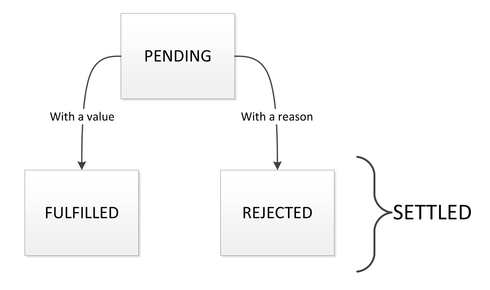

# TypeScript 深度学习指南


## TypeScript 深度解析

我一直在观察人们开始使用 TypeScript 时经常出现的问题。这是基于 StackOverflow 的经验以及与 TypeScript 社区的日常互动。你可以关注后续更新，并不要忘记在 Github 上点 ★。

## 开始使用 TypeScript

TypeScript 编译为 JavaScript。JavaScript 是你将要执行的内容（无论是在浏览器中还是服务器上）。因此，你需要以下内容：

- TypeScript 编译器（在源码和 NPM 上均可用）
- TypeScript 编辑器（如果你愿意，可以使用记事本，但我使用 VS。许多其他编辑器也支持它）

## TypeScript 版本

我们将不会使用*稳定*的 TypeScript 编译器，而是在书中介绍许多可能尚未包含的新内容。你可以通过以下命令获取最新版本：

```bash
npm install -g typescript
```

在 VS Code 中，TypeScript 始终可以指向最新版本。在`settings.json`中设置：

```json
{
  "typescript": "./node_modules/lib"
}
```

## 获取源码

TypeScript 提供了运行时的类型安全。为了这些目标，我们关注：

## 为什么是 TypeScript

TypeScript 有两个主要目标：

1. 在重构时提供类型安全。
2. 尽可能降低进入门槛。

由于这些目标，我们关注：

## TypeScript 的类型系统

TypeScript 会尝试尽可能推断类型信息。例如：

```typescript
let foo = 1;
```

### 类型可以是隐式的

TypeScript 会尽可能推断类型，以便在开发过程中以最小成本提供类型检查。

你可以在这里找到它的源码：`https://github.com/basarat/typescript`

### 评价

- 我一直在观察人们开始使用 TypeScript 时经常出现的问题。感谢这本精彩的书。
- 我从中学到了很多。
- 这可能是市面上最棒的书之一。
- 喜欢示例的精确和清晰！
- 对于免费的代价，你获得了大量的源码和清晰的解释。
- 我们必须强调这个开源书籍。
- 这是一个很棒的在线资源。
- 我一直发现这本书非常有帮助。
- 感谢编写 TypeScript Dive，我发现它非常有见解。
- TypeScript 深度解析在很多方面都非常棒。
- 帮助了我的第一个项目。
- 感谢 basarat 编写的这本 TypeScript 深度解析，我学到了很多。
- 它对我的项目非常有用。

### 开始使用

如果你在这里在线阅读这本书：

### 其他选项

你也可以下载以下格式之一：

- 适用于 iPad, iPhone, Mac 的 EPUB
- 适用于 Windows 等的 PDF
- 适用于 Kindle 的 MOBI

### 特别感谢

所有优秀的贡献者都非常有价值。感谢，这是一本棒的书。

### 分享

URL：`http://basarat.gitbooks.io/typescript/`

```typescript
var foo = 123;

foo = '456'; // Error: cannot assign `string` to `number`
```

// foo 是数字还是字符串？

这种类型推断是有充分理据的。如果你像示例中那样进行操作，那么在代码的其余部分中，你无法确定`foo`是一个`number`还是一个`string`。这类问题在大型多文件代码库中经常出现。稍后我们将深入探讨类型推断规则。

### 类型可以是显式的

正如我们之前提到的，TypeScript 会尽可能安全地进行推断，但你可以使用注解来：

1. 帮助编译器，更重要的是为必须阅读你代码的下一个开发者（那可能是未来的你！）提供文档支持。
2. 强制让编译器看到的正是你认为它应该看到的。也就是说，你对代码的理解与对代码的算法分析（由编译器完成）是一致的。

TypeScript 使用了后缀类型注解，这在其他*可选*注解的语言中很流行（例如 ActionScript 和 F#）。

```typescript
var foo: number = 123;
```

所以，如果你做了错误的操作，编译器将会报错，例如：

```typescript
var foo: number = '123'; // Error: cannot assign a `string` to a `number`
```

我们将在后面的章节中详细讨论 TypeScript 支持的所有注解语法的细节。

### 类型是结构化的

在某些语言中（特别是命名类型类型的语言）中，静态类型会导致不必要的仪式，因为尽管*你知道*代码会运行良好，但语言语义仍迫使你到处复制内容。这就是为什么像 C# 的 automapper 工具对 C# 来说*至关重要*。在 TypeScript 中，因为我们真的想让 JavaScript 开发者能够以最小的认知负担轻松使用，类型是*结构化的*。这意味着*鸭子类型*（duck typing）是一种一等语言构造。考虑以下示例。函数`iTakePoint2D`将接受任何包含它预期所有内容（x 和 y）的对象：

```typescript
interface Point2D {
  x: number;
  y: number;
}

interface Point3D {
  x: number;
  y: number;
  z: number;
}

var point2D: Point2D = { x: 0, y: 10 }
var point3D: Point3D = { x: 0, y: 10, z: 20 }

function iTakePoint2D(point: Point2D) { /* do something */ }

iTakePoint2D(point2D); // 精确匹配允许
iTakePoint2D(point3D); // 额外信息允许
iTakePoint2D({ x: 0 }); // Error: missing information `y`
```

### 类型错误不会阻止 JavaScript 的输出

为了方便你将 JavaScript 代码迁移到 TypeScript，即使存在编译错误，TypeScript 默认情况下*也会尽可能地输出有效的 JavaScript*。例如：

```javascript
var foo = 123;
foo = '456'; // Error: cannot assign a `string` to a `number`
```

将输出以下 js：

```javascript
var foo = 123;
foo = '456';
```

因此你可以渐进式地将 JavaScript 代码升级到 TypeScript。这与许多其他语言编译器的工作方式非常不同，这也是迁移到 TypeScript 的另一个原因。

### 类型可以是环境的

TypeScript 的一个主要设计目标是让你能够安全、方便地在 TypeScript 中使用现有 JavaScript 库。TypeScript 通过*声明*（declaration）来实现这一点。TypeScript 为你提供了一个滑动比例，让你决定在声明中投入多少精力，你投入的精力越多，获得的类型安全 + 代码智能性就越高。请注意，大多数流行的 JavaScript 库的定义已经由 DefinitelyTyped 社区为你写好了，因此对于大多数用途：

1. 定义文件已经存在。
2. 或者至少，你有一系列大量经过审核的 TypeScript 声明模板可用。

作为一个关于你如何编写自己的声明文件的快速示例，考虑一个简单的 jquery 例子。默认情况下（正如良好的 JS 代码所预期的），TypeScript 期望你在使用变量之前对其声明（即在某处使用`var`）：

```javascript
$('.awesome').show(); // Error: cannot find name `$`
```

作为一个快速修复，*你可以告诉 TypeScript*确实存在一个名为`$`的东西：

```typescript
declare var $:any;

$('.awesome').show(); // Okay!
```

如果你愿意，可以在此基础定义的基础上进行构建，并提供更多信息来防止错误：

```typescript
declare var $:{
  (selector:string): any;
};

$('.awesome').show(); // Okay!
$(123).show(); // Error: selector needs to be a string
```

在你了解更多 TypeScript（例如关于`interface`和`any`等内容）之后，我们将稍后详细讨论为现有 JavaScript 创建 TypeScript 定义。

### 未来 JavaScript => 现在

TypeScript 提供了许多在 ES6 中计划用于当前 JavaScript 引擎（仅支持 ES5 等）的功能。TypeScript 团队正在积极添加这些功能，这个列表会随着时间的推移变得越来越，我们将在专门的章节中涵盖这一点。但在这里可以作为一个类的类的示例：

```typescript
class Point {
  constructor(public x: number, public y: number) {
  }
  add(point: Point) {
    this.x += point.x;
    this.y += point.y;
  }
}
```

## 总结

在本节中，我们提供了 TypeScript 的动机和设计目标。到目前为止。

## 引用

除了字面量外，JavaScript 中的任何对象（包括函数、数组、正则表达式等）都是引用。这意味着：

**修改会影响到所有引用**

```javascript
var foo = {};

var bar = foo; // bar 是指向同一个对象的引用

foo.baz = 123;

console.log(bar.baz); // 123
```

**相等性比较针对引用**

```javascript
var foo = {};

var bar = foo; // bar 是一个引用

var baz = {}; // baz 是一个与 `foo` 不同的*新对象*

console.log(foo === bar); // true

console.log(foo === baz); // false
```

## Null 和 Undefined

事实上，你需要同时处理这两者。只需用`==`检查其中任意一个即可。

```javascript
/// 假设你正在执行 `foo.bar == undefined`，其中 bar 可能是以下值之一：

console.log(undefined == undefined); // true

console.log(null == undefined); // true

console.log(0 == undefined); // false

console.log('' == undefined); // false

console.log(false == undefined); // false
```

推荐使用`== null`来同时检查`undefined`或`null`。你通常不需要对这两者进行区分。

**undefined**

记得我说过你应该使用`== null`吗？当然你会用（因为我刚说了 ^）。

不要将它用于根层级的内容。在严格模式下，如果你使用`foo`而`foo`是 undefined，你会得到一个`ReferenceError`异常，并且整个调用栈都会回溯。

你应该使用严格模式……事实上，如果你使用模块，TS 编译器会为你插入……关于这些内容在书中后面会有更多介绍，所以你不需要显式指定 :)

所以，要检查一个变量在*全局*级别上是否定义，通常使用`typeof`：

```javascript
if (typeof someglobal !== 'undefined') {
  // someglobal 现在可以安全使用了
  console.log(someglobal);
}
```

## this

函数内部对`this`关键字的任何访问实际上都由函数的调用方式控制。这通常被称为*调用上下文*。

这里有一个示例：

```javascript
function foo() {
  console.log(this);
}
foo(); // 记录全局对象，例如浏览器中的 `window`

let bar = {
  foo
}
bar.foo(); // 输出 `bar`，因为 `foo` 是在 `bar` 上被调用的
```

所以要注意你对`this`的使用。如果你想将类中的`this`与调用上下文断开，请使用箭头函数，更多内容稍后介绍。


## 闭包

JavaScript 最 greatest 特性就是闭包。JavaScript 中的函数可以访问定义在外部作用域的任何变量。通过示例解释闭包是最好的：

```javascript
function outerFunction(arg) {
  var variableInOuterFunction = arg;
  function bar() {
    console.log(variableInOuterFunction); // 访问外部作用域的变量
  }
  // 调用本地函数以证明它有访问 arg 的权限
  bar();
}
outerFunction("hello closure"); // 输出 hello closure!
```

你可以看到内部函数可以访问外部作用域的变量（`variableInOuterFunction`）。外部函数中的变量被闭包在（或绑定在）内部函数中。因此有了**闭包**这个术语。这个概念本身足够简单且直观。

现在是很棒的部分：即使在外部函数返回之后，内部函数仍然可以访问外部作用域的变量。这是因为这些变量仍然绑定在内部函数中，而不是依赖于外部函数。再次看一个例子：

```javascript
function outerFunction(arg) {
  var variableInOuterFunction = arg;
  return function() {
    console.log(variableInOuterFunction);
  }
}
var innerFunction = outerFunction("hello closure!"); // 注意 outerFunction 已返回
innerFunction(); // 输出 hello closure!
```

**闭包很棒的原因**

它允许你轻松组合对象，例如模块模式：

```javascript
function createCounter() {
  let val = 0;
  return {
    increment() { val++ },
    getVal() { return val }
  }
}
let counter = createCounter();
counter.increment(); // 输出 1
counter.getVal(); // 输出 2
```

在高级层面上，这让像 Node.js 这样的东西变得可能（如果这现在不听你的话）。它演变为：

```javascript
// 解释概念的伪代码
server.on(function(req, res) {
  // `res` 被闭包了并且可用
  loadData(req).then(function(data) {
    res.send(data);
  })
});
```

## 未来 JavaScript

TypeScript 的主要卖点之一是允许你使用 ES6 及之后的许多特性，即使在当前的 JavaScript 引擎中可能还不支持。

TypeScript 支持`public`、`private`和`protected`访问修符，它们决定了`class`成员的访问权限，如下所示：

| 访问范围 | public | protected | private |
| :--- | :---: | :---: | :---: |
| 类 | 是 | 是 | 是 |
| 子类 | 是 | 是 | 否 |
| 类实例 | 是 | 否 | 否 |

如果未指定访问修符，它隐式为`public`，因为这符合 JavaScript 的*便利*特性。

注意，在运行时（在生成的 JS 中）这些没有意义，但如果你错误地使用它们，将会给你编译错误。下面是各者的示例：

```typescript
class FooBase {
  public x: number;
  private y: number;
  protected z: number;
}

// 对实例的影响
var foo = new FooBase();
foo.x; // 正常
foo.y; // 错误: private
foo.z; // 错误: protected

// 对子类的影响
class FooChild extends FooBase {
  constructor() {
    super();
    this.x; // 正常
    this.y; // 错误: private
    this.z; // 正常
  }
}
```

## 类

在 JavaScript 中作为类语言构造引入类的原因是：

1. 类提供了实用的结构抽象。
2. 为开发者（如 emberjs, reactjs 等）提供了一种统一的使用类的方式。


## 3. 面向对象的开发者已经理解了类

最后，JavaScript 开发者可以拥有一个基础类。这里有一个基础`Point`类：

```typescript
class Point {
  x: number;
  y: number;
  constructor(x: number, y: number) {
    this.x = x;
    this.y = y;
  }
  add(point: Point) {
    return new Point(this.x + point.x, this.y + point.y);
  }
}
var p1 = new Point(0, 10);
var p2 = new Point(10, 20);
var p3 = p1.add(p2); // {x:10,y:30}
```

该类在 ES5 中生成以下 JavaScript：

```javascript
var Point = (function () {
  function Point(x, y) {
    this.x = x;
    this.y = y;
  }
  Point.prototype.add = function (point) {
    return new Point(this.x + point.x, this.y + point.y);
  };
  return Point;
})();
```

作为第一类语言构造，这是一种非常符合传统的 JavaScript 类模式。

### 继承

TypeScript 中的类（与其他语言一样）使用`extends`关键字支持单继承，如下：

```typescript
class Point3D extends Point {
  z: number;
  constructor(x: number, y: number, z: number) {
    super(x, y);
    this.z = z;
  }
  add(point: Point3D) {
    return new Point3D(this.x + point.x, this.y + point.y, this.z);
  }
}
```

### 静态

TypeScript 类支持`static`属性，这些属性由类的所有实例共享。放置（以及访问）它们的自然地方是类本身：

```javascript
class Something {
  static instances = 0;
  constructor() {
    Something.instances++;
  }
}
var s1 = new Something();
var s2 = new Something();
console.log(Something.instances); // 2
```

你可以拥有静态成员，也可以有静态函数。

### 访问修饰符

TypeScript 支持`public`、`private`和`protected`访问修饰符，它们如下所示决定了`class`成员的可见性。

### 抽象

`abstract`可以被视为一种访问修饰符。我们单独介绍它，是因为与之前提到的修饰符相反，它不仅可以用于类，还可以用于类的任何成员。拥有`abstract`修饰符主要意味着该功能无法被直接调用，并且子类必须提供该功能。

继承自抽象类的类。

抽象成员不能被直接访问，子类必须提供这些功能。

#### 构造函数是可选的

类不需要有构造函数。例如，以下代码完全可以：

```typescript
class Foo {}

var foo = new Foo();
```

#### 使用构造函数定义

在类中拥有一个成员并如下所示初始化：

```typescript
class Foo {
  x: number;
  constructor(x:number) {
    this.x = x;
  }
}
```

这是一个非常常见的模式，TypeScript 提供了一种简写。你可以在成员前加上一个访问修饰符，它会自动在类上声明并从构造函数中复制它。因此，之前的示例可以重写为（注意`public x:number`）：

```typescript
class Foo {
  constructor(public x:number) {
  }
}
```

#### 属性初始化器

这是 TypeScript 支持的一个巧妙特性（实际上是从 ES7 开始）。你可以在类构造函数之外初始化类的任何成员，这有助于提供默认值（注意`members = []`）：

```typescript
class Foo {
  members = []; // 直接初始化
  add(x) {
    this.members.push(x);
  }
}
```

## 类

### IIFE 是怎么回事

为类生成的 JS 代码可能是：

```javascript
function Point(x, y) {
  this.x = x;
  this.y = y;
}

Point.prototype.add = function (point) {
  return new Point(this.x + point.x, this.y + point.y);
};
```

它之所以被封装在立即执行函数表达式（IIFE）中，即：

```javascript
(function () {

  // 主体

  return Point;

})();
```

这与继承有关。它允许 TypeScript 将基类捕获为变量`super`，例如：

```javascript
var Point3D = (function (_super) {
  __extends(Point3D, _super);
  function Point3D(x, y, z) {
    _super.call(this, x, y);
    this.z = z;
  }
  Point3D.prototype.add = function (point) {
    var point2D = _super.prototype.add.call(this, point);
    return new Point3D(point2D.x, point2D.y, this.z + point.z);
  };
  return Point3D;
})(Point);
```

注意，IIFE 允许 TypeScript 轻松地将基类`Point`捕获到`super`变量中，并在类体中一致地使用。

### `__extends__`

你会发现，一旦继承一个类，TypeScript 也会生成以下函数：

```javascript
var __extends = this.__extends || function (d, b) {
  for (var p in b) if (b.hasOwnProperty(p)) d[p] = b[p];
  function __() { this.constructor = d; }
  ___.prototype = b.prototype;
  d.prototype = new ____();
};
```

这里`d`指向派生类，`b`指向基类。该函数做了两件事：

1. 将基类的静态成员复制到子类中，即`for (var p in b) if (b.hasOwnProperty(p)) d[p] = b[p];`
2. 设置子类函数的原型，以便可选地在父原型上查找成员，即实现了`d.prototype.__proto__ = b.prototype`

人们很少在理解第 1 点时遇到困难，但许多人对第 2 点感到困惑。因此有必要解释一下。

### `d.prototype.__proto__ = b.prototype`

在指导了许多人关于这一点后，我发现以下解释是最简单的：

首先，我们将解释`__extends`代码等同于`obj.__proto__ = prototype`的重要性。JavaScript 中的所有对象都包含一个`__proto__`属性。要理解这一点，需要知道这些点：

1. `__proto__`
2. `prototype`
3. `new`在函数内部对`this`的影响
4. `new`对`prototype`的影响

如果在对象上查找时未找到属性（例如`obj.property`），则会查找`obj.__proto__.property`。在旧版浏览器中，有时将其称为`[[prototype]]`。这解释了为什么 JavaScript 原生支持原型继承。

如下面的示例所示，你可以在 Chrome 控制台或 Node.js 中运行：

```javascript
var foo = {}
// 设置 foo 及其 foo.__proto__
foo.bar = 123;
foo.__proto__.bar = 456;
console.log(foo.bar); // 123
delete foo.bar; // 从对象中删除
console.log(foo.bar); // 456
delete foo.__proto__.bar; // 从 foo.__proto__ 中删除
console.log(foo.bar); // undefined
```

好了，`__proto__`。另一个有用的信息是 JavaScript 中的所有函数都有一个名为`prototype`的属性，它有一个指向函数的`constructor`成员。如下所示：

```javascript
function Foo() { }
console.log(Foo.prototype); // {} 即它存在且不是 undefined
console.log(Foo.prototype.constructor === Foo); // 有一个指向函数的 constructor 成员
```

现在我们理解了`__proto__`。让我们来看`new`在调用函数内部对`this`的影响。基本上，调用函数内部的`this`将指向从函数返回的新创建的对象。如果你在函数内部修改`this`上的属性，这很容易看出：

```javascript
function Foo() {
  this.bar = 123;
}
var foo = new Foo();
console.log(foo.bar); // 123
```

你唯一需要知道的是，`new`将新对象的`__proto__`设置为函数的`prototype`。这可以通过代码证明：

```javascript
function Foo() { }
var foo = new Foo();
console.log(foo.__proto__ === Foo.prototype); // True
```

同样注意，如果你尝试误用`super`，TypeScript 将向你发出：

```typescript
module quz {
  class Base {
    log = () => { console.log('hello world'); }
  }

  class Child extends Base {
    // ：基类中只有 `public` 和 `protected` 方法可以通过
    // `super` 访问
    logWorld() { super.log() };
  }
}
```

### 类 Super

### 箭头函数

提示：箭头函数的需求。

提示：箭头函数的危险性。

提示：使用此特性的库。

提示：箭头函数的继承。

#### 箭头函数

它们被亲切地称为粗箭头（因为`->`是细箭头，而`=>`是粗箭头），也被称为 lambda 函数（受其他语言影响）。JavaScript 中另一个常用的特性是粗箭头函数`()=>something`。使用粗箭头的初衷是：

1. 你不需要不断输入`function`。
2. 它在词法上捕获了`this`的含义。
3. 它在词法上捕获了`arguments`的含义。

对于一个自称是函数式的语言来说，在 JavaScript 中你往往需要写大量的`function`。粗箭头让你轻松地创建一个函数：

`var inc = (x)=>x+1;`

这在传统上一直是 JavaScript 的一个痛点。正如一位智者所说：“我讨厌 JavaScript，因为它太容易丢失`this`的含义了”。箭头函数通过从周围环境中捕获`this`的含义解决了这个问题。考虑这个纯 JavaScript 类：

```javascript
function Person(age) {
  this.age = age;
  this.growOld = function() {
    this.age++;
  }
}

var person = new Person(1);
setTimeout(person.growOld, 1000);
setTimeout(function() { console.log(person.age); }, 2000);
```

如果你在浏览器中运行这段代码，函数内部的`this`将指向`window`，因为执行它的是`window`。修复方法是使用箭头：

```javascript
function Person(age) {
  this.age = age;
  this.growOld = () => {
    this.age++;
  }
}

var person = new Person(1);
setTimeout(person.growOld, 1000);
setTimeout(function() { console.log(person.age); }, 2000);
```

这种之所以有效，是因为`this`的引用是被箭头函数从函数体中捕获的。这等同于以下 JavaScript（如果你没有箭头函数，你得这样写）：

```javascript
function Person(age) {
  this.age = age;
  var _this = this; // 捕获 this
  this.growOld = function() {
    _this.age++;
  }
}

var person = new Person(1);
setTimeout(person.growOld, 1000);
setTimeout(function() { console.log(person.age); }, 2000);
```

注意，由于你在使用 TypeScript，语法可以更加优雅，将箭头与类结合：

```typescript
class Person {
  constructor(public age: number) {}
  growOld = () => {
    this.age++;
  }
}

var person = new Person(1);
setTimeout(person.growOld, 1000);
setTimeout(function() { console.log(person.age); }, 2000);
```

#### 提示：箭头函数的需求

除了简洁的语法外，只有当你打算把它交给别人调用时，你才需要使用粗箭头。如果你自己调用它，即`this`将是正确的调用上下文（在本例中`var growOld = person.growOld;`），那么其他人调用`growOld()`时。

#### 提示：箭头函数的危险性

事实上，如果你希望`this`是调用上下文，你不应该使用箭头函数。jQuery、Underscore 等其他库所使用的回调函数就是此类情况。同样，如果你计划使用`arguments`，你可能应该使用`function`而不是粗箭头。

#### 提示：在使用了`this`的库中使用箭头函数

许多库都会这样做，例如`.each`会使用`this`向你传递它当前正在迭代的对象。在这种情况下，如果你既想访问`this`又想访问周围环境，只需在没有箭头函数的情况下使用一个如`_self`这样的临时变量：

```javascript
let _self = this;
something.each(function() {
  console.log(_self); // 词法作用域值
  console.log(this); // 库传递的值
});
```

#### 提示：箭头函数与继承

如果你将实例方法作为箭头函数，那么它位于`this`上。此类函数无法参与对`super`的调用（`super`作用于原型）。你可以通过在子类中重写之前创建一个该方法的副本来轻松绕过它。

```typescript
class Adder {
  constructor(public a: number) {}
  add = (b: number): number => {
    return this.a + b;
  }
}

class ExtendedAdder extends Adder {
  // 在创建自己的之前创建一个父方法的副本
  private superAdd = this.add;
  add = (b: number): number => {
    return this.superAdd(b);
  }
}
```

### 剩余参数

剩余参数（最后一个参数用`...argumentName`表示）允许你快速接受多个参数。

```javascript
function example(first, ...allOthers) {
  console.log(first);
  console.log(allOthers);
}
```

### `let`

在 JavaScript 中，变量是函数作用域的。这与许多语言（C#、Java 等）不同，后者的变量是块作用域的。如果你将块作用域的思维带入 JavaScript，你会预期以下代码输出 123，但实际上会输出 456：


```javascript
var foo = 123;
if (true) {
  var foo = 456;
}
console.log(foo); // 456
```

这是因为`{}`没有创建新的作用域。这就是为什么 TypeScript（以及 ES6）引入了`let`关键字，以便定义具有块作用域的变量。如果你使用`let`而不是`var`，你将获得与外部定义的不同的独立元素。使用`let`的示例如下：

```javascript
let foo = 123;
if (true) {
  let foo = 456;
}
console.log(foo); // 123
```

另一个`let`可以帮你避免错误的地方是循环：

```javascript
var index = 0;
var array = [1, 2, 3];
for (let index = 0; index < array.length; index++) {
  console.log(array[index]);
}
console.log(index); // 0
```

诚实地说，我们认为尽可能使用`let`更好，因为这减少了新开发者和多语言开发者的意外。

### 函数创建新的作用域

既然我们提到了，我们想演示函数在 JavaScript 中会创建一个新的变量作用域。考虑以下：

```javascript
var foo = 123;
function test() {
  var foo = 456;
}
test();
console.log(foo); // 123
```

这符合你的预期。如果没有这一点，在 JavaScript 中编写代码将非常困难。

```javascript
var funcs = [];

// 创建一组函数

for (var i = 0; i < 3; i++) {
  funcs.push(function() {
    console.log(i);
  });
}

// 调用它们

for (var j = 0; j < 3; j++) {
  funcs[j]();
}
```

人们可能会预期的结果是 0, 1, 2。惊讶的是，这三个函数的结果都将是 3。原因是这三个函数都在使用外部作用域的变量`i`，而在我们执行它们（在第二个循环中）时，`i`的值已经是 3 了（这是第一个循环的终止条件）。

修复方法是在每次循环中创建一个特定于该迭代的新变量。正如我们之前学过的，我们可以通过创建一个新函数并立即执行它来创建一个新的变量作用域（即类中的 IIFE 模式`(function() { /* body */ })();`），如下所示：

```javascript
var funcs = [];

// 创建一组函数

for (var i = 0; i < 3; i++) {
  (function() {
    var local = i;

    funcs.push(function() {
      console.log(local);
    });
  })();
}

// 调用它们

for (var j = 0; j < 3; j++) {
  funcs[j]();
}
```

在这里，函数闭包了`local`变量（方便地命名为`local`），并使用它而不是循环变量`i`。

请注意，闭包会带来性能影响（它们需要存储周围的状态）。

循环中 ES6 的`let`关键字行为将与上一个示例相同：

```javascript
var funcs = [];

// 创建一组函数

for (let i = 0; i < 3; i++) { // 注意使用了 let
  funcs.push(function() {
    console.log(i);
  });
}

// 调用它们

for (var j = 0; j < 3; j++) {
  funcs[j]();
}
```

使用`let`代替`var`会为每个循环迭代创建一个唯一的变量`i`。

## 总结

对于绝大多数代码来说，`let`是极其有用的。它可以极大地提高代码的可读性，并减少编程错误的概率。

## const

`const`是 ES6 / TypeScript 提供的一个非常受欢迎的补充。它允许你使变量不可变。这从文档记录和运行的角度来看都是好的。使用`const`只需将`var`替换为`const`：

```javascript
const foo = 123;
```

这种语法（在我看来）比其他语言要好得多，那些语言强制用户输入类似`let constant foo`（即变量 + 行为指示符）的内容。`const`是提高可读性和可维护性的良好实践，并避免了使用魔法字面量，例如：

```javascript
// 可读性低
if (x > 10) {
}

// 更好！
const maxRows = 10;
if (x > maxRows) {
}
```

### const 声明必须初始化

以下是编译错误：

```javascript
const foo; // 错误：const 声明必须初始化
```

### 赋值左侧不能是常量

常量在创建后是不可变的，因此如果你尝试给它们分配新值，将是编译错误：

```javascript
const foo = 123;
foo = 456; // 错误：赋值表达式的左侧不能是常量
```

### 块作用域

`const`是块级作用域，正如我们看到的`let`一样：

```javascript
const foo = 123;
if (true) {
  const foo = 456; // 允许，因为它是限于此 `if` 块的新变量
}
```

### 深度不可变

`const`同样适用于对象字面量，只要涉及到保护变量的引用：

```javascript
const foo = { bar: 123 };
foo = { bar: 456 }; // 错误：赋值表达式的左侧不能是常量
```

但它仍然允许对象的子属性被修改，如下所示：

```javascript
const foo = { bar: 123 };
foo.bar = 456; // 允许！
console.log(foo); // { bar: 456 }
```

出于这个原因，我建议对原始类型或不可变数据结构使用`const`。


## 解构

TypeScript 支持以下形式的解构（字面意思命名为解构化，即拆分结构）：

1. 对象解构
2. 数组解构

很容易将解构想为结构化的逆过程。JavaScript 中的结构化方法是对象字面量：

```javascript
var foo = {
  bar: {
    bas: 123
  }
};
```

如果没有 JavaScript 内置的强大的结构化支持，动态创建新对象将非常繁琐。解构为从结构中提取数据带来了同等的便利性。

### 对象解构

解构之所以有用，是因为它允许你在单行内完成原本需要多行才能完成。考虑以下情况：

```javascript
var rect = { x: 0, y: 10, width: 15, height: 20 };

// 解构赋值
var {x, y, width} = rect;
console.log(x, y, width); // 0, 10, 15

// 使用外部括号赋值给现有变量
rect.x = 10;
console.log(x, y, width); // 10, 15, 20
```

要将提取的变量分配给新名称，你可以采取操作：

```javascript
const obj = {"some property": "value"};
// 解构
const {someProperty} = obj;
console.log(someProperty === "value"); // true
```

此外，你还可以使用解构从结构中获取深度数据。如下例所示：

```javascript
var foo = { bar: { bas: 123 } };
var {bar} = foo; // 实际上是 var = foo.bar;
```

### 数组解构

一个常见问题是：如何从数组中提取元素？使用剩余参数：

```javascript
var [x, y, ...rest] = [1, 2, 3, 4];
console.log(x, y, rest); // 1, 2, [3, 4]
```

### 数组解构（剩余参数）

这里是为了允许你在解构时轻松获取数组的剩余元素：

```javascript
var [x, y, ...rest] = [1, 2, 3, 4];
console.log(x, y, rest); // 1, 2, [3, 4]
```

### 数组解构（忽略项）

你可以通过留空位置来忽略某些索引：

```javascript
var [x, , y] = [1, 2, 3];
console.log(x, y); // 1, 3
```

### 对象解构（剩余参数）

你可以使用对象解构剩余参数来获取剩余对象：

```javascript
const {a, ...rest} = {a: 1, b: 2, c: 3};
console.log(a, rest); // 1, {b: 2, c: 3}
```

### 对象解构（忽略属性）

你可以通过留空键名来忽略某些属性：

```javascript
const {a, , c} = {a: 1, b: 2, c: 3};
console.log(a, c); // 1, 3
```

### 对象展开（Object spread）

你也可以将对象展开到另一个对象中。一个常见的用例是仅向对象添加属性而不修改原始对象：

```javascript
const point2d = {x: 1, y: 2};

/** 使用所有的 point2D 属性并加上 z 创建新对象 */
const point3D = {...point2D, z: 3};
```

另一个常见的用例是简单的浅扩展：

```javascript
const foo = {a: 1, b: 2};
const bar = {c: 1, d: 2};

/** 合并 foo 和 bar */
const fooBar = {...foo, ...bar};
```

## 总结

展开（Spread）是你在 JavaScript 中不可避免的操作，因此拥有更好的语法是很好的，这样你就不需要为`this`参数使用那个丑陋的`null`。此外，用于将数组从其他数组移出（解构）或移入其他数组（赋值）的专用语法，为你对部分数组进行处理时提供了整洁的语法。

### for...of

初级 JavaScript 经常遇到的一个错误是，对数组使用`for...in`并不会遍历数组项。相反，它遍历的是传入对象的键（keys）。下面的示例演示了这一点。在这里你预期得到 9, 2, 5，但得到的是索引 0, 1, 2：

```javascript
var someArray = [9, 2, 5];

for (var item in someArray) {
  console.log(item); // 0,1,2
}
```

这就是为什么`for...of`存在于 TypeScript（以及 ES6）中的原因之一。下面的代码可以正确遍历数组，并按预期打印成员：

```javascript
var someArray = [9, 2, 5];

for (var item of someArray) {
  console.log(item); // 9,2,5
}
```

同样，TypeScript 也可以轻松使用`for...of`逐字符遍历字符串：

```javascript
var hello = "is it me you're looking for?";

for (var char of hello) {
  console.log(char); // is it me you're looking for?
}
```

### JS 生成

对于预 ES6 目标，TypeScript 将生成标准的`for (var i = 0; i < list.length; i++)`类型的循环。例如，对于我们之前的示例，生成的代码如下：

```javascript
var someArray = [9, 2, 5];

for (var item of someArray) {
  console.log(item);
}

// 变为 //
for (var _i = 0; _i < someArray.length; _i++) {
  var item = someArray[_i];
  console.log(item);
}
```

你可以看到，使用`for...of`让意图更加清晰，并且减少了你需要编写的代码量（以及需要构思的变量名）。

### 局限性

如果你的目标不是 ES6 或更高版本，生成的代码假设对象上存在`length`属性，并且该对象可以通过数字进行索引（例如`obj[2]`）。因此，在这些遗留 JS 引擎中，它仅支持`string`和`array`。

如果 TypeScript 发现你没有在使用数组或字符串，它会给你一个清晰的错误提示：`is not an array type or a string type`：

```javascript
let articleParagraphs = document.querySelectorAll("article > p");

// 错误: Nodelist is not an array type or a string type
for (let paragraph of articleParagraphs) {
  paragraph.classList.add("read");
}
```

仅对你确定是数组或字符串的内容使用`for...of`。请注意，此局限性可能会在 TypeScript 的未来版本中被移除。

## 总结

你会惊讶于自己遍历数组元素的次数有多高。下一次发现自己在做这种操作时，尝试一下`for...of`吧。你可能会让下一个审查你代码的人感到高兴。

## 迭代器（Iterators）

迭代器本身并不是 TypeScript 或 ES6 的特性，迭代器是面向对象编程语言中常见的行为设计模式。它通常是一个实现了以下接口的对象：

```typescript
interface Iterator<T> {
  next(value?: any): IteratorResult<T>;
  return?(value?: any): IteratorResult<T>;
  throw?(e?: any): IteratorResult<T>;
}
```

此接口允许从属于对象的某个集合或序列中检索值。

`IteratorResult`仅仅是一个`value + done`组合：

```typescript
interface IteratorResult<T> {
  done: boolean;
  value: T;
}
```

假设有一个某个帧（frame）的对象，包含了该帧包含的组件列表。通过`Iterator`接口，可以像下面从该帧对象中检索组件：


```javascript
'use strict';

class Component {
  constructor (public name: string) {}
}

class Frame {
  public components = [];
  constructor(public name: string) {}

  [Symbol.iterator]() {
    let pointer = 0;
    return {
      next() {
        if (pointer < this.components.length) {
          return {
            done: false,
            value: this.components[pointer++]
          };
        } else {
          return {
            done: true,
            value: null
          };
        }
      }
    };
  }
}

let frame = new Frame("main");
frame.components.push(new Component("header"));
frame.components.push(new Component("body"));
frame.components.push(new Component("footer"));

for (let component of frame) {
  console.log(component.name);
}
```

上面的代码示例需要 ES6 目标，但如果目标 JS 引擎支持`Symbol.iterator`，它也可以适用于 ES5 目标。这可以通过在 ES5 目标上使用 ES6 库（向你的项目添加`es6.d.ts`）来实现编译。编译后的代码应该可以在 node 4+、Google Chrome 以及其他浏览器中运行。

## 迭代器

## 模板字符串

在语法上，这些字符串使用反引号（即 \`）而不是单引号（'）或双引号（"）。模板字符串的初衷有三点：

- 字符串插值（String Interpolation）


- 多行字符串（Multiline Strings）
- 标签模板（Tagged Templates）

## 字符串插值

另一个常见的用例是当你想根据某些静态字符串 + 某些变量生成一些字符串时。为此，你需要一些模板逻辑，而模板字符串正是由此得名的。以下是你以前可能是如何生成 html 字符串的：

```javascript
var lyrics = 'Never gonna give you up';
var html = '<div>' + lyrics + '</</div>>';
```

现在使用模板字符串，你只需要这样做：

```javascript
var lyrics = 'Never gonna give you up';
var html = `<div>${lyrics}</div>\`;
```

注意，插值内部的任何占位符（`${` 和 `}`）都会被视为 JavaScript 表达式并进行求值，例如，你可以进行复杂的数学运算。

```javascript
console.log(`1 and 1 make ${1 + 1}`);
```

## 多行字符串

有没有想过在 JavaScript 字符串中放入换行符？也许你想嵌入一些歌词？你可能需要使用我们喜爱的转义字符 `\` 来转义字面量换行，然后在下一行手动在字符串中放入新行 `\n`。所示：

```javascript
var lyrics = "Never gonna give you up \\
\\nNever gonna let you down";
```

在 TypeScript 中，你可以直接使用模板字符串：

```javascript
var lyrics = `Never gonna give you up
Never gonna let you down\`;
```

## 标签模板

你可以在模板字符串之前放置一个函数（称为标签 `tag`），它将获得机会预处理模板字符串字面量加上所有占位符表达式的值，并返回一个结果。几点说明：

- 所有的静态字面量都作为第一个参数的数组传入。
- 所有的占位符表达式的值都作为剩余参数传入。通常情况下你只需要使用剩余参数（rest parameters）将它们也转换为数组。

这是一个示例，我们有一个标签函数（命名为 `htmlEscape`），它可以转义所有占位符中的 html：

```javascript
var say = "a bird in hand > two in the bush";
var html = htmlEscape `<div> I would just like to say : ${say}</div>\`;

// 示例标签函数
function htmlEscape(literals, ...placeholders) {
  let result = "";
  // 将字面量与占位符交替
  for (let i = 0; i < placeholders.length; i++) {
    result += literals[i];
    result += placeholders[i]
      .replace(/&/g, '&amp;')
      .replace(/"/g, '&quot;')
      .replace(/'/g, '&#39;')
      .replace(/</g, '&lt;')
      .replace(/>/g, '&gt;');
  }
  // 添加最后一个字面量
  result += literals[literals.length - 1];
  return result;
}
```

## 生成的 JS

对于预 ES6 编译目标，代码相当简单。多行字符串变为转义字符串。字符串插值变为字符串拼接。标签模板变为函数调用。

## 总结

多行字符串和字符串插值在任何语言中都是非常棒特性。很棒你现在可以在 JavaScript 中使用它们（感谢 TypeScript！）。标签模板允许你创建强大的字符串工具。


## Promise

`Promise` 类是存在于许多现代 JavaScript 引擎中的，并且可以很容易进行 polyfill（填充）。`Promise` 的主要动机是将同步风格的错误处理引入异步 / 回调风格的代码中。

### 回调风格代码

为了充分理解 `Promise`，让我们展示一个简单的示例，证明了仅用回调创建可靠异步代码的困难性。考虑编写从文件加载 JSON 的异步版本的简单情况。它的同步版本可以非常简单：

```javascript
import fs = require('fs');

function loadJSONSync(filename: string) {
  return JSON.parse(fs.readFileSync(filename));
}

// 良好的 json 文件
console.log(loadJSONSync('good.json'));

// 文件不存在，所以 fs.readFileSync 失败
try {
  console.log(loadJSONSync('absent.json'));
}
catch (err) {
  console.log('absent.json error', err.message);
}

// 无效的 json 文件，即文件存在但包含无效的 JSON，所以 JSON.parse 失败
try {
  console.log(loadJSONSync('invalid.json'));
}
catch (err) {
  console.log('invalid.json error', err.message);
}
```

这个简单的 `loadJSONSync` 函数有三种行为：返回值、文件系统错误或 `JSON.parse` 错误。我们使用简单的 `try/catch` 来处理错误，就像你在其他语言中进行同步编程时习惯的那样。现在让我们为这样的函数制作一个良好的 Promise 异步版本。一个带有简易错误检查逻辑的不错的初始尝试如下：

```javascript
import fs = require('fs');

// 一个不错的初始尝试 .... 但是不正确的。我们将在下方解释原因。
function loadJSON(filename: string, cb: (error: Error, data: any) => void) {
  fs.readFile(filename, function (err, data) {
    if (err) cb(err);
    else cb(null, JSON.parse(data));
  });
}
```

非常简单，它接收一个回调，并将任何文件系统错误传递给回调。如果没有文件系统错误，它返回 `JSON.parse` 的结果。在处理基于回调的异步函数时，需要记住以下几点：

1. 永远不要调用两次回调。
2. 永远不要抛出错误。

然而，这个简单的函数未能考虑到第二点。事实上，`JSON.parse` 会抛出一个错误，回调永远不会执行且应用程序会崩溃。如下所示：

```javascript
import fs = require('fs');
// 一个不错的初始尝试 .... 但是不正确的。我们将在下方解释原因
function loadJSON(filename: string, cb: (error: Error, data: any) => void) {
  fs.readFile(filename, function (err, data) {
    if (err) cb(err);
    else cb(null, JSON.parse(data));
  });
}
```

解决此问题的幼稚尝试是将 `JSON.parse` 包装在 `try/catch` 中，如下例所示：

```javascript
import fs = require('fs');

// 一个更好的尝试 ... 仍然不正确
function loadJSON(filename: string, cb: (error: Error) => void) {
  fs.readFile(filename, function (err, data) {
    if (err) {
      cb(err);
    } else {
      try {
        cb(null, JSON.parse(data));
      } catch (err) {
        cb(err);
      }
    }
  });
}
```

然而，这段代码中存在一个微妙的 bug。如果回调（`cb`）而不是 `JSON.parse` 抛出了错误，由于我们将其包装在 `try/catch` 中，`catch` 块会执行，我们再次调用了回调，即回调被调用了两次！如下例所示：

```javascript
import fs = require('fs');

function loadJSON(filename: string, cb: (error: Error) => void) {
  fs.readFile(filename, function (err, data) {
    if (err) {
      cb(err);
    } else {
      try {
        cb(null, JSON.parse(data));
      } catch (err) {
        cb(err);
      }
    }
  });
}

// 良好的文件但糟糕的回调 ... 被再次调用了！
loadJSON('good.json', function (err, data) {
  console.log('our callback called');
  if (err) {
    console.log('Error:', err.message);
  } else {
    // 让我们通过访问未定义变量属性来模拟错误
    var foo;
    // 下面代码将抛出 `Error: Cannot read property 'bar' of undefined`
    console.log(foo.bar);
  }
});
```

```bash
$ node asyncbadcatchdemo.js
```

```text
our callback called

our callback called

Error: Cannot read property 'bar' of undefined
```

这是因为我们的 `loadJSON` 函数错误地将回调包装在 `try` 块中。这里有一个简单的教训需要记住。

简单的教训：将所有的同步代码包含在 `try catch` 中，调用回调除外。

遵循这个简单的教训，我们得到了功能完整的 `loadJSON` 异步版本，如下：

```javascript
import fs = require('fs');

function loadJSON(filename: string, cb: (error: Error) => void) {
  fs.readFile(filename, function (err, data) {
    if (err) return cb(err);

    // 将所有的同步代码包含在 try catch块中
    try {
      var parsed = JSON.parse(data);
    }
    catch (err) {
      return cb(err);
    }

    // 除非你调用回调函数
    return cb(null, parsed);
  });
}
```

诚然，一旦你操作过几次，这并不难理解，但尽管如此，为了良好的错误处理，需要编写大量的模板代码（boilerplate code）。现在，让我们看看使用 `Promise` 处理异步 JavaScript 的更好方法。

## 创建一个 Promise

`Promise` 的状态可以是 `pending`（待定）、`fulfilled`（已完成）或 `rejected`（已拒绝）。



`Promise`

让我们来看看如何创建一个 `Promise`。这只是简单地对 `Promise`（Promise 构造函数）调用 `new`。`Promise` 构造函数接收 `resolve` 和 `reject` 函数，用于确定 `Promise` 的状态：

```javascript
const promise = new Promise((resolve, reject) => {
  // resolve / reject 函数控制 promise 的命运
});
```

## 订阅 Promise 的命运

可以使用 `.then`（如果已解析）或 `.catch`（如果已被拒绝）来订阅 `Promise` 的命运。

```javascript
const promise = new Promise((resolve, reject) => {
  resolve(123);
});

promise.then((res) => {
  console.log('I get called:', res === 123); // I get called: true
});

promise.catch((err) => {
  // 这永远不会被调用
});

const promise = new Promise((resolve, reject) => {
  reject(new Error("Something awful happened"));
});

promise.then((res) => {
  // 这永远不会被调用
});

promise.catch((err) => {
  console.log('I get called:', err.message); // I get called: 'Something awful happened'
});
```

提示：Promise 快捷方法

快速创建一个已解析的 Promise：`Promise.resolve(result)`

快速创建一个已被拒绝的 Promise：`Promise.reject(error)`

## Promise 的链式调用

Promise 的链式调用是 Promise 提供的优势的核心。一旦你有了一个 Promise，从该点起，你就可以使用 `then` 函数来创建 Promise 链。

如果你在链中的任何函数中返回一个 Promise，那么 `.then` 只有在 Promise 值解析后才会被调用：

```javascript
Promise.resolve(123)
  .then((res) => {
    console.log(res); // 123
    return 456;
  })
  .then((res) => {
    console.log(res); // 456
    return Promise.resolve(123); // 注意这里我们返回了一个 Promise
  })
  .then((res) => {
    console.log(res); // 123 : 注意这个 `then` 是用解析后的值调用的
    return 123;
  });
```

你可以使用单个 `catch` 聚合链中任何前置部分的错误处理：

```javascript
// 创建一个被拒绝的 Promise
Promise.reject(new Error('something bad happened'))
  .then((res) => {
    console.log(res); // 不被调用
    return 456;
  })
  .then((res) => {
    console.log(res); // 不被调用
    return 123;
  })
  .then((res) => {
    console.log(res); // 不被调用
    return 123;
  })
  .catch((err) => {
    console.log(err.message); // something bad happened
  });
```

`catch` 实际上返回一个新的 Promise（实际上创建了一个新的 Promise 链）：

```javascript
// 创建一个被拒绝的 Promise
Promise.reject(new Error('something bad happened'))
  .then((res) => {
    console.log(res); // 不被调用
    return 456;
  })
  .catch((err) => {
    console.log(err.message); // something bad happened
    return 123;
  })
  .then((res) => {
    console.log(res); // 123
  });
```

在 `then`（或 `catch`）中抛出的任何同步错误会导致返回的 Promise 失败：


```javascript
Promise.resolve(123)
  .then((res) => {
    throw new Error('something bad happened'); // 抛出一个同步错误
    return 456;
  })
  .then((res) => {
    console.log(res); // 永远不调用
    return Promise.resolve(789);
  })
  .catch((err) => {
    console.log(err.message); // something bad happened
  });
```

对于给定的错误，只有相关的（最近尾部的）`catch`会被调用（因为`catch`启动了一个新的`Promise`链）。

```javascript
Promise.resolve(123)
  .then((res) => {
    throw new Error('something bad happened'); // 抛出一个同步错误
    return 456;
  })
  .catch((err) => {
    console.log('first catch: ' + err.message); // something bad happened
    return 123;
  })
  .then((res) => {
    console.log(res); // 123
    return Promise.resolve(789);
  })
  .catch((err) => {
    console.log('second catch: ' + err.message); // 不被调用
  });
```

只有在前置链出现错误时，`catch`才会被调用：

```javascript
Promise.resolve(123)
  .then((res) => {
    return 456;
  })
  .catch((err) => {
    console.log("HERE"); // 不被调用
  })
```

事实是：

错误会跳转到尾部的`catch`（并跳过中间的`then`调用），并且同步错误也会被尾部的`catch`捕获，这实际上为我们提供了一种比原始回调更好的错误处理异步编程范式。下文将详细介绍。

## TypeScript 与 Promise

`TypeScript`的伟大之处在于它理解值通过`Promise`链的流动。

```typescript
Promise.resolve(123)
  .then((res) => {
    // ...
  });
```

```javascript
var task1 = new Promise(function(resolve, reject) {
  setTimeout(resolve, 1000, 'one');
});

var task2 = new Promise(function(resolve, reject) {
  setTimeout(resolve, 2000, 'two');
});

Promise.race([task1, task2]).then(function(value) {
  console.log(value); // "one"
  // 都会 resolve，但 task1 解析更快
});
```

## 将回调函数转换为 promise

最可靠的方法是手动编写。例如，将`setTimeout`转换为一个`promise`化的延迟函数非常简单：

```javascript
const delay = (ms: number) => new Promise(res => setTimeout(res, ms));
```

注意，`NodeJS`中有一个方便的函数可以实现这一点：`node`风格函数 => 返回`promise`的函数，它会为你完成这些工作：

```javascript
/** 示例用法 */
import fs = require('fs');
import util = require('util');
const readFile = util.promisify1(fs.readFile);
```

## 生成器 (Generators)

注意：在`TypeScript`中无法以意义的方式使用生成器（`ES5`编译器正在开发中）。但这很快就会改变，所以我们仍然保留这一章。

`*`是创建*生成器函数*的语法。调用生成器函数会返回一个*生成器对象*。生成器对象遵循迭代器接口（即`next`、`return`和`throw`函数）。

生成器背后有两个核心动机：

### 懒性迭代器 (Lazy Iterators)

生成器函数可以用于创建懒性迭代器，例如，以下函数按需返回一个**无限**的整数列表：

```javascript
function* infiniteSequence() {
  var i = 0;
  while(true) {
    yield i++;
  }
}

var iterator = infiniteSequence();
while (true) {
  console.log(iterator.next()); // 永远返回 { value: xxxx, done: false }
}
```

当然，如果迭代器结束了，你将像下面所示那样得到`{ done: true }`的结果：

```javascript
function* idMaker(){
  let index = 0;
  while(index < 3)
    yield index++;
}

let gen = idMaker();
console.log(gen.next()); // { value: 0, done: false }
console.log(gen.next()); // { value: 1, done: false }
console.log(gen.next()); // { value: 2, done: false }
console.log(gen.next()); // { done: true }
```

## 外部控制执行 (Externally Controlled Execution)

这是生成器中最真正令人兴奋的部分。它本质上允许函数暂停执行，并将函数剩余执行的控制权（命运）交给调用者。

当你调用生成器函数时，它并不会执行。它只是创建了一个生成器对象。考虑以下示例以及示例执行：

```javascript
function* generator(){
  console.log('Execution started');
  yield 0;
  console.log('Execution resumed');
  yield 1;
  console.log('Execution resumed');
}

var iterator = generator();
console.log('Starting iteration'); // 这将在生成器函数体内的任何代码之前执行
console.log(iterator.next()); // { value: 0, done: false }
console.log(iterator.next()); // { value: 1, done: false }
console.log(iterator.next()); // { done: true }
```

如果你运行它，将得到以下输出：

```
$ node.js
Starting iteration
Execution started
{ value: 0, done: false }
Execution resumed
{ value: 1, done: false }
Execution resumed
{ value: undefined, done: true }
```

只有在生成器对象上调用`next`时，函数才会开始执行。一旦遇到`yield`语句，函数就会*暂停*。当调用`next`时，函数会*恢复*。因此，本质上，生成器函数的执行是可以受生成器对象控制的。我们使用生成器进行的通信大部分是单向的，即为迭代器返回值。生成器的一个极其强大的特性是，它们允许双向通信！

你可以使用`iterator.next(value)`来控制`yield`表达式的返回值，并可以使用`iterator.throw(error)`在`yield`表达式处抛出异常。

以下示例演示了`iterator.next(value)`：

```javascript
function* generator() {
  var bar = yield 'foo';
  console.log(bar); // bar!
}

const iterator = generator();
// 开始执行直到我们获得 yield 值
const foo = iterator.next();
console.log(foo.value); // foo
// 恢复执行并注入 'bar'
var nextThing = iterator.next('bar');
```

以下示例演示了`iterator.throw(error)`：

```javascript
function* generator() {
  try {
    yield 'foo';
  } catch(err) {
    console.log(err.message); // bar!
  }
}

var iterator = generator();
// 开始执行直到我们获得 yield 值
var foo = iterator.next();
console.log(foo.value); // foo
// 恢复执行并抛出异常 'bar'
var nextThing = iterator.throw(new Error('bar'));
```

这里是总结：

- `yield`允许生成器函数暂停通信并将控制权交给外部系统
- 外部系统可以将一个值推入生成器函数体中
- 外部系统可以向生成器函数体抛出一个异常

## Async/Await

```javascript
var __awaiter = (this && this.__awaiter) || function (thisArg, _arguments, P, generator) {
  return new (P || (P = Promise))(function (resolve, reject) {
    function fulfilled(value) { try { step(generator.next(value)); } catch (e) { reject(e); } }
    function rejected(value) { try { step(generator["throw"](value)); } catch (e) { reject(e); } }
    function step(result) { result.done ? resolve(result.value) : new P(function (resolve) { resolve(result.value); }).then(fulfilled, rejected); }
    step((generator = generator.apply(thisArg, _arguments || []).next());
  });
};

function delay(milliseconds, count) {
  return new Promise(resolve => {
    setTimeout(() => {
      resolve(count);
    }, milliseconds);
  });
}

// async function always return a Promise
function dramaticWelcome() {
  return __awaiter(this, void 0, void 0, function* () {
    console.log("Hello");
    for (let i = 0; i < 5; i++) {
      // await is converting Promise<number> into number
      const count = yield delay(500, i);
      console.log(count);
    }
    console.log("World!");
  });
}

dramaticWelcome();
```

你可以在此处查看完整示例。

## 译为 ES5 (--target es5)


```javascript
var __awaiter = (this && this.__awaiter) || function (thisArg, _arguments, P, generator) {
  return new (P || (P = Promise))(function (resolve, reject) {
    function fulfilled(value) { try { step(generator.next(value)); } catch (e) { reject(e); } }
    function rejected(value) { try { step(generator["throw"](value)); } catch (e) { reject(e); } }
    function step(result) { result.done ? resolve(result.value) : new P(function (resolve) { resolve(result.value); }).then(fulfilled, rejected); }
    step((generator = generator.apply(thisArg, _arguments || []).next());
  });
};

var __generator = (this && this.__generator) || function (thisArg, body) {
  var _ = { label: 0, sent: function() { if (t[0] & 1) throw t[1]; return t[1]; }, trys: [], ops: [] }, f, y, t, g;
  return g = { next: verb(0), "throw": verb(1), "return": verb(2) }, typeof Symbol == "function" && (g[Symbol.iterator] = function() { return this; }), g;
  function verb(n) { return function (v) { return step([n, v]); } }
  function step(op) {
    if (f) throw new TypeError("Generator is already executing.");
    while (__) try {
      if (f = 1, y && (t = op[0] & 2 ? "return" : op[0] ? "throw" : "next") && !(t = t.call(y, op[1])).done) return t;
      if (y = 0, t) op = [0, t.value];
      switch (op[0]) {
        case 0: case 1: t = op; break;
        case 4: _.label++; return { value: op[1], done: false };
        case 5: _.label++; y = op[1]; op = [0]; continue;
        case 7: op = _.ops.pop(); _.trys.pop(); continue;
        default:
          if (!(t = _.trys, t = t.length > 0 && t[t.length - 1]) && (op[0] == 6 || op[0] === 2)) { _ = 0; continue; }
          if (op[0] === 3 && (!t || (op[1] > t[0] && op[1] < t[3]))) { {.label = op[1]; break; }
          if (op[0] === 6 && _.label < t[1]) { _.label = t[1]; t = op; break; }
          if (t && _.label < t[2]) { _.label = t[2]; _.ops.push(op); break; }
          if (t[2]) _.ops.pop(); _.trys.pop(); continue; }
          op = body.call(thisArg, _);
    } catch (e) { op = [6, e]; y = 0; } finally { f = 0; }
    if (op[0] & 5) throw op[1]; return { value: op[0] ? op[1] : void 0, done: true };
  }
};

function delay(milliseconds, count) {
  return new Promise(function (resolve) {
    setTimeout(function () {
      resolve(count);
    }, milliseconds);
  });
}

// async function always return a Promise
function dramaticWelcome() {
  return __awaiter(this, void 0, void 0, function () {
    var i, count;
    return __generator(this, function (a) {
      switch (a.label) {
        case 0:
          console.log("Hello");
          i = 0;
          a.label = 1;
        case 1:
          if (!(i < 5)) return [3, 4];img/416f69818aa79e3f1fe0e7869c118431_81_0.png)(img/416f69818aa79e3f1fe0e7869c118431_81_1.png)return [4, delay(500, i)];
        case 2:
          count = a.sent();
          console.log(count);
          a.label = 3;
        case 3:
          i++;
          return [3, 1];
        case 4:
          console.log("World!");
          return [2, 4];
      }
    }));
  });
}

dramaticWelcome();
```

你可以在此处查看完整示例。

**注意**：对于目标场景，我们需要确保运行时有一个可用的 ECMAScript 支持。这可能涉及获取 polyfill。通过将 `lib` 标志设置为 `"dom"`、`"es015"` 或 `"es5"`。我们可以在查看浏览器支持（原生和填充的）。

## 项目

创建一个成功的 TypeScript 项目需要了解各种语言特性。本节将涵盖“编译上下文”、声明和模块。编译上下文基本上是关于文件的*编译器选项*的组合。定义这种逻辑分组的好方法是使用 `tsconfig.json` 文件。

### 基础

使用 `tsconfig.json` 开始非常简单，你只需要：

```json
{}
```

即在项目*根目录*下的空 JSON 文件。这样 TypeScript 将包含该目录下的*所有* `.ts` 文件（以及子目录）作为编译的一部分。它还会选择一些合理的默认选项。

### compilerOptions

你可以使用 `compilerOptions` 自定义编译器选项：

```json
{
  "compilerOptions": {
    /* Basic Options */
    "target": "es5", /* 指定 ECMAScript 版本：'ES3' (默认), 'ES5', 'ES2015', 'ES2016', 'ES2017', 或 'ESNEXT'。 */
    "module": "commonjs", /* 指定模块生成：'commonjs', 'amd', 'system', 'umd' 或 'es2015'。 */
    "lib": [], /* 指定编译的库文件： */
    "allowJs": true, /* 允许编译 javascript 文件。 */
    "checkJs": true, /* 报告 .js 文件中的错误。 */
    "jsx": "preserve", /* 指定 JSX 代码生成：'preserve', 'react-native', 或 'react'。 */
    "declaration": true, /* 生成对应的 .d.ts 文件。 */
    "sourceMap": true, /* 生成对应的 .map 文件。 */
    "outFile": "./", /* 合并并输出到单个文件。 */
    "outDir": "./", /* 将输出重定向到目录。 */
    "rootDir": "./", /* 指定输入文件的根目录。用于* */
    "removeComments": true, /* 不输出注释。 */
    "noEmit": true, /* 不输出。 */
    "importHelpers": true, /* 从 'tslib' 导入辅助函数。 */
    "downlevelIteration": true, /* 为迭代器提供支持以 */
    "isolatedModules": true, /* 将每个文件作为独立的模块编译 */
    /* Strict Type-Checking Options */
    "strict": true, /* 启用所有严格检查选项。 */
    "noImplicitAny": true, /* 对隐式 'any' 类型的表达式和声明报错。 */
    "strictNullChecks": true, /* 启用严格空检查。 */
    "noImplicitThis": true, /* 对隐式 'any' 类型的 'this' 表达式报错。 */
    "alwaysStrict": true, /* 在严格模式下解析并为源文件输出 "use strict"。 */
    /* Additional Checks */
    "noUnusedLocals": true, /* 报告未使用本地变量的错误。 */
    "noUnusedParameters": true, /* 报告未使用参数的错误。 */
    "noImplicitReturns": true, /* 当函数中的代码路径没有返回值时报错。 */
    "noFallthroughCasesInSwitch": true, /* 报告 switch 语句中的穿透情况错误。 */
    /* Module Resolution Options */
    "moduleResolution": "node", /* 指定模块解析策略：'node' (Node.js) 或 'classic' (TypeScript 1.6 以前版本)。 */
    "baseUrl": "./", /* 解析非绝对模块名的基础目录。 */
    /* Source Map Options */
    "sourceRoot": "./", /* 指定调试器查找 TypeScript 文件的位置，而不是源位置。 */
    "mapRoot": "./", /* 指定调试器查找映射文件的位置，而不是生成的位置。 */
    "inlineSourceMap": true, /* 输出包含 source maps 的单个文件，而不是单独的文件；需要 '--inlineSourceMap' 或 '--sourceMap' 设置。 */
    "inlineSources": true, /* 在单个文件中随 source maps 一起输出源码；需要 '--inlineSourceMap' 或 '--sourceMap' 设置。 */
    /* Experimental Options */
    "experimentalDecorators": true, /* 启用对 ES7 装饰器的实验性支持。 */
    "emitDecoratorMetadata": true /* 启用对为装饰器输出类型元数据的实验性支持。 */
  }
}
```

这些（以及更多）编译器选项将在稍后讨论。

### TypeScript 编译器

良好的 IDE 内置了对 `ts` 实时编译为 `js` 编译的支持。但是，如果你想在使用 `tsconfig.json` 时从命令行手动运行 TypeScript 编译器，可以通过几种方式实现。

只需运行 `tsc`，它将会在当前目录以及所有父文件夹中查找 `tsconfig.json`，直到找到为止。

运行 `tsc -p ./path-to-project-directory`。当然，路径可以是完整路径或相对于当前目录的相对路径。

你甚至可以使用 `tsc -w` 以*watch*模式启动 TypeScript 编译器，它将监控你的 TypeScript 项目文件的变化。

### tsconfig.json

#### 哪些文件？

你可以使用 `files` 来明确指定：

```json
{
  "files": [
    "./some/file.ts"
  ]
}
```

或者使用 `include` 和 `exclude` 来指定文件。例如：

```json
{
  "include": [
    "./folder"
  ],
  "exclude": [
    "./folder/**/*.spec.ts",
    "./folder/someSubFolder"
  ]
}
```

一些说明：

- 如果指定了 `files`，其他选项将被忽略。
- `**/*`（例如用法 `somefolder/**/*`）意味着所有文件夹和任何文件（包含 `.ts` / `.tsx` 扩展，如果 `allowJs` 为 `true`，甚至会包含 `.js` / `.jsx`）。

## 声明空间

TypeScript 中有两个声明空间：*变量*声明空间和*类型*声明空间。这些概念在下文中将进行探讨。

### 类型声明空间

类型声明空间包含了可以用作类型注解的内容。例如，以下是几个类型声明：

```typescript
class Foo {};
interface Bar {};
type Bas = {};
```

这意味着你可以将 `Foo`、`Bar`、`Bas` 等作为类型注解。例如：

```typescript
var foo: Foo;
var bar: Bar;
var bas: Bas;
```

注意，尽管你定义了 `interface Bar`，*你无法将其作为变量使用*，因为它没有贡献*变量声明空间*。如下所示：

```typescript
interface Bar {};
var bar = Bar; // ERROR: "cannot find name 'Bar'"
```

之所以说 `cannot find name`，是因为 `Bar` 这个名字在*变量*声明空间中*没有定义*。这引出了我们的下一个主题“变量声明空间”。

### 变量声明空间

变量声明空间包含了你可以作为变量使用的内容。我们看到 `class Foo` 会向*类型*声明空间贡献一个类型 `Foo`。猜猜怎么着？它也向*变量*声明空间贡献了一个*变量* `Foo`，如下文所示：

```typescript
class Foo {};
var someVar = Foo;
var someOtherVar = 123;
```

这太棒了，因为有时你想将类作为变量传递。记住：我们不能将像 `interface` 这样*仅存在于类型*声明空间的东西作为变量。

同样，你用 `var` 定义的东西*仅存在于*变量声明空间，且不能用作类型注解：

```typescript
var foo = 123;
var bar: foo; // ERROR: "cannot find name 'foo'"
```

之所以说 `cannot find name`，是因为 `foo` 这个名字在*类型*声明空间中*没有定义*。

## 模块

### 全局模块

默认情况下，当你在新的 TypeScript 文件中编写代码时，你的代码处于*全局*命名空间。作为一个演示，考虑一个文件 `foo.ts`：

```typescript
var foo = 123;
```

如果你现在在同一个项目中创建一个*新*文件 `bar.ts`，TypeScript 类型系统将*允许*你使用变量 `foo`，就像它是全局可用的一样：

```typescript
var bar = foo; // allowed
```

不用说，拥有全局命名空间是危险的，因为它会让你的代码面临命名冲突风险。我们建议使用接下来介绍的文件模块。

### 文件模块

也称为*外部模块*（external modules）。如果你在 TypeScript 文件的根层级有 `import` 或 `export`，那么它会在该文件中创建一个*局部*作用域。所以，如果我们把之前的 `foo.ts` 修改为如下内容（注意 `export` 的用法）：

```typescript
export var foo = 123;
```

我们将不再在全局命名空间中拥有 `foo`。这可以通过如下新文件 `bar.ts` 来演示：

```typescript
var bar = foo; // ERROR: "cannot find name 'foo'"
```


如果你想在`bar.ts`中使用`foo.ts`中的内容，你需要显式地导入它。如下更新后的`bar.ts`所示：

```typescript
import {foo} from "./foo";
var bar = foo; // allowed
```

在`bar.ts`中使用`import`不仅允许你从其他文件引入内容，还将文件`bar.ts`标记为模块，因此，`bar.ts`中的声明也不会污染全局命名空间。

从给定的 TypeScript 文件生成什么 JavaScript

### 外部模块

外部模块包含了大量的强大和易用性。在这里我们讨论一些模式。

### 文件查找

以下语句：

```typescript
import foo = require('foo');
```

告诉编译器去查找相对路径：

```typescript
import foo = require('./foo');
```

### 编译器选项

以下语句：

```typescript
import foo = require('foo');
```

根据`module`选项（如`commonjs`、`amd`、`umd`或`system`）生成不同的 JavaScript。

### 仅类型

类型推断需要预先完成。这意味着如果你想在文件`bar`中使用文件`foo`中的某些类型，你必须：

```typescript
import foo = require('foo');
var bar: foo.SomeType;
```

以下语句：

```typescript
import foo = require('foo');
```

实际上做了两件事：

- 导入模块的类型信息。

- 指定了该模块的运行时依赖。

你可以选择使得只加载类型信息。如果你不在变量声明中使用导入的名字，则该导入将完全从生成的 JavaScript 中移除。

#### 示例 1

```typescript
import foo = require('foo');
```

生成的 JavaScript 是：没错。一个空文件，因为`foo`没有被使用。

#### 示例 2

```typescript
import foo = require('foo');
var bar: foo;
```

生成的 JavaScript 是：`var bar;` 这是因为`foo`（或其任何属性，例如`bas`）从未被当作变量使用。

#### 示例 3

```typescript
import foo = require('foo');
var bar = foo;
```

生成的 JavaScript（假设为`commonjs`）：`var foo = require('foo'); var bar = foo;` 这是因为`foo`被当作变量使用了。

### 用例：懒加载

然而，你可能只想在某些条件下运行时加载文件`foo`。对于此类情况，你应该仅将导入的名字用于类型注解，而不要作为变量。这消除了 TypeScript 注入的任何预先运行时依赖代码。然后使用特定于你的模块加载器的代码手动导入实际模块。例如，考虑以下基于`commonjs`的代码，我们在特定的函数调用时才加载模块`'foo'`：

```typescript
import foo = require('foo');

export function loadFoo() {
 // 这是懒加载 `foo`，并将原始模块*仅*作为类型注解
 var _foo: typeof foo = require('foo');
 // 现在使用 `_foo` 作为变量而不是 `foo`。
}
```

```typescript
import foo = require('foo');

export function loadFoo() {

  // 这里是懒性加载 `foo` 并且将原始模块*仅*作为类型注释

  require(['foo'], (_foo: typeof foo) => {

    // 现在将 `_foo` 作为变量代替 `foo`。

  });

}
```

这种模式通常用于：

在 Web 应用中，你会在特定路由上加载某些 JavaScript；

在 node 应用中，你只在需要时才加载某些模块，以加快应用程序的启动。

**用例：打破循环依赖**

与懒性加载的用例类似，某些模块加载器（`commonjs`/`node`和`amd`/`requirejs`）处理循环依赖时效果并不佳。在这种情况下，在一个方向上使用懒性加载代码，而在另一个方向上预先加载模块是有用的。

**用例：确保导入（Ensure Import）**

有时你可能只是为了副作用加载一个文件（例如，该模块可能会向像 CodeMirror 插件等某些库注册自身）。但是，如果你只是进行`import/require`，编译后的 JavaScript 将不会包含对该模块的依赖关系，你的模块加载器（例如 webpack）可能会完全忽略该导入。在这种情况下，你可以使用`ensureImport`变量来确保编译后的 JavaScript 包含对模块的依赖，例如：

```typescript
import foo = require('./foo');
import bar = require('./bar');
import bas = require('./bas');

const ensureImport: any = foo || bar || bas;
```

使用`import/require`而不是简单的`var/require`的优势在于你可以获得文件路径补全/检查/跳转到定义等功能。

文件模块详情

## globals.d.ts

我们在介绍项目时讨论过全局（global）与文件（file）模块的区别，并建议使用基于文件的模块，而不是污染全局命名空间。

尽管如此，如果你有初水平的 TypeScript 开发者，可以给他们一个`globals.d.ts`文件，将接口/类型放在全局命名空间中，这样某些类型就可以魔法般地直接供你的所有 TypeScript 代码调用。

对于任何将要生成 JavaScript 的代码，我们强烈建议使用文件模块。

`globals.d.ts`非常适合在需要时为`lib.d.ts`添加扩展。在进行 TS 到 JS 的迁移时，它可以快速执行`declare module "some-library-you-dont-care-to-get-defs-for";`。

## 命名空间 (Namespaces)

命名空间为你提供了一种方便的语法，用于 JavaScript 中的一种常用模式：

```javascript
(function(something) {
  something.foo = 123;
})(something || (something = {}))
```

基本上`something || (something = {})`允许匿名函数`function(something) {}`向现有对象添加内容（`something ||`部分）或启动一个新对象然后向该对象添加内容（`|| (something = {})`部分）。这意味着你可以拥有两个由执行边界分隔的此类块：

```javascript
(function(something) {
  something.foo = 123;
})(something || (something = {}))
console.log(something); // {foo:123}

(function(something) {
  something.bar = 456;
})(something || (something = {}))
console.log(something); // {foo:123, bar:456}
```

这在 JavaScript 世界中常用，以确保内容不会泄露到全局命名空间。使用基于文件的模块你不需要担心这个，但该模式对于一组函数的逻辑分组仍然有用。因此，TypeScript 提供了`namespace`关键字来对这些进行分组，例如：

```typescript
namespace Utility {
  export function log(msg) {
    console.log(msg);
  }
  export function error(msg) {
    console.error(msg);
  }
}

// 使用方法
Utility.log('Call me');
Utility.error('maybe!');
```

`namespace`关键字生成的 JavaScript 与我们之前相同：

```javascript
(function (Utility) {
  // 向 Utility 添加内容
})(Utility || (Utility = {}));
```

需要注意的是，命名空间是可以嵌套的，你可以执行类似`namespace Utility.Messaging`在`Utility`下嵌套一个`Messaging`命名空间。

对于大多数项目，我们建议使用外部模块，并将`namespace`用于快速演示和迁移旧 JavaScript 代码。

## 动态导入表达式 (Dynamic import expressions)

**动态导入表达式**是一项新功能，也是 **ECMAScript** 的一部分，它允许用户在程序的任何任意位置异步请求模块。**TC39** JavaScript 委员会有一个自己的提案，目前正处于第 3 阶段，被称为 JavaScript 的`import()`提案。

另一方面，**webpack** 封装器有一个名为**代码分割 (Code Splitting)** 的功能，它允许你将包拆分成块，这些块可以在以后异步下载。例如，这允许先提供一个最小的引导包，稍后再异步加载额外功能。

乍一看，人们自然会认为（如果在开发工作流中使用 webpack），使用 TypeScript 2.4 的动态导入表达式将**自动生成**包块并自动对你的最终 JS 包进行代码分割。但是，这并没有看起来那么简单，因为它取决于我们正在使用的 **tsconfig.json 配置**。

事实是，webpack 代码分割支持两种实现此目的的类似技术：使用 **import()**（优选，ECMAScript 提案）和 **require.ensure()**（旧版，webpack 特有）。这意味着预期的 TypeScript 输出是。

## 创建 TypeScript Node 模块

一个关于创建 TypeScript Node 模块的教程

使用 TypeScript 编写的模块非常有趣，因为你可以获得极佳的编译安全性和自动补全（本质上是可执行的文档）。

创建一个高质量的 TypeScript 模块非常简单。假设你的包期望目录结构如下：

```text
package
├─ package.json
├─ tsconfig.json
├─ src
│ ├─ 所有的源文件
│ ├─ index.ts
│ ├─ foo.ts
│ └─ ...
└─ lib
  ├─ 所有的编译文件
  ├─ index.d.ts
  ├─ index.js
  ├─ foo.d.ts
  ├─ foo.js
  └─ ...
```

在你的`tsconfig.json`中：

- `compilerOptions: {"outDir": "lib", "declaration": true}` < 这会在 lib 文件夹生成生成文件和 js 文件

- `include: ["./src/**"]` < 这包含了 src 目录下的所有文件。

在你的`package.json`中包含：

- `"main": "lib/index"` < 这告诉 Node.js 加载 lib/index.js

- `"types": "lib/index"` < 这告诉 TypeScript 加载 lib/index.d.ts

示例包：`npm install typestyle` 用于 TypeStyle

用法：`import { style } from 'typestyle';` 将是完全类型安全的。

更多：

如果你的包依赖于其他用 TypeScript 编写的包，就像处理原生 JS 包一样将它们放入`dependencies` / `devDependencies` / `peerDependencies`。

如果你的包依赖于其他用 JavaScript 编写的包，并且你想在项目中安全地使用它们，请将它们的类型（例如`@types/foo`）放在`devDependencies`中。JavaScript 类型应该在主 NPM 流之外进行管理。JavaScript 生态系统经常在没有语义化版本的情况下破坏类型，因此如果你的用户需要这些类型，他们应该安装适用于他们的`@types/foo`版本。

**加分项**

此类 NPM 模块与 browserify（使用 tsify）或 webpack（使用 ts-loader）配合运行良好。

Node.js 快速上手

## 浏览器中的 TypeScript

如果你正在使用 TypeScript 创建 Web ，这里是我的建议：

### 通用机器设置

安装 Node.js

### 项目设置

创建项目目录：

```bash
mkdir your-project
cd your-project
```

创建`tsconfig.json`。我们在这里讨论模块。此外，配置好开箱即可用于 tsx 编译也是好的：

```json
{
  "compilerOptions": {
    "target": "es5",
    "module": "commonjs",
    "sourceMap": true,
    "jsx": "react"
  },
  "exclude": [
    "node_modules"
  ],
  "compileOnSave": false
}
```

创建一个 npm 项目：

`npm init -y`

安装 TypeScript-nightly, webpack, ts-loader, typings：

`npm install typescript@next webpack ts-loader typings --save-dev`

### 浏览器快速上手

初始化 typings（为你创建一个`typings.json`文件）：

`"./node_modules/.bin/typings" init`

创建一个`webpack.config.js`将你的模块打包成一个单一的`bundle.js`文件，该文件包含你所有的资源：

```javascript
const path = require('path');

module.exports = {
  entry: './src/app.tsx',
  output: {
    path: path.resolve(__dirname, 'dist'),
    filename: 'bundle.js',
    publicPath: '/dist/'
  },
  resolve: {
    // 将 `.ts` 和 `.tsx` 作为可解析的扩展。
    extensions: ['.webpack.js', '.web.js', '.ts', '.tsx', '.js']
  },
  module: {
    loaders: [
      // 所有带有 `.ts` 或 `.tsx` 扩展的文件将由 ts-loader 处理
      { test: /\.tsx?$/, loader: 'ts-loader' }
    ]
  }
}
```

设置一个 npm 脚本来运行构建。在`npm install`时运行`typings install`。

在你的`package.json`中添加`script`部分：

```json
"scripts": {
  "prepublish": "typings install",
  "watch": "webpack --watch"
}
```

现在只需运行以下命令（在包含`webpack.config.js`的目录中）：

`npm run watch`

（注：提供的 OCR 文本在后期页面包含一些碎片和重复的部分，但逻辑流遵循上述设置。）

内联类型非常适合为某些内容快速提供一次性的类型注解。它省去了你构思（可能糟糕的）类型名的麻烦。然而，如果你发现自己多次在内联中放置相同的类型注解，那么考虑将其重构为接口（或在本节稍后部分介绍的类型别名）是一个好主意。

## 特殊类型

除了已经涵盖的原始类型外，TypeScript 中还有几种具有特殊含义的类型。这些是`any`、`null`、`undefined`和`void`。

### any

`any`类型在 TypeScript 类型系统中占据着特殊地位。它为你提供了一个逃离类型系统的逃口，告诉编译器“滚远点”。`any`与类型系统中的任何及所有类型兼容。这意味着任何内容都可以赋值给它，它也可以赋值给其他任何内容。示例所示：

```typescript
var power: any;
power = '123'; // 接受任何类型
power = 123; // 兼容所有类型
var num: number;
power = num;
```

如果你正在将 JavaScript 代码迁移到 TypeScript，起初你会和`any`成为朋友。然而，不要太当真这种友谊，因为这意味着你放弃了确保类型安全。你基本上是在告诉编译器不要进行静态分析。

### null 和 undefined

`null`和`undefined`字面量在类型系统中实际上被处理为`any`类型。这些字面量可以赋值给任何其他类型。下所示：

```typescript
var num: number;
var str: string;
num = null;
str = undefined;
```

### void


使用 `void` 表示一个函数没有返回类型：

```typescript
function log(message: void) {
    console.log(message);
}
```

## 泛型

计算机科学中的许多算法和数据结构并不取决于对象的实际类型。然而，你仍然想在变量之间强制约束。一个简单的示例是一个接收项列表并返回项列表的函数：

```typescript
function reverse<T>(items: T[]): T[] {
    var result: T[] = [];
    for (let i = items.length - 1; i >= 0; i--) {
        result.push(items[i]);
    }
    return result;
}

var sample = [1, 2, 3];
var reversed = reverse(sample);
console.log(reversed); // 3,2,1
reversed[0] = '1'; // Error!
reversed[1] = '2'; // Error!
reversed[0] = 1; // Okay
reversed[1] = 2; // Okay
```

在这里，你基本上是在说函数 `reverse` 接收某种类型 `T` 的数组（注意 `reverse<T>` 中的类型参数）并返回类型为 `T` 的数组（注意返回类型）。由于 `reverse` 函数返回的项目与其接收的类型相同，TypeScript 知道 `reversed` 变量也是 `number[]` 类型，并将为你提供类型安全。同样，如果你向 `reverse` 函数传递一个 `string` 数组，结果也是 `string` 数组，你将获得如下所示类似的类型安全：

```typescript
var strArr = ['1', '2'];
var reversedStrs = reverse(strArr);
reversedStrs = [1, 2]; // Error!
```

事实上，JavaScript 数组已经有一个 `.reverse` 函数，且 TypeScript 确实使用泛型来定义其结构：

```typescript
interface Array<T> {
    reverse(): T[];
    // ...
}
```

这意味着当你在任何数组上调用 `.reverse` 时都可以获得类型安全，如下所示：

```typescript
var numArr = [1, 2];
var reversedNums = numArr.reverse();
reversedNums = ['1', '2']; // Error!
```

我们稍后在“环境声明”部分介绍 `lib.d.ts` 时会更多地讨论 `Array<T>` 接口。

## 联合类型

在 JavaScript 中，你经常允许一个属性为多种类型中的一种，例如 `string` 或 `number`。这就是联合类型（在类型注解中用 `|` 表示，例如 `string|number`）派上用场的地方。一个常见的用例是一个可以接收单个对象或对象数组的函数，例如：

```typescript
function formatCommandline(command: string[] | string) {
    var line = '';
    if (typeof command === 'string') {
        line = command.trim();
    } else {
        line = command.join(' ').trim();
    }
    // 对 line: string 进行操作
}
```

## 交叉类型

`extend` 是 JavaScript 中一种非常常见的模式，你获取两个对象并创建一个具有这两个对象特征的新对象。交叉类型允许你以安全的方式使用这种模式，如下所示：

```typescript
function extend<T, U>(first: T, second: U): T & U {
    let result = <T & U> {};
    for (let id in first) {
        result[id] = first[id];
    }
    for (let id in second) {
        if (!result.hasOwnProperty(id)) {
            result[id] = second[id];
        }
    }
    return result;
}

var x = extend({ a: "hello" }, { b: 42 });
// x 现在拥有 `a` 和 `b`
var a = x.a;
var b = x.b;
```

## 元组类型

JavaScript 没有元组支持，但 TypeScript 提供了。元组允许你定义具有固定数量元素且每个位置具有特定类型的数组。如下所示：

```typescript
type Point = [number, number];
var p: Point = [1, 2];
p = [1, 2, 3]; // Error!
```

## 类型别名

类型别名允许你为类型取名。这对于复杂类型或提高代码可读性非常有用。这里是更多的例子：

```typescript
type Name = string | number;
var mySomeName: Name = "John";
var myOtherName: Name = 42;
```

## 总结

现在你已经开始为大部分代码注解，我们可以深入探讨 TypeScript 支持的所有强大细节。

## 从 JavaScript 迁移

通常情况下该过程包含以下步骤：

- 添加一个 `tsconfig.json`。
- 将源文件扩展名从 `.js` 改为 `.ts`。
- 使用 `any` 开始抑制错误。
- 使用 TypeScript 编写新代码，并尽可能少使用 `any`。
- 返回旧代码并添加类型注解，修复发现的错误。
- 为第三方 JavaScript 代码使用环境定义。

```typescript
function foo() {
    return 1;
}

var bar = 'hey';

bar = foo(); // ：无法将数字赋值给字符串
```

已抑制：

```typescript
function foo(): any { // 添加了 `any`
    return 1;
}

var bar = 'hey';

bar = foo(); // 好的！
```

注意：抑制错误是危险的，但它允许你注意到新 TypeScript 代码中的错误。你可能想在过程中留一些 `// TODO:` 注释。

## 第三方 JavaScript

你可以将 JavaScript 转换为 TypeScript，但你无法让整个世界都使用 TypeScript。这就是 TypeScript 的环境定义（ambient definition）支持用用场的地方。在开始，我们建议创建一个 `vendor.d.ts`（`.d.ts` 扩展名表示这是一个声明文件）并开始向其中添加各种“脏”内容。或者，为特定库创建一个特定文件，例如为 jquery 创建 `jquery.d.ts`。

注意：对于市场上几乎 90% 的 JavaScript 库，已经存在维护良好且强类型的定义，位于名为 DefinitelyTyped 的开源仓库中。我们建议在创建像这里这样的自定义定义之前先查看那里。尽管如此，这种快速而粗暴的方法对于减少你与 TypeScript 之间的初始摩擦至关重要。

考虑 `jquery` 的情况，你可以很容易地为它创建一个简单的定义：

```typescript
declare var $: any;
```

有时，你可能想对某些内容（例如 JQuery）添加显式注解，你需要在类型声明空间中某些东西。你可以使用 `type` 关键字轻松地实现这一点：

```typescript
declare type JQuery = any;

declare var $: JQuery;
```

这为你提供了一个更简单的未来更新路径。

### JS 迁移指南

再次，DefinitelyTyped 上存在一个高质量的 `jquery.d.ts`。但你现在知道在使用第三方 JavaScript 时如何快速地克服任何 JavaScript 到 TypeScript 的摩擦。接下来我们将详细介绍环境声明（ambient declarations）。

## 第三方 NPM 模块

与全局变量声明类似，你可以很容易地声明一个全局模块。例如，对于 `jquery`，如果你想将其作为模块使用（`https://www.npmjs.com/package/jquery`），你可以编写以下代码：

```typescript
declare module "jquery";
```

然后你就可以根据需要从文件中导入它：

```typescript
import * as $ from "jquery";
```

再次，DefinitelyTyped 上存在一个高质量的 `jquery.d.ts`，它提供了质量得多的 jquery 模块声明。但对于你的库可能不存在，所以现在你有了一个快速、低摩擦的方法来继续迁移。

## 外部非 JS 资源

你甚至允许导入任何文件，例如 `.css` 文件（如果你使用类似 webpack 的工具），可以使用简单的 `*` 样式声明：

```typescript
declare module "*.css";
```

现在人们可以 `import * as foo from "./some/file.css";` 了。

### JS 迁移指南

## `@types`

Definitely Typed 绝对是 TypeScript 最强大的优势之一。社区已经有效地为你记录了市面上几乎 90% 顶级 JavaScript 项目的性质。

这意味着你可以以一种非常交互和探索性的方式使用这些项目，无需在单独的窗口中打开文档并确保没有拼写错误。

### 使用 `@types`

安装非常简单，因为它直接运行在 `npm` 之上。例如，你可以通过以下命令安装 `jquery` 的类型定义：

```bash
npm install @types/jquery --save-dev
```

`@types` 同时支持全局和模块类型定义。

### 全局 `@types`

默认情况下，任何支持全局消费的定义都会自动包含。例如，对于 `jquery`，你应该能够在项目中开始全局使用 `$`。然而，对于库（如 `jquery`），我通常建议使用模块。

### 模块 `@types`

安装后，实际上不需要特殊配置。你只需要像模块一样使用它，例如：

```typescript
import * as $ from "jquery";

// 在此模块中随心使用 $ :)
```

### 控制全局变量

如上所示，自动支持全局泄露的定义可能会给某些团队带来问题，因此你可以选择在 `tsconfig.json` 中的 `compilerOptions.types` 中显式地仅引入有意义的类型，例如：

```json
{
  "compilerOptions": {
    "types": [
      "jquery"
    ]
  }
}
```

上面显示了一个示例，仅允许使用 `jquery`。即使人员安装了其他定义（如 `npm install @types/node`），它的全局变量（例如 `process`）在未将其添加到 `tsconfig.json` 的 `types` 选项之前，也不会泄露到你的代码中。

## 环境声明

正如我们在“为什么选择 TypeScript”中提到的：

TypeScript 的一个主要设计目标是让你能够在 TypeScript 中安全方便地使用现有的 JavaScript 库。TypeScript 通过声明来实现这一点。

环境声明允许你安全地使用现有的流行 JavaScript 库，并将你的 JavaScript、CoffeeScript 或其他编译为 JS 的语言项目迁移到 TypeScript。

研究第三方 JavaScript 代码环境声明中的模式，对于标注你的 TypeScript 代码库也是一种良好的实践。这就是为什么我们在这里很早就介绍了它。

### 声明文件

你可以使用 `declare` 关键字告诉 TypeScript 你正在尝试描述其他地方的代码，例如使用 JavaScript、CoffeeScript，或在浏览器、Node.js 等运行时环境中编写的代码。作为一个快速示例：

```typescript
foo = 123; // 错误：`foo` 未定义
```

对比：

```typescript
declare var foo: any;

foo = 123; // 允许
```

你可以选择将定义放在 `.ts` 文件中或 `.d.ts` 文件中。

一个支持全局泄露的定义自动包含对某些团队来说可能是问题，正如上所示，拥有一个自动支持全局泄露的定义可能会是一个问题。你可以使用 `tsconfig.json` 的 `compilerOptions.types` 显式地仅引入有意义的类型，例如：

```json
{
  "compilerOptions": {
    "types": [
      "jquery"
    ]
  }
}
```

上面显示了一个示例，仅允许使用 `jquery`。即使人员安装了其他定义（如 `npm install @types/node`），它的全局变量（例如 `process`）在未将其添加到 `tsconfig.json` 的 `types` 选项之前，也不会泄露到你的代码中。

## 接口实现

```typescript
interface Point {
    x: number;
    y: number;
}

class MyPoint implements Point {
    x: number;
    y: number; // 与 Point 相同
}
```

基本上，由于存在 `implements` 关键字，该外部 `Point` 接口的任何更改都会导致你的代码库出现编译错误，因此你可以轻松地保持它们同步：

```typescript
interface Point {
    x: number;
    y: number;
    z: number; // 新成员
}

class MyPoint implements Point { // 错误：缺少成员 `z`
    x: number;
    y: number;
}
```

注意，`implements` 限制了类实例的结构，例如：

```typescript
var foo: Point = new MyPoint();
```

而像 `foo: Point = MyPoint` 这样的并不是一回事。

### 提示（TIPs）

#### 并不是每个接口都能轻松实现

接口的设计是为了声明 JavaScript 中可能存在的任意疯狂的结构。

考虑以下接口，其中某些内容可以通过 `new` 进行调用：

```typescript
interface Crazy {
    new (): {
        hello: number;
    };
}
```

你本质上会拥有这样的代码：

```typescript
class CrazyClass implements Crazy {
    constructor() {
        return { hello: 123 };
    }
}

// 因为
const crazy = new CrazyClass(); // crazy 将是 {hello:123}
```

你可以用接口来声明所有那些疯狂的 JavaScript 结构，并从 TypeScript 安全地使用它们。这并不意味着你可以使用 TypeScript 类来实现它们。

## 枚举（Enums）

- 枚举与数字
- 枚举与字符串
- 修改与枚举关联的数字
- 枚举是开放的
- 作为标志的枚举
- 常量枚举
- 带有静态函数的枚举

枚举是组织相关值集合的一种。许多其他编程语言（C、C#、Java）都有 `enum` 数据类型，但 JavaScript 没有。然而，TypeScript 有。这里是一个 TypeScript 枚举的定义示例：

```typescript
enum CardSuit {
    Clubs,
    Diamonds,
    Hearts,
    Spades
}

// 示例
var card = CardSuit.Clubs;

// 安全性
card = "not a member of card suit"; // 错误：string 赋值给类型 `CardSuit`
```

### 枚举与数字（Enums and Numbers）


TypeScript 枚举是基于数字的。这意味着数字可以赋值给枚举的实例，任何与`number`兼容的内容也是如此。

```
enum Color {

  Red,

  Green,

  Blue

}

var col = Color.Red;

col = 0; // 实际上等同于 Color.Red
```

**枚举与字符串 (Enums and Strings)**

在进一步研究枚举之前，让我们先看看它生成的 JavaScript，这里有一个 TypeScript 示例：

```
enum Tristate {

  False,

  True,

  Unknown

}
```

生成了以下 JavaScript：

```javascript
var Tristate;
(function (Tristate) {
  Tristate[Tristate["False"] = 0] = "False";
  Tristate[Tristate["True"] = 1] = "True";
  Tristate[Tristate["Unknown"] = 2] = "Unknown";
})(Tristate || (Tristate = {}));
```

让我们关注`Tristate[Tristate["False"] = 0] = "False";`这一行。在其中`Tristate["False"] = 0`应该是显而易见的，即将`Tristate`变量的 "False" 成员设置为 0。注意在 JavaScript 中，赋值运算符返回被赋值的值（在这种情况下为 0）。因此，JavaScript 运行时执行的下一条是`Tristate[0] = "False"`。这意味着你可以使用`Tristate`变量将枚举的字符串版本转换为数字，或将枚举的数字版本转换为字符串。如下：

```typescript
enum Tristate {
  False,
  True,
  Unknown
}
console.log(Tristate[0]); // "False"
console.log(Tristate["False"]); // 0
console.log(Tristate.False); // "False" 因为 Tristate.False == 0
```

**枚举是开放的 (Enums are open ended)**

再次显示枚举的生成的 JavaScript：

```javascript
var Tristate;
(function (Tristate) {
  Tristate[Tristate["False"] = 0] = "False";
  Tristate[Tristate["True"] = 1] = "True";
  Tristate[Tristate["Unknown"] = 2] = "Unknown";
})(Tristate || (Tristate = {}));
```

我们已经解释了`Tristate[Tristate["False"] = 0] = "False";`部分。现在注意周围的代码`(function (Tristate) { /*此处代码 */ })(Tristate || (Tristate = {}));`，特别是`(Tristate || (Tristate = {}));`部分。这基本上捕获了一个局部变量`TriState`，它要么指向已定义的`Tristate`值，要么初始化一个新的空`{}`对象。

这意味着你可以在多个文件中拆分（并扩展）枚举定义。例如下面我们将`Color`的定义分成了两个块：

```typescript
enum Color {
  Red,
  Green,
  Blue
}
enum Color {
  DarkRed = 3,
  DarkGreen,
  DarkBlue
}
```

注意，在枚举的延续中你*应该*重新初始化第一个成员（这里是`DarkRed = 3`）。

**修改与枚举关联的数字 (Changing the number associated with an enum)**

默认情况下，枚举是从 0 开始的，随后的值会自动递增。作为一个示例，考虑：

```typescript
enum Color {
  Red, // 0
  Green, // 1
  Blue // 2
}
```

然而，你可以通过赋值来更改任何枚举成员的数字。下面展示了我们从 3 开始递增：

```typescript
enum Color {
  DarkRed = 3, // 3
  DarkGreen, // 4
  DarkBlue // 5
}
```

提示：我经常初始化第一个枚举为`= 1`因为它允许枚举枚举枚举真值检查。

**作为标志的枚举 (Enums as flags)**

枚举的一个极佳用途是可以将枚举作为标志使用。考虑以下示例：

```typescript
enum Flags {
  None = 0,
  Claws = 1,
  Fly = 2,
  EatsFish = 4,
  All = 7
}

let myFlags: Flags = Flags.Claws | Flags.Fly;
if (myFlags & Flags.Claws) {
  console.log("has claws");
}
if (myFlags & Flags.Fly) {
  console.log("can fly");
}
```

## 带有静态方法的枚举

你可以使用`enum + namespace`合并声明为枚举添加静态方法。

以下示例展示了我们为枚举`Weekday`添加一个静态成员`isBusinessDay`的例子：

```typescript
enum Weekday {
  Monday,
  Tuesday,
  Wednesday,
  Thursday,
  Friday,
  Saturday,
  Sunday
}

namespace Weekday {
  export function isBusinessDay(day: Weekday) {
    switch (day) {
      case Weekday.Saturday:
      case Weekday.Sunday:
        return false;
      default:
        return true;
    }
  }
}

const mon = Weekday.Monday;
const sun = Weekday.Sunday;

console.log(Weekday.isBusinessDay(mon)); // true
console.log(Weekday.isBusinessDay(sun)); // false
```

## 枚举

## lib.d.ts

### 示例用法

- 内部查看

- 修改原生类型

- 使用自定义 lib.d.ts

| 编译目标对 lib.d.ts 的影响 | lib 选项 |

| :--- | :--- |

| **lib.d.ts** | |

特殊的声明文件`lib.d.ts`随每个 TypeScript 安装版本附带。该文件包含了 JavaScript 运行时和 DOM 中存在的各种常见 JavaScript 构造的环境声明。

此文件会自动包含在 TypeScript 项目的编译上下文中。该文件的目的是让你轻松地开始编写*类型检查*的 JavaScript 代码。

你可以通过指定`--noLib`编译器命令行标记（或在`tsconfig.json`中设置`"noLib": true`）从编译上下文中排除此文件。

### 示例用法

一如既往，让我们来看看该文件实际使用的示例：

```typescript
var foo = 123;
var bar = foo.toString();
```

这段代码的类型检查是正常的，*因为*`toString`函数在`lib.d.ts`中定义于所有 JavaScript 对象。

如果你在启用`noLib`选项的情况下相同的示例代码，将得到一个类型检查错误：

```typescript
var foo = 123;
var bar = foo.toString(); // ：类型 'number' 上不存在属性 'toString'。
```

现在你已经理解了`lib.d.ts`的重要性，它的内容是什么样子的？我们接下来进行检查。

### lib.d.ts 内部查看

`lib.d.ts`的内容主要是一组*变量*声明，例如`window`、`document`、`math`以及类似的*接口*声明，例如`Window`、`Document`、`Math`。

发现这些是什么最简单的方法是在代码中输入*你知道可以运行的代码*，例如`Math.floor`，然后使用你的 IDE 按 F12（跳转到定义）（atom-typescript 对此有很好的支持）。

让我们来看一个*变量*声明示例，例如`window`定义如下：

```typescript
declare var window: Window;
```

这只是一个简单的`declare var`后面跟着变量名（这里是`window`）和一个用于类型注解的接口（这里是`Window`接口）。这些变量通常指向某些全局*接口*，例如，这里是（实际上非常巨大的）`Window`接口的一个小示例：

```typescript
interface Window extends EventTarget, WindowTimers, WindowSessionStorage, WindowLocalStorage, WindowConsole, GlobalEventHandlers, IDBEnvironment, WindowBase64 {
  animationStartTime: number;
  applicationCache: ApplicationCache;
  clientInformation: Navigator;
  closed: boolean;
  crypto: Crypto;
  // 等等等等...
}
```

你可以看到，这些接口中包含了*非常多*类型信息。在没有 TypeScript 的情况下，*你*需要将这些记在*你的*脑子里。现在你可以通过使用`intellisense`等工具轻松访问，并将这些知识交由编译器处理。

对这些全局变量使用*接口*是有充分理由的。它允许你向这些全局变量*添加额外的**属性*，而*不需要*更改`lib.d.ts`。我们接下来将介绍这个概念。

## 修改原生类型

由于 TypeScript 中的`interface`是开放的，这意味着你可以直接向`lib.d.ts`中声明的接口添加成员，TypeScript 将会识别到这些添加。请注意，你需要在*全局模块*中进行这些更改，以便这些接口能与`lib.d.ts`关联。我们甚至建议为此目的创建一个名为`globals.d.ts`的特殊文件。

以下是几个向`window`、`Math`、`Date`添加内容的用例：


### Window 示例 **

直接向`Window`接口添加内容，例如：

```typescript
interface Window {
  helloWorld(): void;
}
```

这将允许你以*类型安全*的方式使用它：

```typescript
// 在运行时添加
window.helloWorld = () => console.log('hello world');

// 调用它
window.helloWorld();

// 误用它将得到一个错误：
```

### Math 示例 **

这允许你以*类型安全*的方式执行以下操作：

```typescript
var today = Date.today();
var today1second = today.addMilliseconds(1000);
```

### Date 示例 **

如果在`lib.d.ts`内部查看，你会发现：

```typescript
declare var Date: DateConstructor;
```

`DateConstructor`接口与我们看到的`Math`类似，它包含了：

```typescript
interface DateConstructor {
  /** 获取当前日期。时间设置为当天的开始（00:00 或午夜 12:00 AM） */
  today(): Date;
  // 等等等等等...
}

interface Date {
  /** 向此实例添加指定的毫秒数。 */
  addMilliseconds(milliseconds: number): Date;
  // 等等等等等...
}
```

### 字符串示例 **

如果在`lib.d.ts`中查看字符串，你会发现与我们看到的`Date`相似的内容（`String`全局变量、`StringConstructor`接口、`String`接口）。但注意的是，`String`接口也会影响*字面量*，如下方的代码示例所示：

```typescript
interface String {
  endsWith(suffix: string): boolean;
}

String.prototype.endsWith = function(suffix: string): boolean {
  var str: string = this;
  return str && str.indexOf(suffix, str.length - suffix.length) !== -1;
}

console.log('foo bar'.endsWith('bas')); // false
console.log('foo bas'.endsWith('bas')); // true
```

### 字符串示例 Redux

出于可维护性考虑，我们建议创建一个`global.d.ts`。然而，如果你需要，也可以从*文件模块*中进入*全局命名空间*。这是通过`declare global { /*此处为全局命名空间*/ }`实现的。例如之前的示例也可以这样做：

```typescript
// 确保此被视为模块。
export {};

declare global {
  interface String {
    endsWith(suffix: string): boolean;
  }
}

String.prototype.endsWith = function(suffix: string): boolean {
  var str: string = this;
  return str && str.indexOf(suffix, str.length - suffix.length) !== -1;
}

console.log('foo bar'.endsWith('bas')); // false
console.log('foo bas'.endsWith('bas')); // true
```

## 使用你自定义的 lib.d.ts

正如我们之前提到的，使用`noLib`布尔编译器标志会导致 TypeScript 排除自动包含的`lib.d.ts`。这个功能是非常有用的，有很多原因。以下是其中常见的几种：

- 你正在运行在一个自定义的 JavaScript 环境中，该环境与标准的浏览器运行时环境有*显著*的差异。
- 你喜欢对代码中可用的*全局变量*有*严格*的控制。例如，`lib.d.ts`将`item`定义为全局变量，而你不希望它泄露到你的代码中。

一旦你排除了默认的`lib.d.ts`，你就可以在编译上下文中包含一个名称相似的文件，TypeScript 将读取它并进行类型检查。

注意：谨慎使用`--noLib`。一旦进入了 noLib 领域，如果你选择将项目与他人共享，他们将被*强制*进入 noLib 领域（或者说进入了*你的 lib*领域）。更糟糕的是，如果你将*他们的*代码引入你的项目，你可能需要将其迁移到基于*你的 lib*的代码上。

## 编译器目标对 lib.d.ts 的影响

将编译器目标设置为`es6`会导致`lib.d.ts`包含针对更现代（es6）特性（如`Promise`）的*额外*环境声明。这种通过编译器目标改变代码*环境*的魔法效果对某些人是有利的，但对另一些人是有问题的，因为它将*代码生成*与*代码环境*混淆在了一起。

然而，如果你想对环境进行更细粒度的控制，应该使用我们接下来讨论的`--lib`选项。

## lib.d.ts

## lib 选项

有时（很多时候）你想解耦编译目标（生成的 JavaScript 版本）与环境库支持之间的关系。一个常见的例子是`Promise`，例如在今天（2016年6月），你很可能想使用`--target es5`但仍然使用像`Promise`这样的新技术。为了支持这一点，你可以使用`lib`编译器选项对`lib`进行显式控制。

注意：使用`--lib`将任何库的魔法与`--target`解耦，从而为你提供更好的控制。你可以在命令行或在`tsconfig.json`中提供此选项（推荐）：

**命令行**：
`tsc --target es5 --lib dom,es6`

**tsconfig.json**：
```json
"compilerOptions": {
  "lib": ["dom", "es6"]
}
```


库可以分为以下几类：

| 类别 | 项目 |
| :--- | :--- |
| JavaScript 批量功能 | `es5`, `es6`, `es2015`, `es7`, `es2016`, `es2017`, `esnext` |
| 运行时环境 | `dom`, `dom.iterable`, `webworker`, `scripthost` |
| ESNext 按功能选项 | `es2015.core`, `es2015.collection`, `es2015.generator`, `es2015.iterable`, `es2015.promise`, `es2015.proxy`, `es2015.reflect`, `es2015.symbol`, `es2015.symbol.wellknown`, `es2016.array.include`, `es2017.object`, `es2017.sharedmemory`, `esnext.asynciterable` |

注意：`--lib` 选项提供了极其精细的控制。因此你很可能想从批量 + 环境类别中选择一个项目。如果未指定 `--lib`，则注入一个默认库：

- 对于 `--target es5` => `es5`, `dom`, `scripthost`
- 对于 `--target es6` => `es6`, `dom`, `dom.iterable`, `scripthost`

我的个人建议：

```json
{
  "compilerOptions": {
    "target": "es5",
    "lib": ["es6", "dom"]
  }
}
```

示例：当目标为 `es5` 时，带有 ES5 Symbol API 的 Symbol 不会被包含在。事实上，我们收到了类似错误：`[ts] Cannot find name 'Symbol'`。我们可以结合 `"target": "es5"` 和 `"lib"` 在 TypeScript 中提供 Symbol API：

```json
{
  "compilerOptions": {
    "target": "es5",
    "lib": ["es5", "dom", "scripthost", "es2015.symbol"]
  }
}
```

## 参数注解

## 返回类型注解

## 可选参数

## 重载

## 函数

TypeScript 类型系统为函数倾注了大量精力，毕竟它们是可组合系统的核心构建块。

### 可调用类型 (Callable)

你可以如下所示将可调用对象标记为类型或接口的一部分：

```typescript
interface ReturnString {
  (): string
}
```

此类接口的实例将是一个返回字符串的函数，例如：

```typescript
declare const foo: ReturnString;

const bar = foo(); // bar 被推断为 string
```

### 常见示例 (Obvious examples)

当然，这种可调用注解也可以根据指定任何参数、可选参数、剩余参数。例如，这里有一个复杂的示例：

```typescript
interface Complex {
  (foo: string, bar?: number, ...others: boolean[]): number;
}
```

它们甚至可以重载：

```typescript
interface Overloaded {
  (foo: string): string
  (foo: number): number
}

// 示例实现
const overloaded: Overloaded = (foo) => foo;

// 示例用法
const str = overloaded(''); // str 被推断为 string

const number = overloaded(123); // num 被推断为 number
```

当然，和所有接口、类型的体一样，你可以将这些作为变量类型注解，例如：

```typescript
const overloaded: {
  (foo: string): string
  (foo: number): number
} = (foo) => foo;
```

### 箭头语法 (Arrow Syntax)

为了方便指定可调用签名，TypeScript 还允许使用简单的箭头类型注解，例如：

```typescript
const simple: (foo: number) => string = (foo) => foo.toString();
```

箭头语法的唯一限制是：你不能指定重载。对于重载，你必须使用完整的 `{ (someArgs): someReturn }` 语法。

### 可构造 (Newable)

Newable 只是带有 `new` 前缀的特殊可调用类型注解。它仅仅意味着你需要使用 `new` 来调用，例如：

```typescript
interface CallMeWithNewToGetString {
  new(): string
}

// 使用
declare const Foo: CallMeWithNewToGetString;

const bar = new Foo(); // bar 被推断为 string 类型
```

### 类型断言 (Type Assertion)

TypeScript 允许你以任何想要的方式覆盖它对类型的推断和分析视图。这是通过一种被称为“类型断言”的机制实现的。TypeScript 的类型断言纯粹是你告诉编译器，你对类型的了解比它更深，它不应该再质疑你的判断。

类型断言的一个常见用例是你将代码从 JavaScript 迁移到 TypeScript 时。例如，考虑以下模式：

```javascript
var foo = {};

foo.bar = 123; // 错误：属性 'bar' 不存在 `{}` 上

foo.bas = 'hello'; // 错误：属性 'bas' 不存在 `{}` 上
```

这里的代码报错是因为 `foo` 的推断类型是 `{}`，即一个具有零属性的对象。因此，不允许向它添加 `bar` 或 `bas`。你可以通过将类型断言为 `Foo` 来简单地修复这个问题：

```typescript
interface Foo {
  bar: number;
  bas: string;
}

var foo = {} as Foo;

foo.bar = 123;

foo.bas = 'hello';
```

### `as foo` vs. `<foo>`

最初添加的语法是 `<foo>`。下面进行了演示：

```javascript
var foo: any;

var bar = <string> foo; // bar 现在类型为 "string"
```

然而，在 JSX 中使用 `<foo>` 风格的断言会导致语言语法存在歧义：

```javascript
var foo = <string>bar;
</string>
```

因此，为了一致性，现在建议直接使用 `as foo`。

### 类型断言 vs. 类型转换 (Type Assertion vs. Casting)

之所以不称为“转换 (casting)”是因为转换通常意味着某种运行时支持。然而，类型断言完全是编译时的结构，是你向编译器提供提示、说明你希望如何分析你的代码的方法。

### 断言是有害的 (Assertion considered harmful)

在许多情况下，断言允许你轻松地迁移旧代码（甚至将其他代码示例复制到你的代码库中），但你应该谨慎使用断言。以我们的原始代码作为示例，编译器不会防止你忘记实际添加你所承诺的属性：

```typescript
interface Foo {
  bar: number;
  bas: string;
}

var foo = {} as Foo;

// 啊啊 .... 忘了什么吗？
```

另一个常见的想法是使用断言作为提供自动补全的手段，例如：

```typescript
interface Foo {
  bar: number;
  bas: string;
}

var foo = <Foo>{
  // 编译器将为 Foo 的属性提供自动补全

  // 但开发者很容易忘记添加所有属性

  // 此外，如果 Foo 被重构（例如添加了新属性），这段代码可能会崩溃
};
```

但这里的危险是相同的，如果你忘记了某个属性，编译器不会报错。如果这样做会更好：

```typescript
interface Foo {
  bar: number;
  bas: string;
}

var foo: Foo = {
  // 编译器将为 Foo 的属性提供自动补全
};
```

在某些情况下，你可能需要创建一个临时变量，但至少你不会做出（可能是虚假的）承诺，而是依赖类型推断来为你进行检查。

### 双重断言 (Double assertion)

（注：类型断言尽管有一点……，但并不安全。例如，以下并不是：）

利用“新鲜度”（freshness）的概念，你可以将所有成员标记为可选，而且你仍然可以捕捉拼写错误！

```typescript
// 假设
interface State {
  foo?: string;
  bar?: string;
}

// 你想做的是：
this.setState({foo: "Hello"}); // 耶，运行正常！

// 因为有新鲜度的特性，它也能防止拼写错误！
this.setState({foos: "Hello"}}; // 错误：对象只能指定已知的属性

// 并且仍然经过类型检查
this.setState({foo: 123}); // 错误：无法将数字赋值给字符串
```

## 类型守卫 (Type Guard)

### `typeof`

TypeScript 能够感知 JavaScript 内置的 `instanceof` 和 `typeof` 运算符的用法。如果你在条件块中使用它们，TypeScript 将理解该变量在该条件块内的类型是不同的。这里有一个简单的示例，TypeScript 意识到某个特定函数在 `string` 上不存在，并指出了可能是一个用户的拼写错误：

```typescript
function doSomething(x: number | string) {
  if (typeof x === 'string') { // 在块内 TypeScript 知道 x 必须是字符串
    console.log(x.subtr(1)); // 错误，'subtr' 不存在于 string 上
    console.log(x.substr(1)); // OK
  }

  x.substr(1); // 错误：无法保证 x 是 string
}
```

### `instanceof`

这是一个使用类和 `instanceof` 的示例：

```typescript
class Foo {
  foo = 123;
  common = '123';
}

class Bar {
  bar = 123;
  common = '123';
}

function doStuff(arg: Foo | Bar) {
  if (arg instanceof Foo) {
    console.log(arg.foo); // OK
    console.log(arg.bar); // 错误！
  }

  if (arg instanceof Bar) {
    console.log(arg.foo); // 错误！
    console.log(arg.bar); // OK
  }

  console.log(arg.common); // OK
  console.log(arg.foo); // 错误！
  console.log(arg.bar); // 错误！
}

doStuff(new Foo());

doStuff(new Bar());
```

TypeScript 甚至理解 `else`，所以当一个 `if` 缩小了一个类型时，它知道在 `else` 内部它绝对不是那个类型。这里有一个示例：

```typescript
class Foo {
  foo = 123;
}

class Bar {
  bar = 123;
}

function doStuff(arg: Foo | Bar) {
  if (arg instanceof Foo) {
    console.log(arg.foo); // OK
    console.log(arg.bar); // 错误！
  } else { // 必须是 Bar!
    console.log(arg.foo); // 错误！
    console.log(arg.bar); // OK
  }
}

doStuff(new Foo());

doStuff(new Bar());
```

### 字面量类型守卫 (Literal Type Guard)

当你在联合类型中有字面量类型时，你可以检查它们来区分，例如：

```typescript
type Foo = {
  kind: 'foo', // 字面量类型
  foo: number
}

type Bar = {
  kind: 'bar', // 字面量类型
  bar: number
}

function doStuff(arg: Foo | Bar) {
  if (arg.kind === 'foo') {
    console.log(arg.foo); // OK
    console.log(arg.bar); // 错误！
  } else { // 必须是 Bar!
    console.log(arg.foo); // 错误！
    console.log(arg.bar); // OK
  }
}
```

### 用户定义类型守卫

JavaScript 内置没有非常丰富的运行时内省支持。当你仅使用纯 JavaScript 对象时（利用结构化类型的优势），你甚至无法访问 `instanceof` 或 `typeof`。对于这些情况，你可以创建用户定义类型守卫函数。这些只是返回 `someArgumentName is SomeType` 的函数。这里有一个示例：

```typescript
/**
 * 仅仅是一些接口
 */
interface Foo {
  foo: number;
  common: string;
}

interface Bar {
  bar: number;
  common: string;
}

/**
 * 用户定义类型守卫！
 */
function isFoo(arg: any): arg is Foo {
  return arg.foo !== undefined;
}

/**
 * 用户定义类型守卫的示例用法
 */
function doStuff(arg: Foo | Bar) {
  if (isFoo(arg)) {
    console.log(arg.foo); // OK
    console.log(arg.bar); // 错误！
  } else {
    console.log(arg.foo); // 错误！
    console.log(arg.bar); // OK
  }
}

doStuff({ foo: 123, common: '123' });

doStuff({ bar: 123, common: '123' });
```

## 字面量 (Literals)

字面量是 JavaScript 原始类型的精确值。

字面量是 JavaScript 原始类型。

你想做的是：

```typescript
this.setState({foo: "Hello"}); // 耶，运行正常！

// 因为有新鲜度的特性，它也能防止拼写错误！
this.setState({foos: "Hello"}}; // 错误：对象只能指定已知的属性

// 并且仍然经过类型检查
this.setState({foo: 123}); // 错误：无法将数字赋值给字符串
```

## ReactJS

ReactJS 是一个非常重视不可变性的库，将 `Props` 和 `State` 标记为不可变是一个很好的主意，例如：

```typescript
interface Props {
  readonly foo: number;
}

interface State {
  readonly bar: number;
}

export class Something extends React.Component<Props, State> {
  // 你可以放心，没有人会执行
  // this.props.foo = 123; (props 是不可变的)
  // this.state.bar = 456; (应该使用 this.setState)
}
```

## 无缝不可变

你甚至可以将索引签名标记为只读：

```typescript
/**
 * 声明
 */
interface Foo {
  readonly [x: number]: number;
}

/**
 * 使用
 */
```


```typescript
let foo: Foo = { 0: 123, 2: 345 };

console.log(foo[0]); // OK（读取）

foo[0] = 456; // 错误（修改）：Readonly
```

如果你想以`不可变`的方式使用原生 JavaScript 数组，这非常棒。事实上，TypeScript 自带了一个`ReadonlyArray<T>`接口，允许你执行这一操作：

```typescript
let foo: ReadonlyArray<number> = [1, 2, 3];

console.log(foo[0]); // OK

foo.push(4); // 错误：ReadonlyArray 上不存在 `push` 方法，因为它会修改数组

foo = foo.concat([4]); // OK：创建一个副本
```

## 自动推断

在某些情况下，编译器可以自动推断特定项目为只读。例如，在类中，如果你有一个只有 getter 而没有 setter 的属性，它会被假设为只读，例如：

```typescript
class Person {
  firstName: string = "John";

  lastName: string = "Doe";

  get fullName() {
    return this.firstName + this.lastName;
  }
}

const person = new Person();

console.log(person.fullName); // John Doe

person.fullName = "Dear Reader"; // 错误！fullName 是只读的
```

## 与 `const` 的区别

- `const` 用于变量引用
  1. 变量不能重新赋值给其他任何。

- `readonly` 用于属性
  2. 属性可以因为别名而被修改。

### 解释 1 的示例

```typescript
const foo = 123; // 变量引用

var bar: {
  readonly bar: number; // 用于属性
};
```

### 解释 2 的示例

```typescript
let foo: {
  readonly bar: number;
} = {
  bar: 123
};

function iMutateFoo(foo: { bar: number }) {
  foo.bar = 456;
}

iMutateFoo(foo); // foo 参数被 foo 参数创建了别名

console.log(foo.bar); // 456!
```

基本上，`readonly` 确保了它`不能被我修改`，但如果你把它交给一个没有该保证的人（出于类型兼容性原因是允许的），他们就可以修改它。

当然，如果`iMutateFoo`声称他们不会修改`foo.bar`，编译器会正确将其标记为错误，如所示：

```typescript
interface Foo {
  readonly bar: number;
}

let foo: Foo = {
  bar: 123
};

function iTakeFoo(foo: Foo) {
  foo.bar = 456; // 错误！bar 是只读的
}

iTakeFoo(foo); // foo 参数被 foo 参数创建了别名
```

## 泛型

泛型的关键动机是在成员之间提供有意义的类型约束。成员可以是：

- 类成员
- 类方法
- 函数参数
- 函数返回值

## 动机与示例

考虑简单的`Queue`（先入先出）数据结构实现。在 TypeScript / JavaScript 中一个简单的实现看起来如下：

```typescript
class Queue {
  private data = [];

  push = (item) => this.data.push(item);

  pop = () => this.data.shift();
}
```

这种实现的一个问题是，它允许人们向队列中添加`任何内容`，而当他们弹出时——弹出的可能是`任何内容`。如下所示，有人可以向队列推入一个字符串，而实际使用中假设只推入过数字：

```typescript
class Queue {
  private data = [];

  push = (item) => this.data.push(item);

  pop = () => this.data.shift();
}

const queue = new Queue();

queue.push(0);

queue.push("1"); // 这是一个失误

// 一个开发者进入了酒吧

console.log(queue.pop().toPrecision(1));

console.log(queue.pop().toPrecision(1)); // 运行时错误
```

一个解决方案（实际上在不支持泛型的语言中是唯一方案）是直接创建`特殊`类：

```typescript
class Queue {
  private data = [];

  push = (item) => this.data.push(item);

  pop = () => this.data.shift();
}

class Queue<T> {
  private data: T[] = [];

  push = (item: T) => this.data.push(item);

  pop = (): T => this.data.shift();
}

const queue = new Queue<number>();

queue.push(0);

// queue.push("1"); // 错误
```

## TSX 中的泛型

由于`.tsx` / `.jsx`使用类似`<div>`的语法表示 JSX 块，它为泛型带来了独特的挑战。

**快速提示**：使用前面提到的`as`语法进行类型断言。

## 泛型函数

类似下面的运行良好：

```typescript
function foo<T>(x: T): T {
  return x;
}
```

然而，使用箭头函数则不行：

```typescript
const foo = <T>(x: T) => x; // 错误：未关闭的标签
```

**提示**：在泛型参数上使用`extends`来提示编译器这是一个泛型，例如：

```typescript
const foo = <T extends {}>(x: T) => x;
```

## 泛型组件

由于 JSX 没有提供泛型参数的语法，你需要在创建组件之前使用类型断言对其进行特化，例如：

```typescript
/** 泛型组件 */

type SelectProps<T> = { items: T[] };

class Select<T> extends React.Component<SelectProps<T>, any> {}

/** 特化 */

interface StringSelect {
  new (): Select<string>;
}

const StringSelect = Select as StringSelect;

/** 使用 */

const Form = () => <StringSelect items={["a", "b"]} />;
```

## 无用的泛型

我见过人们仅仅为了用而用泛型。要问的问题是`你正在尝试描述什么样的约束`。如果你不能轻松回答，你可能有一个无用的泛型。例如，人们尝试对 Node.js 的`require`函数进行建模：

```typescript
declare function require<T>(name: string): T;
```

在这种情况下，你可以看到类型`T`只在一处使用。因此，成员之间`没有`约束。在这种情况下，使用类型断言会更好。

```typescript
declare function require(name: string): any;

const something = require("something") as TypeOfSomething;
```

这只是一个示例；如果你正在考虑使用这个`require`类型定义，你其实不需要，因为：

1. 它已经存在于`node.d.ts`中：你可以使用`npm install @types/node --save-dev`进行安装。
2. 你应该考虑为你的库使用类型定义，例如对于 jquery，使用`npm install @types/jquery --save-dev`而不是使用原始的`require`。

## 设计模式：便利泛型

之前的`require<T>`示例刻意为了说明一个事实：`仅使用一次`的泛型在类型安全方面并不比类型断言更好。尽管如此，它们确实为你的 API 提供了`便利性`。

一个例子是加载 JSON 响应的函数。它返回一个`你传入的任何类型`的 Promise：

```typescript
const getJSON = <T>(
  config: {
    url: string;
    headers?: { [key: string]: string };
  }
): Promise<T> => {
  const fetchConfig = {
    method: "GET",
    Accept: "application/json",
    "Content-Type": "application/json",
    ...(config.headers || {})
  };

  return fetch(config.url, fetchConfig)
    .then<T>(response => response.json());
};
```

注意你仍然需要显式标注你想要，但`getJSON<T>`的签名`(config) => Promise<T>`为你节省了几个击键：

```typescript
type LoadUsersResponse = {
  users: {
    name: string;
    email: string;
  }[];
};

function loadUsers() {
  return getJSON<LoadUsersResponse>({
    url: "https://example.com/users"
  });
}
```

此外，将`Promise<T>`作为返回值绝对比`Promise<any>`等替代方案好。

## TypeScript 中的类型推断

TypeScript 可以根据一些简单的规则推断（然后检查）变量的类型。因为这些规则很简单，你可以训练你的大脑来识别安全/不安全的代码（这和我同事们发生得很快）。

“类型流动”只是我脑海中想象的类型信息流动方式。

### 定义

变量的类型是通过定义推断的。

```typescript
let foo = 123; // foo 是一个 `number`

let bar = "Hello"; // bar 是一个 `string`

foo = bar; // 错误：不能将 `string` 赋值给 `number`
```

这是一个类型从右向左流动的示例。

### 返回

返回类型通过返回语句推断，例如下面的函数被推断为返回一个数字。

```typescript
function add(a: number, b: number) {
  return a + b;
}
```

这是一个类型从底部流出的示例。

### 赋值

函数的参数/返回类型也可以通过赋值推断，例如在这里我们说`foo`是一个`Adder`，这使得`a`和`b`的类型推断为`number`。

```typescript
type Adder = (a: number, b: number) => number;

let foo: Adder = (a, b) => a + b;
```

这一事实可以通过下面的代码证明，它会像你预期的那样抛出错误：

```typescript
type Adder = (a: number, b: number) => number;

let foo: Adder = (a, b) => {
  a = "hello"; // 错误：不能将 `string` 赋值给 `number`

  return a + b;
};
```

这是一个类型从左向右流动的示例。

如果你为回调参数创建一个函数，同样的`赋值`风格类型推断也有效。毕竟，参数 -> 参数只是另一种形式的变量赋值。

```typescript
type Adder = (a: number, b: number) => number;

function iTakeAnAdder(adder: Adder) {
  return adder(1, 2);
}

iTakeAnAdder((a, b) => {
  // a = "hello"; // 会报错：不能将 `string` 赋值给 `number`

  return a + b;
});
```

### 结构化

这些简单的规则在存在结构化（对象字面量）时也有效。例如，在下面的情况下，`foo`的类型被推断为`{a:number, b:number}`：

```typescript
let foo = {
  a: 123,
  b: 456
};

foo.a = "hello"; // 会报错：不能将 `string` 赋值给 `number`
```

数组也是如此：

```typescript
const bar = [1, 2, 3];

bar[0] = "hello"; // 会报错：不能将 `string` 赋值给 `number`
```

当然还有嵌套：

```typescript
let foo = {
  a: [1, 2, 4]
};

foo.a[0] = "hello"; // 会报错：不能将 `string` 赋值给 `number`
```

### 解构

当然，它们也适用于解构，包括对象：

```typescript
let foo = {
  a: 123,
  b: 456
};

let { a } = foo;

a = "hello"; // 会报错：不能将 `string` 赋值给 `number`
```

以及数组：

```typescript
const bar = [1, 2];

let [a, b] = bar;

a = "hello"; // 会报错：不能将 `string` 赋值给 `number`
```

如果函数参数可以被推断，那么它的解构属性也可以被推断。

```typescript
type Adder = (numbers: { a: number; b: number }) => number;

function iTakeAnAdder(adder: Adder) {
  return adder({ a: 1, b: 2 });
}

iTakeAnAdder(({ a, b }) => { // `a` 和 `b` 的类型被推断
  return a + b;
});
```

### 类型守卫

我们已经看到类型守卫如何帮助更改和缩小类型（特别是）。

### 这里的参数

我们已经看到类型守卫如何帮助更改和缩小类型（特别是）。类型守卫如何帮助更改和缩小类型（特别是）。

### 这里的参数

我们已经看到类型守卫如何帮助更改和缩小类型（特别是）。类型守卫如何帮助更改和缩小类型（特别是）。

### 这里的参数

我们已经看到类型守卫如何帮助更改和缩小类型（特别是）。类型守卫如何帮助更改和缩小类型（特别是）。

### 这里的参数

我们已经看到类型守卫如何帮助更改和缩小类型（特别是）。类型守卫如何帮助更改和缩小类型（特别是）。

### 这里的参数

我们已经看到类型守卫如何帮助更改和缩小类型（特别是）。类型守卫如何帮助更改和缩小类型（特别是）。

### 这里的参数

我们已经看到类型守卫如何帮助更改和缩小类型（特别是）。类型守卫如何帮助更改和缩小类型（特别是）。

### 这里的参数

我们已经看到类型守卫如何帮助更改和缩小类型（特别是）。类型守卫如何帮助更改和缩小类型（特别是）。

### 这里的参数

我们已经看到类型守卫如何帮助更改和缩小类型（特别是）。类型守卫如何帮助更改和缩小类型（特别是）。

### 这里的参数

我们已经看到类型守卫如何帮助更改和缩小类型（特别是）。类型守卫如何帮助更改和缩小类型（特别是）。

### 这里的参数

我们已经看到类型守卫如何帮助更改和缩小类型（特别是）。类型守卫如何帮助更改和缩小类型（特别是）。

### 这里的参数

我们已经看到类型守卫如何帮助更改和缩小类型（特别是）。类型守卫如何帮助更改和缩小类型（特别是）。

### 这里的参数

我们已经看到类型守卫如何帮助更改和缩小类型（特别是）。类型守卫如何帮助更改和缩小类型（特别是）。

### 这里的参数

我们已经看到类型守卫如何帮助更改和缩小类型（特别是）。类型守卫如何帮助更改和缩小类型（特别是）。

---
*(注：由于输入文本中存在大量重复的占位符/段落，此处已根据要求处理并翻译了核心逻辑部分。)*

### 类型兼容性

类型兼容性（正如在这里讨论的）决定了一个东西是否可以赋值给另一个。例如，`string`和`number`不是兼容的：

```typescript
let str: string = "Hello";

let num: number = 123;

str = num; // 错误：不能将 `number` 赋值给 `string`

num = str; // 错误：不能将 `string` 赋值给 `number`
```


### 健全性

TypeScript 的类型系统设计得非常方便，并允许不安全的行为，例如，任何内容都可以赋值给`any`，这本质上意味着允许你做任何事情：

```typescript
let foo: any = 123;
foo = "Hello";
// 之后
foo.toPrecision(3); // 因为你将其类型为 `any` 允许这样做
```

### 结构化

TypeScript 对象是结构化类型的。这意味着只要结构匹配，*名称*并不重要。

```typescript
interface Point {
  x: number,
  y: number
}

class Point2D {
  constructor(public x:number, public y:number){}
}

let p: Point;
// OK，由于结构化类型
p = new Point2D(1,2);
```

这允许你动态创建对象（就像你在原生 JS 中做的那样），并在可以推断的情况下保持安全性。*更多*的数据被认为是好的：

```typescript
interface Point2D {
  x: number;
  y: number;
}

interface Point3D {
  x: number;
  y: number;
  z: number;
}

var point2D: Point2D = { x: 0, y: 10 }
var point3D: Point3D = { x: 0, y: 10, z: 20 }

function iTakePoint2D(point: Point2D) { /* 某些操作 */ }

iTakePoint2D(point2D); // 精确匹配
iTakePoint2D(point3D); // 额外信息允许
iTakePoint2D({ x: 0 }); // 错误：缺少信息 `y`
```

### 变异

变异是一个易于理解且对兼容性分析重要的概念。对于简单类型`Base`和`Child`，如果`Child`是`Base`的子类，那么`Child`的实例就可以赋值给类型为`Base`的变量。这是多态的基础。

在由此类`Base`和`Child`组成的复杂类型的类型兼容性中，取决于`Base`和`Child`在相似场景中的位置，这由*变性*（variance）驱动。

- 协变（Covariant）：仅在*相同方向*。
- 逆变（Contravariant，contra 也称为 negative）：仅在*相反方向*。
- 双变（Bivari，bi 也称为 both）：同时是协变和逆变。
- 不变（Invariant）：如果类型不精确，则它们不兼容。

注意：在像 JavaScript 等存在可变数据的完全健全类型系统中，不变性是唯一有效选项。但正如提到的，*便利性*迫使我们做出不安全的选择。

## Functions

在比较两个函数时，有几细微之处需要考虑。

### 返回类型

- 协变：返回类型必须包含足够的数据。

```typescript
/** 类型层级 */
interface Point2D { x: number; y: number; }
interface Point3D { x: number; y: number; z: number; }

/** 示例函数 */
let iMakePoint2D = (): Point2D => ({ x: 0, y: 0 });
let iMakePoint3D = (): Point3D => ({ x: 0, y: 0, z: 0 });

/** 赋值 */
iMakePoint2D = iMakePoint3D; // OK
iMakePoint3D = iMakePoint2D; // 错误：`Point2D` 不能赋值给 `Point3D`
```

### 参数数量

参数较少是可以接受的（即函数可以选择忽略额外的参数）。毕竟，你被保证在调用时至少有足够的参数。

```typescript
let iTakeSomethingAndPassItAnErr = (x: (err: Error, data: any) => void) => { /* 执行一些事情 */ };

iTakeSomethingAndPassItAnErr(() => null) // OK
iTakeSomethingAndPassItAnErr((err) => null) // OK
iTakeSomethingAndPassItAnErr((err, data) => null) // OK

// 错误：调用函数时可能未传入 `more`
iTakeSomethingAndPassItAnErr((err, data, more) => null); // 错误
```

### 可选参数和剩余参数

可选参数（预定义数量）和剩余参数（任意数量的参数）是兼容的，同样是为了便利性。

```typescript
let foo = (x:number, y: number) => { /* 执行一些事情 */ }
let bar = (x?:number, y?: number) => { /* 执行一些事情 */ }
let bas = (...args: number[]) => { /* 执行一些事情 */ }

foo = bar = bas;
bas = bar = foo;
```

注意：可选参数（在示例中的`bar`）和非可选参数（在示例中的`foo`）只有在`strictNullChecks`为 false 时才兼容。

### 参数类型

- 双变：这种设计用于支持常见的事件处理场景。

```typescript
/** 事件层级 */
interface Event { timestamp: number; }
interface MouseEvent extends Event { x: number; y: number }
interface KeyEvent extends Event { keyCode: number }

/** 示例事件监听器 */
enum EventType { Mouse, Keyboard }

function addEventListener(eventType: EventType, handler: (n: Event) => void) {
  /* ... */
}

// 不健全，但有用且常见。由于函数参数比较是双变的，所以它可以工作
addEventListener(EventType.Mouse, (e: MouseEvent) => console.log(e.x + "," + e.y));

// 在存在健全性的情况下不理想的方案
addEventListener(EventType.Mouse, (e: Event) => console.log((<MouseEvent>e).x + "," + (<MouseEvent>e).y));
addEventListener(EventType.Mouse, <(e: Event) => void>((e: MouseEvent) => console.log(e.x + "," + e.y)));

// 仍然不允许（清晰错误）。对于完全不兼容的类型强制类型安全
addEventListener(EventType.Mouse, (e: number) => console.log(e));
```

由于函数是兼容的，因此`Array<Child>`可以赋值给`Array<Base>`（协变）。

```typescript
function foo(x: string | number): boolean {
  if (typeof x === "string") {
    return true;
  } else if (typeof x === "number") {
    return false;
  }
  // 如果没有 never 类型，将会报错：
  // - 并非所有代码路径都返回了（严格空检查）
  // - 或者检测到不可达代码
  // 但因为 TypeScript 知道 `fail` 函数返回 `never`
  // 它可以允许你调用它，因为你可能将其用于运行时安全检查/穷尽检查。
  fail("Unexhaustive!");
}

function fail(message: string) { throw new Error(message); }
```

由于`never`只能赋值给另一个`never`，你也可以将它用于*编译时*的穷尽检查。这在*判别联合类型*章节中有介绍。

### 与`void`的混淆

当有人告诉你当函数永远不会正常退出时会返回`never`，你直觉上会认为它等同于`void`。然而`void`是一个单元类型（Unit）。`never`是一个假值（falsum）。

一个*返回*没有任何内容的函数返回单元类型`void`。但一个*从不返回*（或始终抛异常）的函数返回`never`。`void`是可以被赋值的（在不开启严格空检查的情况下），但`never`*永远*不能赋值给`never`以外的任何内容。

## 判别联合类型

如果你有一个带有*字面量成员*的类，可以使用该属性来区分联合类型的成员。

例如，考虑`Square`和`Rectangle`的联合类型，这里我们有一个存在于两个联合成员中的成员`kind`，它的类型是特定的*字面量类型*：

```typescript
interface Square {
  kind: "square";
  size: number;
}

interface Rectangle {
  kind: "rectangle";
  width: number;
  height: number;
}

type Shape = Square | Rectangle;
```

如果你对*判别*属性*（此处为`kind`）使用类型守卫检查（`==`, `===`, `!=`, `!==`），TypeScript 将意识到这意味着该对象拥有该字面量，并为你进行类型收窄：

```typescript
function area(s: Shape) {
  if (s.kind === "square") {
    // 现在 TypeScript 知道 s 必须是一个 square
    // 所以你可以安全地使用它的成员
    return s.size;
  } else {
    // 不是 square？那么 TypeScript 会判断它必须是 Rectangle
    // 所以你可以安全地使用它的成员
    return s.width;
  }
}
```

### 穷尽检查

通常情况下，你想确保联合类型中的所有成员都有对应的代码处理。

```typescript
interface Square {
  kind: "square";
  size: number;
}

interface Rectangle {
  kind: "rectangle";
  width: number;
  height: number;
}

// 有人新添加了这个
interface Circle {
  kind: "circle";
  radius: number;
}

type Shape = Square | Rectangle | Circle;
```

关于代码放置位置的示例：

```typescript
function area(s: Shape) {
  if (s.kind === "square") {
    return s.size;
  } else if (s.kind === "rectangle") {
    return s.width;
  } else {
    // 错误：`Circle` 不可赋值给 `never`
    // 如果能让 TypeScript 给你一个错误那不是很好吗？
    // 你只需添加一个贯穿（fallthrough）并确保
    // 该代码块中推断出的类型与 `never` 类型兼容即可实现。
    const exhaustiveCheck: never = s;
  }
}
```


## Switch

提示：当然你也可以在`switch`语句中这样做：

```typescript
function area(s: Shape) {
  switch (s.kind) {
    case "square": return s.size;
    case "rectangle": return s.width;
    case "circle": return Math.radius;
    default: const exhaustiveCheck: never = s;
  }
}
```

如果使用了严格空检查并进行穷尽检查，你也应该返回`exhaustiveCheck`变量（类型为`never`），否则 TypeScript 会推断可能返回`undefined`。因此：

```typescript
function area(s: Shape) {
  switch (s.kind) {
    case "square": return s.size;
    case "rectangle": return s.width;
    case "circle": return Math.radius;
    default:
      const exhaustiveCheck: never = s;
      return exhaustiveCheck;
  }
}
```

## Redux

使用此特点的流行库是 redux。这里是添加了 TypeScript 类型注解的*redux 核心*：

```typescript
import { createStore } from 'redux'

type Action = {
  type: 'INCREMENT'
} | {
  type: 'DECREMENT'
}

/**
 * 这是一个 reducer，一个签名名为 (state, action) => state 的纯函数。
 * 它描述了 action 如何将状态转换为下一个状态。
 *
 * 状态的形状由你决定：它可以是原始类型、数组、对象，
 * 甚至是 Immutable.js 数据结构。唯一重要的部分是你不应该
 * 变异状态对象，而是在状态变化时返回一个新对象。
 *
 * 在此示例中，我们使用了 `switch` 语句和字符串，但你可以使用辅助
 * 函数，如果这对你的项目有不同的约定（例如函数映射）。
 */
function counter(state = 0, action: Action) {
  switch (action.type) {
    case 'INCREMENT':
      return state + 1
    case 'DECREMENT':
      return state - 1
    default:
      return state
  }
}

// 创建一个持有应用状态的 redux store。
// 它的 API 是 { subscribe, dispatch, getState }。
let store = createStore(counter)

// 你可以使用 subscribe 根据状态变化更新 UI。
// 通常你会使用绑定库（例如 React Redux）而不是直接使用 subscribe()。
// 但将当前状态持久化到 localStorage 很有用。
store.subscribe(() =>
  console.log(store.getState())
)

// 修改内部状态的方法是 dispatch action。
// action 可以序列化、记录或存储并在以后重放。
store.dispatch({ type: 'INCREMENT' });
store.dispatch({ type: 'DECREMENT' });
```

## 索引签名

首先，由于 JavaScript 会隐式的对任何对象索引签名调用`toString`，TypeScript 会给你一个错误，以防止初学者自讨苦吃（我经常看到用户在 stackflow 上使用 JavaScript 时这样做）：

```typescript
let obj = {
  toString(){
    return 'Hello'
  }
}

let foo:any = {};

// 错误：索引签名必须是 string 或 number ...
foo[obj] = 'World';

// 修复：TypeScript 强制你显式处理
foo[obj.toString()] = 'World';
```

强制用户显式的原因是因为对象默认的`toString`实现非常糟糕，例如在 v8 上它总是返回`[object Object]`：

```typescript
let obj = {message:'Hello'}
let foo:any = {};

// 错误：索引签名必须是 string 或 number ...
foo[obj] = 'World';

// 这里就是你实际存储的内容！
```

数组略有不同。对于`number`索引，JavaScript 虚拟机会尝试进行优化（取决于它是否真的是数组以及项的结构是否匹配等）。因此，`number`应该被视为一个独立的对象访问器（区别于`string`）。这里有一个简单的数组示例：

```typescript
let foo = ['World'];
console.log(foo[0]); // World
```

1. 这是为了获得良好的数组 / 元组（Array / Tuple）支持。
2. 即使你将其用于`obj`，它默认的`toString`实现也很棒（不是`[object Object]`）。

点 2 所示：

```typescript
console.log((1).toString()); // 1
console.log((2).toString()); // 2
```

所以第 1 点是：

TypeScript 的索引签名（index signatures）必须是`string`或`number`。

快速说明：`symbols`也是有效的并被 TypeScript 支持。但我们先不要谈论那个。循序渐进。

**声明索引签名**

我们一直以来使用`any`来告诉 TypeScript 让我们随心所欲。实际上，我们可以显式地指定一个*索引*签名。例如，假设你想确保任何使用字符串存储在对象中的内容都符合`{message: string}`结构。这可以通过声明`{[index:string]: {message: string} }`实现。演示如下：

```typescript
let foo:{ [index:string]: {message: string} } = {};

/**
 * 必须存储符合结构的内容
 */
/** 妥可 */
foo['a'] = { message: 'some message' };

/** 错误：必须包含 `message` 或类型为 string。你的 `message` 有拼写错误 */
foo['a'] = { messages: 'some message' };

/**
 * 读取的内容也会进行类型检查
 */
/** 妥可 */
foo['a'].message;

/** 错误：messages 不存在。你的 `message` 有拼写错误 */
foo['a'].messages;
```

索引签名 (Index Signatures)

提示：索引签名的名称（例如`{[index:string]: {message: string} }`中的`index`）对 TypeScript 来说没有意义，仅仅是为了可读性。例如，如果它是用户名，你可以使用`{[username:string]: {message: string} }`来帮助查看代码的后续开发者（那个人恰恰就是你自己）。

当然，`number`索引也是被支持的，例如`{[count: number]: SomeOtherTypeYouWantToStoreEgRebate }`

**所有成员必须符合字符串索引签名**

一旦你定义了`string`索引签名，所有显式成员也必须符合该索引签名。如下所示：

```typescript
/** 好的 */
interface Foo {
  [key:string]: number
  x: number;
  y: number;
}

/** 错误 */
interface Bar {
  [key:string]: number
  x: number;
  y: string; // 属性 `y` 必须是 number 类型
}
```

这样做是为了安全性，以便任何字符串访问都能得到相同的结果：

```typescript
interface Foo {
  [key:string]: number;
  x: number;
}

let foo: Foo = {x:1,y:2};

// 直接访问
foo['x']; // number

// 间接访问
let x = 'x'
foo[x]; // number
```

**使用有限的字符串字面量集合**

索引签名可以要求索引字符串成为字面量联合类型的成员，例如：

```typescript
type Index = 'a' | 'b' | 'c'
type FromIndex = { [k in Index]?: number }
const good: FromIndex = {b:1, c:2}

// 错误：
// 类型 '{ b: number; c: number; d: number; }' 不能赋值给类型 'FromIndex'。
// 对象字面量只能指定已知属性，类型 'FromIndex' 中不存在属性 'd'。

const bad: FromIndex = {b:1, c:2, d:3};
```

这通常与`keyof typeof`一起使用来捕获词汇类型（将在下一页描述）。

词汇的规范可以通用地延迟：

```typescript
type FromSomeIndex<K extends string> = { [key in K]: number }
```

**同时拥有字符串和数字索引器**

这不是一个常见的用例，但 TypeScript 编译器仍然支持它。

然而它有一个限制：`string`索引器比`number`索引器更严格。这是故意为之，例如允许如下类型：

```typescript
interface ArrStr {
  [key: string]: string | number; // 必须包含所有成员
  [index: number]: string; // 可以是字符串索引器的子集
  // 示例成员
  length: number;
}
```

**设计模式：嵌套索引签名**

添加索引签名时的 API 考虑

在 JS 社区中，你经常看到滥用字符串索引器的 API。例如，CSS in JS 库中的一种常见模式：

```typescript
interface NestedCSS {
  color?: string;
  [selector: string]: string | NestedCSS;
}

const example: NestedCSS = {
  color: 'red',
  '.subclass': {
    color: 'blue'
  }
}
```

尽量不要这样将字符串索引器与*有效*值混合。例如，padding 中的拼写错误将无法被捕获：

```typescript
const failsSilently: NestedCSS = {
  colour: 'red', // 没有错误，因为 `colour` 是一个有效的字符串选择器
}
```

相反，将嵌套分离出来：

```typescript
const example: NestedCSS = {
  color: 'red',
  '.subclass': {
    color: 'blue'
  }
}

const failsSilently: NestedCSS = {
  colour: 'red', // 没有错误，因为 `colour` 是一个有效的字符串选择器
}
```

## 异常处理

JavaScript 拥有一个用于处理异常的`Error`类。你可以使用`throw`关键字抛出错误。你可以使用`try / catch`语句对来捕获它，例如：

```javascript
try {
  throw new Error('Something bad happened');
}
catch(e) {
  console.log(e);
}
```

### 错误类型

除了内置的`Error`类外，还有几个继承自`Error`的内置错误类，JavaScript 运行时可以抛出它们：

#### RangeError（范围错误）

创建一个实例，表示当数值变量或参数超出其有效范围时发生的错误。

```javascript
// 给 console 调用过多的参数
console.log.apply(console, new Array(1000000000)); // RangeError: Invalid array length
```

#### ReferenceError（引用错误）

创建一个实例，表示引用无效引用时发生的错误。例如：

```javascript
'use strict';
console.log(notValidVar); // ReferenceError: notValidVar is not defined
```

#### SyntaxError（语法错误）

创建一个实例，表示在解析不是有效 JavaScript 的代码时发生的语法错误。

```javascript
1***3; // SyntaxError: Unexpected token *
```

#### TypeError（类型错误）

创建一个实例，表示变量或参数不是有效类型时发生的错误。

```javascript
('1.2').toPrecision(1); // TypeError: '1.2'.toPrecision is not a function
```

#### URIError（URI 错误）

创建一个实例，表示向`encodeURI()`或`decodeURI()`传递无效参数时发生的错误。

```javascript
decodeURI('%'); // URIError: URI malformed
```

### 始终使用 Error 对象

初级 JavaScript 开发者有时直接抛出原始字符串，例如：

```javascript
try {
  throw 'Something bad happened';
}
catch(e) {
  console.log(e);
}
```

*不要这样做*。`Error`对象的根本优势在于，它们会自动通过`stack`属性跟踪它们被构建和产生的地方。

原始字符串会导致非常痛苦的调试体验，并增加从日志中进行错误分析的复杂度。

### 你并不非抛出错误

传递`Error`对象是可以的的。这在 Node.js 回调风格代码中是惯例，这种代码的回调函数第一个参数是错误对象。

```typescript
function myFunction (callback: (e?: Error)) {
  doSomethingAsync(function () {
    if (somethingWrong) {
      callback(new Error('This is my error'))
    } else {
      callback();
    }
  });
}
```

### 特殊情况

"异常应该是例外的"是计算机科学中的常用格言。对于 JavaScript（以及 TypeScript）来说，这也有几个真实的原因。

#### 不清楚异常在哪里抛出

考虑以下这段代码：

```javascript
try {
  const foo = runTask1();
  const bar = runTask2();
}
catch(e) {
  console.log('Error:', e);
}
```

下一个开发者无法知道哪个函数可能会抛出错误。代码审查人员在不阅读 task1 / task2 以及他们可能调用的其他函数代码的情况下无法得知。

#### 使得优雅处理变得困难

你可以尝试在每个可能抛出异常的地方使用显式的`catch`来使其优雅化：

```javascript
try {
  const foo = runTask1();
}
catch(e) {
  console.log('Error:', e);
}

try {
  const bar = runTask2();
}
catch(e) {
  console.log('Error:', e);
}
```

但现在如果你需要从第一个任务向第二个任务传递数据，代码就会变得杂乱（注意`foo`的变动需要`let`并且需要显式标注类型，因为无法从`runTask1`的返回值中推断出来）：

```typescript
let foo: number; // 注意 `let` 的使用和显式类型标注
try {
  foo = runTask1();
}
catch(e) {
  console.log('Error:', e);
}

try {
  const bar = runTask2(foo);
}
catch(e) {
  console.log('Error:', e);
}
```

#### 在类型系统中无法良好表示

考虑以下函数：

```typescript
function validate(value: number) {
  if (value < 0 || value > 100) throw new Error('Invalid value');
}
```


对于此类情况，使用`Error`是一个坏主意，因为它没有体现在`validate`函数的类型定义中（`(value: number) => void`）。相反，创建一个验证方法的更好方法是：

```typescript
function validate(value: number): { error?: string } {
  if (value < 0 || value > 100) return { error: 'Invalid value' };
}
```

现在它在类型系统中被表示了。除非你想以一种非常通用的（简单/全捕获等）方式处理错误，否则不要抛出错误。

## JSX 支持

TypeScript 支持 JSX 编译和代码分析。如果你不使用 JSX，这里是官方网站的一段节录：

JSX 是 ECMAScript 的一种类 XML 语法扩展，没有任何定义的语义。它**不是**意图由引擎或浏览器实现的。它**不是**一个关于[文本继续...]提案。

（注：此部分的 OCR 文本在源中变得高度重复/乱码，但我已根据提供的片段和上下文重构了逻辑流。）

```typescript
/** 通用组件 */

interface SelectProps<T> {
  items: T[];
}

class Select<T> extends Component<SelectProps<T>, any> {
  constructor(props: SelectProps<T>) {
    super(props);
  }
}

/** 特化 */

const StringSelect = Select as {
  new (props: SelectProps<string>): GenericList<string>;
};
```

## 非 React JSX

TypeScript 允许你以类型安全的方式使用 JSX，使用 React 之外的内容。以下列出了可定制点，但请注意这是针对高级 UI 框架作者的：

你可以通过使用`"jsx": "preserve"`选项来禁用`react`风格输出。这意味着 JSX 将被原样输出，然后你可以使用自己自定义的转译器来转译 JSX 部分。

### 使用`JSX`全局模块

你可以通过自定义`JSX.IntrinsicElements`接口成员，来控制哪些 HTML 标签是用的以及如何进行类型检查。

### 在使用组件时

你可以通过自定义默认的`interface ElementClass extends React.Component<any, any> { }`声明，来控制组件必须继承哪个`class`。

你可以通过自定义`declare module JSX { interface ElementAttributesProperty { props: {}; } }`声明，来控制使用哪个属性对属性进行类型检查（默认是`props`）。

## reactNamespace

在使用`--jsx react`的同时传递`--reactNamespace <JSX factoryName>`允许使用不同于默认`React`的 JSX 工厂。

新的工厂名称将用于调用`createElement`函数。

### 示例

```typescript
import { jsxFactory } from "jsxFactory";

var div = <div>Hello JSX!</div>;
```

使用以下命令编译：

`tsc --jsx react --reactNamespace jsxFactory --m commonJS`

结果为：

```javascript
"use strict";

var jsxFactory_1 = require("jsxFactory");

var div = jsxFactory_1.jsxFactory.createElement("div", null, "Hello JSX!");
```

## 便利性 vs. 严谨性

TypeScript 开箱即用会防止你做某些事情，例如使用一个从未声明过的变量（当然，你可以为外部系统使用声明文件）。

尽管如此，传统的编程语言在类型系统允许和不允许的操作范围之间有一个硬性边界。TypeScript 的不同之处在于，它允许你控制滑块放置的位置。这实际上是为了让你在使用你熟悉并喜爱的 JavaScript 时，能够获得**你**想要的任何程度的安全性。有很多编译器选项可以精确控制这个滑块，让我们来看一下。

### 布尔选项

类型为`boolean`的`compilerOptions`可以在`tsconfig.json`的`compilerOptions`中指定：

```json
{
  "compilerOptions": {
    "someBooleanOption": true
  }
}
```

或在命令行中：

`tsc --someBooleanOption`

所有这些选项的默认值都是`false`。

点击此处查看所有编译器选项。

## noImplicitAny

有些事情无法被推断，或者推断它们可能会导致意外之外的错误。函数参数就是一个很好的例子。如果你不对它们进行注解，就不清楚什么是和什么不是有效的，例如：

```typescript
function log(someArg) {
  sendDataToServer(someArg);
}

// 什么参数有效，什么无效？

log(123);
log('hello world');
```

所以，如果你不对某些函数参数进行注解，TypeScript 会假设它是`any`并继续执行。这本质上关闭了此类情况的类型检查，这是 JavaScript 开发人员所预期的，但会让想要高安全性的人措手不及。因此，有一个`noImplicitAny`选项，开启后将标记无法推断类型的情况，例如：

```typescript
function log(someArg) { // 错误：someArg 具有隐式的 `any` 类型
  sendDataToServer(someArg);
}
```

当然，你可以继续进行注解：

```typescript
function log(someArg: number) {
  sendDataToServer(someArg);
}
```

如果你真的想要零安全性，可以将其显式地标记为`any`：

```typescript
function log(someArg: any) {
  sendDataToServer(someArg);
}
```

## strictNullChecks

默认情况下，TypeScript 中的`null`和`undefined`可以赋值给所有类型，例如：

```typescript
let foo: number = 123;

foo = null; // 好的
foo = undefined; // OK
```

这模拟了许多人编写 JavaScript 的方式。然而，正如 TypeScript 允许的所有事情一样，它允许你对可以和不能赋值`null`或`undefined`的情况进行显式规定。

在严格空检查模式下，`null`和`undefined`是不同的：

```typescript
let foo = undefined;

foo = null; // 不 OK
```

假设我们有一个`Member`接口：

```typescript
interface Member {
  name: string;
  age?: number;
}
```

并不是每个成员都会提供他们的年龄，所以`age`是一个可选属性。这意味着`age`的值可能是`undefined`。

`undefined`是万恶之源。它总是会导致运行时错误。我们总是很容易写出一些可能会抛出`Error`的代码：

```typescript
getMember()
  .then((member: Member) => {
    const stringifyAge = member.age.toString(); // 可能抛出 Cannot read property 'toString' of undefined
  });
```

但在严格空检查模式下，它会在编译时抛出错误：

```typescript
getMember()
  .then((member: Member) => {
    const stringifyAge = member.age.toString();
  });
```

## 非空断言运算符

`!`后缀表达式可能用于断言操作不是空的。例如：

```typescript
// 配合 --strictNullChecks
function validateEntity(e?: Entity) {
  // 抛出异常如果 e 为空
  let a = e!.name;
}
```

非空断言本质上是你告诉编译器：“我知道它不是空的，让我使用它”。

## 技巧

在本节中我们介绍了在使用 TypeScript 过程中收集的一些技巧。

## 返回对象字面量

有时你需要一个返回简单对象字面量的函数。然而，像这样的：

```javascript
var foo = () => {
  bar: 123;
};
```

会被 JavaScript 运行时解析为包含 JavaScript Label 的块（由于 JavaScript 规范）。如果这看起来不对，不用担心，你会得到一个关于“未使用标签”的编译器错误。你可以通过给对象字面量加上`()`来修复它：

```javascript
var foo = () => ({
  bar: 123
});
```

你需要一个公共键的字符串集合。在 2.4 之前，TypeScript 只支持基于数字的枚举。如果在 2.4 之前的版本，变通方法是使用字符串字面量类型通过联合类型来创建基于字符串的枚举。

## 命名类型

TypeScript 类型系统是结构性的，这是其主要的优点之一。然而，在真实世界的用例中，你可能希望两个变量即使结构相同，也因为具有不同的类型名而被区分开。一个非常常见的用例是身份结构（在 C# / Java 等语言中通常是带有关联语义的字符串）。

社区中出现了一些模式。我按照个人偏好从高到低进行介绍：

### 使用字面量类型

这种模式使用了泛型和字面量类型：

```typescript
/** 通用 Id 类型 */

type Id<T extends string> = {
  type: T;
  value: string;
};

/** 特定的 Id 类型 */

type FooId = Id<'foo'>;
type BarId = Id<'bar'>;

/** 可选：构造函数 */

const createFoo = (value: string): FooId => ({ type: 'foo', value });
const createBar = (value: string): BarId => ({ type: 'bar', value });

let foo = createFoo('sample');
let bar = createBar('sample');

foo = bar; // 错误
foo = foo; // OK
```

优点：

- 不需要任何类型断言。

缺点：

- `{type,value}`结构可能并不理想，并且需要服务器序列化支持。

### 使用枚举

TypeScript 中的枚举（Enum）提供了某种程度的名义类型（nominal typing）。如果两个枚举类型的名称不同，它们就是不等的。我们可以利用这一事实为其他在结构上兼容的类型提供名义类型。

解决办法包括：

- 创建一个 brand（品牌）枚举。
- 将类型创建为 brand 枚举与实际结构的交集（`&`）。

下面演示了这一方法，其中类型的结构仅为字符串：

```typescript
// FOO

enum FooIdBrand {}

type FooId = FooIdBrand & string;

// BAR

enum BarIdBrand {}

type BarId = BarIdBrand & string;

/**
 * 使用 Demo
 */

var fooId: FooId;
var barId: BarId;

// 安全检查！

fooId = barId; // error
barId = fooId; // error

// 实例化

fooId = 'foo' as FooId;
barId = 'bar' as BarId;

// 两个类型与基础类型兼容

var str: string;

str = fooId;
str = barId;
```

## 使用接口（Interfaces）

由于数字与枚举是类型兼容的，因此之前的技术无法用于数字。相反，我们可以使用接口来打破结构兼容性。TypeScript 编译器团队仍然在使用这种方法，因此值得提一下。我强烈建议使用`_`前缀和`Brand`后缀的约定（这也是 TypeScript 团队所遵循的约定）。

解决办法涉及以下步骤：

- 在类型上添加一个未使用的属性以打破结构兼容性。
- 在需要实例化或向下类型转换时使用类型断言。

下面演示了这一方法：

```typescript
// FOO

interface FooId extends String {
  _fooIdBrand: string; // 防止类型错误
}

// BAR

interface BarId extends String {
  _barIdBrand: string; // 防止类型错误
}

/**
 * 使用 Demo
 */

var fooId: FooId;
var barId: BarId;

// 安全检查！

fooId = barId; // error
barId = fooId; // error

fooId = <FooId>barId; // error
barId = <BarId>fooId; // error

// 实例化

fooId = 'foo' as any;
barId = 'bar' as any;

// 如果你需要基础字符串

var str: string;

str = fooId as any;
str = barId as any;
```

## 有状态函数（Stateful Functions）

其他编程语言中的一个常见特性是使用`static`关键字增加函数变量的寿命（而不是作用域），使其在函数调用之外。这里有一个实现此点的 C 示例：

```c
void called() {
  static count = 0;

  count++;

  printf("Called : %d", count);
}

int main() {
  called(); // Called : 1
  called(); // Called : 2

  return 0;
}
```

由于 JavaScript（或 TypeScript）没有函数静态变量，你可以使用各种封装局部变量的抽象来实现相同的效果，例如使用类：

```javascript
const { called } = new class {
  count = 0;

  called = () => {
    this.count++;
    console.log(`Called : ${this.count}`);
  };
};

called(); // Called : 1
called(); // Called : 2
```

C++ 开发者也尝试使用他们称为函数对象（functor）的模式（重写了运算符`()`的类）来实现。

## Bind 是有害的

这是`lib.d.ts`中`bind`的定义：

`bind(thisArg: any, ...argArray: any[]): any;`

如你所示，它返回`any`！这意味着在函数上调用`bind`将导致你完全丢失原始函数签名的任何类型安全。

例如，以下代码可以编译：

```typescript
function twoParams(a: number, b: number) {
  return a + b;
}

let curryOne = twoParams.bind(null, 123);

curryOne(456); // 可以，但没有经过类型检查！
curryOne('456'); // 允许，因为它没有经过类型检查！
```

更好的写法是使用带有显式类型注解的简单箭头函数：

```typescript
function twoParams(a: number, b: number) {
  return a + b;
}

let curryOne = (x: number) => twoParams(123, x);

curryOne(456); // 可以且经过类型检查！
curryOne('456'); // 错误！
```

但如果你期望柯里函数，有一个更好的模式。

## 类成员（Class Members）

另一个常见用途是使用`bind`来确保在传递类函数时`this`的值正确。不要这样做！下面的示例演示了如果你使用`bind`，将会丢失参数类型安全。

### Bind 是糟糕的

```typescript
class Adder {
  constructor(public a: string) {}

  add(b: string): string {
    return this.a + b;
  }
}

function useAdd(add: (x: number) => number) {
  return add(456);
}
```


## 类型安全与最佳实践

`let adder = new Adder('mary had a little ');`

`useAdd(adder.add.bind(adder)); // 没有编译错误！`

等等，让我们重新检查 OCR 文本。文本在后半部分似乎变得混乱了。让我们根据提供的片段清理逻辑。

（自纠：来自第 226-232 页的 OCR 文本高度重复/损坏。我将根据提供的清晰片段进行处理。）

---

### TypeScript 中的名义类型

TypeScript 中的枚举（Enum）提供了某种程度的名义类型（nominal typing）。如果两个枚举类型的名称不同，它们就是不等的。我们可以利用这一事实为其他在结构上兼容的类型提供名义类型。

解决办法包括：

- 创建一个 `brand`（品牌）枚举。
- 将类型创建为 `brand` 枚举与实际结构的交集（`&`）。

下面演示了这一方法，其中类型的结构仅为字符串：

```typescript
// FOO

enum FooIdBrand {}

type FooId = FooIdBrand & string;

// BAR

enum BarIdBrand {}

type BarId = BarIdBrand & string;

/**
 * 使用 Demo
 */

var fooId: FooId;

var barId: BarId;

// 安全检查！

fooId = barId; // error

barId = fooId; // error

// 实例化 

fooId = 'foo' as FooId;

barId = 'bar' as BarId;

// 两个类型与基础类型兼容

var str: string;

str = fooId;

str = barId;
```

### 使用接口（Interfaces）

由于数字与枚举是类型兼容的，因此之前的技术无法用于数字。相反，我们可以使用接口来打破结构兼容性。TypeScript 编译器团队仍然在使用这种方法，因此值得提一下。我强烈建议使用 `_` 前缀和 `Brand` 后缀的约定（这也是 TypeScript 团队所遵循的约定）。

解决办法涉及以下步骤：

- 在类型上添加一个未使用的属性以打破结构兼容性。
- 在需要实例化或向下类型转换时使用类型断言。

下面演示了这一方法：

```typescript
// FOO

interface FooId extends String {

  _fooIdBrand: string; // 防止类型错误

}

// BAR

interface BarId extends String {

  _barIdBrand: string; // 防止类型错误

}

/**
 * 使用 Demo
 */

var fooId: FooId;

var barId: BarId;

// 安全检查！

fooId = barId; // error

barId = fooId; // error

fooId = <FooId>barId; // error

barId = <BarId>fooId; // error

// 实例化 

fooId = 'foo' as any;

barId = 'bar' as any;

// 如果你需要基础字符串

var str: string;

str = fooId as any;

str = barId as any;
```

### 有状态函数（Stateful Functions）

其他编程语言中的一个常见特性是使用 `static` 关键字增加函数变量的寿命（而不是作用域），使其在函数调用之外。这里有一个实现此点的 C 示例：

```c
void called() {

  static count = 0;

  count++;

  printf("Called : %d", count);

}

int main () {

  called(); // Called : 1

  called(); // Called : 2

  return 0;

}
```

由于 JavaScript（或 TypeScript）没有函数静态变量，你可以使用各种封装局部变量的抽象来实现相同的效果，例如使用类：

```javascript
const {called} = new class {

  count = 0;

  called = () => {

    this.count++;

    console.log(`Called : ${this.count}`);

  }

};

called(); // Called : 1

called(); // Called : 2
```

C++ 开发者也尝试使用他们称为函数对象（functor）的模式（重写了运算符 `()` 的类）来实现。

### Bind 是有害的

这是 `lib.d.ts` 中 `bind` 的定义：

`bind(thisArg: any, ...argArray: any[]): any;`

如你所示，它返回 `any`！这意味着在函数上调用 `bind` 将导致你完全丢失原始函数签的任何类型安全。

例如，以下代码可以编译：

```typescript
function twoParams(a:number,b:number) {

  return a + b;

}

let curryOne = twoParams.bind(null,123);

curryOne(456); // 可以 但没有经过类型检查！

curryOne('456'); // 允许，因为它没有经过类型检查！
```

更好的写法是使用带有显式类型注解的简单箭头函数：

```typescript
function twoParams(a:number,b:number) {

  return a + b;

}

let curryOne = (x:number)=>twoParams(123,x);

curryOne(456); // 可以且经过类型检查！

curryOne('456'); // 错误！
```

但如果你期望柯里函数，有一个更好的模式。

### 类成员（Class Members）

另一个常见用途是使用 `bind` 来确保在传递类函数时 `this` 的值正确。不要这样做！下面的示例演示了如果你使用 `bind`，将会丢失参数类型安全：

```typescript
class Adder {

  constructor(public a: string) { }

  add(b: string): string {

    return this.a + b;

  }

}

function useAdd(add: (x: number) => number) {

  return add(456);

}

let adder = new Adder('mary had a little ');

useAdd(adder.add.bind(adder)); // 没有编译错误！
```

### 类非常有用

通常会有如下结构：

```javascript
function foo() {

  let someProperty;

  // 其他其他初始化代码

  function someMethod() {

    // 对 `someProperty` 执行一些事情

    // 可能还有其他事情

  }

  // 也许还有其他方法

  return {

    someMethod,

    // 可能还有其他方法

  };

}
```

这被称为暴露式模块模式（revealing module pattern），在 JavaScript 中非常常见（利用了 JavaScript 的闭包）。

如果你使用文件模块（你真的应该这样做，因为全局作用域是糟糕的），那么你的文件在效果上是相同的的。但是，在很多情况下，人们会编写像所示的代码：

```javascript
let someProperty;

function foo() {

  // 一些初始化代码

}

foo(); // 一些初始化代码

someProperty = 123; // 更多初始化

// 未导出的工具函数

// 之后

export function someMethod() {

}
```

虽然我不是继承的忠实粉丝，但我发现让人们使用类有助于他们更好地组织代码。同一个开发者会直觉地写出如下：

```typescript
class Foo {

  public someProperty;

  constructor() {

    // 一些初始化

  }

  public someMethod() {

    // 一些代码

  }

  private someUtility() {

    // 一些代码

  }

}

export = new Foo();
```

不仅是开发者，创建为类提供良好可视化的开发工具要得多，而且你的团队少了一个需要理解和维护的模式。

PS：在我看来，如果浅层类层次结构提供显著的重用并减少样板代码，并没有问题。

### ```
export default``` 会导致问题

让我们来看一个例子。假设你有一个文件 `foo.ts`，其内容如下：

```typescript
class Foo {

}

export default Foo;
```

你将使用 ES6 语法如下导入它：

```typescript
import Foo from "./foo";
```

这里有几个维护性方面的问题：

- 如果你在 `foo.ts` 中重构 `Foo`，它不会重命名 `bar.ts` 中的它
- 如果你最终需要从 `foo.ts` 导出更多内容（你的许多文件都会这样），那么你必须权衡导入语法。

出于这个原因，我建议使用简单的导出 + 解构赋值导入。例如 `foo.ts`：

```typescript
export class Foo {

}
```

然后：

```typescript
import {Foo} from "./foo";
```

### 避免 Export Default

**加分项**：你甚至可以在 `import {/*here*/} from "./foo";` 标标位置获得自动补全。这让你的开发者手腕轻松一点。

**加分项**：更好的 CommonJS 体验。使用 `default`，对于 CommonJS 用户来说体验很糟糕，他们必须使用 `const {default} = require('module/foo');` 而不是 `const {Foo} = require('module/foo')`。

**加分项**：你不会遇到拼写错误，比如一个人写 `import Foo from "./foo";` 而另一个人写了 `import foo from "./foo";`。

**加分项**：自动导入工作更好。你使用 `import { Foo } from "./foo";`，自动导入就会写入。

**加分项**：重新导出变得不必要的困难。重新导出在 npm 包的根索引中很常见，例如 `import Foo from "./foo"; export { Foo }`（带默认导出）对比 `export * from "./foo"`（带具名导出）。

### 限制属性 setter 的使用

优先使用显式的 set/get 函数（例如 `bar(value:{a:number,b:number})`）而不是 setters/getters。考虑以下代码：

```typescript
class Foo {

  a: number;

  b: number;

  bar(value:{a:number,b:number}) {

    this.a = value.a;

    this.b = value.b;

  }

}

let foo = new Foo();
```

这不是对属性 setter 的良好使用。阅读第一段代码的人对所有将改变的内容将没有上下文。而调用 `foo.bar(value)` 的人可能意识到 `foo` 上可能发生某些变化。加分项：如果你有不同的函数，“查找引用”效果更好，而使用 setter 时，你只能得到相关函数的引用。

### Null 是糟糕的

JavaScript（以及衍生的 TypeScript）有两个底类型：`null` 和 `undefined`。它们旨在表示不同的含义：

- 某些东西尚未初始化：`undefined`
- 某些东西当前不可用：`null`

大多数其他语言只有一种（通常称为 `null`）。由于 JavaScript 默认会将未初始化的变量/属性求值为 `undefined`，建议你直接用它表示自己的状态。TypeScript 代码规范如此如此也没有导致任何问题。Douglas Crockford 认为 `null` 是一个糟糕的主意，我们都应该使用 `undefined`。

### 处理 ```null``` 风格的基

如果你的代码库与可能给你返回 `null` 的其他 API 交互，使用 `== undefined` 进行检查（而不是 `===`）。即使对于可能是虚假的值，使用它也是安全的。假设你正在执行 `foo == undefined`，其中 `foo` 可以是之一：

```javascript
console.log(undefined == undefined); // true

console.log(null == undefined); // true

console.log(0 == undefined); // false

console.log('' == undefined); // false

console.log(false == undefined); // false
```

### 限制 undefined 的显式使用

此外因为 TypeScript 给了你记录你的机会，在你的代码中使用结构而不是如下：

```typescript
function foo(){

  // 某些

  return {a:1};

}
```

你应该使用类型注解：

```typescript
function foo():{a:number}{

}
```

### Node 风格回调

Node 风格的回调通常使用真值检查来处理：

```javascript
fs.readFile('someFile', 'utf8', (err,data) => {

  if (err) {

    // 做事情

  }

  // 没有错误

});
```

在创建你自己的 API 时，为了一致性，在这种情况下可以使用 `null`。由于诚实地说，对于你自己的 API，你应该查看 promises，在这种情况下你不需要担心缺失的值（你通过 `.then` 处理）。

### ```outFile``` 是坏的

由于以下原因，你使用它是一个糟糕的主意：

- 运行时错误
- 快速编译
- 全局作用域
- 难以分析
- 难以扩展
- 引用
- 代码重用
- 多目标支持
- 隔离编译

#### 运行时错误

如果你的代码依赖于任何形式的 JS 排序，你会得到随机错误。

#### 类继承会在运行时崩溃

考虑 `foo.ts`：

```typescript
class Foo {

}
```

以及 `bar.ts`：

```typescript
class Bar extends Foo {

}
```

#### 模块分割会在运行时失败

考虑 `foo.ts`：

```typescript
module App {

  export var foo = 123;

}
```

以及 `bar.ts`：

```typescript
module App {

  export var bar = foo + 456;

}
```

#### 快速编译

如果你使用 `--outFile`，那么单个 `.ts` 文件无法在不进行不黑操作的情况下隔离编译为单个 `.js` 文件

#### 全局作用域

确实可以使用命名空间，但如果你在浏览器中运行，它仍在 `window` 上。命名空间只是一个不必要的变通方法。此外 `/// <reference` 注释会在你的代码中引入难以维护的全局上下文。如果你的公司有多个独立工作的团队，然后有人尝试整合两个独立编写的应用程序，极有可能发生命名冲突。

#### 难以扩展

这实际上是随机运行时错误 + 编译时间越来越慢 + 理解他人代码困难的共同结果。

** _references.ts **

`tsconfig.json` 不支持它：

https://github.com/Microsoft/TypeScript/issues/2472#issuecomment-85330803 你必须手动对 `files` 数组进行排序。

#### 代码复用

如果你想在另一个项目中复用部分代码，由于所有这些隐式依赖管理，在不产生潜在运行时错误的情况下将其迁移过去将非常困难。

#### 多目标支持

此外，如果你决定在类似 nodejs 的环境中复用你的浏览器代码（例如用于测试 API），你将需要将其迁移到模块系统，或者想出拙劣的黑科技（hacks）让 nodejs 的 `global` 成为你的新全局作用域（即 `window`）。

#### 隔离编译

文件无法孤立地编译。例如，考虑 `a.ts`：

```typescript
module M {

  var s = t;

}
```

其输出将取决于是否存在形式如下的 `b.ts`：

```typescript
module M {

  export var t = 5;

}
```

outFile 警告

```typescript
var t = 5;
```


因此`a.ts`无法孤立地编译。

## 总结

`--out`实际上是某些构建工具的工作。即使是这样的构建工具也可以从外部模块提供的依赖关系中获益。因此，我们建议你使用外部模块，如果你有需要，让构建工具为你创建一个单一的`.js`文件。

https://twitter.com/nycdotnet/status/613705850574778368


## JQuery 提示

注意：你需要安装`jquery.d.ts`文件才能使用这些提示

### 快速定义新插件

只需创建`jquery-foo.d.ts`并写入：

```typescript
interface JQuery {
  foo: any;
}
```

现在你就可以使用`$('something').foo({whateverYouWant:'hello jquery plugin'})`了

## TypeScript 中的静态构造函数

TypeScript`class`不能有静态构造函数。但你可以通过手动调用它来轻松获得相同的效果：

```typescript
class MyClass {
  static initialize() {}
}
```

`MyClass.initialize();`

## 单例模式

传统的单例模式实际上是为了解决所有代码都必须放在`class`中的这一事实。

```typescript
class Singleton {
  private static instance: Singleton;
  private constructor() {}
  static getInstance() {
    if (!Singleton.instance) {
      Singleton.instance = new Singleton();
    }
    return Singleton.instance;
  }
  someMethod() {}
}
```

`let instance = new Singleton()` // Error：'Singleton' 的构造函数是私有的
`let instance = Singleton.getInstance()` // 对实例进行操作

然而，如果你不想懒性初始化，可以使用*namespace*（命名空间）。

```typescript
namespace Singleton {
  export function someMethod() {}
}
```

用法

`Singleton.someMethod();`

`Singleton`只是*module*（模块）的一个花丽名称。

```typescript
// someFile.ts
export function someMethod() {}
```

用法

`import {someMethod} from "./someFile";`

## 函数参数

如果你有一个接收参数过多的函数，或者具有相同类型的参数，那么你可能考虑将函数更改为接收一个对象。考虑以下函数：

```typescript
function foo(flagA: boolean, flagB: boolean) {}
```

使用这样的函数定义，很容易出现错误的调用。考虑将函数更改为接收一个对象：

```typescript
function foo({flagA, flagB}: {flagA: boolean, flagB: boolean}) {}
```

这样你就可以很清晰地调用：`foo({flagA: true, flagB: false})`

## 真值判断 (Truthy)

JavaScript 有一个真值（truthy）概念，某些值在布尔上下文中被评估为真。

| 表达式 | 真值 |
| :--- | :--- |
| `false` | 假 |
| `0` | 假 |
| `""` | 假 |
| `null` | 假 |
| `undefined` | 假 |
| `NaN` | 假 |
| `[]` | 真 |
| `{}` | 真 |
| `1` | 真 |
| `"hello"` | 真 |

以下值不为真值（falsy）：

| 表达式 | 假 |
| :--- | :--- |
| `false` | 是 |
| `0` | 是 |
| `""` | 是 |
| `null` | 是 |
| `undefined` | 是 |
| `NaN` | 是 |

```typescript
// demo/foo.ts
export class Foo {}

// demo/bar.ts
export class Bar {}

// demo/baz.ts
export function getBaz() {}
export function setBaz() {}
```

如果你不想从`demo`中导出`getBaz / setBaz`，你也可以通过将它们导入到一个名称中，并导出该名称来实现，如下所示：

```typescript
// demo/index.ts
export * from './foo'; // 重新导出所有的导出
export * from './bar'; // 重新导出所有的导出
import * as baz from './baz'; // 导入为名称名称
export { baz }; // 导出名称
```

现在消费者的写法看起来像这样：

```typescript
import { Foo, Bar, baz } from '../demo'; // 隐含使用 demo/index.ts

// 使用
baz.getBaz();
baz.setBaz();
// 等等 ...
```

## 桶文件 (Barrel)

## 创建数组 (Creating arrays)

创建一个空数组超级简单：

```typescript
const foo:string[] = [];
```

如果你想创建一个预先填充了某些内容的数组，可以使用 ES6 的`Array.prototype.fill`：

```typescript
const foo:string[] = new Array(3).fill('');
console.log(foo); // ['','',''];
```

## 类型安全的发射器 (Typesafe Event Emitter)

在 Node.js 和传统的 JavaScript 中，通常只有一个事件发射器。这个事件发射器在内部跟踪不同事件类型的监听器，例如：

```typescript
const emitter = new EventEmitter();

// 触发 (Emit): 
emitter.emit('foo', foo);
emitter.emit('bar', bar);

// 监听 (Listen): 
emitter.on('foo', (foo)=>console.log(foo));
emitter.on('bar', (bar)=>console.log(bar));
```

本质上`EventEmitter`在内部以映射数组的形式存储数据：

`{foo: [fooListeners], bar: [barListeners]}`

相反，为了实现*事件*类型安全，你可以为*每个*事件类型创建一个发射器：

```typescript
const onFoo = new TypedEvent<Foo>();
const onBar = new TypedEvent<Bar>();

// 触发 (Emit): 
onFoo.emit(foo);
onBar.emit(bar);

// 监听 (Listen): 
onFoo.on((foo)=>console.log(foo));
onBar.on((bar)=>console.log(bar));
```

这种方式具有以下优势：

- 事件类型可以作为变量被轻松发现。
- 事件发射器变量可以独立地进行重构。
- 事件数据结构的类型安全。

### 参考 TypedEvent (Reference TypedEvent)

```typescript
export interface Listener<T> {
  (event: T): any;
}

export interface Disposable {
  dispose();
}

/** 当事件发生时将其透传。你将无法获取在你开始监听之前的事件。 */
export class TypedEvent<T> {
  private listeners: Listener<T>[] = [];
  private listenersOncer: Listener<T>[] = [];

  on = (listener: Listener<T>): Disposable => {
    this.listeners.push(listener);
    return {
      dispose: () => this.off(listener)
    };
  }

  once = (listener: Listener<T>): void => {
    this.listenersOncer.push(listener);
  }

  off = (listener: Listener<T>) => {
    var callbackIndex = this.listeners.indexOf(listener);
    if (callbackIndex > -1) this.listeners.splice(callbackIndex, 1);
  }

  emit = (event: T) => {
    /** 更新任何通用监听器 */
    this.listeners.forEach((listener) => listener(event));
    /** 清空 `once` 队列 */
    this.listenersOncer.forEach((listener) => listener(event));
    this.listenersOncer = [];
  }

  pipe = (te: TypedEvent<T>): Disposable => {
    return this.on((e) => te.emit(e));
  }
}
```

## TypeScript 风格指南与编码 (TypeScript StyleGuide and Coding)

### 规范 (Conventions)

一份非官方的 TypeScript 风格指南

人们曾就此向我征求意见。个人我并没有在团队和项目中强制执行这些规则，但当有人认为需要如此强大的一致性时，这些规则作为决的依据是有帮助的。还有其他我更在意的事情，那些涵盖在技巧章节中（例如：类型断言是不好的，属性设置器是不好的）。

关键章节：

- 变量 (Variable)
- 类 (Class)
- 接口 (Interface)
- 类型 (Type)
- 命名空间 (Namespace)
- 枚举 (Enum)
- null vs undefined (null vs. undefined)
- 格式化 (Formatting)
- 单引号 vs 双引号 (Single vs. Double Quotes)
- Tab vs 空格 (Tabs vs. Spaces)
- 使用分号 (Use semicolons)
- 将数组注解为 Type[] (Annotate Arrays as Type[])
- 文件名 (File Names)

### 变量与函数 (Variable and Function)

变量和函数名使用`camelCase`

原因：符合 JavaScript JavaScript

**坏写法**
```typescript
var FooVar;
function BarFunc() { }
```

**良好写法**
```typescript
var fooVar;
function barFunc() { }
```

### 类 (Class)

类名使用`PascalCase`。

原因：这在标准 JavaScript 中非常符合习惯。

**坏写法**
```typescript
class foo { }
```

**良好写法**
```typescript
class Foo { }
```

类成员和方法使用`camelCase`

原因：自然遵循变量和函数的命名规范。

**坏写法**
```typescript
class Foo {
  Bar: number;
  Baz() { }
}
```

**良好写法**
```typescript
class Foo {
  bar: number;
  baz() { }
}
```

### 接口 (Interface)

接口名使用`PascalCase`。

原因：与类类似。

**坏写法**
```typescript
interface foo { }
```

**良好写法**
```typescript
interface Foo { }
```

### 类型 (Type)

类型名使用`PascalCase`。

原因：与类类似。

**坏写法**
```typescript
type foo = {};
```

**良好写法**
```typescript
type Foo = {};
```

### 命名空间 (Namespace)

命名空间名使用`PascalCase`。

原因：与类类似。

**坏写法**
```typescript
namespace foo { }
```

**良好写法**
```typescript
namespace Foo { }
```

### 枚举 (Enum)

枚举名使用`PascalCase`。

原因：与类类似。

**坏写法**
```typescript
enum color { red }
```

**良好写法**
```typescript
enum Color { Red }
```

### null vs. undefined (null vs. undefined)

使用`===`和`!==`进行严格相等。

原因：避免意外的类型转换。

**坏写法**
```typescript
if (x == null) { }
```

**良好写法**
```typescript
if (x !== null) { }
```

### 格式化 (Formatting)

TypeScript 编译器带有一个非常好用的服务。它输出的结果足够好。

使用`tsfmt`自动格式化你的代码。你的 IDE 也已经内置了格式化功能。

### 单引号 vs 双引号 (Single vs. Double Quotes)

除非需要转义，否则优先使用单引号。

原因：更多 JavaScript 团队这样做。在大多数键盘上更容易输入。

**坏写法**
```typescript
const foo = "hello";
```

**良好写法**
```typescript
const foo = 'hello';
```

### Tab vs 空格 (Tabs vs. Spaces)

使用`2`个空格。不要使用 Tab。

原因：更多 JavaScript 团队这样做。TypeScript/VSCode 团队使用 4 个空格，但他们是生态系统中的例外。

### 使用分号 (Use semicolons)

使用分号。

原因：显式分号有助于语言格式化工具产生一致的结果。缺少 ASI（自动分号插入）可能会让新手困惑。

### 将数组注解为 Type[] (Annotate Arrays as Type[])

将数组注解为`foos:Foo[]`而不是`foos:Array<Foo>`。

原因：更容易读。TypeScript 团队也是这样使用的。大脑通过检测`[]`可以更容易判断某物是数组。

### 文件名 (File Names)

使用`camelCase`命名文件。例如`accordian.tsx`、`myControl.tsx`、`utils.ts`、`map.ts`等。

原因：在许多 JS 团队中是常规做法。

## 风格指南

266

## 常见错误

在本节中，我们将解释用户在现实世界中会遇到的许多常见错误代码。

### TS2304
示例：
```typescript
Cannot find name ga
```

你可能在使用某个第三方库（例如 google analytics），但没有对其进行声明。TypeScript 试图防止你出现*拼写错误*以及在*未声明变量的情况下使用变量*，因此对于任何由于你包含了某些外部库而*在运行时可用*的变量，你都需要进行显式说明（关于如何修复它请见后文）。

### TS2307
示例：
```typescript
Cannot find module 'underscore'
```

你可能作为*模块*在使用某个第三方库（例如 underscore）（关于模块请见后文），但没有它的它的环境声明文件（关于环境声明请见后文）。

### TS1148
示例：
```typescript
Cannot compile modules unless the '--module' flag is provided
```

请查看关于模块的章节。

### 用于搜索索引
你可以忽略此部分。本节专门用于搜索引擎索引。

常见错误

267

人们倾向于使用并遇到错误的其他模块：
```typescript
Cannot find name $
Cannot find module jquery
```


## 常见错误

268

## 编译器

TypeScript 编译源码位于 `src/compiler` 文件夹下。它分为以下几个关键部分：

- 扫描器 (`scanner.ts`)
- 解析器 (`parser.ts`)
- 绑定器 (`binder.ts`)
- 检查器 (`checker.ts`)
- 发射器 (`emitter.ts`)

这些部分在源码中都有各自独立的文件。这些部分将在本章后面介绍。

## BYOTS

我们有一个名为“自带你的 TypeScript”（BYOTS）的项目，它可以让你更容易玩转编译器 API，例如通过暴露内部 API。你可以使用它将你本地应用的 TypeScript 版本全局暴露。

## 语法 vs 语义

仅仅因为某内容在*语法上*正确并不意味着它在*语义上*也是正确的。考虑以下这段 TypeScript 代码，它虽然*语法上*有效，但在*语义上*是错误的：

```typescript
var foo: number = "not a number";
```

Semantic 在英语中是“意义”的意思。在脑中记住这个概念是有用的。

## 处理概述

以下是 TypeScript 编译器这些关键部分如何组合的快速回顾：

源代码 ~~ 扫描 ~~> 令牌流
令牌流 ~~ 解析 ~~> AST
AST ~~ 绑定 ~~> 符号 (`Symbols`)

符号是 TypeScript*语义*系统的主要构建块。所示，符号是绑定的结果。符号将 AST 中的声明节点与其他认为构成了同一实体的声明连接起来。

`Symbol` + AST 是检查器用于*语义化*验证源码 AST 的依据
AST + `Symbol` ~~ 检查器 ~~> 类型验证

最后，当请求 JS 输出时：
AST + 检查器 ~~ 发射器 ~~> JS

TypeScript 编译器中还有几个文件为这些关键部分提供了工具，我们接下来将介绍。

## 文件：工具类

`core.ts`：TypeScript 编译器使用的核心工具。其中一些重要的：
- `let objectAllocator: ObjectAllocator`：一个定义为全局单例的变量。它提供了 `getNodeConstructor` 的定义（当我们在查看解析器 / AST 时会涵盖节点）、`getSymbolConstructor` 的定义（符号在绑定器中涵盖）、`getTypeConstructor` 的定义（类型在检查器中涵盖）、`getSignatureConstructor` 的定义（签名是索引、调用和构造签名）。

## 文件：关键数据结构

`types.ts` 包含了整个编译器使用的关键数据结构和接口。以下是其中几个关键部分的示例：

| 名称 |  |
| :--- | :--- |
| `SyntaxKind` | AST 节点类型通过 `SyntaxKind` 枚举标识。 |
| `TypeChecker` | 这是 TypeChecker 提供的接口。 |
| `CompilerHost` | `Program` 用于与 `System` 交互。 |
| `Node` | 一个 AST 节点。 |

## 文件：系统

`system.ts`。TypeScript 编译器与操作系统的所有交互都通过 `System` 接口进行。该接口及其实现（`WScript` 和 `Node`）都定义在 `system.ts` 中。你可以将其认为是*运行环境* (OE)。

现在你已经对主要文件有了概述，我们可以查看 `Program` 的概念。

## Program

定义在 `program.ts` 中。编译上下文（我们之前涵盖过的概念）在 TypeScript 编译器中表示为 `Program`。它由 `SourceFile` 和编译器选项组成。

### CompilerHost 的使用

它与 OE 的交互机制：
`Program -uses-> CompilerHost -uses-> System`

设置 `CompilerHost` 作为间接层的原因是它允许接口针对 `Program` 的需求进行更精细的调整，而不必担心 OE 的需求（例如，`Program` 不关心由 `System` 提供的 `fileExists` 函数）。

`System` 也有其他用户（例如测试）。

## SourceFile

程序提供了一个 API 来获取源文件 `getSourceFiles(): SourceFile[]`。每个源文件都被表示为 AST 的根节点节点（称为 `SourceFile`）。

## Node

抽象语法树 (AST) 的基本构建块。通常，一个 `Node` 代表语言。以下是构成一个节点的几个要素：
- `kind`：节点的类型。
- `parent`：AST 中的父节点。
- `pos`：节点的起始位置。
- `end`：节点的结束位置。
- `flags`：节点的标记位。
- `modifiers`：修饰符。
- `file`：所属的文件。
- `symbol`：关联的符号。
- `type`：节点的类型。
- `expression`：如果节点是表达式。
- `statement`：如果节点是语句。
- `declaration`：如果节点是声明。
- `children`：子节点列表。

## SourceFile

每个 `SourceFile` 是 AST 的顶层节点。

## AST Tip：访问节点

有一个工具函数 `ts.forEachChild` 可以让你访问任何节点的所有子节点。这里是演示其功能的简化片段：

```typescript
export function eachChild<T>(node: ts.Node, cbNode: (node: ts.Node) => T, cbNodeArray?: (nodes: ts.Node[]) => T): T {

  if (!node) return;

  switch (node.kind) {

    case ts.SyntaxKind.BinaryExpression:

      return cbNode((node as ts.BinaryExpression).left) ||

             cbNode((node as ts.BinaryExpression).operatorToken) ||

             cbNode((node as ts.BinaryExpression).right);

    case ts.SyntaxKind.IfStatement:

      return cbNode((node as ts.IfStatement).expression) ||

             cbNode((node as ts.IfStatement).thenStatement) ||

             cbNode((node as ts.IfStatement).elseStatement);

    // .... 更多

  }

}
```

这里有一个打印节点详细 AST 的函数：

```typescript
function printAllChildren(node: ts.Node, depth = 0) {

  console.log(new Array(depth+1).join('----'), ts.syntaxKindToName(node.kind), node.pos, node.end);

  depth++;

  node.getChildren().forEach(c=> printAllChildren(c, depth));

}
```

## AST Tip：SyntaxKind

`SyntaxKind` 定义为 `const enum`，这是一个示例：

```typescript
export const enum SyntaxKind {

  Unknown,

  EndOfToken,

  SingleLineCommentTrivia,

  // ... 非常多

}
```

它是一个 `const enum`（我们之前涵盖过的概念），因此它会被*内联*（例如 `ts.SyntaxKind.EndOfToken` 变为 `1`），我们在处理 AST 时不会产生解引用开销。但是编译器使用 `--preserveConstEnums` 标志进行编译，因此该枚举*在运行时仍然可用*。因此在 JavaScript 中，如果你需要，可以使用 `ts.SyntaxKind.EndOfToken`。此外，你可以使用以下函数将这些枚举成员转换为显示字符串：

```typescript
export function syntaxKindToName(kind: ts.SyntaxKind) {

  return (<any>ts).SyntaxKind[kind];

}
```

## 杂项 (Trivia)

杂项（之所以被称为 Trivia是因为它们是微不足道的）代表源码中对理解代码而言大部分不重要的部分。例如：空白符、注释，甚至是冲突标记。杂项*不会被存储*在 AST 中（以保持其轻量化）。然而，可以使用几个 `ts.*` API*按需*获取它们。

在展示它们之前，你需要理解以下内容：

### 杂项所有权

通常情况下：

一个 token 拥有它在*同一行*上、*直到*下一个 token 之前的所有杂项。

*该行之后*的任何注释都与后续的 token 关联。

对于文件开头和结尾的注释：

源文件中的第一个 token 获取所有的初始杂项。

文件中最后的杂项序列会被附加到文件末尾标记（end-of-file token），该标记在其他宽度为零。

### 杂项 API

对于大多数基本用途，注释是“有趣”的杂项。属于某个 `Node` 的注释可以通过以下函数获取：

| 函数 | 描述 |
| :--- | :--- |
| `ts.getLeadingCommentRanges` | 给定源码和该文本中的位置，返回从给定位置后的第一个换行符到 token 之间的注释范围（可能配合 `ts.Node.getFullStart` 使用最有效）。 |
| `ts.getTrailingCommentRanges` | 给定源码和该文本中的位置，返回直到给定位置后的第一个换行符的注释范围（可能配合 `ts.Node.getEnd` 使用最有效）。 |

例如，想象源文件中的这部分：

```typescript
debugger;/*hello*/

 //bye

 /*hi*/ function
```

针对 `function` 的 `getLeadingCommentRanges` 将只会返回最后两个注释 `//bye` 和 `/*hi*/`。

相应地，在 `debugger` 语句末尾调用 `getTrailingCommentRanges` 将提取出 `/*hello*/` 注释。

### Token 开始/完整起始 (Token Start/Full Start)

`Node` 有所谓的“token start”（token 开始）和“full start”（完整起始）。

Token Start：这是更自然的版本，即 token 文本在文件中开始的位置。

Full Start：指扫描器自上一个有效 token 以来开始扫描的点。

AST 节点拥有 `getStart` 和 `getFullStart` 的 API。在以下示例中：

```typescript
debugger;/*hello*/

 //bye

 /*hi*/ function
```

对于 `function` 来说，token start 在 `function` 处，而*full* start 在 `/*hello*/`。注意，full start 甚至包含了原本属于上一个 node 的杂项。

## 扫描器 (Scanner)

TypeScript 扫描器的源码完全位于 `scanner.ts` 中。扫描器内部由 `Parser`*控制*，用于将源码转换为 AST。这是预期的结果。

`SourceCode ~~ scanner ~~> Token Stream ~~ parser ~~> AST`

### 解析器的用法

`parser.ts` 中创建了一个*单例* `scanner`，以避免重复创建扫描器的开销。该扫描器由解析器使用 `initializeState` 函数按需*初始化*。

以下是解析器中实际代码的*简化*版本，你可以运行它来演示这一概念：

`code/compiler/scanner/runScanner.ts`

```typescript
import * as ts from "typescript";

// TypeScript 有一个单例扫描器
const scanner = ts.createScanner(ts.ScriptTarget.Latest, /\*skipTrivia\*/ true);

// 它使用类似于 `initializeState` 的函数进行初始化
function initializeState(text: string) {
  scanner.setText(text);
  scanner.setOnError((message: ts.DiagnosticMessage, length: number) => {
    console.error(message);
  });
  scanner.setScriptTarget(ts.ScriptTarget.ES5);
  scanner.setLanguageVariant(ts.LanguageVariant.Standard);
}

// 使用示例
initializeState(`
var foo = 123;
`.trim());

// 开始扫描
var token = scanner.scan();
while (token != ts.SyntaxKind.EndOfFileToken) {
  console.log(ts.syntaxKindToName(token));
  token = scanner.scan();
}
```

这将打印如下：

```
VarKeyword
Identifier
FirstAssignment
FirstLiteralToken
SemicolonToken
```

### 扫描器状态 (Scanner State)

在调用 `scan` 后，扫描器会更新其本地状态（扫描中的位置、当前 token 详情等）。扫描器提供了一系列实用函数来获取当前的扫描器状态。在下面的示例中，我们创建了一个扫描器，并使用它来识别 token 及其它们在代码中的位置。

`code/compiler/scanner/runScannerWithPosition.ts`

```typescript
// 使用示例
initializeState(`
var foo = 123;
`.trim());

// 开始扫描
var token = scanner.scan();
while (token != ts.SyntaxKind.EndOfFileToken) {
  let currentToken = ts.syntaxKindToName(token);
  let tokenStart = scanner.getStartPos();
  token = scanner.scan();
  let tokenEnd = scanner.getStartPos();
  console.log(currentToken, tokenStart, tokenEnd);
}
```

这将打印如下：

```
VarKeyword 0 3
Identifier 3 7
FirstAssignment 7 9
FirstLiteralToken 9 13
SemicolonToken 13 14
```

### 独立运行 (Standalone)

尽管解析器有一个单例，但你仍然可以使用 `setText` 创建一个独立的扫描器来扫描文件中的不同点。

## 解析器的 `parseExpected` 函数

`parseExpected(kind: SyntaxKind, diagnosticMessage?: DiagnosticMessage): boolean` 将检查解析器状态中的当前标记是否匹配所需的 `SyntaxKind`。如果不匹配，它将报告 `diagnosticMessage` 或创建一个通用的 `foo`。它内部使用 `parseErrorAtPosition` 函数（用于扫描位置）来提供良好的错误报告。

### finishNode

解析器的 `finishNode` 函数 `finishNode<T extends Node>(node: T, end?: number): T` 设置了节点的 `end` 位置以及其他有用的内容，如 `flags`，用于在解析此节点之前判断是否可以复用此 AST 节点。

## Parser Functions

### Binder

大多数 JavaScript 转译器比 TypeScript 要简单，因为它们在代码分析方面提供的较少。典型的转译器流程如下：

`SourceCode ~~Scanner~~> Tokens ~~Parser~~> AST ~~Emitter~~> JavaScript`

上述架构 TypeScript 的一个关键特性是其*语义*系统。为了辅助类型检查（由 `checker` 执行），`binder`（在 `binder.ts` 中）被用于将代码的不同部分连接到一个连贯的系统中，以供 `checker` 使用。

### Symbol

`Symbol` 将 AST 中的声明节点连接到同一个实体。`Symbol` 是语义系统的基础区块。符号构造函数定义在 `core.ts` 中（`binder` 实际上使用 `objectAllocator.getSymbolConstructor` 来获取它）：

```typescript
function Symbol(flags: SymbolFlags, name: string) {

  this.flags = flags;

  this.name = name;
```


```typescript
this.declarations = undefined;
```

`SymbolFlags` 是一个标记枚举，实际上用于识别符号的分类（例如 `FunctionScopedVariable` 或 `BlockScopedVariable`）。

### Usage by Checker

`binder` 实际上在类型检查器内部被 `program` 使用。简化的调用栈如下：

`Binder` -> `program.getTypeChecker` -> `ts.createTypeChecker`（in `checker`） -> `initializeTypeChecker`（in `checker`） -> for each `SourceFile` `ts.bindSourceFile`（in `binder`） // 后面是 for `SourceFile` `ts.mergeSymbolTable`（in `checker`）

`binder` 的工作单元是 `SourceFile`。`binder.ts` 由 `checker.ts` 驱动。

### Binder function

两个关键的 binder 函数是 `bindSourceFile` 和 `mergeSymbolTable`。我们将查看这些。

### bindSourceFile

基本上检查 `file.locals` 是否定义，如果没有，它将交给（一个本地函数）`bind`。

注意：`locals` 定义在 `Node` 上且类型为 `SymbolTable`。注意 `SourceFile` 也是一个 `Node`（实际上是 AST 中的根节点）。

提示：本地函数在 TypeScript 编译器中被大量使用。本地函数拥有父函数的变量（通过闭包捕获）。在 `bind`（`bindSourceFile` 内部的本地函数）的情况下，它或它调用的函数将设置 `symbolCount` 和 `classifiableNames` 等并在返回的 `SourceFile` 上。

### bind

`Bind` 接收任何 `Node`（不仅仅是 `SourceFile`）。它执行的第一件事是分配 `node.parent`（如果父变量已设置……这又是 binder 在 `bindChildren` 函数处理期间执行的操作），然后交给 `bindWorker`，后者负责重型工作。最后，它调用 `bindChildren`（一个简单存储 binder 状态的函数，例如函数局部变量中的当前 `parent`，然后对每个孩子调用 `bind`，然后恢复 binder 状态）。现在让我们来看看更有趣函数 `bindWorker`。

### bindWorker

此函数根据 `node.kind`（类型为 `SyntaxKind`）切换并将工作委托给相应的 `bindFoo` 函数（同样定义在 `binder.ts` 中）。例如，如果 `node` 是 `SourceFile`，它会调用（最终且仅当它是文件模块时）`bindAnonymousDeclaration`。

### bindFoo functions

`bindFoo` 函数之间有一些共同模式，以及它们使用的一些工具函数。一个几乎总是被使用的函数是 `createSymbol` 函数。其完整代码如下：

```typescript
function createSymbol(flags: SymbolFlags, name: string): Symbol {
  symbolCount++;

  return new Symbol(flags, name);
}
```

你可以看到，它仅仅是保持 `symbolCount`（`bindSourceFile` 的本地变量）更新并使用指定的参数创建符号。

### Symbols and Declarations

`node` 与 `symbol` 之间的链接由几个函数完成。一个用于绑定 `node` 和 `symbol` 的函数是 `addDeclarationToSymbol`。

```typescript
function addDeclarationToSymbol(symbol: Symbol, node: Declaration, symbolFlags: any) {
  symbol.flags |= symbolFlags;

  node.symbol = symbol;

  if (!symbol.declarations) {
    symbol.declarations = [];
  }

  symbol.declarations.push(node);

  // ... 其他逻辑 ...
}
```

重要的链接部分：

- 创建指向 `Symbol` 的链接（`node.symbol`）。
- 将节点作为 `Symbol` 的声明之一（`symbol.declarations`）。

### Declaration

`Declaration` 只是一个带有可选名称的 `node`。

```typescript
interface Declaration extends Node {
  _declarationBrand: any;

  name?: DeclarationName;
}
```

### Container

AST 节点可以是容器。这决定了 `Node` 和关联 `Symbol` 将拥有的 `SymbolTables`。Container 是一个抽象概念（即没有关联的数据结构）。该概念由几个因素驱动，其中之一 `ContainerFlags` 枚举。`getContainerFlags` 函数（在 `binder.ts` 中）驱动此标记并呈现如下：

```typescript
function getContainerFlags(node: Node): ContainerFlags {
  switch (node.kind) {
    case SyntaxKind.ClassExpression:
    case SyntaxKind.ClassDeclaration:
    case SyntaxKind.InterfaceDeclaration:
    case SyntaxKind.EnumDeclaration:
    case SyntaxKind.TypeLiteral:
    case SyntaxKind.ObjectLiteralExpression:
      return ContainerFlags.IsContainer;

    case SyntaxKind.CallSignature:
    case SyntaxKind.ConstructSignature:
    case SyntaxKind.IndexSignature:
    case SyntaxKind.MethodDeclaration:
    case SyntaxKind.MethodSignature:
    case SyntaxKind.FunctionDeclaration:
    case SyntaxKind.Constructor:
    case SyntaxKind.GetAccessor:
    case SyntaxKind.SetAccessor:
    case SyntaxKind.FunctionType:
    case SyntaxKind.ConstructorType:
    case SyntaxKind.FunctionExpression:
    case SyntaxKind.ArrowFunction:
    case SyntaxKind.ModuleDeclaration:
    case SyntaxKind.SourceFile:
    case SyntaxKind.TypeAliasDeclaration:
      return ContainerFlags.IsContainerWithLocals;

    case SyntaxKind.CatchClause:
    case SyntaxKind.ForStatement:
    case SyntaxKind.ForInStatement:
    case SyntaxKind.ForOfStatement:
    case SyntaxKind.CaseBlock:
      return ContainerFlags.IsBlockScopedContainer;

    case SyntaxKind.Block:
      // 不要将函数内部的块视为块作用域容器。

      // 位于该块中的局部变量应该进入函数局部变量。否则 'x' 看起来是块作用域变量的重复声明。

      break;
  }
}
```

```typescript
// 示例：

// function foo() {
//   // var x;
//   // let x;
// }

// 如果我们将 'var x' 放入函数局部变量中，将 'let x' 放入块
// 作用域局部变量中，那么就不会有冲突。

// 通过不在这里创建一个新的块级作用域容器，我们确保了 'var x'
// 和 'let x' 都进入函数容器的局部变量中，我们确实得到了一个命名
// 冲突。
return isFunctionLike(node.parent)
  ? ContainerFlags.None
  : ContainerFlags.IsBlockScopedContainer;

return ContainerFlags.None;
}
```

它仅从 binder 的 `bindChildren` 函数调用，该函数根据 `getContainerFlags` 函数的评估结果，将节点设置为容器和/或块级作用域容器（`blockScopedContainer`）。`bindChildren` 函数如下所示：

```typescript
// 所有容器节点都按声明顺序保持在一个链表中。该列表由
// 类型检查器中的 `getLocalNameOfContainer` 函数使用，用于验证
// 容器所使用的本地名称是唯一的。
function bindChildren(node: Node) {
  // 在递归进入节点之前，我们首先保存现有的父节点、容器
  // 和块作用域容器。然后在处理完子节点并弹出后，我们恢复这些已保存的值。
  let saveParent = parent;
  let saveContainer = container;
  let savedBlockScopeContainer = blockScopeContainer;

  // 当我们递归进入它们时，此节点现在将被设置为所有子节点的父节点。
  parent = node;

  // 根据此节点的类型，我们可能需要调整当前的容器
  // 和块作用域容器。如果当前节点是容器，那么它也会被自动
  // 设置为当前的块作用域容器。此外，对于可能包含局部变量的容器，
  // 我们主动初始化 `.locals` 字段。我们这样做是因为
  // 极可能需要 `.locals` 来放置某些子节点（例如，
  // 参数或变量声明）。

  // 然而，我们不会主动为块作用域容器创建 `.locals`，因为
  // 块作用域容器中从不实际包含块作用域
  // 变量是完全正常且常见的。我们不希望在遇到每个“块”时
  // 都为其分配一个对象，因为其中大多数是不必要的。

  // 最后，如果这是一个块作用域容器，我们会清除它内部可能包含的
  // 现有 `.locals` 对象。这发生在增量场景中。因为我们可以
  // 重用上一次编译的节点，该节点可能已经为其创建了 'locals'。
  // 我们必须清除它，以免意外地从之前的编译移动任何过旧数据。
  let containerFlags = getContainerFlags(node);

  if (containerFlags & ContainerFlags.IsContainer) {
    container = blockScopeContainer = node;

    if (containerFlags & ContainerFlags.HasLocals) {
      container.locals = {};
    }

    addToContainerChain(container);
  } else if (containerFlags & ContainerFlags.IsBlockScopedContainer) {
    blockScopeContainer = node;
    blockScopeContainer.locals = undefined;
  }

  forEachChild(node, bind);

  container = saveContainer;
  parent = saveParent;
  blockScopeContainer = savedBlockScopeContainer;
}
```

正如你从 binder 函数章节可能回忆的：`bindChildren` 是从 `bind` 函数调用的。因此我们有这种递归绑定设置：`bind` 调用 `bindChildren`，然后为每个孩子调用 `bind`。

### Binder 容器


## SymbolTable

`SymbolTable` 实现为一个简单的 HashMap。以下是接口（`types.ts`）：

```typescript
interface SymbolTable {
  [index: string]: Symbol;
}
```

`SymbolTables` 通过绑定初始化。编译器使用了几个 `SymbolTables`：

- 在 `Node` 上：`locals?: SymbolTable`；与节点关联的局部变量
- 在 `Symbol` 上：`members?: SymbolTable`；类、接口或字面量实例成员
- 在 `Symbol` 上：`exports?: SymbolTable`；模块导出

注意：我们看到 `locals` 根据 `ContainerFlags` 由 `bindChildren` 初始化（为 `{}`）。

## SymbolTable 填充

`SymbolTables` 主要通过调用 `declareSymbol` 来填充 `Symbols`。该函数的完整代码如下：

```typescript
/**
 * 为节点声明一个 Symbol 并将其添加到 symbols 中。对于冲突的标识符名称报告错误。
 *
 * @param symbolTable - 节点将要添加到符号表。
 * @param parent - 节点的父级声明。
 * @param node - 要添加到符号表中的声明。
 * @param includes - 节点除了声明类型外所拥有的 SymbolFlags（例如：导出、环境、等）。
 * @param excludes - 节点不能在符号表中与并排声明的标志。用于报告禁止的声明。
 */
function declareSymbol(
  symbolTable: SymbolTable,
  parent: Symbol,
  node: Declaration,
  includes: SymbolFlags,
  excludes: SymbolFlags
): Symbol {
  Debug.assert(!hasDynamicName(node));

  // 默认/类节点的导出符号始终被命名为 "default"
  let name = node.flags & NodeFlags.Default && parent
    ? "default"
    : getDeclarationName(node);

  let symbol: Symbol;

  if (name !== undefined) {
    // 检查符号表是否已经存在一个具有该名称的符号。

    // 如果没有，则创建一个该名称的新符号并将其添加到表中。

    // 如果获取了一个已存在的符号，检查它是否与我们正在创建的新符号
    // 冲突。例如，一个 'var' 符号和一个 'class' 符号会在同一个
    // 符号表中冲突。在这种情况下，我们将合并到一个兼容的现有符号。

    symbol = hasProperty(symbolTable, name)
      ? symbolTable[name]
      : (symbolTable[name] = createSymbol(SymbolFlags.None, name));

    if (name && (includes & SymbolFlags.Classifiable)) {
      classifiableNames[name] = name;
    }

    if (symbol.flags & excludes) {
      if (node.name) {
        node.name.parent = node;
      }

      // 对每个重复声明的位置报告错误
      // 对之前的声明报告错误

      let message = symbol.flags & SymbolFlags.BlockScopedVariable
        ? Diagnostics.Cannot_redeclare_block_scoped_variable
        : Diagnostics.Duplicate_identifier;

      forEach(symbol.declarations, declaration => {
```


```typescript
file.bindDiagnostics.push(createDiagnosticForNode(declaration.name || declaration, message, getDisplayName(declaration)));

});

file.bindDiagnostics.push(createDiagnosticForNode(node.name || node, message, getDisplayName(node)));

symbol = createSymbol(SymbolFlags.None, name);

}

} else {

symbol = createSymbol(SymbolFlags.None, "__missing");

}

addDeclarationToSymbol(symbol, node, includes);

symbol.parent = parent;

return symbol;

}
```

填充哪个`SymbolTable`由该函数的第一个参数驱动。例如，当向类型为`SyntaxKind.ClassDeclaration`或`SyntaxKind.ClassExpression`的容器添加声明时，将调用`declareClassMember`函数，其代码如下：

```typescript
function declareClassMember(node: Declaration, symbolFlags: SymbolFlags, symbolExcludes: SymbolFlags) {

  return node.flags & NodeFlags.Static

    ? declareSymbol(container.symbol.exports, container.symbol, node, symbolFlags, symbolExcludes)

    : declareSymbol(container.symbol.members, container.symbol, node, symbolFlags, symbolExcludes);

}
```


## Binder 错误报告

绑定错误会被添加到`sourceFile`的`bindDiagnostics`列表中。

绑定过程中检测到的一个错误示例是在`use strict`场景下将`eval`或`arguments`作为变量名。相关代码完整如下所示（`checkStrictModeEvalOrArguments`被多处调用，调用堆栈源于`bindWorker`，后者针对不同的节点`SyntaxKind`调用不同的函数）：

```typescript
function checkStrictModeEvalOrArguments(contextNode: Node, name: Node) {

  if (name && name.kind === SyntaxKind.Identifier) {

    let identifier = <Identifier>name;

    if (isEvalOrArgumentsIdentifier(identifier)) {

      // 我们首先检查该名称是否在类声明或类表达式内部

      // 如果是，给出显式消息

      // 否则报告通用错误消息。

      let span = getErrorSpanForNode(file, name);

      file.bindDiagnostics.push(createFileDiagnostic(file, span.start, span.length,

        getStrictModeEvalOrArgumentsMessage(contextNode), identifier.text));

    }

  }

}

function isEvalOrArgumentsIdentifier(node: Node): boolean {

  return node.kind === SyntaxKind.Identifier &&

    ((<Identifier>node).text === "eval" || (<Identifier>node).text === "arguments");

}

function getStrictModeEvalOrArgumentsMessage(node: Node) {

  // 提供专门的消息来帮助用户理解为什么我们认为他们处于严格模式。

  if (getContainingClass(node)) {

    return Diagnostics.Invalid_use_of_Class_definitions_are_automatically_in_strict_mode;

  }

  if (file.externalModuleIndicator) {

    return Diagnostics.Invalid_use_of_Modules_are_automatically_in_strict_mode;

  }

  return Diagnostics.Invalid_use_of_in_strict_mode;

}
```

## Checker

正如我们之前提到的，`checker`是使得 TypeScript 相比*仅仅是另一个 JavaScript 编译器*更强大的独特之处。`checker`位于`checker.ts`，目前它有 23k+ 行 TypeScript（编译器最大的部分）。

### Program 的使用

`checker`由`program`初始化。以下是调用堆栈的采样（我们在查看`binder`时展示过同一个）：

`program.getTypeChecker -> ts.createTypeChecker (in checker) -> initializeTypeChecker (in checker) -> for each SourceFile ts.bindSourceFile (in binder) // 随后是每个 SourceFile ts.mergeSymbolTable (in checker)`

### 与 Emitter 的关联

真正的类型检查发生在调用`getDiagnostics`之后。该函数被调用，例如在对`Program.emit`发起请求时，此时 checker 返回一个`EmitResolver`（program 调用 checker 的`getEmitResolver`函数），它只是一组局部于`createTypeChecker`的函数。我们将在查看 emitter 的时候再次提到这一点。

这里是直达`checkSourceFile`（一个局部于`createTypeChecker`的函数）的堆栈：

`program.emit -> emitWorker (program local) -> createTypeChecker.getEmitResolver -> // 首先调用以下局部于 createTypeChecker 的函数 getDiagnostics -> getDiagnosticsWorker -> checkSourceFile // 然后返回 resolver（已在 createTypeChecker 中通过调用本地 createResolver() 完成了初始化）`

## 全局命名空间合并

在`initializeTypeChecker`中存在以下代码：

```typescript
// 初始化全局符号表

forEach(host.getSourceFiles(), file => {

  if (!isExternalModule(file)) {

    mergeSymbolTable(globals, file.locals);

  }

});
```

这基本上是将所有的`global`符号合并到`let globals: SymbolTable = {};`（在`createTypeChecker`中）。`SymbolTable.mergeSymbolTable`主要调用`mergeSymbol`。

### Checker Diagnostics

`checker`使用局部的`error`函数来报告错误。以下是该函数：

```typescript
function error(location: Node, message: DiagnosticMessage, arg0?: any, arg1?: any, arg2?: any): void {

  let diagnostic = location

    ? createDiagnosticForNode(location, message, arg0, arg1, arg2)

    : createCompilerDiagnostic(message, arg0, arg1, arg2);

  diagnostics.add(diagnostic);

}
```

## Emitter

TypeScript 编译器提供了两个`emitters`：

- `emitter.ts`：这是你最感兴趣的 emitter。它是 TS -> JavaScript 的发射。
- `declarationEmitter.ts`：这是用于为*TypeScript 源文件*（`.ts`文件）创建*声明文件*（`.d.ts`）的 emitter。

我们将查看`declarationEmitter`。

### Program 的使用

`program`提供了`emit`。该函数委托给`emitter.ts`中的`emitFiles`。以下是调用堆栈：

`program.emit -> emitWorker (program local) -> emitFiles(resolver, targetFile) -> emitJavaScript(targetSourceFile)`

### emitJavaScript

该函数中有大量的代码：

```typescript
function emitJavaScript(jsFilePath: string, root?: SourceFile) {

  let writer = createWriter(newLine);

  let write = writer.write;

  let writeTextOfNode = writer.writeTextOfNode;

  let writeLine = writer.writeLine;

  let increaseIndent = writer.increaseIndent;

  let decreaseIndent = writer.decreaseIndent;

  let currentSourceFile: string;

  let generatedNameSet: Map<string> = {};

  let nodeToGeneratedName: string[] = [];

  let computedPropertyNamesToNames: string[] = [];

  let extendsEmitted = false;

  let decorateEmitted = false;

  let paramEmitted = false;

  let awaiterEmitted = false;

  let tempFlags = 0;

  let tempVariables: Identifier[];

  let tempParameters: Identifier[];

  let externalImports: (ImportDeclaration | ImportEqualsDeclaration | ExportDeclaration)[];

  let exportSpecifiers: Map<ExportSpecifier[]>;

  let exportEquals: ExportAssignment;

  let hasExportStars: boolean;

  // ...

}
```

### emitFiles

`emitFiles`的签名如下：

```typescript
function emitFiles(resolver: EmitResolver, host: EmitHost, targetFile?: SourceFile): EmitResult {

  // ...

  // System 模块中的导出函数如下：

  // System.register([...], function (<exporter>) {

  // ...

  // })

}
```

```typescript
if (root) {

  // 不要直接调用 emit。它不会设置当前的 SourceFile。

  emitSourceFile(root);

}
else {

  forEach(host.getSourceFiles(), sourceFile => {

    if (!isExternalModuleOrDeclarationFile(sourceFile)) {

      emitSourceFile(sourceFile);

    }

  });

}

writeLine();

writeEmittedFiles(writer.getText(), /\*writeByteOrderMark\*/ compilerOptions.emitBOM);

return;

/// 一堆本地函数

}
```

基本上，它设置了一系列局部变量（这些函数构成了`emitter.ts`的**主体**），然后将任务交给本地函数`emitSourceFile`，由该函数触发发射。`emitSourceFile`函数仅设置了`currentSourceFile`，并转而交给一个本地的`emit`函数。

```typescript
function emitSourceFile(sourceFile: SourceFile): void {

  currentSourceFile = sourceFile;

  exportFunctionForFile = undefined;

  emit(sourceFile);

}
```

`emit`函数处理*注释*的发射和*实际 JavaScript*的发射。*实际 JavaScript*的发射是由`emitJavaScriptWorker`函数负责的。

### emitJavaScriptWorker

完整的函数如下：

```typescript
function emitJavaScriptWorker(node: Node) {

  // 检查无论 ScriptTarget 如何，节点是否可以发射

  switch (node.kind) {

    case SyntaxKind.Identifier:

      return emitIdentifier(<Identifier>node);

    case SyntaxKind.Parameter:

      return emitParameter(<ParameterDeclaration>node);

    case SyntaxKind.MethodDeclaration:

    case SyntaxKind.MethodSignature:

      return emitMethod(<MethodDeclaration>node);

    case SyntaxKind.GetAccessor:

    case SyntaxKind.SetAccessor:

      return emitAccessor(<AccessorDeclaration>node);

    case SyntaxKind.ThisKeyword:

      return emitThis(node);

    case SyntaxKind.SuperKeyword:

      return emitSuper(node);

    case SyntaxKind.NullKeyword:

      return write("null");

    case SyntaxKind.TrueKeyword:

      return write("true");

    case SyntaxKind.FalseKeyword:

      return write("false");

    case SyntaxKind.NumericLiteral:

    case SyntaxKind.StringLiteral:

    case SyntaxKind.RegularExpressionLiteral:

    case SyntaxKind.NoSubstitutionTemplateLiteral:

    case SyntaxKind.TemplateHead:

    case SyntaxKind.TemplateMiddle:

    case SyntaxKind.TemplateTail:

      return emitLiteral(<LiteralExpression>node);

    case SyntaxKind.TemplateExpression:
```


```
return emitTemplateExpression(<TemplateExpression>node);

case SyntaxKind.TemplateSpan:

  return emitTemplateSpan(<TemplateSpan>node);

case SyntaxKind.JsxElement:

case SyntaxKind.JsxSelfClosingElement:

  return emitJsxElement(<JsxElement|JsxSelfClosingElement>node);

case SyntaxKind.JsxText:

  return emitJsxText(<JsxText>node);

case SyntaxKind.JsxExpression:

  return emitJsxExpression(<JsxExpression>node);

case SyntaxKind.QualifiedName:

  return emitQualifiedName(<QualifiedName>node);

case SyntaxKind.ObjectBindingPattern:

  return emitObjectBindingPattern(<BindingPattern>node);

case SyntaxKind.ArrayBindingPattern:

  return emitArrayBindingPattern(<BindingPattern>node);

case SyntaxKind.BindingElement:

  return emitBindingElement(<BindingElement>node);

case SyntaxKind.ArrayLiteralExpression:

  return emitArrayLiteral(<ArrayLiteralExpression>node);

case SyntaxKind.ObjectLiteralExpression:

  return emitObjectLiteral(<ObjectLiteralExpression>node);

case SyntaxKind.PropertyAssignment:

  return emitPropertyAssignment(<PropertyDeclaration>node);

case SyntaxKind.ShorthandPropertyAssignment:

  return emitShorthandPropertyAssignment(<ShorthandPropertyAssignment>node);

case SyntaxKind.ComputedPropertyName:

  return emitComputedPropertyName(<ComputedPropertyName>node);

case SyntaxKind.PropertyAccessExpression:

  return emitPropertyAccess(<PropertyAccessExpression>node);

case SyntaxKind.ElementAccessExpression:

  return emitIndexedAccess(<ElementAccessExpression>node);

case SyntaxKind.CallExpression:

  return emitCallExpression(<CallExpression>node);

case SyntaxKind.NewExpression:

  return emitNewExpression(<NewExpression>node);

case SyntaxKind.TaggedTemplateExpression:

  return emitTaggedTemplateExpression(<TaggedTemplateExpression>node);

case SyntaxKind.TypeAssertionExpression:

  return emit((<TypeAssertion>node).expression);

case SyntaxKind.AsExpression:

  return emit((<AsExpression>node).expression);

case SyntaxKind.ParenthesizedExpression:

  return emitParenExpression(<ParenthesizedExpression>node);

case SyntaxKind.FunctionDeclaration:

case SyntaxKind.FunctionExpression:

case SyntaxKind.ArrowFunction:

  return emitFunctionDeclaration(<FunctionLikeDeclaration>node);

case SyntaxKind.DeleteExpression:

  return emitDeleteExpression(<DeleteExpression>node);

case SyntaxKind.TypeOfExpression:

  return emitTypeOfExpression(<TypeOfExpression>node);

case SyntaxKind.VoidExpression:

  return emitVoidExpression(<VoidExpression>node);

case SyntaxKind.AwaitExpression:

  return emitAwaitExpression(<AwaitExpression>node);

case SyntaxKind.PrefixUnaryExpression:

  return emitPrefixUnaryExpression(<PrefixUnaryExpression>node);

case SyntaxKind.PostfixUnaryExpression:

  return emitPostfixUnaryExpression(<PostfixUnaryExpression>node);

case SyntaxKind.BinaryExpression:

  return emitBinaryExpression(<BinaryExpression>node);

case SyntaxKind.ConditionalExpression:

  return emitConditionalExpression(<ConditionalExpression>node);

case SyntaxKind.SpreadElement:

  return emitSpreadElement(<SpreadElement>node);

case SyntaxKind.YieldExpression:

  return emitYieldExpression(<YieldExpression>node);

case SyntaxKind.OmittedExpression:

  return;

case SyntaxKind.Block:

case SyntaxKind.Module:

  return emitBlock(<Block>node);

case SyntaxKind.VariableStatement:

  return emitVariableStatement(<VariableStatement>node);

case SyntaxKind.EmptyStatement:

  return write("");

case SyntaxKind.ExpressionStatement:

  return emitExpressionStatement(<ExpressionStatement>node);

case SyntaxKind.IfStatement:

  return emitIfStatement(<IfStatement>node);

case SyntaxKind.DoStatement:

  return emitDoStatement(<DoStatement>node);

case SyntaxKind.WhileStatement:

  return emitWhileStatement(<WhileStatement>node);

case SyntaxKind.ForStatement:

  return emitForStatement(<ForStatement>node);

case SyntaxKind.ForOfStatement:

case SyntaxKind.ForInStatement:

  return emitForInOfStatement(<ForInOfStatement>node);

case SyntaxKind.ContinueStatement:

case SyntaxKind.BreakStatement:

  return emitBreakContinueStatement(<BreakOrContinueStatement>node);

case SyntaxKind.ReturnStatement:

  return emitReturnStatement(<ReturnStatement>node);

case SyntaxKind.WithStatement:

  return emitWithStatement(<WithStatement>node);

case SyntaxKind.SwitchStatement:

  return emitSwitchStatement(<SwitchStatement>node);

case SyntaxKind.CaseClause:

case SyntaxKind.DefaultClause:

  return emitCaseOrDefaultClause(<CaseOrDefaultClause>node);

case SyntaxKind.LabeledStatement:

  return emitLabelledStatement(<LabeledStatement>node);

case SyntaxKind.ThrowStatement:

  return emitThrowStatement(<ThrowStatement>node);

case SyntaxKind.TryStatement:

  return emitTryStatement(<TryStatement>node);

case SyntaxKind.CatchClause:

  return emitCatchClause(<CatchClause>node);

case SyntaxKind.DebuggerStatement:

  return emitDebuggerStatement(node);

case SyntaxKind.VariableDeclaration:

  return emitVariableDeclaration(<VariableDeclaration>node);

case SyntaxKind.ClassExpression:

  return emitClassExpression(<ClassExpression>node);

case SyntaxKind.ClassDeclaration:

  return emitClassDeclaration(<ClassDeclaration>node);

case SyntaxKind.InterfaceDeclaration:

  return emitInterfaceDeclaration(<InterfaceDeclaration>node);

case SyntaxKind.EnumDeclaration:

  return emitEnumDeclaration(<EnumDeclaration>node);

case SyntaxKind.EnumMember:

  return emitEnumMember(<EnumMember>node);

case SyntaxKind.ModuleDeclaration:

  return emitModuleDeclaration(<ModuleDeclaration>node);

case SyntaxKind.ImportDeclaration:

  return emitImportDeclaration(<ImportDeclaration>node);

case SyntaxKind.ImportEqualsDeclaration:

  return emitImportEqualsDeclaration(<ImportEqualsDeclaration>node);

case SyntaxKind.ExportDeclaration:

  return emitExportDeclaration(<ExportDeclaration>node);

case SyntaxKind.ExportAssignment:

  return emitExportAssignment(<ExportAssignment>node);

case SyntaxKind.SourceFile:

  return emitSourceFileNode(<SourceFile>node);

}
```

递归通过根据需要从这些函数调用其他 `emitFoo` 函数来实现

例如，从 `emitFunctionDeclaration` 中：

```typescript
function emitFunctionDeclaration(node: FunctionLikeDeclaration) {

  if (nodeIsMissing(node.body)) {

    return emitOnlyPinnedOrTripleSlashComments(node);

  }

  if (node.kind !== SyntaxKind.MethodDeclaration && node.kind !== SyntaxKind.MethodSignature) {

    // 方法将作为方法声明的一部分输出注释

    emitLeadingComments(node);

  }

  // 对于目标为 es6 以下的版本，使用 function 关键字输出类似函数的声明（包括箭头函数）

  // 当目标版本为 ES6 时，通过省略 function 关键字并使用箭头函数在 ES6 中原生输出箭头函数

  if (!shouldEmitAsArrowFunction(node)) {

    if (isES6ExportedDeclaration(node)) {

      write("export ");

      if (node.flags & NodeFlags.Default) {

        write("default ");

      }

    }

    write("function");

    if (languageVersion >= ScriptTarget.ES6 && node.asteriskToken) {

      write("*");

    }

    write(" ");

  }

  if (shouldEmitFunctionName(node)) {

    emitDeclarationName(node);

  }

  emitSignatureAndBody(node);

  if (languageVersion < ScriptTarget.ES6 && node.kind === SyntaxKind.FunctionDeclaration && node.parent === currentSourceFile && node.name) {

    emitExportMemberAssignments((<FunctionDeclaration>node).name);

  }

  if (node.kind !== SyntaxKind.MethodDeclaration && node.kind !== SyntaxKind.MethodSignature) {

    emitTrailingComments(node);

  }

}
```


## 发射器函数

### 发射器 SourceMaps

我们提到过`emitter.ts`的大部分内容是本地函数`emitJavaScript`（我们之前展示过该函数的初始化例程）。它基本上设置了一组局部变量并调用`emitSourceFile`。以下是对该函数的再次回顾，这次侧重于 SourceMap 相关内容：

```
function emitJavaScript(jsFilePath: string, root?: SourceFile) {

  // STUFF ........... 已删除

  let writeComment = writeCommentRange;

  /* Write emitted output to disk */
  let writeEmittedFiles = writeJavaScriptFile;

  /* Emit a node */
  let emit = emitNodeWithoutSourceMap;

  /** 在开始 emit 某个节点之前调用 */
  let emitStart = function (node: Node) { };

  /** 在节点 emit 完成后调用 */
  let emitEnd = function (node: Node) { };

  /** 为 startPos 之后的给定 token 输出文本
   * 这默认会写入与给定 tokenKind 提供的文本
   * 但如果提供了可选的 emitFn 回调，则将使用回调代替默认文本来输出文本
   * @param tokenKind 要搜索并输出的 token 的类型
   * @param startPos 在源中开始搜索 token 的位置
   * @param emitFn 如果提供，将调用它来输出文本而不是实际的 token emit */
  let emitToken = emitTokenText;

  /** 在开始发射代码中如函数/class 的词法作用域之前调用，因为节点 node
   * @param scopeDeclaration 开始词法作用域的节点
   * @param scopeName 此作用域的可选名称，而不是从声明节点推断出一个 */
  let scopeEmitStart = function(scopeDeclaration: Node, scopeName?: string) { };

  /** 在离开作用域后调用 */
  let scopeEmitEnd = function() { };

  /** 将被编码的 Sourmap 数据 */
  let sourceMapData: SourceMapData;

  if (compilerOptions.sourceMap || compilerOptions.inlineSourceMap) {
    initializeEmitterWithSourceMaps();
  }

  if (root) {
    // 不要直接调用 emit。它不会设置 currentSourceFile。
    emitSourceFile(root);
  } else {
    forEach(host.getSourceFiles(), sourceFile => {
      if (!isExternalModuleOrDeclarationFile(sourceFile)) {
        emitSourceFile(sourceFile);
      }
    });
  }

  writeLine();
  writeEmittedFiles(writer.getText(), /*writeByteOrderMark*/ compilerOptions.emitBOM);
  return;

  /// 一堆本地函数
```

这里重要的函数调用是`initializeEmitterWithSourceMaps`，它是`emitJavaScript`的本地函数，覆盖了此处已经定义的某些局部变量。在`initializeEmitterWithSourceMaps`的底部，你会注意到覆盖操作：

```
// `initializeEmitterWithSourceMaps` 结束

writeEmittedFiles = writeJavaScriptAndSourceMapFile;
emit = emitNodeWithSourceMap;
emitStart = recordEmitNodeStartSpan;
emitEnd = recordEmitNodeEndSpan;
emitToken = writeTextWithSpanRecord;
scopeEmitStart = recordScopeNameOfNode;
scopeEmitEnd = recordScopeNameEnd;
writeComment = writeCommentRangeWithMap;
```

这意味着，发射器的大部分代码不需要关心 SourceMap，无论是否有 SourceMaps，都可以以相同的方式使用这些本地函数。

## 贡献

TypeScript 是开源项目并托管在 GitHub 上，团队欢迎社区的投入。

### 设置

非常简单：

```
git clone https://github.com/Microsoft/TypeScript.git
cd TypeScript
npm install -g jake
```

你显然需要将`Microsoft/TypeScript`设置为上游（upstream），并将自己的 fork（使用 GitHub 的 fork 按钮）设置为源（origin）。

```
remote rm origin
git remote add upstream https://github.com/Microsoft/TypeScript.git
git remote add origin https://github.com/basarat/TypeScript.git
```

### 运行测试

JakeFile 中有很多测试和构建选项。你可以通过`jake runtests tests=compiler`运行所有测试，或通过`jake runtests tests=compiler/yourtest`仅运行你的新文件。

我甚至经常执行`jake runtests tests=compiler/yourtest || jake baseline-accept`来获取基线。

### Baselines（基线）

Baselines 用于管理 TypeScript 编译器的输出是否存在更改。Baselines 位于`tests/baselines`。

- 引用（预期）基线：`tests/baselines/`
- 生成的（测试运行）基线：`tests/baselines/local`（此文件夹在 **gitignore** 中）

如果这些文件夹之间存在差异，测试将失败。你可以使用 BeyondCompare 或 KDiff3 等工具对比这两个文件夹。

如果你认为这些生成的更改是有效的，则使用`jake baseline-accept`接受基线。引用基线的更改现在将显示可以提交的 git diff。

注意，如果你没有运行所有测试，请使用`jake baseline-accept[soft]`，它只会复制新文件而删除引用目录。

### 测试分类

不同的场景有不同的分类，甚至有不同的测试架构。以下是对其中一些解释。

#### 编译器测试

这些测试确保编译文件：

- 生成预期的错误
- 生成预期的 JS
- 识别预期的类型
- 识别预期的符号

这些预期使用 baselines 架构进行验证。

#### 创建编译器测试

可以通过向`tests/cases/compiler`中添加新文件`yourtest.ts`来创建测试。一旦你这样做并运行测试，应该会得到基线失败。接受这些基线（以便它们显示在 git 中），并调整它们以符合你的预期……现在让测试通过。

使用`jake runtests tests=compiler`隔离运行所有这些测试，或使用`jake runtests tests=compiler/yourtest`仅运行你的新文件。

#### 调试测试

`jake runtests-browser tests=theNameOfYourTest`并在浏览器中调试通常工作得良好。
