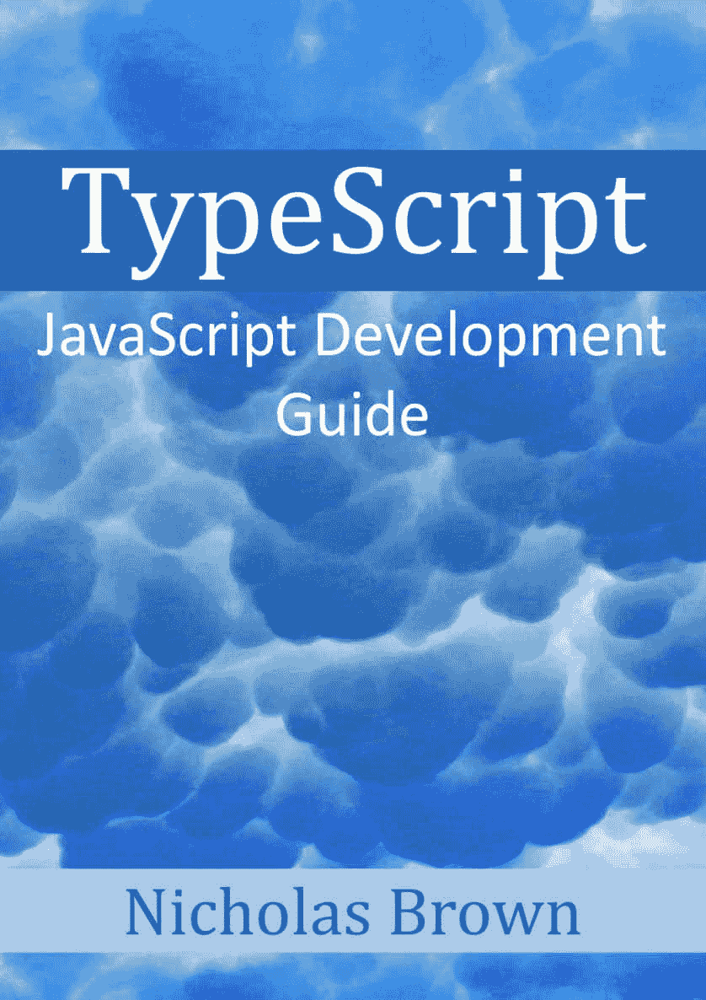

# TypeScript：JavaScript 开发指南





## 免责声明
尽管已尽力核实书中信息的准确性，但作者对包含的主题内容的错误、遗漏或相反的解释不承担任何责任。书中提供的信息仅供教育和娱乐之用。读者对其自己的行为负责，作者对因使用这些信息而导致的任何实际或感知的责任或损害不承担任何责任。

书中使用的商标均未经任何许可，且商标的出版未获得商标所有者的许可或支持。书中的所有商标和品牌仅用于说明目的，归其所有者所有，与本文没有附属关系。

# 引言
市场对大型软件应用，尤其是 Web 应用的需求日益增长。这背后的原因是软件应用程序需要实现的功能越来越多。这要求我们学习如何开发大型应用程序。这只有在支持它的编程语言中才能实现。TypeScript 就是这种语言之一。它支持大型应用程序的创建。本书是你学习 TypeScript 编程的极佳方式。阅读愉快！

# 第 1 章- TypeScript 概览
TypeScript 是由微软开发并维护的编程语言。它是一种开源编程语言。由于它是 JavaScript 的超集，因为它添加了一些额外功能，例如支持面向对象编程和可选静态类型。该语言旨在创建大型应用程序，并且始终编译为 JavaScript。可以使用 TypeScript 开发客户端和服务器端的 JavaScript 。既然我们说 TypeScript 是 JavaScript 的超集，那么用 JavaScript 编写的任何程序也可以视为 TypeScript 程序。TypeScript 编译器也是用 TypeScript 编写。

TypeScript 的目标为开发者提供一种开发大型应用程序的简单机制。它带有类、继承、接口、模块等概念，这些使得开发者能够轻松地创建大型应用程序。

# 第 2 章- 安装 TypeScript
我们有两种方法可以将 TypeScript 安装到系统中。这些包括：

1. 使用 `npm`（Node 包管理器）工具。
2. 安装 Visual Studio 的 TypeScript 插件。

对于 Windows 用户，如果第二种方案对你更方便，可以使用。只需安装 Visual Studio，然后下载并安装用于 TypeScript 编程的插件。事实证明这种方案比使用其他代码编辑器略优。

对于使用 Windows 其他平台的用户，只需确保你有文本编辑器、浏览器和 TypeScript 的 `npm` 包，以便使用 TypeScript 编程。可以按照以下步骤完成：

1. 首先安装 Node 包管理器。打开终端并执行以下命令：
```bash
curl -sL https://get.nodesource.com/setup_14.x | bash -
```
2. 下一步全局安装 TypeScript。可以使用以下命令：
```bash
npm install -g typescript
```

## Hello 示例
现在准备好了环境，可以开始编程了。我们将创建一个索引文件。以下是 `index.html` 的代码：

```html
<!doctype html>
<html lang="en">
<head>
  <meta charset="UTF-8">
  <title>This is TypeScript</title>
</head>
<body>
  <script src="hello.ts"></script>
</body>
</html>
```
如上述代码所示，我们引用了 `hello.ts` 文件。这是在 `<script src="hello.ts"></` 行中完成的。文件名中的 `.ts` 扩展名意味着它是 TypeScript 文件。

现在，创建一个文件并命名为 `hello.ts`。在文件中添加以下代码：
```typescript
alert('hello world, this is TypeScript!');
```
之后，启动命令行并进入 `hello.ts` 文件所在的文件夹。执行以下命令编译文件：
```bash
tsc hello.ts
```
TypeScript 中的 `tsc` 命令代表 TypeScript 编译器，它将生成一个名为 `hello.js` 的新文件。我们将 TypeScript 转换为 JavaScript 文件。

# 第 3 章- 类型注解
该功能在 TypeScript 中是可选的，允许我们在 TypeScript 程序中表达和实现注解。我们需要通过创建一个计算矩形面积的程序来演示这一点。只需打开文本编辑器创建一个名为 `area.ts` 的新文件。在文件中添加以下代码：

```typescript
function area(shape: string, width: number, height: number) {
  var area = width * height;
  return "The shape is " + shape + " having an area of " + area + " cm squared.";
}

document.body.innerHTML = area("rectangle", 20, 15);
```
接下来，打开 `index.html`并将脚本源从 `type.ts` 改为 `area.ts`。打开终端并执行以下命令编译整个内容：
```bash
tsc area.ts
```


消息以及矩形的面积将会被显示出来。正如你可能注意到的，类型注解被传递给函数的参数，它们用于指示该函数支持的参数类型。在上面的示例中，参数 `shape` 是字符串，而参数 `length` 和 `width` 是数字。

你必须知道，类型注解和 TypeScript 的其他特性在编译时都是强制执行的。如果向这些参数传递了其他类型的值，编译器将显示编译时错误。这在处理大型应用程序时 是非常非常好的主意。

我们需要演示在我们的案例中将如何检测错误。考虑下面提供的代码：

```typescript
function area(shape: string, width: number, height: number) {
    var area = width * height;
    return "The shape is " + shape + " having an area of " + area + " cm squared.";
}

document.body.innerHTML = area("rectangle", "width", 15); // width 的类型错误
```

在上面的示例中，`width` 被作为字符串传入，这是错误的。编译器期望 `width` 应该是一个数字。编译上面的程序后，你将得到以下错误：

```
$ tsc type.ts
type.ts(6,26): Supplied parameters do not match any signature of call target
```

这就是你得到的错误类型。

然而，你可能已经注意到，尽管由于类型不匹配产生了警告，但这并没有阻止 TypeScript 文件的编译并生成 JavaScript 文件。

如上面的示例所示，很显然，注解的目的是记录函数或变量意图执行的操作。假设你有一个函数，它期望只接收传递一个参数，并且该参数应该是字符串类型。当我们向它传递一个数组时，会发生什么？考虑下面提供的示例：

```typescript
function welcome(name: string) {
    return "Hello, " + name;
}

var user = [0, 1, 2];

document.body.innerHTML = wlecome(user);
```

一旦你重新编译上面的代码，你将得到以下错误：

```
welcome.ts(7,26): Supplied parameters do not match any signature of call target
```

同样，你可以尝试从 `welcome` 调用函数中移除所有参数。TypeScript 编译器会警告你传递了意料之外数量的参数。

# 第 4 章 - 接口 (Interfaces)

我们需要通过扩展之前的示例来使用它，以便实现一个接口，该接口将描述形状为一个具有可选 `color` 属性的对象。

创建一个新文件，并命名为 `interface.ts`。打开 `index.html` 文件，然后修改它使脚本源为 `interface.js`。向 `interface.ts` 文件添加以下代码：

```typescript
interface Shape {
    name: string;
    width: number;
    height: number;
    color?: string;
}

function area(shape : Shape) {
    var area = shape.width * shape.height;
    return "The shape is " + shape.name + " having an area of " + area + " cm squared";
}

console.log( area( {name: "rectangle", width: 20, height: 15} ) );
console.log( area( {name: "square", width: 20, height: 25, color: "blue"} ) );
```

接口是赋予对象类型的名称。我们可以声明接口，并同时在类型注解中使用它。

一旦你编译 `interface.js` 文件，将不会得到任何错误。为了让它产生错误，让我们向 `interface.js` 文件添加一行新代码，传入一个没有 name 属性的形状，然后在浏览器的控制台中观察结果。将下面的代码行添加到 `interface.js` 文件：

```javascript
console.log( area( {width: 20, height: 15} ) );
```

然后你可以运行 `tsc interface.js` 命令来编译文件中的代码。将输出一个错误，但目前不要担心。刷新你的浏览器，观察控制台给你的内容。文本和矩形的面积将形成控制台上的输出。箭头应该是：

```
interface.ts(26,13): Supplied parameters do not match any signature of call target:
Could not apply type 'Shape' to argument 1, which is of type '{ width: number; height: number; }'
```

上述错误的结果是因为传递给函数 `area()` 的对象不符合名为 `shape` 的接口，并且需要一个 name 属性才能符合。

考虑下面提供的代码，它展示了如何在 TypeScript 中使用接口：

```typescript
interface Person {
    fName: string;
    lName: string;
}

function welcome(person: Person) {
    return "Hello, " + person.fName + " " + person.lName;
}

var user = { fName: "Jane", lName: "User" };

document.body.innerHTML = welcome(user);
```

在上面的示例中，我们实现了一个接口，用于通过姓和名来描述一个人。为了让两种类型在 JavaScript 中兼容，你必须确保它们是兼容的。由于类型不匹配产生了警告，但这并没有阻止 TypeScript 文件的编译并生成 JavaScript 文件。

# 第 5 章 - 箭头函数表达式 (Arrow Functions)

上述错误的结果是因为传递给函数 `area()` 的对象不符合名为 `shape` 的接口，并且需要一个 name 属性才能符合。


```javascript
this.becomeOld = function() {
    _this.age++;  // 使用已经捕获的 this
}
}

var person = new Person(1);

setTimeout(person.becomeOld,1000);

setTimeout(function() { console.log(person.age); },2000); // 2
```

由于我们在使用 `TypeScript`，我们可以通过结合类和箭头函数来使用更简洁的语法。下面的示例代码所示：

```typescript
class Person {
    constructor(public age:number) {}
    becomeOld = () => {
        this.age++;
    }
}

var person = new Person(1);

setTimeout(person.becomeOld,1000);

setTimeout(function() { console.log(person.age); },2000); // 2
```

然而，你应该知道，只有当你打算将函数交给另一个个人以便进行调用时，才应该使用箭头函数。如下所示所示：

```javascript
var becomeOld = person.becomeOld;

// 这将在以后由其他人调用：

becomeOld();
```

如果你是自己调用它，应该像下面所示操作：

```javascript
person.becomeOld();
```

然后 `this` 对象将成为正确的调用上下文。

在大多数情况下，库会使用对象 `this` 来传递当前正在迭代的对象。如果你需要访问库传递的 `this`，甚至是你的周围变量，你可以使用临时变量，就像在没有箭头函数的情况下所做的那样。下面的代码所示：

```javascript
let _self = this;

thing.each(function() {
    console.log(_self); // 这是你的词法作用域值
    console.log(this); // 这是库传递的值
});
```

# 第 6 章- 类

在 `TypeScript` 中，有公共（public）或私有（private）权限的类。在 `TypeScript` 中，类的用法与 `ES6` 相同。创建一个新文件，并命名为 `class.ts`。在类中添加以下代码：

```typescript
class Shape {
    area: number;
    color: string;
    constructor ( name: string, width: number, height: number ) {
        this.area = width * height;
        this.color = "red";
    };
    shoutit() {
        return "The object is" + this.color + " " + this.name + " having an area of " + this.area + " cm squared.";
    }
}

var square = new Shape("square", 20, 20);

console.log( square.shoutit() );
console.log( 'Area of Object: ' + square.area );
console.log( 'Name of Object: ' + square.name );
console.log( 'Color of Object: ' + square.color );
console.log( 'Width of Object: ' + square.width );
console.log( 'Height of Object: ' + square.height );
```

我们上面示例中的对象有两个属性，即 `area` 和 `color`。我们还实现了一个构造函数和 `shoutit()` 方法。我们的构造函数参数的作用域是局部于构造函数的。由于这一点，在浏览器和编译器中都会观察到错误，如下所示：

```text
class.ts(12,42): The 'name' property does not exist on the value of type 'Shape'
class.ts(20,40): The 'name' property does not exist on the value of type 'Shape'
class.ts(22,41): The 'width' property does not exist on the value of type 'Shape'
class.ts(23,42): The 'height' property does not exist on the value of type 'Shape'
```

`TypeScript` 同时支持 `public` 和 `private` 访问修饰符。对于公共成员，我们可以在任何地方访问它们，而对于私有成员，我们只能在内部访问它们。在 `JavaScript` 中，没有可以用于强制私有化的特性，这就是为什么它在编译时强制执行，并用于提醒开发者他们将其私有化的意图。

我们需要为构造函数参数 `name` 添加公共访问修饰符，然后为成员（即 `color`）添加私有修饰符。一旦在构造函数的参数上添加了访问修饰符，它将自动成为具有该访问修饰符的类成员。考虑下面的示例：

...

```typescript
private color: string;
...

constructor ( public name: string, width: number, height: number ) {
...
```

考虑下面的 `ES 6` 类：

```javascript
class Monster {
    constructor(name, initPosition) {
        this.name = name;
        this.initPosition = initPosition;
    }
}
```

在 `TypeScript` 中，下面的 `ES 6` 类将无法工作，因为属性没有被定义。你应该使用：

```typescript
class Monster {
    name: string;
    initPosition: number;
    constructor(name: string, initPosition: number) {
        this.name = name;
        this.initPosition = initPosition;
    }
}
```

在 `TypeScript` 中，你可以在构造函数中使用 `public` 或 `private` 修饰符来定义属性。这是一种更短的语法：

```typescript
class Monster {
    public name: string;
    private initPosition: number;
    constructor(name: string, initPosition: number) {
        this.name = name;
        this.initPosition = initPosition;
    }
}
```

或者更短：

```typescript
class Monster {
    constructor(public name: string, private initPosition: number) {}
}
```

## 继承

在 `TypeScript` 中，你可以使用 `extends` 关键字从另一个类创建一个新类。这被称为继承。

```typescript
class Report {
    name: string;
    constructor(name: string) {
        this.name = name;
    }
    print() {
        console.log("Report: " + this.name);
    }
}

class CashReport extends Report {
    constructor(name: string) {
        super(name);
    }
    print() {
        console.log("Cash Report: " + this.name);
    }
}

var report = new Report("Monthly Sales");
report.print();

var cashreport = new CashReport("Monthly Sales");
cashreport.print();
```

`super()` 函数用于调用父类的构造函数。如果子类继承了另一个类，那么在子类的构造函数中它是必须的。

你也可以向子类添加新方法：

```typescript
class CashReport extends Report {
    constructor(name: string) {
        super(name);
    }
    getLineItems() {
        console.log("5 line items");
    }
}

var cashreport = new CashReport("Monthly Sales");
cashreport.getLineItems();
```

 静态属性

`TypeScript` 支持静态属性，这些属性由类的所有实例共享。放置这些属性的最佳位置是类本身，这正是 `TypeScript` 中发生发生的情况。

```javascript
class MyClass {
    static instances = 0;
    constructor() {
        MyClass.instances++;
    }
}

var s1 = new MyClass();
var s2 = new MyClass();

console.log(MyClass.instances); // 2
```


在 TypeScript 中，支持访问修饰符，这些修饰符控制了如何访问变量。变量可以通过实例直接在类外部访问，也可以在子类中被访问。以下是三种类型的访问修饰符：

1. `public`：在任何地方都可以通过实例访问。
2. `private`：在类外部无法访问。
3. `protected`：子类中可以访问，但不能通过实例直接访问。

你应该意识到，这对你的程序不会产生巨大影响，但如果你尝试在运行时访问它们，将会给你带来一些错误。考虑下面提供的示例，它展示了如何实现：

```typescript
class ClassBase {
   public a: number;
   private b: number;
   protected c: number;
}

// 对实例的影响
var myVar = new ClassBase();
foo.a; // ok
foo.b; // ：private
foo.c; // ：protected

// 对子类的影响
class ClassChild extends ClassBase {
   constructor() {
      super();
      this.a; // ok
      this.b; // ：private
      this.c; // ok
   }
}
```

如你所知，上述修饰符同样适用于成员属性和成员函数。

### 使用构造函数定义

类中的成员可以如下所示进行初始化：

```typescript
class MyClass {
   x: number;
   constructor(x:number) {
      this.x = x;
   }
}
```

这是 TypeScript 中一个非常常见的场景，人们简单地使用访问修饰符为成员添加前缀，它会在类中自动声明，然后从你的构造函数中拷贝。通过这种，我们之前的示例可以像下面所示：

```typescript
class MyClass {
   constructor(public x:number) {
   }
}
```

### 属性初始化

这是 TypeScript 支持的一个非常重要的特性。你可以在构造函数之外初始化类的任何成员，这对于提供默认值很有帮助。考虑下面提供的示例：

```typescript
class MyClass {
   members = [];  // 直接初始化
   add(x) {
      this.members.push(x);
   }
}
```

### 剩余参数

此功能允许在函数接受多个参数，然后将它们作为数组获取。可以像下面的示例所示表示：

```typescript
function allFunction(first, second, ...rest) {
   console.log(rest);
}

allFunction ('sample', 'bar'); // []
allFunction ('sample', 'bar', 'bas', 'qux'); // ['bas','qux']
```

# 第 7 章- 解构

解构意味着分解结构。TypeScript 支持以下类型的解构：

1. 对象解构
2. 数组解构

为了方便起见，可以将解构看作结构化的逆过程。下面的示例展示了在 JavaScript 中如何进行结构化：

```javascript
var myVar = {
   bar: {
      bas: 789
   }
};
```

如果没有 JavaScript 对结构化的支持，创建新对象的过程将有些困难。通过解构，我们获得了从特定源获取数据的同等便利性。

## 对象解构

通过解构，人们可以用单行代码完成原本需要多行代码的工作。考虑下面提供的示例：

```javascript
var rectangle = { a: 0, b: 10, width: 20, height: 30 };
// 解构赋值
var {a, b, width, height} = rectangle;
console.log(a, b, width, height);
```

如果我们不使用解构，`a`、`b`、`width` 和 `height` 将分别从 `rectangle` 中选取。也可以通过解构从结构中获取深度数据。下面的代码最好地说明了如何实现：

```javascript
var foo = { bar: { bas: 123 } };
var {bar: {bas}} = foo; // 实际上是 `var bas = foo.bar.bas;`
```

## 数组解构

`const` 是 TypeScript 和 ES6 提供的新新增。通过它，人们可以使变量不可变。这在运行时和文档方面都有很好的作用。要使用它，你只需要将关键字 `var` 替换为 `const`。下面最好演示了这一点：

```typescript
const myConst = 123;
```

在 TypeScript 中，`const` 的使用相对于其他编程语言非常简单。它帮助我们避免魔法数字字量，是提高可读性和可维护性的良好实践。考虑下面的代码：

```typescript
// 可读性低
if (a > 10) {
}

// 这种更好！
const maximumRows = 10;
if (a > maximumRows) {
}
```

`const` 声明的初始化必须完成。在 TypeScript 中，`const` 的使用相对于其他编程语言非常简单。它帮助我们避免魔法数字字量，是提高可读性和可维护性的良好实践。考虑下面的代码：

```typescript
// 可读性低
if (a > 10) {
}

// 这种更好！
const maximumRows = 10;
if (a > maximumRows) {
}
```


当 TypeScript 注意到你既没有使用数组也没有使用字符串时，将会得到一个错误。考虑下面的示例，它最好地描述了这一点：

```typescript
let artParagraphs = document.querySelectorAll("article > p");

// Error: Nodelist is not an array type or a string type

for (let par of artParagraphs) {
  par.classList.add("read");
}
```

上面的演示可以清楚地看出，“for…of”应该只用于数组或字符串对象。

# 第 9 章 - 迭代器 (Iterators)

迭代器是一种主要用于面向对象编程语言的特性。它是一个对象，用于实现以下类型的接口：

```typescript
interface Iterator<T> {
  next(value?: any): IteratorResult<T>;
  return?(value?: any): IteratorResult<T>;
  throw?(e?: any): IteratorResult<T>;
}
```

该接口允许我们从属于对象的集合或序列中检索特定的值。想象一种情况：你有一个帧（frame）对象，它包含了我们的帧所包含的组件列表。通过迭代器接口，我们可以像下面的代码所示，从帧对象中检索组件：

```typescript
'use strict';

class Component {
  constructor (public name: string) {}
}

class Frame implements Iterator<Component> {
  private point = 0;
  constructor(public name: string, public components: Component[]) {}
  public next(): IteratorResult<Component> {
    if (this.point < this.components.length) {
      return {
        done: false,
        value: this.components[this.point++]
      }
    } else {
      return {
        done: true
      }
    }
  }
}

let fr = new Frame("Door", [new Component("top"), new Component("bottom"), new Component("left"), new Component("right")]);
let iteratorResult_1 = fr.next(); //{ done: false, value: Component { name: 'top' } }
let iteratorResult_2 = fr.next(); //{ done: false, value: Component { name: 'bottom' } }
let iteratorResult_3 = fr.next(); //{ done: false, value: Component { name: 'left' } }
let iteratorResult_4 = fr.next(); //{ done: false, value: Component { name: 'right' } }
let iteratorResult_5 = fr.next(); //{ done: true }

// 我们可以通过 value 属性来访问迭代结果的值：
let component = iteratorResult_1.value; //Component { name: 'top' }
```

你必须知道，迭代器本身并不是 TypeScript 的一项特性，这意味着代码在不显式实现迭代器和 `iteratorResult` 的情况下也可以工作。然而，为了代码的一致性，使用这些 ES6 接口特性对我们来说是有好处的。

考虑下面的代码，它展示了如何实现：

```typescript
//...
class Frame implements Iterable<Component> {
  constructor(public name: string, public components: Component[]) {}
  [Symbol.iterator]() {
    let p = 0;
    let components = this.components;
    return {
      next(): IteratorResult<Component> {
        if (p < components.length) {
          return {
            done: false,
            value: components[p++]
          }
        } else {
          return {
            done: true
          }
        }
      }
    }
  }
}

let fr = new Frame("Door", [new Component("top"), new Component("bottom"), new Component("left"), new Component("right")]);
for (let cmp of frame) {
  console.log(cmp);
}
```

迭代器不能遍历一个无限的值。一个很好的例子是斐波那契数列。下面的代码最能地展示了这一点：

```typescript
class Fibonacci implements IterableIterator<number> {
  protected fbn1 = 0;
  protected fbn2 = 1;
  constructor(protected maxValue?: number) {}
  public next(): IteratorResult<number> {
    var current = this.fbn1;
    this.fbn1 = this.fbn2;
    this.fbn2 = current + this.fbn1;
    if (this.maxValue && current <= this.maxValue) {
      return {
        done: false,
        value: current
      }
    }
    return {
      done: true
    }
  }
  [Symbol.iterator](): IterableIterator<number> {
    return this;
  }
}

let fib = new Fibonacci();
fib.next() //{ done: false, value: 0 }
fib.next() //{ done: false, value: 1 }
fib.next() //{ done: false, value: 1 }
fib.next() //{ done: false, value: 2 }
fib.next() //{ done: false, value: 3 }
fib.next() //{ done: false, value: 5 }
let fibMax50 = new Fibonacci(50);
console.log(Array.from(fibMax50)); // [ 0,1,1,2,3,5,8,13,21,34 ]
let fibMax21 = new Fibonacci(21);
for(let num of fibMax21) {
  console.log(num); //将打印 21
}
```

# 第 11 章 - 展开运算符 (Spread Operator)

该运算符用于展开数组对象。

## 应用 (Apply)

该运算符用于将数组展开为函数参数。在过去，人们期望使用 `Function.prototype.apply` 函数。下面的代码示例展示了这一点：

```javascript
function myFunction(a, b, c) { }
var args = [0, 1, 2];
myFunction.apply(null, args);
```

为了实现这一点，我们可以在参数前加上 `…`。下文所示：

```typescript
function myFunction(a, b, c) { }
var args = [0, 1, 2];
myFunction(...args);
```

## 解构 (Destructuring)

你已经见过它是如何在解构中使用的。下文所示：

```typescript
var [a, b, ...remaining] = [1, 2, 3, 4];
console.log(a, b, remaining); // 1, 2, [3,4]
```

这种这种设计的动机是为了让人们轻松在解构时捕获剩余的数组元素。

数组赋值 (Array Assignment)


展开运算符（spread operator）允许你将一个展开后的数组放入另一个数组中。考虑下面的示例，它演示了如何实现：

```javascript
var list = [5, 6];
list = [...list, 7, 8];
console.log(list); // [5,6,7,8]
```

# 第 12 章- 枚举 (Enums)

枚举为我们提供了组织具有相关值的集合的方法。除了 JavaScript 外，其他编程语言都提供了枚举数据类型。TypeScript 支持这一点。在 TypeScript 中，可以像下面所示声明枚举：

```typescript
enum Card {
   Clubs,
   Spades,
   Diamonds,
   Hearts
}

// 使用示例
var card = Card.Clubs;

// 安全性
card = "It is not a member of the card suit"; // Error : string is not assignable to type `CardSuit`
```

## 枚举与数字

TypeScript 中的枚举是基于数字的。这意味着我们可以为 TypeScript 中的枚举实例赋值，对任何与数字兼容的类型也是如此。下面的代码很好地描述了如何实现：

```typescript
enum Color {
   Red,
   Green,
   Blue
}

var color = Color.Red;
color = 0; // 这相当于 Color.Red
```

## 枚举与字符串

我们想知道枚举生成的 JavaScript 是什么样的。考虑下面的 TypeScript 示例：

```typescript
enum MyEnum {
   False,
   True,
   Unknown
}
```

从上述 TypeScript 代码将生成以下 JavaScript 代码：

```javascript
var MyEnum;
(function (MyEnum) {
   MyEnum [MyEnum ["False"] = 0] = "False";
   MyEnum [MyEnum ["True"] = 1] = "True";
   MyEnum [MyEnum ["Unknown"] = 2] = "Unknown";
})( MyEnum || (MyEnum = {}));
```

变量 `MyEnum` 可以将字符串版本的枚举转换为数字，或者转换为数字版本的枚举。下面的代码很好地描述了这一点：

```typescript
enum MyEnum {
   False,
   True,
   Unknown
}

console.log(MyEnum [0]); // "False"
console.log(MyEnum ["False"]); // 0
console.log(MyEnum [MyEnum.False]); // "False" 因为 `MyEnum.False == 0`
```

我们也可以更改与枚举关联的数字。默认设置是枚举为 0，随后的每个增量自动以 1 的间隔进行。考虑下面的代码，它很好地描述了这一点：

```typescript
enum Color {
   Red,      // 0
   Green,  // 1
   Blue      // 2
}
```

可以通过特定赋值自动更改特定枚举关联的数字。示例演示了如何实现，我们从 3 开始，然后像下面所示递增：

```typescript
enum Color {
   LightRed = 3,  // 3
   DarkGreen,    // 4
   LightBlue      // 5
}
```

你还必须知道枚举是开放结尾的。考虑下面由枚举生成的 JavaScript 代码：

```javascript
var MyEnum;
(function (MyEnum) {
   MyEnum [MyEnum ["False"] = 0] = "False";
   MyEnum [MyEnum ["True"] = 1] = "True";
   MyEnum [MyEnum ["Unknown"] = 2] = "Unknown";
})( MyEnum || (MyEnum = {}));
```

枚举定义可以跨越多个文件。考虑下面的示例，其中我们展开了 `Color` 的定义以获取两个块：

```typescript
enum Color {
   Red,
   Green,
   Blue
}

enum Color {
   LightRed = 3,
   DarkGreen,
   LightBlue
}
```

## 枚举作为标志 (Flags)

标志为我们提供了使用枚举的卓越能力。考虑下面的示例：

```typescript
enum Animal {
   None            = 0,
   Flying          = 1 << 1,
   ConsumesFish    = 1 << 2,
   Endangered      = 1 << 3
}
```

（在上述情况下，我们需要通过移动 1 来获取位运算符。考虑接下来的示例：

```typescript
enum Animal {
   None            = 0,
   PossesClaws      = 1 << 0,
   Flies           = 1 << 1,
}

function printAbilities(animal) {
   var animFlags = animal.flags;
   if (animFlags & Animal.PossesClaws) {
      console.log('The animal has claws');
   }
   if (animFlags & Animal.Flies) {
      console.log('The animal can fly');
   }
   if (animFlags == Animal.None) {
      console.log('nothing');
   }
}

var animal = { flags: Animal.None };
printAbilities(animal); // nothing
animal.flags |= Animal.PossesClaws;
printAbilities(animal); // The animal has claws
animal.flags &= ~Animal.PossesClaws;
printAbilities(animal); // nothing
animal.flags |= Animal.Flies;
printAbilities(animal); // The animal has claws and the animal flies```

标志可以用于在定义中创建快捷方式。如下代码所示：

```typescript
enum Animal {
   None            = 0,
   PossesClaws      = 1 << 0,
   Flies           = 1 << 1,
   EatsFish        = 1 << 2,
   Endangered      = 1 << 3
}
var EndangeredFlies = PossesClaws | Flies
```

## 常量枚举 (Const Enums)

假设你定义了如下枚举：

```typescript
enum MyEnum {
   False,
   True,
   Unknown
}
var lie = MyEnum.False;
```

为了提高性能，你必须将枚举标记为 `const enum`。如下所示：

```typescript
const enum MyEnum {
   False,
   True,
   Unknown
}
var lie = MyEnum.False;
```

上述代码编译后将得到以下 JavaScript 代码：

```javascript
var lie = 0;
```

编译器会内联任何使用的枚举。此外，枚举定义不会生成 JavaScript，因为这些用法将被内联。

# 第 13 章- let

在 JavaScript 中，变量是函数作用域的。Java 和 C# 等其他编程语言并非如此，它们是块作用域的。考虑下面的 JavaScript 代码：

```javascript
var myVar = 123;
if (true) {
   var myVar = 500;
}
console.log(myVar); // 500
```

尽管你期望上面的代码输出 123，但它会输出 500。这是因为我们的变量 `myVar` 在 `if` 块内外是同一个。这是 JavaScript 中常见的错误来源之一。在 TypeScript 中，引入了 `let` 关键字以允许程序员定义具有真实块作用域的变量。这意味着如果你使用 `let` 而不是 `var` 来定义定义变量，它在作用域外的可见和使用方式将不同。之前的示例可以使用 `let` 关键字编写：

```javascript
let myVar = 123;
if (true) {
   let myVar = 500;
}
console.log(myVar); // 123
```

考虑下面的示例，它展示如何在循环中使用 `let` 关键字：

```javascript
var index = 0;
var myArray = [1, 2, 3];
for (var index = 0; index < myArray.length; index++) {
   console.log(myArray[index]);
}
console.log(index); // 0
```

将其替换为 `let` 关键字将帮助你避免循环错误。如下所示：

```javascript
var index = 0;
var myArray = [1, 2, 3];
for (let index = 0; index < myArray.length; index++) {
   console.log(myArray[index]);
}
console.log(index); // 0
```

如上所示，尽可能使用 `let` 关键字总是是好的，你将避开许多意外和错误。

函数也用于创建新的作用域。我们需要演示如何在 JavaScript 中使用函数来创建新的变量作用域。考虑下面的代码：

```javascript
var myVar = 123;
function testFunction() {
   var myVar = 500;
}
testFunction();
console.log(myVar); // 123
```

## 生成的 JS

TypeScript 生成的 JS 代码中如果环境中存在相似名称，很容易重命名 `let` 变量。考虑下面的代码，它展示了将 `var` 简单替换为 `let`。代码如下：

```javascript
if (true) {
   let myVar = 123;
}
```

// 将变为 //

```javascript
if (true) {
   var myVar = 123;
}
```


然而，如果变量名已经被周围的作用域占用，则将生成一个新的变量名，如下文所示：

```javascript
var myVar = '123';

if (true) {
    let myVar = 123;
}

// will become //

var myVar = '123';

if (true) {
    var _myVar = 123; // 它已经被重命名了
}
```

### 在闭包中

考虑下面的简单 JavaScript 代码：

```javascript
var functions = [];

// 创建一组函数
for (var j = 0; j < 3; j++) {
    functions.push(function() {
        console.log(j);
    })
}

// 调用它们
for (var k = 0; k < 3; k++) {
    functions[k]();
}
```

在大多数面试题中，你会被问到上述 JavaScript 文件中的日志输出是什么。虽然大多数人期望答案是 0, 2, 3，但真正的答案是 3。原因是这三个函数都使用了来自外部作用域的变量 `j`，而当我们执行它们时，变量 `j` 的值将是 3。这形成了我们第一个循环的终止条件。

解决这个问题的方法是为每个变量创建一个新变量，并且应该专门用于该循环中的迭代。如你所知，可以通过创建一个新函数并立即执行它来为变量创建一个新的作用域。如下代码所示：

```javascript
var functions = [];

// 创建一组函数
for (var j = 0; j < 3; j++) {
    (function() {
        var local = j;
        functions.push(function() {
            console.log(local);
        })
    })();
}

// 调用它们
for (var k = 0; k < 3; k++) {
    funcs[k]();
}
```

一旦你使用 `let` 关键字而不是 `var` 关键字，就会为每个循环迭代创建一个唯一的变量。

### 结论

本指南已经到达了结论。TypeScript 是一种始终编译为 JavaScript 的编程语言。该语言是开源的，由微软开发和维护。它非常适合支持静态类型和面向对象编程等特性的大型应用程序开发。这两个特性使其适用于开发大型应用程序的主要原因。

该语言支持类型注解，这对于维护程序的缩进非常有帮助。缩进通常能确保程序具有良好的读性。你必须记住，TypeScript 是 JavaScript 的超集，这意味着任何 JavaScript 代码也是 TypeScript 代码。这就是 TypeScript 始终编译为 JavaScript 的原因。要开始使用 TypeScript 编程，你必须首先准备好相应的环境。对于 Windows 用户，你只需要简单安装 Visual Studio，然后下载并安装必要的插件，就可以开始编程了。

如果你使用任何其他平台，则需要依赖名为 `npm` 的 Node 包管理器。确保你已经有了文本编辑器和浏览器。一旦安装了 TypeScript 的 npm 包，就可以开始编写你的 TypeScript 程序了。

