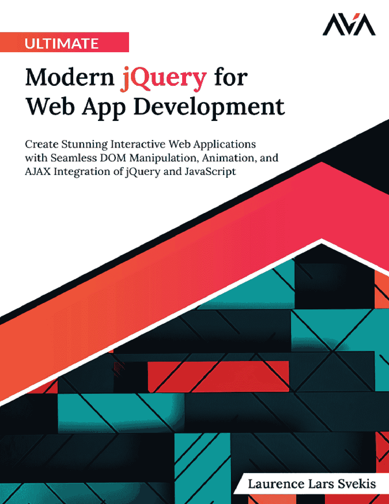
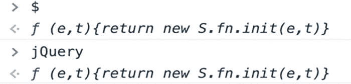
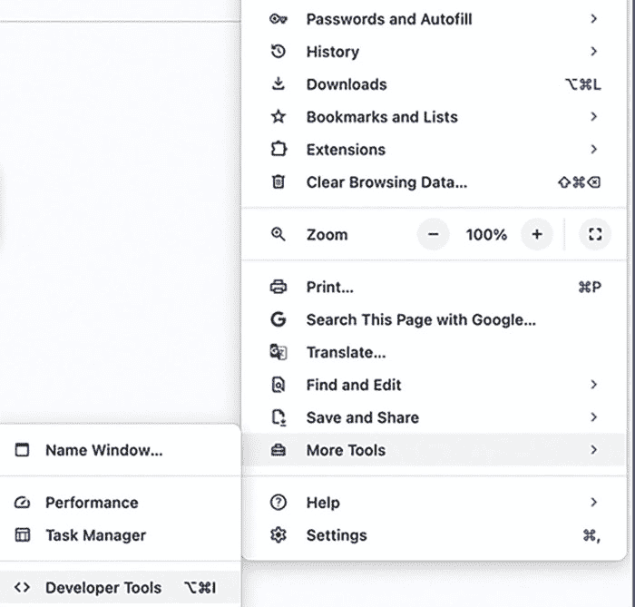
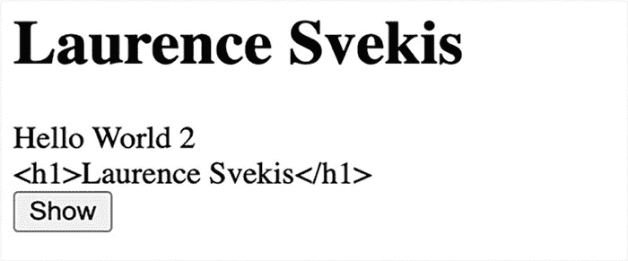
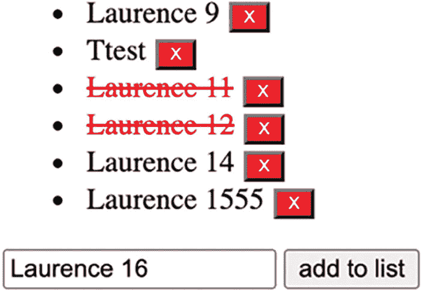
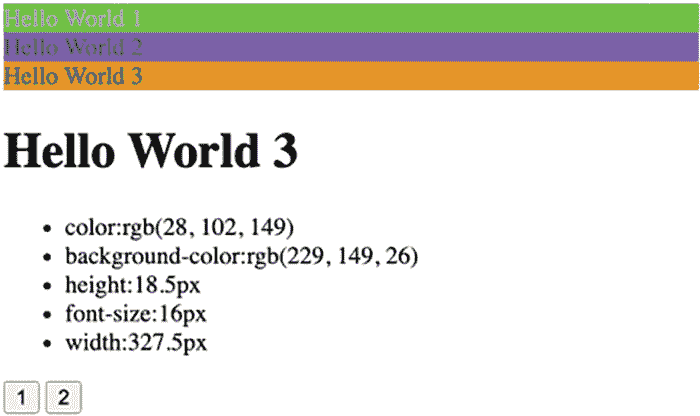

# 终极现代 jQuery Web 应用开发：通过无缝 DOM 操作、动画以及 jQuery 与 JavaScript 的 AJAX 集成创建惊艳交互式 Web 应用程序

通过 jQuery 和 JavaScript 的无缝 DOM 操作、动画处理以及 AJAX 集成，创建惊人的交互式 Web 应用程序




通过 jQuery 和 JavaScript 的无缝 DOM 操作、动画以及 AJAX 集成，创建惊人的交互式 Web 应用程序


www.orangeava.com

www.orangeava.com

**致：**

*Alexis 和 Sebastian Svekis*

*感谢您的支持*

**关于作者**

**Laurence Svekis** 是一位备受尊敬的 Web 开发者、在线教育者和企业家，因其在技术和数字学习领域的动态贡献而闻名。

在 Web 应用开发领域拥有超过二十年的职业生涯，他已成为在线教育领域的基石，教授编程课程并向全球观众分享他丰富的知识。

Laurence 在 Web 开发领域的历程以他早期采用并精通各种编程语言为标志，特别是对 JavaScript 具有出众的熟练程度。他的专业知识扩展到 Google Workspace 的复杂功能中。

作为一名在线讲师，Laurence 编写了大量课程，涵盖了 Web 开发广泛主题。这些课程不仅内容详尽，而且设计为适用于编程之旅中不同阶段的学习者，从初学者到高级从业者。他对教育的投入在他全球范围内影响超过百万名学生的成就中显而易见，这证明了他的教学方法的影响力和范围。

除了在线课程外，Laurence 还以畅销作家的身份留下了足印。他的著作与他的教学哲学相共鸣，为读者提供了实用的见解，并清晰、轻松地引导他们应对 Web 开发和编程的复杂性。

Laurence 对技术和创新的热情不仅止于教学和写作。他内心也是一个企业家，不断探索 Web 技术的新领域，并开发解决现实世界挑战的解决方案。他对分享知识和赋予他人利用技术力量的热情凸显了他作为数字世界领导者和愿景者的角色。

总之，Laurence Svekis 作为顶尖 Web 开发者、有影响力的在线教育者、畅销作家和激励人的企业家脱颖而出。他的贡献不仅丰富了 Web 开发领域，还为无数学习者在数字格局中释放潜力铺平了道路。

**关于技术审核员**

**Siddharth Shrivastava** 是 HCLTech 的资深前端技术主管，专长构建可访问、包容性的产品以及专为 Web 定制的数字体验。他在技术领域的历程始于 2014 年，在过去的 9 多年变革性岁月里，他为美国的金融科技、电信和银行客户构建了软件。

Siddharth 的演变使他从构建网站转变为精通动态前端技术。目前，在 HCL，他负责将原型转换为充满活力的界面，将技术实力与软件生命周期相结合。在搬到美国之前，Siddharth 在印度的 Cognizant 工作，在那里他从 Angular 迁移到 React。他的工作不仅展示了技术专长，还带来了巨大的价值。

**致谢**

我深感谢许多人士，他们的见解和鼓励对于本书的创作是不可或缺的。首先向社区和每一位参与者表示诚挚的感谢。我也欠我的教育同行和学生的情，他们的好奇心和学习渴望驱动了我使每一章都变得通俗易懂。最后，我的孩子理应巨大的感谢，感谢他们在写作和修订的无数小时中给予的无私支持。这本书不仅是我知识的反映，也是我们对 Web 开发共同努力和热情的证明。

**前言**

本书是对 jQuery 的一次简洁而详尽的探索，从基础语法和如何将其嵌入 HTML 文件开始，扩展到用于动态内容的 AJAX 等高级主题。每一章都在前章的基础上系统地构建，涵盖了元素选择、动画、DOM 操作等，并在实际项目中应用你所学的知识。

在通过这些章节的过程中，读者将精通选择和操作页面元素、制作 Web 动画以及通过 jQuery 充分利用文档对象模型 (DOM)。实际项目（例如创建一个带有交互元素的动态列表）不仅加强了理论知识，还鼓励在现实场景中应用技能。最后，你将熟练地使用 jQuery 创建交互式、响应式的 Web 体验。开启这段释放 Web 开发潜旅程。

## 下载代码包和图片

请关注链接或扫描二维码下载代码包和图片：

- https://github.com/orange-education/Ultimate-jQuery-for-Web-Development

- https://rebrand.ly/mhy67

## 错误

我们对 Orange Education 的工作非常自豪，并遵循最佳实践以确保给订阅者的内容的准确性。读者是我们的镜子，我们利用他们的反馈来反思并改进出版过程中可能发生的任何人为错误。为了让我们维持质量并帮助任何遇到困难的读者，请发送邮件至 errata@orangeava.com

## 附加信息

你可以在 www.orangeava.com 升级到电子版，作为纸质书客户，你有权获得电子版折扣。请联系 info@orangeava.com 了解更多详情。在 www.orangeava.com，你还可以阅读一系列免费的技术文章，订阅系列免费新闻通讯，并获取 AVA™ 书籍和电子书的独家折扣和优惠。

## 盗版

如果你在互联网上发现我们作品的任何形式的非法副本，请我们提供位置地址或网站名称。请通过 info@orangeava.com 联系我们并提供素材链接。

来自技术专家，并帮助他们为自己的领域构建学习和开发内容。

**评价**

请留下您的评价。在您阅读并使用此书后，为什么不在您购买此书的网站上留个评价呢？潜在的读者借此看到并参考您的中肯意见做出购买决策。我们 Orange Education 非常希望知道您对我们产品的看法，我们的作者也可以从您的反馈中学习。谢谢！

有关关于 Orange Education 的更多信息，请访问 **www.orangeava.com**。

- 结构

- *轻松实现动画和效果*

- 浏览器工具

- 注意要点

- 结

- *示例：AJAX 连接到外部文件并直接加载到页面*

- 处理 AJAX 响应的回调选项

- 使用 jQuery 获取 JSON 数据

- 结

- 多选题

- *答案*

## 索引

# 第一章

## jQuery 入门

**简介**

欢迎来到 jQuery 简介章节，这是一款重新定义了开发的 JavaScript 库。在本章中，我们将开启 jQuery 之旅，理解其重要性以及它为何成为一种关键工具。我们将引导你完成下载并将 jQuery 集成到你的项目中，确保你拥有必要的资源。此外，我们将探索通过内容传输网络（CDN）使用 jQuery 的概念。在本章结束时，你将为利用 jQuery 创建动态 Web 应用奠下基础。让我们开始 jQuery 之旅。

**结构**

在本章中，我们将讨论：

如何使用 jQuery 及其工作原理

下载并将 jQuery 添加到您的 HTML 中

使用 CDN 使用 jQuery

**jQuery 简述**

在动态 Web 开发领域，创建交互式且吸引人的用户体验至关重要。随着网站和 Web 应用程序不断演进以满足日益的需求，开发者寻找能够简化流程的工具。这就是 jQuery 大用武之地。

要充分理解 jQuery 的影响，理解它产生的背景非常重要。在 Web 开发早期，JavaScript 主要用于简单的表单验证和基础交互。然而，随着 Web 应用程序变得复杂，用户预期不断提高，开发者面临着跨浏览器兼容性和复杂的 DOM 操作等挑战。这些障碍导致了 jQuery 的诞生。

jQuery 由 John Resig 于 2006 年引入，它改变了游戏规则。它抽象并标准化了许多 JavaScript 的复杂之处，为与文档对象模型（DOM——代表网页的结构）交互提供了一种简洁且高效的方法。通过 jQuery，开发者可以编写更少的代码实现更多功能，因为它为元素选择、事件处理和动画等常见任务提供了简化语法。

jQuery 的插件架构为活跃的插件生态系统铺平了道路，这些插件扩展了它的核心功能。从滑块、轮播图到表单验证和 AJAX 交互，开发者可以利用大量的预构建解决方案库来加速开发进程。

使用原生 JavaScript 创建动画和添加视觉效果是一项复杂的工程。jQuery 的动画功能抽象了这些复杂性，让开发者能够以最小的努力创建引人注目的动画和过渡效果。

处理用户交互和事件是 Web 开发的基础。jQuery 引入了直观的事件处理系统，简化了事件监听器的绑定和对用户操作的响应，增强了 Web 程序的交互性。

当你开启这段 jQuery 力量之旅时，你将发现丰富的知识和技术，这些技术让你能够构建动态、交互且用户友 Web 应用程序。这一基础章节标志着你探索 jQuery 能力及其对现代 Web 开发产生变革性影响的开端。

jQuery 让构建交互和动态 Web 内容变得简单。。只要具备 HTML 和 CSS 的基础知识，你就可以开始创建吸引人的内容。jQuery 只是一个 JavaScript 库，了解 JavaScript 知识对于理解和调试代码非常有帮助。

jQuery 为 Web 开发者提供了一个易于使用的解决方案，用于添加平滑动画、处理网页交互和事件、导航页面元素进行选择、更新和操作元素属性及内容，并为数据发送 AJAX 请求。

它专为任何拥有 HTML 和 CSS 经验并想学习 jQuery 的人设计。通过示例学习，每个课程都有自己的挑战，帮助你更熟悉特定的编码目标。书中包含了源代码，将通过实用的提示和资源引导你学习课程内容。

之所以使用 jQuery是因为它的易用性，这使得创建出动画和网页体验变得简单。它拥有庞大的文档和教程社区。它可以跨浏览器工作并标准化体验，使得所有浏览器的显示方式相同。它有大量的插件，可以帮助通过代码创建更精彩的东西。代码也更易读，因为 jQuery 中使用的函数简单且具有语义化。

## 使用 jQuery 入门及其工作原理

在不断演变的 Web 开发领域，jQuery 是效率和创新的灯塔。它不仅仅是一个库；它是一个重新定义了我们构建交互式 Web 应用方式的游戏改变者。

**理解 jQuery 的本质：** 核心上，jQuery 是一个快速、轻量且功能丰富的 JavaScript 库。它的主要目标是简化 DOM 操作和事件处理过程，让开发者更容易创建出出的用户体验。凭借清晰简洁的语法，jQuery 抽象了原生 JavaScript 的复杂性，让开发者能够用更少的代码实现卓越的结果。

jQuery 允许精简 Web 开发流程。当我们考虑开发者在 jQuery 出现之前面临的挑战时，jQuery 的重要性变得显而易见。Web 开发领域曾饱受浏览器不一致、复杂的 DOM 操作以及创建吸引人的动画和效果的艰巨任务之困。jQuery 解决了这些痛点及更多。

考虑在网页上选择和操作 HTML 元素的常见任务。在原生 JavaScript 中，这可能是一个涉及不同浏览器不同方法的繁琐过程。jQuery 简化了这个过程，提供了一个统一的 API 来选择、遍历和修改 DOM 元素。

```
// Raw JavaScript
const element = document.getElementById("myElement");
element.style.color = "red";

// jQuery equivalent
$("#myElement").css("color", "red");
```

### 轻松处理事件

处理用户交互和事件是现代 Web 应用的基础。jQuery 提供了一种一致且直观的方式来绑定事件监听器并响应用户操作。

```
// Raw JavaScript
const button = document.getElementById("myButton");
button.addEventListener("click", function() {
  console.log("Button clicked!");
});

// jQuery equivalent
$("#myButton").click(function() {
  console.log("Button clicked!");
});
```

### 轻松实现动画和效果

创建动画和效果曾是一项复杂的工程。jQuery 的动画方法简化了过程，让开发者能够轻松创建视觉上吸引人的过渡效果。

```
// Raw JavaScript animation
const element = document.getElementById("animatedElement");
element.style.transition = "width 2s";
element.style.width = "300px";

// jQuery animation
$("#animatedElement").animate({ width: "300px" }, 2000);
```

## 选择 jQuery 的充足理由

以下是选择 jQuery的一些有力理由：

**跨浏览器兼容性**

Web 开发中最令人沮丧的挑战之一是确保代码在不同浏览器中一致运行。jQuery 抽象了浏览器差异，为用户提供了一致的体验。

**丰富的插件生态系统**

jQuery 的插件架构导致了大量插件库的创建，为从表单验证到复杂 UI 组件的各种功能提供了现成的解决方案。

**提高生产力**

通过简化复杂任务和减少所需的代码量，jQuery 显著提升了开发者的生产力，使他们能够专注于 Web 开发的创造性方面。

**学习曲线**

jQuery 直观的语法和文档齐全的 API 即使对于新接触 JavaScript 的开发者来说也易上手

## 拥抱 jQuery 的力量

当你深入阅读这本书时，你将发现 jQuery 方法的精细细节，探索真实的案例，并掌握 Web 开发的艺术。

### 下载并将 jQuery 添加到你的 HTML 中

在我们开始使用 jQuery 之前，我们需要获取库本身。坦率地说，可以从官方网站轻松获取 jQuery，方法有以下多种方式：

**直接下载**：访问官方网站 https://jquery.com/download/ 并选择你想要使用的 jQuery 版本。你可以下载压缩版或未压缩版。建议使用压缩版，因为它节省带宽且文件体积较小。未压缩版仅用于调试。

**内容分发网络 (CDN)**：或者，你可以直接从 CDN 引入 jQuery。如果用户之前访问过使用相同 CDN 的其他网站，这种方法具有可能提高加载时间的优势。

CDN 来源：https://developers.google.com/speed/libraries#jquery

一旦下载了 jQuery 库，你就将其集成到你的 HTML 文件中。以下是步骤指南：

1. **创建一个新文件夹**：组织你的项目文件，并在项目目录下创建一个名为 "js" 的新文件夹。我们将文件放在这里。

2. **放置 jQuery 文件**：将下载的 jQuery 文件（例如 "jquery-3.6.0.min.js"）移动到你创建的 "js" 文件夹中。

3. **链接 jQuery**：在你的 HTML 文件中（通常在 `</body>` 标签之前），包含以下代码以链接 jQuery 文件：

```
<script src="js/jquery-3.6.0.min.js"></script>
```

这段代码告诉浏览器从指定位置加载 jQuery 库。如果你的项目结构不同，请调整路径。

### 验证 jQuery 集成

为了确保 jQuery 已成功集成到你的项目中，让我们进行简单的测试。打开你的 HTML 文件，在 jQuery 引入下方添加以下脚本：

```
<script>
  // jQuery test
  $(document).ready(function() {
    alert("jQuery is working!");
  });
</script>
```

这段代码创建简单的 jQuery 脚本，在文档准备就绪时触发警框。当你在浏览器中加载 HTML 文件时，你应该能看到一个消息为 `jQuery is working!` 的警框。

你也可以使用浏览器编辑器并检查 jQuery 是否已加载。

在浏览器控制台中使用 `$` 或 `jQuery` 来检查 jQuery 是否就绪：



***图 1.1: 使用 $ 或 jQuery 检查 jQuery 是否就绪***

恭喜你！

你已成功下载并将 jQuery 集成到你的 Web 项目中。随着 jQuery 现在无缝地集成到你的开发工作流中，你正处于创建动态、交互式且具有视觉吸引力的 Web 应用的过程中。在接下来的章节中，我们将更深入地探索 jQuery 的功能，并学习如何利用它的能力来打造令人印象深刻的用户体验。现在，让我们继续这段旅程，进入 jQuery 驱动的 Web 开发世界吧！

## 使用 CDN 使用 jQuery

当我们深入探索 jQuery 世界时，探索访问和利用这一强大库的替代方法至关重要。除了本地下载 jQuery 文件外，我们还可以利用 CDN 的功能来简化集成过程并优化我们 Web 应用的性能。在本节中，我们将深入研究 CDN的概念以及在将 jQuery 引入 Web 页面时如何利用其优势。

CDN 是一个在全球范围内策略性部署的分布式服务器网络。CDN 的主要目标是通过从地理位置更靠近用户的服务器提供内容，从而更有效地传递 Web 内容（如图像、脚本、样式表和库）。这减少了延迟，加快了加载速度并提高了可靠性。

通过 CDN 引入 jQuery 有许多可以增强 Web 应用性能和可靠性的优点：


CDN 将内容分发到多个服务器，允许浏览器从最近的服务器获取资源。这最大限度地减少了数据传输的距离，从而加快了加载速度并提升了用户体验。

CDN 针对缓存进行了优化，这意味着当用户访问使用 CDN 托管 jQuery 网站时，浏览器可能已经在访问另一个网站时缓存了 jQuery 文件。这减少了冗余下载并提高了浏览器的整体效率。

CDN 设计用于处理高流量，并且通常配备了先进的安全功能，提高了它们所托管的资源的整体可靠性和可用性。

要使用 CDN 将 jQuery 引入你的项目，你不需要下载任何文件。相反，你可以直接从 CDN 服务器引用该库。以下是操作方法：

```html
<!-- 从 Google CDN 引入 jQuery -->
<script src="https://ajax.googleapis.com/ajax/libs/jquery/3.6.0/jquery.min.js"></script>

<!-- 从 Microsoft CDN 引入 jQuery -->
<script src="https://ajax.aspnetcdn.com/ajax/jQuery/jquery-3.6.0.min.js"></script>
```

选择提供的 URL 之一（或探索其他 CDN 选项），并将 `<script>` 标签放在 HTML 文档的 `<head>` 中或位于闭合的 `</body>` 标签之前。

通过通过 CDN 引入 jQuery，你利用了一个专门优化 Web 内容传递的全球服务器网络。这种方法增强了你的 Web 应用的加载速度和整体性能，同时减轻了你自己托管资源的负担。

以下是关于如何将 jQuery 添加到 HTML 中并使用 jQuery 创建简单的元素选择、事件处理和元素内容操作的分步指南：

**练习**：创建一个文件添加 jQuery，并编写一些 jQuery 代码：

1. 创建一个 HTML 文件并添加一个页面元素。
2. 添加指向 jQuery 库的 `<script>` 标签链接。
3. 添加第二个 `<script>` 标签链接到一个名为 `app1.js` 的新 `js` 文件。
4. 在浏览器中打开 HTML 并检查页面是否有 jQuery。
5. 在 `app1.js` 中，使用与 CSS 相同的语法选择元素，例如 `$().`。
6. 添加名为 `.html()` 的 jQuery 方法。
7. 在 `.html()` 中添加一个字符串值。
8. 为元素添加 `on('click')`，并将 `html` 更新嵌套在内部。
9. 在 `on click` 方法后链接第二个 `html()`，并带上另一个字符串值。

`INDEX.HTML`

```html
<!DOCTYPE html>
<html>
<head>
  <title>jQuery Course</title>
</head>
<body>
  <div>Hello World</div>
  <script src="https://ajax.googleapis.com/ajax/libs/jquery/3.6.0/jquery.min.js"></script>
  <script src="app1.js"></script>
</body>
</html>
```

这里是 jQuery 的一些简单示例。我们将在接下来的章节中提供更多关于它们如何工作的详细信息：

- **文档就绪 (Document Ready)**：在文档准备就绪时运行代码：

```javascript
$(document).ready(function() {
  // 你的代码
});
```

- **点击事件 (Click Event)**：当点击元素时执行代码：

```javascript
$(element).click(function() {
  // 你的代码
});
```

- **隐藏和显示 (Hide and Show)**：切换元素的可见性：

```javascript
$(element).toggle(function() {
  // 你的代码
});
```

- **添加 CSS (Adding CSS)**：为元素设置样式：

```javascript
$(element).css(function() {
  // 你的代码
});
```

- **添加类 (Adding Classes)**：为元素添加类：

```javascript
$(element).addClass(function() {
  // 你的代码
});
```

- **淡入效果 (Fading Effects)**：为元素应用淡入效果：

```javascript
$(element).fadeIn(function() {
  // 你的代码
});
```

- **滑动效果 (Slide Effects)**：为元素应用滑动效果：

```javascript
$(element).slideDown(function() {
  // 你的代码
});
```

- **AJAX 请求 (AJAX Request)**：从服务器获取数据：

```javascript
$.ajax({
  url: "",
  success: function(data) {
    // 处理数据
  },
  error: function() {
    // 处理错误
  }
});
```

- **鼠标悬停 (Mouse Hover)**：鼠标进入或离开元素时执行操作：

```javascript
$(element).hover(
  function() {
    // 鼠标进入代码
  },
  function() {
    // 鼠标离开代码
  }
);
```

- **动画 (Animations)**：使用 jQuery 方法创建自定义动画：

```javascript
$(element).animate({
  width: "20px",
  height: "20px"
}, 1000); // 动画时长，毫秒
```

这些示例为探索 jQuery 的功能提供了基础。请记住，jQuery 提供了操作元素、处理事件、发起 AJAX 请求和创建动态动画的各种方法和函数。当你熟悉了这些基础后，就准备好进入更复杂的场景。

**浏览器开发者工具**

使用 Chrome 工具（DevTools）是交互和理解网页内部机制的强大方法。以下是如何使用它们的简述：

1. **访问开发者工具**：打开 Chrome 并导航到你想检查的网页。在页面任意位置右键点击并选择“**检查**”，或使用快捷键 `Ctrl+Shift+I` (Mac 为 `Cmd+Opt+I`)。这将打开开发者工具面板。

2. **元素面板 (Elements)**：此面板允许你查看和修改的 HTML 和 CSS。你可以检查 DOM、修改样式并查看这些更改对网站布局和外观的影响。

3. **控制台 (Console)**：控制台用于在 JavaScript 开发过程中记录信息。你还可以通过直接执行 JavaScript 命令与网页进行交互。

4. **源面板 (Sources)**：此面板允许你通过设置断点、单步执行代码和检查变量来调试 JavaScript。你可以直接在此面板中查看和编辑源文件。

5. **网络面板 (Network)**：它提供了当前页面网络活动的信息。你可以看到每个请求的文件、其加载时间以及标头、响应负载和 HTTP 状态码等详细信息。

6. **性能面板 (Performance)**：使用此面板分析网页的运行时性能。它有助于理解渲染、脚本和加载页面所需的资源和时间。

7. **应用面板 (Application Panel)**：此部分用于检查所有加载的资源，包括 IndexedDB 或 WebSQL 数据库、本地和会话存储、Cookies 和缓存。

8. **审核面板 (Audits Panel)**：现在被称为 Lighthouse，该工具会对页面进行分析，并生成关于性能、可用性、渐进式 Web 应用、SEO 等报告。

9. **设备模式 (Device Mode)**：模拟你的网页在不同设备和屏幕尺寸上的显示和行为。

10. **自定义与设置 (Customization and Settings)**：自定义 DevTools 以适应你的工作流。你可以将面板停留在屏幕的不同部分，更改主题，甚至添加扩展以获得更多功能。



**图 1.2：** DevTools

这些工具对于 Web 开发、调试和学习更多 Web 技术非常有帮助。请记住，这仅仅是一个概述；每个面板都提供了一系列深层供探索的特性。

**结论**

在我们结束这一介绍性章节之际，你已经迈入了 jQuery 世界的第一步，这个工具注定将彻底改变你的 Web 开发方式。你已经掌握了 jQuery 的精髓以及它为何在现代 Web 开发中不可或缺，并习得了将其无缝集成到你的项目中的实用技能。无论你选择下载 jQuery 还是利用内容交付网络 (CDN) 的效率，你现在都具备了利用 jQuery 力量的基本资源。旅程刚刚开始，接下来的章节将深入探讨 jQuery 的功能，让你能够构建引人注目的交互式 Web 应用，同时简化你的开发工作流。因此，请系好安全带，jQuery 的冒险刚刚开始，还有许多内容可以探索和创造。

接下来的章节将深入探讨如何使用 jQuery 进行网页操作，首先从理解文档对象模型 (DOM) 开始，DOM 是一种表示网页元素的树形结构。由于这对 Web 内容操作至关重要，本章节解释了 jQuery 多能的选择器，这些选择器通过属性、ID、类或关系来定位 HTML 元素，并附带了语法和示例。随后，它将深入如何操作这些被选中的元素，详细介绍了如何修改内容、样式和属性，并讨论了从 DOM 中添加或删除元素。此外，它涵盖了 jQuery 的 DOM 遍历方法，用于导航 DOM 树以根据关系上下文定位元素，这对于动态内容操作至关重要。本章节还介绍了 jQuery 的事件处理，说明了如何与点击和键盘输入等用户操作交互，从而增强网页的交互性。此外，它强调了链式多个 jQuery 方法的威力，可以编写简洁易读的代码。最后，它对在 DOM 操作中使用 jQuery 的最佳实践进行了总结，强调了性能和可维护代码的重要性，为希望通过 jQuery 提升 Web 开发技能的开发者提供了一个全面的指南。

**第 2 章**

## 页面元素选择与使用 jQuery 选择 DOM 元素

**引言**

欢迎来到关键的一章，我们将深入探讨 jQuery 的核心：选择页面元素和遍历文档对象模型 (DOM) 的艺术。在本章中，我们将探索 jQuery 核心的基础工具，从通过标签、类或 ID 定位元素的基础选择器 (Basic Selectors) 开始。然后我们将进展到属性选择器 (Attribute Selectors) 和伪选择器 (Pseudo Selectors)，揭示根据属性或状态定位元素的更复杂方法。此外，我们将通过 jQuery 的遍历技术在 DOM 中导航，增强我们动态查找和操作元素的能力。最后，我们以元素过滤 (Filtering Elements) 结束，为对更复杂、响应式的 Web 界面精炼选择提供更深入的。

**结构**

在本章中，我们将讨论以下主题：

- 基础选择器
- 属性选择器
- 伪选择器
- 使用 jQuery 遍历 DOM 元素
- 使用 jQuery 过滤元素

## 页面元素选择与使用 jQuery 选择 DOM 元素

在 Web 开发领域，选择和操作 DOM 元素的能力是关重要的。jQuery 为开发者提供了强大的工具，可以轻松导航和操作文档对象模型 (DOM)，实现动态且吸引的 Web 体验。在本章中，我们将深入研究使用 jQuery 选择 DOM 元素的艺术。

**基础选择器 (Basic Selectors)**

在网页上选择元素是 jQuery 能力的核心。基础选择器允许你通过 HTML 标签、类和 ID 定位元素。以下是实现方式的简览：

```javascript
// 按标签选择
$("p") // 选择所有 <p> 元素
// 按类选择
$(".highlight") // 选择类为“highlight”的元素
// 按 ID 选择
$("#header") // 选择 ID 为“header”的元素
```

**练习**：选择页面元素：

1. 创建一个 HTML 文件进行交互，包含带有 ID 和类的元素。
2. 使用标签、类和 ID 选择元素。将 jQuery 元素对象输出到控制台。
3. 创建变量并分配 jQuery 元素对象，将其输出到页面。

**HTML:**

```html
<!DOCTYPE html>
<html>
<head>
    <title>Course</title>
</head>
<body>
    <p>World 1</p>
    <div class="highlight">World 2</div>
    <div id="header">World 3</div>
    <script src="https://code.jquery.com/jquery-3.6.0.min.js"></script>
    <script src="app.js"></script>
</body>
</html>
```

**app.js:**

```javascript
$(document).ready(function() {
    const $p = $("p");
    console.log($p);
    const $highlight = $(".highlight");
    console.log($highlight);
    const $header = $("#header");
    console.log($header);
});
```

**属性选择器 (Attribute Selectors)**

属性选择器允许你根据属性和值定位元素。这对于以下情况特别有用：

```javascript
// 按属性选择
$("input[type='text']") // 选择所有文本输入
// 带属性选择
$("[data-toggle]") // 选择带有 data-toggle 的元素
```

**使用属性选择：**

**HTML:**

```html
<!DOCTYPE html>
<html>
<head>
    <title>Attribute Selector</title>
</head>
<body>
    <button data-toggle="modal">打开模态框</button>
    <button data-toggle="sidebar">打开侧边栏</button>
    <script src="https://code.jquery.com/jquery-3.6.0.min.js"></script>
    <script src="script.js"></script>
</body>
</html>
```

**JavaScript (script.js):**

```javascript
$(document).ready(function() {
    $("[data-toggle]").click(function() {
        const target = $(this).data("toggle");
        alert(`切换 ${target}`);
    });
});
```

**伪选择器 (Pseudo Selectors)**

伪选择器提供了根据元素状态进行动态选择的能力，例如 `:hover`、`:first-child` 和 `:nth-child`：

```javascript
// 选择 <ul> 中的第一个 <li> 元素
$("ul li:first-child")
// 选择表中奇数行的 <tr> 元素
$("table tr:nth-child(odd)")
```

**练习**：使用 jQuery 选择第一个列表项并将其背景颜色改为蓝色：

```html
<!DOCTYPE html>
<html>
<head>
    <title>使用 jQuery 更改 CSS</title>
</head>
<body>
    <h1>使用 jQuery 更改 CSS</h1>
    <ul>
        <li>项目 1</li>
        <li>项目 2</li>
        <li>项目 3</li>
    </ul>
    <script src="script.js"></script>
</body>
</html>
```

**JavaScript (script.js):**

```javascript
$(document).ready(function() {
  // 修改第一个列表项的 CSS
  $("ul li:first-child").css("color", "blue");
});
```

在例例中，我们有一个包含三个列表项的无序列表。`script.js` 文件中的 jQuery 代码使用选择器 `$("ul li:first-child")` 来定位第一个列表项。然后，它使用 `.css()` 方法将第一个列表项的文本颜色更改为蓝色。

要运行此示例，请在同一目录下创建 HTML 和 JavaScript 文件，并在网页浏览器中打开 HTML 文件。你将看到一个包含三个项目的列表，且第一个项目的文本颜色将变变为蓝色。此示例演示了如何使用 jQuery 更改列表中特定元素的 CSS 属性。

**DOM 遍历**

jQuery 简化了导航 DOM 层次结构的过程，允许你轻松地遍历父元素、子元素和兄弟元素：

```javascript
// 选择元素的父元素
$("#childElement").parent()

// 选择元素的所有直接子元素
$("ul").children()

// 选择元素的下一个兄弟元素
$(".current").next()
```

以下是使用 jQuery 的父级方法遍历页面元素祖先的步骤：

**练习**：向父 HTML 元素移动，遍历到所选元素的祖先。


1. 选择按钮元素，并在点击时，输出`parent()`和`parents()`的长度。

2. 使用`parentsUntil()`选择该元素的祖先元素，并选择一个元素作为停止点。

3. 使用`each()`遍历元素数组。为所有作为第二个按钮祖先且具有`main`类的元素添加一个类。

## HTML

```html
<!DOCTYPE html>
<html>
<head><title>jQuery 课程</title>
<style>
.box{
  width:200px;
  border:5px solid #ddd;
  padding:20px;
  margin:10px;
}
</style>
</head>
<body><nav class="main">
<div class="main">
<div class="div1">Hello World 1</div>
<div class="div2"><span>Hello World 2</span></div> <div class="div3" id="div3">Hello World 3</div> <div class="div4">Laurence Svekis</div>
<input >
<div class="main">
<button id="btn1">1</button>
<button id="btn2">2</button>
</div>
<button id="btn1">3</button>
</div></nav>
<button id="btn1">4</button>
<script src="https://ajax.googleapis.com/ajax/libs/jquery/3.6.0/jquery.min.js"></script>
<script src="app14.js"></script>
</body>
</html>
```

## `app14.js`

```javascript
$('#btn1').click(function(){
  console.log($(this).parent().length);
  console.log($(this).parents().length);
  console.log($(this).parents());
  console.log($(this).parents('.main'));
  console.log($(this).parentsUntil('nav'));
})
$('#btn2').click(function(){
  $(this).parents('.main').each(function(){
    $(this).addClass('parentM');
  })
})
```

## 过滤元素

通过过滤符合特定条件的元素来精炼你的选择。这增强了操作网页特定部分时的精确性：

```javascript
// 按偶数索引元素进行过滤
$("li").filter(":even")

// 按包含特定文本的元素进行过滤
$("p").filter(":contains('jQuery')")
```

### 练习：使用过滤来选择特定元素并遍历到结果

1. 为所有五个页面按钮添加点击事件。

2. 点击第一个按钮时，选择一个元素集合，然后遍历到`first()`、`last()`和`eq()`，根据集合中的位置选择特定元素，并对结果元素应用样式。

3. 点击第二个按钮时，使用`filter()`选择匹配的元素结果，并对结果元素应用样式。

4. 点击第三个按钮时，选择集合中不匹配请求的元素，并对结果元素应用样式。

5. 对于第四和第五个按钮，尝试使用`filter()`和`not()`的变体从所选元素中进行元素选择，并对匹配的结果应用样式。

## HTML

```html
<!DOCTYPE html>
<html>
<head>
<title>jQuery 课程</title>
<style>
.box {
  border:1px solid #ddd;
  padding:5px;
  color:red;
}
.box1 {
  border:1px solid #ddd;
  padding:5px;
  color:blue;
}
.box2 {
  border:1px solid #ddd;
  padding:5px;
  color:green;
}
</style>
</head>
<body><nav>
<div class="main">
<div class="div1">Hello World 1</div>
<div class="div2"><span>Hello World 2</span></div> <div class="div3" id="div3">Hello World 3</div> <div class="div4">Laurence Svekis</div>
<input>
<button id="btn1">1</button>
<button id="btn2">2</button>
<button id="btn3">3</button><span>Hello</span>
</div></nav>
<button id="btn4">4</button>
<button id="btn5">5</button>
<script src="https://ajax.googleapis.com/ajax/libs/jquery/3.6.0/jquery.min.js"></script>
<script src="app16.js"></script>
</body>
</html>
```

## `app16.js`

```javascript
$('#btn1').click(function(){
  console.log($(main").children());
  $main = $(".main").children();
  $main.first().css('red');
  $main.last().css('blue');
  $main.eq(1).css('green');
})
$('#btn2').click(function(){
  $main.filter(":contains('Hello')").css('purple');
})
$('#btn3').click(function(){
  $main.not(":contains('Hello')").css('orange');
})
$('#btn4').click(function(){
  $main.filter(":even").css('yellow');
})
$('#btn5').click(function(){
  $main.not(":even").css('pink');
})
```

## 链式调用

jQuery 的优势之一在于其链式调用，它允许将多个方法组合在一行简洁的代码中：

```javascript
// 选择并操作一个元素
$("#myElement").addClass("highlight").slideUp(1000);
```

### 练习：如何链式调用方法

## HTML

```html
<!DOCTYPE html>
<html lang="en">
<head>
<meta charset="UTF-8">
<meta name="viewport" content="width=device-width, initial-scale=1.0">
<title>使用 jQuery 链方法</title>
<script src="https://code.jquery.com/jquery-3.6.0.min.js"></script>
</head>
<body>
<h1>使用 jQuery 链方法</h1>
<div id="box"></div>
<button id="animateButton">动画</button>
<script src="script.js"></script>
</body>
</html>
```

## JavaScript (`script.js`)

```javascript
$(document).ready(function() {
  // 为动画按钮附加点击事件
  $("#animateButton").click(function() {
    // 链式对盒子进行动画
    $("#box")
      .css("background-color", "blue")
      .animate({ width: "200px" }, 1000)
      .delay(500)
      .fadeOut()
      .fadeIn()
      .slideUp();
  })
});
```

在这个例中，我们有一个盒子和一个按钮。点击 ID 为`animateButton`的按钮时，`script.js`文件中的 jQuery 代码将链子的多个方法：

1. 盒子的背景颜色更改为蓝色。

2. 宽度在 1 秒内逐渐增加到 200px。

3. 动画暂停 500 毫秒。

4. 盒子淡出然后淡入。

5. 盒子向上滑动并消失。

此外，我们强调了链式调用方法对于编写简洁且易读代码的效率。最后，我们强调了 jQuery 中最佳实践对于优化性能和保持代码可维护性的重要。这些知识为开发者创建交互式、高效且用户友好的 Web 应用程序提供了必要的工具。

在下一章中，我们将发现各种工具来为你的网页注入灵魂。我们将探索`Hide`和`Show`方法，它们允许你切换元素的可见性，提供无缝的过渡效果和交互功能。我们还将深入研究`Fade In`和`Fade Out`方法，实现优雅的透明度过渡。此外，我们涵盖了`Slide Up`和`Slide Down`方法，为你的网页元素添加动态的垂直运动。最后，我们将进入自定义动画的领域，使你能够根据特定的设计需求创建独特且引人注目的过渡效果。

# 第 3 章

## 元素隐藏、显示方法与动画效果

### 引言

在 Web 开发领域，控制页面元素的可见性并添加动画效果的能力可以将静态网站转变为交互式且引人入胜的体验。jQuery 提供了一套强大的方法来实现这一目标，为创建动态 Web 内容开启了无限可能。在本章中，我们将探索这些方法，从简单的隐藏和显示技术到更高级的渐变和滑动效果，让你具备为网页注入灵魂的技能。

### 结构

在本章中，我们将讨论以下主题：

- `Hide`和`show`方法
- `Fade in`和`fade out`方法
- `slideUp`和`slideDown`方法
- 使用 jQuery 自定义动画

## 隐藏与显示方法

jQuery 提供了`.hide()`和`.show()`方法，用于控制网页上 HTML 元素的可见性。这些方法在 Web 开发中被广泛用于创建交互式和动态的用户界面。

### `.hide()`：隐藏元素

`.hide()`方法正如其名所示——通过将元素的 CSS `display` 属性设置为`none`来隐藏元素元素。以下是它的使用方法：

`$("#elementToHide").hide();`

`.hide()`方法通过修改元素的 CSS 属性（特别是`display`属性）来隐藏一个或多个选定的元素。当你使用`.hide()`隐藏一个元素时，它将变得不可见，并且不再占据布局中的空间。其工作原理如下：

`$(selector).hide(speed, callback);`

- `selector`：这是一个 jQuery 选择器，用于指定你想隐藏的元素。它可以是元素类型、类、ID 或任何有效的选择器。
- `speed`（可选）：此参数指定隐藏动画的速度。它可以是以下值之一：
  - `slow`：慢速动画（600 毫秒）
  - `fast`：快速动画（200 毫秒）
  - 数值：以毫秒为单位的动画持续时间
- `callback`（可选）：这是一个在`.hide()`操作完成后执行的函数。

#### 示例

```javascript
// 缓慢隐藏 ID 为 "myElement" 的特定元素
$("#myElement").hide("slow");

// 快速隐藏所有类名为 "hidden" 的 <div> 元素
$("div.hidden").hide("fast");
```

### `.show()`：显示隐藏的元素

相反，`.show()`方法通过将元素的`display`属性恢复为默认值（通常是`block`或`inline`）来显示隐藏的元素。用法非常直观：

`$("#elementToShow").show();`

`.show()`方法用于显示之前使用`.hide()`隐藏或初始隐藏的一个或多个选定元素。它反转了`.hide()`方法的效果，使元素再次出现。其工作原理如下：

`$(selector).show(speed, callback);`

- `selector`：这是一个 jQuery 选择器，用于指定你想显示的元素。
- `speed`（可选）：此参数指定显示动画的速度，与`.hide()`相同。
- `callback`（可选）：这是一个在`.show()`操作完成后执行的函数。

#### 示例

```javascript
// 缓慢显示 ID 为 "myElement" 的特定元素
$("#myElement").show("slow");

// 快速显示所有类名为 "visible" 的 <div> 元素
$("div.visible").show("fast");
```

**切换可见性**：`.hide()`和`.show()`经常结合使用来切换元素的可见性。例如，你可以在点击按钮时隐藏元素，然后在再次点击按钮时显示它。

**创建动画**：这些方法可以创建简单的动画，例如元素的淡入和淡出，或让它们向上向下滑动。

**构建手风琴菜单**：配合事件处理程序，这些方法可用于创建菜单，点击其中一个部分会隐藏其他部分并显示被点击的部分。

**显示和隐藏工具提示和弹出框**：Web 中的工具提示和弹出框通常使用这些方法来控制它们的显示。总而言之，jQuery 中的`.hide()`和`.show()`方法是控制网页上元素可见性的基础。它们是多功能工具，可以用于各种场景以创建交互式和动态的用户界面。

### 练习：元素隐藏、显示方法与动画效果

点击元素，隐藏被点击的元素。添加一个按钮来显示这些元素：

1. 选择页面上所有的`<div>`。
2. 使用`.first()`选择第一个，使用`.last()`选择最后一个。
3. 给`<div>`添加点击事件。当被点击时，它应该选择来自点击事件的被点击的元素（注意，这将选取嵌套的元素）。更新 HTML 使其显示为 "clicked"。更新文本为 "Ready" 的元素。然后对该元素应用`.hide()`函数。
4. 添加一个事件来显示这些元素。

选择所有`<div>`

使用`.first()`选择第一个，使用`.last()`选择最后一个

给`<div>`添加点击事件。当被点击时，它应该选择来自点击事件的被点击的元素（注意，这将选取嵌套的元素）。更新 HTML 使其显示为 "clicked"。更新文本为 "Ready" 的元素。然后对该元素应用`.hide()`函数。

添加一个事件来显示这些元素。

选择所有`<div>`

#### 代码中隐藏和显示的示例

#### 此部分的 HTML

```html
<!DOCTYPE html>
<html>
<head>
    <title>jQuery Course</title>
</head>
<body>
    <div>Hello World 1</div>
    <div class="div2">Hello World 2</div>
    <div id="div3">Hello World 3</div>
    <button>Show</button>
    <script src="jquery.min.js"></script>
    <script src="app3.js"></script>
</body>
</html>
```

#### JavaScript 代码

```javascript
console.log$("div").first());
const val = "<h1>Laurence Svekis</h1>";
$("div").first().html(val);
$("div").last().text(val);

$("div").click((e) => {
    const $el = $(e.target);
    console.log($el);
    $el.html('clicked');
    $(e.target).text('Ready');
    $(e.target).hide("slow");
});

$("button").click((e) => {
    $("div").show("fast");
    $("h1").show(4000);
});

function eleClicker(e){
    console.log(e);
}
```



以下 JavaScript 代码解析：

- `console.log$("div").first());`：此行使用 jQuery 选择页面上的第一个`<div>`元素并将其打印到控制台。
- `const val = "<h1>Laurence Svekis</h1>";`：此行创建一个包含文本 Laurence Svekis 的`<h1>`元素的 HTML 字符串。


- `$("div").first().html(val);`：此行选择第一个 `<div>` 元素，并将其 HTML 内容设置为变量 `val` 中的值，即用 `<h1>` 元素替换第一个 `<div>` 的内容。
- `$("div").last().text(val);`：此行选择最后一个 `<div>` 元素，并将其文本内容设置为变量 `val` 中的值，即将最后一个 `<div>` 的文本更改为 Laurence Svekis。
- `$("div").click((e) => { ... });`：此代码为所有 `<div>` 元素绑定点击事件处理程序。当 `<div>` 被点击时，执行处理函数。它会将被点击的 `<div>` 的 HTML 内容更改为 clicked，将文本内容更改为 Ready，然后以慢速隐藏该 `<div>` 元素。
- `$('button').click((e) => { ... });`：这段代码为按钮元素绑定点击事件处理程序。当按钮被点击时，它会通过快速动画显示所有的 `<div>` 元素，并持续 4000 毫秒（4 秒）显示 `<h1>` 元素。
- `function eleClicker(e) { ... }`：这看起来是一个定义的函数 `eleClicker`，它接受一个事件对象 `e` 作为参数，但在提供的代码中没有被使用或调用。

总结来说，这段代码使用 jQuery 来操作页面上的 HTML 元素，根据用户交互更改其内容和行为。这段代码演示了使用 jQuery 进行基础 DOM 操控和事件处理。

## `.toggle()`：在隐藏和显示之间切换

`.toggle()` 方法允许你通过每次点击来切换元素的可见性，为创建如折叠部分等交互式元素提供了一种简单的方法：

```javascript
$("#toggleElement").toggle();
```

### `fadeIn`、`fadeOut` 和 `fadeToggle` 方法

`.fadeIn()`、`.fadeOut()` 和 `.fadeToggle()` 方法用于在可见和隐藏状态之间创建平滑的渐进过渡。

#### `.fadeIn()`：逐渐出现

`.fadeIn()` 方法让元素从不可见平滑过渡到完全可见。你可以指定动画持续时间：

```javascript
$("#fadeInElement").fadeIn(1000); // 1000 毫秒（1 秒）
```

#### `.fadeOut()`：逐渐消失

相反，`.fadeOut()` 方法让元素逐渐淡出视线。像 `.fadeIn()` 一样，你可以设置动画持续时间：

```javascript
$("#fadeOutElement").fadeOut(1000);
```

#### `.fadeToggle()`：切换淡入/淡出

`.fadeToggle()` 方法在淡入和淡出之间切换。它非常适合用于创建可切换的元素：

```javascript
$("#fadeToggleElement").fadeToggle(1000);
```

## 使用 jQuery 元素的淡入效果

现在，我们将学习 jQuery 的淡入效果：

1. 让页面上所有的 `div` 可点击。
2. 创建变量来跟踪元素被点击的次数，以及当前隐藏的元素数量。
3. 在元素被点击后更新其文本或 HTML。
4. 为按钮添加点击事件，一旦点击，就会显示、切换并对元素应用不同的淡入效果。
5. 创建一个变量来切换按钮元素的透明度，每点击它一次，透明度都应该从 0.5 变为 1，然后反之。

### HTML 代码

```html
<div>Hello World 1</div>
<div class="div2">Hello World 2</div>
<div id="div3">Hello World 3</div>
<button>Show</button>
```

### JS 源代码

```javascript
$('div').first().html(val);

let counter = 0;
let hiddenEle = 0;
let fader = 0.5;

$('div').click(function(e) {
  // $(e.target).fadeOut(1000);

  console.log($(this));
  console.log($(this).text());

  $(this).fadeOut(1000, () => {
    counter++;
    hiddenEle++;

    const temp = `<h3>Counter ${counter}</h3>`;
    $(this).html(temp);

    $('button').text(`Show (${hiddenEle})`);
  });
});

$('button').click((e) => {
  // $('div').fadeIn("slow");

  /*
  $('div').fadeToggle('slow', function() {
    $(this).text('Was toggled');
  });
  */

  $('div').toggle(1500);
  hiddenEle = 0;
  $('button').text(`All Showing`);

  $('button').fadeTo('slow', fader, () => {
    if (fader == 0.5) {
      fader = 1;
    } else {
      fader = 0.5;
    }
  });
});
```

### JavaScript 部分

- `const val = '<h3>Laurence Svekis</h3>';`：初始化一个常量变量 `val`，其值为包含 `<h3>` 元素的 HTML 字符串。
- `let counter = 0;`：声明一个计数器变量并初始化为 0。它用于跟踪点击次数。
- `let hiddenEle = 0;`：声明一个变量 `hiddenEle` 并将其初始化为 0。它跟踪隐藏元素的数量。
- `let fader = 0.5;`：声明一个变量 `fader` 并将其初始化为 0.5。它用于控制元素淡入时的透明度。
- `$('div').first().html(val);`：选择第一个 `<div>` 元素，并将其 HTML 内容设置为存储在 `val` 中的值，即将第一个 `<div>` 的内容替换为 `<h3>` 元素。
- `$('div').click(function(e) { ... });`：为所有 `<div>` 元素绑定点击事件处理程序。当点击 `<div>` 时：
  - 它在一秒内淡出（1000 毫秒）。
  - 将被点击的 `<div>` 输出到控制台。
  - 将被点击的 `<div>` 的文本内容输出到控制台。
  - 淡入带有文本 `Counter ${counter}` 的新 `<h3>` 元素并更新计数器。
  - 更新按钮文本为 `Show (${hiddenEle})`，以显示隐藏元素的数量。
- `$('button').click((e) => { ... });`：为按钮绑定点击事件。在 1.5 秒（1500 毫秒）内切换所有 `<div>` 元素的可见性，将 `hiddenEle` 重置为 0，并更新按钮文本为 `All Showing`。

## `slideUp` 和 `slideDown` 方法

`.slideUp()`、`.slideDown()` 和 `.slideToggle()` 方法为页面元素添加滑动效果：

- `.slideUp()`：滑动隐藏。`.slideUp()` 方法通过向上滑动来隐藏元素。你可以控制动画持续时间：

  ```javascript
  $("#slideElement").slideUp(1000);
  ```

- `.slideDown()`：滑动显示。相反，`.slideDown()` 通过向下滑动来显示元素。动画持续时间可自定义：

  ```javascript
  $("#slideElement").slideDown(1000);
  ```

- `.slideToggle()`：切换滑动。`.slideToggle()` 方法在向上和向下滑动元素之间切换。它非常适合创建折叠部分：

  ```javascript
  $("#slideElement").slideToggle(1000);
  ```

## 练习：jQuery 滑动效果

1. 隐藏 `show` 按钮。
2. 在隐藏按钮上添加点击事件，使用 `slideUp()` 隐藏页面上所有的 `div`，并调用切换两个按钮的函数。
3. 第二个 `show` 按钮现在应该是可见的，为该按钮添加点击事件，使用 `slideDown()` 显示所有 `div`。
4. 为每个 `div` 添加点击事件，使用 `toggle()` 隐藏该 `div`。

### HTML 代码

```html
<div>Hello World 1</div>
<div class="div2">Hello World 2</div>
<div id="div3">Hello World 3</div>
<button id="btn1">Hide</button>
<button id="btn2">Show</button>
```

### JavaScript 代码

```javascript
$('btn2').hide();

$('btn1').click((e) => {
  $('div').slideUp('slow', doneFun);
});

$('btn2').click((e) => {
  $('div').slideDown('fast', doneFun);
});

$('div').click(function() {
  $(this).slideToggle();
});

function doneFun() {
  console.log('slide done');
  $('btn1').toggle();
  $('btn2').toggle();
}
```

这行代码隐藏了 ID 为 `btn2` 的元素。这意味着当页面加载时，ID 为 `btn2` 的按钮是可见的。

```css
width: "200px",
opacity: 0.5
},
1000
);
```

## CSS 定位属性

为了有效使用 jQuery 中的 `.animate()` 方法，通常需要理解并操作 CSS 定位属性。CSS 定位属性决定了元素在其容器元素或文档中的定位方式。在 jQuery 动画中，你可以对这些属性的变化进行动画处理，从而创建各种视觉效果。

在使用 `.animate()` 方法时可能需要的关键 CSS 定位属性及其示例：

### `position`

`position` 属性指定了元素使用的定位方法。常见值包括相对（`relative`）、绝对（`absolute`）、固定（`fixed`）和静态（`static`）。

**示例：**

```css
.box {
  position: relative;
}
```

### `top`、`right`、`bottom`、`left`

这些属性通常用于位置设置为 `relative`、`absolute` 或 `fixed` 的元素。它们指定了元素相对于正常位置的偏移量。

**示例：**

```css
.box {
  position: relative;
  top: 20px;
  left: 30px;
}
```

### `margin`

`margin` 属性控制元素边框之外的空间。你可以通过对 `margin` 进行动画来平滑地改变元素的位置。

**示例：**

```css
.box {
  margin-left: 10px;
}
```

### `transform`

`transform` 属性允许对元素应用平移、旋转和缩放等变换。它通常用于动画以创建复杂的效果。

**示例：**

```css
.box {
  transform: translate(50px, 20px);
}
```

### `z-index`

`z-index` 属性控制具有位置值的元素的堆叠顺序。当你想要让元素进入或离开视野并改变它们的堆叠顺序时，它非常有用。

**示例：**

```css
.box1 {
  z-index: 1;
}

.box2 {
  z-index: 2;
}
```

以下是如何结合 jQuery 的 `.animate()` 方法使用这些属性的示例：

```javascript
$(document).ready(function() {
  $("#moveButton").click(function() {
    $(".box").animate({
      left: "+50px",
      top: "+30px",
      margin: "10px",
      transform: "rotate(45deg)",
      zIndex: 2,
    },
    1000 // 以毫秒为单位
    );
  });
});
```

在此示例中，点击 `moveButton` 将对 `.box` 元素执行动画。它改变了它们的 `left` 和 `top` 位置、`margin`、`transform`（旋转）以及 `z-index`。这展示了 jQuery 的 `.animate()` 方法如何平滑地过渡这些 CSS 属性以创建动态视觉效果。

## 使用 jQuery 创建自定义动画练习

选择并移动页面元素，并对选中的元素应用自定义动画效果。

1. 为你想移动的页面元素添加 `position: relative` 或 `absolute`。
2. 选择所有元素，点击按钮 1 时应用带有样式值的各种动画。
3. 点击按钮 2 时为页面元素添加不同的自定义动画。

### HTML 代码

```html
<div class="div1">Hello World 1</div>
<div class="div2">Hello World 2</div>
<div class="div3" id="div3">Hello World 3</div>
<button id="btn1">1</button>
<button id="btn2">2</button>
```

### CSS 代码

```css
div {
  left: 100px;
  position: relative;
  border: 1px solid #ddd;
  width: 120px;
}
```

### JavaScript 代码

```javascript
$('#btn1').click(() => {
  $('.div1').text(`I’m moving`);

  $('.div1').animate({
    left: "+20",
    opacity: 0.5
  }, 1000, () => {
    $('.div1').text(`STOPPED`);
  });

  $('.div2').animate({
    left: "+50",
    fontSize: "20px"
  }, 3000, () => {
    $('.div2').text(`Laurence Svekis`);
  });

  $('.div3').animate({
    top: "+50",
    width: "150px",
    height: "150px"
  }, 1000, () => {
    $('.div2').text(`Laurence Svekis`);
  });
});

$('#btn2').click(() => {
  $('.div1').text(`I’m moving`).animate({
    left: "-50",
    opacity: 1
  }, 1000, () => {
    $('.div1').text(`STOPPED`);
  });

  $('.div3').animate({
    top: "-50",
    width: "50px",
    height: "35px"
  }, 1000, () => {
    $('.div2').text(`DONE`);
  });
});
```

### 按钮 1（`#btn1`）点击事件

当 `btn1` 被点击时，以下代码将 `.div1` 的文本改为“I’m moving”，然后向左偏移 20px 并将透明度变为 0.5，持续 1000 毫秒，之后文本变为“STOPPED”。

```javascript
$('.div1')
  .text('I’m moving')
  .animate({
    left: "+20",
    opacity: 0.5
  }, 1000, () => {
    $('.div1').text('STOPPED');
  });
```

以下代码让 `.div2` 向右移动 50px，并将字体大小变为 20px，持续 3000 毫秒，然后将文本设置为“Laurence Svekis”。

```javascript
$('.div2').animate({
  left: "+50",
  fontSize: "20px"
}, 3000, () => {
  $('.div2').text('Laurence Svekis');
});
```


`$('.div3').animate({ top: "+50", width: "150px", height: "150px" }, 1000, () => { $('.div2').text('Laurence Svekis'); });` 让 `.div3` 向下移动 50px，宽度增加到 150px，高度增加到 150px，持续 1000 毫秒，再次将 `.div2` 的文本设置为“Laurence Svekis”。

**按钮 2 (`#btn2`) 点击事件：**

当`btn2`被点击时，`$('.div1').text('I’m moving').animate({ left: "-50", opacity: 1 }, 1000, () => { $('.div1').text('STOPPED'); });` 将 `.div1` 的文本改为“I’m moving”，向左移动 50px 并恢复透明度为 1，持续 1000 毫秒，最后文本变为“STOPPED”。

`$('.div3').animate({ top: "-50", width: "50px", height: "35px" }, 1000, () => { $('.div2').text('DONE'); });` 让 `.div3` 向上移动 50px，宽度缩减到 50px，高度缩减到 35px，持续 1000 毫秒，最后将 `.div2` 的文本设置为“DONE”。

5. 在 jQuery 中，你如何让一个元素在 400 毫秒内动画改变其高度？

a. `$(‘element’).animate({height: ‘toggle’}, 400);`

b. `$(‘element’).changeHeight(‘400ms’);`

c. `$(‘element’).heightAnimate(400);`

d. `$(‘element’).resizeHeight({duration: 400});`

**答案**

1. c) `.hide()`

2. b) `.show()`

3. a) `.fadeOut()`

4. b) `.slideUp()`

5. a) `$(‘element’).animate({height: ‘toggle’}, 400);`

# 第 4 章 操作元素内容和插入元素

### 引言

在本章中，我们将深入探索利用 jQuery 力量操作网页元素内容以及插入新元素的奇妙世界。无论你是经验丰富的 Web 开发者还是初学者，掌握这些技术都将显著提升你创建动态和交互式网页的能力。

### 结构

在本章中，我们将涵盖以下主题：

- 使用 jQuery 操作元素内容
- 使用 jQuery 插入元素
- 在所选元素外部插入元素

## 使用 jQuery 操作元素内容

### 理解元素内容

在开始内容操作之旅之前，让我们先了解网页元素是如何存储其内容的。在 HTML 中，元素可以同时包含文本内容和 HTML 内容。文本内容是元素的可视部分，例如段落或标题中的文本。而 HTML 内容则包含了子元素，构成了网页的层级结构。

### 修改文本内容

在处理网页元素时，最常见的任务之一就是更改它们的文本内容。jQuery 提供了 `.text()` 方法，允许你设置或获取元素的文本内容。你可以使用此方法来：

**更新标题的文本**

`$(“h1”).text(“New Heading Text”);`

**获取元素的当前文本**

`let currentText = $(“p”).text();`

**修改 HTML 内容**

除了更改文本内容外，你经常需要操作元素的 HTML 内容。jQuery 的 `.html()` 方法在这一目的上非常有用。该方法允许你：

**替换 div 的 HTML 内容：**

`$(“div”).html(“<p>New HTML content</p>”);`

**向元素追加 HTML 内容：**

`$(“ul”).append(“<li>New List Item</li>”);`

**通过将 HTML 内容设置为空字符串来移除元素：**

`$(“#removeMe”).html("");`

**追加和前置内容**

动态内容更新对于创建交互式网页至关重要。jQuery 提供了 `.append()` 和 `.prepend()` 方法，分别向所选元素的末尾或开头添加内容。你可以：

**向 div 追加一个新段落：**

`$(“div”).append(“<p>Appended paragraph</p>”);`

**向 section 部分前置一个标题：**

`$(“section”).prepend(“<h2>Prepended heading</h2>”);`

**清空元素内容**

在某些情况下，你需要从元素移除所有内容。jQuery 中的 `.empty()` 方法允许你实现这一点：

**移除列表中的所有内容：**

`$(“ul”).empty();`

**清空 div 的内容：**

`$(“#clearMe”).empty();`

理解 jQuery 中这些操作元素内容的方法对于创建动态且响应式的网页至关重要。无论你是更新文本、修改 HTML 还是管理元素内部的内容，jQuery 的工具都让这些任务变得高效且易用，增强了你的 Web 程序的交互性。

### 练习：向页面添加新内容和元素

在本练习中，我们将探索使用 jQuery 向网页添加新内容和元素的各种方法。我们还将与用户输入进行交互，并执行诸如追加等操作。

**第一步：创建新元素**

在这一步，我们将使用 jQuery 向网页添加新内容和元素。这些生成的元素会显示不同的内容。

```
let counter = 0;
for (let i = 0; i < 10; i++) {
  counter++;
  const $span = `<span>Hello ${counter}</span>`;
  $(‘div1’).append($span);
  $span.text('New content'); 
}
```

**第二步：处理点击事件**

为所选元素添加点击事件。这些按钮会在控制台中打印内容。

```
for (let i = 0; i < 3; i++) {
  const $btn = `<button>After ${i + 1}</button>`;
  $(‘div2’).after($btn);
  $btn.click(function() {
    console.log($(this).text());
  });
}
```

**第三步：动态创建元素**

在本练习中，我们将使用计数器创建新元素，并在控制台中打印内容。

```
let counter = 0;
for (let i = 0; i < 5; i++) {
  counter++;
  const $div = `<div>Before ${counter}</div>`;
  $(‘div3’).insertBefore($div);
  $div.click(function() {
    console.log($(this).text());
  });
}
```

**第四步：动态创建元素**

在这一步中，我们将使用计数器创建新元素，并向控制台打印。

```
let counter = 0;
for (let i = 0; i < 2; i++) {
  counter++;
  const $div = `<div>Hello ${counter}</div>`;
  $(‘div4’).append($div);
  $div.appendTo(‘div3’);
  console.log($div);
}
```

## 使用 jQuery 插入元素

在本节中，我们将探索使用 jQuery 向网页中插入元素的强大技术。这些方法允许你精细地控制元素的何时以及何处添加，使你的网页更加动态和交互。

### `.after()` 和 `.before()` 的力量

jQuery 中的 `.after()` 和 `.before()` 方法是在现有元素之前或之后插入新元素的本质工具。

### 包装元素

掌握使用 jQuery `.wrap()` 和 `.unwrap()` 方法包装元素对于创建结构化布局和样式灵活性至关重要。方法如下：

- `.wrap()`：该方法在每个所选元素周围添加包装元素。它对于将元素封装在容器中非常有用，允许你应用 CSS 样式或操作一组元素。
- `.unwrap()`：相反，`.unwrap()` 会移除所选元素的父元素，保留被包裹的内容。当你想要移除不需要的容器时非常方便。

### 在所选元素外部插入元素

有时，你需要在最初选中的元素外部插入元素。jQuery 提供了 `.insertBefore()` 和 `.insertAfter()` 方法来实现：

- `.insertBefore()`：使用此方法在所选元素之前插入元素或内容。它对于将内容移动或复制到 DOM 的其他位置非常有价值。
- `.insertAfter()`：与 `.insertBefore()` 类似，`.insertAfter()` 在所选元素之后插入内容或元素，允许你动态地重新定位内容。

`$(‘<div>New Content</div>’).insertAfter(‘.existing-element’);`

**高级技术**

除了之前讨论的基础技术外，还有一些高级场景可以探索：

**克隆元素**：jQuery 的 `.clone()` 方法允许你创建现有元素的副本，然后可以将它们插入到页面的不同部分。

```
const $copy = $(‘.original-element’).clone();
$copy.insertAfter(‘.target-element’);
```

**基于用户交互插入元素**：你可以将事件处理程序、用户交互和插入方法结合起来，根据用户的操作动态添加元素，增强网页的交互性。

这些高级技术为你提供了使用 jQuery 创建动态、响应式和交互式网页所需的工具。无论你是在元素之前或之后添加元素、为了样式而对元素进行包裹，还是探索更复杂的场景，jQuery 都能让你完全控制你的 Web 开发项目。

**练习：通过替换页面元素进行克隆和更新**

在此练习中，我们将探索使用 jQuery 操作页面元素的两种不同操作：用新内容替换选定的元素，以及克隆元素并将其添加到现有元素中。

**步骤 1：用新内容替换页面元素**

当点击第一个按钮（`#btn1`）时，我们将同时使用 `.replaceAll()` 和 `.replaceWith()` 方法用新内容替换选定的元素。

```
$(‘#btn1’).click(() => {
  // 使用 .replaceAll() 用新内容替换选定的元素
  $(‘<h3>Hello</h3>’).replaceAll(‘.div3’);
  // 使用 .replaceWith() 用新内容替换整个 .div2
  $(‘.div2’).replaceWith(‘<h3>Hello 3</h3>’);
});
```

在这一步中，当点击 `#btn1` 时：

a. `.replaceAll(‘.div3’)` 方法将所有类名为 `.div3` 的元素替换为新的 `<h3>` 元素，其中内容为“Hello”。

b. `.replaceWith(‘<h3>Hello 3</h3>’)` 方法将整个 `.div2` 元素替换为新的 `<h3>` 元素，其中内容为“Hello 3”。

**步骤 2：克隆并添加元素**

当点击第二个按钮（`#btn2`）时，我们将克隆 ID 为 `myIn` 的输入元素，并使用 `.clone()` 和 `.prependTo()` 方法将克隆的元素添加到现有元素中。

```
$(‘#btn2’).click(() => {
  // 克隆 ID 为 ‘myIn’ 的输入元素
  const $ele = $(‘#myIn’).clone();
  // 将克隆的元素打印到控制台
  console.log($ele);
  // 克隆最后一个输入元素并将其插入第一个 div 元素之前
  $(‘input’).last().clone().prependTo(‘div’);
});
```

在这一步中，当点击 `#btn2` 时：

a. 我们使用 `const $ele = $(‘#myIn’).clone();` 克隆 ID 为 `myIn` 的输入元素并将其存储在变量 `$ele` 中。

b. 我们使用 `console.log($ele);` 将克隆的元素打印到控制台。

c. 我们克隆最后一个输入元素（`$(‘input’).last()`），并使用 `.clone().prependTo(‘div’)` 将其插入到页面内第一个 `<div>` 元素之前。这些操作演示了你如何用新内容替换选定的元素并克隆元素将其添加到现有元素中，从而增强网页的动态性。

**结论**

我们引入了 `.html()` 和 `.text()` 方法，这些方法对于操作元素的内部 HTML 和文本内容至关重要。这些方法不仅允许获取当前内容，还能用新数据更新这些内容。

我们讨论了如 `.append()`、`.prepend()`、`.after()` 和 `.before()` 等方法，每种方法在相对于选定元素插入新内容方面都有独特的用途。

这一节对于想要创建动态、内容丰富的网页的开发者来说非常有见地。它强调了 jQuery 在简化 DOM 操作过程中的作用，与传统的 JavaScript 编码相比，它更易于操作且更不容易出错。

接下来的内容，“DOM 操作与选择”是寻求精通 jQuery 的 Web 开发者的关键章节。jQuery 是一个以简化客户端脚本著称的强大 JavaScript 库。本章深入探讨了 jQuery 在选择和操作网页文档对象模型（DOM）方面的功能。它从介绍基础但强大的 jQuery 选择器开始，允许开发者使用简单的语法轻松定位并选取 HTML 文档中的元素。随后，章节深入探讨了各种 DOM 操作方法，演示了如何使用 jQuery 来更改元素属性。

# 第五章

## DOM 操作与选择

### 引言

在本章中，我们将深入探索使用 jQuery 进行文档对象模型（DOM）操作和选择的世界。在之前涵盖的基础概念基础上，我们将探索修改网页结构的高级技术。在本章结束时，你将充分理解如何利用 jQuery 的力量来操作 DOM。

### 结构

在本章中，我们将涵盖以下内容：

- 使用 jQuery 添加和移除类
- 动态创建和修改元素
- 选择和操作多个元素

### 使用 jQuery 添加和移除类

在这一节中，我们将探索 HTML 中类的操作基本概念，以及 jQuery 如何赋予我们动态添加和移除类的能力。

#### 理解 HTML 中的类

HTML 使用类属性应用 CSS 样式并对具有相似特征的元素进行分组。类就像钩子，允许你轻松地定位并样式元素。以下是需要理解的关键点：

- **类属性**：在 HTML 中，可以使用类属性为元素分配一个或多个类。多个类之间用空格分隔。例如：`<div class=”box red”>这是一个红色的框</div>`
- **使用 CSS 样式**：CSS 规则通过类名定位元素，实现多个元素的一致样式。例如，以下 CSS 规则为所有名为 box 的元素设置样式：`.box { border: 2px solid black; padding: 10px; }`

#### 添加类

jQuery 使用 `.addClass()` 方法简化了向所选元素添加一个或多个类的过程。该方法对于动态应用 CSS 样式或为 JavaScript 交互识别元素非常有价值。

**语法：**

`$(element).addClass(class1 [, class2, class3, …]);`

**示例：**

```
// 点击时添加类 ‘highlight’
$(‘button’).click(function () {
  $(this).addClass(‘highlight’);
});
```

#### 移除类

为了从元素中移除特定的类，jQuery 提供了 `.removeClass()` 方法。当类不再需要或当你想更改元素的样式或行为时。

**语法：**

`$(element).removeClass(class1 [, class2, class3, …]);`

**示例：**

```
// 当导航项不再处于激活状态时，从其移除‘active’类
$(‘.nav-item’).removeClass(‘active’);
```

通过理解 HTML 中类的作用并掌握 jQuery 的 `.addClass()` 和 `.removeClass()` 方法，你将获得动态设置元素样式、创建交互式用户界面以及有效响应用户交互的能力。

这些技术是构建动态和响应式 Web 应用程序的基础。

## 动态创建和修改元素

在本节中，我们将深入探讨 jQuery 在网页文档对象模型（DOM）中**动态创建和修改元素**方面的强大功能。

这些技术允许你增强用户界面、动态添加内容，并创建真正的动态 Web 体验。

### 创建新元素

动态创建 HTML 元素是 jQuery 的核心能力之一。你可以生成全新的元素，指定它们的属性和内容，然后将它们插入到 DOM 中所需的位置。以下是其工作原理：

- **创建新元素**：你可以通过在 jQuery 函数中指定标签名来创建一个新的 HTML 元素。例如：

`const newDiv = $(‘<div></div>’);`

- **设置属性**：要为新元素设置属性，可以链用 `.attr()` 方法。例如：

`const newLink = $(‘<a></a>’).attr(‘href’, ‘https://example.com’);`

- **添加内容**：你还可以使用 `.html()` 或 `.text()` 方法为新元素添加内容。


```javascript
const newParagraph = $('<p></p>').text('这是一个新段落。');
```

- **插入 DOM**：要将新创建的元素放入 DOM，可以在现有元素上使用`.append()`、`.prepend()`、`.before()`或`.after()`方法。例如：

```javascript
newDiv.appendTo('.container'); // 将 newDiv 添加到类名为‘container’的元素中
```

## 修改元素

一旦你在 DOM 中拥有了元素，jQuery 就提供了修改它们的方法，例如添加内容或在页面结构中移动元素。关键方法包括：

-`.append()`：此方法将内容或元素添加到所选元素的末尾。它通常用于插入段落、图像或列表等元素。

```javascript
$('.container').append('<p>结尾的新内容。</p>');
```

-`.prepend()`：与`.append()`类似，`.prepend()`将内容或元素添加到所选元素的开头。

```javascript
$('.container').prepend('<p>开头的新内容。</p>');
```

-`.before()`和`.after()`：这些方法在所选元素之前或之后插入内容或元素。

```javascript
$('.element').before('<div>之前</div>');
```

```javascript
$('.element').after('<div>之后</div>');
```

## 移除元素

jQuery 提供了从 DOM 中移除元素及其内容的方法。了解何时以及如何使用这些方法很重要：

-`.remove()`：此方法从 DOM 中移除所选元素及其所有后代元素。

```javascript
$('.element-to-remove').remove();
```

-`.empty()`：`.empty()`方法移除所选元素的所有子元素和内容，保留元素本身。

```javascript
$('.element-to-empty').empty();
```

掌握这些创建、修改和移除元素的技巧使你能够创建动态且交互式的网页，响应用户操作，并根据需要动态更新内容。这些技能是构建响应式且吸引人的 Web 应用程序的核心。

## 选择和操作多个元素

在本节中，我们将深入研究使用 jQuery 选择和操作多个元素。

这些技术能够对 DOM 中的元素进行精确控制，允许你遍历层级结构、定位特定的子元素并与相关的兄弟元素进行操作。

### 父元素

使用 jQuery 的`.parent()`方法，你可以轻松选择和操作给定元素的父元素。这对于层级导航和样式设置特别有用。以下是其工作原理：

- **选择父元素**：`.parent()`方法选择匹配元素的直接父元素。例如：

```javascript
$('.child-element').parent(); // 选择类为‘child-element’元素的父元素
```

- **设置父元素样式**：你可以应用 CSS 样式或操作父元素来更改它们的外观或行为。这对于创建悬停效果或根据父元素调整布局非常方便。

### 子元素

jQuery 中的`.children()`方法允许你选择和操作父元素的子元素。这提供了对容器内特定元素的精确控制。以下是其工作原理：

- **选择子元素**：`.children()`方法选择匹配元素的所有直接子元素。例如：

```javascript
$('.parent-element').children();
```

- **操作子元素**：你可以对子元素应用更改、内容或执行操作。

### 兄弟元素

`.siblings()`方法是选择具有相同父元素的强大工具。这对于层级导航和样式设置非常有用。以下是其工作原理：

- **选择兄弟元素**：`.siblings()`方法选择匹配元素的所有兄弟。例如：

```javascript
$('.element').siblings();
```

- **操作兄弟元素**（此处同上所述）

## 高级技术

在本节中，我们将探索使用 jQuery 的高级操作技术。这些技术允许你执行更复杂的操作，例如克隆元素、替换元素以及通过移除不需要的元素来优化文档。

### 克隆元素

jQuery 中的`.clone()`方法允许你创建现有元素的副本。克隆对于许多场景都至关重要，包括在动态表单中复制元素、复制内容。

以下是其工作原理：

- **克隆元素**：通过在代表要复制元素的 jQuery 对象上调用`.clone()`方法来克隆元素。例如：

```javascript
const $originalElement = $('.original-element');
```

```javascript
const $cloneElement = $originalElement.clone();
```

- **修改克隆元素**：一旦克隆了元素，你可以根据需要修改其属性、内容或其他属性。克隆提供了自定义起点。

- **插入克隆元素**：你可以使用`.append()`、`.prepend()`、`.insertBefore()`或`.insertAfter()`方法将克隆元素插入相同位置或其他位置。

### 练习：克隆元素并修改其内容

1. 首先选择类名为 original 的元素。
2. 使用`.clone()`方法克隆此元素并将克隆元素存储在变量`$cloneElement`中。
3. 使用`.text()`方法将克隆元素的文本内容修改为“I am a clone!”。
4. 最后，将修改后的克隆元素添加到 ID 为 cloned-elements-container 的元素中。

**HTML**

```html
<div class="original-element">Hello, World!</div>
<div id="cloned-elements-container"></div>
```

**jQuery**

```javascript
$(document).ready(function() {
  const $originalElement = $('.original-element');
  const $cloneElement = $originalElement.clone();

  // 修改克隆元素的内容
  $cloneElement.text('I am a clone!');

  $('.cloned-elements-container').append($cloneElement);
});
```

```javascript
$cloneElement.text("I am a clone!");

// 将克隆的元素添加到特定的容器
$('#cloned-elements-container').append($cloneElement);

});
```

克隆是创建动态界面、管理用户生成内容以及保持 Web 应用程序一致性的强大技术。

## 替换元素

jQuery 中的`.replaceWith()`方法允许你用一个元素交换另一个元素，动态地更改 DOM 结构。当你想要更新内容或在不影响周围元素的情况下将一个元素替换为另一个时，这非常有用。它的工作原理如下：

1. **替换元素**：要替换元素，你需要在代表要替换元素的 jQuery 对象上调用`.replaceWith()`方法。例如：

```javascript
const $existingElement = $('.existing-element');
const $newElement = $('<div>New Content</div>');
$existingElement.replaceWith($newElement);
```

该代码选择一个类名为`existing-element`的现有元素，创建一个文本为“New Content”的新`div`元素，然后用这个新`div`元素替换 DOM 中的现有元素。由于此操作，原始现有元素将从 DOM 中移除。

2. **插入新元素**：原始元素从 DOM 中移除并被你指定的新元素替换。此操作在保持文档完整性的同时，允许你动态更新内容。
3. **更新内容**：你可以用新内容（无论是 HTML、文本或其他元素）来替换元素。这通常用于动态内容加载以及在不需要刷新整个网页的情况下更新部分内容。

## 移除包装元素

jQuery 中的`.unwrap()`方法允许你从选定元素周围移除不必要的包装元素，优化文档结构。当你想要简化 DOM 或消除多余的容器元素时，这非常有用。它的工作原理如下：

1. **移除包装元素**：要移除包装元素，你需要在代表要移除元素的 jQuery 对象上调用`.unwrap()`方法。例如：

```javascript
$('.unwanted-wrapper').unwrap();
```

2. **优化结构**：该方法通过移除不必要的容器元素来简化 DOM 结构。它通常用于此类场景：元素最初为了样式或布局目的被包裹，但现在为了方便操作而需要解包。
3. **保留内容**：被移除元素的内容保持完好；仅移除包装器。这确保了你页面的内容和布局不受影响。

这些高级技术让你能够轻松地执行复杂的 DOM 操作。无论你是在创建动态表单和画廊，还是在优化文档结构，理解如何克隆元素、替换元素以及移除不必要的包装元素对于构建丰富且响应式的 Web 应用程序都是无价的。

## 练习：添加、移除和切换元素类

在本次练习中，你将使用 jQuery 在 HTML 元素上添加、移除和切换类（class）。这些操作将帮助你理解如何响应用户交互动态操作元素类。

### 第 1 步：点击事件和`hasClass()`

我们首先为页面上所有的`<div>`元素添加点击事件。

**HTML**

```html
<div class="blue">点击我（我是蓝色的）</div>
<div>点击我（无颜色）</div>
<div class="red">点击我（我是红色的）</div>
<div>点击我（无颜色）</div>
<div class="blue">点击我（我是蓝色的）</div>
```

**CSS**

```css
.red {
  color: red;
}
.blue {
  color: blue;
}
```

**jQuery**

```javascript
$('div').click(function(){
  console.log($(this)); // 输出被点击的元素
  const boo = $(this).hasClass('red'); // 检查元素是否有‘red’类
  console.log(boo); // 输出结果（true 或 false）
  if(boo){
    $(this).text('已经是红色了');
  } else {
    $(this).text('已变为蓝色');
  }
});
```

在此步骤中：

1. 我们开始为页面上所有的`<div>`元素添加点击事件。
2. 使用`.hasClass()`检查元素是否具有`'red'`类。
3. 根据结果，我们更改元素的文本。
4. 然后我们添加或移除`'red'`类。

### 第 2 步：添加蓝色类

我们为第一个按钮`#btn1`添加事件，为所有的`<div>`元素添加`blue`类。

```javascript
$('#btn1').click(() => {
  $('div').addClass('blue'); // 为所有 div 添加蓝色类
});
```

在此步骤中：

当点击第一个按钮`#btn1`时，我们使用`.addClass()`为所有的`<div>`元素添加`blue`类。这会将它们的颜色变为蓝色。

### 第 3 步：通过第二个按钮切换类

我们为第二个按钮`#btn2`添加事件，切换所有`<div>`元素的`red`和`blue`类。

```javascript
$('#btn2').click(() => {
  $('div').toggleClass('red'); // 切换红色类
  $('div').toggleClass('blue'); // 切换蓝色类
});
```

在此步骤中：

1. 当点击第二个按钮`#btn2`时，我们使用`.toggleClass()`切换所有`<div>`元素的`red`和`blue`类。这允许你动态切换不同的样式。
2. 通过完成此练习，你将实际理解如何使用 jQuery 在元素上添加、移除和切换类。这些技能对于创建交互式和响应式的界面非常有价值。

c.`.empty()`

d.`.detach()`

**答案**

a. a)`.empty()`

b. b)`.clone()`

c. a)`.unwrap()`

# 第 6 章

## jQuery 动态列表项目 - 交互元素

### 引言

在本章中，我们将开启一个使用 jQuery 的实践项目，创建一个带有交互元素的动态列表。该项目将允许读者运用他们的 jQuery 知识来构建一个可以在 Web 应用程序中使用的交互功能。让我们开始吧！

### 章节结构

在本章中，我们将讨论以下主题：

- 使用 jQuery 创建动态列表
- 使用 jQuery 实现交互元素

## 使用 jQuery 创建动态列表

在本节中，我们将使用 jQuery 创建一个动态列表：

1. **项目概述**：我们将了解项目的范围。目标是创建一个用户可以交互的动态列表，允许他们根据需要添加和删除项目。列表将根据用户的操作动态更新其内容和结构。
2. **HTML 结构**：我们将为列表定义 HTML 结构，包括用于添加新项目的输入字段、提交新项目的按钮以及一个显示项目列表的区域。
3. **CSS 样式设置**：我们将使用 CSS 为列表设置样式，使其视觉上更美。这包括对列表项、按钮和整体布局进行样式。
4. **jQuery 交互**：我们将利用 jQuery 为列表添加交互性。读者将学习如何使用 jQuery 方法来：
   - **添加项目**：我们将使用`.append()`或`.prepend()`在用户提交时向列表添加新项目。
   - **删除项目**：我们将实现一种机制，当用户点击与每个项目相关的删除按钮时，从列表中删除项目。这将涉及使用事件委托来处理动态元素。

### 事件委托

jQuery 中的事件委托是一种用于高效处理事件的技术，特别是在处理多个可能触发相同事件的元素时。当元素被动态地添加到 DOM 中（即在页面初始加载时不存在）或者当你想减少附加到元素上的事件处理器数量时，这种技术尤为有用。

在传统的事件处理中，你直接将事件处理器挂载到每个目标元素上。然而，如果元素很多，这种方法可能会导致性能问题，因为每个元素都有自己的事件处理器。此外，如果新元素被动态添加到 DOM，它们将不会自动继承这些事件处理器。

## 使用 jQuery 实现交互元素

以下是使用 jQuery 实现的交互元素：

- **事件监听器**：读者将获得为项目中的交互元素添加事件监听器的经验，例如用于添加项目的提交按钮和删除项目的删除按钮。我们将利用事件委托来高效地处理这些事件。
- **动态更新**：将使用 jQuery 在添加或删除项目时动态更新列表。这确保了用户界面与底层数据始终同步。
- **用户反馈**：我们将实现反馈机制，通知用户项目已成功添加或删除。这可以包括视觉提示或信息性消息。
- **验证**：我们将添加基本的输入验证，确保用户不会提交空或无效的项目。jQuery 将在执行这些检查中起关键作用。

### 学习成果

学习者将使用 jQuery 创建一个带有交互元素的完全功能动态列表。他们将在以下方面获得实践经验：

- 使用 jQuery 创建交互式 Web 功能。
- 动态添加和删除元素。
- 使用事件监听器处理交互。
- 使用 CSS 进行样式设计和布局。
- 实现基本的输入验证。

这个项目是一个非常有值的实践机会，允许读者将之前章节中学到的概念应用到现实场景中。它是强化 jQuery 技能并建立开发交互式 Web 应用信心的绝佳机会。



***图 6.1：使用 jQuery 的交互列表*

## 练习：使用 jQuery 创建交互列表

在练习中，我们将使用 jQuery 构建一个交互列表。用户将能够向列表添加新项目、通过点击项目来划掉项目并通过点击每个项目相关的按钮来删除项目。以下是步骤：

### 第 1 步：列表元素的样式

我们首先为列表元素定义 CSS 样式。这包括列表项的样式、划掉项目的文本装饰以及删除按钮的外观：

```css
li span {
  padding: 5px;
}

.red span {
  color: red;
  text-decoration: line-through;
}

li button {
  font-size: 0.5em;
  background-color: red;
  color: white;
}
```

### 第 2 步：HTML 结构

接下来，我们为交互列表创建 HTML 结构。这包括一个无序列表（`<ul>`）、一个用于添加新项目的输入字段以及一个触发添加项目的按钮：

```html
<ul class="output"></ul>
<input type="text" value="test" id="myIn">
<button id="btn1">Add to List</button>
```

### 第 3 步：jQuery 事件处理

我们为`Add to List`按钮（`#btn1`）添加一个点击事件，这将触发新列表项的创建：

```javascript
$('#btn1').click(adder);
```

我们还初始化了一个计数器来跟踪已添加的项目数：

```javascript
let counter = 0;
```

### 第 4 步：添加列表项目


在 `adder` 函数中，我们从输入字段中获取值并创建一个新的列表项。`$('<li>')`：这是一个创建 jQuery 对象的函数调用。参数 `'<li>'` 是代表列表项元素的 HTML 字符串（`<li>`）：

```javascript
const val = $('input').val();
const $li = $('<li>');
```

然后，我们创建一个包含文本的 `<span>` 元素：

```javascript
const $el = $('<span>').text(val);
```

### 第 5 步：点击切换类

我们为 `<span>` 元素添加点击事件。当用户点击时，会在父级 `<li>` 上切换 `red` 类，从而划掉项目：

```javascript
$el.click(function(){
  $li.toggleClass('red');
});
```

### 第 6 步：点击按钮删除项目

我们还为删除按钮添加点击事件。点击时，它将从列表中删除父级 `<li>` 元素：

```javascript
$btn.click(function(){
  $li.remove();
});
```

### 第 7 步：追加元素

最后，我们将 `<span>` 和删除按钮添加到 `<li>` 元素中，然后将 `<li>` 元素添加到类为 `output` 的 `<ul>` 中：

```javascript
$li.append($el).append($btn);
$('.output').append($li);
```

我们增加计数并使用新的默认值更新输入字段：

```javascript
counter++;
const temp = `Item ${counter}`;
$('input').val(temp);
```

### 第 8 步：输入验证

`.trim()` 用于移除输入值中的前导或尾空格。

添加了一个检查来判断修剪后的值是否为空字符串（`val === ''`）。如果是，函数将显示警告并提前返回，防止添加空列表项目：

```javascript
const val = $('input').val().trim(); // 使用 trim() 移除任何前导或尾部空格
if (val === '') {
  alert('请输入一些文本。'); // 空输入的简单警告
  return; // 如果输入为空则退出函数
}
```

实现 jQuery 事件处理以创建、修改和删除列表项。

## 结论

本章为读者提供了实操经验，加强了他们对 jQuery 概念的理解。通过引导读者创建一个带有交互元素的动态列表，本章演示了如何应用各种 jQuery 方法来修改列表的内容和结构。读者们学习了如何通过为交互元素添加事件监听器来使项目功能完备。

此外，我们还探索了 CSS 在列表及其元素样式化中的关键作用，确保了功能性的同时也兼顾了视觉美感的设计。

## 要点回顾

### 使用 CSS 样式

要为列表元素定义 CSS 样式，请使用 CSS 选择器和属性。

例如，你可以使用 `li`、`.red` 和 `li button` 等选择器来定位特定元素。

定义颜色、文本装饰、字体大小、背景颜色和内边距等属性，以按需设置样式。

### HTML 结构

使用标准的 HTML 标签创建 HTML 结构。

包含一个无序列表（`<ul>`）、一个用于添加项的输入字段（`<input>`）以及一个触发添加项的按钮（`<button>`）。

为元素分配适当的 ID 和类，以便于选择和操作。

### jQuery 事件处理

使用 jQuery 为元素添加事件处理器。

例如，要为“添加到列表”按钮（`#btn1`）添加点击事件，请使用 `$('#btn1').click(handlerFunction);`。

初始化计数器变量以跟踪已添加的项。

你可以这样声明：`let counter = 0;`。

### 添加列表项

使用 `$('input').val()` 获取输入字段的值。

使用 `$('<li>')` 创建一个新的列表项（`<li>`）。

使用 `$('<span>').text(textContent)` 创建一个包含文本的 `<span>` 元素。

使用 `$('button>').text('X')` 创建删除按钮（`<button>`）。

### 点击时切换类

为 `<span>` 元素添加点击事件处理器，例如 `$span.click(clickHandler)`。

使用 `.toggleClass('red')` 切换父元素 `<li>` 上的 `red` 类。

### 点击按钮时移除项

为删除按钮添加点击事件处理器，例如 `$btn.click(clickHandler)`。

在事件处理器内部，使用 `$li.remove()` 从列表中移除父 `<li>` 元素。

### 追加元素

使用 `.append()` 将元素追加到另一个元素之后，例如 `$li.append($span).append($btn)`。

使用 `$('.output').append($li)` 将生成的 `<li>` 元素追加到类为 `output` 的 `<ul>` 中。

## 单选题

1. 在提供的 CSS 样式中，`red` 类的作用是什么？

```css
.red span {
  color: red;
  text-decoration: line-through;
}
```

   A. 设置列表项的背景颜色

   B. 为被划掉的项添加删除线

   C. 列表项的字体大小

   D. 给列表项的文本添加下划线

2. 删除按钮（`<button>`）上的点击事件执行什么操作？

   A. 添加新的列表项

   B. 移除输入字段

   C. 从列表中移除父 `<li>` 元素

   D. 切换列表项上的 `red` 类

3. 在提供的代码中，什么触发了新列表项的创建？

   A. 点击“添加到列表”按钮

   B. 悬停在列表项上

   C. 在输入字段中输入

   D. 刷新网页

## 答案

1. B) 为被划掉的项添加删除线

2. C) 从列表中移除父 `<li>` 元素

3. A) 点击“添加到列表”按钮

# 第 7 章：CSS 属性与元素属性

## 引言

在本章中，我们将探索如何使用 jQuery 处理 CSS 属性和元素属性。这些知识对于动态修改网页元素的外观和行为至关重要。

## 结构

在本章中，我们将讨论以下主题：

- 使用 jQuery 获取和设置 CSS 属性
- 使用 jQuery 获取和设置元素属性
- 使用 jQuery 获取和修改元素尺寸

## 使用 jQuery 获取和设置 CSS 属性

在深入操作之前，我们将简要回顾 CSS 属性如何决定网页元素的视觉样式。

1. **更改 CSS 属性：** jQuery 提供了 `.css()` 方法，允许我们更改所选元素的 CSS 属性。例如，我们可以更改元素的背景颜色、字体大小或外边距。这是一个基础示例：

   ```javascript
   $('.element').css('background-color', 'blue');
   ```

2. **高级 CSS 操作：** 读者将学习如何执行高级 CSS 操作，例如动画属性或根据用户交互条件应用 CSS 更改。

### 示例：点击按钮时更改背景颜色

#### CSS

```css
<style>
.box {
  width: 100px;
  height: 100px;
  background-color: lightblue;
  transition: background-color 0s;
}
</style>
```

#### HTML

```html
<div class="box"></div>
<button id="changeColor">更改颜色</button>
```

#### JS

```javascript
$('#changeColor').click(function() {
  $('.box').css('background-color', 'coral');
});
```

#### 解释

在此示例中，我们有一个类为 `box` 的 `div`。初始背景为浅蓝色。当点击“更改颜色”按钮时，使用 `.css()` 方法将颜色改为珊瑚色。

## 使用 jQuery 获取和设置元素属性

### 理解元素属性

我们探索元素属性的概念，它们是提供 HTML 元素信息的值，例如 `href` 或 `src`。

### 使用 `.attr()`

jQuery 的 `.attr()` 方法允许我们获取或设置属性。例如，我们可以更改图像的 `src`。

### 操作属性

我们演示如何操作各种属性，包括 `href` 和 `data-*`。读者将学习如何通过更改属性创建交互元素。

### 示例：切换图片源

#### HTML

```html

<button id="toggleImage">切换图片</button>
```

#### JS

```javascript
$('#toggleImage').click(function() {
  const image = $('#myImage');
  const currentSrc = image.attr('src');
  if (currentSrc === 'image1.jpg') {
    image.attr('src', 'image2.jpg').attr('alt', 'Image 2');
  } else {
    image.attr('src', 'image1.jpg').attr('alt', 'Image 1');
  }
});
```

#### 解释

在此示例中，我们有一个 id 为 `myImage` 的图像。初始显示“Image 1”，源为 `image1.jpg`。点击“切换图片”按钮时，我们检查当前源。如果当前源是 `image1.jpg`，则将其 `src` 更改为 `image2.jpg` 并更新 `alt` 为 `Image 2`。否则，恢复到 `image1.jpg` 和 `Image 1`。

根据浏览器窗口大小或用户交互调整元素尺寸。

## 使用 jQuery 添加和移除 CSS 类

添加和移除 CSS 类：我们将深入研究 jQuery 中的 `.addClass()` 和 `.removeClass()` 方法，这些方法允许我们从选定的元素中添加或移除 CSS 类。

这些类可以定义各种样式，使得通过单方法调用即可轻松更改元素的样式。

### 示例：点击按钮时切换 CSS 类

#### CSS

```css
.red {
  color: red;
}
.blue {
  color: blue;
}
```

#### HTML

```html
<p id="myText">这段文字可以改变颜色。</p>
<button id="toggleRed">切换红色</button>
<button id="toggleBlue">切换蓝色</button>
```

#### JS

```javascript
$('#toggleRed').click(function () {
  $('#myText').addClass('red'); // 添加‘red’类
  $('#myText').removeClass('blue'); // 移除‘blue’类
});
$('#toggleBlue').click(function () {
  $('#myText').addClass('blue'); // 添加‘blue’类
  $('#myText').removeClass('red'); // 移除‘red’类
});
```

#### 解释

在此示例中，我们有一个 id 为 `myText` 的段落元素（`<p>`）。初始状态没有应用任何 CSS 类，因此其文本颜色为默认。

我们有两个按钮，“切换红色”和“切换蓝色”。当点击“切换红色”按钮时，使用 jQuery 的 `.addClass('red')` 方法为 `#myText` 添加红色类，将其文本颜色变为红色。然后，使用 `.removeClass('blue')` 移除可能存在的蓝色类，以确保只应用红色类。

相反，当点击“切换蓝色”按钮时，使用 jQuery 的 `.addClass('blue')` 方法为 `#myText` 添加蓝色类，将其文本颜色变为蓝色。使用 `.removeClass('red')` 移除可能存在的红色类，以确保只应用蓝色类。

这些示例演示了如何使用 `.addClass()` 和 `.removeClass()` 方法根据用户交互切换 CSS 类，从而动态更改 HTML 元素的样式。

### 使用 `.toggleClass()`

`.toggleClass()` 方法为选定的元素切换类的开启和关闭。这对于创建随用户交互改变样式的交互式元素非常有用。

## 练习：获取元素的样式属性

### HTML

```html
<button id="btn1">按钮 1</button>
<button id="btn2">按钮 2</button>
<div></div>
<div></div>
```



*图 7.1：元素的样式属性*

在本次练习中，我们将探索如何使用 jQuery 与 HTML 元素的样式属性交互。我们将为按钮和元素添加事件以更新样式属性、生成随机颜色、获取样式属性并增加元素的宽度。

### 步骤 1：切换类并更新样式属性

我们首先为两个按钮 `#btn1` 和 `#btn2` 添加点击事件。当点击时，这些按钮将分别切换所有 `div` 元素的 `red` 和 `blue` 类。此外，它们将更新宽度样式属性。

```javascript
$('#btn1').click(() => {
  $('div').toggleClass('red');
  $('div').css('width', '100px');
});
$('#btn2').click(() => {
  $('div').toggleClass('blue');
  $('div').css('width', '+=50');
});
```

### 步骤 2：生成随机颜色并更新样式属性

我们为页面上所有的 `div` 元素添加点击事件。点击时，该事件将使用 JavaScript 代码为 `color` 和 `background-color` 样式属性生成随机颜色。

```javascript
$('div').click(function () {
  const rc = '#' + Math.random().toString(16).substring(2, 8);
  const rc2 = '#' + Math.random().toString(16).substring(2, 8);
  $(this).css('background-color', rc);
  $(this).css('color', rc2);
  // 获取多个样式属性并存储在‘temp’中。
  const temp = $(this).css(['color', 'background-color', 'height', 'font-size', 'width']);
  // 创建一个 HTML 字符串来显示样式属性。
  let elText = $(this).text();
  let html = `<h1>${elText}</h1><ul>`;
  for (const prop in temp) {
    html += `<li>${prop}:${temp[prop]}</li>`;
  }
  html += '</</ul>';
  // 在页面其中一个元素中显示样式属性。
  output(html);
});
```

### 步骤 3：输出函数

我们创建一个输出函数来在页面元素之一（`.div4`）中显示内容。

```javascript
function output(val) {
  $('.div4').html(val);
}
```

### 步骤 4：测试

练习完成，用户可以交互按钮以切换类并更新样式属性，点击 `div` 元素更改其颜色并获取属性，以及点击 `.div4` 显示内容。通过完成这个练习，读者将获得使用 jQuery 更新和检索 HTML 元素属性的实践经验。他们还将学习如何生成随机颜色、切换类并动态调整元素。这些技能是非常用的。

## 练习：使用 jQuery 获取设置元素属性

在此练习中，我们将处理 input 复选框和属性以获取设置属性。我们还将探索事件处理和分离元素。

### 指令

使用 `for` 循环创建带有属性的复选框。添加点击事件跟踪复选框的选中状态。使用 `is()` 方法获取选中的值。使用 `prop()` 方法设置选中的值。使用 `detach()` 方法移除元素。

### CSS

```css
.red {
  color: red;
  font-size: 0.9em;
}
.blue {
  background-color: blue;
}
.box {
  width: 200px;
  height: 35px;
  border: 1px solid #ddd;
}
```

### HTML

```html
<div class="div1">World 1</div>
<div class="div2">World 2</div>
<div class="div3" id="div3">World 3</div>
<div class="div4">Laurence Svek</div>
<input>
<button id="btn1">1</button>
<button id="btn2">2</button>
```

### JavaScript 代码


```javascript
let counter = 0;
const arr = [];
for (let i = 0; i < 5; i++) {
  $('input').attr({
    type: 'checkbox',
    value: i,
    checked: 'checked'
  }).appendTo('.div3').click(function () {
    checkerInput(this);
  });
}
for (let i = 0; i < 5; i++) {
  $ele = $('<input>');
  $ele.attr({
    type: 'checkbox',
    value: i
  }).appendTo('.div4');
  $ele.prop('checked', true);
  $ele.click(function () {
    checkerInput(this);
  });
}
function checkerInput($el) {
  let temp = '';
  temp += `<div>Attr: ${$el.attr('checked')}</div>`;
  temp += `<div>Prop: ${$el.prop('checked')}</div>`;
  temp += `<div>Is: ${$el.is(':checked')}</div>`;
  $('.div1').html(temp);
}
$('.div2').click(function () {
  counter++;
  $('.div1').html(`<div>Counter ${counter}</div>`);
});
$('.div2').click(function () {
  console.log($(this).attr('id'));
  const ran = Math.floor(Math.random() * 100);
  $(this).attr('id', `id${ran}`);
});
$('#btn1').click(() => {
  if (arr.length > 0) {
    $ele = arr.shift();
    $('.div4').append($ele);
  }
  $('input').attr({
    type: 'number',
    min: '0',
    max: '10',
    value: '5'
  });
});
$('#btn2').click(() => {
  $ele = $('.div1').detach();
  arr.push($ele);
});
```

在本次练习中，你将处理复选框、属性和元素操作，以更好地理解如何使用 jQuery 完成这些任务。

请注意，第二组 HTML 复选框将对已选选项返回 `undefined`，因为作为属性的 `checked` 选项：`'checked'` 不在对象中。

## 练习：获取页面尺寸

### 使用 jQuery 方法的元素

在本次练习中，我们将探索如何使用 jQuery 获取页面元素的尺寸和属性。你将为页面元素添加一个类，并使用事件处理程序在元素被点击时显示各种尺寸和属性。此外，你将使用按钮在控制台中显示窗口和文档的高度和宽度值。

**指令：**

1. 为页面元素添加一个类以应用一些常用样式。

2. 为页面上的 `div` 元素添加点击事件。当元素被点击时，在该元素内部显示以下尺寸和属性：

   - 宽度 (Width)
   - 高度 (Height)
   - 内部宽度 (Inner Width)
   - 内部高度 (Inner Height)
   - 外部宽度 (Outer Width)
   - 外部高度 (Outer Height)
   - 外部宽度（包括外边距）（Outer Width including margins）
   - 外部高度（包括外边距）（Outer Height including margins）

3. 为 ID 为 `btn1` 的按钮添加点击事件，在控制台中显示以下窗口和文档尺寸：

   - 文档宽度 (Document Width)
   - 窗口宽度 (Window Width)
   - 文档高度 (Document Height)
   - 窗口高度 (Window Height)

**CSS**

```css
.box {
  width: 200px;
  border: 5px solid #ddd;
  padding: 20px;
  margin: 10px;
}
```

**HTML**

```html
<div class="div1">Hello World 1</div>
<div class="div2">Hello World 2</div>
<div class="div3" id="div3">Hello World 3</div>
<div class="div4">Laurence Svekis</div>
<input>
<button id="btn1">1</button>
```

**JavaScript Code**

```javascript
$('div').addClass('box').click(function () {
  let html = `<div>Width : ${$(this).width()}</div>`;
  html += `<div>Height : ${$(this).height()}</div>`;
  html += `<div>Inner Width : ${$(this).innerWidth()}</div>`;
  html += `<div>Inner Height : ${$(this).innerHeight()}</div>`;
  html += `<div>Outer Width : ${$(this).outerWidth()}</div>`;
  html += `<div>Outer Height : ${$(this).outerHeight()}</div>`;
  html += `<div>Outer Width (incl. margins) : ${$(this).outerWidth(true)}</div>`;
  html += `<div>Outer Height (incl. margins) : ${$(this).outerHeight(true)}</div>`;
  $(this).html(html);
});

$('#btn1').click(() => {
  console.log(`Document Width: ${$(document).width()}px`);
  console.log(`Window Width: ${$(window).width()}px`);
  console.log(`Document Height: ${$(document).height()}px`);
  console.log(`Window Height: ${$(window).height()}px`);
});
```

在本次练习中，你将学习如何使用 jQuery 获取并显示 HTML 元素的各种尺寸和属性，增强对如何与 DOM 交互的理解。

## 结论

在本章中，我们探索了 jQuery 在操作网页元素外观和属性方面的强大。我们还理解了如何使用各种 jQuery 方法修改 CSS 属性，例如使用`css()`修改背景颜色。此外，我们还学习了使用`attr()`获取和设置元素属性，使用`addClass()`和`removeClass()`添加或删除 CSS 类，以及使用`toggleClass()`切换类。

我们还学习了如何精确地导航和选择特定的页面元素。在下一章中，我们将涵盖一些技术，例如使用`find()`选择后代元素，使用`closest()`寻找最近的匹配祖先，使用`next()`和`prev()`选择兄弟元素，以及使用`filter()`根据条件精炼选择。你还将发现如何使用`:visible`和`:hidden`选择器根据元素的可见性和状态来选择元素。

## 多选题

1. 使用哪个 jQuery 方法通过更改其 CSS 属性来修改页面元素的外？

   a. `.text()`
   b. `.addClass()`
   c. `.css()`
   d. `.attr()`

2. 如何使用 jQuery 设置元素所选属性的值？

   a. `.attr()`
   b. `.css()`
   c. `.addClass()`
   d. `.toggleClass()`

3. jQuery 中`addClass()`方法的目的是？

   a. 从选定元素中移除类
   b. 为选定元素切换类的开关
   c. 为选定元素添加类
   d. 获取选定元素的 CSS 属性

4. 使用哪个 jQuery 方法为选定元素切换类的开关？

   a. `.toggleClass()`
   b. `.removeClass()`
   c. `.addClass()`
   d. `.attr()`

5. 在 jQuery 中，如何修改元素的尺寸？

   a. 通过使用`.css()`方法
   b. 通过使用`.attr()`方法
   c. 通过使用`.addClass()`方法
   d. 使用`.toggleClass()`方法

**答案**

1. c)
2. a)
3. c)
4. a)
5. a)

## 第8章

## 遍历元素

### 引言

在本章中，我们将探索如何使用 jQuery 遍历并选择元素。这些技术。

**结构**

在本章中，我们将涵盖以下主题：

- 使用 jQuery 遍历后代元素
- 使用 jQuery 遍历祖先
- 使用 jQuery 遍历兄弟元素
- 使用 jQuery 过滤元素

## 遍历后代元素

### 使用 jQuery 的元素

在本节中，我们将深入研究`find()`方法。它允许遍历 DOM 树并选择元素。

#### 理解`find()`

假设有一个类为 `container` 的 `<div>` 包含多个 `<p>` 元素，你想将这些段落的颜色改为蓝色。你可以如下使用该方法：

**示例：**

```javascript
$('.container').find('p').css('color', 'blue');
```

选择了类为 `container` 的 `<div>`。

`.find('p')` 遍历 DOM 树找到所有的 `<p>` 元素。

`.css('color', 'blue')` 设置了 `<p>` 元素的文本颜色。

**find() 的优势：**

- **上下文选择**：`find()` 允许你在特定的上下文中工作，确保只影响你想要元素。
- **嵌套结构**：在处理嵌套 HTML 结构时，`find()` 简化了元素的选择。
- **高效遍历**：jQuery 优化了遍历过程，即使对于复杂的树也是如此。
- **链式调用**：你可以链式调用多个 jQuery 方法。

总之，`find()` 方法是在指定上下文中选择后代元素的有力工具，为你的网页开发提供了更大的控制和精确性。

## 练习：遍历后代元素

### jQuery 选择

在本次练习中，我们将练习选择元素并向下导航到元素的后代。你将学习如何访问特定元素的元素和后代并对其应用 CSS 样式。

**指令：**

1. 选择类为 `main` 的元素，将其子元素输出到控制台中。

2. 为第二个按钮添加事件监听器。当点击它时，从文本框获取输入值，然后在 `main` 元素内搜索该选择器元素。对找到的元素应用样式（例如，将颜色改为蓝色）。

3. 当点击第三个按钮时，使用通配符 `*` 和 `find` 方法选择类为 `main` 的元素的所有后代。应用 CSS 样式（例如，将背景颜色设置为紫色）。

**CSS：**

```css
.box {
  width: 200px;
  border: 5px solid #ddd;
  padding: 20px;
  margin: 10px;
}
```

**HTML：**

```html
<div class="main">
  <div class="div1">Hello World 1</div>
  <div class="div2"><span>Hello World 2</span></div>
</div>
<div class="div3" id="div3">Hello World 3</div>
<div class="div4">Laurence Svekis</div>
<input>
<div>
  <button id="btn1">1</button>
  <button id="btn2">2</button>
</div>
<button id="btn3">3</button>
```

**JavaScript 代码：**

```javascript
$('#btn1').click(() => {
  const children = $('.main').children();
  console.log(children);
});

$('#btn2').click(() => {
  const sel = $('input').val();
  if (sel) {
    console.log(sel);
    $('.main').find(sel).css('color', 'blue');
  }
});

$('#btn3').click(() => {
  $('.main div').find('*').css('background-color', 'purple');
});
```

在本次练习中，你将练习使用 jQuery 遍历 DOM 以选择页面中特定元素的子元素和后代元素，这有助于帮助你更熟练地根据 DOM 层次结构中的关系来操作和设置元素样式。

这 3 个按钮中的每一个都将执行不同的操作，与页面元素进行交互。

### 按钮 1 (`#btn1`) 点击事件：

当点击 `id="btn1"` 的按钮时，代码会获取类为 `main` 的 div 的所有子元素。然后，它会将这些子元素打印到控制台。

当点击 `id="btn2"` 的按钮时，代码首先获取在输入框中输入的值。如果有值（`sel`），它将在 `div.main` 中搜索与输入框中提供的选择器匹配的元素。然后，它会将这些匹配元素的文本颜色更改为蓝色。这允许根据用户的输入进行动态选择。例如，如果用户输入 `.div1`，则 `div.main` 内部第一个 div 的文本颜色将变为蓝色。

点击 `id="btn3"` 的按钮会影响所有 `div.main` 的直接子元素的所有 div 元素的每一个后代。它会找到这些 div 内部的所有后代（`*` 选择器），并将它们的背景颜色更改为紫色。

## 遍历页面祖先

### 使用 jQuery 选择元素

在本节中，我们将探索 jQuery 中的 `.closest()` 方法。该方法允许你向上遍历 DOM 树，并选择匹配给定选择器的第一个祖先元素。当你需要定位元素的特定父元素时，即使在 HTML 结构中存在多层嵌套，此方法也是非常有用的。

### 理解 `.closest()`

考虑一种场景：你有一个包含多个嵌套 `<div>` 元素的 HTML 结构，并且你想在点击特定元素时，选择类为 `parent` 的最近的祖先 `<div>` 元素。以下是使用 `.closest()` 方法实现此目标的方法：

**示例：**

```javascript
// 选择类为'parent'的最近祖先'div'
$('#myElement').closest('div.parent').css('border', '1px solid red');
```

在前面的示例中：

1. `$('#myElement')` 选择 id 为 `myElement` 的目标元素。
2. `.closest('div.parent')` 向上遍历 DOM 树寻找类为 `parent` 的最近祖先 `<div>` 元素。
3. `.css('border', '1px solid red')` 为找到的祖先元素应用红色边框。

### `.closest()` 的优势

- **目标性选择：** `.closest()` 帮助你精确定位匹配提供选择器的特定祖先元素，即使你的 HTML 中存在多层嵌套。
- **更简洁的代码：** 与通过多次调用 `.parent()` 手动遍历 DOM 树相比，它简化了代码。
- **可维护性：** 使你的代码更具可维护性，并在 HTML 结构发生变化时更不容易损坏。
- **效率：** jQuery 优化了遍历过程，确保快速高效地选择祖先元素。

总而言之，`.closest()` 方法是选择符合你标准的最近祖先元素的有效工具，它简化了复杂的 DOM 树导航并增强了你元素选择的精确性。

## 遍历页面元素的兄弟元素（使用 jQuery）

在本节中，我们将探索 jQuery 中的 `.next()` 和 `.prev()` 方法，这些方法用于选择给定元素的后一个或上一个兄弟元素。这些方法允许你对 DOM 树中相邻元素执行操作，当你需要操作共享相同父元素时，这可能特别有用。

### 理解 `.next()` 和 `.prev()`

考虑一种场景：你有一个元素列表，当满足某些条件时，你想高亮类为 `selected` 的特定元素之后的元素。以下是你可以使用 `.next()` 方法的方法：

**示例：**

```javascript
// 选择类为'selected'的'div'的下一个兄弟元素
$('.selected').next().addClass('highlighted');
```

在前面的示例中：

1. `$('.selected')` 选择类为 `selected` 的元素。
2. `.next()` 选择 DOM 中的下一个兄弟元素，通过添加 `highlighted` 类对其进行高亮处理。
3. 同样，你可以使用 `.prev()` 选择上一个兄弟元素。


### `.next()` 和 `.prev()` 的优势

- **精确选择：** 这些方法允许你精确定位与特定元素相邻的元素，简化 DOM 交互。
- **顺序操作：** 你可以轻松地对同一父元素内的元素执行顺序操作。
- **可读性代码：** 代码的可读性提高了，因为选择相邻元素的意图很清晰。
- **高效遍历：** jQuery 优化了遍历，使得导航兄弟元素变得高效。

总而言之，`.next()` 和 `.prev()` 方法对于选择兄弟元素非常有价值。

## 兄弟元素练习（使用 jQuery）

在此练习中，你将熟悉 jQuery 的兄弟元素方法，并展示如何将它们应用于 DOM 层次结构中的同级元素。你将能够看到不同方法在选择和操作兄弟元素时的作用。

## 兄弟元素练习

你将为带有 `"box"` 类的元素添加样式。

**说明：**

1. 当点击第一个按钮时，为类为 `"selected"` 的元素的兄弟元素。
2. 点击第二个按钮时，移除所有 `"box"` 类。
3. 当点击第三个按钮时，为类为 `div` 的兄弟元素添加类名。
4. 点击第四个按钮时，使用 `.next()`、`.nextAll()` 和 `.nextUntil()` 方法对元素添加类。
5. 点击第五个按钮时，使用 `.prev()`、`.prevAll()` 和 `.prevUntil()` 方法对元素添加类。

**CSS：**

```css
.box {
  border: 1px solid #ddd;
  padding: 5px;
  color: red;
}
.box1 {
  border: 1px solid #ddd;
  padding: 5px;
  color: blue;
}
.box2 {
  border: 1px solid #ddd;
  padding: 5px;
  color: green;
}
```

**HTML：**

```html
<nav>
  <div class="main">
    <div class="div1">Hello World 1</div>
    <div class="div2"><span>Hello World 2</span></div>
    <div class="div3" id="div3">Hello World 3</div>
    <div class="div4">Laurence Svekis</div>
    <input>
    <button id="btn1">1</button>
    <button id="btn2">2</button>
    <button id="btn3">3</button>
    <span>Hello</span>
  </div>
</nav>
<button id="btn4">4</button>
<button id="btn5">5</button>
```

**JavaScript 代码：**

```javascript
$('#btn1').click(() => {
  const siblings = $('#btn1').siblings();
  console.log(siblings);
  siblings.addClass('box');
});

$('#btn2').click(() => {
  $('.box').removeClass('box');
});

$('#btn3').click(() => {
  $('#btn1').siblings('div').addClass('box');
});

$('#btn4').click(() => {
  $('#btn1').next().addClass('box');
  $('#btn1').nextAll('span').addClass('box');
  $('#div3').nextUntil('button').addClass('box1');
});

$('#btn5').click(() => {
  $('#btn1').prev().addClass('box2');
  $('#btn1').prevAll('span').addClass('box2');
  $('#div3').prevUntil('button').addClass('box2');
});
```

## 使用 jQuery 过滤页面元素进行选择

在本节中，我们将深入研究 jQuery 中的 `.filter()` 方法。该方法允许你根据给定条件细化选择，从而在一组较大的元素中选择符合特定标准的元素。当你想要缩小范围选择符合某些条件的元素时，此方法是非常用的。

### 理解 `.filter()`

考虑一种场景：你有一个由 `<li>` 元素组成的任务列表，并且你想为包含特定内容的任务选择并添加 `"completed-task"` 类。

文本“completed.”。以下是你可以使用 `.filter()` 方法实现此目标的方法：

**示例：**

```javascript
// Select all ‘li’ elements containing the text ‘completed’
$('li').filter(function () {
  return $(this).text() === 'completed';
}).addClass('completed-task');
```

在上述示例中：

a. `$('li')` 选择页面上所有的 `<li>` 元素。

b. `.filter(function () {…})` 对选择结果应用过滤器，对每个元素评估提供的函数。

c. `return $(this).text() === 'completed';` 检查每个 `<li>` 元素的文本内容是否等于“completed.”。

d. `.addClass('completed-task')` 为符合过滤条件的元素添加“completed-task”类。

**`.filter()` 的优势：**

- **选择性目标定位：** `.filter()` 允许你根据特定条件从较大的集合选择性地定位元素，使你的选择更加精确。
- **动态过滤：** 你可以根据不断变化的条件或用户交互动态过滤元素。
- **可读性：** 由于过滤条件在函数内部清晰定义，代码的可读性得到了增强。
- **效率：** jQuery 优化了过滤过程，确保了元素的高效选择。

总结，`.filter()` 方法是一个强大的工具，可以根据特定条件或标准完善你的元素选择，让你对页面上操作的元素进行精粒度控制。

## 根据可见性和状态选择元素

在本节中，我们将探索如何使用 `:visible` 和 `:hidden` 选择器在 jQuery 中根据元素的可见性来选择元素。这些选择器对于定位当前在网页上显示或隐藏的元素非常有用，允许你对它们应用特定的操作或样式。

### 理解 `:visible` 和 `:hidden`

考虑这样一个场景：你的网页上有有多个 `<div>` 元素，其中一些可见，其他隐藏。你想选择所有可见的 `<div>` 元素并将它们的背景颜色改为绿色。

以下是使用 `:visible` 选择器实现操作的方法：

**示例：**

```javascript
// Select all visible ‘div’ elements
$('div:visible').css('background-color', 'green');
```

在上述示例中：

a. `$('div:visible')` 选择页面上当前可见的所有 `<div>` 元素。

b. `.css('background-color', 'green')` 将所选可见 `<div>` 元素的背景颜色改为绿色。

c. 你可以类似地使用 `:hidden` 来选择当前隐藏的元素。

**`:visible` 和 `:hidden` 的优势：**

- **可见性控制：** 这些选择器对于根据元素的当前可见性状态与元素进行交互是无价的。
- **动态处理：** 你可以对元素可见性的变化做出动态响应，让网站更具交互性。
- **效率：** jQuery 高效地识别可见和隐藏元素，优化了性能。
- **用户体验：** 使用这些选择器，你可以根据用户看到的内容应用不同的样式或操作来增强用户体验。

总结，jQuery 中的 `:visible` 和 `:hidden` 选择器是根据可见性选择元素的强大工具，允许你创建能够适应用户交互和内容变化的响应式动态网页。

## 练习：使用 jQuery 创建动态页面元素

在本次练习中，你将学习如何使用 jQuery 创建动态页面元素。你将从一个字符串值数组开始，并使用 jQuery 遍历这些项目并在页面上生成动态内容。

**说明：**

1. 创建一个包含名称的字符串值数组。
2. 使用 `$.each()` 方法遍历数组项。在回调函数中，将每个值作为 `<div>` 元素添加到页面上，并为其分配类“box”。
3. 选择所有类名为“box”的元素，并使用 `each()` 方法再次遍历它们。
4. 对于每个“box”元素，使用 `text()` 方法获取文本内容并存储在变量中。
5. 使用 `empty()` 方法清空“box”元素的内容。
6. 使用第 4 步存储的文本创建一个 `<span>` 元素并将其添加。
7. 为每个“box”元素添加两个按钮，一个文本为“Up”，另一个文本为“Down”。
8. 为“Up”按钮添加点击事件。在事件处理程序中，选择它的父元素并将其赋值给变量 `$sel`。
9. 检查元素的长度是否大于 0。如果是，为当前的“box”元素添加“active”类并使其向上滑动。
10. 当向上动画完成后，移除“active”类，使用 `insertBefore()` 将“box”元素插入到选中元素之前，并向下展开。
11. 为“Down”按钮添加点击事件。在事件处理程序中，选择它的下一个兄弟元素并将其赋值给变量 `$sel`。
12. 为元素应用一些动画和样式。

**CSS：**

```css
.btn {
  background-color: black;
  color: white;
  font-size: 0.6em;
}
.output span {
  margin: 5px;
}
.active {
  color: red;
}
```

**HTML：**

```html
<div class="output"></div>
```

**JavaScript：**

```javascript
const arr = ['Laurence', 'Larry', 'Mike', 'Dave', 'Joe', 'Lisa', 'Jack'];

$.each(arr, function (ind, val) {
  $('.output').append(`<div class="box">${val}</div>`);
});

$('.box').each(function () {
  let $ele = $(this);
  let temp = $ele.text();
  $ele.empty();
  $ele.append(`<span>${temp}</span>`);
  $ele.append('<button class="btn">Up</button>');
  $ele.append('<button class="btn">Down</button>');

  $('.up').click(function () {
    let $sel = $(this).parent().prev();
    if ($sel.length > 0) {
      $(this).parent().addClass('active').slideUp('slow', function () {
        $(this).parent().removeClass('active');
        $(this).parent().insertBefore($sel).slideDown('fast');
      });
    }
  });

  $('.down').click(function () {
    let $sel = $(this).parent().next();
    if ($sel.length > 0) {
      $(this).parent().addClass('active').slideUp('slow', function () {
        $(this).parent().removeClass('active');
        $(this).parent().insertAfter($sel).slideDown('fast');
      });
    }
  });
});
```

1. 使用哪个 jQuery 方法可以选择所选元素中匹配给定选择器的后代元素？

   a. `.find()`

   b. `.next()`

   c. `.closest()`

   d. `.filter()`

2. jQuery 中的 `.next()` 方法允许你选择什么？

   a. 后代元素

   b. 祖先元素

   c. 兄弟元素

   d. 根据可见性选择的元素

3. 使用哪个 jQuery 方法在 DOM 中选择所选元素的后代元素？

   a. `.find()`

   b. `.prev()`

   c. `.filter()`

   d. `.next()`

4. 如何使用 jQuery 根据给定条件细化选择？

   a. `.next()`

   b. `.filter()`

   c. `.closest()`

   d. `.prev()`

5. 哪个 jQuery 选择器用于选择当前在网页上隐藏的元素？

   a. `:visible`

   b. `:hidden`

   c. `.find()`

   d. `.next()`

**答案**

1. a) `.find()`
2. c) 兄弟元素
3. a) `.find()`
4. b) `.filter()`
5. b) `:hidden`

# 第 9 章

## jQuery 数据与元素索引

### `index()` 方法

### 引言

本章涵盖了两个能够让开发者更高效地处理页面元素的重要方法：jQuery 的 `data()` 方法和 `index()` 方法。`data()` 方法允许开发者向元素附加自定义数据，并在稍后检索它。这对于存储与元素相关的状态信息或元数据非常有用。本章将介绍如何使用 `data()` 方法存储和检索与元素相关的数据的基础知识。

另一方面，`index()` 方法允许开发者获取元素相对于其兄弟元素的索引位置。这对于对列表或元素组中的特定元素执行操作非常有用。本章将介绍如何使用 `index()` 方法获取元素的位置，以及使用 `:eq()` 和 `:lt()` 选择器根据元素与其他元素的相对位置来选择元素的技巧。

通过本章的学习，读者将牢牢掌握如何使用 `data()` 和 `index()` 方法在 jQuery 中更高效地处理页面元素。

### 结构

在本章中，我们将涵盖以下主题：

- 使用 jQuery `data()` 方法将值保存到元素对象中
- 使用 `index()` 方法查找一组元素中某个特定元素的位置。该方法返回所选元素的索引值，指示其相对于兄弟元素的位置
- 使用 jQuery `toArray()` 方法将 jQuery 元素获取 DOM 元素

### 使用 jQuery `data()` 方法将值保存到元素对象中

在本章中，我们将深入探讨 jQuery 中的两个关键方法，这些方法可以提高开发者处理 Web 元素时的效率。我们将探索 `data()` 方法和 `index()` 方法，揭示它们的功能和实际应用。

#### jQuery 数据方法 `data()`

`data()` 方法赋予开发者向 HTML 元素附加自定义数据并在需要时检索这些数据的能力。使用 jQuery 的 `data()` 方法将值保存到元素对象中是 Web 开发中的基础概念。该方法允许你向 HTML 元素附加自定义数据，这对于各种应用程序都特别有用。让我们探索如何使用 `data()` 方法将值保存到元素对象中，并理解为什么它是一项价值巨大的工具。

#### 使用 `data()` 保存值

jQuery 中的 `.data()` 方法向 DOM 元素附加额外信息，而不会改变 DOM 结构或源代码中元素的呈现方式。你可以在元素中存储任何类型的数据，例如字符串、数字、对象或数组。以下是将值保存到元素数据中的方法：

`$(#myElement').data('key', 'value')`

要将值保存到元素数据中：

`$(#myElement').data('key', 'value')` 在此示例中，我们关联了一个键值对。你可以在元素中存储任何类型的数据，例如字符串、数字、对象或数组。

例如：

`$(#myElement').data('userInfo', { name: 'Laurence', age: 40, email: 'laurence@example.com' });`

**检索数据**

要检索数据，你可以再次使用 `data()` 方法，但这次不再提供值：

`const userData = $(#myElement').data('userInfo');`

**移除数据**

你还可以通过带键调用 `.remove()` 从元素中移除数据：

`$(#myElement').remove('userInfo');`

**使用 `data()` 的好处**

- 它保持数据的可读性
- 它便于管理数据
- 它将数据与 HTML 结构分离


```javascript
console.log(val);

})

$('#btn2').click(()=>{{
    const val = $('.div2').data('past'); 
    $('.div2').text(val);
    console.log(val);
})

$('#btn3').click(()=>{{
    const val = $('.div3').data('past'); 
    $('.div3').text(val);
    console.log(val);
})

$('#btn4').click(()=>{{
    const val = $('.div4').data('past');
    $('.div4').text(val);
    console.log(val);
})
```

变量 `counter` 被初始化，用于跟踪 div 被点击的次数，而 `temp` 也被初始化了，但在此上下文中未使用。

输入字段的值设置为 `Laurence Svekis`。

点击事件被绑定到 `.main` 容器内的所有 div 元素上。当点击时，div 的文本内容被存储在其数据中作为“`past`”，并且文本内容会被更新为包含计数器。

每个按钮（`btn1`、`btn2`、`btn3`、`btn4`）都绑定了一个点击事件。当点击按钮时，将获取对应 div 的存储数据，并将其设置为该 div 的新文本。此外，获取的值会被打印到控制台。

总结来说，这段代码提供了一个实用练习，用于学习如何从元素中存储和检索数据，并将其应用于创建跟踪用户交互的交互式元素。它展示了如何使用 `data()` 方法保存和检索数据，以及如何利用这些数据动态更新元素的文本内容。

## 页面元素索引方法

### `.index()`

`.index()` 方法是确定元素相对于其兄弟元素位置的工具。要使用 `.index()` 方法获取元素的位置，jQuery 中的 `.index()` 方法是一个强大的工具，它允许您获取元素在所选元素组中相对于其兄弟元素的位置。该方法对于识别元素在列表、项目组或任何有序集合中的位置特别有用。让我们探索如何使用 `.index()` 方法获取元素的位置并利用其功能。

#### 使用 `.index()`

可以在特定元素上调用 `.index()` 方法，以检索其在一组元素中的位置。以下是其使用方法：

```javascript
const position = $('#myElement').index();
```

在此示例中，`position` 将包含 `#myElement` 在共享相同父级元素的元素组中的索引。

在代码中使用 `index()`：

```html
<ol id="myList">
    <li>Item 1</li>
    <li>Item 2</li>
    <li>Item 3</li>
</ol>

$('#myList li').click(function() {
    const position = $(this).index();
    alert(`您点击了项目 ${position + 1}`);
});
```

在此示例中，当点击列表项时，代码使用 `.index()` 获取其位置并显示指示该项目位置的警告框。

### 元素位置

要找到特定元素的位置，请在该元素上调用 `.index()`。该方法将返回一个从 0 开始的索引，表示它在组中的位置。

在处理 jQuery 时，根据与其他元素的相对位置选择元素是一项常见任务。知道如何根据与相邻元素的关系来识别和选择元素是非常有用的。

jQuery 中的 `.index()` 方法允许您检索元素相对于其兄弟元素的索引位置。当您需要识别元素在相似元素组中的特定位置时，这会非常有用。

`.index()` 方法最基本的用法是在 jQuery 对象上调用它。例如，如果您有一组兄弟元素，您可以在其中一个元素上调用 `.index()` 来获取它在兄弟元素中的位置。

```javascript
// 假设您有一组类名为 item 的兄弟元素
const position = $('.item').index();
console.log(`位置: ${position}`);
```

这将记录所选元素在其兄弟元素中的位置（从 0 开始的索引）。

您还可以结合 `.index()` 方法与选择器使用，以在匹配选择器的兄弟元素组中查找特定元素的索引。

```javascript
// 假设您想找到类为 active 的特定元素的索引
const position = $('.item.active').index('.item');
console.log(`位置: ${position}`);
```

在这种情况下，您正在寻找类为 active 的元素在其类为 item 的兄弟元素中的索引。

一个常见的用例是确定在元素组中点击了哪一个元素。您可以使用 `.index()` 方法找到特定元素的索引，然后执行操作。

```javascript
// 假设您有一组类名为 clickable 的兄弟元素
$('.clickable').click(function() {
    const position = $(this).index();
    alert(`您点击了项目 ${position + 1}`);
});
```

```html
<div class="div4">Laurence Svekis</div>

<input>

<button id="btn1">1</button>
<button id="btn2">2</button>
<button id="btn3">3</button>

<span class="span1">Hello</span>

</nav>

<button id="btn4">4</button>
<button id="btn5">5</button>
```

## JavaScript

```javascript
$('#btn1').click(()=>{
  const temp = $(('.main div').get(1);
  console.log(temp.innerHTML);
  console.log(temp.textContent);
})

$('#btn2').click(()=>{
  const len = $('.main div').length;
  console.log(len);
  let html = '';
  for(let i=0;i<len;i++){
    const temp = $('.main div').get(i);
    console.log(temp.textContent);
    html += `${i}. ${temp.textContent} `;
  }
  $('.main .span1').text(html);
})
```

## 练习：使用 jQuery 选择页面元素并返回所选元素的 `index()` 值

此练习侧重于使用 jQuery 的 `index()` 方法在不同场景下返回选中元素的索引值。它涉及为元素添加点击事件，并将索引值输出到控制台。以下是该练习的详细步骤：

### 第 1 步：创建一个输出索引的点击事件

- a. 在这一步中，你正针对 id 为 `btn1` 的按钮创建一个点击事件。
- b. 当点击此按钮时，你正在使用 `$(this).index()` 方法来获取被点击按钮的索引。
- c. 你将索引值打印到控制台。

### 第 2 步：为 `main` 类中的页面 div 添加点击事件

- a. 你正在使用选择器针对 main 类 `(.main div)` 中的所有 `div` 元素。
- b. 为这些 div 中的每一个，你都创建一个点击事件。
- c. 在点击事件内部，你使用 `$(this).index()` 获取被点击 div 的索引值。
- d. 你还使用 `$(this).text()` 获取了 div 现有的文本内容。
- e. 然后，你更新 div 的文本内容，使其包含索引和原始文本内容（例如，“1 Hello World 1”）。
- f. 这在视觉上于被点击 div 的现有文本旁边显示了索引值。

### 第 3 步：创建一个 UL 并添加带有点击事件的 LI 项

- a. 你正在创建一个无序列表（`<ul>`），并使用 `$('<ul>').prependTo('nav')` 将其插入到 nav 元素之前。
- b. 在运行十次数的循环 `(for(let i=0;i<10;i++))` 中，你正在向无序列表添加列表项（`<li>`）。
- c. 每个列表项包含类似“0 List Item”、“1 List Item”等文本。
- d. 为每个列表项，你都绑定了一个点击事件。
- e. 在列表项的点击事件中，你使用 `$(this).index()` 获取被点击列表项的索引。
- f. 随后你将此索引打印到控制台。
- g. 这允许你确定并显示被点击列表项的索引。

此练习展示了如何使用 `index()` 方法在各种情况下获取元素的索引值。无论是按钮、div 还是列表项，你都在为这些元素添加点击事件以与其交互并显示它们的索引值。

## HTML

```html
<nav>
  <div class="main">
    <div class="div1">Hello World 1</div>
    <div class="div2"><<span>Hello World 2</span></div>
    <div class="div3" id="div3">Hello World 3</div>
    <div class="div4">Laurence Svekis</div>
    <input>
    <button id="btn1">1</button>
    <button id="btn2">2</button>
    <button id="btn3">3</button>
    <span class="span1">Hello</span>
  </div>
</nav>
<button id="btn4">4</button>
<button id="btn5">5</button>
```

## JavaScript

```javascript
$('#btn1').click(function(){
  console.log($(this).index());
})

$('.main div').click(function(){
  const val = $(this).index();
  const temp = $(this).text();
  $(this).text(`${val} ${temp}`);
})

const $ul = $('<ul>').prependTo('nav');
for(let i=0;i<10;i++){
  $('<li>').text(`${i} List Item`).appendTo($ul).click(function(){
    console.log($(this).index());
  })
}
```

## jQuery 数据方法 `(.data())`

`data()` 方法允许开发者向 HTML 元素附加自定义数据并在以后检索它。它对于存储与元素相关的状态信息或元数据有用。

你可以在元素中存储不同类型的数据，例如字符串、数字、对象或数组。

要将数据保存到元素中，你通常选择该元素并使用 `.data('key', 'value')`，其中“key”是数据的唯一标识符，“value”是你想要存储的数据。

你可以通过使用 `.data('key')` 来检索存储的数据。

## 元素索引 `(.index())`

`index()` 方法允许你在各种情况下获取元素的索引值。无论是按钮、div 还是列表项，你都在为这些元素添加点击事件以与其交互并显示它们的索引值。

## 总结

此练习展示了如何使用 `index()` 方法在各种情况下获取元素的索引值。无论是按钮、div 还是列表项，你都在为这些元素添加点击事件以与其交互并显示它们的索引值。

## 使用 jQuery 处理表单事件

### 使用 `on` 方法绑定更强大的事件

事件在创建交互式和动态的 Web 应用程序中起着至关重要的作用。在本章中，我们将探索使用 jQuery 进行事件处理，这是 Web 开发中的一个重要方面。我们将从简要概述 JavaScript 中的事件模型开始，为理解事件在 Web 开发中如何工作提供坚实的基础。

### 章节结构

在本章中，我们将涵盖以下主题：

- JavaScript 事件处理概览
- Web 开发中事件概念的介绍
- jQuery 如何简化事件处理的解释
- jQuery 中各种事件方法的解释，包括 `.click()`、`.hover()`、`.submit()` 和 `.keypress()`
- 演示如何使用这些方法处理用户交互
- 事件委托：处理动态创建的元素上的事件
- 使用 `.on()` 方法同时绑定多个事件
- DOM 中事件冒泡和传播的解释
- 介绍 `.stopPropagation()` 和 `.preventDefault()` 等控制事件行为的事件方法
- 演示如何使用 jQuery 监听鼠标移动事件并处理悬停事件
- 监听键盘事件
- 从 jQuery 的事件对象中提取值
- 探索如何使用 jQuery 处理与 HTML 表单相关的事件

### 理解事件处理

JavaScript 中的事件模型允许开发者响应 Web 页面上的各种交互和活动。这可能包括鼠标点击、键盘输入、表单提交等操作。然而，使用原生 JavaScript 处理事件可能会非常繁琐且复杂。这正是 jQuery 发挥作用的地方，它作为一个强大的工具简化事件处理并使其更高效。

### jQuery 事件方法

jQuery 提供了广泛的事件方法，简化了绑定和触发事件的过程。这些方法的设计旨在简化事件处理，让开发者能够更有效地响应用户交互。一些常用的事件方法包括：

#### `.click()`

`.click()` 方法允许您响应特定元素上的鼠标点击事件。这通常用于创建如按钮和链接等交互式功能。

```html
<!DOCTYPE html>
<html>
<head>
    <title>点击示例</title>
    <script src="https://code.jquery.com/jquery-3.6.0.min.js"></script>
</head>
<body>
    <button id="myButton">点击我</button>
    <div id="output">点击按钮查看结果。</div>
    <script>
        // 等待文档就绪
        $(document).ready(function() {
            // 为 id 为 "myButton" 的按钮绑定点击事件处理程序
            $('#myButton').click(function() {
                // 当按钮被点击时将执行此函数
                $('#output').text('按钮已被点击！');
            });
        });
    </script>
</body>
</html>
```

1. 我们在 HTML 文档的 `<head>` 部分引入 jQuery 库。
2. 我们在 HTML `<body>` 中定义了一个 id 为 `myButton` 的按钮和一个 id 为 `output` 的 `<div>`。
3. 在 `<script>` 区域内，我们使用 `$(document).ready()` 确保代码在文档完全加载后执行。
4. 我们使用 `$('#myButton')` 选择该按钮，并使用 `.click()` 方法为其绑定一个点击事件处理程序。
5. 当按钮被点击时，将执行所提供的函数，并将 id 为 `output` 的 `<div>` 文本更改为“按钮已被点击！”。

此示例演示了使用 jQuery 的 `.click()` 方法响应按钮点击事件的简单用例。

#### `.hover()`

`.hover()` 方法允许您响应鼠标悬停事件，该事件在光标进入和离开元素时发生。这对于创建交互式工具提示和下拉菜单非常有用。


```html
<!DOCTYPE html>
<html>
<head>
    <title>悬停示例</title>
    <script src="https://code.jquery.com/jquery-3.6.0.min.js"></script>
    <style>
        #myDiv {
            width: 200px;
            height: 100px;
            background-color: lightblue;
        }
    </style>
</head>
<body>
    <div id="myDiv">悬停在我上方</div>
    <div id="output">鼠标未悬停在元素上。</div>
    <script>
        // 等待文档就绪
        $(document).ready(function() {
            // 选择 id 为 "myDiv" 的元素并使用 .hover() 绑定悬停事件处理程序
            $('#myDiv').hover(
                function() {
                    // 当鼠标进入元素时执行此函数
                    $('#output').text('鼠标进入了元素。');
                },
                function() {
                    // 当鼠标离开元素时执行此函数
                    $('#output').text('鼠标离开了元素。');
                }
            );
        });
    </script>
</body>
</html>
```

1. 我们在 HTML 文档的`<head>`部分引入 jQuery 库。
2. 我们在 HTML`<body>`中定义了一个 id 为 "myButton" 的按钮和一个 id 为 "output" 的`<div>`。
3. 在`<script>`区域内，我们使用`$(document).ready()`确保代码在文档完全加载后执行。
4. 我们使用`$('#myButton')`选择该按钮，并使用`.click()`方法为其绑定一个点击事件处理程序。
5. 当按钮被点击时，将执行所提供的函数，并将 id 为 "output" 的`<div>`文本更改为“按钮已被点击！”。

（注：由于提供的 OCR 文本存在重复和断句，此处已根据内容进行了逻辑对齐和清理。）

此示例演示了使用 jQuery 的`.click()`方法响应按钮点击事件的简单用例。

### `.hover()`

`.hover()`方法允许您响应鼠标悬停事件，该事件在光标进入和离开元素时发生。这对于创建交互式工具提示和下拉菜单非常有用。

```html
<!DOCTYPE html>
<html>
<head>
    <title>悬停示例</title>
    <script src="https://code.jquery.com/jquery-3.6.0.min.js"></script>
    <style>
        #myDiv {
            width: 200px;
            height: 100px;
            background-color: lightblue;
        }
    </style>
</head>
<body>
    <div id="myDiv">悬停在我上方</div>
    <div id="output">鼠标未悬停在元素上。</div>
    <script>
        // 等待文档就绪
        $(document).ready(function() {
            // 选择 id 为 "myDiv" 的元素并使用 .hover() 绑定悬停事件处理程序
            $('#myDiv').hover(
                function() {
                    // 当鼠标进入元素时执行此函数
                    $('#output').text('鼠标进入了元素。');
                },
                function() {
                    // 当鼠标离开元素时执行此函数
                    $('#output').text('鼠标离开了元素。');
                }
            );
        });
    </script>
</body>
</html>
```

### `.submit()`

`.submit()`方法允许您响应表单提交事件。这通常用于向服务器发送数据之前进行验证。

```html
<!DOCTYPE html>
<html>
<head>
    <title>提交示例</title>
    <script src="https://code.jquery.com/jquery-3.6.0.min.js"></script>
</head>
<body>
    <form id="myForm">
        <label for="name">姓名:</label>
        <input type="text" id="name" name="name" required>
        <label for="email">邮箱:</label>
        <input type="email" id="email" name="email" required>
        <input type="submit" value="提交">
    </form>
    <div id="output"></div>
    <script>
        // 等待文档就绪
        $(document).ready(function() {
            // 处理表单的提交事件
            $('#myForm').submit(function(event) {
                // 阻止默认表单提交
                event.preventDefault();
                // 从输入字段获取值
                const name = $('#name').val();
                const email = $('#email').val();
                // 在输出 div 中显示值
                $('#output').html('表单已提交！<br>姓名：' + name + '邮箱：' + email);
            });
        });
    </script>
</body>
</html>
```

1. 我们在 HTML 文档的`<head>`部分引入 jQuery 库。
2. 我们定义了一个 id 为 "myForm" 的表单，其中包含姓名和邮箱的输入字段以及提交按钮。
3. 在`<script>`区域内，我们使用`$(document).ready()`确保代码在文档完全加载后执行。
4. 我们使用`$('#myForm')`选择该表单，并使用`.submit()`方法为其绑定提交事件处理程序。
5. 当表单被提交时，将执行所提供的函数，该函数会阻止默认提交、获取输入值并将其显示在输出 div 中。

此示例演示了使用 jQuery 的`.submit()`方法处理表单提交事件的简单用例。

### `.keypress()`

`.keypress()`方法允许您响应按键事件。这通常用于检测用户按下了哪些键。

```html
<html>
<head>
<title>按键事件示例</title>
<script src="https://code.jquery.com/jquery-3.6.0.min.js"></script>
</head>
<body>
<input type="text" id="myInput">
<p id="output">Key pressed: </p>
<script>
// Wait for the document to be ready
$(document).ready(function() {
  // Select the input field with the id "myInput" and use
  // .keypress() to capture keypress events
  $('#myInput').keypress(function(event) {
    // Get the key code of the pressed key
    const keyCode = event.which;
    // Display the key code in the "output" paragraph
    $('#output').text('Key pressed: ' + keyCode);
  });
});
</script>
</body>
</html>
```

1. 在 HTML 文档的`<head>`部分引入 jQuery 库。
2. 包含一个 id 为`myInput`的`<input>`元素，用户可以在其中输入文本。
3. 有一个 id 为`output`的`<p>`元素，用于显示按下按键的信息。
4. 在`<script>`部分内部，我们使用`$(document).ready()`来确保代码在文档完全加载后执行。
5. 选择 id 为`myInput`的输入字段，并使用`.keypress()`方法来捕获按键按下事件。提供的函数接受事件对象作为参数。
6. 在事件处理器中，我们使用`event.which`来获取按下按键的键码。
7. 然后在`output`段落中显示键码。当你在输入字段中输入时，会捕获按下按键的键码，并将其值显示在`output`段落中。

## 鼠标事件

在 jQuery 中，鼠标事件允许开发者通过点击、悬停、移动和拖动鼠标指针等操作对用户与网页的交互做出响应，从而创建交互式且吸引人的用户界面。

jQuery 鼠标事件响应点击、悬停、拖拽和释放等鼠标交互。可以轻松地为 HTML 元素绑定监听器，根据各种鼠标动作执行自定义代码。

### `.hover()`

**功能**：此方法用于在鼠标指针进入和离开元素时分配要执行的函数。

**解释**：在代码中，`.main`容器内所有类名为`box`的`<div>`元素都应用了`.hover()`方法。当鼠标进入这些任何一个 div 时，它们的背景颜色将更改为红色；当鼠标离开时，背景颜色将重置为白色。

### `.mouseup()`

jQuery 中的`.mouseup()`方法用于分配一个函数，该函数会在指针置于 HTML 元素上并释放鼠标按钮（点击后释放）时执行。它允许你执行响应鼠标按钮释放而产生的操作。例如，你可以在用户释放鼠标按钮后更改元素的外观或行为。它通常用于按钮或响应点击的元素等交互式功能。此事件可以与`.mousedown()`结合使用，创建类似点击的功能，即你同时对鼠标按钮的按下和释放做出响应。

**功能**：此方法用于在元素上释放鼠标按钮时分配一个要执行的函数。

**解释**：在代码中，当鼠标按钮在任何类名为`box`的`<div>`元素上被释放时，它们的文本内容将更改为`MOUSE UP`，且背景颜色将变为蓝色。

### `.mousedown()`

jQuery 中的`.mousedown()`方法用于分配一个函数，该函数会在指针置于 HTML 元素上并按下鼠标按钮（点击）时执行。它允许你执行响应鼠标按钮按下而产生的操作。例如，当用户点击元素时，你可以更改该元素的外观或行为。它通常用于创建交互式功能，如按钮点击或拖放功能。此事件经常与`.mouseup()`事件结合使用，以创建对鼠标按钮按下和释放都做出响应的功能。

**功能**：此方法用于在元素上按下鼠标按钮时分配一个要执行的函数。

**解释**：在代码中，当鼠标按钮在任何类名为`box`的`<div>`元素上被按下时，它们的文本内容将将其更改为`MOUSE DOWN`，且背景颜色将变为绿色。

### `.mouseout()`

jQuery 中的`.mouseout()`方法用于在鼠标指针移出 HTML 元素范围时分配一个要执行的函数。它在鼠标离开所选元素边界时被触发。此事件适用于以下场景：你希望在用户将鼠标离开特定区域或元素时采取行动，例如当鼠标不再悬停在触发提示框的元素上时隐藏提示框。它是`.mouseover()`事件的相反事件，后者在鼠标进入元素边界时触发。

**功能**：此方法用于在鼠标指针离开元素时分配一个要执行的函数。

**解释**：当鼠标指针离开`.main`容器时，类名为`div2`的 div 文本内容更改为`Mouse OUT on MAIN!`。

### `.mouseover()`

jQuery 中的`.mouseover()`方法用于在鼠标指针移过 HTML 元素时分配一个要执行的函数。它在鼠标进入所选元素边界时被触发。此事件通常用于在用户将鼠标悬停在元素上时创建交互效果，例如显示提示框或更改元素的外观。它是`.mouseout()`事件的相反事件，后者在鼠标离开元素边界时触发。

**功能**：此方法用于在鼠标指针离开元素时分配一个要执行的函数。（注：此处英文原文描述可能与方法名逻辑有出入，已按原意翻译）

**解释**：当鼠标指针离开`.main`容器时，类名为`div2`的 div 文本内容更改为`Mouse ENTER on MAIN!`。

### `.mouseleave()`

jQuery 中的`.mouseleave()`方法用于在鼠标指针移出 HTML 元素范围时分配一个要执行的函数。它在鼠标离开元素边界时被触发。此事件适用于以下场景：你希望在用户将鼠标离开特定区域或元素时采取行动，例如当鼠标不再悬停在触发提示框的元素上时隐藏提示框。它是`.mouseenter()`事件的相反事件，后者在鼠标进入元素边界时触发。

**功能**：此方法用于在鼠标指针离开元素时分配一个要执行的函数。

**解释**：当鼠标指针离开`.main`容器时，类名为`div3`的元素文本内容更改为`Mouse LEFT on MAIN!`。

### `.mouseenter()`

jQuery 中的`mouseenter`方法用于在鼠标指针进入元素时分配一个要执行的函数。它在鼠标进入元素边界时触发。此事件通常用于在用户将鼠标悬停在元素上时创建交互效果，例如显示提示框或更改元素的外观。它是`.mouseout()`事件的相反事件，后者在鼠标离开元素边界时触发。

**功能**：此方法用于在鼠标指针进入元素时分配一个要执行的函数。

**解释**：当鼠标指针进入`.main`容器时，类名为`div3`的元素文本内容更改为`Mouse OVER on MAIN!`。

### `.mousemove()`

jQuery 中的`.mousemove()`方法用于在鼠标指针在 HTML 元素上移动时分配一个要执行的函数。当鼠标指针在元素边界内移动时，此事件会持续触发。它通常用于跟踪鼠标位置并创建交互功能，如更新坐标或跟随鼠标移动。事件处理器接收鼠标当前位置的信息，这些信息可以用于 Web 应用程序。

**功能**：此方法用于在鼠标指针在文档上移动时分配一个要执行的函数。

**解释**：当鼠标指针在文档任何位置移动时，类名为`div1`的 div 文本内容将更改为显示鼠标指针的 X 和 Y 坐标。

### jQuery 鼠标移动事件监听和悬停事件

**练习**：为页面元素附加各种鼠标移动事件。

1. 为 main 类 div 添加`.hover()`事件。进入时，将背景颜色更改为红色，离开时将其设回白色。
2. 为 div 添加`.mouseup()`和`.mousedown()`，在不同的鼠标按下状态下更新文本和背景颜色。
3. 为主元素添加`.mouseout()`和`.mouseleave()`，并检查差异。
4. 为主元素添加`.mouseenter()`和`.mouseover()`，检查差异。
5. 在按钮上添加`mouseenter()`和`mouseleave()`，就像`hover()`事件一样更新背景颜色。
6. 在主文档上跟踪来自事件对象的`mousemove()`，获取`pageX`和`pageY`属性的值，然后它们输出到页面元素中。

**CSS 代码：**

```css
.box{
  border:1px solid #ddd;
  height:50px;
  width:100px;
}
```

**HTML 代码：**


```html
<nav>
  <div class="main">
    <div class="div1">Hello World 1</div>
    <div class="div2"><span>Hello World 2</span></div>
    <div class="div3" id="div3">Hello World 3</div>
    <div class="div4">Laurence Svekis</div>
    <button id="btn1">1</button>
    <button id="btn2">2</button>
    <button id="btn3">3</button>
    <span class="span1">Hello</span>
  </div>
</nav>
<button id="btn4">4</button>
<button id="btn5">5</button>
```

**JavaScript 代码:**

```javascript
$('.main div').addClass('box').hover(function(){
  $(this).css('background-color','red')
},function(){
  $(this).css('background-color','white')
}).mouseenter(function(e){
  //$(this).text(`X:${e.pageX} Y:${e.pageY}`);
})

$('.main div').mouseup(function(){
  $(this).text('MOUSE UP');
  $(this).css('background-color','blue');
}).mousedown(function(){
  $(this).text('MOUSE DOWN');
  $(this).css('background-color','green');
})

$('.main').mouseout(()=>{
  $('.div2').text('Mouse OUT on MAIN!'); 
})

$('.main').mouseover(()=>{
  $('.div2').text('Mouse OVER on MAIN!'); 
})

$('.main').mouseleave(()=>{
  $('.div3').text('Mouse LEFT on MAIN!'); 
})

$('.main').mouseenter(()=>{
  $('.div3').text('Mouse ENTER on MAIN!'); 
})

$('.button').css('width','100px');

$('.button').mouseenter(function(e){
  $(this).css('background-color','red');
})

$('.button').mouseleave(function(){
  $(this).css('background-color','white');
})

$(document).mousemove(function(e){
  $('.div1').text(`X:${e.pageX} Y:${e.pageY}`);
})
```

总的来说，提供的代码说明了如何使用鼠标相关事件来增强网页的交互性，根据鼠标交互更改元素外观。使用 jQuery 监听键盘事件并从事件对象获取值。

**CSS 代码:**

```css
.box {
  border:1px solid #ddd;
  height: 50px;
  width: 100px;
}
input{
  display:block;
}
```

**HTML 代码:**

```html
<div class="main"></div>
<button id="btn1">1</button>
<button id="btn2">2</button>
<button id="btn3">3</button>
```

**JavaScript 代码:**

**练习步骤 1**: 使用循环创建几个输入字段并将它们全部添加到主容器中。

```javascript
for (let i = 0; i < 10; i++) {
  const html = `Laurence ${i}`;
  adder(html);
}
```

**练习步骤 2**: 在输入字段上添加 `keydown()` 方法来更新 CSS 背景颜色，并将事件方法输出到控制台，包括元素的 `index()` 值。

```javascript
$('input').keydown(function(e) {
  console.log(e.key, e.code);
  $(this).css('background-color', 'yellow');
  console.log('keydown ' + $(this).index());
})
```

**练习步骤 3**: 在输入字段上添加 `keypress()` 方法来更新 CSS 背景颜色并将 `keypress` 输出到控制台，包括元素的 `index()` 值。

```javascript
$('input').keypress(function(e) {
  console.log(e.key, e.code);
  $(this).css('background-color', 'red');
  console.log('keypress ' + $(this).index());
})
```

**练习步骤 4**: 在输入字段上添加 `focus()` 和 `blur()` 方法来更新 CSS 背景颜色并将方法输出到控制台，包括元素的 `index()` 值。

```javascript
$('input').focus(function(e) {
  $(this).css('color', 'red');
  console.log('focus ' + $(this).index());
})
$('input').blur(function(e) {
  $(this).css('color', 'green');
  console.log('blur ' + $(this).index());
})
```

**练习步骤 5**: 在输入字段上添加 `keyup()` 方法来更新 CSS 背景颜色并将事件方法输出到控制台，包括元素的 `index()` 值。

```javascript
$('input').keyup(function(e) {
  console.log(e.key, e.code);
  $(this).css('background-color', 'white');
  console.log('keyup ' + $(this).index());
})
```

**练习步骤 6**: 在输入字段上添加 `focusin()` 和 `focusout()` 方法以包含子元素，并将方法输出到控制台，包括元素的 `index()` 值。

```javascript
$('input').focusin(function(e) {
  $(this).css('color', 'blue');
  console.log('focusIn ' + $(this).index());
})
$('input').focusout(function(e) {
  $(this).css('color', 'pink');
  console.log('focusOut ' + $(this).index());
})
```

**添加输入字段的函数 (`adder`):**

```javascript
function adder(val) {
  $('input>').attr({
    type: 'text',
    value: val
  }).appendTo('.main');
}
```

此代码完成了每个练习步骤中指定的任务，包括创建输入字段、处理各种事件、更新 CSS 样式以及在控制台输出相关信息。

```javascript
$('.main').submit(function(e){
  e.preventDefault();
  console.log('form submitted');
})

$('#btn1').click(()=>{
  $('.main').submit();
})
```

1. 在 HTML 页面中添加了一个包含多个 `<option>` 元素的 `<select>` 元素。这些选项通过循环生成并附加到 `select` 元素上。

2. 为 `<select>` 元素绑定了一个 `change` 事件。当下拉菜单中的选定选项发生变化时，所选选项的值将显示在类名为 `output` 的元素中。这允许用户看到所选的值。

3. 选中了具有 `type="text"` 属性的 `<input>` 元素，并为其绑定了 `change` 事件。当输入框中的文本发生变化时，输入框的值将显示在 `output` 元素中。

4. 使用 `:input` 选择器选中了所有输入元素（例如文本输入框），并为它们绑定了 `select` 事件。当某个输入字段被选中时（例如通过点击它），所选输入字段的值将显示在 `output` 元素中。

5. 选中了类名为 `main` 的 `<form>` 元素，并为其绑定了 `submit` 事件。当表单提交时，此事件处理器使用 `e.preventDefault()` 防止默认的表单提交行为。它还会控制台输出一条消息，表明表单已提交。

6. 选中了 ID 为 `btn1` 的按钮。当点击此按钮时，点击事件处理器将通过调用 `$('.main').submit()` 触发表单提交。

总而言之，这段代码演示了如何使用 jQuery 处理各种表单元素的事件，以及如何防止默认的表单提交。它还展示了如何在点击按钮时通过程序触发表单提交。从表单元素中选中的值将显示在 `output` 元素中。

**结论**

本章深入探讨了 jQuery 事件处理，这是 Web 开发中的一个关键方面。从 JavaScript 事件模型的概述开始，jQuery 强大的方法（如 `.click()`、`.hover()` 和 `.submit()`）让读者能够熟练地管理用户交互。它探索了鼠标事件，确保了拥有处理各种鼠标相关交互的多种功能工具箱，并提供了关于 jQuery 鼠标移动监听器和悬停事件的实用指导。此外，本章涵盖了监听键盘事件和从事件对象中提取值，提升了开发者的熟练程度。本章强调了 jQuery 表单事件的重要性，通过提供优化性能和组织最佳实践的见解结束，使读者能够高效地创建动态交互的 Web 应用程序。

在下一章中，关于 jQuery 事件委托将向读者介绍多功能的 `.on()` 方法。本章强调了事件委托对于动态创建元素的效率，并探索了事件冒泡和传播，演示了它们在定制事件行为中的作用。一个使用 `.stopPropagation()` 的实用示例强调了有效的事件控制。

此外，本章将其范围扩展到浏览器和窗口事件，以关于 jQuery 滚动事件的实操练习结束，为读者提供了创建响应式交互式 Web 程序的全面工具箱。

# 第 11 章

## 高级事件处理技术

### 简介

我们将关注如何高效使用 `.on()` 方法处理事件。通过练习来理解事件绑定的复杂性，并通过更强大的交互来提升技能。本章涵盖了事件冒泡和传播等核心概念，阐明了它们在塑造事件行为中的作用。使用 `.stopPropagation()` 的实用示例有助于掌握精确的事件控制。本章以 jQuery 滚动事件的实操练习结束，让读者能够有效地创建响应式 Web 应用程序。

### 结构

在本章中，我们将涵盖以下主题：

- 事件委托简介
- 多功能的 `.on()` 方法
- 事件冒泡与传播
- `.stopPropagation()` 示例
- jQuery 滚动事件练习

除了基础事件方法外，本章还涵盖了更高级事件处理技术。

**事件委托**

事件委托是处理动态创建元素事件的一种强大方法。它允许你向父元素绑定事件处理器并捕获来自子元素的事件，减少了对单个事件绑定的需求。

### `.on()` 方法

`.on()` 方法是向元素绑定多个事件的多功能方式。它简化了事件绑定，使得管理单个元素上的多个交互变得更加容易。

```html
<button id="myButton">点击我</button>
```

JavaScript (jQuery):

```javascript
$(document).ready(function() {
  // 为 ID 为 "myButton" 的按钮元素绑定点击事件处理器
  $('#myButton').on('click', function() {
    alert('按钮被点击了！');
  });
});
```

在这个示例中，当文档准备就绪时，`.on()` 方法为按钮绑定了点击事件处理器。当按钮被点击时，会弹出一个提示框。`.on()` 方法提供了一种处理点击、悬停、按键等各种事件的方法。

**练习：**

1. 在开始时创建一个类名为 `boxes` 的元素。
2. 为该元素添加多个事件：`.click()`、`.mouseenter()` 和 `.mouseleave()`。
3. 对于 `.btns` 类中的所有元素，`.click()` 方法应该输出索引（`index`）。
4. 创建一个包含某些数据的对象，然后使用 `.on()` 将数据传递给回调函数。
5. 在 `adder` 函数中输出该对象。
6. 创建按钮并将它们附加到 `.btns` 类中。在添加 `.click()` 事件之后创建的按钮也将生效。

**CSS:**

```css
.box {
  border: 1px solid #ddd;
  height: 50px;
  width: 100px;
}
.input {
  display: block;
}
.active {
  background-color: red;
  color: green;
}
```

**HTML:**

```html
<div class="output"></div>
<div class="btns">
  <button id="btn1">1</button>
  <button id="btn2">2</button>
  <button id="btn3">3</button>
</div>
```

**JavaScript:**

```javascript
$(document).ready(function() {
  $('<div>').text('Laurence Svekis').addClass('box').prependTo('body');

  $('.box').on({
    click: function() { $(this).toggleClass('active'); },
    mouseenter: function() { $(this).css('background-color', 'blue'); },
    mouseleave: function() { $(this).css('background-color', 'white'); }
  });

  $('.btns').on('click', 'button', function() {
    const val = `${$(this).index()} index button`;
    $('.output').text(val);
  });

  const obj = {
    first: 'Laurence',
    last: 'Svekis',
    id: 100
  };

  $('.output').on('click', obj, adder);

  function adder(e) {
    console.log(e.data);
  }

  $('.btns button').click(function() {
    const val = `${$(this).index()} index button`;
    $(this).css('background-color', 'red');
    console.log(val);
  });

  for (let i = 0; i < 5; i++) {
    const temp = `${i + 4}`;
    $('<button>').text(temp).appendTo('.btns');
  }
});
```

HTML 文档包含一个类为 `output` 的 div 元素以及另一个类为 `btns` 的 div，后者包含三个按钮。

1. 动态创建、样式化并将一个类为 `box` 的 div 元素添加到 `body` 中。
2. 使用 `.on()` 方法在 `box` 元素上绑定了事件处理。定义了三个事件（`click`、`mouseenter` 和 `mouseleave`）。当您点击 `box` 时，它会切换 `active` 类，从而改变背景颜色和文本颜色。鼠标进入和离开事件会改变背景颜色。
3. 使用事件委托来处理 `btns` div 内的按钮点击。当点击按钮时，其索引和消息将显示在 `output` div 中。
4. 将一个自定义数据对象（`obj`）与 `output` div 关联以便在点击事件中使用。当点击 `output` div 时，数据将记录到控制台中。
5. 对 `btns` div 中动态创建的按钮进行额外的事件处理。当点击这些按钮时，会显示索引和背景颜色的变化。
6. 通过循环创建五个按钮并将它们追加到 `btns` div 中。

这段代码演示了 jQuery 中事件处理、事件委托、动态事件处理和自定义数据的使用。

## 理解事件冒泡和传播


文档对象模型（DOM）中的事件可以以不同的方式传播，影响它们被处理的方式。

理解事件冒泡和传播对于控制事件行为至关重要。了解事件如何在 DOM 中传播，以及如何使用`stopPropagation()`和`preventDefault()`等事件方法来控制和修改这种行为。

### `stopPropagation()`示例：

`stopPropagation()`方法用于防止事件传播到父元素。它停止事件在 DOM 树中“向上冒泡”。

```html
<div id="parent">
  <button id="child">Click Me</button>
</div>
<script>
$(document).ready(function() {
  $("#child").click(function(event) {
    alert("Child button clicked!");
    event.stopPropagation(); // 防止事件到达父元素
  });
  $("#parent").click(function() {
    alert("Parent div clicked!");
  });
});
</script>
```

在此示例中，当点击“Click Me”按钮时，它会触发警报，而`stopPropagation()`方法阻止点击事件传播到父 div。因此，你只会看到“Child button clicked!”警报。如果你移除`stopPropagation()`，你将在第一个警报关闭后看到第二个警报。

### `preventDefault()`示例：

`preventDefault()`方法用于防止某些 HTML 元素的默认行为，例如链接和表单提交。

```html
<a id="link" href="https://www.example.com">Click Me</a>
<form id="myForm">
  <input type="text" name="username" placeholder="Enter your username">
  <button type="submit">Submit</button>
</form>
<script>
$(document).ready(function() {
  $("#link").click(function(event) {
    event.preventDefault(); // 防止链接导航到另一个页面
    alert("Link clicked, but default behavior prevented.");
  });
  $("#myForm").submit(function(event) {
    event.preventDefault(); // 防止表单提交
    alert("Form submitted, but default behavior prevented.");
  });
});
</script>
```

在此示例中，当你点击“Click Me”链接或提交表单时，使用`preventDefault()`方法阻止默认行为（导航到另一个页面或提交表单）。相反，会显示警报消息。

这些示例说明了如何使用`stopPropagation()`和`preventDefault()`在 jQuery 中控制事件传播和默认行为。

## 练习：浏览器滚动事件和窗口事件

图11.1显示了可以点击以自动滚动页面的链接：`img/919ec6404bc8742b2aa49dd58b199_0.png` 图11.1：可以点击以自动滚动页面的链接

**练习：** 将锚点标签连接到带有 id 的元素，为窗口添加 scroll 和 resize 事件。

1. 点击按钮时，创建一个随机值用于高度，并使用一个随机颜色用于新元素的背景颜色。创建一个新的`div`，设置`css()`，添加 id 属性并将其追加到页面 body 中。

2. 为类为 output 的元素添加锚点标签。

3. 为窗口添加`scroll()`事件和`resize()`。将这些输出到控制台。

**CSS 代码：**

```css
.box {
  border: 1px solid #ddd;
  height: 50px;
  width: 100px;
}
input{
  display: block;
}
.active{
  background-color: red;
  color: green;
}
```

**HTML 代码：**

```html
<div class="output"></div>
<div class="btns">
  <button id="btn1">1</button>
  <button id="btn2">2</button>
  <button id="btn3">3</button>
</div>
```

**JavaScript 代码：**

```javascript
let counter = 1;
$(".button").click(() => {
  counter++;
  const r = Math.floor(Math.random() * 200) + 100;
  const c = '#' + Math.random().toString(16).substring(2, 8);
  const id = 'id' + counter;
  $("<div>").text("New Div").css("height", r + "px").attr("id", id).css("background-color", c).appendTo("body");
  $("<a>").attr("href", "#" + id).text(id).appendTo(".output");
});
$(window).scroll((e) => {
  console.log(e);
});
$(window).resize((e) => {
  console.log($(window).height());
  console.log($(document).height());
});
```

1. 在 HTML 中，页面有一个类为“btns”的 div 内部有一个类为“output”的空 div。

2. 在 JavaScript 部分，初始化计数器为 1。它跟踪按钮点击次数。

3. 设置事件处理程序来响应按钮点击。当点击按钮时，会发生以下操作：

   a. 计数器增加。

   b. 生成随机高度（100 到 300 像素之间）和随机背景颜色。

   c. 使用计数器为新的`div`元素创建一个 ID。

   d. 创建一个新的`div`元素，带有文本“New Div”、指定的高度、唯一 ID 和生成的背景颜色。

   e. 将新的`div`元素追加到页面 body 中。

   f. 创建一个新的`<a>`元素，其`href`属性指向新创建的 div 的 id。此链接添加到“output”div 中，创建指向生成的 div 元素的链接列表。

4. 使用 jQuery 设置了额外的事件处理程序：

   a. `$(window).scroll()`：当用户滚动页面时，该事件处理程序会将滚动事件的信息记录到控制台。

   b. `$(window).resize()`：当调整浏览器窗口时，该事件处理程序会将窗口和文档的高度记录到控制台。

总结来说，代码每次点击按钮时都会为网页动态生成并添加具有唯一 ID 的新颜色 div 元素。它还创建了指向这些生成的 div 元素的链接列表。此外，它还提供了事件处理程序，在用户滚动或调整浏览器窗口时记录信息。

## 结论

本章提供了使用 jQuery 库进行 Web 开发中事件处理的全面概述。它涵盖了事件管理的各个方面，从介绍 JavaScript 事件模型开始，然后深入如何利用 jQuery 绑定和触发事件。本章讨论了不同的 jQuery 事件方法，如`click()`、`hover()`、`submit()`和`keypress()`用于处理用户交互。此外，它探索了更高级的事件处理技术，包括动态创建元素的事件委托以及使用`on()`方法同时绑定多个事件。读者还将学习事件冒泡、使用`stopPropagation()`和`preventDefault()`等方法控制传播，以及优化事件处理和维护清晰组织的事件处理程序的最佳实践。本章使读者具备使用 jQuery 有效管理 Web 应用程序事件的知识和技能。章节内容提供了实用示例，例如使用 jQuery 处理鼠标移动监听、悬停事件、键盘事件和表单事件，并演示了`on()`方法附加更强大事件的能力。

下一章将关注 AJAX（异步 JavaScript 和 XML）在创建高响应 Web 应用程序中的重要作用，强调在处理用户交互时不再需要刷新页面。

探索了通过`type`、`URL`、`data`和`dataType`等选项对 AJAX 请求进行自定义，以满足特定的应用程序需求。

此外，读者们将发现 jQuery 简写方法的便利性，包括`$.get()`、`$.post()`、`$.getJSON()`和`$.getScript`，这些方法旨在简化 AJAX 请求过程，同时提高代码的清晰度和可读性。随着章节的进行，将深入探讨 jQuery 中的回调选项（callback options）领域，允许开发者定义在 AJAX 请求完成后执行的函数。本文将研究诸如`success`、`error`和`complete`等回调函数，以说明它们如何有效地管理 AJAX 响应和错误。

**单选题**

1. jQuery 中的哪种方法可以用于处理用户交互，例如点击和鼠标悬停？

a. `.bind()`

b. `.eventHandler()`

c. `.interact()`

d. `.click()`

2. 在 jQuery 中使用 .on() 方法进行事件处理的目的是？

a. 禁用元素的所有事件处理

b. 通过程序触发事件

c. 一次绑定多个事件

d. 防止事件传播

3. 哪种 jQuery 方法可以停止事件向其父元素的传播？

a. `.halt()`

b. `.stopEvent()`

c. `.stopPropagation()`

d. `.preventDefault()`

4. jQuery 中的 .preventDefault() 方法在事件处理中有什么用？

a. 它完全取消了事件执行。

b. 它防止事件冒泡。

c. 它自动触发事件。

d. 它增强了事件委托。

5. 在 jQuery 中，哪种方法可以将事件绑定到匹配特定选择器的元素，包括动态创建的元素？

a. `.register()`

b. `.bind()`

c. `.attach()`

d. `.on()`

**答案**

1. d) `.click()`

2. c) 一次绑定多个事件

3. c) `.stopEvent()`

4. a) 它完全取消了事件执行。

5. d) `.on()`

# 第 12 章：jQuery AJAX 方法与回调选项

### 引言

本章介绍了 jQuery 中的 AJAX 方法和回调选项。AJAX 代表异步 JavaScript 和 XML（Asynchronous JavaScript and XML），是一种用于在不刷新 own 的情况下更新 Web 页面的技术。通过 AJAX，Web 开发者可以创建对输入做出快速响应的高交互性应用程序。

本章从介绍引入了`$.ajax()`方法，它是 jQuery AJAX 功能的核心。使用此方法发送 HTTP 请求并处理来自服务器的响应。可以向`$.ajax()`方法传递不同的选项，例如`type`、`url`、`data`和`dataType`，以及如何使用它们来自定义 AJAX 请求。

jQuery 提供了许多用于发送 AJAX 请求的简写方法，如`$.get()`、`$.post()`、`$.getJSON()`和`$.getScript()`。学习如何使用这些方法来简化 AJAX 请求并使代码更具可读性。

本章以 jQuery 回调选项的讨论结束，这些选项允许开发者定义在 AJAX 请求完成后执行的函数。读者将学习 jQuery 中可用的不同回调函数，如`success`、`error`和`complete`，以及如何使用它们来处理 AJAX 响应和错误。在本章结束时，读者将全面理解如何使用 AJAX 方法和回调选项来创建高度交互且响应迅速的应用程序。

### 结构

在本章中，我们将涵盖以下内容：

- 对 AJAX（异步 JavaScript 和 XML）的解释及其在不刷新的情况下更新 Web 页面的作用

- 介绍发送 HTTP 请求和处理响应的核心 jQuery 方法

- 使用`type`、`url`、`data`和`dataType`等选项自定义 AJAX 请求

- jQuery 中用于常用 AJAX 请求的简写方法概述：`$.get()`、`$.post()`、`$.getJSON()`和`$.getScript()`

- 如何使用 jQuery 中的`load`方法将外部文件的内容加载到 HTML 元素中

- 解析如何使用`$.get()`从服务器检索 JSON 数据并进行处理

- 如何使用`$.getScript()`和`$.getJSON()`等简写方法进行 GET 请求以加载脚本和 JSON 数据

- 介绍 jQuery 中的回调选项，包括`success`、`error`和`complete`；以及如何定义函数处理 AJAX 响应

### 使用 jQuery 介绍 AJAX

jQuery 中的`load()`方法是执行 AJAX 请求并将从服务器加载数据到 Web 页面特定 HTML 元素的一种简单且方便的方法。它简化了从服务器获取内容并更新 HTML 中指定元素的过程。以下是`load()`方法工作原理的说明：

**基本语法：**

`$(selector).load(url, [data], [complete]);`

1. `selector`: 这是你想要从服务器加载内容的 HTML 元素。

2. `url`: 服务器端资源的 URL（例如，HTML 文件、文本文件或特定的服务器端点），你想要从其获取数据。

3. `data`（可选）：一个可选参数，允许你向服务器发送数据，通常用于 POST 请求。

4. `complete`（可选）：一个在请求完成后执行的回调函数（callback function），可用于用于额外处理。

**练习：AJAX 示例连接外部文件并直接将内容加载到页面**

图 12.1 显示了练习输出，带有三个可点击的按钮（练习预期的输出示例）：

`img/919ec6404bc87421b2aa4aa9dd58b_207_0.png`

图 12.1：带有 3 个可点击按钮的练习输出

1. 创建几个文本和 html 文件，其中包含你想直接加载到页面元素中的内容。

2. 使用按钮上的点击事件，通过`load()`方法选择元素并在文件路径。

3. 一个可选的回调函数可以返回响应文本、响应状态和 xHR 对象，可以在回调函数中使用。如果状态返回‘success’则进入控制台。

**HTML**

```html
<div class="output"></div>
<div class="btns">
  <button id="btn1">1</button>
  <button id="btn2">2</button>
  <button id="btn3">3</button>
</div>
```

**JavaScript**

```javascript
$('#btn1').click(() => {
  $('.output').load('file1.txt', (rep,status,xhr) => {
    if(status == 'success'){
      console.log(rep,status);
      console.log('success');
    }
    console.log(xhr);
  });
});
$('#btn2').click(() => {
  $('.output').load('file1.html');
});
$('#btn3').click(() => {
  $('.output').load('file1.txt');
});
```

`$.ajax()`方法是发送 HTTP 请求和处理服务器响应的基础。通过`type`、`url`、`data`和`dataType`等关键参数，开发者可以自定义他们的交互，释放各种应用程序的潜力。jQuery 中的`$.ajax()`方法是一个强大且多功能的函数，用于向 Web 服务器发送异步 HTTP 请求。它允许从服务器检索数据、向服务器发送数据或执行其他操作，而无需重新加载整个页面。

- **URL (资源定位符)**：你指定要交互的服务器端资源的 URL。它可以是网页、API 端点或任何可以处理 HTTP 请求的资源。

- **HTTP 方法 (type)**：你可以指定 HTTP 方法，例如 GET、POST、PUT、DELETE 等，以指示你想进行的请求类型。GET 用于检索数据，而 POST 通常用于向服务器发送数据。

- **data**：你可以包含发送到服务器的数据，通常以对象或字符串的形式。这通常用于向服务器发送表单数据或其他信息。

- **dataType**：你指定预期的数据类型，例如 JSON、XML、HTML 或文本。jQuery 会根据此设置自动解析响应。


# jQuery AJAX 方法与回调

## 成功和错误处理器

你可以定义在请求成功时（使用`success`参数）或发生错误时（使用`error`参数）执行的函数。这些函数允许你妥善地处理来自服务器的响应。

**完成回调函数**：你也可以定义一个函数在请求完成时执行，无论该请求是否成功（使用`complete`参数）。

**其他设置**：`$.ajax()`为你的自定义请求提供了许多其他设置和选项，例如设置请求头、处理超时以及启用跨域请求。

总的来说，`$.ajax()`是 Web 开发中处理各种类型 AJAX 请求的万功能工具，它使得能够与远程服务器交互，并动态地检索或发送数据，而无需重新加载整个网页页面。

在 jQuery 的`$.ajax()`方法中，`$.fail()`方法允许你指定一个在 AJAX 请求遇到错误时执行的函数，从而提供了一种处理和响应失败请求的方法。另一方面，`$.always()`方法允许你定义一个无论 AJAX 请求成功还是失败都会执行的函数，这对于在请求完成后执行清理工作或终结性任务非常有用。

## 练习：jQuery AJAX 方法和回调

### options

使用`$.ajax()`方法连接到端点，并在网页元素中使用响应数据。

1. 使用`$.ajax()`方法，在参数对象中为源文件的`url`添加一个属性值。为`success`属性值添加回调函数。在请求成功时，将数据值输出到网页元素中。

2. 使用`$.ajax()`方法和`GET`方法类型，在 ajax 参数对象中将`url`设置为端点 URL，将`type`设置为`GET`，将`data`设置为输入字段值和名称的对象的，将响应数据的`dataType`设置为`json`。

3. 为`$.ajax()`添加链式方法`$.done()`，一旦在连接成功后，该方法将触发回调函数。使用从服务器端点返回的数据值，并将其添加到你的网页元素中。

4. 为`$.ajax()`方法链链`$.fail()`和`$.always()`方法，并将响应数据输出到控制台。

5. 使用与 GET 请求相同的代码，并将`type`更新为`POST`。这现在将带有来自网页输入元素的数据以 POST 方式发送请求。

### User.json 文件

```json
{
  "firstName": "Laurence",
  "lastName": "Svekis",
  "para": {
    "first": "Laurence",
    "last": "Svekis"
  }
}
```

```javascript
const url = 'https://script.google.com/macros/s/AKfycbzuGPGSdXCOOD9jQq4S0sx-OQxlOdL70sC_Z4AmWsRC6jnaxnwg8HGWfMBvalb-aD4U/exec';

$('<input>').attr({
  type: 'text',
  value: 'Laurence',
  name: 'first'
}).appendTo('.ins').before('First:').after('<br>');

$('<input>').attr({
  type: 'text',
  value: 'Svekis',
  name: 'last'
}).appendTo('.ins').before('Last:').after('<br>');

$('#btn1').text('JSON File').click(() => {
  $.ajax({
    url : 'user.json',
    success: (result) => {
      console.log(result);
      const html = `AJAX with file JSON data ${result.firstName} ${result.lastName}`;
      $('<div').html(html).appendTo('.output');
    }
  });
});

$('#btn2').text('AJAX GET').click(() => {
  $.ajax({
    url: url,
    type: 'GET',
    data: {
      first : $('input').first().val(),
      last : $('input').last().val()
    },
    dataType: 'json'
  })
  .done((data) => {
    console.log(data);
    const html = `AJAX with Data ${data.para.first} ${data.para.last}`;
    $('<div').html(html).appendTo('.output');
  })
  .fail((err) => {
    console.log(err);
  })
  .always((data) => {
    console.log(data);
  })
});

$('#btn3').text('AJAX POST').click(() => {
  $.ajax({
    url: url,
    type: 'POST',
    data: {
      first : $('input').first().val(),
      last : $('input').last().val()
    },
    dataType: 'json'
  })
  .done((data) => {
    console.log(data);
    const html = `AJAX POST data ${data.para.first} ${data.para.last}`;
    $('<div').html(html).appendTo('.output');
  })
  .fail((err) => {
    console.log(err);
  })
  .always((data) => {
    console.log(data);
  })
});
```

## 使用简写方法精简 AJAX

jQuery 的简写方法包括`$.get()`、`$.post()`、`$.getJSON()`和`$.getScript()`。这些精简且易于使用的方法简化了发起 AJAX 请求的过程，增强了代码的可读性和维护性。

### `$.get( url [, success [, dataType )`

**解释：** `$.get()`方法用于发送 AJAX GET 请求以从服务器检索数据。

```javascript
$.get("https://jsonplaceholder.typicode.com/posts/1", function(data) {
  console.log(data);
});
```

### `$.post( url [, data [, success [, dataType )`

**解释：** `$.post()`方法用于发送 AJAX POST 请求数据。

```javascript
$.post("https://jsonplaceholder.typicode.com/posts", { title: "foo", body: "bar", userId: 1 }, function(data) {
  console.log(data);
});
```

### `$.getJSON( url [, success )`

**解释：** `$.getJSON()`方法用于发送 AJAX GET 请求并自动解析 JSON 数据。

```javascript
$.getJSON("https://jsonplaceholder.typicode.com/posts/1", function(data) {
  console.log(data);
});
```

### `$.getScript( url [, success )`

**解释：** `$.getScript()`方法加载并执行 JavaScript 脚本。

```javascript
$.getScript("https://example.com/script.js", function(data) {
  console.log(data);
});
```

## 页面元素

4. 练习与不同的对象建立连接。在浏览器中尝试端点 URL，检查 GET 是否可以正常检索数据。

### HTML 代码

```html
<div class="output"></div>
<div class="btns">
<button id="btn1">1</button>
<button id="btn2">2</button>
<button id="btn3">3</button>
</div>
```

### JavaScript 代码

```javascript
$('#btn1').click(adder1);
$('#btn2').click(adder2);
$('#btn3').click(adder3);

function adder2(){
  $.get('https://www.discoveryvip.com/shared/people.json', (data)=>{
    console.log(data);
    $.each(data.people,(ind,val)=>{
      console.log(val.first);
    });
  })
}

function adder3(){
  $.get('books.json',(data)=>{
    console.log(data.books);
    let val1 = JSON.stringify(data.books);
    $.each(data.books,(ind,val)=>{
      val1 += `<div>(${val.title}) `;
      val1 += `(${val.author})</div>`;
    });
    $('<div>').html(val1).appendTo('.output');
  })
}

function adder1(){
  $.get('file1.json',(res)=>{
    console.log(res);
    let html = `${res.firstName} ${res.lastName}`;
    $('<h2>').text(html).appendTo('.output');
    const a = res.address;
    const val1 = `${a.city}<br>${a.postalCode}<br>${a.state}<br>${a.streetAddress}`;
    $('<div>').html(val1).appendTo('.output');
    $ul = $('<ul>');
    $ul.appendTo('.output');
    $.each(res.phoneNumbers,(ind,val)=>{
      console.log(val);
      const temp = `${ind+1}. ${val.number} (${val.type})`;
      $('<li>').text(temp).appendTo($ul);
    });
  })
}
```

### JSON: file1.json

```json
{
  "firstName": "Laurence",
  "lastName": "Svekis",
  "isAlive": true,
  "age": 25,
  "address": {
    "streetAddress": "33 Street",
    "city": "New York",
    "state": "NY",
    "postalCode": "10044"
  },
  "phoneNumbers": [
    {"type": "home", "number": "1222-1234"},
    {"type": "office", "number": "333 567-1234"},
    {"type": "mobile", "number": "123 444-1234"}
  ]
}
```

### JSON: books.json

```json
{
  "books": [
    {
      "title": "Learn to Code",
      "author": "John Smith",
      "isbn": "324-23243"
    },
    {
      "title": "The Adventures JSON",
      "author": "Jason Jones",
      "isbn": "3324-2-444"
    },
    {
      "title": "New Objects",
      "author": "Jane Doe",
      "isbn": "2343-234-2433"
    }
  ]
}
```

### JSON: people.json

```json
{
  "people": [
    {"first": "Laurence", "last": "Svekis"},
    {"first": "Laurence", "last": "Svekis"},
    {"first": "Laurence", "last": "Svekis"},
    {"first": "Laurence", "last": "Svekis"}
  ]
}
```

## jQuery GET 简写方法

### getScript 和 getJSON 方法

**练习**：jQuery 提供了几种 GET 方法，用于发送 GET 数据、导入 JS 文件并在当前文件中使用以及并将响应数据以 JSON 格式返回。

1. 使用 jQuery 为页面创建输入元素。

2. 在点击第一个按钮时，向端点发送 get 方法请求并检索 JSON 数据。将 JSON 数据对象的内容输出到网页上。**get()** 方法。

3. 在点击第二个按钮时，导入 JavaScript JS 脚本文件。在新的 JS 文件中包含一个可以调用的函数。**getScript()** 方法。

4. 在页面上添加一个新按钮，点击时将调用新的 JS 函数，并将输入字段的内容输出到浏览器。

5. 在点击第三个按钮时，使用 **getJSON()** 方法以 JSON 格式获取端点数据。将响应数据的部分通过对象的属性值进行选择并输出到浏览器控制台。

```javascript
const url = 'https://script.google.com/macros/s/AKfycbzuGPGSdX9jQq4SsxOdL7sAmWsRC6jnaxnwg8HGWMBvalbaDU/exec';
$('input').attr({type:'text', value:'Laurence', name:'first'}).appendTo('.ins').before('First:').br>');
$('input').attr({type:'text', value:'Svekis', name:'last'}).appendTo('.ins').before('Last:').br>');

$('#btn1').click(adder1);
$('#btn2').click(adder2);
$('#btn3').click(adder3);
...（此处省略重复代码，保持逻辑一致）
```

## 元素操作

你已经掌握了使用 jQuery 处理事件的见解，从像`.click()`这样的基础方法到事件委托以及使用`.on()`同时绑定多个事件等高级技术。书中重点强调了优化事件处理性能和保持代码清晰度的最佳实践。

探索以对 jQuery AJAX 方法和回调选项的全面检查结束。你学习了如何发送 HTTP 请求、处理来自服务器的响应以及自定义 AJAX 请求。像`$.get()`和`$.post()`等简写方法简化了 AJAX 请求，而`success`和`error`等回调选项则为有效处理 AJAX 响应和错误提供了策略。

在你结束这段旅程时，请考虑利用书中的项目和代码示例来练习并加深你对 jQuery 的理解。将所学的概念应用于现实场景，创建动态、交互式且具有视觉吸引力的 Web 应用程序。对 jQuery 的全面理解为你提供了一套用于高效 Web 开发的工具包，使你能够创新并创造入胜的在线体验。

## 选择题

1. jQuery 库的作用是什么？

a. 图形设计

b. 动画创建

c. Web 开发

d. 数据库管理

2. jQuery 中用什么方法来控制网页上元素的可见性？

a. `.toggle()`

b. `.fadeIn()`

c. `.slideUp()`

d. `.append()`

3. 在 jQuery 中，使用什么方法在可见和隐藏状态之间创建平滑、渐变的过渡？

a. `.fadeToggle()`

b. `.slideDown()`

c. `.append()`

d. `.after()`

4. 哪个 jQuery 方法用于在现有元素前后插入元素？

a. `.prepend()`

b. `.after()`

c. `.wrap()`

d. `.append()`

5. jQuery 的`.addClass()`方法的作用是什么？

a. 从元素移除类

b. 给元素添加类

c. 修改元素的文本内容

d. 将元素向上滑动

6. 哪个 jQuery 方法用于遍历 DOM 树并选择选取元素的后代元素？

a. `.closest()`

b. `.next()`

c. `.find()`

d. `.prev()`


7. jQuery `data()` 方法的作用是什么？

a. 为元素设置样式

b. 遍历 DOM

c. 关联并检索与元素相关的自定义数据

d. 创建动态列表

8. 哪个 jQuery 方法用于处理键盘事件（如 keypress）？

a. `.click()`

b. `.hover()`

c. `.keypress()`

d. `.submit()`

9. 在 Web 开发中，AJAX 代表什么？

a. 异步 JavaScript 和 XML

b. 动画 JavaScript 和 XHTML

c. 高级 JSON 和 XML

d. 异步 jQuery 和 XML

10. 哪个 jQuery 方法是 jQuery AJAX 功能的核心？

a. `$.get()`

b. `$.post()`

c. `$.getJSON()`

d. `$.ajax()`

## 答案

1. c) Web 开发

2. a) `.toggle()`

3. a) `.fadeToggle()`

4. b) `.after()`

5. b) 给元素添加类

6. c) `.find()`

7. c) 关联并检索与元素相关的自定义数据

8. c) `.keypress()`

9. a) 异步 JavaScript 和 XML

10. d) `$.ajax()`

## 索引

### 符号

- `$.ajax()` 159

- `$.get()` 159

- `$.getJSON()` 159

- `$.getScript()` 159

- `$.post()` 159

- `.after()` 54

- `.animate()` 40

- `.append()` 50

- `.attr()` 82

- `.before()` 54

- `.click()` 126

- `.clone()` 55

- `.closest()` 100

- `.fadeIn()` 34

- `.fadeOut()` 34

- `.fadeToggle()` 35

- `.filter()` 104

- `.find()` 96

- `.get()` 119

- `.height()` 83

- `:hidden` 105

- `.hide()` 30

- `.hover()` 126

- `.keypress()` 126

- `.mousemove()` 事件对象值, 获取 140-143

- jQuery 事件监听 137-139

- jQuery 表单，提交 143, 145

- `.next()` 101

- `.on()` 126, 147, 148

- `.prepend()` 50

- `.prev()` 101

- `.preventDefault()` 126, 152

- `.show()` 31

- `.slideDown()` 38

- `.slideToggle()` 38

- `.slideUp()` 37

- `.stopPropagation()` 126, 147, 151

- `.submit()` 126

- `.toggle()` 34

- `.toggleClass()` 85

- `.unwrap()` 54

- `:visible` 105

- `.width()` 83

- `.wrap()` 54

### A

- AJAX 回调函数，类型完整 169

- error 169

- success 168

- AJAX 外部文件，连接 161-163

- 关于 AJAX 方法 162

- 回调响应，处理 168, 169

- AJAX 方法，回调选项 163, 164

- AJAX 方法，函数完整 163

- data 163

- datatype 163

- HTTP 方法 163

- success, error 处理器 163

- URL 163

### C

- CDN 关于 8

- 优势 8

- 操作步骤 9-12

- 子元素关于 63

- 操作 63

- Chrome 开发者工具应用 13

- console 13

- 设备模式 13

- DevTools, 访问 13

- 元素面板 13

- 网络面板 13

- 设置，自定义 13

- 源代码面板 13

- 克隆元素关于 64

- 克隆 64

- 练习 65

- 插入元素 65

- 点击，处理 52-55

- 动态元素，创建 53

- 创建新页面，创建 51

- 自定义动画练习 43-46

- 使用 40

- 自定义动画 CSS，属性 41

- margin 41

- transform 41

- z-index 42, 43

### D

- `data()` 111

- 属性选择器 19, 20

- 基础选择器 17, 18

- jQuery，使用 17

- 方法，链式 26-28

- 伪选择器 20, 21

- 遍历 21-23

- 使用 jQuery 获取元素尺寸 91, 93

- 类，切换 86

- 颜色，生成 86

- 测试 87

- 元素更新，克隆 56

- 带有新内容的 jQuery 页面，替换 55, 56

- 使用 jQuery 元素，插入 53

- 元素内容，清空 51

- 元素内容，探索 49, 50

- HTML 内容，修改 50

- prepend 添加 50

- 事件冒泡 151-153

- 浏览器，窗口事件 153-156

- 事件委托 148

- 事件，处理关于 127

- jQuery 事件方法 128

- 鼠标事件 134

### F

- 元素渐入淡出效果 35-37, 38-40

### G

- `getScript()` 173

### H

- 渐入淡出方法 33, 34, 元素

- 整合 7

- jQuery 整合 6

- HTML 属性 60

- CSS 样式 60

- 使用 jQuery 元素类，添加 60

- 移除 60

### I

- `index()` 111, 116

### J

- jQuery 关于 1-3

- 回调选项 168

- 渐入淡出方法 29-31

- JSON 数据，获取 170

- 用户交互，处理 2, 4

- jQuery 属性设置 87-91

- 跨浏览器兼容性 5

- 曲线学习 5

- 插件生态系统 5

- 赋予 5

- 增强 5

- jQuery CSS 属性，确定背景颜色 81

- CSS 操作 81

- CSS 属性修改 80

- jQuery data method 112

- 移除 113

- 检索 113

- jQuery data method 练习 112, 116

- jQuery DOM 操作，技术克隆元素 64

- 替换元素 66

- 包装元素 66

- jQuery 动态元素修改 62

- 创建新元素 61, 62

- 移除 62

- jQuery 动态列表 CSS，样式 72

- HTML 结构 72

- 交互性 72

### L

- `load()` 方法 160

- `load()` 方法，语法 161

- data 161

- selector 161

- url 161

### M

鼠标事件

- `.hover()` 方法 134

- `.mousedown()` 方法 135

- `.mouseenter()` 方法 137

- `.mouseleave()` 方法 136

- `.mousemove()` 方法 137

- `.mouseout()` 方法 135, 136

- `.mouseover()` 方法 136

- `.mouseup()` 方法 135

### O

`on` 方法事件，绑定 148-151

### P

页面元素方法

- 元素位置 117-119

- `.get()` 119, 120

- index 方法 116, 117

- 索引值控制台 121-124

- 父级元素

- 关于 63

- 选择 63

- 样式设置 63

### R

替换元素

- 关于 66

- 插入 66

- 替换 66

- 更新 66

### S

被插入的选中元素

- `.insertAfter()` 54

- `.insertBefore()` 54

选中元素，技巧

- 元素，克隆 55

- 用户交互，插入 55

兄弟元素

- 关于 64

- 选择 64

- 使用 64

### W

包裹元素

- 关于 66

- 练习 67-69

- 移除 66

- 保留 67

- 结构，优化 66
