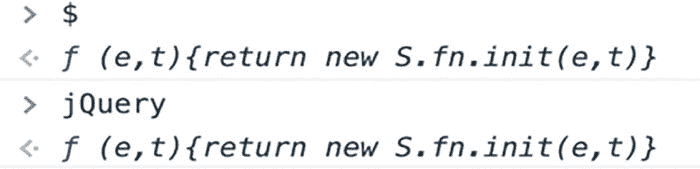
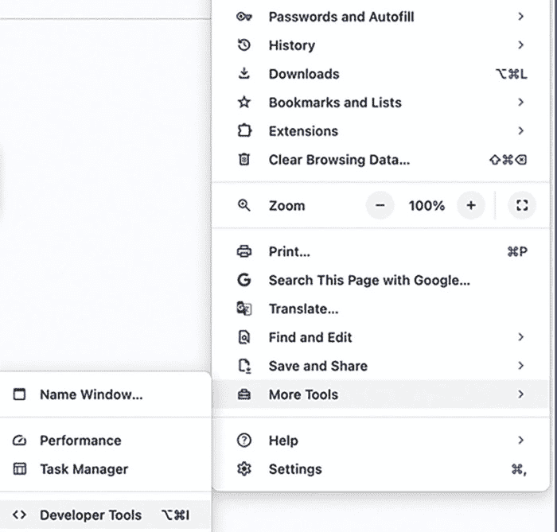
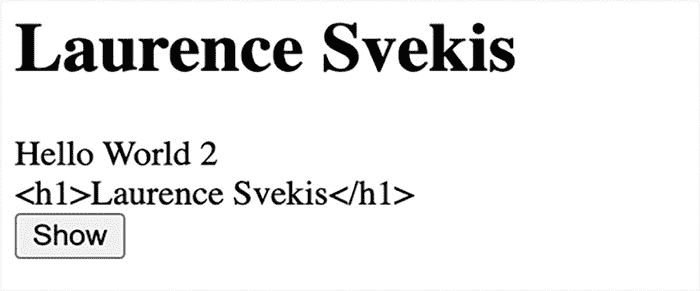
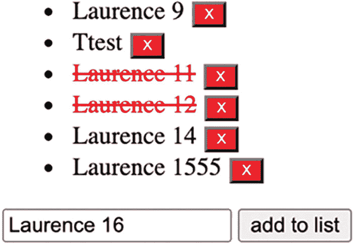
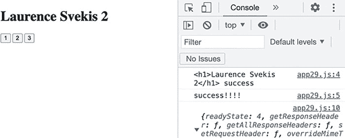

# Web 应用开发现代 jQuery 终极指南


通过 jQuery 和 JavaScript 的无缝 DOM 纵、动画和 AJAX 集成


[www.orangeava.com](http://www.orangeava.com)


[www.orangeava.com](http://www.orangeava.com)

# 献给
Alexis 和 Sebastian Svekis
感谢你们的支持

# 关于作者
`Laurence Svekis` 是一位备受尊敬的 Web 开发者、在线教育者和企业家，因他在技术和数字学习领域的动态贡献而闻名。在开发 Web 应用方面拥有超过二十年的职业生涯，他已成为在线教育领域的基石，教授编程课程并与全球观众分享他丰富的知识。

Laurence 在 Web 开发领域的历程以他早期采用并精通各种编程语言为标志，包括对 `JavaScript` 的卓越熟练。他的专业知识扩展到 `Google Workspace` 的复杂功能中。

作为一名在线讲师，Laurence 编写了大量课程，涵盖了 Web 开发的广泛主题。这些课程不仅全面，而且设计为让处于编码之旅不同阶段的学习者（从初学者到高级从业者）都能理解。他对教育的投入体现在他全球范围内超过一百万学生的成就上，这证明了他的教学方法的影响力和范围。

除了在线课程外，Laurence 还作为畅销书作者留下了自己的足迹。他的出版物与其教学理念产生共鸣，为读者提供了实用的见解，并引导他们清晰、轻松地应对 Web 开发和编程的复杂性。

Laurence 对技术和创新的热情不仅止于教学和写作。他内心也是一个企业家，不断探索 Web 技术的新领域，并开发解决现实世界挑战的解决方案。他对于分享知识和赋予他人利用技术力量的热情，凸显了他作为数字世界领导者和远见者的角色。

总而言之，`Laurence Svekis` 顶顶尖 Web 开发者、有影响力的在线教育者、畅销书作者和富有启发性的企业家。他的贡献不仅丰富了 Web 开发领域，还为无数学习者在数字蓝图中释放他们的潜力铺平了道路。

# 关于技术评审员
`Siddharth Shrivastava` 是 `HCLTech` 的资深前端技术主管，专门负责创建可访问和包容性的产品，以及为 Web 定制的数字体验。他在技术领域的历程始于 2014 年，在过去的 9 多年变革岁月里，他为美国的金融科技、电信和银行客户构建了软件。

Siddharth 的演变使他从制作网站变为精通动态前端技术。目前，在 `HCL`，他协调将原型转换为充满活力的界面，将技术实力与软件生命周期相结合。他的工作不仅展示了技术专长，还为优秀客户的产品带来了巨大的价值。

在搬到美国之前，Siddharth 在印度的一家金融科技客户工作，在金融科技领域积累了宝贵的经验，并理解了合性和数据驱动的开发。在此之前，他曾在一家电信客户工作，将网站从 `Angular` 迁移到 `React`。Siddharth 的职业始于 `Cognizant`，担任使用 `C#`、`JavaScript` 和 `Angular` 的全栈工程师。

`Siddharth Shrivastava` 的故事是一个不断学习、创新和对技艺奉献的故事。他的工作反映了他的信念：问题是尽力而的机会，以及他通过技术专长交付巨大价值的承诺。

# 致谢
我深感谢许多人士，他们的专业知识、见解和鼓励对于本书的创作不可或缺的。首先，向 `jQuery` 社区和所有参与者表示由衷的感谢。

我还要感谢 Web 开发领域的同行教育者和学生，他们的问题和挑战很大地启发了我。他们好奇心和对学习的渴望推动着使每一章（从 `jQuery` 基础到高级 `AJAX` 方法）变得既有启发性又易于理解。

最后，我的孩子理应巨大的感激，感谢他们在写作和修订的无数小时中给予的坚定不移的支持和耐心。这本书不仅是我知识的反映，也是我们共同珍爱的 Web 开发热情的见证。

我们共同创作了本指南，我希望它能够赋能并激励开发者在动态的 jQuery 世界中前进。

# 序言
本书是对 `jQuery` 的简洁而深入的探索，从基础语法和如何将其嵌入 HTML 文件开始，扩展到动态内容更新 `AJAX` 等高级主题。每一章都循序渐进地建立在前章的基础上，涵盖了元素选择、动画、DOM 操作等，并以在现实背景下应用所学的实践项目作为结束。


本章重点在于掌握页面元素的选择与操作，以及文档对象模型（DOM）的导航。它从 jQuery 基础选择器的基本知识开始，通过标签、类或 ID 目标元素。随后，继续介绍属性选择器和伪选择器的复杂用法，以实现更精确的元素定位。此外，还深入探讨了 jQuery 的遍历技术，用于动态元素操作。本章最后对元素过滤（Filtering）进行了深入研究，这对于创建复杂且响应式的 Web 界面至关重要。

本章解释了如何使用 jQuery 的内置方法在网页上隐藏和显示元素，以及如何创建动画效果。在 Web 开发领域，控制可见性并为页面元素添加动画效果可以将静态网站转变为交互且引人入胜的体验。jQuery 提供了一系列强大的方法来实现这一点，为创建动态网页内容开启了无限可能。在本章中，我们将探索这些方法，从简单的隐藏和显示技术到更高级的淡入和滑动效果，使你掌握赋予网页生命的技能。

本章涵盖了如何使用 jQuery 纵网页元素的内容，以及如何向网页中添加新元素。深入探索利用 jQuery 力量操作网页元素内容和插入新元素的精彩世界。无论你是资深 Web 开发者还是初学者，掌握这些技术都将显著提升你创建动态交互式网页的能力。

本章涵盖了如何使用 jQuery 的 DOM 操作方法来处理和选择网页上的元素。深入探究使用 jQuery 进行文档对象模型（DOM）操作和选择的世界。在之前介绍的基础概念基础上，我们将探索动态修改网页结构的高级技术。到本章结束时，你将彻底理解如何利用 jQuery 的力量来有效地操作 DOM。

本章提供了一个实战项目，教导读者如何使用 jQuery 创建带有交互元素的动态列表。开启一个使用 jQuery 的实际项目，我们将在其中创建一个带有交互元素的动态列表。该项目将允许读者应用 jQuery 知识来构建一个可在 Web 应用程序中使用的真实交互功能。让我们开始吧！

本章解释了如何使用 jQuery 获取和设置 CSS 属性以及元素属性。我们将探索如何使用 jQuery 处理 CSS 属性和元素属性。这些知识对于动态修改网页元素的外观和行为非常重要。

本章涵盖了如何使用 jQuery 的遍历方法来遍历和选择页面元素。我们将探索使用 jQuery 遍历和选择页面元素的高级技术。这些方法允许读者高效地导航 DOM 树，并根据关系、属性和状态选择特定元素。

本章重点介绍两个重要的 jQuery 方法：`data()` 和 `index()`。这些方法在增强页面元素操作效率方面起着重要作用。本章探讨了 `data()` 方法，它能够向元素附加并从中检索自定义数据——这一功能对于存储状态信息或元数据特别有用。本章详尽解释了 `data()` 在存储和访问关联数据方面的用法。相反，`index()` 方法被介绍为获取元素相对于其兄弟元素索引位置的工具，有助于在列表或元素组中的特定操作。

本章提供了使用 jQuery 处理事件的全面指南，这是开发动态 Web 应用程序的关键元素。它首先概述了 JavaScript 事件模型，然后深入探讨了 jQuery 绑定和触发事件的能力。读者将学习如何利用各种 jQuery 事件方法，如 `.click()`、`.hover()`、`.submit()` 和 `.keypress()`，来实现有效的用户交互管理。书中还涵盖了高级技术，包括针对动态创建元素的事件委托（event delegation）以及使用 `.on()` 方法绑定多个事件。

本章深入探讨 jQuery 中的高级事件处理技术，强调了高效使用 `.on()` 方法进行动态事件管理。通过交互式练习，本章引导读者掌握事件绑定的复杂性，增强他们创建强大的 Web 交互的能力。书中深入探讨了事件冒泡和传播等核心概念，为理解它们在事件行为中的重要作用提供了清晰的见解。

本章深入探讨了 jQuery 中的 AJAX 方法和回调选项——这是开发交互和响应式 Web 应用程序的关键方面。AJAX（异步 JavaScript 和 XML）允许在不刷新整个页面的情况下更新 Web 内容，通过快速响应提升用户体验。jQuery AJAX 功能的石是 `$.ajax()` 方法，它促进了 HTTP 请求的发送和服务器响应的处理。

# 下载代码
代码包和彩色图片

请点击链接或扫描二维码下载本书的代码包和图片：

# [`github.com/ava-orange-education/Ultimate-Modern-jQuery-for-Web-App-Development`](https://github.com/ava-orange-education/Ultimate-Modern-jQuery-for-Web-App-Development)


本书的代码包和图片也托管在

[`rebrand.ly/mhy967`](https://rebrand.ly/mhy967)


如果代码有更新，将在现有 GitHub 仓库中更新。

# 说明 (Errata)
我们对 Orange Education 的工作非常自豪，并遵循最佳实践以确保内容的准确性，为订阅者提供沉浸式的阅读体验。读者是我们的镜子，我们利用他们的反馈来反映并改进出版过程中可能出现的任何人为错误。为了让我们维持质量并帮助任何因不可见错误而遇到困难的读者，请邮件联系我们：errata@orangeava.com

感谢您的支持、建议和反馈。

# 你知道吗
你知道 Orange Education Pvt Ltd 为出版的每本书提供了 eBook 版本，并提供 PDF 和 ePub 文件吗？你可以在 [www.orangeava.com](http://www.orangeava.com) 升级到 eBook 版本，作为纸书客户，你有权获得 eBook 的折扣。更多详情请联系我们：info@orangeava.com。


在 `[www.orangeava.com](http://www.orangeava.com)`，您还可以阅读到系列免费技术文章，订阅一系列免费时通讯，并获取 AVA™ 图书和电子书的独家折扣和优惠。

# 盗版

如果您在互联网上发现任何形式的我们作品的非法复制，如果您能向我们提供所在地地址或网站名称，我们将不胜感激。请通过 `info@orangeava.com` 联系我们并附上相关材料的链接。

# 您有兴趣与我们合作写作吗？

如果您在某个领域拥有专长，并且对编写或贡献书籍感兴趣，请发送邮件至 `business@orangeava.com` 与我们联系。我们致力于帮助开发者和技术专业人员洞察全球范围内的技术进步和创新，并建立一个相信“知识通过与他人分享和学习获得最好”的社区。请与我们联系，了解我们受众的需求以及您将如何成为这场教育改革的一部分。我们还欢迎技术专家的想法，并帮助他们为自己的领域构建学习和开发内容。

# 评论

请留下评论。在您阅读并使用此书后，为什么不在您购买的网站上发表评论呢？潜在读者可以查看并利用您的中立意见做出购买决策。Orange Education 成员想知道您对我们产品的看法，我们的作者也可以从您的反馈中学习。感谢您！

有关 Orange Education 的更多信息，请访问 `[www.orangeava.com](http://www.orangeava.com)`。


欢迎来到 jQuery 的介绍章节，jQuery 是一个重新定义 Web 开发的 JavaScript 库。在本章中，我们将开启进入 jQuery 世界之旅，理解它的重要性以及为什么它是现代 Web 开发中至关重要的工具。我们将引导您完成下载并将 jQuery 无缝集成到项目中的过程，确保您配备了必要的资源。此外，我们将探索通过内容分发网络 (CDN) 使用 jQuery 的概念，以实现更快的加载和增强的可靠性。在本章结束时，您将拥有利用 jQuery 力量的坚实基础，以创建吸引用户并简化您的开发工作流的动态交互 Web 应用程序。让我们开始进入 jQuery 世界之旅吧。
# 结构 (#toc.xhtml_s2a)


*   开始使用 jQuery 及其原理
*   通过 CDN 使用 jQuery


在 Web 开发的动态格局中，创建交互且引人注目的用户体验已至关重要。随着网站和 Web 应用程序演进以满足用户日益增长的需求，开发者寻找能够简化为项目添加交互性和响应能力过程的工具。这就是 jQuery 登场的地方——这是一个多功能且强大的 JavaScript 库，它彻底改变了开发者处理客户端脚本的方式。

为了充分理解 jQuery 的影响，理解它出现的背景至关重要。在 Web 开发的早期，JavaScript 主要用于表单验证和基础交互等简单任务。然而，随着 Web 应用程序变得越来越复杂，用户预期也不断提高，开发者面临着跨浏览器兼容性和复杂的 DOM 操作的挑战。这些障碍导致了 jQuery 的诞生。


传统的 DOM 操作需要冗长的代码，并需要仔细考虑跨浏览器的差异。jQuery 通过提供一致的 API 抽象了浏览器的特殊性，解决了这一挑战。开发者现在可以轻松地定位并修改元素，极大地缩短了此类任务所需的时间精精力。
Web 开发中重大的痛点之一是确保网站在各种浏览器中都能无缝运行。jQuery 在标准化行为方面发挥了关键作用，使开发者能够编写出在不同浏览器中表现一致的代码。


使用原生 JavaScript 创建动画和添加视觉效果是一项复杂的工程。jQuery 的动画能力抽象了这些复杂性，允许开发者以最少的精力创建出引人注目的动画和过渡。

处理用户交互和事件是 Web 开发的基石。jQuery 引入了一个直观的事件处理系统，简化了绑定事件监听器和响应用户操作，增强了 Web 应用程序的交互性。


jQuery 让构建交互动态的 Web 内容变得简单。有了 HTML 和 CSS 的基础知识，你就可以开始创建吸引人的内容。jQuery 只是一个 JavaScript 库，JavaScript 知识对于理解和调试代码很有帮助。
jQuery 为 Web 开发者提供了一个易用的解决方案，用于添加平滑动画、处理网页交互和事件、导航页面元素进行选择、更新和修改元素属性及内容，并为数据发送 AJAX 请求。


jQuery 的核心是一个快速、小型且功能丰富的 JavaScript 库。它的主要目标是简化 DOM 操作和事件处理过程，让开发者能够轻松创建出惊的用户体验。通过清晰简洁的语法，jQuery 抽象了原生 JavaScript 的复杂性，允许开发者用更少的代码实现卓越的效果。

jQuery 允许 Web 开发变得精简化。当我们考虑到 jQuery 出现之前开发者面临的挑战时，它的重要性就显而易见了。当时的 Web 开发领域一直受到浏览器不兼容、复杂的 DOM 操作以及创建吸引人的动画和特效的艰巨任务的困扰。jQuery 解决了这些痛点以及更多问题。

考虑在网页上选择和操作 HTML 元素的常见任务。在原生 JavaScript 中，这是一个繁琐的过程，涉及针对不同器的不同方法。jQuery 简化了这一过程，提供了一个统一的 API 来选择、遍历和修改 DOM 元素。
```javascript
// Raw JavaScript
const element = document.getElementById(“myElement”);
element.style.color = “red”;

// jQuery equivalent
```


处理用户交互和事件是现代 Web 应用的基础。jQuery 提供了一种了一贯且直观的方法来绑定事件监听器并响应用户操作。

```javascript
// Raw JavaScript
button.addEventListener(“click”, function() {
  console.log(“Button clicked!”);
});

$(“#myButton”).click(function() {
  console.log(“Button clicked!”);
});
```


创建动画和特效曾是一项复杂的工程。jQuery 的动画方法简化了这个过程，让开发者能够轻松创建具有视觉吸引力的过渡效果。

```javascript
const element = document.getElementById(“animatedElement”);
element.style.transition = “width 2s”;
element.style.width = “300px”;

$(“#animatedElement”).animate({ width: “300px” }, 2000);
```


以下是选择 jQuery 的一些引人理由：

Web 开发中最令人沮丧的挑战之一是确保你的代码在不同浏览器中都能一致运行。jQuery 抽象了浏览器差异，为用户提供了一致的体验。

jQuery 的插件架构导致了大量插件库的创建，为各种功能提供了现成的解决方案，从表单验证到复杂的 UI 组件。

通过简化复杂任务并减少所需的代码量，jQuery 显著提高了开发者的生产力，让他们能够专注于 Web 开发的创意方面。

- 学习曲线
jQuery 直观的语法和文档良好的 API 即使对于刚接触 JavaScript 的开发者来说也易上手，加速了他们的学习曲线，并使他们更快地创建印象深刻的 Web 应用。

随着你深入学习这本书，你将发现 jQuery 方法的细节，探索真实的用例，并掌握构建迷人 Web 应用的艺术。jQuery 不仅仅是一个库；它是释放交互式 Web 开发潜力的门户。所以，让我们共同开启这段旅程，充分利用 jQuery 的力量在网页上打造卓越的用户体验。


现在我们已经了解了 jQuery 的力量，是时候配备我们所需的工具来发挥它的潜力了。我们将引导你完成获取 jQuery 库并将其无缝集成到 HTML 文件中的过程。jQuery 有多个版本，推荐使用最新的 `3.*` 版本。jQuery 设计用于简化 HTML DOM 树的遍历和页面元素的操作。它提供了创建 CSS 动画以及处理事件和 AJAX 请求的优秀方法。


在开始使用 jQuery 之前，我们需要获取库本身。坦率，可以从官方网站轻松获取 jQuery，方法如下所示：

- 直接下载：访问 jQuery 官方网站 [`jquery.com/download/`](https://jquery.com/download/) 并选择你想要使用的 jQuery 版本。你可以下载库的压缩版本或未压缩版本。
建议使用压缩版本，因为可以节省带宽，且删除空格后文件大小更小。未压缩版本仅用于调试。
- 内容分发网络 (CDN)：或者，你可以直接从 CDN 引入 jQuery。这样做的好处是，如果用户已经访问过其他使用相同 CDN 的网站，可能会缩短他们的加载时间。
CDN 资源地址：[`developers.google.com/speed/libraries#jquery`](https://developers.google.com/speed/libraries#jquery)


一旦你下载了 jQuery 库，就需要将其集成到你的 HTML 文件中。这里是分步指南：

1. **创建一个新文件夹**：组织你的项目文件，并在项目目录内创建一个名为 `js` 的新文件夹。这就是我们存储 jQuery 文件的地方。
2. **放置 jQuery 文件**：将下载的 jQuery 文件（例如 `jquery-3.6.0.min.js`）移动到你创建的 `js` 文件夹中。
`<script src="js/jquery-3.6.0.min.js"></script>`
这段代码告诉浏览器从指定位置加载 jQuery 库。如果你的项目结构不同，请务必调整路径。

# 验证 jQuery 集成


```html
<script>
// jQuery test
$(document).ready(function() {
  alert(“jQuery is working!”);
</script>
```
这段代码创建了一个简单的 jQuery 脚本，在文档准备绪绪触发警报。当你在浏览器中加载 HTML 文件时，你应该能看到一个显示 `jQuery is working!` 消息的警告框。

你也可以使用浏览器编辑器检查 jQuery 是否已加载。在浏览器控制台中使用 `$` 或 `jQuery` 来检查 jQuery 是否就绪：


**图 1.1:** 使用 $ 或 jQuery 检查 jQuery 是否就绪

恭喜！你已经成功下载并将 jQuery 集成到你的 Web 项目中。现在 jQuery 已无缝集成到你的开发工作流中，你正处于创建动态、交互且具有视觉吸引力的 Web 应用的道路上。在接下来的章节中，我们将深入探讨 jQuery 的功能，并学习如何运用其能力来打造令人深刻的用户体验。


当我们深入探索 jQuery 世界时，探索访问和使用这一强大库的替代方法至关重要。除了本地下载 jQuery 文件外，我们还可以利用 CDN（内容分发网络）的能力简化集成过程并优化 Web 应用程序的性能。在本节中，我们将深入探讨 CDN 的概念，以及在将 jQuery 整合到网页中时如何利用它的优势。


通过 CDN 引入 jQuery 有许多优势，可以增强您的 Web 应用程序的性能和可靠性：

*   CDN 将内容分发到多个服务器，允许浏览器从最近的服务器获取资源。这最小程度地减少了数据传输的距离，从而实现了更快的加载速度和更好的用户体验。
*   CDN 针对缓存进行了优化，当用户访问使用 CDN 托管 jQuery 版本的网站时，他们的浏览器可能已经从之前访问其他网站时缓存了 jQuery 文件。这减少了冗余下载并提高了浏览器的整体效率。

要使用 CDN 将 jQuery 包含在您的项目中，您不需要下载任何文件。相反，您可以直接从 CDN 服务器引用该库。以下是操作方法：

```html
<!-- 从 Google CDN 引入 jQuery -->

<!-- 从 Microsoft CDN 引入 jQuery -->
<script src="https://ajax.aspnetcdn.com/ajax/jQuery/jquery-3.6.0.min.js"></script>
```


通过 CDN 引入 jQuery，您利用了一个专门用于优化网络内容交付的全球服务器网络。这种方法增强了您的 Web 应用程序的加载速度和整体性能，同时也减轻了自身托管资源的负担。

以下是关于如何向 HTML 中添加 jQuery 并使用 jQuery 创建简单的元素选择、事件和元素内容操作的逐步指南：


1.  创建一个 HTML 文件并添加一个页面元素。
2.  添加指向 jQuery 库的 `<script>` 标签链接。
3.  添加第二个 `<script>` 标签链接到名为 `app1.js` 的新 `js` 文件。
4.  在浏览器中打开 HTML 并检查页面上是否有 jQuery。
6.  添加一个名为 `.html()` 的 jQuery 方法。
7.  在 `.html()` 中添加一个字符串值。
8.  为元素添加 `on('click')`，并将 `html` 的更新嵌套在其中。
9.  在点击方法上链式添加第二个 `.html()`，并传入另一个字符串值。


```html
<!DOCTYPE html>
<html>
    <title>jQuery Course</title>
</head>
<body>
    <div>Hello World</div>
    <script src="https://ajax.googleapis.com/ajax/libs/jquery/3.6.0/jquery.min.js"></script>
</body>
</html>
```

**APP1.JS**

$('div').on('click',() => {
    $('div').html('Laurence Sveis');
}).html('Click Me');
```


1.  **文档就绪 (Document Ready)**
    当文档完全加载并准备绪时运行代码：
    ```javascript
        //在此处编写您的代码
    });
    ```

2.  **点击事件 (Click Event)**
    ```javascript
    $("#myButton").click(function() {
        //在此处编写您的代码
    });
    ```
3.  **隐藏与显示 (Hide and Show)**
    切换元素的可见性：
    ```javascript
    $("#toggleButton").click(function() {
    });
    ```

4.  **添加 CSS (Adding CSS)**
    更改元素的 CSS 属性：
    $("#myElem").css("color", "blue");
    ```

5.  **添加类 (Adding Classes)**
    为元素添加 CSS 类：
    $("#myElem").addClass("highlight");
    ```

6.  **淡入淡出效果 (Fading Effects)**
    对元素应用淡入效果：
    $("#myButton").click(function() {
        $("#targetElem").fadeIn();
    });
    ```
    ```javascript
        $("#targetElem").fadeOut();
    });
    ```

    对元素应用滑动效果：
    ```javascript
    $("#myButton").click(function() {
        $("#targetElem").slideDown();
    });
    ```javascript
    $("#myButton").click(function() {
        $("#targetElem").slideUp();
    });
    ```
8.  **AJAX 请求 (AJAX Request)**
    从服务器获取数据而无需刷新页面：
    ```javascript
    $.ajax({
        url: "data",
            // 处理数据
        },
        error: function() {
            // 处理错误
        }
    ```

9.  **鼠标悬停 (Mouse Hover)**
    当进入或离开元素时执行操作：
    ```javascript
        function() {
            // 鼠标进入
        },
        function() {
            // 鼠标离开
    );
    ```

10. **动画 (Animations)**
    使用 jQuery 的 animate 方法创建动画：
    $("#myButton").click(function() {
        $("#targetElem").animate({
            width: "200px",
            height: "200px"
        }, 1000); // 动画时长，毫秒
```

这些示例为探索 jQuery 功能提供了良好的起点。请记住，jQuery 提供了用于操作 DOM、处理事件、发送 AJAX 请求和创建动态动画的各种方法和函数。当你熟悉了这些基础知识后，就准备好进入更复杂的场景并构建应用程序了。

# 浏览器开发者工具
使用 Chrome 开发者工具（DevTools）是交互和理解网页的一种强大方法。以下是如何使用的简要说明：

1.  **访问开发者工具**：打开 Chrome 并导航到想要检查的网页。在页面任意位置右键点击并选择“检查”，或使用快捷键 *Ctrl+Shift+I*（Mac 上为 *Cmd+Opt+I*）。这将打开面板。
2.  **元素面板 (Elements)**：此面板允许查看和修改页面的 HTML 和 CSS。你可以检查 DOM、修改样式并查看这些更改对网页布局和外观的影响。
3.  **控制台 (Console)**：控制台标签用于在 JavaScript 开发过程中记录信息。你也可以通过直接执行 JavaScript 命令与网页交互。
5.  **网络面板 (Network)**：它提供了有关当前页面网络活动的信息。你可以看到每个请求的文件、其加载时间以及标头、响应负载和 HTTP 状态码等详细信息。
6.  **性能面板 (Performance)**：使用此面板分析网页的运行时性能。它帮助理解渲染、脚本执行和加载页面所消耗资源和时间。


8. **审计面板 (Audits Panel)**：现在被称为 Lighthouse，该工具会对页面进行分析，并生成关于性能、可用性、渐进式 Web 应用（PWA）、SEO 等报告。

9. **设备模式 (Device Mode)**：模拟你的网页在不同设备和屏幕尺寸下的显示和行为。

10. **个性化与设置 (Customization and Settings)**：自定义 DevTools 以适应你的工作流。你可以将面板固定在屏幕的不同部分、更改主题，甚至添加扩展以获得额外功能。



**图 1.2：** DevTools

这些工具对于 Web 开发、调试以及学习更多 Web 技术非常有帮助。请记住，这只是一个概述；每个面板都提供了深层功能供探索。

## 结论
当我们结束这个介绍性章节时，你已经迈出了进入 jQuery 世界的第一步，这个工具将彻底改变你的 Web 开发方式。你已经掌握了 jQuery 的精髓以及它在现代 Web 开发中不可或缺的原因，并获得了将其无缝集成到你项目中的实用技能。无论你选择下载 jQuery 还是利用内容传输网络（CDN）的效率，你现在都拥有利用 jQuery 力量的关键资源。旅程刚刚开始，接下来的章节将深入探讨 jQuery 的功能，让你能够构建迷人的、交互式的 Web 应用，同时简化你的开发工作流。所以，系好安全带，jQuery 的冒险才刚刚开始，还有许多可以探索和创造的内容。

接下来的章节将深入探索使用 jQuery 进行网页操作，从理解文档对象模型（DOM）开始，DOM 是一种表示网页元素的树形结构。该章节对于 Web 内容操作至关重要，它解释了 jQuery 多能的选择器，这些选择器通过属性、ID、类或关系来定位 HTML 元素，并附有完整的语法和示例。随后它将深入研究操作这些选中的元素，详细介绍了如何修改内容、样式和属性，并讨论了从 DOM 中添加或删除元素。此外，它涵盖了 jQuery 的 DOM 遍历方法，用于根据关系上下文遍历 DOM 树定位元素，这对于动态内容操作至关重要。该章节还引入了 jQuery 的事件处理，说明了如何与点击和键盘输入等用户操作交互，从而增强网页的交互性。此外，它强调了链式调用多个 jQuery 方法的力量，以实现简洁且易读的代码。最后，它对在 DOM 操作中使用 jQuery 的最佳实践进行了总结，强调了性能和可维护代码的重要性，为希望通过 jQuery 增强其 Web 开发技能的开发者提供了全面的指南。

# 第 2 章
## jQuery 页面元素选择与 DOM 元素选择

## 引言

欢迎来到至关重要的章节，我们将深入探讨 jQuery 的核心：选择页面元素和遍历文档对象模型（DOM）的艺术。在本章中，我们将探索 jQuery 核心的基础工具，从通过标签、类或 ID 定位元素的基础选择器（Basic Selectors）开始。我们将进展到属性选择器（Attribute Selectors）和伪选择器（Pseudo Selectors），揭示根据属性或状态精确定位元素的更复杂方法。此外，我们将通过 jQuery 的遍历技术遍历 DOM，增强我们动态查找和操作元素的能力。最后，我们以元素过滤（Filtering Elements）结束课程，为针对更复杂、更响应式的 Web 界面精炼选择提供更深入的理解。
## 结构

在本章中，我们将讨论以下主题：

* 基础选择器
* 伪选择器
* 使用 jQuery 遍历 DOM 元素
* 使用 jQuery 过滤元素

## 使用 jQuery 选择页面元素与 DOM 元素选择
在 Web 开发领域，选择和操作 DOM 元素的能力是至关重要的。jQuery 为开发者提供了强大的工具，可以轻松导航和操作文档对象模型（DOM），从而实现动态且丰富的 Web 体验。在本章中，我们将深入研究使用 jQuery 选择 DOM 元素的艺术。

### 基础选择器

在网页上选择元素是 jQuery 能力的核心。基础选择器允许你通过 HTML 标签、类和 ID 定位元素。以下是实现方法的概览：
```javascript
// 按标签选择
$("p") // 选择所有 <p> 元素

// 按类选择

// 按 ID 选择
$("#header") // 选择 ID 为“header”的元素
```


1. 创建一个 HTML 文件进行交互，其中包含带有 ID 和类的元素。
2. 使用标签、类和 ID 选择元素。将 jQuery 元素对象输出到控制台。
3. 创建变量并分配 jQuery 元素对象，将其输出到页面。


```html
<!DOCTYPE html>
<html>
<head><title>jQuery 课程</title></head>
<div>Hello World 1</div>
<div class="div2">Hello World 2</div>
<div id="div3">Hello World 3</div>
<script src="https://ajax.googleapis.com/ajax/libs/jquery/3.6.0/jquery.min.js"></script>
<script src="app2.js"></script>
</html>
```

**APP2.JS**

console.log($("div"));
$("div").html("Hello");
console.log($(".div2"));
console.log($("#div3"));
console.log($("#div3, .div2"));
const $ele1 = $("div");
$ele1.html("Hello 2");
const $ele2 = $(".div2");
console.log($ele2);
const $ele3 = $("#div3");
console.log($ele3);
console.log($ele4);
```

### 属性选择器

属性选择器允许你根据属性及其值定位元素。这在处理输入验证和自定义时特别有用：

```javascript
// 按属性选择
$("input[type='text']") // 选择所有文本输入

// 选择特定属性
$("[data-toggle]") // 选择带有“data-toggle”属性的元素
```
**练习**：使用属性选择：

**HTML：**

```html
<html lang="en">
<head>
<meta charset="UTF-8">
<meta name="viewport" content="width=device-width, initial-scale=1.0">
<title>属性选择器示例</title>
</head>
<body>
<h1>属性选择器示例</h1>
<button data-toggle="modal">打开模态框</button>
<button data-toggle="sidebar">打开侧边栏</button>
</body>
</html>
```

**JavaScript (script.js):**
```javascript
$(document).ready(function() {
  // 为带有 data-toggle 属性的元素绑定点击事件
  $("[data-toggle]").click(function() {
    const target = $(this).data("toggle");
  });
});
```


要运行此练习，请在同一目录下创建 HTML 和 JavaScript 文件，并在网页浏览器中打开 HTML 文件。当你点击 `Open Modal` 或 `Open Sidebar` 按钮时，你将看到一个弹窗消息，指示哪个元素被切换了。此练习演示了如何使用属性选择器根据数据属性来定位元素。

## 伪选择器 (Pseudo Selectors)
伪选择器根据元素状态提供动态选择，例如 `:hover`、`:first-child` 和 `:nth-child`：

```javascript
// 选择 <ul> 内部第一个 <li> 元素
$("ul li:first-child")

```javascript
// 选择表格中奇数的 <tr> 元素
$("table tr:nth-child(odd)")
```
**练习**：使用 jQuery 选择第一个列表项并将其背景颜色更改为蓝色：

**HTML:**

```html
<html lang="en">
<head>
<meta charset="UTF-8">
<meta name="viewport" content="width=device-width, initial-scale=1.0">
<title>Change CSS with jQuery</title>
</head>
<<body>
<h1>Change CSS with jQuery</h1>
<ul>
<li>Item 1</li>
<li>Item 3</li>
</ul>
<script src="script.js"></script>
</body>
</html>

**JavaScript (script.js):**

```javascript
$(document).ready(function() {
  $("ul li:first-child").css("color", "blue");
});
```

在此示例中，我们有一个包含三个列表项的无序列表。`script.js` 文件中的 jQuery 代码使用选择器 `$("ul li:first-child")` 来定位第一个列表项。然后使用 `.css()` 方法将第一个列表项的文本颜色更改为蓝色。

要运行示例，请在同一目录下创建 HTML 和 JavaScript 文件，并在网页浏览器中打开 HTML 文件。你将看到一个带有三个项目的列表，且第一个项目的文本颜色将变为蓝色。此示例演示了如何使用 jQuery 更改列表中特定元素的 CSS 属性。

## DOM 遍历 (DOM Traversal)

jQuery 简化了在 DOM 层级中导航的过程，允许你轻松遍历父元素、子元素和兄弟元素：

```javascript
// 选择元素的父元素
$("#childElement").parent()

```javascript
// 选择元素的所有直接子元素
$("ul").children()
```
```javascript
// 选择元素的下一个兄弟元素
$(".current").next()
```


**练习**：向父 HTML 元素向上移动，遍历到选中元素的祖先节点。

1. 选择按钮元素，并在点击时输出 `parent()` 和 `parents()` 的长度。
2. 使用 `parentsUntil()` 选择该元素的祖先，并选择一个元素作为停止点。

**HTML:**

```html
<!DOCTYPE html>
<head><title>jQuery Course</title>
<style>
.box{
width:200px;
border:5px solid #ddd;
margin:10px;
}
</style>
</head>
<body><nav class="main">
<div class="div1">Hello World 1</div>
<div class="div2"><span>Hello World 2</span></div> <div class="div3" id="div3">Hello World 3</div> <div class="div4">Laurence Svekis</div>
<input >
<div class="main">
<button id="btn1">1</button>
</div>
<button id="btn1">3</button>
</div></nav>
<button id="btn1">4</button>
<script src="https://ajax.googleapis.com/ajax/libs/jquery/3.6.0/jquery.min.js"></script>
</body>
</html>
```

**app14.js**

$('#btn1').click(function(){
  console.log($(this).parent().length);
  console.log($(this).parents().length);
  console.log($(this).parents());
  console.log($(this).parentsUntil('.main'));
$('#btn2').click(function(){
  $(this).parents('.main').each(function(){
    addClass('parent');
  })
```


通过过滤符合特定条件的元素来完善你的选择。这提高了操作网页部分的精确性：

- 按偶数元素过滤：`$("even")`
- 按包含文本的元素过滤：`$("contains('jQuery')`
**练习**：使用过滤选择特定元素并遍历：

1. 为五个按钮添加点击事件。
2. 点击第一个按钮时，选择元素集合，然后使用 `first()`、`last()` 和 `eq()` 根据集合的位置选择特定元素，并对其应用样式。
3. 点击第二个按钮时，使用 `filter()` 选择匹配的结果并对其应用样式。
5. 对于第四和第五个按钮，尝试使用 `filter()` 和 `not()` 的变体来选择元素并对其应用样式。

**HTML:**

```html
<html lang="en">
<head>
<title>jQuery Course</title>
<style>
.box {
border:1px solid #ddd;
color: red;
}
.box1 {
border:1px solid #ddd;
padding:5px;
}
.box2 {
border:1px solid #ddd;
padding:5px;
color: green;
</style>
</head>
<body><nav>
<div class="main">
<div class="div1">Hello World 1</div>
<input>
<button id="btn1">1</button>
<button id="btn2">2</button>
<button id="btn3">3</button>
<span>Hello</span>
</div></nav>
<button id="btn5">5</button>
<script src="https://ajax.googleapis.com/ajax/libs/jquery/3.6.0/jquery.min.js"></script>
<script src="app16.js"></script>
</body>
</html>

**app16.js**

```javascript
$('#btn1').click(function(){
  $main = $(".main").children();
  $main.first().css('color', 'red');
  $main.last().css('color', 'blue');
  $main.eq(7).css('color', 'green');
  $main.eq(6).css('background-color', 'green');
$('#btn2').click(function(){
  $main = $(".main").children();
  $btns = $main.filter('button');
  $main.filter('button').css('background-color', 'black'); $btns.css('color', 'white');
})
  $main = $(".main").children();
  $btns = $main.not('button');
  $main.not('button').css('background-color', 'purple'); $btns.css('color', 'white');
})
$('#btn4').click(function(){
$('#btn5').click(function(){
  $(".main div").filter('div').css('color', 'green'); })
```

## 方法链 (Chaining Methods)
jQuery 的优势之一在于它的方法链调用，它允许你将多个方法组合成单行简洁的代码：

```javascript
// 使用链式方法来选择并操作元素
$("#myElement").addClass("highlight").slideUp(1000);
```
**练习**：如何将多个方法链在一起：

**HTML:**

```html
<html lang="en">
<head>
<meta charset="UTF-8">
<meta name="viewport" content="width=device-width, initial-scale=1.0">
<title>Chaining Methods with jQuery</title>
</head>
<body>
<h1>Chaining Methods with jQuery</h1>
<div id="box"></div>
<button id="animateButton">Animate</button>
<script src="script.js"></script>
</body>
</html>
```


```javascript
$(document).ready(function() {
  // 为动画按钮绑定点击事件
  $("#animateButton").click(function() {
    $("#box")
      .css("background-color", "blue")
      .animate({ width: "200px" }, 1000)
      .delay(500)
      .fadeOut()
      .slideUp();
  });
});
```


1. 框的背景颜色变为蓝色。
2. 框的宽度在 1 秒内逐渐增加到 200px。
3. 动画暂停 500 毫秒。
4. 框淡出（fade out）然后重新淡入（fade in）。

要运行此示例，请在同一目录下创建 HTML 和 JavaScript 文件，并在网络浏览器中打开 HTML 文件。点击 `Animate` 按钮查看框的动画序列。此示例演示了如何通过链式调用多个 jQuery 方法来在元素上创建一系列操作。

通过熟练掌握 jQuery 选择 DOM 元素的技巧，你完全能够将静态网页转换为动态且引人入胜的体验。无论是在创建动画、处理用户交互还是获取数据，理解元素选择都是至关重要的。选择和操作元素的能力是有效使用 jQuery 的基础。


本章深入探讨了 jQuery 在 Web 开发中的功能，强调了它在 DOM 操作方面的强大之处。我们研究了 jQuery 选择器如何实现 HTML 元素的精确目标，这对于动态 Web 内容的操作至关重要。本章还详细介绍了更改元素内容、样式的实用方法。


### 练习题

3. 为 `div` 添加一个点击事件。当点击时，它应该从点击事件中选择被点击的元素。注意，这会选中嵌套的元素。将 HTML 内容更新为 `clicked`。将元素的文本更新为 `ready`。然后对该元素应用 `hide()` 函数。


**在代码中使用 hide 和 show 的示例：**

**此部分的 HTML 代码：**

<!DOCTYPE html>
<html>
<head><title>jQuery Course</title></head>
<body>
<div>Hello World 1</div>
<div id=”div3”>Hello World 3</div>
<button>Show</button>
<script src=”jquery.min.js"></script>
<script src=”app3.js"></script>
</body>
```

**JavaScript JS 代码：**

```javascript
const val = ‘<h1>Laurence Svekis</h1>’;
$(‘div’).first().html(val);
$(‘div’).last().text(val);
$(‘div’).click((e)=>{
const $el = $(e.target);
$el.html(‘clicked’);
$(e.target).text(‘Ready’);
$(e.target).hide(“slow”);
});
$(‘button’).click((e)=>{
$(‘h1’).show(4000);
});
function eleClicker(e){
console.log(e);
}



**图 3.1：** 练习输出示例


*   `console.log($(‘div’).first());`: 此行使用 jQuery 选择页面上的第一个 `<div>` 元素并将其打印到控制台。
*   `const val = ‘<h1>Laurence Svekis</h1>’;`: 此行创建一个 HTML 字符串，其中包含一个文本为 Laurence Svekis 的 `<h1>` 元素。
*   `$(‘div’).first().html(val);`: 此行选择第一个 `<div>` 元素并将其 HTML 内容设置为存储在 `val` 变量中的值（即用 `<h1>` 元素替换第一个 `<div>` 的内容）。
*   `$(‘div’).last().text(val);`: 此行选择最后一个 `<div>` 元素并将文本内容设置为存储在 `val` 变量中的值（即将最后一个 `<div>` 的文本更改为 Laurence Svekis）。
*   `$(‘button’).click((e) => { … });`: 此代码为按钮元素绑定了点击事件处理器。当点击按钮时，它以快速动画显示所有的 `<div>` 元素，并以 4000 毫秒（4 秒）的持续时间显示 `<h1>` 元素。
*   `function eleClicker(e) { … }`: 这似乎是一个定义的函数 `eleClicker`，它接受事件对象 `e` 作为参数，但在提供的代码中没有使用或调用。

总结来说，JavaScript 代码使用 jQuery 来操作页面上的 HTML 元素，根据用户交互更改它们的内容和行为。代码演示了使用 jQuery 进行基础 DOM 操控和事件处理。


`.toggle()` 方法允许你在每次点击时切换元素的可见性，为创建如可折叠区域等交互元素提供简单的方法：

```javascript
$(“#toggleElement").toggle();

## fadeIn 和 fadeOut 方法

`.fadeIn()`、`.fadeOut()` 和 `.fadeToggle()` 方法用于在可见和隐藏状态之间创建平滑、渐进的过渡。


`.fadeIn()` 方法让元素从不可见平滑过渡到完全可见。你可以指定动画时长：

```javascript
$(“#fadeInElement”).fadeIn(1000); // 1000 毫秒（1 秒）

### .fadeOut(): 渐进消失

相反，`.fadeOut()` 方法让元素逐渐淡出视野。与 `.fadeIn()` 类似，你可以设置动画时长：

$(“#fadeOutElement”).fadeOut(1000);
```

### .fadeToggle(): 切换淡入/淡出


```javascript
$(“#fadeToggleElement”).fadeToggle(1000);
```


`.slideUp()` 方法通过向上滑动元素来隐藏它们。你可以控制动画持续时间：

```javascript
```

### `.slideDown()`：滑动显示

相反，`.slideDown()` 通过向下滑动元素来显示它们。动画持续时间是可以自定义的：
```javascript
$(“slideDownElement”).slideDown(1000);
```

### `.slideToggle()`：切换滑动
`.slideToggle()` 方法在元素向上滑动和向下滑动之间切换。它非常适合创建可折叠区域：

```javascript
$(“slideToggleElement”).slideToggle(1000);
```
### 练习：使用 jQuery 实现滑动效果

1. 隐藏 `show` 按钮。
2. 在隐藏按钮上添加点击事件，使用 `slideUp()` 隐藏页面上所有的 `div`，并调用一个切换两个按钮的函数。
3. 此时第二个 `show` 按钮应该是可见的，为该按钮添加点击事件，使用 `slideDown()` 函数显示所有 `div`。

#### HTML 代码

```html
<div>>Hello World 1</div>
<div id=”div3”>Hello World 3</div>
<button id=”btn1”>Hide</button>
<button id=”btn2”>Show</button>
```


```javascript
$(‘#btn2’).hide();
$(‘#btn1’).click(() => {
  $(‘div’).slideUp(‘slow’, doneFun);
$(‘#btn2’).click(() => {
  $(‘div’).slideDown(‘fast’, doneFun);
});
$(‘div’).click(function() {
  $(this).slideToggle();
function doneFun() {
  console.log(‘slide done’);
  $(‘#btn1’).toggle();
  $(‘#btn2’).toggle();
}
```

这一行初始隐藏 ID 为 `btn2` 的元素。这意味着 ID 为 `btn2` 的按钮在页面加载时是不可见的。

`$(‘#btn1’).click(() => { … });`
这段代码为 ID 为 `btn1` 的元素绑定了一个点击事件处理器。当点击 `btn1` 按钮时，会发生以下操作：

```javascript
$(‘div’).slideUp(‘slow’, doneFun);
```
页面上所有的 `<div>` 元素使用 `slideUp` 方法缓慢向上滑动（花费超过 600 毫秒）。在滑动动画完成后，会调用 `doneFun` 函数。

`$(‘#btn2’).click(() => { … });`

这段代码为 ID 为 `btn2` 的元素绑定了一个点击事件处理器。当点击 `btn2` 按钮时，会发生以下操作：
```javascript
$(‘div’).slideDown(‘fast’, doneFun);
```

页面上所有的 `<div>` 元素使用 `slideDown` 方法快速向下滑动（花费超过 200 毫秒）。在滑动动画完成后，会调用 `doneFun` 函数。
`$(‘div’).click(function() { … });`

这段代码为页面上所有的 `<div>` 元素绑定了点击事件处理器。当点击任何 `<div>` 时，会发生以下操作：

```javascript
```

被点击的 `<div>` 元素会切换其滑动状态。如果目前是隐藏的，它将向下滑动；如果目前是可见，它将向上滑动。

`function doneFun() { … }`
这是一个名为 `doneFun` 的自定义 JavaScript 函数。它在 `<div>` 元素上的滑动动画（`slideUp` 或 `slideDown`）完成后被调用。该函数执行以下操作：

* 向控制台记录 `slide done`。
* 使用 `.toggle()` 切换 `btn1` 和 `btn2` 按钮的可见性。这意味着如果 `btn1` 当前可见，它将被隐藏；如果 `btn2` 当前隐藏的，它将变为可见。


### 使用 jQuery 自定义动画

除了标准方法外，jQuery 还允许你使用 `.animate()` 方法创建自定义动画。该方法允许你对 CSS 属性和动画时长进行精确控制：

$(“customAnimationElement”).animate(
  {
    width: “200px”,
    opacity: 0.5
  },
);
```

### CSS 定位属性


```javascript
$(“customAnimationElement”).animate(
  {
    width: “200px”,
  },
  1000
);
```


```javascript
$(“customAnimationElement”).animate(
  {
    width: “200px”,
  },
  1000
);
```


```javascript
$(“customAnimationElement”).animate(
  {
    width: “200px”,
  },
  1000
);
```


```javascript
$(“custom000animate(
  0
    width: “200px”,
```

要使用 `.animate()` 方法，jQuery 允许你使用 `.animate()` 方法创建自定义动画。该方法允许你对 CSS 属性和动画时长进行精确控制：

```javascript
  {
    width: “200px”,
    opacity: 0.5
  },
  1000
```

要使用 `.animate()` 方法，jQuery 允许你使用 `.animate()` 方法创建自定义动画。该方法允许你对 CSS 属性和动画时长进行精确控制：

```javascript
  {
    width: “200px”,
    opacity: 0.5
  },
  1000
```

要使用 `.animate()` 方法，jQuery 允许你使用 `.animate()` 方法创建自定义动画。该方法允许你对 CSS 属性和动画时长进行精确控制：

```javascript
  {
    width: “200px”,
    opacity: 0.5
  },
  1000
```

要使用 `.animate()` 方法，jQuery 允许你使用 `.animate()` 方法创建自定义动画。该方法允许你对 CSS 属性和动画时长进行精确控制：

```javascript
  {
    width: “200px”,
    opacity: 0.5
  },
  1000
```

要使用 `.animate()` 方法，jQuery 允许你使用 `.animate()` 方法创建自定义动画。该方法允许你对 CSS 属性和动画时长进行精确控制：

```javascript
  {
    width: “200px”,
    opacity: 0.5
  },
  1000
```

要使用 `.animate()` 方法，jQuery 允许你使用 `.animate()` 方法创建自定义动画。该方法允许你对 CSS 属性和动画时长进行精确控制：

```javascript
  {
    width: “200px”,
    opacity: 0.5
  },
  1000
```

要使用 `.animate()` 方法，jQuery 允许你使用 `.animate()` 方法创建自定义动画。该方法允许你对 CSS 属性和动画时长进行精确控制：

```javascript
  {
    width: “200px”,
    opacity: 0.5
  },
  1000
```

### CSS 属性

要使用 `.animate()` 方法，jQuery 允许你使用 `.animate()` 方法创建自定义动画。该方法允许你对 CSS 属性和动画时长进行精确控制：
```javascript
$(“customAnimationElement”).animate(
  {
    width: “200px”,
    opacity: 0.5
  1000
);
```


```javascript
left: “-=50”,
opacity: 1
}, 1000, () => {
  $(‘.div1’).text(`STOPPED`);

$(‘.div3’).animate({
  top: “-=50”,
  width: “50px”,
  height: “35px”
  $(‘.div2’).text(`DONE`);
});
})
```


当点击 `btn1` 时，发生发生动画：

*   `$(‘.div1’).text(I’m moving);`: 此行将所有类名为 `div1` 的元素的文本内容更改为 `I’m moving`。
*   `$(‘.div1’).animate({ … }, 1000, () => { … });`: 这对所有类名为 `div1` 的元素进行动画处理，具有以下属性：
    *   `opacity: 0.5`: 元素的透明度变为 0.5（半透明）。
    *   动画持续 1000 毫秒（1 秒）。
    *   动画完成后，将执行回调函数，将 `div1` 元素的文本内容更改为 `STOPPED`。
*   `$(‘.div2’).animate({ … }, 3000, () => { … });`: 这对所有类名为 `div2` 的元素进行动画处理，具有以下属性：
    *   `left: “+=50”`: 元素向右移动 50 像素。
    *   动画持续 3000 毫秒（3 秒）。
    *   动画完成后，将执行回调函数，将 `div2` 元素的文本内容更改为 `Laurence Svekis`。
*   `$(‘.div3’).animate({ … }, 1000, () => { … });`: 这对所有类名为 `div3` 的元素进行动画处理，具有以下属性：
    *   `top: “+=50”`: 元素向下移动 50 像素。
    *   `width: “150px”`: 元素的宽度变为 150 像素。
    *   动画持续 1000 毫秒（1 秒）。
    *   动画完成后，将执行回调函数，将 `div2` 元素的文本内容更改为 `Laurence Svekis`。

## 按钮 2 (`#btn2`) 点击事件：


*   `$(‘.div1’).text(I’m moving).animate({ … }, 1000, () => { … });`: 此行首先将所有类名为 `div1` 的元素的文本内容更改为 `I’m moving`，然后按照以下属性对其进行动画处理：
    *   `left: “-=50”`: 元素向左移动 50 像素。
    *   `opacity: 1`: 元素的透明度变为 1（完全可见）。
    *   动画持续 1000 毫秒（1 秒）。
*   `$(‘.div3’).animate({ … }, 1000, () => { … });`: 这对所有类名为 `div3` 的元素进行动画处理，具有以下属性：
    *   `top: “-=50”`: 元素向上移动 50 像素。
    *   `width: “50px”`: 元素的宽度变为 50 像素。
    *   `height: “35px”`: 元素的高度变为 35 像素。
    *   动画持续 1000 毫秒（1 秒）。

总结，此代码使用 jQuery 根据按钮点击为不同类的元素创建动画。它更改了文本内容、移动元素、更改了元素的透明度、字体大小、宽度和高度，并在动画完成后使用回调函数向用户提供反馈。

## 结论


## 多选题

1.  用于隐藏元素的 jQuery 方法是？
    1.  `.hideElement()`
    3.  `.hide()`
2.  使用哪个方法进行显示？
    1.  `.reveal()`
    2.  `.show()`
    3.  `.display()`
    1.  `.html()`
    2.  `.content()`
    3.  `.change()`
4.  你应该使用哪个方法来淡出（fade out）？
    1.  `.fade()`
    3.  `.fade()`
5.  使用哪个方法清空元素？
    1.  `.empty()`
    2.  `.clear()`
    3.  `.remove()`


```javascript
```

理解这些使用 jQuery 操作元素内容的方法对于创建动态且响应式的网页至关重要。无论你是更新文本、修改 HTML 还是管理元素内的内容，jQuery 的工具都能让这些任务变得高效且易用，增强 Web 应用程序的交互性。

# 练习：向页面添加新内容和元素
在本练习中，我们将探索使用 jQuery 向网页中添加新内容和元素的各种方法。我们还将与用户输入进行交互，并执行添加、前置和删除元素等操作。

## 第 1 ：创建新的页面元素

创建一个循环来生成可点击的按钮，每个按钮显示不同的文本内容。这些按钮之后将用于与页面交互。
```javascript
let counter = 0;
for (let i = 0; i < 10; i++) {
  counter++;
  const $span = $(`<span>Hello :${counter}</span>`);
  $(‘.div2’).append($span);
}
```

在这一步中，我们创建了 10 个可点击的按钮，并将它们追加到类为 `.div2` 的元素中。
## 第 2 步：处理按钮点击

为第 1 步生成的按钮绑定点击事件处理器。当按钮被点击时，它的文本内容将被打印到控制台。

```javascript
  const $btn = $(`<button>After ${i + 1}</button>`);
  $(‘.div4’).after($btn);
  $btn.click(function () {
    console.log($(this).text());
  });
    console.log($(this).text());
  });
}
```


## 第 3 步：更多元素操作

当点击 ID 为 `btn1` 的第一个按钮时，获取输入元素的文本值并执行若干操作：

2. 将输入值追加到 `.div2`。
3. 将输入值前置到 `.div3`。
4. 删除类为 `.div4` 的元素。

```javascript
  const val = $(‘input’).val();
  $(‘.div1’).text(val);
  $(‘.div2’).append(val);
  $(‘.div3’).prepend(val);
  $(‘.div4’).remove();
```

## 第 4 步：动态元素创建

当点击 ID 为 `btn2` 的第二个按钮时，创建一个带有增量计数器的新 div 元素，并执行以下操作：
1. 将新的 div 元素追加到 `.div3`。
2. 使用 `.appendTo()` 再次将新的 div 元素追加到 `.div3`。
3. 将创建的 div 元素记录到控制台。

```javascript
  counter++;
  const $div = $(`<div>Hello :${counter}</div>`);
  $(‘.div3’).append($(`<div>Hello :${counter}</div>`));
  $(`<div>Hello :${counter}</div>`).appendTo(‘.div3’);
  console.log($div);
```

在这一步中，我们创建了新的 div 元素，将它们追加到 `.div3`，并将其中一个元素记录到控制台，展示了 `.append()` 和 `.appendTo()`的使用。

这些练习演示了在所选元素内外向网页添加新内容和元素的各种技术。它还说明了如何使用 jQuery 与用户输入进行交互并动态操作页面。
## 使用 jQuery 插入元素

在本节中，我们将探索使用 jQuery 向网页中插入元素的强大技术。这些方法允许你对新元素添加的位置和方式进行精细控制，使你的网页更具动态感可交互性。

## .after() 和 .before() 的威力
jQuery 中的 `.after()` 和 `.before()` 方法是在现有元素之前或之后插入新元素的重要工具。这些方法为动态内容插入开启了无限可能。以下是它们的工作原理：

* `.after()`：此方法允许你紧接在所选元素之后插入内容或元素。它非常适合在现有元素之后添加按钮、消息或额外内容。
  ```javascript
  $(‘.existing-element’).after(‘<div>New Content After</div>’);

* `.before()`：与 `.after()` 类似，`.before()` 在所选元素之前紧接插入内容或元素。它适用于在元素之前添加内容，例如前置消息或图标。
  ```javascript
  $(‘.existing-element’).before(‘<div>New Content Before</div>’);
  ```
## 包装元素

掌握使用 jQuery `.wrap()` 和 `.unwrap()` 方法包装元素的艺术对于创建布局至关重要。

* `.wrap()`：此方法在所选元素周围添加一个包装元素。它对于封装元素很有用。
  $(‘.selected-elements’).wrap(‘<div class=”wrapper”</div>’);
  ```

* `.unwrap()`：相反，`.unwrap()` 会移除父元素。
  ```javascript
  ```

## 在所选元素外部插入元素

有时你需要在所选元素外部插入元素。jQuery 提供了 `.insertBefore()` 和 `.insertAfter()` 方法来实现：
* `.insertBefore()`：使用此方法在所选元素之前插入元素或内容。它对于移动或复制内容非常有价值。
  ```javascript
  $(‘<div>New Content</div>’).insertBefore(‘.existing-element’);
  ```

  ```javascript
  $(‘<div>New Content</div>’).insertAfter(‘.existing-element’);
  ```

 高级技术
除了之前讨论的基础技术，还有一些高级场景：

* **克隆元素**：jQuery 的 `.clone()` 方法允许你创建现有元素的副本，然后将其插入页面的其他部分。
  ```javascript
  const $copy = $(‘original-element’).clone();
  ```

* **根据用户交互插入元素**：你可以结合事件处理器和用户交互来动态添加元素，增强网页的交互性。

这些高级技术为你提供了使用 jQuery 创建动态、响应式和交互式网页所需的工具。
## 练习：通过替换页面元素进行更新

在本练习中，我们将探索使用 jQuery 操作页面元素的两种不同操作：用新内容替换选取元素，以及克隆元素并添加到现有元素中。

### 第 1 步：用新内容替换页面元素
当点击第一个按钮（#btn1）时，我们将同时使用 `.replaceAll()` 和 `.replaceWith()` 方法用新内容替换选取元素。

```javascript
$(‘#btn1’).click(() => {
  // 使用 .replaceAll() 用新内容替换所选元素
  // 使用 .replaceWith() 将整个 .div2 替换为新内容
  $(‘.div2’).replaceWith(‘<h3>Hello 3</h3>’);
});
```


1. `.replaceAll(‘.div3’)` 方法将所有类名为 `.div3` 的元素替换为包含 `Hello` 的新 `<h3>` 元素。


## 第 2 ：克隆并添加元素

当点击第二个按钮（#btn2`）时，我们将克隆 id 为 `myIn` 的输入元素，并使用 `.clone()` 和 `.prependTo()` 方法将克隆元素添加到现有元素中。

$(‘#btn2’).click(() => {
  // 克隆 id 为 ‘myIn’ 的输入元素
  const $ele = $(‘#myIn').clone();
  // 将克隆元素打印到控制台
  console.log($ele);
  $(‘input’).last().clone().prependTo(‘div’);
});
```

在这一步中，当点击 `#btn2` 时：
1. 我们使用 `const $ele = $(‘#myIn’).clone();` 克隆 id 为 `myIn` 的输入元素并将其存储在变量 `$ele` 中。
2. 我们使用 `console.log($ele);` 将克隆元素打印到控制台。
3. 我们克隆最后一个输入元素（`$(‘input’).last()`），并使用 `.clone().prependTo(‘div’)` 将其插入页面内第一个 <div> 元素。

这些操作演示了如何用新内容替换所选元素并克隆元素将其添加到现有元素中，从而增强网页的动态性。
## 结论

我们引入了 `.html()` 和 `.text()` 方法，这些方法对于操作元素的内部 HTML 和文本内容至关重要。这些方法不仅允许获取当前内容，还能用新数据更新这些内容。

我们讨论了如 `.append()`、`.prepend()`、`.after()` 和 `.before()` 等方法，每个方法在插入新内容相对于所选元素的位置方面都具有独特用途。本节对于想要创建动态、内容丰富的网页的开发者来说特别具有洞察力。它强调了 jQuery 在简化 DOM 操作过程中的作用，与传统的 JavaScript 编码相比，它使其更易于使用且更不容易出错。
接下来，“DOM 操作与选择”是寻求精通 jQuery 的 Web 开发者的关键章节。jQuery 是一个以简化客户端脚本编写而闻名的强大 JavaScript 库。本章深入探讨了 jQuery 在选择和操作网页文档对象模型 (DOM) 方面的功能。它首先介绍了基础但强大的 jQuery 选择器，这些选择器允许开发者使用简单的语法轻松地定位和目标定 HTML 文档中的元素。随后，本章深入研究了各种 DOM 操作方法，演示了如何使用 jQuery 动态且交互式地更改元素属性、样式和内容。本章对于理解 jQuery 如何简化与网页元素交互的流程至关重要，是创建响应式和交互式 Web 应用程序的无具价值的资源。

# 单选题

1. 使用哪种 jQuery 方法获取或设置元素的 HTML 内容？
   2. `.content()`
   3. `.innerHTML()`
   4. `.getText()`

2. jQuery 中使用哪个方法获取或设置元素的文本内容？
   2. `.textContent()`
   3. `.innerText()`
   4. `.getString()`

3. 在 jQuery 中如何将内容插入到匹配元素集中的每个元素的末尾？
   2. `.prependTo()`
   3. `.after()`
   4. `.append()`

4. 使用哪种 jQuery 方法将内容插入到匹配元素集中的每个元素的开头？
   2. `.before()`
   3. `.insertBefore()`
   4. `.startWith()`

5. 使用哪种 jQuery 方法从 DOM 中移除匹配元素集的所有节点？
   2. `.remove()`
   3. `.empty()`
   4. `.clear()`

# 答案
1. a) `.html()`
2. a) `.text()`
3. d) `.append()`
4. a) `.prepend()`
5. c) `.empty()`
# 第 5 章

## DOM 操作与选择

## 引言
在本章中，我们将深入探讨使用 jQuery 进行文档对象模型 (DOM) 操作和选择的世界。在之前涵盖的基础概念的基础上，我们将探索动态修改网页结构的高级技术。在本章结束时，你将彻底理解如何利用 jQuery 的力量来有效地操作 DOM。

## 结构

在本章中，我们将涵盖以下主题：
* 使用 jQuery 添加和移除类
* 动态创建和修改元素
* 选择和操作多个元素

## 使用 jQuery 添加和移除类
在本节中，我们将探索在 HTML 中处理类（classes）的基本概念，以及 jQuery 如何赋予我们动态从元素中添加和移除类的能力。

## 理解 HTML 中的类

HTML 使用 class 属性来应用 CSS 样式并将具有相似特征的元素分组。类充当钩子，允许你轻松定位并设置样式。以下是需要理解的关键点：
**class 属性：** 在 HTML 中，元素可以使用 class 属性被分配一个或多个类。多个类之间用空格隔开。例如：

`<div class=”box red”>这是一个红色的框。</div>`

**使用 CSS 样式化：** CSS 规则通过类名定位元素，从而在多个元素之间实现一致的样式。例如，以下 CSS 规则针对类为 box 的元素：
```css
.box {
  border: 2px solid black;
  padding: 10px;
}

### 添加类

jQuery 通过 `.addClass()` 方法简化了向元素添加一个或类的过程。该方法对于动态应用 CSS 样式或识别 JavaScript 交互元素非常有价值。


`$(element).addClass(class1 [, class2, class3, …]);`

**示例：**

// 点击时给按钮添加 ‘highlight’ 类
$(‘button’).click(function () {
  $(this).addClass(‘highlight’);
});
```
### 移除类

要从元素移除特定类，jQuery 提供了 `.removeClass()` 方法。当不再需要类或想要元素的外观和行为时，此方法非常有用。

**语法：**
`$(element).removeClass(class1 [, class2, class3, …]);`

**示例：**

```javascript
$(‘.nav-item’).removeClass(‘active’);
```

通过精通 jQuery 的 `.addClass()` 和 `.removeClass()` 方法，你获得了动态设置元素样式、创建交互式用户界面并有效响应用户交互的能力。这些技术是构建动态和响应式 Web 应用的基础。


在本节中，我们将深入探讨 jQuery 在动态创建和修改网页文档对象模型 (DOM) 元素方面的强大。这些技术允许你增强用户界面、即时添加内容并创建真正的动态 体验。

## 创建新元素

动态创建 HTML 元素是 jQuery 的核心功能。你可以生成全新的元素，指定它们的属性和内容，然后将其插入到所需的 DOM 位置中。以下是其工作原理：


*   创建新元素：你可以通过 jQuery 函数中指定标签名称来创建一个新的 HTML 元素。例如：


*   设置属性：要为新元素设置属性，可以链式调用 `.attr()` 方法。例如：

    `const newLink = $(‘<a></a>’).attr(‘href’, ‘https://example.com’);`


    `const newParagraph = $(‘<p></p>’).text(‘This is a new paragraph.’);`

*   插入 DOM：要将新创建的元素放入 DOM，你可以在现有元素上使用 `.append()`、`.prepend()`、`.before()` 或 `.after()` 等方法。例如：


## 修改元素

一旦你在 DOM 中拥有了元素，jQuery 提供了修改它们的方法，例如添加内容或在页面结构中移动元素。关键方法包括：


    `$(‘.container’).append(‘<p>New content at the end.</p>’);`

*   `.prepend()`：与 `.append()` 类似，`.prepend()` 将内容或元素添加到所选元素的开头。


*   `.before()` 和 `.after()`：这些方法在所选元素之前之后插入内容或元素。

    `$($('..element’).before(‘<div>Before</div>’);`


## 移除元素

jQuery 提供了从 DOM 中移除元素及其内容的方法。了解何时以及如何使用这些方法至关重要：


    `$(‘.element-to-remove’).remove();`

*   `.empty()`：.empty() 方法移除所选元素中的所有子元素和内容，保留元素本身不变。


掌握这些创建、修改和移除元素的技巧，允许你创建动态且交互式的网页，响应用户操作，并根据需要动态更新内容。这些技能是构建响应式且吸引人的 Web 应用程序的核心。

## 选择和操作多个元素


### 父元素

使用 jQuery 的 `.parent()` 方法，你可以轻松选择父元素。


jQuery 中的 `.replaceWith()` 方法允许你用一个元素替换另一个元素，从而动态更改 DOM 结构。当你想要更新内容或用不同的元素替换元素而不影响其周围的元素时，这个方法非常有用。它的工作原理如下：


```javascript
const $existingElement = $(‘existing-element’);
const $newElement = $(‘<div>New Content</div>’);
$existingElement.replaceWith($newElement);

该代码选择类名为 `existing-element` 的现有元素，创建一个文本为 `"New Content"` 的新 `div` 元素，然后用这个新 `div` 元素替换 DOM 中的现有元素。由于此操作，原始的元素将从 DOM 中移除。

2. **插入新元素**：原始元素将从 DOM 中移除，并被你指定的元素元素取代。此操作在允许你动态更新内容的同时，维持了文档完整性。

3. **更新内容**：你可以用新内容替换元素，无论是 HTML、文本或其他元素。这通常用于动态内容加载以及在不需要刷新整个网页的情况下更新页面的部分。


jQuery 中的 `.unwrap()` 方法允许你从所选元素周围移除不必要的包装元素，优化你的文档结构。当你想要简化 DOM 或消除多余的容器元素时，这个方法非常有用。它的工作原理如下：

1. **移除包装元素**：要移除包装元素，可以在代表要解包元素的 jQuery 对象上调用 `.unwrap()` 方法。例如：

$(‘unwanted-wrapper’).unwrap();
```

2. **优化结构**：该方法通过移除不必要的容器元素来简化 DOM 结构。它通常用于此类场景：元素最初为了样式或布局目的而被封装，但为了便于操作而需要将其解包。


这些高级技术让你能够轻松地执行复杂的 DOM 操作。无论是在创建动态表单和画廊，还是优化文档结构，理解如何克隆元素、替换元素以及移除不必要的包装元素，对于构建丰富且响应式的 Web 应用程序都具有不可价值的价值。

## 练习：添加、移除和切换元素类

在本次练习中，你将使用 jQuery 为 HTML 元素添加、移除和切换类。这些操作将帮助你理解如何响应用户交互动态操作元素类。


我们首先为页面上所有的 `<div>` 元素添加一个点击事件。

# HTML

<div class=”blue”>Click me (I’m blue)</div>
<div>Click me (No color)</div>
<div class=”red”>Click me (I’m red)</div>
<div>Click me (No color)</div>
<div class=”blue”>Click me (I’m blue)</div>

### CSS

```css
.blue {
}
.red {
  color: red;
}
```
## jQuery

```javascript
$(div).click(function() {
  if ($(this).hasClass(‘blue’)) {
  } else {
    $(this).removeClass(‘red’).addClass(‘blue’);
  }
});
```


## 引言


## 章节结构

在本章中，我们将讨论以下主题：

* 使用 jQuery 实现交互元素

## 使用 jQuery 创建动态列表

在本节中，我们将使用 jQuery 创建一个动态列表：
1. **项目概述**：我们将从理解项目的范围开始。我们的目标是创建一个用户可以与之交互的动态列表，允许他们根据需要添加和删除项目。该列表将根据用户的操作动态更新其内容。
2. **HTML 结构**：我们将为列表定义 HTML 结构，包括一个用于添加新项目的输入框、一个用于提交新项目的按钮以及一个显示列表的区域。
3. **CSS 样式**：我们将使用 CSS 对列表进行样式处理，使其视觉上更漂亮。这包括对列表项、按钮和整体布局进行建模。
4. **jQuery 实现交互**：我们将利用 jQuery 为列表添加交互性。读者将学习如何使用 jQuery 方法来：
    * **添加项目**：我们将使用 `.append()` 或 `.prepend()` 在用户提交时向列表添加新项目。

  事件委托

jQuery 中的事件委托是一种用于高效处理事件的技术，特别是在处理多个触发相同事件的元素时。当元素动态添加到 DOM 中（即在页面加载时不存在）或当你希望减少附加到元素上的事件处理器数量时，这种技术特别有用。在传统的事件处理中，你直接为每个元素附加一个事件处理器。然而，如果元素很多，这种方法会导致性能问题。此外，如果动态添加了新元素，它们将不会继承这些事件处理器。


以下是使用 jQuery 的交互元素：

* **事件监听器**：读者将获得为项目中的交互元素添加事件监听器的经验，例如添加项目的提交按钮和删除项目的删除按钮。我们将利用事件委托来高效处理这些事件。
* **动态更新**：将使用 jQuery 在添加或删除项目时动态更新列表。这确保了用户界面始终与底层数据同步。
* **验证**：我们将添加基本的输入验证，以确保用户不会提交空或无效项目。jQuery 在执行这些检查方面起到关键作用。

## 学习成果

读者将使用 jQuery 创建一个功能完全的带有交互元素的动态列表。他们将在以下方面获得实践经验：

* 动态添加和删除元素。
* 使用事件监听器处理用户交互。
* 使用 CSS 进行样式设计和布局。
* 实现基础输入验证。

该项目是一个宝贵的实操体验，允许读者将之前章节中学习的概念应用于真实场景。这是强化 jQuery 技能并建立开发交互式 Web 应用信心的绝佳机会。


**图 6.1:** 使用 jQuery 的交互列表

## 练习：使用 jQuery 创建交互列表
在练习中，我们将使用 jQuery 构建一个交互列表。用户将能够列表添加新项目、通过点击项目来划掉项目，并通过点击与每个项目关联的按钮来删除项目。以下是步骤：

### 步骤 1：列表元素的样式化

我们首先为列表元素定义 CSS 样式。这包括列表项的样式、划掉项目的文本装饰以及删除按钮的外观：
```css
li span {
  padding: 5px;
}
.red span {
  text-decoration: line-through;
}
li button {
  font-size: 0.5em;
  background-color: red;
}
```

### 步骤 2：HTML 结构


```html
<ul class="output"></ul>
<input type="text" value="test" id="myIn">
<button id="btn1">Add to List</button>

### 步骤 3：jQuery 事件处理

我们为“Add to List”按钮（`#btn1`）添加点击事件，该事件将触发新列表项的创建：

$('#btn1').click(adder);
```

我们还初始化了一个计数器来跟踪已添加项目的数量：

let counter = 0;
```

### 步骤 4：添加列表项


```javascript
const val = $('input').val();
const $li = $('<li>');
```
然后，我们创建一个 `<span>` 元素来存放列表项的文本，并将文本内容设置为输入值：

```javascript
const $el = $('<span>').text(val);
```
此外，我们创建一个文本为 `'X'` 的删除按钮 `<button>`：

```javascript
const $btn = $('<button>').text('X');
```
### 步骤 5：点击切换类

我们为 `<span>` 元素添加点击事件。当用户点击它时，切换父元素 `<li>` 的 `red` 类。该类会为文本添加红色和删除线装饰，模拟被划掉的效果：

```javascript
  $li.toggleClass('red');
});
```

### 步骤 6：点击按钮删除
我们还为删除按钮添加点击事件。点击时，它将从列表中移除父元素 `<li>`：

```javascript
$btn.click(function(){
  $li.remove();
```

### 步骤 7：追加元素

最后，我们将 `<span>` 和删除按钮添加到 `<li>` 元素中，然后将 `<li>` 元素添加到类为 `output` 的 `<ul>` 中。这有效地向列表添加了项目：
```javascript
$li.append($el).append($btn);
$('.output').append($li);
```

我们增加计数器并更新输入框的新默认值：
```javascript
counter++;
const temp = `Laurence ${counter}`;
$('input').val(temp);
```


`.trim()` 用于移除输入值前后的空格。

添加了一个检查来判断修剪后的值是否为空字符串（`val === ''`）。如果是，函数将显示警告并提前返回，防止添加空列表项：

const val = $('input').val().trim(); // 使用 trim() 移除任何前后的空格
if (val === '') {
  alert('请输入一些文本.'); // 针对空输入的简单警告
  return; // 如果输入为空则退出函数
}

现在练习已完成。用户可以使用交互元素在列表中添加、划掉和删除项目。


通过完成此练习，读者将获得使用 jQuery 创建交互式 Web 功能、基于用户交互操作 DOM 以及使用 CSS 类对元素进行设计的实用经验。本项目为使用 jQuery 进行 Web 开发提供了宝贵的实操经验。

## 总结


## 结论

本章为读者提供了实践经验，加强了他们对 jQuery 概念的理解。通过引导读者创建一个带有交互元素的动态列表，本章演示了如何应用各种 jQuery 方法来修改列表的内容和结构。读者学习了如何通过为交互元素添加事件监听器，使他们的项目功能完备。此外，我们还探索了 CSS 在列表及其元素样式化方面的关键作用，确保了项目不仅具有功能性，而且具有视觉吸引力。


## 注意事项

*   **使用 CSS 样式化：**
    使用 CSS 选择器和属性为列表元素定义 CSS 样式。
    定义颜色、文本装饰、字体大小、背景颜色和内边距等属性，以按需设置元素。

*   **HTML 结构：**
    使用标准的 HTML 标签创建 HTML 结构。
    包含无序列表 (`<ul>`)、用于添加项目的输入字段 (`<input>`) 以及用于触发添加项目的按钮 (`<button>`)。

*   **jQuery 事件处理：**
    使用 jQuery 为元素添加事件处理器。
    例如，要为“添加到列表”按钮 (`#btn1`) 添加点击事件，请使用 `$('#btn1').click(handlerFunction);`。
    初始化计数器变量以跟踪已添加的项目。你可以这样声明：`let counter = 0;`。
*   **添加列表项目：**
    使用 `$('input').val()` 获取输入字段的值。
    使用 `$('<li>')` 创建一个新的列表项目 (`<li>`)。
    使用 `$('<<span>>').text(textContent)` 创建一个包含内容的 `<span>` 元素。

*   **点击时切换类：**
    为 `<span>` 元素添加点击事件处理器，例如 `$span.click(clickHandler)`。
    使用 `.toggleClass('red')` 切换父元素 `<li>` 上的 `red` 类。

    为删除按钮添加点击事件处理器，例如 `$btn.click(clickHandler)`。
    在事件处理器内部，使用 `$li.remove()` 从列表中移除父级 `<li>` 元素。

*   **追加元素：**
    使用 `.append()` 将元素相互追加，例如 `$li.append($span).append($btn)`。

## 选择题

1. 在提供的 CSS 样式中，`red` 类的作用是什么？
```css
.red span {
}
```
A. 设置宽度
B. 颜色
C. 给文本添加下划线

2. `$(val())` 的作用是什么？
A. 添加新项目
B. 移除输入字段
C. 获取值

3. 什么触发了代码执行？
A. 点击按钮
B. 在输入字段中输入
C. 刷新列表

# 答案

1. B
2. C


<button id="toggleImage">切换图片</button>

### JS:

```javascript
  const image = ($('#myImage');
  const currentSrc = image.attr('src');
  if (currentSrc === 'image1.jpg') {
    image.attr('src', 'image2.jpg');
    image.attr('alt', 'Image 2');
    image.attr('src', 'image1.jpg');
    image.attr('alt', 'Image 1');
  }
});
```
### 解析:

在这个示例中，我们有一个 id 为 `myImage` 的图像元素 ``。初始情况下，它显示 `Image 1`，源属性 (src)设置为 `image1.jpg`。

当点击“切换图片”按钮时，将使用 jQuery 的 `.attr()` 方法执行以下操作：
- 使用 `image.attr('src')` 获取 `src` 属性的当前值，并将其存储在变量 `currentSrc` 中。
- 检查当前源 (`currentSrc`)。
- 如果当前源是 `image1.jpg`，则将 `src` 属性更改为 `image2.jpg` 并更新 alt 属性为 `Image 2`。否则，它将恢复为 `image1.jpg` 和 `Image 1`。

此示例演示了如何使用 `.attr()` 方法根据用户交互动态更改 HTML 元素的属性，例如在不同图片之间切换。
# 使用 jQuery 获取和修改元素尺寸

**理解元素尺寸**：我们将讨论元素尺寸的概念，包括宽度、高度和定位。

- **使用 `.width()`、`.height()` 和 `.position()`**：jQuery 提供了 `.width()` 和 `.height()` 等方法来获取和修改尺寸，并使用 `.position()` 获取元素在其父容器中的位置。示例将说明如何调整元素的大小和位置。

### 使用 jQuery 添加和移除 CSS 类：

**添加和移除 CSS 类**：我们将深入研究 jQuery 中的 `.addClass()` 和 `.removeClass()` 方法，这些方法允许我们从选定的元素中添加或移除 CSS 类。这些类可以定义各种样式，使得通过单个方法调用即可轻松更改元素的显示。


## CSS:

```css
.red {
}
.blue {
  color: blue;
}
```
## HTML:

```html
<p id="myText">这段文字可以改变颜色。</p>
<button id="toggleRed">切换红色</button>
```

### JS:

```javascript
  $('#myText').addClass('red'); // 添加红色类
  $('#myText').removeClass('blue'); // 移除蓝色类
});
$('#toggleBlue').click(function () {
  $('#myText').addClass('blue'); // 添加蓝色类
});
```

### 解析:


当点击“切换红色”按钮时，使用 jQuery 的 `.addClass('red')` 方法为 `#myText` 添加红色类，将其文本颜色更改为红色。然后，使用 `.removeClass('blue')` 在存在蓝色类时将其移除，确保只应用了红色类。

反地地，当点击“切换蓝色”按钮时，使用 jQuery 的 `.addClass('blue')` 方法为 `#myText` 添加蓝色类，将其文本颜色更改为蓝色。使用 `.removeClass('red')` 在存在红色类时将其移除，确保只应用了蓝色类。


**使用 `.toggleClass()`**：`.toggleClass()` 方法为选定元素切换类的开启和关闭。这对于创建随交互改变样式的交互式元素非常有用。

## 练习：获取元素的样式属性


```html
<button id="btn1">按钮 1</button>
<button id="btn2">按钮 2</button>
<div>
```
**图 7.1**：元素的样式属性

在本次练习中，我们将探索如何使用 jQuery 与 HTML 元素的样式属性进行交互。我们将为按钮和元素添加事件以更新样式属性、生成随机颜色、获取样式属性并增加元素的宽度。

### 第 1 步：切换类并更新样式属性
我们首先为两个按钮 `#btn1` 和 `#btn2` 添加点击事件。当点击时，这些按钮将分别切换所有 div 元素的 `red` 和 `blue` 类。此外，它们还将更新宽度样式属性。

```javascript
$('#btn1').click(() => {
  $(div').toggleClass('red');
});
$('#btn2').click(() => {
  $(div').toggleClass('blue');
  $(div').css('width', '+50');
});

### 第 2 步：生成随机颜色并更新样式属性

我们为页面上所有的 div 元素添加点击事件。当点击时，该事件使用 JavaScript 为 `color` 和 `background-color` 样式属性生成随机颜色。

$(div').click(function () {
  const rc = '#' + Math.random().toString(16).substring(2, 8);
  const rc2 = '#' + Math.random().toString(16).substring(2, 8);
  $(this).css('background-color', rc);
  $(this).css('color', rc2);
  const temp = $(this).css(['color', 'background-color', 'height', 'font-size', 'width']);
  // 创建一个 HTML 字符串来显示样式属性。
  let elText = $(this).text();
  let html = `<h1>${elText}</h1><ul>`;
  for (const prop in temp) {
  }
  html += '</ul>';
  // 在其中一个页面元素中显示样式属性。
  output(html);
});

### 第 3 步：输出函数

创建一个输出函数，在页面元素之一 `(.div4)` 中显示内容。

function output(val) {
  $('.div4').html(val);
}
```


练习已完成，用户可以交互按钮切换类并更新样式属性，点击 div 元素更改颜色并获取样式属性，以及点击 `.div4` 显示内容。

通过这个练习，读者将获得使用 jQuery 更新和获取 HTML 元素样式属性的实践经验。他们还将学习如何生成随机颜色、切换类以及动态调整元素尺寸。这些技能对于创建动态且视觉良好的 Web 应用程序非常有价值。


在本次练习中，我们将处理输入复选框和各种属性，以理解如何获取和设置元素属性。我们还将探索分离元素以后使用。

**说明：**


使用另一个循环创建一些输入复选框元素，然后使用 `prop()` 方法设置选中布尔值。添加点击事件以跟踪并输出结果。

为元素添加点击事件。通过计算该元素的点击次数来更新值。


使用 `detach()` 方法移除一个元素并将其保存到全局变量中。然后在一个另一个事件中，将存储的脱离元素重新附加到页面。注意，事件和属性仍然包含在该元素中。

## CSS:
```css
.red {
  color: red;
  font-size: 0.9em;
}
  background-color: blue;
}
.box {
  width: 200px;
  height: 35px;
}
```

## HTML:

<div class="div1">Hello World 1</div>
<div class="div2">Hello World 2</div>
<div class="div3" id="div3">Hello World 3</div>
<div class="div4">Laurence Svekis</div>
<input>
<button id="btn1">1</button>
```

### JavaScript 代码:

```javascript
const arr = [];
for (let i = 0; i < 5; i++) {
  $('input>').attr({
    type: 'checkbox',
    value: i,
  }).appendTo('.div3').click(function () {
    checkerInput($(this));
  });
}
for (let i = 0; i < 5; i++) {
  $ele.attr({
    type: 'checkbox',
    value: i
  }).appendTo('.div4');
  $ele.prop('checked', true);
    checkerInput($(this));
  });
}
function checkerInput($el) {
  let temp = '';
  temp += `<div>Prop : ${$el.prop('checked')}</div>`;
  temp += `<div>Is : ${$el.is(':checked')}</div>`;
  $('.div1').html(temp);
}
$('.div2').click(function () {
  $('.div1').html(`<div>Counter ${counter}</div>`);
});
$('.div2').click(function () {
  console.log($(this).attr('id'));
  const ran = Math.floor(Math.random() * 100);
});
$('#btn1').click(() => {
  if (arr.length > 0) {
    $ele = arr.shift();
    $('.div4').append($ele);
  $('input').attr({
    type: 'number',
    min: '0',
    max: '10',
    value: '5'
});
$('#btn2').click(() => {
  $ele = $('.div1').detach();
  arr.push($ele);
});

在此练习中，你将处理复选框、属性和元素操作，以更好地理解如何使用 jQuery 完成这些任务。

请注意，第二组 HTML 复选框在检查 checked 选项上将返回 `undefined`，因为属性 `'checked'` 不在对象中。


在此练习中，我们将探索如何使用 jQuery 获取页面元素的尺寸和属性。你将为页面元素添加类，并使用事件处理器在元素被点击时显示各种尺寸和属性。此外，你将使用按钮在控制台中显示窗口和文档的高度及宽度值。

## 指南：

1. 为页面元素添加一个类以应用一些常用样式。
    * 宽度 (Width)
    * 高度 (Height)
    * 内部宽度 (Inner Width)
    * 内部高度 (Inner Height)
    * 外部宽度 (Outer Width)
    * 外部宽度（包括外边距 Outer Width including margins）
    * 外部高度（包括外边距 Outer Height including margins）
3. 为 id 为 `btn1` 的按钮添加点击事件，在控制台中显示以下窗口和文档尺寸：
    * 文档宽度 (Document Width)
    * 窗口宽度 (Window Width)
    * 窗口高度 (Window Height)

### CSS

```css
  width: 200px;
  border: 5px solid #ddd;
  padding: 20px;
  margin: 10px;
}

# HTML

```html
<div class="div1">Hello World 1</div>
<div class="div3" id="div3">Hello World 3</div>
<div class="div4">Laurence Svekis</div>
```


在本节中，我们将深入探讨 jQuery 中强大的 `.find()` 方法。该方法允许你遍历 DOM 树并选择所选元素的后代元素。当你正在处理复杂的 HTML 结构，并且需要将选择范围缩小到特定容器或上下文内的元素时，这种方法特别有用。

### 理解 `.find()`

考虑这样一种场景：你有一个类为 `'container’ 的 `<div>`，其中包含多个 `<p>` 元素，你想将所有这些段落的文本颜色改为蓝色。以下是使用该方法的方法：
**示例：**

```javascript
// 选择类为 ‘container’ 的 ‘div’ 内的所有 ‘p’ 元素
$(‘container’).find-‘p’).css-‘color’, ‘blue’);

在上述示例中：

1. `$(‘container’)` 选择类为 `container` 的 `<div>` 元素。
2. `.find-‘p’)` 向下遍历 DOM 树，找到所有所选 `<div>` 的后代 `<p>` 元素。

### `.find()` 的优势：

* **上下文选择：** `.find()` 允许你在特定的上下文或容器内工作，确保你只影响你想要操作的元素。
* **嵌套结构：** 在处理嵌套的 HTML 结构时，`.find()` 简化了选择深嵌套在父元素内部的元素的过程。
* **链式调用：** 你可以将多个 jQuery 方法链在一起，以进行更复杂的操作。

总之，`.find()` 方法是用于在指定上下文中选择和操作后代元素的有效工具，能为你的 Web 开发项目提供更大的控制力和精确度。

# # 练习：使用 jQuery 选择器遍历页面元素的后代
在本次练习中，我们将练习使用 jQuery 选择一个元素，然后向下导航到所选元素的后代。你将学习如何访问特定元素的子元素和后代，并对它们应用 CSS 样式。

### 指令：

1. 选择一个类为 `main` 的元素，并在点击第一个按钮时将它的子元素输出到控制台。
3. 点击第三个按钮时，使用通配符 `*` 和 `find` 方法选择类为 `main` 的元素的所有后代。应用 CSS 样式（例如，将它们的背景颜色设置为紫色）。

## CSS:

```css
  width: 200px;
  border: 5px solid #ddd;
  padding: 20px;
  margin: 10px;
}

## HTML:

```html
<div class=”main”>
  <div class=”div2”><span>Hello World 2</span></div>
  <div class=”div3” id=”div3”>Hello World 3</div>
  <div class=”div4”>Laurence Svekis</div>
  <input>
  <div>
    <button id=”btn2”>2</button>
  </div>
  <button id=”btn3”>3</button>
</div>
```
### JavaScript 代码:

```javascript
$(‘#btn1’).click(() => {
});

$(‘#btn2’).click(() => {
  const sel = $(‘input’).val();
    console.log(sel);
    $(‘main’).find(sel).css-‘color’, ‘blue’);
  }
});

  $(‘main div’).find-‘*’).css-‘background-color’, ‘purple’);
});
```

在这次练习中，你将练习使用 jQuery 遍历 DOM 选择页面内特定元素的子元素和后代，帮助你更熟练地根据元素在 DOM 层级中的关系来操作和设置样式。3 个按钮将执行不同的操作，与页面元素进行交互。
#### 按钮 1 (`#btn1`) 点击事件：

当点击 `id=”btn1”` 的按钮时，代码获取类为 `main` 的 div 的所有子元素。然后将这些子元素记录到控制台。

当点击 `id=”btn2”` 的按钮时，代码首先获取输入字段中输入的值。如果有值（`sel`），它会在 `div.main` 内搜索与输入字段中提供的选择器匹配的元素。然后将这些匹配元素的文本颜色改为蓝色。这允许根据用户的输入进行动态选择。例如，如果用户输入 `.div1`，则 main 内部第一个 div 的文本颜色将发生变化。
当点击 `id=”btn3”` 的按钮时，使用通配符 `*` 和 `find` 方法选择类为 `main` 的元素的所有后代。应用 CSS 样式（例如，将它们的背景颜色设置为紫色）。

# # 使用 jQuery 选择器遍历页面元素的祖先

在本节中，我们将深入探讨 jQuery 中强大的 `.find()` 方法。该方法允许你遍历 DOM 树并选择所选元素的后代元素。当你正在处理复杂的 HTML 结构，并且需要将选择范围缩小到特定容器或上下文时，这种方法特别有用。
### 理解 `.find()`

考虑这样一种场景：你有一个类为 `'container’` 的 `<div>`，其中包含多个 `<p>` 元素，你想将所有这些段落的文本颜色改为蓝色。以下是使用该方法的方法：

```javascript
$(‘container’).find-‘p’).css-‘color’, ‘blue’);
```

在上述示例中：

2. `.find-‘p’)` 向下遍历 DOM 树，找到所有所选 `<div>` 的后代 `<p>` 元素。
3. `.css-‘color’, ‘blue’)` 将所有找到的 `<p>` 元素的文本颜色设置为蓝色。

### `.find()` 的优势：

* **嵌套结构：** 在处理嵌套的 HTML 结构时，`.find()` 简化了选择深嵌套在父元素内部的元素的过程。
* **高效遍历：** jQuery 优化了遍历过程，使其处理复杂的 DOM 树时非常高效。
* **链式调用：** 你可以将多个 jQuery 方法链在一起，以进行更复杂的操作。

总之，`.find()` 方法是用于在指定上下文中选择和操作后代元素的有效工具，能为你的 Web 开发项目提供更大的控制力和精确度。
# # 使用 jQuery 选择器遍历元素的兄弟元素

在本节中，我们将探索 jQuery 中的 `.next()` 和 `.prev()` 方法，它们用于选择给定元素的下一个或上一个兄弟元素。这些方法允许你对 DOM 树中的相邻元素进行操作，当你需要操作共享相同父元素的元素时，这种方法特别有用。

### 理解 `.next()` 和 `.prev()`
考虑这样一种场景：你有一个元素列表，当满足特定条件，你想突出类为 `'selected’` 的特定元素之后的元素。以下是使用 `.next()` 方法的方法：

**示例：**

```javascript
$(‘selected’).next()).addClass-‘highlighted’);
```


1. `$(‘.selected’)` 选择类名为 `selected` 的元素。

2. .next 选择 DOM 中的下一个兄弟元素，然后通过添加 `highlighted` 类对其进行高亮。


### `.next()` 和 `.prev()` 的优势：

*   **精确选择：** 这些方法允许你精确地定位到特定元素相邻的元素，简化复杂的 DOM 交互。
*   **顺序操作：** 你可以轻松地在同一个父容器内的元素上执行顺序操作。
*   **高效遍历：** jQuery 优化了遍历过程，使得兄弟元素之间的导航变得高效。

总而言之，`.next()` 和 `.prev()` 方法对于选择和交互 DOM 中的兄弟元素非常有价值，能够让你轻松地创建动态且响应式的网页。

## 练习：使用 jQuery 遍历页面兄弟元素及进行其他选择
在本次练习中，你将使用 jQuery 中的各种兄弟元素方法来遍历与所选元素处于同一级的元素。你为这些元素应用不同的类，以观察遍历方法的效果。

## 指南：

1. 当点击第一个按钮时，为所选元素的所有兄弟元素应用 `box` 类。
3. 点击第三个按钮时，为标签名为 `div` 的元素的兄弟元素添加 `box` 类。
4. 点击按钮时，对页面元素使用 `next()`、`nextAll()` 和 `nextUntil()` 方法，并对所选元素应用类。
5. 点击另一个按钮时，对页面元素使用 `prev()`、`prevAll()` 和 `prevUntil()` 方法，并对匹配的元素应用类。

### CSS
```css
.box {
  border: 1px solid #ddd;
  adding: 5px;
  color: red;
.box1 {
  border: 1px solid #ddd;
  ppadding: 5px;
  color: blue;
}
  border: 1px solid #ddd;
  padding: 5px;
  color: green;
}
```
# HTML

```html
<nav>
  <div class="main">
    <div class="div2"><span>Hello World 2</span></div>
    <div class="div3" id="div3">Hello World 3</div>
    <div class="div4">Laurence Svekis</div>
    <input>
    <button id="btn1">1</button>
    <button id="btn3">3</button>
    <span>Hello</span>
  <//div>
</nav>
<button id="btn4">4</button>
```

### JavaScript 代码

```javascript
  const siblings = $(‘#btn1’).siblings();
  console.log(siblings);
  siblings.addClass(‘box’);
});

  $(‘.box’).removeClass(‘box’);
});

$(‘#btn3’).click(() => {
  $(‘#btn1’).siblings(‘div’).addClass(‘box’);

$(‘#btn4’).click(() => {
  $(‘#btn1’).next().addClass(‘box’);
  $(‘#btn1’).nextAll(‘span’).addClass(‘box’);
  $(‘#div3’).nextUntil(‘button’).addClass(‘box1’);

$(‘#btn5’).click(() => {
  $(‘#btn1’).prev().addClass(‘box2’);
  $(‘#btn1’).prevAll(‘span’).addClass(‘box2’);
  $(‘#div3’).prevUntil(‘button’).addClass(‘box2’);
```

此练习帮助你更熟悉 jQuery 的兄弟元素遍历方法，并展示了如何将它们应用于 DOM 层次结构中同一级的元素。你将看到不同的方法如何在选择和操作兄弟元素工作。

## 过滤页面元素以使用 jQuery 选择
在本节中，我们将深入研究 jQuery 中的 `.filter()` 方法。该方法允许你根据给定条件细化选择，使你能够在一个较大的元素集中选择符合特定标准的元素。当你想要将选择缩小到符合某些条件的元素时，这非常有用。

### 理解 `.filter()`

考虑这样一种场景：你有一组由 `<li>` 元素表示的任务列表，你想选择包含特定条件的任务并为它们添加 `completed-task` 类。
### `.filter()` 的优势：

*   **精确选择：** 这些方法允许你精确地定位到特定元素相邻的元素，简化了复杂的 DOM 交互。
*   **顺序操作：** 你可以轻松地在同一个父容器内的元素上执行顺序操作。
*   **代码可读性：** 提高了代码的可读性，因为选择相邻元素的意图显而易见。

总而言之，`.filter()` 方法对于选择和交互 DOM 中的元素非常有价值，能够让你创建动态且响应式的网页。

```javascript
$(li).filter(function() {
}).addClass("completed-task");
```


在此练习中，你将学习如何使用 jQuery 创建动态页面元素。你将从一个字符串值数组开始，使用 jQuery 遍历这些项目并在页面上生成动态内容。

## 指南：


2.  使用 `$.each()` 方法遍历数组项。在回调函数中，将每个值作为 `<div>` 元素添加到页面中，并为其分配类名 `box`。

3.  选择所有类名为 `box` 的元素，并再次使用 `each()` 方法对它们进行迭代。


5.  使用 `empty()` 方法清空 `box` 元素的内容。

6.  创建一个包含第 4 步中存储的文本内容的 `<span>` 元素，并将其追加到 `box` 元素中。

7.  为每个 `box` 元素添加两个按钮，一个文本为 `Up`，另一个文本为 `Down`。
8.  为 `Up` 按钮添加点击事件。在事件处理程序内部，选择父元素的上一个兄弟元素并将其赋值给变量 `$sel`。

9.  检查所选元素的长度是否大于零。如果是，则给当前 `box` 元素添加 `active` 类并让其缓慢向上滑动。当滑向上动画完成后，移除 `active` 类，使用 `insertBefore()` 将 `box` 元素插入到所选元素之前，并将其快速向下滑动。

10. 为 `Down` 按钮添加点击事件。在事件处理程序内部，选择父元素的下一个兄弟元素并将其赋值给变量 `$sel`。
11. 检查所选元素的长度是否大于零。如果是，则给当前 `box` 元素添加 `active` 类并让其缓慢向上滑动。当滑向上动画完成后，移除 `active` 类，使用 `insertAfter()` 将 `box` 元素插入到所选元素之后，并将其快速向下滑动。

12. 对 `box` 元素应用一些动画和样式，以获得更好的视觉效果。

## CSS:
```css
.btn {
  background-color: black;
  color: white;
  font-size: 0.6em;
.output span {
  margin: 5px;
}
.active {
  color: red;
```

## HTML:

```html
```

### JavaScript 代码:

```javascript
$.each(arr, (ind, val) => {
  let html = `${ind + 1} ${val}`;
  $('<div>').html(html).addClass('box').appendTo('.output');
});
$('.box').each(function () {
  $par = $ele.parent();
  const temp = $ele.text();
  $ele.empty();
  $('<span>').text(temp).appendTo($ele);
  $btn1 = $('<button>').text('Up').addClass('btn').appendTo($ele);
  $btn1.click(function () {
    $sel = $(this).parent().prev();
    if ($sel.length > 0) {
      $(this).parent().addClass('active');
      $(this).parent().slideUp('slow', function () {
        $(this).insertBefore($sel);
        $(this).slideDown('fast');
      });
    }
  });
    $sel = $(this).parent().next();
    if ($sel.length > 0) {
      $(this).parent().addClass('active');
      $(this).parent().slideUp('slow', function () {
        $(this).removeClass('active');
        $(this).slideDown('fast');
      });
    }
  });
});

此练习演示了如何使用 jQuery 动态创建页面元素、操作其内容并为其添加交互性。这是在网页上创建和管理动态内容的实际示例。

## 结论


`data()` 方法允许开发者向 HTML 元素挂载自定义数据，并在需要时检索这些数据。

使用 jQuery 的 `.data()` 方法将值保存到元素对象是 Web 开发中的一个基础概念。该方法允许你向 HTML 元素挂载自定义数据，这对于广泛的应用程序都特别有用。让我们探索如何使用 `.data()` 方法将值保存到元素对象中，并理解为什么它是一个非常有价值的工具。
## 使用 `.data()` 保存值

jQuery 中的 `.data()` 方法向 DOM 元素附加额外信息，而不会改变 DOM 结构或源代码中元素的呈现方式。你可以在元素中存储任何类型的数据，例如字符串、数字、对象或数组。以下是将值保存到元素数据中的方法：

```javascript
```

在这个示例中，我们将字符串值与 `#myElement` 元素中的键关联起来。

你可以使用 `.data()` 方法在元素中存储数据。要做到这一点，你通常会选择想要与数据关联的元素，并调用 `.data(‘key’, ‘value’`，其中‘key’ 是数据的唯一标识符，而‘value’是你想要存储的数据。
```javascript
$(‘#myElement’).data(‘userInfo’, { name: ‘Laurence’, age: 40, email: ‘laurence@example.com’ });
```

在这个示例中，我们将一个对象与 ID 为 `myElement` 的 HTML 元素的键 `userInfo` 关联起来。


要检索已存储的数据，你可以再次使用 .data() 方法，但这次你不需要提供值。你只需要提供‘key’即可检索与该键关联的数据。

```javascript
const userData = $(‘#myElement’).data(‘userInfo’);

现在，`userData` 变量将包含我们之前存储的对象，允许你访问 name、age 和 email 等属性。

## 数据


```javascript
$(‘#myElement’).removeData(‘userInfo’);
```


使用 `.data()` 的优点是：

*   它保持数据易于读取并与 HTML 分离。
*   它随元素管理数据并在需要时检索。
*   你可以存储各种类型的数据。
*   可以在事件和特定事件信息中更好地处理数据。

## 练习 `data()`示例


1.  为所有 div 添加点击事件：在这一步中，`.main` 容器内的所有 div 元素都挂载了点击事件。每当点击这些 div 元素中的一个时，就会执行一个函数。
2.  当 div 被点击时，获取当前的 `text()` 值并存储在 `data()` 中：在点击事件函数内部，使用 `$(this).text()` 获取点击的 div 元素的当前文本值。然后使用 `data()` 方法将其存储。数据的键设置为 `past`，值为文本内容。
3.  更新元素的 `text()`：在将文本内容存储到数据之后，更新被点击的 div 元素的文本。在此练习中，文本被更新为包含一个计数器，用于跟踪该 div 被点击的次数。文本被修改为显示文本内容加上计数器。
4.  为按钮添加事件以使用元素的数据值并将 `data()` 值作为元素的新 `text()` 输出：HTML 中提供了几个按钮（`btn1`、`btn2`、`btn3`、`btn4`）。每个按钮对应一个特定的 div 元素。点击按钮时，它使用 `.data(‘past’)` 检索之前在关联 div 被点击时存储的数据。然后将检索到的值设为对应 div 的新文本内容。


```html
<nav>
  <div class=”main”>
    <div class=”div1”>Hello World 1</div>
    <div class=”div4”>Laurence Svekis</div>
    <input>
    <button id=”btn1”>1</button>
    <button id=”btn2”>2</button>
    <button id=”btn3”>3</button>
  </div>
</nav>
<button id=”btn4”>4</button>
<button id=”btn5”>5</button>
```
**JavaScript 代码**

```javascript
let counter = 0;
let temp = ‘’;


$(‘.main div’).click(function() {
  $(this).data(‘past’, $(this).text());
});

  let val = $(.div1).data(‘past’);
  counter++;
  $(.div1).text(val + " " + counter);
});

  let val = $(.div2).data(‘past’);
  counter++;
  $(.div2).text(val + " " + counter);
});

  let val = $(.div3).data(‘past’);
  counter++;
  $(.div3).text(val + " " + counter);
});

  let val = $(.div4).data(‘past’);
  $(.div4).text(val);
});
```


要查找特定元素的位置，可以在该元素上调用 `.index()`。该方法将返回一个从 0 开始的索引，表示其在组中的位置。

在使用 jQuery 时，根据元素与其他元素的相对位置来选择元素是一项常见任务。了解如何根据与相邻元素的关系来识别和选择元素是非常用的。
jQuery 中的 `index()` 方法允许你获取元素相对于其同级元素的索引位置。当你需要识别某个元素在一组相似元素中的特定位置时，这个方法非常有用。

`index()` 方法最基本的用法是在 jQuery 对象上调用它。例如，如果你有一组兄弟元素，你可以在其中一个元素上调用 `index()` 来获取它在兄弟元素中的位置。

```javascript
const position = $(('.item').index();
console.log(`Position: ${position}`);
```

这将在控制台中输出选中元素在其兄弟元素中的位置（从 0 开始的索引）。
你也可以将 `index()` 方法与选择器结合使用，以便在匹配选择器的兄弟元素集中找到某个特定元素的索引。

```javascript
// 假设你想找到类名为 active 的特定元素的索引
const position = $(('.item.active').index('.item'));
console.log(`Position: ${position}`);

在这种情况下，你正在寻找类名为 item 的兄弟元素中类名为 active 的元素的索引。

一个常见的用例是确定在一组元素中哪一个元素被点击了。你可以使用 `index()` 方法找到被点击元素的索引，然后根据该索引执行操作。

// 假设你有一组类名为 clickable 的可点击元素
$('.clickable').click(function () {
  const position = $(this).index();
  console.log(`Clicked on item at position: ${position}`);
});

当用户点击类名为 `clickable` 的元素时，这段代码将记录该元素在其兄弟元素中的位置。

`:eq()` 和 `:lt()` 选择器是 jQuery 中强大的工具，允许你根据索引在选择结果中精确定元素。当你想要从一组匹配的元素中选择特定的元素时，它们极其实有用。

### 使用 `:eq()` 选择器：
`:eq()` 选择器允许你通过提供索引来选择集合中的某个特定元素。索引从 0 开始。

例如，要选择一组元素中的第二个元素，你会使用 `:eq(1)`，因为它位于索引 1（记住，索引是从 0 开始的）。

```javascript
```

在这种情况下，`<ul>` 元素内第三个 `<li>` 元素（索引为 2）的文本颜色被改为红色。

### 使用 `:lt()` 选择器：


```javascript
$('ul li:lt(3)').addClass('highlight');
```


这些选择器在你想针对集合中的特定元素而无需手动计算 DOM 结构中的元素时非常有帮助。它们提供了一种根据元素在选择中的位置来处理元素的简洁且高效的方法，使你的代码更加动态和灵活。

## 练习：使用 `get()` 方法返回 DOM 元素对象


### 第 1 步：选择元素集
在这一步中，你将使用 jQuery 选择元素。

### 第 2 步：创建点击事件
在这一步中，你将在按钮上添加点击事件。
### 第 3 步：遍历项目
在这一步中，你将使用循环并使用 `.get()` 方法获取 DOM 对象。

```html
<nav>
    <div class="div1">Hello World 1</div>
    <div class="div2">Hello World 2</div>
    <div class="div3">Hello World 3</div>
    <div class="div4">Laurence Svek</div>
    <button id="btn1">1</button>
    <button id="btn3">3</button>
    <span class="span1">Hello</span>span>
  </div>
</nav>
<button id="btn4">4</button>
<button id="btn5">5</button>

```javascript
$('#btn1').click(() => {
  const temp = $('.main div').get(1);
  console.log(temp.innerHTML);
});

$('#btn2').click(() => {
  const len = $('.main div').length;
  console.log(len);
  let html = '';
  for(let i=0; i<len; i++) {
    const temp = $('.main div').get(i);
    console.log(temp.textContent);
    html += `${i}. ${temp.textContent} `;
  }
  $('.main .span1').text(html);
});
```


3. 在点击事件中，你通过 `$(this).index()` 获取被点击 `div` 元素的索引值。

4. 你还通过 `$(this).text()` 获取了该 `div` 现有的文本内容。

5. 然后，你更新了 `div` 的文本内容，使其包含索引和原始文本内容（例如，“1 Hello World 1”）。

6. 这在被点击的 `div` 上现有文本旁边显示索引值。

### 步骤 3：创建 UL 并添加带有点击事件的 LI 项目

1. 你正在创建一个无序列表 `<ul>`，并使用 `$(‘<ul>>’).prependTo(‘nav’)` 将其插入到 nav 元素之前。

2. 在一个运行十次的循环 `(for(let i=0;i<10;i++))` 中，你向无序列表添加列表项 `<li>`。

3. 每个列表项包含类似 `“0 List Item,”`、`“1 List Item,”` 等文本。

4. 对于每个列表项，你绑定了一个点击事件。

5. 在列表项的点击事件中，你使用 `$(this).index()` 来获取被点击列表项的索引。

6. 接着你将此索引打印到控制台。

7. 这允许你确定并显示被点击列表项的索引。

这个练习展示了如何在各种语境下使用 `index()` 方法来获取元素的索引值。无论是按钮、`div` 还是列表项，你都在为这些元素添加点击事件以与它们交互并显示它们的索引值。

# HTML

```html
<nav>
<div class=”main”>
<div class=”div1”>Hello World 1</div>
<div class=”div2”><<span>Hello World 2</span></div> <div class=”div3” id=”div3”>Hello World 3</div>
<div class=”div4”>Laurence Svekis</div>
<input>
<button id=”btn1”>1</button>
<button id=”btn2”>2</button>
<button id=”btn3”>3</button>
<span class=”span1”>Hello</span>
</div>
</nav>
<button id=”btn4”>4</button>
<button id=”btn5”>5</button>
```

#### JavaScript

```javascript
$(‘#btn1’).click(function(){
  console.log($(this).index());
})
$(‘.main div’).click(function(){
  const val = $(this).index();
  const temp = $(this).text();
  $(this).text(`${val} ${temp}`);
})
const $ul = $(‘<ul>>’).prependTo(‘nav’);
for(let i=0;i<10;i++){
  $(‘<li>’).text(`${i} ListItem`).appendTo($ul).click(function(){
    console.log($(this).index());
  })
}
```

#### jQuery 数据方法 `(.data())`

- `data()` 方法允许开发者向 HTML 元素附加自定义数据，并在以后获取这些数据。
- 它常用于存储与元素相关的状态信息或元数据。
- 你可以在元素中存储不同类型的数据，例如字符串、数字、对象或数组。
- 要将数据保存到元素中，你通常会选择该元素并使用 `.data(‘key’, ‘value’)`，其中 `‘key’` 是数据的唯一标识符，`‘value’` 是你想要存储的数据。
- 你可以使用 `.data(‘key’)` 获取所存储的数据。
- `removeData(‘key’)` 方法用于移除与元素关联的数据。

#### 页面元素索引方法 `(.index())`:

- `index()` 方法允许开发者获取元素相对于其同级兄弟元素的索引位置。
- 它对于在元素列表或元素组中的特定元素执行操作非常有价值。
- 你可以在特定元素上调用 `.index()` 来获取它在某组元素中的位置。
- 索引是一个从 0 开始的值，表示在所选组中的内部位置。
- 你可以使用 `:eq()` 和 `:lt()` 选择器根据元素在组中的位置来选择元素。`:eq()` 通过提供索引来选择特定元素，而 `:lt()` 则选择到指定索引之前的所有元素。

## 结论

本章涵盖了如何使用这些方法，并提供了实际示例和练习来演示它们的用法。读者将牢固掌握如何使用 `data()` 和 `index()` 方法在 jQuery 中高效地处理页面元素。

下一章将重点介绍使用 jQuery 进行事件处理，这是开发交互式 Web 的基础的基础。它将深入探讨 JavaScript 中的事件模型，并展示如何使用 jQuery 绑定和触发事件。读者将探索 jQuery 中的各种事件方法，如 `.click()`、`.hover()`、`.submit()` 和 `.click()`。

## 多选题

1. `data()` 方法的主要目的是什么？
   a. 为 HTML 元素设置样式
   b. 向 HTML 元素附加自定义数据
   c. 创建新的 HTML 元素
   d. 解析 JSON

2. 下列哪些数据类型可以通过 `data()` 存储在元素中？
   a. 仅字符串和数字
   b. 仅对象和数组
   c. 字符串、数字、对象或数组
   d. HTML 元素

3. 如何使用 `data()` 从元素中检索存储的数据？
   a. 使用 `.getData(‘key’)`
   b. 使用 `.data(‘key’)`
   c. 使用 `.retrieveData(‘key’)`
   d. 使用 `fetch(‘key’)`

4. jQuery 中的 `.index()` 方法允许你确定什么？
   a. 元素的 HTML 标签名
   b. 元素相对于其同级元素的索引位置
   c. DOM 中元素的总数
   d. 元素的 CSS 类

# 答案

1. b
2. c
3. b
4. b


事件在创建交互式和动态 Web 应用中起着至关重要的作用。在本章中，我们将探索使用 jQuery 进行事件处理，这是 Web 开发中的一个重要方面。我们将首先对 JavaScript 事件模型进行简要概述，为理解事件在 Web 开发中如何工作奠坚实的基础。

# 结构 (#toc.xhtml_s132a)

在本章中，我们将涵盖以下主题：

*   JavaScript 事件处理概述
*   Web 开发中事件概念介绍
*   jQuery 如何简化事件处理的说明
*   jQuery 中各种事件方法的说明，包括 `.click()`、`.hover()`、`.submit()` 和 `.keypress()`
*   演示如何使用这些方法处理用户交互
*   事件委托：处理动态创建的元素上的事件
*   使用 `.on()` 方法同时绑定多个事件
*   DOM 中事件冒泡和传播的说明
*   介绍控制事件行为的事件方法，如 `.stopPropagation()` 和 `.preventDefault()`
*   演示如何使用 jQuery 监听鼠标移动事件并处理悬停事件
*   监听键盘事件
*   从 jQuery 的事件对象中提取值
*   探索如何使用 jQuery 处理与 HTML 表单相关的事件

# 理解事件处理 (#toc.xhtml_s133a)

JavaScript 中的事件模型允许开发者响应 Web 页面上的各种交互和活动。这包括鼠标点击、键盘输入、表单提交等操作。然而，使用原生 JavaScript 处理事件可能会非常繁琐且复杂。这就是 jQuery 作为一个强大工具大显身场的地方它可以简化事件处理并使其更加高效。

# jQuery 事件方法 (#toc.xhtml_s134a)

jQuery 提供了广泛的事件方法，简化了绑定和触发事件的流程。这些方法旨在简化事件处理，让开发者更容易有效地响应用户交互。一些常用的事件方法包括：

## .click() (#toc.xhtml_s135a)

`.click()` 方法允许你响应特定元素上的鼠标点击事件。这通常用于创建按钮和链接等交互式功能。

```html
<!DOCTYPE html>
<html>
<head>
<title>Click Example</title>
<script src="https://code.jquery.com/jquery-3.6.0.min.js"></script>
</head>
<body>
<button id="myButton">Click me</button>
<div id="output">Click the button to see the result.</div>
<script>
// Wait for the document to be ready
$(document).ready(function() {
  // 为 id 为 "myButton" 的按钮附加点击事件处理器
  $('#myButton').click(function() {
    // 当按钮被点击时，将执行此函数
    $('#output').text('Button clicked!');
  });
});
</script>
</body>
</html>
```

1.  我们在 HTML 文档的 `<head>` 部分中包含了 jQuery 库。
2.  我们在 HTML `<body>` 中有了一个 id 为 `myButton` 的按钮和一个 id 为 `output` 的 `<div>`。
3.  在`<script>` 区域内部，我们使用 `$(document).ready()` 确保代码在文档完全加载后执行。
4.  我们使用 `$('#myButton')` 选择按钮，并使用 `.click()` 方法为其挂载一个点击事件处理器。
5.  当点击按钮时，会执行提供的函数，并将 id 为 `output` 的 `<div>` 文本更改为“Button clicked!”。

此示例演示了使用 jQuery 的 `.click()` 方法响应按钮点击事件的简单用例。

## .hover() (#toc.xhtml_s136a)

`.hover()` 方法允许你响应鼠标悬停事件，该事件在光标进入和离开元素时发生。这对于创建交互式工具提示和下拉菜单非常有用。

```html
<!DOCTYPE html>
<html>
<head>
<title>Hover Example</title>
<script src="https://code.jquery.com/jquery-3.6.0.min.js"></script>
<style>
#myDiv {
  width: 200px;
  height: 100px;
  background-color: lightblue;
}
</style>
</head>
<body>
<div id="myDiv">Hover over me</div>
<div id="output">Mouse is not over the element.</div>
<script>
// Wait for the document to be ready
$(document).ready(function() {
  // 选择 id 为 "myDiv" 的元素并使用 .hover() 附加悬停事件处理器
  $('#myDiv').hover(
    function() {
      // 当鼠标进入元素时，执行此函数
      $('#output').text('Mouse entered the element.');
    },
    function() {
      // 当鼠标离开元素时，执行此函数
      $('#output').text('Mouse left the element.');
    }
  );
});
</script>
</body>
</html>
```

1.  我们在 `<head>` 部分包含了 jQuery 库。
2.  我们有一个 id 为 `myDiv` 的 `<div>` 和另一个 id 为 `output` 的 `<div>`。
3.  在`<script>` 区域内部，我们使用 `$(document).ready()` 确保代码执行。
4.  我们选择 id 为 `myDiv` 的元素并使用 `.hover()` 附加悬停事件处理器。
5.  当鼠标进入或离开元素时，文本会随之改变。

此示例演示了如何使用 `.hover()` 方法响应鼠标事件。

## .submit() (#toc.xhtml_s137a)

`.submit()` 方法用于处理表单提交。它允许你验证数据并阻止默认提交。

```html
<!DOCTYPE html>
<html>
<head>
<title>Submit Example</title>
<script src="https://code.jquery.com/jquery-3.6.0.min.js"></script>
</head>
<body>
<form id="myForm">
<label for="name">Name:</label>
<input type="text" id="name" name="name" required>
<br>
<label for="email">Email:</label>
<input type="email" id="email" name="email" required>
<br>
<input type="submit" value="Submit">
</form>
<div id="output"></div>
<script>
// Wait for the document to be ready
$(document).ready(function() {
  // 选择 id 为 "myForm" 的表单并使用 .submit() 捕获提交事件
  $('#myForm').submit(function(event) {
    // 阻止默认表单提交
    event.preventDefault();
    // 获取表单输入的值
    const name = $('#name').val();
    const email = $('#email').val();
    // 将表单数据显示在 "output" div 中
    $('#output').html(`Name: ${name}<br>Email: ${email}`);
  });
});
</script>
</body>
</html>
```

1.  我们在 HTML 文档的 `<head>` 部分中包含了 jQuery 库。
2.  我们有一个 id 为 `myForm` 的 `<form>` 元素，包含姓名和邮箱的两个输入字段。
3.  在`<script>` 区域内部，我们使用 `$(document).ready()` 确保代码执行。
4.  我们选择 id 为 `myForm` 的表单，并使用 `.submit()` 方法捕获提交事件。
5.  在事件处理器中，我们使用 `event.preventDefault()` 阻止默认的表单提交。
6.  我们使用 `.val()` 获取在姓名和邮箱字段中输入的值。


7. 最后，我们在“`output`”div 中显示表单数据。

当用户提交表单时，表单字段输入的数据会被捕获，并在不刷新页的情况下显示在“`output`”div 中。这演示了如何使用 jQuery 的 `.submit()` 方法捕获表单提交事件并根据需要进行处理。

## .keypress()

`.keypress()` 方法用于捕捉键盘输入事件。你可以使用它创建如搜索栏或键盘快捷键的功能。

```html
<!DOCTYPE html>
<html>
<head>
<title>Keypress Example</title>
<script src="https://code.jquery.com/jquery-3.6.0.min.js"></script>
</head>
<body>
<input type="text" id="myInput">
<p id="output">Key pressed: </p>
<script>
// 等待文档就绪
$(document).ready(function() {
  // 选择 id 为“myInput”的输入字段并使用 .keypress() 捕获按键事件
  $('#myInput').keypress(function(event) {
    // 获取按下按键的键码
    const keyCode = event.which;
    // 在“output”段落中显示键码
    $('#output').text('Key pressed: ' + keyCode);
  });
});
</script>
</body>
</html>
```

1. 在 HTML 文档的 `<head>` 部分引入 jQuery 库。
2. 有一个 id 为 `myInput` 的 `<input>` 元素，用户可以在其中输入文本。
3. 有一个 id 为 `output` 的 `<p>` 元素，用于显示关于按下键的信息。
4. 在 `<script>` 部分，我们使用 `$(document).ready()` 确保代码在文档完全加载后执行。
5. 选择 id 为 `myInput` 的输入字段，并使用 `.keypress()` 方法捕获按键事件。提供的函数接收事件对象作为参数。
6. 在事件处理器内部，我们使用 `event.which` 获取按下按键的键码。
7. 然后在“output”段落中显示该键码。

当你在输入字段中打字时，按下按键的键码会被捕获，其值将显示在“output”段落中。

## 鼠标事件

在 jQuery 中，鼠标事件允许开发者通过点击、悬停、移动和拖动鼠标指针等操作响应用户与网页的交互，从而创建出交互性且吸引人的用户界面。

jQuery 鼠标事件响应用户的鼠标交互，如点击、悬停、拖动和释放。可以轻松地为 HTML 元素绑定监听器，响应各种鼠标动作执行自定义代码。

## .hover()

**功能**：此方法用于分配在鼠标指针进入和离开元素时执行的函数。

**解释**：在代码中，.main 容器内所有类为 `box` 的 `<div>` 元素都应用了 `.hover()` 方法。当鼠标进入这些 div 中的任意一个，背景颜色会变为红色；当鼠标离开时，背景颜色将重置为白色。

## .mouseup()

jQuery 中的 `.mouseup()` 方法用于分配一个函数，当指针位于 HTML 元素上并释放鼠标按钮（点击后释放）时执行该函数。它允许你执行响应鼠标按钮释放的操作。例如，你可以在用户释放鼠标按钮后更改元素的外观或行为。它通常用于按钮或响应点击的元素的交互功能。此事件可以与 `.mousedown()` 结合使用，创建类似点击的功能，即同时对鼠标按钮的按下和释放做出响应。

**功能**：此方法分配一个在元素上释放鼠标按钮时执行的函数。

**解释**：在代码中，当鼠标按钮在任何类为 `box` 的 `<div>` 元素上释放时，它会将它们的文本内容改为“MOUSE UP”并将背景颜色变为蓝色。

## .mousedown()

jQuery 中的 `.mousedown()` 方法用于分配一个函数，当指针位于 HTML 元素上并按下鼠标按钮（点击）时执行该函数。它允许你执行响应鼠标按钮按下的操作。例如，当用户点击元素时，你可以更改元素的外观或行为。它通常用于创建交互功能，如按钮点击或拖放功能。此事件经常与 `.mouseup()` 事件结合使用，以创建同时对鼠标按钮按下和释放做出响应的功能。

**功能**：此方法分配一个在元素上按下鼠标按钮时执行的函数。

**解释**：在代码中，当鼠标按钮在任何类为 `box` 的 `<div>` 元素上按下时，它会将它们的文本内容改为“MOUSE DOWN”并将背景颜色变为绿色。

## .mouseout()

jQuery 中的 `.mouseout()` 方法用于分配一个在鼠标指针移出 HTML 元素时执行的函数。它在鼠标离开所选元素边界时触发。此事件对于你希望在用户鼠标离开特定区域时采取操作的场景非常有用，例如当鼠标不再悬停在触发提示框的元素上时隐藏提示框。它是 `.mouseover()` 事件的反相反，后者在鼠标进入元素边界时触发。

**功能**：此方法分配一个在鼠标按钮离开元素时执行的函数。

**解释**：当鼠标指针离开 .main 容器时，类为 `div2` 的 `<div>` 文本内容将变为“Mouse OUT on MAIN!”.

## .mouseover()

jQuery 中的 `.mouseover()` 方法用于分配一个在鼠标指针移动到 HTML 元素上时执行的函数。它在鼠标进入所选元素边界时触发。此事件通常用于在用户悬停在元素上时创建交互效果，例如显示提示框或更改元素的外观。它是 `.mouseout()` 事件的反相反，后者在鼠标离开元素边界时触发。

**功能**：此方法分配一个在鼠标进入元素时执行的函数。

**解释**：当鼠标进入 .main 容器时，类为 `div2` 的 `<div>` 文本内容将变为“Mouse OVER on MAIN!”.

## .mouseleave()

jQuery 中的 `.mouseleave()` 方法用于分配一个在鼠标指针离开 HTML 元素边界时执行的函数。它在鼠标离开所选区域时触发。此事件通常用于在用户鼠标移出元素时创建交互效果，例如隐藏提示框或恢复元素的原始外观。它是 `.mouseenter()` 事件的反相反，后者在鼠标进入元素边界时触发。

**功能**：此方法分配一个在鼠标离开元素时执行的函数。

**解释**：当鼠标指针离开 .main 容器时，类为 `div3` 的 `<div>` 文本内容将变为“Mouse LEFT on MAIN!”.

## .mouseenter()


jQuery 中的 `.mouseenter()` 方法用于分配一个函数，该函数会在鼠标指针进入 HTML 元素的边界时执行。它在鼠标悬停在选定元素上时触发。此事件通常用于创建交互效果，例如显示工具提示或更改元素的外观。它通常与 `.mouseleave()` 事件配合使用，以处理元素的鼠标进入和离开事件。

功能：此方法分配一个函数，当鼠标指针进入元素时执行该函数。
解释：当鼠标指针进入 `.main` 容器时，类为 `div3` 的 div 文本内容将变为“Mouse ENTER on MAIN!”。

## 鼠标

jQuery 中的 `.mousemove()` 方法用于绑定一个函数，每当鼠标指针在选定的 HTML 元素上移动时都会执行该函数。当光标在元素边界内移动时，此事件会持续触发。它通常用于跟踪鼠标位置并创建交互式功能，如更新坐标或跟随鼠标。事件处理器接收有关鼠标当前位置的信息，这些信息可以用于 Web 应用程序各种用途。

功能：此方法分配一个函数，当鼠标指针在文档上移动时执行该函数。
解释：当鼠标指针在文档上任何位置移动时，类为 `div1` 的 div 文本内容将显示鼠标指针当前的 X 和 Y 坐标。

## 鼠标事件和悬悬

练习：在元素上绑定各种鼠标移动事件。
1. 为 `main` 类内部的 divs 添加 `hover()` 事件。在进入时，将背景颜色更新为红色，离开时设为白色。
2. 在 divs 上添加 `mouseup()` 和 `mousedown()`，在不同的鼠标状态下更新文本和背景颜色。
3. 在主元素上添加 `mouseout()` 和 `mouseleave()`，并检查它们的区别。
4. 在主元素上添加 `mouseenter()` 和 `mouseover()`，检查它们的区别。
5. 在按钮上添加 `mouseenter()` 和 `mouseleave()`，像 `hover()` 事件一样更新背景颜色。
6. 在主元素上从事件对象跟踪 `mousemove()`，获取 `pageX` 和 `pageY` 属性的值，并将它们输出到页面元素中。

CSS 代码：
```css
.box{
  border: 1px solid #ddd;
  height: 50px;
  width: 100px;
}
```

HTML 代码：
```html
<nav>
  <div class="main">
    <div class="div1">Hello World 1</div>
    <div class="div2"><span>Hello World 2</span></div>
    <div class="div3" id="div3">Hello World 3</div>
    <div class="div4">Laurence Svekis</div>
    <button id="btn1">1</button>
    <button id="btn2">2</button>
    <button id="btn3">3</button>
    <span class="span1">Hello</span>
  </div>
</nav>
<button id="btn4">4</button>
<button id="btn5">5</button>
```

JavaScript 代码：
```javascript
$('.main div').addClass('box').hover(
  function() { 
    $(this).css('background-color', 'red') 
  },
  function() { 
    $(this).css('background-color', 'white') 
  }
).mouseenter(function(e) {
  //$(this).text(`X:${e.pageX} Y:${e.pageY}`);
});

$('.main div').mouseup(function() {
  $(this).text('MOUSE UP');
  $(this).css('background-color', 'blue');
}).mousedown(function() {
  $(this).text('MOUSE DOWN');
  $(this).css('background-color', 'green');
});

$('.main').mouseout(() => {
  $('.div2').text('Mouse OUT on MAIN!'); 
});

$('.main').mouseover(() => {
  $('.div2').text('Mouse OVER on MAIN!'); 
});

$('.main').mouseleave(() => {
  $('.div3').text('Mouse LEFT on MAIN!'); 
});

$('.main').mouseenter(() => {
  $('.div3').text('Mouse ENTER on MAIN!'); 
});

$('button').css('width', '100px');
$('button').mouseenter(function(e) {
  $(this).css('background-color', 'red');
})

$('button').mouseleave(function() {
  $(this).css('background-color', 'white'); 
});

$(document).mousemove(function(e) {
  $('.div1').text(`X:${e.pageX} Y:${e.pageY}`);
})
```

总体来说，提供的代码说明如何使用各种鼠标相关的事件来增强网页的交互性，从更改元素外观到根据鼠标交互显示信息。

## 使用 jQuery 监听键盘事件并从事件对象中获取值

CSS 代码：
```css
.box {
  border: 1px solid #ddd;
  height: 50px;
  width: 100px;
}
```

HTML 代码：
```html
<nav>
  <div class="main">
    <div class="div1">Hello World 1</div>
    <div class="div2"><span>Hello World 2</span></div>
    <div class="div3" id="div3">Hello World 3</div>
    <div class="div4">Laurence Svekis</div>
    <button id="btn1">1</button>
    <button id="btn2">2</button>
    <button id="btn3">3</button>
    <span class="span1">Hello</span>
  </div>
</nav>
<button id="btn4">4</button>
<button id="btn5">5</button>
```

JavaScript 代码：
```javascript
$('.main div').addClass('box').hover(
  function() { 
    $(this).css('background-color', 'red') 
  },
  function() { 
    $(this).css('background-color', 'white') 
  }
).mouseenter(function(e) {
  //$(this).text(`X:${e.pageX} Y:${e.pageY}`);
});
```

添加输入字段的方法 (adder)：
```javascript
function adder(val) {
  $('<input>').attr({
    type: 'text',
    value: val
  }).appendTo('.main');
}
```

练习步骤：
1. 使用循环在 `main` 类内部创建几个输入字段。在进入时，将背景颜色更新为红色，离开时设为白色。
2. 在 divs 上添加 `mouseup()` 和 `mousedown()`，在不同的鼠标状态下更新文本和背景颜色。
3. 在主元素上添加 `mouseout()` 和 `mouseleave()`，并检查它们的区别。
4. 在主元素上添加 `mouseenter()` 和 `mouseover()`，检查它们的区别。
5. 在按钮上添加 `mouseenter()` 和 `mouseleave()`，像 `hover()` 事件一样更新背景颜色。
6. 在主元素上从事件对象跟踪 `mousemove()`，获取 `pageX` 和 `pageY` 属性的值，并将它们输出到页面元素中。

练习详情：
1. 使用循环在 `main` 类内部创建几个输入字段。在进入时，将背景颜色更新为红色，离开时设为白色。
```javascript
for (let i = 0; i < 10; i++) {
  const html = `Laurence ${i}`;
  adder(html);
}
```
2. 在 divs 上添加 `mouseup()` 和 `mousedown()`，在不同的鼠标状态下更新文本和背景颜色。
```javascript
$('input').mouseup(function() {
  $(this).text('MOUSE UP');
  $(this).css('background-color', 'blue');
}).mousedown(function() {
  $(this).text('MOUSE DOWN');
  $(this).css('background-color', 'green');
});
```
3. 在主元素上添加 `mouseout()` 和 `mouseleave()`，并检查它们的区别。
```javascript
$('.main').mouseout(() => {
  $('.div2').text('Mouse OUT on MAIN!'); 
});
$('.main').mouseleave(() => {
  $('.div3').text('Mouse LEFT on MAIN!'); 
});
```
4. 在主元素上添加 `mouseenter()` 和 `mouseover()`，检查它们的区别。
```javascript
$('.main').mouseenter(() => {
  $('.div3').text('Mouse ENTER on MAIN!'); 
});
$('.main').mouseover(() => {
  $('.div2').text('Mouse OVER on MAIN!'); 
});
```
5. 在按钮上添加 `mouseenter()` 和 `mouseleave()`，像 `hover()` 事件一样更新背景颜色。
```javascript
$('button').mouseenter(function() {
  $(this).css('background-color', 'red');
})
$('button').mouseleave(function() {
  $(this).css('background-color', 'white');
})
```
6. 在主元素上从事件对象跟踪 `mousemove()`，获取 `pageX` 和 `pageY` 属性的值，并将它们输出到页面元素中。
```javascript
$(document).mousemove(function(e) {
  $('.div1').text(`X:${e.pageX} Y:${e.pageY}`);
})
```


1. `.keydown()`、`.keypress()` 和 `.keyup()` 事件用于捕获键盘相关的事件。这些事件会记录已按的按键的信息，并更改对应输入元素的背景颜色。`keydown`、`keypress` 和 `keyup` 事件会被记录，同时包含发生事件的输入元素的索引。

2. `.focus()` 和 `.blur()` 事件用于处理输入元素的聚焦（focus）和失焦（blur）事件。当输入元素获得焦点时，其文本颜色将变为红色；当失去焦点时，文本颜色将变为绿色。事件会连同输入元素的索引一起记录。

3. `.focusin()` 和 `.focusout()` 事件与 `.focus()` 和 `.blur()` 事件类似，但它们处理的是输入元素的 `focusin` 和 `focusout` 事件。获取焦点时文本颜色变为蓝色，失去焦点时变为粉色。这些事件也会连同输入元素的索引一起记录。

总而言之，这段代码生成了一系列输入元素，并演示了如何使用 jQuery 处理键盘事件以及聚焦和失焦事件。这些事件会触发输入元素产生不同的视觉变化，并在控制台中记录相关信息。

# jQuery 提交时的表单事件及更多

**练习：** 为表单元素和表单提交绑定事件：

1. 向 HTML 页面添加一个带有选项的 `select` 元素。
2. 当 `select` 改变时，将值输出到类名为 `output` 的元素中。
3. 选择文本类型的输入元素，并在改变（change）事件发生时，将输入字段的值输出到输出元素中。
4. 在输入字段选中（select）时，为该元素添加 `select()` 方法事件，并将激活元素的文本输出到输出元素中。
5. 在表单提交时，添加一个事件，在控制台中输出表单已提交，同时添加 `preventDefault()` 以防止表单提交的默认行为。
6. 为按钮添加点击（click）事件，在回调函数内部输出主表单已提交。

**CSS 代码:**

```css
.box {
  border: 1px solid #ddd;
  height: 50px;
  width: 100px;
}
input{
  display:block;
}
```

**HTML:**

```html
<div class=”output”></div>
<form class=”main”>
<input type=”text” name=”name” value=”Laurence Svekis”> <input type=”submit” value=”Submit”>
</form>
<button id=”btn1”>1</button>
```

**JavaScript:**

```javascript
$(‘<select>’).appendTo(‘.main’);
for(let i=0;i<5;i++){
  const counter = `${i+1} Value`;
  $(‘<option>’).val(counter).text(counter).appendTo(‘select’); 
}
$(‘select’).change(function(){
  $(‘.output’).text($(this).val());
})
$(‘input[type=”text”]’).change(function(){ 
  $(‘.output’).text($(this).val());
})
$(‘:input’).select(function(){
  $(‘.output’).text($(this).val());
})
$(‘.main’).submit(function(e){
  e.preventDefault();
  console.log(‘form submitted’);
})
$(‘#btn1’).click(()=>{
  $(‘.main’).submit();
})
```

1. HTML 页面中添加了一个包含多个 `<option>` 元素的 `<select>` 元素。选项通过循环生成并追加到 `select` 元素中。
2. 为 `<select>` 元素绑定了改变事件。当下拉列表中的选中选项改变时，该选项的值将显示在类为 `output` 的元素中。这允许用户看到选中的值。
3. 选取属性 `type=”text”` 的 `<input>` 元素，并为其绑定了改变事件。当输入字段中的文本改变时，输入字段的值将显示在 `output` 元素中。
4. 使用 `:input` 选择器选取所有输入元素（例如文本输入框），并为它们绑定了选中事件。当输入字段被选中时（例如通过点击它），被选中输入字段的值将显示在 `output` 元素中。
5. 选取类为 `main` 的 `<form>` 元素，并为其绑定了提交事件。当表单提交时，该事件处理器使用 `e.preventDefault()` 防止默认的表单提交行为。它还会在控制台中记录一条消息，表示表单已提交。
6. 选取 ID 为 `btn1` 的按钮。当该按钮被点击时，点击事件处理器通过调用 `$(‘.main’).submit()` 触发表单提交。

总而言之，这段代码演示了如何使用 jQuery 处理各种表单元素的事件，以及如何防止默认的表单提交行为。它还展示了如何在点击按钮时通过程序触发表单提交。从表单元素中选中的值将显示在 `output` 元素中。


```javascript
// Attach a click event handler to the button element with the ID “myButton”
$('#('#myButton').on('click', function() {
  alert('Button clicked!');
});
});
```

在这个示例中，当文档准备就绪（即 DOM 完全加载）时，会为 ID 为 `myButton` 的按钮元素绑定一个点击（click）事件处理器。当按钮被点击时，它会触发点击事件，事件处理器会显示一个带有 `Button clicked!` 消息的框。

`.on()` 方法提供了一种处理各种事件（包括点击、悬停、按键按下等）的方法，它是 jQuery 中用于事件委托和动态事件处理的强大工具。

# [练习：使用 on 方法绑定更强大的事件]

**练习：** 使用 `on()` 方法为在事件代码运行后创建的未来元素添加事件。

1. 创建一个类名为 `boxes` 的元素，并将其添加到页面元素的顶端。
2. 为类名为 `box` 的元素添加多个事件：`click()`、`mouseenter()` 和 `mouseleave()`。
3. 为类名为 `.btns` 的元素内部的所有按钮元素使用 `on()` 方法添加点击事件。一旦被点击，应将元素的索引值输出到类名为 `output` 的元素的文本区域中。
4. 创建一个包含某些数据的对象，然后使用 `on()` 方法添加点击事件，包括要发送给 `adder` 回调函数的数据。
5. 在 `adder()` 函数中将事件对象数据输出到控制台。
6. 在按钮元素上使用简写 `click` 方法，添加点击时时背景颜色变为红色，并将元素索引值输出到控制台日志中。
7. 创建页面按钮并将它们附加到 `btns` 类元素中。在添加 `click()` 事件之后创建的按钮将不会具有点击事件。

**CSS:**

```css
.box {
  border: 1px solid #ddd;
  height: 50px;
  width: 100px;
}
input{
  display:block;
}
.active{
  background-color:red;
  color:green;
}
```

**HTML:**

```html
<div class="output"></div>
<div class="btns">
  <button id="btn1">1</button>
  <button id="btn2">2</button>
  <button id="btn3">3</button>
</div
```

**JavaScript:**

```javascript
$('<div>').text('LaurenceSvekis').addClass('box').prependTo('body');
$('.box').on({
  click : function() {$(this).toggleClass('active')}, 
  mouseenter:function(){$(this).css('background-color','blue')},
  mouseleave:function(){$(this).css('background-color','white')} 
})
$('.btns').on('click','button',function(){
  const val = `${$(this).index()} index button`;
  $('.output').text(val);
})
const obj = {
  first : 'Laurence',
  last : 'Svekis',
  id : 100
};
$('.output').on('click',obj,adder);
function adder(e){
  console.log(e.data);
}
$('.btns button').click(function(){
  const val = `${$(this).index()} index button`;
  $(this).css('background-color','red');
  console.log(val);
})
for(let i=0;i<5;i++){
  const temp = `${i+4}`;
  $('<button>').text(temp).appendTo('.btns');
}
```

HTML 文档包含一个类名为 `output` 的 div 元素和另一个类名为 `btns` 的 div 元素，后者包含三个按钮。

1. 动态创建一个类名为 `box` 的 div 元素，进行样式设置并添加到 body 中。
2. 使用 `.on()` 方法为 `box` 元素绑定了事件处理。定义了三个事件（`click`、`mouseenter` 和 `mouseleave`）。当你点击一个 `box` 时，它会切换 `active` 类，改变背景颜色和文字颜色。鼠标进入和离开事件会改变背景颜色。
3. 使用事件委托来处理 `btns` div 内的按钮点击。当按钮被点击时，其索引和消息将显示在 `output` div 中。
4. 将一个自定义数据对象 `obj` 与 `output` div 关联，以用于点击事件。当你点击 `output` div 时，数据将记录到控制台。
5. 为 `btns` div 中动态创建的按钮提供了额外的事件处理。当你点击这些按钮时，将显示索引和背景颜色的变化。


```css
height: 50px;
width: 100px;
}
input{
  display:block;
}
.active{
  background-color:red;
  color:green;
}
```

### HTML 代码:
```html
<div class="output"></div>
<div class="btns">
  <button id="btn1">1</button>
  <button id="btn2">2</button>
  <button id="btn3">3</button>
</div
```

### JavaScript 代码:
```javascript
let counter = 1;
$('button').click(()=>{
  counter++;
  const r = Math.floor(Math.random()*200)+100;
  const c = '#'+Math.random().toString(16).substring(2,8);
  const id = 'id'+counter;
  $('<div>').text('New Div').css('height',r+'px').attr('id',id).css('background-color',c).appendTo('body');
  //output
  $('<a>').attr('href','#'+id).text(id+' ').appendTo('.output');
})
$(window).scroll((e)=>{
  console.log(e);
})
$(window).resize((e)=>{
  console.log($(window).height());
  console.log($(document).height());
})
```

1. 在 HTML 中，页面在一个类名为 `btns` 的 `div` 元素内有三个按钮，还有一个类名为 `output` 的空 `div`。
2. 在 JavaScript 部分，变量 `counter` 被初始化为 `1`。它用于跟踪按钮被点击的次数。
3. 设置了一个事件处理程序来响应按钮点击。当按钮被点击时，会发生以下操作：
    - `counter` 递增。
    - 生成一个随机高度（100 到 300 像素之间）和一种随机背景颜色。
    - 使用递增的计数器为新的 `<div>` 元素创建一个 `ID`。
    - 创建一个新的 `<div>` 元素，其文本为 `New Div`，指定的高度、唯一的 `ID` 以及生成的背景颜色。
    - 将新的 `<div>` 元素添加到页面的 `body` 中。
    - 创建一个新的 `<a>` 元素，其 `href` 属性指向新创建的 `<div>` 的 `ID`。该链接被添加到 `output` `div` 中，创建了一个指向所生成的 `<div>` 元素的链接列表。
4. 使用 jQuery 设置了额外的事件处理程序：
    - `$(window).scroll()`：当用户滚动页面时，该事件处理程序会将有关滚动事件的信息打印到控制台。
    - `$(window).resize()`：当调整浏览器窗口大时，该事件处理程序会将窗口的高度和文档的高度打印到控制台。

总之，该代码每当点击一次按钮，就会动态生成并向网页添加一个具有唯一 ID 的新颜色 `<div>` 元素。它还创建一个指向这些新生成的 `<div>` 元素的链接列表。此外，它还提供了事件处理程序，在用户滚动或缩放浏览器窗口时记录信息。

## 结论

本章全面概述了使用 jQuery 库进行 Web 开发中事件处理的各种方法。它涵盖了事件管理的各个方面，从介绍 JavaScript 事件模型开始，深入探讨了如何利用 jQuery 来绑定和触发事件。本章讨论了不同的 jQuery 事件方法，如 `.click()`、`.hover()`、`.submit()` 和 `.keypress()`，用于处理用户交互。此外，它还探索了更高级的事件处理技术，包括针对动态创建元素的事件委托，以及使用 `.on()` 方法同时绑定多个事件。读者还将学习事件冒泡、使用 `.stopPropagation()` 和 `.preventDefault()` 等方法进行传播控制，以及优化事件处理和保持清晰、组织良好的事件处理程序的最佳实践。本章让读者掌握了使用 jQuery 在 Web 应用中有效管理事件的知识和技能。本章内容还提供了实用示例，例如使用 jQuery 处理鼠标移动监听器、悬停事件、键盘事件和表单事件，并演示了使用 `.on()` 方法附加更强大事件的能力。

接下来的章节将关注 AJAX（异步 JavaScript 和 XML）在创建高响应性 Web 应用程序中的重要作用，强调在处理用户交互时消除了刷新页面的需求。该章节将从介绍 jQuery 核心的 AJAX 能力开始，主要是 `$.ajax()` 方法，这让读者具备发起 HTTP 请求并有效管理服务器响应的能力。本章进一步探讨了通过 `type`、`URL`、`data` 和 `dataType` 等选项对 AJAX 请求进行自定义，以适应特定的应用程序需求。

此外，读者还将发现 jQuery 简写方法的便利性，包括 `$.get()`、`$.post()`、`$.getJSON()` 和 `$.getScript()`，这些方法旨在简化发起 AJAX 请求的过程，同时提高代码的清晰度和可读性。随着章节的深入，它将进入 jQuery 中的回调选项领域，允许开发者定义在 AJAX 请求完成后执行的函数。这些回调函数，例如 `success`、`error` 和 `complete`

## 多选题

1. jQuery 中哪种方法可以处理用户交互（如点击和悬停）？
    a) `.bind()`
    b) `.eventHandler()`
    c) `.interact()`
    d) `.click()`
2. 在 jQuery 中使用 on() 方法处理事件的目的是什么？
    a) 禁用所有事件
    b) 触发事件
    c) 同时绑定多个事件
    d) 防止传播
3. 哪个 jQuery 方法可以停止传播？
    a) `.halt()`
    b) `.stopEvent()`
    c) `.stopPropagation()`
    d) `.preventDefault()`
4. jQuery 中的 .preventDefault() 方法有什么用处？
    a) 它完全取消执行。
    b) 防止事件
    c) 触发事件
    d) 增强事件委托
5. 在 jQuery 中，哪种方法可以将事件绑定到匹配选择器的元素（包括动态创建的元素）？
    a) `.register()`
    b) `.bind()`
    c) `.attach()`
    d) `.on()`

# 答案

1. d
2. c
3. c
4. a
5. d


在本章结束时，读者将全面理解如何使用 jQuery 中的 AJAX 方法和回调选项来创建高度交互且响应式的 Web 应用程序。

## 结构

在本章中，我们将涵盖以下主题：

*   AJAX（异步 JavaScript 和 XML）的解释及其在不刷新网页的情况下更新网页的作用
*   介绍用于发送 HTTP 请求和处理响应的 jQuery 核心方法
*   使用 `type`、`url`、`data` 和 `dataType` 等选项自定义 AJAX 请求
*   概述 jQuery 中用于常用 AJAX 请求的简写方法
*   演示 `$.get()`、`$.post()`、`$.getJSON()` 和 `$.getScript()` 方法
*   如何使用 jQuery 中的 `load` 方法将外部文件的内容加载到 HTML 元素中
*   解释如何使用 `$.get()` 从服务器检索 JSON 数据并在 jQuery 中对其进行处理
*   如何使用 `$.getScript()` 和 `$.getJSON()` 等简写方法进行 GET 请求，以加载脚本和 JSON 数据
*   介绍 jQuery 中的回调选项，包括成功（success）、错误（error）和完成（complete）回调
*   如何定义函数来处理 AJAX 响应和错误

## 使用 jQuery 介绍 AJAX

`load()` 方法

jQuery 中的 `load()` 方法是一种简单且方便的方法，用于执行 AJAX 请求并将数据从服务器加载到 Web 上的特定 HTML 元素中。它简化了从服务器获取内容并更新 HTML 中指定元素内容的过程。以下是 `load()` 方法的工作原理说明：

**基本语法：**

```
$(selector).load(url, [data], [complete]);
```

1.  `selector`：这是你想要从服务器加载内容的 HTML 元素。
2.  `url`：服务器端资源的 URL（例如，HTML 文件、文本文件或特定的服务器端点），你想要从该位置获取取数据。
3.  `data`（可选）：一个可选参数，允许你向服务器发送数据，通常用于 HTTP POST 请求。
4.  `complete`（可选）：在请求完成后执行一次的回调函数，可用于额外的处理。

## 练习：AJAX 示例连接到外部文件并将内容直接加载到页面元素中

*图 12.1* 显示了练习输出，带有三个可点击的按钮（练习预期的输出示例）：



**图 12.1：** 带有 3 个可点击按钮的练习输出：这是练习预期的输出示例

1.  创建几个文本和 HTML 文件，包含你想直接加载到页面元素中的内容。
2.  使用按钮上的点击事件和 `load()` 方法选择元素，并在 load 参数中添加文件路径的字符串值。
3.  可选的回调函数可以返回响应文本、响应状态和整个 xHR 对象，这些内容可以在回调函数中使用。检查状态。如果状态返回 `success`，则向控制台加载一条消息。

**HTML**

```html
<div class="output"></div>
<div class="btns">
<button id="btn1">1</button>
<button id="btn2">2</button>
<button id="btn3">3</button>
</div
```

**JavaScript**

```javascript
$('#btn1').click(()=>{
  $('.output').load('file1.txt',(rep,status,xhr)=>{
    if(status == 'success'){
      console.log(rep,status);
      console.log('success!!!!');
    }
    console.log(xhr);
  });
})
$('#btn2').click(()=>{
  $('.output').load('file1.html');
})
$('#btn3').click(()=>{
  $('.output').load('file1.txt');
})
```

`$.ajax()` 方法是构建 HTTP 请求和处理服务器响应的基础。通过 `type`、`url`、`data` 和 `dataType` 等关键参数，开发者可以自定义他们的 AJAX 交互，释放广泛应用程序的潜力。jQuery 中的 `$.ajax()` 方法是一个强大且多功能的函数，用于向 Web 服务器发送异步 HTTP 请求。它允许你从服务器检索数据、向服务器发送数据或执行其他操作，而无需重新整个 Web 页面。

*   `URL (统一资源定位符)`：你指定要交互的服务器端资源的 URL。这可以是一个网页、API 端点或任何其他可以处理 HTTP 请求的资源。
*   `HTTP Method (type)`：你可以指定 HTTP 方法，例如 GET、POST、PUT、DELETE 等，以指示你想要发起的请求类型。GET 用于检索数据，而 POST 通常用于向服务器发送数据。
*   `Data`：你可以包含要发送到服务器的数据，通常以对象或字符串的形式。这通常用于向服务器发送表单数据或其他信息。
*   `dataType`：你指定响应的预期数据类型，例如 JSON、HTML 或文本。jQuery 将根据此自动解析响应。
*   `Success and Error Handlers (成功和错误处理器)`：你可以定义在请求成功时（使用 `success` 参数）或发生错误时（使用 `error` 参数）执行的函数。
*   `Complete Handler (完成处理程序)`：你还可以定义一个无论请求成功与否都会执行的函数（使用 `complete` 参数）。
*   `Other Settings (其他设置)`：`$.ajax()` 提供了许多用于自定义请求的设置和选项，例如设置头、处理超时、启用跨域请求。

总的来说，`$.ajax()` 是处理各种类型 AJAX 请求的多用途工具，使得在不重新加载整个 Web 页的情况下与远程服务器交互成为可能。在 jQuery 的 `$.ajax()` 方法中，`fail()` 方法允许你在遇到错误时指定一个函数，提供处理和响应失败请求的方法。另一方面，`always()` 方法允许你在请求完成后定义一个执行函数。

## 练习：jQuery AJAX 方法和回调选项

使用 `ajax()` 方法连接端点并在页面元素中使用响应数据。

1.  使用 `ajax()` 方法，在参数对象内部为源文件的 `url` 添加属性值。为 `success` 属性添加回调函数。在请求成功时，将数据值输出到网页。
2.  使用 `ajax()` 方法和 GET 方法类型，在 ajax 参数对象中，将 `url` 设置为端点 URL，将 `type` 设置为 GET，将 `data` 设置为输入字段值和名称的对象，将响应数据指定为 `json`。
3.  为 `ajax()` 添加链式方法 `done()`，将在连接成功后触发回调函数。使用从服务器端点返回的数据值并将其添加到页面元素中。
4.  为 `ajax()` 方法链添加 `fail()` 和 `always()` 方法，并将响应数据输出到控制台。
5.  使用与 GET 请求相同的代码，并将 `type` 更新为 POST。现在它将带有网页输入元素的数据以 POST 形式发送。

**User.json 文件:**

```json
{
"firstName": "Laurence",
  "lastName": "Svekis",
  "para": {
    "first": "Laurence",
    "last": "Svekis"
  }
}
```

```javascript
const url = 'https://script.google.com/macros/s/AKfycbzuGPGSdXCOOD9jQq4S0sx-OQxlOdL70sC_Z4AmWsRC6jnaxwg8HGWfMBval-aD4U/exec';
$('input>').attr({
  type:'text',
```


```javascript
value:’Laurence’,
name:’first’
}).appendTo(‘.ins’).before(‘First:’).after(‘<br>’);
$(‘<input>’).attr({
  type:’text’,
  value:’Svekis’,
  name:’last’
}).appendTo(‘.ins’).before(‘Last:’).after(‘<br>’);
$(‘#btn1’).text(‘JSON File’).click(()=>{
  $.ajax({
    url : ‘user.json’,
    success: (result)=>{
      console.log(result);
      const html = `AJAX with file JSON data ${result.firstName} ${result.lastName}`;
      $(‘<div>’).html(html).appendTo(‘.output’);
    }
  });
});

$(‘#btn2’).text(‘AJAX GET’).click(()=>{
  $.ajax({
    url:url,
    type:’GET’,
    data:{
      first : $(‘input’).first().val(),
      last : $(‘input’).last().val()
    },
    dataType:’json’
  })
  .done((data)=>{
    console.log(data);
    const html = `AJAX with Data ${data.para.first} ${data.para.last}`;
    $(‘<div>’).html(html).appendTo(‘.output’);
  })
  .fail((err)=>{
    console.log(err);
  })
  .always((data)=>{
    console.log(data);
  })
})

$(‘#btn3’).text(‘AJAX POST’).click(()=>{
  $.ajax({
    url:url,
    type:’POST’,
    data:{
      first : $(‘input’).first().val(),
      last : $(‘input’).last().val()
    },
    dataType:’json’
  })
  .done((data)=>{
    console.log(data);
    const html = `AJAX POST data ${data.para.first} ${data.para.last}`;
    $(‘<div>’).html(html).appendTo(‘.output’);
  })
  .fail((err)=>{
    console.log(err);
  })
  .always((data)=>{
    console.log(data);
  })
})
```

## 使用简写方法简化 AJAX

jQuery 的简写方法包括 `$.get()`、`$.post()`、`$.getJSON()` 和 `$.getScript()`。这些简洁且易用的方法简化了发送 AJAX 请求的过程，增强了代码的可读性和维护性。

`$.get( url [, data ] [, success ] [, dataType ] ):`

**解释：** `$.get()` 方法用于发送一个 AJAX GET 请求，以从服务器获取数据。

```javascript
$.get("https://jsonplaceholder.typicode.com/posts/1", function(data) {
  console.log(data); // 显示获取到的数据
});
```

`$.post( url [, data ] [, success ] [, dataType ] ):`

**解释：** `$.post()` 方法用于发送一个 AJAX POST 请求以向服务器发送数据。

```javascript
$.post("https://jsonplaceholder.typicode.com/posts", { title: “New Post", body: “This is the post body” }, function(data) {
  console.log(data); // 显示来自服务器的响应
});
```

`$.getJSON( url [, data ] [, success ] ):`

**解释：** `$.getJSON()` 方法专门用于发送获取 JSON 数据的 AJAX GET 请求。它会自动解析 JSON 响应。

```javascript
$.getJSON("https://jsonplaceholder.typicode.com/posts/1", function(data) {
  console.log(data); // 显示解析后的 JSON 数据
});
```

`$.getScript( url [, success ] )`

解释：`$.getScript()` 方法用于从服务器动态加载并执行 JavaScript 脚本。

```javascript
$.getScript("https://example.com/script.js", function() {
  // 外部脚本已加载并执行
  // 你现在可以使用加载脚本中定义的函数或变量
});
```

这些简写方法简化了在 jQuery 中执行常见类型 AJAX 请求的过程。它们提供了一种方便的方法执行 GET 和 POST 请求、获取 JSON 数据以及加载外部脚本，减少了为了这些常用操作需要编写的代码量。

## 处理 AJAX 响应的回调选项

AJAX 的核心方面之一是管理来自服务器的响应。这些强大的工具允许开发者定义在 AJAX 请求完成后执行的函数。读者将发现各种回调函数，例如 success、error 和 complete，它们在处理 AJAX 响应和错误方面起着至关重要的作用。

jQuery 中的回调选项是可以定义的函数，这些函数会在 AJAX 请求完成后执行，提供了一种处理服务器响应各个方面的方法。回调是有效管理 AJAX 响应和错误的必组成部分。以下是处理 AJAX 响应的常用回调选项的解释。

*   `success`：

解释：当 AJAX 请求成功时，执行成功回调。它通常用于处理从服务器接收的数据。

```javascript
$.ajax({
  url: "example.com/data",
  success: function(data) {
    // 处理成功响应
  }
});
```

*   `error`：

解释：当请求失败时，执行错误回调。它用于处理如错误状态码等问题。

```javascript
$.ajax({
  url: "example.com/data",
  error: function(xhr, status, error) {
    // 处理错误响应
  }
});
```

*   `complete`：

解释：无论请求成功还是失败，都会执行 complete 回调。它通常用于清理任务，如隐藏加载指示器。

```javascript
$.ajax({
  url: "example.com/data",
  complete: function() {
    // 执行清理代码
  }
});
```

这些回调选项允许你处理 AJAX 请求的各种结果，确保对应用程序流程的稳健控制。


```json
{“firstName”:”Laurence”,”lastName”:”Svekis”,”isAlive”:true,”age”:25,”address”:{“streetAddress”:”33 Street”,”city”:“New York”,”state”:“NY”,”postalCode”:“10044”},”phoneNumbers”:[{“type”:“home”,”number”:“1222-1234”},{“type”:“office”,”number”:“333 567-1234”},{“type”:“mobile”,”number”:“123 444-1234”}]}
```

`books.json`

```json
{
“books”: [
{
“title”: “Learn to Code”,
“author”: “John Smith”,
“isbn”: “324-23243”
},
{
“title”: “The Adventures JSON”,
“author”: “Jason Jones”,
“isbn”: “3324-2-444”
},
{
“title”: “New Objects”,
“author”: “Jane Doe”,
“isbn”: “2343-234-2433”
}
]
}
```

`people.json`

```json
{
“people”: [
{
“first”: “Laurence”
,last”: “Svekis”
},, {
“first”: “Laurence”
“last”: “Svekis”
},, {
“first”: “Laurence”
“last”: “Svekis”
},, {
“first”: “Laurence”
“last”: “Svekis”
}
]
}
```

## GET 简写方法 jQuery `getScript` 和 `getJSON` 方法

`练习`: jQuery 提供了几种 GET 方法，用于发送 GET 数据、导入 JS 文件并在当前文件中使用以及将响应数据返回为 JSON。

1. 使用 jQuery 为页面创建输入元素。
2. 点击第一个按钮时，向端点发送 get 方法请求并获取 JSON 数据。将 JSON 数据对象的内容输出到网页上。使用 `get()` 方法。
3. 点击第二个按钮时，导入 JavaScript JS 脚本文件。在新 JS 文件中包含一个可以被调用的函数。使用 `getScript()` 方法。
4. 为页面添加一个新按钮，点击时将调用新的 JS 函数，并将输入字段的内容输出到浏览器控制台。
5. 点击第三个按钮时，使用 `getJSON()` 方法获取端点数据作为 JSON。将响应对象数据的输出部分，通过对象的属性值将其选择到浏览器控制台。

```javascript
const url = ‘https://script.google.com/macros/s/AKfycbzuGPGSdXCOOD9jQq4S0sx-OQxlOdL70sC_Z4AmWsRC6jnaxnwg8HGWfMBvalb-aD4U/exec’;
$(‘<input>’).attr({
type:’text’,
value:’Laurence’,
name:’first’
}).appendTo(‘.ins’).before(‘First:’).after(‘<br>’);
$(‘<input>’).attr({
type:’text’,
value:’Svekis’,
name:’last’
}).appendTo(‘.ins’).before(‘Last:’).after(‘<br>’);
$(‘#btn1’).click(adder1);
$(‘#btn2’).click(adder2);
$(‘#btn3’).click(adder3);
$(‘#btn1’).text(‘GET with para’);
$(‘#btn2’).text(‘GET Script JS’);
$(‘#btn3’).text(‘GET JSON’);
function adder1(){
const obj1 = {
first : $(‘input’).first().val(),
last : $(‘input’).last().val()
}
$.get(url,obj1,call1);
}
function call1(rep){
console.log(rep.para);
$.each(rep.para,(prop,val)=>{
console.log(val);
const html = `${prop}[${val}]`;
$(‘<div>’).html(html).appendTo(‘.output’);
})
}
function adder2(){
$.getScript(‘jsTwo.js’,()=>{
logger(‘test working!’);
$(‘<button>’).text(‘Send Message’).click(()=>{
logger($(‘input’).first().val());
}).appendTo(‘.btns’);
})
}
}
function adder3(){
const url1 = `${url}?id=5000`;
$.getJSON(url1,(data)=>{
console.log(data.para.id);
})
}
```

`JSTwo.js`

```javascript
function logger(val){
console.log(val);
}
```

## 结论

当你回顾对 jQuery 的广泛探索时，你已经对其能力有了深刻的理解。从将 jQuery 集成到 HTML 的基础概念开始，使用各种选择器选择页面和元素，以及利用高级技术，你已经建立了坚实的知识基础。

旅程进入了动态页的动态操作，在这里，你磨练了控制元素可见性的技能，并使用 `.hide()`、`.show()`、`.toggle()` 方法以及各种动画技术创建无缝过渡。此外，你还深入了元素内容的操作、向网页中插入新元素并掌握了 DOM 操作，包括添加和删除类、动态创建和修改元素。

为了巩固你的理解，本书提供了实践项目，邀请你创建一个 jQuery 动态列表项目。这些实践经验让你能够在现实场景中应用 jQuery 概念，从而强化你的技能并加深实践性理解。

# 单选题

1. AJAX 代表什么？
- Asynchronous JavaScript and XML
- Advanced JavaScript
- The response
- JSON

2. 使用 `ajax()` 时，什么可以自定义？
- type
- url
- dataType
- response

3. 哪种简写方法通常用于获取？
- `send()`
- `fetch()`
- `getJSON()`
- `request()`

4. 使用 `post()` 时，发送的是什么类型的请求？
- GET 请求
- POST 请求
- PUT
-- DELETE

5. AJAX 中“success”回调的目的是？
- 处理错误
- 在请求完成后执行操作
- 向服务器发送数据
- 处理

6. 在 jQuery 中使用简写方法 `get()` 和 `post()` 的主要优势是什么？
- 它们可以处理任何请求
- 它们更安全
- 代码更简洁易读

# 答案

1. b) Asynchronous JavaScript and XML
2. c) The response
3. c) `getJSON()`
4. b) POST request
5. d) To handle
6. c) 代码更简洁易读


当你结束这段旅程时，请考虑利用书中涵盖的项目和代码示例来练习并加深你对 jQuery 的理解。将所学的概念应用于真实场景，创建动态、交互且具有视觉吸引力的 Web 应用程序。对 jQuery 的全面理解为你提供了一套强大的工具包，用于进行有效的 Web 开发，使你能够创新并创造吸引人的在线体验。

# 单选题

1. jQuery 库的目的是什么
    1. 图形设计
    2. 动画创建
    3. Web 开发
    4. 数据库管理

2. jQuery 中使用哪个方法来控制网页上元素的可见性？
    1. `.toggle()`
    2. `.fadeIn()`
    3. `.slideUp()`
    4. `.append()`

3. 在 jQuery 中，使用什么方法在显示和隐藏状态之间创建平滑、渐变的过渡？
    1. `.fadeToggle()`
    2. `.slideDown()`
    3. `.append()`
    4. `.after()`

4. 哪个 jQuery 方法用于在现有元素之前或之后插入元素？
    1. `.prepend()`
    2. `.after()`
    3. `.wrap()`
    4. `.append()`

5. jQuery 的 `.addClass()` 方法的作用是什么？
    1. 从元素中移除一个类
    2. 给元素添加一个类
    3. 修改元素的文本内容
    4. 将元素向上滑动

6. 哪个 jQuery 方法用于遍历 DOM 树并选择所选元素的后代元素？
    1. `.closest()`
    2. `.next()`
    3. `.find()`
    4. `.prev()`

7. jQuery `data()` 方法的目的是什么
    1. 为元素设置样式
    2. 遍历 DOM
    3. 附加和检索与元素关联自定义数据
    4. 创建动态列表

8. 哪个 jQuery 方法用于处理键盘事件（如 keypress）？
    1. `.click()`
    2. `.hover()`
    3. `.keypress()`
    4. `.submit()`

9. 在 Web 开发中，AJAX 代表什么？
    1. 异步 JavaScript 和 XML (Asynchronous JavaScript and XML)
    2. 动画 JavaScript 和 XHTML
    3. 高级 JSON 和 XML
    4. 异步 jQuery 和 XML

###10. 哪个 jQuery 方法是 jQuery AJAX 功能的核心？
    1. `$.get()`
    2. `$.post()`
    3. `$.getJSON()`
    4. `$.ajax()`

# 答案

1. c) Web 开发
2. a) `.toggle()`
3. a) `.fadeToggle()`
4. b) `.after()`
5. b) 给元素添加一个类
6. c) `.find()`
7. c) 附加和检索与元素关联自定义数据
8. c) `.keypress()`
9. a) 异步 JavaScript 和 XML
10. d) `$.ajax()`

# 索引

### 符号

- `$.ajax()` 159
- `$.get()` 159
- `$.getJSON()` 159
- `$.getScript()` 159
- `$.post()` 159
- `.after()` 54
- `.animate()` 40
- `.append()` 50
- `.attr()` 82
- `.before()` 54
- `.click()` 126
- `.clone()` 55
- `.closest()` 100
- `.fadeIn()` 34
- `.fadeOut()` 34
- `.fadeToggle()` 35
- `.filter()` 104
- `.find()` 96
- `.get()` 119
- `.height()` 83
- `.hide()` 30
- `.hover()` 126
- `.keypress()` 126
- `.mousemove()` 方法事件值 140-143](#c10.xhtml_page143)
- `jQuery` 监听器 137-139](#c10.xhtml_page139)
- `jQuery` 表单, 提交 143,145](#c10.xhtml_page145)
- `.next()` 101
- `.on()` 126,147](#c10.xhtml_page147),148](#c10.xhtml_page148)
- `.prepend()` 50
- `.prev()` 101
- `.preventDefault()` 126,152](#c10.xhtml_page152)
- `.show()` 31
- `.slideDown()` 38
- `.slideToggle()` 38
- `.slideUp()` 37
- `.stopPropagation()` 126,147](#c10.xhtml_page147),151](#c10.xhtml_page151)
- `.submit()` 126
- `.toggle()` 34
- `.toggleClass()` 85
- `.unwrap()` 54
- `.visible()` 105
- `.width()` 83
- `.wrap()` 54

### AJAX

- `AJAX` 回调函数完成 169
- `error` 169
- `success` 168
- `AJAX` 外部文件, 连接 161-163](#c12.xhtml_page163)
- `AJAX` 方法 162
- `AJAX` 回调响应, 处理 168,169](#c12.xhtml_page169)
- `AJAX` 方法,回调选项 163,164](#c12.xhtml_page164)
- `AJAX` 方法,完成处理程序 163
- `data` 163
- `datatype` 163
- `HTTP` 方法 163
- `other settings` 163
- `success, error handlers` 163
- `URL` 163

### CDN

- `CDN` 简介 8
- `benefits` 8
- `manipulating steps` 9-12](#c01.xhtml_page12)

### 子元素

- `child elements` 简介 63
- `manipulating` 63
- `selecting` 63

### Chrome 开发者工具

- `application panel` 13
- `audits panel` 13
- `console` 13
- `device mode` 13
- `DevTools, accessing` 13
- `elements panel` 13
- `network panel` 13
- `performance panel` 13
- `setting, customizing` 13
- `sources panel` 13

### 克隆元素

- `cloning elements` 简介 64
- `cloning` 64
- `exercise` 65
- `inserting` 65
- `modifying` 65

### 内容, 元素元素

- `button clicks, handling` 52
- `dynamic element, creating` 53
- `element, manipulating` 52
- `new page, creating` 51

### 自定义动画

- `CSS, positioning` 40
- `exercise` 43-46](#c03.xhtml_page46)
- `jQuery, using` 40
- `custom animations, properties` 41
- `position` 41
- `transform` 41
- `z-index` 42,43](#c03.xhtml_page43)

### D

- `data()` 111

### DOM 元素

- `Attribute selectors` 19,20](#c02.xhtml_page20)
- `basic selectors` 17,18](#c02.xhtml_page18)
- `filtering` 23-25](#c02.xhtml_page25)
- `jQuery, using` 17
- `methods, chaining` 26-28](#c02.xhtml_page28)
- `Pseudo selectors` 20,21](#c02.xhtml_page21)
- `traversal` 21-23](#c02.xhtml_page23)

### E

- `element dimensions with jQuery` getting 91,93](#c07.xhtml_page93)
- `element style, properties` classes, toggling 86
- `colors, generating` 86
- `output function` 87
- `testing` 87

### 元素更新, 克隆

- `elements clone, adding` 56
- `page with new content, replacing` 55,56](#c04.xhtml_page56)

### 使用 jQuery 元素

- `elements, wrapping` 54
- `inserting` 53

### 使用 jQuery 操作元素, 元素

- `content, changing` 50
- `element content, clearing` 51
- `element content, exploring` 49,50](#c04.xhtml_page50)


# HTML 内容
- 修改 50
- 前置，内容追加 50

# 事件冒泡
- 关于 151-153
- 浏览器，窗口事件 153-156
- 事件委托 148
- 事件委托 72

# 事件处理
- 关于 127
- jQuery 事件方法 128
- 鼠标事件 134

# F
## 元素渐隐
- jQuery，使用 35-37
- 滑动效果 38-40

# G
## `getScript()` 173

# H
## 隐藏，显示方法
- 代码分解 33, 34
- 元素 32

# HTML
- 集成，验证 7
- jQuery，添加 6
- jQuery，集成 6, 7
- jQuery，获取 6

# HTML 类，关键点
- class 属性 60
- CSS，样式化 60

## 使用 jQuery 处理 HTML 类
- 类，添加 60
- 类，移除 60, 61
- 类，理解 60

# I
## `index()` 111, 116

# J
## jQuery
- 关于 1-3
- 回调选项 168
- CDN 8
- 隐藏，显示方法 29-31
- 历史 2
- JSON 数据，获取 170
- 用户交互，处理 2
- 运行 3, 4

## jQuery 属性
- 设置 87-91

## jQuery 的吸引之处
- 跨浏览器兼容性 5
- 学习曲线 5
- 插件生态系统 5
- 力量拥抱 5
- 生产力，提升 5

## jQuery CSS 属性
- 背景颜色，更改 81
- CSS，操作 81
- CSS 属性，更改 80

## jQuery 数据方法
- `data()` 112
- 数据，移除 113
- 数据，检索 113
- 值，保存 112, 113
- jQuery 数据方法，练习 114, 116

## jQuery DOM 操作
- 克隆元素 64
- 替换元素 66
- 包装元素 66

## jQuery 动态元素
- 修改 62
- 新元素，创建 61, 62
- 移除 62

## jQuery 动态
- CSS，样式化 72
- HTML 结构 72
- 交互性 72
- 项目概览 71

## jQuery 元素属性
- 操作 82
- 设置 82, 83
- 使用 82

## jQuery 元素尺寸
- CSS 类，添加 83
- CSS 类切换 84, 85
- 布局调整 83
- 位置，使用 83
- 检索 83
- 宽度，高度使用 83

## jQuery 元素
- 动画，效果 4
- 事件，处理 4

## jQuery 元素操作
- 子元素 63
- 父元素 63
- 兄弟元素 64

## jQuery 事件方法
- `.click()` 方法 128, 129
- `.hover()` 方法 129, 131
- `.keypress()` 方法 133, 134
- `.submit()` 方法 131, 132

## jQuery 交互
- 结论，结果 73
- 练习 74-76

## jQuery 交互元素
- 动态更新 72
- 事件监听器 72
- 用户反馈 73
- 验证 73

## jQuery 交互使用方法
- 项目，添加 72
- 项目，移除 72

## jQuery 获取
- 内容分发网络 (CDN) 6
- 直接下载 6

## jQuery 页面元素
- 祖先，遍历 99, 100
- 后代，查找 95
- 后代，遍历 96-98
- 其他兄弟元素选择，遍历 99, 100
- 兄弟元素，遍历 99, 100
- 状态，可见性 104-108
- 它们，过滤 103, 104

## jQuery 简写
- `load()` 173
- `load()` 语法 161
- 选择器 161
- url 161

## 鼠标事件
- `.hover()` 方法 134
- `.mousedown()` 方法 135
- `.mouseenter()` 方法 137
- `.mouseleave()` 方法 136
- `.mousemove()` 方法 137
- `.mouseout()` 方法 136, 137
- `.mouseover()` 方法 137
- `.mouseup()` 方法 135

# On 事件
- `on` 方法 72

