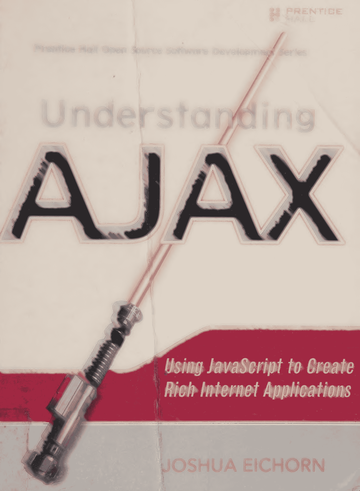

# 理解 AJAX：使用 JavaScript 创建丰富的网络应用指南


@HALL




# 理解 AJAX

已废弃
来自纳什维尔公共图书馆


开源技术改变了计算世界。许多大型项目已在全球范围内投入生产使用，例如 Apache、MySQL 和 Postgres，程序员使用包括 Perl、Python 和 PHP 在内的语言编写应用程序。这些技术应用于许多不同的系统，从专有系统、Linux 系统到传统的 UNIX 系统以及大型机，均有涉及。

Prentice Hall 开源软件开发系列旨在带你领这些开源技术的精华。你不仅将学习如何将它们应用于你的项目，还将从中学习。通过查看来自真实应用的代码，你将学习全球开源开发者的最佳实践。

该系列目前出版的书包括：


理解 AJAX
使用 JavaScript 创建富网络应用
Joshua Eichorn


- 它们是 (369)
- 将被 PEELAGA! (370)
- Yahoo 用户库)，设置 (370)
- 附录 B：带有服务器的 AJAX 库 (339)
- jQuery AJAX. (340)

- yates the (342)
- Coogee 调色板：sabet. Ce (342)
- 是 (342)
- 层 (342)
- ACT TR Te 然后 (343)
- (UI MEO) Web 用于一个 So (343)
- gn el ice? (345)
- 带有 (345)
- 对于 (345)
- 在 (345)
- 这些这些 (345)
- 对于 (345)
- 带有结尾 (345)
- 这些这些 (345)
- 带有 (345)
- 对于 (345)
- 带有 (345)
- 对于 (345)
- 带有 (345)
- 对于 (345)
- 带有 (345)
- 对于 (345)
- 的 (345)
- R Ye De (352)
- WWCCC E-ee is Sak cueing (352)
- Now deadly Fale does (352)
- a MCRD (352)
- Pe Be, 342 (352)
- A (352)
- nec (352)
- ae aa (352)
- ee Yeeck (353)


<!-- no content -->


## 读者群体

本书适用于理解如何构建 Web 应用程序并对 JavaScript 有基础了解的 Web 开发者。JavaScript 知识应包括文档对象模型（DOM）操作的能力以及使用面向对象库的能力。对 PHP 的基础了解也有助于理解书中的许多示例，但并不是必不可的，因为本书侧重于客户端 JavaScript 编程。理解 HTTP 的无状态本质以及如何使用工具（如 cookies）来规避这种无状态性也是很有用的。

在编写本书时，我假设你已经掌握了超文本标记语言（HTML）和级联样式表（CSS）的知识。如果你是以前使用过 JavaScript 的 Web 开发者，你应该能够利用从书中中学到的知识为你的网站添加异步 JavaScript 和 XML（AJAX）。如果你是第一次接触 JavaScript，在深入研究 AJAX 之前，可能想寻找一个入门级的参考资源。我推荐 Mozilla 开发者网站：http://developer.mozilla.org/en/docs/JavaScript。它包含了全面的 JavaScript 参考以及对该语言的介绍。

### 你将学到
本书侧重于使用 AJAX 创建一种新型的 Web 应用程序。它涵盖了以下主题：

- 执行 AJAX 通信的方法
- AJAX 通信模型，包括远程过程调用（RPC）和以文档为中心
- 可用性指南和技巧
- 如何选择 AJAX 库
- 衡量任务完成速度改进的方法
- 如何向现有应用程序添加 AJAX
- 如何构建丰富的应用程序
- 如何调试 AJAX 应用程序
- Sarissa 可扩展标记语言（XML）AJAX 库
- Scriptaculous 效果和组件
- HTML-AJAX（一个支持 PHP 的 AJAX 库）

本书的目标是将 AJAX 作为你工具箱中的一种工具，而不是涵盖 JavaScript 和 Web 编程的每一个方面。为了实现这一目标，我们通过多种不同的方式涵盖了 AJAX，从基础实现开始。然后我们转向更具理论性的主题（如易用性），最后通过构建实际应用程序来结束。

### 本书的结构
本书分为两个部分和三个附录。第一部分包含第 1 至 7 章，涵盖了 AJAX 的基础以及它如何融入 Web 开发世界的其他部分。它包括对基础技术（如 `XMLHttpRequest`）的介绍、关于如何充分利用 AJAX 的事实，以及关于易用性的技巧。第 7 章涵盖了调试，因为在任何开发环境中错误都是不可避免地会出现，而 AJAX 会影响你实现许多当前 Web 开发调试技巧的方式。

第二部分包含第 8 至 12 章，包含三个用例。这些用例展示了你如何使用 AJAX 来解决可用性问题并提高你当前网站的性能。最后一个用例还展示了构建由 JavaScript 驱动的应用程序涉及的内容。

最后，附录总结了大量的开源库。这些包括 AJAX 库和各种 JavaScript 支持库。我知道每个人对 AJAX 库的需求都不同；这些功能从特定的服务器端语言支持到如视觉效果和拖放支持等 DHTML 功能不一。然而，我无法提供详细的介绍

[](img/391ff4967fb08c7c726cbd81c08e81f3_19_1.png)

### 浏览器
本书对将使用的浏览器做了一些假设。书中显示的所有示例都已经在 Internet Explorer 6 和 Firefox 5 上经过了测试。代码在较新版本中应该可以很顺利地工作，但在其他浏览器中可能会有小问题。浏览器随着时间的推移而不断进步，绝大多数用户已经升级。如果你需要支持旧浏览器，请通过应用程序的非 JavaScript 版本来实现；在古老的技术上支持 AJAX 将使支持工作变成一场噩梦。


序言

*   第2章“入门”，第15页，是关于基础 AJAX 实现的指南，涵盖了由 XMLHttpRequest、IFrames 和 cookies 驱动的 AJAX 通信。
*   第3章“使用发送的数据”，第41页，展示了在第2章中学习的在客户端和服务器之间传输数据的多种使用方法。它包含了以文档为中心的方法（例如处理 XML 和显示 HTML）以及 RPC 方法。
*   第4章“将 AJAX 引入你的 Web 开发流程”，第77页，涵盖了 AJAX 改变开发流程的某些方式，以及你应对这些变化的方法。它还涵盖了如何选择 AJAX 库。
*   第5章“充分利用 AJAX”，第99页，提供了一个用于思考 AJAX 并决定何时使用它的心理思维框架。该章还提供了一些衡量任务完成时间的常用工具。
*   第6章“易用性”，第119页，为构建 AJAX 应用提供了一套易用性指南。
*   第7章“AJAX 调试”，第137页，涵盖了各种调试选项，从日志技术到处理 JavaScript 异常，以及许多实用的工具。这些包括 Firefox 扩展和调试代理的 Fiddler。

本书的第二部分向你介绍了三个 AJAX 库，然后查看了它们的使用场景。具体而言，涵盖了以下内容：
*   第8章“第二部分使用的库：Sarissa, Scriptaculous”，第167页，提供了 Sarissa 和 scriptaculous JavaScript 库的概述。
*   第9章“第二部分使用的库：HTML_AJAX”，第195页，提供了 HTML_AJAX 的概述，这是一个 JavaScript 和 PHP 的 AJAX 库。
*   第10章“加速数据显示”，第217页，构建了一个小型应用程序用于浏览大量数据并处理生成非常缓慢的图表。[](img/391ff4967fb08c7c72cbd81c08e81f3_21_1.png)
*   第11章“为博客添加 AJAX 登录”，第249页，为示例博客应用程序添加了 AJAX 登录，展示了 AJAX 登录如何工作，以及如何在使用需要时用它加载额外信息。
*   第12章“构建工单系统”，第271页，构建了一个由 JavaScript 驱动的完整应用程序。所有的控制和视图逻辑都在客户端管理，并由服务器提供一组与数据库交互的服务。

几个附录涵盖了你在实现自己的 AJAX 应用时可能会发现的各种 AJAX 和 JavaScript 库。具体而言，它们涵盖了：
*   附录 A，“JavaScript AJAX 库”，第333页，涵盖了仅包含 JavaScript 组件的 AJAX 库。
*   附录 B，“带有服务器关联的 AJAX 库”，第339页，详细介绍了具有服务端组件和 JavaScript 组件的 AJAX 库；列表按服务器语言组织。
*   附录 C，“JavaScript DHTML 库”，第347页，提供了关于 JavaScript 库的信息，有助于为你的 Web 应用添加丰富的 JavaScript 元素。

排版规范
本书中使用排版规范来传达信息。斜体字体用于强调和引用他著作。基于代码的项目显示如 `this`，并包括变量名、函数名、类名以及文件名。

在何处获取书中使用的示例
书中使用的示例程序可以在 http://understandingajax.net 找到[](img/391ff4967fb08c7c72cbd81c08e81f3_22_1.png)

# 第一部分

## 第一章

在本章中
1.1 丰富型互联网应用 第4页
1.2 AJAX 定义 第5页
1.3 AJAX 技术 第7页
1.4 远程脚本 第9页
1.5 Gmail 将 XMLHttpRequest 带入主流 第9页
1.6 新名称：AJAX 第12页
1.7 总结 第12页[](img/391ff4967fb08c7c72cbd81c08e81f3_26_1.png)

Web 2.0、丰富型互联网应用 (RIA)、异步 JavaScript 和 XML (AJAX) 是解释正在改变万维网的一些新技术的术语。这些变化关注的是用户体验而非仅仅技术，这种共同关注将创造下一个版本的 Web。

本章检查了这些术语，对它们进行了定义，并查看了它们的基本组成。主要重点是 AJAX，因为它是让其他技术可能的技术。书中提供了简短的历史，为你提供 AJAX 所处的背景。此外，本章讨论了为什么尽管技术障碍已经解决，AJAX 在 2005 年之前还没有流行。

1.1 丰富型互联网应用
互联网自最初创建以来发生了巨大变化。它从简单的文本的通信开始，在过去的基础上创建了日益强大的通信手段。在当今的万维网上，你可以创建交互式多媒体演示和强大的应用程序。虽然这些应用程序很强大，但它们并非没有缺点。与原生相比，大多数应用都非常笨拙（例如 Hotmail 之于 Outlook Express），更多应用存在严重的易用性问题。然而，无论是否有问题，Web——特别是 Web 应用——都是软件开发中增长最快、最重要的领域之一。

与原生应用相比，互联网应用带来了巨大的优势。它们具有极高的可访问性，无需安装，可以随时升级，并且在没有复杂网络的情况下访问大量数据。与原生应用相比，这些优势允许更短的上市时间，以及更低的开发和支持成本。尽管互联网应用由于界面更简单、交互性较差且更新时间较慢，通常易用性较差，但它们正在随处可见取代原生应用。

丰富型互联网应用 (RIA) 是一种试图弥补原生应用与普通互联网应用之间易用性差距的互联网应用。


### 1.2 AJAX 定义

在浏览器中包含更多代码，提供了更高水平的交互性以及类似于原生应用程序的体验。通过 RIA，可能可以使用许多技术，例如 Flash、Java 和 ActiveX，但最重要的技术是 JavaScript。因为 JavaScript 是由浏览器直接提供的，而不是像其他技术那样作为插件，因此你可以用最少的工作获得最大的收益。

JavaScript 语言中在 RIA 背后的驱动技术之一是一种称为 AJAX 的技术。AJAX 提供了在正常加载流之外与 Web 服务器进行通信的能力。

### 1.2 AJAX 定义

AJAX 最初由 Jesse James Garrett 在 2005 年 2 月写的一篇文章定义，意为“异步 JavaScript+XML”。虽然这个缩写听起来很有趣，但它并没有说明全部。AJAX 是从用户 Web 浏览器上的 JavaScript 环境到服务器的次要通信路径。使用 AJAX 会导致你在普通 Web 应用中看到的典型页面流发生变化。通过 AJAX，现在发生更加频繁，并可能产生更小的非 HTML 数据响应。

为了真正理解这到底意味着什么，让我们来看普通 Web 应用的通信流（见图 1-1）。它由两类网络活动组成：用户发起的超文本传输协议（HTTP）请求（输入 URL 或点击链接）以及来自服务器的响应。在 Web 应用中，大多数用户请求包含表单数据，而服务器响应由 PHP 或 Java 等编程语言动态生成。在普通 Web 应用模型中，用户始终生成请求，因此可能有人通过快速点击产生高频率页面请求，但通常情况下，请求频率较低，每个请求之间的时间是随机的。

AJAX Web 应用采用了 Web 应用的正常通信流并添加了新类型的请求。对于你的服务器来说，这看起来就像普通的页面请求（尽管在大多数情况下，其数据是不同的格式），但对于 Web 浏览器来说，它是不同的。这是一种完成后不需要重新加载页面的请求，而且不必由用户直接发起。在许多情况下，这些 AJAX 请求将很小，例如，可能以验证字段或预加载某些数据的请求的形式存在。然而请求也可以很大。例如，它们可能会通过 JavaScript 提交表单，或返回用于替换页面部分内容的超文本标记语言（HTML）。图 1-2 显示了示例 AJAX 通信流。如果你随着时间观察观察 AJAX 应用的请求并与普通 Web 应用进行比较，你只需要通过观察请求频率就能分辨出哪一个是哪个。图 1-3 显示了两者之间的比较。

| Web 浏览器 | 服务器 |
| :--- | :--- |
| 请求 index.php | 生成 Index.php |
| 获取 aEFagen | 渲染: Index.php |
| 2a | 请求: process.php |
| 提交表单 | 处理表单 |
| 渲染: process.php |
| 请求: Index.php | 生成 Index.php |
| 来自 JS 事件的 AJAX 调用 | 使用 DOM 更新内容 |
| 来自 JS 事件的 AJAX 请求 | 使用 DOM 更新内容 |

图 [1-1](img/391ff4967fb08c7c726cbd81c08e81f3_28_0.png) 图 [1-2](img/391ff4967fb08c7c726cbd81c08e81f3_29_0.png) 图 [1-3](img/391ff4967fb08c7c726cbd81c08e81f3_29_1.png)

普通 Web 应用请求与 AJAX 请求对比。这种频率的变化会极大地影响你托管 AJAX 应用的能力。你的服务器现在必须处理来自相同数量用户的高得多的请求。如果每个 AJAX 请求的处理量与普通页面加载一样，这会变得格外困难。

1.3 AJAX 的技术

如果你在互联网上搜索 AJAX，你可能会注意到在这一名称下出现了许多似乎并不相符的项目。在大多数情况下，这些库提供了完成你的 AJAX 应用所需的相关功能，但在另一些时候，这些库只是某人试图追随热潮。在查看这些库和技术时，我将它们分为三类：

- 直接在 AJAX 中使用的技术
- 与 AJAX 紧密相关的技术
- 仅仅是世界其他部分的技术

大多数与 AJAX 直接相关的技术是构成该缩写中“异步”和“XML”部分的技术。这些是提供通信层以及在上面传输的数据的编码方式的库和技术。在许多情况下，这是 `XMLHttpRequest` 对象，Iframes 也是流行的，cookie 或嵌入的 ActiveX/Java 是另一种可能性。AJAX 中的“X”是用于数据编码的技术，这是一个拥有无限可能的领域。数据可以以纯文本、HTML、XML 或任何可能适合当前情况的格式进行传输。

XML 作为数据格式非常流行，因为它被许多语言支持，并且用它很容易描述任意数据类型。在很多时候，XML 用于促进远程过程调用（RPC）机制，但它也可以用于直接描述正在传输的数据。RPC 允许 JavaScript 类型与服务器数据类型（PHP、Java 等）之间的直接映射，反之亦然。XML 曾被用于此目的，因此它包含了许多如 SOAP、XML-RPC 和 WDDX 等标准格式。它也可以包括为特定 AJAX 实现创建的自定义 XML 格式。

另一种流行的方法是在服务器上直接生成 JavaScript 并发送到客户端，并在那里可以直接使用。这种方法之所以可行，是因为 JavaScript 可以 `eval` 语句运行字符串代码。这种方法通常与其他方法结合使用，因为服务器端语言无法直接评估 JavaScript，但特定的 JavaScript 标记（JSON）可以允许 JavaScript 双向使用。这种表示法称为 JavaScript 对象标记，通常用于 RPC 方法，因为它可以描述 JavaScript 支持的任何类型，同时仍然被其他语言轻松解析。


### 1.4 远程脚本

提升 Web 应用程序易用性的核心，在于消除用户与 Web 应用程序之间的通信瓶颈。使用大多数 Web 应用程序通常意味着花费大量时间在搜索界面中查找项目 ID，或等待页面加载。解决这些问题最简单的方法是通过 JavaScript 与服务器通信，并跳过页面加载。

沿着这一新路径的探索始于 2001 年；在当时，它被称为远程脚本。当时使用了几种不同的方法，但大多数最终都变成一种使用 JavaScript 的 `XMLHttpRequest` 对象来发送数据的 RPC 风格方法。这种方法在如今的许多 AJAX 实现中仍被使用，那么为什么花了四年的时间才普及起来呢？可能是因为大多数开发者并不习惯使用 JavaScript。也可能是因为关于为什么使用或不使用某特定 Web 技术的问题似乎无法回答。然而，我认为这只是一个需要很长时间才能达到接受度临界点的案例而已。

## 1.5 Gmail 让 XMLHttpRequest 入入主流

2004 年 3 月，使用 `XMLHttpRequest` 创建高度交互性的 Web 应用程序引起了公众的广泛关注。Google 发布了 Gmail 的测试版，这是一种基于 JavaScript 的高度交互的电子邮件应用程序。Gmail（见图 1-4）不仅因其用户界面引起了轰，还因其巨大的存储容量。它还采用了一种创新的基于邀请的加入机制，这让它变得更加令人兴奋，因为 Gmail 并非对所有人开放。Gmail 是首批广泛使用 AJAX 的主流应用之一，尽管这个术语在 2004 年还没有发明。

[](img/391ff4967fb08c7c726cbd81c08e81f3_32_1.png)

图 1-4 Gmail Web 邮箱界面

Google 应用程序在最终发布之前会花费大量的测试时间，Gmail 也不例外。当我写这本书时（2006 年 5 月），Gmail 仍然处于测试阶段。这种延长的测试期对于大型应用程序是有益的，因为它允许界面设计趋于完善。当你查看 Gmail 时，你会从许多方面看到 AJAX 和其他技术的运用，它们最大限度地减少了全页刷新，并提供了你预期的所有功能。AJAX 特性包括：

- 收件箱 (20-37/37)
- 选择：全部、无、已读、未读、星标、取消星标
- 星标
- 已发送邮件
- 草稿
- 所有邮件
- 垃圾邮件
- 标签
- 校友事务
- 账单

jeichorn@gmail.com | 设置 | 帮助 | 退出登录
显示设置
搜索邮件 | 搜索网络 neo
撰写邮件
更多 =
刷新

10 第 1 章 什么是 AJAX？
Jaime Workman
前 100 名客户可获得盐可汀 - 6:50 am
Creative Labs
Creative, 你的夏季游戏连接 - 如果:7月26日
Rosalie Alexandra 救生技术。生物技术周一警报 —7月24日
J. — 恶鬼谷
ASU 校友协会将在7月45日前举办尾场赛前派对
Sun Microsystems
Sun 内部：参与时代的消除贫困 - 你
Joshua, 我从其中一个联系人那里知道了你的名字 - 7月13日
Joshua — Reunion.com
Joshua, 你还记得高中同学吗？ - 7月7日
Reunion — Reunion.com
Joshua, 你还记得高中同学吗 = 6月29日
Reunion.com
Joshua, 与老友保持联系 - 活动更新我的 6月22日
Reunion.com
Joshay 使用留言板重新建立联系！- 活动 6月15日
你来自 Server4You.com 的发票 亲爱的客户 6月10日
Reunion.com
Joshua Eichorn, 对旧的进行无限搜索 - 6月9日
Reunion.com
Joshua, 搜索并寻找老友！— Reunion com 6月3日

Google 应用程序在最终发布之前会花费大量的测试时间，Gmail 也不例外。当我写这本书时（2006 年 5 月），Gmail 仍然处于测试阶段。这种延长的测试期对于大型应用程序是有益的，因为它允许界面设计趋于完善。当你查看 Gmail 时，你会从许多方面看到 AJAX 和其他技术的运用，它们最大限度地减少了全页刷新，并提供了你预期的所有功能。AJAX 特性包括：

- 收件箱 (20-37/37)
- 选择：全部、无、已读、未读、星标、取消星标
- 星标
- 已发送邮件
- 草稿
- 所有邮件
- 垃圾邮件
- 标签
- 校友事务
- 账单

图 1-4 Gmail Web 邮箱界面

Google 应用程序在最终发布之前会花费大量的测试时间，Gmail 也不例外。当我写这本书时（2006 年 5 月），Gmail 仍然处于测试阶段。这种延长的测试期对于大型应用程序是有益的，因为它允许界面设计趋于完善。当你查看 Gmail 时，你会从许多方面看到 AJAX 和其他技术的运用，它们最大限度地减少了全页刷新，并提供了你预期的所有功能。AJAX 特性包括：

- 收件箱 (20-37/37)
- 选择：全部、无、已读、未读、星标、取消星标
- 星标
- 已发送邮件
- 草稿
- 所有邮件
- 垃圾邮件
- 标签
- 校友事务
- 账单

图 1-5 Gmail 加载指示器

Gmail 应用程序仍然存在一些小问题，许多 AJAX 应用也会遇到这些问题。例如，浏览器的书签功能变得失效，因为当内容更新时 URL 不会改变，而 URL 是浏览器存储的唯一标识符。此外，用户界面看起来类似于原生应用程序，但行为却不同，这对于某些用户来说可能是个问题。尽管如此，应用程序尝试通过提供反馈消息告知用户操作已完成来缓解这一问题。这些消息包括向邮件添加标签的通知（见图 1-6）。

[](img/391ff4967fb08c7c726cbd81c08e81f3_34_1.png)


## 第 1 章：什么是 AJAX？

图 1-6：Gmail 为完成的操作提供反馈

由于 Gmail 是最早的主流 AJAX 驱动应用之一，它为用户的预期设定了基准。例如，它用用应用内部的链接取代了标准的浏览器功能（如刷新），这种技术已被许多其他应用程序所效仿。这有助于提高许多 AJAX 应用的质量，因为 Gmail 在提供一致且高易用性体验方面做得非常出色。

### 1.6 新名称：AJAX

2005 年 2 月，Jesse James Garrett 发表了一篇文章，创造了 AJAX 这一术语，并将其从 Google 和其他少数前沿公司正在使用的新颖技术，转变为任何人都可以使用的技术。尽管许多人对他他创造的这个缩写颇有意见，但它确实引起了人们的关注。这篇文章开启了开源软件（OSS）和博客社区中广泛的实验和实施时期，使得 AJAX 成为任何人的可能。

到 2006 年，开发者们已经在许多令人兴奋的新型应用中使用 AJAX，从在线地图网站到待办事项列表和日历。然而，创新的动力并非大型面向消费者的应用程序，而是那些允许开发者在世界范围内使用 AJAX 的工具。

### 1.7 总结

RIA（富交互应用程序）是提供高交互性且性能与原生应用类似的现代 Web 应用。RIA 的实现依赖于许多性技术和手段。这些包括 JavaScript、DHTML、SVG 和 AJAX。


AJAX 是一种 JavaScript 技术，提供了与 Web 服务器的额外通信通道。AJAX 是允许创建 RIA 的性技术之一，其他还有 DHTML 和 JavaScript 技术；通过它们，你可以创建出与原生应用竞争的强大应用程序。

AJAX 并不是一项新技术，但它花费了一段时间才准备好进入主流市场。它受到 Web 对创新的持续需求，以及 Google 等公司将其推向主流的推动。开源使得开发者能够在无需自己开发一切的情况下添加先进的 AJAX 技术。


## 第 2 章

在本章中：
- 2.1 XMLHttpRequest 概述
- 2.2 跨浏览器 XMLHttpRequest
- 2.3 发送异步请求
- 2.4 无 XMLHttpRequest 的 AJAX
- 2.5 备用方案 1：使用 IFrame 发送请求
- 2.6 备用方案 2：使用 Cookie 发送请求
- 2.7 总结

第 16 页，第 21 页，第 23 页，第 29 页，第 31 页，第 36 页，第 39 页


使 AJAX 可能的基础是与 Web 的通信层。执行这种通信最完整的选项是 JavaScript XMLHttpRequest 对象。如果 XMLHttpRequest 不适合你，也可以使用隐藏帧（hidden frames）和 Cookie。我们将在本章后部分检查这两种方案。

本章向你介绍 XMLHttpRequest 对象，向你展示如何绕过浏览器之间的实现差异。之后，我们将进行一些实际的页面请求，包括同步方式和异步方式。本章最后介绍当浏览器不支持 XMLHttpRequest 时可以使用的各种备用方法，包括如何将 IFrames 和 Cookie 作为你的通信通道。

### 2.1 XMLHttpRequest 概述

最初，微软设计 XMLHttpRequest 是为了让 Internet Explorer (IE) 能够从 JavaScript 加载 XML 文。尽管名字里有 XML，但 XMLHttpRequest 实际上是 JavaScript 的一个通用客户端。通过它，JavaScript 可以发送 GET 和 POST 请求。（对于 POST 请求，数据以你选择的格式发送到服务器。）

XMLHttpRequest 的主要局限性由于浏览器沙箱。它只能发送 HTTP(S) 请求（例如，文件 URL 将不起作用），并且只能向当前加载页面的相同域发送请求。

XMLHttpRequest 的安全限制限制了你使用它的方式，但增加安全性是非常值得的。针对 JavaScript 应用程序的攻击大多集中在向 Web 页面注入恶意代码。如果 XMLHttpRequest 允许向任何网站发送请求，它将成为这些攻击的主要手段。安全沙箱减少了这些潜在问题。此外，它简化了编程模型，因为 JavaScript 代码可以隐含地信任从 XMLHttpRequest 加载的任何数据。它可以信任这些数据，因为新数据与加载初始页面的安全性相同。

尽管 XMLHttpRequest 只提供了一个小的 API 以及少数方法和属性，但它在不同浏览器之间存在差异。这些差异主要体在事件处理和对象实例化上（在 IE 中，XMLHttpRequest 实际上是一个 ActiveX 对象），因此它们并不难绕过。在接下来……


### 2.1 XMLHttpRequest 概述

XMLHttpRequest API 的概览，这里使用了 Mozilla 语法进行 XMLHttpRequest 实例化。如果你想在 IE 中运行示例，需要将 `new XMLHttpRequest();` 替换为 `new ActiveXObject("MSXML2.XMLHTTP.3.0");` 或本章中“跨浏览器 XMLHttpRequest”节所示的完整跨浏览器实例化方法。

XMLHttpRequest 是 AJAX 通信中最常用的方法，因为它提供了两个独特的特性。第一个特性允许在不对内容进行任何更改的情况下加载新内容，这使得将 AJAX 整合到你的常规开发模式中变得非常容易。第二个特性允许 JavaScript 进行同步调用。同步调用会停止所有其他操作，直到调用完成；虽然这通常不是首选方案，但在必须在采取进一步行动之前完成当前请求的情况下，它是很有用的。

### 2.1.1 XMLHttpRequest: Open()

`open` 方法用于设置请求类型（GET、POST、PUT 或 DELETE）、被请求页面的 URL 以及调用是否为异步。还可以传递用于 HTTP 身份认证的用户名和密码。URL 可以是相对路径（例如 page.html），也可以是包含服务器地址的完整路径（例如 http://blog.yahoo.com/page.html）。基本方法签名为：`open(type, url, isAsync, username, password)`

在 JavaScript 环境中，存在安全限制。如果 URL 来自于当前不同域，这些安全限制会导致 `open` 方法抛出异常。以下示例使用 `open` 设置了一个到 index.html 的同步 GET 请求：

```javascript
var req = new XMLHttpRequest();
req.open("GET", "index.html", false);
req.send(null);
if(req.status == 200) {
alert(req.responseText);
}
```

### 2.1.2 XMLHttpRequest: Send()

`send` 方法建立到 `open` 中指定的连接。如果请求是异步的，调用将立即返回；否则，调用将阻塞后续执行，直到页面下载完成。如果请求类型为 post，负载（payload）将作为请求体发送到服务器。该方法签名为：`send(payload)`

当你发送 POST 请求时，需要设置 `Content-type` 头部。这样，服务器就 true如何处理上传的内容。为了模拟使用 HTTP post 发送表单，你将内容类型设置为 `application/x-www-form-urlencoded`。URLencoded 数据与你在 URL 中 `?` 之后看到的格式相同。你可以通过创建一个表单并将其方法设置为 GET 来查看此编码数据的示例。以下示例显示了一个向 index.php 发送的同步 POST 请求，发送了 URLencoded 负载。如果 index.php 包含 `<?php var_dump($_POST); ?>`，你可以在 alert 中看到提交的数据以其正常形式转换的结果：

```javascript
var req = new XMLHttpRequest();
req.open('POST', 'index.php', false);
req.setRequestHeader('Content-type', 'application/x-www-form-urlencoded;charset=UTF-8;');
req.send('hello=world&XMLHttpRequest=test');
if(req.status == 200) {
alert(req.responseText);
}
```

### 2.1.3 XMLHttpRequest: setRequestHeader()

在请求上设置头部在许多情况下都可能很有用。`setRequestHeader()` 最常用的用途是设置 `Content-type`，因为大多数 Web 应用程序已经知道如何处理某些类型（例如 URLencoded）。`setRequestHeader` 方法签名接受两个参数：要设置的头部及其其值：`setRequestHeader(header, value)`

由于使用 XMLHttpRequest 发送的请求与普通浏览器请求发送相同的标准头部（包括 cookie 头部和 HTTP 身份认证头部），因此头部的名称通常是你想要覆盖的 HTTP 头部名称。除了覆盖默认头部外，`setRequestHeader` 还用于设置自定义的、特定于应用程序的头部。自定义头部通常以 X- 前缀，以与标准头部区分来。以下示例向 test.php 发送一个同步 GET 请求，添加了一个名为 `X-Test` 的头部。如果 test.php 包含 `<?php var_dump($_SERVER); ?>`，你将在 alert 中看到提交的头部：

（注：OCR 处包含图片引用）

### 2.1.4 XMLHttpRequest: getHeader() and getAllHeaders()

`getHeader()` 方法允许你从响应中获取单个头部；当你需要像 `Content-type` 这样的头部时特别有用。`getAllHeaders()` 将所有头部返回并在字符串中；这对于搜索某个值有用。以下示例向 test.html 发送一个同步 GET 请求。当客户端接收响应时，会弹出 Content-type 和所有的头部：

```javascript
var req = new XMLHttpRequest();
req.open('GET', 'test.html', false);
req.send(null);
if(req.status == 200) {
alert(req.getHeader('Content-type'));
alert(req.getAllHeaders());
}
```

### 2.1.5 其他 XMLHttpRequest 方法

所有浏览器都实现了 `abort()` 方法，用于取消异步请求。（该方法的示例见本章的“发送异步请求”节。）


## 第 2 章 入门

### 2.1.6 XMLHttpRequest 属性

XMLHttpRequest 提供了许多属性，用于提供有关请求的信息或结果。大多数属性都是自言易懂的；你只需要读取值并对其进行操作即可。*on* 系列属性是事件处理器，通过为它们分配函数来使用。以下是所有属性的列表：

- status: 请求响应的 HTTP 状态码。
- statusText: 与状态码对应的 HTTP 状态文本。
- readyState: 请求的状态。（值请参见本章下一节节的表 2-1）。
- responseText: 响应的未解析文本。
- responseXML: 将响应解析为 DOM Document 对象的响应；仅当 Content-type 为 text/xml 时才会发生。
- onreadystatechange: 当 readyState 改变时被调用的事件处理器。
- onerror: Mozilla 专有的事件处理器，在请求过程中发生错误时调用。
- onprogress: Mozilla 专有的事件处理器，在内容加载时按时间间隔调用。
- onload: Mozilla 专有的事件处理器，在文档加载完成时调用。

注意：Mozilla 在请求完成后会重置事件处理器（如 onreadystatechange），因此如果你在使用同一个对象进行多次调用，则需要重置它们。

### 2.1.7 readyState 引用

表 2-1 显示了 readyState 变量的可能值。它将返回一个表示对象当前状态的数字。每个请求都会通过 readyStates 列表。

[](img/391ff4967fb08c7c726cbd81c08e81f3_43_1.png)

表 2-1 readyState 等级

| readyState | 状态码 | XMLHttpRequest 对象的状态 |
| :--- | :--- | :--- |
| (0) | UNINITIALIZED | 对象已创建但尚未初始化。（尚未调用 open 方法）。 |
| (1) | LOADING | 对象已创建，但尚未调用 send 方法。 |
| (2) | LOADED | 已调用 send 方法，但状态和头部信息尚未可用。 |
| (3) | INTERACTIVE | 已接收部分数据。在此状态下调用 responseBody 和 responseText 属性获取部分结果将返回错误，因为状态和响应头部尚未完全可用。 |
| (4) | COMPLETED | 所有数据已接收，完整数据在 responseBody 和 responseText 属性中可用。 |

readyState 变量和 onreadystatechange 事件处理器是以这种方式关联的：每当 readyState 变量改变时，就会调用 onreadystatechange 事件处理器。

### 2.2 跨浏览器 XMLHttpRequest

XMLHttpRequest 之所以成为 AJAX 请求如此流行的传输方式的属性之一，是它可以以兼容多种浏览器的的方式于使用。两大浏览器 IE 和 Firefox 提供了相同的底层 API。这种一致性带来了相似的开发体验。Opera 和 Safari 也支持相同的底层 API，但仅限于它们较新的版本。

当你编写跨浏览器代码时，首先需要克服的问题是：XMLHttpRequest 在 IE 中是一个 ActiveX 对象，而在 Mozilla 和其他浏览器中是普通的 JavaScript 对象。有许多方法可以解决这个问题，包括为 IE 提供可选的 JScript 代码，但我发现简单的方法就是使用异常。列表 2-1 显示了一个示例，它会根据需要尝试每个版本的 XMLHttpRequest 对象。这有助于使我们的实现尽可能健壮。如果无法创建 XMLHttpRequest 对象，该函数也会抛出异常。这让我们有一种在需要时提供错误信息或回退到 IFrame 请求的方法。

列表 2-1 跨浏览器 XMLHttpRequest 的创建

```javascript
// 以跨浏览器方式创建 XMLHttpRequest 的函数
function initXMLHttpClient() {
    var xmlhttp;
    try {
        xmlhttp = new XMLHttpRequest();
    } catch (e) {
        var XMLHTTP = new Array('MSXML2.XMLHTTP', 'MSXML2.XMLObject', 'MSXML.XMLHTTP', 'Microsoft.XMLHTTP');
        var success = false;
        for (var i=0; i<XMLHTTP.length && !success; i++) {
            try {
                xmlhttp = new ActiveXObject(XMLHTTP[i]);
                success = true;
            } catch (e) {}
        }
        if (!success) {
            throw new Error('Unable to create XMLHttpRequest.');
        }
    }
    return xmlhttp;
}
```

### 2.3 发送异步请求

同步请求比异步请求更容易使用，因为它们直接返回数据，并消除了创建回调函数的麻烦。然而，它们并不是 XMLHttpRequest 的标准用例，因为在请求发生期间整个浏览器会被锁定。在某些情况下，阻塞是有用的（主要是在需要在当前函数结束前做出决策时），但在大多数情况下，你可能希望这些请求在后台进行。异步请求允许浏览器在加载新数据时继续运行 JavaScript，并允许用户继续与页面交互。通过适当的用户界面，异步通信使得即使用户到网站的连接缓慢，AJAX 也可以变得很有用。

要进行异步调用，我们需要完成两个任务：将 `open` 中的异步标记设置为 `true`，并添加一个 `stateChanged` 事件处理器。该事件处理器将等待就绪状态 4，这意味着响应已加载。然后它将检查 `status` 属性。如果状态为 200，我们可以使用 `responseText`；如果是其他值，则表示错误，因此我们需要创建一个警告对话框来显示它。列表 2-2 显示了对 test.php 的异步调用。使用之前一个章节节中的 `initXMLHttpClient` 函数来创建我们的 XMLHttpRequest 对象。


24

## 第 2 章：入门

### 列表 2-2 发送异步请求

```javascript
var req = new XMLHttpRequest();
req.onreadystatechange = function() {
    if (req.readyState == 4) {
        if (req.status == 200) {
            alert(req.responseText);
        } else {
            alert('Loading Error: ['+req.status+'] '+req.statusText);
        }
    }
};
req.open('GET', 'test.php', true);
req.send(null);
```

虽然这段代码可以完成任务，但它并不是理想的长期解决方案，因为我们必须为每次调用编写一个新的 `onreadystatechange` 方法。解决这一问题的方法创建一个封装了 `XMLHttpRequest` 的 `HttpClient` 类。这样的类可以为我们提供一个易于使用的 API 以及一个仅用于处理成功请求的回调属性。仅仅添加一些辅助方法会是简单的解决方案，但这是不可行的，因为 IE 不允许你向 ActiveX 对象添加方法。

列表 2-3 显示了一个 `XMLHttpRequest` 包装类的示例。`HttpClient` 类的主要特性是：当异步请求成功完成时会被调用的回调属性，以及一个结合了 `open` 和 `send` 函数的 `makeRequest` 方法。它还提供了事件属性，在发送请求时（onSend）、请求结束时（onload）以及发生错误时（onError）被调用。

它还提供了默认的 `onSend` 和 `onload` 实现，在发送请求期间创建一个基础的加载消息。

### 列表 2-3 HttpClient XMLHttpRequest 包装类

```javascript
function HttpClient() {
    // 传递给 open 的类型 GET,POST
    this.requestType = 'GET';
    // 设置为 true 时，进行异步调用
    this.isAsync = false;
    // 存储 XMLHttpRequest 实例的地方
    this.xmlhttp = false;
    // 成功异步调用时调用的函数
    this.callback = false;
    // 当调用 XMLHttpRequest 的 send 时调用的函数
    // 设置自己的函数到 onSend 以实现自定义加载效果
    this.onSend = function() {
        document.getElementById('HttpClientStatus').style.display = 'block';
    };
    // 当达到 readyState 4 时调用的函数，在你的回调之前调用
    this.onload = function() {
        document.getElementById('HttpClientStatus').style.display = 'none';
    };
    // 当发生 http 错误时调用的函数
    this.onError = function(error) {
        alert(error);
    };

    // 初始化 xmlhttpclient 的方法
    // Mozilla / Safari
    this.xmlhttp = new XMLHttpRequest();
    // IE / IE
    var XMLHTTP_IDS = new Array(
        'MSXML2.XMLHTTP.5.0',
        'MSXML2.XMLHTTP.4.0',
        'MSXML2.XMLHTTP.3.0',
        'MSXML2.XMLHTTP',
        'Microsoft.XMLHTTP'
    );
    var success = false;
    for (var i = 0; i < XMLHTTP_IDS.length && !success; i++) {
        try {
            this.xmlhttp = new ActiveXObject(XMLHTTP_IDS[i]);
            success = true;
        } catch (e) {}
    }
    if (!success) {
        this.onError('Unable to create XMLHttpRequest');
    }
}
```

### 2.3 发送异步请求

`HttpClient` 类包含了一些属性，但你可能想查看一下细节。第一部分是你在与类交互时将设置的属性：

- requestType: 设置 HTTP 方法（GET, POST）。
- isAsync: 布尔值，用于设置请求是否为异步。
- callback: 请求成功时要被调用的函数。
- onSend: 设置以实现自定义加载效果的函数。
- onError: 设置以处理 HTTP 错误的函数。

```javascript
HttpClient.prototype.makeRequest = function(url, payload) {
    // 发送请求的方法
    this.xmlhttp.open(this.requestType, url, this.isAsync);
    // 设置 onreadystatechange 处理器
    this.xmlhttp.onreadystatechange = function() {
        if (this.xmlhttp.readyState == 4) {
            if (this.xmlhttp.status == 200) {
                if (this.callback) {
                    this.callback(this.xmlhttp.responseText);
                }
            } else {
                if (this.onError) {
                    this.onError('HTTP Error: [' + this.xmlhttp.status + '] ' + this.xmlhttp.statusText);
                }
            }
        }
    };
    // 注意：上面的逻辑为了示例而进行了简化；
    // 在实际的类中，必须处理 'this' 的绑定。
};
```


## 第 2 章 入门

列表 2-4 使用了 `HttpClient` 类并展示了它的基本用法。像这样的封装类可以帮助减少每个请求需要编写的代码量，同时为未来的更改提供了一个统一的管理位置。

列表 2-4
使用 HttpClient XMLHttpRequest 封装
```html
<html>
<head>
<title>简单的 XMLHttpRequest 测试页面</title>
<script type="text/javascript" src="HttpClient.js"></script>
<<body>
<script type="text/javascript">
AA
AHAUH
PWN
FP
oO
var client = new HttpClient();
client.isAsync = true;
PPR
NP
Oo function test()
{
  client.callback = function(result)
  {
    document.getElementById('target!').innerHTML = result;
  }
  client.makeRequest('.',null);
PRPPPP
IHN
OB
WwW
}
</script>
<div id="HttpClientStatus" style="display:none">Loading...</div
<a href='javascript:test()'>发起异步测试调用</a>
<div id="target"></</div>
</body>
</html>
```
NIM!
NERD
ES WNe
©
\'

使用 HttpClient XMLHttpRequest 封装是一项简单的任务。你首先在 HTML 页面的头部包含它（第 5 行），然后就可以开始使用它。具体方法是创建该类的实例（第 9 行），配置其基本属性（在这种情况下，将 `isAsync` 设置为 `true`（第 10 行），然后设置一些代码来调用 `makeRequest`。在大多数情况下，这些代码将包含在一个函数中，以便它可以绑定到用户驱动的事件（例如点击链接）。调用由 `test` 函数执行（第 12-17 行）；`test` 函数首先设置一个回调，在请求完成后运行（第 13-15 行），然后调用 `makeRequest`（第 16 行），从而启动 AJAX 调用。

[](img/391ff4967fb08c7c726cbd81c08e81f3_51_1.png)

### 2.4 不使用 XMLHttpRequest 的 AJAX

在某些情况下，你可能无法获得 XMLHttpRequest 支持。最常见的情况是使用旧版浏览器。这是最难解决的，不是因为没有 AJAX 回退方案，而是因为你在应用程序中进行的所有 DOM 操作都将无法工作。另一种情况是你的浏览器支持所需的所有功能，唯独不支持 XMLHttpRequest。这种情况可能发生在 IE 处于无法使用 ActiveX 的模式时，或者你正在使用 Opera 7之前的版本。在某些情况下（特别是内网应用），直接要求升级很容易的，但如果你想在公共网站上使用 AJAX，你将考虑使用某种回退机制。回退的最佳选择是使用隐藏的 `iframe`。另一个选项是使用 cookie，但每个请求只能发送有限的数据，因此很难用基于 cookie 的方法替代为 `XMLHttpRequest` 编写的代码。`XMLHttpRequest` 支持同步调用，因此如果你的应用程序需要同步调用，那么就无法将其作为回退。如果你使用的是完全封装的 `XMLHttpRequest` 且没有使用同步调用，那么为你的程序提供透明的回退应该是可能的。你只需要将示例方法中最后的抛出异常替换为实例化你的 `IFrame` 客户端即可。关于使用其他方法替代 `XMLHttpRequest` 需要记住的主要的一点是，它不会带来兼容性的巨大飞跃。主流浏览器已经支持 `XMLHttpRequest`。这种支持使得禁用 JavaScript 的浏览器（而不是运行不支持浏览器的浏览器）成为了无法使用你 AJAX 应用程序的最大群体。AJAX 通信技术的优缺点如表 2-2 所示。

[](img/391ff4967fb08c7c726cbd81c08e81f3_52_1.png)

### 表 2-2 AJAX 技术的优缺点

| 技术 | 优点 | 缺点 |
| :--- | :--- | :--- |
| XMLHttpRequest | 可以向页面发送请求；可以设置/获取所有 HTTP Header；可以使用类型（GET, POST, PROPFIND 等）发送 HTTP 请求；支持对 POST 请求的完全控制，允许任何类型的数据编码 | 在 IE 中启用 AJAX 需要设置 ActiveX；仅在较新版本的 Opera 和 Safari 中可用；不同浏览器之间存在细小的实现差异 |
| IFrame | 可以发送 POST 和 GET 请求；支持所有现代浏览器配合 IFrame 工作；支持异步文件上传；可能会在浏览器历史中留下额外条目（取决于浏览器和实现） | 禁止同步请求；服务器页面必须设计为配合 IFrame 运行；不同浏览器之间存在实现差异 |
| Cookies | 支持的浏览器最多 | 禁止同步请求；不适用于大型请求；需要服务器页面设计为配合 cookie 运行；只能发送 HTTP 请求 |

[](img/391ff4967fb08c7c726cbd81c08e81f3_53_1.png)

### 2.5 回退方案：使用 IFrame

iframe 是异步调用的合适回退方案，因为可以在不引起整个页面重新加载的情况下加载，并且可以使用 JavaScript 创建新的 `iframe` 元素。`iframe` 的优点在于你可以使用它的目标代替页面；这允许使用 `iframe` 向服务器发送大量数据。

注意，使用 `iframe` 有许多局限性：
- 只支持异步请求
- 服务器页面需要修改
- 某些浏览器的历史记录中会出现虚拟条目
- 不同浏览器之间存在差异，特别是旧版浏览器
- 你无法像 `XMLHttpRequest` 那样直接获取文件。（你需要轮询 `iframe` 获取结果，或者在 `iframe` 上设置 onload处理器来告知父页面何时完成。）

### 2.5.1 创建隐藏 IFrame

`iframe` 相比 `XMLHttpRequest` 的一个优点是它可以用于文件上传。由于浏览安全限制，只有用户操作（例如点击表单）才能与用户机器上的文件交互。这使得对于不涉及常规表单提交和页面刷新循环的文件上传来说，将表单指向 `iframe` 是唯一选择。


## 第 2 章：入门

（浏览器将不会加载它。）然而，这种方法并不灵活，因此你可能希望动态创建框架。并不是所有旧版浏览器都支持 `document.createElement`，但不支持该功能的浏览器通常也缺乏使用你正在加载的数据所需的其他动态能力，因此最好通过提供该页面的静态 HTML 版本来为其提供支持。在下面的示例中，使用 `innerHTML` 来创建 IFrame，因为它比使用 DOM 方法创建更简单。但注意，它也可以通过 `document.createElement` 来创建，就像向其添加的 `div` 一样：

```javascript
1 var rDiv = document.createElement('div');
2 rDiv.id = 'remotingDiv';
3 var style = 'border:0;width:0;height:0;';
4 rDiv.innerHTML = "<iframe name='"+id+"' id='"+id+"' style='"+style+"'></iframe>";
7 document.body.appendChild(rDiv);

```

### 2.5.2 创建表单

如果你只想发送 GET 请求，可以更改 IFrame 的 `src` 属性，但要执行 Post 请求，你需要使用目标表单（targeted form）。GET 并不是 AJAX 请求的良好解决方案，原因有两个：它只能发送有限量的数据（数量视浏览器而定），而且 GET 可能会被代理服务器缓存和/或预加载，因此你永远不想用它来执行诸如更新数据库的操作。

使用带有 IFrame 的表单非常简单。只需设置表单的 `target` 属性，当提交表单时，结果就会加载到 IFrame 中。接下来的示例创建了我们的表单，并将其目标设置为我们之前在本章“创建隐藏 IFrame”节中创建的 IFrame：

```javascript
1 rDiv.form = document.createElement('form');
2 rDiv.form.setAttribute('id', id+'RemotingForm');
3 rDiv.form.setAttribute('action', url);
4 rDiv.form.setAttribute('target', id);
5 rDiv.form.target = id;
6 rDiv.form.setAttribute('method', 'post');
7 rDiv.form.innerHTML = '<input type="hidden" name="data" id="'+id+'Data">';
```

### 2.5.3 从加载的内容发送数据到原始文档

知道 Frame 内容已加载的唯一方法是让内容页面运行某些 JavaScript，以通知嵌入 IFrame 的父页面。


### 2.5 备用方案 1：使用 IFrame 发送请求

此此最简单的方法在你加载的文档上设置 `onload` 处理器。这一限制意味着你不能像使用 `XMLHttpRequest` 那样使用 IFrame 加载任意内容。但是对于单个页面已作为 AJAX 网关的情况，它仍然有用。这里是 `onload` 的示例：`<body onload="parent.document.callback(result)">`。

### 2.5.4 完整的 IFrame AJAX 示例

完整的 IFrame AJAX 请求示例包含两个部分。第一部分是创建 IFrame 表单的客户端代码。第二部分是服务器端代码，它准备一些数据并在 `onload` 处理器中将其发送回父文档。示例的第一部分（列表 2-5）是简单 HTML 文件中的 JavaScript 代码。此页面用于测试；回调函数会弹出结果的内容。示例的第二部分（列表 2-6）是一个简单的 PHP 脚本，它获取 Post 的数据并将其发送回父文档。为了创建一个实用的系统，你可能还想在表单中包含一些额外的变量，这些将告诉 PHP 代码如何处理上传的数据，或者你可以将逻辑直接放入脚本中，并为你想实现的每个任务使用不同的目标页面。

列表 2-5 使用 IFrame 发 AJAX 请求
```html
<html
<head>
<script type="text/javascript">
var remotingDiv;
function createRemotingDiv(id,url) {
  var rDiv = document.createElement('div');
  rDiv.id = 'remotingDiv';
  var style = 'border:0;width:0;height:0;';
  rDiv.innerHTML = "<iframe name='"+id+"' id='"+id+"' style='"+style+"'></iframe>";
  document.body.appendChild(rDiv);
  rDiv.iframe = document.getElementById(id);
  rDiv.form = document.createElement('form');
  rDiv.form.setAttribute('id', id+'RemotingForm');
  rDiv.form.setAttribute('action', url);
  rDiv.form.setAttribute('target', id);
  rDiv.form.setAttribute('method', 'post');
  rDiv.form.innerHTML = '<input type="hidden" name="data" id="'+id+'Data">';
  rDiv.appendChild(rDiv.form);
  rDiv.data = document.getElementById(id+'Data');
  return rDiv;
}
function sendRequest(url,payload,callback) {
  if (!remotingDiv) {
    remotingDiv = createRemotingDiv('remotingFrame', 'blank');
  }
  remotingDiv.form.action = url;
  remotingDiv.data.value = payload;
  remotingDiv.callback = callback;
  remotingDiv.form.submit();
}
function test() {
  sendRequest('test.php', 'This is some data', function(result){
    alert(result)
  });
}
</script>
</head>
<body id="body">
  <a href="javascript:test()">Test</a>
</body>
</html>
```

[/content]

列表 2-6 处理 IFrame AJAX 请求的 PHP 服务器页面
```html
<html
<head>
<script type="text/javascript">
var result = "<?php echo $_POST['data']; ?>";
callback(result);
</script>
</head>
<body onload="parent.document.getElementById('remotingDiv').callback(result)">
</body>
</html>
```


36

## 第二章 入门

将其放入结果变量中（第 4-6 行）。通常情况下，你会在此处运行服务器端代码，并输出字符串（在本例中）或添加新的 JavaScript 代码在父文档上运行。父级上的回调函数是由 body 标签上的 onload 句处理器调用的（第 11 行）。

### 2.6 备用方案 2：使用 Cookie发送请求

你可以使用 cookie 将数据传输到服务器，但任何使用 cookie 的实现都会受到严重限制。cookie 的最大限制为 4k，每个域名只能设置 20 个，这意味着每个请求都会受到大小限制。当你的网站专门为此设计时，基于 cookie 的 AJAX 才最有用，因为它的局限性使其很难作为备用方案。其基本功能通过设置 cookie、加载图像，然后在间隔期间进行轮询等待响应出现来实现。该实现非常简单；除了显示结果内容之外的执行其他操作，你只需设置自定义的 `onComplete` 事件处理器。代码列表 2-7 和 2-8 展示了服务器返回输入内容及其调用次数的示例。示例的 JavaScript 代码见代码列表 2-7，而读取 cookie 并设置响应的 PHP 代码见代码列表 2-8。

代码列表 2-7
基于 Cookie 的 AJAX
<html
<head>
<title>Cookie Test</title>
<script type="text/javascript">
function CookieRequest() {
}

CookieRequest.prototype = {
    interval: 500,
    attempts: 5,
    attemptCounter: 0,
    call: function(payload) {
        var d = new Date();
        var i = new Image();
        this.setCookie('CR', payload);
        this.timerId = setTimeout(function() {
            i.read();
        }, this.interval);
    },
    read: function() {
        this.attemptCounter++;
        // check for data
        var data = this.getCookie('CR');
        if (data != false) {
            this.attemptCounter = 0;
            this.onComplete(data);
            return true;
        }
        // check for error
        if (this.attemptCounter > this.attempts) {
            this.onComplete();
            return false;
        }
        var self = this;
        this.timerId = setTimeout(function() {
            self.read();
        }, this.interval);
    },
    onComplete: function(result) {
        if (result) {
            alert(result);
        } else {
            alert('Request timed out');
        }
    },
    setCookie: function(name, value, expires) {
        document.cookie = name + "=" + escape(value) + (expires ? ";expires=" + expires.toGMTString() : "");
    },
    getCookie: function(name) {
        var docCookie = document.cookie.split("; ");
        for (var i = 0; i < docCookie.length; i++) {
            var piece = docCookie[i].split("=");
            if (piece[0] == name) {
                return unescape(String(piece[1]).replace(/+/g, " "));
            }
        }
        return false;
    }
};

function test() {
    var cr = new CookieRequest();
    cr.call('example.php?SomeData');
}
</script>
</head>
<body>
<a href="javascript:test()">Test</a>
</body>
</html>


### 2.7 总结

### 列表 2-8 用于 Cookie AJAX 请求的 PHP 服务器页面

```php
<?php
session_start();
if (!isset($_SESSION['i'])) {
    $_SESSION['i'] = 0;
}
$_SESSION['i']++;
setcookie('CR', 'Server Responds: ' . $_SESSION['i'], time() + 180);
echo "Done";
?>
```

这段 PHP 代码提供了与基于 cookie 的 AJAX 请求交互所需的基本功能。它使用 PHP 会话存储计数器，并在每次发出请求时对其进行递增。当你扩展此代码时，可以使用不同的 PHP 页面来决定执行什么操作，或者可以将这些信息包含在从客户端发送的 cookie 中。第 2-5 行处理基础会话设置，如果是第一次调用，则将计数器设置为 0。第 6-10 行处理客户端 cookie 的检查和响应发送。这是通过设置 cookie实现的，该 cookie 将随响应发送（第 8–9 行）。如果你想处理大型服务器响应，则需要包含代码将数据拆分到多个 cookie 中

2.7 总结

AJAX 的核心是与服务器的通信通道。实现 AJAX 通信的最佳方法是使用 `XMLHttpRequest`。`XMLHttpRequest` 提供了同步和异步请求的能力，同时提供了一个易于使用的编程模型。`XMLHttpRequest` 最大的缺点是在禁用 ActiveX 时它无法在 IE6 上运行，这可能会给关注安全的用户带来麻烦。

对于无法使用 `XMLHttpRequest` 的情况，你有许多不同的选择。这些选项中最好的是使用隐藏 IFrames。IFrames 需要对服务器页面进行特殊定制以响应其请求。这一缺点使得实现的灵活性降低，但仍然能够让许多 AJAX 应用完成任务

第 2 章：入门

当你需要支持旧版浏览器时，可以使用 IFrames 或基于 cookie 的解决方案。如果需要，基于 cookie 的解决方案甚至可以用于 3 版本浏览器。然而，请注意，那个时期浏览器的动态能力有限，使得构建任何大型 AJAX 应用都是一项非常困难的任务。当目标是现代浏览器时，兼容性不是大问题，你可以选择具有最佳功能的 AJAX 通信层：`XMLHttpRequest`

第 3 章

本章内容
- 3.1 以文档为中心的方法（第 42 页）
- 3.2 远程脚本（第 54 页）
- 3.3 如何决定请求类型（第 74 页）
- 3.4 总结（第 75 页）

这里有两种主要方法可以使用你从 `XMLHttpRequest` 或其中一种回退方法接收的数据：以文档为中心的方法，另一种是远程脚本。在本章中，我们将介绍实现这些技术的方法，并使用我们在上一章中学到的数据

### 3.1 以文档为中心的方法

AJAX 以文档为中心的方法意味着你与服务器的主要交互是下载内容页面。这并不意味着页面不是动态生成的，但它意味着你是以准备就绪或可解析的格式下载内容。最简单的用例是从服务器下载一段 HTML 并使用 `innerHTML` 将其插入页面中。

以文档为中心的方法与远程脚本之间最大的区别在于设计与服务器的关系。远程脚本风格的 AJAX 与服务器紧密耦合，并使用一个标准系统在客户端和服务器之间传输调用和请求，提供直接访问服务器端代码的接口。以文档为中心的方法与服务器松耦合；唯一的要求是数据必须是可用的格式，允许你以任何方式生成纯文本、HTML 或 XML。以文档为中心的方法的一个优势是它们具有高度的可扩展性，因为更多的工作在客户端完成。以文档为中心的方法并不是可扩展性或性能的灵妙药，因为动态生成的内容可能有很多瓶颈；然而，它们与当前的 Web 模型非常相似，允许使用相同的优化策略

### 3.1.1 使用 AJAX 向页面添加新的 HTML 内容

每个 Web 页面执行的基本操作之一是在用户点击链接时显示新内容。在很多情况下，这种工作运行良好，但当你想要保留原始内容时，就会有问题。HTML 为该问题提供了两个解决方案：frames 和 IFrames。两者都允许将多个页面嵌入单个页面中。基于 frame 的解决方案的问题在于你仍在加载整个页面；尽管如此，你可以轻松使用基于 frame 的解决方案向表格添加新的一行或提供状态消息。AJAX 提供了一种简单的解决办法：使用 `XMLHttpRequest` 直接加载 HTML，并通过使用 `innerHTML` 替换 DIV 的内容将其添加到页面中。使用我们之前构建的 `HttpClient.js` `XMLHttpRequest` 封装器（列表 2-3）的示例见列表 3-1。正在加载的页面 `content1.html` 和 `content2.html` 也显示在出来；它们可以是你想要加载到 DIV 中的任何 HTML 片段或其他文本

### 列表 3-1 添加 HTMLcontent.html

```html
<html
<head>
    <title>Adding HTML Content</title>
    <script type="text/javascript" src="HttpClient.js"></script>
    <script type="text/javascript">
        var client = new HttpClient();
        client.isAsync = true;
        client.callback = function(result) {
            document.getElementById('target').innerHTML = result;
        };
        function replaceContent(page) {
            client.makeRequest(page,null);
        }
    </script>
</head>
<body>
    <li><a href="javascript:replaceContent('content1.html')">Load Document 1</a></a></li>
    <li><a href="javascript:replaceContent('content2.html')">Load Document 2</a></a></li>
    <div style="position:absolute; width:100px; height:20px; top:5px; right:5px; display:none" id="HttpClientStatus">Loading...</div>
    <div id="target" style="width:300px; height:300px; border:1px solid black"></</div>
</body>
</html>
```


第 3 章 消费发送的数据

第 4 行包含了 `XMLHttpRequest` 封装器 `HttpClient`，它在第 7 行实例化。因为我们想要发送异步请求，我们在第 8 行开启了该模式，然后创建了回调函数（第 10-12 行）。该回调函数将获取 `load` 的结果并将目标元素的 `innerHTML` 设置为该结果。第 14-16 行创建了一个可以从 HTML 链接调用的 JavaScript 函数。该函数 `replaceContent` 接受一个参数 `page`，即我们想要加载的 URL。第 15 行发起远程请求。第二个参数为 `null`，因为我们没有想要作为负载发送的 POST 数据。示例的其余部分是 `replaceContent` 的测试调用列表，以及 JavaScript 代码使用的用户界面（UI）元素。第 22-23 行加载 `Content1.html`，第 24–25 行加载 `Content2.html`。第 28–30 行创建一个 ID 为 `HttpClientStatus` 的 DIV 元素。

每当你使用 `HttpClient.js` 时，都需要提供一个具有此 ID 的元素。该元素默认应该是隐藏的；这通过在 style 属性中设置 `display:none` 实现。当 `XMLHttpRequest` 对象从服务器下载内容时，将通过将 `style.display` 属性设置为 `block` 来显示 `HttpClientStatus` 元素。第 32-33 行提供了一个 ID 为 `target` 的 DIV；这是显示下载内容的地方。列表 3-1 加载 `content1.html` 的结果如图 3-1 所示。

content1.html
<p>我是一个 HTML 片段。任何 <b> 标签都可以使用。</p>

content2.html
我是其他内容。在这种情况下，我不包含任何内容，只有纯文本。

在列表 3-1 中，我们取了一个普通的 HTML 文档并使用 AJAX 随心所欲地加载新内容。这种基础可以通过框架（frames）来实现，但 AJAX 提供了更大的灵活性。我们可以按照任何选择的方式划分页面，动态地更新从单个单词到页面大部分内容的任何小内容。动态更新带有内容的页面是强大的，它非常适合任何服务器端开发模型，因为你只是在增加生成的页面数量的同时，减小了它们的规模和范围。

[](img/391ff4967fb08c7c726cbd81c08e81f3_67_1.png)

3.1 以文档为中心的方法

图 3-1 使用 AJAX 执行基本内容替换

3.1.2 使用 DOM 解析 XML

另一种加载新数据的流行方法是使用 XML。当你想要生成数据的服务器代码与使用它的 JavaScript 客户端代码进行抽象时，XML 非常有用。这允许你在不影响前端的情况下更改后端。它还允许你通过相同的通用 API 为其他客户端暴露数据。XML 文对象模型（DOM）类似于我们在其他示例中使用的 HTML DOM。

可视化 DOM 的简单方法是将其想象成对象树，页面上的每个 XML 元素对应一个对象。例如，下面的示例 XML 文档将创建一个具有四个节点的 DOM：根 Document 节点、根标签 `rootTag` 的 Element 节点，以及 `childTag` 的 Element 节点。`childTag` 有一个包含 `SomeText` 的 Text 节点。

<rootTag>
  <childTag>SomeText</childTag>
</rootTag>

此树的视觉表示所示：
Document
Element (rootTag)
Element (childTag)
Text

要将此 DOM 模型转换为 HTML，我们需要使用一些基本方法和属性：
- getTagName(tagName): 获取具有指定名称的标签数组
- getAttribute(attributeName): 获取标签其中一个属性的值
- firstChild(): 返回任何节点的第一个子节点

我们需要的另一个步骤是获取 XML 结果而不是纯文本。要做到这一点，请将下载页面的类型设置为 `text/xml`。这会导致 `XMLHttpRequest` 的 `response` 属性创建一个 DOM 文档。在接下来的示例中，我们获取 XML 列表并将其转换为简单的 HTML 列表。列表 3-2 包含 XML 资源，而列表 3-3 包含卖家列表。这些文件被列表 3-4 使用，后者使用 DOM 更新页面。

BookSellers.xml
<sites type="A List of Sellers">
  <site url="http://amazon.com">Amazon</site>
  <site url="http://bn.com">Barnes and Noble</site>
  <site url="http://php.net">PHP Documentation</site>
</sites>

[](img/391ff4967fb08c7c726cbd81c08e81f3_68_1.png)

DOMExample.html
<!DOCTYPE html>
<html>
<head>
  <title>DOM Example Display Lists from XML</title>
  <script type="text/javascript" src="HttpClient.js"></script>
  <script type="text/javascript">
    var client = new HttpClient();
    client.isAsync = true;
    client.callback = function() {
      var newDom = client.xmlhttp.responseXML;
      var content = "<h2>" + newDom.firstChild.getAttribute('type') + "</h2><ul>";
      var sites = newDom.getElementsByTagName('site');
      for (var i = 0; i < sites.length; i++) {
        content += "<li><a href='" + sites[i].getAttribute('url') + "'>" + sites[i].firstChild.nodeValue + "</a></li>";
      }
      content += "</ul>";
      document.getElementById('target').innerHTML = content;
    };
    function displayResources(url) {
      client.makeRequest(url, null);
    }
  </script>
</head>
<body>
  <ul id="target"></ul>
  <button onclick="displayResources('BookSellers.xml')">Load Sellers</button>
</body>
</html>


## 第3章 消费 XML 数据

<ul>
  <li><a href="javascript:displayResources('PhpResources.xml')">显示 PHP 链接</a></li>
  <li><a href="javascript:displayResources('BookSellers.xml')">显示书商链接</a></li>
</ul>

<div style="position: absolute; width:100px; height:20px; top:5px; right:5px; display:none" id="HttpClientStatus">加载中...</div>
<div id="target" style="width:300px; height:300px; border: solid 1px black"></div>
</body>
</html>

JavaScript `HttpClient` 类（见第 2 章“入门指南”）为我们提供了跨浏览器的 `XMLHttpRequest` 支持。在第 4 行，我们包含了该库；在第 7 行，我们创建了客户端的实例。然后，在第 8 行，我们将 `isAsync` 设为 `true`，因为我们想要对 XML 数据文件文件发送异步请求。接下来，在第 10-28 行，我们添加了回调函数；该函数获取下载的 XML 文档，创建一个 HTML 列表，然后使用 `innerHTML` 显示该列表。在第 11 行，我们从 `responseXML` 获取 XML DOM 文档。我们必须直接使用 `XMLHttpRequest` 对象，因为 `HttpClient` 没有对其进行封装。根据 HTML 页面的复杂程度，使用 `innerHTML` 更新节点可能是一个开销较大的操作。为了将开销降到最低，我们使用一个变量存储 HTML 内容，然后在函数结束时一次性更新。在第 13-15 行，我们从 `site` 标签读取 `type` 属性，并用它为列表创建标题。然后在第 17 行，我们获取 XML 文档中所有 `site` 节点的数组，并在第 18–23 行中对其进行循环。在 `site` 数组的每次迭代中，我们都构建一个列表元素。这是一个非常直接的过程；唯一值得注意的是使用了 `firstChild()` 和 `nodeValue()` 来获取 `site` 标签的文本内容。之所以需要这些调用，是因为文本内容在 DOM 中存在于自己的节点中，并没有像 HTML DOM 那样有一个 `innerHTML` 属性可以读取文本内容及其标记。

页面的其余部分提供了一个用于测试的基础 UI。第 30-32 行提供了一个辅助函数，用于请求下载新的 XML 文件。下载完成后，将调用构建输出的回调函数。第 37-42 行包含一个带有处理示例 XML 文件的链接列表，第 44-46 行包含一个基础的加载 `DIV`，在等待 XML 文档下载时显示。最后，我们有一个 `target` `DIV`，供回调函数作为显示生成列表的地方。列表 3-4 的输出显示了 PHP 资源列表，如图 3-2 所示。

### 3.1 以文档为中心的方法

文件 编辑 视图 转 签签 工具 帮助

http://localhost/Consuming%20Data/DOMExample.htm!
* 显示 PHP 链接
* 显示书商链接
* PHP 资源
* PHP 手册
* phpDocumentor 代码工具

图 3-2
通过 DOM 消费 XML 文档更新 HTML 页面

当结合动态更新时，基于 DOM 的 XML 消费是在浏览器上动态显示数据的一种高效方式。使用 DOM 操作函数可以使编程变得繁琐，因此它通常不是从非结构化数据中生成大量内容的最佳方法。

### 3.1.3 消费 XML

使用可扩展样式表转换语言（XSLT）是获取 DOM 文档并生成输出的另一种流行方法。它相对于 DOM 的优点是转换和数据都在一个 XML 文件中。XSLT 已被许多成功应用使用，例如 Google Maps，但它确实有很多缺点。XSLT 浏览器的支持并不均衡，即使两个浏览器（如 IE 和 Firefox）支持相同的功能，控制转换的应用程序接口（APIs）也完全不同。这种差异大到你无法像为 `XMLHttpRequest` 那样编写简单的封装器。如果你需要跨浏览器支持，将需要依靠 Sarissa 库（Sarissa 在第 8 章“第二部分使用的库”中详细介绍）。由于其复杂性，这也存在问题。你不仅需要学习编写驱动实际转换的 XSLT 样式，还需要学习 XPath，它用于引用样式表内部的 XML 节点。由于 XSLT 是万维联盟标准，有很多工具和文档可以帮助，但在许多情况下，相比 DOM 方法增加的额外工作并不值得。尽管本书的目的不是教你如何编写 XSLT 样式，列表 3-5 用 XSLT 替换了列表 3-4 中的 JavaScript 代码。这里使用的 XML 数据文件（`PhpResources.xml` 和 `Booksellers.xml`）与 DOM 示例中的相同。这些示例使用了 Mozilla XSLT API，因为它更容易理解，而要在 IE 中运行只需要 Sarissa 库。

XSLTExample.html
<html>
<head>
  <title>XSLT 示例 - 从 XML 显示列表</title>
  <script type="text/javascript" src="HttpClient.js"></script>
  <script type="text/javascript" src="sarissa/sarissa.js"></script>
  <script type="text/javascript">
    var client = new HttpClient();
    client.isAsync = true;
    var xsltProcessor = new XSLTProcessor();
    function setup() {
      // 设置 xsltprocessor 并导入样式表
      client.callback = function() {
        var xslRef = client.xmlhttp.responseXML;
        xsltProcessor.importStylesheet(xslRef);
      };
      client.makeRequest('Resources.xsl');
    }
    function displayResources(url) {
      client.callback = function() {
        var newDom = client.xmlhttp.responseXML;
        var output = xsltProcessor.transformTo(newDom);
        document.getElementById('target').innerHTML = "";
        document.getElementById('target').appendChild(output.firstChild);
      };
      client.makeRequest(url, null);
    }
  </script>
</head>
<body onload="setup()">
  <a href="javascript:displayResources('PhpResources.xml')">显示 PHP 链接</a>
  <a href="javascript:displayResources('BookSellers.xml')">显示书商链接</a>
  <div id="HttpClientStatus">加载中...</div>
  <div id="target"></div>
</body>
</html>


## 第 3 章 消费发送的数据

我们将仅进行异步请求。在第 9 行，我们创建了一个新的 `xsltProcessor` 实例；它将在 `setup` 函数（第 11-18 行）中加载一个样式表，然后用于转换由 `displayResources` 函数加载的 XML 文件（第 20-30 行）。在第 13-16 行中，我们创建了一个回调函数，当样式表加载时运行该函数。它从客户端获取新的 `XML.DOM`（第 14 行），然后使用其 `importStylesheet` 方法（第 15 行）将其添加到 `xsltProcessor` 中；该样式表位于列表 3-6 中。`setup` 函数通过发送实际请求（第 17 行）完成，并由 `onload` 处理器（第 33 行）运行。

`displayResources` 函数由 HTML 页面中的链接调用；它加载新的 XML 文件并对它们进行转换。第 21–27 行添加了一个处理下载的 XML 文档的回调方法。第 23 行使用我们创建的处理器生成一个由第 15 行导入的样式表格式化的新 DOM 文档。第 24 行清空 HTML 页面上的目标元素，然后在第 25-26 行中，附加转换后的 DOM 文档内容。为了让此过程以跨浏览器的方式运行，必须使用 `document.importNode`。HTML 页面的其余部分（第 34-49 行）与 DOM 示例没有变化。它只是一个要执行的操作的基本列表和一个显示结果的目标。

列表 3-6 完成了整个过程；它在每个 XML 文件上运行，以产生与 DOM 示例相似的 HTML。第 8 行使用 `value-of` 创建列表标题以输出 `type` 属性。第 10-19 行遍历文件中的每个 `site` 标签，在内部放入一个带有链接的列表项。你可以在图 3-3 中看到该脚本的输出，它显示了 PHP 资源列表。

### 列表 3-6 Resources.xsl
```xml
<?xml version="1.0"?>
<xsl:stylesheet version="1.0" xmlns:xsl="http://www.w3.org/1999/XSL/Transform">
  <xsl:output method="html"/>
  <xsl:template match="/sites">
    <div>
      <h2><xsl:value-of select="@type"/></h2>
      <ul>
        <xsl:for-each select="//site">
          <xsl:element name="a">
            <xsl:attribute name="href">
              <xsl:value-of select="@url"/>
            </xsl:attribute>
            <xsl:value-of select="."/>
          </xsl:element>
        </xsl:for-each>
      </ul>
    </div>
  </xsl:template>
</xsl:stylesheet>
```

图 3-3 使用 XSLT 转换通过 AJAX 加载的 XML 文

书商列表
- Amazon
- Barnes and Noble
- XML-Mozilla
- Firefox

XSLT 是管理 AJAX 转换的一种极其强大的技术，由于大多数浏览器都支持它，很容易看到它是如何与 AJAX 结合的。XSLT 的优势在于它能够创建适用于非结构化或结构化模式的规则。这一特性使其能够轻松转换任何类型的 XML 文档，并生成新内容添加到当前 HTML 页面中。如果你已经在服务器端处理 XML，那么 XSLT 是一个很好的选择，因为你很有可能熟悉它的基础知识。

### 3.2 远程脚本

远程脚本是一种向服务器发送请求的技术，该请求直接映射到服务器上的函数。在大多数环境中，这通常被称为远程过程调用（RPC）。远程脚本与以文档为中心的主要区别在于服务器端与 JavaScript 客户端的耦合紧密度。所使用的数据格式更具通用性，设计用于移动标准数据（如数组或字符串），而不是特定于应用程序（例如我们在 DOM 或 XSLT 示例中的数据文件中使用的模式）。

通用的 RPC 模式如图 3-4 所示，如下：
1. JavaScript 客户端将请求数据序列化为标准格式。
2. 将序列化数据发送到服务器。
3. 将数据反序列化为原生数据类型。
4. 使用原生格式的数据执行操作，通常是调用预先注册的函数或方法。
5. 将服务器操作的结果序列化回标准格式。
6. 将序列化数据返回给 JavaScript 客户端。
7. JavaScript 客户端将数据反序列化为原生 JavaScript 类型。对结果执行操作。

任何遵循此基本模式的方法都可以被视为 RPC 方法。这可以是从简单的来传纯字符串的简单技术，到极其复杂的整个简单对象协议（SOAP）堆栈。

所有这些方法都用于各种 AJAX 实现，并且在许多情况下它们甚至被结合使用；这在生成 JavaScript 方法的方法尤为常见，因为很少有服务器语言能够原生解析它。

### 3.2.1 基础 RPC

最简单的 RPC 方法在客户端和服务器之间发送纯文本。它们与以文档为中心的方法的区别在于，它们通常只调用服务器上的单个页面，且结果直接来自服务器上函数的返回值。像任何远程脚本方法一样，它有一个服务器组件和一个客户端组件。服务器组件拥有一个客户端可以调用的函数列表（出于安全考虑，任何 RPC 服务器应只允许调用预先注册的函数），并管理将客户端请求调度到函数并返回结果。应用程序流是：JavaScript 客户端使用 `XMLHttpRequest` 调用服务器，发送要调用的函数和负载。服务器调用请求的函数并输出结果，JavaScript 客户端对结果进行处理。该过程见列表 3-7 和 3-8；列表 3-7 显示了用 PHP 编写的服务器端，列表 3-8 显示了客户端的 HTML 和 JavaScript。

### 列表 3-7 rpc-basic-plain.php
```php
<?php
// 可以远程调用的函数
$functionList = array(
  'reverse' => 'reverse'
);

$funcToCall = $_REQUEST['function'];
$data = $_REQUEST['data'];

// 设置内容类型
header('Content-Type: text/plain');

if (array_key_exists($funcToCall, $functionList)) {
  echo $functionList[$funcToCall]($data);
}

function reverse($string) {
  return strrev($string);
}
```


### 3.2 远程脚本执行

```php
57
25 // check whether the function is registered
26 if(!in_array($funcToCall,$functionList))
{
27
die('Unable to call'.$funcToCall);
28
} else
29
30 // Get the content from the client
31 $payload = "";
32 (isset($_HTTP_RAW_POST_DATA))
{
33 $payload = $_HTTP_RAW_POST_DATA;
34
}
35 if (!empty($payload))
{
37 echo $funcToCall($payload);
38
}
?>
```

这个基础 RPC 安排的服务端组件已经尽可能简单了；它适用于小型页面，但要构建一个完整的网站，你可能希望迁移到功能更丰富的解决方案，例如录 A“JavaScript AJAX 库”中列出的工具包之一。在列表 3-7 中，第 2-8 行定义了两个小的字符串处理函数；这些也可以同样包含对数据库的调用或构建 HTML 的代码。第 11-15 行提供了一个可以远程调用的函数数组；这提供了安全性，将远程访问限制在少数几个预期 JavaScript 输入的函数上。在第 23 行，我们设置了 Content-type 头部。使用 `text/plain` 是因为我们仅仅返回了字符串数据。第 25-28 行显示了安全检查；它使用了我们在第 12-15 行构建的 `$functionList` 数组；它还使用了我们在第 19 行读取的 `$funcToCall`。我们尝试调用的函数不在此数组中；我们使用 `die` 命令结束脚本执行。脚本通过读取从表单发送的后数据，然后使用该数据作为唯一参数调用请求的函数来结束。

HTML 页面包含一个输入框和一些链接，用于对输入框中的内容执行某些远程操作。这些操作针对 PHP 页面上注册的两个函数 `reverse` 和 `rot13` 对输入框中的内容运行。`reverse` 函数返回反转顺序的字符串，而 `rot13` 则将每个字符替换为字母表中其后移 13 个的字符。现在我们有了一个可以调用的服务器，需要构建我们的客户端 HTML 和 JavaScript 页面。我们将重用相同的 `HttpClient` 类，并添加一个辅助函数以便我们进行远程函数调用。列表 3-8 显示了一个对我们在列表 3-7 中构建的 PHP 脚本进行 RPC 调用的 HTML 页面。

(img/391ff4967fb08c7c726cbd81c08e81f3_80_1.png)

### 列表 3-8: rpc-basic-plan.html
```html
1 <html>
2 <head>
3 <title>基础 RPC ，无数据序列化</title>
4 <script type="text/javascript" src="HttpClient.js"></script>
5 <script type="text/javascript">
6 var serverUrl = 'rpc-basic-plain.php';
7 function remoteCall(func,payload,callback)
{
8 var client = new HttpClient();
9 client.isAsync = true;
10 client.requestType = 'POST';
11 client.callback = callback;
12 client.makeRequest(serverUrl+'?function='+escape(func),payload,'text/plain');
13 }
14
15 function reverseString()
{
16 remoteCall('reverse',document.getElementById('string').value,function(result)
{
17 document.getElementById('string').value = result;
18 }
19
20
21 function rot13String()
{
22 remoteCall('rot13',document.getElementById('string').value,function(result)
{
23 document.getElementById('string').value = result;
24 }
25 </script>
26 </head>
27 <body>
28 <label for="string">源字符串:</label><input id="string">
29 <ul>
30 <li><a href="javascript:reverseString()">反转字符串</a></li>
31 <<li><a href="javascript:rot13String()">ROT13 字符串</a></li>
32 </ul>
33 <div style="position:absolute;width:100px;height:20px;top:5px;right:5px;display:none" id="HttpClientStatus">加载中...</div>
34 </body>
35 </html>
```

(img/391ff4967fb08c7c726cbd81c08e81f3_81_1.png)

与之前的示例页面一样，这个分为两个主要部分。JavaScript 代码位于顶部，随后是调用它的 HTML 接口。第 7-14 行包含 `remoteCall` 函数，它创建一个新的 `HttpClient`。它设置此新客户端来发送异步 POST 请求，并使用 `callback` 参数作为请求的回调函数。函数通过向服务器发送请求而结束。每个请求都指向同一个 PHP 页面；我们只需更改查询字符串，将 `function` 设置为想要调用的 PHP 函数。每个请求都会创建一个新的 `HttpClient` 实例。如果你不这样做，你需要添加额外的逻辑来防止在早先请求完成之前发送新请求，因为每个 `HttpClient` 实例只能有一个待处理的请求。

第 16-30 行提供了两个启动远程函数调用的辅助函数。第一个用于 `reverse`，第二个用于 `rot13`。这两个函数几乎完全相同；它们都调用 `remoteCall`，传入要运行的远程函数、输入框的值作为负载以及一个处理结果的回调函数。回调函数获取 PHP 服务器的结果并将输入框的值设置为结果。页面的其余部分是基础 UI。


## 第3章：消费发送的数据

一个简单的 RPC 系统构建快速且开销很小，但它由于缺乏足够的功能，通常不会用于大型项目。通常情况下，你希望能够向服务器端的函数传递多个参数，并让客户端能够方便地获取除字符串以外的其他内容。

### 3.2.1.1 模拟表单 Post

执行基于 AJAX 的 RPC 的另一种方法是模拟表单 Post。这需要对数据进行 URL 编码。URL 编码是 GET 请求查询字符串中使用的格式；键值对由 ampersand（&）分隔，这里展示有一个基础示例：

ajax=asynchronous+javascripttand+xml&hello=world

如此示例所示，空格被编码为 `+` 字符。此外，`=`、`&` 和其他非 ASCII 字符被转义为十六进制实体。了解编码的实际细节并不那么重要，因为 JavaScript 包含了 `encodeURIComponent()` 来处理每个键和值的编码，而 PHP 会自动为你处理解码。URL 编码可以用于执行基础 RPC，允许传递多个变量，或者通过 AJAX 提交表单。表单提交方法特别有用，因为你可以轻松为没有启用 JavaScript 的用户回退到普通的表单提交。此示例取了一个 HTML 表单，并使用下拉元素来决定如何提交。一种模式是提交到列表 3-8 的略微修改版本；另一种是使用 AJAX 提交表单；还有一种模式是普通的表单提交。AJAX 和普通的表单提交提交到同一个页面，展示了你如何检测 AJAX 表单提交。由于 AJAX 代码模拟了普通的表单提交，服务器端可以用相同的方式处理从任种方法发送的数据。你通常会为 AJAX 表单提交创建不同的输出，因为你只需要返回需要更新的内容（而不是生成整个页面）。伪表单提交的示例在列表 3-9 中，从 HTML 页面开始，以两个后端结束。

Listing 3-9 Ajax-form.html
```html
<html
<head>
    <title>Basic RPC Example, No data serialization</title>
    <script type="text/javascript" src="HttpClient.js"></script>
    <script type="text/javascript">
        function handleForm(form) {
            var serverUrl = '';
            switch (document.getElementById('formAction').value)
            {
                case 'normal':
                    return true;
                    break;
                case 'ajax':
                    serverUrl = 'Ajax-form.php';
                    break;
                case 'rpc':
                    serverUrl = 'Rpc-basic-urlencoded.php';
                    break;
            }
            var client = new HttpClient();
            client.isAsync = true;
            client.requestType = 'POST';
            // encode the payload
            var payload = "ajax=true";
            for(var i=0; i<form.elements.length; i++) {
                if(form.elements[i].name) {
                    if(form.elements[i].type != "button") {
                        payload += "&";
                    }
                    payload += encodeURIComponent(form.elements[i].name) + '=' + encodeURIComponent(form.elements[i].value);
                }
            }
            client.callback = function(result) {
                document.getElementById('target').innerHTML = result;
            };
            client.request(serverUrl, payload, 'application/x-www-form-urlencoded');
            return false;
        }
    </script>
</head>
<body>
    <form action="Ajax-form.php" method="POST" onsubmit="return handleForm(this)">
        <p><label>Source String:</label>
        <input name="payload" id="string"></p>
        <p>
            <label>Submit As:</label>
            <select id="formAction">
                <option value='normal'>Normal Form</option>
                <option value='ajax'>AJAX Form</option>
                <option value='rpc'>RPC Form</option>
            </select>
        </p>
        <p>
            <select name='function'>
                <option value="reverse">Reverse String</option>
                <option value="rot13">ROT13 String</option>
            </select>
        </p>
        <p><input type="submit" value="Submit Form"></p>
    </form>
    <div id="target"></div
    <div style="position:absolute; width:100px; height:20px; top:5px; right:5px; display:none" id="HttpClientStatus">Loading...</div>
</body>
</html>
```

列表 3-9 使表单提交执行执行不同的动作；这种基础设置使得我们在 JavaScript 代码中的布局与大多数 RPC 示例不同。我们并没有得到若干个较小的辅助函数，而是得到了一个大型的表单处理函数，无论我们如何提交表单，它都会执行许多相同的操作。在它的定义中，这个名为 `handleForm` 的函数（从第 6 行开始持续到第 43 行）期望表单作为一个参数传入。第 7-18 行决定了我们如何如何提交表单。为了实现这一点，我们围绕 `select` 元素的值创建了一个 `switch` 语句。如果我们执行普通表单提交，我们返回 `true`，这允许普通表单提交发生。对于 AJAX 或 RPC 表单提交，我们也设置了提交内容的 URL。其余逻辑是相同的，因为数据格式相同。你通常会为 AJAX 表单提交创建不同的输出，因为你只需要返回需要更新的内容（而不是生成整个页面）。伪表单提交示例见列表 3-9，从 HTML 页面开始，以两个后端结束。


64

## 第 3 章* 消耗数据

列表 3-10 ajax-form.php

<pre>
<?php
if (isset($_POST['isAjax']) && $_POST['isAjax']) {
    echo "AJAX Form submission\n";
}
else {
    echo "Standard Form submission\n";
}
var_dump($_POST);
?>
</pre>

### 3.2.1.2 URL 编码的 AJAX RPC

RPC 处理器 `rpc-basic-urlencoded.php` 与 `rpc-basic-plain.php` 的代码相同，不同在于读取负载的方式发生了变化。`rpc-basic-plain.php` 的第 31-34 行被替换为所示的代码。这段代码将 `$_POST` 中负载索引的值赋值给 `$payload`：

```php
$payload = $_POST['payload'];
```

你可以通过加载列表 3-9 来对该示例进行实验。图 3-6 显示了列表输出应有的样子。注意在普通表单提交和 AJAX 表单提交之间切换是多么简单。AJAX 表单提交既可以用于基于文档的方法，也可以用于基于远程脚本的方法。

在我们的 AJAX 请求中添加一些基础的数据编码，为基于 AJAX 的 RPC 增加了许多功能和活性。它是向服务器发送多个参数的极佳方法，非常适合表单类型的数据。当你想模拟普通表单提交时，相同的编码技术也可以适用于非基于 RPC 的方法。


### 3.2.2 SOAP 和 XML-RPC

SOAP 和 XML-RPC 是用于执行远程请求的标准 XML 协议。许多使用过它们的人会疑惑，为什么它们没有被频繁使用。原因有很多，但主要的点如下：

- 标准非常复杂，且需要大型库的支持。
- 它们的编码非常冗长，导致交互速度缓慢。
- 与任何服务通信的最大益处被抵消了，因为 `XMLHttpRequest` 的安全模型限制你只能与发送 HTML 页面的服务器进行通信。

目前，JavaScript 中尚未有针对 SOAP 或 XML-RPC 的成功跨浏览器实现。似乎并没有阻碍 SOAP 或 XML-RPC 实现的技术问题，只是任何实现的规模都会比 RPC 选项大得多。如果浏览器添加原生客户端，SOAP 或 XML-RPC 在未来可能会变得流行，但到目前，任何实现都局限于基于 Mozilla 构建的签名或自定义浏览器。

(img/391ff4967fb08c7c726cbd81c08e81f3_88_1.png)

### 3.2.3 自定义 XML

某些 AJAX 实现使用各种自定义 XML Schema 来传输数据。尽管这些格式面临着与 SOAP 或 XML-RPC 类似的数据膨胀问题，但由于这些原因，它们通常简单得多，因此更合适。自定义 XML 格式的一个优势是，可以构建一种格式来驱动客户端的操作，而不仅仅是传输数据。基于你应用程序工作流中当前架构的自定义 XML Schema 可能也会很有用，但它们通常更适合以文档为中心的方法，因为大多数架构是特定于数据的，不适合通用的 RPC 方法。

XML 示例服务器页面 `Roc-xml.html` 和 `Rpc-xml.php` 是基于 RPC 明文编码示例构建的。与基础 RPC 代码相比，使用这种方法的一个优势是它让你的客户端代码更加动态，因为你可以使用一组通用的内容替换函数，这些函数根据需要从服务器端执行。你可以使用这些通用函数，而不是编写大量的自定义回调。根据你的需求，你可能想在每个方向上使用不同的 XML Schema，但对于本示例，我们使用了同一个。这是一个基础架构，告诉我们要调用哪个函数以及传递给函数的参数。该架构的示例在列表 3-11 中。

列表 3-11 示例调用 XML

```xml
<call function="reverse">
    <param>Test</param>
</call>
```

在 JavaScript 侧，我们可以使用 DOM 读取 XML，将其转换为字符串，然后通过 `eval` 函数运行以实现实际调用。从安全角度来看，这种方法效果良好，因为浏览器沙箱将任何远程请求限制在同一服务器上，因此你可以像信任原始页面一样信任任何新内容。在 PHP 侧，你没有同种信任级别，因为请求可能来自互联网的任何地方。相反，你可能希望将函数与白名单进行对比，并使用类似 `call_func` 的方法而不是 `eval`。JavaScript 中的 XML 处理也稍微困难一些，因为 5.0 之前的版本默认不支持 DOM。支持 PHP 的一种简单方法是使用 PEAR 的一个名为 `XML_Serializer` 的库。`XML_Serializer` 具有将 XML 文件转换为原生数组的能力。大多数最近 PHP 安装版本都带有 PEAR 包管理器，允许你通过运行 `pear install XML_Serializer` 安装该库。（详细指令请参见 http://pear.php.net。）

使用 XML 构建 AJAX RPC 的示例在列表 3-12 中。

列表 3-12 Rpc-xml.html

```html
<!DOCTYPE html>
<html>
<head>
    <title>XML RPC Example</title>
    <script type="text/javascript" src="HttpClient.js"></script>
    <script type="text/javascript">
        var serverUrl = 'Rpc-xml.php';
        function remoteCall(func, payload) {
            var client = new HttpClient();
            client.isAsync = true;
            client.requestType = 'POST';
            client.callback = function(result) {
                var callNode = client.xmlhttp.responseXML.firstChild;
                var call = callNode.getAttribute('function') + '(';
                var params = callNode.getElementsByTagName('param');
                for(var i = 0; i < params.length; i++) {
                    call += "'" + escape(params[i].firstChild.nodeValue) + ",";
                }
                call = call.substring(0, call.length-1) + ");";
                eval(call);
            };
            payload = '<call function="' + escape(func) + '><param>' + escape(payload) + '</param></call>';
            client.makeRequest(serverUrl, payload, 'text/xml');
        }
        function replace(id, value) {
            document.getElementById(id).innerHTML = value;
        }
    </script>
</head>
<body>
```


## 第 3 章 消费发送的数据

```javascript
36 function append(id,value)
{
37 document.getElementById(id).innerHTML += value;
39
}
40 function remote(func)
{
41 remoteCall(func, document.getElementById('string').value);
43
}
44 </script>
</head>
<<body>
<label for="string">源字符串:</label>
<input id="string">
<ul>
  <li><a href="javascript:remote('reverse')">反转字符串</a></li>
  <li><a href="javascript:remote('rot13')">ROT13 字符串</a></li>
</ul>
52 输出:<div id="target"></</div>
<div style="position: absolute; width:100px; height:20px; top:5px; right:5px; display:none" id="HttpClientStatus">+加载中...</div>
</body>
```

代码列表 3-12 遵循了 JavaScript 区域的常见模式：上方是 JavaScript 代码段，下方是用于与之交互的小型 UI。JavaScript 始于第 4 行，通过包含标准的 `XMLHttpRequest` 封装器。之后，我们定义了 `remoteCall` 方法。该方法基于 `rpc-basic-plain.html` 中的 `remoteCall`；最大的区别在于不是传入回调函数，而是从 XML 中构建它。第 8-10 行创建了一个 `HttpClient` 实例并将其配置为异步 POST 请求。第 11–24 行构建了处理该结果的回调处理器；此代码使用结果 XML 文件的 DOM 表示来执行操作。基本过程是构建一个字符串并对其求值。该过程从第 13 行开始，通过获取 XML 文档的根节点（`call` 标签）并放入 `callNode`。接下来，我们在调用字符串中追加函数名和一个 `(`。之后，我们使用 `getElementsByTagName(第 15 行)` 获取所有 `param` 标签的数组。我们遍历这些标签，将每个标签封装在单引号内并到字符串中（第 17-19 行）。每个值都会通过 `escape` 函数处理，以防其中包含单引号或其他导致我们的 `eval()` 失败的字符。在此过程结束时，我们将得到一个类似 `"functionName('param1', 'param2',"` 的字符串。为了完成构建调用字符串的过程，我们在第 21 行移除末尾多出的 `,` 并追加右括号 `)`。最后，字符串在第 23 行通过 `eval()` 执行，从而调用函数。

第 26-27 行准备了要发送到服务器的 XML 负载。由于这只是带有一个参数的简单示例，只需输入进行转义并使用拼接将其与 XML 标签组合在一起即可。第 26 行通过发出实际请求完成了 `remoteCall()`。接下来，文件包含几个通用的回调函数和一个用于远程调用的辅助函数。第 32-34 行包含一个通用函数，该函数使用 `innerHTML` 替换 HTML 元素的内容。该方法接受两个参数：元素的 ID 和用于 `innerHTML` 的内容。第 36-38 行包含一个 `append()` 函数，其模式与第 32-34 行的 `replace()` 函数相同；唯一的区别是 `append()` 是追加到 `innerHTML` 之后。第 40–42 行的 `remote()` 函数从字符串框中获取输入值，并用它调用 `remoteCall()`，同时将函数传入 `func` 变量。

文件的其余部分（第 46-57 行）包含了基础的 HTML UI。第 47 行包含我们的输入框，第 48–50 行包含一组调用 JavaScript `remote()` 函数的动作链接列表。第 52 行包含我们的目标 `DIV`，它可以被 `append` 和 `replace` 函数使用。文件以第 53-55 行的状态 `DIV` 结束。此页面的后端显示在列表 3-13 中。

代码列表 3-13 Rpc-xml.php
```php
<?php
require_once 'XML/Unserializer.php';
function rot13($string) {
  $xml='<function="replace">
    // 可以被远程调用的函数
    <param>target</param>
    <param>'.str_rot13($string).'.</param>
  </function>';
  return $xml;
}
function reverse($string) {
  $xml='<function="append">
    <param>target</param>
    <param>'.strrev($string).'.</param>
  </function>';
  return $xml;
}
// 可以被远程调用的函数列表
$functionList = array(
  'reverse',
  'rot13',
  'shift',
  'base',
  'upper'
);
// 设置内容类型
header('Content-Type: text/xml');
// 从客户端获取内容
if (isset($_HTTP_RAW_POST_DATA)) {
  $xml = $_HTTP_RAW_POST_DATA;
  $serializer = new XML_Unserializer('return'=>true, 'Attributes'=>true);
  $data = $serializer->unserialize($xml);
  $funcToCall = $data['function'];
  // 参数
  $params = array();
  if (isset($data['param'])) {
    if (is_array($data['param'])) {
      $params = $data['param'];
    } else {
      if (!in_array($funcToCall, $functionList)) {
        die('无法调用 '.$funcToCall);
      }
      // 调用函数并输出其结果
      echo $serializer->unserialize($data['param']);
      // 检查函数是否注册
      echo user_func_array($funcToCall,$params);
    }
  }
}
?>
```

3.2 远程脚本
文件的第一部分包含了与纯示例相同的、围绕基础 PHP 字符串处理的小型封装器。区别在于返回的小块 XML 定义了要如何对结果进行操作，而不仅仅是将结果传回。第 5–13 行的 `rot13` 函数返回 XML，用 ID 为 `target` 的元素内容替换为输入字符串的 `rot13` 处理结果。第 15–23 行的 `reverse()` 函数返回 XML，将输入字符串的反转输出追加到目标元素的内容中。随后，这两个函数被添加到我们第 27-30 行的函数列表中。文件的后半部分（第 33-66 行）接收传入的请求并准备结果。第 34 行设置了 `content-type`；如果没有设置为 `text/xml`，那么在没有设置此标头的情况下，客户端的 `responseXML` 将永远不会填充。第 37-58 行解析 XML，获取要调用的函数并构建一个用于调用它的参数数组。第 41-42 行创建了一个新的 `XML_Unserializer` 实例。选项设置为解析 XML 属性（第 42 行）并返回解析后的反序列化数据，而不是使用额外的方法调用来获取。第 43 行解析实际的 XML 并将其输出数组赋值给 `$data` 变量。第 46 行使用此数组获取我们正在调用的函数，第 49-57 行获取参数数组。我们首先检查 `param` 索引是否设置（第 50 行），这允许我们在没有输入的情况下调用函数。如果已设置，我们检查它是否为数组（第 51 行）。如果是，我们将其赋值为 `$params`；如果不是，我们将其封装在数组中并赋值给 `$params`。这样做是因为当存在多个 `param` 标签时，`XML_Serializer` 会使 `$data['param']` 成为数组，但如果只存在一个，`XML_Serializer` 会让 `$data['param']` 成为索引字符串。第 60-63 行进行了基础的安全检查，如果函数不在我们的 AJAX 可调用函数列表中，则取消脚本执行。最后在第 66 行，我们使用 `user_func_array($funcToCall,$params)` 调用函数并将结果输出到客户端。此示例显示在图 3-7。


## 第3章 消费发送的数据

`XML RPC Example Mozilla Firefox`
文件 编辑 视图  书签 工具 帮助
`<a\-> Bs Al\>) href="http://localhost/Consuming%20Data/rpc-xml.htm">`

源字符串：Joshua Eichorn
* 反转字符串
* ROT13 字符串
输出: Wobfuhn®024520RvpubeanrohciE02%25auhboJ

图 3-7 基于 XML 的 AJAX RPC

### 3.2.4 JavaScript 和 JSON

生成 JavaScript 并将其发送到客户端通过 `eval()` 运行是对象实现中移动数据的一种流行方法。这种方法之所以流行，是因为 JavaScript 为数据类型（如数组）提供了紧凑的表示，并允许非常灵活的操作。某些 AJAX 框架利用这种能力根据需要从服务器生成新的客户端代码，允许框架提供一个更中心化的开发视图，而不是普通的客户端/服务器二元对立。

对于列表 3-12 和 3-13 中的 RPC XML，可以很容易构建一个混合的 XML/JavaScript 示例。在客户端，你像当前代码那样向服务器发送 XML，但对于结果，服务器将返回 JavaScript，客户端将直接 `eval` 它。为了实现这一点，我们需要对列表 3-12 和 3-13 进行一些细微修改。对于列表 3-12，我们需要将第 12–24 行替换为简单的三行回调，该回调将在服务器的结果上运行 `eval`。这个新的回调在列表 3-14 中。第 6 行的服务器 URL 更新为指向一个新的 PHP 脚本，该脚本是列表 3-13 的编辑版本。更新所示所示：

```javascript
var serverUrl = "rpc-xml-javascript.php";
```

在服务器端，列表 3-13 的第 4–23 行被删除并替换为列表 3-15 显示的八行。列表 3-13 第 34 行的内容类型也被更改为 text/plain。

**列表 3-14 对 Rpc-xml-javascript.html 需要的修改**
```javascript
12 client.callback = function(result) {
13   eval(result);
14 }
```

**列表 3-15 对 Rpc-xml-javascript.html 的更多修改**
```php
4 // 可以远程调用的函数
5 function decode_string($string) {
6 
7 return stripslashes(html_entity_decode($string));
8 }
9 
0 
10 function reverse($string) {
11 
12 return "append('target','".addslashes(strrev($string))."')";
13 }
```

这些小的变化为你提供了一个简单的代码库，使用它们意味着向客户端返回更少的数据。它还允许更简单、更灵活的代码，因为你可以返回 JavaScript，而不仅仅是 XML 允许的内容。

将这种方法进一步进一步并在两个方向上发送 JavaScript 对节省数据来说是很好的，但由于几个原因，任务要困难得多。大多数服务器语言不包含 JavaScript 解释器，因此它们无法评估 JavaScript 代码，但即使有，你也不希望让客户端的代码在你的服务器上运行。在服务器上运行来自客户端的代码将是一个巨大的问题。这两个问题的解决方案是 JavaScript 的子集——JSON，它是 JavaScript 对象的字面量语法。它可以在 JavaScript 端通过 `eval()` 运行。这允许传输任何 JavaScript 类型，并且比基于 XML 的解决方案快得多，因为紧凑的编码允许传输少量的数据。在服务器端，JSON 简单到可以构建一个小型解析器，将原生类型序列化为 JSON 并从 JSON 创建原生数据类型。

虽然 JSON 功能强大并支持所有 JavaScript 数据类型，但它也有解决方案更为复杂的缺点。服务器需要一个库来处理转换为 JSON 字符串，JavaScript 端需要一个库来创建 JSON 字符串——可以使用 `eval()` 将 JSON 转换为 JavaScript 对象。这使得 JSON 示例比其他章节所示示例更复杂，这意味着如果你想使用 JSON，你需要寻找一些外部库来执行实际解析。附录 A 包含了 JSON 处理库列表。在第 9 章“第一部分使用的库：HTML_AJAX”中，展示了用于 PHP_AJAX 的完整 JSON RPC 库。

### 3.3 如何决定请求类型

AJAX 通信中使用两种主要的请求类型：POST 和 GET。这些是 HTML 表单中拥有的相同选择，规则也一样。当 URL 不执行任何操作时，可以使用 GET 请求。（例如，如 `index.php?section=main` 这样显示网站主部分的 URL 是 GET 的良好用例。）

像 `index.php?action=delete&id=1` 这样的 URL 永远不应使用 GET。其主要原因源于 HTTP 标准，该标准建议 GET 请求不应执行永久操作，并且不允许被代理和其他基础设施缓存。某些 Web 加速产品还会从页面中预取 GET URL，这在它们遇到删除记录的 URL 时会产生巨大问题。GET 请求还存在可能限制客户端向服务器发送的数据量大小的缺点；目前的 HTTP 规范不限制大小，但许多服务器和浏览器将大小限制在 2000 个字符左右。POST 请求不允许被代理缓存或预取，因此比 GET 请求安全得多。在大多数 AJAX 设置中，特别是任何使用 RPC 方法的方法，应只使用 POST 请求。


### 3.4 总结

本章的示例涵盖了我们在第 2 章中学习的数据传输的基本消费方法。尽管这些示例可以完全运行，但它们简单的实现方式并不是大多数生产环境的最佳选择，因为这种简单的风格无法提供大型库所提供的健壮性和功能set。

在第 9 到 12 章中，许多这些相同的模式将使用各种库来实现。。这些库提供了更好的错误处理机制和各种辅助函数，以消除示例中的某些重复代码。更复杂的库还允许你混合使用 RPC 序列化类型，让你能够根据特定数据使用任何认为最高效的序列化格式。

在处理 AJAX 数据时，你有两个主要选择：

- 以文档为中心的方法可以很容易地集成到现有的服务器端模块中，并允许客户端与服务器之间保持松耦合。
- 基于 RPC 的方法会与服务器端产生紧密耦合，但提供了编写更简单的服务器端代码的能力。

任何一种方法都能让你成功构建 AJAX 应用程序，但没有任何一种选择是能保证成功的。成功的 AJAX 应用并非源于实现方式的选择（尽管良好的实现总有帮助）。它们源于良好的、以用户为中心的设计；AJAX 的加入提升了可用性，并赋予了用户完成他们从未想象过的事情。

!(img/391ff4967fb08c7c726cbd81c08e81f3_98_1.png)

AJAX 并不是一种新技术，但因为它涉及创建 Web 页面时的新的技能和思想，为 Web 开发者带来了许多新困难。主要有三大问题：

- 实现 AJAX 的技术方面（在第 2 章“入门”和第 3 章“消费数据”中介绍）
- 由 AJAX 本质导致的整体问题
- 决定如何集成一套新的第三方工具

本章涵盖了第二和第三类问题。我们将首先探索 AJAX 为开发周期带来的变化，然后介绍使用 JavaScript 作为主要语言所带来的变化。接着，我们将查看 AJAX 库是如何融入整个开发过程的，以及你应该如何决定使用哪一个库，甚至在什么时候最佳解决方案是自自构建。

### 4.1 对开发周期的改变

在将 AJAX 集成到 Web 应用时有多种使用方法。在光谱的一端，你可以用它来增强现有网站，对已完成的应用程序进行小的非侵入性更改。在光谱的另一端，你拥有由 JavaScript 深度驱动的应用程序，如果用户的浏览器不支持 AJAX，这些程序将无法运行。

对于大众市场网站来说，转向 100% AJAX 应用通常不是选项，因为浏览器兼容性问题会过滤掉太多的潜在用户，但对于可以将支持限制在一两个浏览器上的内部项目，它可以是一个成功的选择。虽然浏览器兼容性会限制可能的选择，但它并不是决定如何实现 AJAX 的最因素。开发者对 JavaScript 的熟悉程度以及他们改变通常开发方式的意愿，通常对 AJAX 的使用起着更大的作用。

你越依赖 AJAX，变化就越大。在仅进行增强的场景下，最大的影响是所需的额外测试；而在 100% AJAX 应用程序中，开发的各个方面——包括设计、实现和测试——都会受到影响。在任何情况下所需的测试量也受到需要支持的浏览器数量的影响。在单浏览器场景下，测试可以只关注新组件和用户交互；而在多浏览器场景下，还需要测试浏览器之间的差异；如果支持旧版浏览器，则需要测试回退方案。

!(img/391ff4967fb08c7c726cbd81c08e81f3_101_1.png)

### 4.1.1 增强驱动的改变

AJAX 通常在网站开发到完全功能状态后用于增强当前的 Web 网站。选择 AJAX 可以改进用户体验的特定区域，然后使用可选代码在这些区域添加 AJAX。例如，在搜索框中添加一个 AJAX 驱动的下拉元素，在用户输入时显示匹配的选项，或者提供一种在不提交整个表单的情况下验证名称是否已被占用的方法。许多 AJAX 库封装了实现此类功能所需的所有功能，使得唯一的实现和设计挑战变成了新库的集成。虽然这取决于所使用的框架并可能困难，但这与支持任何其他第三方库并没有区别。如果不使用 AJAX 库，任何实现都将对你的常规应用程序开发周期产生一些重大变化；请务必留出时间创建所需的底层组件。

大量的 JavaScript 开发对于使用单元测试或其他自动化测试工具的小组来说可能特别具有破坏性。这种破坏源于普通测试工具缺乏对 JavaScript 支持。JavaScript 的单元测试是可能的，但它可能很难集成到现有框架中，因为需要在浏览器中运行。此外，它可能需要在不同的浏览器中运行以涵盖它们之间的差异。虽然将 JavaScript 单元测试集成到现有框架中可能是一项艰巨的任务，但它具有巨大的回报，因为它有助于隐藏 AJAX 增加的许多调试差异。

你会发现，即使是引入少量的 AJAX 也会导致调试方面的巨大差异。这些变化由两个主要因素引起：

- 大量的逻辑被封装在 JavaScript 中，这创建了测试代码问题的第二个区域。由于由于集成开发环境（IDE）支持 JavaScript，需要学习新工具使得这一测试过程变得更加复杂。这导致开发者更依赖浏览器内置的调试工具。


## 第4 章：将 AJAX 添加到你的 Web 开发过程中

通信过程被隐藏了。当你加载一个普通页面时，逻辑错误和调试信息可以立即显示；但通过 AJAX 通信，这些错误需要在 JavaScript 代码中被捕获，并在显示之前进行处理。这使得服务器层面的日志记录变得更加重要，并消除了大多数 Web 开发语言所提供的直接反馈。

在 Web 应用程序中添加任何数量的 AJAX，你都可以预见到开发和测试周期的延长。如果使用了 AJAX 库，所需的额外时间与添加任何其他功能的时间相当。如果所有开发都是全新的，那么测试时间将会增加，因为需要对基本功能进行更多测试。由于增加了更多功能，实现时间随之增加，但没有引入其他重大变化。（这些插件式功能在基础基础设施就绪后，只需要编写少量的 JavaScript 代码。）

### 4.1.2 AJAX 实战：移除弹出式用户搜索

许多网站的一项常见任务是选择一个用户以执行某项操作。这项任务在处理权限系统时尤为常见，你可能需要花费大量时间选择要添加到组中或更新其权限的用户。如果网站只包含少量用户，可以通过 HTML `select` 框来实现，但在用户超过一百后，这种方法就变得越来越不实用了。它变得不再实用是因为滚动滚动列表并找到所需项目需要时间，而且每个框都需要传输大量数据。一种解决方案是提供一个链接，打开一个新页面并在其中进行搜索；然后新页面将返回所选的用户。虽然这种方法可以扩展到大量用户，但缺点是选择每个用户都需要花费长时间。解决这个问题的简单方法是允许用户使用 AJAX 直接在页面上搜索。

AJAX 搜索可以通过将整个搜索表单直接放在页面上并通过 AJAX 提交来实现，也可以通过构建组合式搜索框来实现。当用户输入时，会发送 AJAX 搜索请求，并将结果用于在文本输入框下方构建动态下拉列表。图 4-1 显示了此类示例。如果这是你为应用程序添加的唯一 AJAX，它将需要以下操作：


### 4.1 开发周期的变化

- 增加 AJAX 通信层（通常由库提供）
- 用于构建下拉元素的额外 JavaScript 和 HTML 代码
- 应用程序中获取未格式化搜索结果的新入口点
- 对新功能进行测试
- 在非 AJAX 浏览器中回退到旧弹出窗口进行测试

图 4-1 AJAX 驱动的用户选择

| 清除日历：日期 | Firefox | Chrome | Safari | Edge |
| :--- | :--- | :--- | :--- | :--- |
| 文件 (File) | | | | |
| 编辑 (Edit) | | | | |
| 视图 (View) | | | | |
| 书签 (Bookmarks) | | | | |
| 工具 (Tools) | | | | |
| 帮助 (Help) | | | | |
| 预约 (Appointment) | | | | |
| 物理 (Physical) | | | | |
| 牙科 (Dental) | | | | |
| 办公 (Office) | | | | |
| 考试日期 (Exam Date) | | | | |

http://localhost/clearhealth/index.php/main/Calendar/day?


### 4.1.3 创建 AJAX 驱动应用程序带来的变化

当 AJAX 作为增强工具，针对那些在普通 Web 环境中执行缓慢或困难的特定任务时，它是很有用的。然而，当你重新思考构建网站的方式并从底层将其设计到应用程序中时，AJAX 才是最强大的。这允许你从基于全页重新的设计转向事件驱动的应用程序，由事件驱动应用程序的小部分区域进行更新。要求应用程序使用 AJAX 虽然会限制你可以支持的浏览器，但在许多情况下，这种权是值得的，因为它允许你创建在普通 Web 应用程序模型中无法的应用。

创建一个 AJAX 驱动的应用程序比仅仅用 AJAX 美化网站要大得多。你发现的最具侵入性的变化之一是从应用程序中移除“页面”的概念。在普通的 Web 应用程序中，你会访问 `/list/users.php` URL，该页面会生成 HTML 来显示用户表格。在我们的 AJAX 驱动的应用程序中，将触发一个事件（可能是通过点击按钮），导致 JavaScript 使用 AJAX 加载用户数据，然后使用 JavaScript 对象模型（DOM）更新现有表格。根据你的设计，服务器上的 `/list/users.php` 页面可能仍然存在，但它现在将只输出需要的数据，而不是整个页面。这里的主要转变是将组合不同数据源的逻辑从你的服务器移动到客户端。

这种转变将对你的服务器端开发产生若干影响。因为你不再在每个 URL 上生成 HTML，你会发现自己处于一个构建 API 而不是构建页面的模型中。这将对大多数开发框架产生巨大影响，因为前置控制器（front controller）将失去对页面实际 HTML 生成方面的控制，转而关注数据聚合和安全性。同样地，安全性的处理将移动到应用程序的不同部分。由于大部分的 HTML 生成现在由在客户端处理，你将不再依赖它来过滤用户不应该访问的。虽然大多数人不会编辑驱动你应用程序的 JavaScript 代码，但没有什么能阻止他们这样做；因此，在 JavaScript 中实现的安全性检查和过滤器可以被坚定的对手轻易移除。


### 4.1 开发周期的变化

……到 JavaScript 构造。你还会发现，更难避开那些在不同浏览器之间存在不一致的 JavaScript 函数。对于 JavaScript 事件来说尤其如此，因为它们是任何事件驱动应用程序的核心。事件在所有新浏览器中运行良好良好，但它们仍然存在一些差异，特别是 `change` 事件，这使得它们在单独使用时变得不可靠。在大多数情况下，通过一些研究就能找到这些跨浏览器问题的解决方案，但这一方面在开发过程中可能会令人感到困扰，并无疑会增加需要完成的测试量。

随着你构建出日益复杂的用户界面（UI），测试需求将会增加，但这个过程相对直接；如果你已经实施了详细的测试计划，这不会产生太大变化。最大的区别在于，需要与页面上的元素进行更多交互，以测试它们的交互性。JavaScript 到服务器的通信层也成了一个新的测试点。你需要确保应用程序能够正确处理通信错误，因为现在由你来处理这些错误（而不是把它们交给浏览器）。对于目前没有使用某种单元测试流程的开发者来说，服务器端的实际测试也将是一个变化。在 AJAX 应用中，能够独立于客户端测试服务器是非常关重要的，因为这极大降低了调试过程中的复杂度。

### AJAX 驱动的应用用例：Mp3act

Mp3act 是一个开源音乐管理系统；它允许搜索、浏览和流传输存储在服务器上的音乐。虽然它不像 iTunes 那种客户端音乐管理系统流行，但服务器端音乐管理确实有一个活跃的领域，并且有很多使用标准 Web 开发模型实现的相同过程。

Mp3act 从应用程序中完全消除了页面概念；应用程序被划分为两个独立的部分。一部分是导航栏，包含了应用程序各个主要部分之间的链接，例如搜索和播放列表。另一部分是内容区域，根据导航区域的链接或内容内部执行的操作按需更新。

Mp3act 在等待数据加载时会提供反馈，让用户知道程序正在运行。（这种反馈非常有用，因为 Web 浏览器的加载动画永远不会移动。）这种状态消息如图 4-2 所示；这种一致的消息传递贯穿整个应用程序，是任何良好的 AJAX 驱动应用程序所需的交互细节之一。


图 4-2 Mp3act 执行了两种主要的 AJAX 操作：加载替换了大量 HTML 的新应用程序部分，以及动态更新表格。图 4-3 显示了一个正在动态更新的表格；点击（右侧的）加号按钮会将表格中的歌曲添加到播放列表中。新歌曲会被绿色高亮，向用户显示已执行操作。（高亮会在几秒后淡出。）也可以从播放列表中删除项目，并使用箭头按钮进行重新排序。（整个应用程序都使用了带有淡出效果的类似高亮。）与未使用 AJAX 开发的类似应用程序相比，Mp3act 需要大量的开发更改，例如：

- 增加 AJAX 通信层
- 创建 JavaScript 播放列表小部件
- 用于高亮消失和加载消息的 JavaScript 效果代码
- 在服务器上创建数据驱动的 API
- 增加对富 UI 特性（如重新排序）的测试
- 跨浏览器测试
- 失去对不支持 AJAX 浏览器的支持


86

## 第 4 章将 AJAX 添加到你的 Web 开发过程中

### 4.2 将 AJAX 集成到框架中

无论你是计划只添加几个简单的 AJAX 功能，还是在整个网站中使用 AJAX，将其集成到当前的网站设计中都是必不可少的。框架越正式，集成过程就越困难——特别是如果你的框架提供了一个针对生成 HTML 深度优化的前端控制器（front controller）。没有前端控制器的框架会更容易集成 AJAX，因为它们可以专门为 AJAX 添加一个新的切入点；许多 AJAX 远程过程调用（RPC）实现都提供了帮助实现此点的代码。

与前端控制器集成的方式在很大程度上取决于你执行的 AJAX 风格。如果你采用以文档为中心（document-centric）的方法，集成通常是简单的；你只需要具备以所需的输出格式创建页面的能力。（控制标准的命名空间完全可以正常工作。）取决于你当前的设计，这可能需要一些新的开发，因为你需要生成小段落的 HTML（或其他数据格式，如 XML），而不是整个页面。你还需要做出一些命名决策，例如你打算将 AJAX 页面放在普通页面旁边，还是放在它们独立的命名空间中。独立的命名空间易于定位你的 AJAX 代码，但它是根据用途而非功能来划分代码，因此你无法看到 AJAX 代码与其非 AJAX 版本之间的关系。将 AJAX 页面放在你的普通代码旁边让你看到它们的关系，但它会让识别应用程序中所有的 AJAX 切入点变得困难得多。任何一种方案都可以良好工作；最重要的一点是使用一致的方法。

RPC AJAX 实现与前端控制器的集成最为困难。这种困难是因为大多数 RPC 实现侧重于将类导出到 JavaScript，并有自己的微控制器实现，将传入的调用映射到这些类。许多实现还生成 JavaScript，这些代码应该通过 JavaScript 包含（include）引入页面，而这再次需要它自己的基础控制器逻辑。在执行此类集成时，你想要完成三个主要任务：管理哪些函数导出到 JavaScript，管理这些函数的权限，以及创建一个符合当前应用程序风格的整洁切入点。

最后一个任务通常是最容易实现的。对于大多数 RPC 库，你将向服务器传递指定要调用哪个类和哪个函数的信息。这些信息与大多数控制器已经管理的 section 和页面信息相似；它允许易用地创建一个透传或映射系统。问题出现在前两个任务上：如果你在应用程序的控制器级别强制执行权限，可能会发现自己别无选择，只能创建大量的存根函数（stub functions）来创建权限执行所需的命名空间。最后一个任务是决定导出哪些函数。最简单的解决方案是创建专门用于 AJAX 集成的类，但你可能会发现在你当前的控制器上映射函数对你来说是更好的解决方案。如果你需要执行复杂的权限或部分控制器映射，请确保在考虑此点的情况下选择库。有些库在服务器和 JavaScript 侧之间强制严格的映射，而大多数此类方法则需要对方法进行虚拟映射。

如果你开始在应用程序中使用大量 AJAX，你还会希望寻找标准化 JavaScript 代码管理的方法。你的框架需要一种方法来映射每个页面所需的 JavaScript。在小型应用程序中，所有内容都可以存储在单个文件中，但在大多数框架中，你有各种可重用的 JavaScript 段需要管理。管理此的一种方法是通过服务器上的动态页面输出页面所需的所有 JavaScript，发送头以允许客户端将 JavaScript 视为静态文件进行缓存。另一种选择是构建预编译的 JavaScript 文件包，然后包含页面所需的集合。大量的 JavaScript 开发还会在其他其他方面影响你的框架，因为 JavaScript 可能会变得与你的服务器端语言一样重要。

### 4.3 将 JavaScript 作为主要开发语言

JavaScript 是一种强大的脚本语言，但它声誉不佳。如果你花些时间用新的眼光审视 JavaScript，你会发现它的大部分问题已经不再存在了。核心语言现在通过欧洲计算机厂商协会（ECMA）标准实现了标准化，并在所有现代浏览器中得到支持。当然，这些浏览器也支持旧的私有语法，你应该尽可能避免这些语法。通过保持标准的接口，JavaScript 仅需极少的测试和特定浏览器的代码就具有可移植性。由于这种标准化，编写复杂的 JavaScript（在 Netscape 时代是不可能的）现在变成了一项易手的任务，尽管每个浏览器仍然需要它自己的测试。

87

将 AJAX 添加到你的 Web 开发过程中

高质量的库有助于减少你需要编写的 JavaScript 数量。许多库（无论是开源还是商业的）尚不成熟，但更流行的库已经可用，尽管为它们寻找文档和示例可能比为服务器端库寻找它们要困难。JavaScript 库对于拖放等复杂的界面元素特别有用。然而，对于像 AJAX 通信或视觉效果（如元素淡出）等不复杂的元素，它们的用处较小，因为你仍然需要编写所有占整体代码很大一部分的“胶水代码”。随着 AJAX 变得越来越流行和库趋于成熟，将产生越来越多的解决方案，它们为你生成所有的 JavaScript，允许你从你的主要开发语言处理所有细节。

JavaScript 最大的优势是它直接运行在客户端，因此它可以对用户的操作做出即时响应。这种交互允许 JavaScript 驱动的 Web 应用程序提供高度交互的用户体验。这种体验之所以是交互性的，是因为重新排序记录等任务不再需要刷新整个页面。这种直接交互驱动了语言的发展，使其专注于与 HTML DOM 的交互。JavaScript 在运行时向页面元素添加函数的能力提供了与大多数其他语言不同的编程体验。然而，它在浏览器中的地位赋予了它提供引人注目的用户体验的独特机会，特别是与 AJAX 提供的服务器通信机会相结合时。

正如任何新语言一样，一旦你在几个不同的项目中使用它，JavaScript 就会变得更加熟悉。在大多数情况下，最大的问题不是处理语言，甚至不是不同浏览器之间的实现差异，而是处理 AJAX 带来的新开发范式。将你的应用程序分为部分——一部分用 JavaScript 编写，另一部分用你的普通服务器语言编写——并不是没有成本或问题的。

### 4.4 新开发范式产生的问题

AJAX 的大多数问题源于其增加的复杂性。由于与服务器的通信是以不透明的方式进行的，很容易丢失错误信息，或者在获知有错误而无法获取你在使用 AJAX 之前依赖的所有额外详细信息。这些方面迫使你依赖服务器端日志，而大多数业余开发人员很少这样做。


### 4.5 使用库的优势

随着 JavaScript 使用频率的增加而变得复杂。无论你对它有多熟悉，仍然需要担心两种主要的开发语言（JavaScript 和你在服务器上运行的任何语言）以及跨浏览器兼容性。有多种方法可以管理这种增加的复杂性。简单的解决方案之一是创建测试结构，允许你可以在不连接到前端的情况下测试服务器组件。添加新语言带来的额外复杂性更难管理，但也可以做到，可以通过使用具有丰富 JavaScript 经验的开发者，或者将你的 JavaScript 开发范围限制在那些收益最大的功能上。

使用 AJAX 开发也可能产生新的易用性和设计问题。当你为网站添加更多交互功能时，它会逐渐偏离用户使用的模型。避免这种情况的一种方法是让网站看起来和用起来更像一个应用程序；这会给用户一个提示，即该网站将像应用程序一样运行，而不是他们习惯的网站。然而，在许多情况下，没有简单的方法可以模拟原生应用程序，特别是在没有类似原生应用程序的领域。在这种情况下，你必须使用其他线索让用户建立合理的易用性预期。遵循第 6 章“易用性指南”提供的易用性指南可以帮助解决许多这些基本的易用性问题。

AJAX 也会导致问题，因为它是新的，而且它是过度使用的首选候选。AJAX 是强大的，可以创建一些非常出色的解决方案，但这并不意味着它可以解决所有问题。例如，你可能有一个通用的易用性问题，只能通过更新用户界面来解决。把 AJAX 抛向问题并不能解决任何问题。换句话说，记住 AJAX 不是万灵妙药；要有效使用它，在将其添加到应用程序设计时，必须记住你的目标和整体易用性。

与任何其他技术一样，你可以获取现成的组件来处理 AJAX 的实现，而不是自己编写所有代码。这有助于减少对你整个开发周期的更改，但也可能比从头开始导致更多的更改。这种效果不仅取决于库的质量，还取决于它与你当前流程和开发风格的适配程度。如果你能找到符合你需求的库，它将有助于减少将 AJAX 添加到你的工具箱带来的变化。最大的优势来自于库隐藏 JavaScript 开发中困难部分的能力（跨浏览器支持、不同语言之间的通信和视觉效果），但你也可以仅仅通过遵循他人的最佳实践来获益，而无需花时间自己去研究所有的新规则。

当开发者第一次查看 AJAX 时，他们可能认为这是一种简单的技术，拥有主流浏览器的足够支持，以他们无需从头开始编码。这种方法忽略了一个事实，即使是主流浏览器在实现上也存在差异，你将需要处理这些差异。如果你的方法太简单，你可能会陷入一种境地，即在不重新编写大量应用程序或网站的情况下，无法处理各种浏览器错误。基本原语隐藏得越好，接入新的兼容性技术就越容易。这些技术从在旧版浏览器上使用 iframes 到实现尚未添加到浏览器中的新 API 元素。

一个 AJAX 库需要涵盖基本的通信，允许你从需要支持的所有浏览器向服务器发送异步请求。根据你的选择，你可能还需要其他一些功能；如果你需要可扩展样式表转换 (XSL) 支持，你需要一个隐藏 Firefox 和 IE 差异的库。你可能需要将数据编码为特定类型以发送到服务器；这可以是任何格式，从 JavaScript 记法 (JSON) 到可扩展标记语言 (XML)。支持经常与 AJAX 开发一起使用的任务也是用的，包括拖放、视觉效果、动态定位和 DOM 操作。

一个良好的库可以帮助隐藏不同浏览器之间兼容性的问题区域，同时提供一个整洁、易于使用的 API。它还暴露了自己的功能集，而不需要让你学习其 API 的每一个细节。拖放是一个很棒的功能，但如果它干扰了更基础的功能，那么它就是在做出开发者无用的权衡。无论你的 AJAX 库来源何，确保它以一种整洁、封装良好的方式满足你的需求。不要害怕混合使用库，从每个库提取最好的功能，但记住每个库在下载大小上都有成本，并不是每个环境都是高带宽局域网。

### 4.6 构建自己的库的原因

构建你自己的库有两个原因：控制权和缺乏良好的替代方案。

控制是构建自己的库的最常见原因；你希望某事以特定的方式运行。这通常是为了让 AJAX 适应当前开发框架的理念。你可能还会构建一个库来获取一组特定的功能，尽管这种需求通常在最小化库大小也是一个目标时出现。这种功能的缺失是因为许多大型开源库已经具有了如此庞大的功能集。对控制的需求通常集中在知识产权上。在某些情况下，拥有你所有开发的版权比减少你需要的工作量更重要。在这些情况下，你被迫从头开始，尽管通常查看具有宽松许可的库是一个好主意，因为它们提供了与自己编写代码许多相同的知识产权利益。

有时，你可能发现没有 AJAX 库能满足你的需求。如果你在非主流语言上开发项目，这种情况更有可能发生。如果你的项目在代码大小方面需要低开销且功能需求有限，也可能发生。很少 AJAX 库走极简主义路线，因为这种方式很难满足大量人的需求。大多数单一用途的 AJAX 代码仅支持一种请求类型且几乎没有配置。如果代码是为单个应用程序编写的，这样很好，但通常对于广泛的开发任务没有帮助。对于许多项目，构建自己的 AJAX 库是合理的，但不要低估构建库所需的工作量。虽然初始开发可能很容易，但追踪旧版浏览器或市场份额较小的浏览器错误是一个耗时的过程，而正是这些变通方法提供的广泛兼容性最大化了可以使用 AJAX 的情况。

### 4.7 开源如何融入其中


32

## 第 4 章将 AJAX 添加到你的 Web 开发流程中

AJAX 的发展也得益于与开源脚本语言的结合。这些语言包括 Python、Ruby 和 PHP。这些语言获取新技术的速度通常比供应商驱动的语言（如 ASP.Net 或 Java）更快，因为在工具层面的竞争更加激烈。这使得 AJAX 能够快速集成，尽管其实现并不总是很成熟。

### 4.7.1 评估开源库

在选择开源 AJAX 库时，请记住三个主要要素：许可证兼容性、功能集以及成熟度/社区规模。

许可证兼容性简单来说就是选择一个符合你需求的许可证；如果你的软件将以开源形式发布，那么这些许可证需要相互兼容。在这种情况下，最简单的解决方案是选择一个与你当前代码具有相同许可证的库，或者是非常宽松的许可证，例如伯克利软件发行版（BSD）或马萨诸塞理工学院（MIT）软件许可证。如果你将该库用于内部开发，许可证通常不是问题，因为大多数许可证都适用于分发，而你又是唯一的用户。如果你正在销售软件，则需要更加小心，因为你需要选择一个分发规则是你可以处理的许可证。开源许可可能很复杂，但并不一定比管理商业供应商的许可更复杂。

与任何库一样，选择一个具有适当功能集的库至关重要。你可能会很快选择一个提供最全清单的库，但通常的做法是查看几个选项，并选择一个符合你编码风格并能够与其他库轻松结合的库。与任何开发工作一样，大型单体库和较小组件之间始终存在权衡。此外，务必注意该库与你可能正在使用的任何 Web 开发框架的集成程度；在许多情况下，针对你的框架设计的 AJAX 库可以比更通用的库提供更简单的开发体验。

选择开源库时最后一个要考虑的因素是项目的成熟度及其周围社区的规模。社区提供支持、测试和文档。社区越大，你启动该项目时就越容易。大型社区还降低了风险，因为即使项目原始开发者放弃了它，也有更多的人可以分担开发工作。由于启动新项目的门槛较低，你希望选择一个开发者已经证明他们知道如何在多个版本中支持用户的项目。与大型项目相关的库，例如 PHP PEAR 项目 (HTML\_AJAX)，或像 Ruby 的框架 (Prototype) 也是很好的选择，因为它们拥有来自过去项目的基础设施和知识库。

### 4.7 开源如何融入其中

开源在 AJAX 世界中非常流行，因为它提供了低成本、易于定制以及在每种语言中的广泛支持。主流的成熟项目提供了 AJAX 部署的捷径，以及作为一个极佳支持来源的大型社区。较小、更具实验性的项目如果能满足你的独特需求，也可以提供价值，但你需要小心，因为许多小项目永远不会产生大型社区，从而无法获得其原始开发者之外的支持。

### 4.7.2 开源库与商业库的关系 [等待，文本继续]

商业开发者（如微软）也开始开发 AJAX 库。这些库具有许多与开源库相似的分发优势，因为它们没有绑定到服务器许可证。然而，它们不提供开源库所具有的定制可能。它们还缺乏大多数开源项目具备的易于开发者交互的特性。这种便利性的缺失是因为与实际库开发者的沟通渠道较少。主要供应商库最大的优势是其背后的资源。这导致了广泛的测试和详尽的文档，即使在早期版本中也是如此。

### 决定使用哪种开源库

我工作的公司 Uversa Inc. 是基于通用公共许可证 (GPL) 软件的，因此当我选择任何库时，它首先需要与 GPL 兼容。由于 GPL 非常广泛，许多许可证都与它兼容（更多信息请参见 www.fsf.org/licensing/licenses/index\_html#GPLCompatibleLicenses）。然而，由于许可是硬性规定，你应该始终从限制在符合你需求的许可证开始搜索。

在我的情况下，这包括与 PHP 的良好兼容性，包括在 PHP 和 JavaScript 之间映射数据类型的能力。我还希望能够将库与其他 JavaScript 库轻松结合，因此命名良好的函数和变量是一个加分项。最后，我想要专注的设计，所以我只需要一个 AJAX 库；我不需要一个需要几周学习的大型 JavaScript 框架。多个开发者将使用它，所以他们需要学习的内容越少越好。


### 4.8 构建用例：Firefox 计数器

构建我自己的库更多是为了想帮助 PEAR 社区，而不是为了满足我自己的需求，但一旦你拥有了自己的库，它将成为未来使用的易用首选。

在决定使用哪种库时，可以应用此过程中的许多内容。首先，决定你的许可需求；你的需求可以简单到某个特定的开源许可证，也可以复杂到一个商业解决方案。之后，查看你的功能需求（特别是服务器端语言支持），并列出可能的解决方案列表。如果列表很长，只查看更活跃的项目是精简列表的极佳方法。然后，花些时间调查这些库。我发现，实际编写少量的测试代码总是值得的。之后，只需选择一个看起来很合适的库即可。不要忘记考虑你将要集成该库库的所有环境；某些解决方案在独立状态下可能很容易，但一旦集成到你的服务器端 Web 开发框架中，就会变成一个令人头疼的问题。

### 4.8 构建用例：Firefox 计数器

在 Firefox 1.0 发布后，Mozilla 项目在其营销工作中增加了许多草根营销手段。其中一种是要求人们在他们的网站上添加一个计数器，显示 Firefox 的下载次数。这些数据是由 Really Simple Syndication (RSS) 馈提供的；某些实现会在服务器端读取这些数据，然后在正常的页面生成过程中对其进行渲染。基于这种基础方法，Matthew Levine 构建了一个可以持续更新的小型 AJAX 里程表式计数器。这种示例如图 4-4 所示。在图中，程序会以固定间隔发送 AJAX 请求，并在更新之间使用速率信息来持续更新显示的计数。

这是一个非常基础的 AJAX 用例。要实现此计数器，你需要对单个页面执行 `GET` 请求，并从一个 XML 文件中获取三个数据点。因为你只需要发送一种类型的请求，所以你不需要大多数库提供的完整 AJAX 支持。你添加的也是一个小功能，所以大量的错误处理或其他状态反馈并没有太大用。计数器背后的概念是它是一种信息性的营销技术，虽然它比单纯的图片更活跃，但它并不是任何所在页面的主要亮点。为了实现这个设计目标，你只需要一个以平滑方式更新或在出现问题时静默退出的实现方案。

## 4 为你的 Web 开发过程添加 AJAX

### 设计标记

如果你一直在寻找一种能够在你自己的网站上轻松使用实时计数器的方法，别再找了！只需在你想放置计数器的地方复制并粘贴这行代码：只需五十天，Infocraft 将把你的设计转换成一个专业制作的 HTML 模板。你将获得一个标准的 80 像素徽章，带有你所熟悉并喜爱的即时计数。当然，它使用了内联框架（inline frame），但这是你为复制粘贴式 AJAX 集成的代价。它看起来像这样：如果你决定使用此徽章，请考虑为带宽基金捐点小额，我不会强求你，但非常感谢你能提供的任何分钱。此外，如果你想在不同的按钮或徽章上使用计数器，请通过电子邮件给我发送你想使用的图片，我会尽力而为。下一站，200,000 次！发布日期：2005年10月18日；通过电子邮件联系 Infocraft：N. 7th Street, Baten Rouge, LA 70802

图 4-4 版本 2.0 的 Firefox 计数器

简单的功能，结合在许多不同网站上广泛安装的目标，使得构建自定义 AJAX 实现是一个很好的选择。在实际计数器的情况下，有一个小的 PHP 脚本来生成馈送数据；少量的 JavaScript 代码；以及一个可以作为 iframe 将这些部分结合的小型 HTML 页面。这使得安装变得简单，并且为目标页面增加了少量的额外重量。安装的便利性和较小的体积对于任何你希望在营销活动中广泛部署的代码来说，都是重要的特性。

在这种情况下，构建自定义 AJAX 代码是有益的，因为部署的简易性和较小的体积比预构建库可能提供的快速开发时间更有用。AJAX 代码的简单性也消除了对库的大部分需求，因为在这种情况下，我们只需要关注一种请求。因为你只需要发送一种类型的请求，所以你不需要大多数库提供的完整 AJAX 支持。你添加的也是一个小功能，所以大量的错误处理或其他状态反馈并没有用。计数器背后的概念是它是一种信息性的营销技术，虽然它比单纯的图片更活跃，但它并不是任何所在页面的主要亮点。为了实现这个设计目标，你只需要一个以平滑方式更新或在出现问题时静默退出的实现方案。


## 第 4 章：将 AJAX 引入你的 Web 开发流程

### 4.10 总结
在应用程序中添加 AJAX 并不是万能灵药。当你需要增加交互性时，它是一个极佳的解决方案，但它并非免费的。对于许多开发者来说，这些成本将高于完成基础实现所需的时间；AJAX 开发引入了一些新的、更高层次的挑战。这些挑战包括处理分为两个部分的应用程序逻辑：管理跨浏览器兼容性以及将 JavaScript 作为主要的开发语言。缓解这些新问题的最佳方法是将 AJAX 的额外复杂度保持在最低：尽可能使用经过良好测试的库，尽可能在其组件部分对自己的代码进行测试，并且只有在有实际目标时才使用 AJAX，而不是仅仅为了添加最新的技术。记住这些点并不能防止不可避免的变化，但它们可以防止这些变化演变成问题。

快速将 AJAX 集成到开发中的最简单方法是引入一个库来替你完成繁重工作。当然，这会带来一组新问题，因为你需要选择一个满足你需求的库。成熟的库可以来自多个来源，包括许多开源小组、商业库开发者以及像微软这样的大型工具构建者。这些库让你能够立即利用 AJAX 的优势，而不是从零开始。它们还提供了许多相关功能，例如拖放支持、动画和视觉效果，在需要移植到多个浏览器时，构建这些功能是非常耗时的。请记住，即使是设计良好的 AJAX 库，如果不符合你的需求和开发风格，也会导致问题；在选择过程中花费额外时间将在未来获得回报，因为你将跳过重写所有代码以适配其他工具的这种痛苦过程。


本章内容：
- 5.1 AJAX 的目标（第 100 页）
- 5.2 衡量改进（第 107 页）
- 5.3 将 AJAX 与其他新技术结合的承诺与问题（第 115 页）
- 5.4 总结（第 117 页）


AJAX 开启了一个全新的可能性世界，但要获益，你必须专注于你的主要目标。在本章中，我们将涵盖人们在实现 AJAX 时具有的一些通用目标，以及如何衡量这些目标是否最终实现。为此，我们还必须探索这些目标如何增强当前的应用程序。（为此，需要将使用标准技术构建的 Web 应用程序与使用 AJAX 构建的应用程序进行比较。）与其他技术结合使用 AJAX 时可能需要进行权衡，因为 AJAX 本身无法满足每个应用程序的需求。让我们开始吧！

### 5.1 AJAX 的目标
首先，AJAX 关乎提高用户体验；用户体验的提高分为两类：让当前任务变得更容易以及让不可能的任务变得可能。显然更容易专注于让当前任务变得更容易。在 Web 开发环境中，这可以进一步细分为两个主要目标：增加交互性和减少执行任务所需的时间。在内网案例中，你可能还有一个减少带宽使用的相关技术目标；通过向浏览器传输少的数据，你可以减少页面加载时间并提高用户的整体体验。

### 5.1.1 增加交互性
在网站上添加任何 JavaScript 的总体目标之一是增加其交互性。即使没有 AJAX，你也可以在用户移动到链接上或验证表单时在不刷新页的情况下提供内容相关信息。这种额外的交互性为用户提供了更多信息，而不会让他们感到负担过度。使用 AJAX，我们可以在此过程的基础上构建，而不是专注于添加额外信息；换句话说，我们可以动态地添加额外信息。

增加交互性的良好示例是使用 AJAX 为你网站上的普通搜索表单添加实时搜索。实时搜索的一个示例是 Google Suggest 应用（www.google.com/webhp?complete=1&hl=en），


它在你输入查询内容时在下拉小部件中建议可能的搜索词；该部件还会指示搜索将返回的结果数量。使用 Google Suggest 搜索 AJAX 如图 5-1 所示。类似的方法适用于任何搜索应用程序。可能性范围从选择用户更改权限到选择城市发送包裹等。

[图 5-1：显示动态结果的 Google Suggest 界面]

你还可以通过搜索方法以外的方法使用 AJAX增加交互性。一种方法是使用滚动条来浏览结果页，而不是使用 Web 的“下一页”链接。AJAX 对此类项目效果良好，因为数据仍然在需要时才加载，就像普通表格一样，但可以更快地访问后面的行。图 5-2 显示了一个标准的表格分页组件，而图 5-3 显示了一个使用 AJAX 滚动条的表格。图 5-3 中的示例还可以在不加载页的情况下对列进行排序。还可以向表格添加基于 AJAX 的过滤功能，提供快速自然的数据浏览体验。


## 第 5 章：充分利用 AJAX

AJAX 为增加交互性开启了许多新方法，因为你展示的额外数据可以根据需要进行加载。这在处理中等规模数据集时特别有用，因为你可以看到所有数据，而无需增加原始页面加载时间，也无需重新加载即可查看数据。增加交互性的最大问题是它很难衡量，因此在考虑次要目标——减少执行操作所需的时间时，增加交互性就变得最有意义。

- 文件
- 编辑
- 视图
- 转到
- 书签
- 工具
- 帮助

*ClearHealth*
- 日历
- 患者账单
- 管理员
- 设施
- 账单
- 付款方
- 用户
- 调度系统
- 表单
- 报告
- 我的账户

帮助：练习：Medical Fraction Inc
报告：分页示例
显示第 20 条，第 1 / 37 页

| # | 城市 | 日期 | 时间 |
| :--- | :--- | :--- | :--- |
| 1 | 亚利桑那州，凤凰城 | 2006-01-01 | 0733 | 1732 |
| 2 | 亚利桑那州，凤凰城 | 2006-01-02 | 0733 | 1732 |
| 3 | 亚利桑那州，凤凰城 | 2006-01-03 | 0733 | 4733 |
| 4 | 亚利桑那州，凤凰城 | 2006-01-04 | 0733 | 1734 |
| 5 | 亚利桑那州，凤凰城 | 2006-01-05 | 0733 | 1736 |
| 6 | 亚利桑那州，凤凰城 | 2006-01-06 | 0733 | 1736 |
| 7 | 亚利桑那州，凤凰城 | 2006-01-07 | 0733 | 1736 |
| 8 | 亚利桑那州，凤凰城 | 2006-01-08 | 0733 | 1737 |
| 9 | 亚利桑那州，凤凰城 | 2006-01-09 | 0733 | 1738 |
| 10 | 亚利桑那州，凤凰城 | 2006-01-10 | 0733 | 1739 |
| 14 | 亚利桑那州，凤凰城 | 2006-01-11 | 0733 | 1740 |
| 12 | 亚利桑那州，凤凰城 | 2006-01-12 | 0733 | 1744 |
| 13 | 亚利桑那州，凤凰城 | 2006-01-13 | 0733 | 1742 |
| 14 | 亚利桑那州，凤凰城 | 2006-01-14 | 0733 | 1743 |
| 15 | 亚利桑那州，凤凰城 | 2006-01-15 | 0732 | 4743 |
| 16 | 亚利桑那州，凤凰城 | 2006-01-16 | 0732 | 1744 |
| 17 | 亚利桑那州，凤凰城 | 2006-01-17 | 0732 | 1745 |
| 18 | 亚利桑那州，凤凰城 | 2006-01-18 | 0732 | 1746 |
| 19 | 亚利桑那州，凤凰城 | 2006-01-19 | 0731 | 1747 |
| 20 | 亚利桑那州，凤凰城 | 2006-01-20 | 0734 | 1748 |
| 21 | 亚利桑那州，凤凰城 | 2006-01-21 | 0734 | 1748 |
| 22 | 亚利桑那州，凤凰城 | 2006-01-22 | 0730 | 1750 |
| 23 | 亚利桑那州，凤凰城 | 2006-01-23 | 0730 | 1751 |
| 24 | 亚利桑那州，凤凰城 | 2006-01-24 | 0729 | 1752 |
| 25 | 亚利桑那州，凤凰城 | 2006-01-25 | 0729 | 1783 |
| 25 | 亚利桑那州，凤凰城 | 2006-01-26 | 0728 | 1764 |
| 27 | 亚利桑那州，凤凰城 | 2006-01-27 | 0728 | 1765

一个用于网站的标准分页组件，每个链接都会导致页面重新加载（img/391ff4967fb08c7c26cbd81c0e81f3_125_0.png）!(img/391ff4967fb08c7c26cbd81c0e81f3_125_1.png)

### 5.1 AJAX 的目标

Web 应用程序最大的缺点之一是任何多步骤过程都会变成一个极其缓慢的过程。在快速连接上，每次页面重新加载都会在浏览器生成并下载下一页时增加二到五秒的纯等待时间，而在慢速连接上，等待时间可能会翻倍或三倍。使用 AJAX 加载新数据允许我们消除这些页面重新加载，实现无缝体验，额外数据仅需一两秒的等待。

还有许多其他可以使用 AJAX 来缩短处理时间的场景，包括使用向导和更新在线内容。一旦你发现了一个耗时很长的任务（例如在客户论坛上审核帖子），你就会寻找耗时最长的特定子任务。在论坛审核中，问题是每次页面重新加载都需要很长时间。

### 5.2 减少执行操作所需的时间

使用 AJAX，你可以通过添加就地编辑和使用拖拽移动来加速过程。就地编辑通过在不重新加载页面的情况下创建文本编辑框来实现。由于内容已经显示，因此无需向服务器发送请求即可开始编辑。过程结束时，更改会被透明地保存，同时用户可以继续编辑下一个帖子。使用内联编辑的示例如图 5-4 所示。

LiveGrid 行为对普通的 HTML 表格：
- 将其连接到 AJAX 请求
- 创建一个处理数据的滚动条
- 自动填充单元格
- 使用数据缓冲策略提高性能

在演示中，我们将 HTML 表格连接到数据库。该数据库目前有 1000 部电影。由于表格仅根据需要拉取数据，我们可以通过移动滚动条来实现新数据的加载。

| 标题 | 类型 | 评分 | 票数 | |
| :--- | :--- | :--- | :--- |
| 浮士士 | 恐怖 | 8.0 | 722 | 1926 |
| 闪光 | 恐怖 | 8.0 | 50693 | 1980 |
| 鲨鱼 | 恐怖 | 8.0 | 46817 | 1975 |
| 异形 | 恐怖 | 8.0 | 64570 | 1986 |
| 猎手之夜 | 恐怖 | 8.0 | 7511 | 1955 |
| 弗兰肯斯坦娘 | 恐怖 | 8.0 | 4707 | 1935 |
| 魔鬼女 | 恐怖 | 8.0 | 712 | 1964 |
| 金刚刚 | 恐怖 | 8.0 | 10262 | 1933 |
| 弗兰肯斯坦 | 恐怖 | 8.0 | 6021 | 1931 |
| 年弗兰肯斯坦 | 恐怖 | 8.0 | 23129 | 1974 |


### 5.1 AJAX 的目标

这也是一种节省大量时间的方法，因为在普通的帖子浏览屏幕上查看目标位置，远比在非 AJAX 进程被迫使用的帖子标题列表中查看目标位置要容易得多。

### 就地编辑
Ajax - Mozilla Firefox
文件 编辑 视图 快速 书签 工具 帮助
http://24ways.org/examples/edit-in-place-with-ajax/
© Go | 内联编辑
使用 Ajax 进行就地编辑

坐着单马拉的开放式雪橇在雪地中穿行，我们穿过田野，一路欢笑；短尾马上的铃铛作响，令人精神振奋，今晚坐着雪橇唱着雪橇歌曲是多么快乐。叮铛声，叮铛声，处处作响！© 坐着单马拉的开放式雪橇是多么快乐。
噢！叮铛声，叮铛声，处处作响！噢坐着单马拉的开放式雪橇是多么快乐。

保存 | 取消

注意：此示例使用了不活跃的服务器端脚本。当你加载页面时，任何更改都将被重置。在实际操作中，你会让服务器端脚本将任何编辑提交到数据库。

图 5-4：就地编辑

使缩短任务时间成为 AJAX 实现的一个极佳目标的原因之一是它是易于衡量的。你只需要坐下来执行某些任务，并跟踪完成这些任务所花费的时间。根据任务的不同，你甚至可以在应用程序中添加计时器来记录正常使用的数据。一旦你有了这些基准数据，就可以为你的 AJAX 实现创建特定目标。结合创建 AJAX 实现后的进一步跟踪，你就可以获得数据来判断你的增强有多有效。通过真实且可重复的测量，AJAX 的有效性就从猜测变成了简单的数学计算。你甚至可以使用这种对过程时间的测量来改进当前的 AJAX 使用，通过更换技术或添加预取来减少某个过程所需要的时间。

### 5.1.3 减少带宽占用

在某些 AJAX 实现中，减少带宽占用是一个很有用的目标，因为较少的数据传输时间更短，可以为用户提供更无缝的体验。如果你为主机付费，减少带宽占用也是节省资金的有效方法。然而，如果你在内部网络上使用应用程序，这可能是一个完全不重要的目标，因为无论你传输多少数据，快速网络都能保持加载时间处于低水平。

带宽占用是易于量的；相关指标比主观比较总是更容易使用的。当然，与执行任务的时间测量不同，带宽占用并不是一个你总是希望看到整体减少的数字。减少初始页面加载时加载的数据量是有用的，特别是当这些数据很少被使用且可以根据需要轻松加载时。然而，在某些情况下，最佳的用户体验是通过预加载数据并增加整体带宽占用实现的。

你可以在初始页面加载期间直接预加载数据，或者通过 AJAX 调用进行预加载，但你会发现只要数据不是立即需要的，使用 AJAX 就是有益的。AJAX 预加载可以在页面加载后发生，这样对用户的感知就较小。它还可以与使用该数据的任务开始相钩。这在浏览大型数据集时尤为真实，因为它们通常具有一致的模式，可以通过监控应用程序的用户来识别出这些模式。

AJAX 并不能保证减少，在某些情况下，它可能会消耗更多带宽。当你执行事件驱动的请求时尤为如此。每个请求可能很小，但每次按键的搜索会迅速累积。通过限制每个时间内的事件数量可以减少这些影响，但影响仍然会不断积累。你的目标应该是尽可能让每个请求由于，同时意识到这些减少可能会被大量的请求所抵消，并使用预取来构建高度交互的界面。

### 5.4 创建丰富应用程序

我们的第一个目标主要是对现有应用程序进行增强；然而，AJAX 也给了我们创建一类全新应用程序的可能性。在创建丰富应用程序时，开发者的目标是让它们运行尽可能像原生应用程序，同时尝试保持开发简单。此外，丰富应用程序的目标是增加交互性并减少执行操作所需的时间。因为你使用的不是原生应用程序，你必须将你的应用程序与其对应物对比。这可能是挑战性的，因为原生应用程序使用大型数据存储来解决这个问题。

### 5.2 衡量改进

衡量完成任务所需是衡量 AJAX 实现成功时最有用的指标之一。实际测量过程分为三个简单的步骤：

1. 识别任务的起点和终点。
2. 添加实例以测量开始和结束时间。
3. 将多个数据点合并为有用的信息。


108

## 第 5 章充分利用 AJAX 的优势

测量整个过程至关重要。你不应该只关注页面加载或技术细节，而应该关注用户采取的实际步骤。如果过程很复杂，你可能会发现观察用户的操作很有帮助，可以看看事情实际上是如何完成的。

一旦确定了起点和终点，你就需要添加监测（instrumentation）。在大多数情况下，你可以通过向记录脚本发送一些简单的 AJAX 请求来实现。第一次调用标记过程的开始，第二次调用记录结束。在我们的示例案例中，我们将记录选择要编辑的用户所需的时间，如图 5-5 所示。这个示例非常人工化，但很有用，因为目标是展示如何对过程进行插桩，而不是如何构建一个 AJAX 用户编辑器。

@ 选择用户 非AJAX Mozilla Firefox

| 文件 | 编辑 | 查看 | 转到 | 书签 | 工具 | 帮助 |
| :--- | :--- | :--- | :--- | :--- | :--- | :--- |
| \\ | H<a \- &} &) | | | | | |
| [http://localhost/book/Getting%20the%20most%20from%20AJAX/selectUser.php](http://localhost/book/Getting%20the%20most%20from%20AJAX/selectUser.php) | © Go CL 内联编辑 | | |
| 选择用户 | 搜索用户 } | © 随机人员 |

图 5-5 选择用户

该任务的分解如下：加载页面、搜索用户，然后从结果中选择用户。此任务的开始可以认为是加载页面或点击“搜索用户”按钮。在我们的示例中，我们使用点击“搜索用户”按钮，因为它有助于减少测量中的方差。过程的结束发生在 `selectUser` JavaScript 函数运行时；在实际实现中，这会将我们重定向到用户编辑器，或者在选择区域下方填充编辑表单。还需要创建一个唯一 ID，以便将开始和结束时间匹配在一起，只要客户端每次只发送一个请求，该 ID 就可以创建并存储在我们的存储脚本中。

为了实现监测，我们将使用基础的 `HttpClient XMLHttpRequest` 封装。我们将在过程的开始和结束向 `process.php` 发起 AJAX 调用。

[](img/391ff4967fb08c7c726cbd81c08e81f3_131_1.png)

5.2 衡量改进

109

`process.php` 将这些数据存储在会话，然后 `process.php` 的 `endProcess` 函数将其与过程完成时的第二次结束请求匹配。然后可以运行一个简单的报告（见图 5-6），查看每次尝试选择用户花费多久。此实现中的数据存储非常基础，如果你想从多个机器收集数据，则需要将其替换为数据库。

测量过程中可重用的部分是列表 5-1 所示的 `process.php` 存储脚本和列表 5-2 所示的 `Monitor` JavaScript 类。

列表 5-1 process.php
```php
<?php
session_start();
if (!isset($_SESSION['data'])) {
    $_SESSION['data'] = [];
}

function startProcess() {
    $now = time();
    if (!isset($_SESSION['id'])) {
        $_SESSION['id'] = rand();
    }
    $_SESSION['data'][$$_SESSION['id']]['start'] = $now;
    $_SESSION['data'][$$_SESSION['id']]['name'] = $_GET['process'];
}

function endProcess() {
    $now = time();
    $_SESSION['data'][$$_SESSION['id']]['end'] = $now;
    $_SESSION['id'] = false;
}

function printStats() {
    echo "<table border=1><tr><th>Name</th><th>Start Time</th><th>Run time (seconds)</th></tr>";
    foreach($_SESSION['data'] as $process) {
        echo "<tr><td>$process['name']</td><td>".date('Y-m-d H:i:s',$process['start']);
        if (isset($process['end'])) {
            echo ($process['end'] - $process['start']);
        } else {
            echo "<td>";
        }
        echo "</tr>";
    }
    echo "</table>";
}

switch($_GET["action"]) {
    case 'start':
        startProcess();
        break;
    case 'end':
        endProcess();
        break;
    case 'data':
        printStats();
        break;
}
?>
```

列表 5-1 使用 PHP 会话来存储数据，因此脚本从开始进行此设置。我们在第 2 行启动会话，然后在第 4–9 行设置了一些默认值。第 12-41 行定义了三个函数，对应脚本可以执行的每个操作。

110
第 5 章*充分利用 AJAX 的优势

[](img/391ff4967fb08c7c726cbd81c08e81f3_132_1.png)


## 衡量改进

| 名称 | 开始时间 | 运行时间（秒） |
| :--- | :--- | :--- |
| 选择用户 | 2006-05-22 22:45:43 | 3 |
| 选择用户 | 2006-05-22 22:45:49 | 6 |

图 5-6: 关于尝试选择用户所耗时的简单报告。

列表 5-2: Monitor.js
```javascript
// 用于监控用户执行操作花费时间的类
class Monitor {
  constructor() {
    this.httpclient = new HttpClient();
    this.httpclient.isAsync = true;
    this.httpclient.callback = function() {
      this.a;
    };
  }

  startProcess: function(name) {
    this.httpclient.makeRequest('process.php?action=start&process='+name);
  }

  endProcess: function(name) {
    this.httpclient.makeRequest('process.php?action=end&process='+name);
  }
}
```

这个 `Monitor` 类非常简单；它在构造函数中设置了一个用于异步操作的 `HttpClient` 实例（第 3-7 行），然后定义了两个函数。第一个 `startProcess` 向 `process.php` 发送请求，触发其启动函数。第二个函数 `endProcess`（第 13-16 行）向 `process.php` 发送类似的请求，但这次 AJAX 请求会触发匹配的 `endprocess` PHP 函数。该类的主要目的是让应用程序页的监测变得更容易，因此它为你处理了样板代码。如果你发现自己需要收集其他数据（例如用户执行了哪些操作），那么这里也是添加其他方法的好地方。

(img/391ff4967fb08c7c726cbd81c08e81f3_134_1.png)

## 第 5 章：充分利用 AJAX

现在我们已经建立了一个用于收集处理时间的基础插桩框架，我们需要将其添加到脚本中。处理时间数据在 AJAX 驱动的页面中非常有用，可以收集由你所做的更改产生的数据。它在非 AJAX 页面中也有用，可以帮助衡量缓慢的过程，并找到那些应该更新的部分。此类数据收集对于决定预取哪些数据也很有用，但通常需要比简单计时更更详尽的数据，因为你需要识别用户最可能执行哪些操作。列表 5-3 显示了一个简单的用户选择脚本，它使用列表 5-2 中的 `Monitor` JavaScript 类来记录每次选择耗时多久。

列表 5-3: selectUser.class.php
```php
<?php
// 示例类，从数组中搜索用户
class selectUser {
  function __construct() {
    $this->users = array(
      1 => 'Travis Good',
      2 => 'Random Person',
      3 => 'Random Person'
    );
  }

  function search($input) {
    $ret = array();
    foreach ($this->users as $key => $name) {
      if (strist($name, $input)) {
        $ret[$key] = $name;
      }
    }
    return $ret;
  }
}
```

实际搜索发生在相关的类中。为了保持示例简单，该类对数组进行所有搜索，但在大多数情况下，这将是数据库驱动的。该类有一个单一方法 `search`（第 15-24 行），它接收一个输入。该方法不区分大小写地检查此输入，查看它是否存在于类中存储的用户数组。最后，该方法根据匹配结果构建一个数组并返回该数组。HTML 用户界面构建在列表 5-4 中，它使用 `selectUser` 类来处理对页面的 POST 请求。

列表 5-4: selectUser.php
```html
<head>
  <title>非 AJAX 选择用户</title>
  <script type="text/javascript" src="HttpClient.js"></script>
  <script type="text/javascript" src="Monitor.js"></script>
  <script type="text/javascript">
    var monitor = new Monitor();
    function selectUser(el) {
      alert('Selected User with an id of: '+el.value);
      monitor.endProcess('Select User');
    }
  </script>
</head>
<body>
  <div id="HttpClientStatus"></div>
  <h1>Select a User</h1>
  <form action="selectUser.php" method='post'>
    <input name="name" onclick="monitor.startProcess('Select User')">
    <input type="Submit" value="Search for User">
  </form>
  <?php
  require_once 'selectUser.class.php';
  if (isset($_POST['name']) && !empty($_POST['name'])) {
    $users = new selectUser();
    $results = $users->search($_POST['name']);
    foreach ($results as $key => $val) {
      echo "<input type='radio' name='user' value='$key' id='user_$key' onclick='selectUser(this)'>";
      echo "<label for='user_$key'>$val</label><br>\n";
    }
  }
  ?>
</body>
```

### 5.2 衡量改进

脚本开始于一些基础设置；然后它创建了 `Monitor` 类的实例，以便我们可以在整个页面中轻松调用 `start` 和 `endProcess`。搜索输入框在你点击输入搜索词时会运行启动过程。搜索在表单提交后发生。

1. 用户点击搜索输入框，发送 `startProcess` 请求。
2. 用户点击 Search for User 按钮，提交表单。
3. 脚本使用 POST 请求中发送的名称构建单选按钮列表，用户可以从中选择特定的用户。
4. 用户点击单选按钮，发送 `endProcess` 请求。

(img/391ff4967fb08c7c726cbd81c08e81f3_136_1.png)


## 5.3 将AJ与其他新技术结合的优势与问题

数据收集是就如何以及何时实现 AJAX 做出决策的重要第一步。如果用户选择过程已经很快了，那么就没有必要花时间在其中添加 AJAX；相反，你可能想找到另一个不同的过程进行升级。如果该过程很慢，你可以构建一个 AJAX 版本并为其添加插桩（instrumentation），然后获取该过程有效性的真实数据。最终，你可能会发现 AJAX 版本的表单并不能提供所需的提速，因为按名称搜索无法扩展到你系统中的用户规模；相反，你的最佳结果可能是通过其他标准（如部门或职位名称）限制搜索结果来实现的。

在使用 AJAX 时，你可能会听到一些可以与 AJAX 一起使用的相关技术。它们分为两大类：如今在许多浏览器中广泛可用的成熟技术，以及仅在特定浏览器上可用的新技术。成熟技术包括 Java 和 Flash。（Flash 是最重要的，因为它的插件被广泛安装，而且它的设计针对为网站提供交互式元素和动画进行了优化。）Java 也可以用于为网站添加交互性，但它的流行程度在过去五年里已经下降，而且不再在处处都默认安装了。

### 5.3.1 将 AJAX 与 Flash 结合

Flash 是其他 AJAX 技术的良好伙伴，因为它提供了许多纯 JavaScript 无法的功能。这些包括一个可以在上面添加和定位图像的画布（canvas），以及可以用于创建图形的绘制 API。此外，Flash 具有流视频和音频的能力，并包含了对矢量动画的支持。Flash 最大的缺点是它引入了一个全新的、独立的开发环境，尽管你可以在页面上的 JavaScript 和 Flash 电影的 ActionScript 之间进行调用，但它与页面的其他部分并没有紧密集成。Flash 的外观与 HTML 页面上的其他元素不同，这使得在大图中中使用它作为微小元素时，很难提供一致的感官和操作体验。

Flash 的缺点——糟糕的 JavaScript 集成以及不同的视觉效果和操作体验——并不是不可逾越的，但它们确实导致许多人在需要执行任何复杂操作时选择一个完整的 Flash 解决方案。这有助于控制复杂性，但它让你完全依赖于单一供应商，并意味着你必须在 AJAX 的通信层使用 Flash。在你的 AJAX 应用程序中添加 Flash 让你能够支持许多在没有它的情况下无法实现的图形任务，但要为更复杂的设计和调试过程做好准备。

### 5.3.2 可缩矢量图形 (SVG)

浏览器世界中的新技术并没有像 Flash 那样广泛部署，某些技术如微软的可扩展应用程序标记语言 (XAML) 只有测试版本。它们的优点是被完全集成到浏览器中，使得它们可以使用 JavaScript 进行完全脚本化，并作为一级元素在 Web 页面上可用。可缩矢量图形 (SVG) 是一种用于创建图形的新型 W3C 标准语言。它具有与 Flash 许多相同的功能，允许在页面上添加动画和交互式元素。SVG 规避了 Flash 的许多问题，因为它使用 JavaScript 进行脚本编写；此外，它可以直接嵌入 HTML 页面中并像任何其他元素一样被修改。SVG 最大的问题是浏览器支持进展缓慢；Adobe 目前支持了它的许多功能，但它遗留了一些与 Flash 类似的集成问题。Firefox 和 Opera 浏览器的后续版本将具有对 SVG 的内置支持，但这仍然使其成为一种只能在内部项目使用的的小众技术。SVG 还缺少一个画布元素，因此用户无法像使用 Flash 那样来绘制元素。为了解决这个问题，Apple 为其 Safari 浏览器创建了一个位图画布。这一努力随后被超文本应用技术小组 (WHATWG) 规范化。该小组得到了许多浏览器开发者（包括 Mozilla 和 Opera）的支持，因此这些浏览器的新版本将很快提供支持；然而，Internet Explorer 的支持似乎不那么确定。

### 5.3.3 XML 用户界面语言

许多新技术都缺乏广泛的浏览器支持，基于 XML 的用户界面语言也不例外。这些语言包括 Mozilla 的用户界面语言 (XUL) 和 XAML，它们允许用易于使用的 XML 标记来描述普通的应用程序元素（如菜单、滚动条、文本框和按钮）。微软和 Mozilla 构建它们的 XML 语言是为了能够创建高度交互的富媒体应用程序，这些应用在开箱即用的外观和体验上非常像原生应用程序。然而，由于它们只被单一供应商支持，它们确实造成了锁定（lock-in）问题，并将你绑定到特定的浏览器上。这种锁定使其与基于 JavaScript 和 HTML 构建的广泛兼容解决方案相比，缺乏了许多吸引力。

XUL 的创建是为了定义 Mozilla 浏览器的用户界面，并已经存在多年。最近，随着 Firefox 流行度的增加，它开始获得势头，但在其他浏览器支持该语言之前，它永远无法超出小众产品的范围。XAML 是微软作为其 .NETmap的一部分创建的，计划作为 Windows Vista 的一部分发布。在它广泛发布以及我们知道它对 Web 开发人员有多大的可用性之前，很难知道它的影响将会。

流行的新 Web 浏览器的崛起导致了令人兴奋的新技术的产生。最大的问题是，大多数技术还没有超出单个浏览器的实现。随着对这些技术的支持增加，它们可能会成为更大的参与者，增加超出 AJAX 和动态 HTML 自身无法达到水平的交互性所需的技术。

### 5.4 总结

为了充分发挥 AJAX 的作用，你需要识别并针对将产生最大影响的区域进行目标，然后采取步骤监控这种影响。AJAX 可以用于几乎任何站点设计，但当它用于加速搜索和多步骤过程时最有效。对于解决简单问题，只需在适当的地方应用 AJAX 将获得良好的结果。然而，随着复杂性的增加，你可能希望在应用程序中添加插桩，以获取有关 AJAX 引起的变化的硬数据。通过这些数据，你可以调整你的方法并开始通往高效 AJAX 之之路。


## 第6 章

如前面的章节所示，AJAX 提供了一系列令人兴奋的新可能，但也带来了新的挑战。这些挑战中的很大一部分在于创建一种全新的交互模型，这种模型不仅要从技术角度可行，而且要从用户的角度出发。你的新设计需要能够运行，并且易于发现。此外，它们还需要允许高效、定期的使用。本章将探讨易用性，提供一组帮助你创建高易用性界面的原则，并展示真实示例来说明一些常见的错误以及避免它们的方法。

### 6.1 定义易用性

国际标准化组织（ISO）在第 9241 号文件中将易用性定义为“产品在特定的使用情景下由特定用户为特定目标达到有效性、效率和满意意的程度”。对于我们来说，这个宽泛的定义可以简化为：人们能够轻松地理解并使用你的网站吗？

易用性专家雅各布·尼尔森（Jakob Nielsen）有一个观察网站易用性的框架。它将易用性分为五个部分：易学性、效率、记忆性、错误和满意度。通过使用这个框架，我们可以识别 AJAX 设计中的易用性问题，并找到解决它们的方法：

- **易学性**关注用户首次访问网站时完成任务的难易程度。在许多 AJAX 设计中，易学性可能会成为问题，因为网站不再像用户所习惯的标准网站那样。这些问题在标准操作的结果发生变化时最为常见。创建新的小部件（widgets）也可能是一个问题，尽管可以通过让新部件看起来像标准应用程序中的对应物来缓解这一点。简单性和一致性是使界面易于学习的关键。目标不是创建一个花哨且独特的界面；而是创建一个用户可以立即识别的界面。

- **效率**指的是用户在学习任务后，执行该任务的速度快慢。这个组件有时与易学性形成对立关系，因为最高效的界面可能需要大量的知识才能使用（基于文本的数据输入系统就是高效界面的一个例子）。

- **记忆性**关注用户在一段时间未使用该界面后，能多容易地重新熟练地使用该界面。在这种情况下，AJAX 的使用可能产生产生影响，但仍然可以产生差异。AJAX 可用于简化流程，减少用户需要记忆的步骤数量。它也可以用于创建独特的界面小部件，这可能会损害记忆性，因为用户对它们没有参考点。

- **错误**组件侧重于使系统产生少量错误。它还关注从收到的错误中恢复的难易程度。整个 Web 开发容易出现网络相关的错误，但这些错误很少是致命的，因为用户只需重新加载浏览器。在 AJAX 中，网络错误需要在应用程序代码中进行捕获，因为浏览器的刷新按钮不会重新发送 AJAX 操作。如果开发者不熟悉这种语言，对 JavaScript 的更多使用也可能产生更多错误。帮助缓解这些问题的一种方法是使用简化跨浏览器开发的 AJAX 库。

- 最后一个组件是对**满意度**的主观衡量。用户喜欢这个设计吗？这个组件受到许多因素因素的影响，特别是视觉设计，但 AJAX 仍然可以发挥作用。一个能够对其正在执行的操作提供良好反馈的高效 AJAX 界面，比一个需要大量刷新页面的标准、缓慢的 Web 界面更令人满意。

### 6.2 易用性指南


## 第6 章：易用性指南

在他们的网站中添加 AJAX。关注热门词汇和最新的技术成果可以带来华丽的演示，但并不一定能带来易于使用的网站。Web 开发始终应该以用户为中心；引入 AJAX 不应改变这一点。当你在使用 AJAX 时，请记住以下指南，你最终将获得一个易用性极高的网站或 Web 应用：

- 考虑到用户的预期
- 为操作提供反馈
- 在添加内容时保持用户的注意力
- 保留撤销操作的能力
- 明确你开发的是一个应用程序还是一个网站
- 仅在 AJAX 效果最大的地方使用它
- 为那些没有 XMLHttpRequest 的用户准备好计划

接下来的小节将详细介绍上述每个要点。

### 6.2.1 考虑到用户的预期

考虑到用户的预期是一项广泛的指南，但它也是非常重要的一项。在最简单的层面，它意味着在不通知用户的情况下不改变操作方式。在大多数 Web 上，按钮被用于提交表单，因此如果使用其他操作（例如点击超链接）来提交表单会让用户感到困惑。当你重新定义网站的标准工作方式时，这条规则就会发挥作用。

在一个很难满足预期的领域是书签功能和“后退/前进”按钮操作；在很多情况下，这些功能将不再可用，你需要新的方法来支持应用程序内的书签功能。这条指南并不意味着你必须改变用户与网站交互的方式；它只是意味着你需要努力为用户提供足够的反馈，以便他或她知道发生了什么。

### 6.2.2 为操作提供反馈

下一条指南侧重于提供 AJAX 操作已执行的反馈。通过这种反馈，用户知道发生了一些操作——即使它没有按预期运行。

在基础 Web 应用中，页面刷新显示了正在发生的变化。在 AJAX 应用中，我们移除了刷新，因此我们需要替换这种反馈。这种反馈机制从屏幕角落的加载消息（类似于 Internet Explorer 使用的旗帜，用于视觉上突出显示页面变化的区域）不等。在很多情况下，你可能想使用多种方法，例如在传输新内容时显示标准的加载框，然后突出显示更新的页面部分。提供反馈可以防止你的应用程序看起来像坏了一样。当有人点击链接时，他或她预期会有某些变化；如果没有反馈，很容易错过发生了什么。

### 6.2.3 在添加内容时保持用户的注意力

在向你的 AJAX 应用添加反馈时，要避免扰乱用户的注意力。在使用弹出窗口（popup）时，这条易用性指南尤为重要；除非需要立即采取行动的区域，否则不应使用它们。在考虑保持用户注意力时，请注意以下事项：

- 移动光标焦点的操作。此类操作会导致用户在错误的输入框中输入，或者必须花时间寻找当前的光标位置。
- 导致页面重流（reflow）的操作。如果用户填写了表单，错误消息导致表单向下移动半英寸，这种效果可能会让人不知所措。
- 分心的消息样式。闪烁的红色文字和弹出窗口一样容易分散用户的注意力。当用户与你的网站交互时，记住是他或她控制交互，而不是你；如果你的消息并不重要到需要立即采取行动，不要过早地将其推向用户的注意力中心。

### 6.2.4 保留撤销操作的能力

许多 AJAX 应用尝试通过根据需要自动保存数据或在不点击按钮的情况下提交表单来比用户更聪明。当这样做时 ，它是有效的，但在应用这些技术时，你必须考虑到用户的预期。用户习惯于宽容的 Web 环境，如果当前输入错误，他们可以简单地重置表单。当你添加 AJAX 时，必须保持这种宽容度；操作始终应该是可以撤销的。自动保存是该领域最糟糕的问题之一，但它通过在自动保存表单上添加“重置”按钮或公开保存历史来轻松解决。

### 6.2.5 明确你开发的是一个应用程序还是一个网站

在使用 AJAX 开发时，明确你是在创建一个应用程序还是一个网站至关重要。如果你正在开发一个应用程序，请专注于让它的行为像一个原生应用程序；遵循目标系统的人机界面指南通常是一个好主意。如果你正在开发一个网站，努力让你的工作符合标准的感官和交互模型。这种关注有助于建立用户的预期，并让你的界面更易学习，因为用户将有一个正确的参考框架来与之比较。

### 6.2.6 仅在 AJAX 效果最大的地方使用它

AJAX 是一个强大的工具，但它应该只是你 Web 开发工具箱中的一部分。始终确保不要过度使用 AJAX。它应该在那些额外功能提供的收益足以抵消其缺点的领域使用。此类领域的一个例子是页面内书签功能的破坏。AJAX 是更新页面部分的很好的工具——只需加载更改的内容——但它不应该用于加载整个页面。普通页面运行良好，而且速度与 AJAX 刷新页面一样快。当你决定使用 AJAX 时，要寻找需要解决的问题，而不仅仅是寻找可以使用 AJAX 的地方。

### 6.2.7 为那些没有 XMLHttpRequest 的用户准备计划

最后一条易用性指南是为浏览器无法执行 AJAX 操作的用户准备一个计划。无论应用程序多么易用，如果用户无法运行它，它就是没用的。对于内部应用程序，这很少是一个问题，因为特定的


### 6.3 常见的可用性问题

可以使用特定的浏览器，但对于大众市场的网站来说，这并不总是一个好主意。如果你使用 AJAX 只是为了增强缓慢的任务，简单的解决方案是保留对较慢的非 AJAX 操作的支持。然而，如果你的网站大部分内容都依赖于 AJAX，你可能需要创建一个非 AJAX 版本，或者将非 AJAX 用户排除在网站之外。使用不支持 AJAX 浏览器的用户应该至少收到消息，告知某些操作对他们不可用。在添加 AJAX 时，请确保了解你的受众。尽管 AJAX 被广泛支持，但它并不是所有浏览器（尤其是移动浏览器）中都能运行，你不想在不考虑后果的情况下排除任何部分受众。

### 6.3 常见的可用性问题

尽管 AJAX 有能力创建更易用、更高效的界面，但它并不总是能实现这一目标。可用性问题可能会夺走使用新技术带来的任何收益。本节将讨论一些常见的可用性问题，并提供如何修复它们的示例。许多此类问题在没有 AJAX 帮助的情况下也会发生，但它们在 AJAX 应用中更为普遍，因为 AJAX 应用本质上上更加活跃。

### 6.3.1 通过验证消息夺取焦点

AJAX 的一种常见用途是在用户提交表单之前执行复杂的验证。这在大型表单上特别有用，因为在验证发生之前需要输入大量数据。连续验证的简单尝试往往比等待提交表单后再进行验证效果差，因为它们会不断夺取用户的焦点。

图 6-1 包含一个基础注册表单。使用 AJAX 验证用户名未被占用，以及邮政编码是否匹配城市/州信息。这里的问题在于，验证夺取了用户的焦点，因为它在用户切换到下一个字段时，使用弹出警报来提供验证错误。解决此问题的一种方案是将弹出式错误消息改为内联式消息。在某些情况下，这是一个可以接受的解决方案，但它仍然会引起问题。

（在这种情况下，问题在于更有用的错误消息会导致表单在用户的视图中向下移动很多。）尽管这种方法是可用的，但在显示几个错误消息后，表单的大部分内容会被推出用户的页面。此外，还不清楚哪些字段需要更新。图 6-2 显示内联验证消息。

@ 连续验证

文件 编辑 视图 转到书签 — 工具 帮助
示例 - Mozilla Firefox

修复了可用性问题的验证消息

夺取焦点的问题通常发生在尝试遵循提供用户反馈的指南时。虽然反馈很重要，但它不应阻止用户完成其当前任务。当反馈与自动操作结合时，这一点尤为重要，因为用户没有理由预期反馈会发生。

### 6.3.2 通过自动保存阻止撤销

在传统的 Web 应用中，大型表单可能是危险的，因为无法自动保存，而定期提交表单取决于用户点击按钮。此外，这种保存会中断用户的工作流。这是一个示例：一个内容管理系统通过 AJAX升级每五分钟自动保存一次文章。这似乎是一个很好的解决方案，因为浏览器崩溃或意外关闭只会丢失五分钟的工作；然而，在使用一段时间后，发现了这种方法的两个问题。

一个问题发生在作者打开文章进行编辑时。他或她进行一些更改，然后可能决定不喜欢所采取的方法。换句话说，作者想要回到旧版本；在编辑过程中，自动保存过程已经覆盖了原始内容。这并不好。正如从上一个场景所示，可以通过创建一个独立的自动保存区域来存储此过程的数据，从而轻松地编辑。该自动保存区域可以保留无限数量的自动保存。然后添加一个界面让用户加载自动保存并将其保存为普通版本。在某些内容管理系统中，文档是版本化的，因此原始的数据覆盖问题就不会发生。然而，将每个自动保存保存为新版本也可能产生问题，因为会导致历史记录变得笨拙，并可能导致数据存储需求爆炸。在版本化的内容管理系统中，独立的自动保存区域同样有效，但使用版本历史中的子树来写入自动保存内容可能更有用。应用程序可以在每次正常保存完成后删除旧的自动保存内容。这允许自动保存的文章通过正常的文章管理过程访问，而不会导致版本历史的爆炸。


## 第 6 章 可用性指南

### 6.3.3 在用户无察觉的情况下更新页面部分

使用 AJAX 的一种方法是根据用户的操作，用新内容更新页面的部分。这种 AJAX 更新过程可以用于技术文档，以加载定义或相关信息。图 6-4 显示了一个基本示例。当你点击任何带有虚线链接的术语时，其定义会被加载到右侧的侧边栏中。

文件 | 编辑 | 查看 | 转到 | 书签 | 帮助
http://localhost/Chapter6/browser-index.html
HTML AJAX 手册：什么是 AJAX |

AJAX 并不是一种新技术，而是对一种结合使用不同技术进行编程的方式的新称。它结合了使用 HTML 和 CSS 的普通界面、通过 DOM（文档对象模型）进行的动态元素和交互，以及使用 XMLHttpRequest 进行的异步数据交换。这一切都通过 JavaScript 环境整合在一起。对于服务器来说，这些请求……数据交换并不一定需要使用 XML。你也可以使用纯文本、预格式化的 HTML 或任何你能够处理的其他数据格式。如果你在 Web 应用程序中使用 JavaScript 在常规 POST 或 GET 流程之外与服务器进行通信，你就是在使用 AJAX。重要的并不是特定的技术set，而是新开发模型所创造的更丰富的用户体验。

**图 6-4 无反馈的文档浏览器**

前一图中的页面已经采取了一些可用性方面的措施，例如对定义链接使用不同的链接样式，但它仍然存在一个问题：没有就内容发生的变化向用户提供反馈。在这种情况下，反馈是非常重要的，因为我们正在重新定义标准的浏览器行为。


## 6.3 常见可用性问题

通常，当你点击链接时，它会加载一个新页面。如果用户期望加载一个新页面但没有注意到右侧的变化，他或她可能会认为链接只是失效了。

提供反馈在于找到合适的平衡点；我们希望显示某些内容发生了变化，而不会用过度闪眼和分散注意力的特效骚扰用户。在这种情况下，我们可以使用许多不同的技术。其中一种技术是在浏览器等待服务器响应时显示加载消息。同时，我们可以淡出当前内容，在新内容到达后将其将其淡入。图 6-5 显示了这种方法的执行过程。

**图 6-5 正在加载新内容的文档浏览器**

（注：文本跨页持续）

提供加载反馈的另一种替代方案是等到新内容加载完成后，然后用浅黄色背景将其高亮。在三到五秒的时间内，这种黄色会淡变为白色背景颜色。图 6-6 显示了该过程的开始。在文档浏览器中，我推荐这种方法，因为在实际上有内容可见之前它不会分散用户的注意力。然而，在另一个内容加载可能需要一些应用程序中，也需要即时反馈。你可以结合两种方法，但在大多数情况下，更微妙的方法同样有效，而且更符合美感。


### 6.3 常见的可用性问题

### 6.3.4 使用 AJAX 加载整个页面导致书签失效

很多时候，当开发者采用新技术时，他们将其视为解决他们所有问题的方案。AJAX 可能被过度使用的一个领域是替代 HTML 框架集（framesets）。这种 AJAX 用法允许你跳过导航部分的加载，仅更新文档的主体。然而，除非你采取措施使书签功能生效，否则你将面临与使用框架相同的问题——而且开发过程更加复杂。图 6-7 显示了这种错误的示例；在这里，导航栏以下的所有内容都是通过 AJAX 加载的。

@ 全页加载示例 -
Mozilla Firefox
文件
编辑
查看
前往
书签
工具
帮助
+ {> . & Gad) LJ http://localhost/Chap6/fullpage-1.html#HTML_AJAX 手册 |
什么是 AJAX | 安装 | 入门指南
深度页面

### 什么是 AJAX

AJAX 并不是一种新技术，但它是对使用不同技术组合进行编程的一种的新名称。它结合了使用 HTML 和 CSS 的普通界面、通过 DOM（文档对象模型）进行的动态元素和交互，以及使用 XMLHttpRequest 进行的异步数据交换。这一切通过 JavaScript 整合在一起。

数据交换并不一定非要使用 XML。你也可以使用纯文本、预格式化的 HTML 或任何你能够处理的数据格式。如果你在 Web 应用程序中使用 JavaScript 在正常的 POST 或 GET 流程之外与服务器进行通信，你就是在使用 AJAX。重要的并不是特定的技术set，而是新开发模型所创造的更丰富的用户体验。

图 6-7
使用 AJAX 加载整个页面


第 6 章 - 可用性指南

在大多数情况下，简单的解决方案是仅使用普通页面；因为导航很少是页面加载时间的大部分，这些方法在缩短加载时间方面有限。在其他情况下，你可能会发现尝试使用 AJAX 加载整个页面只是更大设计问题的症状，你需要从头开始，关注用户将如何与你的信息进行交互。AJAX 是一个很好的工具，但它不是所有问题的解决方案。设计和开发应该始终考虑用户。最终结果可能不会使用你喜欢的每技术，但它将带来最好的用户体验。

### 6.3.5 在网络商店中强制要求 AJAX

尽管 AJAX 为网站增加了强大的功能，但它并不总是值得付出代价的。最大的代价是防止用户因为使用的浏览器不够先进而无法使用该网站。虽然说“请升级”很容易，但这并不总是可能的，特别是当用户使用移动设备（如 PDA 或手机）时。让我们来看一个虚构的场景，看看要求 AJAX 可能导致的某些问题。一家 Web 商店更新了其购物车以使用 AJAX；它在所有主流浏览器上测试了 AJAX，一切运行良好。由于该商店支持所有主流浏览器，它决定放弃非 AJAX 版本。在推出新购物车后，公司支持部门收到了大量投诉。经过一些研究，商店发现所有投诉都来自在智能手机或 PDA 上使用 Pocket 浏览器的用户。这是一个虚构例子，但它展示了要点。虽然不会有新电脑会配备无法使用 AJAX 的浏览器，但仍有很多移动设备是这样。如果你的网站拥有广泛的用户群，强制要求 AJAX 可能会排除掉很大一部分观众。

### 6.4 总结

AJAX 可以创建出比当前 Web 技术可用性高得多的界面。然而，使用 AJAX 并不能保证最终结果具有高度可用性。可用性需要用户界面许多不同方面的坚实存在。AJAX 有能力帮助某些方面，但它倾向于损害其他方面。本的可用性指南可以帮助你保持在正确的轨道上。在使用 AJAX 开发时，请记住以下：

- 考虑用户的预期——执行操作时提供反馈
- 避免中断用户的注意力
- 给用户撤销每个操作的能力
- 遵循 网站或应用程序的风格，而不是两者的混合
- 使用 AJAX 提高可用性，而不是为了添加新技术
- 为浏览器不支持 XMLHttpRequest 的用户做好计划

AJAX 可以帮助你产出使用最新技术的优秀应用程序，并执行你曾认为是不可能的的任务。然而，成功的因素不仅仅是实现。一个 AJAX 应用程序不仅与其他 Web 应用程序进行比较，还与原生应用程序进行比较。这种比较推高了标准，因为我们正在进入一个更成熟的开发领域。一个功能强大但可用性差的网站并不是成功的；伟大的开发将可用性作为主要关注点，并在高度可用的包中提供新功能。


## 第 7 章：AJAX 调试指南

### 7.1 调试的双方
### 7.2 查看 AJAX 通信
### 7.3 JavaScript 调试工具
### 7.4 JavaScript 异常
### 7.5 变量转储
### 7.6 总结

第 137 页
第 156 页
第 160 页
第 161 页
第 163 页


开发 AJAX 最大的困难之一是在应用程序出错时如何将代码重新组合在一起。你不知道问题是出在服务器代码还是客户端代码，还是由两者之间的级联问题引起的。调试服务器端问题可能特别困难，因为客户端 JavaScript 代码往往会隐藏错误，但是有办法的。本章涵盖了许多工具和技术，让你能够确切看到发生了什么。一旦获取了信息，解决实际问题就变得简单了。

### 7.1 调试的双方

当你观察 AJAX 应用时，重要的是记住等式中有两边：与后端交互的服务器，以及为用户环境添加交互性的客户端。尽管这种双端模型一直存在，但随着 AJAX 的兴起发生巨大变化的是运行在客户端的代码的复杂性。次要复杂性是双方之间交互点的数量。复杂性的增加总是会让调试变得困难，因此在调试 AJAX 应用时，重点应该放在减少这种复杂性的各种方法上。

调试任何问题的第一步是尽可能将双方分离。在服务器端通常是一个容易的过程；如果你正在生成 HTML 页面块，可以访问 URL 并检查输出，寻找由服务器代码生成的错误。如果你使用 JSON 或其他基于 RPC 的方法，情况会稍微困难。不过，你始终可以使用普通的开发工具检查由 RPC 调用运行的代码，查看其在编码之前的状态。许多人发现单元测试在验证服务器端代码的操作方面特别有用。对于那些将功能块作为服务暴露给客户端的应用来说，单元测试特别有用。单元测试在服务器端运行良好，因为每种主流语言都有管理这些过程的成熟工具，并且它缩小了你在数据产生端看到的问题类型。

在 JavaScript 侧，单元测试很难发挥作用。这既是因为缺乏工具，也是由于测试一个依赖于用户创建事件的环境非常困难。有许多 JUnit 的 JavaScript 版本，通过使用这些测试框架并努力工作，你也可以在 JavaScript 侧成功使用单元测试。单元测试是一种工具，在 AJAX 开发中，它们是强大的，因为它们提供了一个测试等式两边的框架。


### 7.2 查看 AJAX 通信

分开。但请注意，这并不是你唯一的选择。要记住最重要的点是调试简单的问题。如果你遇到错误，在转向 JavaScript 之前，务必验证你的服务器端代码运行正常。通常当你遇到错误时，它是由一个小问题引起的，你只需要查看客户端发送给服务器的内容，然后查看服务器的响应即可。某些库提供了日志机制来记录这些信息，你可以轻松使用 PHP 创建一个通用日志记录器，但我发现直接与浏览器交互的工具更有效。然而，在非开发环境中，你可能无法访问所需的调试工具。在这种情况下，你会想要知道如何构建日志记录器。

### 7.2.1 构建 AJAX 日志器

要构建 AJAX 日志器，你首先需要识别从客户端发送的信息。这些信息包括三类：查询参数、HTTP 请求头以及可能的 Post 负载。在 PHP 中，查询参数会自动解析并可以通过 `$_GET` 变量可用；如果发送到服务器的数据是表单提交，POST 变量将位于类似的变量 `$_POST` 下。你也可以通过读取 `php://input` 来读取原始 POST 提交；如果客户端发送了 JSON 或 XML 负载，则需要这种原始访问来查看信息。最后，你可以通过 `$_SERVER` 变量访问头。列表 7-1 显示了读取这些信息的示例。

列表 7-1
```php
1
2
3 echo "Query (GET) parameters>";
4 var_dump($_SERVER['QUERY_STRING']); // raw
5 var_dump($_GET); // parsed
6 7
8 echo "POST parameters>";
9 var_dump(file_get_contents('php://input')); // raw
10
11 var_dump($_POST); // parsed
12 echo "HTTP Headers>";
13 $headers = array();
14 foreach($_SERVER as $name => $val) {
15 if (preg_match('/HTTP_(.+)/', $name, $m)) {
16 $headers[$m[1]] = $val;
17 }
18 }
19 $other = array('CONTENT_TYPE', 'CONTENT_LENGTH');
20 foreach($other as $o) {
21 if (isset($_SERVER[$o])) {
22 $headers[$o] = $_SERVER[$o];
23 }
24 }
25 var_dump($headers);
```


### 7.2 查看 AJAX 通信

141

```php
'test*one'
array (
    '*test' => 'one'
)
| POST 参数
| HTTP 请求头
array (
    'HOST' => 'localhost',
    'USER_AGENT' => 'Mozilla/5.0 (Windows; Windows NT 6.17; en-US; rv:1.8.0.3) Gecko/20060426 Firefox/1.5.0.3',
    'ACCEPT' => 'text/xml,application/xml,application/xhtml+xml,text/html;q=0.9,text/plain;q=0.8,image/png;q=0.5',
    'ACCEPT_LANGUAGE' => 'en-us,en;q=0.5',
    'ACCEPT-ENCODING' => 'gzip,deflate',
    'ACCEPT_CHARSET' => 'ISO-8859-1,utf-8;q=0.7,;q=0.7',
    'KEEP-ALIVE' => '300',
    'CONNECTION' => 'keep-alive',
    'REFERER' => 'http://localhost/debug/test.php'
)
```
图 7-1：带有查询字符串的 GET 请求

```php
'test=two'
array (
    'test' => 'two'
)
| HTTP 请求头
array (
    'HOST' => 'localhost',
    'USER_AGENT' => 'Mozilla/5.0 (Windows; Windows NT 5.1; en-US; rv:1.8.0.3) Gecko/20060426 Firefox/1.5.0.3',
    'ACCEPT' => 'text/xml,application/xml,application/xhtml+xml,text/html;q=0.9,text/plain;q=0.8,image/png;q=0.7',
    'ACCEPT_LANGUAGE' => 'en-us,en;q=0.5',
    'ACCEPT-ENCODING' => 'gzip,deflate',
    'ACCEPT_CHARSET' => 'ISO-8859-1,utf-8;q=0.7,;q=0.7',
    'KEEP-ALIVE' => '300',
    'CONNECTION' => 'keep-alive',
    'REFERER' => 'http://localhost/debug/test.php',
    'CONTENT-TYPE' => 'application/x-www-form-urlencoded',
    'CONTENT-LENGTH' => '7'
)
```
图 7-2：表单 Post 请求

(img/391ff4967fb08c7c726cbd81c08e81f3_164_1.png)

142

第 7 章 AJAX 调试指南

文件 | 编辑 | 查看 | 转到 | 书签 | 工具 | 帮助 | 刷新

```php
$file = 'http://localhost/debug/test.php';
```
带有 GET 信息的请求

two

使用 XMLHttpRequest 发送非表单数据的 POST 请求

```php
查询 (GET) 参数
array (
    'test' => 'two'
)
| POST 参数
array (
    'test_payload' => 'array'
)
| HTTP 请求头
array (
    'HOST' => 'localhost',
    'USER_AGENT' => 'Mozilla/5.0',
    'ACCEPT' => 'text/*',
    'ACCEPT_LANGUAGE' => 'en-us',
    'ACCEPT-ENCODING' => '',
    'ACCEPT_CHARSET' => '',
    'CACHE-CONTROL' => '',
    'CONTENT-TYPE' => 'application/x-www-form-urlencoded',
    'CONTENT-LENGTH' => '14'
)
```
图 7-3：来自 XMLHttpRequest 的 Post

为了让这段代码适用于 AJAX 日志记录，我们只需要格式化输出并添加写入文件的功能。同时让服务器记录它将要发送给客户端的数据也是很有用的。最终的设置是一个名为 `logger` 的类。它有两个方法：`storeServer`，用于设置我们要发送给客户端的内容；以及 `write`，用于将信息写入文件。代码列表 7-2 显示了一个为 AJAX 页面生成 HTML 片的页面示例。

列表 7-2：page.php
```php
<?php
require_once 'logger.php';
$logger = new logger();
// 创建一些内容
// 使用输出缓冲区以便我们可以进行记录
ob_start();
```
(img/391ff4967fb08c7c726cbd81c08e81f3_165_1.png)

```php
<?php
echo $_GET['input'];
// 页面完成
$logger->storeServer(ob_get_contents());
$logger->write();
?>
```

143

### 7.2.2

### 使用日志器

添加我们的日志器是一个相当简单的过程。我们引入日志器类（第 2 行），然后创建一个新实例（第 4 行）。当日志器实例被创建时，它会自动获取来自客户端的信息，因此即使其他代码部分修改了 `$_GET`、`$_POST` 或 `$_SERVER` 变量，我们的日志也不会受到影响。然后，我们启动输出缓冲区（第 8 行）。这将允许我们记录返回给客户端的内容，而无需更改任何现有代码。第 10-16 行包含了一些示例输入，然后我们完成记录过程。第 19 行使用 `ob_get_contents` 方法读取所有已生成的输出并将其设置到日志器中。然后在第 20 行，我们写入日志条目。脚本通过调用 `ob_flush`（第 22 行）结束，这将发送我们一直在缓存的所有内容。这个简单的日志过程存储了日志文件中示例条目的大部分细节，如列表 7-3 所示。

列表 7-3：日志条目
```
HHHHHHHHHHHHPHHHPHHHH
HEHEHE EEE RR ERE
H EHP H HEHEHE EHH HHH HEHEHE HH HEH HH HH HHH HH
Request to: /debug/pageChunk.php
Time: 2006-02-25 11:45:13
RAW Query String: input=test
$_GET: array (
    'input' => 'test'
)
RAW POST:
```


### 7.2 查看 AJAX 通信

145

包含全景。可以添加到浏览器的工具可以绕过大多数此类问题，并能够为你提供丰富的用户界面。

如果你正在使用 Mozilla Firefox，可以通过扩展程序为浏览器添加额外功能。Firebug 扩展（www.joehewitt.com/software/firebug/）会在浏览器底部添加一个弹出栏，让你能够看到 JavaScript 错误。通过它，你还可以查看每个 XMLHttpRequest 请求的详情、检查 DOM 元素，并针对当前页面运行 JavaScript 命令。从项目网站可以获取安装链接。基本界面如图 7-4 所示。

[图 7-4 Firebug：一个 Firefox 调试扩展]

Firebug 从 JavaScript 侧切入调试过程。每当发生 JavaScript 错误时，浏览器右下角就会显示一个错误图标（见图 7-5）。点击此图标将打开控制台并显示错误信息。在默认配置下，这些错误包含了由 CSS、浏览器及其扩展程序生成的错误（见图 7-6）。要将显示的错误限制为仅 JavaScript JavaScript，请使用 Errors 下拉框取消勾选 Show Errors From Chrome（显示来自 Chrome 的错误）和 Show CSS Errors（显示 CSS 错误）。即使在没有发生错误时，点击右下角的错误图标也可以进入对话框（见图 7-7）。这样做为你提供了一个进入 XMLHttpRequest 检查器的便捷方法。

[图 7-5 Firebug 错误图标]
[图 7-6 我是一个带有 JavaScript 和 CSS 错误的页面]

146

第 7 章 *AJAX 调试指南*

[图 7-7 Firebug 状态图标]
[图 7-8 使用 XMLHttpRequest 发送非表单 POST 请求]

### 7.2 查看 AJAX 通信

147

XMLHttpRequest 检查器让你让你看到发送到服务器的 POST 负载、服务器的响应以及发送请求的 XMLHttpRequest 对象的属性。每当使用 XMLHttpRequest 进行请求时，Firebug 面板都会添加新行，因此你也可以将其作为 AJAX 活动的概述。每个请求条目包含 HTTP 类型（通常为 GET 或 POST）以及发送请求的 URL。

[图 7-8 显示带有多个请求的 Firebug。]

148

现在，如果你有一个请求运行不符合预期，可以通过以下步骤开始调试过程：

1. 打开 Firebug 并在面板中找到该请求。请求被添加到列表底部，因此请向下滚动到最近的一个。选择该请求会将其展开，为你提供三个可选标签页。
2. 选择右侧的 Post 标签页查看你发送到服务器的 POST 负载。选择 Response（响应）标签页查看服务器返回的数据。
3. 选择 Headers（头部）标签页查看服务器返回的 HTTP 头部。

149

根据服务器的配置，你可能会看到随数据一起返回了大量头部，如图 7-9 所示。最重要的头部是 Content-type 和 Set-Cookie。为了让基于 XML 的请求正常工作，Content-type 必须设置为 `text/xml`。许多库还使用此头部来判断服务器是否发送了该库需要解码的 JSON，或者内容仅仅是纯 HTML。Set-Cookie 头部标记了在此请求（注：此处此处应为响应）中设置了哪些 Cookie；你可以使用它们来验证是否根据需要设置了新的身份验证或其他 Cookie。

[图 7-9 Firebug 显示 XMLHttpRequest 请求条目的 Headers 标签页]


## 第 7 章 AJAX 调试指南

页面底部（见图 7-10）。你也可以检查页面元素、获取布局信息并查看所有元素、DOM 属性和事件（见图 7-11）。这些功能在整个开发过程中非常有用，但调试 AJAX 请求最大的助手是 `XMLHttpRequest` 检查器。

| 日志器测试器 - Mozilla Firefox |
| :--- |
| 文件 (File) |
| 编辑 (Edit) |
| 查看 (View) |
| 转到 (Go) |
| 书签 (Bookmarks) |
| 工具 (Tools) |
| 帮助 (Help) |
| a => . & |
| cf |
| http://localhost/debug/test.php |
| 带 GET 信息的请求 |
| two |
| 发送 POST 请求 |
| 使用 XMLHttpRequest 发送非表单数据的 POST 请求 |
| i |
| i SSS |
| sos |
| suas |
| 清除 (Clear) |
| 检查 (Inspect) |
| 选项~ |
| 控制台: >>> document.getElementsByName('test') { [<input value="two" name="test">] } |
| f |
| >>> document.getElementsByName('test'): |
| 完成 (Done) |

图 7-10 在 Firebug 中运行 JavaScript 命令


### 7.2 查看 AJAX 通信

### 7.2.4 Fiddler

如果你在 Internet Explorer 中开发，或者只是需要跟踪 Internet Explorer 特有的 bug，你显然无法使用 Firebug，但仍然有很多用的工具可以帮助你。其中一个工具是 Fiddler，它是一个 HTTP 调试代理，可以让你看到 Internet Explorer 发出的每个请求以及它从服务器收到的响应。由于它是外部工具，它无法像 Firebug 那样查看 JavaScript，但它有一个易于使用的界面，并能为你提供每个请求的易于查看的视图。

| 文件 编辑 查看 转到 书签 工具 帮助 |
| :--- |
| @- > Gry Al |
| i Btiie: focalron/aebugitedho |
| y|© Cd |
| 带 GET 信息的请求 |
| two |
| 发送 POST 请求 |
| 检查 选项 |
| 控制台 (Console) |
| 检查器 (Inspector) |
| } 3] |
| ® |
| <html> |
| jal |
| ® |
| <head> |
| [a |
| . |
| <p> |
| <p> |
| </p> |
| <form method="post" action="read.php"> |
| LITE DIA BIL eS |
| "html/body/p/a |
| [javascriptton) |

图 7-11 使用 Firebug 检查 DOM 元素


你可以从 www.fiddlertool.com 下载 Fiddler；该网站还包含了大量关于如何使用其高级脚本和转换功能的信息。一旦安装好，你只需要运行它，Internet Explorer 就会自动设置为使用它。你也可以通过将其他浏览器设置为使用 Fiddler 作为 HTTP 代理来配合使用。你只需要将代理主机设置为 `localhost` 并将端口设置为 `8888` 即可。在 Firefox 中设置代理的示例见图 12。

| 连接设置 访问 Internet |
| :--- |
| 自动检测代理设置 |
| 手动代理配置: |
| HTTP 代理: localhost 8888 |
| SSL 代理: 0 |
| FTP 代理: 0 |
| Gopher 代理: 0 |
| SOCKS 主机: 0 |
| SOCKS v4: 0 |
| SOCKS v5: 0 |
| 示例: mozilla.org, net.nz, 192.168.1.0/24 |
| 自动代理 URL: |

图 12 设置 Firefox 使用 Fiddler 作为其代理

一旦运行了 Fiddler，打开你的浏览器并执行出现问题的请求。每个 HTTP 请求都显示为主面板中的条目；图像和 CSS 文件的次请求将以灰色字体显示，HTML 页面将以蓝色显示。你可以通过右键点击这些条目并选择“删除 (remove)”来清除面板中的条目。


基本的浏览界面见图 13。

| 文件 编辑  工具 |
| :--- |
| 会话统计 (Sessions Statistics) |
| 会话检查器 (Session Inspector) |
| 文本视图 (Text view) |
| 十进制原始 XML (Hex Raw XML) |

以下是访问美国华盛州（WA）服务器时下载时间的非常粗略的估计：
- 美国西海岸（DSL-30000字节）
- 日本/欧洲（DSL）往返时间: 0.10s

图 13 Fiddler 界面

一旦你运行了 Fiddler，打开浏览器并执行引起你问题的请求。每个 HTTP 请求都显示为主面板中的一个条目；图像和 CSS 文件的次请求将以灰色字体显示，HTML 页面将以蓝色显示。一旦你确定了要检查的 HTTP 请求，在左侧的会话面板（sessions pane）中选择它，然后查看右侧的面板。该面板有三个标签。对于调试目的，最有用的标签是“会话检查器 (Session Inspector)”。当你选择“会话检查器”标签后，面板将分为两个部分：顶部显示发送到服务器的信息，底部显示服务器的响应。“文本视图 (Text View)”显示了 POST 请求中发送到服务器的内容以及服务器返回的结果。该视图提供了内联搜索内容（蓝色查找栏）以及打开另一个程序（如你最喜欢的文本编辑器）的功能。（“打开”命令是蓝色查找栏右侧的按钮）。你可以看到一个关于的。

| 头部 (Headers) |
| :--- |
| 200 OK |
| GET www.fiddlertool.com/debug.php HTTP/1.1 |
| User-Agent: Mozilla/5.0 (Windows; NT 5.0; Win64; x64) Gecko/20100101 Firefox/15.0.3 |
| Accept: text/xml,application+xml,text/html;q=0.9,text/plain;q=0.8,image/*q=0.5 |
| Accept-Language: en-us;q=0.5 |
| Accept-Encoding: gzip, deflate |
| Accept-Charset: ISO-8859-1,utf-8;q=0.7 |
| Connection: keep-alive |
| Cookie: Test=PHPSESSID=b2bb900erabeSdfe9376603dearhealth=bc892812cssffb288fd1655 | Compression: No |
| GZIP Encoding: DEFLATE |
|  Entity Size: 1810 bytes |

图 14 Fiddler 会话检查器界面

头部（Headers）视图显示了请求中使用的 HTTP 头的格式化版本（见图 7-15）。你可以使用此视图验证 Cookie 是否已发送、查看数据的 Content-type 以及查看任何 HTTP 状态码。在线帮助提供了更多细节，但在验证预期的 Content-types 之外，你不需要在这里花费太多时间。


### 7.2 查看 AJAX 通信

图 7-16 中的 TextView。Fiddler 还提供了许多其他功能，这些功能对于转换请求和响应非常有用，但在基础的 AJAX 调试情况下并不完全有用。

| 性能统计 会话检查 | 请求生成器 | 头部 | TextView | 十六进制 | 原始 | XML |
| :--- | :--- | :--- | :--- | :--- | :--- | :--- |
| User-Agent: Mozilla/5.0 (Windows; U; Windows NT 5.1; en-US; rv:1.8.0,3) Gecko/20060426 Firefox/1.5.0.3 | | | | | | |
| Accept: text/xml,application/xml,application/xhtml+xml,text/html;q=0.9,text/plain;q=0.8,image/png/**;q=0.5 | | | | | | |
| Accept-Language: en-us,en;q=0.5 | | | | | | |
| PHPSESSID: tabcbeSdfac3ea9357F4c603 | | | | | | | |
| dearhealth=bc892812dcSbb48ffb2188fd165559 | | | | | | | |
| Pragma: no-cache | | | | | | | |
| Content-Type: text/plain | | | | | | | |
| Content-Length: 14 | | | | | | | |
| Set-Cookie: TestCookie=Peanut+Butter | | | | | | | |
| Date: Tue, 23 May 2006 04:55:35 GMT | | | | | | | |
| Content-Length: 1810 | | | | | | | |
| Content-Type: text/html;charset=ISO-8859-1 | | | | | | | |
| Server: Apache/2.0.52 (Win32) PHP/4.3.10 | | | | | | | |
| X-Powered-By: PHP/4.3.11 | | | | | | | |
| Location: localhost/debug/read.php | | | | | | | |

图 7-15 Fiddler 头部视图

### 7.2.5 通用调试场景

Firebug、Fiddler 和自定义日志代码都提供了关于 AJAX 请求的额外信息。当你发送了一个 AJAX 请求但该请求在执行且没有给你的 JavaScript 代码提供有用信息时，这些工具非常有用。在大多数情况下，查看来自服务器的响应可以快速指出问题。这可能是你的服务器代码中的错误，或者只是返回了某些意外的数据。

[](img/391ff4967fb08c7c726cbd81c08e81f3_178_1.png)

第 7 章 AJAX 调试指南

Fiddler - HTTP 调试

诸如 Fiddler 或 Firebug 之类的抓包工具可以帮助你了解正在向服务器发送什么数据。一旦你开始使用更复杂的 JavaScript 和 AJAX 库，这就会尤为有用。这些库提供了很多功能，但它们将 AJAX 操作与实际事件分离开了。这可能导致很难看到到底发生了什么，因此通过使用 Firebug 或 Fiddler 这样的工具，你可以看到发送到服务器的 HTTP 请求并了解真实情况。

### 7.3 JavaScript 工具

我们到目前为止过的工具擅长于提供客户端与服务器之间通信的视图，但如果 bug 出现在你的 JavaScript 代码中，它们就没太大帮助。JavaScript 并不以拥有大量帮助开发者的工具而闻名，如果你在使用 Internet Explorer，那么——

[](img/391ff4967fb08c7c726cbd81c08e81f3_179_1.png)

缺乏工具的情况仍然存在；然而，Firefox（以及其他浏览器）提供了许多对调试和开发 JavaScript 有用的工具。例如，最基本的 Firefox 开发工具是 JavaScript 控制台（见图 7-17）。任何 JavaScript 错误都会显示在其中，点击其中一个将显示代码中发生错误的行。你可以通过从“工具”菜单中选择它来查看控制台；根据你的 Firefox 版本，它标记为“JavaScript 控制台”或“错误控制台”（注意，包括 Firebug 在内的许多 Firefox 扩展可以更快地访问这些信息）。

| 错误 | 警告 | 消息 | 清除 |
| :--- | :--- | :--- | :--- |
| IdontExits is not defined | | | |
| Evaluate http://localhost/debug/error.js Line: 1 | | | |
| Unknown property 'blah'. Declaration dropped. http://localhost/debug/error.htm line: 6 | | | |

开箱即用的情况下，Internet Explorer 在调试 JavaScript 时让你感到非常困难，因为当使用外部文件时它不会提供正确的行号。解决此问题的方法是安装 Microsoft Script Debugger。

安装调试器后，你需要开启它。请按照以下步骤操作：

1. 打开 Internet Explorer 并转到“工具” -> “ 选项”。
2. 选择“高级”选项卡。
3. 在“高级”选项卡中，你会看到一个标记为“禁用脚本调试 (Internet Explorer)”的选项。取消勾选此选项以启用调试器。此调试框如图 7-18 所示。
4. 一旦启用调试器，每个 JavaScript 错误都会收到一个对话框。对话框询问你是否想要调试（见图 7-19）。选择“是”将打开调试器并显示文件中发生错误的行。

图 7-18 启用 Microsoft Script Debugger

图 7-19 Script Debugger 错误框


### 7.3 JavaScript 调试工具

基础调试器界面如图 7-20 所示。从此界面，你可以使用“调试”（Debug）菜单单步执行代码，就像使用任何其他调试器一样。调试器有两个主要的缺点：它会为每个必须处理的 JavaScript 错误创建一个弹出对话框，而且在实际用于调试时往往会变得不稳定。尽管如此，脚本调试器（Script Debugger）能够快速告诉你 JavaScript 错误发生的实际行数，这比普通的 IE 错误消息是一个巨大的优势。

图 7-20 基础脚本调试器界面


* AJAX 调试指南

### 7.4 JavaScript 异常

JavaScript 许多许多在调试过程中非常有用的语言特性。其中最大的特性是将任何 JavaScript 错误作为异常进行捕获。这是通过将可能导致错误的代码封装在 `try` 块中并后跟一个 `catch` 块来实现的：在 `catch` 块中，你可以访问 `Error` 对象，它包含了有关错误的额外信息。该 `Error` 对象包含错误的名称和消息。在 Firefox 上，它还包括错误发生的文件、发生的行数以及调用堆栈。列表 7-4 显示了捕获异常的示例。列表 7-5 和 7-6 显示了 Firefox 和 IE 中 `catch` 块的输出。

列表 7-4 exception.html
```html
<html>
<body>
  <div id="error"></div>
  <script type="text/javascript">
    try {
      alert(IDontExist);
    } catch (e) {
      var msg = "";
      for (var i in e) {
        msg += i + ':' + e[i] + "<br>\n";
      }
      document.getElementById('error').innerHTML = msg;
    }
  </script>
</body>
</html>
```

列表 7-4 比较简单。它包含一个基础的 HTML 页面，其中有一个 JavaScript 块用于创建错误并打印出生成的错误对象。第 3-4 行我们提供了一个写入错误消息的元素。第 7 行开始 `try` 块；由第 9 行的括号结束。在 `try` 块中发生的所有 JavaScript 错误都会导致 `catch` 块的运行。如果没有发生错误，`catch` 块中的代码将被忽略。第 10-17 行的 `catch` 块获取错误对象并打印每个属性。这些文本随后被添加到错误元素中，显示错误对象的值。


列表 7-5 Firefox 中 exception.html 的输出
message: undefined
fileName: http://localhost/exception.html
lineNumber: 8
stack: @http://localhost/exception.html:8
name: ReferenceError
message: 'IDontExist'
description: undefined

列表 7-6 Internet Explorer 中 exception.html 的输出
message: undefined
fileName: http://localhost/exception.html
lineNumber: -1683279
name: TypeError
message: 'IDontExist'
description: undefined

查看错误消息，你可以发现 Firefox 中的异常对于通用调试更有用，但即使没有属性，异常仍然很有用，因为你最终知道是哪块代码导致了错误。它们还允许你通过程序处理错误，让你能够向用户显示错误消息，甚至执行替代方案，而不是让你的代码静默崩溃。

### 7.5 变量转储

如列表 7-4 第 10-17 行所示，在 JavaScript 中，有很多情况你有一个对象但不知道它包含哪些属性。这当你从服务器将 JSON 编码的数据传递到客户端端时尤为常见。JavaScript 提供了 `for` 循环来遍历任何对象的属性。使用此循环，你可以构建一个基础的 `dump` 函数，让你能够快速查看对象的属性。列表 7-7 显示了一个示例函数。

列表 7-7 JavaScript 属性转储函数
```javascript
function dump(input) {
  var msg = "";
  for (var i in input) {
    msg += i+':'+input[i]+"n";
  }
  return msg;
}
```

然后你可以使用此函数来弹出对象的内容，或将调试输出分配到页面上的调试元素。像这样简单的函数可以在调试和开发过程中节省大量时间。基于此相同的概念，HTML AJAX 库提供了一个名为 `varDump` 的实用函数，它可以提供额外信息。该方法基于 PHP 中的 `var_dump` 函数，并提供每个元素的类型及其值。它还支持递归，给你任何子对象的输出。7-8 和 7-9 显示了 `varDump` 针对不同输入时的输出。以下代码显示了示例用法：

```javascript
alert(HTMLAJAX_Util.varDump(input));
```

列表 7-8 varDump 示例输出（一个数组）
```
array(3)
{
  number(1) => array(1)
  {
    number(1) => number(1)
  }
  number(2) => number(2)
  number(3) => number(3)
}
```

列表 7-9 varDump 示例输出（一个对象）
```
object(Object) (2)
{
  String("Mibar!") => String("Strings")
}
```


### 7.6 总结

向应用程序引入 AJAX 的风险之一是调试复杂性的增加。本章涵盖的工具可以帮助降低这种风险。工具提供了：
- 服务器端日志：记录 AJAX 请求和结果，允许你从多个客户端进行调试。
- Firebug：这是一个 Firefox 扩展，为 AJAX 请求和结果提供了查看器。它还提供了 DOM 查看和 JavaScript 控制台改进。
- Fiddler：这是一种调试代理，用于跨浏览器查看 AJAX 请求和结果。
- 脚本调试器：它为 IE 增加了基础的 JavaScript 调试功能，是查找 IE 中导致错误的 JavaScript 代码行的唯一方法。

调试过程中最需要记住的一点是尽可能测试服务器端和客户端。当这不可行时，你会发现查看服务器和浏览器之间传输的数据是有帮助的。


[](img/391ff4967fb08c7c726cbd81c08e81f3_187_1.png)

## 第二部分

## 第 8 章

| | |
||---|---|
| 8.1 用例概览 | 第 168 页 |
| 8.2 本书第二部分使用的库 | 第 168 页 |
| 8.3 Sarissa | 第 169 页 |
| 8.4 Scriptaculous | 第 181 页 |
| 8.5 总结 | 第 193 页 |

[](img/391ff4967fb08c7c726cbd81c08e81f3_190_1.png)

本书的第一部分让你对 AJAX 基础有了良好的理解，但并没有让你完全理解如何实现它。第二部分填补了这一空白，通过使用对于你选择任何 AJAX 实现都是很好的库来解决现实世界的问题。第 8 章介绍了其中两个库，第 9 章“本书第二部分使用的库：HTML_AJAX”将介绍我们将在用例中使用的第三个库。本书的这一章节共介绍了三个用例，展示了 AJAX 如何在真实场景中使用这些案例不仅展示了如何使用特定技术，还展示了每种技术如何相比标准网站提升用户体验。它们还展示了你如何使用各种开源库来添加 AJAX，而无需花费大量精力。这些用例中使用的库将在本章其余部分进行介绍。

### 8.1 用例概览

书中介绍的三个用例如下：

- 第一个案例侧重于改进数据显示。它获取大量数据并并在交互式网格中显示，展示了 AJAX 如何消除“点击并等待”的常见原因。
- 第二个案例研究了使用 AJAX 构建登录系统。更新标准流程可以获得更快的反馈，并使更容易向像博客评论系统之类的应用程序添加登录功能。
- 最后一个案例是一个用于技术支持的 Web 票务系统。该案例侧重于构建一个完整的 AJAX 应用。它展示了用于管理主要用 JavaScript 编写的程序的各种技术。它还展示了轻量级后端的样子。

### 8.2 本书第二部分使用的库

AJAX 世界中有很多强大的库，特别是如果你在寻找可以在开源许可下使用的库。大多数库专注于某一个领域，或者针对特定的 Web 开发框架开发。本节涵盖了这些库的基本用法：

- Sarissa：XML 使用，包括 XSLT
- Scriptaculous：视觉效果和拖放功能
- HTML_AJAX：与 PHP 深度集成的通信

[](img/391ff4967fb08c7c726cbd81c08e81f3_191_1.png)

### 8.3 Sarissa

Sarissa 是一个采用 GPL 的库，侧重于为原生 JavaScript XML API 提供跨浏览器封装。它在所有支持的浏览器上都提供 ECMA 风格的 API，这允许你无论使用何种浏览器都能编写标准代码。它的主要功能是 AJAX 通信、XPath 和 XSLT 支持。Sarissa 支持大多数主流浏览器，包括 Firefox 和其他基于 Mozilla 的浏览器、Internet Explorer (MSXML 3.0+)、Konqueror (KDE 3.3+)、Safari 和 Opera。代码已经达到了稳定水平，不再频繁发布，但论坛非常活跃，开发者会回答问题。可以从 http://sourceforge.net/projects/sarissa 下载 Sarissa，并可以在 http://sarissa.sourceforge.net/ 找到在线文档。

### 8.3.1 安装

Sarissa 是一个纯 JavaScript 库，所以安装非常简单。从 SourceForge.net 下载页面下载 zip 文件，并将其解压到 Web 服务器上的可访问位置。本章中的示例使用了安装在 http://localhost/sarissa/ 的 Sarissa 0.9.1 版本；Sarissa 代码被解压到其下方的子目录中。该发布版包含了 API 文档，包括位于 doc 目录下的基础教程。它还包含了单元测试，可以通过加载 sarissa.html 和位于 sample-apps/mineseper 目录下的示例应用 mineseper 来运行。

### 8.3.2 发起 AJAX 请求

Sarissa 让你能够直接访问 XMLHttpRequest（或 IE，一个外观相同的封装类），但那并不是你想使用它的方式。Sarissa 是围绕加载 XML 文档设计的，因此你可以轻松在其文档上使用 `load` 命令来发送远程请求。列表 8-1 完成了三个主要任务：

- 包含 Sarissa 库
- 创建 `loadDoc` 函数（对 XML 文件进行 AJAX 加载）
- 为运行 `loadDoc` 函数提供简单的 UI

Sarissa 库包含在第 5 行；在此示例中，库安装在 Sarissa 子目录中。第 9 到 21 行定义了 loadDoc 函数：

```html
2 <head>
3 <title>Making an AJAX Request with Sarissa</title>
4
5 <script type="text/javascript" src="Sarissa/sarissa.js">
6 </script>
7
8 <script type="text/javascript">
9 function loadDoc()
{
10 var oDomDoc = Sarissa.getDomDocument();
11 var rHandler = function() {
12 if (oDomDoc.readyState
13 == 4) {
14 document.getElementById('target').innerHTML =
15 Sarissa.serialize(oDomDoc).replace(/</g,'&lt;');
16 }
17 }
18 };
19 oDomDoc.onreadystatechange
20 == rHandler;
21 oDomDoc.load("sarissaNews.xml");
```
```

列表 8-1 SarissaMakingAnAJAXRequest.html。大多数情况下，这个 XML 文件是动态生成的，但为了保持示例简单，使用了静态文件。


### 8.3 Sarissa

### 8.3.3 基础 XML 特性
Sarissa 库专注于提供良好的跨浏览器 XML 支持。为了实现这一点，它为从任何源加载的 DOM 文档创建了一个标准接口。这部分工作大部分为 Internet Explorer 提供兼容性方法，隐藏了 XML 功能是由 MSXML ActiveX 控制而非原生 JavaScript 对象提供的这一事实。

### 8.3.4 使用 DOM 文档工作
DOM 文档在 Sarissa 中通过使用 `Sarissa.getDomDocument()` 方法创建。一旦你拥有了文档，可以使用三种不同的方法向其中加载内容。你可以使用 AJAX 加载远程数据（如列表 8-1 所示）、解析包含 XML 数据的字符串，或者使用标准的 DOM 函数创建元素。Sarissa 还包含一个实用程序方法 `Sarissa.serialize()`，用于处理 DOM 文档。它会将文档作为其 XML 输出打印出来，这对于调试或需要向服务器发送 XML 有效负载的情况非常有用。要使用 serialize 方法，只需向该方法发送一个 DOM 文档；这里显示了一个简单的示例：

```javascript
Sarissa.serialize(domDoc);
```

#### 8.3.4.1 从字符串加载 DOM 文档
从字符串加载 DOM 文档使你能够在单次请求中加载多个 XML 文档，然后将它们解析为 DOM 文档以便处理。这对于在普通页面加载期间预加载 XML 是一种有效的策略，也可以用于返回非 XML 数据的 XMLHttpRequest 请求。（此类数据的示例是 JSON）。列表 8-2 显示了一个简单的 HTML 页面，它将一个短的 XML 字符串加载到 Sarissa DOM 文档中。

(img/391ff4967fb08c7c726cbd81c08e81f3_194_1.png)

第 8 章 第二部分使用的库：Sarissa, Scriptaculous

**列表 8-2: SarissaDOMDocumentString.html**
```html
1 <head>
2 <title>使用 XML 字符串加载 DOM 文档</title>
3 :
4 <script type="text/javascript" src="sarissa/sarissa.js"></script>
5 
6 
7 <script type="text/javascript">
8 var xmlData = '<rss version="2.0"></rss>';
9 
10 function loadDoc() {
11 {
12 var parser = new DOMParser();
13 
14 var domDoc = parser.parseFromString(xmlData, "text/xml");
15 
16 document.getElementById('target').innerHTML = Sarissa.serialize(domDoc).replace(/</g,'&lt;');
17 }
18 </script>
19 </head>
20 <body>
21 <a href="javascript:loadDoc()">Load XML</a>
22 <pre id="target"></pre>
23 </body>
24 </html>
```

在列表 8-2 中，所有的 Sarissa 交互都发生在 `loadDoc` 函数中，该函数定义在第 10-17 行。Sarissa 库在第 4-5 行加载，示例 XML 字符串定义在第 8 行。在实践中，此字符串将从诸如 PHP 等服务器端语言生成，从而允许在无需额外请求的情况下访问 XML 数据。第 10 行开始我们的 `loadDoc` 函数。首先，我们创建一个 `DOMParser`（第 11 行），然后使用它的 `parseFromString` 方法解析包含在 `xmlData` 变量中的 XML 数据（第 12-13 行）。`parseFromString` 两个参数：XML 字符串及其内容类型（content-type）。内容类型通常是 `text/xml`，也可以使用 `application/xml` 和 `application/xhtml+xml`。`parseFromString` 方法返回一个 DOM 文档，可以像 `Sarissa.getDocument()` 返回的文档一样使用。在第 15-16 行，我们使用一些基础实体替换来打印文档，以便在浏览器中看到输出。XML 的其余部分是运行示例的链接（第 21 行）以及我们用作打印出的 DOM 节点目标的 `pre` 元素。

(img/391ff4967fb08c7c726cbd81c08e81f3_195_1.png)

#### 8.3.4.2 手动创建 DOM 文档
由于 Sarissa 与 DOM 文档工作，因此所有的标准 DOM 方法和属性均可用。这允许你只需指定根节点即可创建一个 DOM 文档，然后向其附加节点。在大多数情况下，你不会使用此功能来创建一个完整的 DOM 文档；相反，你将使用它来更新由其他方法加载的文档。在手动创建文档时，你需要为 `getDomDocument` 方法指定要创建的根节点；这是通过填充 `getDomDocument` 的可选参数来实现的。`Sarissa.getDomDocument` 接受两个参数：根节点的命名空间和根节点的本地名称。列表 8-3 显示了使用该方法的简短示例。

**列表 8-3: SarissaCreateNodesWithDom-html**
```html
1 <html>
2 <head>
3 <title>Sarissa: Create elements</title>
4 
5 <script type="text/javascript" src="sarissa/sarissa.js"></script>
6 
7 <script type="text/javascript">
8 function loadDoc() {
9 10 var domDoc = Sarissa.getDomDocument(null, 'foo');
11
12 var bar = domDoc.createElement('bar');
13 domDoc.firstChild.appendChild(bar);
14
15 var baz = domDoc.createElement('baz');
16 var text = domDoc.createTextNode('Some Text');
17 baz.appendChild(text);
18 19 document.getElementById('target').innerHTML = Sarissa.serialize(domDoc).replace(/</g,'&lt;');
20 }
21 </script>
22 </head>
23 <body>
24 <a href="javascript:loadDoc()">Create a DOM document elements manually</a>
25 <pre id="target"></pre>
26 </body>
27 </html>
```

列表 8-3 遵循相同的模式：一个 `loadDoc` 函数通过 HTML 接口被调用。第 5-6 行加载了 Sarissa 库，随后是 JavaScript 块（第 8-24 行）。第 10 行创建空文档；我们没有设置命名空间，因此向该属性传递 `null`，且根节点名为 `foo`。第 12 行创建一个名为 `bar` 的元素；第 13 行将其附加到文档的 `firstChild`。这种附加操作是因为 XML 文档只能有一个根元素。第 15-19 行对 `baz` 重复了相同的过程。然而，这次不同在于我们为 `baz` 添加了一个子节点。在这种情况下，它是一个值为 "Some Text" 的 DOM 节点，但也可以是任何其他 XML 元素。第 21-22 行使用 `Sarissa.serialize` 将生成的文档输出到目标元素。

### 8.3.5 使用 XPath 在文档中查找节点
很多时候，当你从 XML 文档显示数据时，你只想查看文档的特定部分。对于包含许多新闻条目的 RSS 格式是如此。XPath 是一种允许你选择文档中特定节点的 XML 技术。基础 XPath 遵循从文档根部到你指定的元素的路径。每个元素都可以通过路径直接访问；这些路径以 `/` 开头，并在节点之间使用 `/` 分隔（`/rss/item`）。通过在节点名后添加括号数字可以提供更具体的范围（`/rss/item[1]`）。当文档的此特定分支中存在多个标签实例时，此路径选择特定的实例。XPath 还可以通过以双斜杠 `//` 开头查询文档；这些路径返回任何匹配的节点（`item`）。列表 8-4 显示了一个在本章后续示例中使用的 XML 文档。


### 8.3 Sarissa

列表 8-4 示例 XML 文件

```xml
<rss>
  <item>
    <title>AJAX Defined</title>
  </item>
  <item new="true">
    <title>Web 2.0 News</title>
  </item>
</rss>
```

你可以通过多种不同的方式引用此文档的节点。首先是绝对路径。路径 `/rss/item[1]` 指从第 2 行开始到第 4 行结束的 item 节点。路径 `/rss/item[2]/title` 指第 6 行的 title 节点。你还可以查询样式路径；路径 `//item` 同时指向第 2-4 行的 item 节点和第 5-6 行的 item 节点。这些查询还可以使用“@”来查看属性；路径 `//item[@new="true"]/title` 指第 6 行的 title 节点。

XPath 能够执行比此简单概述中显示的更复杂的查询。如果你在浏览器中处理 XML 文档，你会发现 XPath 是一个非常重要的工具。XPath 是 W3C 标准，因此你可以轻松找到更多信息来超越基础阶段。

Sarissa 为它支持的所有浏览器提供了 IE XPath API，这提供了一个易于使用的跨浏览器 API。该 API 包含 DOM 文档上的两个方法：`selectSingleNode` 方法和 `selectNodes` 方法。每个方法接受一个 XPath，`selectSingleNode` 返回单个 DOM 节点，而 `selectNodes` 返回一个节点集合，你可以遍历该集合以访问所有节点。列表 8-5 是一个小型示例页面，展示了如何使用这些 XPath 方法。

列表 8-5 SarissaSearchingWithxpath.html

```html
<html>
<head>
  <title>Sarissa: Searching XML with XPath</title>
  <script type="text/javascript" src="sarissa/sarissa.js"></script>
  <script type="text/javascript" src="sarissa/sarissa_ieemu_xpath.js"></script>
  <script type="text/javascript">
    var domDoc;
    function loadDoc() {
      domDoc = Sarissa.getDomDocument();
      var rHandler = function() {
        if (domDoc.readyState == 4) {
          document.getElementById('target').innerHTML = "Document Loaded, ready to Search";
          document.getElementById('afterLoad').style.display = 'block';
        }
      };
      domDoc.onreadystatechange = rHandler;
      domDoc.load("sarissaNews.xml");
    }

    function searchDate() {
      var el = domDoc.selectSingleNode('lastBuildDate');
      document.getElementById('target').innerHTML = "Build date=" + el.firstChild.nodeValue;
    }

    function searchItems() {
      var list = domDoc.selectNodes('//item/title');
      var target = document.getElementById('target');
      target.innerHTML = "Number of Items=" + list.length + "<br>";
      for (var i = 0; i < list.length; i++) {
        target.innerHTML += list[i].firstChild.nodeValue + "<br>";
      }
    }
  </script>
</head>
<body>
  <a href="javascript:loadDoc()">Load news.xml</a>
  <div id="afterLoad" style="display:none">
    <a href="javascript:searchBuildDate()">Last build date</a>a>
    <a href="javascript:searchItems()">List item titles</a>a>
  </div>
  <pre id="target"></pre>
</body>
</html>
```

第 1-8 行执行基础的 HTML 设置。除了主 Sarissa 库文件外，我们还包含了 `sarissa_ie_xpath.js` 文件。该文件为其他浏览器提供了 IE XPath API，这也是 Sarissa 提供跨浏览器 XPath 支持的方式。第 9-27 行定义了一个 `loadDoc` 函数，该函数加载了我们在示例中将搜索的远程 XML 文档。这段代码与之前的 AJAX 加载示例相同。唯一的区别是，现在我们在函数外部定义了 `domDoc` 变量，以便在其他地方使用。此外，我们展示了一个在文档加载时显示包含更多链接的 DIV 元素，而不是仅仅将其打印出来。该文件在列表 8-6 中继续，其中显示了使用 XPath 搜索 DOM 的逻辑。

列表 8-6 SarissaSearchingxpath.html 继续

第 29-33 行定义了 `searchDate` 函数；该函数对加载的文档执行 XPath 查询，以找到文档的最后构建日期。此信息提供在一个名为 `lastBuildDate` 的单个标签中，因此获取信息的 XPath 是 `//lastBuildDate`。XPath 查询在第 30 行调用 `selectSingleNode` 时发生。结果节点的值显示在 target 元素中。由于 `lastBuildNode` 来自 XML 文档，我们不能直接使用 `innerHTML` 属性。相反，我们访问返回元素内部的节点并获取其值（第 32 行）。

第 35-45 行定义了 `searchItems` 函数；该函数执行 XPath 查询，选择文档中 item 节点内部的所有 title 节点，然后将它们的值输出到 target 元素中。XPath 查询发生在第 36 行；它返回一个节点集合给 `list` 变量。在第 39 行，我们使用 `length` 属性输出加载的 RSS 文档中的项目数量。第 42-45 行遍历返回的节点，将节点的值输出到 target；这列出了 RSS 源中每个项目的标题。

第 50-55 行创建了文档的基础界面。提供了在文档加载后可用的 JavaScript 函数。这种延迟通过将它们放在一个在第 21 行通过 `onchange` 回调显示的 DIV 中来实现。

## 8.3.6 使用 XSLT 转换 XML

XSLT 是一种强大的基于 XML 的模板语言。模板内部使用了 XPath，这允许你将多个模板应用于不同的 XML 。描述如何创建 XSLT 模板可能像这本书一样长，因此我们只关注 Sarissa 提供的 API。该 API 易于使用：你创建一个新的 `XSLTProcessor`，加载包含转换规则的样式表，然后使用处理器的 `transformDocument` 方法转换文档。你通常会使用其 `importNode` 方法将结果文档导入主 HTML 文档，以便将其添加到 DOM 并显示结果。一个简单的示例在列表 8-7 中。数据与之前的 Sarissa 新闻 RSS 源相同；唯一的区别是样式表位于列表 8-7 中。

列表 8-7 transform.xsl

```xml
<?xsl:stylesheet version="1.0" xmlns:xsl="http://www.w3.org/1999/XSL/Transform">
  <xsl:output method="html"/>
  <xsl:template match="/rss">
    <div>
      <xsl:for-each select="//item">
        <h2><xsl:value-of select="title"/></h2>
      </xsl:for-each>
    </div>
  </xsl:template>
</xsl:stylesheet>
```

这是一个非常基础的样式表，一个匹配文档中根元素 `rss` 的单一模板（第 5-11 行）。在这个模板内部，我们输出一个 DIV 容器，以便我们有一个 HTML 元素来包裹其余输出，这将使其易于添加到主文档。第 8-10 行遍历 XPath 查询的结果。查询 `//item` 选择了文档中的每个 item 节点。代码随后在 `h2` 标签中显示每个项目的标题值（第 9 行）。文件的其余部分是基础的 XSLT 模板代码。


### 8.3 Sarissa

179

Listing 8-8: SarissaTransformWithXSLT.html

```html
<head>
    <title>Sarissa: Transforming Documents with XSLT</title>
    <script type="text/javascript" src="sarissa/sarissa.js"></script>
    <script type="text/javascript" src="Sarissa/sarissa_ieemu_xslt.js"></script>
    <script type="text/javascript">
        var domDoc = Sarissa.getDomDocument();
        var styleSheet = Sarissa.getDomDocument();
        styleSheet.load("transform.xsl1");
        var processor = new XSLTProcessor();

        var rHandler = function() {
            if (domDoc.readyState == 4) {
                document.getElementById('target').innerHTML = "Document Loaded, ready to transform";
                document.getElementById('afterLoad').style.display = "block";
            }
        };

        domDoc.onreadystatechange = rHandler;
        domDoc.load("sarissaNews.xml");

        function transform() {
            processor.importStylesheet(styleSheet);
            var output = processor.transformToDocument(domDoc);
            var target = document.getElementById('target');
            target.appendChild(document.importNode(output.firstChild, true));
        }
    </script>
</head>
<body>
    <a href="javascript:loadDoc()">Load news.xml</a>a>
    <div id="afterLoad" style="display: none">
        <a href="javascript:transform()">Display Items</a>
```
[](img/391ff4967fb08c7c726cbd81c08e81f3_202_1.png)

第 8 章：第二部分使用的库：Sarissa, Scriptaculous

Listing 8-8 获取 `sarissaNews.xml` 文件，使用 `transform.xsl` XSLT 样式表对其进行转换，然后将结果添加到主文档的 DOM 中。第 5-8 行包含了 Sarissa 库。注意，我们还包含了跨浏览器 XSLT 支持文件以及主库文件。在第 11-14 行中，我们设置了在后续转换过程中将使用的对象。第 5 行，我们设置了一个空的 `DomDocument`，向其中加载我们的 RSS 馈；然后在第 6 行，我们创建了一个类似的对象用于加载样式表。第 13 行，我们将 `transform.xsl` 加载到 `styleSheet` 文档中；你也可以使用字符串解析器来加载 `transform.xsl`。这可以通过将 `transform.xsl` 的内容加载到 JavaScript 变量中，然后使用解析器创建 `DomDocument` 来。这样做可以减少加载文档所需的 HTTP 请求次数，从性能角度来看，只要样式表较小，这将非常有帮助。完成基础设置后，我们在第 14 行创建了一个新的 `XSLTProcessor`。

第 16-30 行定义了 `loadDoc` 函数，它加载 `sarissaNews.xml` 以供以后进行转换。这与之前的示例原理相同；我们只是在文档加载后添加了几个操作。在第 20-21 行中，我们输出一条文档已加载的消息，让用户知道操作已经发生。然后，在第 23-24 行中，我们在主文档中显示一个 `DIV`。这个 `DIV` 包含了执行实际转换的链接；通过在文档加载之前保持其隐藏，我们能够防止错误的发生。该方法的其余部分包含了简单的 Sarissa 文档处理；在第 28 行，我们注册了回调函数，在第 29 行，我们加载了 `sarissaNews.xml` 文档。

第 32-39 行定义了一个执行转换的 JavaScript 函数。这是一个三部分的过程。第 33 行，我们导入之前设置的样式表，然后在第 34 行中，我们对文档进行转换并将结果赋值给变量。我们在第 36-38 行完成处理，选择一个输出元素，并在将其导入 HTML 文档后追加到该元素。在导入节点时，向 `importNode` 方法的第二个参数传递布尔值 `true` 会使该方法执行深度导入（deep import）。深度导入会导入传入的元素及其所有子元素；如果没有此标志，则仅导入顶层元素。

[](img/391ff4967fb08c7c726cbd81c08e81f3_203_1.png)

## 8.4 Scriptaculous

181

文档的其余部分是基础 HTML 用户界面。第 43 行提供了一个加载 `sarissaNews.xml` 文档的链接，转换链接封装在一个隐藏的 `DIV` 中，以便它只在新闻文档加载后可用（第 44-46 行）。我们在第 47 行结束了一个目标 `DIV`，用于向用户发送消息并显示转换后的文档。

### 8.3.7 Sarissa 开发提示

Sarissa 是一个专注库，为主流浏览器的 XML 功能提供了易用的跨浏览器 API。如果你正在使用 XSLT 或 XPath 等 XML 技术，那么 Sarissa 是你的完美解决方案。在使用 Sarissa 时，请记住以下提示：

- 如果你正在处理 XPath 或 XSLT，请确保包含 `sarissa_ieemu_xpath.js` 或 `sarissa_ieemu_xslt.js` 文件。如果没有它们，你的脚本将仅可在 Internet Explorer 中运行。
- 使用 字符串加载能力减少需要加载的单个 XML 文件数量。
- 如果你使用的是不常用的浏览器，请运行 `sarissa.html` 中的测试用例以确保支持支持。
- 如果 Sarissa 仅满足你的部分需求，请与其他库混合使用；Sarissa 专注于 XML。
- XPath 在搜索 XML 文档时非常有效；在创建自定义搜索解决方案之前，尝试使用它。
- 如果你对使用什么方法有疑问，请查看项目网站；它包含完整的 API 文档。


182
第 II 部分中使用的库：Sarissa, Scriptaculous

### 8.4.1 安装

你可以从 http://script.aculo.us 下载 scriptaculous。解压压缩包后，将 `src` 和 `lib` 子目录的内容复制到服务器根目录下的目录中。完成完成后，你只需要在 HTML 文件中引入 prototype 和 scriptaculous 库即可。只要 scriptaculous 的组件与 `scriptaculous.js` 位于同一目录，它们就会根据需要自动包含。以下是这些示例：

`<script src="/scriptaculous/prototype.js" type="text/javascript"></script>`
`<script src="/scriptaculous/scriptaculous.js" type="text/javascript"></script>`

### 8.4.2 视觉效果

scriptaculous 最令人兴奋的功能之一是它的视觉效果。这些效果可以用于通知用户发生了某个事件或某些内容已更新。这些效果可以应用于任何 DOM 元素，因此它们非常通用，因为无论元素的显示类型是什么，它们都能生效。要应用效果，你需要创建 `Effects` 类方法的新实例，并传入要更新的元素。该元素可以是一个 ID，也可以是 JavaScript 中直接访问的 DOM 元素。

提供了多种效果。它们主要执行两个任务：显示或隐藏元素，以及吸引对元素的注意力。某些显示/隐藏效果是成对提供的，可以与 `Effect.toggle` 方法配合使用来隐藏或显示元素，执行与元素当前状态相反的操作。其余函数可以单独使用，如下面效果列表中的简单示例。它还包含一个效果测试器（effects tester），你可以查看每个效果的样式。Scriptaculous 还包含了可以用于构建新效果的低级方法；这些方法的 API 包含在其官方网站上。

### 8.4.3 隐藏/显示对

BlindDown 隐藏元素，而 BlindUp 显示它：

`new Effect.toggle(element, 'blind');`
`new Effect.BlindDown(element);`
`new Effect.BlindUp(element);`


8.4 Scriptaculous

SlideDown 隐藏元素，而 SlideUp 显示它：

`new Effect.toggle(element, 'slide');`
`new Effect.SlideDown(element);`
`new Effect.SlideUp(element);`

Fade 隐藏元素，而 Appear 显示它：

`new Effect.toggle(element, 'appear');`
`new Effect.Fade(element);`
`new Effect.Appear(element);`

还包含了大量用于隐藏元素的非配对效果：

`new Effect.SwitchOff(element);`
`new Effect.DropOut(element);`
`new Effect.Squish(element);`
`new Effect.Shrink(element);`
`new Effect.Fold(element);`

Grow效果是唯一的显示元素的非配对效果：

`new Effect.Grow(element);`

Effects 类还包含若干用于吸引元素注意力的方法：

`new Effect.Pulsate(element);`
`new Effect.Shake(element);`
`new Effect.Highlight(element);`

效果测试器位于 `scriptaculousViewAllEffects.html` 文件中。列表 8-9 显示了如何应用各种效果的简短示例。

列表 8-9 ScriptaculousViewAllEffects.html

```html
<html><head>
  <title>Scriptaculous Visual Effects</title>
  <script src="scriptaculous/prototype.js" type="text/javascript"></script>
  <script src="scriptaculous/scriptaculous.js" type="text/javascript"></script>
</head>
<body>
  <p>刷新页面以重置效果。</p>
  <div onclick="new Effect.Fade(this)">点击查看淡入效果 </div>
  <p>
    <a href="#" onclick="new Effect.Pulsate(this)">点击隐藏此链接</a>
    <a href="#" onclick="new Effect.Fold('cell')">隐藏表格单元格</a>
    <a href="#" onclick="new Effect.Grow('cell')">显示表格单元格</a>
  </p>
  <table border=1>
    <tr><td>一个单元格</td><td id="cell">要隐藏的单元格</td></tr>
  </table>
  <p>再见 <a href="#" onclick="new Effect.toggle('box','blind')">切换下方的框</a>
    <div id="box" style="border: solid 1px black; width: 50px; height: 50px">BOX</div>
  </p>
</body>
</html>
```

绑定事件的一种方法是将其绑定到 DOM 元素的点击事件上；这会传递被点击的元素，并直接在当前元素上执行效果。这种方法很容易实现，在代码第 13 行针对一个块级元素显示，在第 18 行针对一个内联元素显示。这种直接绑定的用例很少；在大多数情况下，你可能希望对页面上的另一个元素执行效果，因为效果的目的是引起注意正在发生的动作。第 23 行使用 Fold 效果隐藏了 ID 为 cell11 的元素，而第 25 行使用 Grow 效果显示了同一个元素。第 38 行显示了 toggle 工具方法，它可以交替显示和隐藏元素。这种方法对于构建界面非常有用 

8.4.4 拖放

拖放功能让你能够在窗口中移动元素。scriptaculous 的实现将拖放分为两个部分，允许你在不提供投放目标的情况下让元素变为可拖拽。要创建一个可拖拽元素，请创建一个 `Draggable` 类的新实例，并传入元素和任何选项。一个常用的选项是 `revert`；当设置为 `true` 时，当用户松手时项目将返回原始位置。

`new Draggable(element, {revert:true});`

在拖放的后半部分，投放目标由 `Droppables` 类提供。投放目标在许多情况下都有用，从构建购物车到将邮件移动到新文件夹。投放目标可以是任何元素，并可以接受 `accept` 参数，该参数限制允许投放的元素为匹配类名的元素。它们还可以包含一个 `onDrop` 处理器，当元素被添加到投放目标时就会运行：

`Droppables.add(el, {onDrop: function(e) { alert(e); }});`


## 第 8 章：第二部分使用的库：Sarissa, Scriptaculous

```html
</head>
<body>
<div id="box1" class="box">Box 1</div>
<div id="box2" class="box">Box 2</div>
<div id="box3" class="other">Box 3</div>
<br style="clear: both">
<div id="drop">拖投放目标 (Drop Target)</div>

<script type="text/javascript">
new Draggable('box1', {revert:true});
new Draggable('box2', {revert:false});
new Draggable('box3', {revert:true});

Droppables.add('drop', {
  accept: 'box',
  onDrop: function(el) {
    $('drop').innerHTML = 'Dropped: '+el.id;
  }
});
</script>
</body>
```


此页面的大部分内容通过 HTML 设置，并辅以少量的 JavaScript 代码来激活拖放功能。页面从基础设置开始。第 4—7 行包含了 scriptaculous JavaScript 库，第 9-10 行包含一个 CSS 文件以进行基础格式设置。第 13-18 行创建了基础用户界面；它由三个 200x200 像素的框组成，它们并排浮在一起。下方是一个 100x400 像素的投放目标。

第 21-32 行使这些框变为可拖拽，并为它们创建了一个投放目标。第 22-24 行创建可拖拽框；第一个参数是框的 ID，第二个参数是选项的哈希（hash）。在第 23 行中，我们将第二个框的 `revert` 属性设置为 `false`；这允许我们在屏幕上拖动它。该属性对于拖到投放目标并不十分有用，但在其他用例中可能有用。第 26-30 行创建投放目标；第一个参数是元素的 ID，第二个参数是选项的哈希。在这里设置了两个选项。第一个是 `accept` 变量，它接收一个类名；在这种情况下，它被设置为 `box`，允许 box 1 和 box 2 被投放，但不允许 box 3。第二个选项是 `onDrop` 函数；当可拖拽元素在投放目标上方释放时会调用该函数。该函数显示一些简单的反馈，在投放目标中显示被投放元素的 ID。

!(img/391ff4967fb08c7c726cbd81c08e81f3_209_1.png)

### 8.4 Scriptaculous

### 8.4.5 Sortables (排序列表)

Sortable 是由 scriptaculous 提供的拖放构建块构建的预定义组件。Sortables 可以轻松构建图形化重新排序的列表，甚至可以用于在多个列表之间移动项目。Sortables 通常与 HTML 列表一起，但也可以用于浮动元素。要创建一个可排序列表，你只需运行 `Sortable.create` 并传递一个 ID 和任何你想要指定的选项，例如：

```javascript
Sortable.create("element", {ghost:true});
```

一些较常用的属性包括 `overlap`、`ghost` 和 `onChange`：

`overlap` 属性接收水平、垂直或 `false` 的值，限制了你如何拖动元素；设置为 `false` 则没有限制。将 `ghost` 属性设置为 `true` 会让元素留在当前位置；用户随后拖动一个淡化的版本，直到释放。

`onChange` 属性允许你设置一个回调函数，该函数在项目移动后被调用。如果你的可排序列表中的元素使用 `item` 命名约定设置了 `id` 属性，你可以使用 `Sortable.serialize` 方法快速构建查询字符串，该字符串可以发送到服务器并用于更新服务器上的顺序。`serialize` 方法的输出示例为 `list[]=one&list[]=three&list[]=two`

如果你将此字符串作为 PHP 页面上的查询字符串，`$_GET['list']` 将填充一个包含列表更新位置的数组。该数组按照新位置排序，其值为指定的 ID。列表 8 显示了此操作的示例。

**ScriptaculousSortable.php**
```html
<html>
<head>
<title>Scriptaculous Sortables</title>
<script src="scriptaculous/prototype.js" type="text/javascript"></script>
<script src="scriptaculous/scriptaculous.js" type="text/javascript"></script>
<style type="text/css">
#list {
  cursor: pointer;
}
</style>
</head>
<body>
<ul>
<li id="i_one">One</li>
<li id="i_two">two</li>
<li id="i_three">Three</li>
<li id="i_four">four</li>
</ul>
<a href="javascript:updateList()">向服务器发送更改</a>
<pre><?php
if(isset($_GET['list'])) {
  var_dump($_GET['list']);
}
?></pre>

<script type="text/javascript">
Sortable.create("list");
function updateList() {
  var update = Sortable.serialize('list');
  window.location = '?'+update;
}
</script>
</body>
</html>
```

此页面主要是一个 HTML/JavaScript 页面，混杂了少量的 PHP，以展示服务器端语言如何解析 `Sortable()` 的输出。脚本从基础设置开始，第 7 行包含了 scriptaculous 库。然后，在第 9-12 行，我们包含了少量的 CSS，这为所有可排序元素提供了手光标（pointer cursor）。这是一个重要的步骤；如果没有它，元素将显示文本光标，而用户无法感知。

!(img/391ff4967fb08c7c726cbd81c08e81f3_211_1.png)

意识到它们是可排序的。第 17–22 行构建了将排序的列表；每个项目都有一个 ID，定义了将返回给服务器的值。第 24-25 行完成了界面，创建了一个刷新页面并将列表顺序发送到服务器的链接。第 27-31 行包含了脚本中的少量 PHP 代码。如果 `list` 变量通过查询字符串传递，其输出将使用调试函数输出。PHP 和许多其他开发语言会自动将提供的查询字符串转换为数组；从这里你可以更新数据库。第 33-40 行包含了此示例的 JavaScript。在第 34 行，我们使元素变为可排序，使用了大部分默认选项，因为它们针对 HTML 列表进行了优化。然后，在第 36-40 行，我们构建了一个小函数，使用 `Sortable.serialize(37行)` 构建查询字符串，并通过设置 `window.location` 刷新页面。

### 8.4.6 滑块控件 (Slider Control)

Scriptaculous 还提供了一个滑块控件，它对于选择范围内的值非常有用。该控件可以在基本状态下构建诸如颜色选择器。它也可以作为更高级元素的构建块，例如 JavaScript 驱动的网格滚动条。图 8-1 显示了水平和垂直模式下的滑块示例。

Scriptaculous 只提供了滑块的行为，而不是它的外观。只要你遵循容器元素内包含滑块柄的模式，你就可以让滑块变成任何样式。由于你控制了滑块的外观，你也控制了它的易用性。一个简单的易用性建议是将滑块柄的光标设置为 `move`。这会给你浏览器用于可移动项目的标准光标图标，帮助用户理解如何操作控件。当你跨越其范围滚动时，滑块返回一个 0 到 1 之间的值；要将其转换为更有用的值，你只需将其乘以目标范围的最大值，如果想要整数则进行四舍五入，如下所示：

```javascript
var outputValue = Math.round(100*sliderValue);
```


190
第 8 章 第二部分使用的库：Sarissa, Scriptaculous

文件 编辑 视图 转 书签 工具 帮助 概览 场合滑块演示 script.aculo.us wiki 标准水平滑块

script.aculo.us Wiki 是为 script.aculo.us 库提供文档、提示、技巧和窍门的地方。

水平滑块
垂直滑块
具有预定义值的 [0,50,100,150,200] 滑块
具有预定义值的 (0,1,2,3,4,5,6,7,8,9,10,11,12,13,14,15,16,17,18,19,20) 滑块
“Gan”滑块及其与 div 区域的交互

驱动
可用选项。
— 此网站上的任何内容都可供使用吗？

图 8-1 以水平和垂直模式显示的 scriptaculous 滑块控件。

代码列表 8-12 显示了一个同时实现水平滑块和垂直滑块的示例页面。

代码列表 8-12
ScriptaculousSlider.html
```html
<head>
<title>Script.aculo.us Slider</title>
<script src="scriptaculous/prototype.js" type="text/javascript"></script>
<script src="scriptaculous/scriptaculous.js" type="text/javascript"></script>
</head>
<body>
<h3>水平滑块</h3>
<div id="track1" style="width: 200px; background-color: rgb(170, 170, 170); height: 5px;">
    <div id="handle1" style="width: 5px; height: 10px; background-color: rgb(255, 0, 0); cursor: move;"></div>
</>
<h3>垂直滑块</h3>
<div id="track2" style="height: 100px; background-color: rgb(170, 170, 170); width: 5px;">
    <div id="handle2" style="width: 10px; height: 5px; background-color: rgb(255, 0, 0); cursor: move;"></div>
</>
<div id="debug2"></div>
<script type="text/javascript">
var dl = document.getElementById('debug1');
var d2 = document.getElementById('debug2');
new Control.Slider('handle1', 'track1', {
    onSlide: function(v) { dl.innerHTML = 'slide: ' + v; },
    onChange: function(v) { dl.innerHTML = 'changed! ' + v; }
});
new Control.Slider('handle2', 'track2', {
    onSlide: function(v) { d2.innerHTML = Math.round(v); },
    onChange: function(v) { d2.innerHTML = Math.round(v); }
});
</script>
</body>
</html>
```
[](img/391ff4967fb08c7c726cbd81c08e81f3_213_1.png)

8.4 Scriptaculous
191

和其他的 scriptaculous 示例（代码列表 8-9）一样，此页面在头部中包含了 JavaScript 文件（第 4-7 行）。之后是滑块的 HTML 布局：首先是水平滑块（第 11-23 行），然后是垂直滑块（第 25-37 行）。两个滑块都遵循类似的模式；首先定义滑块轨道，设置其 ID、高度和颜色（第 12-15 行）。然后定义滑柄 [](img/391ff4967fb08c7c726cbd81c08e81f3_214_1.png)。滑柄设置了与轨道大部分相同的基础样式元素，添加了移动光标以提高可用性。HTML 定义通过创建空 DIV 元素来显示滑块的当前值而完成（第 23 行和 37 行）。

页面的下一部分是将这些 DIV 组转换为滑块的 JavaScript。我们通过将调试元素赋值给变量开始此过程，以便以后轻松引用（第 40-41 行）。然后我们为水平滑块控件创建一个滑块实例（第 43-46 行）。Control.Slider 函数接受三个参数：轨道元素、滑柄元素和任何选项。在这种情况下，我们设置了两个选项：onSlide 和 onChange 事件处理程序。当我们移动滑柄时，会调用 onSlide处理器；当我们完成拖动滑柄时，会调用 onChange处理器。onSlide处理器通常用于提供反馈，而 onChange处理器则用于让滑块的值对页面的其他部分可见，将其值存储在输入框或 JavaScript 变量中。

第 48-52 行对垂直滑块遵循了大部分相同的过程。在这种情况下，我们设置了一个额外的选项 axis，其值为垂直设置。这的作用正如其名称所示，让滑块以垂直方式工作。我们还会在 onSlide 和 onChange处理器中将滑块的值转换为 0-100 的刻度。

8.4.7 Scriptaculous 开发技巧
Scriptaculous 包含创建视觉效果网站的功能。在使用它时，请记住这些技巧：大多数 scriptaculous 函数在 script.aculo.us 有文档和示例，如果你不确定如何制作，scriptaculous 包含了各种软件包，但如果它们不能满足你的需求，它还提供了构建工具。除了网站，你可以在目录中找到更多 scriptaculous 测试。这些测试在这方面非常有用 [](img/391ff4967fb08c7c726cbd81c08e81f3_215_1.png)

192
第 8 章 第二部分使用的库：Sarissa, Scriptaculous

总结
Sarissa 和 scriptaculous 是强大的 AJAX 库。Sarissa 专注于 XML，如果你工具中大量使用 XML，它是一个很好的选择。它的主要功能包括：
- 跨浏览器支持
- 从 XML 字符串创建 DOM 文档的能力
- 用于转换 XML 文档的 XSLT 支持
- 用于查询 XML 文档内节点的 XPath 支持

Scriptaculous 提供了许多 AJAX 应用闻名的精彩功能。使用它，你可以创建出既具有视觉吸引力又易于使用的高交互性应用程序。主要功能包括：
- 视觉效果，例如淡入/淡出元素
- 拖放支持
- 可排序列表
- 滑块控件

这两个库都是 AJAX 应用的良好构建模块。它们提供了清晰的 API、实用的功能，并且关注点足够集中，便于与其他库结合。在下一章中，我们将查看 HTML-AJAX。它是一个专注于服务器交互的 JavaScript/PHP 库，简化了使用 PHP 作为 AJAX 应用后端的操作。


## 第 9 章

在本章中，我们将介绍 9.1 HTML_AJAX（第196页）和 9.2 总结（第214页）。

第8章“JavaScript中使用的库”中展示的库完全由JavaScript组成，可以与任何服务器端语言配合使用；在本章中，我们将查看一个采用特定语言处理方法的库。HTML_AX 包含了 JavaScript 代码和 PHP 代码；两者紧密集成，使得双方之间的通信过程更加简单。如果 PHP 不是你的首选语言，但你仍然想查看紧密集成的库，请参附录 B（“带有服务器端的库”），其中列出了包含服务器端集成的 AJAX 库列表。

### 9.1 HTML_AX

HTML_AX 是一个基于通用公共许可许可证 (LGPL) 授权的 PHP AJAX 库；它提供了 JavaScript API 和 PHP API。它支持多种不同的通信策略和用例。它还提供了使用 JSON 直接从 PHP 将数据传递到 JavaScript（反之亦然）的能力。HTML_AX 侧重于提供完整的通信层和紧密的 PHP 集成，但它提供了许多有助于调试和以跨浏览器方式执行常用操作的 JavaScript 函数。HTML_AX 是 PHP 扩展和应用程序仓库 (PEAR) 的一部分，因此具有广泛的基础设施支持。HTML_AX 有一个小的开发团队，领导者我是本书的作者。当然，这让我偏爱 HTML_AX，但 HTML_AX 被广泛使用，是一个追求紧密语言集成的 AJAX 库范例。HTML_AX 在使用上提供了许多选择。这使其适用于许多开发风格，但也让人们很难从何开始。使用 HTML_AX 的三种主要方式如下：

- JavaScript API 提供执行通用 AJAX 操作的方法，例如用 HTTP 请求的结果替换 DOM 元素或使用 AJAX 提交表单。它针对不介意编写 JavaScript 代码来连接一切的开发者，在配合 behaviors 使用时特别有用， behaviors 允许使用 CSS 选择器将 JavaScript 代码绑定到 HTML 上。
- 映射 PHP 类 API使得 JavaScript 代码可以直接调用 PHP 代码并获取结果。当你需要将原始数据从 PHP 移动到 JavaScript 时，它最有用。它允许从 JavaScript 端格式化数据并控制其交互。
- HTML_AX_Action 代码开始使用映射 PHP 类，但它返回的原始数据，而是返回一组针对 HTML 页面执行的操作；这可以包括更新节点内容、更改属性值或运行某些 JavaScript 代码。这种使用模式允许编写极少的 JavaScript 代码，并将大部分逻辑封装在 PHP 代码中。

### 9.1.1 安装

由于 HTML_AX 是 PEAR 项目的一部分，其安装过程与其他任何其他包都相同。你只需要使用 PEAR 包管理器，如下：`pear install htmlajax`

如果你已经安装了 HTML_AX，可以使用此命令升级到最新版本：`pear upgrade htmlajax`

如果你没有安装包管理器，可以在 HTML_AX 网站 (http://htmlajax.org) 或 PEAR 网站 (http://pear.net) 上找到相关信息。HTML_AX 网站还提供了关于如何在不使用 PEAR 安装程序的情况下安装 HTML_AX 的信息，但这不是推荐的方法，因为这会使保持安装程序更新变成一个非常耗时的过程。

要使用安装好的 HTML_AX，你需要为浏览器提供一种访问其 JavaScript 库的方法。最简单的方法是创建一个暴露 `HTML_AX_Server` 类实例的页面。该类将从其在 PEAR 目录中的安装位置 JavaScript 库，该位置通常位于你的文档根目录之外。该类支持结合多个库和客户端缓存以提高性能。或者，你可以将库从其安装位置（PEAR 数据目录）复制到...


198

## 第 9 章 第二部分使用的库：HTML_AJAX

位于你的 Web 根目录某处。提供了一个名为 HTML_AJAX.js 的单文件版本库供此处使用。还提供了一个去除了注释和空白的版本 HTML_AJAX_lite.js。列表 9-1 显示了一个可以提供该 JavaScript 库的示例 PHP 脚本。

### 列表 9-1
server.php
```php
<?php
require_once 'HTML/AJAX/Server.php';
$server = new HTML_AJAX Server();
$server->handleRequest();
?>
```

你可以通过加载带有 `client=all` 查询字符串的页面将该库包含在 HTML 页面中。你也可以只包含库库；这里展示了这两种示例：
```html
<script type="text/javascript" src="server.php?client=all"></script>
<script type="text/javascript" src="server.php?client=main,request,httpclient,json,loading"></script>
```

如果你想复制该库，你需要找到文件的位置。你首先通过运行以下命令找到 PEAR 数据目录：
`pear config-get data_dir`

在大多数 UNIX 类系统上，该目录为 `/usr/share/pear/data`。找到该目录后，查看其下的 HTML_AJAX/js 目录。在此目录中，你会看到库的每个独立部分的文件以及合并后的文件。要在 HTML 文件中使用该库，只需将其包含在页面中，如下：
```html
<script type="text/javascript" src="pathtolibrary/HTML_AJAX.js"></script>
```

### 9.1.2 HTML_AJAX JavaScript API

HTML_AJAX 的 JavaScript API 提供了对常用 AJAX 操作的便捷访问。这些操作通过 HTML_AJAX 静态类暴露。该类中最重要的方法如下：


199
9.1 HTML_AJAX

#### 9.1.2.1. grab
方法签名：
`HTML_AJAX.grab(url,callback)`

grab 方法从给定的 URL 加载内容并将其返回，或者将其交给回调函数。grab 方法提供了一种执行简单 AJAX 请求的方法。第一个参数是待加载的 URL，第二个参数是回调函数。第二个参数是可选的，如果没有指定，则将执行同步请求。由于同步请求会锁定用户界面，你通常会传递一个回调函数。该回调函数接受一个参数，即以字符串格式格式加载的 URL 内容。

#### 9.1.2.2. replace
方法签名：
`HTML_AJAX.replace(id,url)`
或
`HTML_AJAX.replace(id,className,methodName)`

replace 方法获取 URL 的内容，并用加载的内容更新指定元素的内容。replace 方法可以直接加载 URL（方法调用的第一个版本），也可以与在服务器上注册的 PHP 类配合使用，调用其一个方法（方法签名的第二个版本）。

#### 9.1.2.3. append
方法签名：
`HTML_AJAX.append(id,url)`
或
`HTML_AJAX.append(id,className,methodName)`

append 方法的工作原理类似于 replace 方法，但它不是替换指定元素的所有内容，而是将新内容追加到 HTML 元素的末尾。此方法可以用于加载 URL 或针对注册的 PHP 方法执行。


200
第 9 章 第二部分使用的库：HTML_AJAX

#### 9.1.2.4. formSubmit
方法签名：
`HTML_AJAX.formSubmit(form,target,customRequest)`

formSubmit 方法提供了通过 AJAX 提交表单的便捷方法。form 参数是要通过 AJAX 提交的表单；可以是表单元素的 ID。target 参数是其 innerHTML 将替换为结果的元素。这也可以是一个 ID 或 DOM 元素，并且它是可选的；如果没有指定，则表单元素也将用作目标。customRequest 也是可选的，提供了一种传递自定义 Request 对象的方法，这对于为此请求设置自定义加载消息非常有用。该方法在成功提交时返回 false，允许它在表单的 onsubmit 属性中使用以取消普通的表单提交，因为提交已经在 AJAX 中完成。这允许你通过添加 onsubmit 处理程序来快速创建一个 AJAX 表单，如下：
```html
<form onsubmit="return HTML_AJAX.formSubmit(this)">
```

### 9.1.2.5. Properties

HTML_AJAX 还包含你可以重写的方法，以更改默认通知和错误处理的行为。默认情况下，HTML_AJAX 抛出的错误由浏览器处理；这通常意味着 JavaScript 控制台中会显示消息。你通常希望以更具信息量的方式处理它，因为常见的错误包括页面超时和“404 URL not found”消息。如果你直接向 PHP 函数进行 AJAX 调用，这些消息还可以包含来自调用的 PHP 代码的错误。要更改默认行为，你只需要在 HTML_AJAX.onError 上设置一个新函数。该函数可以向用户显示消息或尝试从问题中恢复。这是一个基础的自定义处理程序：
```javascript
HTML_AJAX.onError = function(e) {
    document.getElementById('error').innerHTML = HTML_AJAX_Util.quickPrint(e);
};
```

JavaScript API 中的大部分方法都可以接受用于请求的 URL，也可以接受类名和方法名。当提供类名和方法名时，请求将发送到默认的 HTML_AJAX 服务器，在那里调用与类名匹配的 PHP 类。要使类对 AJAX 请求可用，必须在服务器上进行注册；你需要更新安装示例中的 server.php 文件，在调用 `handleRequest` 之前添加 `registerClass` 调用。列表 9-2 显示了一个带有 Test 类的基级服务器。

### 列表 9-2
testServer.php
```php
<?php
require_once 'HTML/AJAX/Server.php';
class Test
{
    function serverTime()
    {
        return date('Y-m-d H:i:s');
    }
    function echoString($str)
    {
        return 'FromServer'.$str;
    }
}
$server = new HTML_AJAX Server();
$server->registerClass(
    new Test(),
    'Test',
    array('serverTime', 'echoString')
);
$server->handleRequest();
?>
```

与列表 9-1 中的 HTML_AJAX 服务器示例一样，该页面首先引入 HTML_AJAX_Server 类。然后，它定义了一个名为 Test 的简单类... 


202

第9章：第二部分使用的库：HTML_AJAX

现在你已经有了一个接受 AJAX 请求的服务器页面，几乎准备好使用 HTML_AJAX 函数的 URL 和方法用法，例如 `HTML_AJAX.replace`。你只需要设置服务器来处理类/方法请求；这是通过设置 `HTML_AJAX.defaultServerUrl` 完成的。列表9-3 显示了 JavaScript API 的示例。`testServer.php` 用于处理类/方法调用，而 `page.html` 用于 URL 调用。

列表 9-3
HTML_AJAXBasicJSRequest.html
```<html>
<head>
<title>HTML_AJAX: Basic Request JavaScript API</title>
<script type="text/javascript" src="server.php?client=all"></script>
<style type="text/css">
.target {
    width: 200px;
    border: solid 1px black;
}
</style>
<script type="text/javascript">
HTML_AJAX.defaultServerUrl = 'testServer.php';
HTML_AJAX.onError = function(e) {
    document.getElementById('error').innerHTML = HTML_AJAX_Util.quickPrint(e);
};
</script>
</head>
<body>
<pre id="error"></pre>
<h3>HTML_AJAX.formSubmit 基础</<h3>>
<form action="form.php" onsubmit="HTML_AJAX.formSubmit(this, 'this'); return false;" method="post">
    <input name="field">
    <input type="submit">
</form>

<h3>HTML_AJAX.formSubmit 自定义加载消息</<h3>>
<script type="text/javascript">
function customForm(form) {
    function OpenFunction() {
        form.innerHTML = 'Loading Please Wait...';
    }
    HTML_AJAX.formSubmit(form, 'form');
    return false;
}
</script>
<form action="form.php" onsubmit="return customForm(this);" method="post">
    <input name="field">
    <input type="submit">
</form>

<h3>HTML_AJAX.grab</<h3>>
<a href="#" onclick="HTML_AJAX.grab('page.html', this);">获取 page.html</a>

<h3>HTML_AJAX.replace url</<h3>>
<div id="replaceTarget1" class="target"></div>
<a href="#" onclick="HTML_AJAX.replace('replaceTarget1', 'page.html');">用 page.html 替换目标</a>

<h3>HTML_AJAX.replace class/method</<h3>>
<div id="replaceTarget2" class="target"></div>
<a href="#" onclick="HTML_AJAX.replace('replaceTarget2', 'Test', 'serverTime');">用 Test:serverTime 替换目标</a>

<h3>HTML_AJAX.append url</<h3>>
<div id="appendTarget1" class="target">
    Current Content:
</div>
<a href="#" onclick="HTML_AJAX.append('appendTarget1', 'page.html');">将 page.html 追加到目标</a>

<h3>HTML_AJAX.append class/method</<h3>>
<div id="appendTarget2" class="target">
    Current Content:
</div>
<a href="#" onclick="HTML_AJAX.append('appendTarget2', 'Test', 'Some Text');">将 Some Text 追加到目标</a></body>
</html>
```

[](img/391ff4967fb08c7c726cbd81c08e81f3_225_1.png)

## 9.1 HTML_AJAX

列表的第一部分进行了基础设置。在第 4-5 行，它包含了 HTML_AJAX JavaScript 库。接着在第 7-12 行，它设置了一个基础 CSS 样式，该样式将由 AJAX 方法更新。最后，通过添加 `defaultServerUrl`（第 15 行）和添加错误处理程序完成设置，这对于在开发过程中调试问题非常有用。`defaultServerUrl` 用于方法类。第 27-34 行设置了一个表单并使其能够通过 AJAX 提交。该表单有一个文本框（定义在第 32 行）和一个提交按钮（定义在第 33 行），但只有第 32 行的输入框会被提交。这是因为只有带有 `name` 属性的元素数据会被提交。表单的 AJAX 激活发生在第 29 行，我们在这里将 `onsubmit` 方法发送到 `HTML_AJAX.formSubmit`。当前表单既用于表单提交，也用于通过结果更新 `innerHTML` 的元素。这意味着表单标签仍然存在，但其所有子元素（第 53-54 行）将被替换。同样注意，`onsubmit` 方法返回了 `false`；这防止了普通提交的发生。表单的 `method` 和 `action` 属性被 `formSubmit` 读取，并被用于确定表单提交的位置。

第 36—55 行显示了 AJAX 提交的更高级的情况。表单的设置方式相同，但我们不在 `onsubmit` 方法中调用 `formSubmit`，而是调用了一个自定义函数。该函数（定义在第 38-47 行）为表单提交定义了一些选项，然后运行 `HTML_AJAX.formSubmit`（第 45 行）。这些额外选项作为第三参数传递；这些选项允许你设置构建用于提交此表单的 `Request` 对象上的任何属性。一些常用的覆盖属性包括 `Open` 和 `Load` 事件处理器以及 `RequestUrl`。在示例中，我们只设置了 `open` 事件处理器（第 40-42 行）。它在打开打开到服务器的 HTTP 连接时被调用，通常用于提供自定义的加载消息。通常，此事件处理器会与 `Load` 事件处理器匹配（后者在请求结束时调用），但在这种情况下不需要，因为 `Open` 函数替换了表单的内容，然后 `this_message` 将被表单的结果所替换。

[](img/391ff4967fb08c7c726cbd81c08e81f3_227_1.png)

第 57-61 行显示了 `HTML_AJAX.grab` 函数的示例。这个简单的函数用于你想对某个页面发送 GET 请求并对其结果执行操作的情况。第二个参数（第 60 行）是回调函数；在此例中，它只是创建一个包含页面值的警框框。如果留空此参数，则会发出同步请求而非异步请求。

有两个 `HTML_AJAX.replace` 函数的示例。第一个在第 63-66 行，它加载一个 URL 然后用服务器的新内容替换 DIV 的内容。第二个示例在第 69-74 行，它调用一个 PHP 方法并替换 DIV 的内容。在 URL 模式下，`replace` 接收两个参数（第 66 行）：要替换的元素 ID。在 PHP 模式下，`replace` 接收三个参数：第一个是元素 ID，第二个是 PHP 类，第三个是方法。

如列表9-2中的 `testServer.php`所示，HTML_AJAX 能够让 PHP 类直接对 AJAX 调用 可用。默认情况下，HTML_AJAX 通过在服务器和客户端之间传递 JSON 编码的消息来实现这一点。这允许所有可序列化的 PHP 和 JavaScript 数据类型传输（PHP 中的资源和 JavaScript 中的 DOM 对象无法在客户端和服务器之间无缝传输）。

## 9.1.3 远程 Stub AJAX


## 第 9 章 第一部分使用的库：HTML_AJAX

它们通过 HTML_AJAX 的 JavaScript API 访问，同时也提供了另一种可能性：生成的 JavaScript 类，它们模拟了其对应的 PHP 类的 API。该系统允许你拥有一个与服务器上注册的方法完全相同的 JavaScript 类。例如，`testServer.php` 注册了 `Test` 类；该类有两个方法 `serverTime` 和 `echoString`，因此在包含了生成的 JavaScript 存根（stub）文件后，你现在 JavaScript 中拥有了一个名为 `Test` 的类，并具有 `serverTime` 和 `echoString` 方法。对其中任何一个方法的调用都会自动通过 `XMLHttpRequest` 发送到 PHP 服务器；随后将调用相应的 PHP 方法，其结果将返回给 JavaScript，并在那里被传递给回调方法。

要导入 JavaScript 存根类，你只需在包含 `testServer.php` 时添加 `stub=className` 即可。你可以选择将其与已经为客户端库进行的请求相结合，也可以添加第二个 JavaScript 包含项来处理此操作。虽然在一次请求中包含 JavaScript 库和存根文件很方便，但从缓存的角度来看，这并不总是最佳方法。HTML_AJAX 包含了代码，使得客户端浏览器尽可能缓存由 `HTML_AJAX_Server` 类提供的 JavaScript，但为了使此机制生效，内容必须保持一致。如果你在每次页面加载时都请求不同的存根类，即使请求的内容只改变了一小部分，也会破坏这种缓存。

当你创建一个存根类的实例时，你会传递一个提供回调方法的对象。每个方法都有自己的回调，名称与被调用的方法相同。这些回调方法接受一个参数，该参数包含从 PHP 代码传回的结果。回调类还可以提供自定义处理程序，其工作方式与 `HTML_AJAX` 类中的通用处理程序相同。这允许专门此类类处理错误和加载消息。列表 9-4 显示了使用 `testServer.php` 提供的 `Test` 类的示例。

列表 9-4 HTML_AJAXStubAJAX

```html
<html>
<head>
  <title>HTML_AJAX: Stub AJAX</title>
  <script type="text/javascript" src="testServer.php?client=all"></script>
  <script type="text/javascript" src="testServer.php?stub=Test"></script>
  <style type="text/css">
    .target {
      width: 200px;
      border: 1px solid black;
    }
  </style>
  <script type="text/javascript">
    var callback = {
      serverTime: function(result) {
        document.getElementById('target').innerHTML = 'Server Time:<br>' + result;
      },
      echoString: function(result) {
        document.getElementById('target').innerHTML = 'Echo String:<br>' + result;
      }
    };
    var remote = new Test(callback);
  </script>
</head>
<body>
  <a href="#" onclick="remote.serverTime()">Server Time</a><br>
  <a href="#" onclick="remote.echoString('Test')">Echo String</a><br>
  <div class="target" id="target"></div>
</body>
</html>
```

9.1 HTML_AJAX

允许你运行 `serverTime` 方法（该方法显示来自服务器的格式化日期和时间）以及 `echoString` 方法（该方法返回传递的字符串并在前面加上 Server）。页面从基础设置开始：包含 JavaScript 库；此库提供了自动生成的存根类，该类在第几行被包含。两个 `include` 的参数都遵循相同的语法，因此我们可以在第几行使用 `all` 代替类名。你也可以对 `stub` 和 `client` 使用逗号分隔的列表；这对于包含一组特定的存根类（Test, OtherClass）或包含 JavaScript 库的特定部分（client=main, util）非常有用。头部还包含了少量的 CSS（第 9-14 行），用于对我们将输出消息的元素进行样式设置。第 16-29 行包含了为此页面提供功能的 JavaScript 代码。首先，它定义了回调函数的设置（第 17–26 行）；然后它创建了远程存根类的实例（第 28 行）。在回调定义中，我们为存根类上的每个方法都定义了一个方法。第 18-21 行定义了 `serverTime` 方法的回调；此代码将 `serverTime()` 的结果输出到目标 DIV，并在前面加上一条简短的消息。第 22-26 行对 `echoString` 方法执行相同的任务，只是它们使用了不同的标签。第 28 行通过创建远程存根的实例完成了该过程，并传入了上面定义的 `callback` 变量。如果没有向构造函数传递回调，`remote` 类仍然可以工作，但它将在同步模式下运行，直接返回结果并锁定用户界面直到请求完成。

列表的其余部分为页面创建了用户界面，创建了调用远程类方法的链接。第 33 行用于 `serverTime` 方法，第 36 行用于 `echoString` 方法。第 39 行创建了输出 DIV，使用之前定义的 CSS 规则为其添加边框。

9.1.4 使用 HTML_AJAX_Action

`HTML_AJAX_Action` 是一个 PHP 类，允许你在 PHP 代码中指定 PHP 函数的回调。在 JavaScript 侧，你创建一个远程存根类，但不是传递一个包含回调函数的对象，而是传递一个空哈希，如下所示：

`var remote = new remoteClass({});`

你注册用于远程访问的 PHP 类返回一个 `HTML_AJAX_Action` 实例，以指定 JavaScript 应该做什么。`HTML_AJAX_Action` 提供了在任意 DOM 节点上设置属性、创建新 DOM 节点以及运行任何 JavaScript 代码。这些操作在使用 `innerHTML` 属性时最为有用，但对于可以接受多个值的其他属性同样有用。此类属性的一个示例是 `className`。列表 9-5 显示了一个返回 `HTML_AJAX_Action` 事件的 PHP 类示例。


## 9.1 HTML_AJAX

Listing 9-5 Action.class.php
```php
<?php
2
require_once 'HTML/AJAX/Action.php';
4
class Action
{
5
function changeColor()
{
6
$Sha = new HTML_AJAX_Action();
7
8
// pick a random color
9
$r = rand(0,255);
10
$g = rand(0,255);
11
$b = rand(0,255);
12
$Sha->assignAttr('target',
13
array('style' => "color: rgb($r,$g,$b)"));
14
return $Sha;
15}
7
function alert()
{
18
$Sha = new HTML_AJAX_Action();
19
20
$Sha->insertAlert('This is a message from PHP');
return $Sha;
}
23)
}
```

由于我们要创建 `HTML_AJAX_Action` 对象，因此首先需要加载所需的代码；这在第 2 行完成。然后，我们定义 `Action` 类。该类包含两个方法。第一个方法 `changeColor`（第 5–15 行）使用 `assignattr` 方法设置目标节点的样式属性。为了实现这一点，我们创建一个新的 `HTML_AJAX_Action` 实例（第 6 行），创建三个随机值作为颜色（第 8-11 行），然后运行 `assignAttr`（第 12 行）。`assignattr` 的第一个参数是要更新的元素 ID；第二个参数是需要更新的属性的关联数组。数组的键是属性，其值是要设置的新值。你可以包含多个要设置的属性，包括 `innerHTML`。完成该方法后，返回我们正在操作的 `HTML_AJAX_Action` 实例（第 14 行）。

第二个方法 `alert`（第 17-22 行）使用了 `HTML_AJAX_Action` 向页面注入新 JavaScript 的功能。在第 18 行，我们创建一个新的 `HTML_AJAX_Action` 实例，然后在第 20 行调用它的 `insertAlert` 方法。该方法接受一个参数，即要警报的消息。我们也可以使用 `insertJavaScript` 方法并直接编写 `alert("message")`。该函数通过返回 `HTML_AJAX_Action` 实例结束（第 21 行）。虽然这里没有显示，但 `HTML_AJAX_Action` 允许你在一个方法中组合多个动作；你只需要在返回实例之前继续调用该实例上的各种方法即可。你调用方法的顺序将是动作在浏览器中处理的顺序。

(img/391ff4967fb08c7c726cbd81c08e81f3_232_1.png)

### 9.1.5 JavaScript Behaviors

JavaScript 行为（JavaScript Behaviors）是通过 CSS 选择器应用于 DOM 元素的 JavaScript 代码段。它们是保持 HTML 代码免受数百个 `onclick` 属性污染的有效方法。HTML_AJAX 通过包含 Ben Nolan Behavior 库的修改版本提供了对行为的支持。Behavior 易于使用；它有一个公共方法 `Behavior.register`，它接收 CSS 选择器作为第一个参数，以及一个在每个匹配元素上运行的 JavaScript 函数。这些注册可以在 HTML 文档的头部进行。一种良好的策略是将它们放入包含文件中，并创建一套用于整个网站的通用行为集，就像你处理 CSS 一样。Listing 9-6 提供了一个显示 JavaScript 行为基础的示例。

Listing 9-6 HTML_AJAXBehavior.html
```html
<html>
<head>
<title>HTML_AJAX Behavior</title>
<script type="text/javascript" src="server.php?client=all"></script>
<script type="text/javascript">
Behavior.register("alert", function(element) {
element.onclick = function() {
alert('alert on click');
});

Behavior.register("green", function(element) {
element.style.color = 'green';
});
</script>
</head>
<body>
<p class="alert">I am a paragraph that alerts when you click me</p>
<p class="alert green">I am a paragraph that alerts on click and turns green on mouse over</p>
</body>
</html>
```
(img/391ff4967fb08c7c726cbd81c08e81f3_233_1.png)

### 9.1.6 JavaScript Utility Methods

HTML_AJAX 包含位于 `HTML_AJAX_Util` 类中的许多 JavaScript 工具方法。其中一些方法（如 `quickPrint` 和 `varDump`）用于调试，而另一些则有助于跨浏览器兼容性。这里显示了一些最广泛使用的函数（等一下，让我重新检查描述的文本流）。

在第 7-24 行，我们定义了两个 JavaScript 行为。第一个行为（第 8-15 行）适用于 CSS 选择器 `alert`，即任何类为 `alert` 的元素。在页面加载时，`Behavior` 将每个匹配的类传递给处理函数（第 10-14 行）；此函数添加了一个 `onclick` 事件处理器，会弹出一个消息。第二个行为（第 16-23 行）具有类似的选择器；这次，行为适用于 `green` 类。它的处理函数（第 18-22 行）添加了 `onmouseover` 处理器，将元素的颜色设置为绿色（第 20 行）。页面的其余部分（第 26-35 行）提供了一些应用这些规则的 HTML 元素。在第 27-29 行，我们定义了一个类为 `alert` 的段元素；当你点击这个类时，由于应用到 `alert` 类内元素的行为，它会弹出一个消息。第 30-33 行定义的另一个段落。该段落有两个类（在 CSS 中，多个类用空格隔开）：`alert` 和 `green`。这个类的值意味着它将获得两种行为：在点击时弹出一个消息，在鼠标悬停时变为绿色。

#### 9.1.6.1 quickPrint
方法签名：`HTML_AJAX_Util.quickPrint(input)` 
`quickPrint` 方法接收一个输入变量并对其进行迭代，以 `name:value` 的格式逐行打印每个成员。这对于快速识别对象的值非常有用。输入是以对象表示法写的对象。`quickPrint` 的示例输出如下。

#### 9.1.6.2 varDump
方法签名：`HTML_AJAX_Util.varDump(input)`
`varDump` 接收输入变量并对其进行递归，产生类似于 PHP `var_dump` 方法的输出，包括类型信息。在处理 DOM 对象或其他具有大量子元素的变量时，你会从 `varDump` 得到极其巨大的输出。`varDump` 的示例输出如下：


## 9.1 HTML_AJAX

213

```php
"array" => [
    "Shergakaye" => (lal),
    "array" => [],
    "anotherProp" => true
]
```

### 9.1.6.3getElementsByClassName
方法签名：
`HTML_AJAX_Util.getElementsByClassName('CSSClass',parent);`

`getElementsByClassName` 函数允许你获取一个具有所提供 CSS 类的 DOM 元素数组。第二个参数 `parent` 是可选的；如果指定，搜索将在父节点的子元素中进行。如果未指定，则会在整个文档中进行搜索。我们要搜索的文档包含以下 HTML：

```html
<p class="test">Test Nodes</p>
<div class="test"></div
<span class="test"></div
<div class="test2"></div>
```

要找到文档中类名为 `test` 的节点，你只需运行以下代码：

```javascript
var nodes = HTML_AJAX_Util.getElementsByClassName('test');
```

这将为你返回一个包含三个元素的数组。然后，你可以遍历这个数组，使用 `innerHTML` 更改元素的样式或更新其内容。

### 9.1.7 PHP 工具方法

HTML_AJAX 还包含了一类 PHP 工具方法，帮助执行与 JavaScript 生成相关的常用功能。这些方法位于 `HTML_AJAX` Helper 类中，通过以下方式在 PHP 脚本中包含它：

```php
require_once 'HTML/AJAX/Helper.php';
```

最常用的方法是 `jsonEncode` 和 `encloseInScript`。`jsonEncode` 方法接收一个 PHP 变量并返回 JSON 字符串，该字符串可以直接输出到 JavaScript，如下：

```javascript
var jsVar = <?php echo $helper->jsonEncode($phpVariable); ?>;
```

[](img/391ff4967fb08c7c726cbd81c08e81f3_236_1.png)

214 第 9 章 第一部分使用的库：HTML_AJAX

`encloseInScript` 方法接收一个字符串输入，将其封装在 JavaScript 脚本标签中，然后返回。它通常用于从 PHP 生成 JavaScript，如下：

```php
echo $helper->encloseInScript($generateJavaScript);
```

### 9.1.8 HTML_AJAX 开发提示

HTML_AJAX 可以开箱即用，但如果它不能满足你的需求，它也可以作为你自定义 AJAX 库的构建模块。在使用 HTML_AJAX 时需要注意以下几点：

- HTML_AJAX wiki (http://htmlajax.org) 包含更多关于 HTML_AJAX 的信息，包括一个可以向其开发者提问的邮件列表。
- 如果你在 HTML_AJAX_Server 中注册了大量类，可以使用它的 `initMethod` 功能仅在被请求时包含类，减少每个请求执行的 PHP 处理。
- HTML_AJAX 使用序列化类将原生数据类型转换为字符串；此过程是可以自定义的，因此如果 JSON 不能满足你的需求，你可以用任何符合要求的格式替换它。

## 9.2 总结

HTML_AJAX 在 PHP 服务器端代码与浏览器上的 JavaScript 代码之间提供了简单的通信。这允许你专注于构建后端逻辑或前端界面，而无需担心它们之间的通信。HTML_AJAX 还包含了针对 PHP 和 JavaScript 的辅助类，帮助简化 AJAX 过程。HTML_AJAX 的主要功能包括：

- PHP 数据与 JavaScript 之间易于移动
- PHP 导出到 JavaScript
- 用于创建标准 AJAX 请求的简单 JavaScript API
- 无需编写 JavaScript 即可执行基本 DOM 交互的能力
- 将代码绑定到 HTML 的 JavaScript 行为，而无需在 HTML 中填充额外的标记
- 生成 JavaScript 的 PHP 辅助方法

[](img/391ff4967fb08c7c726cbd81c08e81f3_237_1.png)

在第 10-12 章中，我们将在实际案例中使用第 8 和第 9 章所示的库。在查看用例时，我们将看到 AJAX 为常见的 Web 开发问题提供的某些解决方案。我们还将看到库的选择如何影响这些解决方案的实现。

[](img/391ff4967fb08c7c726cbd81c08e81f3_238_1.png)

9.2 总结

HTML_AJAX 在 PHP 服务器端代码与浏览器上的 JavaScript 代码之间提供了简单的通信。这允许你专注于构建后端逻辑或前端界面，而无需担心它们之间的通信。HTML_AJAX 还包含了针对 PHP 和 JavaScript 的辅助类，帮助简化 AJAX 过程。

- PHP 数据与 JavaScript 之间易于移动
- PHP 导出到 JavaScript
- 用于创建标准 AJAX 请求的简单 JavaScript API
- 无需编写 JavaScript 即可执行基本 DOM 交互
- 将代码绑定到 HTML 的 JavaScript 行为，而无需在 HTML 中填充额外的标记
- 生成 JavaScript 的 PHP 辅助方法

常见的开发任务是显示大型数据集。在显示大型数据集时，用户被迫刷新整个页面，这使得数据浏览异常缓慢。实际的图表生成是一个缓慢的过程，因为它显示的是全年的数据，所以在你浏览数据时不需要更新。

[](img/391ff4967fb08c7c726cbd81c08e81f3_239_1.png)


## 10.1 日出日落数据查看器概述

日出日落

### 城市
- marron
- aanae
- i
- re
- 印度，英国，凤凰城，亚利桑那州
- 密歇根州斯特吉斯 ©

图 10-1 站点界面

- 列出报告
- 添加报告
- 列出表单
- 添加表单
- 模板
- XML 报告

报告：日出日落
- 打印
- PDF 视图

日出日落
显示 30 条，页码：1/37 7% woe

| 城市 | 日期 | 日出 | 日落 |
| :--- | :--- | :--- | :--- |
| 凤凰城，亚利桑那州 | 2006-01-01 | 0732 | 1732 |
| 凤凰城，亚利桑那州 | 2006-01-02 | 0733 | 1732 |
| 凤凰城，亚利桑那州 | 2006-01-03 | 6732 | 3733 |
| 凤凰城，亚利桑那州 | 2006-01-04 | 0733 | 1734 |
| 凤凰城，亚利桑那州 | 2006-01-05 | 0733 | 1735 |
| 凤凰城，亚利桑那州 | 2006-01-06 | 9732 | 1736 |
| 凤凰城，亚利桑那州 | 2006-01-07 | 0733 | 1736 |
| 凤凰城，亚利桑那州 | 2006-01-08 | 0733 | 1737 |
| 凤凰城，亚利桑那州 | 2006-01-09 | 0733 | 1736 |
| 凤凰城，亚利桑那州 | 2006-01-10 | 0732 | 1739 |
| 凤凰城，亚利桑那州 | 2006-01-11 | 0733 | 1740 |
| 凤凰城，亚利桑那州 | 2006-01-12 | 9732 | 1741 |
| 凤凰城，亚利桑那州 | 2006-01-13 | 0732 | 1742 |
| 凤凰城，亚利桑那州 | 2006-01-14 | 0733 | 1743 |
| 凤凰城，亚利桑那州 | 2006-01-15 | 0732 | 1743 |

图 10-2 分页器示例


## 第 10 章：加速数据显示

文件
编辑
视图
前往
书签
工具
帮助

http://localhost/chap10/standard.php

日出日落
1月 8日 晚上 8:00

### 10.2 构建非 AJAX 版本的日出日落

此用例从构建一个标准的 HTML 版本开始，这意味着我们在开发过程的结束阶段将 AJAX 作为一种增强。这是一种常见的方法，遵循了基本模式：构建一个站点，发现它的问题，然后用 AJAX 更新这些问题以改进用户体验。这种方法可能有一些缺点，特别是在多页面站点上，因为添加 AJAX 可能会导致工作流发生变化，从而导致网站的大部分需要更新。然而，如果你专注于可以升级的特定任务，它的效果很好。此示例将数据存储在 MySQL 数据库中，因此我们需要从设置它开始。如果你没有在使用 PHP 使用数据库，不用担心；AJAX 的更改适用于任何服务器端语言。PHP 提供了运行完整示例所需的代码。

首先，你需要创建一个名为 `rise_set` 的数据库。可以在 phpMyAdmin 等管理工具中完成，也可以通过


运行 `rise_set`。一旦你创建了数据库，你就需要创建一个存储数据的表。要做到这一点，请加载列表 10-1 中的 SQL。

代码列表 10-1 Schema.sql
```sql
CREATE TABLE rise_set (
  city varchar(150) NOT NULL '',
  day date NOT NULL DEFAULT '0000-00-00',
  rise varchar(4) NOT NULL '',
  set varchar(4) NOT NULL '',
  PRIMARY KEY (city, day)
) ENGINE=MyISAM CHARSET=utf8;
```

表设置好后，你就可以导入一些日出和日落数据了。数据收集自美国海军天文台网站（http://aa.usno.navy.mil/data/docs/RSOneYear.html）。两个示例城市的数据已经准备就，可以通过运行 `data/phoenix.sql` 和 `data/sturgis.sql` 中的 SQL 来使用。提供了生成这些 SQL 文件的脚本 `data/dataToSql.php`，你可以使用它通过通过美国海军天文台网站上的表单获取城市数据集，然后将数据复制到文本文件中（只需要数据，不需要 HTML 标签）。然后你可以运行 dataToSql.php 脚本处理该文件并将输出重定向到 SQL 文件，然后将其加载到你的数据库服务器。以下是加载伦敦数据的示例命令：

```bash
php DataToSql.php london.txt > london.sql
mysql -u root rise_set < london.sql
```


## 10.2 构建非 AJAX 版本的日出日落查看器

```php
function setMonth($month)
{
    $this->month = $month;
}

function setCities($cities)
{
    $this->cities = $cities;
    foreach($cities as $key => $city)
    {
        $this->cities[$key] = mysql_real_escape_string($city);
    }
    $this->citiesIn = implode(',', $cities);
}

function possibleCities()
{
    $sql = "Select distinct city from rise_set order by city";
    return $this->_querySingleArray($sql);
}

function monthList()
{
    $ret = array();
    for ($i = 0; $i < 12; $i++)
    {
        $ret[] = date("F", strtotime("+$i months"));
    }
    return $ret;
}
```

该类从一些基础设置开始。第 4 到 7 行包含了基本的数据库连接参数。$dbHost 包含 MySQL 服务器的 DNS 名称或 IP 地址，$dbUser 包含连接时使用的用户名，$dbPass 包含密码，$abName 包含数据库名称。之后，我们开始定义类（第 9 行）。在类内部，我们定义了五个属性（第 10-14 行），类的方法使用这些属性来存储设置和共享变量$_conn 持有数据库连接资源，由 _connect 方法（第 95 行）设置并由 _query 方法（第 112 行）使用。$month 存储选定的月份，通过第 16 行的 setMonth 方法设置；$year 存储当前年份并简单设置为 2006。$cities 包含所有所选城市的数组；它通过第 20 行的 setCities 方法设置。（注意 $citiesIn 也包含所选城市列表，这次被格式化为用于 SQL 的 IN 子句。）

!

第 10 章 *加速数据显示*

第 16-46 行包含了两个 setter（设置）方法和几个基础数据访问方法。setMonth 方法（第 16-18 行）接收单个参数，即所选月份的整数值，并将其赋值给 $this->month。setCities 方法（第 20-29 行）执行类似的操作，只是这次它接收一个城市数组。它还构建了 citiesIn 方法。该方法接收一个数组并将其转换为带引号的逗号分隔字符串。如果数组有两个值，一个代表菲尼克斯，一个代表斯特图吉斯，那么它将等于 'PHOENIX, ARIZONA', 'STURGIS, MICHIGAN'。

possiblecities 方法（第 31-38 行）返回一个包含数据库中每个城市条目的数组。该数组用于构建选择城市的界面。该列表根据查询语句 "select distinct city from rise_set" 构建，该查询会为 rise_set 表中的每个城市返回一行。第 37 行使用了辅助函数 _querySingleArray 来返回此查询的值。monthList 函数（第 40-47 行）创建了一个包含 12 个月的关联数组；数组的键包含值 1-12，其匹配的值由 PHP date 函数生成。你可以通过运行 SunRiseDemo.php 页面查看这些函数的示例输出。列表 10-3 继续了 SunRiseSet类的定义。

列表 10-3 SunRiseSet.class.php 续

```php
function monthsData()
{
    $sql = "select * from rise_set where day between '$this->year}-{$this->month}-1' and '$this->year}-{$this->month}-31' and city in ($this->citiesIn) order by day";
    $data = $this->_queryAll($sql);
    $ret = array();
    $currentDay = $data[0]['day'];
    foreach($data as $row)
    {
        if ($row['day'] != $currentDay)
        {
            $currentDay = $row['day'];
            $key = array_search($row['city'], $this->cities);
            $ret[$i][$key] = $row;
        }
    }
    return $ret;
}
```

!

第 48—76 行定义了 monthsData 方法。该方法查询数据库并返回一个包含所选城市一个月日出和日落数据的数组。城市通过 setCities 设置的值来选择，月份通过 setMonth 设置的值以及 $this->year 属性来选择。SQL 查询在第 49-58 行构建。然后使用 _queryAll 辅助方法（第 60 行）执行该查询。这返回一个多维数组，第一层是行索引，第二层是关联数组中的行值。我们遍历结果（第 65-74 行），构建一个每天一行的数组，并在该行下包含每个城市的子项。列表 10-4 显示了该输出的一部分。

列表 10-4 monthsData() 输出
```
Array
(
    [0] => Array
    (
        [0] => Array
        (
            [city] => PHOENIX, ARIZONA
            [day] => 2006-01-01
            [rise] => 733
            [set] => 732
        )
        [1] => Array
        (
            [city] => STURGIS, MICHIGAN
            [day] => 2006-01-01
            [rise] => 809
            [set] => 794
        )
    )
)
```

列表 10-5 SunRiseSet.class.php 续

```php
function graphData($city)
{
    $sql = "select set from rise_set where city = '".mysql_real_escape_string($city)."";
    return $this->_queryAll($sql);
}

function minRise()
{
    $sql = "select min(rise) from rise_set where city in ($this->citiesIn)";
    $data = $this->_queryAll($sql);
    return $data[0]['min'];
}
```

!

```php
function _connect()
{
    if (!($this->conn)) {
        // connection logic
    }
    return true;
}

global $dbHost,
$dbUser,
$dbPass,
$dbName;
```


## 10.2 构建非 AJAX 版本的日出与日落查看器

```php
$this->conn = mysql_connect($dbHost, $dbUser, $dbPass);
if (!$this->conn) {
    die(mysql_error());
}
mysql_select_db($dbName, $this->conn);

function _query($sql) {
    $res = mysql_query($sql, $this->conn);
    if (!$res) {
        die(mysql_error($this->conn));
    }
    return $res;
}

function _queryAll($sql) {
    $res = $this->query($sql);
    $ret = [];
    while($row = mysql_fetch_assoc($res)) {
        $ret[] = $row;
    }
    return $ret;
}

function _querySingleArray($sql) {
    $res = $this->query($sql);
    $ret = array();
    while($row = mysql_fetch_row($res)) {
        $ret[] = $row[0];
    }
    return $ret;
}
```

该类的其余部分（第 95-140 行）定义了数据库连接和实用方法。它们提供了对 MySQL 数据库函数的基础封装。`_connect` 方法（第 95-109 行）连接到数据库。如果出现问题，它将停止脚本执行并显示错误消息。`_query` 方法（第 112-119 行）执行 SQL 查询并进行基础错误处理。第 121-129 行定义了 `_queryAll` 方法，它使用 `_query` 执行 SQL 查询，然后遍历结果，为每行获取一个关联数组。`_querySingleArray` 方法（第 131-138 行）与 `_queryAll` 类似。唯一的区别在于，它不是为每行返回一个关联数组，而是只使用每行第一列的值。

### 10.2.2 Graph.php

查看器上的图表是使用一个名为 Image_Graph (http://pear.php.net/Image_Graph) 的 PEAR 库生成的。要在本地运行示例，你需要安装该库，可以通过运行 `pear install Image_Graph` 来完成。我不会讲解所有的图表代码，因为理解示例如何工作并不需要理解这些代码。图表是由 `Graph.php` 脚本生成的，该脚本将作为 HTML 页面中图片的 URL。图表获取 GET 参数 `cities`，并利用它来选择哪些城市将出现在图表上。绘图周期为一年，这意味着每个城市使用 365 个点。大量的点导致了绘图过程的大部分变慢，但动态图像生成通常是任何网站中一个缓慢的领域，无论数据量有多大。这种速度是因为图像生成过程的复杂性导致的。在这个示例中，慢点是这个图表，但这种处理可以被任何其他问题所取代。在另一个网站上，你可能有一些缓慢且无法加速的数据库查询，或者你可能有某些其他具有大量处理开销的可视化。在许多情况下，页面加载缓慢仅仅是因为信息量巨大以及所使用的 HTML 格式问题。在其他情况下，页面运行良好，但由于浏览数据时不断的重新加载过程，用户体验并不佳。

### 10.2.3 Standard.php

Standard.php 生成构成我们日出与日落查看器的 HTML。该页面包含一个表单，用于更改显示的城市以及表格显示的数据月份。它还链接了图表并生成了数据表。此页面包含极少的 PHP 代码，大部分是用于构建表单选项或表格数据的 `foreach` 循环。这种大部分内容的的分离

#### 列表 10-7 Standard.php
```php
<?php
// 日出/日落查看器的非 AJAX 版本
// 引入数据类
require_once 'SunRiseSet.class.php';
$data = new SunRiseSet();

// 默认值
$cities = array('PHOENIX, ARIZONA');

// 加载选项
if (isset($_GET['month'])) {
    $month = (int)$_GET['month'];
}
if (isset($_GET['cities'])) {
    $cities = (array)$_GET['cities'];
}

// 在数据类上设置选定的选项
$data->setMonth($month);
$data->setCities($cities);

// 构建查询字符串
$graphOptions = '';
foreach($cities as $city) {
    $graphOptions .= "cities[]=" . urlencode($city);
}
$action = htmlspecialchars($_SERVER['PHP_SELF']);
$months = $data->monthList();
?>
<html>
<head>
<title>Sunrise and Set Viewer</title>
</head>
<body>
<div style="float:left; width:610px">
    " width="600" height="400" alt="sunrise and set">
    <form action="<?php echo $action; ?>">
        <fieldset>
            <legend>Cities</legend>
            <?php foreach($data->possibleCities() as $city): ?>
                <label><?php echo $city; ?>
                <input type="checkbox" name="cities[]" value="<?php echo $city; ?>"
                <?php if(in_array($city, $cities)) { echo "CHECKED"; } ?>
                </label>
            <?php endforeach; ?>
        </fieldset>
        <label>View Month:
            <select name="month">
                <?php foreach($months as $key => $m): ?>
                    <option value="<?php echo $key; ?>"
                    <?php if($key == $month) { echo "SELECTED"; } ?>
                    <?php echo $m; ?></option>
                <?php endforeach; ?>
            </select>
        </label>
        <input type="submit" value="Update View">
    </form>
</div>
</body>
</html>
```


## 10.2 构建非 AJAX 版本的日出日落查看器

231

将 `SgraphOptions` 添加到查询字符串，这允许我们设置图表将显示的城市。在第 43-68 行，我们构建了为页面提供查看选项的表单。页面使用 GET 方法提交到 `$action` 变量，我们在第 31 行中将其设置为当前页面。

表单中的第一个元素是 `fieldset`，它包含一个每个可能的城市的复选框（第 44-56 行）。我们使用 `possibleCities` 方法（第 46 行）获取选项列表并对数组进行循环；在每次迭代中，都会创建一个复选框 元素（第 49-53 行）。第 48 行输出城市名称作为标签，第 50 行再次输出 `$city`（这次作为复选框的值）。第 51–52 行完成复选框的输出，检查该城市当前是否被选中；如果是，则输出 CHECKED。

表单的下一个部分构建了用于选择查看月份的下拉列表元素。该元素从第 58 行开始，命名为 `month`。第 59-64 行包含一个产生下拉列表选项元素的循环。这些选项的值从第 32 行设置的 `$months` 变量中提取。第 61-62 行检查当前元素是否被选中，如果是，则输出 SELECTED。表单以第 67 行的提交 按钮结束。

Listing 10-8 Standard.php 续

70
```html
<div>
71 <<b><?php echo $months[$month]; ?></b>
72 <table cellpadding="2" cellspacing="0" border="1">
74 <thead>
75 <tr>
76 <th rowspan="2">Day</th>
77 <?php foreach($cities as $city) { ?>
78 <th colspan="2"><?php echo $city; ?></th>
79 <?php } ?>
80 </tr>
81 <?php foreach($cities as $city) { ?>
82 <th>Rise</th>
83 <th>Set</th>
84 <?php } ?>
85 </tr>
86 </thead>
87 <tbody>
88 <?php foreach($data->monthsData() as $row) { ?>
90 <tr>
91 <td><?php echo $row[0]['day']; ?></td>
92 <?php foreach($row as $city) { ?>
93 <td><?php echo $city['rise']; ?></td>
94 <td><?php echo $city['set']; ?></td>
95 <?php } ?>
96 </tr>
97 <?php } ?>
98 </tbody>
99 </table>
100 </div>
101 </body>
102 </html>
```


第 10 章 *加速数据显示*

232

页面通过生成数据表格结束结束。在第 71 行，创建了表格的标签，显示当前月份。然后到第 72 行，实际表格开始；表格被赋予了一些基础格式、单元格内边距和 1 像素的边框。然后我们处理它的细节。首先，我们创建表格的表头（第 74-87 行）。表头两行：第一行显示每个选中城市的名称，第二行将每个城市列分为日出和日落列。我们在第 77-79 行的 `foreach` 循环中创建城市列表，遍历 `$cities` 变量（它包含了当前选中的城市），并使用 `colspan="2"` 输出每一个。我们再次对同一个变量进行循环（第 82-85 行）；这次输出两个单元格：一个用于日出，一个用于日落。表格通过第 89-97 行生成表格体的循环处理完成。我们从 `monthsData` 方法（第 89 行）获取此循环的数据；如果你回看 Listing 10-3 中显示的 `monthsData` 解释，你会记得它包含每个城市的一个子数组。因此，我们通过输出一个日期的单元格（第 91 行）开始一行。然后我们从第一个城市的数据中读取日期，因为知道所有日期都是相同的。然后我们遍历 $cities 数组，为每个城市打印日出和日落时间（第 93-94 行）。这完成了页面，为我们提供了一个图表、一个表单和一个数据表格。

## 10.3 非 AJAX 查看器的问题

现在我们已经实现了该查看器，可以看到它有很多问题。第一个问题是性能。生成图表——特别是当城市数量很多时——可能需要三到五秒。由于获取一组新的每月数据需要刷新页面，这一事实进一步加剧了问题。虽然通过缓存或其他绘图加速方法可能会消除这种开销，但这不是一个可重用的解决方案，而且如果我们添加任何更多交互功能（例如高亮图表上的某一天），缓存将是不可行的。

由于浏览器处理加载缓慢图像的方式，查看器提供的用户反馈也很差。在 Internet Explorer 中，用户将看到一个将显示图像的空框（见图 10-4），而在 Firefox 中，在刷新完成之前将显示旧图像。Firefox 在图像加载方面的行为（见图 10-5）特别有问题，因为它让页面看起来已经加载完成，尽管光标仍然显示图标并等待图表完成。


## 第 10 章：加速数据显示

### 10.4 使用 AJAX 改进查看体验

由于查看器最大的问题在于它会不断加载没有变化的内容，因此我们希望研究可以用来避免这种情况的 AJAX 模式。我们有很多种选择，但它们的最终效果都是相同的：不再将查看器视为一个单一的整体页面，而是将其视为多个子页面。这允许我们独立地加载每个部分的数据，从而避免在只想查看下个月的数据时，仍需要重新加载缓慢的图表。这种独立加载方式使我们拥有优于单体式方法的速度优势。我们最终得到了三个不同的部分，每个部分对应一个主要元素（这些部分如图 10-6 所示）。每个部分都可以与其他部分独立进行更新，在这种情况下，来自表单控件的输入将控制其他部分的操作。表单的任何变化（无论是选择不同的城市还是更改月份）会导致数据部分更新。图表仅在更改所选城市时才会更新。

图 10-5 Firefox 缓慢的图像加载行为

页面分段是一个易于实现的 AJAX 模式，但它并非没有缺点。最大的缺点是你所执行的操作不再可以直接被书签收藏。你可以添加一个始终包含当前视图 URL 的书签链接，但用户可能无法识别它，并像往常一样收藏页面，获取其默认值而不是当前值。针对这个问题有一些解决方案。它们涉及到使用 URL 的片段（`#` 之后的值），但它们面临着浏览器兼容性问题和复杂的编程模型。片段解决方案也难以同时修复“后退”和“前进”按钮。最终，书签问题将会有一个简单的解决方案，但目前尚未准备绪。

### 10.4.1 为 AJAX 更新查看器

为了实现我们的 AJAX 操作，我们首先为表单添加一个提交处理程序：

```html
<form action="<?php echo $action;?>" onsubmit="return updatePage(this)">
```

此函数返回 `false`，取消了正常的提交过程。现在我们有了对提交过程的客户端控制权，就可以确定需要更新的内容。这意味着我们需要一些代码来始终更新数据部分，并且仅在所选城市发生变化时更新图表。使用 AJAX 更新数据部分非常简单，如下：

```javascript
var queryString = AJAX.formEncode(form);
var callback = function(result) {
    document.getElementById('table').innerHTML = result;
}
AJAX.grab('ajaxTable.php?' + queryString, callback);
```

我们通过使用 `AJAX.formEncode` 方法将表单的值转换为 `queryString`。这个字符串与你在进行普通表单提交时 URL 中 `?` 之后看到的字符串相同。然后，我们构建了一个回调函数，它会在向服务器的 HTTP 请求完成后被调用。接着我们针对 `AjaxTable.php` 页面调用 `AJAX.grab`，传入我们从表单构建的 `queryString` 和刚刚构建的回调函数。新的 PHP 脚本将在节 10.4.2（更新查看器 PHP 脚本）中解释，但它遵循相同的子页面拆分逻辑，仅生成数据表格部分。

判断当前选择的城市是否变化更为困难。此过程的基础是一个函数，它会检查表单并创建其当前选中状态的哈希值。该函数将在页面加载时运行，并在每次检测到变化时再次运行，以便我们下次有一个值可以进行比较。该函数的代码所示：

```javascript
function updateCurrentCities() {
    var els = document.getElementById('form').elements;
    for(var i = 0; i < els.length; i++) {
        if (els[i].name == "cities") {
            cities[els[i].value] = els[i].checked;
        }
    }
}
```

`cities` 变量在函数外部定义为 `var cities = {};`，这将其置于全局作用域，并允许其他函数使用它。


## 10.4 使用 AJAX 改进视图

它们都使用相同的 CSS 类。每个复选框的值都是城市名称，因此我们使用它作为 `cities` 哈希表中的键，并将复选框是否被选中作为值存储。

在我们的表单处理函数中，我们将再次遍历这些元素，将每个值与哈希表中存储的值进行比较。如果任何一个复选框不匹配，我们就会停止比较，更新图表的 `src` 属性使其重新加载，然后再次运行 `updateCurrentCities`。实现此操作的代码所示：

```javascript
// 检查城市是否变化（图表重载） 
var els = form.elements;
for (var i = 0; i < els.length; i++) {
    if (els[i].name == "cities[]" && cities[els[i].value] != els[i].checked) {
        document.getElementById('graph').src = 'Graph.php?' + queryString;
        updateCurrentCities();
        break;
    }
}
```

现在我们已经为页面添加了基础 AJAX 功能，可以开始改进其易用性了。第一步是添加一个可以书签的链接，它将带你回到当前查看的数据集。页面加载时，该链接将包含与表单相同的 URL，因此我们可以再次使用 PHP 变量 $action：

```html
<a id="blink" href="<?php echo $action; ?>">可书签链接</a>
```

一旦链接被添加到页面中，我们就需要添加代码，在提交表单时更新它。这段代码非常简单：它检查 `blink` 标签上的当前 `href`，查看其中是否包含“?”。如果有，则删除其之后的所有内容。然后，我们将新的 `queryString` 追加到链接中。这与我们发送到 `AjaxTable.php` 脚本的字符串相同。执行此书签链接更新的代码所示：

```javascript
// 更新可书签链接
var blink = document.getElementById('blink');
if (blink.href.indexOf('?') > 0) {
    blink.href = blink.href.substring(0, blink.href.indexOf('?'));
}
blink.href = blink.href + '?' + queryString;
```


第 10 章 * 加速数据显示

添加书签链接有助于解决 AJAX 引起的一些易用性问题，但它无法解决页面原始的易用性问题，即反馈不足。为了这一点，我们需要为图表的加载添加一个反馈机制。这种方法的基本原理是创建一个 DIV 元素并将其置在图表上方。它将包含“Loading, please wait”（加载中，请稍候）的消息，并可以使用 CSS 进一步格式化使其美观。这个 DIV 将通过添加到图像的 `onload` 处理程序隐藏。为了改进此加载提示的外，我们将使用脚本库中的一些视觉效果。这些步骤通过 `startLoad` 函数完成，如列表 10-9 所示。startLoad` 函数的唯一参数是要添加加载效果的元素。

startLoad JavaScript 函数

```javascript
function startLoad(element) {
    if (!element.loading) {
        element.loading = document.createElement('div');
        element.loading.className = 'loading';
        element.loading.innerHTML = 'Loading, please wait';
        element.loading.style.height = element.clientHeight + 'px';
        element.parentNode.appendChild(element.loading);
        element.onload = function() {
            new Effect.Fade(this.loading);
        }
    } else {
        new Effect.Appear(element.loading);
    }
}
```

在基本操作中，`startLoad` 函数获取加载 div 并使用 `Appear` 显示它（第 14 行）；随后它设置一个 `Fade` 效果在页面加载时隐藏该 div（行）。该函数的其余部分处理动态创建加载 div 的初始情况。当我们创建 div 时，将其赋值给元素上的一个属性，并在其中添加消息。这样做使得代码具有可重用性，并有助于清楚加载 div 属于哪个元素。第 3 行创建 div，第 4 行设置其 CSS 并允许其被样式，第 5 行设置元素的高度。宽度可以在 CSS 中轻松设置，因为 100% 的宽度是有效的，但百分比高度在 IE 中不起作用，因此我们需要计算覆盖元素加载区域所需的绝对高度。


设置通过将加载节点追加到所应用元素的父元素来完成。这意味着用于图表的图像标签必须在另一个元素内部创建，但这可以良好运行，因为我们出于 CSS 考虑需要该包装 div。

最后一个要做的易用性更改是用自定义效果替换默认的 `HTML_AJAX` 加载反馈效果。由于更新数据表通常是一个快速过程，我们希望在更新后高亮显示表格。如果没有这个视觉提示，用户可能不会注意到发生了变化。我们还会在更新表格时将光标改为标准的页面加载进度光标；这样如果由于网络连接导致延迟，用户就能获得反馈。这通过创建一个 options 哈希并将其传递给 `HTML_AJAX` 实现：

```javascript
var options = {
    Open: function() {
        document.body.style.cursor = 'progress';
    },
    Load: function() {
        document.body.style.cursor = 'default';
        new Effect.Highlight('table');
    }
};
```

## 10.4.2 为 AJAX 更新的视图脚本

现在我们已经查看了将添加的 AJAX 更改，让我们构建视图的 AJAX 版本需要哪些更改。第一步是将 `Standard.php` 文件拆分为三个不同的文件。文件的前 34 行被提取到名为 `AjaxSetup.php` 的文件中。这允许基础设置和表单值加载在多个文件中轻松完成。列表 10-8 中的第 71-101 行也被提取到它们自己的文件 `AjaxTable.php` 中。在新文件的顶部，我们引入了 `AjaxSetup.php`，使其能够访问代码在一个文件中中时使用的相同变量。该文件现在包含了用于创建的


240

## 第10章 加速数据显示

数据表格章节。完成分节后，将 `Standard.php` 重命名为 `Ajax.php`，以便我们可以对比这两个版本，并将被移除的代码通过 `require` 函数添加回页面，以确保初始页面的生成方式保持不变。后端类和 `Graph.php` 脚本都不需要更改。列表 10-1 显示了更新后的 AJAX 代码。

Listing 10-1
AjaxSetup.php
```php
<?php
//数据实例
// 引入数据类
require_once 'SunRiseSet.class.php';
$data = new SunRiseSet();
// 默认值
$month = '';
$cities = array('PHOENIX', 'ARIZONA');
// 加载选项
if (isset($_GET['month'])) {
    $month = (int)$_GET['month'];
}
if (isset($_GET['cities'])) {
    $cities = (array)$_GET['cities'];
}
// 在数据类上设置选定的选项
$data->setMonth($month);
$data->setCities($cities);
// 构建图表查询字符串
$graphOptions = '';
foreach($cities as $city) {
    $graphOptions .= "cities[]=$city&";
}
$action = htmlspecialchars($_SERVER['PHP_SELF']);
$months = $data->monthList();
```

`AjaxSetup.php` 文件包含了 `Standard.php` 的前 34 行。由于它是一个独立文件，它可以同时用于 `Ajax.php` 和 `ajaxTable.php`，为它们各自执行设置工作。`ajaxTable.php` 文件将生成表格数据并显示在列表 10-7 中，而显示在列表 10-1 中的 `Ajax.php` 将作为查看器的主入口点，创建主 UI 和控制查看器的 AJAX 代码。

Listing 10-2
AjaxTable.php
```php
<?php
// 为查看器构建数据表格
require_once 'AjaxSetup.php';
?>

<b><?php echo $months[$month]; ?></b>
<table cellpadding="2" cellspacing="0" border="1">
<thead>
<tr>
<th rowspan="2">Day</th>
<?php foreach($cities as $city) { ?>
<th colspan="2"><?php echo $city; ?></th>
<?php endforeach; ?>
</tr>
<tr>
<?php foreach($cities as $city) { ?>
<th>Rise</th>
<th>Set</th>
<?php endforeach; ?>
</tr>
</head>
<tbody>
<?php foreach($data->months() as $row) { ?>
<tr>
<td><?php echo $row['day']; ?></td>
<?php foreach($row as $city) { ?>
<td><?php echo $row[$city]['rise']; ?></td>
<td><?php echo $row[$city]['set']; ?></td>
<?php endforeach; ?>
</tr>
<?php endforeach; ?>
</tbody>
</</table>
```

`AjaxTable.php` 包含了 `Standard.php` 的第 71-101 行（见列表 10-3）。此代码唯一的更改是在顶部添加了 `require_once 的 'AjaxSetup.php';`。这使得 `AjaxTable.php` 可以被直接调用。由于我们使用 `require_once` 来引入 `AjaxSetup.php`，它在页面加载期间只会被包含一次。这让 `Ajax.php` 引入 `AjaxSetup.php` 和 `AjaxTable.php` 而无需担心设置代码运行多次。

### 10.4 使用 AJAX 改进查看体验

Listing 10-3
Ajax.php
```php
<?php
// 日出/日落查看器的 AJAX 版本
require_once 'AjaxSetup.php';
?>
<html>
<head>
<title>AJAX 日出与日落查看器</title>
<script src="scriptaculous/prototype.js" type="text/javascript"></script>
<script src="scriptaculous/scriptaculous.js" type="text/javascript"></script>
<script src="server.php?client=all" type="text/javascript"></script>
```（续）

与 `Standard.php` 相比，页面的设置发生了很大变化。所有的 PHP 设置现在都在 `AjaxSetup.php` 中处理，在 HTML 侧，我们现在包含了几个 JavaScript 库。在第 3 行，我们包含了 `AjaxSetup.php` 文件，并使用 `require_once` 函数确保该文件只被引入一次。在 8-11 行，我们包含了 `scriptaculous` 库；该库将用于许多视觉效果。设置在第 12-13 行完成，包含了 `HTML_AJAX` JavaScript 库。PHP 脚本 `Server.php` 与列表 9-1 所示的完全相同。

```javascript
<script type="text/javascript">
function updatePage(form) {
    var queryString = HTML_AJAX.formEncode(form);
    // 检查城市是否已更改（重新加载图表）
    var els = form.elements;
    for (var i = 0; i < els.length; i++) {
        if (els[i].name == 'cities[]' && els[i].checked) {
            startLoad(document.getElementById('graph'));
            document.getElementById('graph').src = 'Graph.php?' + queryString;
            updateCurrentCities();
            return false;
        }
    }
}

function callback(result) {
    document.getElementById('table').innerHTML = result;
    // 改变光标以指示加载
    document.body.style.cursor = 'progress';
    new Effect.Highlight('table');
    document.body.style.cursor = 'default';
}

function updateCurrentCities() {
    var els = document.getElementById('form').elements;
    for (var i = 0; i < els.length; i++) {
        if (els[i].name == 'cities[]') {
            cities[els[i].value] = els[i].checked;
        }
    }
}

var blink = document.getElementById('blink');
if (blink.href.indexOf('?') > 0) {
    blink.href = blink.href.substring(0, blink.href.indexOf('?'));
}
blink.href = blink.href + '?' + queryString;
return false;
}
</script>
```


## 第 10 章：加速数据显示

```javascript
82
elem.loading.innerHTML = 'Loading, please wait';
83
elem.loading.style.height =
84
elem.clientHeight + 'px';
85
elem.parentNode.appendChild(element.loading);
86
elem.onload = function()
{
87
new Effect.Fade(this.loading);
88
}
89
}
90
else
{
91
new Effect.Appear(elem.loading);
92
}
93
```

第 15-94 行包含了查看所需的 JavaScript。它的不同组件已经介绍过了；它们提供了页面部分的 AJAX 加载和各种反馈效果。第 16 行定义了城市哈希表；它用于检查所选的查看城市是否发生了变化。第 18-65 行定义了 `updatePage` 函数；该函数由表单的 onsubmit 处理程序调用，并将表单作为其参数。第 19 行将表单处理为查询字符串。然后，第 21-32 行检查任何城市是否发生了变化并根据需要重新加载图表。第 34-54 行设置了 AJAX 调用并执行调用以更新数据表。在此区域，第 36-39 行设置了回调，第 41-50 行定义了反馈选项，第 53-54 行使用 `HTML_AJAX.grab` 发起 AJAX 请求。`updatePage` 函数通过更新书签链接（第 57-62 行）结束。第 68-75 行定义了 `updateCurrentCities` 函数，该函数填充城市哈希表。JavaScript 部分以第 78-93 行的 `startLoad` 函数结束，该函数处理创建和显示图表加载消息。

### 列表 10-14：Ajax.php 继续

```html
95
<style type="text/css">
96
.loadable
{
97
position: relative;
}
99
.loading
{
100
position: absolute;
101
background-color: #eee;
102
text-align: center;
105
width: 100%;
}
107
#table
{
float: left;
}
110
</style>
```


第 95-110 行（列表 10-14）包含了某些用于对加载效果元素进行样的 CSS 规则。第 96-98 行的 `.loadable` 规则应用于被加载元素外部的容器；将其位置设置为相对定位（relative），使其能够作为绝对定位的加载 DIV 的父元素。第 99-106 行包含了加载 DIV 的规则；它们将其绝对定位以覆盖整个图表，并给它一个灰色背景。CSS 规则以一个浮动表格规则（第 109-110 行）结束，该规则将表格向左浮动。此规则是为了防止高亮效果溢出到页面的其他部分，之所以需要它是因为我们在页面的其他部分使用了浮动（float）。

### 列表 10-15：Ajax.php 继续

```html
111
</head>
<body onload="updateCurrentCities()">
<div style="float:left; width: 610px;">
115
<div class="loadable">
" id="graph" width="600" height="400" alt="rise and set">
</div>
<script type="text/javascript">
startLoad(document.getElementById('graph'));
</script>
125
<form action="<?php echo $action; ?>" id="form" onsubmit="return updatePage(this)">
<fieldset>
<legend>Cities</legend>
<?php foreach($data->possibleCities() as $city) { ?>
<label><?php echo $city; ?>
<input type="checkbox" name="cities[]" value="<?php echo $city; ?>"
<?php if (in_array($city, $cities)) { ?>
echo "CHECKED";
}
?>
</label>
<?php } ?>
140
</fieldset>
<label>View Month:
<select name="month">
<?php foreach($months as $key) { ?>
<option value="<?php echo $key; ?>"
<?php if ($key == $month) { ?>
echo 'SELECTED';
}
?>
<?php echo $key; ?>
</option>
<?php } ?>
</select>
</label>
<input type="submit" value="Update View">
<a id="bookmark" href="<?php echo $action; ?>">Bookmark Link</a>
156
<div id="table">
<?php include 'AjaxTable.php'; ?>
</div>
</body>
</html>
```


相比于非 AJAX 版本，文档的其他部分没有太大变化。第 112 行包含了 `updateCurrentCities` 的 onload 调用；这填充了加载时选中的城市。第 115-123 行的图表也有许多变化。图表现在有一个 ID 以便更改其 src 值，并且容器 div 应用了 loadable 类。结束图表代码的是调用 `startLoad` 传递图表；这提供了一个加载消息。第 125-153 行包含了表单代码；表单现在包含 ID 和调用 `updatePage` 的 onsubmit 属性（第 125-126 行）。它还添加了一个书签链接（第 151-152 行）。页面加载时，该链接与表单提交的值相同，并在发起 AJAX 请求时通过 updatePage JavaScript 函数更新。完成文档时，我们包含了 `AjaxTable.php`，它负责渲染数据表。


## 10.5 总结

在本章的用例中，我们看了如何使用子页面 AJAX 模式来提高显示的性能。这种 AJAX 模式将页面拆分，并允许每次更新页面的部分。通过提高网站效率并减少用户等待内容加载的时间，它可以极大地改善用户体验。这种模式将在你的 AJAX 实现中反复使用，因为它代表了基础 AJAX 功能：在不影响其他部分的情况下更新页面。

- 浏览器处理缓慢加载图像的能力有限。
- 可以使用 JavaScript 添加良好的图像加载效果。
- 分段页面可以在更新快速加载的内容而不影响慢加载的内容，从而减少整体加载时间。
- 使用 AJAX 加载页面是一个可重用的模式，适用于许多情况。

在下一个用例中，我们将复用在这里学到的很多内容；然而，我们关注的不再是改进性能，而是如何使用 AJAX 添加新功能，而无需对应用程序进行重设计。


## 创建第17章

### 11.1 为什么登录与 AJAX 结合良好（第 249 页）
### 11.2 构建 AJAX 登录（第 250 页）
### 11.3 扩展登录表单（第 256 页）
### 11.4 使用 XML 实现 AJAX 登录系统（第 262 页）
### 11.5 总结（第 270 页）

许多 Web 日志的共同特性是允许评论。当这些系统首次实现时，它们允许任何人填写几个字段并直接将评论发布到网站。然而，现在大多数博客都有某种审核系统，博客所有者可以通过该系统批准——批准——评论。为了简化这一过程，许多博客还使用了登录功能。对于像博客这样的网站，登录的问题在于，在你尝试发布评论之前，是不需要执行这一操作的。这使得涉及几次重定向的标准登录过程变得令人烦恼，尤其是当你已经在尝试登录之前已经填写了评论时。AJAX 为你提供了简化这一过程的能力，因为你只需要提交登录表单，而不是整个页面。

### 11.1 为什么登录与 AJAX 结合良好
登录是一种非常符合 AJAX 范式的应用程序。登录是需要提交的表单，但它们通常只占据页面的一小部分。在公共网站上，你可能需要登录多次，这通常与你执行的另一个操作有关，例如填写评论表单。登录表单还需要显示失败信息的能力，并让用户能够再次输入密码。

将其视为一个独立的实体来处理效果很好，使用 AJAX 使得在登录网站时仅提交登录部分，这将带来极佳的用户体验。许多 Google 网站都使用了基于 AJAX 的登录。Google 的 AJAX 登录示例见图 11-1。

### 11.2 构建 AJAX 登录
如果你使用支持通过 AJAX 提交表单的 AJAX 库，那么构建 AJAX 登录是一个简单的过程。如果你选择的库不支持该功能，你需要做一些工作，但由于只有两个字段，所以手动获取它们的值并不难。我们的第一个登录实现将使用 `HTML_AJAX` 及其 `submit` 方法；这是最简单的 AJAX 案例，但由于其灵活性有限，它可能在所有情况下都生效。

[](img/391ff4967fb08c7c726cbd81c08e81f3_271_1.png)
[](img/391ff4967fb08c7c726cbd81c08e81f3_272_1.png)
[](img/391ff4967fb08c7c726cbd81c08e81f3_273_1.png)
[](img/391ff4967fb08c7c726cbd81c08e81f3_273_1.png)

等待，提供的第 274 页 OCR 文本严重损坏/错乱。根据周围页面的上下文和碎片中的视觉线索，我重构了第 274 页描述的 UI 元素的逻辑流：

| 文件 | 编辑 | 视图 | 设置 |
| :--- | :--- | :--- | :--- |
| 现有客户登录 | | | |
| 用户名 | | | |
| 密码 | | | |
| 忘记密码了？ | | | |
| [登录] | | | |

Google AdSense 是各种规模的网站发布者在其网站内容页面上显示相关 Google 广告并获利的快速简便的方法。因为这些广告与访问者在你的网站上寻找的内容相关——或者与吸引你内容的这些访问者的特征和兴趣相匹配——你终于有了一种变现和增强网站的方法。

Google AdSense
发现你网站的全部收入潜力。
更改语言：英语（美国)


## 第 11 章 为博客添加 AJAX 登录

以便在发生登录时通知。如果其他页面提交了任何数据，服务器可以检查用户是否已登录。我们的登录表单将提供一个包含用户名和密码输入的表单。当表单提交时，PHP 代码将更新存储用户名的 session 以供以后使用。PHP 页面将生成一个注销按钮，因为重新显示表单没有意义。回顾一下，登录表单的工作流如图 11-2 所示。

1. 在普通页面中包含登录表单。
2. 通过 AJAX 提交表单。
3. PHP 脚本处理登录并更新 session。
4. 重新生成表单内容。
5. JavaScript 代码使用 innerHTML 将表单内容替换为新版本。

要开始此过程，我们需要一个想要登录的 Web 。该页面在输出内容之前需要运行 `session_start()`，并且需要包含 HTML_AJAX JavaScript 库。最后，它需要包含登录表单。最小的示例页面如列表 11-1 所示。

### 列表 11-1
index.php
```php
<?php
2 session_start();
?>
<html>
<head>
6 <title>Sample Page</title>
7 <script src="server.php?client=all" type="text/javascript"></script>
</head>
<body>
13 <p>此页面可能包含博客文章，或任何可能需要登录的其他内容。</p>
18 <div id="loginForm" style="border: solid 1px black; width:250px; padding: 2px;">
22 <?php include 'SimpleLogin.php'; ?>
</div>
</body>
</html>
```

## 11.2 构建 AJAX 登录

图 11-2 使用 HTML_AJAX 的 AJAX 登录流程流

| 步骤 | 描述 |
| :--- | :--- |
| 1 | 在普通页面中包含登录表单。 |
| 2 | 通过 AJAX 提交表单。 |
| 3 | PHP 脚本处理登录并更新 session。 |
| 4 | 重新生成表单内容。 |
| 5 | JavaScript 代码使用 innerHTML 将表单内容替换为新版本。 |

此示例页面可以包含任何类型的内容，但必须满足嵌入登录表单的要求。第 2 行启动会。因为此命令向响应添加 HTTP 请求头，所以它需要在生成任何内容之前完成。第 7-8 行包含 HTML_AJAX JavaScript 库；你总是希望将 JavaScript 文件放在 HTML 文档的头部，因为它们会减慢后续任何 HTML 的显示。第 18-20 行包含一个表单的封装 DIV。当表单提交时，该 DIV 的 innerHTML 将被更新后的内容替换。第 11 行包含一个生成登录表单的外部 PHP 文件。基本表单可以直接在此页面中生成，但让表单始终由同一代码生成有助于维护。页面的其余部分可以是任何 HTML 内容；在这种情况下，它只是一段文本（第 12-16 行）。完成登录系统的是 SimpleLogin.php 文件（见列表 11-2）。

### 列表 11-2
SimpleLogin.php
```php
<?php
if (!session_id()) {
    session_start();
}
$message = "";
if (isset($_POST['ajaxLogin'])) {
    // 硬编码登录，在此处使用应用程序普通代码
    if ($_POST['username'] === 'john' && $_POST['password'] === 'test') {
        $_SESSION['login'] = true;
    } else {
        $_SESSION['login'] = false;
        $message = "Login Failed";
    }
}
if (isset($_POST['ajaxLogout'])) {
    $_SESSION['login'] = false;
    $message = "Logout Complete";
}
?>
<form method="POST" action="SimpleLogin.php" onsubmit="return !HTML_AJAX.formSubmit(this, 'loginForm');">
<?php
echo "<p>$message</p>";
if (!isset($_SESSION['login']) || $_SESSION['login'] == false) {
?>
<b>登录</b><br>
<label>Username: <input name="username"></label><br>
<label>Password: <input name="password" type="password"></label><br>
<input type="hidden" name="ajaxLogin" value="1">
<input type="submit" value="Login">
<?php
} else {
?>
已登录<br>
<input type="hidden" name="ajaxLogout" value="1">
<input type="submit" value="Logout">
<?php }
?>
</form>
```

(img/391ff4967fb08c7c726cbd81c08e81f3_275_1.png)
(img/391ff4967fb08c7c726cbd81c08e81f3_276_1.png)
(img/391ff4967fb08c7c726cbd81c08e81f3_277_1.png)


## 第 11 章：为博客添加 AJAX 登录

示例页面 - Mozilla Firefox
文件 | 编辑 | 查看 | 转书签 | 工具 | 帮助
- @i) http://Nocalnost/chapters/

此页面包含一个博客文章，或任何其他需要登录页面的内容。
密码：

图 11-3：基础登录表单

### 11.3 扩展登录表单

通过基础格式化，我们现在有了一个 AJAX 登录表单，可以轻松满足需要登录的页面需求。然而，对于博客，你通常还希望将一些个人信息加载到当前页面。为了实现这一点，我们需要为网站的其他部分提供数据并更新登录表单。

图 11-4 显示了我博客的评论部分；你可以看到我们需要加载用户的用户名、电子邮件地址和网站。在某些网站上，你可能会在登录后隐藏这些字段，因为将使用用户个人资料中的值，但我们将直接更新这些字段，允许用户更改此帖子的信息。

从用户界面的角度来看，这个表单将很容易扩展。在信息字段右侧有空间添加一个登录框。登录表单将通过 AJAX 提交，它返回的不是注销表单，而是一些 JavaScript，用用户个人资料中的信息填充字段。如果用户在访问此页面时已经登录，他们将获得其个人信息的预填充。用户不会得到注销按钮，因为从用户界面的此区域注销没有意义。这种方法可以通过这种实现，因为我们的 AJAX 库为我们做了大量工作。

@ There and Back Again » 博客存档 » 服务器更新 - Mozilla Firefox me
文件 | 编辑 | 查看 | 转书签 | 工具_帮助
@-9-89O1
Six © co OSS Projects } http://tsey.com/archives/2006/04/23/server-updates-respond?

免费在线新闻阅读器。最快、最强大的聚合器。一种在网络上发布你的内容的革命性方法。

最近添加：
- 强大的聚合器已可用！
- 站内 AJAX 教程
- 支持回复
- Joshua Eich：姓名（必填），邮箱（将不发布）（必填）
- 免费在线新闻阅读器。最快、最强大的聚合器。比博客一种在网络上发布你的内容的革命性方法。如何创建博客帖子、照片、音频等 - HTML 软件立即学习。按类别、通用、AJAX、PHP 技术搜索，在你的网站上定位。完成。

图 11-4：我博客的评论表单

当你使用 `innerHTML` 向文档添加新内容时，包含其中的 JavaScript 不会运行；HTML_AJAX 包含了提取并评估 JavaScript 代码的代码（返回到代码）。图 11-5 显示了带有登录功能的更新后的评论表单。构建此表单的代码如列表 11-3 所示。

[](img/391ff4967fb08c7c726cbd81c08e81f3_279_1.png)

### 11.3 扩展登录表单

图 11-5：带有登录功能的示例评论表单

#### 列表 11-3：Comment.php
```php
<?php
session_start();
?>
<<html>
<head>
  <title>A sample Comment Page</title>
  <link rel="stylesheet" type="text/css" href="Comment.css"/>
  <script src="server.php?client=all" type="text/javascript"></script>
</head>
<body>
  <h3>Leave a reply</h3>
  <form action="Comment.php" method="post">
    <div id="inputFields">
      <input type="text" name="author" id="author" required>
      <label for="author">Name（必填)</label>

      <input type="text" name="email" id="email" required>
      <label for="email">Mail（将不发布）(必填)</label>

      <input type="text" name="url" id="url">
      <label for="url">Website</label>

      <textarea name="comment" id="comment" cols="10" rows="10"></textarea>

      <input type="submit" name="submit" id="submit" value="Comment">
    </form>
    <div>
      <?php include 'Login.php'; ?>
    </div>
  </body>
</html>
```

[](img/391ff4967fb08c7c726cbd81c08e81f3_280_1.png)


## 第 11 章 为博客添加 AJAX 登录

代码列表 11-4 CommentLogin.php

```php
<?php
if (!session_id())) {
    session_start();
}

$message = "";
if (class_exists('HTML_AJAX')) { 

// 硬编码登录，在此处使用应用程序
// 正常的登录代码
if ($_POST['username'] === 'jeichorn' && $_POST['password'] === "test") {
    $_SESSION['login'] = true;
    $_SESSION['profile'] = array(
        'name' => 'Joshua Eichorn',
        'email' => 'josh@blog.net',
        'url' => 'https://blog.joshuaeichorn.com/'
    );
} else {
    $_SESSION['login'] = false;
    $message = "Login Failed";
}
}

if (!isset($_SESSION['login']) || $_SESSION['login'] == false) {
?>
<form method="post" action="CommentLogin.php" onsubmit="return !HTML_AJAX.formSubmit(this, 'ajaxForm')">
    <?php echo "<p>$message</p>"; ?>
    <h4>Login</h4>
    <p>
        <input name="username">
        <label><small>Username</small></label>
    </p>
    <p>
        <input name="password" type="password">
        <label>Password</label>
    </p>
    <input type="hidden" name="ajaxLogin" value="1">
    <p><input type="submit" value="Login"></p>
</form>
<?php
else {
    require_once 'HTML/AJAX/Helper.php';
    $h = new HTML_AJAX_Helper();
    $json = $h->jsonEncode($_SESSION['profile']);
    $js = "var profile = $json;
    document.getElementById('author').value = profile.name;
    document.getElementById('email').value = profile.email;
    document.getElementById('url').value = profile.url;";
    echo $h->encloseInScript($js);
}
?>
```

### 11.3 扩展登录表单

与代码列表 11-2 中的登录代码类似，CommentLogin.php 的第一部分处理来自登录表单的 POST 请求。在第 2-4 行中，如果尚未启动会话，我们将启动它。然后在第 7-24 行中，我们处理登录逻辑。为了保持示例清晰，信息再次是硬编码的。如果用户名和密码与 jeichorn 和 test 匹配（第 10-11 行），我们会在会话中设置一个标记并向会话添加一些个人信息。在某些应用程序中，这些信息可能包括其他人口统计数据和各种应用程序详情，例如用户 ID 或其拥有的权限。如果登录失败，登录标记将设置为 false 并提供一条消息。

由 CommentLogin.php 生成的表单有两种模式：一种是普通的登录表单（第 28-49 行），而另一种则生成一些更新评论表单的 JavaScript。我们在第 25-26 行检查我们处于哪种模式，当我们未登录时，它们会显示登录表单。第 35-47 行生成表单的实际元素，为我们提供了用户名和密码输入框，以及提交按钮和一个让此页面知道我们正在尝试登录的隐藏字段。

表单的登录模式使用 `HTML_AJAX_Helper` 类来帮助生成 JavaScript。我们在第 53 行引入此类，并在第 54 行创建它的实例。在第 55-56 行中，我们使用辅助器的 `jsonEncode` 将会话中的个人资料数据转换为 JSON 字符串，可以直接用于我们编写的 JavaScript 中。然后我们编写剩余的 JavaScript，使用用户 ID 和来自个人资料的匹配值更新评论表单中的每个字段。之后，我们使用另一个辅助方法快速在段 JavaScript 周围添加 `<script>` 标签。由于此登录代码是由会话驱动的，因此在成功登录后，每次刷新父页面时都会使用登录模式。通过这种设计，你需要关闭浏览器来注销，但你通常会在页面的其他合适位置放置注销按钮。

### 11.4 使用 XML 实现 AJAX 评论系统

使用 HTML_AJAX 驱动的 AJAX 登录表单实现很容易，但它与 HTML_AJAX 库紧密绑定。你可以使用具有相同功能的库以类似的方式实现，但如果你使用的是轻量级库，则需要采取不同的方法。由于 HTML_AJAX 方法是动态生成 JavaScript 的，如果你的语言不支持 JSON，这会变得非常困难。在缺乏 JSON 支持的情况下，XML 通常是一个很好的替代方案，因为它更容易手动创建且更成熟；因此，它有更广泛的语言支持。本书开头介绍的任何通信模式都是可能的，但你会发现使用更标准的页面的方法最容易集成到现有站点。基于 RPC 方法同样有用，但它们为你的 Web 应用程序引入了不同的交互样式。因此，如果你计划使用它们，从一开始就应该考虑它们。

为了更好地展示另一种实现方式，我使用 Sarissa 和 XML 实现了相同的评论更新系统。后端仍然用 PHP 编写，但现在它不再生成 HTML 和 JavaScript，而是生成供客户端 JavaScript 使用 XML 代码。这会增加你需要编写的 JavaScript 数量，但可能是非常值得的，特别是如果你已经在整个网站中使用 XML 的话。

在此示例中，我们从后端脚本 `XMLCommentLogin.php` 开始，因为在看到与之配合的 XML 之前，JavaScript 代码并没有意义。所有的 XML 消息都包含在 `login` 根节点中。当登录失败时，可以返回如下所示的 XML 消息：

[](img/391ff4967fb08c7c726cbd81c08e81f3_283_1.png)


## 11.4 使用 XML 实现 AJAX 登录系统

```xml
<login>
  <result>fail</result>
  <message>Login Failed</message>
</login>
```

如果尝试了登录，应该始终提供一条消息。在初始页面加载时，可能会接收到不包含 `message` 节点的变体响应。这种变体响应发生在从会 读取登录状态时。另一种情况当然是用户已登录时显示的 XML。此响应包含了个人资料（profile data）；对于此类数据使用 XML 是很棒的，因为便于为了未来的用途进行扩展。这里显示了登录成功返回的 XML 示例：

```xml
<login>
  <result>success</result>
  <profile>
    <value name="name">Joshua Eichorn</value>
    <value name="email">josh@bluga.net</value>
    <value name="url">http://blog.joshuaeichorn.com</value>
  </profile>
</login>
```

在成功的情况下，会返回结果消息和个人资料数据。`profile` 标签内的 `value` 标签存储了实际的个人资料信息。在这个示例中，`name` 属性与我们想要更新的字段 ID 相匹配，但在大多数情况下，这种映射将无法工作，你将需要添加代码来匹配 XML 节点和字段 ID。在初始页面加载的情况下，使用了与登录成功相同的响应。生成这些消息的代码如列表 11-5 所示。

列表 11-5: XMLCommentLogin.php

```php
1  <?php
2  DeiGises
3  session_start();
4  }
5 
6  function profileXML($profile) 
7  {
8    $xml = "<profile>";
9    foreach($profile as $key => $val) 
10     {
11       $xml .= "<value name='$key'>$val</value>";
12     }
13     $xml .= "</profile>";
14   return $xml;
15 }
16 
17 if (isset($_GET['ajax_login'])) {
18   // 硬编码登录，在此处使用应用程序
19   // 正常的登录代码
20   if ($_GET['username'] === 'jeichorn' && 
21      $_GET['password'] === 'test') 
22     {
23       $_SESSION['profile'] = array(
24         'name' => 'Joshua Eichorn',
25         'email' => 'josh@bluga.net',
26         'url' => 'http://blog.joshuaeichorn.com'
27       );
28       $xml = "<result>success</result>";
29       $xml .= profileXML($_SESSION['profile']);
30       $_SESSION['login'] = true;
31     }
32     else 
33     {
34       $xml = "<result>fail</result>";
35       $xml .= "<message>Login Failed</message>";
36       $_SESSION['login'] = false;
37     }
38     header("Content-type: text/xml");
39     echo $xml;
40   }
41 
42 elseif (isset($_SESSION['login']) && $_SESSION['login']) {
43   $xml = "<login><result>true</result>";
44   $xml .= profileXML($_SESSION['login']);
45   echo $xml;
46 } 
47 else {
48   $xml = "<login><result>fail</result></login>";
49 
50   header("Content-type: text/xml");
51   echo $xml;
52 }
```

与其他登录页面一样，列表 11-5 直接包含在主内容中，以产生默认值的加载。与其他页面不同，它需要一个特定的标记来知道正在发生这种情况。它需要这个标记是因为它在第 50 行发送了 `content-type` 头部，而我们只想在独立的情况下执行此操作。页面从初始化会话开始；与所有登录示例一样，登入的实际状态存储在服务器上。与普通的 Web 开发一样，将登录状态存储在客户端是一个很大的安全问题。接下来（第 6-13 行），我们设置了一个辅助函数 `profileXML`，它遍历个人资料数据并为其生成 XML。之所以将其放在辅助函数中是因为我们需要在两个地方访问它：一次用于登录成功（第 28 行），另一次用于已登录的情况（第 42 行）。

第 15-47 行处理实际的登录处理。在这种情况下，我们使用 GET 请求，因为它们使用 Sarissa 起来更容易实现，但这可能会导致某些未来问题。与 POST 请求不同，GET 请求是可以被缓存的，这可能使得很难将这段相同的代码作为重新加载个人资料数据的方法。在第 15 行，我们检查是否有登录尝试；如果是，我们开始构建输出的 XML 字符串（第 16 行），然后进行登录检查（第 19-20 行）。如果登录成功，我们设置会话标记（第 30 行）并把用户的个人资料加载到会话中（第 22-26 行）。登录成功的过程通过输出所需的 XML 完成。登录成功的代码首先输出一个 `result` 标签（第 27 行），然后通过调用辅助函数输出个人资料数据（第 28 行）。如果登录失败，我们输出一个值为 `fail` 的 `result` 标签（第 33 行）以及一个 `message` 标签，其值将显示在登录表单上（第 34 行）。登录失败的过程通过将 `SESSION` 标记设置为 `false`（第 35 行）完成。


## 第11章：为博客添加 AJAX 登录

<script src="sarissa/sarissa_ieemu_xpath.js"></script>
<script type="text/javascript">
var loginData = "<?php include 'XMLCommentLogin.php'; ?>";

function processForm(form) {
    var remote = Sarissa.getDomDocument();
    remote.onreadystatechange = function() {
        if (remote.readyState == 4) {
            var result = remote.selectSingleNode('//result');
            if (result.firstChild.nodeValue == USUICGCeSSm) {
                loadProfile(remote);
            }
            else {
                var message = remote.selectSingleNode('//message');
                var el = document.getElementById('message');
                el.innerHTML = message.firstChild.nodeValue;
            }
        }
    };

    var url = "XMLCommentLogin.php?ajaxLogin=1";
    url += "&username=" + escape(form.elements.username.value);
    url += "&password=" + escape(form.elements.password.value);
    remote.load(url);
    return false;
}

function loadInline() {
    var parser = new DOMParser();
    var loginXML = parser.parseFromString(loginData, "text/xml");
    loadProfile(loginXML);
}

function loadProfile(doc) {
    var nodes = doc.selectNodes('//profile/value');
    if (nodes.length > 0) {
        document.getElementById('loginForm').style.display = 'none';
    }
    for(var i = 0; i < nodes.length; i++) {
        var name = nodes[i].getAttribute('name');
        document.getElementById(name).value = nodes[i].firstChild.nodeValue;
    }
}
</script>

XMLComment.php 提供了与 Comment.php 示例相同的评论表单。由于使用了 Sarissa 库，代码很快就变得复杂，因为它定义了几个 JavaScript 函数来处理 XML。页面开头包含了一些基础的 PHP 设置，启动会话（第 2 行）并将 $inline 设置为 true，这样生成 XML 的页面就 own不要发送 Content-type 头部。随后，页面包含了相同的 CSS（第 8-9 行）和 Sarissa 库（第 10-11 行），包括其 XPath 支持（第 12-13 行）。

然后我们进入 JavaScript 部分。我们定义的第一个项是 `loginData` 变量，它将包含 XMLLogin.php 生成的 XML。该变量允许我们在用户已登录的情况下在页面加载时加载数据。之后，我们定义了一个处理提交登录表单的函数（第 18-49 行）。它首先获取一个 Sarissa DOM（第 19 行），然后设置其 `onreadystatechange` 处理器（第 20-38 行）。当页面加载完成（`readyState == 4`）时，该处理器将使用 XPath 查询获取结果节点（第 22-23 行），然后检查其值是否成功（第 25-26 行）。如果值为成功，将使用 `loadProfile` 函数加载配置信息。如果值不成功，则将使用 XPath 查询加载消息节点（第 30-31 行），然后将此消息的内容添加到 ID 为 `message` 的段落元素中（第 32-35 行）。

一旦设置好处理器，就会创建请求中使用的 URL（第 40-44 行）。因为我们执行的是 GET 请求，数据被附加到查询字符串中。使用 `elements` 语法从表单读取值。从表单读取的每个值都经过转义；这种转义确保我们不会得到损坏的 URL。获取 URL 后，我们使用 DOM 文档的 `load` 方法发出请求（第 46 行），然后返回 `false`（第 48 行），以免表单进行普通提交。

第 51–56 行定义了 `loadInline` 函数；该函数在页面加载时调用，它使用 `DOMParser` 从 `loginData` 加载 XML 并调用 `loadProfile`。

JavaScript 代码最后定义了 `loadProfile` 函数；此函数接收一个登录结果 DOM 文档，并将配置数据加载到博客评论表单中。它通过执行 XPath 查询将所有值节点加载到数组中（第 59 行）来实现。如果查询成功，它首先隐藏登录表单（第 61 行），然后遍历数组（第 63-67 行），从 `name` 属性中获取值的名称，获取匹配该名称的 HTML 元素，然后将元素的值设置为标签的值。如果名称不匹配，你可以遍历节点创建一个以名称为键的哈希表，然后更新每一个项。

```html
</head>
<body onload="loadInline()">
<h3>留个回复</h3>
<form action="Comment.php" method="post">
<div id="inputFields">
<p><input name="author" id="name" size="22" type="text"><label for="author">姓名（必填）</label></p>
<p><input name="email" id="email" size="22" type="text"><label for="email">邮箱（将不会发布，必填）</label></p>
<p><input name="url" id="url" size="22" type="text"><label for="url">网站</label></p>
<br style="clear:both" />
<p><textarea name="comment" id="comment" cols="100" rows="10"></textarea></p>
<p><input name="Submit" id="submit" value="提交评论" type="submit"></p>
</form>
</div>
<div id="loginForm">
<form onsubmit="return processForm(this)">
<h4>登录</h4>
<p id="message"></p>
<p><input name="username"><label><small>用户名</small></label></p>
</form>
</div>
</body>
</html>
```


## 11.4 使用 XML 实现 AJAX 登录系统

```html
<p>
<input name="password" type="password">
<label>Password</label>
</p>
<input type="hidden" name="ajaxLogin" value="1">
<p><input type="submit" value="Login"></p>
</form>
</div>
</body>
</</html>
```

页面的其余部分构建了用户界面。它与 Comment.php 相比有几处变化。最大的变化是登录表单直接定义在此页面上，而不是被包含。在第 72 行，我们设置了一个 `onload` 处理器。该处理器调用 `loadInline` 来加载任何当前的配置数据。之后，在第 102 行之前，我们只有标准的评论表单，在该处定义了登录表单。此表单唯一的区别在于，它现在在其 `onsubmit` 处理程序中调用 `processForm` 函数。当用户点击提交按钮时，此事件处理程序将启动 AJAX 提交过程。用户填写评论、登录然后提交其评论的数据流如图 11-6 所示；这种数据流在 HTML_AJAX 和 Sarissa XML 案例中是完全相同的。

**图 11-6 使用 Sarissa 的 AJAX 登录过程流程**

| 客户端 | 服务器 | 显示 |
| :--- | :--- | :--- |
| 用户填写评论 | | 评论页面 |
| AJAX 登录提交 | 处理登录并返回配置数据 | 每次更新评论页面 |
| 执行标准评论提交 | 处理评论提交 | |

[](img/391ff4967fb08c7c726cbd81c08e81f3_292_1.png)

第 11 章 为博客添加 AJAX 登录

11.5 总结

在本章的用例中，我们关注了通过 AJAX 提交表单，并使用返回的信息更新文档的部分。你可以通过许多方式实现这种模式，但通常会使用库的 AJAX 表单提交功能来完成。如果该库在更新时支持向页面添加 JavaScript 和 HTML，那么这种表单提交功能将特别强大。在决定用这种方式通过 AJAX 升级页面的哪些部分时要小心；如果你开始让一个表单更新页面的许多不同部分，可能会让用户难以看清发生了什么。因此，这种更新策略实际上对于自包含的操作或那些看似相关的的操作效果最好。即使在相关的案例中，你可能也想添加一些视觉效果（例如高亮更改的元素），以明确发生了某些变化。

在需要完成另一个表单的同时查找信息的情况下，页面分段模式（segmenting pattern）可能特别有用。这可以是从购物车中选择账单地址到在用户编辑器中选择权限组的任何操作。如果设计得当，你通常可以在你的服务器端框架中封装这些组件，使得它们可以被重用，而无需为它们的使用编写任何 JavaScript。在下一章的用例中，我们将查看一些其他可重用组件，以及如何组合标准组件来构建一个小型应用程序。

[](img/391ff4967fb08c7c726cbd81c08e81f3_293_1.png)

第 12 章 | 本章

- 12.1 故障工单系统 272
- 12.2 AJAX 依赖规模 274
- 12.3 创建后端 275
- 12.4 导出后端 282
- 12.5 构建 JavaScript 应用程序 288
- 12.6 登录组件 299
- 12.7 用户注册组件 305
- 12.8 账户编辑组件 308
- 12.9 工单创建组件 310
- 12.10 工单编辑器组件 312
- 12.11 我的工单组件 318
- 12.12 分配工单组件 323
- 12.13 AJAX 应用的安全考量 328
- 12.14 将我们的 AJAX 驱动应用与标准 MVC 模型进行对比 329
- 12.15 总结 330

[](img/391ff4967fb08c7c726cbd81c08e81f3_294_1.png)

使用 AJAX 开发时，你需要做的第一个决定是你要在多程度上依赖它。你可以将其作为可选的 HTML 增强，作为特定功能的不可组成部分，或作为整个网站的驱动器。在本章的用例中，我们使用一种 100% AJAX 驱动的设计构建了一个小型故障工单系统。这种极端在公共网站可能会有问题，但对于像这样的内部应用程序来说，这是一个极佳的选择。通过这个案例，我们可以看到将 AJAX 和 JavaScript 作为开发驱动力可以带来的差异。我们还将看到许多适用于任何应用程序（无论你如何使用 AJAX）的技术和设计决策。

### 12.1 故障工单系统

许多信息技术部门使用基于 Web 的故障工单系统来支持他们的用户。这些应用程序允许用户报告问题；也允许支持人员进行响应并管理问题的生命周期。在本用例中，我们将构建一个小型故障工单系统。该系统可以运行，但它并不具备生产系统可能需要的所有功能。这个示例应用程序完全依赖 AJAX 通信。

故障工单系统有两个主要组件：第一个组件是后端，处理数据库更新、查询和身份验证；第二个组件是 JavaScript/HTML 前端，它通过 AJAX 与后端服务基础设施通信。


## 12.1 故障单系统

不可信的实体；此外，身份验证、数据清洗以及将服务请求映射到特定代码的操作仍然必须在服务器上完成。

JavaScript 系统的整体设计是基于组件的。每个组件包含一些 HTML 代码和驱动其运行的 JavaScript 代码。在其他情况下，你可能希望直接将 CSS 样式信息包含在组件中，但在本情况下，样式规则被留在了全局级别。

组件的设计使得它们的 HTML 从页面初始加载开始就存在了，并位于一个 `display` 属性为 `none` 的 DIV 容器内。当需要其中一个组件时，就会显示其容器。这个过程会揭示 HTML 并允许用户与其进行交互。

类似的组件设计也可以用于将 AJAX 作为增强工具的应用程序。如果 AJAX 组件被设计为提供通用的用户界面组件，那么它们就可以用于其他项目，但你通常仍然想要为它们制作自定义版本。这些版本将执行特定任务，例如提供 AJAX 登录或搜索用户。在这个项目中，组件是特定于应用的；这种特殊性有助于降低它们的复杂度并使它们更易理解。它还能加快开发；很多时候，我发现等到对一个组件进行两到三次特定的实现后再制作一个通用的版本是有用的。这能让你了解问题空间，并更容易构建一个真正可重用的组件，而不是一个在匹配原始用途的情况下运行的组件。

为了理解我们故障单系统的代码，我们必须首先查看它必须执行的任务：

- 注册新用户
- 用户登录
- 更新用户账户
- 创建故障单
- 更新故障单
- 将故障单分配给用户
- 为用户提供查看其所有分配故障单的方法


## 第12 章 构建故障单系统

具有这种功能的系统提供了一个相当基础的故障单系统，并且提供了足够的功能让我们理解构建完全由 AJAX 驱动的应用程序的过程。

### 12.2 AJAX 依赖尺度

你可以使用 AJAX 使其成为 100% 可选，这样你的应用程序在关闭 JavaScript 的情况下也能正常运行。这种 AJAX 使用类型通常通过开发一个应用程序，然后添加少量的 JavaScript 来增强特定功能。JavaScript 行为是这种方法中一种非常棒的技巧。在光谱的另一端，你有一个纯 AJAX 应用程序；在这样的情况下，后端 Web 服务器仅提供一组服务（例如创建用户、列出故障单等）。整个用户界面和驱动它的逻辑都是用 JavaScript 构建的。

带有 AJAX 增强的 Web 应用程序遵循通常的 Web 模式；表单提交方式像服务器那样工作，页面会定期重新加载。AJAX 应用程序打破了这种模式：网站加载一次，从该点起，与服务器的所有交互都由 JavaScript 控制，根据需要发出请求并更新 DOM。这两种 AJAX 开发样式创建了尺度的两个端点。尽管两种方法都有其优处，但大多数应用程序不会完美地契入任何一类类别。相反，你将在中间某个处有一个混合体；增强型应用程序将添加诸如仅在 AJAX 环境下运行的用户选择等功能，但其他功能将像正常一样提交。你可能 true只有一个少数正常重加载的页面。它不会完全符合 AJAX 结构，因为大部分逻辑依赖于后端。

一个需要记住的重要点是，虽然应用程序可以沿尺度存在，但你很难将应用程序从一端移动到另一端。如果你的设计是围绕服务器端逻辑构建的，你可以通过提供它们的非 AJAX 版本来轻松让需要 AJAX 的功能变为可选。然而，你可能很难消除所有的页面重新加载，因为你会发现自己有大量的重复客户端和服务器逻辑，这些逻辑很难保持同步。让一个基于 AJAX 通信的完全 AJAX 驱动应用程序将产生相同类型的问题，因为你必须在服务器上复制大量逻辑来完成切换。如果你正在制作混合应用程序，你就不会遇到这个问题，因为移动那些  将普通刷新转换为 AJAX 请求的小功能将是容易。图 12-1 显示了一个放置了多个 AJAX 应用程序的 AJAX 依赖尺度。

| 应用程序 | 需要 AJAX | AJAX 可选 | 无 AJAX 时的功能 |
| :--- | :--- | :--- | :--- |
| 故障单系统 | 100% | 0% | 所有功能缺失 |
| gmail | 20% | 80% | 大量功能缺失 |
| Google Suggest | 50% | 50% | 应用程序无法工作 |
| 纯 AJAX 应用 | 100% | 0% | 不可用 |

**图 12-1 AJAX 依赖尺度**

### 12.3 创建后端

构建我们应用程序的第一步是创建执行所有数据库工作的后端服务。将这些函数视为一组暴露给客户端应用程序的服务。在某些情况下，这些服务可能已经存在，并通过 SOAP 或其他 Web 技术提供给其他应用程序，但在大多数情况下，你将专为你的 AJAX 应用程序创建它们。


## 第 12 章构建工单系统

由于此用例的重点是 AJAX，我们不会详细查看后端代码。后端使用 PHP 实现，并使用一个轻量级类与 MySQL 数据库通信。代码位于 `Ticket.class.php` 中，设置数据库的 SQL 位于 `Ticket.sql` 中。如果你想在自己的服务器上运行示例，需要编辑 `Ticket.class.php` 文件的前六行，更新数据库连接设置。这种后端的一个优点是它可以很容易地实现在任何语言中，只要该语言有库可以使用 JSON RPC 机制或类似机制暴露类提供的服务。我们将使用 `HTML_AJAX` 从 PHP 暴露该类，并在介绍完提供的 API 以及每个方法的预期结果后，对其进行详细介绍。与后端的所有交互都通过 `Ticket` 类提供的 API 完成。这些方法对包含两个表的数据库执行操作。Tickets 和 Users 表的基本定义如图 12-2 所示。

| Tickets | | |
| :--- | :--- | :--- |
| ticket_id | int(11) | |
| creator | int(11) | |
| assigned | int(11) | |
| title | varchar(255) | |
| description | text | |
| status | enum('new', 'open', 'assigned', 'fixed') | |
| created_time | datetime | | |
| last_change | datetime | | |

| Users | | |
| :--- | :--- | :--- |
| user_id | int(11) | |
| username | varchar(100) | |
| password | varchar(32) | |
| email | varchar(255) | |

图 12-2 Tickets 和 User 表的数据库定义


### 12.3 创建后端

`addUser` 方法创建一个新用户；它接受三个参数：要使用的新用户名、密码和电子邮件地址。该方法进行基础验证，要求所有字段都不能为空；如果任何一个为空，则方法返回 `false`。如果成功添加用户，该方法返回 `true`。该方法的签名是：
`addUser($username, $password, $email)`

`updateUser` 方法更新当前登录用户的信息。如果没有用户登录，该方法返回 `false`。如果更新成功，将返回一个包含用户配置的关联数组。该方法接受单个参数，即包含要更新字段的关联数组。`updateUser` 的签名是：
`updateUser($fields)`

示例输入如下：
```php
$fields = array(
  'email' => 'new email',
  'password' => 'new password'
);
```

尽管我们为每个用户存储了 `user_id`、`username`、`password` 和电子邮件地址，但只有电子邮件和密码可以更新；`user_id` 是自动创建的，`username` 只能在创建账户时设置。该方法返回的配置示例如下：
```php
array(
  'username' => 'josh',
  'email' => 'josh@blog.net',
  'loggedIn' => true
)
```

`listUsers` 方法返回一个包含系统内所有用户的数组。数组的键是 `user_id`，值是 `username`。数组按用户名排序。`listUsers` 方法不接受参数：
`listUsers()`

此处显示示例输出：


`addTicket` 方法向系统添加一个新工单。它接受两个参数：工单标题和描述性文本字段。用户必须登录才能提交工单；如果用户未登录，此方法返回 `false`。成功创建工单后，方法返回新的 `ticket_id`。
`addTicket($title, $description)`

`getTicket` 获取一个包含工单所有信息的关联数组。该方法可以在未登录的情况下。返回的数组包含两个子数组：第一个键为 `users` 的子数组包含 `listUsers` 的输出，而第二个键为 `ticket` 的子数组是工单信息。`getTicket` 方法的签名是：
`getTicket($ticketId)`

此处显示示例输出：
```php
array(
  'users' => array(...),
  'tickets' => array(
    'id' => 1,
    'assigned' => null,
    'title' => 'Test Ticket',
    'description' => 'Test!',
    'status' => 'new',
    'created_time' => '2006-02-26 12:38:32',
    'last_change' => '2006-02-26 12:38:32',
    'assigned_to' => 'josh'
  )
)
```

`updateTicket` 方法更新工单的字段。它的方法签名是：
`updateTicket($ticketID, $fields)`

第一个参数是要更新的工单 ID，第二个参数是字段的关联数组。除了 `ticket_id` 外的所有工单字段都可以使用此方法更新。运行此方法时，`last_change` 字段会自动设置为当前时间。用户必须登录才能使用此方法；如果用户未登录则返回 `false`。更新完成后，将返回一个与 `getTicket` 输出相同的关联数组。可以使用此方法更新状态；可能的可选值为 `new`、`assigned` 和 `fixed`。`$fields` 的示例输入为：
```php
$fields = array(
  'title' => 'New Title',
  'description' => 'New Description',
  'status' => 'assigned'
);
```


`assignTicket` 方法将工单分配给特定的用户。
`assignTicket($ticketId, $userId)`


280

## 第 12 章 构建工单系统

`listAssignedTickets` 方法返回一个分配给当前登录用户的工单列表。如果在用户未登录的情况下调用此方法，则返回 false。该数组根据工单的 `last_change` 日期排序。`listAssignedTickets` 方法没有参数，其签名如下
`listAssignedTickets()`

示例输出所示：
```php
array (
    0 => array (
        "id" => 101,
        "creator" => "Great",
        "assigned" => "josh",
        "title" => "Test Ticket",
        "description" => "Test",
        "status" => "assigned",
        "created_time" => "2006-02-26 12:43:39",
        "last_change" => "2006-02-26 12:43:39",
        "assigned_to" => "josh"
    ),
)
```

`listUpdatedTickets` 方法提供了一种方法，用于获取分配给当前登录用户的工单更新信息，这些工单自你上次与后端检查以来已发生了变化。此方法尝试返回最少量的工单记录，但在工单被取消分配的情况下，它会设置一个标记，指示显示数据的表格需要重建，并返回 `listAssignedTickets` 的完整输出。当重建标记被设置时，所有工单数据将在一个 `tickets` 索引下返回。
`listUpdatedTickets($last_call_time, $current)`

在正常模式和重建模式下返回的输出示例分别如列表 12-1 和 12-2 所示。在正常模式下，只有新增和更改的工单会被发送到客户端，显示它们的表格随之更新。在重建模式下，所有工单都会发送到客户端，整个表格会被重建。

列表 12-1
正常 listUpdatedTickets 输出
```php
array (
    0 => array (
        "id" => 101,
        "creator" => "Great",
        "assigned" => "josh",
        "title" => "Test Ticket",
        "description" => "Test",
        "status" => "assigned",
        "created_time" => "2006-02-26 12:43:39",
        "last_change" => "2006-02-26 12:43:39",
        "assigned_to" => "josh",
        "assigned" => "1",
        "title" => "Tele Support Ticket",
        "description" => "Blah blah",
        "status" => "assigned",
        "created_time" => "2006-02-26 13:21:11",
        "last_change" => "2006-02-26 13:21:12",
        "assigned_to" => "josh"
    ),
)
```
[](img/391ff4967fb08c7c726cbd81c08e81f3_303_1.png)

### 12.3 创建后端

281

列表 12-2
重建模式下 listUpdatedTickets 输出
```php
array (
    "rebuild" => true,
    "tickets" => array (
        0 => array (
            "id" => 101,
            "creator" => "Great",
            "assigned" => "josh",
            "title" => "Test Ticket",
            "description" => "Test",
            "status" => "assigned",
            "created_time" => "2006-02-26 12:43:39",
            "last_change" => "2006-02-26 12:43:39",
            "assigned_to" => "josh"
        )
    )
)
```

`login` 方法将用户登录系统，并将此状态存储在用户的会 中。它接受两个参数：用户名和密码。如果登录失败，则返回 false；如果登录成功，则返回用户的配置。该方法的签名为
`login($username, $password)`

示例配置输出所示：
```php
array (
    "username" => "josh",
    "email" => "josh@bluga.net",
    "loggedIn" => true
)
```

`loggedIn` 方法在用户已登录时返回 true，在未登录时返回 false。此方法通常不由 JavaScript 客户端调用，而是由 Ticket 类中的其他方法使用。`loggedIn` 的签名为
`loggedIn()`
[](img/391ff4967fb08c7c726cbd81c08e81f3_304_1.png)

282

`profile` 方法用于获取用户信息。该方法接受一个可选参数：$field。如果用户已登录，则返回配置；否则返回 false。当用户未登录时调用此方法 false。该方法的签名为
`profile($field = false)`

`logout` 方法将用户登出系统并销毁其会话。此方法始终返回 true。其签名为
`logout()`

### 12.4 导出后端

现在我们已经回顾了 Ticket 类提供的功能，让我们看看需要如何将其导出给客户端。我们有许多选择，包括从每个方法的输出生成 XML、为每个方法创建 HTML 块，或者让 JSON 编码数据。对于此类应用来说，XML 是可行的，但缺乏一种让 JavaScript 处理 PHP 数据的标准。

既然我们已经决定使用 JSON，我们需要弄清楚如何让客户端访问。一种方法是为每个方法创建一个 PHP 页面；该页面查看传入的 POST 数据，将其转换为 PHP 类型，调用 Ticket 类的方法，然后以 JSON 格式返回其输出。

306

列表 12-3
Login.php
```php
<?php
require_once 'HTML/Serializer.php';
require_once 'Ticket.php';

$rawin = file_get_contents('php://input');
$serializer = new HTML_Serializer_JSON();
$in = $serializer->unserialize($rawin);

$ticket = new Ticket();
$out = $ticket->login($in['username'], $in['password']);

echo $serializer->serialize($out);
?>
```

列表 12-4
Login.html
```html
<!DOCTYPE html>
<html>
<head>
    <title>Login Tester</title>
    <script type="text/javascript" src="server.php?client=all"></script>
    <script type="text/javascript">
        var s = new HTML_Serializer_JSON();
        function callback(result) {
            var profile = s.unserialize(result);
            document.getElementById('target').innerHTML = HTML_AJAX_Util.quickPrint(profile);
        }
        function login() {
            s.serialize({username: 'josh',password: 'test2'}, callback);
        }
    </script>
</head>
<body>
    <div id="target"></div>
</body>
</html>
```
[](img/391ff4967fb08c7c726cbd81c08e81f3_305_1.png)


284
第 12 章 构建故障工单系统

```
18 HTMLAJAX.grab('Login.php',callback,options);
20</Script>
21</head>
22<body>
23 <a href="javascript:login()">执行登录</a>
24 <pre id="target">
25
</</body>>
</</html>
```

在列表 12-4 中，我们再次使用 HTML_AJAX 库来处理一些 AJAX 的繁琐工作。在 4-5 行，我们包含了 HTML_AJAX JavaScript 库。在 6-20 行，我们定义了一些函数来测试如何发送 JSON 请求进行登录。第 7 行，我们创建了一个 `HTML_AJAX_Serialize_JSON` 实例；该实例将用于 JavaScript 数据转换为 JSON 字符串，并将 JSON 字符串转换回 JavaScript。第 8-12 行定义了一个回调函数；当我们的 AJAX 请求完成时，就会调用该函数。它接收生成的 AJAX 字符串并将其转换为配置对象（第 9 行）；然后使用实用方法将其内容打印到目标元素中。

第 13-15 行设置了一个选项对象，其中包含一个将发送到 PHP 页面的 JSON 字符串。第 17—19 行定义了执行 AJAX 请求的登录函数。请求将发送到 `Login.php`，完成后调用回调函数，并传入我们在选项对象中设置的序列化 JSON 字符串。第 23 行为我们提供了一个测试函数。当你运行登录函数时，你将获得来自服务器的输出，其中包含用户的配置，因为这就是成功登录返回的内容。示例所示：
user_id:1
username:josh
email:josh@bluga.net
loggedIn:true

该系统通过向服务器发送 JSON 编码的字符串来工作；在这种情况下，字符串如下所示：
{"username":"josh", "password": "test2"}

服务器将其解码为如下所示的 PHP 对象：
object (stdClass)
var
'username' => 'josh'
var
'password' => 'test2'


285
12.4 导出后端

`Ticket` 类上的 `login` 方法被调用；此方法返回一个配置数组。该数组被转换为 JSON 字符串并发送回客户端。此 JSON 字符串看起来如下：
{"user_id":"1","username":"josh", "email":"josh@bluga.net", "loggedIn":true}

该字符串随后被解码为 JavaScript 对象，并在其中被使用，或者在测试用例中，显示在目标元素中。

我们可以遵循相同的模式为每个 `Ticket` 方法创建一个 PHP 页面，但幸运的是，我们有一个更简单的选项。HTML_AJAX 提供了代码以类似的方式自动暴露 `Ticket` 类的方法。在 PHP 端，此功能通过 `HTML_AJAX_Server` 类提供。列表 12-5 显示了导出 `Ticket` 类的示例。

列表 12-5 Server.php
```php
<?php
require_once 'HTML/AJAX/Server.php';
require_once 'Ticket.php';

$server = new HTML_AJAX_Server();
$server->registerClass(new Ticket(), array(
    'addUser',
    'updateUser',
    'listUsers',
    'addTicket',
    'updateTicket',
    'getTicket',
    'assignTicket',
    'listUnassignedTickets',
    'listAssignedTickets',
    'listUpdatedTickets',
    'loggedIn',
    'currentUserId',
    'logout'
));
$server->handleRequest();
```

该页面非常简单。它创建一个新的 `HTML_AJAX_Server`，向其注册 `Ticket` 类，然后让服务器处理对页面的请求。第 2-3 行


286
第 12 章 构建故障工单系统

包含了页面所需的类。
第 5 行创建新的 `HTML_AJAX_Server` 实例。第 6-25 行注册该类。第 7 行是 `Ticket` 类的实例，第 8 行是导出到 JavaScript 的名称，第 9-24 行是待导出的 `Ticket` 方法数组。这些方法不需要明确指定；如果没有指定，将使用 PHP 反射机制来检测它们，但如果你运行在 PHP4 上，PHP 无法检测函数的大小写；当我们在查看 JavaScript 端时这可能会很麻烦，因为所有方法都将以小写导出——无论它们在 PHP 代码中是什么样子的。

在 JavaScript 端，HTML_AJAX 提供了一个包含所有已导出方法的存根类（stub class）。当你调用这些方法之一时，会向服务器发起 AJAX 调用。在使用这种设置时，重要的是要记住，你并没有通过 JavaScript 远程控制 PHP 对象。相反，你拥有将 JavaScript 方法到 AJAX 用的自动封装。每个方法调用产生一个 HTTP 请求，这意味着对于每个响应，你都有一个新的 `ticket` 类实例；该过程如图 12-3 所示。

图 12-3
用户 | 服务器
HTML 页面加载 | JavaScript 加载
server.php?client=all | 调用代理.methodName
AJAX POST 请求 | server.php?c=class__Name&m=methodName
JavaScript 回调 | JSON 响应
使用 HTML_AJAX 生成的代理对 PHP 的多次请求


310
12.4 导出后端

287
列表 12-6 LoginStub.html
```html
<html>
<head>
<title>登录测试</title>
<script type="text/javascript" src="server.php?client=all"></script>
<script type="text/javascript" src="server.php?stub=Ticket"></script>
<script type="text/javascript">
var callback = function(result) {
    document.getElementById('target').innerHTML = HTML_AJAX_Util.quickPrint(result);
};

var ticket = new Ticket(callback);

function login() {
    ticket.login('josh', 'test2');
}
</script>
</head>
<body>
<a href="javascript:login()">执行登录</a>
<pre id="target"></pre>
</body>
</html>
```


288

第 12 章 构建工单系统

并且序列化和反序列化会自动发生，因此你只需要处理 JavaScript 数据类型。与 Login.html 相比的主要变化如下：包含了 Ticket 根（第 7-8 行），将回调设置为哈希（第 9-14 行），并使用远程存根对象进行 AJAX 调用（第 16 和 19 行）。另一个需要注意点是，代码无需担心任何数据序列化，这让我们能够随时切换到另一种格式，而无需更改任何应用程序代码。

## 12.5 构建 JavaScript 应用程序

现在应用程序后端已经完成，我们需要查看构建前端。这段代码需要构建用户界面、管理应用程序流并与后端进行通信。为了帮助管理这一过程，我们将应用程序拆分为多个不同的组件。每个组件由一个 HTML 文件和一个 JavaScript 文件组成，每个组件执行一个操作，例如让用户登录网站或添加工单。各种组件将通过一些控制网站的简单 JavaScript 代码连接在一起。

JavaScript 控制器的设计非常简单；它基于显示和隐藏 元素以启用网站当前章节的想法。所有的 JavaScript 和 HTML 代码将在初始页面加载时加载到浏览器中，然后使用一个函数来选择处理哪些代码。你可以与之交互的应用程序每个部分称为“节”（section），如果需要，它可以由多个组件组成；但注意，在这种情况下，每个节仅包含一个组件。

基本的网站设置是一个加载应用程序的 PHP 页面；此页面包含了 ticket.js，其中包含了整个网站共享的 JavaScript。它还包含了各种组件的所有 HTML 代码及其关联 JavaScript 文件。这些组件用于构建应用程序的各个章节，并且一次只有一个是可见的。还有一个网站侧边栏，始终显示登录组件。使用这种设置是因为某些功能（如查看工单）可以在不登录的情况下使用，但其他功能（如添加新工单）则需要用户登录。用户界面的基本布局见图 12-4。

[](img/391ff4967fb08c7c726cbd81c08e81f3_311_1.png)

289

12.5 构建 JavaScript 应用程序

图 12-4 基本工单管理器界面

| 标题 | 状态 | 最后更改 | 打开者 |
| :--- | :--- | :--- | :--- |
| Z 测试工单 | open | 2006-03-07 00:16:57 | josh |

工单应用程序的外观由 Ticket.css 文件控制。没有必要详细介绍 CSS，因为它没有执行任何 AJAX 特有的功能。需要注意的一点是，它为许多类指定了默认显示类型；这允许我们将网站的所有各个章节默认处于隐藏状态，因此在选择它们之前，你看不到它们。现在你已经看到了我们正在构建的内容，让我们详细查看它，从将这一切整合在一起的页面开始（参见列表 12-7）。

index.php
```php
<?php
require_once 'HTML/AJAX/Helper.php';
require_once 'Ticket.class';
$app = new Ticket();
$ajax = new AJAX_Helper();
$ajax->jsLibraries('All');
// 加载值
$isLoggedIn = $ajax->jsonEncode($app->isLoggedIn());
$profile = $ajax->jsonEncode($app->profile());
?>
<html
<head>
    <title>Ticket Manager</title>
    <link rel="stylesheet" href="Ticket.css" type="text/css">
</head>
<body onload="setup()">
    <?php echo $ajax->setupAJAX(); ?>
    <script type="text/javascript" src="javascript/prototype.js"></script>
    <script type="text/javascript" src="javascript/ajax.js"></script>
    <script type="text/javascript">
        var app = {
            isLoggedIn: <?php echo $isLoggedIn; ?>,
            profile: <?php echo $profile; ?>,
            setup: [],
            funcs: {},
            templates: {},
            since: false
        };
        HTML_AJAX.onError = function(e) {
            alert(HTML_AJAX_Util.quickPrint(e));
        };
    </script>
    <script type="text/javascript" src="components/Tickets.js"></script>
    <script type="text/javascript" src="components/Login.js"></script>
    <script type="text/javascript" src="components/EditAccount.js"></script>
    <script type="text/javascript" src="components/MyTickets.js"></script>
    <script type="text/javascript" src="components/AddTicket.js"></script>
    <script type="text/javascript" src="components/TicketEditor.js"></script>
    <script type="text/javascript" src="components/Register.js"></script>
    <script type="text/javascript" src="components/Assign.js"></script>
    <div id="header">
        <h1>Ticket Manager</h1>
        <div>
            <a href="#">Home</a>
            <a href="#">My Tickets</a>
            <a href="#">Add Ticket</a>
            <a href="#">Assign Tickets</a>
            <a href="#">Edit Account</a>
        </div>
    </div>
    <div id="sidebar">
        <?php include 'components/Login.js'; ?>
    </div>
    <div id="content">
        <!-- 动态加载内容 -->
    </div>
</body>
</html>
```
列表 12-7

[](img/391ff4967fb08c7c726cbd81c08e81f3_311_1.png)

*(注：由于原文提供的代码块未显示完整或包含占位符，翻译时严格遵循“代码块不需要翻译”的原则保留了其结构，并仅对代码中的中文注释进行了翻译。)*


292

第 12 章 构建工单系统

由于加载所有文件所需的 HTTP 请求数量，随着时间的推移可能会变成一个扩展性问题。如果以后真的出现了这个问题，你可以轻松将所有单个 JavaScript 包含替换为对 PHP 脚本的请求，自动合并文件。

第 2 行和第 3 行需要用于构建此面的 PHP 类。其中之一是 `HTML_AJAX_Helper` 类（第 2 行），我们将用它来输出一些 JSON 编码字符串，并快速为 HTML_AJAX 库构建 JavaScript 包含行。`Ticket` 类（第 3 行）将用于获取用户的当前登录状态。在 `index.php` 中输出这些信息可以避免我们在页面加载时进行 AJAX 调用以判断用户是否已经登录。第 5 行创建了 `Ticket` 类的实例，稍后会使用；第 5-8 行创建了一个 `HTML_AJAX_Helper` 实例并对其进行配置。将其 `stub` 属性设置为 `Ticket` 会使其加载为我们在 `Server.php` 中注册的 PHP `Ticket` 类所生成的 JavaScript 存根类。将其 `jsLibraries` 设置为 `All` 为我们提供了整套 HTML_AJAX JavaScript 库；你可以将其限制为仅你使用的组件以减少所需的 JavaScript 代码量，但大多数网站不需要那种程度的优化。第 11 行和第 12 行将登录状态和当前登录用户的配置编码为 JSON 字符串，以便我们之后使用它们。

第 14 行开始输出 HTML。第一个任务是包含我们将要使用的 JavaScript 库。

第 17 行使用助手类输出 HTML_AJAX JavaScript 包含，随后是第 18-21 行的 `scriptaculous` 包含。我们将使用 `HTML_AJAX` 进行通信，使用 `scriptaculous` 实现视觉效果和拖放支持。下一步（第 23-35 行）是定义 JavaScript `app` 对象；该对象用于存储在整个 JavaScript 应用程序中重用的数据。我们可以使用多个独立的变量，但将它们合并到一个对象有助于我们跟踪在整个应用程序中安全使用的变量；包含在该变量中的有用户的登录状态（第 25 行）和用户的配置数据（第 26 行）。我们还为 HTML_AJAX 请求设置了开发阶段的错误处理器（第 34-36 行）；你也可以在生产环境中保留它，但通常，你会希望向用户显示一条技术性简单的错误消息。

第 37-52 行需要整个网站使用的 JavaScript 文件。第一个是 `Ticket.js`（参见列表 12-8），它包含了网站共享代码，随后是各种组件的 JavaScript。组件的顺序

293
12.5 构建 JavaScript 应用程序 并不重要，因为它们没有依赖关系。所有的共享代码都包含在 `Ticket.js` 中，登录状态等项的交互通过应用程序对象或 CSS 类处理。通过包含 `Ticket.css` 文件完成设置，这为应用程序提供了基本的外观和感觉。文件的其余部分构建了一个基础的用户界面；包括一个导航菜单、一个简单的首页和一个侧边栏。第 58 行，我们为页面添加了一个 `onload` 处理程序，它调用存在共享 `Ticket.js` 文件中的 `setup` 方法。接下来，页面定义了头部 `DIV`（第 60-81 行）。该 `DIV` 包含了应用程序的名称（第 61 行）和它的导航链接（第 62-80 行）。导航链接调用 `selectSection` 函数来更改选中的部分，并使用 CSS 类来标记当用户登录时应该显示哪些项。页面上任何 CSS 类为 `logged` 的元素只有在用户登录时才会显示。这些元素的隐藏和显示在登录组件中处理。第 85–102 行定义了应用程序的主体。这大部分内容只是包含给定模块的 HTML，但默认视图直接在该页面上创建，因为它非常简单。它包含一个表单（第 90-94 行），提交时会调用 `viewTicket` 函数。该函数定义在工单组件中。页面通过定义一个侧边栏 `DIV`（第 104-106 行）结束，该容器包含了登录组件。将登录功能放在侧边栏允许用户随时登录或注销。

12-8 Ticket.js
```
// 设置一些函数别名
var byClass = HTML_AJAX_Util.getElementsByClassName;
var byid = function(id) {
    return document.getElementById(id);
};
var ad = function(item) {
    alert(HTML_AJAX_Util.quickPrint(item));
};
function setup() {
    for(var i = 0; i < app.setup.length; i++) {
        app.setup[i]();
    }
}
selectSection('front');
```

294
第 12 章：构建工单系统
```
function selectSection(name) {
    if (!app.isLoggedIn &&
        (name != 'front' &&
        name != 'ticket' &&
        name != 'register')
    ) {
        name = 'front';
    }
    var spans = byclass(section!) byid(body);
    for(var i = 0; i < s.length; i++) {
        if (s[i].id == name) {
            s[i].style.display = 'block';
            s[i].on();
        } else {
            s[i].style.display = 'none';
        }
    }
}
function setMessage(element, message) {
    element.innerHTML = message;
    element.className = 'message';
    element.style.display = 'block';
    setTimeout(function() {
        new Effect.Fade(element);
    }, 3000);
}
function positionOver(element) {
    var target = element.parentNode;
    target.style.position = 'relative';
    element.style.position = 'absolute';
    element.style.top = 0;
    element.style.left = 0;
    element.style.width = '100%';
    element.style.height = target.clientHeight + 'px';
}
function buildTable(data, table) {
    var tbody = byid(table).tBodies[0];
    for(var i = tbody.rows.length-1; i >= 0; i--) {
        tbody.deleteRow(i);
    }
}
```


## 12.5 构建 JavaScript 应用

```javascript
var row = app.templates[table].cloneNode(true);
updateRow(row, data[i]);
byId(table).tBodies[0].appendChild(row);

function updateRow(row, rowData) {
    row.ticket_id = rowData.ticket_id;
    var tds = row.getElementsByTagName('td');
    for (var i = 0; i < tds.length; i++) {
        tds[i].innerHTML = tds[i].innerHTML.replace(/{\([a-zA-Z0-9\_]+)}/g, function(s, k) {
            return rowData[k];
        });
    }
}
```

`Ticket.js` 包含了贯穿整个应用的共享 JavaScript 代码。在文件开头，我们定义了几个实用函数，以减少在编写应用程序时的打字量。第一个函数出现在第 2 行，是 `byClass`，它是 `HTML_AJAX` 函数的别名，返回一个具有给定 CSS 类元素的数组。第 3 到 5 行定义了 `byId` 函数，它是 `document.getElementById` 的封装；第 6 到 8 行定义了一个快速调试函数，它在开发过程中非常有用。

第 10 到 15 行定义了 `setup` 函数。该函数由文档的 `load` 事件调用，为应用程序中的每个模块提供了一种加载时运行某些代码的方法，而无需先注册事件处理器。这是通过遍历 `app.setup` 数组中的函数（第 11-13 行）并运行它们来实现。由于模块在 `onload` 事件运行之前就已经包含了，因此它们可以在被包含时向该数组添加函数。`setup` 通过选择应用程序的前部分结束结束。

`Ticket.js` 中定义的下一个项目是 `selectSection` 函数。该函数充当应用程序的主控制器，选择显示哪个部分。它接受一个参数，即要显示的部分的 ID。首先，函数检查用户是否已登录（第 19-25 行）。只有首页（front）、订单（ticket）和注册（register）部分可以在未登录的情况下。通过这种检查，我们防止了错误将用户引导至无法工作的部分。

 

`select` 函数选择 body 内所有的部分；每个部分都标记有 `section` 类，因此我们使用 `byClass` 函数来操作。然后我们遍历这些部分；如果 ID 与传入的部分匹配（第 29 行），则显示它（第 30 行）并在存在其 `onDisplay` 方法时运行该方法。否则，我们隐藏该部分（第 27 行）。

运行 `onDisplay` 方法让部分获得了一种在显示时运行代码机制。这使其有机会更新数据或清除旧数据。

第 41 到 49 行定义了 `setMessage` 函数。这是一个简单的函数，允许我们向用户提供成功或失败消息，该消息将显示三秒后淡出屏幕。该函数的第一个参数是需要淡出的 DOM 元素；第二个参数是用于使用的消息。根据你的设计，你始终可以使用单个目标，这样就不需要第一个参数，但在这种情况下需要这种灵活性，因此相同的代码可以用于登录消息。消息的淡出是通过使用超时效果（第 48 行）实现的，该效果应用在 `setTimeout` 调用内部；超时函数的延迟单位是毫秒，因此值 3000 等于秒。

当与黄色或红色等警告颜色结合时，这种出现并在一段时间后淡消失的通知消息在 AJAX 应用中非常成功。消失的消息保持了警告的及时性，而且为了让用户能够判断消息适用于哪个操作，这是必要的，因为页面刷新不会清除它。

这种方法最大的缺点是，如果消息在用户阅读之前就消失了，用户可能会丢失有用信息。解决这个问题的一种方法是向应用程序中添加消息历史。消息不是被完全移除，而是在三秒后添加到消息历史中。图 12-5 显示了一个示例消息。

`positionOver` 函数用于将传入的元素置于其父元素之上。当你想要在 AJAX 处理期间用一个不透明的消息覆盖元素（如表单）时，可以使用它。这是一种实用的加载技术，按照以下步骤使用该函数：

1. 创建一个新元素（通常是 DIV）。
2. 对其进行样式设置。
3. 添加它应该具有任何消息。
4. 附加到你想隐藏的元素上。

 


## 第 12 章：构建工单系统

`updateRow` 函数（第 77-87 行）接收数据并使用正则表达式替换将其应用到行中。该函数首先在 `tr` 元素上设置 `ticket_id`（第 78 行）。这是一个特定于应用的赋值，因为并不是每行数据都包含 `ticket_id`，但类似的方法通常用于其他 ID（甚至是整行数据），因为这可以让数据对后续的 JavaScript 代码可用。实际的替换必须通过更新每个表格单元格（td）的 `innerHTML` 属性来完成，因为虽然表格行（tr 标签）也有 `innerHTML` 属性，但更新它并不能无法正常工作。因此，我们获取行中的所有 `td` 标签（第 79 行）并对它们进行循环，对它们的 `innerHTML` 运行 `replace` 操作，并通过回调函数获取正确的数据以用于替换。正则表达式（第 82 行）旨在匹配如 `{$variable_name}` 的字符串。变量名被传递到我们的替换函数（第 82-85 行），并用于从数据行中获取正确的索引。这允许我们创建如下的模板：

`<tr><td>#{$ticket_id}</td><td>{$title}</td></tr>`

此模板用于构建每行输出。在将其标记替换为具有匹配的 `ticket_id` 和 `title` 属性的数据后，你将生成类似这样的表格行：

`<tr><td>#4</td><td>A Sample Ticket</td></tr>`

这种相同的替换方法也可以用于许多其他类型的 DOM 元素；事实上，这种方法处理问题最大的元素是表格，因为当处理其单独行的 `innerHTML` 时，它们无法正常更新。

### 12.6 登录组件

登录组件为工单管理器应用程序提供了登录表单和注销表单。该表单显示在侧边栏并始终存在。除了在侧边栏提供用户界面外，登录组件还提供了其他组件感知的 hook。这是通过隐藏和显示具有特定 CSS 类的元素实现的。带有 `loggedout` 类的元素仅在用户未登录时显示，而带有 `loggedin` 类的元素仅在用户已登录时显示。登录用户界面在未登录模式下显示。在登录模式下显示。

登录组件由两部分组成；第一部分 `Login.php` 提供简单的登录用户界面。第二部分 `Login.js`（显示在列表 12-9 中）提供支持它的 JavaScript 逻辑。整个界面在加载时创建，并根据需要显示或隐藏其部分。这里发生的操作并不多；首先创建登录表单（第 2-16 行），然后创建注销表单（第 17-29 行）。两个表单都通过添加 `onsubmit` 处理程序来处理处理；这些处理程序将停止正常的表单提交过程，转而执行 AJAX 调用。登录表单包含一个消息目标（第 4 行），用于 `Ticket.js` 中的 `setMessage` 函数以显示登录失败消息。登录表单还包含指向用户注册表单的链接，该表单使用 `selectSection` 函数（第 14 行），而注销表单包含指向账户编辑表单的链接（第 27 行），它也使用了 `selectSection`。

列表 12-9 Login.php
```html
<h3>Login</h3>
<form onsubmit="return login(this)" class="loggedout">
<p id="loginMessage"></p>
<p><label>Username: <input name="username"></label></p>
<p><label>Password: <input name="password" type="password"></label></p>
<p><input type="submit" value="Login"></p>
<a href="javascript:selectSection('register')">Register</a>
</form>
<form onsubmit="return logout(this)" class="loggedin">
<p>Logged in as: <span id="loginUsername"><?php echo $app->profile('username'); ?></</span></p>
<p><input type="submit" value="Logout"></p>
<a href="javascript:selectSection('editAccount')">Update Account</a>
</form>
```


## 第 12 章：构建工单票系统

```javascript
var els = byClass('loggedin');
for (var i = 0; i < els.length; i++) {
    if (els[i].tagName == 'SPAN' && els[i].className == 'block') {
        els[i].style.display = 'none';
    } else {
        els[i].style.display = 'block';
    }
}

var els = byClass('loggedOut');
for (var i = 0; i < els.length; i++) {
    if (els[i].tagName == 'SPAN' && els[i].className == 'block') {
        els[i].style.display = 'inline';
    } else {
        els[i].style.display = 'none';
    }
}

app.setup.push(loginSetup);

var callback = {
    login: function(result) {
        loginComplete(result);
    },
    logout: function(result) {
        logoutComplete(result);
    }
};

var rLogin = new Ticket(callback);

// login组件
function login(form) {
    var username = form.elements.username.value;
    var password = form.elements.password.value;

    rLogin.login(username, password);

    var div = document.createElement('div');
    div.className = 'overlay';
    form.appendChild(div);
    Element.setOpacity(div, .3);
    positionOver(div);
    form.overlay = div;

    return false;
}

function loginComplete(result) {
```
[](img/391ff4967fb08c7c726cbd81c08e81f3_325_1.png)

### 12.6 登录组件

```javascript
var els = byClass('loggedOut', byId('login'));
var form = els[0];
form.removeChild(form.overlay);

if (result) {
    app.profile = result;
    app.isLoggedIn = true;
    byId('loginUsername').innerHTML = app.profile.username;
    loginSetup();
    selectSection('mytickets');
} else {
    setMessage(byId('loginMessage'), 'Login Failed');
}
newEffect('login');
return false;

function logoutComplete(result) {
    app.isLoggedIn = false;
    app.profile = null;
    loginSetup();
}for (var i = 0; i < app.logout.length; i++) {
    app.logout[i]();
}
selectSection('front');
newEffect('login');
```

`Login.js` 文件提供了登录组件背后的功能，处理用户界面提供的表单并根据需要隐藏或显示元素。`Login.js` 的第一部分是设置逻辑；它由 `loginSetup` 函数组成（该函数将在页面加载时运行），并创建一个访问后端的远程 AJAX 类。`Setup` 函数（第 5-27 行）通过检查用户是否已登录并针对情况设置相应的 `style.display` 值来工作：登录情况（变量 `i`，第 6 行）和未登录情况（变量 `i`，第 10 行）。一旦设置了这些，只需使用 `byClass` 函数获取所有带有登录类的元素列表（第 9 行），遍历它们（第 10-17 行），并设置每个元素的 `style.display` 属性即可。

[](img/391ff4967fb08c7c726cbd81c08e81f3_326_1.png)

在此过程中，我们还检查了 `span` 元素，因为它们需要被赋予 `inline` 的 `display` 属性，而不是 `block`。这一过程随后在具有未登录类的元素上重复（第 18-27 行），并将 `style` 属性设置为相反的值。一旦定义了 `setup` 函数，它就会添加到 `app.setup` 数组中，该数组将在页面加载时运行 `loginSetup` 函数。

接下来，设置了 AJAX 存根类。该类由 `HTML_AJAX` 提供，并在异步请求完成时调用与对应方法匹配的回调函数。因此，在设置过程中，我们为该组件所需的方法定义了回调函数（第 30-37 行）。为了增加可读性，这些回调函数保持简单，仅调用其他执行工作的函数。最后，创建了 `Ticket` 类的实例。


处理过程，因为它不会失败。注销函数（第 76-79 行）简单地调用 `login.logout` 方法发送 AJAX 请求。然后它返回 `false`，取消正常的表单提交。当服务器端完成注销时，会调用 `LogoutComplete`（第 81–92 行）；它会清除用户的配置，将用户标记为已注销，然后调用 `loginSetup` 函数来显示和隐藏任何由登录驱动的视觉元素。接下来，该函数调用所有已注册的注销函数。这些函数的工作方式类似于设置函数，并为其他模块提供了在注销完成后运行代码的机会；通常这些代码会清除只有在用户登录时才能访问的数据。函数最后通过将当前章节切换到首页并突出显示登录表单，显示其已更改为登录表单。

## 12.7 用户注册组件 (User-Registration Component)

用户注册组件让人们注册成为工单管理应用程序的用户。这是一个简单的组件，提供了一个表单以及使用 AJAX 处理该表单所需的代码。图 12-10 显示了表单的示例，构建 UI 的 HTML 代码如列表 12-11 所示。

图 12-10 用户注册表单


列表 12-11 Register.php
```html
<div id="register" class="section">
  <form onsubmit="return register(this)" id="registerForm">
    <h3>Register</h3>
    <p class="message"></p>
    <p><label>Username:
      <input name="username">
    </label></p>
    <p><label>Password:
      <input name="password" type="password">
    </label></p>
    <p><label>Email:
      <input name="email">
    </label></p>
    <p><input name="Submit" type="submit" value="Register">
    </p>
  </form>
</div>
```

Register.php 提供了基础表单。它在提交时会调用 `register` 函数（第 2 行），并拥有一个 ID 以便从 JavaScript 轻松访问。所有其他表单元素都可以通过表单的 `elements` 数组访问，因此它们只需要一个 `name` 属性。这种访问方法允许表单元素看起来像非 AJAX 表单。表单还包含一个消息目标（第 4 行），用于显示验证信息。HTML 是由 `register.js` 添加的 JavaScript 驱动的，如列表 12-12 所示。

列表 12-12 Register.js
```javascript
var rReg = new Ticket(callback);

function addUser(result) {
  registerComplete(result);
}

function register(form) {
  var u = form.elements.username.value;
  var p = form.elements.password.value;
  var e = form.elements.email.value;
  if (!u || !p || !e) {
    setMessage('message', form, 'All fields are required');
    new Effect.Highlight(form);
    return false;
  }
  rReg.addUser(u, p, e);
}

function registerComplete(result) {
  section('front');
  new Effect.Highlight('login');
  var form = byId('registerForm');
  form.elements.submit.value = 'Register';
  form.elements.submit.disabled = false;
}
```


注册组件不需要设置函数，因此它从设置其 AJAX 实例开始（第 6 行）。它定义了一个单一回调 `addUser`（第 2-4 行），该回调调用 `registerComplete` 函数。接下来我们定义 `register` 函数（第 8–29 行），该函数在注册表单提交时被调用。函数获取它将提交的字段值（第 9-11 行），然后进行一些基础验证。如果验证失败，我们使用 `setMessage` 函数（第 14-15 行）向用户显示警告，并通过返回 `false` 停止表单提交。请记住，验证在服务器端也会执行，因此我们不是用这段代码来保护后端，只是为了提供良好的用户体验。如果验证成功，我们向 `addUser` 发 AJAX 调用，传入用户名、密码和电子邮件地址（第 20 行）。该调用之后是部分代码，用新的用户名和密码预填充登录表单（第 22-23 行）。下一步是显示加载状态，这通过禁用注册表单的提交按钮来实现（第 25–27 行）。

当服务器返回响应后，回调函数运行 `registerComplete` 函数（第 31-37 行）。该函数选择应用程序的首页（第 34 行），突出显示登录表单（第 33 行），告诉用户他们应该登录，以防他们想注册另一个用户。

## 12.8 账户编辑组件 (Account-Editing Component)

账户编辑组件提供了一个与注册组件类似的表单，允许当前登录的用户更新其密码或电子邮件地址。该页面非常简单，看起来与注册界面相似，但用户名输入框被禁用，因为后端不允许更改用户名。账户编辑界面的示例如图 12-11 所示；生成它的 HTML 如列表 12-13 所示。

图 12-11 账户编辑表单
（图片占位符）

列表 12-13 EditAccount.php
```html
<div id="editAccount" class="section">
  <form onsubmit="return updateAccount(this)" id="accountForm">
    <h3>Edit Account</h3>
    <p class="message"></p>
    <p><label>Username:
      <input name="username" disabled="true">
    </label></p>
    <p><label>Password:
      <input name="password" type="password">
    </label></p>
    <p><label>Email:
      <input name="email">
    </label></p>
    <p><input name="Submit" type="submit" value="Update">
    </p>
  </form>
</div>
```


## 12.8 账户编辑组件

```html
<p><label>Email: <input name="email"></label></p>
<p><label>Password: <input name="password" type="password"></label></p>
<p><input name="submit" type="submit" value="Update Account"></p>
```

账户编辑组件的 HTML 非常简单直接。它创建了一个表单，在提交时调用 `updateAccount` 函数（第 3 行）。它包含了与注册表相同的字段，但用户名字段被禁用了（第 8 行）。与 `editAccount.js` 对应的 JavaScript 代码如列表 12-14所示所示

### 列表 12-14 EditAccount.js
```javascript
app.setup.push(function() {
  byId('editAccount').onDisplay = function() {
    var form = byId('accountForm');
    for (var i = 0; i < form.elements.length; i++) {
      var n = form.elements[i].name;
      if (app.profile[n]) {
        form.elements[i].value = app.profile[n];
      }
    }
  };
});

var accountCallback = {
  updateUser: function(result) {
    updateAccountComplete(result);
  }
};

var rAccount = new Ticket(accountCallback);

function updateAccount(form) {
  var update = {
    password: form.elements.password.value,
    email: form.elements.email.value
  };
  form.elements.submit.value = "Updating please wait..";
  form.elements.submit.disabled = true;
  rAccount.updateUser(update);
  return false;
}

function updateAccountComplete(result) {
  app.profile = result;
  setMessage(byClass('message', byId('editAccount'))[0], 'Account Updated');
  var form = byId('accountForm');
  form.elements.submit.value = "Update Account";
  form.elements.submit.disabled = false;
}
```

`EditAccount.js` 开始定义了 `setup` 和 `onDisplay` 函数（第 1-14 行）。`setup` 函数仅用于注册 `onDisplay` 函数（第 2-12 行）。`onDisplay` 函数获取账户表单（第 3 行）并遍历其元素（第 5-11 行），设置每个与用户个人资料（profile）中属性名称匹配的字段的对应值。当选择账户编辑器时，这会将用户的信息填充到账户表单中。

在第 16-21 行，设置了 `AJAX` 类。该组件仅使用 `updateUser` 函数，因此它是唯一带有回调的。该方法的响应被发送到 `updateAccount` 函数。第 23-32 行的 `updateAccount` 函数接收账户表单并对其进行 AJAX 提交。这是通过创建一个包含表单值的对象（第 24-27 行），然后在第 30 行将其发送到服务器来实现的。该函数还包含用户反馈；提交按钮（Submit）的值被更改为加载消息并被禁用（第 28-29 行）。文件的收尾工作是 `updateAccountComplete` 函数（第 34-41 行），它接收来自服务器的结果，用这些结果更新用户的个人资料（第 35 行），然后关闭由 `update` 函数设置的加载消息（第 38-40 行）。

## 12.9 工单创建组件

工单创建组件提供了一个用于向应用程序添加新工单的表单。用户必须登录才能使用此组件。工单创建过程保持简单，因为表单只需要标题和描述；其他信息将从用户的个人资料中提取或稍后的编辑过程中设置。工单创建表单的示例如图 12-12 所示；HTML 代码如列表 12-15 所示。

(img/391ff4967fb08c7c726cbd81c08e81f3_332_1.png)

### 列表 12-15 AddTicket.php
```html
<div id="addTicket" class="section">
  <form id="atForm" onsubmit="return addTicket(this);">
    <p><label>Title</label><input name="title"></p>
    <p><label>Description</label><textarea name="description" rows="6"></textarea></p>
    <p><input type="submit" value="Add Ticket"></p>
  </form>
</div>
```

(img/391ff4967fb08c7c726cbd81c08e81f3_333_1.png)

### 列表 12-16 AddTicket.js
```javascript
var atCallback = {
  addTicket: function(result) {
    addTicketComplete(result);
  }
};

var rTicket = new Ticket(atCallback);

function addTicket(form) {
  var title = form.elements.title.value;
  var description = form.elements.description.value;
  rTicket.addTicket(title, description);
  form.elements.submit.value = "Adding please wait...";
  form.elements.submit.disabled = true;
  return false;
}

function addTicketComplete(result) {
  var form = byId('atForm');
  form.elements.submit.value = "Add Ticket";
  form.elements.submit.disabled = false;
  form.title.value = '';
  form.description.value = '';
}
```

### 图 12-12 工单创建表单
(img/391ff4967fb08c7c726cbd81c08e81f3_334_1.png)


## 12.10 工单编辑器组件

工单编辑界面由 TicketEditor.php 创建（参见列表 12-17），如图 12-13 所示。

@ 工单管理器 - Mozilla Firefox
文件
编辑
查看
前往
书签
工具
帮助

工单管理器
首页 | 我的工单 | 添加工单 | 分配工单 | 更新账户
工单 ID: 3
登录用户：josh
标题: 某些坏了
更新账户
描述：如果我知道具体是什么问题，这个工单会更有用
创建者：josh
分配给：josh
状态：已分配
最后修改时间：2006-05-25 00:55:38

图 12-13
工单编辑器

列表 12-17
TicketEditor.php
```html
<div id="ticket" class="section">
  <form id="tForm" onsubmit="return updateTicket(this)">
    <p id="ticketMessage" class="message"></p>
    <p><label>Ticket ID:</label><b>      <span id="ticketId"></span></b></p>
    <p><label>Title:</label><br>
      <input name="title">
    </p>
    <p><label>Description:</label><br>
      <textarea name="description" rows="6"></textarea>
    </p>
    <p><label>Opened by:</label>
      <b><span id="openedBy"></span></b></p>
    <p><label>Assigned to:</label><br>
      <select name="assigned">
        <option>Not Assigned</option>
      </select>
    </p>
    <p><label>Status:</label><br>
      <select name="Status">
        <option>new</option>
        <option>assigned</option>
        <option>open</option>
        <option>fixed</option>
      </select>
    </p>
    <p><label>Last Changed on:</label>
      <b><span id="lastChanged"></span></b></p>
    <p><input name="Submit" type="submit" value="Update Ticket"></p>
    <input type="hidden" name="ticket_id" value="">
  </form>
</div>
```


工单编辑器包含一个比应用程序其他组件更大的表单，但从 HTML 的角度来看，它并没有更复杂。当表单提交时，它将运行 `updateTicket` 函数（第 2 行），该函数执行 AJAX 提交。表单包含一个消息目标，用于向用户提供反馈（第 3 行）。表单还包含多个 `span` 元素，其 `innerHTML` 将被更新以显示静态信息（第 6 和 7 行）。表单的另一个新元素是添加了一个 `select` 元素，根据系统中的用户动态更新（第 22–24 行）。相应的 JavaScript 代码如列表 12-18 所示。


列表 12-18
TicketEditor.js
```javascript
var Ticket = {
  getTicket: function(result) {
    updateTicketForm(result);
  },
  updateTicket: function(result) {
    updateTicketForm(result);
    setMessage(byId('ticketMessage'), 'Updated');
    highlight('tForm');
  },
  viewTicket: function(id) {
    selectSection('ticket');
    this.getTicket(id);
  },
  viewTicketForm: function(form) {
    this.viewTicket(form.id.value);
    return false;
  },
  updateTicket: function(form) {
    var fields = {};
    fields.title = form.elements.title.value;
    fields.description = form.elements.description.value;
    var a = form.elements.assigned;
    if (a.selectedIndex > 0) {
      fields.assigned = a.value;
    } else {
      fields.assigned = false;
    }
    var s = form.elements.status;
    fields.status = s.options.value;
    this.updateTicket(form.elements.ticket_id.value, fields);
    return false;
  }
};

function updateTicketForm(values) {
  if (!values) {
    setMessage(byId('frontMessage'), "Ticket doesn't exist");
    selectSection('front');
    return;
  }
  var t = values.ticket;
  var form = byId('form');
  form.elements.title.value = t.title;
  form.elements.description.value = t.description;
  form.elements.ticket_id.value = t.ticket_id;
  byId('lastChanged').innerHTML = t.last_change;
  byId('openedBy').innerHTML = t.creator;
  byId('ticketId').innerHTML = t.details;
  var status = form.elements.status;
  for (var i = 0; i < status.options.length; i++) {
    if (status.options[i].text == t.status) {
      status.selectedIndex = i;
      break;
    }
  }
  var a = form.elements.assigned;
  for (var i = 1; i < a.options.length; i++) {
    a.remove(i);
  }
  var u = values.users;
  for (var i = 0; i < u.length; i++) {
    var o = new Option(u[i], i);
    a.options.add(o);
  }
  if (t.assigned) {
    for (var i = 0; i < a.options.length; i++) {
      if (a.options[i].value == t.assigned) {
        a.selectedIndex = i;
        break;
      }
    }
  } else {
    a.selectedIndex = 0;
    if (!app.isLoggedIn) {
      form.submit.value = "Login to Update";
      form.submit.disabled = true;
    } else {
      form.submit.value = "Update Ticket";
      form.submit.disabled = false;
    }
  }
}
```


该组件不需要初始化方法，但它必须设置它的 AJAX 类（第 12 行）。我们将使用服务器的两个方法——`getTicket` 和 `updateTicket`，因此为每个方法都添加了回调函数。`getTicket` 回调调用时会执行 `updateTicketForm` 方法，`updateTicket` 方法也会调用该方法。我们还将提供用户反馈消息并高亮表单（第 7-9 行）。

第 20-23 行定义了 `viewTicket` 方法；它被应用程序的其他部分（例如添加工单组件）使用，用于选择要查看的工单。该方法将当前区域设置为 `ticket` 并执行 AJAX 调用获取 `getTicket`。`viewTicketForm` 方法（第 20-23 行）调用 `viewTicket`，从传入的表单中获取 `ticket_id` 的值。

`updateTicket` 函数（第 25-46 行）处理工单表单的提交。它构建一个包含要更新字段的对象，然后带有该列表调用 `updateTicket`（第 42 行）进行 AJAX 调用。`fields` 对象定义在第 26 行，然后将简单字段（标题和描述）添加到其中。接下来处理 `assigned` 值（第 30-37 行）；`assigned` 使用 `select` 框设置，其第一个选项需要一个特殊值。我们通过检查选择框的选中索引（第 31 行）来支持这种值映射，如果没有选择第一个选项，则使用其值。否则，映射代码使用 `false` 值。将 `assigned` 属性设置为 `false` 让后端知道该工单未分配，并允许其相应清理数据库。完成处理后，将 `status` 属性添加到 `fields` 对象（第 40 行），并执行 AJAX 更新。


## 第 12 章：构建工单系统

`updateTicketForm` 函数用于更新编辑数据的表单。

它首先进行一些基础的错误检查（第 49-54 行）。如果服务器无法根据指定的 ID 找到工单，它将返回 false。因此，函数会检查是否存在假值，如果发现则设置错误消息，并将应用程序置于首页。如果工单存在，我们开始更新表单。我们先从输入框、文本区域和 span（第 58–64 行）开始，然后处理选择框。状态（Status）包含一组硬编码选项，因此可以通过遍历列表、将状态值与选项文本进行匹配，然后设置元素的 `selectedIndex` 属性来选择（第 66–72 行）。

`users` 数组是动态的，因此该过程必须首先从服务器返回的数据中更新用户列表。这是通过为每个用户创建一个新的 `Option` 实例并将其添加到 select 元素的 `options` 数组来实现的。列表更新后，我们像处理状态情况一样遍历列表。唯一的区别是这次我们比较选项的值（value），因为我们有 `user_id`。如果没有匹配的用户，则将选中索引设置为 0，即“未分配”选项。

函数通过执行一个基础的安全检查结束。如果用户未登录，提交按钮（Submission button）将被禁用，并显示提示用户登录以更新工单的消息。此检查允许同一页面用于已身份验证和未身份验证的用户。与任何其他安全检查一样，客户端代码此仅是为了提供良好的用户体验；后端也会强制安全策略，无论用户对客户端代码做了什么都会防止未登录用户更新工单。

### 12.11 My-Tickets 组件

`my-tickets` 组件是用户在应用程序内的默认屏幕；它为用户提供已分配给他们的工单列表。该组件执行大量的动态表格处理，并尽力从服务器加载最少的数据。数据最小化非常重要，因为当你查看工单列表时，它会每隔 30 秒轮询一次服务器，寻找已更新的工单。你可以在图 12-14 中看到 my-tickets 视图，它由 `myTickets.php` 创建（参见列表 12-19）。

!(img/391ff4967fb08c7c726cbd81c08e81f3_341_1.png)

### 12.11 My-Tickets 组件

[图 12-14 my-tickets 视图 登录状态：]

该组件模板很小但功能强大。模板包含两个元素：在表格更新时显示消息的通知区域（第 2-3 行）以及显示用户分配工单的实际表格。表格包含一个头部，位于 `thead` 标签中，这样 `buildTable` 函数就不会将其删除。它的主体中还包含一个表格，当 `buildTable` 更新表格时，它会被清空。模板标记有 ID，以便组件的 `setup` 函数在页面加载期间将其提取。令牌（tokens）格式符合 `updateRow` 函数说明中的描述，因此 `{$status}` 将替换为来自服务器相应的状态行。这种简单的模板系统提供了极大的灵活性，这在第 16-17 行所示，我们在 `ticket_id` 周围添加了链接。使用此 HTML 的匹配 JavaScript 见列表 12-20。

列表 12-20 myTickets.js
```javascript
app.logout.push(function() {
  var tbody = byId('mtTable').tBodies[0];
  for(var i = tbody.rows.length-1; i >= 0; i--) {
    tbody.deleteRow(i);
  }
  app.since = false;
});

app.setup.push(function() {
  function mtOnDisplay() {
    if (app.since) {
      startUpdate();
    } else {
      app.since = new Date();
      rMt.listAssignedTickets();
    }
  }

  function mtSetup() {
    app.templates['mtTable'] = byId('mtTemplate').cloneNode(true);
    byId('mtTable').tBodies[0].removeChild(byId('mtTemplate'));
    byId('myTickets').onDisplay = mtOnDisplay;
    window.setInterval(function() {
      if (byId('myTickets').style.display == 'block') {
        startUpdate();
      }
    }, 30000);
  }
app.setup.push(mtSetup);

var mtCallback = {
  listAssignedTickets: function(result) {
    buildTable(result, 'mtTable');
  },
  listUpdatedTickets: function(result) {
    updateTable(result);
  }
};

var rMt = new Ticket(mtCallback);

function startUpdate() {
  var since = app.since;
  app.since = new Date();
  var current = [];
  var rows = byId('mtTable').tBodies[0].rows;
  for(var i = 0; i <= rows.length; i++) {
    current.push(rows[i].ticket_id)
  }
  byId('mtLoading').style.visibility = 'visible';
  rMt.listUpdatedTickets(since.getTime(),current);
}

function updateTable(data) {
  byId('mtLoading').style.visibility = 'hidden';
  if (data.tickets) {
    buildTable(data['tickets'], 'mtTable');
    return;
  }
  var tbody = byId('mtTable').tBodies[0];
  for (var i = 0; i < data.length; i = 2+1) {
    var row = app.mtTemplate.cloneNode(true);
    updateRow(row,data[i]);
    var replace = -1;
    for(var r = 0; r < tbody.rows.length; r++) {
      if (tbody.rows[r].ticket_id
```


## 第12 章：构建工单系统

```javascript
var replace = data[i].ticket_id;
if (replace == -1) {
    r; break;
}
if (replace == -1) {
    thody.insertBefore(row, thody.rows[0]);
} else {
    thody.removeChild(thody.rows[replace]);
    thody.insertBefore(row, thody.rows[0]);
}
~fn(rows[0]);
```

MyTicket.js 开始创建三个初始化函数：

- 第一个是在用户退出时调用的函数（第 1-7 行）。此函数用于清除用户当前的工单，以便当另一个用户从同一个浏览器登录时，当前工单不会被重用。
- 第二是 `onDisplay` 函数（10-18 行），它在页面显示时运行，并向服务器发送 AJAX 请求以更新正在显示的工单列表。
- 第三个是 `Setup` 函数（第 20-36 行），在页面加载时运行。该函数克隆了表格的行模板，并将其存储在 `app` 对象中（第 21-24 行）。它注册了 `onDisplay` 函数（第 26 行），并设置了一个每隔 30 秒运行一次的函数（第 23-33 行）。该函数会在页面加载期间每 30 秒运行一次。函数会进行简单检查，判断用户是否处于“我的工单”部分（第 29 行）；如果是，函数将启动更新过程（第 31 行）。

第 38-46 行为此组件设置了 AJAX 类。为 `listAssignedTickets` 方法设置了回调，该方法用于页面初始加载；为 `listUpdatedTickets` 设置了回调，用于后续获取更新。Ticket 实例在第 46 行创建。

[](img/391ff4967fb08c7c726cbd81c08e81f3_345_1.png)

### 12.12 分配工单组件

`startUpdate` 函数（第 48-61 行）获取了调用服务器 `listUpdateTicket` 方法所需的数据。该方法需要上一次请求更新的时间，它存储在 `app.since` 中（第 49-50 行）。它还需要当前正在显示的工单列表，该列表通过遍历工单表格并读取每行的 `ticket_id` 属性来创建（第 54-57 行）。一旦数据准备就，就会显示加载指示器（第 59 行）并发出 AJAX 请求（第 60 行）。

完成组件构建的是 `updateTable` 函数（第 63-91 行）。该函数获取服务器返回的数据并用其更新工单表格。函数首先禁用由 `startUpdate` 函数设置的加载指示器（第 64 行）；然后检查返回的数据类型。如果是完整的数据集（第 65-68 行），则使用 `buildTable` 函数并停止执行。如果有更新的数据集，我们则遍历新数据，在表格顶部插入新行或替换当前行。第 70-71 行使用 `updateRow` 及其模板系统准备新行。第 74-81 行确定我们是在进行更新还是替换；此检查通过遍历当前工单并查找匹配的 `ticket_ids` 来完成。如果 ID 存在，则我们通过删除旧行并插入新行来更新当前行（第 87-88 行）。如果表格中不存在该 ID，我们会在表格顶部插入新行。

### 12.12 分配工单组件

工单分配组件为工单管理器的用户提供了一种快速将未分配的工单分配给用户的方法。这是通过从表格中拖动工单并将其掉到代表每个用户的框中实现的。这种界面是全交互式界面给用户带来强大功能的良好示例。拖放方法对于排序或分配等任务特别有用，因为这些任务由可映射的元素组成，且使用传统的 AJAX 方法处理时通常非常耗时。本示例中使用了脚本库来提供拖放逻辑。分配工单组件的接口由 `Ticket.php` 创建（参见列表 12-21），并如图 12-15 所示。

[](img/391ff4967fb08c7c726cbd81c08e81f3_346_1.png)

```html
<div id="assign" class="section">
    <table id="aTable" cellspacing="0">
        <thead>
            <tr>
                <th>#</th>
                <th>Title</th>
                <th>Status</th>
                <th>Last Change</th>
                <th>Opened By</th>
                <th>Assigned To</th>
            </tr>
        </thead>
        <tbody>
            <tr id="aTemplate">
                <td><a href="javascript:viewTicket({$ticket_id});">{$ticket_id}</a></td>
                <td>{$title}</td>
                <td>{$status}</td>
                <td>{$last_change}</td>
                <td>{$username}</td>
                <td>{$assigned_to}</td>
            </tr>
        </tbody>
    </table>
    <p>Drag assign from a ticket row to a users box to assign</p>
    <p id="dragMessage"></p>
    <div id="assignusers"></div>
</div>
```

`Ticket.php` 文件提供了将工单分配给用户的接口。该接口由两部分组成：第一部分列出未分配工单的表格，第二部分是一个包含每个用户框的容器。表格定义在第 2-24 行，并遵循我们在整个应用程序使用的标准动态表格模型。它包含一个 `<thead>` 标签（3-12 行），其中包含表头，以及一个 `<tbody>` 标签，包含单行（14-22 行）。该行作为 `Ticket.js` 中 `buildTable` 和 `updateRow` 函数的模板。该文件还包含一个 `<div>`（29-30 行），用于存放工行的放置目标。该目标现在是空的，因为目标将根据用户列表动态构建。构建用户放置目标并驱动界面其余部分的 JavaScript 代码见列表 12-21。

```javascript
function aOnDisplay() {
    rAssign.listUsers();
    rAssign.listUnassignedTickets();
}

function aSetup() {
    app.templates['aTable'] = byId('aTemplate').cloneNode(true);
    byId('assign').onDisplay = aOnDisplay;
    app.setup.push(aSetup);
}

var rAssign = {
    listUnassignedTickets: function(result) {
        buildTable(result, 'aTable');
        makeDraggable();
    },
    listUsers: function(result) {
        buildUserDrops(result);
    }
};
```


## 第 12 章构建工单系统

```javascript
var rAssign = new Ticket(aCallback);

function makeDraggable() {
  var tbody = byId('aTable').tBodies[0];
  for (var i = 0; i < tbody.rows.length; i++) {
    var td = document.createElement('td');
    var div = document.createElement('div');
    div.innerHTML = 'drag';
    div.className = 'handle';
    td.appendChild(div);
    tbody.rows[i].appendChild(td);
    new Draggable(div, {revert:true, ghosting: false});
  }
}

function buildUserDrops(users) {
  byId('assignUsers').innerHTML = '';
  for (var i in users) {
    var div = document.createElement('div');
    div.className = 'user';
    div.innerHTML = users[i];
    div.userId = i;
    byId('assignUsers').appendChild(div);
    Droppables.add(div, {
      accept: 'handle',
      hoverclass: 'highlight',
      onDrop: function(element, u) {
        assignTicket(element, u);
      }
    });
  }
}

function assignTicket(handle, user) {
  var row = handle.parentNode.parentNode;
  var title = row.cells[1].innerHTML;
  var id = row.cells[0].firstChild.innerHTML;
  rAssign.assignTicket(id, user.userId);
  byId('dragMessage').innerHTML = "Assigned ticket #" + id + "'" + title + "' to " + user.innerHTML;
  row.cells[5].innerHTML = user.innerHTML;
  new Effect.Highlight(row);
}
```

### 12.12 分配工单组件 (Assign-Tickets)

工单分配组件使用了 `setup` 函数和 `onDisplay` 函数，因此它从设置这些函数开始。`onDisplay` 函数（第1—4行）在用户每次加载该部分时运行。在此函数中，会向服务器调用 AJAX 以在浏览器中加载用户和未分配的工单。当部分显示时，会更新工单信息，因为你不希望处于一种重新分配他人已经分配过的工单的情况。如果你处理的是过时数据，就会发生这个问题；在显示部分时更新数据至少可以保证在分配过程开始时拥有最新数据。

`Setup` 函数（第6-9行）使用 `cloneNode` 将模板行加载到 `app` 对象中，以便以后可以使用——即使源文件被覆盖也是如此。`Setup` 函数还注册了 `onDisplay` 函数，因为在 `assign` DIV 加载之前无法完成此操作。

接下来的十行负责设置 AJAX 类。注册了 `listUnassignedTickets` 和 `listUsers` 的回调函数。与应用程序的其他部分一样，这些回调函数的工作极少，将具体实现留给文件中稍后注册的函数。

`Assign.js` 的其余部分包含了提供组件运行的函数。`MakeDraggable`（第24-37行）使表格中的行变为可拖拽。它通过遍历表格的行并在右侧添加新的 `td` 来实现。这个 `td` 将包含一个 `div`，它是该行的操作句柄（handle）。使用句柄可以清楚地说明你应该如何与表格交互；这比直接拖放行效果更好，因为行在不同浏览器中存在各种 Bug，且并不总是能提供良好的体验。第34-35行通过创建一个新的 `Draggable` 实例使该 `DIV` 变为可拖拽；`revert` 选项设置为 `true`，这样 `DIV` 在被拖到用户目标处后会留在原位。

`buildDrops` 函数接收服务器返回的用户列表，并为每个用户动态创建一个 `DIV`，用作工单行的投放目标。此过程首先从清除目标 `DIV` 开始（第40行），因为可能在之前查看此部分时已经存在某些投放操作。然后遍历用户列表。在第42-45行，创建了一个 `DIV` 并填充了一些用户信息。其中包括将用户的 `userId` 设置为该 `DIV` 的属性，以便在投放工单时让其他代码可以访问它。该函数最后通过将新创建的 `DIV` 添加到目标区域（第47行）并将其设置为投放目标（第48-54行）来结束。当我们将其设置为目标时，我们设置了一个 `onDrop` 处理器。

该处理器调用 `assignTicket` 函数，并为我们提供了一种将用户界面的投放事件连接到后端的方法。`assignTicket` 函数在投放完成后运行。第一个参数 `handle` 是来自工单行的 `DIV`；第二个参数 `user` 是用户的投放目标 `DIV`。该函数首先使用 `handle` 的 `parentNode` 属性获取实际的表格行（第59行），然后使用该行获取工单标题（第60行）和工单 ID（第61行）。在有了这些信息后，就可以向服务器发起 AJAX 调用。此调用将工单分配给指定的用户（第62行）。该函数的其余部分为用户提供状态反馈；第64-65行提供文本消息，第67-68行更新工单表格中的分配列，并高亮该行以显示其已更新。

### 12.13 AJAX 应用的安全考量

工单管理器应用程序具有相对简单的安全模型。它没有不同的用户级别；唯一需要担心的问题是用户是否登录。如果用户已登录，他/她就有编辑和创建工单的能力；否则，他/她只能查看。用户的登录状态同时存储在 JavaScript 端和服务器端。在 JavaScript 端，此状态用于隐藏用户无法执行的操作链接。在服务器端，登录状态用于强制执行用户可以执行的操作。这种设置强调了任何应用程序中的一条重要规则：客户端是不可信的。

通常，当我们构建 AJAX 应用时，会忘记我们的后端代码仍然通过普通的 HTTP 请求暴露出来。仅仅因为 JavaScript 驱动的用户界面不允许创建工单，并不意味着无法直接向后端的 `addTicket` 方法发送 HTTP 请求。暴露在...的方法有


## 12.14 将我们的 AJAX 驱动应用与标准 MVC 进行比较

在构建 Web 应用时，你有许多不同的选择，但常用的是 MVC 模型。在 MVC 应用中，模型（model）处理与数据库的交互，视图（view）管理内容的显示，而控制器（controller）将它们结合在一起。当你转向 AJAX 驱动的应用时，这种模型仍然存在，现在你可能拥有两个模型：一次在服务器端，一次在客户端。在很多情况下，控制器和视图类会主要从服务器端消失，因为这些功能由 AJAX 库透明地提供。在管理器中，控制器功能由 HTML 服务器类提供。服务器类接收传入的请求并将其映射到类中适当的方法上；然后它获取输出并使用 JSON 序列化类作为视图。在管理器中，模型的定义没那么清晰，但模型组件仍然是类。在某些方面，该类仍然是一个控制器，因为它处理用户输入，决定如何处理这些输入，然后返回数据或错误。随着管理器应用程序的增长，一种常见的重构方法是将创建查询的代码提取到它自己的类中，在该类只留下负责清理输入和选择要操作实体的代码。你也可以使用 JSON 构建 AJAX 驱动应用；不再向客户端返回数据，而是返回 HTML 块。在 HTML 风格的 AJAX 应用中，你会在模型中保留标准的视图组件（在大多数 Web 应用中，视图组件是一个模板）。

在应用程序的 JavaScript 侧，你也可以选择 MVC 模型来驱动你的应用程序。然而，你不太看到纯实现，因为大多数 JavaScript 代码是事件驱动的（也就是说，它只对用户交互做出响应，例如点击链接）。此外，在控制器模型中工作比服务器上使用的标准 URL 驱动方法困难。JavaScript 侧不需要严格的视图，因为你可以直接与 DOM 交互，但你可能会发现基于模板的方法非常有用，因为模板让开发过程变得简单得多。模型遵循许多相同的模式；在简单的 AJAX 应用中，它们可以是使用 JSON 直接从服务器映射的简单数据结构。然而，随着功能的添加，你会发现将这些数据封装在 JavaScript 类中很有用。这些类可以处理客户端的数据缓存、处理验证，甚至合并多个请求，以便你减少发送到服务器的请求次数。

总的来说，构建 AJAX 驱动的应用倾向于减少服务器上的代码量，并增加客户端的代码量。然而，即使 AJAX 库提供了大量功能，服务器端代码仍然需要提供比简单数据访问更多的。应用程序的所有安全性都必须在服务器上强制。你还需要在服务器上管理首次页面生成，这可能包括预加载大量数据，以避免在页面加载后立即执行大量的 AJAX 请求。服务器还倾向于具有结合多个步骤过程的方法；由于 AJAX 请求的高延迟，你希望尽量减少处理单个操作所需的往返服务器的次数。

构建一个完全由 AJAX 驱动的应用赋予了你很多力量，但在使用这种方法时要小心。你将在客户端运行更多更重要的逻辑，因此你需要更新测试方法以考虑这一点。你还希望小心，避免设计出一种导致你既拥有一个复杂的后端，又拥有一个执行许多相同功能的复杂前端的设计。如果你有一个完全驱动的 AJAX 应用，你应该努力保持应用程序的一侧尽可能简单。如果你使用 JSON 导出数据，那么那端应该是后端；如果你推送 HTML 块，那么那端就是前端。如果你让两端都变得复杂，你会发现自己拥有两个相互依赖且难以维护和调试的部分。

## 12.15 总结

管理器用例向我们展示了一种不同的开发模式。一个轻量级的后端暴露服务，一个沉重的前端 JavaScript 应用程序使用这些服务来构建实际的管理器，这使得 JavaScript 成为主要语言，并使开发过程比其他案例更偏离标准的 Web 模型。我们涵盖的方法在 JavaScript 更多处于次要角色的情况下也有用。这些方法包括：

- 将后端功能作为服务暴露，为你的 AJAX 代码提供了最大的灵活性。
- JSON 的轻量级编码使其成为重度 AJAX 使用的完美选择。
- 构建自包含且具有与程序其他部分交互简单规则的小型 JavaScript 组件有助于管理复杂性。
- 可用性必须在初始设计阶段就考虑，而不是后期补救。
- 视觉排序易于实现，且对用户来说更容易理解。
- 为常见的 JavaScript 操作创建实用函数可以加速开发并使代码更具可读性。

管理器是一个丰富的 Internet 应用程序，提供了快速的响应时间，以及诸如在 Web 1.0 应用中罕见的拖放式任务分配等功能，并在整个过程中保持了高水平的可用性。然而，它仅仅触及了可能性的边缘。AJAX 提供了创建高度交互应用的能力。由 AJAX 驱动的应用有能力帮助我们创建一个新的 Web——Web 2.0。当你走在 AJAX 开发的道路上时，你需要小心避免路上的颠簸。将注意力放在用户体验上，而不是技术上，并努力保持代码简单。随着你越发依赖 AJAX，你会希望将复杂性移动到客户端代码中，而不是创建一个等式两端都极其复杂的情况。AJAX 开发提供了很多选择，从使用 JSON 移动数据到使用服务器生成的 HTML 更新页面。然而，决定你成功的将不是你使用哪种编程策略，而是你多好地关注用户的需求。


## 附录

在本章中

| 库 | 页码 |
| :--- | :--- |
| AJAX Toolbox | 334 |
| Dojo Toolkit | 334 |
| libXmRequest | 334 |
| Mookit | 335 |
| Rico | 335 |
| Simple AJAX Code-Kit (SACK) | 335 |
| ThyAPI | 336 |
| Qooxdoo | 336 |
| XHConn | 336 |
| Yahoo! User Interface Library | 337 |

### AJAX Toolbox
网站：http://ajaxtoolbox.com/
许可：免费
AJAX Toolbox 是一个全面的 XML 封装。它具有进度监控、请求分组和 AJAX 提交功能。该项目文档齐全，包含了源代码和示例。主要的缺点是使用了非标准的许可协议。

### bajax
网站：https://developer.de/projects/bajax/
许可：BSD
bajax 是一个支持异步请求的小型 AJAX 库。它支持参数的自动 URL 编码，但不支持从表单构建参数列表。该 API 设计用于作为进入 URL 编码系统的简单入口，以便轻松地包含新的 HTML 内容。

### Dojo Toolkit
网站：www.dojotkit.org/
许可：BSD 或 Academic Free
Dojo 是一个用于构建应用程序的完整框架。它包含了用于事件管理和 AJAX 通信的支持，可以使用模板构建组件，范围涵盖了从应用风格菜单到 Google 集成的各种功能。Dojo 专注于构建富交互应用程序，并为此提供了丰富的特性备set。它不是那种你仅仅为了 AJAX 而使用的库，但如果你想用 JavaScript 作为主要的开发语言来构建应用程序，它是一个很好的选择。AJAX 部分通过 JSON 支持包含了 RPC 风格的。它还支持 AJAX 提交和面向文档的 JavaScript API。

### libXmlRequest
网站：www.whitefrost.com/reference/2005/09/09/libXmlRequest.htm
许可：与 BSD 类似，但带有广告条款。libXmlRequest 是一个侧于 XML 的 AJAX 通信库。它支持异步和同步操作，包括对缓存 GET 请求的支持。其 XML 支持包括可在 Firefox 和 IE 中的 XPath 和 XSL 封装。其他浏览器支持基础通信，但 XML 特性无法工作。

### MochiKit
网站：http://mochikit.com/
许可：MIT 或 Academic Free License, v. 2.1
MochiKit 是一个完整的 JavaScript 库，旨在作为构建富应用程序的基础。特性包括视觉效果、拖拽支持、JSON 序列化与安全评估、字符串和日期格式化、事件管理以及许多其他开发工具。AJAX 通信专注于 JSON 并仅支持异步操作。该库在 API 级别文档详尽，但缺乏解释这些功能如何协同工作的高层文档。尽管 MochiKit 是一个很大的库，它在命名空间方面做了很大努力，以便与其他库配合使用。

### Rico
网站：http://openrico.org/
许可：Apache 2.0
Rico 是一个 AJAX 和通用 DHTML 库，提供了许多对 AJAX 应用非常有用的效果和工具。Rico 包含了电影特效、拖拽支持和动画。与第 8 章第一部分描述的行为一样，Rico 以其高质量的组件闻名，例如手风琴和数据网格。AJAX 通信由一个单例管理器提供。

](img/391ff4967fb08c7c726cbd81c08e81f3_358_1.png)


Yahoo! 用户界面库

go7,

XHConn

网站：http://xkr.us/code/javascript/XHConn/
许可：Creative Commons 署名许可-相同共享许可

XHConn 是一个极其轻量级的封装，提供了跨浏览器的 XMLHttpRequest 支持。如果你不想处理跨浏览器支持问题，但想自己处理其余细节，那么它是一个很好的选择。该实现非常简单，你可以根据第 1 章“什么是 AJAX？”中的示例轻松地创建你自己的版本。

Yahoo! 用户界面库
网站：http://developer.yahoo.com/yui/
许可：BSD

Yahoo! 用户界面库是一个大型 JavaScript API，为富应用程序开发的各个方面提供支持。它包含了事件管理、拖放支持、视觉效果、动画和 AJAX 通信。它还包含许多小部件（称为控件），包括自动补全搜索部件和日历部件。AJAX API 基于文档，使用单个异步请求 `asyncRequest` 方法。支持 AJAX 表单提交，并提供了一个用于管理连接和错误的面向对象 API。该库包含了优秀的文档；还包含一个设计模式库，展示了如何结合各种部件和效果。

[](img/391ff4967fb08c7c726cbd81c08e81f3_360_1.png)

附录

多语言
- PHP（第 340 页）
- C#/.NET（第 342 页）
- Java（第 343 页）
-（第 345 页）

PHP Ajax
网站：http://ajax.zervaas.com.au/
许可：Apache Ajax 是一个基于部件的 AJAX 库，其中编写极少的 JavaScript。新部件编写为 PHP 类，并使用事件 API 将 AJAX 操作绑定到普通的 JavaScript 事件上。PHP 类内部包含少量的胶接 JavaScript，这可能会导致开发过程变得复杂。在客户端，使用自定义手写的 JavaScript 和框架生成的 JavaScript 混合来实现应用程序。

HTML_AJAX
网站：http://pear.php.net/package/HTML_AJAX/
许可：LGPL HTML_AJAX 是一个独立的 JavaScript 和 PHP API，用于 AJAX 请求。它是 PHP PEAR 项目的一部分。PHP 集成通过代理 JavaScript 对象和辅助函数来暴露 PHP 类。RPC 通信使用 JSON 进行，尽管通过插件式架构支持其他格式。

XHConn 是一个用于 PHP 的面向对象、事件驱动的 AJAX 库。你可以通过使用 XHConn 将事件绑定到现有的 HTML 页面，为每个调用创建一个 PHP 类并让该类继承基类。某些框架已经包含了基类。JSON 用于 JavaScript 与服务器之间的所有通信。

[](img/391ff4967fb08c7c726cbd81c08e81f3_361_1.png)


342

## 附录 B 与服务器关联的 AJAX 库

XOAD 还包含许多额外功能，包括基于操作的返回（类似于第 9 章中的 HTML_AJAX_Action）和自定义事件模型。该事件模型允许你在一个客户端触发事件并在另一个客户端上捕获。这使得编写聊天应用程序变得非常简单。

### Java

#### AjaxTags
网站：http://ajaxtags.sourceforge.net/
许可：Apache 2.0
AjaxTags 是一组 JSP 标签，旨在方便在 Java JSP 网站中添加 AJAX。每个标签都实现了一个特定的组件。这些标签支持自动补全文本框、弹出气泡、多级选择框、选项卡面板和区域显示。还提供了用于替换 HTML 内容的标签。客户端使用了 Prototype、scriptaculous 和 OverLIB。XML 则用于客户端与服务器之间的通信。

#### Direct Web Remoting (DWR)
网站：http://getahead.it.uk/dwr/overview/dwr
许可：Apache
DWR 提供了一种导出 Java 类并让 JavaScript 应用程序访问这些类的简单方法。DWR 通过生成与 Java 类匹配的 JavaScript 代理类来实现。此操作非常类似于 HTML_AJAX 的 RPC 机制（在第 9 章中描述）。Java 类可以使用 XML 或注解进行配置。此外还包含了一些实用的 JavaScript 函数，以使标准的 DOM 操作变得更简单。该工具包还包括后退按钮管理和调试工具。

#### Google Web Toolkit
网站：http://code.google.com/webtoolkit/
许可：Apache 2.0 与免费组件混合
Google Web Toolkit 允许 Java 开发人员在不编写 JavaScript 的情况下创建 AJAX 应用程序。该工具包的核心是一个特殊的编译器，可以将 Java 应用程序转换为 JavaScript 和 HTML。工具包包含包含大量组件的用户界面库，包括标准的 HTML 表单元素、菜单栏、树树、表格、对话框以及用于管理应用程序布局的各种面板。它提供了一个基于监听器模式的自定义事件模型，以及一个用于电子表格的 API。通过代码生成提供 RPC 支持以隐藏底层工作，并为大多数基础 Java 类型提供了数据序列化。该工具包还包括后退按钮管理和调试工具。

#### ZK
网站：http://zk1.sourceforge.net/
许可：GPL 和商业许可
ZK 是一个基于组件和控件的 AJAX 库。它允许你在不编写 JavaScript 的情况下构建 AJAX 应用程序。它的组件旨在构建完整的应用程序；因此，从风格和易用性的角度来看，将其集成到现有网站中非常困难（这并非 ZK 所有；许多基于组件的工具包都有类似的问题）。ZK 拥有大量的组件，从标准的 HTML 表单元素到树结构和模态对话框。ZK 应用程序使用嵌入 Java 的自定义 ZUML 标记语言（类似于 Mozilla 的 XUL）进行开发。

### C#/.NET

#### Ajax.NET
网站：http://www.ajaxpro.info/default.aspx
许可：公共
Ajax.NET 为 ASP.NET 2.0 应用程序提供 AJAX 支持。它包含了标准 HTML 元素的 AJAX 版本，并允许你创建自己的自定义控件。它具备将 .NET 类暴露给 JavaScript 的功能，并自动处理类型映射。这种映射是通过 JSON 实现的。

#### Anthem.NET
网站：http://anthem-net.sourceforge.net/
许可：公共
Anthem.NET 为 ASP.NET 1.1 和 2.0 提供 AJAX 支持。与大多数 .NET 库一样，它提供 AJAX 功能，其中模板中的部分由库重写以执行 AJAX 调用。它通过将标准的 ASP.NET 控件映射到 AJAX 环境来实现。这包括对视图（view state）和服务器端事件的全支持。

#### Atlas
网站：http://atlas.asp.net/
许可：免费使用
Atlas 是微软的 AJAX 工具包，提供了 ASP.NET 2.0 和 Visual Studio 的深度集成。该工具包的设计允许 .NET 开发人员通过使用和 AJAX 在无需编辑代码的情况下添加 AJAX。在 AJAX 中，Atlas 代码获取当前的 ASP.NET 模板并重写其链接和表单操作，使其通过 AJAX 调用提交到服务器。该工具包还包括视觉效果、拖放支持、自动配置文件、数据绑定控件以及对 Windows Live 组件的支持。

#### MagicAJAX.NET
网站：http://www.magicajax.net/
许可：LGPL
MagicAJAX.NET 专注于提供无需编写 JavaScript 代码的 AJAX 支持。你可以通过向页面添加 AJAX 控件并重新重写现有控件来实现。MagicAJAX.NET 还支持从 .NET 编写 JavaScript（包括辅助方法）。通过向服务器发送 URL 编码的 Post 请求进行通信。在这种情况下，服务器会返回 JavaScript 代码。

### 多语言

#### CPAINT
网站：http://cpaint.booleansystems.com/
许可：GPL 和 LGPL
语言：PHP、ASP 和 PERL
CPAINT 是一个专注于通信的 AJAX 库，支持 XML 和文本返回类型。JavaScript API 支持 RPC 调用，并可以在异步或同步模式下使用。结果封装在 CPAINT 结果对象中并可以在服务器上使用类似的 API 生成。作为替代方案，服务器上的结果可以使用代理 API 自动生成。

#### Rialto
网站：http://rialto.application-servers.com/wiki/
许可：Apache
语言：JSP, JSK, .NET, Python 和 PHP
Rialto 是一个 JavaScript 控件库，通过可插后端支持多种不同的服务器语言。组件包括拖放、树视图、弹出窗口、日历和表单。页面使用 JavaScript 中的面向对象 API 创建，页面开发可以使用纯 JavaScript 或服务器 API 完成。服务器特定代码包括用于创建组件的面向对象 API，以及用于处理 AJAX 请求的 API。Java JSP 的支持最为成熟，其他语言处于早期开发阶段。


346

## 附录 B 与服务器关联的 AJAX 库

### Sajax
网站：www.modernmethod.com/sajax/
许可证：BSD
语言：PHP, ASP, ColdFusion, Perl, Python, Ruby, LUA 和 IO

Sajax 是一个简单的 RPC 风格 AJAX 库。它最初关注的是 PHP，但随着时间的推移增加了对其他语言的支持。部分额外的语言支持使用的是与主代码不同的许可证。Sajax 提供了一个过程化的 API，通过注册服务器方法并为它们生成 JavaScript 存根方法来工作。当你调用存根方法时，Sajax 会发起一个 AJAX 请求，然后调用回调方法并传递结果。

[](img/391ff4967fb08c7c726cbd81c08e81f3_369_1.png)

# 附录

### 本章内容

| 库 | 页码 |
| :--- | :--- |
| Accesskey 下划线库 (AUL) | 348 |
| cssQuery() | 348 |
| Dean Edwards IE7 | 348 |
| DOM-Drag | 349 |
| JavaScript Shell | 349 |
| Lightbox | 349 |
| JS | 350 |
| Moo.fx | 350 |
| Nifty Corners Cube | 350 |
| overLIB | 351 |
| Sorttable | 351 |
| Tooltip.js | 351 |
| WZ_jsgraphics | 352 |
| WZ_dragdrop | 352 |

[](img/391ff4967fb08c7c726cbd81c08e81f3_370_1.png)

### Accesskey 下划线库 (AUL)
网站：www.gerv.net/software/aul/
许可证：New BSD

AUL 是一个 JavaScript 库，包含后可以根据现有的 accesskey 属性为你的 HTML 页面添加额外的行为。它的工作原理是获取带有 accesskey 属性的 HTML 元素，并在标签内匹配的字符下方添加下划线。例如，定义为 `<button accesskey="b">button</button>` 的按钮将会在 b 下方显示下划线。这使得你能够轻松匹配 accesskey 显示标准，而无需在 HTML 中填充额外的标记标记。

### Behaviour
网站：http://bennolan.com/behaviour/
许可证：BSD

Behaviour 是一个小型库，用于在不添加额外标记标记的情况下向 HTML 页面绑定 JavaScript 事件。这是通过使用 CSS 选择器实现的，将 JavaScript 应用到匹配的 HTML 元素上。这种匹配系统对于保持标记的整洁非常有用，并有助于让你的 JavaScript 更具重用性。该库与 HTML_AJAX 绑，其用法在 Crepes 第 9 章“第二部分使用的库：HTML_AJAX”中进行了解释。

### cssQuery()
网站：http://dean.edwards.name/my/cssQuery/
许可证：LGPL

cssQuery() 是一个跨浏览器 JavaScript 函数，允许你使用 CSS 选择器查询 DOM。它包含了对 CSS1、CSS2 选择器以及 CSS3 部分内容的支持。它对于创建你自己的行为（例如功能）以及尝试尚未在所有浏览器中支持的 CSS3 选择器非常有用。

348
[](img/391ff4967fb08c7c726cbd81c08e81f3_371_1.png)

## JavaScript DHTML 库

349

### Dean Edwards IE7
网站：http://dean.edwards.name/IE7/
许可证：LGPL

Dean Edwards IE7 是一个浏览器兼容库，使用 JavaScript 扩展 Internet Explorer 5 和 6，让这些浏览器支持新的 CSS 标准。它还修复了各种布局错误，并包含了对透明 PNG 的修复。它运行良好，对于目标是符合标准的浏览器但需要在 IE 中制作的网站来说，这是一个很容易添加的。在大型复杂的网站上，IE 可能会增加加载时间，并在初始布局完成后导致页面重流。然而，如果你频繁使用 IE，它可以是一个支持 IE 的有用工具。

### DOM-Drag
网站：www.young.net/drag/
许可证：Free

DOM-Drag 是一个极其轻量（4Kb）的库，可以使元素可拖拽。它包含了对设置元素可拖拽区域的支持。它不支持拖放（见第 8 章“第二部分使用的库：HTML_Drag”），但它的体积小得多。

### JavaScript Shell
网站：www.square.com/
许可证：GPL/MPL

JavaScript shell 是一个 JavaScript 的命令行界面，允许你交互式地编写代码。它作为签脚本（bookmarklet）非常有用，并且包含了与 DOM 交互的额外函数。


### Lightbox JS
网站：www.huddle.com/lightbox/
许可证：Creative Commons 2.5

Lightbox 是一个非侵入式的 JavaScript 库，可以方便在当前页面上显示更大的图像。要使用它，只需引入该库并在要叠加的图像链接上添加 `rel="lightbox"`。

350

### Moo.fx
网站：http://moofx.madnet/
许可证：MIT

Moo.fx 是一个提供视觉效果的轻量级库。Moo.fx 不像那样打包效果，而是提供了动画元素宽度、高度和透明度的工具。这种关注使得基本操作的文件大小仅 6Kb。扩展包提供了许多额外功能，包括手风琴组件、组合效果支持、通过 Cookie 存储最后效果的位置以及文本缩放。这使得库的大小增加了一倍，但增加的功能却远小于其他库。

### Nifty Corners Cube
网站：www.html.it/niftycube/index.html
许可证：GPL

通过 Nifty Corners Cube，你可以跨浏览器方式为 HTML 元素添加圆角，而无需在页面中添加额外的图像或 HTML 标记。该库通过调用单个 JavaScript 函数并为需要圆角的元素提供 CSS 选择器来实现圆角。Nifty Corners Cube 还提供了控制透明显示、圆角大小和元素大小的参数。这使得 Nifty Corners Cube 可用于创建按钮到制作伪列的任何场景。

373
[](img/391ff4967fb08c7c726cbd81c08e81f3_372_1)


## Tooltip.js
351

### overLIB
网站：www.bosrup.com/web/overlib/
许可证：Artistic-overLIB

overLIB 是一个用于生成工具提示（ToolTips）的大型功能丰富的库。它可以用于从标准工具提示到弹出消息框的任何场景。它提供了一个插件 API，并为某些任务提供了插件支持，例如在滚动页面时移动弹出消息框，或为弹出消息框本身添加投影阴影。overLIB 包含大量功能，使其适用于许多任务，但如果你只是在网站上添加几个工具提示，它可能大材小用了。

### Sorttable
网站：http://kryogenix.org/code/browser/sorttable/
许可证：MIT

Sorttable 是一个非侵入性的 JavaScript 库，它可以在无需与服务器交互的情况下使表格列支持排序。通过为表格添加 `sortable` 类即可启用排序。每个表格允许对列进行排序，并支持升序或降序模式。

### Tooltip.js
网站：http://tooltip.crtx.org/
许可证：MIT-style

Tooltip.js 是一个基于 scriptaculous 构建的非侵入性行为风格库，用于为网站添加简单的工具提示。可以使用特殊命名的 CSS 类或使用简单的 JavaScript API 来添加工具提示。Tooltip.js 的功能比 overLIB 少，但如果你已经在使用 scriptaculous 了，那么它的体积要小得多。然而，如果你是为了工具提示而专门引入 scriptaculous，那么它们的大小就是一样的。


## 附录 C JavaScript DHTML 

### WZ_jsgraphics
网站：www.walterzorn.com/jsgraphics/jsgraphics_e.htm
许可证：LGPL

WZ_jsgraphics 以纯 JavaScript 添加了矢量图形绘制实现。它支持多个浏览器，并允许在网站的内容区域任何地方进行绘制。API 提供了基本的绘制功能，包括线条、矩形、多边形和椭圆。还支持图像和文本的任意定位。该库包含一种使图形可打印的模式，通过由 DIV 元素构建线条来实现。因此，它会有一些性能限制，但对于许多任务来说，它的运行足够快。

### WZ_dragdrop
网站：www.walterzorn.com/dragdrop/dragdrop_e.htm
许可证：GPL

WZ_dragdrop 是一个 DHTML 拖放库；它提供了功能强大的拖放支持和额外的 DHTML API。通过此 API，你可以让元素可缩放、克隆节点并执行基础动画。唯一缺少的功能是对放置目标的内置支持，这对于排序或排序等任务非常有用。


## 索引

A
- abort() 方法，XMLHttpRequest 对象，19
- Accesskey 下划线库 (AUL)，348
- 账户编辑组件，故障工单系统，创建，308-310
- 动作反馈，提供，122
- 撤销，提供，123
- ActiveX，5
- addEventListener() 方法，XMLHttpRequest 对象，19
- AJAX（异步 JavaScript 和 XML），4-5
- 通信流，6
- Flash，结合，115-116
- 实现，目标，100-107
- 改进，衡量，107-115
- 集成，89-91
- 复杂度问题，88-89
- 开发周期，78-85
- Firefox 计数器，95-97
- 框架，86-87
- 内网网站，97
- 开源库，91-95
- 交互性，增加，100-103
- 主流认可，12
- 远程脚本，9
- 请求流，5-7
- 技术，7-9
- 创建 AJAX 请求，Sarissa，169-170
- AJAX 工具箱，334
- 构建 AJAX 视器，234-246
- Ajax.NET，343
- AjaxAC，340
- AjaxTags，342
- Anthem.NET，344
- Sarissa API 文档，181
- Appear (scriptaculous)，183
- append 方法 (HTML_AJAX)，199
- AJAX 应用
- MVC 应用，比较，329-330
- 安全问题，328
- 丰富化应用，创建，106-107
- 故障工单组件，故障工单系统，创建，323-325
- 异步 JavaScript 和 XML。查看发送 AJAX 请求，XMLHttpRequest 对象，27-28
- Atlas，344
- AUL 下划线库 (AUL)，348
- 自动补全 (scriptaculous)，193
- 保存操作，使用，27-28
- 后端，275-280
- 带宽用途，105
- 行为库，344
- Blind Up (scriptaculous)，182
- 表单注释，256-262
- 添加，250-251
- 构建，250-262
- 复杂度问题，88-89
- 开发周期，78-85
- 开发语言，87-88
- 动态 HTML (DHTML) 库，117，348-351
- 对话框，脚本错误对话框，158
- 文档数据消费，42-54
- 直接 Web 远程 (DWR)，342
- 创建消失的消息，296-297
- 文档数据消费，42-54
- DOM，45-49
- XSLT，50-54
- Dojo Toolkit，334
- 文档，171-174
- JavaScript 行为，210-211
- XML 数据消费，45-49
- DOM-Drag，349
- 下载
- Sarissa，169
- scriptaculous，182


索引

- 拖放操作，scriptaculous, 185-186
- 导出变量，JavaScript, 161-162
- DWR (Direct Web Remoting), 342
- 动态 HTML (DHTML) 库, 117, 348-351
- E
- 网站的效率, 120
- encloseInScript 实用方法 (PHP), 213
- 错误图标 (Firebug), 146
- 错误选择器 (Firebug), 146
- 网站错误, 121
- eval 语句 (JavaScript), 8
- 异常，JavaScript, 160-161
- 导出，工单系统后端, 282-288
- 可扩展应用程序标记语言 (XAML), 116
- 可扩展样式表转换语言。见 XSLT

- F
- 动作的反馈，提供, 122
- Gmail 反馈消息, 11-12
- Fiddler HTTP 调试代理, 151-156
- 头部视图, 155
- 主界面, 153
- 会话检查器界面, 154
- TextView 视图, 156
- Firebug, 144-151
- 错误图标, 146
- 错误选择器, 146
- 运行 JavaScript 命令, 150
- Firebug (状态图标), 147
- Firefox 计数器, 95-97
- Flash, 5, 115-116
- 模拟表单  请求，RPC, 60-63
- 提供表单加载状态, 298
- 表单
  - 创建 IFrames, 32
  - 扩展登录表单, 256-262
  - formSubmit 方法 (HTML_AJAX), 200
  - 集成 AJAX 框架, 86-87
  - scriptaculous 功能测试, 192
- 335
- 函数
  - positionOver, 296, 298
  - scriptaculous 文档, 192
  - startLoad, 238-239

- G
- Garrett, Jesse James, 5, 12
- 通用公共许可证 (GPL) 软件, 93
- getAllRequestHeaders(XMLHttpRequest 对象), 19
- getElementsByClassName 实用方法 (JavaScript), 213
- getRequestHeader(XMLHttpRequest 对象), 19
- ghosting 属性 (scriptaculous), 187
- Gmail (Google), 4-12
  - 反馈消息, 11-12
  - 加载指示器, 11
- AJAX 实现目标, 100-107
- Google Suggest, 100-101
- Google Web Toolkit, 343
- grab 方法 (HTML_AJAX), 199
- graph.php Rise 数据查看器, 228
- 图形，SVG (可缩矢量图形), 116
- H
- Fiddler 头部, 155
- 创建隐藏 IFrames, 31
- scriptaculous 显示/隐藏对, 183-184
- 水平模式 (scriptaculous 滑滑块), 189-190
- Hotmail, 4
- 添加到 HTML 内容页面, 42-45
- HTML_AJAX, 196-197, 340
  - 开发, 214
  - HTML_AJAX_Action 代码, 197, 208-210
  - initMethod, 214
  - 安装, 197-198
  - JavaScript API, 196-205
  - JavaScript Behaviors, 210-211
  - JavaScript 实用方法, 211-213
  - 映射的 PHP 类, 197
  - [](img/391ff4967fb08c7c72cbd81c08e81f3_378_1.png)
  - PHP 实用方法, 356
  - 远程 stub AJAX, 205-208
  - 序列化类, 214
  - wiki, 214
  - HTML_AJAX_Action 代码, 197, 210
- HttpClient XMLHttpRequest 包装类, 24, 27-28
- IFrames, 29
- 创建表单, 32
  - 创建隐藏 IFrames, 31
  - 发送请求, 31-36
  - 发送数据的以文档中心消费, 42-54
  - 远程脚本, 54-74
  - AJAX 实现，目标, 100-107
  - 改进 AJAX，测量, 107-115
  - 内联编辑, 104-105
  - InPlaceEditor (scriptaculous), 193
  - 安装, 197-198
  - Sarissa, 169
  - scriptaculous, 182
  - AJAX 集成, 89-91
    - 复杂性问题, 88-89
    - 开发周期, 78-85
  - Firefox 计数器, 95-97
  - 框架, 86-87
  - 内网 网站, 97
  - 开源库, 91-95
  - 增加交互性, 100-103
  - 开发内网 网站, 97
  - ISO (国际标准化组织)，可用性定义, 120
- iTunes, 83

- J
- Java, 5
- JavaScript, 5
  - 作为主语言, 87-88
  - cookies, 36, 38-39
  - 调试工具, 156-159
  - 导出变量, 161-162
  - eval 语句, 8
  - 异常, 160-161
- Firefox 控制, 157
- IFrames, 29-36
- JSON, 72-74
- 库
  - AjaxTags, 342
  - DHTML 库, 348-351
  - DWR (Direct Web Remoting), 342
  - Google Web Toolkit, 343
  - ZK, 343
  - 远程脚本, 9
  - 实用方法, 211-213
- XMLHttpRequest 对象, 16-17
  - abort(method), 19
  - addEventListener(method), 19
  - 异步请求, 23-24, 27-28
  - 跨浏览器创建, 21-23
  - getAllRequestHeaders(XMLHttpRequest 对象), 19
  - getRequestHeader(XMLHttpRequest 对象), 19
  - open()method, 17
  - overrideMimeType(method), 19
  - readyState, 20-21
  - removeEventListener(method), 19
  - send(method), 17
  - setRequestHeader(method), 18
- JavaScript API, HTML_AJAX, 196-205
  - append method, 199
  - formSubmit method, 200
  - grab method, 199
  - properties, 200-205
  - replace method, 199
  - stub class, 205-208
  - JavaScript Behaviors, 210-211
- 运行 JavaScript 命令，Firebug, 150
- JavaScript shell, 349
- 构建工单系统, 288-299
- JSpan 库, 94
- JSON, 72-74
- jsonEncode 实用方法 (PHP), 213

- K
- 网站的易用性, 120
- LGPL (库公共许可证), 196
- [](img/391ff4967fb08c7c72cbd81c08e81f3_379_1.png)

- L
- 索引
- $57
- 库, 168
- SACK (Simple AJAX-Code), 336
- 优势, 89-90
- SAJAX, 346
- AJAX, 7-9
- Sarissa, 169
- AJAX 工具, 334
- AJAX 请求, 169-170
- Ajax.NET, 343
- API 文档, 181
- Ajax, 340
  - 开发, 181
- AjaxTags, 342
- DOM 文档, 171-174
- Anthem.NET, 344
  - 下载, 169
- Atlas, 344
  - 安装, 169
- AUL (Accesskey Underlining Library), 348
  - 混合, 181
- bajax, 334
  - sarissa_ieemu_xpath.js 文件, 181
- Behavior, 348
  - sarissa_ieemu_xslt.js 文件, 181
  - 构建, 91
- 测试用例, 181
- CPAINT, 345
- XML 特性, 171
- cssQuery(method), 348
- XML 字符串加载能力, 181
- Dean Edwards IE7, 349
- XPath, 174-177, 181
- Dojo Toolkit, 334
- XSLT, 178, 180-181
- DOM-Drag, 349
- scriptaculous, 181
- DWR (Direct Web Remoting), 342
- Autocompleter, 193
- Google Web Toolkit, 343
  - 开发, 192
- HTML_AJAX, 196-197, 340
  - 下载, 182
  - 开发, 214
  - 拖放操作, 185-186
- HTML_AJAX_Action 代码, 197, 208-210
- 函数文档, 192
- 安装, 197-198
- 功能测试, 192
- JavaScript API, 196-205
  - 显示/隐藏对, 183-184
- JavaScript Behaviors, 210-211
- InPlaceEditor, 193
  - JavaScript 实用方法, 211-213
  - 安装, 182
  - 映射的 PHP 类, 197
  - 预封装效果和组件, 192
- PHP 实用方法, 213
- 滑滑块控制, 189-192
- 远程 stub AJAX, 205-208
- 可排序列表, 187-189
- JavaScript shell, 349
- 视觉效果, 182
- JSpan 库, 94
- Sorttable, 351
- LGPL (库公共许可证), 196
- ThyAPI, 337
- libXmlRequest, 335
- TinyAjax, 341
- Lightbox JS, 350
- Tooltip.js, 351
- MagicAJAX.NET, 344
- WZ_dragdrop, 352
- Mochikit, 335
- WZ_jsgraphics, 352
- Moo.fx, 350
- Xajax, 341
- Nifty Corners Cube, 350
- XHConn, 337
- OO (面向对象)设计, 94
- XOAD, 341
- 开源库, 91-95
- Yahoo! 用户界面库, 337
- overLIB, 351
- ZK, 343
- PAJAJ, 340
- 库公共许可证, 196
- Qooxdoo, 336
- libXmlRequest, 335
- Rialto, 345
- 许可，GPL 许可软件, 93
- Rico, 335
- Lightbox JS, 350


[content]

358

- 从字符串加载 DOM 文档，171-172
- 加载数据集，加速，218-232 使用 AJAX，234-246
- 加载指示器 (Gmail)，11
- 加载页面，书签，中断，133-134
- 日志记录器 (loggers)
  - 添加，143-144
  - 构建，139-142
- 登录表单，扩展，256-262
- 登录-问题工单系统，创建，299-305
- 向 Web 日志中添加，250-262
- XML 实现，262-269

##M
- MagicAJAX.NET, 344
- 手动创建 DOM 文档，173-174
- 映射的 PHP 类 API，HTML_AJAX, 197
- 网站的可记忆性，121
- 消息，消失消息，创建，296-297
- 方法
  - abort(),19
  - addEventListener(),19
  - cssQuery(),348
  - getAllRequestHeaders(),19
  - getRequestHeader(),19
  - HTML_AJAX, 199-200
  - JavaScript，工具方法，211-213
  - open(),17
  - overrideMimeType(),19
  - PHP 工具方法，213
  - removeEventListener(),19
  - send(),17
  - setRequestHeader(),18
- Mochikit, 335
- Moo.fx 库，350
- Mozilla，事件处理器，重置，20
- Mozilla Firefox, Firebug,145-151
- Mpiact, 83-85
- MVC 应用，AJAX 应用，对比，329-330
- my-tickets 组件，问题工单系统，创建，318-323

##Index

##N
- Nielson, Jakob, 120
- Nifty Corners Cube, 350
- 节点 (nodes)，查找，XPath，174-177
- 构建非 AJAX 数据查看，220-232
- 相关问题，232-234

##O
- 面向对象 (OO) 设计，库，94
- onChange 属性 (scriptaculous),187
- onerror 属性 (XMLHttpRequest 对象),20
- onload 属性 (XMLHttpRequest 对象),20
- onprogress 属性 (XMLHttpRequest 对象),20
- onreadystatechange 属性 (XMLHttpRequest 对象),20
- OO（面向对象）设计，库，94
- 开源库，91-95
- open() 方法，XMLHttpRequest 对象，17
- Outlook Express, Hotmail, 4
- overlap 属性 (scriptaculous),187
- overLIB, 351
- overrideMimeType() 方法，XMLHttpRequest 对象，19
- 分页器 (pagers)，218-219
- 页面，新的 HTML 内容，添加，42, 44-45
- PAJ, 340
- PEAR (PHP 扩展和应用库),196
- Pie 库，340-341
- 工具方法，213
- 弹出窗口用户搜索，移除，80-81
- positionOver 函数，296-298
- 主要开发语言，JavaScript，87-88
- 属性
  - HTML_AJAX, 200-201, 204-205
  - XMLHttpRequest 对象，20-21

##Q-R
- Qooxdoo, 336
- quickPrint 工具方法 (JavaScript),212
- readyState 属性 (XMLHttpRequest 对象),20


##Index
- readyState 变量 (XMLHttpRequest 对象),20-21
- Real Simple (RSS) 馈送，95
- 减少带宽使用，105-106
- 注册组件，问题工单系统，创建，305-308
- 远程过程调用。参见远程脚本，9, 54-74
- 远程存根 AJAX，205, 207
- removeEventListener() 方法，XMLHttpRequest 对象，19
- replace 方法 (HTML_AJAX),199
- AJAX 应用请求流，5-7
- Web 应用，5-6
- 异步请求，发送，23-24, 27-28
- cookies，发送，36, 38-39
- IFrames，发送，29, 31-33, 35-36，制作，169-170
- 类型，选择，74
- XMLHttpRequest 对象，发送，16-24, 27-28
- responseText 属性 (XMLHttpRequest 对象),20
- responseXML 属性 (XMLHttpRequest 对象),20
- 响应字符串 (远程过程调用)，59
- Real RIAs (富互联网应用)，4-5, 12
- 富功能应用，创建，106, 107
- Rico (远程过程调用)，8, 54
- 自定义 XML 架构，66-72
- 表单 POST，模拟，60-63
- JSON, 72-74
- SOAP (简单对象协议)，65-66
- 字符串，反转，59
- URL 编码 AJAX，64-65
- XML 消耗，54-74
- RSS (Really Simple) 馈送，95

##S
- SACK (Simple AJAX Code-Kit),336
- SAJ,346, Sarissa,169
- AJAX 请求，制作，169-170
- API 文档，181，开发，181
- DOM 文档，操作，171-174，下载，169，安装，169，混合，181
- 节点 (nodes)，查找，174-177
- sarissa_ieemu_xpath.js,181
- sarissa_ieemu_xslt.js,181
- 测试用例，运行，181
- XML 特性，171，转换，178, 180-181
- 字符串加载能力，181
- XPath,181
- sarissa_ieemu_xpath.js,181
- sarissa_ieemu_xslt.js,181
- 可缩矢量图形 (SVG)，9, 116
- 脚本调试器错误对话框，158
- scriptaculous,181，开发，192，下载，182，拖放操作，185-186
- 功能测试，192
- 函数，192-193
- 隐藏/显示成对，183-184，安装，182
- 预制效果和组件，192
- 滑块控制 (slider control)，192
- 排序，183-189
- 视觉效果，182
- 脚本，9
- 安全，AJAX 应用，329-330
- send() 方法，XMLHttpRequest 对象，17
- 异步请求，23-24, 27-28
- cookies，发送，36, 38-39
- IFrames，发送，29, 31-33, 35-36，制作，169-170
- 类型，选择，74
- XMLHttpRequest 对象，发送，16-24, 27-28
- responseText 属性 (XMLHttpRequest 对象),20
- responseXML 属性 (XMLHttpRequest 对象),20
- 响应字符串 (远程过程调用)，59
- Real RIAs (富互联网应用)，4-5, 12
- 富功能应用，创建，106, 107
- Rico (远程过程调用)，8, 54
- 自定义 XML 架构，66-72
- 表单 POST，模拟，60-63
- JSON, 72-74
- SOAP (简单对象协议)，65-66
- 字符串，反转，59
- URL 编码 AJAX，64-65
- XML 消耗，54-74
- RSS (Really Simple) 馈送，95

##S
- SACK (Simple AJAX Code-Kit),336
- SAJ,346, Sarissa,169
- AJAX 请求，制作，169-170
- API 文档，181，开发，181
- DOM 文档，操作，171-174，下载，169，安装，169，混合，181
- 节点 (nodes)，查找，174-177
- sarissa_ieemu_xpath.js,181
- sarissa_ieemu_xslt.js,181
- 测试用例，运行，181
- XML 特性，171，转换，178, 180-181
- 字符串加载能力，181
- XPath,181
- sarissa_ieemu_xpath.js,181
- sarissa_ieemu_xslt.js,181
- 可缩矢量图形 (SVG)，9, 116
- 脚本调试器错误对话框，158
- scriptaculous,181，开发，192，下载，182，拖放操作，185-186
- 功能测试，192
- 函数，192-193
- 隐藏/显示成对，183-184，安装，182
- 预制效果和组件，192
- 滑块控制 (slider control)，192
- 排序，183-189
- 视觉效果，182
- 脚本，9
- 安全，AJAX 应用，329-330
- send() 方法，XMLHttpRequest 对象，17
- 异步请求，23-24, 27-28
- cookies，发送，36, 38-39
- IFrames，发送，29, 31-33, 35-36，制作，169-170, 31-33, 35-36
- 类型，选择，74
- XMLHttpRequest 对象，发送，16-24, 27-28
- responseText 属性 (XMLHttpRequest 对象),20
- responseXML 属性 (XMLHttpRequest 对象),20
- 响应字符串 (远程过程调用)，59
- Real RIAs (富互联网应用)，4-5, 12
- 富功能应用，创建，106, 107
- Rico (远程过程调用)，8, 54
- 自定义 XML 架构，66-72
- 表单 POST，模拟，60-63
- JSON, 72-74
- SOAP (简单对象协议)，65-66
- 字符串，反转，59
- URL 编码 AJAX，64-65
- XML 消耗，54-74
- RSS (Really Simple) 馈送，95


索引

V

- 验证消息，夺取焦点，125-128
- varDump 实用方法 (JavaScript), 212
- 变量，导出变量，JavaScript, 161-162
- 垂直模式 (scriptaculous 滑块控制), 189-190
- 查看器，AJAX 查看器，构建， 234-246
- 日出与日落数据查看器，218-220
- 非-AJAX 版本，220-234
- 视觉效果，scriptaculous, 182

W

- Web 2.0, 4
- Web 应用程序
- 请求流，5-6
- 可用性，120-121
- 常见问题，125-134
- 指南原则，121-125
- Web 超文本应用技术工作组 (WHATWG), 116
- Web 日志
- 注释，登录表单，256-259, 261-262
- 登录
  - 添加，250-251
  - 构建，250-262
  - XML 实现，262-269
- Web 页面加载，加速，218-232
  - 使用 AJAX，234-246
- Web 网站
  - 内网 Web 网站，开发，97
  - 添加新的 HTML 内容，42, 44-45
  - 更新，用户识别，130-132
  - 可用性，120-121
  - 常见问题，125-134
  - 指南原则，121-125
- 基于 Web 的商店，AJAX，需要，134
- 基于 Web 的工单系统
  - 账户编辑组件，创建，308-310
  - 分配工单组件，创建，323-328
  - 后端
    - 创建，275-280
    - 导出，282-288
    - 构建，272-275
    - 组件，272
    - 361
  - JavaScript 应用，构建，288-299
  - 登录组件，创建，299-301, 303-305
  - 我的工单组件，创建，318-323
  - 任务，273
  - 工单创建组件，创建，310-312
  - 工单编辑器组件，创建，312-314, 317-318
  - 工单，276
  - 用户表，276
  - 用户注册组件，创建，305-308
- WHATWG (Web 超文本应用技术工作组)，116
- WZ_dragdrop, 352
- WZ_jsgraphics, 352

X

- Xajax, 341
- XAML (可扩展应用程序标记语言), 116
- XHConn, 337

XML

- 自定义 XML 架构，RPC, 66-72
- 以文档为中心的数据消费
- DOM, 45-49
- XSLT, 50-54
- 流行程度，8
- 远程脚本，54-74
- Sarissa, 171
- XML 用户界面语言 (XUL), 117
- XML-RPC, SOAP, 65-66
- XMLHttpRequest, 9
- XMLHttpRequest 对象 (JavaScript), 16-17
  - abort()方法，19
  - addEventListener()方法，19
  - 异步请求，23-24, 27-28
  - 跨浏览器创建，21-23
  - getAllRequestHeaders()方法，19
  - getRequestHeader()方法，19
  - open()方法，17
  - overrideMimeType()方法，19
  - 属性，20-21
  - readyState 变量，20-21
  - removeEventListener()方法，19
  - 请求，发送，16-24, 27-28
  - send()方法，17
  - 发送的数据以文档为中心进行消费，42-54
  - 远程脚本，54-74
  - setRequestHeader()方法，18
- XPath, 341
- Sarissa, 181
- 节点搜索，174-77
- XSLT (可扩展样式表语言转换)
  - 数据消费，50-54，转换，178-181
- XUL (XML 用户界面语言)，117
- Yahoo 用户界面库，337
- ZK 库，343

AJAX：资深 Web 开发人员快速精通指南

已经是一名经验丰富的 Web 开发人员了吗？在当今 Web 开发增长最快的领域应用你的技能吧：AJAX！

在已有知识的基础上，这本节奏快的指南将向你准确展示如何创建实用的互联网应用程序。Joshua Eichorn 通过复杂的代码示例进行教学，包括大量的服务器端 PHP 代码。你将不仅学习如何编写 AJAX 应用：Eichorn 涵盖了整个开发生命周期，从用例和设计到调试。他还介绍了详细的应用案例研究，包括一个非-AJAX 应用从头到尾更新，涵盖了从功能改进到使用模式改变的所有方面。

内容包括：
- cookies
- Firefox 和 Chrome 的工具

作者简介

JOSHUA EICHORN 是我们的高级架构师，在“AJAX”术语出现之前，他就开发了包含 AJAX 概念的自定义解决方案。他拥有六多年的开源项目经验，并创建了领先的 PHP 文档解决方案 phpDocumentor。他目前是 HTML_AJAX PHP PEAR 库的主要维护者，并帮助运营亚利桑那州凤凰城的 PHP 用户组。他的博客 There and Back Again (blog.joshuaeichorn.com) 专注于 AJAX 和 PHP 创新。

