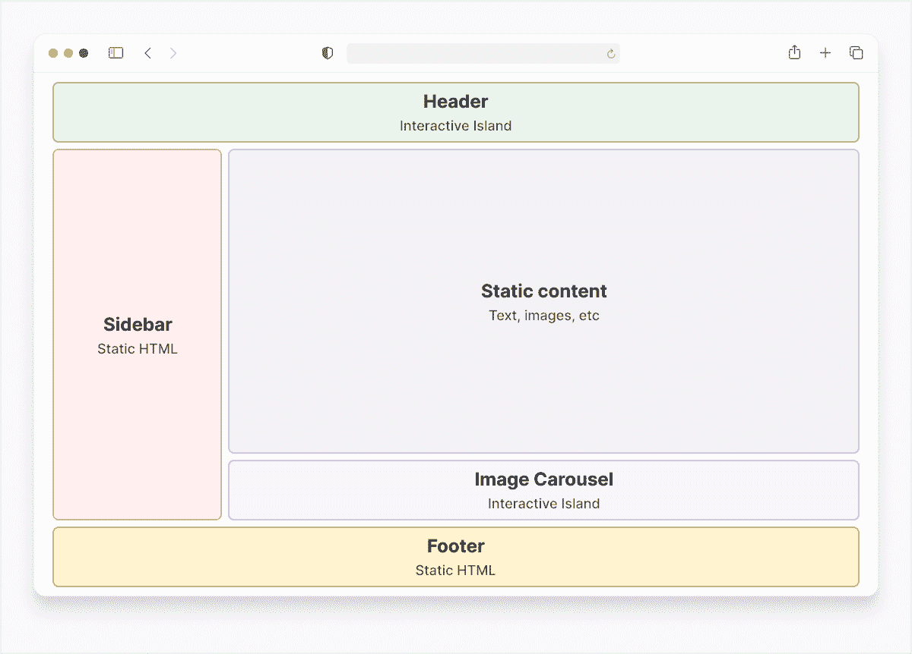
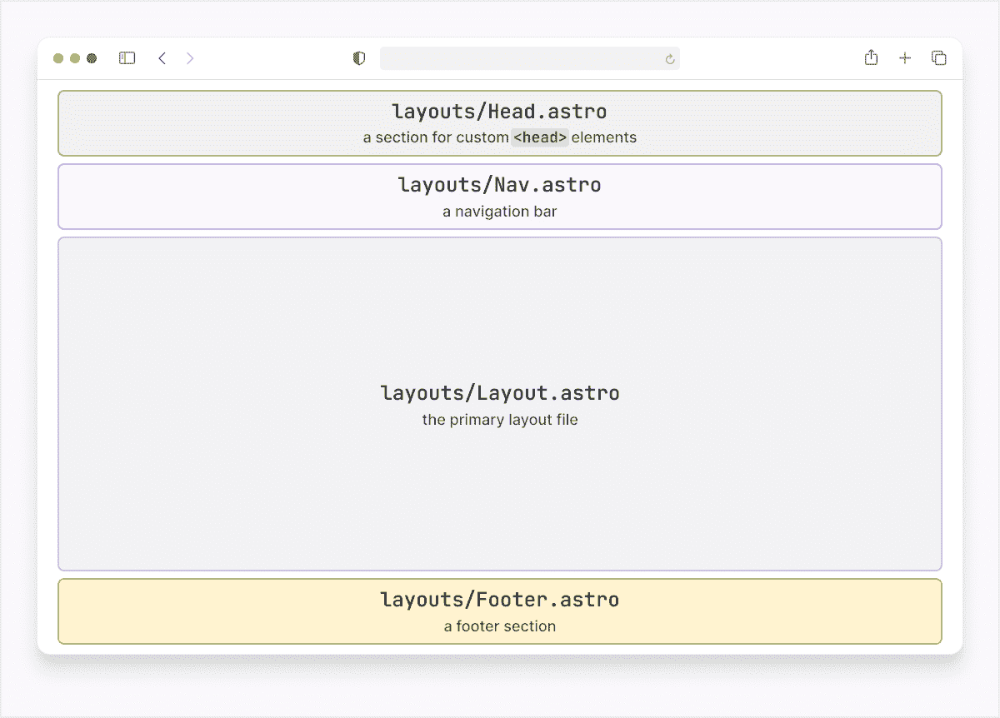
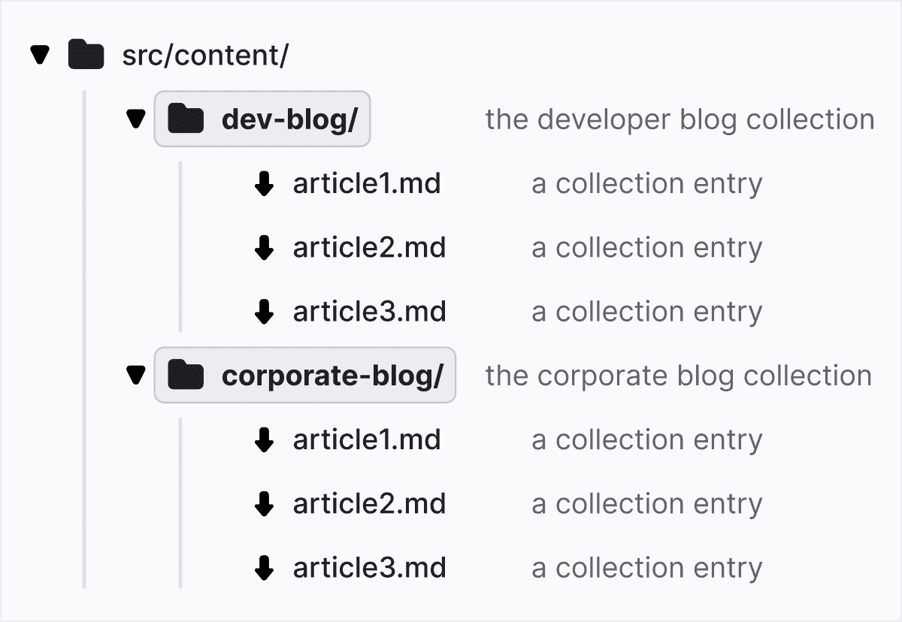
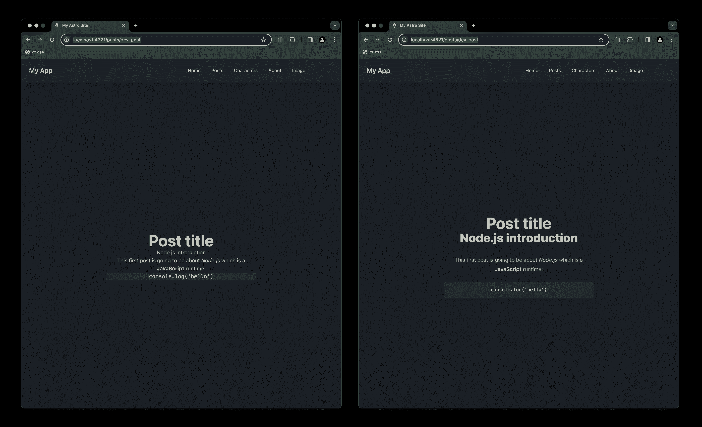

# 释放 Astro 的力量


## 关于 SitePoint

SitePoint 专门为 Web 专业人士出版有趣、实用且易于理解的内容。访问[`www.sitepoint.com/`](http://www.sitepoint.com/)获取我们的博客、书籍、通讯、文章和社区论坛。你可以在那里找到关于 JavaScript、PHP、设计等信息。

## 关于作者

Tamas 是 Web 技术 Google 开发者专家（GDE），也是一位资深的开发者布道师。他是现代 Web 技术的热情支持者，帮助人们理解并解锁 Web 开发中最新且最大的功能。

# 前言

## 谁应该读这本书？

本书适用于想要学习使用 Astro 构建网站的开发者。它假设读者已经熟悉 JavaScript、HTML 和 CSS。对其他前端框架有一定的了解将有所帮助，但并非必须。

## 使用的惯例

### 代码示例

书中的代码使用等宽字体显示，如下：

```
<h1>A Perfect Summer's Day</h1>
<p>这是一个适合在公园散步的美好日子。
鸟儿在歌唱，孩子们都回学校上学了。</p>
```

你会发现我们在整本书中使用了特定的布局样式来表示不同类型的信息。请关注以下项目。

### 提示、备注和警告

#### 嘿，你！

提示（Tips）提供了有用的小贴士。

#### 咳，打扰一下……

备注（Notes）是与主题相关但并非至关重要的补充说明。你可以将它们看作额外的信息片段。

#### 确保你始终……

……注意这些重要的要点。

#### 注意！

警告（Warnings）突出了在学习过程中可能会让你绊倒的任何“坑”。

## 补充材料

* [`www.sitepoint.com/community/`](https://www.sitepoint.com/community/)是 SitePoint 的论坛，用于在使用任何棘手问题寻求帮助。

* `books@sitepoint.com`是我们的电子邮箱地址，如果你需要联系我们报告问题或出于任何其他原因。

# 第 1 章：入门 Astro

[Astro](https://astro.build)是一个现代静态站点生成器，允许开发者构建快速、优化的网站——在当今用户需求高、且快速发展的生态系统中，这是一个关键需求。Astro 的故事可以追溯到 2021 年，当时 Fred K. Schott 发布了该框架的第一个版本。在编写本教程时，Astro 已经处于第 4 版本，并添加了许多惊叹的功能。

Astro 在其短的存在时间内[获得了人气](https://2022.stateofjs.com/en-US/libraries/rendering-frameworks/)，原因如下：

* 它具有创新的网站创建方法，强调性能
* 它流畅的开发者体验
* 它无缝融合各种其他框架的能力

部分归功于[来自 Vercel 的新每月赞助](https://astro.build/blog/vercel-official-hosting-partner/)，并且由于它是第一个[实现 View Transitions API](https://thenewstack.io/dev-news-astro-3-0-state-of-css-and-react-opinions/)的框架，Astro 是一个不可忽视的力量。

本教程是系列教程的第一篇，将介绍 Astro 并引导一些基础知识——如渲染、内容集合、数据获取和图像优化。

## Astro 的核心概念

一个框架如何在性能方面脱颖而出？让我们从讨论 Astro 的一个核心概念开始，称为 Astro Islands（岛屿，或组件岛屿）。为了更好地理解这种 Web 架构风格，让我们退一步讨论纯基于组件的开发。如果你以前用过 React、Vue 或 Angular，你可能创建过组件。`Components`封装了功能：React 应用程序只是以逻辑方式组合的一组组件。我最喜欢的类比是组件就像乐高积木：我们使用它们来构建项目。

在 React 和 Angular 等框架中，组件底层的工作方式存在一个显著的问题。通常，在创建项目时，某些组件并不需要 JavaScript，因为它们是非交互的。例如，考虑一个导航栏。作为组件构建，它可能只包含文本和样式。然而，由于 React 等框架的性质，我们必须加载 JavaScript。否则，组件将无法运行。

当我们谈论`island`（岛屿）时，指的是交互式的 UI 元素——“交互”是指需要运行某些 JavaScript 代码才能完全正常工作。尽管如此，我们同时也可以处理静态（即非交互）组件。回到我们之前的例子，我们可以有一个不需要零字节 JavaScript 的非交互导航栏，而另一个交互组件同时加载一些 JavaScript。



这种架构模式技术也称为部分注水或选择性注水（hydration），与 Web 应用如何加载和渲染内容有关。这两种技术都涉及有目的地地加载和渲染关键部分，延迟加载不重要的组件。其目的是在提供快速的初始页面加载和允许响应式用户体验之间取得平衡。

总结：Astro 使用交互性和非交互性组件来创建站点。

Astro 的默认行为是不发送任何客户端 JavaScript。这并不意味着我们不能在 Astro 项目中使用 JavaScript。恰恰相反。但它的岛屿架构意味着只在需要的地方加载客户端 JavaScript。

## 开始使用 Astro

没有什么比创建一个项目来更适合探索 Astro 了？而且再简单不过了：我们只需要执行`npm create astro@latest`即可创建一个全新的项目。

### npm

上面的命令指的是`npm`，即 Node 包管理器。在处理 Astro 之前，确保你的电脑上安装了最新版本的 Node.js 和`npm`。如果你需要帮助，请查看这篇[关于安装和使用 npm 的全面教程](https://www.sitepoint.com/npm-guide/)。

上述命令将询问多个问题，例如项目的位置以及如何启动项目。这包括对如“blog”等示例模板的选择。为了本教程的目的，只需选择一个空项目即可。

### 启动模板

Astro 提供了丰富的[启动模板](https://docs.astro.build/en/install/auto/#starter-templates)，你可能想要查看这些模板，还有大量的[主题](https://astro.build/themes/)供选择。

流程的下一步一步是确保依赖项已安装。Astro 默认支持 TypeScript，安装程序会提示我们选择计划编写 TypeScript 还是仅 JavaScript。

接下来让我们来看一些关键的文件夹和文件。好消息是，在空项目安装中，这些文件的数量很少。

## 项目结构

`src`文件夹是构建整个应用程序的地方。默认情况下，`src`文件夹包含一个`pages`文件夹和一个`env.d.ts`文件。如前所述，Astro 开箱支持 TypeScript，且`env.d.ts`文件包含一个指向适当 Astro 类型定义的[三斜杠指令](https://www.typescriptlang.org/docs/handbook/triple-slash-directives.html)。

Astro 使用基于文件系统的路由。这本质上意味着放在`pages`文件夹中的每个文件夹和文件都将作为一个路由。因此，在`src/pages`中添加`about.astro`将创建`/about`页面。添加一个新的`countries`文件夹以及`singapore.astro`文件将创建路由`/countries/singapore`——依此类推。

Astro 真正令人惊叹的地方在于，这些页面之间的链接不需要第三方依赖或专用组件。相反，可以使用标准的`<a href="/about">`元素。

### 文件扩展名

我们不需要使用`.astro`扩展名。Astro 也可以使用`.md`、`.mdx`和`.html`扩展，以及`.js`和`.ts`（用于 API 端点，稍后详细介绍）。对于本教程，我们将坚持创建`.astro`文件和组件。

最后一个需要提的文件是`astro.config.mjs`，在其中我们可以指定 Astro 的某些行为或添加插件。我们将在本系列的后续中回到此文件，并探索一些可用选项。

讨论 Astro 建议的一些命名规范也是重要的。其中一些仅仅是建议。然而，Astro 预留了一些文件夹名称。与构建 React 项目类似，Astro 项目包含多个组件（可以是`.astro`或其他）。因此，将这些存储在中心化位置是有意义的。Astro 文档建议将它们存储在`src/components`中。

在接下来的章节中，我们将讨论 Astro 中的布局（layouts），它可以用于定义整个应用程序的 UI 结构。Astro 再次建议使用`src/layouts`处理与 UI 结构相关的文件。

样式是现代 Web 应用的重要部分，`src/styles`可用于存储 CSS 甚至是 Sass 文件。

`public`文件夹可以存储图像和字体等资源。

最后但同样重要的是，除了`src/pages`，Astro 预留的另一个文件夹名称是`src/content`。该位置用于内容集合（content collections），我们稍后会进行探索。

现在我们已经讨论了文件夹结构，让我们讨论一下哪些文件放入哪些文件夹。我们将从查看 Astro 文件是如何构造的开始。（Astro 文件具有`.astro`扩展名，称为“Astro 组件”。）

## Astro 文件的结构

一个`.astro`组件有两个部分：脚本（script）和模板（template）。组件脚本通常位于顶部，它被所谓的代码围栏（code fence）隔开——即“脚本”部分顶部和底部的三横线：`---`。（如果你在 Markdown 中用过`frontmatter`，语法完全相同。）

组件脚本基本上是构建构建期间使用 Node.js 运行时执行的 JavaScript 代码。通常，我们可以在这里导入其他组件（可以是 Astro 组件或其他 React 组件！）、进行数据导入、执行 Fetch API 请求、创建模板中使用的变量，甚至安全地使用 API 密钥或写入数据库。这里需要理解的关键是，编写在 Astro 组件这部分的 JavaScript（或 TypeScript）代码永远不会到达客户端。

在脚本部分创建的任何变量都可以通过大括号在模板部分引用。（我们稍后会看到一个示例。）

Astro 组件的第二部分是模板。这是应该添加 HTML 标签的地方，基于此，Astro 将构建过程中生成最终输出。除了标准的 HTML 元素外，在模板的范围内我们可以使用 JavaScript 表达式、Astro 组件（或来自任何其他[支持框架](https://docs.astro.build/en/guides/integrations-guide/#official-integrations)的组件）以及特殊的 Astro 指令。如果需要客户端 JavaScript，模板也可以自然地接受`<script>`元素。

这是一个示例`.astro`文件的外观，显示了脚本部分和 HTML 模板部分：

```
---
const name = 'Jack'
---
<h1>Hello there, {name}</h1>
```

### 放置 JavaScript

默认情况下，任何添加到`<script>`元素中的 JavaScript 都会被打包，并使用`type="module"`属性添加到静态生成页面的`<head>`中。如果你希望你的 JavaScript 是内联的，请添加`<script is:inline>`。更多细节请见下一节。

## 客户端 JavaScript 与构建时

让我们快速检查组件脚本部分添加 JavaScript 与`<script>`元素的区别。

这里是一种方案：

```
---
const copyrightYear = new Date().getFullYear();
---
<small>Copyright, {copyrightYear}</small>
```

这是另一种方案：

```html
<small>Copyright</small>
<script>
document.querySelector('small').insertAdjacentText('beforeend',` ${new Date().getFullYear()}`);
</script>
```

在 Astro 中使用哪种方案来显示年份？两者似乎都能工作，并且都能显示年份。

然而，存在一个关键区别。假设我们使用第一种方案并在 2024 年 12 月 29 日构建并部署项目。然后两年内没有再次构建。当年份过期后，打开页面仍然显示 2024。为什么？因为放在代码围栏`---`之间的 JavaScript 代码是在构建期间执行的。然而，方案二将始终显示正确的年份，因为该代码是在请求时执行的。也就是说，每当有人查看页面时，该 JavaScript 运行。

## Astro 组件

现在我们已经熟悉 Astro 组件的样子，让我们也讨论这些组件的样式。Astro 开箱支持 CSS、Sass 和 Less。类似于在组件中添加`<script>`元素，添加`<style>`元素也是可能的。好消息是？CSS 规则默认限制在定义它们的组件。这意味着在单个页面或组件级别定义的样式不会污染应用程序的其他部分，CSS 规则仅适用于页面/组件。尽管如此，通过向`<style>`元素添加`is:global`属性也可以创建全局样式。

看这个示例：

```
<style is:global>
p {
  font-weight: bold;
}
</style>
```

在上面的代码示例中，由于`is:global`指令的作用，整个项目中的所有段落都会加粗。这两种方法也可以通过使用`<style>`元素和`:global()`CSS 选择器结合起来。

此外，可以通过`<style>`元素上的`define:vars`属性从 Astro 组件的脚本部分使用 CSS 变量。

```javascript
---
const important = `#f00`;
---
<style define:vars={{ important }}>
p {
  color: var(--important);
}
</style>
<p>Important message</p>
```

在上面的代码中，我们正在 JavaScript 中定义一个变量（`important`），然后通过`<style>`元素上的`define:vars`指令，将其作为 CSS 变量在 Astro 模板中复用。

最后，如果我们有外部样式表并将其放置在`public`文件夹中，我们就可以使用标准的 ESM`import`语法从组件内部轻松地导入它们：

```js
---
import '../path/to/style.css'
---
<p>some html...</p>
```

让我们还从更大生态系统的背景下来谈谈 Astro。Astro 集成了诸如[Tailwind](https://tailwindcss.com)（一个实用优先的 CSS 框架）和[Partytown](https://partytown.builder.io)（一个旨在帮助将资源密集型脚本——如第三方脚本——移动到 Web Worker 的库，从而释放主线程来处理应用程序特定的 JavaScript 工具）。

## 自定义集成

值得注意的是，我们还可以 Astro 的[集成 API](https://docs.astro.build/en/reference/integrations-reference/)构建自定义集成。

使用 Tailwind（以及其他官方支持的集成）最简单的方法是使用`npx astro add [integration]`命令：`npx astro add tailwind`。该命令会自动安装兼容版本的 Tailwind，生成自定义的`tailwind.config.cjs`文件，并更新`astro.config.mjs`如下所示，这使得向项目中添加 Tailwind 变得非常简单：

```js
import { defineConfig } from 'astro/config';

import tailwind from "@astrojs/tailwind";

// https://astro.build/config
export default defineConfig({
  integrations: [tailwind()]
});
```

## 演示

在本书中，我们将引用一个示例应用，你也可以通过访问[stackblitz.com](https://stackblitz.com/github/tpiros/sitepoint-astro)来查看。为了巩固你在第一章中学到的知识，回顾此演示中的文件和文件夹结构以及 Tailwind 设置将很有帮助。

## 总结

在本章中，我们介绍了 Astro，这是一个现代前端框架。Astro 的日益流行归功于其创新的 Web 开发方法，优先考虑性能、无缝的开发者体验以及与其他框架和工具集成的能力。

本章的一些要点包括：

* **岛屿 (Islands)**。Astro 的岛屿架构允许我们创建交互性岛屿——在应用程序需要的地方和时候加载 JavaScript。
* **项目结构**。我们对 Astro 项目的项目结构的概述展示了 Astro 项目中常见的关键文件和文件夹。
* **文件剖析**。我们探索了`.astro`文件的剖析，讨论了典型的`.astro`文件的脚本部分和模板部分看起来是什么。
* **样式化**。我们简要提到了如何在 Astro 中使用样式。

这个 Astro 系列的第一章就到此了。现在我们已经涵盖了基本概念，接下来将查看 Astro 的渲染选项和布局方案。


# 第 2 章：Astro 中的渲染选项：构建布局

在之前的教程中，我们查看了 `Astro` 的基础知识：它的文件夹结构、组件如何工作以及样式化如何工作。

本教程将重点关注布局（`Layouts`）以及 `Astro` 提供的各种渲染选项。渲染在任何 Web 中都起着至关重要的作用，因为它的目标是将最终输出显示给最终用户。通过 `Astro`，我们可以灵活地在两种主要的渲染模式之间选择：**静态站点生成**（`SSG`）和**服务器端渲染**（`SSR`）。前者适合在构建过程中生成高度优化的预构建 `HTML`，从而实现极快的加载速度和 `SEO` 友好的网站。后者允许在服务器上生成动态内容，在性能和灵活性之间取得平衡。

## Astro 中的布局

虽然每个 `.astro` 页面（路由）都有包含完整 `HTML` 文档的潜力，但重复这种结构是低效的，特别是当某些元素——例如 `<meta>` 和 `<title>` 元素可能会根据当前查看的页面而变化时。（低效源于我们可能需要向每个 `.astro` 页面添加相同的 `HTML` 结构。）

因此，建议建立一个可在所有页面使用的总览布局。虽然不是强制的，但在 `src/layouts` 文件夹中组织布局文件是有意义的，这允许添加多个布局文件——例如一个用于导航，另一个用于页脚，甚至为页面的部分拆分布局（例如，为整个页面和博客分开设置布局）。

考虑以下内容作为包含常用 `UI` 元素的基础网站示例：

- `layouts/Layout.astro`：主布局文件
- `layouts/Head.astro`：用于自定义 `<head>` 元素的部分，每个页面可能唯一
- `layouts/Nav.astro`：导航栏
- `layouts/Footer.astro`：页脚部分



这里是 `layouts/Layout.astro` 文件的预览：

```astro
---
import Head from './Head.astro';
import Nav from './Nav.astro';
const {
  title = 'Footie is the best',
  description = 'An online football magazine',
} = Astro.props;

import Footer from './Footer.astro';
---

<html lang="en">
  <title>{title}</title>
  <meta name="description" content={description}>
  <body>
    <Nav />
    <div>
      <main>
        <slot />
      </main>
    </div>
    <Footer />
  </body>
</html>
```

### 混合 HTML 元素与 Astro 组件

注意在上面的例子中，我们混合了 `HTML` 元素和 `Astro` 组件。大写的那些（`Nav` 和 `Footer`）是位于布局文件顶部的 `Astro` 组件。

### Astro.props

这里有几个要点。注意 `import` 函数和 `Astro.props` 的用法。特殊的内置 `Astro.props` 对象允许我们向组件发送属性并访问它们。当 `Astro.props` 缺少 `title` 或 `description` 键时，会设置默认值（`Footie is the best` 和 `An football magazine`）。这是良好的做法，我们利用了 `JavaScript` 的默认参数。但是，如果发送了 `props`，`Astro` 会获取它们。让我们通过查看下面的代码来看：

```js
<!-- 使用默认值 -->
<Layout />

<!-- 将 title 设置为 "My Title"，description 保持默认值 -->
<Layout title="My Title" />
```

第一个 `<Layout />` 组件没有任何 `props`，因此它将诉诸之前提到的默认值。在第二种情况下，发送了值为 `My Title` 的 `title` prop，这意味着页面将显示正确的标题。

#### 全局对象属性

从内置全局对象 [Astro](https://docs.astro.build/en/reference/api-reference/#astro-global) 可以获得多个属性。

最后，注意 `<slot />` 元素，它是来自 `.astro` 页面内容的插入点。稍后详细介绍。

### Slot

让我们再多谈谈内置的 `<slot />` 元素。一旦布局就绪，`src/pages` 文件夹中 `Astro` 文件的内容将插入到上述元素所在的位置。

请同时也注意 `<Head>` Astro 组件。假设属性和持有我们要发送到属性的变量具有相同的名称。在这种情况下，我们可以采用更简单的语法：

```js
const title = 'my title';

<Head title={title} />
<!-- 可以简化为 👇 -->
<Head {title} />
```

要将布局应用到 `Astro` 文件，我们需要导入它并像使用其他组件一样使用它：

```
---
import Layout from '../layouts/Layout.astro';
---
<Layout title="Welcome">
  <p>一些将注入到“插槽”中的内容</p>
</Layout>
```

## Components

除了布局组件外，推荐的做法是创建一个 `src/components` 文件夹来存储各种组件。在 `Astro` 中，我们可以包含任何“类型”的组件——例如，同时包含 `.astro` 和 `.jsx` 组件。`Astro` 的强大功能之一是它可以添加在其他框架中创建的组件。

要做到这一点，我们首先需要安装相应的集成方案。（对于 `React`，将使用 `@astrojs/react`，正如[文档中](https://docs.astro.build/en/guides/integrations-guide/react/)所解释的那样。）安装完成后，我们可以查看一个将 `React` 组件添加到 `Astro` 的示例：

```javascript
import { useState } from 'react';

const Counter = () => {
  const [counter, setCounter] = useState(0);

  const increment = () => {
    setCounter(counter + 1);
  };

  const decrement = () => {
    setCounter(counter - 1);
  };

  return (
    <div>
      <h1>Counter: {counter}</h1>
      <button onClick={increment}> + </button>
      <button onClick={decrement}> - </button>
    </div>
  );
};

export default Counter;
```

上面的代码是一个带有计数器的 `React` 组件，计数器可以增加和减少。现在让我们把它添加到 `Astro` 中：

```astro
---
import Counter from '../components/Counter.jsx';
---
<Counter client:only="react" />
```

注意 `client:only="react"`，它是[客户端指令](https://docs.astro.build/en/reference/directives-reference/)之一。有多种方法使用这些指令，我们将在本章末尾再讨论它们。

## Routing

正如之前讨论的，`Astro` 路由围绕 `src/pages` 文件夹中的文件展开。在本章中，我们将涵盖三种类型的路由：静态路由、动态路由和服务器端点（`API` 路由）。

### Static Routes

静态路由非常直观：`.astro` 文件变为 `src/pages` 文件夹中的路由。例如：

- `src/pages/about.astro` 变为 `example.com/about`
- `src/pages/destinations/london.astro` 变为 `example.com/destinations/london`

请回想上一章，`.md`、`.mdx` 和 `.html` 文件也可以生成路由。例如，`/src/pages/hello.md` 变为 `example.com/hello`。

### Dynamic Routes

当由于动态变化无法手动创建路由时，动态路由会非常有用。例如，如果我们正在制作一个列出目的地的页面，而有 100 多个目的地（或者数量未知），该怎么办？为每种可能的路由组合创建单独的 `.astro` 文件是不可行的。

相反，我们可以指示 `Astro` 使用动态路由：`src/pages/[destination]` 将会变为 `src/pages/*`，从而有效地处理所有潜在的变体，例如 `example.com/london`、`example.com/singapore` 等。（注意，路由实际上需要 `[]` 字符。）

为了方便动态路由，`Astro` 需要一些关于如何为动态路由生成文件的信息。这是通过内置的 `getStaticPaths()` 方法实现的。它返回一个对象数组，每个对象包含一个强制性的 `params` 对象。该对象应该匹配动态路由定义（在我们的案例中为 `destination`）：

```astro
---
const { destination } = Astro.params;

export function getStaticPaths() {
  const destinations = [
    'london',
    'rome',
    'sanfrancisco',
    'singapore',
    'cairo',
    'medellin',
  ];
  // ☝🏼记住，由于这段 JavaScript 是在服务器上执行的，我们也可以从 REST API 端点拉取这些数据
  return destinations.map((destination) => ({ params: { destination } }));
}
---
<h1>Welcome to: {destination}</h1>
```

对于需要处理多个参数的情况（例如 `/src/pages/[city]-[country].astro`），我们可以向 `params` 对象传递多个 prop：

```javascript
return [{ params: { city: 'london', country: 'uk' } }];
```

#### 404 Pages

如果存在一个不匹配路由的页面，`Astro` 将生成一个 `404` 页面。通过在 `src/pages` 文件夹中创建 `404.astro` 页面，可以自定义该页的内容。

#### Rest Params

`Astro` 在动态 `URL` 路由中也支持剩余参数，如 `src/pages/destinations/[...path].astro` 所示。这提供了更大的灵活性。例如，我们可以匹配任何组合的路径，如 `example.com/destinations/london` 和 `example.com/london` 以及 `example.com/destinations/favourites/rome`。

#### Path Undefined

在 `getStaticPaths()` 中返回 `{params: { path: undefined }}` 可以有效匹配 `example.com/destinations/`。

## Server-side Rendering

在我们继续讨论路由之前，让我们稍微转向讨论 `Astro` 的另一个非常重要的方面：服务器端渲染。

回顾一下，`Astro` 的默认行为是静态站点生成。这意味着所有页面都在构建期间生成。然而，在某些情况下这种方法并不适用；动态性质的内容需要服务器端渲染。假设我们有一个小型电子商务网站，每次购买后我们都必须重建整个网站来显示修改后的库存。这不仅不可行，而且会出现显示错误库存信息的情况。服务器端渲染解决了这个问题，因为页面内容是在请求时渲染的，这意味着可以获取最新的信息。

之前我们提到了 `astro.config.mjs` 文件。这是我们开启服务器端渲染的地方：

```javascript
import { defineConfig } from 'astro/config';
import nodejs from '@astrojs/node';

export default defineConfig({
  output: 'server',
  adapter: nodejs(),
});
```

`output: 'server'` 是这里的关键，但请注意 `adapter` 设置。服务器端渲染需要一个执行服务器端代码的运行时。

### Adding the Node Adapter

我们还需要运行 `npx astro add node` 命令来安装并让 `Astro` 自动为项目配置 `nodejs()` 适配器。

这里的关键在于通过此设置，我们现在关闭了 `Astro` 默认的静态渲染机制，将其替换为服务器端渲染——针对所有页面。

但如果我们某些页面不需要 `SSR` 呢？幸运的是，`Astro` 允许我们根据路由选择地关闭 `SSR`。确保在任何页面路由顶部添加以下内容：

```astro
---
export const prerender = true;
---
<p>此页面在构建期间进行预渲染</p>
```

### Hybrid Rendering

甚至更好，我们可以反向操作，可以这么说：与设置 `output: 'server'` 相反，我们可以设置 `output: 'hybrid'`，这意味着保留默认行为（构建期间的静态站点生成），然后在显式启用 `SSR` 的页面路由添加以下内容：

```astro
---
export const prerender = false;
---
<p>此页面现在是服务器渲染的</p>
```

## Server-side Rendering Routes

现在让我们继续讨论路由。对于服务器端渲染的页面，不应使用 `getStaticPaths()`，因为内容是在请求时渲染的，而不是在构建期间。

### Endpoints

`Astro` 有两种类型的端点：静态（`Static`）和 `API`/服务器（`Server`）。可以通过向 `src/pages` 目录添加 `.js` 或 `.ts` 文件来创建静态端点，这些文件会在构建时被调用以生成静态文件。还需要注意的是，在构建过程中扩展名会被移除。例如，`src/pages/destinations.json.js` 将变为 `/destinations.json`。

端点可以访问 `request` 和 `params` 对象，并且应该导出一个 `GET` 函数。此外，还支持动态路由（通过 `[]` 文件命名约定）。将之前的示例使用 `getStaticPaths()` 重构为端点，其如下所示：

```javascript
// src/pages/api/[destination].json.js
const destinations = [
  'london',
  'rome',
  'sanfrancisco',
  'singapore',
  'cairo',
  'medellin',
];

export const GET = ({ params }) => {
  const { destination } = params;
  const [myDestination] = destinations.filter(
    (destination) => destination === destination
  );
  return new Response(
    JSON.stringify({
      destination: myDestination,
    })
  );
};

export function getStaticPaths() {
  return destinations.map((destination) => {
    return {
      params: {
        destination,
      },
    };
  });
}
```

### 使用 api 文件夹

注意，使用 `api` 文件夹并不是强制的，但它提供了良好的关注点分离，我们强烈建议使用它来存储 `API` 端点。

### 访问 request 对象

端点也可以访问 `request` 对象，但在静态模式下，`request.url` 是该对象唯一的可用属性。

### 服务器端点

要创建服务器端点（`API` 路由），我们需要在 `Astro` 的配置文件启用 `SSR` 模式。

在页面目录中添加 `.js` 或 `.ts` 文件可以创建 `REST API` 端点，它们不仅可以使用 `GET` 方法，还可以访问所有其他 `CRUD` 方法（`POST`、`PUT`、`DELETE`）。

### 处理 GET、POST 和 DELETE 请求

处理 `HTTP` 删除请求时，在 `Astro` 中使用 `del`，因为 `delete` 是 `JavaScript` 的内置关键字。

下面的示例说明了如何在 `Astro` 中处理 `HTTP` `GET`、`POST` 和 `DELETE` 请求。`GET` 方法接受参数（注意路由的定义方式：`src/pages/api/[id].json.js`）。由于路由中有 `[id]`，我们可以对 `params` 对象进行解构并获取 `id` 的值。`GET` 方法中的其余代码执行了一个假设的数据库查询，并返回一个带有查询数据的响应。


`POST` 方法检查请求中是否发送了 `Authorization` 请求头。如果没有，我们返回 HTTP 状态码 401（未授权）。注意我们在这里简化了代码，身份验证/授权需要更多步骤)。如果一切正常，我们解析作为请求部分发送的数据，执行一个假设的数据库插入，并返回成功的 201 消息：

```javascript
// src/pages/api/[id].json.js
import { getCityData, addCity } from './fake-db.js';

export const GET = async ({ params }) => {
  const { id } = params;
  const cityData = await getCityData(id);
  return new Response(JSON.stringify(cityData), {
    status: 200,
    headers: {
      'Content-Type': 'application/json',
    },
  });
};

export const POST = async ({ request }) => {
  if (!request.headers.get('Authorization')) {
    return new Response(null, { status: 401 });
  }
  const body = await request.json();
  const city = body.city;
  await addCity(city);
  return new Response(
    JSON.stringify({
      message: 'City added',
    }),
    {
      status: 201,
    }
  );
};

export const DEL = ({ request }) => {
  // Handle HTTP delete
};
```

### 使用`request`对象

注意，充分利用`request`对象来实现授权并接收传入的数据（这些可能来自表单）是非常重要的。

## 交互式组件的水化（Hydration）

在上一章中，我们讨论了 Astro 的孤屿架构，这基本上是将 Web 应用程序分解为孤立岛的方法，每个岛负责渲染页面的特定部分。此外，这种架构还可以决定哪些元素需要加载 JavaScript。

本章将讨论的最后一点是 Astro 如何水化交互式组件。通过 Astro，我们可以控制客户端 JavaScript 何时以及如何加载。

### 水化策略总结

- `client:load`：该选项优先级高，适用于关键元素。JavaScript 在初始加载期间加载。
- `client:idle`：该选项具有中等优先级，非常适合可以等待浏览器触发`requestIdle`的组件。
- `client:visible`：这种低优先级选择适用于初始隐藏在视图中的组件。JavaScript 在组件变得可见时加载。
- `client:media`：最适用于仅在特定屏幕尺寸下可见的组件。当在指定的媒体查询触发时加载 JavaScript。
- `client:only`：此属性跳过 HTML 渲染，仅在客户端进行渲染。然而，我们必须指定要加载的框架。

## 获取执行

在启用服务端渲染（SSR）时，`fetch`调用会在请求时执行；而在未启用 SSR（即 Astro 正常的静态站点渲染模式）时，`fetch`调用会在构建时执行。

让我们来看看它是如何运作的。在任何`.astro`页面中，我们可以直接使用类似下面的代码来获取数据：

```astro
---
const response = await fetch('an-api-endpoint');
const data = await response.json();
---
<pre>{JSON.stringify(data)}</pre>
```

上述代码向端点发送了 Fetch API 请求，将数据解析为 JSON 对象，然后使用简单的`JSON.stringify`方法显示数据。

让我们创建另一个示例，通过获取真实数据来查看如何遍历结果。虽然世界上有很多免费的 REST API 可用，但我选择的是使用[星球大战 API](https://swapi.dev)：

```astro
---
const response = await fetch('https://swapi.dev/api/people');
const data = await response.json();
const characters = data.results;
---
<h1>Star Wars Characters</h1>
<ul
  {characters.map(({name}) => (
    <li>{name}</li>
  ))}
</ul>
```

上述代码向上述 REST API 发起请求，处理数据，并使用标准的 JavaScript`map()`方法遍历结果。

注意，我们也可以消费作为项目一部分创建的 API 端点。（我们在上一节中介绍过服务器端点。）要实现此点，我们需要引用完整的 URL，但幸运的是 Astro 通过一个内置全局对象暴露了该内容：`Astro.url`。这是引用自定义构建的 API 调用时的代码写法：

```astro
---
const response = await fetch(`${Astro.url.origin}/api/endpoint`);
const data = await response.json();
---
<pre>{JSON.stringify(data)}</pre>
```

这使得检索数据变得极其简单。

## 使用 GraphQL

有时项目中的需求可能要求使用 GraphQL 而不是 REST API。（GraphQL 是一种用于 API 的查询语言，允许客户端精确地请求它们所需的数据，与通常暴露一组具有预定义数据结构的固定端点的传统 REST API 相比，它有助于更高效、更灵活的数据检索。）

Astro 也可以无缝地与 GraphQL 端点交互并利用 Fetch API，因此我们仍然可以在不向项目添加任何额外依赖的情况下执行 GraphQL 查询：

```astro
---
const method = 'POST';
const query = `{
  query getDestination($id: ID) {
      destination($id) {
        capital,
        flag
      }
    }
  }
}`;
const variables = {
  id: 'italy'
}

const options = {
  method,
  body: {
    query,
    variables
  }
}
const response = await fetch('/graphql/endpoint', options);
const data = await response.json();
---
<pre>{JSON.stringify(data)}</pre>
```

在上面的代码中，我们正在构建一个 GraphQL 查询，以从 GraphQL 服务获取关于目的地的信息。作为查询的一部分，我们请求了首都是旗帜。由于这是一个参数化的 GraphQL 查询，我们还指定了`id`的取值。

接下来，我们创建了一个`options`对象，它将确保我们的 Fetch API 请求使用`POST` HTTP 方法，并将 GraphQL 查询及其变量作为请求体的一部分发送。代码的其余部分是非常自言易懂的：我们发起请求，处理响应，并使用`JSON.stringify()`将其显示。

## 从服务器端点检索数据

如上一节所述，Astro 可以创建服务器 API 端点，也可以消费从这些服务器端点返回的数据。

假设我们已经添加了`src/pages/api/products.json`（一个服务器 API 端点）。在这种情况下，我们可以通过在任何`src/pages/`页面中添加类似的内容来轻松访问它，如下所示：

```astro
---
const response = await fetch(`${Astro.url.origin}/api/products.json`);
const products = await response.json();
---
<ul>
  {products.map((data) => <li>{data.name}</li>)}
</ul>
```

在这段代码中，我们向 Astro 端点发送请求，获取结果并将其存储在`products`中。由于返回的数据是一个数组，我们可以使用`map()`方法进行遍历。

### 受边界保护的敏感数据

请记住，由于`---`边界之间的代码是在构建时执行的，因此在获取数据中使用 API 密钥和其他方法也是安全的。

## 表单

虽然处理表单数据不一定与数据检索直接相关，但在这里提到它是值得的。在 Astro 中，我们不仅可以依靠`Astro.request`来检查传入的方法（通过`.method`属性）是否为`POST`方法，还可以访问从 UI 界面发送的`formData`。

### `formData`和 SSR

注意，`formData`只有在启用服务端渲染时可用。

你可以在`.astro`文件的脚本部分访问任何形式的表单数据：

```astro
---
if (Astro.request.method === 'POST') {
  const data = await Astro.request.formData();
  const name = data.get('name');
  // 处理 'data'
}
---
<h1>Form</h1>
<form method="post">
  <input type="text" name="name" />
  <button>Submit</button>
</form>
```

Astro 2 版本中的一个显著特性是引入了内容集合（content collections）。这一功能在处理`.md`或`.mdx`文件时被证明特别有价值。内容集合使我们能够有效地管理内容，同时还为 Astro 项目中的所有内容提供了数据验证和 TypeScript 类型安全。

从 Astro 3 版本开始，并随着 4 版本新增新功能，视图过渡（view transitions）也是 Astro 的一部分。事实上，Astro 是第一个实现这一新 Web 特性的框架。`View transitions`是一种用户导航辅助工具：它们能够将用户的注意力无缝引导至页面的核心信息，从而提供丰富的用户体验。通过视图过渡，可以在不牺牲性能的情况下提升用户体验。

## 开始使用内容集合

为了使用内容集合，Astro 指定了一个特殊文件夹：`src/content`。随后，我们可以在此位置创建子文件夹，每个子文件夹生成一个独立的内容集合。例如，我们可以创建如`src/content/dev-blog`和`src/content/corporate-blog`这样的集合。



每个内容集合都可以在配置文件——`/src/content/config.js`（或`.ts`）中配置，在其中，我们可以选择使用[Zod](https://zod.dev)使用集合模式（schemas）。

Zod 是一种“带有静态类型推断的 TypeScript 优先模式验证”，已集成到 Astro 中。以下是其实现形式的示例：

```javascript
// src/content/config.js
import { z, defineCollection } from 'astro:content';

const devBlogCollection = defineCollection({
  schema: z.object({
    title: z.string(),
    author: z.string().default('The Dev Team'),
    tags: z.array(z.string()),
    date: z.date(),
    draft: z.boolean().default(true),
    description: z.string(),
  }),
});

const corporateBlogCollection = defineCollection({
  schema: z.object({
    title: z.string(),
    author: z.string(),
    date: z.date(),
    featured: z.boolean(),
    language: z.enum(['en', 'es']),
  }),
});

export const collections = {
  devblog: devBlogCollection,
  corporateblog: corporateBlogCollection,
};
```

在上面的代码中，我们定义了两个内容集合——一个用于“开发者博客”，另一个用于“企业博客”。`defineCollection`方法允许我们为任何给定的集合创建`schema`。对于“开发者博客”，我们创建了一个模式，其中该类别的文章必须具有标题（字符串）、作者（字符串，默认为“The Dev Team”）、标签（字符串数组）、日期（日期类型）、草稿（默认为`true`的布尔值）和描述（字符串）。

对于“企业博客”，我们的模式略有不同：标题和作者都是字符串类型。日期（数据类型）也是内容所必需的，还有精选（布尔值）标记和语言（枚举），语言可以设置为`en`或`es`。

最后，我们导出了包含两个属性`devblog`和`corporateblog`的`collections`对象。这些属性将在后文中使用。

### Markdown 文件与前置元数据（Frontmatter）

本教程中关于内容集合的示例假设`.md`文件还包含了与配置文件中指定的模式匹配的`frontmatter`。例如，一个示例“企业博客”文章看起来如下：

```markdown
---
title: 'Buy!!'
author: 'Jack from Marketing'
date: 2023-07-19
featured: true
language: 'en'
---

# Some Marketing Promo

This is the best product!
```

### Slug 的生成

Astro 会根据文件名自动为文章生成 slug。例如，`first-post.md`的 slug 将是`first-post`。然而，如果我们在`frontmatter`中提供了`slug`条目，Astro 将尊重它并使用我们自定义的 slug。

请记住，在`export const collections`对象中指定的属性必须与内容所在的文件夹名称相匹配。（另外注意，它们是区分大小大小的！）

### 查询数据

一旦我们准备好了所有的 Markdown 文件（在本文中，它们位于`src/content/devblog`和`src/content/corporateblog`下）以及`config.js`文件，我们就可以开始从集合中查询数据了，这是一个非常直接的过程：

```javascript
---
import { getCollection } from 'astro:content';
const allDevPosts = await getCollection('devblog');
const allCorporatePosts = await getCollection('corporateblog');
---
<pre>{JSON.stringify(allDevPosts)}</pre>
<pre>{JSON.stringify(allCorporatePosts)}</pre>
```

如上所示，可以使用`getCollection`方法从给定的集合中检索所有条目（再次引用之前导出的集合名称）。在上面的示例中，我们从“开发者博客”（`devblog`）和“企业博客”（`corporateblog`）中检索了所有文章。在模板中，我们简单地使用`JSON.stringify()`返回原始数据。

我们应该检查通过`JSON.stringify()`显示的数据，并应该注意，除了`frontmatter`数据外，我们还会获得`id`、`slug`和`body`属性，其中后者包含文章的内容。

我们还可以通过迭代在`frontmatter`中过滤草稿或特定语言的文章：

```javascript
import { getCollection } from 'astro:content';

const spanishEntries = await getCollection('corporateblog', ({ data }) => {
  return data.language === 'es';
});
```

`getCollection`返回所有文章，但我们也可以使用`getEntry`从集合中返回单个条目：

```javascript
import { getEntry } from 'astro:content';

const singleEntry = await getEntry('corporateblog', 'article-1');
```

### `getCollection` vs `getEntries`

虽然有两种方法可以从集合中返回多篇文章，但它们之间存在细微的。`getCollection()`通过集合名称检索内容条目列表，而`getEntries()`则从同一个集合中检索多个集合条目。


# Astro 内容集合与视图过渡

Astro 文档提供了一个示例，说明在使用引用实体（例如，相关文章列表）时使用`getEntries()`来获取内容。相关文章的概念是指引用集合中的文章数组。这可以通过在使用`defineCollection`方法时向模式添加以下内容来实现：

```javascript
import { defineCollection, reference, z } from 'astro:content';

const devblog = defineCollection({
  type: 'content',
  schema: z.object({
    title: z.string(),
    relatedPosts: z.array(reference('blog')),
  }),
});
```

在上面的代码中，我们还导入了`reference`并在向模式中添加`relatedPosts`时使用了它。（注意，我们可以为它起任何名称，例如`recommendedPosts`或`followupPosts`。）

要使用这些`relatedPosts`，应该在 Markdown 的`frontmatter`部分添加适当的 slug 值：

```markdown
---
title: "This is a post"
relatedPosts:

- A related post # `src/content/devblog/a-related-post.md
```

引用实体在内容集合的`config.js`文件中定义，并使用 Zod 的`reference`方法：

```javascript
const blog = defineCollection({
  type: 'content',
  schema: z.object({
    title: z.string(),
    relatedPosts: z.array(reference('blog')).optional(),
    author: reference('author'),
  }),
});

const author = defineCollection({
  type: 'data',
  schema: z.object({
    name: z.string(),
  }),
});
```

同时注意`type: 'content'`和`type: 'data'`的用法。在这种情况下，集合包含了内容创作格式（如 Markdown，`type: 'content'`）和数据格式（如 JSON 或 YAML，`type: 'data'`）。

### 显示内容

现在我们已经知道了如何查询数据，让我们来讨论如何实际上以格式化的方式显示它们。Astro 提供了一个名为`render()`的方便方法，可以将整个 Markdown 内容渲染到一个名为`<Content />`的内置 Astro 组件中。我们如何构建和显示内容，也将取决于我们使用的是静态站点生成（SSG）还是服务器端渲染（SSR）模式。

对于预渲染，我们可以使用`getStaticPaths()`方法：

```
// /src/pages/posts/[...slug].astro
---
import { getCollection } from 'astro:content';

export async function getStaticPaths() {
  const blogEntries = await getCollection('blog');
  return blogEntries.map(entry => ({
    params: { slug: entry.slug }, props: { entry },
  }));
}

const { entry } = Astro.props;
const { Content } = await entry.render();
---
<h1>{entry.data.title}</h1>
<Content />
```

在上面的代码中，我们使用了`getStaticPaths()`。（我们在本书的第二章中介绍过这个方法，它是处理动态路由的一种方式。）然后我们依赖`Astro.props`来捕获`entry`，它是一个包含条目元数据、`id`、`slug`以及一个`render()`方法的对象。该方法负责在 Astro 模板中将 Markdown 条目渲染为 HTML，它通过创建一个`<Content />`组件来实现。这令人惊叹的是，我们现在只需要将`<Content />`组件添加到我们的模板中，就能看到 Markdown 内容被渲染成 HTML 了。

## 渲染选项

作为一个回顾，或者以防你错过了内容，本书的第二章讨论了可用的各种渲染选项。

对于 SSR，需要遵循稍微不同的方法。不再使用`getStaticPaths()`，而是可以利用`Astro.params`，因为内容将在请求时被拉取并渲染：

```
---
import { getEntry } from 'astro:content';

const { slug } = Astro.params;
const entry = await getEntry('blog', slug);
const { Content } = await entry.render();
---
<h1>{entry.data.title}</h1>
<Content />
```

## 在 Astro 中集成 Tailwind CSS

在入门教程中，我们讨论了如何将 Tailwind CSS 与 Astro 集成。Tailwind 有一个[排版插件](https://tailwindcss.com/docs/typography-plugin)（`@tailwindcss/typography`），可以为从 Markdown 渲染的 HTML 添加样式。如果你还没有查看，建议你检查一下。请查看下面的截图。左侧是没有使用排版插件的 Markdown 渲染模板，右侧是使用了它的模板。



## 视图过渡 (View Transitions)

[View Transitions API](https://developer.mozilla.org/en-US/docs/Web/API/View_Transitions_API) 提供了一种在不同 DOM 状态之间生成动画过渡的方法，同时在单次操作中更新 DOM 内容。这在 Web 上通常是很实用的，但有了这个新的 API，可以用非常简单的方式处理过渡。[研究](https://developer.chrome.com/blog/view-transitions-case-studies/#redbus)表明，使用 View Transitions API 可以提高网站的感知性能。

Astro 原生支持视图过渡，并为目前不支持该 API 的浏览器提供了内置的备备机制。

这种开箱即用的方案支持内置动画、前进和后退导航的动画，以及对无障碍（通过`prefers-reduced-motion`）的自动支持，等等许多功能。

### 减少运动

`prefers-reduced-motion`媒体查询很重要，因为它允许网页开发者通过尊重用户对减少运动的偏好来创建更具包容性和无障碍的用户体验，从而使运动敏感或前庭功能障碍的人士受益。

### 浏览器对视图过渡的支持

虽然 View Transition API 是一项伟大的创新并且值得尝试，但请记住它仍然处于实验阶段，并且目前[只有部分浏览器支持](https://caniuse.com/view-transitions)。

演示视图过渡的最佳方法之一是利用视频元素，该元素将在页面切换之间保持其状态。（请注意，我们也可以在利用`client:*`指令的组件之间持久化状态。）这种示例可以在此[视频](https://player.vimeo.com/video/884466855?h=fdaebb6dba&badge=0&autopause=0&quality_selector=1&player_id=0&app_id=58479)中所示。

假设我们有一个如下内容的`<Video />`组件：

```javascript
---
// src/components/Video
const src = 'https://res.cloudinary.com/tamas-demo/video/upload/f_auto,q_auto/imagecon/ship.mp4';
const {
  autoplay = false,
  controls = true,
  loop = false
} = Astro.props;
---

<video {controls} {autoplay} {loop} transition:persist>
  <source {src} />
</video>
```

在上面的代码中，我们从 Cloudinary 获取了一个视频。此外，我们允许视频在结束后自动播放并循环（重新播放），并为用户提供了控制按钮。这些设置由发送到此视频组件的属性决定，如果没有提供这些属性，将使用默认值。

请注意`transition:persist`指令。通过此指令，我们在过渡之间维持视频播放器的状态：在导航到下一页时，页面的其他部分将显示更新的内容。我们可以在`index.astro`和`about.astro`页面上使用此组件：

```javascript
// src/pages/index.astro
---
import Video from '../components/Video.astro';
---
<!-- 一些其他 HTML -->
<Video />
```

最后，我们需要启用页面过渡，可以按页面启用，也可以为整个项目全局启用。假设我们有某种布局文件，可以通过从`astro:transitions`导入`ViewTransitions`来轻松启用它：

```javascript
// src/layouts/Layout.astro
---
import { ViewTransitions } from 'astro:transitions';
---
<html lang="en">
  <head>
    <title>我的网站！</title>
    <ViewTransitions />
  </head>
  <body>
    <slot />
  </body>
</html>
```

总之，实验性的 View Transitions API 通过 CSS 伪元素、JavaScript 以及之前和当前 DOM 状态的快照简化了不同页面或元素之间的视觉过渡。它提供了一个增强页面感知性能的新机会，减少了对复杂的自定义 JavaScript 和 CSS 的依赖。

## Demo

我们在 StackBlitz 上为本教程部署的[演示](https://stackblitz.com/github/tpiros/sitepoint-astro) 使用内容集合。查看`src/pages/posts.astro`、`src/content`文件夹以及`src/pages/posts/[...slug].astro`以检查实现细节。

## 总结

在本章中，我们深入探讨了 Astro 的两个核心功能：内容集合和视图过渡。内容集合允许高效的内容管理和数据验证，特别是在处理`.md`或`.mdx`文件时。而视图过渡则提供了一种无缝增强用户导航的方法，同时保持了出色的性能。

在本系列的下一章中，我们将查看 Astro 内置的`Image`组件，它允许创建高性能的图像资源。

图像优化是一个重要（或者说，应该是）一个重要的讨论点，因为网页上最重的资源通常是图像（或视频）资产。因此，优化图像在 Web 开发中起着至关重要的作用。今天有多种图像格式，也有许多工具可以在格式之间转换图像，以减小其字节数，从而为用户提供更好的体验。这种结果通过[最大内容绘制](https://web.dev/articles/lcp)指标来衡量，该指标是[核心 Web 指标](https://web.dev/explore/learn-core-web-vitals)的一部分。

幸运的是，Astro 为我们提供了一些非常实用的开箱即用工具，让图像优化变得轻而易举。让我们来看看！

# Image 组件

Astro 提供了一个内置的`<Image />`组件，它在后台利用[Sharp](https://www.npmjs.com/package/sharp)库或[Squoosh](https://www.npmjs.com/package/@squoosh/lib)来优化图像（默认使用`Sharp`）。如果你想快速提高图像性能，这是一个极佳的起点。该组件接收一个图像（未优化的图像资产）并生成其优化版本。好消息是，即使不更改任何默认设置，你也可以获得大量的节省。

## 从 Sharp 切换到 Squoosh

要从`sharp`切换到`squoosh`，你需要编辑你的`astro.config.mjs`文件：

```
import { defineConfig, squooshImageService } from 'astro/config';

export default defineConfig({
  image: {
    service: squooshImageService(),
  },
});
```

## Squoosh CLI

虽然可以选择 Squoosh CLI 作为默认 Sharp 库的替代方案，但遗憾的是 Squoosh CLI 不再活跃维护。

要使用`<Image />`组件，我们首先将图像资产放在`src`文件夹中（根据需要创建子文件夹）。然后在我们的任何`.astro`文件中，像这样导入它们——连同`<Image />`组件：

```
import { Image } from 'astro:assets';
import spain from '~/assets/spain.jpeg';
```

在上面的代码中，我们同时导入了`Image`组件和图像（`spain.jpeg`）。

## 在 public 文件夹中存储图像

我们也可以将图像存储在`public`文件夹中，但它们始终从`build`文件夹中提供，而不经过任何处理。

当我们准备好显示图像时，可以添加以下代码：

```
<Image src={spain} width={400} alt="Some Text" />
```

在上面的代码中，我们使用了之前导入的`Image`组件，并将其源（`src`）属性设置为我们之前导入的图像。我们还为组件添加了`width`和`alt`属性。

## 累计布局偏移

始终为你的图像添加`width`或`height`属性，以减少累计布局偏移（Cumulative Layout Shift，由核心 Web 指标衡量）。

`Cumulative Layout Shift`通过量化页面加载期间发生的意外布局偏移来衡量页面的视觉稳定性。

作为一个额外的练习，我们可以运行`console.log(spain)`来查看从导入图像对象可以访问的属性。此外，检查浏览器开发者工具中的网络面板以观察新的图像权重，以及图像头，这些头现在应该被设置为所谓的“下一代”图像格式，例如`.webp`。

在 Astro 项目的生产构建期间，我们将在构建日志中找到所有图像资产的优化详细信息，突出显示节省的空间以及工具优化图像所需的时间：

```
 generating optimized images
  ▶ /_astro/spain.9abbae23_ZpzbJG.webp (before: 2724kB, after: 24kB) (+78ms) (1/1)
```

## getImage

Astro 还有一个[`getImage()`方法](https://docs.astro.build/en/reference/api-reference/#getimage)，可以在不使用`<Image />`组件的情况下进行按需图像优化。但请记住，该方法仅适用于服务器端 API。

# 性能

通过图像组件更改图像宽度实际上会生成一个具有给定宽度的图像（而不是仅仅在浏览器中使用 CSS 缩小原始图像），从而进一步节省了带宽。通常情况下，通过网络以原始大小传输图像并仅在客户端使用 CSS 将其缩小是一种不良的做法。

## 不要偷懒

默认情况下，`<Image />`组件将生成一个带有`loading="lazy"`属性的``元素。在我看来，这是非常危险的，因为可能会导致与最大内容绘制核心 Web 指标相关的性能问题。如果一个图像元素被用于 LCP 计算——也就是说，如果该图像是页面加载的最大元素且位于“折线以上”——我们就不应该将图像设置为懒加载加载。小心！

对于更高级的图像处理——例如生成缩略图、裁剪或添加叠加层——我们可能需要使用如[Cloudinary](https://cloudinary.com)服务。事实上，由于 Cloudinary 提供了 Node.js SDK，能够生成完全优化的图像并通过``元素进行渲染，它与 Astro 项目的配合也十分完美。


```js
---
import { Image } from 'astro:assets';
import { v2 as cloudinary } from 'cloudinary';

cloudinary({
  cloud_name: process.env.CLOUDINARY_CLOUD_NAME,
  api_key: process.env.CLOUDINARY_API_KEY,
  api_secret: process.env.CLOUDINARY_API_SECRET,
});

const cloudinaryImage = cloudinary.image("sample-demo", {
  transformation: [
    { width: 800, crop: "scale" },
    { color: "#ff00", font_family: "Roboto", font_size: 70, font_weight: "bold", overlay: "Munich, Germany" },
    { gravity: "south", y: 20 }
  ]
});
---

<div set:html={cloudinaryImage}></div>
```

取决于我们是否开启了静态站点生成模式或服务器端渲染模式，我们可以使用的部署提供商类型会发生变化。例如，静态站点可以轻松地部署到 GitHub Pages 或 Cloudflare Pages，而利用 SSR 的站点可以部署到 Netlify 或 Vercel。有关提供的完整且可筛选部署选项列表，请[参考 Astro 文档](https://docs.astro.build/en/guides/deploy/)。

此外，请记住，当使用 Astro 的 SSR 模式时，我们需要相应地[安装并配置适配器](https://docs.astro.build/en/guides/server-side-rendering/#adding-an-adapter)。

## 结论

由于这是最后一章，让我们总结一下我们学到的内容。

Astro 是一个现代前端框架，允许开发者创建高性能的网站。它将静态站点生成的优势与动态交互性相结合，使其成为构建快速高效 Web 应用的强大选择。Astro 对性能和开发者体验的关注，使得该框架在寻求新颖 Web 开发方式的开发者中变得越来越流行。

在书中，我们研究了 Astro 多能的渲染模型，该模型融合了静态站点生成和服务器端渲染。它允许开发者选择内容的渲染方式和时，提供了极佳的灵活性。

我们还研究了 Astro 的数据获取功能。Astro 支持顶层 `await`，使得从 API 或其他源获取数据变得简单。开发者可以使用 `Fetch API` 和现代 Web API，而无需第三方依赖。

我们还讨论了内容集合（content collections），这是管理内容的一项重要功能，特别是在处理 Markdown（`.md` 或 `.mdx`）文件时。它让开发者能够轻松在 Astro 项目中维护和验证内容，同时确保 TypeScript 的类型安全。在该章中，我们还探索了 `View Transition API`——这是一个浏览器实验性功能，通过结合 CSS 伪元素、JavaScript 和 DOM 状态快照，简化页面或元素之间的视觉过渡。

在最后一章中，我们查看了 Astro 的图像优化能力，以减少图像对 Web 应用的性能影响。Astro 内置的图像优化功能允许开发者在不影响加载时间的情况下创建具有视觉吸引力的网站。

希望你喜欢这一系列关于 Astro 的文章，并且像我一样对 Astro 热热。学习过程的最后一步是付诸实践。今天就去尝试 Astro 吧！
