# 释放 TypeScript 的力量

版权所有 © 2023 SitePoint Pty. Ltd.

电子书 ISBN：978-1-925836-58-5

*   **作者：** Steve Kinney
*   **技术编辑：** Sebastian Springer
*   **产品经理：** Simon Mackie
*   **英文编辑：** Ralph Mason
*   **封面设计：** Volodymyr Boyarinov

## 权利声明

保留所有权利。未经出版商事先书面许可，不得以任何形式或任何方式复制、存储于检索系统或传播本书的任何部分，除非在评论文章或评论中简短引用的情况。

## 免责声明

作者和出版商已尽一切努力确保本书中信息的准确性。然而，本书所含信息是按“原样”出售的，不附带任何明示或暗示的保证。作者和 SitePoint Pty. Ltd.，其经销商或分销商均不对因本书所含说明或所描述的软件或硬件产品直接或间接造成的任何损害承担责任。

## 商标声明

本书并非每次出现商标名称都加以标注，而是仅以编辑方式使用这些名称，并为商标所有者的利益服务，无意侵犯商标。


由 SitePoint Pty. Ltd.出版

地址：71 Balmain Street, Cremorne, VIC, 3121, Australia

网站：www.sitepoint.com

邮箱：books@sitepoint.com

## 关于 SitePoint

SitePoint 专注于为网络专业人士出版有趣、实用且易于理解的内容。访问[`www.sitepoint.com/`](http://www.sitepoint.com/)可获取我们的博客、书籍、通讯、文章和社区论坛。您将找到大量关于 JavaScript、PHP、设计等方面的信息。

## 关于作者

Steve Kinney 是 Temporal 公司前端和开发者工具的工程主管，同时也是 Frontend Masters 的讲师。此前，Steve 在图灵软件与设计学院创立了前端工程项目，并在纽约市公立学校担任了近十年的教师。

# 前言

## 谁应该阅读本书？

本书适用于中级 JavaScript 开发者，他们希望掌握 TypeScript 提供的强大功能。

## 使用的约定

### 代码示例

本书中的代码使用等宽字体显示，如下所示：

```
<h1>A Perfect Summer's Day</h1>
<p>It was a lovely day for a walk in the park.
The birds were singing and the kids were all back at school.</p>
```

您会注意到，我们在本书中使用了某些布局样式来表示不同类型的信息。请注意以下项目。

### 提示、说明和警告

#### 嘿，你！

提示提供有用的小提示。

#### 嗯，打扰一下...

说明是与当前主题相关但非关键的有用旁注。可以将它们视为额外的信息片段。

#### 务必始终...

...注意这些重要要点。

#### 小心！

警告突出显示了可能在过程中绊倒您的任何陷阱。

## 补充材料

*   [`www.sitepoint.com/community/`](https://www.sitepoint.com/community/)是 SitePoint 的论坛，可获取任何棘手问题的帮助。
*   `books@sitepoint.com`是我们的电子邮件地址，如果您需要联系我们报告问题或出于任何其他原因。

# 第 1 章：使用 TypeScript 简化 React 中的 Reducer

我们看到的许多 React 示例应用程序往往规模较小且易于理解。但在现实世界中，React 应用程序往往会增长到我们无法将所有上下文都记在脑中的规模。这通常会导致当给定值不是我们预期的那样时出现意外的错误。您认为具有某个属性的对象？结果发现它在某个地方变成了`undefined`。您传入的函数？是的，它也是`undefined`。您试图匹配的字符串？看起来您在某个晚上加班时拼错了。

在 React 应用程序中使用 TypeScript 通过提供**静态类型检查**来增强代码质量，这可以在开发过程的早期捕获错误。它还通过显式类型注解提高了可读性和可维护性，使团队更容易理解代码结构。此外，TypeScript 的接口和泛型等功能使得构建健壮、可扩展的应用程序变得更加容易。

大型应用程序也往往伴随着日益复杂的状态管理。**[Reducer](https://react.dev/learn/extracting-state-logic-into-a-reducer)**是管理客户端应用程序状态的强大模式。Reducer 随着 Redux 而流行起来，现在已通过[`useReducer`](https://react.dev/reference/react/useReducer)钩子内置到 React 中，但它们与框架和语言无关。归根结底，Reducer 只是一个函数。Redux 和 React 的`useReducer`只是添加了一些额外的功能来相应地触发更新。我们可以将 Redux 与任何前端框架一起使用，也可以完全不使用框架。如果我们愿意，我们也可以相当容易地编写自己的 Redux 实现。

话虽如此，Redux（以及[基于它的 Flux 架构的其他实现](https://github.com/facebookarchive/flux)）经常因需要大量样板代码且使用起来有点笨重而受到批评。冒着无意双关的风险，我们可以利用 TypeScript 不仅减少所需的样板代码量，还使使用 Reducer 的整体体验更加愉快。

## 跟随本教程

欢迎您在自己的环境中跟随本教程。我还创建了[一个 GitHub 仓库](https://github.com/stevekinney/sitepoint-reducers)，您可以克隆它，以及[一个 CodeSandbox 演示](https://codesandbox.io/p/sandbox/typescript-redux-example-sitepoint-hjkzkg?file=%2Findex.html%3A1%2C1)，您可以使用它来跟随。

## Reducer 基础

**Reducer**在其最基本的层面上，只是一个接受两个参数的函数：当前状态和一个表示已发生的某种操作的对象。Reducer 根据该操作返回新状态。

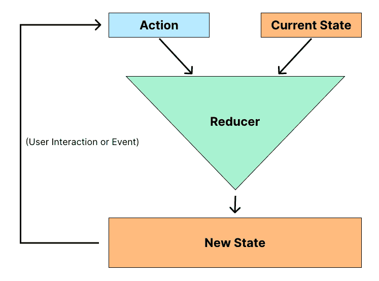

以下代码是普通的 JavaScript，但通过向`state`和`action`添加`any`类型，可以轻松转换为 TypeScript：

```
export const incrementAction = { type: 'Increment' };
export const decrementAction = { type: 'Decrement' };

export const counterReducer = (state, action) => {
  if (action.type === 'Increment') {
    return { count: state.count + 1 };
  }

  if (action.type === 'Decrement') {
    return { count: state.count - 1 };
  }

  return state;
};

let state = { count: 1 };

state = counterReducer(state, incrementAction);
state = counterReducer(state, incrementAction);
state = counterReducer(state, decrementAction);

console.log(state); // Logs: { count: 1 }
```

### 仓库代码

您可以在[本教程的 GitHub 仓库](https://github.com/stevekinney/sitepoint-reducers/blob/main/src/01-basic-example.ts)中找到上述代码（`01-basic-example`）。

让我们回顾一下上面代码示例中发生的事情：

*   我们传入当前状态和一个操作。
*   如果操作的`type`属性为`"Increment"`，我们增加`state`上的`count`属性。
*   如果操作的`type`属性为`"Decrement"`，我们减少`state`上的`count`属性。
*   如果以上两点都不成立，我们什么都不做，返回原始状态。


Redux 要求 action 必须是一个包含 `type` 属性的对象，如上例所示。React 则没有那么严格。action 可以是任何东西——甚至是一个原始值，比如数字。例如，在使用 `useReducer` 时，这是一个有效的 reducer：

```javascript
const counterReducer = (state = 0, value = 1) => state + value;
```

事实上，如果你之前在 React 中使用过 `useState`，那么你实际上已经使用了 `useReducer`。`useState` 只是 `useReducer` 的一种抽象。为了我们的目的，我们将坚持使用更接近 Redux 的模型，其中 action 是带有 `type` 属性的对象，因为这种模式几乎可以普遍适用。

Redux 和 React 的 `useReducer` 钩子在触发更改并通知 React 相应更新组件状态方面增加了一些额外功能——这与上面所示的反复设置变量不同——但无论我们使用什么库，其基本原理都是相同的。

## 为我们的 Reducer 添加类型

添加 TypeScript 将保护我们免受一些更明显的错误——通过确保我们既传入正确的参数，又返回预期的结果。这两种情况在我们的应用程序中可能有点棘手，因为它们可能直到用户采取操作（比如点击 UI 中的按钮）*之后*才会发生。让我们快速为我们的 reducer 添加一些类型：

```typescript
type CounterState = { count: number };
type CounterAction = { type: string };

export const incrementAction = { type: 'Increment' };
export const decrementAction = { type: 'Decrement' };

export const counterReducer = (
  state: CounterState,
  action: CounterAction,
): CounterState => {
  if (action.type === 'Increment') {
    return { count: state.count + 1 };
  }

  if (action.type === 'Decrement') {
    return { count: state.count - 1 };
  }

  return state;
};
```

### 仓库代码

你可以在[本教程的 GitHub 仓库](https://github.com/stevekinney/sitepoint-reducers/blob/main/src/02-reducer-with-types.ts)中找到上述代码（`02-reducer-with-types`）。

假设我们忘记在没有任何 action 匹配我们的条件时返回 `state`。TypeScript 已经分析了我们的代码，并被告知期望 `counterReducer` 总是返回某种 `CounterState`。即使我们的代码有可能无法按预期运行，它也会拒绝编译。在这种情况下，TypeScript 已经看到我们期望代码执行的操作与实际执行的操作之间存在不匹配。

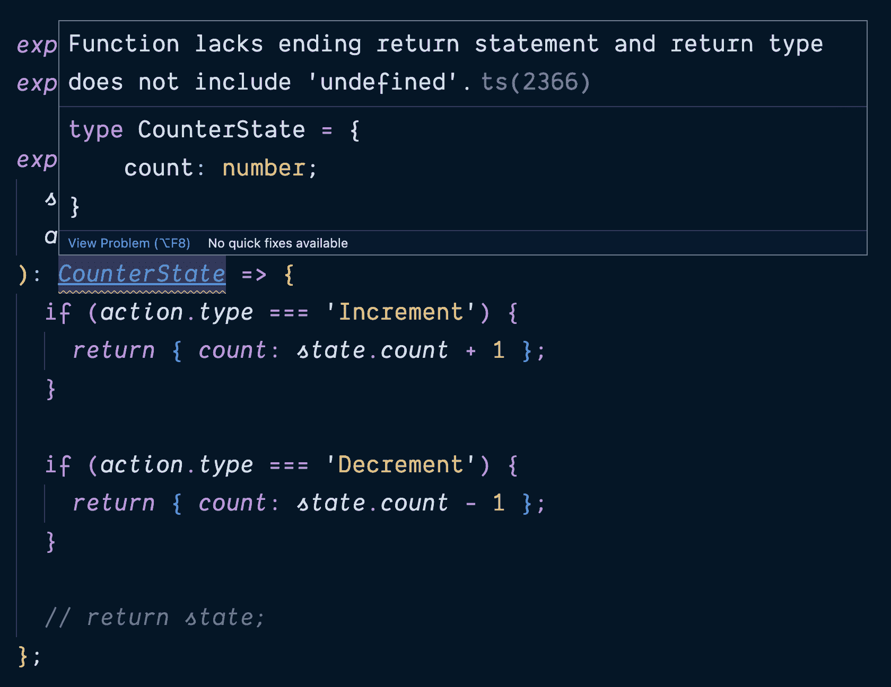

我们还将获得我们期望从 TypeScript 获得的其他保护，例如确保我们传入正确的参数，并且只访问这些对象上可用的属性。

但在使用 reducer 时，会出现一个更隐蔽（且可以说更常见）的边缘情况。事实上，这是我在为本教程开头的初始示例编写测试时遇到的一个问题。如果我们拼错了 action 类型会怎样？

```typescript
let state: CounterState = { count: 0 };

state = counterReducer(state, { type: 'increment' });
state = counterReducer(state, { type: 'INCREMENT' });
state = counterReducer(state, { type: 'Increement' });

console.log(state); // 输出：{ count: 0 }
```

这是最糟糕的一种 bug，因为它不会导致错误。它只是默默地不执行我们期望的操作。一个常见的解决方案是将 action 类型名称存储在常量中：

```typescript
export const INCREMENT = 'Increment';
export const DECREMENT = 'Decrement';
```

这就是典型样板代码的开始。由于 JavaScript 无法保护我们免于意外使用与 reducer 中任何条件都不匹配的字符串，我们将这些字符串分配给常量。拼写错误的常量或变量名将阻止我们的代码编译，并使我们明显发现问题所在。

幸运的是，当我们使用 TypeScript 时，我们可以完全避免这种样板代码。

## 为 Action 添加负载

action 通常包含有关发生了什么的附加信息。例如，用户可能在搜索字段中输入查询并点击 **Submit**。除了知道他们点击了 **Submit** 按钮外，我们还想知道他们搜索了什么。

关于如何构造 action 没有硬性规定——除了 Redux 坚持我们包含一个 `type` 属性。但遵循某种标准（如 [Flux Standard Action](https://github.com/redux-utilities/flux-standard-action)）是一个好习惯，它建议我们将任何所需的附加信息放在 `payload` 属性中。

遵循这个约定，我们的 `CounterAction` 可能看起来像这样：

```typescript
type CounterAction = {
  type: string;
  payload: {
    amount: number;
  };
};

let state = counterReducer(
  { count: 1 },
  { type: 'Increment', payload: { amount: 1 } },
);
```

这写起来有点复杂。一个常见的解决方案是创建一组称为 *action creators* 的辅助函数。**Action creators** 只是为我们格式化 action 的函数。如果我们想扩展 `counterReducer` 以支持按特定数量递增或递减的能力，我们可能会创建以下 action creators：

```typescript
export const increment = (amount: number = 1): CounterAction => ({
  type: INCREMENT,
  payload: { amount },
});

export const decrement = (amount: number = 1): CounterAction => ({
  type: DECREMENT,
  payload: { amount },
});
```

### 仓库代码

你可以在[本教程的 GitHub 仓库](https://github.com/stevekinney/sitepoint-reducers/blob/main/src/03-action-creators.ts)中找到上述代码（`03-action-creators`）。

我们还需要更新我们的 reducer 以支持这种新的 action 结构。这感觉也是一个整体审视示例的好机会：

```typescript
export const INCREMENT = 'Increment';
export const DECREMENT = 'Decrement';

type CounterState = { count: number };

type CounterAction = {
  type: string;
  payload: {
    amount: number;
  };
};

type CounterReducer = (
  state: CounterState,
  action: CounterAction,
) => CounterState;

export const increment = (amount: number = 1): CounterAction => ({
  type: INCREMENT,
  payload: { amount },
});

export const decrement = (amount: number = 1): CounterAction => ({
  type: DECREMENT,
  payload: { amount },
});

export const counterReducer: CounterReducer = (state, action) => {
  const { count } = state;

  if (action.type === 'Increment') {
    return { count: count + action.payload.amount };
  }

  if (action.type === 'Decrement') {
    return { count: count - action.payload.amount };
  }

  return state;
};

let state: CounterState = { count: 0 };
```

## 使用联合类型

但是等等，还有更多！我们使用了一些传统模式来解决 reducer 忽略未明确告知其查找的 action 的问题，但如果我们能使用 TypeScript 从一开始就防止这种情况发生呢？

让我们假设，除了能够递增和递减计数器外，我们还可以将其重置为零。这给了我们三种类型的 action：

*   `Increment`

*   `Decrement`

*   `Reset`

我们将从 `Increment` 和 `Decrement` 开始，稍后再处理 `Reset`。

在上一节中，我们添加了按特定数量递增或递减的能力。重置计数器会有点不寻常——因为我们只能将其重置为零。（当然，我本可以创建一个接受值的 `Set` action，但我正在为稍后提出一个更重要的观点做铺垫。）

让我们从我们已知的两个量开始：`Increment` 和 `Decrement`。我们不必说 action 上的 `type` 属性可以是任何字符串，我们可以更具体一些。


在`04-unions`[我们的 GitHub 仓库](https://github.com/stevekinney/sitepoint-reducers/blob/main/src/04-unions.ts)中，我使用了`'Increment' | 'Decrement'`的联合类型。我们现在告诉 TypeScript，`CounterAction`上的`type`属性不仅仅是*任意*字符串，而是恰好两个字符串之一：

```typescript
type CounterAction = {
  type: 'Increment' | 'Decrement';
  payload: {
    amount: number;
  };
};
```

这个相对简单的改变带来了许多好处。第一个也是最明显的好处是，我们不再需要担心拼写错误或误输入操作的`type`。

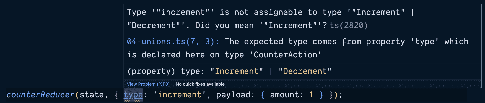

你会注意到 TypeScript 不仅检测到了错误，而且它甚至足够智能，可以提供一个建议来帮助我们快速解决问题。

当 TypeScript 有足够的信息来确定我们正在处理`CounterAction`时，我们还可以免费获得自动补全功能。

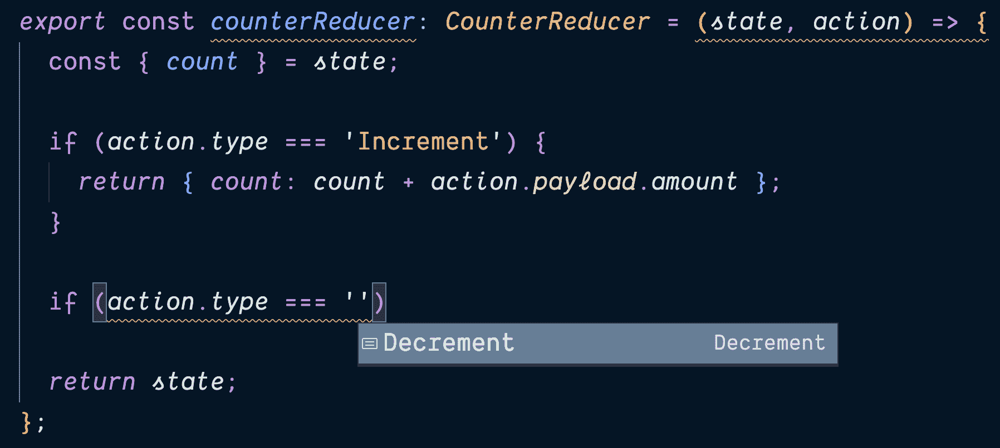

如果你仔细观察，你会注意到它*只*推荐`Decrement`。这是因为我们已经创建了一个条件语句，定义了当`type`为`Increment`时应该做什么。TypeScript 能够推断出，如果只有两个属性并且我们已经处理了其中一个，那么就只剩下一个选项了。

正如承诺的那样，我们现在也可以从[`03-action-creators`](https://github.com/stevekinney/sitepoint-reducers/blob/main/src/03-action-creators.ts)中删除这两行代码：

```typescript
- export const INCREMENT = 'Increment';
- export const DECREMENT = 'Decrement';
```

在 TypeScript 的帮助下，我们现在可以回到使用普通字符串，同时仍然享受使用常量的所有好处。在这个简单的例子中，这可能看起来没什么，但如果你以前使用过这种模式，你就知道在每个使用它们的文件中都必须导入这些值会变得多么繁琐。

## 在 Reducer 中移除默认情况

早些时候，TypeScript 试图通过在函数末尾省略`return state`行时抛出错误来帮助我们，该行作为如果上面的条件都不满足时的回退。

但现在我们给了 TypeScript 更多关于它可以期望什么类型操作的信息。我更喜欢使用条件语句（这就是为什么我在整个教程中都这样做），但如果我们改用`switch`语句，我们会注意到一些有趣的事情发生了。

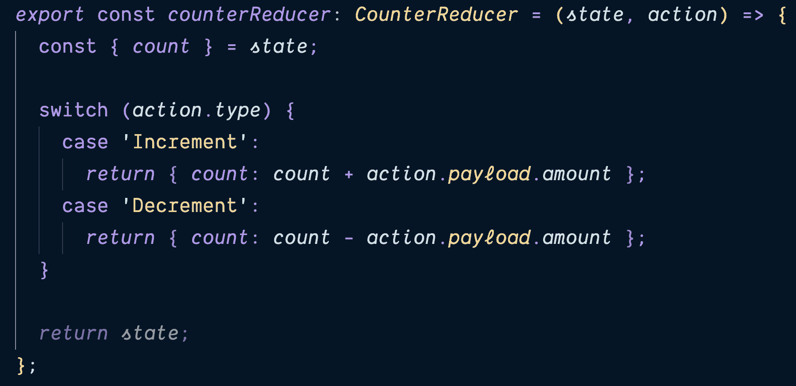

TypeScript 已经弄清楚，由于我们从`switch`语句的每个 case 中都返回了*并且*我们已经涵盖了`action.type`的所有可能情况，所以没有必要在我们的操作漏掉的情况下返回原始状态，因为 TypeScript 可以保证这永远不会发生。

从这里可以得出几点：

*   TypeScript 将使用我们提供的信息来帮助我们避免常见的错误。

*   TypeScript 还将使用这些信息来使我们能够编写更少的保护性代码。

## 处理不同类型的操作

早些时候，我暗示我们可能会添加第三种类型的操作：将计数器`Reset`回零的能力。这个操作与我们最开始看到的操作非常相似。它不需要 payload。然而，我们可能会忍不住这样做：

```typescript
type CounterAction = {
  type: 'Increment' | 'Decrement' | 'Reset';
  payload: {
    amount: number;
  };
};
```

你会注意到 TypeScript 再次对我们可能从 reducer 返回`undefined`感到不满。我们稍后会处理这个问题。但首先，我们应该解决`Reset`不需要 payload 的事实。

我们不想不得不写这样的东西：

```typescript
let state = counterReducer({ count: 5 }, { type: 'Reset', { payload: { amount: 0 } } });
```

我们可能会忍不住让`payload`成为可选的：

```typescript
type CounterAction = {
  type: 'Increment' | 'Decrement' | 'Reset';
  payload?: {
    amount: number;
  };
};
```

但现在，TypeScript 将永远不确定`Increment`和`Decrement`是否应该有一个 payload。这意味着 TypeScript 会坚持要求我们在访问`payload`上的`amount`属性之前检查`payload`是否存在。同时，TypeScript 仍然会允许我们在`Reset`操作上不必要地添加一个 payload。我想这不是世界上最糟糕的事情，但我们可以做得更好。

### 使用联合类型定义操作类型

事实证明，我们可以使用与`CounterAction`上`type`属性类似的解决方案：

```typescript
type CounterAdjustmentAction = {
  type: 'Increment' | 'Decrement';
  payload: {
    amount: number;
  };
};

type CounterResetAction = {
  type: 'Reset';
};

type CounterAction = CounterAdjustmentAction | CounterResetAction;
```

TypeScript 足够智能，可以推断出以下内容：

*   `CounterAction`是一个对象。

*   `CounterAction`*总是*有一个`type`属性。

*   `type`属性是`Increment`、`Decrement`或`Reset`之一。

*   如果`type`属性是`Increment`或`Decrement`，则有一个`payload`属性，其中包含一个数字作为`amount`。

*   如果`type`属性是`Reset`，则没有`payload`属性。

通过更新类型以包含`CounterResetAction`，TypeScript 已经推断出我们不再向`counterReducer`提供详尽的 case 列表。

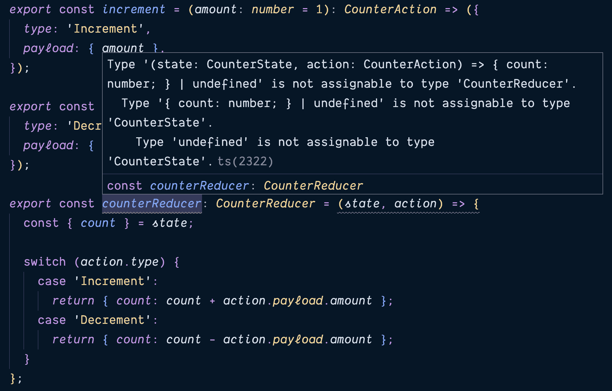

我们可以更新代码：

```typescript
export const counterReducer: CounterReducer = (state, action) => {
  const { count } = state;

  switch (action.type) {
    case 'Increment':
      return { count: count + action.payload.amount };
    case 'Decrement':
      return { count: count - action.payload.amount };
    case 'Reset':
      return { count: 0 };
  }
};
```

### 仓库代码

你可以在[本教程的 GitHub 仓库](https://github.com/stevekinney/sitepoint-reducers/blob/main/src/05-different-payloads.ts)中找到上面的代码（`05-different-payloads`）。

如果你一直在跟着做，你可能已经注意到了一些很酷的功能（尽管在这一点上并不令人惊讶）。首先，当我们添加第三个 case 时，TypeScript 能够推断出我们正在为`Reset`添加一个 case，并将其作为唯一可用的自动补全建议。其次，如果我们试图在`return`语句中引用`action`，我们会注意到它*只*允许我们访问`type`属性，因为它很清楚`CounterResetActions`没有`payload`属性。

除了明确定义类型之外，我们不需要在代码本身中告诉 TypeScript 太多东西。它能够利用手头的信息为我们推断出一切。

如果你想亲眼看看，你可以为重置计数器创建一个操作创建器：

```typescript
export const reset = (): CounterAction => ({ type: 'Reset' });
```

我选择在这种情况下使用更广泛的`CounterAction`。但你会注意到，即使你*尝试*向它添加一个`payload`，TypeScript 已经推断出这不是一个选项。但如果你暂时将`type`更改为`"Increment"`，你突然就被允许添加该属性。

如果我们把函数的返回类型更新为`CounterResetAction`，我们会看到对于类型只有一个选项——`"Reset"`——并且 payload 是被禁止的：

```typescript
export const reset = (): CounterResetAction => ({ type: 'Reset' });
```

## 在 React 组件中使用我们的 Reducer

到目前为止，我们已经讨论了很多关于 reducer 模式在任何框架之外的内容。让我们把我们的`counterReducer`引入 React，看看它是如何工作的。我们将从这个简单的组件开始：


```
const Counter = () => {
  return (
    <main className="mx-auto w-96 flex flex-col gap-8 items-center">
      <h1>计数器</h1>
      <p className="text-7xl">0</p>
      <div className="flex place-content-between w-full">
        <button>减少</button>
        <button>重置</button>
        <button>增加</button>
      </div>
    </main>
  );
};

export default Counter;
```

### 仓库代码

你可以在[本教程的 GitHub 仓库](https://github.com/stevekinney/sitepoint-reducers/blob/main/src/06-react-component.tsx)中找到上述代码（`06-react-component`）。

你可能注意到目前还没有太多功能。我们在整个教程中一直在处理的 `counterReducer` 已经准备就绪。我们只需要使用 `useReducer` 钩子将其连接到组件即可。

在 React（或 Redux）的 reducer 上下文中，`state` 是我们组件数据的当前快照。`dispatch` 是一个用于根据操作更新该状态的函数。我们可以将 `dispatch` 视为触发更改的方式，而 `state` 则是这些更改后的结果数据。

让我们在 `Counter` 组件内部添加以下代码：

```
const [state, dispatch] = useReducer(counterReducer, { count: 0 });
```

现在，如果我们悬停在 `state` 和 `dispatch` 上，会看到 TypeScript 能够自动推断出每个变量的正确类型：

```
const state: CounterState;
const dispatch: React.Dispatch<CounterAction>;
```

它能够从 `counterReducer` 本身的类型注解中推断出这一点。同样，它也只允许我们传入与 `CounterState` 匹配的初始状态——尽管错误信息可能不太有帮助。如果我们把传给 `useReducer` 的初始状态中的 `count` 属性改为 `amount`，就会看到类似下图所示的结果。

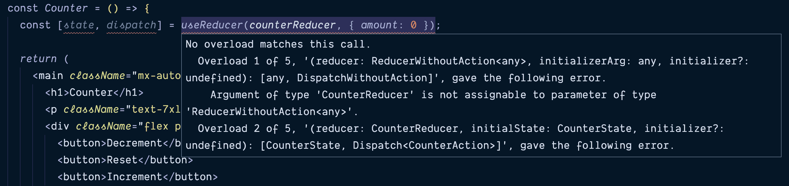

现在我们可以在 `Counter` 组件中使用来自 `useReducer` 的 `state` 和 `dispatch`。TypeScript 会知道 `count` 是 `state` 上的一个属性，并且只接受与 `CounterAction` 类型匹配的操作或操作创建函数返回的值：

```
import { useReducer } from 'react';
import {
  counterReducer,
  increment,
  decrement,
  reset,
} from './05-different-payloads';

const Counter = () => {
  const [state, dispatch] = useReducer(counterReducer, { count: 0 });

  return (
    <main className="mx-auto w-96 flex flex-col gap-8 items-center">
      <h1>计数器</h1>
      <p className="text-7xl">{state.count}</p>
      <div className="flex place-content-between w-full">
        <button onClick={() => dispatch(decrement())}>减少</button>
        <button onClick={() => dispatch(reset())}>重置</button>
        <button onClick={() => dispatch(increment())}>增加</button>
      </div>
    </main>
  );
};

export default Counter;
```

### 仓库代码

你可以在[本教程的 GitHub 仓库](https://github.com/stevekinney/sitepoint-reducers/blob/main/src/07-react-component-complete.tsx)中找到上述代码（`07-react-component-complete`）。

我想请大家注意这个组件中 TypeScript 代码是多么少。事实上，如果我们把文件扩展名从 `.tsx` 改为 `.jsx`，它仍然可以工作。但在幕后，TypeScript 正在做着重要的工作，确保我们的应用程序在交付给用户时能够按预期运行。

## 结论

Reducer 的力量不在于其固有的复杂性，而在于其简单性。重要的是要记住，reducer 只是函数。过去，它们因为需要相当多的样板代码而受到一些批评。

TypeScript 有助于减少样板代码的数量，同时也使使用 reducer 的整体体验更加愉快。我们免受了参数错误和意外结果等潜在陷阱的影响，这些陷阱在应用程序中可能很难排查。

Reducer 和 TypeScript 的结合可以使构建弹性、无错误的应用程序变得超级简单。

别忘了参考 [GitHub 仓库](https://github.com/stevekinney/sitepoint-reducers) 和 [CodeSandbox 演示](https://codesandbox.io/p/sandbox/typescript-redux-example-sitepoint-hjkzkg?file=%2Findex.html%3A1%2C1) 来尝试上面讨论的任何示例。

在本书的下一部分，我们将探讨如何揭开 TypeScript 中使用泛型的神秘面纱。泛型允许我们编写可重用的代码，这些代码可以处理多种类型，而不仅仅是单一类型。它充当类型的占位符，让我们能够编写在编译时适应并强制类型一致性的代码。

# 第 2 章：TypeScript 泛型入门

如果你来自具有类型系统的语言，你可能已经熟悉[泛型](https://www.typescriptlang.org/docs/handbook/2/generics.html)。但如果你像我一样，经验主要来自 JavaScript、Python 或 Ruby 等动态语言，泛型一开始可能看起来有点令人困惑。我确实有罪，只是复制粘贴示例而没有完全理解发生了什么。但别担心！一旦我们理解了泛型，它们既强大又相当简单。让我们从基础开始，逐步构建，以全面理解泛型是什么以及如何在 TypeScript 代码中使用它们。

简而言之，TypeScript 中的**泛型**允许我们编写可重用的代码，这些代码可以处理多种类型。泛型充当类型的占位符，让我们能够编写在编译时适应并强制类型一致性的代码。将泛型视为变量（但仅用于我们的类型）并没有错。

## 跟随本教程

我们将使用的所有代码都可以在 [这个 GitHub 仓库](https://github.com/stevekinney/sitepoint-generics) 中找到。我也鼓励你使用 [TypeScript Playground](https://www.typescriptlang.org/play) 来尝试想法并试用下面的示例。

## 什么是泛型？

TypeScript 中的**泛型**提供了一种创建可重用代码组件的方法，这些组件可以处理多种类型（而不仅仅是一种）。正如我提到的，我们可以将它们视为变量——但用于我们的类型。泛型提供了一种创建灵活结构的方式，允许我们稍后定义类型。

让我们从一个简单的[链表](https://en.wikipedia.org/wiki/Linked_list)开始。一个**链表**节点包含一个值，然后是指向下一个节点的链接。我们可以从类似这样的东西开始：

```
type LinkedListNode = {
  value: any;
  next?: LinkedListNode;
};
```

然而，我将添加一个额外的要求。列表中的所有节点都应该是相同的类型。例如，如果我们想要一个字符串链表，我们可以细化我们的类型以确保 value 始终是字符串：

```
type LinkedListNode = {
  value: string;
  next?: LinkedListNode;
};

const firstNode: LinkedListNode = {
  value: 'first',
};

const secondNode: LinkedListNode = {
  value: 'second',
};

firstNode.next = secondNode;
```

### 仓库代码

你可以在[本教程的 GitHub 仓库](https://github.com/stevekinney/sitepoint-generics/blob/main/src/01-without-generics.ts)中找到上述代码（`01-without-generics.ts`）。

你可能已经注意到这里的问题。如果我们还想支持一个数字链表，我们就必须创建另一个类型，以此类推，对于我们要让链表支持的每一种值类型。这很繁琐，而且无法扩展。

这就是泛型的用武之地。它们让我们定义一个可以在类型中使用的占位符。如果我们想要一个链表节点，其中的值可以是任何类型，但确保所有后续节点也是*相同*的类型，我们可以写类似这样的代码：
```


```
type LinkedListNode<T> = {
  value: T;
  next?: LinkedListNode<T>;
};

const firstNode: LinkedListNode<string> = {
  value: 'first',
};

const secondNode: LinkedListNode<string> = {
  value: 'second',
};

const thirdNode: LinkedListNode<number> = {
  value: 42,
};

const fourthNode: LinkedListNode<number> = {
  value: 17,
};

firstNode.next = secondNode;
thirdNode.next = fourthNode;
```

### 仓库代码

你可以在[本教程的 GitHub 仓库](https://github.com/stevekinney/sitepoint-generics/blob/main/src/02-with-generics.ts)中找到上述代码（`02-with-generics`）。

当我们把 `T` 设置为 `string` 或 `number` 时，TypeScript 会在所有引用 `T` 的地方使用该类型。

### 一个实验

如果你想做一个小实验，可以尝试在[这个在线编辑器](https://www.typescriptlang.org/play?#code/C4TwDgpgBAMglgOwNYQCbwM7AHIHtUQA8AKgHxQC8UA3gFBRQBuAhgDYCuEAXFMQNz0oCCAA9gAfh7xkaTDnxEyAgL4DaAY1wIsUAGZwATljwEpiFOjjGFhLAcQBzclToMWHblADk+o8C8ANLSqtBpaOhgQmgioJp7SFnJxtsD2CE6UNILunDxekdGogcFq0TrAABaGsQpmMpbWBIQI7AC2AEYQBs5Zbmy5UAAsAExBIWHawHq47AaVcXWJVvJNLR1dPa5M-Z4AjADsY2q+jRAAdMJimQVaNQQCldVxF6JTVLozcxVxfEA)中将 `thirdNode` 连接到 `firstNode`。你会看到 TypeScript 不允许这样做。

## 关于泛型命名的说明

你可能想知道为什么我把泛型命名为 `T`。我这样做主要是因为这是惯例。`T` 代表“类型”。如果一个类型中有多个泛型，你有时可能会看到使用 `U`。为什么？因为 U 是 T 之后的字母。

泛型不一定非得是单个字母。我们完全可以使用更长的名称：

```
type LinkedListNode<NodeType> = {
  value: NodeType;
  next?: LinkedListNode<NodeType>;
};
```

不过，通常我们只看到使用单个字母。例如，[React 的类型](https://github.com/DefinitelyTyped/DefinitelyTyped/blob/60ab8a805a1c5c4225027068e604ef4687cdf379/types/react/index.d.ts#L76)在引用 props 时会使用 `P`。

如果我们需要使用多个泛型，可以用逗号分隔它们，就像我们为函数参数所做的那样：

```
type Badge<L extends string, C extends number> {
  label: L,
  count: C
}
```

## 在泛型中扩展类型

目前，`T` 泛型可以是任何东西。在上面的例子中，我们使用了字符串和数字，但我们同样可以使用布尔值、数组、对象，甚至函数。

假设我们想将链表节点的值限制为仅支持字符串、数字和布尔值。

在 TypeScript 中，约束是通过 `extends` 关键字来表达的。`T extends K` 意味着可以安全地假设类型 `T` 的值也是类型 `K`。一个简单的理解方式是，可以想象我们正在用 `extends` 编写一个变量赋值。

以 `19 extends number` 为例。我们可以这样理解：

```
const nineteen: number = 19;
```

我们可以说 `T` 必须扩展另一个类型：

```
type LinkedListNode<T extends string | number | boolean> = {
  value: T;
  next?: LinkedListNode<T>;
};
```

### 仓库代码

你可以在[本教程的 GitHub 仓库](https://github.com/stevekinney/sitepoint-generics/blob/main/src/03-extending-types.ts)中找到上述代码（`03-extending-types`）。

现在，我们的泛型被限制为任何满足字符串、数字或布尔值条件的类型。我们可以稍微玩点花样。例如，我们可以说一个节点只能支持特定的字符串或特定的数字：

```
const firstNode: LinkedListNode<string> = {
  value: 'first',
};

const secondNode: LinkedListNode<'second'> = {
  value: 'second',
};

const thirdNode: LinkedListNode<number> = {
  value: 42,
};

const fourthNode: LinkedListNode<17> = {
  value: 17,
};

firstNode.next = secondNode;
thirdNode.next = fourthNode;
fourthNode.next = {
  value: 17,
};
```

类型 `number` 指的是任何数字。`17` 是一个字面量类型，只允许该特定值。在这种情况下，任何连接到 `secondNode` 的节点都*必须*具有值 `"second"`，任何连接到 `fourthNode` 的节点都*必须*具有值 `17`。从技术上讲，它们分别扩展了 `string` 和 `number`。话虽如此，我这样做只是为了演示。我不确定在实践中我们为什么要这样做。

一个更实际的例子是，如果我们只想支持字符串或数字的某个子集。例如，我们可以使用联合类型来限制可接受的字符串，如[此演示](https://www.typescriptlang.org/play?#code/C4TwDgpgBAMglgOwNYQCbwM7AHIHtUQA8AKlBAB7AQKoZQDkANrgIaqIDm9UAPgxgFcAxkIgYM3PvQgAnGbhn0AfFAC8UAN4AoKFABuLRgIgAuKMQDcOqAgrAA-GfjI0mHPiLElVgL4WgA)所示：

```
type LinkedListNode<T extends 'loading' | 'success' | 'error'> = {
  value: T;
  next?: LinkedListNode<T>;
};
```

显然，不断为每个变量定义类型变得有点乏味。

## 在函数中使用泛型

在函数中使用泛型更为常见。让我们考虑一个[恒等函数](https://en.wikipedia.org/wiki/Identity_function)，它接受一个值并返回它。我想我们现在很清楚，我们不想这样做：

```
const identity = (x: string): string => {
  return x;
};
```

就像链表一样，我没有时间为我遇到的每种类型都创建一个这样的函数。这听起来是泛型的完美用例：

```
export const identity = <T>(x: T): T => {
  return x;
};

export const foo = identity<string>('foo');
```

### 关于在 JSX 中使用泛型的说明

我们可能会发现，如果我们使用 React 和/或 JSX，上述语法将不起作用。这是因为解析器很难区分泛型语法和 JSX 组件语法。我们可以在[这个在线编辑器](https://www.typescriptlang.org/play?ssl=5&ssc=37&pln=1&pc=1#code/MYewdgzgLgBAlgEwKZinKBPGBeGAeAFQD4AKADwC4YCBKKgnImAbwCgYYAnJKAV07AwyAblYBfUa1CRYAMxAgc8ZKnQY80TnDABzUgHJ5IfTWFA)中看到它失败，也可以在[这里](https://www.typescriptlang.org/play?jsx=0#code/MYewdgzgLgBAlgEwKZinKBPGBeGAeAFQD4AKADwC4YCBKKgnImAbwCgYYAnJKAV07AwyAblYBfUa1CRYAMxAgc8ZKnQY80TnDABzUgHJ5IfTWFA)看到关闭 JSX 后它编译正常。

为了解决这个问题，我们有两个选择。我们可以在泛型后简单地添加一个逗号：

```
const identity = <T,>(x: T): T => {
  return x;
};
```

或者，我们可以专门使用函数声明：

```
function identity<T>(x: T): T {
  return x;
}
```

## 推断泛型

TypeScript 总是试图不给我们添麻烦。如果它能推断出泛型应该是什么，它就会免除我们告诉它的责任。让我们看看以下代码：

```
export const identity = <T>(x: T): T => {
  return x;
};

export const foo = identity<string>('foo');
export const two = identity(2);
```

### 仓库代码

你可以在[本教程的 GitHub 仓库](https://github.com/stevekinney/sitepoint-generics/src/04-inferring-generics.ts)中找到上述代码（`04-inferring-generics`）。

在这段代码中，我们完全省略了告诉 TypeScript `T` 应该是什么类型。它看到我们向该函数调用传递了一个数字，因此它能够推断出在这种情况下 `T` 是一个数字。

我们也可以利用这一点来简化上面的链表：

```
type LinkedListNode<T> = {
  value: T;
  next?: LinkedListNode<T>;
};

export const identity = <T>(x: T): T => {
  return x;
};

export const foo = identity<string>('foo');
export const two = identity(2);

const createLinkedListNode = <T>(value: T): LinkedListNode<T> => {
  return { value };
};

const firstNode = createLinkedListNode('first');
const secondNode = createLinkedListNode('second');

firstNode.next = secondNode;
```

你会注意到我们不再需要定义期望的 `LinkedListNode` 类型。一旦 TypeScript 能够为 `T` 的一个引用确定类型，它就能填充所有其他引用。`firstNode` 和 `secondNode` 具有以下类型：


```
const firstNode: LinkedListNode<string>;
const secondNode: LinkedListNode<string>;
```

这赋予了我们泛型的所有灵活性，而无需编写任何额外的样板代码。

## 更进一步

既然我们已经有了 `createLinkedListNode`，我们可以创建一个名为 `addNextNode` 的额外实用函数。该函数应执行以下操作：

*   它应接受一个现有的 `LinkedListNode` 作为第一个参数。

*   根据该 `LinkedListNode` 的 `value` 类型，第二个参数应为相同类型的值。

*   它应基于第二个参数创建一个新的 `LinkedListNode`。

*   它应将第一个 `LinkedListNode` 的 `next` 属性设置为新的 `LinkedListNode`。

*   它应返回新创建的节点。

基本上，我们希望让以下两个测试通过：

```
it('should create a linked list node', () => {
  let node = createLinkedListNode('first');
  expect(node).toEqual({ value: 'first' });
});

it('should add a linked list node', () => {
  let firstNode = createLinkedListNode('first');
  let secondNode = addLinkedListNode(firstNode, 'second');

  expect(firstNode).toEqual({ value: 'first', next: { value: 'second' } });
  expect(secondNode).toEqual({ value: 'second' });
});
```

这里的关键点是 `T` 的值应始终保持一致。我们可以用几种方式编写这个函数，这里不讨论每种方式的优劣。以下是一种可能的实现：

```
const createLinkedListNode = <T>(value: T): LinkedListNode<T> => {
  return { value };
};

const addLinkedListNode = <T>(
  node: LinkedListNode<T>,
  value: T,
): LinkedListNode<T> => {
  node.next = createLinkedListNode(value);
  return node.next;
};
```

### 仓库代码

你可以在[本教程的 GitHub 仓库](https://github.com/stevekinney/sitepoint-generics/blob/main/src/05-linking-nodes.ts)中找到上述代码（`05-linking-nodes`）。

## 在类中使用泛型

我们也可以在类中使用泛型。这种情况下一个有趣的特性是，`T` 的值可以在整个类中使用。一旦设置，它将在所有方法中强制执行我们的类型，并且类的每个单独实例都可以有自己的 `T` 值。以下是一个示例：

```
export class LinkedListNode<T> {
  value: T;
  next?: LinkedListNode<T>;

  constructor(value: T) {
    this.value = value;
  }

  add(value: T): LinkedListNode<T> {
    this.next = new LinkedListNode(value);
    return this.next;
  }
}
```

### 仓库代码

你可以在[本教程的 GitHub 仓库](https://github.com/stevekinney/sitepoint-generics/blob/main/src/06-with-classes.ts)中找到上述代码（`06-with-classes`）。

现在我们可以创建多个实例，其中 `T` 对于该特定实例被正确强制执行：

```
const firstNode = new LinkedListNode('first');
const secondNode = firstNode.add('second');
const thirdNode = new LinkedListNode(42);
const fourthNode = thirdNode.add(17);
```

你可以在[此处](https://github.com/stevekinney/sitepoint-generics/blob/main/src/06-with-classes.test.ts)找到的单元测试中验证这一点。

## 结论

我倾向于使用类型，但我们同样可以轻松地在接口中使用泛型：

```
interface LinkedListNode<T> {
  value: T;
  next?: LinkedListNode<T>;
}
```

泛型是 TypeScript 中一个强大的工具，它允许我们创建可重用的代码组件，这些组件可以处理多种类型，而不仅仅是一种。它们提供了一种构建灵活接口的方式，使我们能够稍后定义类型。泛型可以与对象、函数和类一起使用。它们可以扩展或限制为特定类型，TypeScript 甚至可以在某些情况下为我们推断类型。

虽然一开始可能看起来令人生畏，但一旦理解了，泛型就相当简单。稍加练习，你就能很快地使用泛型编写出更高效、更有效的代码。

# 第 3 章：在 TypeScript 中使用 React Context API 的风险与陷阱

在任何大型 React 应用程序中使用 TypeScript，都能提供一种值得付出额外努力的安全性，这比使用 JavaScript 更好。TypeScript 能够梳理我们所有的组件，并确认我们传递了每个组件所需的所有 props，同时确保它们确实是我们假设的类型，而不是像 `undefined` 这样危险的东西。但在某些情况下，即使这种权衡也受到了质疑——特别是在使用 Context API 时。让我们看看如何应对在 TypeScript 中使用 `createContext` 和 `useContext` 的一些挑战。

我假设你熟悉 Context API，但还是快速总结一下。[React 中的 Context API 是一个内置的状态管理工具](https://react.dev/learn/passing-data-deeply-with-context)，它允许在组件树中轻松共享数据。它使我们能够避免 **[prop drilling](https://www.sitepoint.com/replace-redux-react-hooks-context-api/)**，即通过中间组件从上到下传递数据的过程。

使用 Context API，我们创建一个具有两个属性的 `Context` 对象：一个 `Provider` 组件——用于包装我们应用程序中需要访问数据的组件树部分——以及一个用于读取该数据的 `Consumer` 组件。

如今，我们通常不直接使用 `Consumer`，而是使用 `useContext` hook 来访问上下文的值，无论每个组件在组件层次结构中的级别如何。`useContext` hook 比尝试在渲染属性中从 `Consumer` 访问值要干净得多。这使得组件之间的状态和函数共享更加方便和高效，尤其是在较大的应用程序中。事实上，[React 文档](https://react.dev/reference/react/createContext#returns)甚至[提到](https://react.dev/reference/react/createContext#returns)，`Consumer` 是“一种替代且很少使用的方式来读取上下文值”。

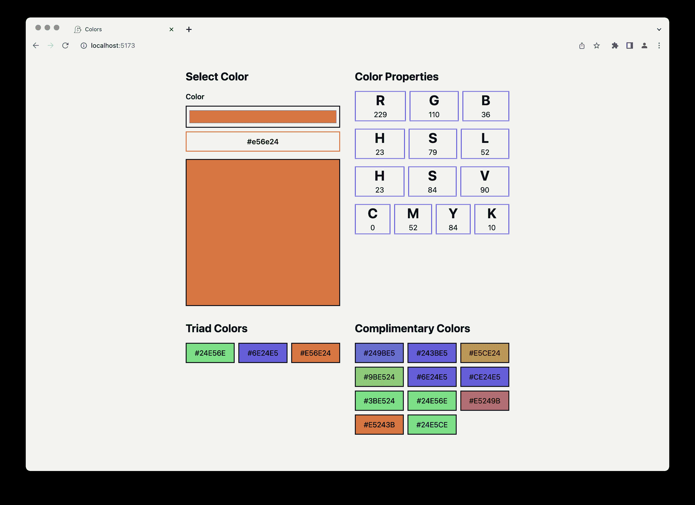

我们将处理一个简单的颜色选择器应用程序（如上图所示），它使用 Context API 在整个组件层次结构中共享获取和设置颜色的能力。

## 跟随本教程

我们将要处理的所有代码都可以在 [GitHub 仓库](https://github.com/stevekinney/sitepoint-context)中找到。我将从 `main` 分支开始，然后在每个里程碑处创建额外的分支。

## 根本问题

将困扰我们的核心问题不一定是 TypeScript 的问题。这是一个 React 问题：

*   当我们调用 `React.createContext` 时，TypeScript 会想知道我们可以期望什么样的值。

*   但我们还没有那个值，因为我们必须等待 `Provider` 组件挂载才能使用 `useState`。

*   TypeScript 会对我们传递给它的内容不是它所期望的这一事实提出异议。

*   如果我们说它可以是颜色*或* `undefined`，TypeScript 将永远无法确定它正在处理哪一个。

我们将探讨几种方法——例如使用 `any` 或 `undefined`——这些方法会有效，但会有一些权衡——然后我们将采用一个更好（尽管更复杂）的解决方案。

## 一个被拒绝的解决方案：使用 `any`

```
// We don't have access to `hexColor` outside of `ColorProvider`.
// So we'll use `null` for now.
export const ColorContext = createContext<any>(null);

export const ColorProvider = ({ children }: PropsWithChildren) => {
  const [hexColor, setHexColor] = useState('#e56e24');

  return (
    <ColorContext.Provider value={{ hexColor, setHexColor }}>
      {children}
    </ColorContext.Provider>
  );
};
```


在上面的代码中，我们瞥见了更简单的可能解决方案。我们可以通过使用 `any` 完全绕过 TypeScript。这不仅会让我们失去随之而来的类型安全，还会让我们失去代码中自动补全的所有好处。这能用，但我们可以做得更好。

## 一个可行的解决方案：使用类型断言

我们还没有初始的十六进制颜色值，但我们知道最终会有的，对吧？在这种情况下，我们*可以*对 TypeScript 撒谎，并试图让它相信 `null` 实际上是一个十六进制颜色。

首先，我们需要弄清楚 `value` 属性的最终类型是什么。最简单的方法是将鼠标悬停在 `setHexColor` 上并查看其类型。

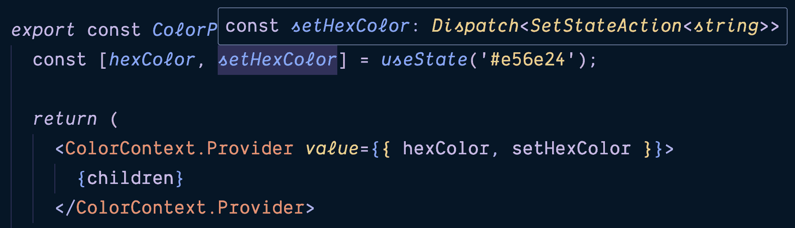

我们知道我们正在向 `ColorContext.Provider` 传递一个包含 `hexColor` 和 `setHexColor` 的对象。让我们将其分解为自己的类型：

```
type ColorState = {
  hexColor: string;
  setHexColor: Dispatch<SetStateAction<string>>;
};
```

现在，即使我们还没有这个值，我们也可以让 TypeScript 知道它最终可以期望接收什么：

```
export const ColorContext = createContext<ColorState>(null as any);
```

如果我们将鼠标悬停在 `ColorContext` 上，我们会看到 `const ColorContext: React.Context<ColorState>`。如果我们访问任何使用此上下文的组件，我们会看到它具有正确的类型注解，如下图所示。

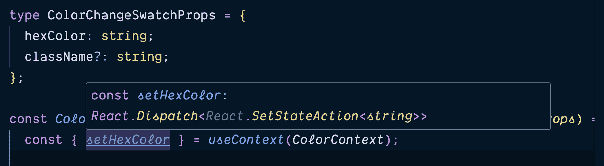

如果我们想为自己的欺骗行为感到好受些，我们至少可以告诉它一个谎言，这个谎言正是它最终应该期望的：

```
export const ColorContext = createContext<ColorState>(
  null as unknown as ColorState,
);
```

如果我们没有负罪感，我们可能也会考虑这样做，这样 ESLint 就不会因为我们显式地在代码中使用 `any` 而对我们生气。

### 仓库代码

你可以在 [本教程的 GitHub 仓库的 `type-assertion` 分支](https://github.com/stevekinney/sitepoint-context/blob/type-assertion/src/context.tsx) 中找到上面的代码（`context.tsx`）。

## 一个折衷的解决方案：说实话

另一个选择是说实话。上下文的值可以是 `ColorState` 或 `undefined`：

```
export const ColorContext = createContext<ColorState | null>(null);
```

这感觉更好，但它会导致另一组问题：

```
Errors  Files
  1  src/components/color-change-swatch.tsx:13
  2  src/components/color-picker/color-select.tsx:11
  1  src/components/color-picker/color-swatch.tsx:6
  1  src/components/color-properties/to-cmyk.tsx:8
  1  src/components/color-properties/to-hsl.tsx:8
  1  src/components/color-properties/to-hsv.tsx:8
  1  src/components/color-properties/to-rgb.tsx:8
  1  src/components/related-colors/index.tsx:11
```

现在的问题是 TypeScript 不确定我们是在处理 `ColorState` 还是 `undefined`。现在我们需要每次使用它时都进行检查。

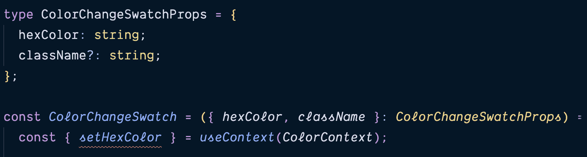

所以现在每次使用时，我们都需要检查它是否已定义。这是 `ColorChangeSwatch` 组件中的一个例子：

```
const ColorChangeSwatch = ({ hexColor, className }: ColorChangeSwatchProps) => {
  // 👀 将上下文存储在一个变量中。
  const context = useContext(ColorContext);

  return (
    <Button
      className={clsx(
        'border-2 border-slate-900 transition-shadow duration-200 ease-in 
        hover:shadow-xl',
        className,
      )}
      style={{ backgroundColor: hexColor }}
      onClick={() => {
        // 👀 有条件地使用其上的任何属性。
        context?.setHexColor(hexColor);
      }}
    >
      {hexColor}
    </Button>
  );
};
```

### 仓库代码

你可以在 [本教程的 GitHub 仓库](https://github.com/stevekinney/sitepoint-context/blob/main/src/components/color-change-swatch.tsx) 中找到上面的代码（`color-change-swatch.tsx`）。

我不会让你忍受这在我们的应用程序中造成的混乱。但如果你感兴趣，我邀请你在这里查看[这里](https://github.com/stevekinney/sitepoint-context/commit/a0343931a92dd53c1672046f855dbc8e4d0da612)。它涉及更改十个文件，而这甚至不是一个很大的应用程序。不用说，在这种情况下，对 TypeScript 诚实可能不值得。

## 一个合理的解决方案：创建一个抽象

假设我们不想对 TypeScript 撒谎，也不想忍受我刚刚为你创建那个示例时所经历的事情。我们*可以*鱼与熊掌兼得。只是需要做一点工作。

我们*可以*创建自己的实用程序来为我们做这件事，而不是每次使用上下文时都检查它是否已定义，然后就再也不用担心了。这需要一些前期工作，但——与之前的解决方案不同——一旦我们的抽象就位，我们就再也不用考虑它们了。

我将从 `main` 创建一个名为 [create-context](https://github.com/stevekinney/sitepoint-context/tree/create-context) 的新分支。

### 创建我们自己的 `createContext`

让我们从创建一个名为 `src/create-context.tsx` 的新文件开始。我们将从一个简单的函数开始，这样 TypeScript 就不会因为我们有一个空文件而生气：

```
export const createContext = () => {};
```

接下来，我们将使用 React 的 `createContext` 来创建一个 `Context` 对象，我们将在此基础上进行构建：

```
import React from 'react';

export const createContext = () => {
  const Context = React.createContext(null);
};
```

我使用 `React.createContext` 而不是 `import { createContext } from 'react';`，这样我们就不会有任何命名冲突。我们函数的名字并不重要，但我喜欢一致性。

现在我们将做一些类似于我们在上一个示例中所做的事情：我们将承认我们可能不知道初始值是什么。我们还将使用泛型，以便此函数可重用于其他上下文：

```
import React from 'react';

export const createContext = <T extends object>() => {
  const Context = React.createContext<T | null>(null);
};
```

我知道我们想要同时传递 `hexColor` 和 `setHexColor`，所以我选择将 `T` 约束为某种对象。如果泛型让你感到困惑，你可以选择使用我们之前创建的 `ColorState`。那可能看起来像这样：

```
// 🚨 注意：我们不会使用此代码。它只是上面代码的替代方案。
export const createContext = () => {
  const Context = React.createContext<ColorState | null>(null);
};
```

接下来，我们将创建我们自己对 `useContext` hook 的理解。这将可以访问我们刚刚在其[闭包作用域](https://developer.mozilla.org/en-US/docs/Web/JavaScript/Closures)中创建的 `Context`。新的 `useContext` 将检查以确保上下文存在且不是 `null`。如果它*是* `null`，则会抛出一个错误。TypeScript 足够聪明，可以理解如果我们的 `Context` 只能是 `T` 或 `null`，并且它不是 `null`，那么它一定是 `T`。今后，我们将*只*使用我们自定义的 `useContext` hook：

```
import React from 'react';

export const createContext = <T extends object>() => {
  const Context = React.createContext<T | null>(null);

  const useContext = () => {
    const ctx = React.useContext(Context);

    if (ctx === null) {
      throw new Error('useContext must be inside a Provider with a value.');
    }

    return ctx;
  };

  return [useContext, Context.Provider] as const;
};
```

回顾一下：

*   我们知道上下文的值可以是 `T` 或 `null`。

*   所以，从 `React.useContext` 中取出值并查看它。

*   如果 `ctx` 是 `null`，则抛出一个错误。这意味着在 `ctx` 为 `null` 的情况下，我们不会返回任何内容。


### 使用我们的新钩子

我们已经创建了新的钩子。现在只需要使用它。让我们按照以下方式更新`src/context.tsx`：

```
import { Dispatch, PropsWithChildren, SetStateAction, useState } from 'react';

import { createContext } from './create-context';

type ColorState = {
  hexColor: string;
  setHexColor: Dispatch<SetStateAction<string>>;
};

const [useContext, Provider] = createContext<ColorState>();

export const useColor = useContext;

export const ColorProvider = ({ children }: PropsWithChildren) => {
  const [hexColor, setHexColor] = useState('#e56e24');

  return <Provider value={{ hexColor, setHexColor }}>{children}</Provider>;
};
```

你会注意到我们自定义的`createContext`不再需要参数。我们只需要告诉它我们最终期望的类型。这将返回一个钩子和一个提供者。我们将导出那个钩子。我给了它一个有用的名字，因为它绑定到这个特定的上下文。

最后，我们使用从`createContext`函数返回的这个`Provider`来包装`Application`。

我们仍然需要更新代码以使用新的`useColor`钩子而不是`useContext`。它将在`src/components/color-picker/color-select.tsx`中演示，你可以在完成的[`create-context`分支](https://github.com/stevekinney/sitepoint-context/tree/create-context)中查看其余部分：

```
import { useColor } from '../../context';
import HexColor from '../hex-color';

type ColorSelectProps = {
  label?: string;
};

const ColorSelect = ({ label = 'Color' }: ColorSelectProps) => {
  // 👀 我们的新 `useColor` 钩子在行动！
  const { hexColor, setHexColor } = useColor();

  return (
    <div className="flex flex-col gap-2">
      <label htmlFor="color-input">{label}</label>
      <input
        id="color-input"
        className="h-80 w-full"
        type="color"
        value={hexColor}
        onChange={(e) => setHexColor(e.target.value)}
      />
      <HexColor hexColor={hexColor} />
    </div>
  );
};

export default ColorSelect;
```

## 结论

在 TypeScript 中使用 Context API 可能有点棘手，但有可用的解决方案。虽然使用`any`可以提供快速修复，但它对于维护类型安全并不理想，并且可能导致后续问题。使用类型断言在大多数情况下肯定有效。但是，围绕`createContext`创建抽象并使用自定义`useContext`钩子将为我们提供一个更可靠的解决方案。事实上，它隐藏了我们正在使用上下文的事实，并为我们留下了一个方便的钩子——在这个例子中是`useColor`。通过这种方法，我们可以确保上下文的值不是`null`，并避免在整个应用程序中进行持续的空值检查。

在下一期中，我们将继续通过研究扩展内置 DOM 类型和为组件属性创建多态类型来探索在 React 应用程序中使用 TypeScript。

# 第 4 章：扩展 DOM 元素和创建多态组件

在我参与的大多数大型应用程序和项目中，我经常发现自己构建了许多组件，这些组件实际上是标准 HTML 元素的超集或抽象。一些例子包括自定义按钮元素，它可能接受一个属性来定义该按钮应该是主要按钮还是次要按钮，或者可能指示它将调用危险操作，例如从数据库中删除或移除项目。我仍然希望我的按钮具有按钮的所有属性，除了我想添加到它的属性。

另一个常见的情况是我最终会创建一个组件，允许我同时定义标签和输入字段。我不想重新添加`<input />`元素接受的所有属性。我希望我的自定义组件的行为就像一个输入字段，但*也*接受一个字符串作为标签，并自动将`<label />`上的`htmlFor`属性与`<input />`上的`id`对应起来。

在 JavaScript 中，我可以使用`{...props}`将任何属性传递给底层 HTML 元素。在 TypeScript 中这可能有点棘手，我需要显式定义组件将接受哪些属性。虽然对我的组件接受的确切类型进行细粒度控制很好，但手动为每个属性添加类型信息可能很繁琐。

在某些场景中，我需要一个单一的可适应组件，比如`<div>`，它根据当前主题改变样式。例如，也许我想根据用户是否手动启用了 UI 的浅色或深色模式来定义应使用的样式。我不想为每个块元素（如`<section>`、`<article>`、`<aside>`等）重新定义这个组件。它应该能够表示不同的语义 HTML 元素，TypeScript 会自动调整以适应这些变化。

我们可以采用几种策略：

*   对于我们正在创建抽象的单一元素类型的组件，我们可以扩展该元素的属性。

*   对于我们想要定义不同元素的组件，我们可以创建多态组件。**多态组件**是一种设计为渲染为不同 HTML 元素或组件的组件，同时保持相同的属性和行为。它允许我们指定一个属性来确定其渲染的元素类型。多态组件提供了灵活性和可重用性，而我们不必重新实现组件。具体示例，你可以查看[Radix 的多态组件实现](https://www.radix-ui.com/primitives/docs/utilities/polymorphic)。

在本教程中，我们将研究这两种策略。

## 跟随本教程

我们将使用的所有代码都可以在[这个 GitHub 仓库](https://github.com/stevekinney/polymorphic/)中找到，从[main 分支](https://github.com/stevekinney/polymorphic/tree/main)开始。我将在此过程中推送其他分支。

## 镜像和扩展 HTML 元素的属性

让我们从引言中提到的第一个例子开始。我们想要创建一个按钮，它内置了适合我们应用程序的适当样式。在 JavaScript 中，我们可能可以这样做：

```
const Button = (props) => {
  return <button className="button" {...props} />;
};
```

在 TypeScript 中，我们可以只添加我们知道需要的内容。例如，我们知道如果我们希望自定义按钮的行为与 HTML 按钮相同，我们需要`children`：

```
const Button = ({ children }: React.PropsWithChildren) => {
  return <button className="button">{children}</button>;
};
```

你可以想象，逐个添加属性可能会变得有点繁琐。相反，我们可以告诉 TypeScript 我们想要匹配它用于 React 中`<button>`元素的相同属性：

```
const Button = (props: React.ComponentProps<'button'>) => {
  return <button className="button" {...props} />;
};
```


但我们遇到了一个新问题。或者更准确地说，我们*之前*在 JavaScript 示例中就*也*存在一个被我们忽略的问题。如果有人使用我们新的 `Button` 组件并传入一个 `className` 属性，它会覆盖我们的 `className`。我们可以（也将会）稍后添加一些代码来处理这个问题，但我不想错过这个机会，向你展示如何在 TypeScript 中使用工具类型来表达“我想要使用一个 HTML 按钮的*所有*属性，*除了*一个（或多个）”：

```typescript
type ButtonProps = Omit<React.ComponentProps<'button'>, 'className'>;

const Button = (props: ButtonProps) => {
  return <button className="button" {...props} />;
};
```

现在，TypeScript 会阻止我们或其他人向我们的 `Button` 组件传入 `className` 属性。如果我们只是想将传入的类名添加到类列表中，我们可以通过几种不同的方式来实现。我们可以直接将其追加到列表中：

```typescript
type ButtonProps = React.ComponentProps<'button'>;

const Button = (props: ButtonProps) => {
  const className = 'button ' + props.className;

  return <button className={className.trim()} {...props} />;
};
```

在处理类名时，我喜欢使用 [clsx](https://npm.im/clsx) 库，因为它能为我们处理大多数这类事情：

```typescript
import React from 'react';
import clsx from 'clsx';

type ButtonProps = React.ComponentProps<'button'>;

const Button = ({ className, ...props }: ButtonProps) => {
  return <button className={clsx('button', className)} {...props} />;
};

export default Button;
```

我们学习了如何限制组件将接受的属性。要扩展属性，我们可以使用[交叉类型](https://www.typescriptlang.org/docs/handbook/2/objects.html#intersection-types)：

```typescript
type ButtonProps = React.ComponentProps<'button'> & {
  variant?: 'primary' | 'secondary';
};
```

我们现在是在说，`Button` 接受 `<button>` 元素接受的所有属性，外加一个：`variant`。这个属性将与我们从 `HTMLButtonElement` 继承的所有其他属性一起出现。

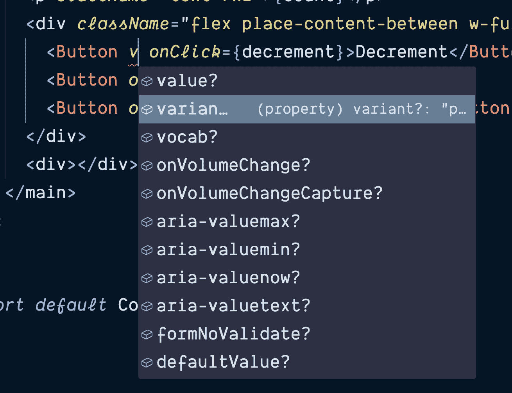

我们可以为我们的 `Button` 添加支持，以添加这个类：

```typescript
const Button = ({ variant, className, ...props }: ButtonProps) => {
  return (
    <button
      className={clsx(
        'button',
        variant === 'primary' && 'button-primary',
        variant === 'secondary' && 'button-secondary',
        className,
      )}
      {...props}
    />
  );
};
```

我们现在可以更新 `src/application.tsx` 来使用我们的新按钮组件：

```diff
diff --git a/src/application.tsx b/src/application.tsx
index 978a61d..fc8a416 100644
--- a/src/application.tsx
+++ b/src/application.tsx
@@ -1,3 +1,4 @@
+import Button from './components/button';
 import useCount from './use-count';
 
 const Counter = () => {
@@ -8,15 +9,11 @@ const Counter = () => {
       <h1>Counter</h1>
       <p className="text-7xl">{count}</p>
       <div className="flex place-content-between w-full">
-        <button className="button" onClick={decrement}>
+        <Button onClick={decrement}>
           Decrement
-        </button>
-        <button className="button" onClick={reset}>
-          Reset
-        </button>
-        <button className="button" onClick={increment}>
-          Increment
-        </button>
+        </Button>
+        <Button onClick={reset}>Reset</Button>
+        <Button onClick={increment}>Increment</Button>
       </div>
       <div>
         <form
@@ -32,9 +29,9 @@ const Counter = () => {
         >
           <label htmlFor="set-count">Set Count</label>
           <input type="number" id="set-count" name="set-count" />
-          <button className="button-primary" type="submit">
+          <Button variant="primary" type="submit">
             Set
-          </button>
+          </Button>
         </form>
       </div>
     </main>
```

### 仓库代码

你可以在 [GitHub 仓库的 `button` 分支](https://github.com/stevekinney/polymorphic/tree/button) 中找到上述更改。

### 创建组合组件

我通常为自己制作的另一个常见组件是一个能正确连接标签和输入元素的组件，分别为它们设置正确的 `for` 和 `id` 属性。我往往会厌倦一遍又一遍地输入这些：

```html
<label htmlFor="set-count">Set Count</label>
<input type="number" id="set-count" name="set-count" />
```

如果不扩展 HTML 元素的属性，我可能会根据需要慢慢添加属性：

```typescript
type LabeledInputProps = {
  id?: string;
  label: string;
  value: string | number;
  type?: string;
  className?: string;
  onChange?: ChangeEventHandler<HTMLInputElement>;
};
```

正如我们在按钮示例中看到的，我们可以用类似的方式重构它：

```typescript
type LabeledInputProps = React.ComponentProps<'input'> & {
  label: string;
};
```

除了 `label`（我们将其传递给（呃）标签，我们通常希望它与我们的输入分组），我们正在手动逐个传递属性。我们想添加 `autofocus` 吗？最好再添加一个属性。最好这样做：

```typescript
import { ComponentProps } from 'react';

type LabeledInputProps = ComponentProps<'input'> & {
  label: string;
};

const LabeledInput = ({ id, label, ...props }: LabeledInputProps) => {
  return (
    <>
      <label htmlFor={id}>{label}</label>
      <input {...props} id={id} readOnly={!props.onChange} />
    </>
  );
};

export default LabeledInput;
```

我们可以在 `src/application.tsx` 中换用我们的新组件：

```typescript
<LabeledInput
  id="set-count"
  label="Set Count"
  type="number"
  onChange={(e) => setValue(e.target.valueAsNumber)}
  value={value}
/>
```

我们可以提取出我们需要处理的内容，然后将其他所有内容传递给 `<input />` 组件，然后在余下的日子里假装它是一个标准的 `HTMLInputElement`。

TypeScript 并不关心，因为 `HTMLElement` 非常灵活，DOM 的出现早于 TypeScript。只有当我们完全离谱地使用它时，它才会抱怨。

### 仓库代码

你可以在 [GitHub 仓库的 `input` 分支](https://github.com/stevekinney/polymorphic/tree/input) 中看到上述所有更改。

## 多态组件

早些时候，我告诉过你，在构建大型应用程序的过程中，我最终往往会围绕组件制作一些包装器。`Box` 是围绕 HTML 中基本块元素（如 `<div>`、`<aside>`、`<section>`、`<article>`、`<main>`、`<head>` 等）的一个原始包装器。但正如我们不想失去从这些标签中获得的所有语义意义一样，我们也不需要多个基本相同的 `Box` 变体。我们希望使用 `Box`，但也能指定它底层应该是什么。

这是一个受 [Styled Components](https://medium.com/styled-components/announcing-styled-components-v4-better-faster-stronger-3fe1aba1a112) 启发的、过于简化的 `Box` 元素示例。

这是来自 [Paste](https://paste.twilio.design/primitives/box)（[Twilio](https://twilio.com) 的设计系统）的一个 `Box` 组件示例：

```jsx
<Box as="article" backgroundColor="colorBackgroundBody" padding="space60">
  Parent box on the hill side
  <Box
    backgroundColor="colorBackgroundSuccessWeakest"
    display="inline-block"
    padding="space40"
  >
    nested box 1 made out of ticky tacky
  </Box>
</Box>
```

这是一个简单的实现，它没有像我们上面在 `Button` 和 `LabelledInputProps` 中那样传递任何属性：

```typescript
import { PropsWithChildren } from 'react';

type BoxProps = PropsWithChildren<{
  as: 'div' | 'section' | 'article' | 'p';
}>;

const Box = ({ as, children }: BoxProps) => {
  const TagName = as || 'div';
  return <TagName>{children}</TagName>;
};

export default Box;
```


我们将 `as` 细化为 `TagName`，这是 JSX 中一个有效的组件名称。就 React 而言，这可以正常工作，但我们还希望 TypeScript 能够相应地适应我们在 `as` 属性中定义的元素：

```typescript
import { ComponentProps } from 'react';

type BoxProps = ComponentProps<'div'> & {
  as: 'div' | 'section' | 'article' | 'p';
};

const Box = ({ as, children }: BoxProps) => {
  const TagName = as || 'div';
  return <TagName>{children}</TagName>;
};

export default Box;
```

老实说，我甚至不知道像 `<section>` 这样的元素是否有任何 `<div>` 没有的属性。虽然我确信我可以查到，但我们中没有人对这个实现感到满意。

但是，那里传入的 `'div'` 是什么，它是如何工作的？如果我们查看 `ComponentPropsWithRef` 的类型定义，会看到以下内容：

```typescript
type ComponentPropsWithRef<T extends ElementType> = T extends new (
  props: infer P,
) => Component<any, any>
  ? PropsWithoutRef<P> & RefAttributes<InstanceType<T>>
  : PropsWithRef<ComponentProps<T>>;
```

我们可以忽略所有这些三元运算符。我们现在感兴趣的是 `ElementType`：

```typescript
type BoxProps = ComponentPropsWithRef<'div'> & {
  as: ElementType;
};
```

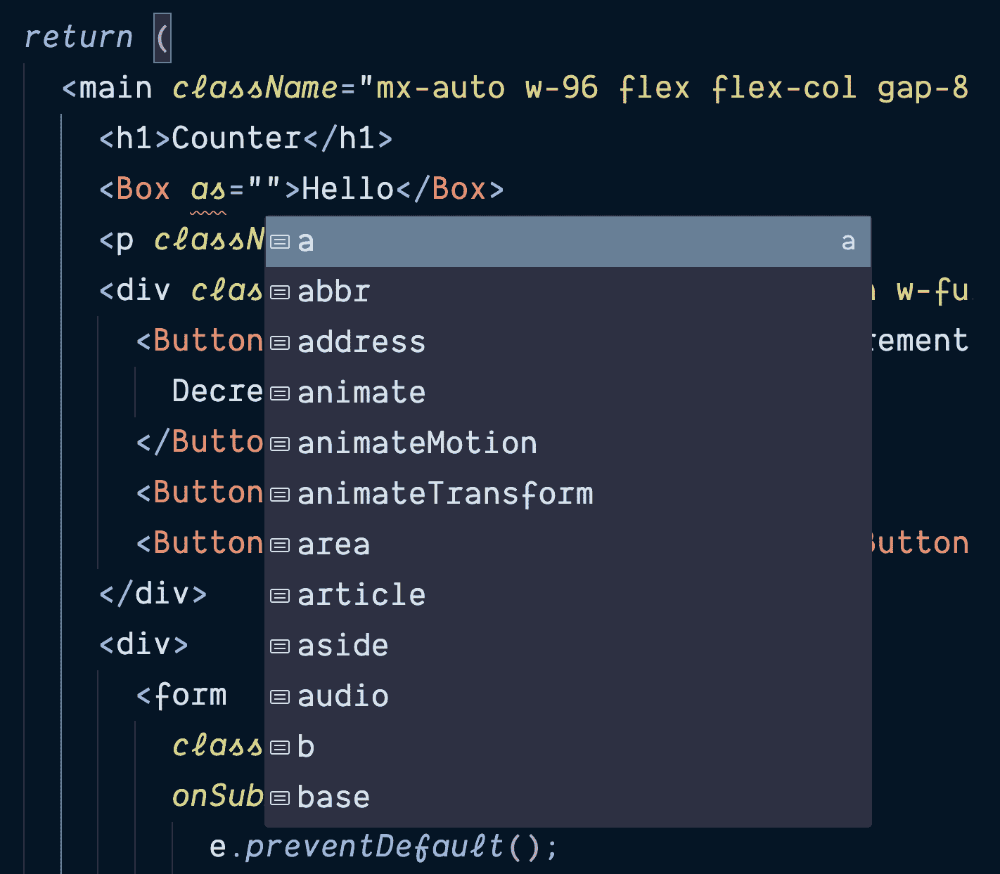

好的，这很有趣，但如果我们希望传递给 `ComponentProps` 的类型参数与……`as` 相同呢？

我们*可以*尝试这样的方法：

```typescript
import { ComponentProps, ElementType } from 'react';

type BoxProps<E extends ElementType> = Omit<ComponentProps<E>, 'as'> & {
  as?: E;
};

const Box = <E extends ElementType = 'div'>({ as, ...props }: BoxProps<E>) => {
  const TagName = as || 'div';
  return <TagName {...props} />;
};

export default Box;
```

现在，一个 `Box` 组件将适应我们通过 `as` 属性传入的任何元素类型。

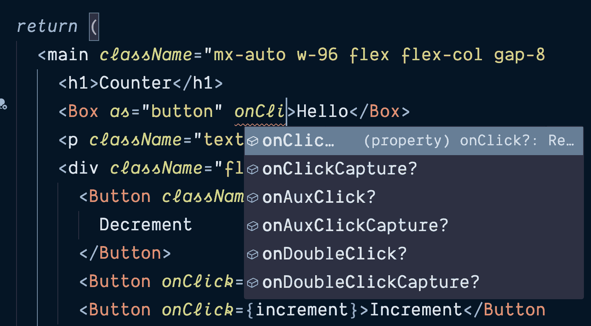

我们现在可以在任何原本可能使用 `<div>` 的地方使用我们的 `Box` 组件：

```jsx
<Box as="section" className="flex place-content-between w-full">
  <Button className="button" onClick={decrement}>
    Decrement
  </Button>
  <Button onClick={reset}>Reset</Button>
  <Button onClick={increment}>Increment</Button>
</Box>
```

### 仓库代码

你可以在 [本教程的 GitHub 仓库的 `polymorphic` 分支](https://github.com/stevekinney/polymorphic/tree/polymorphic) 上找到最终结果。

## 结论

我们刚刚探讨了使用 React 和 TypeScript 创建多态组件的不同策略。通过扩展 HTML 元素的属性，可以创建具有附加行为的该元素的抽象。多态组件是一个单一的、可适应的组件，可以表示不同的语义 HTML 元素，TypeScript 会自动适应这些变化。最酷的是，我们现在可以使用这个新的原语为我们的应用程序普遍添加主题和其他功能。

这些方法在大多数版本的 TypeScript 中都有效。在下一章中，我们将看看 TypeScript 最新版本带来的一些具体改进，以及我们如何利用它们来进一步提高代码的可靠性和可维护性。

# 第 5 章：TypeScript 5.0 三大特性导览

TypeScript，JavaScript 更可靠的表亲，变得越来越好。TypeScript 5.0 及其后续的次要版本 5.1 和 5.2 充满了强大的新功能，有望使我们的代码更简洁、更强大，并且更容易使用。正如你从[发布说明](https://www.typescriptlang.org/docs/handbook/release-notes/typescript-5-0.html)中看到的，TypeScript 5.0 带来了大量变化——无论大小。

我将重点关注三个对我的日常开发影响最大的特性：

*   **装饰器**。TypeScript 5.0 支持与 ECMAScript 提案对齐的装饰器，允许以可重用的方式修改类行为。这些与之前通过 `--experimentalDecorators` 标志支持的装饰器有一些重要的区别。

*   **const 类型参数**。新的 `const` 类型参数增强了函数调用推断，并确保声明的常量保持不变。

*   **枚举的升级和更改**。TypeScript 5.0 增强了枚举，提高了类型安全性，使其更灵活且更用户友好。

## 装饰器：下一代

装饰器*几乎*从我记事起就一直是 ECMAScript 的一部分。这些巧妙的工具让我们能够以可重用的方式修改类和成员。它们在 TypeScript 中已经存在一段时间了——尽管是在实验性标志下。尽管装饰器的第 2 阶段迭代一直是实验性的，但装饰器已在 [MobX](https://mobx.js.org/enabling-decorators.html)、[Angular](https://angular.io/)、[Nest](https://docs.nestjs.com/custom-decorators) 和 [TypeORM](https://typeorm.io/) 等库中被广泛使用。TypeScript 5.0 的装饰器与 [ECMAScript 提案](https://github.com/tc39/proposal-decorators)完全同步，该提案已基本准备就绪，处于第 3 阶段。

**装饰器**让我们能够编写一个函数来调整类及其方法的行为。想象一下，需要在我们的方法中偷偷加入一些调试语句。在 TypeScript 5.0 之前，我们只能手动将调试语句复制粘贴到每个方法中。有了装饰器，我们只需做一次工作，更改就会通过装饰器附加的每个方法得到支持。

假设我们想创建一个装饰器来记录某个方法已弃用：

```typescript
class Card {
  constructor(public suit: Suit, public rank: Rank) {
    this.suit = suit;
    this.rank = rank;
  }

  get name(): CardName {
    return `${this.rank} of ${this.suit}`;
  }

  @deprecated // 👀 这是一个装饰器！
  getValue(): number {
    if (this.rank === 'Ace') return 14;
    if (this.rank === 'King') return 13;
    if (this.rank === 'Queen') return 12;
    if (this.rank === 'Jack') return 11;
    return this.rank;
  }

  // 新的方法！
  get value(): number {
    if (this.rank === 'Ace') return 14;
    if (this.rank === 'King') return 13;
    if (this.rank === 'Queen') return 12;
    if (this.rank === 'Jack') return 11;
    return this.rank;
  }
}

const card = new Card('Spades', 'Queen');
card.getValue();
```

我们希望每当调用 `card.getValue()` 时，控制台都会记录一条警告消息。我们可以如下实现上述装饰器：

```typescript
const deprecated = <This, Arguments extends any[], ReturnValue>(
  target: (this: This, ...args: Arguments) => ReturnValue,
  context: ClassMethodDecoratorContext<
    This,
    (this: This, ...args: Arguments) => ReturnValue
  >,
) => {
  const methodName = String(context.name);

  function replacementMethod(this: This, ...args: Arguments): ReturnValue {
    console.warn(`Warning: '${methodName}' is deprecated.`);
    return target.call(this, ...args);
  }

  return replacementMethod;
};
```

这起初可能看起来有点令人困惑，但让我们分解一下：

*   我们的装饰器函数接受两个参数：`target` 和 `context`。

*   `target` 是我们正在装饰的方法本身。

*   `context` 是关于该方法的元数据。

*   我们返回一个具有相同签名的方法。

*   在这种情况下，我们调用 `console.warn` 来记录弃用通知，然后调用该方法。

`ClassMethodDecorator` 类型具有以下属性：

*   `kind`：被装饰属性的类型。在上面的例子中，这将是 `method`，因为我们正在装饰 `Card` 实例上的一个方法。

*   `name`：属性的名称。在上面的例子中，这是 `getValue`。

*   `static`：一个值，指示类元素是静态的（`true`）还是实例的（`false`）元素。


*   `private`：一个值，用于指示类元素是否具有私有名称。

*   `access`：一个对象，可用于在运行时访问类元素的当前值。

*   `has`：确定一个对象是否具有与被装饰元素同名的属性。

*   `get`：在提供的对象上调用 setter。

### 试用一下

你可以在[这个在线演练场](https://www.typescriptlang.org/play?ts=5.1.3#code/C4TwDgpgBAygrgS2FAvFA5DMBDAJhAZ3SgB8MAJCbAJ2CNIwBEFsBbAewDtd6z0BhADZwARkQDcAKEmhIUAErZOAa1SSoDdAEEAxhHTqGAJkNkAzKagAWSwFZLANksB2SwA5LATksBGAAyW6ABS2DrKBhp8AIpwEBCcEZoA0gicAOboUjLg0Pw0uABybNBoAAYAJADeiioAvlDsAGZQVfBItaVZOlwEyPhg1BA62MAQuKhQADwAKgAWCAQANFBa1GlwrPF0UBAAHqPcBFBKIADaALrL8hDAcNScAGrYwhAAfAAUhsA0aTcAXFB3sB5gQAXMFssAHTQn6glZrDZbAgASlQrwUNzuj2esUWhm6nFG+wBQmwBAIAFkbrN2LhGEN2NQRoz+FwicBJoYNOCllzAcCFmCQVCYWs4at1ptCSi0Rjbvcni9DK88aiUOjKvieshNsDaUVNhMYMBqKk0u8CezIZxisishpGnBODpgAguFBBmBBKEIFLgFS9bggSChRCoNDIbCARLEdLkQDrvLsS8oJqNBoCQR2IIIJCAO40TjvUoAdULZoB6CqupphWKtWICyg-UGw1GuEhpTtfMGSag3zWN0hw0EgmDYYjsO7Glq0g0vaxHogXp9foDtaktSyezAjOQOm95KgeWo4zTUEzJrgLsZ7zAokECB0UAIiGAALawGW95Ej+fTJUBMlGUVFzw0AUCEhV8kAmaDgCkdN+xBSEANUNBUIQqBZ0MX5kBtTZ3njY98gNaAwKXPsKkqCCUOA+omhaajkLgjpMOwjQAAEWyGEYxhwm5FViQiAU4DYRAgahUz5BBmnHSDUNQFA0G0PR0FRBd7igHwrEwjQZP5ZCFKU5SUnSNSKMXHwzF0qB9Lk2iVEU5SYjiBJ1MxTSfCMGy7JooylIwEIwnMjTOC0nwbNCpCFgc5Q2LnKAAHpEqgOZoE4CA8ygAsQH7dhm3ypAAEJ#OQAA3HEIGEqBRNYcTJPI3zDOApyMF0fR3L7bSfNkvyWuMjBTIyTrLOs6TeuaxyBvQFz4hCjywq8nqDJi-zlKC8IRs8iKewW6L5OA#LZyAA)中试用上面的代码示例。

装饰器为添加日志消息提供了便捷的语法糖——就像我们在上面示例中所做的那样——同时也适用于许多其他常见用例。例如，我们可以创建一个装饰器，自动将方法绑定到当前实例，或者修改方法或类的[属性描述符](https://developer.mozilla.org/en-US/docs/Web/JavaScript/Reference/Global_Objects/Proxy/Proxy/getOwnPropertyDescriptor)。

## 释放 const 类型参数

`const` 类型参数允许我们使用 `const` 来声明值。TypeScript 现在能够推断类型，而不仅仅是字面值。

更简单地说，`const` 类型参数允许我们在代码中清晰地表达意图。如果一个变量应该是一个永不改变的常量，`const` 类型参数就为我们提供了一张安全网，确保它无论如何都保持不变。

TypeScript 的早期版本已经支持使用 `as const` 将对象或数组声明为 `readonly`。一旦 TypeScript 知道一个对象或数组在运行时不会改变，它就能对其类型做出更可靠的假设。

考虑以下两个数组：

```
const avengers = [
  'Black Widow',
  'Captain America',
  'Hawkeye',
  'Hulk',
  'Iron Man',
  'Thor',
];

const ninjaTurtles = [
  'Donatello',
  'Leonardo',
  'Michelangelo',
  'Raphael',
] as const;
```

如果我们在[这个演练场](https://www.typescriptlang.org/play?ts=4.9.5#code/MYewdgzgLgBAhgNwKZgOZIE4RgXhgbQHIBJDcGAWTjEIBoZCAhAGzmAGsYB1ASwBMQAdzoMAKgAsQGEYQDCcAA5Q4PMDACCAW0w9gcGQAk4g9kgCeSQgF0A3AChQkWGFUArOKICuGKMyTY8IgARcDgoJGZmEBkAGSRQjAEZACVFcTgImQpdcQjqdGireGxHaBsgA)中将鼠标悬停在每个数组上，我们会看到 TypeScript 推断出了两种非常不同的类型：

```
const avengers: string[];
const ninjaTurtles: readonly [
  'Donatello',
  'Leonardo',
  'Michelangelo',
  'Raphael',
];
```

当处理带有函数的 `readonly` 数据结构时，事情会变得有点棘手。考虑以下情况：

```
type WithNames = { names: readonly string[] };

const turtles = getNames({
  names: ['Donatello', 'Leonardo', 'Michelangelo', 'Raphael'],
});
```

在这个例子中，`turtles` 的类型将是 `string[]`，如果我们仔细查看 `WithNames`（它断言 `names` 属性是 `readonly`），这可能不是我们所期望的。以前，我们可以通过在调用函数时给数组添加 `as const` 来获得更接近预期的结果：

```
const turtles = getNames({
  names: ['Donatello', 'Leonardo', 'Michelangelo', 'Raphael'] as const,
});
```

现在 `turtles` 将正确地具有以下类型：

```
const turtles: readonly ['Donatello', 'Leonardo', 'Michelangelo', 'Raphael'];
```

但这可能很麻烦，而且如果我们每次调用函数时都忘记添加 `as const`，最终得到的结果可能与预期不符——这绝不是好事。

在 TypeScript 5.0 中，我们可以将 `const` 添加到参数本身的类型中，这样我们就不必每次调用函数时都担心添加 `as const`：

```
//                  ⬇️
const getNames = <const T extends WithNames>(arg: T): T['names'] => {
  return arg.names;
};

const turtles = getNames({
  names: ['Donatello', 'Leonardo', 'Michelangelo', 'Raphael'],
});

const avengers = getNames({
  names: [
    'Black Widow',
    'Captain America',
    'Hawkeye',
    'Hulk',
    'Iron Man',
    'Thor',
  ],
});
```

现在的类型如下：

```
const turtles: readonly ['Donatello', 'Leonardo', 'Michelangelo', 'Raphael'];
const avengers: readonly [
  'Black Widow',
  'Captain America',
  'Hawkeye',
  'Hulk',
  'Iron Man',
  'Thor',
];
```

### 动手试试

你可以在[这个 TypeScript 演练场](https://www.typescriptlang.org/play?ts=5.1.3#code/C4TwDgpgBA6glsAFgOQIYFsIGcoF4oDeUAdhtgFxQBOEqAJgPbEA2IUWwVcxA5gNoBdKAF8A3AChxAYyYcoPCMDSYc+ADwzicgCpQIAD2ARidHPCTLsAPgAUqKj0raAlE74ByUivdDcVwuJQ1IoArlTEUPY8AHRe2BJikppywGHAzNh48oqWWDYEgSRkWJQeACJMqEbMzAzuADRQ7gAyEJVUjA1NALJwUogQzKi8g3WN7gBKqGCIqIM+9eLCzhLSssCRAG7GClSq2UrF+YVxJVB8hUHuAEJDUgDWsHCMAO4Nl00AwtPAqNxQAEFMFwpKh3kErgAJVAve4QEAQcEQ9yQkLMe5Iq4ASSoTCg3WGmKa2kQDCoSIEi2WEiAA)中试用上面的代码。

和任何事物一样，这里也有一些权衡。使用 `as const` 在声明时将对象设置为只读。`const` 参数给了我们另一个选择：在调用时将对象设置为只读的能力。能够选择最适合我们用例的行为，是 TypeScript 一个受欢迎的新增功能。

## 升级和增强的枚举

枚举——提供了一种方便（尽管有些未被充分认识）的方式来定义一组命名常量——在 TypeScript 5.0 中得到了重大提升。

过去，我们可能意外地将一个错误的数字传递给期望枚举的函数，并且侥幸逃脱。TypeScript 5.0 严格得多。如果存在不匹配，它将抛出错误。它现在将所有枚举视为联合枚举，使它们更安全、更易于使用。

在 TypeScript 5.0 之前，枚举实际上只是一组数字约束。假设我们有一个枚举来跟踪 HTTP 请求的状态：

```
enum RequestState {
  NotStarted,
  Loading,
  Success,
  Error,
}
```

TypeScript 会将其编译为以下对象：

```
{
  "0": "NotStarted",
  "1": "Loading",
  "2": "Success",
  "3": "Error",
  "NotStarted": 0,
  "Loading": 1,
  "Success": 2,
  "Error": 3
}
```

枚举可以被视为一个有界的数字集合。对于 `RequestState`，这个集合就是 0、1、2 和 3。但在 TypeScript 的早期版本中，我们可以用任何数字绕过枚举中预定义的值。例如，[以下代码在 TypeScript 4.9.5 中是有效的](https://www.typescriptlang.org/play?ts=4.9.5#code/KYOwrgtgBASsCOZgGcAuBlVBDVwoG8AoKKAOQHsNsAnXAEwBpioAZcrOgSxAHMmT0YAMZCUyflACi1auWpMAvoUJDyINFAA25HnEQoqOPAF4oACmoIkaAFywrBzEYCUUYwD4CzVevKbgAHTaPGYA5HrWqDahDFCW+mixEY7YuADa8ZEAus4A3IQK+YTByWhOuGalhrgBbBzcPHnFOlXlwGYADE0lDmWp7QCsA01AA)：

```
const logRequestState = (request: RequestState) => {
  console.log('Request:', request, RequestState[request]);
};

logRequestState(RequestState.Loading); // ✅ 输出: "Request:",  1,  "Loading"
logRequestState(0); // ✅ 输出: "Request:",  0,  "NotStarted"
logRequestState(55); // ✅ 输出:  "Request:",  55,  undefined 🤨
```


`55` 不应作为 `logRequestState` 的有效参数。在 TypeScript 5.0 中，所有枚举现在都被视为联合枚举，这提供了更好的类型安全性。实际上，`RequestState` 是 `0 | 1 | 2 | 3`，这意味着 `55` 不再是一个有效参数。这更接近我们可能预期的行为，如[此示例](https://www.typescriptlang.org/play?ts=5.1.3#code/KYOwrgtgBASsCOZgGcAuBlVBDVwoG8AoKKAOQHsNsAnXAEwBpioAZcrOgSxAHMmT0YAMZCUyflACi1auWpMAvoUJDyINFAA25HnEQoqOPAF4oACmoIkaAFywrBzEYCUUYwD4CzVevKbgAHTaPGYA5HrWqDahDFCW+mixEY7YuADa8ZEAus4A3IQK+YTByWhOuGalhrgBbBzcPHnFOlXlwGYADE0lDmWp7QCsA01AA)所示：

```
logRequestState(RequestState.Loading); // ✅ Logs: "Request:",  1,  "Loading"
logRequestState(0); // ✅ Logs: "Request:",  0,  "NotStarted"
logRequestState(55); // ❌ Argument of type '55' is not assignable to parameter 
➥of type 'RequestState'.
```

TypeScript 现在能更好地强制执行枚举中设定的类型。以下代码在 TypeScript 4.9.5 中可以编译，但在 TypeScript 5.0 及更高版本中*不会*。需要提醒的是：如果我们尝试动态计算数字，TypeScript 就无法提供如此有用的帮助。例如，`logRequestState(3 + 2)` *不会*生成错误：

```
enum Letters {
  A = 'Aye!',
  B = 'Bee!',
  C = 'Sea!',
}

enum Numbers {
  one = 1,
  two = 2,
  three = Letters.C,
}

const n: number = Numbers.three;
```

如你所见，`Numbers.three` 从技术上讲是一个字母，应该允许被赋值给一个数字。TypeScript 5.0 确保了这种行为符合预期。话虽如此，这是一个破坏性变更，可能需要我们重新审视我们的代码。

以前，我倾向于使用联合类型而非枚举。新的行为应该能与现有代码良好协作，并且比之前的实现提供更高的安全性。枚举和联合类型都是定义一组值的有效方式，现在的选择归结为我们的偏好。

## 结论

TypeScript 5.0 在语言的用户友好性和灵活性方面是一次重大进步。它引导我们采用更好的编码实践，促进更简洁的代码，并在潜在错误成为麻烦之前将其捕获。TypeScript 团队持续为该语言添加重要功能和生活质量改进。显然，这次的变更范围较小，但 [TypeScript 5.1](https://www.typescriptlang.org/docs/handbook/release-notes/typescript-5-1.html) 已添加了额外功能，例如为返回 `undefined` 的函数提供更便捷的隐式返回。

对我而言，TypeScript 对于我维护和修改大型代码库的信心至关重要。我经常发现编译器能捕获我原本会遗漏的边缘情况，而这些情况可能会在不恰当的时间让我的寻呼机响起。我个人很期待看到这门语言在未来几年的演进——尤其是如果当前的更新节奏得以持续的话。

