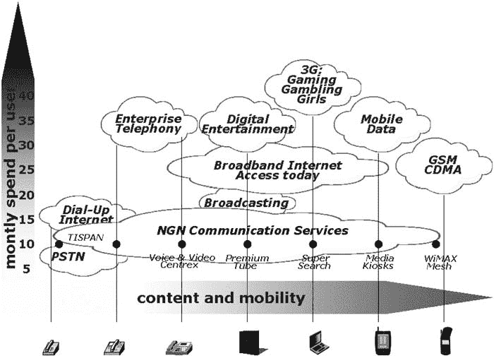
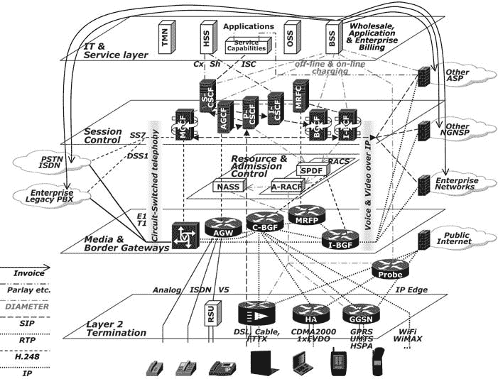
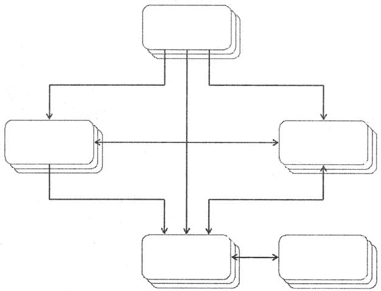
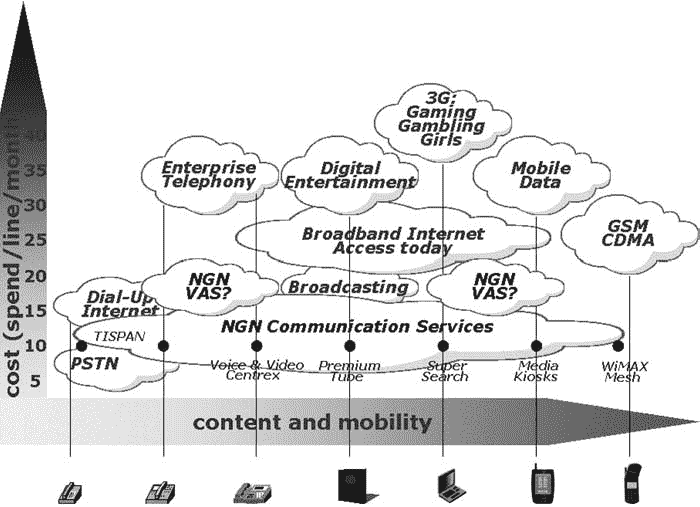

# 下一代网络增值服务

下一代网络的增值服务 / Thierry Van de Velde. p. cm. -- (Informa telecoms & media ; no. 7) TK5101.V45 2007 621.382--dc22 2007017685

## 第一章 基础力量

欢迎来到第一章！

在书中，我们将对现代通信服务的真实“增值”展开探索。

我从来不喜欢那些诸如“高效通信能提高生产力”或“社交人士频繁交流”之类的空话。我们的朋友和同事难道不是被大量的电话、信息和流媒体淹没吗？我们、企业或广告商愿意为真正的通信手段支付多少？我们的孩子们会采用它们吗，还是会发明自己的？我们的机器会以不可预测的方式进行通信吗？

这本书不仅关乎技术本身，还关乎如何使用以及如何最好地使用它们。

为了能够为下一代网络（NGN）设计增值服务（VAS），我们还有很长的路要走——至少在开始本书时我是这样认为的。NGN 的定义同样不容易。

这将是一段危险的旅程；我们可能会迷失在网络荒野、企业生态系统或令人生畏的流量预测中。我们最终可能会得到一份包含几十种服务的列表，却无法对它们进行排序甚至无法理解其范围。

因此，让我们做好武装吧！

在本章中，我们将直升机俯览在我看来正在构建现代通信手段的基础力量（“维度”）：

- 手段与适用性
- 语境与交互部分
- 设备、连接与服务
- 蜂窝、移动和无线
- 存在性与可用性
- 即时与延迟模式
- 按需、触发和周期性
- 个人联系人与部落
- 基于位置

传统上，通信手段通常被分类为：

- 固定或移动
- 语音、文本、视频或数据
- 预付或后付
- 零售或批发
- 电路交换或分组交换
- 点对点或多方通话
- 尽力而为或保证服务质量
- 私有或公共

但在下一代网络（Next Generation Networks）的语境下，这些指的是比特管道（连接性）的属性，而非可识别的通信服务。而本书讨论的是真正的通信服务，而不是连接性。

**图 1.1** 塑造现代通信手段的基本力量。

因此，让我们尝试走一条不同的道路；尝试揭示通信服务的本质。但在那之前，也许我们可以先从定义并界定通信与其两个天然对手——存储和计算的区别开始。通信、存储和计算之间的关系处于不断的演变中；为了提供某项通信服务，它们是盟友，又是另一项服务的敌人。

### 1.1 符号设备

我们都通过经历和内心体验深知，我们的意识行为源于我们的欲望和恐惧。直觉告诉我们，这对于我们的同类和高等动物也是如此。我们都试图逃避痛苦和死亡，同时追求愉悦。我们在所行事上都受冲动的支配；而这些冲动是有组织性的，以至于我们的行动通常是为了我们自身以及种族的自我保护。

**图 1.2** 阿尔伯特·爱因斯坦拉小提琴。

饥饿、爱、痛苦、恐惧是支配个体生存本能的一些内在力量。同时，作为社会性动物，我们在与同伴的关系中受同情、自豪、仇恨、权力需求、怜悯等情感的影响。所有这些难以用语言描述的原始冲动都是人类行动的源泉。如果这些强大的元素力量停止在我们体内波动，所有此类行动也将停止。尽管我们的行为看起来与高等动物大不相同，但原始本能在它们和我们身上是非常相似的。

最明显的区别源于人类身上扮演的重要部分：即相对强大的想象力，以及在语言和其他符号设备辅助下的思考能力。思维是人类的组织因素，穿插在因果性的原始本能与产生的行动之间。通过这种方式，想象力和智力作为原始冲动的仆人进入了我们的存在。但它们的干预使得我们的行为不再仅仅服务于本能的即时需求。

**—— 阿尔伯特·爱因斯坦**

顺着这位伟大科学家的推理，语言和符号设备帮助我们构建想象力和智力：这些工具减轻了原始冲动对我们行为的影响。

从上面的图片中，我确定爱因斯坦会把音乐列为符号设备之一。某些符号设备（如数学和物理形式）已帮助人类构建了智力来应对基本冲动，例如寒冷（通过核能发电）、恐惧（通过对宇宙起源和演化的洞察）以及对权的需求（通过原子武器）。

科学、艺术、医学、宗教、政治体系、法律和经济已成为当今世界上主要的符号设备。我们希望有一天也能将电信加入这一声光名单中：不是每天数十亿次电话、信息和网页中所说的内容；不是铜线、光纤和以太网络本身；而是人类用于通信的一系列底层协议、网络结构和程序。

通信对生命至关重要——如果没有通信，达尔文主义还会存在吗？

某些服务质量，即使是端到端强制执行——无论大小的企业都可能发现远程存在（基于 IP 的视频会议）极具价值。

对于现代电信服务提供商而言，将自己定位于“真正的通信”与“存储媒体传输”之间是至关重要的：他们应该发明并推出新的通信手段，还是为他们无法解读的存储内容提供高质量的比特管道（bit pipes）？他们是准备提供增值服务，还是仅仅下一代网络？*他们是要成为外交官还是信鸽？*

如果不能在其中一个领域专业化并成功，其中一些公司可能会倾向于成为*诗人*——存储内容的创造者——从而导致对*围墙花园*门户、点播点电影服务器、足球转播权、音乐目录等的投资。

这些偏离原始公司使命和核心业务的行为，不能仅仅通过证明比特管道的实用性来辩护。记住这些 19 世纪铁路所有的火站小食堂——乘客乘坐非常实用的火车（比特管道）到达那里，但谁会认为它们是所访问城镇美食界（内容）的代表呢？铁路公司无法吸引最顶级的厨师或最有积极性的服务员。

结论是，可以这样说：存储（包括存储媒体的商品化传输）一方，真正的通信手段另一方面，在今天已成为敌人，并可以破坏彼此的业务模式、公司和终端用户。

## 1.3 通信与计算

真正的通信显然受到计算进步的推动。

听起来令人难以置信，数字时代的主要发明（晶体管、微芯片、磁性和光电存储）都发生在不到 50 年前，而互联网出现在不到 20 年前。GSM 手机在不到 10 年的时间内从手机演变成了网络化的个人计算机——并处于其自己的由蓝牙耳机、车载套件和键盘构成的个人接入网络的中心。

计算仍处于其扩张阶段，而且这种趋势似乎正在加速。

无线宽带技术将互联网的范围扩大到没有铜线对甚至没有电的偏远地区；因此为低成本计算设备（笔记本电脑、电池和太阳能电池板）创造了新市场。

计算的扩张不受限于人类的数量——因此不受限于人类的同化带宽或人类的通信欲望。汽车和家用电器包含了计算机。我们的电表可能很快也会包含一个。射频识别（RFID）标签允许服装商店中的每件物品都包含一个一次性计算机。手表将很快包含一台计算机，通过 `Wibree` 和你的手机，在跑步期间将心率传输到互联网。个人教练甚至可以实时向你的蓝牙耳机返回建议，耳机中再次包含了一台计算机。

随着计算向边缘扩张，传输和存储也会随之扩张，但电信部门（即电信服务提供商）能从这一运动中获益吗？

此外，限制这种扩张的因素是什么？

有些人对现代操作系统和分布式软件对计算资源的高效利用感到不愉快。不确定人们是否会继续购买更多的计算能力来应对这个问题。虚拟化、Web 服务和 IP 显示（`DoIP`）终端将通过简化用户设备并将计算、存储和软件重新中心化为一种按需资源池，来节省计算资源。

使用媒体压缩技术（如 `MP3`、`AAC`、`MPEG4`）的内存棒和媒体播放器的成功源于对非易失性内存的需求，但也说明了远离计算能力的趋势。今天的消费者似乎愿意为高端便携式媒体播放器支付与基础台式计算机相同的价格。

计算机之间会出现真实的、有价值的通信，而仅仅是存储媒体的传输吗？我们离此并不远。计算机已经开始为点对点服务转发数据包，而其人类所有者并不知情。下一步可能是这些计算机为演进通信服务做出自主购买决策：例如，“服务质量”（高带宽和高吞吐量、低抖动和延迟）、“最低成本路由”、“来自对计算机的不可预测的结果”。前提是它们（是的，计算机！）拥有某种形式的收入——例如来自希望为更好的人际服务付费的人类。然后计算机可能成为电信服务提供商某种形式“广告”的目标！

可以想象这样一种业务模式：电信服务提供商将拥抱并开发点对点技术，而不是对抗它——例如，将点对点网络作为下一代网络的批发客户。

这并不不现实，因为 `Skype` 在 2005 年选择了全球四家成熟的国际运营商，将 `SkypeOut` 终止到全球普通电话网络。

`Skype` 和其他点对点客户端的下一个版本可能会在管理网络上自动建立通话段（可能仍然是数据包语音），以防检测到低语音质量。`Skype` 可能将这些通话提交给网关，其性能（处理的流量和语音质量的提高）将得到评估和奖励。

计算的扩张不受限于人类的数量——因此不受限于人类的同化带宽或人类的通信欲望。汽车和家用电器包含了计算机。我们的电表可能很快也会包含一个。射频识别（`RFID`）标签允许服装商店中的每件物品都包含一个一次性计算机。手表将很快包含一台计算机，通过 `Wibree` 和你的手机，在跑步期间将心率传输到互联网。个人教练甚至可以实时向你的蓝牙耳机返回建议，耳机中再次包含了一台计算机。

随着计算向边缘扩张，传输和存储也会随之扩张，但电信部门（即电信服务提供商）能从这一运动中获益吗？

此外，限制这种扩张的因素是什么？

有些人对现代操作系统和分布式软件对计算资源的高效利用感到不愉快。不确定人们会继续购买更多的计算能力来应对这个问题。虚拟化、Web 服务和 IP 显示（`DoIP`）终端将通过简化用户设备并将计算、存储和软件重新中心化为一种按需资源池，来节省计算资源。

使用媒体压缩技术（如 `MP3`、`AAC`、`MPEG4`）的内存棒和媒体播放器的成功源于对非易失性内存的需求，但也说明了远离计算能力的趋势。今天的消费者似乎愿意为高端便携式媒体播放器支付与基础台式计算机相同的价格。

计算机之间会出现真实的、有价值的通信，而仅仅是存储媒体的传输吗？我们离此并不远。计算机已经开始为点对点服务转发数据包，而其人类所有者并不知情。下一步可能是这些计算机为演进通信服务做出自主购买决策：例如，“服务质量”（高带宽和高吞吐量、低抖动和延迟）、“最低成本路由”、“来自对计算机的不可预测的结果”。前提是它们（是的，计算机！）拥有某种形式的收入——例如来自希望为更好的人际服务付费的人类。然后计算机可能成为电信服务提供商某种形式“广告”的目标！

可以想象这样一种业务模式：电信服务提供商将拥抱并开发点对点技术，而不是对抗它——例如，将点对点网络作为下一代网络的批发客户。

这并不不现实，因为 `Skype` 在 2005 年选择了全球四家成熟的国际运营商，将 `SkypeOut` 终止到全球普通电话网络。

`Skype` 和其他点对点客户端的下一个版本可能会在管理网络上自动建立通话段（可能仍然是数据包语音），以防检测到低语音质量。`Skype` 可能将这些通话提交给网关，其性能（处理的流量和语音质量的提高）将得到评估和奖励。

无法以许多格式（例如电影、书籍、漫画、网站、艺术品）重新复制内容本身。

为了让真正的电信服务取得更大的成功，接收端可以也应该得到改进。真实通信的接收者应该享有与存储媒体接收者相似的选择权。

这样，电信服务提供商将承担起职责，让用户订阅、选择、过滤、翻译、适配、存储、组织和重路由*传入*的通信和信息，而不是像今天那样被动地将*传出*的通信或信息传输到选定的目的地——这是一种商品化。

这种范式转移对于今天的通信服务提供商来说可能跨得得太大了，这意味着新的专门机构将会出现，并成功地处理这些方面。

知识经济需要解决通信手段和适用性的问题，否则它将无法创造出一个“超级通信、超级信息”的阶层（他们可以吸收来自数十个渠道的各种信息流），以及一个感到被淹没和焦虑的孤立且无知的阶层。我们需要一个中产阶级！

## 1.5 上下文部分与交互部分

传入通信的潜在侵入性在企业和商业环境中已被认识，那里引入了人工或自动电话接线员、接待员和呼叫中心来处理通话的第一部分，在将呼叫者连接到最终目的地（正确的部门或最专业的专业人士）之前。

这与许多公司的物理布局相似，设有一个接待台，员工在那里与外部世界提供第一层交互。公司留下的第一个（有时也是唯一的）印象就是在那个接待台留下的。

现代目录查询服务部分是人工的，部分是自动的。在欢迎提示后，系统选择一个可用的人工接线员。他/她询问姓名或地址，查询目录号码，并立即将控制权交给系统，系统通过语音转读读取号码。然后系统建议将呼叫者连接到最终目的地、通过短信发送号码等。这是一种成本效益的趋势：极少的人工交互部分由日益增长的自动化部分所补充。

电话卡服务要求你拨打一个免费号码，输入你的卡号，然后输入你想要拨通的号码。

今天最基本的固定电话通话仍然始于这样一个序列：呼叫者从第一个（本地）电话交换机获得拨号音，拨打号码，并听到最后一个电话交换机产生的铃音。

在20世纪初，在自动电话交换机出现之前，呼叫者会连接到交换机接线员，并请求连接到指定号码。

电话通信的一部分是上下文的；另一部分是真正的交互的。正是这两者的结合使得通信手段变得具有吸引力并成功。

当通信主要是交互性的时，另一方面，上下文部分为发送者留下了构建他/她思想的时间。难道你没有曾在（由于某些技术故障）没有播放铃音，但被叫方突然接听电话时感到困惑吗？

一些曾经是纯交互的某些现代通信手段正在演变为也包含上下文部分。

例如，聊天和即时消息曾经是纯交互的。随后，一些 `IM` 用户开始每天修改他们的显示名称，讲述自己的心情或即将进行的活动。后来这作为一个功能被添加进来，并与昵称分开。`IM/VoIP` 客户端允许用户添加图片、一些个人信息等，这些可以在实际通信发生之前被呼叫者看到。一些移动运营商允许用户选择呼叫者将听到的铃音（被称为“个性化回铃音”或“彩铃音”），这种服务在某些国家（如韩国）非常火。

相反，曾经只有上下文部分的通信手段现在正在添加交互部分。

大多数公司网站（和内网）曾经只有上下文部分。但航空公司、保险公司和公用事业网站已转变为包含交互部分，人们可以在那里填写他们的电话号码并点击“致电给我”按钮。例如，你可以插入到电子邮件签名中的“`Skype` 我”按钮，这让点击此按钮的人使用他们的 `Skype` VoIP 客户端与你联系。在一些公共网站和内网站点上，已经可以直接点击其他员工、部门或知识领域来建立 Web 语音通话（voice-on-Web）和 Web 视频会议。

在电视领域，也有类似的趋势，观众被邀请使用短信、电子邮件或节目的网站来参与问答或给出他们的意见。

当然，人们会在某些特定情况下并行使用不同的通信手段。一个典型的例子是在会议电话或网络研讨会期间聊天。另一个例子是用你的摄像手机拍照或拍摄周围环境，并将其作为视频通话传输，同时使用你的蓝牙耳机继续语音对话。这些被称为*组合式*服务（combinatory services）。

从长远来看，通信的上下文部分可能会扩展到覆盖整个交互部分的持续时间，如下所示。

为了让一种单一的主流通信手段取得成功，它今天可能总是被构想为一个上下文部分，后跟一个交互部分。

如果不是，缺失的部分将作为插件功能（bolt-on feature）被添加，这永远无法像将其纳入原始设计中那样成功。

## 1.6 设备、连接与服务

真正的通信和存储媒体传输都涉及消费者购买不同程度的紧凑封装方案。正如我们在第6章将看到的，开发和交付实际服务远比在服务器上编写和安装软件要复杂得多。在不进入细节的情况下，围绕互联网的某些“支持者”，设备、连接和服务这三个组件共同可以被视为一种“服务”。

**图1.4** 通信手段的结构。消费者真的处于主地位吗？

### 1.6.1 阶段1

在20世纪80年代和90年代初，大多数决策是由当时的——紧密耦合的——连接和服务的，由设备制造商或某些部门做出的。

那里的工程师对接入和核心网络的信号标准做出决定，但对“已批准的”终端设备（例如数字电话、信息化的终端）也是如此。

### 1.6.2 阶段2

在20世纪90年代后期，随着数字通信的普及，通信消费者通过移动设备获得了权力：如果新的网络技术（即连接或服务）传播得不够快，就不会成功。一些例子是短信、`WAP`、`GPRS`、`CDMA2000`、`UMTS`、`CMDA1X` 和 `MMS`。

连接与设备的联合销售导致了奇怪的技术解决方案，例如没有 `SIM` 卡的 `CDMA/TDMA` 手机，将其锁定在特定的连接提供商处。在 `GSM` 侧，手机被程序为锁定 `SIM`。

连接与服务的联合销售也是常见做法，导致了优质短信服务的五分成交易、移动数据的“围墙花园”以及蓬勃发展的铃音市场。服务A仅可以通过连接A使用，而服务B只能通过连接B使用。

### 1.6.3 阶段3

随着21世纪初互联网连接和更开放系统的出现，尽管移动设备上 `IP` 服务的实际应用在2006年仍处于婴儿期，但第三个阶段已经开始，在这个阶段，设备、连接和服务的市场开始分化。

移动设备消费者的注意力从通信技术转向了“本地”功能，如相机、存储卡和本地连接（蓝牙、`WiFi`）。根据 `Carphone` 发布的《2006移动生活报告》，仓库，价格是次之。第三是风格因素：外形因子（例如翻盖手机、滑盖手机、`PDA`）、重量、设计和品牌形象。

移动连接的消费者已经对移动服务运营商复杂的资费失去兴趣，但被实用的服务所吸引，例如新的预付费充值方法、基于 Web 的预付费（由 `MVNO` —— 移动虚拟网络运营商提供），或通信、互联网和电视的一站式购物。

“全功能 `MVNO`”趋势——即独立组织运营自己的 `HLR`（位置寄存器）和预付费平台——完美说明了服务如何从连接性中分离出来。当然，这两个层级继续实时通信，以控制通话、会话、消息的路由和持续时间，并希望有一天能允许哪些媒体以及应用何种服务质量（`QoS`）（我们将在第 3.3.2 节进一步讨论）。

在这样的环境中，服务的选择仍然且将稍后做出。电视投票、游戏、导航、音乐下载、社区服务和遥测并不一定来自你目前的移动和互联网连接提供商。

### 1.6.4 演进

蜂窝通信行业尚未到位，但类似的演进在约 15 年前的个人计算和互联网空间发生过。

自 20 世纪 90 年代初以来，计算设备、互联网连接和服务完全独立地演进。

专门的外形因子（例如笔记本电脑、口袋 PC、立方体电脑、服务器刀片、机顶盒）和设计出现在设备市场上。

连接技术从拨号接入演变为数字用户线路（`DSL`）、电缆、无线以及很快出现的移动网络。

服务市场可能也比我们在蜂窝空间看到的领先 10 年，例如在蜂窝空间，搜索引擎的使用微乎其微。基于 Web 的地址录在蜂窝设备上的使用为零（人们使用 `SIM` 和/或手机中的本地地址录）。但在 `PC`/互联网世界中，这种使用是大量的——例如通过 `Plaxo` 和 `LinkedIn` 等免费服务。

新的通信手段应该作为设备功能、连接模式或服务进行开发和定位。已经不再可能将这三个方面捆绑在一起了。

## 蜂窝、移动和无线

在一个理想的世界中，服务平面将与连接平面完全解耦；因此，在讨论服务时，我们不需要考虑这些连接属性。

但今天服务的可能用法受到这种连接是蜂窝、移动还是无线的程度的强烈影响。

一个很好的例子是 `IEEE LAN/MAN` 标准委员会 (`LMSC`) 目前的状况，三个竞争性的远距离宽带无线接入系统已经标准化：`802.16-2004`（无线 MAN，“`WiMAX`”）、`802.16e-2005`（“移动 `WiMAX`”，2006 年 2 月）和 `802.20`（“`Mobile-Fi`”）。这三种连接技术可以通过它们的移动性程度（切换速度）和无线程度（范围），以及其他重要因素（如每小区吞吐量和频谱效率，即 `bit/s/Hz`）来区分。

顺便说一下，必须指出在最近的仿真中，基于 `OFDM` 空接口的 `Mobile WiMAX` 与基于 `CDMA` 的 `3GPP HSPA` 和 `3GPP2 EVDO` 相比取得了显著成果。例如，`Mobile WiMAX` 将首次突破`1 bit/s/Hz`的魔术数字，并实现每个小区`6` 到 `14 Mbit/s`的下行吞吐量（`HSPA` 和 `EVDO` 为 `4 Mbit/s`）。

当然，一些非技术考虑因素也会发挥作用（经济、政治）。`Mobile-Fi` 在技术上更适合移动 `VoIP`（切换更快、延迟更低），由于其位于 `3.1GHz` 以下的低频段，对 `3G` 的威胁更大。而且，`Mobile-Fi` 的实际实现将更进一步，因为 `Mobile WiMAX` 的开发现在已几乎完成。因此，`IEEE` 标准机构刚刚决定冻结 `Mobile-Fi` 的工作几个月。

### 蜂窝

在*蜂窝*网络中，一小组设备根据其当前的地理位置共享单个本地资源（天线、基站）。

`IEEE Mobile WiMAX`、`3GPP` 和 `3GPP2` 当然是标准化的蜂窝网络。

但在我们看来，蜂窝网络并不一定是无线的：局域网（`LAN`）可以完美地被视为小区，以 `IEEE 802.3` 集线器为共享资源。

即使是跨多个物理位置并使用 `IEEE 802.1Q-1998` 标记协议但没有 `IP` 路由的虚拟局域网（`VLAN`），也可以视为小区。

非蜂窝网络的例如是 `DSL` 和缆网络，其中使用专用资源（铜线、同轴电缆）将终端设备（调制解调器）连接到核心网络（`DSLAM`、`CMTS`）。

### 移动

在*移动*网络中，设备/用户有权在同一城市、同一国家的多个地理位置、跨国家以及——越来越多地——跨不同的网络、技术和设备进行漫游。回到企业网络的例子，这种网络通常会提供某种程度的移动性（我可以在任何会议室插入我的笔记本电脑）。

切换是跨越小区、区域和技术边界保持通信活跃的过程。若要使某技术真正被认为是移动的，切换必须足够快；例如，`Mobile WiMAX` 允许以高达 `120 km/h` 的车速切换，`Mobile-Fi` 允许高达 `250 km/h`。

如果某技术使用更多可用的频段，例如 `Mobile-Fi`，由于其 `3.1GHz` 以下的低频段，对 `3G` 的威胁更大。总之，`Mobile-Fi` 的实际实现将更进一步，因为 `Mobile WiMAX` 的开发现在已几乎完成。因此，`IEEE` 标准机构刚刚决定冻结 `Mobile-Fi` 的工作几个月。（此处原文似乎重复了 `Mobile-Fi` 的逻辑，已按原文翻译）

如果某技术使用更多可用的频段，例如 `Mobile-Fi`，由于其 `3.1GHz` 以下的低频段，对 `3G` 的威胁更大。总之，`Mobile-Fi` 的实际实现将更进一步，因为 `Mobile WiMAX` 的开发现在已几乎完成。因此，`IEEE` 标准机构刚刚决定冻结 `Mobile-Fi` 的工作几个月。（注：原文此处存在内容逻辑重复，翻译已保持原意）

*如果某技术使用更多可用的频段，例如 `Mobile-Fi`，由于其 `3.1GHz` 以下的低频段，对 `3G` 的威胁更大。总之，`Mobile-Fi` 的实际实现将更进一步，因为 `Mobile WiMAX` 的开发现在已几乎完成。因此，`IEEE` 标准机构刚刚决定冻结 `Mobile-Fi` 的工作几个月。*（注：提供的英文原文中存在多处段落重复，翻译已严格遵循原文结构进行处理）

归根结，无论通信设备开启还是关闭，用户都可能感到不满意——这无疑是所有电信和信息服务提供商应该尽一切努力避免的。

为了抵消“侵入感”这一问题的根源，现代通信手段应该能够追踪并考虑接收端用户的在线状态（`presence`）、可用性（`availability`）和偏好（`preference`）。

普通电话系统（`POTS`）在很大程度上忽略了在线状态；接收用户无法发布他/她的状态，即无法信号他/她物理上是否在那个黑色电话附近。因此，拨号者只能尝试等待有人接听。

自动答留言机和交互式语音响应（`IVR`）系统从 20 世纪 70 年代开始普及，人们即使在身边（无论在家还是企业内）也会开启它们。这可以被解释为一种对侵入性的保护性态度（你可以删除这些不需要的消息，过滤掉没有客户号码的拨号者等），但也体现了延迟通信的吸引力（可以稍后回复消息）。我们将在 1.9 节讨论即时通信与延迟通信。

现有的移动蜂窝网络已很好地解决了基本的在线状态问题，这种便利无疑促进了它们的成功。手机可以关闭、设置为震动模式或静音模式。当被叫者无法接通、忙或未接听时，移动网络可以转发入站电话。网络知道手机的开启/关闭状态，但一旦手机电源，接听电话的决定仍由被叫用户做出（取决于拨号者是谁：主叫线路显示显示 `CLID`）。

固定企业电话解决方案（分机交换 `PBX`，但日益增加 `Centrex` 和 `VoIP Centrex`）提供了先进的入站电话处理。自动或人工接待员可以限制侵入性。这些接待员越来越多地考虑到日历信息（预约、会议、假期）。呼叫中心是利用在线状态和可用性信息来处理入站电话的学校级应用案例。

公司邮件服务器允许你在休假时设置自动回复消息。基于 Web 的邮件服务器通常不支持。另一方面，就像你的信箱一样，你的邮件服务器无法拒绝接收入站邮件。因此，可以设置发送者列表和关键词来过滤垃圾邮件。`IETF` 开发了一了一种名为 `Sieve` 的邮件过滤语言（`RFC 3028`）。

即时消息程序可以很好地查看好友列表中好友的在线状态和可用性，但另一方面无法查看他们在其他设备上（手机、游戏机、`IPTV` 机顶盒）的状态。

用户的可用性有时由设备本身发现——例如，当键盘和鼠标一段时间未被触碰时，可用性被设置为“离开”。

某些 `IM` 程序现在允许以“隐身”身份登录，这表明人们可能不再愿意展示自己真实的在线状态。解决方案是否可以是针对不同的好友组发布不同的在线状态和可用性？

其他通信手段到为止仍然对在线状态、可用性和偏好不可感知：例如，短信（`SMS`）不允许发送者在发送消息之前预先查看目的地的状态。

在入站端，短信也不允许你设置自动回复、将入站短信转发到另一个终端，或阻断来自某些源的消息。

在线状态和可用性会为现有的通信手段增色吗？它们可以，例如在短信甚至 `POTS` 系统中。

如果你的 `PC` 检测到击键或鼠标移动，这些信息可以传输到 `POTS` 中的在线状态服务器，假设你的电话就在电脑旁边的桌子上。如果你有 10 分钟没有使用电脑，拨号者就能听出你离开了。

相反，如果升级的、感知在线状态的固定电话网络检测到你拨打或接听电话，它可以被配置为通知你的 `IM` 商，这样你的 `IM` 联系人现在可以看到你“正在工作中”。

或者在线状态和可用性将开启完全全新的通信手段？

可以肯定，在线状态和可用性信息将为“推送”服务铺平道路。今天，大多数内容和服务是通过“拉取”模式查询的，即终端用户必须主动。如果用户可以让其在线状态和可用性通知选定的应用程序，这些应用程序就可以发送“新鲜的”、相关的内容，而不是持续推送那些将留在某些收件箱中未阅读的无关信息流。这种“通知并推送”原则以胚胎形式存在于互联网上，即“分发”（`syndication`）（尽管今天的 `RSS` Web 馈送——即真正简单分发——实际上是一种拉取技术）。

选择性和信任至关重要；用户将不意让他们的在线状态通知给所有联系人、群体和应用程序，以便推送未知的（更糟糕的是：不希望的）通信和内容。同样，今天人们（理所！）越来越不愿意提供他们的联系方式（电子邮件地址和电话号码）。

显然，这个领域将会成熟，在线状态和可用性信息可能会合并成更大的功能实体，如个人主页、基于 Web 的地址簿或社交网络。

通信服务供应商应该将在线状态和可用性视为任何新通信服务配方中的健康成分之一。

它们应该让用户有信心始终能够执行以下操作：

- 授予和撤销个人联系人、群体和应用程序查看其在线状态的权限
- 确保自己的在线状态数据永远不会被未经授权的和应用程序查看或修改
- 根据自己的在线状态和可用性数据处理入站通信

## 即时通信与延迟通信

可能由于针对侵入性的保护措施，通信用户发现了延迟通信的处。

我们看到及时性对于真实通信的发生至关重要：信息产生与接收之间短暂的时间间隔。

过去是人类接收信息，而现在是机器（例如自动答留言机、`IVR` 系统、语音邮箱、邮件客户端、支持 `SMS`/`MMS` 的手机）接收这些电话和消息。人类现在可以舒适地以后阅读、解释并做出。通信被延迟了，有时被埋在不需要处理的信息中。

这是否变得不那么“真实”了？在某种程度上，是的。在大型公司中，例如电子邮件的价值正受到明显的侵蚀。高管及其助理每天接收、跳过、存档、解释和发送数百封电子邮件。发送者接受了某种错误率。预期反应时间在采用电子邮件和移动办公后下降了，现在又增加了。发送者通过使用多种通信手段来“升级”，这加剧了问题。有多少语音邮件是以“嘿，我给你发了封邮件”开头的？反之亦然。

用户是否期望他们的通信供应商在改进方面发挥作用，通过对处理的消息或操作发送提醒？可能，如果这些通知可以限制和聚合（提供每日摘要而不是持续流）。

也许还可以为这些消息建议优先级，通过学习我们自己分配的优先级、对该发送者的过去反应时间等。

对于大多数现代通信的基础力量，依赖它们的附加服务如果能够跨多种通信手段提供，将变得更加成功。今天并非如此；你将通过手机、即时消息工具、在线游戏等收到通知。

对于一家 50,000 人的公司来说，相当于每人 60 `GB`。跨越所有通信手段，目前全球需求估计已达到 5 `EB`† 量级.^‡。

进一步的需求可能源于在这些数据中心存储媒体文件；也就是说，如果人们被允许将所有的电子邮件和附件留存在服务器上，或者如果视频开始取代语音通信，我们正处于通往 `ZB`（泽字节）的陡峭曲线上。§

虽然这需要数据库技术的进步和规模效应，但另一方面是访问所有这些消息的网络。宽带连接提供商可能不是在将用户连接到其他用户，而是将用户连接到他们的消息库。

延迟通信的演进可能会导致一个世界：消息和多媒体内容被存储并可全球访问，而人们通过指向存储内容的“链接”（指针）进行通信。在这样一个世界里，知道如何以及在哪里找到信息，比知道很多知识或产生许多新信息是一种更宝贵的技能。

从这个意义上说，人们能够讨论这些指针将很有用；通信服务提供商可以发明并推广语言的扩展。通用资源定位符（`URL`）显然并不合适。

毕竟，短信和即时通讯用户难道没有发明他们自己的指向长表达式的“指针”吗？

## 按需、触发和周期性

通信启动（发起）的环境对其频率的影响日益增大大。

这是一个相当模糊的表述，所以让我们举个例子。

例如，报纸有三种模式：在报纸发行处按需获取、由重大灾难等事件触发，或者通过订阅模式定期提供。

按需通信需要终端用户反复做出购买决策，因此限制了其商业上的长期成功，尤其是在一个通信手段丰富且相互竞争的世界中。另一方面，它们的优点是看起来不那么具有侵入性。

\* 1 吉字节（`gigabyte`）比 `10⁹` 字节多 10 亿字节。
† 1 艾字节（`exabyte`）比 `10¹⁸` 字节多 10 万亿字节。
‡ 根据行业分析机构 `IDC` 2006 年 9 月的一份报告，出货存储容量在 2006 年第二季度增长到 `704 PB`，同比增长 51.5%。按照平均系统寿命为 12 个季度计算，总安装容量应约为该数字的 7 倍（4 2 1）。
§ 泽字节（`zettabyte`）是 `10²¹` 字节。

触发式通信是一种相对的新颖事物。短信、电子邮件、即时通讯和 `RSS` 都是示例，通信在接收用户“出现”（打开设备或启动程序）时完成。可以想象到不同的事件可以触发此类通信，从世界新闻、股票报价变化、汽车事故，到接收用户的特定位置或心情。此类通信手段的可能性尚未被完全探索。从长远来看，它们的感官侵入性程度如何？

如果在人与人之间建立，周期性通信可能是最具有侵入性的。即使被吹称为机器之间更可以接受（例如用于遥测），对成本敏感的通信消费者（即移动数据兆比特的消费者）正在寻找不那么“话多”的应用。消费者可能会发现自己被困在一个他们订阅的系统中，而没有取消的可能性。周期性模式可能更适合存储信息的传输，而不是真正的通信服务。强制终端用户在每周特定时间在线的在线游戏提供商可能很快就会发现周期性带来的负面影响。

在构思新的通信手段时，需要详细评估按需、触发和周期性方面。

通信服务提供商的角色可以扩展：从今天授予按需服务的权限（由于现有的账单关系或预付费账户拨打电话），扩展到明天存储所有关于触发以及订阅通信和信息服务的信息。

这只是反对连接、通信和信息日益严重的商品化斗争的另一件武器。

## 联系人列表与部落

在社交生活中，个人会建立个人联系列表，这些列表现在维护在手机手机、`PC` 和互联网上。

根据 `Carphone Warehouse` 发布的《2006 年移动生活报告》，手机允许我们“回到前工业社会那种更自然、更富人性的通信模式，当时我们生活在小规模、稳定的社区中，并与家庭、邻居和朋友组成的紧密社交网络享受频繁交流。”

报告进一步发现了六个社会人口统计细分，并将其标记为“部落”（移动代代 `Generation Mobile`、手机迷 `Phonatics`、实用型父母 `Practical Parents`、智能连接 `Smart Connected`、手指与拇指 `Finger and Thumbs` 以及银发怀疑论者 `Silver Cynics`）。然而，这些仅仅是市场细分：尽管这些人确实有共同的手机使用模式，但他们并不一定与同一细分内的人交流更多。此外，很难说这些细分是否也适用于即时通讯等不同的通信手段。

通过社交生活，我们成为学校、公司、体育俱乐部、兴趣小组、政党和工会的成员——“真实的”组织。在互联网时代，我们订阅通讯，使用 Web 应用程序（银行），并成为 Web 社区的成员。上述组织与新的“电子组织”之间的区别每天都在变得更加模糊。这些用户组的一个通用名称可以是“部落”。

维护这些联系方式和部落成员身份的能力已成为日常生活的一个重要方面；谁会想要失去自己的呢？

### 联系人列表

互联网邮件联盟（`InternetC`）的标准 `vCard` 格式是一种 `XML` 文档，允许存储个人联系人的电子邮件地址、电话号码、主页和地理地址。它允许 `PC` 地址簿与大多数移动设备同步。

至于在线状态和可用性，人们可能会好奇这些信息是仅属于设备内部还是也属于网络。

例如，`Plaxo` 为个人提供了将个人联系人复制到 Web 应用程序并保持同步的机会。

基于 Web 的电子邮件程序完全依赖于 Web 的联系人列表。

然而，人们还没有准备好仅限 Web 的联系人列表：同步可能是一项乏味的任务，但在没有网络访问的情况下仍然可以查看联系人。

### 部落成员身份

部落成员身份又是怎样的？

让我们从严格的通信意义上考虑部落：给定服务的用户列表。今天，部落自己的成员列表维护在（希望是冗余的）服务器中。

部落成员自己有自己的方案（从文本文件到电子表格）来维护他们的个人成员列表。目前还没有标准（尚未？）在部落和成员之间存储和同步这些信息。更高安全的服务（如网上银行）现在需要额外的物理签名设备。

如果没有本地地址簿，人们从手机上拨出的电话和发送的短信将会减少。

因此，今天移动数据服务低成功的一个合理解释，是否是因为今天的手机上根本没有部落成员文件？

这些服务似乎没有所谓的“单点登录”程序，除非是在连接服务提供商的围墙花园内的服务中？

如果这些联系人列表和部落成员身份经过良好的设计，那么应该能够以以下方式对其进行组织：

- 使用多重身份：我可能被应用 `X` 识别为一家公司，被应用 `Y` 识别为一个个人。
- 使用多重配置：我可能不想在专业背景下透露我的个人 `vCard`，反之亦然。
- 按类别划分：在今天的手机上，很难将联系人按各种类别（例如：家人、朋友、同事、最近使用）进行分类，并在同步时保持这种组织结构。使用具有可扩展属性的：可以通过新的通信手段添加未来的联系人详情（例如 `SIP` 地址）。
- 按关系划分：应该能够沿着代表我们社交网络真实结构的关系，在联系人之间跳转（例如：兄弟、雇主、……的教练）。
- 通过双向握手：当联系人 `B` 被添加到人员 `A` 的地址录时，应该能够邀请人物 `B` 在其自己的地址录中添加联系人 `A`。

## 演进

在呈现状态（`presence`）和可用性（`availability`）方面，各种行业参与者将争夺联系人列表（历史上这是移动手机制造商和电子邮件客户端生产者的领域）和部落成员身份（例如用于证书的制作和分发）。可能会出现一个新的行业。或者，联系人列表和部落将从电子邮件和电信领域迁移到与认证、安全、身份管理和电子钱包相关的各种行业领域。

## 位置

关于位置及其益处已经有很多论述，例如根据用户的当前位置调整内容的能力。移动通信行业一直试图评估哪些服务需要何种粒度的位置信息。可以肯定，导航需要 `GPS` 的粒度。但所谓的家庭区域服务能取代固定电话吗？

有些人开始将基于位置的服务视为终端界面体验糟糕的救星：“移动设备将自动显示我所在的地图。”好吧，但这正是 `GPS` 系统所做的。或者作为推送服务的输入：“走进购物中心并接收定向广告”，这是同系列中的另一个例子。但更糟糕的是，市场如此不成熟，一家意大利运营商发现当前位置在互联网上可用后，用户数量突然减少，即使之前的权限必须由移动用户授予。人们甚至不想参与关于是否授予权限的辩论；他们直接通过取消订阅来解决问题。在一种新通信服务的配方中，我会将位置定义为大蒜：对健康极好，令许多人望而却畏，且必须极节。

# 第 2 章 通信服务提供者的 `SWOT` 分析

在本章中，让我们落在通信服务提供者（CSP）的领域：固定电话和移动运营商，包括新进入者，如播放提供商、即时消息和 VoIP 服务提供商，以及基于 Web 的移动网络运营商（MVNO）。让我们从优势和劣势考虑他们的资产，以及我们落脚点周围提供的机会和威胁。

## 2.1 优势

今天，移动和固定运营商拥有高价值的资产。`GSM/CDMA` 窝无线覆盖和铜线已被证明能够使用 `GPRS`、`CDMA2000` 和 `DSL` 技术在始终开启模式下传输 IP 流量。带宽对于许多服务是足够的，并且仍然可以增加，尽管代价是巨大的（移动端的 3G，固定端的 `VDSL`）。这应该使数字收广播、数字电视和视频通话等流媒体服务能够在这些数据网络上传输——这些服务对底层比特链路的服务质量（`QoS`）提出了非常严格的要求：同时提供固定、移动电信、互联网接入和数字电视的高可用性、吞吐量、延迟、抖动和错误率。这种传输服务质量在不拥有的铜对或使用非许可频率上很难提供。

在固定网络中，本地环路的分拆允许互联网服务提供商（`ISP`）为住宅和商业社区提供宽带互联网接入。但“最后一里”铜线仍然是电话公司的财产。

其次，移动和固定运营商共享 `E.164` 地址空间这一宝贵资产，以及与之相关的现有的后付费或预付费客户关系。新的下一代网络服务提供商（`NGNSP`）可能会发明一种新的地址空间（个人昵称、电子邮件地址等），这些空间不允许有价值的入站电话和信息（即没有跨运营商计费）。如果他们想使用 `E.164` 号码，这些 `NGNSP` 可能不得不应对诸如许可证、互联和号码携性等棘手问题——这些是移动和固定运营商的核心技能。

移动和固定运营商已被证明能够按消息计费营销消息服务（`SMS` 和 `MMS`；人对人、人对应用和应用对人）——与之相反，`ISP` 和新的 `NGNSP` 必须让即时消息服务免费使用（至少对最终用户而言）。

最后但同样重要的是，移动和固定运营商在核心网络数据化方面（例如 `NGN`、安全、路由）积累了丰富的内部经验——这些服务对底层比特链路提出了非常严格的要求。

## 2.2 劣势

大多数移动和固定运营商在面对 `NGN` 服务时面临着一些内部劣势。两个结构性劣势仍然存在：增值服务（例如：语音信、短信、预付费）已被证明难以集中。移动和固定之间复杂的连接是一个障碍。移动和固定运营商之间缺乏协作是一个不利因素。缺乏分层策略也是一个战略性劣势。

## 2.3 机会

尽管如此，`NGN` 技术将为移动和固定运营商开启一系列机会。四合业务（固定和移动电话、互联网接入和广播的联合销售）应该增加收入，尽管 `NGN` 技术并不是实现它的先决条件。虚拟运营商（低成本、基于 Web、预付费、针对细分市场）是使用不同品牌营销电信服务的新方式。

例如，即时消息用户已经习惯了可用性的便利（例如：离开、忙碌、在线）。在未来的将来，他们将要求基于订阅和推送类型的电信服务，这些服务考虑到他们的意愿、活动、首选通信类型和设备、好友、位置、日程、时区、心情等。这种个人策略应该存储在多个服务、公司甚至行业共享的开放环境中。个人页面将通过被叫方选择的个性化彩铃、图片和动画来款叫者。

`NGN` 技术还允许运营商反转某些服务的业务模式。我们将在书中详细讨论这一点（即第 `4.8` 节和第 `5.6` 节），但总体想法不是所有收入都应该来自增值服务的最终用户。

进一步的专业化（例如分为接入、`NGN` 核心、增值和服务 IT 成本中心）是移动和固定运营商从根本上降低成本的机会。`WiMAX` 接入提供商、`NGN` 核心服务提供商和 `MVNO` 的商业联盟完全合理，但他们每个都需要关注自己的核心竞争力并在更大规模上盈利。单一公司将会失败。

这些 `NGN`、`VAS` 和 IT 服务提供商可能会选择跨越遗留（`POTS`，`GSM`）和新建（`NGN`，`IMS`）接入网络**确保服务的连续性**。其中一个示例是基于席的入站通信路由，这种路由还可以考虑 `POTS` 端的存在事件——例如，当前正在接听的入入电话。

最后，通常预计 `NGN/VoIP` 技术将成为企业组织将其内部通信服务**外包**给网络化 `PBX`（“IP Centrex”）运营商的催化剂，而这些固定线路运营商（拥有 Centrex 经验）绝对有能力胜任这一角色。

## 2.4 威胁

如今高质量的**点对点**服务（例如即时消息、通讯录、文件共享、电话、视频电话）正威胁着网络运营商这一概念本身。住宅宽带接入似乎打开了潘多拉的魔盒，对整个电信行业来说，其结果是不可预测的。

随着家庭宽带 IP 的现象级普及，广播行业（基于同轴电缆）和电信提供商（在铜线对上使用 `DSL`）正为市场份额进行激战。从另一个角度看，娱乐业（包括电视、电影、音乐、体育等）现在有了一个通往终端用户的全能通道，被称为 `IPTV`。但娱乐内容主要流通过 `IPTV` 还是仅通过 IP？互联网上内容的多样性和用户体验的丰富程度令人惊叹，年轻人已经停止看电视。

**互联网社区**拥有巨大的商业力量，因为它们是由具有共同兴趣的人群组织的。电信运营商并不十分了解他们的客户（他们的了解仅止于 `E.164` 数字、呼叫模式，有时是账单地址）。广播者完全不了解他们的客户（除了账单地址）。因此，广告收入将更容易地流向这些社区内部的特定受众，而不是通过 `SMS/MMS`、`NGN/IMS` 或 `IPTV` 管道。

在他们的接入网络（最后一公里）中，移动和固定运营商也将面临来自使用新的无线宽带接入技术（通常基于 `WiMAX` 和 `OFDM`）在**无免频谱**上的新进入者的竞争。请注意，`WiMAX` 规范支持无免频谱。

* 到 2009 年，超过 70% 的美国家庭将拥有宽带连接。

* 尽管这种通道目前主要由电信服务供应商（现任和竞争性本地交换运营商）提供，但它显然不是一种通信服务，而是存储内容的传输（参见第 1 章）。

* 搜索“Gevrey-Chambertin”的人可以被自动认为是勃地葡萄酒爱好者社区的成员，因此搜索引擎将确保在搜索结果显示正确的赞助链接，甚至在目标网站上也是。

* 无免频谱（在 5–6 GHz 范围内）和授权频谱（11 GHz 以下或在 10–66 GHz 频段）——我们将在第 3.7 节回顾这些标准。短距离无免频谱技术（例如 `WiMAX`、`WiFi`、蓝牙、`Wibree`）可能会导致从移动接入（2.5G、3G）转向固定接入（`DSL`、电缆）。

最后，在 2010 年之前连接的第三十亿移动用户将产生比第一、二**更低的 `ARPU`**（每用户平均收入）。如果运营商未能从结构上降低成本（即通过全 IP 网络和融合计费系统），追求这下一个十亿用户可能证明是无利的。

## 2.5 结论

引入 `SIP/NGN` 技术将允许移动和固定运营商减轻其劣势并充分利用其优势。但它不会影响他们目前面临的重要新机遇或威胁：这些商业战必须必须战斗。

多个行业（例如电信、广播、即时通讯工具、搜索引擎）目前正汇聚使用这些一致的技术。标准化是为这些行业创建全球性、成功的市场的一种。

**图 2.1** **NGN 通信服务的机遇。**

它创造了格局，即竞争者通过服务提供来区分化自己的战场。

接下来的图展示了典型成熟市场中连接、通信和内容服务的商业格局。

消费者和企业愿意为内容和移动性付费，但从历史上看，竞争技术和设备曾将市场划分为广播和 `GSM` 等非常不同的行业。

统一的 `NGN` 技术将允许开发新的细分领域——字面上通过在价格*削低*当今大多数技术和通信方法，而且通过跨不同终端提供新的客户体验。

在图表的最左侧和最右侧，通信消费者可能愿意放弃某些服务，以换取广泛的水平统一的用户体验。例如在左侧，模拟电话线上的电力（保证在任何情况下都能拨打紧急电话）在 `NGN` 中可能会被牺牲。在右侧，消费者可能愿意牺牲移动窝网络的全国覆盖，以换取在位置良好的数字媒体亭处获得更高的无线速度、内容甚至是社交网络体验。

在下一章中，让我们回顾针对这一 `NGN` 的过去和正在进行的标准化工作。尽管我们努力对这些标准进行总结、解释和相互定位，但我们必须警告道，下一章仍然是本书中最枯燥的部分，并包含了最多的缩写。

系好安全带！

# 第 3 章 下一代网络标准化工作回顾

在本章中，我们将对驱动下一代网络标准组织的工作进行巡检。

当通信技术成功标准化时，它为设备、服务和模型创造了一个世界。初看，这似乎是一个由缩写、架构、协议组成的枯燥世界。

但从服务提供者的角度来看，这些技术是否仍具有用处？从服务提供者的角度来看，引入这些技术有助于提高效率并提供更好的用户体验。是的。

行业应该采用诸如 `SIP` 标准，还是等待新的，或者开发自己的？

人们会想是否需要 `NGNSP`，并可以为设置域号等简单任务获取收入。

一些人甚至开始将 `SIP` 视为点对点协议，消除了对 `NGNSP` 切换这些地址的需求。

从过去的成功来看新标准：功能是否存在（例如回声消除）？已知问题和过去技术的模仿在新中是否解决？

某些服务如视频通话已通过标准开发（`ISDN`；3GPP Release 1999 交换；`SIP`），有助于形成意见。

此外，揭示组织背后的主要驱动因素可以说明该技术的用处。

但在深入该领域（按相关性排序）的组织和标准之前，是时候尝试定义下一代网络。既不宽也不窄。

## 3.1 下一代网络的定义

*下一代网络是允许用户代理建立会话并收费的服务器集合，在会话中它们传输媒体流。*

这个陈述太简单；就像定义互联网为我们使用 HTTP 浏览托管在 Web 服务器上的网站——忽略了 IP 上的无数应用程序。

在这种基础 `NGN` 定义下，用户代理一旦建立会话，就可以自由交换媒体流，而不受下一代网络服务提供商（`NGNSP`）的控制。

我们在全书中使用新缩写 `NGNSP`，类似于 `ISP`（互联网服务供应商，主要提供互联网连接，但也提供电子邮件、托管、域名服务器和其他服务）以及 `CSP`（通信服务供应商，提供传统的固定和移动通信服务）。目前，让我们暂缓 `NGNSP` 是否会成为 `CSP` 家族的问题。

向定义中添加以下条件是否有帮助？

*媒体流将被强制使用与建立会话的同一组织的边界网关。该 `NGNSP` 将负责根据媒体流协商的编解码器提供适当的服务质量。*

好的，这证明了 `NGNSP`（下一代网络服务提供商）存在的性，*前提*服务质量（`QoS`）在对点模式下确实成为问题，且该问题无法通过简单增加传输带宽和 IP 路由能力来解决。顺便提一下，对点服务消耗可用带宽的比例实际上远高于客户端-服务器应用（或星型架构）。

关于未来我们是看到更多 `NGNSP` 还是更多 `ISP` 的讨论的核心问题在于：`NGN` 能否从对点应用中夺取足够的互联网带宽。

今天，`ISP` 增加额外带宽只能提高对点服务的质量——而不一定能提高其他应用程序的质量。

向 `NGN` 之外的任何目的地进行发出通信的能力，或从外部接收接入会话的能力，也不能证明 `NGNSP` 存在的性。今天，这些服务已经由出站 VoIP 运营商和入站 `TDM` 收集器直接提供给 `SIP` 用户。有时这些公司甚至不再建立公共互连或自行运营媒体网关了。

此类定义的另一个方面是，它没有将 `NGN` 与“当代网络”区分开来，例如 20 世纪 80 年代期的集成业务数字网络 `ISDN`（第 3.6.1 节），`GSM` 网络也是基于此。

`ITU-T` 的 `ISDN` 可用于建立各种类型的通道（语音、传真和电路交换数据，如视频），这些通道可以被视为媒体流。强有力的 `QoS` 保证源于这些媒体流是在专用电路上传输的——这就是为什么 `NGNSP` 会部署支持 `QoS` 的边界网关。

`NGN` 的差异化只有在定义中增加一个额外的（架构）条件时才是可能的：

*在 `NGN` 中，会话控制层与媒体及边界网关之间存在一个开放接口。*

但通信服务的消费者会在意吗？

如果会话控制平面和媒体网关平面在传统 `GSM` 网络的核心被拆分——即将今天的 `MSC` 拆分为 `MSC` 服务器和媒体网关——那么它是否就变成了下一代网络？

可能值得研究不同的组织是否可以部署会话控制层以及媒体和边界网关。这可能会带来规模效应，但会减慢 `QoS` 执行的实施。

在此小练习的结论中，请参考下图，这是根据我们所知知识定义的 `NGN` 架构的总体图。该图应使我们能够定位在电信领域活跃的多个标准机构的工作。

根据我们的定义，`NGN` 由五个逻辑层组成：

- **IT 和服务层**，包含用于监督的电信管理网络（`TMN`）、家庭用户服务器（`HSS`，预计将成为 IP 多媒体子系统 `IMS` 中所有订阅者的主数据库基站和移动性管理器）、应用服务器（`AS`，执行依赖于订阅者的业务逻辑、产品目录和配置过程）、运营支持系统（`OSS`，用于在事实发生后（离线）或之前（在线）接收信息的 IT 系统）以及计费支持系统（`BSS`，用于对 `NGN` 中的通信手段进行扣费系统）。

- **会话控制层**，传输必要的信号以让最终用户建立多媒体会话。

- **资源和接入控制层**，为单个媒体流分配带宽资源，并允许或拒绝用户接入 `NGN`。

- **媒体和边界网关层**，传输包含编码媒体（语音、视频）的 IP 数据包，执行接入控制层决定的必要转换。

- **第 2 层终端**，如宽带接入服务器等设备终止到用户侧（即 `DSL` 调制解调器）的第 2 层隧道，但当然也使用了无线技术。

**图 3.1 下一代网络的分层定义。**

从服务提供商的角度来看，该图的设计也是为了更好地说明“现实情况”而不仅仅是他们自己的网络：与其他服务提供商互连、与企业互连、上行集成、来自公共互联网上非 `SIP` 服务的竞争，都是传统电信领域图中未出现的项目。尽管这不会是本书关注的重点，但 IP 探针、策略执行器和流量测量功能将需要集成到 `NGNSP` 的接入控制和计费系统中——如果 `NGNSP` 组织（通信服务提供商）同时也扮演着 `ISP`（互联网服务提供商）的角色。然而，为了简单起见并不让我们的 `NGN` 定义与非 `SIP` 服务混合，我们不把此类设备视为 `NGN` 本身的一部分。第 4 章将讨论计费和定价要求。我们将在第 6 章中详细查看服务层。

互联网工程任务组（`IETF`）可以被认为是下一代网络的创立，但正如我们所看到的，它并不是作者。它的互联网、运营与管理、路由、安全和传输区域为稳固的 `NGN` 奠定了基础。具体而言，互联网区域提供网络层，该层既可用于会话信号也可用于媒体传输。实时应用和基础设施区域（一个令人混乱的名字）标准化了会话和媒体层。应用区域处理电子邮件、Web 编写、日历共享等，但并非专门与底层 `NGN` 相关。因此，我们不会在书中讨论它的工作。

`IETF` 还创建了 `SIGTRAN`（信令传输），这是一组用于在 IP 网络上可靠传输信令的重要标准。流控制传输传输协议（`SCTP`, RFC 2960, 2000年）为需要传输控制协议（`TCP`, RFC 793，1981年）可靠性的信令协议奠定了基础。`SCTP` 的设计是为了携带 `ITU-T SS7` 适配（见第 3.6 节）。但今天，`SCTP` 被认为是 `UDP` 和 `TCP` 的可行替代方案，用于携带 `SIP`（RFC 3261，2002年使用 `UDP`；RFC 4168，2005年提出 `SCTP`），但也用于携带 `DIAMETER`（RFC 3588，2003年使用 `TCP`）。

### 3.2.1 互联网区域

互联网区域通过不同的工作组在移动管理方面投入了大量精力。

#### 3.2.1.1 netlmm

基于网络的本地移动管理（`netlmm`）工作组正在开发一种移动架构，类似于类似于移动数据网络（如 `GPRS`, `CDMA`）以及 3GPP 的 IP 多媒体子系统（见第 3.3 节）。本地移动涉及跨越一组行政和地理连续的子网，而全局移动涉及跨越更广泛的行政、地理和拓扑域。在这些移动期间，至少在城市或校园等地理区域内，目标是通过极快速切换和有限的丢包来保护高层通信（例如 `TCP` 会话）。其他目标是低信令开销。这项工作在 `NGN` 背景下具有意义，因为有前景的无许可接入标准（`WiMAX`）即将上市。

#### 3.2.1.2 mipshop, mip4, mip6

`MIP` 性能、信令和切换优化（`mipshop`）工作组已提出了一种适用于低开销的移动架构，即分级移动 `IPv6`（`HMIPv6`）。快速切换的标准被命名为 `FMIPv6`。之前 `IETF mip4` 和 `mip6` 工作组的工作侧重于移动管理协议本身（`MIPv4` 和 `MIPv6`），这些协议允许设备向网络中的移动管理器宣告其当前位置（实际 `IPv4` 或 `IPv6` 地址）。然而，这些协议在 IP 设备（无线或有线）上尚未获得足够的商业成功。

因此，`IETF netlmm` 工作组现在已受托对一种已成为*事实上的*市场趋势的方法进行标准化。

#### 3.2.1.3 其他工作组

其他工作组也处理了移动性主题。例如，`Seamoby` 组提议了候选接入路由器发现（`CARD`，实验性 RFC 4066）和上下文传输协议（`CXTP`，实验性 RFC 4067），以便在移动节点移动或可能从一个接入路由器（`AR`）移动到另一个路由器时，加速认证、授权、计费、`PPP` 和头部压缩上下文的交接。

尽快将迁入的 IP 数据包重定向到新的 `AR` 可能并不是移动管理解决方案的唯一目标。

当然，互联网区域还许多其他工作组，其目标是在新的物理层上（如 802.16 `WiMAX`、低功耗无线个人接入网络（`WPAN`）或数字电视广播（`DVB`））支持 IP（v6 和/或 v4）。

隧道技术，例如用于远程访问企业内网的隧道，仍然是一个持续关注点。

## 3.2.2 实时应用与基础设施区域 — 媒体层

在该区域内，音频/视频传输（`AVT`）工作组为下一代网络（`NGN`）的媒体传输提供了基石：实时协议（`RTP`，IETF RFC 3550，取代了 RFC 1889）。

`RTP` 实现了应用层帧封装和集成层处理，正如 David D. Clark 和 David L. Tennenhouse 的论文《新一代协议的架构考量》（ACM，1990）中所定义的。`RTP` 中的序列号允许接收者重构发送者的数据包序列或数据包在视频流中的位置。`RTP` 支持可能出现丢包和乱序到达的底层传输层（`UDP`）。

嵌入在 RFC 3550 中的是实时控制协议（`RTCP`），其目标是监控服务质量并传达有关正在会话参与者的信息。事实上，`RTP` 和 `RTCP` 的设计是为了利用底层的 IP 多组播。因此，例如音频会议的每个参与者都会定期在 `RTCP` 控制端口上组播一份接收报告加上其用户名。

RFC 3550 还引入了两个重要的 RTP 中继节点：混合器（`mixers`）和翻译器（`translators`）。混合器能够将来自多个源的媒体（RTP 数据包）转换为新的输出 RTP 流，并有自己的定时控制。翻译器能够接收组播 RTP 数据包并发送单播 RTP，例如为了通过公司防火墙。

RFC 3550 并不是最终的协议规范，并且对传输的媒体流不作任何假设；对于每种新的媒体类型，RFC 3550 需要由两个配套文档来完善：

- “RTP 配置文件”：用于音频和视频的 RFC 3551。
- “RTP 负载格式”：例如 H.261 编码视频如何在 RTP 数据包中承载。

RTCP 在 2003 年通过扩展报告（XR）消息（RFC 3611）进行了扩展，允许中间和终端用户发现媒体质量的新客观指标：丢包和丢弃、突发、延迟、平均意见分（Mean Opinion Scores）等。

## 3.2.3 实时应用与基础设施

### 区域 — 会话控制层

#### 3.2.3.1 mmusic

在这里我们进入了多方媒体会话控制（mmusic）工作组的工作。我认为他们是 IP 电视的发明者。

实时流协议（RTSP，IETF RFC 2326,1998）有时被描述为“多媒体网络的 VCR 遥控器”。该协议与 HTTP 非常相似，允许参与者在会话中建立、播放、暂停和终止媒体流。它被当今主要的视频播放器（RealPlayer、Windows Media Player 和 Quicktime）使用。该组起草了 RTSP 2.0，即 RFC 2326bis，它可以被视为 RTSP 1.0 的修正。

紧接着，mmusic 提供了一种描述会话中存在媒体的方法——会话描述协议（SDP，RFC 2327）以及如何在会话建立期间使用提议/响应模型（RFC 3264）对这些媒体。2006 年，RFC 2327 被 RFC 4566 取代。接下来，mmusic 正在准备一种方法，让客户端不仅宣布自己的能力，还能宣布它们协商会话中使用的媒体的能力。mmusic 还受托交付一份互联网媒体指南（IMG）：这是一个多媒体描述的集合，类似于电视节目指南。

#### 3.2.3.2 SIP/SIPPING

这带我们进入会话发起协议（SIP）工作组以及 SIP 调查（SIPPING）工作组，后者考虑新服务并反馈给 sip。

IETF 在会话控制层的基石规范是会话发起协议（SIP，RFC 3261），并辅以如何扩展它的过程性说明（RFC 3427）。SIP 构建在与 HTTP、SMTP、RTSP 和其他信令协议类似的语法之上。虽然 RTSP 的主要重点是建立到组播地址的 RTP 流并使其更适合广播，但 SIP 创建了一个类似于电话网络架构的、由客户端和服务器构成的基础设施，尽管组播会话也应该使用 SIP 来建立。

对于 HTTP，客户端（浏览器）总是发出 GET 或 POST 请求。对于 SMTP，客户端使用 SEND 向服务器提交电子邮件。对于 RTSP，客户端是唯一发出 PLAY 请求的一方。然而，SIP 用户代理（UA）可以注册到网络中（使用 REGISTER 方法）。实际上，UA 由用户代理客户端（UAC）端和用户代理服务器（UAS）端组成，由 UAC 执行该注册。

注册后，网络（SIP 代理服务器、UAC）可以将迁入的会话请求（SIP INVITE）、消息（SIP MESSAGE）或发现请求（SIP OPTIONS）导向目标 UA。正如 RFC 3261 所述，SIP 支持个人移动性：无论网络位置如何，用户都可以维护单一的外部可见标识符（例如 `sip:224612738@ngvas.com`）。这种移动性的管理单元是该域的 SIP 服务器（例如 `sip1.ngvas.com` 和 `sip2.ngvas.com`）。外部源将通过查询公共域名服务器（DNS）基础设施查找这些 SIP 服务器，正如 RFC 3263（定位 SIP 服务器）中所解释的那样。

IETF 的 enum 组甚至向 IANA 提交了用于 `e164.arpa` 名的 DNS 目录结构（例如 `8.3.6.7.2.1.6.9.4.2.3.e164.arpa`），试图让 SIP 服务器发现到达地球上任何电话号码的下一跳。某些国家（例如奥地利）尝试启动公共 ENUM 基础设施。但这种试图将 E.164 编号计划引入互联网的尝试并没有非常成功，出于安全、性能和组织原因——谁有权更新这些 DNS 信息？谁来分配号码范围？更糟糕的是，谁来处理号码迁移流程？

当然，源端 UA（UAC）也可以向 SIP 服务器（UAS；例如 `sip.ngvas.com`）提交出站请求以到达世界其他部分。该 UAS 然后可以采取以下方式之一反应：

- **SIP 重定向服务器**：使用 301/203 响应向 UAC 指明一个新的 URI（通用资源标识符；例如 `sip:224612738@ngn.bics.com`），要求 UAC 将请求发送到该新域的 SIP 服务器。
- **无状态代理**：将在头部中作为 `Via:` 行添加自身，转发 SIP 方法，但不处于非最终响应的路径中（例如 200 OK）。
- **有状态代理**：将采用无状态代理的行为，但会在头部中作为 `Record-route:` 行添加自身，以便处于会话后续信令中（例如 ACK、BYE、CANCEL 请求及相关响应）。
- **后背用户代理（B2BUA）**：将在每一侧充当用户代理（例如协商媒体流），因此能够执行复杂的链路操作。
- **会话边界控制器**：还将使用 SDP 协商媒体流，并强制任何媒体（RTP）通过自身路由，用于以下目的：安全、服务覆盖最大化（NAT 穿越）、SLA 保证、利润保护以及执法。
- **SIP 分叉服务器**：将出站请求转发到多个目的地——这一个已知的安全风险（放大漏洞，`IETF draft-ietf-sip-loop-01`）。

IETF sip 工作组的章程指示了后续目标：

- 在请求和响应中安全表达身份的机制。
- 非终端元素（端到中间）安全请求服务的交付机制。
- 使用现有安全机制（如 TLS、IPsec 和证书）的指南。
- 在 SIP 中使用 SAML（安全断言语言）等描述技术的指南。
- SIP 及关键支持规范的草案标准版本。

#### 3.2.3.3 SIMPLE

即时消息和存在 SIP 扩展，这是 IETF 为了匹配缩写 SIMPLE 而提出的描述。该工作组正在扩展 SIP 以处理即时消息和存在领域内的全套服务，遵循 IETF RFC 2779、存在通用配置文件（CPP，RFC 3859）和即时消息通用配置文件（CPIM，RFC 3860）。

后者以前由已结束的 IETF impp 工作组管理，处理即时消息和存在协议（XMPP 协议，RFC 3920 到 3923）。XMPP 如今是一个相当成熟的标准，正确处理了握手、隐私和安全问题，并被开源社区（Jabber）和几个 IM 客户端（Google Talk）采用。

IETF SIMPLE 小组还提出了 XML 配置访问协议（XCAP），用于在伙伴列表（buddy list）中添加、查询和删除项目。

伙伴列表本身由 IETF impp 创建为一个 XML 文档，命名为存在性信息数据格式（PIDF，RFC 3863）。SIMPLE 从 impp 继承了 PIDF，但对其进行了扩展，以满足观察者信息、联系信息、富存在性扩展以及定时状态信息的需求。

## 3.2.4 安全区域

除了移动性方面，安全性也成为新型通信协议和架构日益关注的通用问题。GSM 等技术的成功部分归功于这样一个事实：没有人成功破解过 GSM 认证（即冒充他人的用户识别模块 SIM 卡），也没有通过拒绝服务攻击（DoS）攻破 GSM 网络。

当前的互联网协议安全协议（IPsec）、传输层安全协议（TLS）和互联网密钥交换协议（IKE）呈现出某种“全有全无”的替代方案；这些协议提供了针对各种可能威胁的保护，但正如“比没有好安全”（BTNS）工作组所指出的，它们有时因为需要预先凭据（例如 GSM SIM 卡中的凭据）而无法被部署。

## 3.2.5 IETF NGN 的结论

到目前为止，IETF 继续为 NGN 提供最实实在在的标准化工作。尽管如此，它本可从更具一致性的移动管理方法中获益。

在网络层面，IETF 推动了影响设备的技术，如 IPv6、MIPv4/v6、HMIP/FMIP，以及通用的基于新承载的 IP。它现在意识到，它本可以将局域内的非设备影响移动性，与互联网核心中的任何移动性协议（例如 MIPv4、MIPv6、3GPP GPRS 隧道协议、SIP REGISTER）解耦来。

在媒体和边界网关层，IP 多组播和 RTP 是卓越的技术，但除非强制 QoS 或使用点对点协议，否则在公共互联网上的 VoIP 质量通常很低。

在会话控制层，IETF 也得出结论：移动性需要是分层的，即在接入的 SIP INVITE 路径中将存在分层的 SIP 代理。从理论上讲，IETF 的 DNS 查询将比 3GPP 向主用户用户服务器（HSS）发起的 DIAMETER 查询更慢。

但无论如何，消费者期望的移动通信程度正在迅速增加：跨网络、跨技术以及无缝的会话内切换。

这使我们离开了 3GPP 的工作。

## 3.3 3GPP

第三代移动伙伴计划（3GPP）从网络标准的角度来看，是 GSM（2G*）、基于分组的 GPRS（2.5G†）以及相关的高速蜂窝移动无线技术（2.75G‡–3G§–3.5G¶）的当前所有者。3GPP 从 ETSI SMG（特殊移动小组）继承了 2G 技术的责任。

3GPP 的技术中一些是纯无线网络技术（EDGE、UMTS、HSPA），旨在提高无线接入网中的接入速度（针对分组数据），同时对核心网络的影响尽可能小。事实上，基于分组交换的核心网络只有一种技术：GPRS。

3GPP 在此分组交换域之上定义了其“NGN+”，即 IP 多媒体业务子系统（IMS）。

3GPP 的策略是固定移动融合（FMC），中期目标是让 IMS 成为伞型核心网络，不仅位于移动分组交换无线接入网之上，还位于固定宽带接入网（例如 DSL、电缆调制解调器、DVB）之上。IMS 将通用问题提供解决方案，例如强认证、跨接入网络的移动性管理以及分组网络上的服务质量。

假设是同一个国家的移动网络和固定网络将由同一个管理实体运营，提供多业务。

服务层、监督、配置和计费/账单基础设施可以在固定宽带和移动接入部门之间共享，从而在这些支持 FMC 的组织中产生成本效益。

### 3.3.1 UMA

FMC 的零步是 3GPP 采用无授权移动接入（UMA）技术，其中 WiFi 热点联盟需要直接连接到 GSM 网络子系统（通过所谓的 A 接口）用于语音，并连接到分组交换核心（通过 Gb/Iu 接口）用于数据。因此，UMA 接入无法从例如外国访问国家的酒店 WiFi 热点提供，因为酒店的 ISP 未连接到 GSM/GPRS 核心网络。

UMA 是 2G–2.5G 认证和*本地*（接入网）移动性方案的扩展，以覆盖 WiFi 领域。

由于 IETF 的 SIP 技术不成熟，3GPP 被迫使用其他机制。

- EDGE：为 GSM 增强型数据速率。
- UMTS：通用移动电话。
- HSDPA：高速下行分组数据接入。
- GPRS：通用分组无线服务。
- CDMA：分址接入。
- W-CDMA：宽带码分址接入。

扩展 SIP（在 IMS Stage 3 中，TS 24.229 版本 7，第 7 节），并采用 SIP 信令（报头）压缩（在第 8 节）。

规定了使用 ISUP 和 BICC 实现核心网与电路交换域（GSM/UMTS/PSTN/ISDN）的互操作（在 TS 29.163 版本 7 中）。

吸纳了一些服务，如存在性、即时消息、会议和组管理。

需要注意的是，3GPP 对功能面使用了略有不同的术语：

- “控制面”（Control Plane）用于会话控制。
- “用户面”（User Plane）用于边界网关和媒体网关。

#### 3.3.2.1 安全

由于 IETF NGN 中未解决身份凭据的分发问题，3GPP 规定了自身的接入安全机制（AKA：身份验证与密钥协商，TS 33.203），它基于 SIP 注册和 ISIM 中的秘密数字，而不是 IETF 的低层协议（IPsec/TLS/IKE）。因此，IMS 用户实体（UE）由一个 SIP 用户代理（UA）和 IP 多媒体用户身份模块（ISIM）组成。

3GPP 也许应该更具前瞻性，采用*可扩展身份验证协议*（EAP，RFC 3748）而不是 SIP REGISTER。

安全算法本身（ISIM 用于计算随机挑战的响应（XRES）的算法，以 ISIM 的秘密数字作为另一个输入）并不属于标准化的范围。

良好的接入安全也意味着 UE 应该能够验证 IMS。因此，UE 从网络接收一个消息认证码（MAC），并计算一个预期的消息认证码（XMAC）以检查它们是否匹配。该算法也不在标准化的范围内。

一旦 IMS 通过了 ISIM 的验证，反之亦然，用户代理与网络之间的 SIP 信令将使用约定的会话密钥进行加密。

在 IMS 中，IETF 的低层安全协议仅用于网络域安全（在 SIP 服务器和 HSS 之间，参见 3GPP TS 33.210）。

#### 3.3.2.2 移动性

与仍在挣扎的 IETF 不同，ETSI 和 3GPP 始终意识到分层移动性架构的益处。GSM 无线网络和核心网络的结构反映了这一点：

- 基站（BTS）在移动站（MS）在一个或几个小区内移动时保持无线连接。
- 基站控制器（BSC）管理 MS 跨越一组 BTS 的移动性。
- 拜访移动交换中心（VMSC）管理 MS 跨越多个 BSC 的移动性。当 MS 从一个 VMSC 移动到另一个时，主位置寄存器（HLR）会跟踪 MS 所在位置（即位于哪个 VMSC），以便处理呼入电话或消息。如果新的 VMSC 在同一网络内（即 MS 没有漫游到外部 VMSC），正在进行的通话将从旧 VMSC 无缝切换到新 VMSC（但旧 VMSC 仍参与该通话）。
- 网关移动交换中心（GMSC）能够通过查询 HLR 将呼入电话导向正确的 VMSC（随后 HLR 从 VMSC 获取一个临时号码）。对于呼入电话，GMSC 和 HLR 管理了 2G 网络中的顶层移动性。相同的设计哲学也存在分组交换域（2.5G–2.75G–3G–3.5G PS）和 IMS 中（参见 3GPP 23.228，IMS Stage 2）。
- Node-B 在用户实体（UE）在一个或几个小区内移动时保持无线连接。
- 无线网络控制器（RNC）和分组编码单元（PCU）管理 UE 在路由区域（即一组小区）内的移动性。
- 现网 GPRS 支持节点（SGSN）管理 UE 跨越多个路由区域的移动性。当 MS 从一个 SGSN 移动到另一个时，主用户服务器（HSS）会跟踪 MS 所在位置，以便处理网络请求的包数据协议（PDP）上下文。如果新的 SGSN 在同一网络内（即 MS 没有漫游到外部 SGSN），活跃的 PDP 上下文将从旧 SGSN 无缝切换到新 SGSN。
- 网关 GPRS 支持节点（GGSN）形成了与公共数据网络（PDN，如互联网）的永久连接点。SGSN 和 GGSN 之间使用名为 GTP（GPRS 隧道协议）的协议创建 PDP 上下文。当 PDP 激活时 UE 移动到新的 SGSN 时，GTP 会通知 GGSN。GGSN 还能查询 HSS 以找到 UE 当前的 SGSN，以便向该 UE 请求进行 PDP 上下文激活。
- 代理会话控制函数（P-CSCF）是 UE 与 IMS 之间所有 SIP 消息的第一个点；它从网络接收一个消息认证码（MAC），并计算一个预期的消息认证码（XMAC）以检查它们是否匹配。该算法也不在标准化的范围内。

会话面（session plane）需要针对终止呼叫和会话触发并邀请相关服务。

目的用户确实可能选择在非 GSM 或非 IMS 环境下接收入站通话/会话，这意味着其没有告知 HLR/HSS 其在新环境中的位置。该用户的设备可能同时位于 3GPP 和非 3GPP 网络中。

示例包括：

- 即时消息用户、游戏用户或 IPTV 观看者，在登录这些平台时，希望在 IM 程序、在线游戏或 MPEG2 流内部接收入站电话、消息和会话（而不是通过手机）。
- 离开其桌面 PC 的业务用户，期望入站电话由公司接线员处理。
- 使用标准双模式 GSM/WiFi 手机的移动用户，支持 VoIP 并可能支持 SIP，但不一定是 IMS，并期望无缝的 WiFi 到 GSM 切换。
- 出境漫游者，对于他们来说，在普通的 VoIP/WiFi 手机上接收入站 VoIP 通话比在漫游 GSM 手机上便宜。
- 美国移动用户，他们为移动端的入站电话付费，但不为通过 WiFi 热点的入站 VoIP 通话付费。

随着订阅、出站和国际漫游流量收入的减少，对于 3GPP 网络运营商来说，通过其 GMSC 和 I-CSCF 作为锚点吸引更多入站流量变得非常重要。

尽管 3GPP 网络将以基本形式支持这些终止业务（当然也支持呼叫业务），但会话面中的钩子（hooks）不足以与非标准的实现相竞争，因此无法持续吸引这些入站流量。

当在终止主归网（Terminating Home Network）中被 I-CSCF 询问时，第一个障碍是：如果目标订阅者未在 HSS 中注册（甚至未知），HSS 应该接受使用默认的 S-CSCF 进行应答。I-CSCF 无法*直接*查询 SIP AS（而 GMSC 可以查询 CSE*），这是一个设计缺陷。

随后，业务面（service plane）可以指示会话面通过转换网关将通话或会话代理到非 3GPP 环境。

其次，3GPP GSM 和 IMS 在呼叫/会话面上没有提供钩子来实现提供从一个环境（例如通过 WiFi 的入站 VoIP）到另一个环境（例如 GSM）的无缝*通话中切换*。这既适用于指向 E.164 电话号码的终止通话/会话，也适用于源自 3GPP 网络并需要切换到非 3GPP 环境的呼叫/会话。

\* CAMEL 服务环境。

何时执行切换的关键决策只能由业务面根据存在性（presence）、可用性（availability）或 VoIP 质量测量做出。但此时业务面需要在“通话中”/“会话中”指示会话面。

第三，3GPP IMS 会话面是否可以*选择性*地邀请业务，仅针对某些媒体类型、源或目的地（例如，不针对紧急呼叫）？

接下来，3GPP IMS 会话面是否能够为给定的会话并行或顺序邀请*多个服务*（例如，预付费和合法拦截）？或者 SIP AS 是否必须将一个服务代理给另一个？3GPP 将业务编排问题推给业务面的做法太容易了。

总之，3GPP 网络确实支持到业务面的某些钩子，但在该领域仍需取得进展。

对于入站流量，如今的通信服务订阅者要求增值：在昂贵的 E.164 手机号码后可联系的便利已经不够了。

如果 3GPP 无法启用新的 FMC 和多业务（multiplay）业务，在不久的将来，我们可能会使用 SIP 电子邮件地址建立通话和会话，而不是 E.164 电话号码。

### 3.3.2.4 QoS 执行

在 3GPP IMS 中，`P-CSCF` 包含一个策略决策函数（PDF），它可以指示接入网络节点（GPRS 网关节点、移动 IP 家庭代理或宽带远程接入服务器）通过 `Go` 接口上的通用开放策略服务（COPS）协议应用给定的 IP 服务质量（IP QoS）。这是对 GGSN 初查询的 COPS 响应。为了理解 IMS 会话绑定和 QoS 执行，让我们考虑两个用户实体（`UE 1` 和 `UE 2`）之间建立 IMS 会话的情况。`UE 1` 注册到主叫 `IMS 1`，`UE 2` 注册到被叫 `IMS 2`。因此，必须创建一个主接入通道（例如 PDP 上文、PPPoE 会话）来在 `IMS 1` 中传输 SIP 信令。

收到 `SIP INVITE` 后，主叫 `S-CSCF` 和被叫 `S-CSCF` 都将验证 `UE 1` 和 `UE 2` 是否有建立 `UE 1` 提议的媒体流（在 `SDP`、`RFC 2327` 中描述）。事实上，`HSS` 包含了允许的媒体。

`SIP INVITE` 通过“100 Trying”临时响应进行逐跳确认，以避免超时。

被叫 `P-CSCF` 处的 `PDF` 生成一个 IMS 授权令牌（Token），并添加到指向 `UE 2` 的 `SIP INVITE` 中。

\* 以及在未来，将由移动 IP 网络的家庭代理（HA）或 DSL 网络的宽带远程接入服务器（BRAS）。

`UE 2` 在反向的 `SIP 183 Session Progress` 消息中通信其 `SDP` 信息（根据 `RFC 3264`），该消息将由两个 `S-CSCF` 授权。同样在此时，`UE 2` 已经为 `SDP` 中列出的媒体类型将建立的每个次要接入通道（PDP 上文）生成了 `Flow-IDs`。`IMS 2` 中被叫 `P-CSCF` 处的 `PDF` 授权使用这些资源：“是否有足够的总带宽来建立所有次要接入通道？”

`IMS 1` 中主叫 `P-CSCF` 的 `PDF` 在收到 `SIP 183 Session Progress` 后也是如此。它还生成了一个授权码。

收到 `SIP 183` 消息后，`UE 1` 生成了 `Flow-IDs`。（此处原文大量重复，已去重）此后，`UE 2` 通信其 `SDP` 信息（根据 `RFC 3264`）在反向的 `SIP 183 Session Progress` 消息中，该消息将由两个 `S-CSCF` 授权。在此时，`UE 2` 已经为 `SDP` 中列出的媒体类型将建立的每个次要接入通道（PDP 上文）生成了 `Flow-IDs`。`IMS 2` 中被叫 `P-CSCF` 处的 `PDF` 授权使用这些资源：“是否有足够的总带宽来建立所有次要接入通道？”

`IMS 1` 中主叫 `P-CSCF` 的 `PDF` 在收到 `SIP 183 Session Progress` 后也是如此。它还生成了一个授权码。

收到 `SIP 183` 消息后，`UE 1` 生成了 `Flow-IDs`。（此处去重）此后，`UE 2` 通信其 `SDP` 信息（根据 `RFC 3264`）在反向的 `SIP 183 Session Progress` 消息中，该消息将由两个 `S-CSCF` 授权。在此时，`UE 2` 已经为 `SDP` 中列出的媒体类型将建立的每个次要接入通道（PDP 上文）生成了 `Flow-IDs`。`IMS 2` 中被叫 `P-CSCF` 处的 `PDF` 授权使用这些资源：“是否有足够的总带宽来建立所有次要接入通道？”

## 3.3.2.5 IMS 结论

关于 IMS，存在一些担忧：

- 安全性、移动性和业务触发的程度不足以证明在一个比 IETF NGN 复杂得多的系统中进行投资的合理性。
- IMS 本身的解构架构（将软交换机分解为 `P-CSCF`、`S-CSCF`、`I-CSCF` 甚至 `HSS`）已不再具有合理性，并在内部接口上浪费了计算资源。
- IMS 中的 QoS 执行非常复杂，增加了建立基本呼叫的延迟，并要求终端中的 SIP 信令与底层移动数据传输层之间进行紧密交互；因此，无法在任何 IP 设备上直接下载 IMS 用户实体。
- PSTN/ISDN 网络的功能（增值业务，以及合法拦截和号码可携性等监管义务）IMS 本身将无法支持。
- 消息传递（`SMS`、`MMS`）似乎在 IMS 中被完全遗忘了。
- 即使在 2G 移动网络的电路交换（CS）域内，也可以通过使用控制媒体网关的 `MSC 服务器` 来实现会面和用户面的架构分离，而无需在分组交换（PS）侧部署 IMS。

3GPP 将其业务从移动/无线空间扩展到固定宽带，这是一个具有不同要求的领域。

如果 IETF NGN 增加以下内容，其性能将超过 3GPP IMS：

- 通过 `EAP` 或 `SMS` 进行用户认证（代替 `ISIM`/`USIM`）。
- 网络节点之间的 `TLS`/`PKI` 安全（与 IMS 相同）。
- 不影响设备的本地移动性（代替 `GERAN`/`UTRAN` 的 2.5G-3G 移动性管理）。
- 使用 3GPP `GTP`、IETF `SIP` 或 IETF `MIP` 作为全球移动机制（代替 3GPP GTP IMS SIP），并带有头部压缩（如 IMS 所示）。
- 无 QoS 执行（尽力服务），但为点对点服务提供降级的 `DiServ QoS`。
- 专用的 SIP 服务器，相互代理。
- 接入和互连侧的会话边界控制器（与 IMS 相同）。
- 类 4 媒体网关控制函数（支持 `SS7 ISUP`、`SIP-T` 和 `H.248`）和媒体网关（与 IMS 相同）。
- 用于 PSTN/ISDN 仿真的类 5 软交换机。
- 用于企业 PBX 服务的 IP Centrex 服务器（可能是 `asterisk`，可能仍支持 `H.323` 和 `ISDN`）。
- 用于实时计费的 `SIP AS`（有状态代理模式）。
- 用于语音呼叫连续性的 FMC 服务器（`B2BUA` 模式）。
- 由 `VoiceXML` 和 `SIP` 控制的媒体服务器。
- 一个 `XMPP` 或 `SIP/SIMPLE` 消息和存在服务器。
- 一个 `SMS`/`MMS` 网关。

这些项目中的某些今天已由 TISPAN 处理，我们将在第 3.5 节回顾这些工作。

## 3.4 3GPP2

第三代合作计划2 成立于 1998 年，是日本、中国、北美和韩国标准机构之间的合作。

3GPP2 目前正在推动 CDMA2000 系列分组技术的发展，作为 2G CDMA (`cdmaOne`, TIA IS-95) 的继者，并类似于 3GPP 推动 GSM 的演进。

在 CDMA2000 家族中，诞生了多代移动无线蜂窝技术：2.5G-2.75G (`CDMA2000 1x`) 和 3G (`CDMA2000 1x EV-DO`*)。

在这些无线接入技术之上，除了电路交换核心网外，3GPP2 开发了类似于 3GPP GPRS 的分组核心网。它主要由分组数据业务节点（PDSN，等同于 3GPP 的 `SGSN`）和主代理（HA，3GPP 的 `GGSN` 的对应物）组成。

与 3GPP 不同，3GPP2 采用了 IETF 的移动 IP 协议，允许 `HA` 跨越一组 `PDSN` 跟踪用户订阅者的移动性。

但在该核心网之上，3GPP 可能在未采用 IMS 方面犯了策略性错误，并最终规定了了自己的多媒体域 (MMD)。

此外，3GPP2 没有足够的市场力量来开发 FMC 策略，让这个 `MMD` 也能覆盖固定接入网络。

这并不是 3GPP2 第一次定义由于缺乏实现和采用而停滞的技术（例如 `CDMA2000 1x EV-DV`†）。

## 3.5 TISPAN

ETSI 将其下一代网络努力整合在“高级网络电信与互联网融合服务与协议”（TISPAN）一站式购物小组中，这是以前小组的合并：

- 网络方面 (NA)
- 信令协议与交换 (SPS)
- 高级网络服务与协议 (SPAN)
- 网络上的电信与互联网协议协调 (TIPHON)

\* 仅数据演进，或“数据优化”，TIA IS-856。

† 数据和语音的演进，高通于 2005 年停止了其开发。

虽然 ETSI 的影响限于欧洲，但 `TISPAN.org` 现在正领导着独立的国际生活，就像 3GPP 一样。我们必须说，它是成功的。

正式地，TISPAN 已将 3GPP IMS 整合到其 NGN 架构的核心，并将有一个移动和固定接入的单一 IMS。下图显示了 TISPAN 下一代网络的整体架构，如标准 `ES 282 001` 所述：

事实上，TISPAN 修正了 3GPP IMS 第 5 和第 6 版中以移动为中心的方面，以及 3GPP IMS 第 7 版中固定接入部分的许多缺陷。

TISPAN NGN Release 1 包含超过 70 项各种类型的交付物：

- 12 技术报告 (`TR`)
- 仅由 TISPAN 发布的 39 项技术规范 (`TS`)
- 由 ETSI 成员认可的 20 项 ETSI 标准 (`ES`)

TISPAN NGN 比“裸奔”的 3GPP IMS 功能要丰富得多。它可以用于提供 PSTN 仿真服务、基于 SIP 的 IMS 服务、IP TV、点对点解决方案，甚至允许终端用户随地请求更多带宽——这有时被称为“加速按钮”。

## 3.6 ITU-T

在整个 20 世纪 80 年代和 90 年代，国际电信联盟（ITU）的电信标准化部门（ITU-T）为公共和私人电路交换电信业务制定了最重要的标准。

### 3.6.1 ISDN

数字电话在 20 世纪 80 年代末根据 ITU-T 的 ISDN 标准（综合业务数字网络）被引入：即 `Q.9XX` 系列建议。ISDN 涵盖了数字核心网、用户接入网（模拟和数字）以及企业网络（数字程控交换机 PBX）——正如今天的 NGN 一样。

英国电信（British Telecom）通过 `DPNSS`（数字私有网络信令系统）完善了 ISDN，允许在多个公司 PBX 之间支持高级增值业务。

ETSI 采取了类似的倡议（`QSIG`），应用更为广泛，但 `DPNSS` 在技术上仍然更优。

### 3.6.2 SS7 信令

为了传输核心网信令，ITU-T 创建了第 7 号信令系统（`SS7`），即 `Q.7XX` 系列建议，于 1988 年发布了第一个稳定版本（所谓的“蓝书”），并在 1993 年进行了相当稳定的修订（“白书”）。它允许数字电话交换机在国家和国际范围内互连。其准确性、稳健性和卓越的互操作性（例如与国际 `ISUP`、`Q.767` 的交互）广受赞誉。尽管不可避免地出现了区域变体（ANSI SS7）。

`SS7` 在数据链路层和网络层结构为消息传输部分（`MTP`），并分为 ISDN 用户部分（`ISUP`，用于建立呼叫）或信令连接控制部分（`SCCP`，用于其他信令）。在 `SCCP` 之上，事务能力应用部分（`TCAP`）允许在对话中关联请求和响应。（哇！这可能是关于 `SS7` 最短的概述了！）。

全球移动通信系统（GSM）是地球上最大的电信系统，它严重依赖 `SS7` 进行呼叫建立、移动性跟踪（位置更新、入站电话和消息的路由）以及安全认证（终端和 SIM 认证）。总体而言，通话、短信和移动性事件的信令交换可能有 80% 使用纯 `SS7`。移动接入网的一小部分（`MS` 与 `MSC` 之间，以及 `BTS` 与 `BSC` 之间）是基于 ISDN 接入信令的。

一个有趣的 ITU-T 进展是承载无关信令控制（`BICC`，`Q.1901`），这是一种信令协议，允许在连接窄带电路（`Q.1950`）的同时建立宽带多媒体流（`Q.1970`）。此外，`BICC` 信令本身也可以在宽带网络（IP）上传输。除了这两个核心网协议外，还有一个用于接入信令的 `BICC` 变体（`Q.1930`）。

`BICC` 能力集 2（2001）被 3GPP 采纳用于其 UMTS 规范。

### 3.6.3 智能网络

GSM 的成功部分归功于客户可以在没有预先合同、月费或账单地址的情况下使用它。预付模式极大地降低了准入门槛，如今全球有超过 60% 的手机用户在使用。随着发展中国家几乎所有新用户的接入，这一比例必将进一步上升。

ITU-T 通过其 `Q.12XX` 系列为智能网络奠定了基础，创建了标准让数字电话交换机与外部计算机（预付 IN 平台）通信。那里也出现了更精细的变体（ETSI Core INAP, GSM CAMEL, CDMA Wireless IN），但 ITU-T 的影响是决定性的。尽管预见到 IN 将成为一个多应用 VAS 平台，但杀手级应用是预付业务。

ITU-T 的智能网络应用部分（`INAP`）承载于 `TCAP`、`SCCP` 和 `MTP` 之上。它也可以承载于 IP 网络上，作为基于 `SIGTRAN SUA` 的 `INAP` over `TCAP`。

### 3.6.4 媒体编码

在媒体和边界网关层，ITU-T 也是 ISDN、GSM 和 NGN 的主要参与者。回声消除以及音频和语音压缩（多种编码器）在 ITU-T 的 G 系列中得到了标准化。VoIP 最常用的编码器有：

| 编码器 | 比特率 | 描述 | MOS* |
| :--- | :--- | :--- | :--- |
| G.711 | 64 Kbit/s | 用于电路交换数字电话 | 4.1 |
| G.729.1 | 14 Kbit/s | 宽带音频 (50–7000 Hz) | 4.0 |
| G.729 | 8 Kbit/s | 无法传输 `DTMF` 或传真 | 3.9 |
| G.729a | 8 Kbit/s | G.729 的低计算密集版本 | 3.7 |
| G.723.1 | 5.3 Kbit/s | | 3.6 |
| GSM-FR | 13 Kbit/s | 发于 20 世纪 90 年代初，如今已过时 | 3.2 |
| GSM-HR | 6.5 Kbit/s | 来自 20 世纪 90 年代初 | 3.1 |
| GSM-EFR | 12.2 Kbit/s | | 4.7 |
| AMR | 6.75 Kbit/s | | 4.1 |
| AMR-WB | 23.0 Kbit/s | | 4.5 |

\* 平均意见分 (Mean Opinion Score)

### 3.6.5 NGN 信令

同样在媒体和边界网关层，ITU-T 是 ISDN、GSM 和 NGN 的主要参与者。回声消除以及音频和语音压缩（多种编码器）在 ITU-T 的 G 系列中得到了标准化。VoIP 最常用的编码器已在表 3.6.4 中列出（见上文）。

### 3.6.6 NGN 媒体网关控制

在 NGN 领域，2000 年，ITU-T 发起了另一项重大计划：会话控制层与（最初）媒体网关之间的开放接口：媒体网关控制（`MEGACO`，后为 `H.248`，现为 `H.248.1`）。

今天的版本（`H.248.1` 版本 3，2005）包含了 13 个基础包和 40 多个可选包，用于控制电路转换媒体网关和 IP 边界网关上的各种电信功能。TISPAN 定义了核心边界网关（`C-BGF`，位于接入网和核心网之间）和交互边界网关（`I-BGF`，连接核心网）。“网关”这一通术可以指代媒体网关和边界网关。

`H.248.1` 被 TISPAN（用于“固定”NGN）和 3GPP（用于“移动”IMS）共同采用。会话面和用户面的物理分离现在已应用于新一代 GSM（Phase 2）和 UMTS 核心网（3GPP Release 1999 和 Release 4），其中集中的 `MSC 服务器` 现在控制着去中心化的媒体网关。因此，ITU-T `H.248` 也成为 IMS（3GPP Release 5-6-7）失去地位的原因之一。

IETF 在 2000 年首次采纳了 `H.248`（作为 `Megaco 1.0`，`RFC 3015`），但继续开发它们自己的媒体网关控制协议（`MGCP`，`RFC 2705` 在 2003 年被 `RFC 3435` 取代）。

\* 媒体网关控制器，请参考第 3.1 节。

### 3.6.7 传输

ITU-T 在数字用户线路的全球标准化中发挥了重要作用；G 系列也包含了 `ADSL` 及其更高速率版本的标准。

在传输层中，`G.703` 包含了任何数字分层接口的物理/电气特性（例如，`DS1` 系统：速率为 2 Mbit/s 的 `E1`，或速率为 1.5 Mbit/s 的 `T1`）。

`G707`/`G708` 规定了用于光网络传输的同步数字体系结构（`SDH`）（例如，速率为 155 Mbit/s 的 `STM-1`，2.5 Gbit/s 的 `STM-16`，直到高达 159 Gbit/s 的 `STM-1024`）。

### 3.7 IEEE

正如第 1.7 节所述，IEEE 现在在驱动非免许可和许可频段（即分别为 WiFi 和 WiMAX）的新型无线接入技术方面发挥着关键作用，以承载 IP。

在电信发展史上，`IEEE 802.16-2004`（“WiMAX”）和 `802.16e-2005`（“移动 WiMAX”，后者以后者的增量规范形式编写）是重大的里程碑。在 21 世纪初，这些长 800 页的文档真实地反映了无线电技术的最新进展，对应于 OSI*模型的第 1 层（物理层）和第 2 层（介质访问控制）。

有人可能会反对，认为这些是连接技术而非实现通信的服务。

但 WiMAX 标准引入了革命性的且期待已久的网状（Meshed）网络架构，在该架构中，WiMAX 用户站（SS）允许相互传输，但显然不是在同一频率上同时进行。尽管目前也有 WiFi 网格网的案例，但 3GPP 和 3GPP2 一直坚持点对多点（PMP）架构，即一个基站（BS）向多个用户站（SS）传输，但用户站之间并不互不传输。

因此，IEEE WiMAX 标准在本关于 NGN 标准的章节中值得几笔，其谦卑的目标仅是提供一个非常基础的概述。

从网络第 3 层来看，WiMAX MAC 第 2 层通过包含适当的“收敛子层”（CS：MAC 的上部），可以表现为以下者之一：

- ATM 虚存电路（VC）
- 以太网（IEEE 802.3）局域网（LAN）
- 虚拟局域网（VEE 802.1Q-1998）
- IP 路由器（RFC 791, 2460）
- 开放系统互连。

在物理层（PHY），WiMAX 实际上是一整族宽带无线接入（BWA）技术：

- WirelessMAN-SC（“单载波；WirelessMAN SC 单载波高级”）：在 10 到 66 GHz 频段内，波长短（3 cm 到 4.5 mm），因此针对建筑和景观的多径反射可以忽略不计，所以需要视距传输（LOS）。发射器和接收器需要“看到”对方。在 25 MHz 的信道带宽下，可以获得超过 120 Mbit/s 的原始数据速率。

在高达 11 GHz 的频段内，反射非常显著，可以进行非视距（NLOS）或近视距操作，但会出现干扰（即从两个发射器接收相同频率的信号）。因此，要么需要将可用频谱切片分配给各个运营商（许可模式），要么需要限制这些运营商传输的功率（免许可模式，主要在 5–6 GHz 频段）。在后者情况下，国家监管机构还可能实施特定的冲突规避机制，例如动态频率选择（DFS）。在 11 GHz 以下，无论是在许可模式还是免许可模式，物理层都有三种选择：

- WirelessMAN-OFDM（“正交频分复用”）：OFDM 是一种传输技术，在在以频率为 `$f_c$`（例如 2302.5 MHz）的载波为中心的信道带宽 BW（例如 5MHz）中，使用 200 个正交子载波（例如，彼此间隔为 22266 Hz），在一个符号时间 `$T_b$`（在此例中为 `1/22266` Hz，即 45 μs）内传输一组 200 个复数 `$c_k$`。如果例如 `$c_{13}$` 为零，则意味着这 200 位中的第 13 位为零。在 `$T_b$` 内传输的 200 位在视觉上表示为 QAM* 星图（网格上的点，亮起或黑暗）。除了这 200 个频率外，由于 256 是大于 200 的最小 2 的幂次，56 个频率被用作“保护带”传输零电压，以免干扰相邻通道（例如 256 MHz）。

发射器使用从频域到时域的反傅里叶变换（IFT）。当接收器对信号应用快速傅里叶变换时，它使用 QAM 解码 200 个复数 `$c_k$`。

*正交幅度调制。

短距离无线技术受益于计算机和外围设备制造商在全球内的快速采用。随着手机现在变成了电脑，IEEE 技术进入了这些设备，速度可能比 3GPP/3GPP2 更快。短距离（10m）无线技术蓝牙（802.15.1）用于构建个人接入网络（WPAN）或点对点网络。

WiMAX 上行和下行链路使用不同的时间（TDD：时分双工）或不同的频率（FDD：频分双工）。在现实生活中，WiMAX 支持这两种模式。与使用 FDD 的 3GPP/3GPP2 相，GSM 仅为 TDD。TD-SCDMA 显然是 TDD。W-CDMA 是 FDD。3GPP2 EVDO 是 FDD。

### 3.8 OMA

OMA 创建于 2002 年 6 月，以应对各种尝试标准化移动服务的组织：WAP 论坛（关注浏览和设备配置）、无线村（处理即时消息）、SyncML 联盟（用于数据同步）、位置互操作性论坛、移动游戏互操作性论坛和移动无线互联网论坛。OMA 的创建是为了将这些倡议汇聚到一个统一的大伞下。

OMA 正在通过多媒体短信服务（MMS）和即时消息与存在服务（IMPS）认真处理消息业务，这些服务如今在手机上广泛实施，并与 IETF 的 XMPP、Jabber 以及当然还有特定的供应商协议进行正面竞争。

OMA 数据同步和设备管理使用 syncML（同步标记语言）定义。此外，还有一项移动广播（BCAST）标准。

OMA 现在是 GSM/GPRS/UMTS 移动数据业务及匹配手机的最佳推广，但这种模型会胜过 TISPAN NGN 或者——更困难的——开放互联网吗？

### 3.9 总结

在本章中，我们从 NGN 的分层定义开始，在逐一回顾了最相关的标准化组织的工作后，我们现在可以在最初的图上画出它们的关注领域。结论是，尽管标准组织经常认可彼此的规范，但它们似乎已经在 NGN 中找到了自己的位置。

**图 3.6：标准机构及其对分层 NGN 的贡献领域。**

某些领域很少受到关注，例如媒体资源功能控制器（MRFC）、媒体资源功能点（MRFP）以及媒体网关——特别是在从语音迁移到视频或新媒体媒体类型时。

另一个重要的“无人区”是 IT 部分（OSS、BSS 和 TMN）；而今天，部署一项新服务的 40% 的工作可能都花在了业务配置、计费和监控工具及流程上。曾经涵盖这一领域的组织，例如对象管理组织（OMG）及其包含的通用对象请求代理架构（CORBA），已经丧失了阵地和动力。他们没有专注于电信领域，而是试图为所有人提供所有服务，包括金融领域。

所幸的是，那种由于不同的无线接入技术（GSM、CDMA）会导致不同的核心网架构甚至不同的 VAS 平台的时代似乎已经过去了。由于这场激烈的斗争，3GPP 和 3GPP2 失去了大量的权威权和信誉。GSM 赢得了那场战斗，拥有全球 85% 的用户。

这为 TISPAN 留出了一个发展空间，使其能够定义 PSTN 仿真子系统（PES），并基于 IETF (DIAMETER) 和 ITU (H.248) 协议在网络接入、资源和接入控制以及基于服务的策略决策方面取得进展。

然而在更大规模上，IETF 和 ITU 现在正在竞争采纳并全球化 TISPAN 标准。TISPAN 似乎正在向 ITU 推进。

比特头派（bitheads）与铃头派（bellheads）之间的战斗在可预见的未来可能还会持续。

在更大的规模上，通信标准将在 NGN 的所有层上继续与强大的厂商特定解决方案进行竞争：点对点通信技术、区域性高清电视格式、闭源的即时通讯工具和搜索引擎、不兼容的音乐和视频格式，以及诸如 Flash-OFDM 或 WiBree 等专利无线技术。

**69**

***第 4 章***

***

## NGN 工程化

到目前，我们已经检查了真实通信服务的基础（第 1 章），从现代服务提供商的出发位置考虑了这些服务（第 2 章），并浏览了 NGN 标准的版图（第 3 章）。

成为一个 NGN 服务提供商（NGNSP）需要什么？

正如我们在接下来的章节中看到的，我们需要一种向客户收费的方法（第 5 章）以及一个可靠的 VAS 平台（第 6 章）。

但在这里，让我们专注于构建 NGNSP 的实用方法，这应该也会引导我们考虑一些基本的业务方面。

为了快速开始，我们可以在 Linux PC 上从 `iptel.org` 下载 `SIP Express 路由器`（SER）和 `SIP Express 媒体服务器`（SEMS），并在几分钟内准备好通过 IP 传输语音和视频流量。让我们把这个小企业命名为 `ngvas.com`。

下一步是说服 Alice White，我们的模型用户，配置她的 IP 电话、软电话或多人游戏，以使用 `ngvas.com` 作为出站语音和视频通信的默认代理。

Alice 会将 `sip:19191234567@ngvas.com`、`sip:19191234567@chicago.com` 甚至 `sip:carl.sandburg@chicago.com`† 的其出站会话建立请求提交给 `ngnvas.com` 吗？

Alice 会如何知道 `ngvas.com` 的存在——通过搜索引擎吗？她在 `atlanta.com` 的 IT 管理员会寻找新的 VoIP 运营商吗？她的 IT 管理员会从 `ngnvas.com` 下载本地软交换机，还是通过某些 Web Service API 向 `ngvas.com` 租用某些容量吗？

\* Alice 是 IETF RFC 3261 关于 SIP 规范中的起始用户。Alice White 是一位美国女演员，原名 Alva White（1904–1983），她从无声电影开始职业生涯，但在 20 世纪 20 年代后期成功转型到有声电影，因为她的声音与她的银幕形象完美契合。

† Carl Sandburg（1878–1967）是一位美国诗人、历史学家和小说家，他的大部分诗歌都关注芝加哥，赞美美国的农业和工业，其中包括他在 1916 年著名的诗作《芝加哥》）。

从更根本上说，当点对点即时消息、互联网上的语音和视频是免费的，且带宽充足时，什么将驱动 Alice（例如终端用户、公司、第三方软件）使用客户端-服务器模型中的中心化运营通信服务？

`ngvas.com` 是否应该努力成为一个 SIP 注册服务器和 SIMPLE 席位服务器，允许第三方查询 Alice 的席位以进行入站通信，而不是建立出站通信？

Alice 会授权谁显示有关地址 `sip:alice.white@atlanta.com` 的状态信息？这是否会包括她的位置信息？她现有的 Outlook 日历会与 `ngvas.com` 同步吗？

`ngvas.com` 是否能够提供比竞争对手（中心化运营或点对点）更好的出站语音和视频质量？如果是这样，用户是否愿意为此支付溢价？

**图 4.1**

Alice White，演员。

[image:c8fd2b08ba0cd27ef68c74_78.png]

在更大的规模上，通信标准将在 NGN 的所有层上继续与强大的厂商特定解决方案进行竞争：点对点通信技术、区域性高清电视格式、闭源的即时通讯工具和搜索引擎、不兼容的音乐和视频格式，以及诸如 Flash-OFDM 或 WiBree 等专利无线技术。

然而在更大规模上，IETF 和 ITU 现在正在竞争采纳并全球化 TISPAN 标准。TISPAN 似乎正在向 ITU 推进。

比特头派与铃头派之间的战斗在可预见的未来可能还会持续。

### 广告与发现

通信消费者过去依赖中心服务提供商的原因之一是地址规划。我们在第 2.1 节中已将其作为优势提到。随着服务提供商相互互连，终端用户能够通过唯一的联系地址进行通信，即 E.164 电话号码。

虽然对于传统电话，起始用户会严重依赖服务提供商作为“地址转换器”，但始终在线 IP 连接（宽带）的普及以及通信手段的数据包正在改变这种模式。今天，用户有广泛的选择来发现联系列表中好友对应的可路由 IP 地址，或者可能是地图上的地理位置、在线游戏中的角色等。

域名服务查询（DNS，RFC 1035 及相关）可以执行以获取主机名和最终的可路由 IP 地址，用于应用程序、真实通信或存储媒体传输，适用于基于 SIP 和非 SIP 的应用程序。公共 DNS 基础设施尚未填充 SIP 记录，但如果 ISP 需要，他们因此可以使用这种通用公共机制将宽带用户的 SIP 请求定向到 NGNSP。

或者，ISP 可以允许每个宽带客户选择一个默认的 NGNSP，甚至可以在每个会话的 SIP URI 中指定其偏好的 NGNSP（`sip:carl.sandburg@chicago.com.ngvas.com`）。

在更高级的方案中，用户代理可能会将所有 SIP 请求发送到地址解析服务（本地预配置为 IP 地址或

\* IETF RFC 3403 将其定义为命名权威指针（NAPTR）资源记录（RR）。

**图 4.2**

Carl Sandburg，诗人兼小说家。

[image:c8fd2b08ba0cd27ef68c74_79.png]

如今，随着网络和服务之间的区别几乎消失，“NGN 工程化”应该以不同的方式解释。尽管如此，在本书中，我们仍然认为维持“NGN”和“VAS”之间的区别是有价值的，即使它们可能在相同的商业标签（`ngvas.com`）下提供。

一个 URI\*，它将响应 SIP 301 “永久移动（Moved Permanently）”，返回一个 Contact:† 指向实际的 NGNSP‡。

该 SIP URI 解析服务可以独立运行，也可以作为真实 NGNSP 的一部分（即根据我们在第 3.1 节中的定义，同时也携带媒体）。

它甚至可以开发为一种点对点的 SIP (P2PSIP) 服务，最终将用户代理的请求重定向到负责所请求 URI 的物理服务器。

因此，选择 NGNSP 有多种技术方案可供选择。

无论用户代理及其分发者采取何种方案（我们将在下一节讨论分发），NGN 网络的广告和发现都归结为一个非常简单的问题：现有的域名解析算法和流程（例如 DNS、SIP）是否能够为指定的目的地址发现*最佳*的 NGNSP？

早期回答这一问题的尝试导致了 TRIP（基于 IP 的电话路由，Telephony Routing over IP, RFC 3219, 2002），这是一种路由协议，用于发布电话目的的可达性（E.164 号和范围），而独立于最终用于到达这些目的的应用（信令和媒体）。通过监听邻居的 TRIP 更新，NGN 网络元素可以构建一个电话路由信息库（TRIB）：一个包含 IP 电话管理域（ITAD）内部内部媒体路径以及通往不同 ITAD 的外部媒体路径的数据库。

DNS 显然是大多数 Internet 应用程序用于到达目的地址的通用域名解析协议。因此，IETF 还开展了电话号码映射工作（ENUM, RFC 3761, 2004），建议使用 DNS 获取命名权威机构指针资源（NAPTR）记录，该记录包含各种 URI（例如，用于触达的 SIP、电子邮件、传统电话、即时消息的通用资源信息），用以触达给指定的目的电话号码（格式为 `8.7.6.5.4.3.2.1.8.7.9.1.e164.arpa.`）。

然而，无论我们使用 TRIP 还是 ENUM 来解析目的 NGN 地址，它最终始终将导致媒体流（RTP 数据包）被直接路由到“拥有”目的用户的最终 NGNSP（接收方运营商）。

事实上，基于目的的转发范式使用了最具体的路由。如果一个中间 NGN 供应商宣称其能够路由整个号段 `1978XXXXXXX`，但最终的 NGN 供应商宣称负责号段 `1978123XXXX`，那么 TRIP 和 ENUM 都会导致选择最终的 NGN 供应商。

因此，RTP 数据包将进行端到端路由，从源 NGN 供应商的边界网关到最终 NGN 供应商边界网关的公共 IPv4 地址，沿 IP 路由协议发现的路由传输。

\* 例如，`sipuriresolutionservice.com`，由公共 DNS 解析。

† SIP/2.0 301 Moved Permanently。Contact: “Bob” <sip:bob@biloxi.com.sip.thebestngnserviceprovider.com>

‡ 来自 `thebestngnserviceprovider.com`。

IP 路由协议分为类：用于管理域（AS：“自治系统”；例如 ISP）内部内部网关协议 (IGP)，以及用于跨 AS 接口的外部网关协议 (EGP)。

在 IGP 内部，距离矢量路由协议（例如路由信息协议、RIPv2, RFC 2453）将路由信息发布为到目的 IP 地址范围的距离，但每个路由器都不知道网络拓扑结构。新路由信息的传播可能非常慢。使用链路状态路由协议（例如开放最短路径优先、OSPFv2, RFC 2328），每个路由器都拥有相同的链路状态数据库，描述整个 AS（“自治系统”管理域）的整个网络拓扑。链路状态通告（LSA）在整个 AS 中广播时，可能会产生相当大的开销流量。因此，距离矢量和链路状态路由协议都不适用于跨 AS 接口。

最常用的 EGP 是边界网关协议（BGP-4，最初为 RFC 1105，现为 RFC 4271, 2006），适用于跨 AS 接口。

TRIP 基于 BGP-4 并与其非常相似。BGP-4 的自治系统（AS）对应于 TRIP 中的 IP 电话管理域（ITAD）。BGP-4 允许 IP 路由器发布 NEXT\_HOP，而 TRIP 让位置服务器（LS）发布 NextHopServers。

BGP-4 和 TRIP 存在相同的根本局限性：如果源服务提供商收到了有关目的 AS/ITAD 的路由信息，那么它无法选择中转 AS 或相应的 ITAD 来到达目的 AS/ITAD。这通常是如此的。总之，今天可以公平地说 NGNSP 对媒体质量是盲目的，并且无法客观地选择提供媒体质量的中转 NGNSP 来到达指定的目的。现有的查询/响应协议（SIP、DNS 和 ENUM）或电话路由协议（TRIP）可用于通信更好的下一跳，但缺乏监管。结果是媒体在相同的 IP 路由上与不那么关键的应用竞争带宽。这种情况类似于航空业在交通管制之前的状态。因此，似乎需要一种新的智能叠加层，它能够感知媒体和边界网关中的媒体资源、吞吐量和质量，并能够返回更好的下一跳。

*g

本质上使用客户端-服务器协议且不拆分媒体流的 NGN，能够对抗点对点现象吗？

我们的印象是，今天不能，在目前的标准下不能。

但未来可能会更好的时代。

我们在第 3.6.6 节引入了 H.248。2004 年，ITU-T 标准化了 H.248 数据包，允许媒体网关和边界网关将 RTCP XR 测量结果报告给更高层：ITU H.248.30 数据包。通过该数据包，可以分段或针对端到端媒体路径收集客观测量值，还可以收集主观指标：估计的用户可能给出的平均意见分（MOS），用于听音质量（MOSLQ）和对话质量（MOSCQ）。

其他 H.248 数据包允许网关报告拥塞（H.248.10, H.248.32）、过载（H.248.11）或抖动缓冲区指标（H.248.31）。

RTCP XR 测量值最终可以从一个独立测试调用仿真器的网络中通过 H.248.30 进行报告，但那样其他 H.248 数据包将无法涵盖。

类似的指标也可用于评估视频质量。

还可以邀请特定的友善用户在每次通话期间或结束后报告质量，并给予奖励。

想象一下，如果是网状移动 WiMAX* 基站（SS）进行 RTCP XR 测量——指标将随着 SS 的移动而不断变化。这无疑将变成一项计算密集型工作。

通信购买者——最初是 NGNSP 本身，可能可能是终端用户——因此将寻找能够接收这些信息、以点对点方式交换信息、详细分析并尽可能快速提供独立、客观路由建议的独立机构。

在这样的“广告覆盖层”框架内，`NGNSPs`还应该能够就其他方面进行通信，如价格、可用总容量、网络部署计划或当前客户数量。

这种想法因此是`NGN`通信服务的“交易所”。

共同目标应该是击败点对点媒体传输者，不是通过在防火墙中禁用它们的端口号或通过其他方式破坏其流量，而是通过客观和主观上都更好的服务。

对于我们小小的`NGNSP ngvas.com`来说，这是一场艰苦的战斗。

网络通过标准协议广告其质量的想法并不新鲜。例如，在`GSM`国际漫游中最初就是如此，拜访网络会公布手机从该网络接收所需的最小无线电信号电平（`RxLevMin`），以便获得良好的语音通话质量。如果有多个网络可用，手机终端将选择接收信号最好的网络（前提是该网络带有`IP`收敛子层的`The WirelessMAN-OFDM`——请参见第`3.7`节），且公布的`RxLevMin`不高于实际测量的接收水平。在相似的接收水平下，手机将选择公布最低`RxLevMin`的网络。

首先发生的是，所有运营商开始将`RxLevMin`设为最小值以获取接入漫游用户，即使通话质量并不理想。反正，这些访问漫游用户会打电话给谁投诉呢？

网络选择系统后来通过空中配置（`OTA`）通过`SMS`进一步被破坏，用以填充`SIM`卡中的“首选网络”列表。

今天，当你出国漫游时，选定的网络很少是偶然或客观质量考虑的结果。要么所拜访运营商属于同一个跨国运营商集团，要么在其他情况下存在超出标准漫游协议之外的双边商业偏好协议。

要吸取的教训是，从长期来看，无法信任通信服务提供商会公布客观的网络质量。

可能同样，也无法信任上市公司会向交易所公布正确的财务报告。

即使从一开始就独立运营，这种“通信手段广告覆盖层”可能会从类似于交易所演变为类似于证券交易委员会。

## 4.3 分发

一旦完成广告（可能通过独立机构和点对点网络）并确保（在吞吐量和质量方面），就必须进行分发。

今天的即时消息、语音和视频提供商使用简单的业务模式：让用户代理免费下载，使用专有协议和地址方案，建立留存社区，并让广告商为你的中央服务器消耗的带宽付费。“不用担心质量；你的终端用户是被锁定的。”真的吗？

使用标准的`NGNSP`业务模式将*非常*不同。

用户代理将免费下载，并且可能完全不受`NGN`提供商的控制；记住第`1.6`节。用户可能用户代理还将被内置到导航、游戏或车载娱乐等应用程序中。设备制造商将继续担心全球消费电子市场的影响，无法预测`SIP`用户代理将安装在摄像头、手机还是家庭影院中。这并非主意愿。

基础`NGN`服务的分发可能变成一个透明、微妙的过程。即使是现有的、成熟即时消息、语音或视频提供商也可以将标准添加到现有的软件客户端，让消费者在点对点、非标准和标准的客户端-服务器模式之间进行选择。考虑到我们在第`4.2`节中讨论的质量指标，客户端可以自行决定，也可以依赖独立的第三方。

连接性服务提供商与通信服务提供商之间可能也没有任何关系；说服`ISP`将其宽带用户的所有`SIP`请求指向选定的`NGNSP`的想法是有缺陷的。由于没有监管机构强制实施某种运营商选择，任何协议都必须通过商业协商。但面对免费点对点网络的竞争，`NGNSPs`能支付足够的费用让`ISP`这样做吗？从商业上讲，`ISP`能要求甚至强制其客户选择`NGNSP`吗？

这种情况类似于先进市场的`GSM`服务分发。大多数情况下，`GSM`服务提供商仍然提供无线网络、核心网络以及一些如语音信箱或漫游等基础服务——尽管工程和日常运营已外包给这些网络的供应商。

商业分发正在从零售模式转向批发。它被外包给一个非常细密的特许经营者网络和分销链，越来越多地使用他们自己的品牌。关于此类转销商何时成为“虚拟移动网络运营商”，存在语义上的争议；有人认为提供自己的自助网站就足够了，另人则声称你应该运营自己的计费系统和预值`VAS`平台，甚至分发自己的用户识别模块（`SIM`）。可以肯定，自`20`世纪`90`年代`GSM`发布以来，转销商已经定义了自己的资费计划。

预计基础`NGN`服务将类似的商业分发模式；零售与批发之间的可能会消失。反正很难区分差异。

对于手机业务，`NGN`通信服务的需求很可能从高级企业部门开始——一种非常接近批发的零售模式。

开源`PBX`、托管`PBX`服务和桌面会议工具目前局限于单个企业或企业站点。当这些`IP`孤岛开始通信，即沿着客户-供应商供应链时，就需要协议和媒体转换、地址分析和路由、基于网络的消息存储等——需要`NGN/VAS`服务提供商。企业部门`TDM`到`IP`的迁移也为未来大屏幕视频和保真音频（远程临场）的需求奠定了基础。

对于手机，`NGN`技术和媒体质量的需求将从会议室扩展到基层，从企业到家庭，从`VoIP`电话和电脑到其他设备，最后从在线世界到离线内容下载。

`2006`年，第一批数字媒体终端出现在机场和商店。

电缆运营商在其三位一体融合业务中展示了对`IETF`和`TISPAN NGN`标准的忠诚，至少在电话部分是如此。

媒体行业，更准确说是广播行业，如果不在早期数字电视和广播部署中拥抱这些标准，将与电信运营商和互联网服务提供商（`ISP`）发生重大冲突。

在为`ngvas.com`选择零售或批发策略之前，甚至在专注于企业部门之前，让我们考虑一下该方案的一个重要方面：`ngvas.com`是提供出站通信（`outbound`）还是入站通信（`inbound`）？

## 4.4 出站通信

今天的公共网络和互联网允许访问地球上几乎任何目的号码或地址。

这是通过近一个世纪的运营商互联和二十年的`ISP`对等实现的。

通过`IP`传输这些通信，使用`NGN`基础设施，并可能使用广告叠加层来提高质量和可用性，对于互联网连接良好的国家来说，这听起来可能是一个很好的计划。但总会存在这些难以访问的互联网目的地，它们可能会轻易降低`NGN`供应商所提供的感知整体质量，尤其是在商务和企业通信市场。

媒体网关运营商为向这些国家提供数据包到电路的转换（事实上，即今天的国际语音运营商），理应也能够在点对点叠加层上推广其终接服务。它们应该提供与“纯`IP`”`NGN`供应商相同的媒体质量指标和资费建议信息。

事实上，如今许多跨国企业已在使用此类国际语音运营商的服务，即使是用于内部通话，这些通话可以通过企业“自有”的`IP`骨干网传输。企业`PBX`用户现在被迫拨打`9`或`0`来获取外线，通常是到本地媒体网关，一旦他们拨通，他们的`PBX`就无法识别目标地是内部的（但在世界的另一端）。

通过从“承载”角色切换到“建议叠加层”角色，国际运营商可以开始使用这些企业`IP`骨干网来传输媒体流。在电路交换`PBX`站点，将电路转换为数据包的媒体网关可以由运营商运营。引入`IP`电话的站点（即部署商业或开源`IP PBX`以替换旧留`PBX`的站点）可以作为信号和媒体的中转点。

在采取必要的安全措施下，并在受信任`NGN`服务提供商（`NGNSP`）的责任下，企业`A`的媒体流可以利用企业`B`的软交换机和媒体中继，反之亦然。

最初，企业`A`和`B`可能都是单个`NGNSP`的客户；以后，竞争性`NGNSP`之间将出现`NGN`对等协议。

人们可以看到一种方案，不仅是服务提供商和运营商，企业也因其对`NGN`迷宫的贡献而获得。

为了实现这一愿景，我们面临着同样的局限性，即今天的`IETF`和`TSPAN`标准无法正确发布媒体资源的可用性、质量和价格。

本小节总结道，使用企业`IP`网络传输出站通信听起来很新颖，`ngvas.com`可以专门将企业电话网络转换为`NGN`通信服务提供商；首先供其内部使用；以后可能作为更大联邦联盟的一部分。

## 4.5 入站通信

也许在未察觉的情况下，我们从出站通信的角度查看了`NGN`广告、媒体质量和分布。

`20`世纪`80`年代，国际语音运营商（`IVC`）通过向企业提供出站国际长途电话服务开始业务。现有的邮政电信（`PTT`）将继续将入站电话传送到`E.164`号，即通过`ISDN`基本速率接口（`PRI`）传输到`PBX`。

在整个`90`年代，尽管出现了新的接入技术来桥接最后一公里（例如微波传输），而且运营商正在铺设大城市、国家和国际光纤环路，但替代运营商可以获得的越联收入不足以支持其处理到企业的入站通信。除了传输之外，数字电话交换机（交换）的成本也是一个障碍。

竞争性本地交换运营商（`CLEC`）和本地号码可携性（`LNP`）是由`1996`年电信法引入的（注：此处原文逻辑可能指`CLEC`指代替代运营商，根据语境翻译）。但替代运营商可以获得的越联收入不足以支持其处理到企业的入站通信。除了传输之外，数字电话交换机（交换）的成本也将成为阻碍因素。

竞争性本地交换运营商（`CLEC`）和本地号码可携性（`LNP`）是由`1996`年电信法引入的。但对于现有电信运营商（`ILEC`），本地环路解用（`LLU`）——即`CLEC`仅租用`ILEC`的裸铜线对——在`2000`年初引入。`LLU`的演化允许了廉价的宽带接入，包括`WiFi`和`WiMAX`。

现在，用户和企业可以享受廉价的宽带接入，随着`VoIP`技术的出现，新的提供商正在重新审视入站通信。通话费收入很低，互联成本不可忽视，但用于`VoIP`的可用宽带容量很高。附加价值也是：呼叫中心现在可以集中化并位于任何地方，接入多个国家的`E.164`号。而且基于存在值服务（`VAS`）的机会迫在眉睫——这是我们在第`1.8`节中讨论过的。

因此，`2000`年代中期出现了一种新型通信服务提供商：入站通信处理器（`ICH`），它们运营`TDM`到`VoIP`的媒体网关，或从国际语音运营商（`IVC`，它们已经在反方向使用了这些设备）处租赁。

`ICH`可以申请自己的`E.164`号，类似于`CLEC`），也可以从`ILEC`或`CLEC`处携入本地号码。

到`21`世纪第一个十年末，可能在无授权宽带移动（移动`WiMAX`，`IEEE 802.16e-2005`）的压力下，我们也可以预计授权宽带移动（`3GPP HSPA`和`3GPP2 EVDO`）变得更加可靠和廉价——包括在国外漫游时。`ICH`将能够将语音和视频通话终接到移动设备——这目前是授权移动运营商的特权。

仅`3G`的接入服务提供商最终会与`ICH`合作，以与混合`2G/3G`服务提供商及其`2G`折旧网络竞争市场份额吗？还是未来的`WiMAX ISP`将与`ICH`达成协议？大趋势是将接入服务提供商与通信服务提供商分开，但对等的伙伴关系也是可能的。

## 4.6 NGN 互连

`TDM*`（电路交换）通信网络已经实现了*互连*。

通信服务提供商（`CSP`）之间已建立了双边互连协议。在不详述的情况下，这些双边协议基于每次通话的连接费和每个单位时间的价格。`CSP Y`向`CSP X`收取将出局电话（从`X`到`Y`）连接到特定目的地（例如黎巴嫩）的费用。此外，`CSP Y`也会向`CSP X`收取拨入免费电话号码（`Y`到`X`）或当`CSP Y`提供允许选择`CSP Y`为运营商的物理接入网络时产生的费用。运营商之间的结算基于为每次通话生成的通话详细记录（`CDR`）。在月底，计算`CSP X`应付给`CSP Y`的净额（反之亦然），这一过程被称为“结算”。

然而，互联网服务提供商（`ISP`，互联网标准术语中称为“自治系统”）正在建立*对等互*协议。最初，`ISP`使用免结算对等互，这反映了流量是对称的，双方都能从对等互中自动受益。

情况已不再如此。在`2000`年于蒙特利尔批准的简明建议`D.50`中，国际电信联盟电信部门（`ITU-T`）提到商业协议将流量†、可达目的地的数量‡甚至“地理覆盖范围”§作为补偿的元素，即使实际传输（租用线路）已由新`ISP`或国家支付了`100%`的费用。实践中，这意味着想要连接到大型公共互联网交换点（`IXP`，通常位于美国）的小国可能会被一个高价报价所拒绝，而大部分此类`IP`流量（浏览、电子邮件）实际上会路由到美国以外的服务器。

与`TDM`互连相反，`ISP`对等互的原则被留给各国监管机构组织（对于公共对等——许多小型`ISP`，低容量），但大多数情况下由私营部门组织（私有对等——大型`ISP`之间的高容量对等互）。如今，大多数互联网流量发生在私有对等点，这些点通常实现为第三方“运营商酒店”。

因此，一个纯净的`NGNSP`必须经过多个阶段才能获得接入接入：首先可能是商业宽带接入接入，然后是公共对等，最后随着时间的推移变为私有对等——除非`NGNSP`团队从一开始就与大型`ISP`合作。

`NGN`互连是基于会话网络的互连。会话有一个持续时间，但本质上是为了传输特定量的数据（兆比特）。`NGN`对等将遵循`TDM`互连的原则（主要基于时间），还是`ISP`对等的原则（容量、可达目的地的数量等）？

*时分复用。

†但什么样的流量：是兆比特/秒的估算速率还是实际测量的速率？平均速率还是峰值速率？基于哪种公式？这里的原则有很多。

‡`IP`路由、可达的`DNS`域名等。

§国家的平方英里数？

这是一个*非常*困难的问题。今天的`NGN`主要由现有固定电话运营商（原邮电）部署用于`PSTN`仿真（见第`3.5`节）——他们会自动从连接费和时长来考虑。然而，他们通常也有`ISP`部门，该部门从兆比特/秒和目的地来考虑。而绿地`NGNSP`会先敲响`ISP`的门。他们随后会向他们的对等`NGNSP`收取什么费用？

如果绿地`NGN`提供商不按分钟收费（即因为大趋势是提供固定费用、随你怎么用的模式），他们将无法通过`TDM`互连协议来放弃发往`E.164`号的出局流量，或从国际运营商处购买此类流量。因此，绿地`NGN`提供商必须一段时间专注于拨入电话，例如我们在第`4.5`节中看到的移动设备。

也许绿地`NGNSP`根本不提供`E.164`电话编号方案。`Alice`只能*向*`Carl Sandburg`的地址：`sip:carl.sandburg@chicago.com`，最终由`biloxi.com`域名转发。

从另一个角度看，如果“原`PSTN`”`NGN`提供商不开始基于容量（或其他参数）而不是分钟进行对等互，他们将无法提供更先进的基于`SIP`的用户端服务（如点播视频），并将继续仿真`PSTN`。

`TDM`互连协议和`ISP`对等互协议需要合并成一种新协议，即***`NGN`对等互***协议。

通常情况下，一个新的`NGNSP`需要具备以下特征：

- **通过媒体网关控制器（`MGC`）和媒体网关（`MGW`）与现有的固定、移动服务提供商及长途运营商的`TDM`核心网络互连**。全`IP NGN`（即基于`SIGTRAN`的`SIP`）通过信令网关（`SGW`）连接到`TDM`（`SS7`）。这种下一代接入和核心网络的组合被称为“全`IP`网络”。

- **与`IP`接入网络对等互**，如`DSL`、电缆或`WiMAX`，通过宽带远程接入服务器（`BRAS`——接入网络的最后一个元素）提供直接流向用户代理（例如`PPPoE`：基于以太网的点点协议）。

- **与现有的`TDM`接入互连**

- **与企业`IP`网络对等互**，无论是运行自己的`IP PBX`，还是在电路交换`PBX`前使用媒体网关。

- **与其他`NGNSP`对等互**，包括长途`VoIP`运营商。这里的“游戏规则”是“最低成本路由”，但这可能迅速演变为“已知质量路由”。

*是的，`Carl`。

*组合用户线路接入复用器。

†多业务接入节点。

‡因此被视为`TISPAN`住宅网关（`RGW`）。

§因此被视为`TISPAN`接入网关（`AGW`）。

核心网及其一系列业务支撑（`VAS`）平台，实际上对于今天的国际交换中心（`IXCs*`）和国际电信运营商（`ILECs`）来说，是一种非常有吸引力的业务模式。

如果发生这种情况，新的下一代网络业务提供商（`NGNSPs`）将与`TDM`中继提供商、`TDM`接入提供商、`IP`接入网络、企业`IP`网络和其他`NGNSPs`使用相同的*`NGN`对等*设备、流程和合同。

进行`NGN`对等所需的关键设备是会话边界控制器（`SBC`）。根据我们在`3.5`节中审查的`TISPAN`定义，`SBC`在核心网与其他`NGNSPs`之间的边缘同时执行`I-BCF`和`I-BGF`功能。在接入网络与核心网之间的边缘，`TISPAN`定义`SBC`执行`P-CSCF`和`CBGF`功能。

但是，遵循通用`NGN`对等设备的理念，没有理由再区分这两种`SBC`部署情况了。

在一个开放的世界里，没有理由将接入网络视为“可信的”，而将对等`NGNSPs`视为“不可信”。

访问`NGN`核心网的用户代理（`IP`接入网络或企业`IP`网络中的终端用户；对等`NGN`中的`SBC`或`SIP`代理服务器）可能永远是“不可信的”：

- 他们可能会诱于建立会话并立即断开，仅为了发现`RTP`端口，并在初始短会话结束后在这些端口上继续交换长时间的媒体。

- 他们可能会诱于在信令消息中传递载荷（文本、图像甚至音频和视频）；`SIP`是一种极具扩展性的协议，这可能也是它的弱点。

- 他们可能会尝试发现网络拓扑，以发起恶意攻击，例如`SIP`拒绝服务攻击（尝试建立大量的`SIP`会话，但从未真正完成任何一个）。

## 4.7 会话边界控制

会话边界控制器（`SBC`）是允许`NGNSP`安全地将其核心网与接入网络、支持`IP`的企业以及对等`NGNSP`互连的元素。

因此，它是实现`NGN`对等的卓越工具——至少在会话控制层和边界网关层。

理想情况下，`SBC`应该分解为会话控制层的边界控制功能（`BCF`）和媒体及边界网关层的边界网关（`BGW`），通过`ITU-T H.248.1`网关控制协议进行互连。我们在`3.1`节中看过了该架构，并在`3.6.6`节中看过了该协议。

*国际运营商，运营电路交换国际交换，并与`ILECs`和`CLECs`有良好的连接。

`SBC`发挥着重要作用：媒体直通、信令的`NAT`穿透、媒体流锁定、拓扑隐藏、转码、接纳控制以及十多个其他功能。

由于大多数功能依赖于`BCF`和`BGW`之间的紧密集成，目前存在一个技术商业上的争议，即`BCF`应该位于`NGN`核心网软交换机（服务器）内部，还是与`BGW`（路由器）并排部署。

### 4.7.1 媒体直通

一旦第三方基于`IP`的网络需要连接到`NGN`或`IMS`（即上一节的后三种情况），就需要`SBC`来防止媒体传输在正确建立且可计费的`SIP`会话之外进行。

更准确地说，在会话建立期间，会话发起者可能已经收到了早期媒体（如铃声等）。铃声可能由响应用户代理或由网络（例如通过媒体服务器）生成。但只有当从响应用户代理收到`SIP 200 OK`消息时，才应该开启音频（和视频）通道。

这一过程被称为“媒体直通”，是`SBC`的主要任务。

### 4.7.2 信令 NAT 穿透

`SBC`的第二个作用是帮助`SIP`会话通过企业防火墙（`FW`）和网络地址转换（`NAT`）。

存在不同类型的 NAT，但最常用的形式是对称 NAT，在那种情况下，从相同内部（私有）IP 地址和端口到特定目标 IP 地址和端口的所有请求都被映射到唯一的外部（公有或私有*）源 IP 地址和端口。如果同一个内部主机向不同的目标发送相同源地址和端口的数据包，将使用不同的映射。

通过 NAT 穿透 UDP（STUN），企业环境内部的用户代理（包含 STUN 客户端）可以询问外部网络上的 STUN 服务器，让其告诉它 NAT 的外部地址，以及 NAT 开启了哪个端口以允许入流量返回网络。显然，STUN 服务器需要与 NGN 运营商的 SBC 部署。否则，对称 NAT 将为 STUN 查询和后续到来的 SIP 请求分配不同的外部端口。

发起用户代理随后可以使用该 STUN 响应来填充出站 SIP INVITE（或其他消息）中 `From:` 字段的 IP 地址。

* 发起用户代理随后可以使用该 STUN 响应来填充出站 SIP INVITE（或其他消息）中 `From:` 字段的 IP 地址。

发起用户代理随后可以使用该 STUN 响应来填充出站 SIP INVITE（或其他消息）中 `From:` 字段的 IP 地址。

- 使用中继通过 NAT（TURN）是一种原理，允许 SIP 用户代理从 TURN 服务器获取一个永久的外部地址和端口，通过该端口可以联系 UA。

从上述描述来看，似乎 SIP 用户代理在注册到 NGN 并宣告其 `Contact:` 地址之前，绝对应该执行 STUN 或 TURN 查询，否则在企业环境中将无法被访问。STUN 和 TURN 服务器应该驻留在交付该入站通信的 SBC 内部。

当源端用户代理建立会话（SIP INVITE）时，它会将自己的地址作为会话描述协议（SDP）提议中的源地址（“o” 参数）。如果它没有执行任何 STUN/TURN 查询，则该地址是内部地址，NGNSP 无法访问，且无法用于该用户代理的下游媒体流。如果用户代理执行了 STUN/TURN 查询，则其中的地址可能是有效的。总的来说，从 NGNSP 的视角来看，该地址是不可靠的。

媒体挂载（Media latching）是一种原理，即 SBC 忽略 SDP 中的该地址信息，而是监控上游 RTP 数据包的源 IP 地址和端口，以确定下游 RTP 数据包的目的 IP 地址和端口。这是一个持续的过程，而不仅仅发生在会话建立之后。

用 TISPAN 和 H.248 的术语来说，边界控制功能（BCF）应该能够指示边界网关功能（BGF）忽略其在 `H.248.1 ADD` 请求中发送的地址，而是依赖于媒体流挂载。

### 4.7.4 拓扑隐藏

SBC 还应该包含一个拓扑隐藏网关（THIG）。该功能确保在将消息发送到外部世界（不可信或受信接入网络、企业或对等网络）之前，从 SIP 头部中（`Via:` 和 `Record-route:` 头）擦除代理 SIP 请求的主机列表。

这可以保护 NGN 免受针对其核心网络元素和 VAS 平台的拒绝服务（DoS）和分布式拒绝服务（DDoS）攻击。

### 4.7.5 转码

正如3.6节提到的，ITU-T 和 ETSI/3GPP 定义了多种音频和语音编码格式。我们在3.6.4节中查看过其中一些。

SBC 的理想位置是在这些格式之间进行转码。例如，在 NGN 供应商自身的骨干网上，使用 G.711 编码器（64 Kbit/s）可能实现最佳音质，但长途运营商使用 5.3 或 6.3 Kbit/s 的 G.723.1 可能获得良好的性比。

理想情况下，SBC 还应对视频格式和语音以外的媒体类型进行转码。例如，目前的 3G 电路交换视频通话使用 H.324M 编码器，而大多数“固定”的 SIP 视频会议使用 H.263 或 H.264 编码器。如果移动用户某天想要参与企业视频会议，就需要转码。

速率转换（Transrating）是调整数据包间隔间隔的过程——例如，将 RTP 负载中 20 ms 的编码语音转换为两个每个 10 ms 的 RTP 数据包。事实上，标准组织、国家监管机构、服务提供商和企业在这一领域似乎并不总是达成兼容的选择。

### 4.7.6 准入控制

SBC 也是限制从特定源域准入会话总数的理想位置，以保护 NGN 核心网络免于溢出。

在在全球范围内拥有多个 SBC 的网络中，这些 SBC 很难共享一组共同的实时计数器来表示指向/或来自特定 NGN 对等节点、企业或应用服务提供商的进行会话总数。

因此，正如我们在3.5节中看到的，较新的观点是 SBC（更具体说是其互连边界控制功能 I-BCF）应该查询一个中央的准入和资源控制层（RACS）。

事实上，RACS 拥有整个网络中进行会话总数的概述，并可以考虑各种互连协议。

准入控制的需求与过载保护的需求有关；我们将在6.11节中讨论。

### 4.7.7 其他功能

SBC 是 NGN 架构中如此重要且具有战略地位的新元素，因此新功能不断被添加到其中：

- lawful截获（LI），其中某些媒体流需要被截获并复制到执法机构

- 虚拟局域网（VLAN）标记，例如允许它在不同的 VLAN 上承载信令和有效载荷

- 服务质量（QoS）标记

- QoS 和流量统计报告

- 带宽策略控制，可能通过查询我们在3.5节中看到的 TISPAN RACS 实现

- 回声消除

- 多种方法（带内\* 和带外\†）之间的 DTMF 互操作性

- SIP 安全，为每个相互互连的对等节点 NGN 或企业筛选 SIP 消息、头部字段和值的使用

- 计费（Accounting）

- 最成本路由

- 服务保障

- 媒体质量报告

某些功能（例如 QoS 标记）依赖于加强媒体与边界网关层与 IP 传输层之间的联系。

\* 使用 RTP 负载或 RFC 2833。

\† 使用 SIP INFO 或 NOTIFY 消息。

领先供应商和十多家初创公司已成功构建并商业化了这些平台，这些平台现在被认为是下一代网络的“边缘路由器”和“防火墙”。

## 4.8 ASP 互连

过去，曾提出各种标准以使服务提供商的网络向第三方应用提供商（ASP）开放。具体而言，这些标准启动了可以提供 ASP 的开放编程接口（APIs），允许它们使用 VAS 平台的业务能力（“下半部分”）。这些标准的共同点（例如 Java2EE, Parlay, Parlay X, OMA）是，它们非常关注呼叫控制的机理，但忽略了一些基本方面，例如订阅（ASP 可能与之交互）、运营商计费（如何共享收益）或媒体（由谁来播放公告、铃声等）。因此，它们在向开发者社区开放 PSTN 和 GSM 网络方面似乎并不非常成功。另一方面，GSM 服务提供商已成功通过基本的 TCP/IP 协议构建了一个增值服务提供商网络（例如“大客户”、“短码”）。这些 SMS 服务提供商是半可信的；需要持续监控以保护 GSM 端用户免受欺诈和垃圾邮件的影响。

NGN 能否以类似简单的方式开放（包括更好的安全性），以便长期内连接更多 ASP？但从根本上说，在 IP 接入无处不在的 NGN 中，是否仍然区分终端用户和 ASP 的理由？例如，终端用户根据 HSS 中持有的配置准入基于 3GPP IMS 的认证和授权（见 3.3.2 节）。正如我们在上一节看到的，企业、接入网络和对等 NGN 将通过 SBC 准入 NGN 核心网络。如果我们想避免……（此处原文似乎不完整，但根据上下文应为：避免过于复杂的准入方式）。

当然，ASP 处于一个特殊的位置。与对等网络不同，ASP 向终端用户提出服务，ASP 将具有特定的需求，例如：

- 向终端用户提供免费服务，通过广告或其他业务模式资助（另见5.6 节）

- 在交付前检查终端用户的账户状态，并可能预留资金

- 评估服务或项目是否正确交付

- 在这种情况下扣除用户账户，并通知用户

- 请求 NGN 免除与交付相关的费用（即，根据传输的比特数收费，关联游戏级别）

- 将 ASP 服务包含在 NGN 的产品目录中，以便用户账单（或在线日志）包含对所提供的服务和购买项目的准确描述

- 参与 NGN 的订阅、 lawful截获和客户关怀流程

*g*

*g*

在 6.18 节中，我们将列出 VAS 平台的通用需求。

NGNSP 的计费支持系统（BSS）通过在线 API 为 ASP 提供账户管理和计费操作访问，且是以安全、感知订阅的方式进行的；我们将在 5.12 节中从更广泛的背景讨论此。

会话控制层（即第 3.5 节中的 TISPAN I-BCF），ASP 在此处接受并建立与 NGNSP 终端用户的会话，但受限于 NGNSP 资源和接入控制面的访问控制和资源分配。

媒体和边界网关层（具体而言是 TISPAN I-BGF），它们可以以控制和计费的方式注入音频、视频、Web 会话等媒体。

如果这些功能是为 ASP 开发的，那么没有什么能阻止企业从中受益，例如：获取即将生成的下账单的实时视图、创建新的终端用户、将他们组织到独立的账户中或订购新服务——或者以一个涉及会话的为例。

**图 4.4**

**NGN 服务的批发和零售计费以及向第三方应用服务提供商（ASP）开放 NGN 的方法。**

***O***

***O***

控制、资源控制和边界网关，为员工建立高层视频通信。

最后但同样重要的是，该图还强调了这样一个：除了提供新的在线交易能力外，BSS 需要继续向终端用户收费，还需要向第三方（PSTN/ISDN、企业、其他 NGNSP 和 ASP）收取通信基础设施的使用费。

## 4.9 结论

我们即将到达本章的结束，所以让我们总结一下我们的推理和发现，同时尝试设计我们的 NGN。

我们从 ngvas.com（我们假设的微型 NGNSP）业务计划中需要回答的长列表问题开始。

我们讨论了 NGNSP 需要针对特定目的地发布其媒体质量和价格的需求，以便在全球性的竞争者丛林中被其他 NGNSP 和终端用户自动发现。

这种情况需要一个广告叠加层，一个独立的组织，在其中可以实时交换质量指标和价格信息——NGN 的“股票交易所”功能。

随着业务模式从零售转向批发，NGNSP 将不得不使用一种新的微妙、轻量级分的形式，这归结为说服现有的 IM 玩家在其客户端软件中添加标准协议。事实上，将 IM 客户端或设备硬性连接到特定服务供应商——如将 iPod 连接到 iTunes——市场将无法容忍多久。

一个差异化的想法是 NGNSP 专注于出站通信（从而向终端用户和企业收费），或专注于入站通信（因此仅依靠互联收入生存）。

每个 NGN 策略的基石应该是 NGN 对等连接，而不是 TDM 互联。TDM 中继和接入最好留给专业的玩家——可能可能是今天的 ILECs 和 IXCs。

为了这一目的，出现了一种新的专用网络元件——会话边界控制器（SBC）。

SBC 还可以在允许第三方应用服务提供商连接到 NGN 时发挥作用，尽管存在其他方法。

考虑到 ASP 与其他对等 NGNSP 之间模糊的边界，以及对第三方 NGNSP 和 ASP 实施统一批发计费策略的需求，SBC 也是连接 ASP 的最佳选择。

最后，我们在本章中检查的 ASP 需求是一个迹象，表明我们应该密切关注新通信手段的计费和定价需求，这是我们下一章第 5 章的主题。

之后，我们将深入研究 VAS 平台的技术架构，在第 6 章中正确设计服务层。

# 第 5 章

### 新通信手段的计费和定价需求

正如我们 ngvas.com NGNSP 的财务总监所说的，显然需要制定资费计划和支付方法，无论是针对真正的通信服务还是针对存储媒体的传输。

但单凭资费计划不应成为通信服务提供商营销部门的主要关注点。该领域过度创意会导致普遍的不公平感和疏离感，而不是一个值得信赖和重视的品牌。最初的早期采用者没有转向新的资费计划、促销和支付方法，并感到被遗弃了。

游戏的关键在于客户所有权。一旦建立了这种高质量的客户关系（即“账户”），就可以通过它销售多种服务：连接、通信服务，甚至内容、实物以及其他通信以外的服务。

对这些太多的项目发明并实施计费和账单方案最终可能再次变成离题。

本章的目的不是对计费和定价进行枯燥的概述。例如，世界正在转向实时而非批处理。让我们先尝试建立一套定义，然后检查计费、账单和建议的必要性。

## 5.1 产品目录

自 20 世纪 90 年代中期以来，通信提供商增加了产品的数量，如果没有产品目录，通常无法找到你需要的内容。在这种环境下，目录需要良好的结构，以避免让用户无不从心。

产品目录应该包含有关产品类型、单个选项、商业渠道和钱包的信息。因此，仅将资费计划挂载到产品类型上是错误的，这会引起困惑。然而，为单个客户设置专门的类型类型可能过分了；那时授予折扣或特价可能可能更好。

通常，应用的资费（例如开通费、定期订阅费、源地-目的地组合、初始费用、后续单价费用）将取决于目录中所有对象的组合：

- 用户是通过哪种商业渠道获取的？

- 用户选择了哪种产品类型（例如黄金、白银、VIP）？

- 用户订阅了哪些个人选项（例如促销消息包）？

- 用户目前正在使用哪个钱包（例如白天的公司共享钱包，或晚上的个人钱包——见 5.2 节）？

**图 5.1**

| 渠道 | 产品类型 | 选项 | 钱包 |

| :--- | :--- | :--- | :--- |

**产品目录的简单对象模型。**

在通信服务提供商内部，以及广义的许多商业组织中，产品类型组合与定制化选项之间存在着难以寻找的平衡。产品类型过多而没有个性化选项，对组织的影响（在复杂性、成本、培训等方面）通常比产品类型过少而选项过多的影响更大。

理想情况下，应该定期将产品目录与订阅数据库进行比较，以检测并抑制不受欢迎的产品类型和选项，从而简化面向终端用户的方案。我们将在报告的上下文中（第 6.25 节）讨论这一点。

在点对点世界中，产品目录应该是用户界面的一部分，或者至少是某个中央网站的一部分，用于向点对点用户解释服务内容。

电信服务的订阅用户和预付费用户曾有一个生命周期：使用前、活跃、休眠、挂起、欺诈、携号迁移处理中等——请参阅第 6.2 节关于用户账户。任何生命周期都不应仅包含当前状态，还应包含截至精确日期和时间的历史和未来计划状态。一个新趋势是产品目录正在演进，为产品类型和个人选项也包含生命周期和续约策略。

例如，订阅手机保险的用户可以选择让该个人选项从下个月第一天开始。如果账户中资金充足，该选项可以每月自动续费；或者系统可以在续约该选项之前自动请求确认；或者用户也可以选择一种在一个月后抑制该选项的方案——例如只为了度假而购买保险。

这种续约策略对资费的影响是未来几年将发展的领域。

## 5.2 账户用户钱包

“账户”（Account）是与通信手段终端用户建立的客户关系的术语，也可以用于收益共享伙伴（例如：运营商、漫游伙伴、应用服务提供商）。

某些通信用户可能要求拥有多个账户，即使对于同一个通信事件也是如此。例如，现在的企业希望按部门、国家、通信产品以及全球范围来查看其终端用户和使用情况。

信任程度应该决定此类账户的预付费或后付费属性，而不是更多取决于用户或伙伴的类型。例如，当 NGNSP 将拥有数千个 NGN 对等连接关系时，我们预计预付费账户也将出现在（今天所谓的）运营商间结算中。

存储在此类账户中性额度，以货币余额或非货币余额（例如分钟、兆比特）表示。账户中的余额可以是借方类型（正值，“预付费”）或贷方类型（负值，“后付费”）。

受限额度和单次使用（不可充值）余额是另外两种类型。因此，一个账户永远不会是 100% 预付费或 100% 后付费。

单一余额可以组织在多个额度桶中，每个桶有不同的有效期（到期后额度被抑制）或未来的分期付款日（到该日期额度变得可用）。因此，余额本身没有过期日期；过期日期的是桶。

将多个余额分组到钱包（Wallet）中也是一个好主意。终端用户可以使用多个钱包的额度：用于白天业务通信的共享公司钱包，用于拨打到常用目的地国际电话的共享家庭钱包，以及用于所有其他通话的个人钱包等。使用的钱包可以由终端用户决定，也可以由通信服务提供商根据使用的服务、目的地、周几等决定：即真实的“钱包使用策略”。

我们在用户配置文件中会找到什么的数据？在那里，对于终端用户以及伙伴，我们都会找到用户的识别信息和联系详情、历史或客户服务联系人、生命周期数据、已购选项的链接（带有它们自己的生命周期和续约策略）、首选目的地（例如朋友和家人）以及协商好的折扣。

由于用户和钱包共同决定了所应用的资费，除了当然的商业渠道和个人选项（尽管这些影响较小）外，用户和钱包的结合构成了账户的有效定义。

因此，账户不仅是一个选择了产品类型和选项的用户，也不仅仅是一个满是余额和额度桶桶的钱包。它涵盖了这两个方面。

账户也不应与支付通道混淆。多个支付通道（账单地址、信用卡授权、刮刮卡券、银行转手机账等）确实可以用于结算账单或为钱包充值。例如，刮刮卡券可以用于结算后付费账单。

移动运营商过去在一侧将用户账户数据库实现为“业务支撑系统”（OSS），在另一侧实现为“预付费智能网络”（IN）系统，但没有理由进行这种区分。一个通用的“账户系统”即可，甚至可以用于转销商/经销商账户、运营商间结算以及应用服务提供商。

选项是特定于用户的吗？现在它们是，但可以想象钱包上也有选项。从这个意义上说，将新选项链接到账户比链接到用户或伙伴配置文件是一个更具前瞻性的想法。

## 5.3 计费

计费是交付通信服务的网络与持有账户的系统进行交互的过程。

理论上，网络应该与计费系统交互，计费系统反过来从账户系统中获取，最后查询产品目录。

在实践中，要在这些之间定义开放接口并不，因此这三个功能应该保持在同一个“计费系统”中。

这种交互的及时性和速度被描述为“实时”、“热”、“温”或“冷”，但真正的区别是“在线”与“离线”。

在在线计费中，网络在交付服务之前咨询计费系统，并请求许可和额度（非货币单位）。在离线计费中，网络告知计费系统刚刚交付的服务。

从历史上看，在线方法更适用于用户计费（零售），因为它避免了与预付费相关的欺诈。在离线计费中，预付费服务可以交付，随后计费系统发现余额不足以支付。这些服务必须在网络中停止提供，并在充值后重新恢复。

而且离线方法被优用于运营商间结算（批发），因为网络向计费系统传递的信息（用于拨出的链路组）比通过在线计费接口传递的要多。

如果在线计费方法能够解决运营商间结算问题，它仍然是理想的目标方法。然而，今天我们没有证据表明下一代网络的在线计费接口将支持这一点。

## 5.4 定价

定价（Rating）是指让计费过程与账户系统和产品目录交互以确定通信事件价格的过程。

通常情况下，它发生在通信服务提供商的在线或离线计费系统中。或者，如果第三方拥有自己的产品目录，也可以执行定价（见第 5.12 节），但让我们暂时搁置这种可能性。网络与计费过程的所有交互都基于非货币单位。

由于在线/离线计费过程、产品目录或账户数据库无法用通用的方式描述，定价过程也很难以描述。

对于在线计费，计费过程在某个时间点会从余额（或级联余额中的多个余额）中预留部分额度——这一过程被称为额度切片（credit slicing）。理想情况下，该额度应该足够小，允许使用该余额同时交付多项服务，但足够大到不会导致与网络过于频繁的计费交互。计费过程需要查询账户的产品类型，以确定从哪个余额链中扣费。

*如果余额是货币*，则会进行反计费（inverse rating）：反计费过程查询产品目录并确定通信事件的总价或单位单价。它将额度切片从货币转换为非货币单位。

需要强调的是，如果余额都以分钟为单位，那么在在线在线计费时将不需要反计费！

如果发生了额度预留，在线计费过程将向网络分配非货币单位（例如秒、兆比特、点击次数），或仅给出一个确认（“通过”信号）。在某些基于时间的在线计费实现中，在线计费系统仅给出通过信号，但不指示网络计量秒数。它运行自己的计时器，要么从钱包中扣除更多额度，要么在没有额度时中断通话。

离线计费过程通常不确认扣费请求。计费可能立即发生，也可能很久之后发生：在产品目录中查找服务并将非货币转换为货币单位。

对于离线计费和在线计费，计费过程最终都会扣除（降低）余额（货币或非货币）。

结论，离线计费使用计费（rating），而在线计费仅在余额为货币时使用反计费。

如果在下一代网络（NGN）中，跨运营商账户结算因此实现了在线计费，且所有余额都以非货币单位表示，那么不再需要计费了！

## 5.5 计量

如上所述，在线计费过程可能会向网络分配非货币单位。

通常，这些单位曾是预付费 IN 系统（即在线计费过程）授予移动交换中心（MSC）的秒数。

然而，在过去的五年里，开发出了先进的计量设备，能够对各种服务和目的计量秒、千比特或点击次数，即使在单个移动数据会话内也是。

建立此类会话后，计量设备从中央授权服务器获取特定用户需要计量的服务列表。计量设备还会被告知每个服务和或目的地是应用在线计费还是离线计费。某些服务/目的地可能标记为禁止（黑名单）或破坏（灰名单；例如竞争对手的应用程序）。此外，还会被告知如何处理无法识别为任何服务/目的地组成部分的流量（“背景流量”）。

在未来几年内，需要计量的服务列表可能会合并到一个产品目录中。很多时候，可用数据服务的定义一直与主语音和短信产品目录分开的。

如果背景流量需要在线计费，计量设备将从在线计费系统获取额度切片。

当用户/伙伴访问列表中定义的服务/目的地时，计量设备从在线计费系统获取额度（在此语境下有时称为“配额”），或产生离线计费的票据。

因此，与在线计费系统的交互以及离线计费都需要高细粒度的计量。

这有时被称为“内容计费”，但这是一个不准确的描述，因为内容可以在不需要计量的情况下通过应用程序（端点）直接从账户扣费进行计费（见第 5.12 节开放性）。

## 5.6 反向计费

大多数用户都理解免费电话（800号码）的原理：呼叫方免费通话，因为由被叫方全额支付。

计费系统将费用分配给内容服务提供商（在这种情况下为免费电话所有者）的决策曾是简单的（即基于被叫号码范围）。

这在现代通信服务正在发生变化。

让我们考虑一个在线游戏的例子，游戏本身每下载一个新的游戏关卡收取费用，而非下载流量适用普通的 GPRS 流量费用。

计量设备足够聪明（或经指示）不将游戏关卡下载包计入背景会话流量计算——并且在使用 WiFi 时将背景会话修改为基于时间的模式。

如果新游戏关卡下载成功，则按单位单价向终端用户收费。

如果用户已经成功下载了该游戏但后来丢失或删除了，可以恢复游戏关卡，游戏用户仅支付流量费用——但在使用 WiFi 时除外。

然而，如果游戏关卡下载不完整或失败，则对应该失败下载的流量应由游戏提供商承担。同样，使用 WiFi 时除外。

这个小例子说明，计费决策远不是静态的，通信服务提供者的计费过程应该完全控制普通计费与反向计费。

## 5.7 资费通知

随着产品目录和账户结构复杂性的增加，向终端用户提供清晰的资费通知（Advice of Charge, AoC）的需求也增加，有时在实际交付服务之前还需要明确确认甚至额外的认证。

在 PSTN 中，完成特长电话的增值交换机能够通过信号实时告知主叫本地交换机资费。主叫本地交换机随后可以告知公用电话将应用的费用（16 KHz 脉冲）。

在某些国家，法律要求告知客户特长电话、增值短信的资费，或告知呼叫方号码已携入（带有提示音）。

计量设备还能将移动数据请求重定向到 AoC 页面（此处原文存在重复文本，已按要求处理并完成翻译）。

## 5.8 重定向

计量设备还能将移动数据请求重定向到 AoC 页面（此处原文存在重复文本，已按要求处理并完成翻译）。

客户细分无疑很有帮助。对于“银发愤世嫉者”（Silver Cynics），提供免费的 MMS 是毫无用处的；然而，他们会非常感激给他们的孙子发送免费的短信。

系统最终会执行促销活动：在忠诚度计划中提升账户等级（例如，在频繁呼叫者计划中从黄金会员升级为 VIP），在钱包中发放奖励余额等。请注意，通常是钱包接收了此类促销，而不是用户/合作伙伴本身。

如果钱包用户没有在近乎实时的情况下获知，促销将失去其效果。在月底发放奖金对忠诚度的影响微乎其微。

在大多数情况下，特别是在订阅服务时授予促销的情况下，通过不一次性发放所有奖励可以大大提高忠诚度。余额奖励可以以“周期性信用分期”的形式随时间分布（例如，未来一个月内每天送一条免费短信）。

在实际启动活动之前，能够对其进行模拟至关重要。通信服务提供商往往启动活动的准入标准过于苛刻、目标细分群体不明确（人数过多），并且提供的利益微不足道或不恰当。

促销活动可以作为引导终端用户转向更有利于利润行为的工具，例如使用电子优惠券而非刮刮卡券来充值预值钱包，或者进行大额充值而非频繁的小额充值。

## 5.12 开放

关于移动运营商与金融机构之间的边界，已有许多论述和记录。

移动账户的操作（例如，使用刮刮卡券充值预值账户）需要缴纳增值税（VAT），这与银行账户不同。发送给你的通信发票包含增值税。

移动商务被推崇为移动通信消费者的一种可能性，即他们可以使用移动账户购买除移动通信和内容以外的各种服务和商品，有时甚至忘记了增值税问题。

移动服务提供商逐渐意识到，通过以竞争性的费用（即与信用卡费用相当的水平）开放这个“钱包”，他们将面临这些第三方直接向其自身用户群提供竞争性服务的局面。

我们在第 4.8 节从技术角度研究了这个问题。

增值短信和 MMS（向短码发送短信和多媒体消息）已作为第三方应用服务提供商从用户预值移动账户中“扣款”（扣除资金）或在后付费账单中添加项目的手段。这是一种捆绑销售，移动服务提供商不希望在没有通过其网络传输信息（通信手段和连接）的情况下开放对钱包（支付方式）的访问。

如果独立提供支付方式，那么增值短信（例如，电视投票、游戏、赌博）可能会被向普通号码发送的短信所取代（加上 ASP 对账户的访问）。更糟糕的是，短信服务本身可能完全消失，并被基于 IP 的通信手段（如电子邮件、即时消息或 Web 浏览）取代。

`Sppay(.org)` 是四个大型移动服务提供商发起的一项向第三方开放移动用户钱包的倡议，当这些提供商意识到他们将为那些不再使用移动基础设施、至少不再以相同方式（可能仍作为比特管道）使用的竞争性通信服务大门时，该计划可能失败了。

独立的 MMS 中心已经在开放互联网上提供免费* MMS，希望这些 MMS 中心的用户开始使用其他如博客、在线相册、照片打印或 T 恤打印等服务。

提供独立的支付方式可能会创造高收入和低利润的良性循环，但开放账户访问权限对许多服务提供商来说已成为潘多拉魔盒——没有人敢打开它。

在互联网^† 和信用卡领域，各种参与者正试图说服终端用户建立预值电子钱包，使用信用卡充值，或使用从另一个电子钱包转移的资金充值。

专门的支付服务提供商 (PSP) 现在允许应用用户从多种不同的支付方法中选择。

除了电信运营商和互联网服务提供商内部，我们在银行、信用卡公司、公用事业公司、租赁公司、有线电视分销商、塑料卡上的电子钱包等也有预付或后付费账户。与个人联系列表和部落成员（第 1.9 节）的思路类似，我们很快将需要所有这些账户的共享且兼容的库。通信服务提供商不太可能扮演这种联邦角色。

通信服务提供商对移动商务活动开放计费接口持有怀疑态度的另一个原因。

由于通信服务提供商无法自己完成到所有目的地的通信，中间运营商将参与其中，这些第三方始终有可能将通信手段本身作为应用程序的支付方式。在许多情况下，不需要与通信接口分离的专用计费接口（即指向 BSS 的接口）。

下一代通信服务完全可以基于纯功能性推出，Skype 就是一个很好的例子——至少在添加 SkypeOut 功能之前如此。

然而，要以可持续的方式提供新的通信服务，需要对计费和额定的每个方面都投入适当的关注。一份合理的购物清单可能包括以下内容：

- 一个单一且稳固的产品目录，在有限的产品类型集和广泛的个人选项之间取得良好平衡

- 一个由用户配置文件和钱包组合成的账户，其钱包使用策略允许单个用户访问多个钱包，并在企业、家庭以及第 1.11.2 节提到的“部落”之间共享钱包

- 通而言，尽可能采用在线计费，将离线计费作为次选

- 通过在钱包中使用非货币积分（例如：秒、兆比特、点击量）减少对额定的需求

- 高细粒度的计量，优于对第三方应用程序的盲目开放

- 在必要且对服务用户公平的情况下进行反计费

- 至少向终端用户提供清晰、实时的资费提示（Advice of Charge）

- 重定向到充值和账单支付页面

- 更灵活的支付策略，允许独立于账户的预付或后付性质使用多种支付通道（无论如何，单个钱包可以同时预付和后付余额）

# 第 6 章：现代 VAS 平台的技术需求

多年来，通信服务供应商及其供应商积累了大量的价值经验，用于开发、测试、运行、监督和维护增值服务（VAS）。

这些这些 VAS 与否，他们发现了一些共同的基本原则和反复出现的需求，其中一些（例如高可用性、可扩展性）也适用于下一代网络（NGN）核心网本身，甚至适用于某些接入网络元素。

无论何交付（例如在接入网络、核心网、VAS 平台、计费系统中），“增值服务”最好被视为被“赋能因素”包围的“应用程序”：除了稳固的分层 VAS 平台本身（硬件服务器、软件架构）外，周围的赋能因素如培训、文档良好的操作流程、数据仓库、财务监督和针对性营销，这些因素对任何通信服务的质量和成功都有巨大影响。

因此，某些服务提供商认为 VAS 平台还应包含这些赋能因素，但在这里，让我们仅限于 VAS 硬件和软件本身的技术层面。

让我们尝试让本章节与我们将采用的通信手段保持独立。因此，通话、短信、数据会话、多媒体会话等可以被称为“通信会话”，包括若干次“事务”。

事实上，NGN 服务供应商可以将 VAS 平台添加到用户设备内部（在 NGN 用户代理之上）、核心网服务器上（最易于管理且最常用的模型），甚至让“第三方”交付 VAS（应用服务提供商模型）。对于 VAS 平台而言，这三种情况下都会产生类似的需求。

长期以来，固定电话和移动通信服务供应商一直是信息请求（RfI）、报价请求（RfQ）和建议书请求（RfP的主要领域，这里我们尝试对这些 VAS 平台的共同需求进行总结，而不依赖于托管在这些系统上的应用程序。

### 6.1 迈向分层平台架构

传统的 VAS 平台（预付费系统、语音信箱等）以前每个都有自己的硬件、操作系统、数据库、数据结构、业务逻辑、“南向”网络接口以及用于配置、计费和监督的“北向”接口。同一个用户会在这些平台中的每一个中被定义。

这些垂直的“VAS 孤岛”的一个优势是，可以从不同的供应商处选择，而不需要通信服务供应商投入过多的集成精力。

然而，如果将 VAS 平台按如下组织（从上到下），就可以发现新的效率：

- 一个 IT 子层，本质上是一个近实时（离线）环境，为外部 IT 系统提供所谓的“北向接口”（配置、计费、监督），并提供服务创建环境

- 应用程序子层，根据用户数据和业务数据实时（在线）选择并执行业务逻辑——不仅是为了计费目的，也是为了提供有意义的通信服务

- 服务能力子层，具有*状态的*“连接器”，将网络和协议差异与应用程序隔离开来；某些连接器向外部世界提供服务器端，而另一些连接器应作为第三方数据库的客户端；但原则上，服务能力本身不应该需要访问用户数据†（只有应用程序需要）

- 基础设施子层，由顶级的服务器、操作系统、数据库、协议栈、交换机、路由器、用于信令和媒体的网关组成

\* 有状态的（Stateful）意味着此类连接器（或服务能力）应该维护通信会话状态（上下文信息），与仅维护事务状态的协议栈不同。

† 问题将变成一个服务能力如何通过另一个服务能力访问存储在第三方数据库中的用户数据。

理想情况下，新应用程序可以自动使用所有现有的服务能力，反之，所有应用程序都可以轻松改进以利用新的服务能力。这意味着应用程序与连接器通信的通用“语言”（例如 API、协议、过程、消息总线）从开始起就应该是通用的：标准但可扩展，可扩展但编解码速度快，并且能让双方都良好地掌握对方的状态。这并不是一个显而易见的选择。

本节的目的不是比较用于这种语言的多种竞争性技术（例如 JAIN SLEE, Parlay, Parlay X, OMA）。其中一些标准将在第 3.7 节中讨论。

SIP 本身无疑是一个候选方案。例如，今天的媒体服务器（用于分组的语音和视频）已经由后端应用程序通过 SIP INVITE 方法邀请进入会话。媒体服务器随后使用 HTTP GET 从后端获取 VoiceXML 脚本并播放（或 IETF MSML/MOML 格式、PacketCable NCS 等）。因此，SIP 本身是不够的，需要补充或扩展。

即使对于非常基本的通话或消息控制，旧的和新的网络协议\*能否通过前端服务能力可靠地映射到内部 SIP？SIP 是否允许防止网络特性影响后端应用程序？

关于“前端”服务能力是否应与“后端”应用程序位于相同的物理服务器上，或者是否应使用专用服务器（服务能力服务器和应用服务器），一直存在长期争论。原则上，创建一个前端到后端的对话（由于所需的协议封装将几乎消耗网络到前端的通信）是计算和通信资源（服务器 I/O，†网络带宽）的浪费。此外，在前端服务能力内部，从网络侧到应用侧的协议状态、消息、参数和值的映射应保持供应商特定的能力。标准化尝试已经失败了。让我们进一步假设 VAS AS 同时运行应用程序和服务能力。

作为一个完全不相关的话题，服务创建通常只在应用程序层可行，即通过可以修改业务逻辑的图形化环境。很少的服务创建环境可以编辑数据库对象结构，并自动调整 IT 方面，如屏幕、安全权限、配置命令或话单。

\* ITU-T INAP, ISUP, H.323, 3GPP CAMEL, MAP, IETF RADIUS, DIAMETER, 等.

† 输入/输出。

必须使用不同的服务创建环境来在服务能力（Service Capabilities）层创建新的连接器，例如基于对象管理组织（OMG）统一建模语言（UML）的工具。

在基础设施层（Infrastructure layer），最大的工作可能可能是持续地重新评估和适配软件（服务能力和应用程序），以适应不断变化的服务器、操作系统、数据库和网关环境。使用运营商级 Linux 的高级电信计算架构（AdvancedTCA）是目前服务器硬件领域最重要的标准化工作。

分层化无疑是一个流行的概念，并被用于证明“收敛计费”（实际上是通用的在线计费）或下一代网络（NGN）架构本身（见第 3.1 节）。

分层本身不能成为一个目标。建立层之间的通信是一项长期投资；短期内，增加另一个业务支撑（VAS）孤岛的成本和复杂度通常较低，且性能（通信事件的处理能力）更高。确实，大量的处理能力可以消耗在层间通信上，而不是实际的网络交互。

这些平台的分层架构理想情况下应该在相应的组织中体现，包括电信设备制造商/软件供应商端以及电信业务运营商端。否则，即使是最完美的分层技术平台，也不会带来成本降低或服务质量的显著提高。

## 6.2 负载均衡

VAS 平台有时会向核心网发起交易，但大多数时候是响应来自这些网络的请求。

在 SS7 网络中，SCCP 继继节点（Relay Nodes）能够将消息负载分散或平衡到一组信令终端（例如，SS7 转 SIGTRAN 信令网关）上。底层的 MTP 层则确保有多条路由可以到达该信令终端。

SIGTRAN 网络元素（例如上述信令网关）使用地址映射功能（Address Mapping Function）在组 SIGTRAN 主之间共享负载。

内容服务交换机（CSS）被开发用于在 Web 服务器群（第 4 层）之间平衡（第 7 层）HTTP 请求。这些 CSS 现在还使用高级标准（如近性、用户优先级、客户端设备或请求的内容类型）来选择目标 Web 服务器群。还添加了智能功能，例如从 Web 服务器上卸载 SSL 处理（第 5 层），从而加速内容交付。

SIP 现在也存在类似的网络解决方案。

电话交换机（固定和移动）的呼叫路由逻辑几乎总是设计为三个阶段：用于（预）分析被叫号码的分析对象、用于将负载分散到多个目的地的路由对象，以及用于到达下一个目的地的中继组（电路组）。

总的来说，有效的负载均衡只有在拥有关于目标服务器状态的及时信息，和/或该服务器上通信应用程序本身的实时信息（如果服务器本身可访问）的情况下才是可能的。

例如，默认情况下，SIP（用户代理或代理服务器）和 HTTP 客户端使用域名系统（DNS）解析来将 SIP 消息直向目标服务器（例如，SIP 注册器、代理服务器或应用服务器）。DNS 可以返回各种答案以分散 SIP 请求的负载（这被称为 DNS 轮询模式）。然而，DNS 服务器并无法获得目标 SIP 或 HTTP 服务器突然不可用的通知。因此，它们无法对此类事件做出反应，客户端需要通过超时（例如 30 秒）自行发现这种不可用性。然后它需要使用 DNS 响应中指定的备用服务器。

因此，在设计 VAS 平台时，我们应该首先考虑看门狗进程（见第 6.10 节），该进程不仅监控应用程序以便在故障时重启它们，还会通知第三方负载均衡器。

其次，如果 VAS 平台将用于整个通信期间，负载均衡器还应该维护（计数）到每个 VAS 平台和应用程序正在进行的通信数量。

第三，在 VAS 平台内部（其可能由多个地理位置远程物理服务器组成），每一层（第 6.1 节）都应设计为在其上方层之间共享负载。这意味着每一层应该提供某种程度的冗余：独立模块执行相同功能的能力。我们将在第 6.3 节中讨论这个问题。

从长期来看，人们可能会怀疑是否基于网络的负载共享和平台内部的负载共享都是需要的。我们在这里假设，前者应该依赖开放标准，而后者可以在 VAS 平台内部进行优化设计，因此更加准确。与服务执行本身相比，设计过于先进的内部负载均衡方案最终可能会消耗大量的计算和内存资源。

## 6.3 冗余

如上所述，冗余意味着多个模块应该能够交付相同的服务。

在 IT 层，可以使用多个服务器来存放平台的集群主数据库；每台服务器都连接到共享磁盘阵列。存在解决方案可以在主磁盘阵列发生灾难性故障时，定期、近实时地将数据库备份到远程站点（服务器和磁盘阵列）。

在应用服务器上，可以使用多个实例来避免单个实例的故障导致整个系统崩溃。在服务能力层，可以使用多个实例来实现单一的“前端”。在基础设施级，镜像磁盘应保护数据免受损坏。多个物理（以太网）接口应将服务器连接到多个 LAN 交换机。

在执行负载均衡后，外部负载均衡器将同一通信会话的所有后续请求（消息、数据包）定向到同一个物理服务器（服务能力）是非常重要的。这对于本地服务器是常的。

对于服务能力实例指向应用实例集也是如此吗？原则上，是的，所有后续请求都去往同一个应用实例：只有特定的应用实例有权访问当前通信会话所需的上下文数据。

这意味着，如果应用实例在高峰时段故障，该实例处理的所有会话将丢失。在实践中，这可能对应于分配给正在通信会话的 10 万欧元预付费金额，且无法从账户中扣除。

虽然这对于银行交易服务器来说是不可接受的，但大多数电信服务供应商接受了这种风险（上下文数据的丢失）。但在更高级的设计中，应用实例可以将公共功能（例如运行定时器、增加计数器）共享给一个专用进程，该进程再次可以存在于多个实例。

接下来，我们将在第 6.4 节讨论数据库复制，并在 6.5 节讨论内存同步，作为在多个实例之间共享信息的技术。

## 6.4 数据库复制

如上所述，除了基础设施层本身，所有层都要求将数据（例如用户、服务配置数据、CDR、告警、统计）持久化存储数天、几周甚至多年。将这些数据仅存储在内存中并假设服务器永远不会故障或需要升级是不可接受的。

在此语文中，这些数据变化的速率被称为数据库波动性（database volatility）。

随着服务附加值的增加，数据库波动性也会随之增加。

数据可以在配置时通过用户自助服务进行频繁更改，但由于网络事件导致的更改也日益增加。通信业务供应商期望对通信会话、建立此类会话的尝试、平台的当前健康状态以及执行的所有活动具有良好的可见性（见第 6.26 节）。

VAS 平台的 IT 层有时会演变为用于用户行为营销研究的真实“数据仓库”。

持久化数据应该从 IT 层的主数据库传播到 AS（应用服务器）上的实时数据库中。应用程序和服务服务能力实例应*仅*从其*本地*实时数据库中读取数据。

当一个 AS 需要更改持久化数据时，它可以向一个对等 AS、所有对等 AS 或 IT 层请求更新。从 IT 层，到其他 AS 的复制可以更具选择性且可配置（以便在正确的 AS 中仅获取正确的信息片段）。

在点对点网络中，复制发生在对等 AS 的子集上：一组维护持久化数据的“超级节点”。尝试在不同的计算机上安装 Skype 客户端并使用凭据登录：Skype 需要一段时间时间从这些超级节点之一将你的联系列表同步到你的新计算机上。

无论采用什么策略，待处理的数据库复制请求（从 AS 到 IT 或反之）都应该缓存在内存中或写入本地数据库，以防连接断开或远程 AS 离线。只要复制缓冲区中分配了可用空间，当连接恢复时，就可以进行自动数据库重新同步。

在发生长时间停机的情况下，可以进行手动数据库重新同步。

数据库复制方案永远不用于通信上下文数据。将这些数据写入磁盘的后果将严重阻碍服务逻辑执行。

## 6.5 内存同步

水平内存同步是跨 AS 农群传播上下文信息的唯一可行方法，从而减少与上下文数据丢失相关的风险。

通常，它会对对等 AS（活动/备用对）执行；但如果上下文数据可以以足够紧凑的格式保存，为什么不在多个 AS 执行呢？

在这里，停机后的缓冲和重新同步也是必须的。

紧凑的二进制数据结构对数据库复制和内存同步非常有益，但在选择数据库架构时还会考虑其他因素（见第 6.20 节）。

* 如前所述，应用程序也可能通过某些服务能力从第三方数据库读取。

## 6.6 高可用性

高可用性（HA）是技术和运营因素共同的结果。

大多数 VAS 和 NGN 平台供应商通常声称可用性达到 99.999%。

但通信业务供应商已开始依赖与其供应商签署更精确的服务水平协议（SLA）。

在这些合同中，要对可用性给出明确定义非常困难，因为通信服务由应用程序和所有辅助设施（IT、服务能力和基础设施）组成。

此外，拥塞、部分不可用和中断之间的区别，或者将故障按严重程度分类（即关键、主要、轻微），一直是长期讨论的焦点。

单靠高程度的冗余不能保证高可用性。例如，如果应用程序实例失败时所有正在进行的通信都丢失，该平台仍被认为是冗余的（如果有其他应用程序实例），但显然比对上下文信息进行内存同步的平台可用性要低。即便如此，在完美的冗余系统中也可能发生内存泄漏（应用程序为每个上下文预留的内存多于释放的内存），可能会同时影响所有应用程序实例。

## 6.7 可扩展性

另一个常见的混淆是冗余和可扩展性之间。

非常冗余的系统结果可能是完全不可扩展的。

当添加下一个（通常更强大的）AS 时，数据库复制、内存同步或其他过程（CDR 收集）可能会消耗不断增加的计算和通信资源，直到之前所有的 AS 都必须被更强大的模型取代。

功能性可扩展性也需要考虑：例如，添加在线计费功能不能完全破坏某个号码翻译服务的性能。

从开始就拥有一个维度规划（仿真）工具是很有用的，它可以预测多年来功能升级和容量升级的资源利用率（CPU、内存、数据库、I/O）。

## 6.8 资源分配

资源利用率显然取决于资源分配策略。

多任务操作系统可以确保根据其可配置的相对优先级，为不同进程授予足够的 CPU 算力和 I/O 访问。

数据库也可以调调，以为最关键的用户（应用程序）提供最佳响应时间。

但内存分配通常不受基础设施层的管理。

协议栈和服务能力应该能够接收来自请求的无效的、不支持的或被禁止的请求，而不需要浪费内存来持有事务或通信状态。

如果网络请求是有效且允许的，服务能力根据定义依赖资源分配来存储上下文信息。

应用程序必须能够扩展这种预留，例如将其他事务添加到通信会话中。

但在应用程序干预之前，服务选择会如 6.9 节所述，使用上下文信息。

## 6.9 服务选择

当通信服务请求（例如 SIP INVITE）从网络进入时，设计一种良好的策略将请求参数映射到正确的应用程序实例至关重要。

但通常，在查询订阅者和服务数据库之前，无法确定要应用的实际应用程序服务逻辑（例如，以发现源端用户的产品类型）。

这种服务选择过程往往最终在“默认”应用程序的执行开始时执行。当添加新应用程序时，网络或服务能力仍会选择默认应用程序，然后需要应用链（以将服务控制从一个应用程序传递到下一个）。引入新服务最终会影响 AS 上所有现有默认应用程序。

因此，网络和服务能力应该默认首先调用服务选择过程。

应用程序实例应该能够向服务选择过程信号其状态和负载，以便其采取行动。因此，将服务选择过程构建在每个服务能力中并不是好主意：它们都需要接收通知。

## 6.10 守护进程

假设服务能力实例、服务选择实例、应用程序实例和公共进程永远不会拥塞或失败是天真的。

因此，高可用性平台应该包含一个守护进程，通过发送“你还好吗？”和“你拥塞了吗？”消息持续轮询其他进程，并在超时或否定响应时采取适当行动。

看门进程应该重启失败的进程，并指示服务选择实例将新请求重定向到未过载的应用程序实例。

## 6.11 过载保护

过载保护是指 VAS 平台拒绝来自网络（或网络会话层）的入站请求，或指示限流（降低）请求数量的能力。

无论采用何种方式（拒绝或限流），VAS 平台都应该维护每秒、每个应用程序的网络事件计数器，如果需要在更细的粒度上拒绝通信请求，可能还需要按源地、目的地等进行计数。

过载阈值（检测到过载的限制标准）可以是预先配置的（静态模式），也可以由系统实时发现导致过载的前 10 个应用程序、源地和目的地（动态模式）。

计数器和阈值可能适用于每个 VAS 服务器内部（特定平台），或者在整个 VAS 服务器集中进行维护和执行（全应用范围）。

特定平台的过载控制意味着，如果一个服务器发生过载，网络可能会决定将新请求路由到其余的服务器，而这些服务器在此时通常处于繁忙状态，从而导致连锁反应。因此，在核心网络元素无法被指示降低请求数量（而非重新分配到不同的 VAS 服务器）的情况下，禁止使用特定平台的过载控制方法。

全应用范围的过载保护方法需要一种智能的方式在 VAS 服务器之间通信计数器和过载事件，否则 VAS 服务器在*讨论过载*上消耗的资源可能会比实际*解决问题* own。

无论使用上述哪种方法，如果 VAS 平台仅仅因为过载而拒绝了网络请求，网络当然不应简单地向同一服务器重试该请求。将其重新分配到另一个服务器是同样有害的。

源用户（调用或发送消息的用户）需要被及时、妥善通知，否则他/她将在不知道问题性质的情况下简单地重试。

如果网络可以被 VAS 平台指示限流（降低）请求数量，则应优先采用这种方法，但需要解决一些额外问题。

网络支持什么种水平的粒度（例如按应用程序、源地、目的地）？例如，网络有时并不知道要调用的应用程序——只知道对于特定的订阅、号段或域名，需要调用*某个应用程序*。

其次，应避免网络元素接收来自多个 VAS 服务器的冲突指令，因此必须为每个应用程序、源地和目的地定义（配置）一对服务器（主备模式）。负责的节点收集其他服务器的计数器，并做出要求所有网络元素限流的决定。

第三，应该定义停止（或至少减少）限流的条件。如果这种情况发生得太快，VAS 层发出限流指令的频率将过高。

任何过载保护策略都强烈取决于网络和用户设备是否接受稍后重试的指令并说明原因（临时过载）。

过载也可能发生在 VAS 平台的不同过程中——不仅是在服务执行中。数据库访问就是一个例子。数据库上的批操作（例如配置新订户、清理旧 CDR）可能会剥夺应用程序执行进程的资源。

## 6.12 软件发布

复杂 VAS 平台上的软件会随着时间的推移受新需求的影响演进，为了修正全球运营商发现的错误。

第 6.1 节描述的分层架构并保证某层内的更改不会影响其他层的组件。例如，新的应用程序功能通常与新的数据库对象（在基础设施层）以及屏幕、CDR 或订户配置命令（在 IT 层）并肩存在。服务能力通常更加隔离，对其他层的影响较小，但它们仍然产生 CDR、告警、统计等，这些需要在 IT 层进行处理。

处理这种情况的一种方便方法是让 VAS 平台供应商提供软件“软件包”，包含引入特定功能所需的多个组件。

软件包还应该包含用于安装它们的安装过程；有时这是一个交互过程，操作员需要填写许可密钥、配置偏好等。此外，卸载过程也应该是任何软件包的一部分。

在尝试删除某个组件之前，软件包安装过程可能需要检查其他软件包是否存在，如果该组件可能被不同软件包的组件所共享。

即使是文档或培训材料的更新也可以是软件包的一部分。

在任何时候都应该能够检查服务器上已安装软件包的完整列表，最好从中心点进行。

这些都是 IT 行业非常常见的概念，但 VAS 供应商并不总是提供相应标准的严谨性、透明度和一致性。

## 6.13 软件版本控制

在第 6.1 节架构的每一层中，版本将具有不同的意义；例如 IT 层中不同的屏幕布局、应用程序层中更精细的服务逻辑、能力层对新网络接口的支持，或基础设施层中新的数据库对象。当然，在单个层内，多个软件组件需要共存，每个组件专门负责单一任务，因此有自己的改进和纠正周期。

通过预先、清晰且明确地定义软件版本控制方案，可以避免许多问题。

版本号应赋予软件组件，*而不是赋予软件包*。因此，软件包应该清楚地标明每个组件的版本号。四个数字通常足够标识软件组件的版本，格式为 X.Y.Z.P，其中：

- X 最好用于指示组件的主版本升级（Major Upgrade），*影响现有功能的执行方式*，并引入新功能。

- Y 应该表示次版本升级（Minor Upgrade），引入重要功能但*不影响现有功能的执行方式*。

- Z应该表示更新（Update），引入有限的新功能，这些功能甚至可能是针对特定客户的（与应保持客户无关的次版本升级相反！）。

- P应该表示补丁级别（Patch level），不引入任何新功能，仅修复不同严重程度的漏洞（当然，更新、次版本和主版本应包含发布问题时所有已知漏洞的修复）。

这个定义只是一个基于经验的通用框架，但在实践中可能会供应商和运营商进一步完善。该定义的目的不仅是为了在运营讨论期间保持清晰，还为了商业、合同和法律领域。例如，在支持合同中明确哪些软件版本将由供应商免费提供/安装是非常重要的；哪些版本将根据约定的固定价格提供/安装，哪些将取决于新的、独立的商业报价。

## 6.14 软件发布周期

每个软件版本在软件生产过程中都会经历不同的阶段——从概念、范围确定和规划、需求、概要设计、详细设计、单元测试、包括回归、兼容性和性能在内的内部功能测试，到早期现场测试、正式可用。

等等。软件供应商的专业知识和经验是评估针对何种类型的组件和版本应执行哪些步骤的关键。

为了更新或升级平台到最新可用版本，可能不需要安装所有的中间版本（特别是补丁级别，Patch levels）。

此外，还需要一个记录良好的程序来宣布某个版本或组件本身的生命终结（EOL），以及在供应商支持方面的后果：通常在 EOL 告发布后的有限时间内内，仅针对严重漏洞提供补丁。

发布周期极大地影响了总拥有成本（TCO）。

低质量的软件将导致产生许多补丁（针对严重漏洞）、更新和升级，迫使运营商投入大量的人力、资本和运营支出，即使在多年后仍保持相当的功能水平。

高质量的软件将由主要的升级（例如每两年一次）组成，包含足够的功能，并辅以少量的次升级（例如每年两次）。针对运营商的更新将免费交付/安装，且无需运营商过多干预。几乎不需要安装补丁；漏洞严重程度较低，补丁可以等到下一次更新。

## 6.15 向后兼容

组件的每个新版本带有影响周围组件的风险。

如果这些组件都在同一个包中，通常该包中的版本已经过供应商测试，可以正确协同工作。

当包引入新组件（或版本），且这些组件需要与其他组件的不同现有版本（即新包之外）协同工作时，情况就会变得复杂。

因此，供应商维护并发布软件兼容性矩阵或工作簿是一项良好的做法。对于任何组件的所有版本，兼容性矩阵应指示与其他与其他组件（及其版本）具有向后兼容性：

| 状态 |
| :--- |
| 已确保并验证 |
| 已假设但未测试 |
| 未假设但未测试 |
| 已测试，结果为不兼容 |

## 6.16 版本激活

在所谓的“运营窗口”内，在早上投入生产之前于晚上安装新的软件软件包和组件，是一场运营噩梦。

理想情况下，应该提前安装软件包，而无需移除生产环境中正在使用的组件和版本。

这样 VAS 平台将包含一个版本管理和激活过程，允许流量（以及屏幕、配置命令等）从组件的一个版本切换到下一个版本。事实上，允许整个包的组件以多个版本存在同时安装在同一平台上。

为了避免过度的向后兼容性要求，单个包的所有组件应一次投入生产，但有时并不容易。想象一下在重大升级期间，流量、用户数据和配置屏幕的同步迁移。用户管理屏幕（或配置命令）的新版本是否应该与数据库结构的旧版本兼容？

在 VAS 平台上并行运行多个版本的支持，在实践中仍然是一个难以实现的崇高目标。它在运营费用方面具有巨大收益，但仅适用于软件补丁和更新（而不适用于次升级和重大升级）。

## 6.17 许可

软件许可是一个广泛的领域，涵盖了技术方面（例如允许使用什么、频率、如何衡量），还涵盖了商业、合同和法律方面。

许可是授予一个包、一个软件产品（由多个包组成），还是一个解决方案（产品的组合）？

例如，当一个使用软件许可的运营商被另一家使用相同产品但不同版本的母公司收购时，会发生什么？两个许可会以某种方式合并吗？

在这个小节中，让我们关注技术方面，假设许可是授予一个具有功能路线图的软件产品。

基本问题是使用什么指标来识别软件产品的使用：

- 全站许可（Site-wide license）：这种无限使用通常是大型企业组织可以负担的。

- 许可所需的时长：可能会授予有限期的免费测试或评估许可。

- 安装产品的服务器 CPU 数量：如果某些组件安装在某些服务器上（前端业务能力服务器），其他组件安装在不同的服务器上（后端应用服务器），是不公平的。如果软件部署在 NM 服务器上为了冗余也是不公平的。而且这种方案并不能激励软件供应商开始支持最新的（更强大的）CPU，因为整体许可收入将简单减少。

- 平台处理的电信事件数量：仅限成功的通信尝试，还是也包括失败的？

- VAS 的潜在用户（即通常预配置的）数量：仅限活跃用户，还是包括那些明显停止使用服务但在系统中仍有配置的用户？

- 应用特定的指标，如刮刮卡数量、充值操作、语音消息、在线通知。

任何与流量相关的指标都必须定义得非常准确。

然而，在当今高度个性化的增值服务（VAS）下，产品数量存在爆炸的风险。每当需要引入新功能 X 时，人们往往很容易将产品 A 拆分为（即将订阅者分配给）一个包含新功能的产品 A1 和一个不包含该功能的产品 A2。当下一个功能出现时，产品 A11、A12、A21 和 A22 就又出现了。

因此，创建选项（Option）对象也是很有意义且必要的，它应与订阅者（Subscriber）建立一对多的关系，并与产品（Product）关联。

通信业务提供商将通过不同的直接和间接渠道获取订阅者，在可用应用程序和功能方面可能有不同的需求。将订阅者和产品类型（Product Types）链接到通道（Channel）对象是一个好主意。不同的通道也可以代表内部用户和测试订阅者。属于特定通道的 CRM 代理应有权查看和更新其所在的系统“切片”（订阅者、产品）。

全范围的“订阅者-产品-选项-通道”范式证明，一旦在多个应用中定义了不同的订阅者对象，该范式就会变得非常难以添加。

因此，它应该在 VAS 平台的核心强制执行，作为基础基础设施的一部分，甚至贯穿整个通信业务提供商组织。

## 6.21 存储策略

持久数据模型需要存储在非易失性介质中：通常是硬盘驱动器。

这些硬盘可以位于每个`VAS`服务器内部，也可以作为磁盘阵列集中部署，服务器通过`SAN`（存储访问网络）访问——通常使用光纤通道。硬盘控制器（无论是在服务器内部还是在中央磁盘阵列中）通常会在两块硬盘上写入相同的信息，这种原理被称为镜像。

虽然镜像是必须的，但磁盘阵列以及每个磁盘阵列内部（单或双）控制器的冗余程度，需要`VAS`供应商和`NGN`通信业务提供商进行评估。

关于`SAN`的一个尴尬的事实是，它们在 A 地点的服务器和 B 地点的磁盘阵列之间需要巨大且不可预测的带宽（几`Mbit`到数百`Mbit/s`不等），这在广域跨国布局中是一个问题。带宽需要从传输提供商（例如`STM-1`、`OC-3`）购买，而不是从互联网服务提供商——后者是一个竞争更激烈的领域。

因此，`IT`行业的新趋势被称为虚拟化：位于中央的数据库服务器通过`SQL*Net`、`LDAP`或协议被去中心化的、远程的应用程序服务器（在此情况下为`VAS`服务器）访问；通过`MPLS/IP`网络，通常具有端到端的安全性和服务质量（`QoS`）保障。然而，吞吐量需求并不比`SAN`低多少，尽管数据不是太易变，之前的响应可以在应用程序服务器中缓存。此外，通过这种方式仅可以共享持久的数据库信息（没有瞬态内存数据）。最后，虚拟化并不能保证实际数据将存储在多个站点。对于防灾架构，需要应用开发人员确保（或最好在`VAS`基础设施层面）所有进程都写入到位于不同地点的两个数据库（数据源名称）。

除了`SAN`（暴力破解）和虚拟化（部分解决方案）外，还有第三种可能的存储策略。但这要求`VAS`平台供应商开发自己的选择性数据库复制策略（自上而下——参见第 6.4 节）和内存同步（水平——参见第 6.5 节）。内存数据通常最终也会写入并提交到数据库。这种方法对带宽的消耗较低，因为存储是局部的（服务器内部或本地`SAN`上的磁盘阵列）。只有需要复制的数据（插入、更新和删除查询）才会传输到中央主复制服务器或对等服务器。读取查询在本地执行。

我们认为，将`VAS`平台的应用层和`IT`层的存储策略保持一致是一个好主意。今天，`IT`基础设施的虚拟化正在全速推进，但对`VAS`平台的关注很少，这种情况并不多见。

## 6.22 备份与恢复

除了持有相同的数据外，应用程序服务器和`IT`服务器从和到所谓的灾难恢复（`DR`）站点的备份和恢复程序受益也至关重要。

灾备是一项蓬勃发展的业务，顺便说，它仍然是许多组织外包的候选。

`DR`站点已成为任何可持续业务的原子避难所（例如通信、银行、保险、航空公司）。人们往往想一劳永逸地测试这些避难所的疏散程序，即在避难所建成时。没有人担心当人们最终离开此类避难所且海量数据流出`DR`站点时会发生什么。

现在来说备份范围，每个人肯定都会同意订阅者、账户和`CDR`（话费详细单）数据库应该被备份。`IT`管理员可能对配置文件和应用程序软件持更怀疑的态度，但如果重新安装软件需要 10 小时怎么办？

## 6.23 远程访问

对`VAS`服务器池的远程访问应通过单一入口点（例如终端服务器）或至少通过单点登录程序进行。

`q*`确实，以机器为基础来定义`UNIX`登录名、密码和文件权限是不可想象的。

远程访问主题引出了相关话题，即密码策略。不应允许定义过于宽松的密码接受和刷新策略。不应接受简单的密码；用户应被告知其新选择密码的预估强度，并且在用户没有被定期强制刷新其密码的情况下，不应允许访问。

当然，远程访问通道需要是安全的。各种`IP VPN`产品允许支持人员通过互联网访问公司局域网，但他们的权限应限制在特定的机器组。将访问限制在某组机器上是一个糟糕的选择，因为来自不同软件供应商的支持团队应该能够登录共享的`VAS`服务器，并仅查看其应用程序的目录和文件（例如数据库）——这可能是一个高尚但无法实现的目标。

## 6.24 托管

全`IP NGN`和`VAS`平台架构需要硬件、操作系统和软件托管。

托管在今天是指租赁和维护计算机硬件、操作系统、数据库、远程访问服务器、防火墙、机架空间、可靠电源、冷却以及局域网和`IP`连接，适用于`NGN`服务供应商或`VAS`软件供应商。

托管为应用程序提供酒店。

而在酒店里，入住和退算是影响客户满意度的重要程序之一。

## 6.25 报告

报告经常与性能管理混淆（我们将在 6.26 节中讨论）。

定期的、触发的和按需报告应让`NGNSP`了解通信手段和增值服务的采用情况，包括订阅和使用两个方面。

这从通过特定商业渠道订阅特定服务、产品类型和单个选项的订阅者数量开始——即我们在 5.1 节中讨论的结构。

当然，`NGNSP`应该很好地了解某些选项被使用的`频率高低`，以便简化商业报价。

最后，报告的一个重要方面是，它应该能够让`NGNSP`监测到某些伙伴（对等`NGN`、`ASP`）或订阅者使用量的减少。今天，这通常被认为是数据仓库的功能（生成周报），但在日益波动的`NGN`环境中，来自特定源的流量突然下降可能已经表明某个重要的对等节点、`ASP`或用户代理已选择另一个`NGNSP`作为下一跳节点。相反，一个极具吸引力的报价可能会突然吸引过多的流量，导致服务水平协议（`SLA`）无法再次满足。

这不再仅仅是订阅者的决定了。

由于所有这些原因，报告无法通过对从核心网和`VAS`平台收集的`CDR`进行后处理来生成。

`VAS`平台本身需要生成一组可配置的报告、一组计数器，甚至是针对这些计数器的告警（阈值），以通知`NGNSP`的业务链采取何种纠正措施（例如发布新价格）。

这场商业战只有通过足够的自动化才能获胜。

## 6.26 TMN FCAPS

电信管理网络（`TMN`）最初是由国际标准组织（`ISO`）定义的协议模型，随后由国际电信联盟（`ITU-T`）通过`M.3000`系列建议进行定义。`TMN`结构分为业务、服务、网络和元件管理。它包含一种名为通用管理信息协议（`CMIP`，`ITU-T X.700`系列）的协议，如今很大程度上被`IETF`的简单网络管理协议（`SNMP`）所取代。

`SNMP`定义了一个代理（`Agent`），在本例中位于`VAS`平台，它与外部网络管理系统（`NMS`）通信，该`NMS`由许多网络系统（例如接入网、核心网、`VAS`平台）共享。代理最终可以拆分为主代理（`Master Agent`）和子代理（`Subagents`），各负责特定的子系统。

管理信息基础（`MIB`）定义了被管理的对象及其属性。对于`VAS`平台而言，`MIB`的质量和文档是预期监控质量的指标（它是否涵盖了软件组件？）。

如今，在实践中，`TMN`兼容性意味着`VAS`平台和应用程序应该由 5 个功能进行监控或管理：

- 故障管理：代理将不同严重级别的告警以`SNMP Traps`的形式发送到`NMS`。`NMS`的重要作用是关联不同网络系统产生的告警以及重复产生的连续告警，以便将其归因单一事件。
- 配置管理：`NMS`应该能够修改`VAS`平台中的配置细节（例如地址、定时器、表格大小）——这种情况非常少见。
- 计费管理：`VAS`平台应该为每个业务事件生成一个`CDR`，并将其传输到`BSS`。
- 性能管理：`VAS`平台应该针对`MIB`中的每个对象生成统计计数器，并定期将其发送到`NMS`。
- 安全管理：`VAS`平台应该保护自己免受未经授权人员的入侵，还包括对应用程序界面进行单独登录、定期的密码重置策略等。

## 6.27 迁移工具

随着新功能接入`VAS`软件，`VAS`平台中的订阅者和服务数据库结构将随时间推移而丰富。迁移工具将提取上一个应用程序软件版本使用的订阅者和服务数据，经过处理后重新插入数据库，以供下一个版本使用。

这一过程可以按每 10,000 个订阅者一个批次进行，也可以作为一个持续过程（逐个进行）。但包含回滚功能非常重要，即恢复到批次处理之前的状态、甚至是初始状态的能力。

重大的新应用程序软件发布还将带来新的界面、`MML`置备命令、`CDR`、告警、统计、报告等。在大多数情况下，让相邻的`IT`系统在夜之间切换到新版本是不行的，或者同时支持两个版本（例如，针对未迁移订阅者的旧置备命令，以及针对已迁移和新订阅者的新命令）。

在这里，最好的策略可能是安装支持旧版和新版`MML`的新软件版本，逐个切换这些外部接口以使用新的`MML`，迁移所有订阅者（通过批次或持续过程），然后才停止支持旧的`MML`。界面和其他组件也是如此。这听起来像是常识，但到底有多少次只有应用程序软件本身被视为订阅者和服务数据的用户呢？

因此，迁移工具应该包含旧新版本置备接口、界面服务器或告警生成过程之间的“铁路道岔器”式切换过程。

在重大升级期间，硬件、操作系统和数据库也需要更换。然而，得益于`VAS`平台的`N1`或`2N`冗余设计，这些更改大部分可以在生产环境中执行，而不需要迁移工具。

`VAS`平台架构不仅需要从数量角度进行扩展，而且越来越需要从功能角度进行扩展。

## 6.28 文档

在这里我们到达`VAS`平台功能的边缘，进入了本章引言中所谓的“辅助赋能因素”领域。

文档应尽可能构建到置备、操作和监控界面（作为超链接）以及`MML`命令（作为帮助页面）中。

`CRM`代理、操作和监控工程师需要接受数周培训来学习字段含义、流程和可用功能的日子已经结束了。

因此，新的应用程序或平台软件发布还应该带有相应的新文档模块。

## 6.29 支持

平台和应用程序软件支持是现代通信服务的另一种更为重要的赋能因素。

这需要一本专门的书来描述竞争性支持过程的各个方面。服务提供商与平台或软件供应商之间的服务水平协议（`SLA`）将是一个章节。

从纯的`VAS`平台角度来看，平台和软件的支持性当然取决于我们在本章中讨论的所有特征。

支持性（例如可以用合理的案例数量和快速解决时间）是那些尊重`VAS`设计原则的服务提供商和供应商的奖励。

# 第 7 章 新一代增值服务

在过去的章节中，我们尝试尽了以下工作：

- 描述通信手段，第 1 章
- 检查通信服务提供者的起始位置，第 2 章
- 总结标准机构提出的网络，第 3 章
- 互连这些网络，第 4 章
- 评估计费需求，第 5 章
- 为托管应用程序的服务平台列出愿望清单，第 6 章

现在我们应该对创建成功的增值服务的环境有一个良好的了解，至少从技术角度来看。我们在第 2.5 节中的宏观视图甚至表明，为新的增值建议留出了空间，可以通过企业电话和移动数据设备访问：

- 每月 10 美元的基础`TISPAN NGN`服务（建立`SIP`会话，带有`QoS`执行和`SBC`功能）会被认为优于每月 6 美元的普通电话业务（`PSTN`）吗？
- 你会投资每人 35 美元的全服务企业`IP PBX`，还是更愿意依靠`NGN`服务提供商每月 10 美元的语音视频中心局业务方案？
- 与其订阅每月 35 美元的`IPTV`节目、数字`DVB-H`或每月 20 美元的普通模拟广播，人们可能每月多支付 5 到 10 美元，以便在大屏幕上观看高清版本的`YouTube`视频——并执行了某些`IP QoS`。
- 与其访问各种游戏、赌博和女性网站，并在那些杂乱无章且可能不可信的网站上每月花费不可预测的 40 美元，我们中不那么冒险的人可能会花 10 美元购买一个仅提供免费预览、试用和比赛的超级搜索网站。
- 既然只需 10 美元就能订阅你所在`WiFi`热点联盟的媒体亭，每当你经过此类热点时，就能自动将你选择的电子报和杂志下载到你的`PDA`、`PSP`或媒体播放器中，为什么要每月支付 35 美元的移动数据连接费用呢？
- 你更愿意每月支付 10 美元购买非常不稳定、波动且破碎的`WiMAX`覆盖，以便让你运行自己的`VoIP`用户代理，还是每月支付 30 美元购买无处不在`GSM GPRS`覆盖，却要让你等待 1 秒才能收到回复？

在此时，大多数电信服务提供商会认为，我们的宏观和技术驱动方法需要通过营销活动来平衡。

本章将定义单个增值服务（`VAS`）或组合的营销组合（产品、定价、促销、渠道/分销——四个`P`），试图将它们定位给细分的通信服务消费者群体。

\* 关于`3G`服务的流行笑话。

好的，服务营销与快速消费品的营销完全不同，需要扩展营销组合以增加三个`P`（人员、流程和实物证明）。合适的（销售）人员将应用完善的流程并展示实物证明（尽管是免费试用、预览等）。在病毒式营销中，销售人员可以是`VAS`的用户本身。

这些`P`中的某些无疑会影响技术解决方案，因此，`VAS`工程和营销将齐手并进。

然而，这种整个方法仍然以终端用户为中心。根据这种方法，可以不计成本地开发非常杂乱无章的`VAS`，在需求出现很久之前，且不依赖于遗留的基础设施和服务——只要它们能很好地针对特定的市场细分。

在我看来，除了住宅、商业和企业通信消费者外，`VAS`的成功还有多个潜在的利益相关者：

- 通信服务提供商本身，他们需要利用过去的投资（即`PSTN`或`GSM`网络）；因此，新的`VAS`本质上应该跨越不同的网络。
- 应用服务提供商，他们将`NGN`版本的`VAS`与非`NGN`（仅限互联网）版本进行比较——例如，`IM/VoIP`提供商现在并不是`NGN`标准化的需求方。
- 监管机构和政府，他们关注广泛采用的服务但缺乏控制——合法拦截、紧急呼叫、运营商选择和号码携性是否会在这些新的通信手段中得到支持？
- 广告商，这是一个推动了许多互联网业务模式的群体，但似乎在今天的电信服务中缺席。
- 设备制造商，他们有时并不认为需要使用通信而非存储和计算（记住我们在 1.2 节和 1.3 节中的讨论）。
- 社区，他们需要从这些`VAS`中受益，有时甚至违背个人消费者的利益——例如，社区管理员应该能够拒绝新成员、扫描内容并屏蔽终端用户。
- 广义的电信/`IT`行业，在 2000 年初移动数据泡沫之后，无法支持另一波失败的热潮。

我们甚至可以将利益相关者名单扩展到这些组织的投资者、员工和供应商。

这些方的许多本应该被视为客户，但在许多示例中，过去并不是如此的。

\* 杂乱且不连贯的。

网络电话（`VoIP`）电话现在应该贴有“紧急情况下请使用”的标签。在`TISPAN`标准之前，`VoIP`服务提供商确实无法在物理上定位它们。而且，大多数`VoIP`电话、`IP`路由器和`WiFi`接入点都没有电池，以防断电。

确保上行和下行信息的传输延迟最小是下一代网络（`NGN`）服务商的责任。

指向箭头会移动多远，那个滑雪运动员向左转弯的角度有多大？嗯，如果上游`DTMF`信息在带内保留到`NGNSP`，或者按照`RFC 2833`编码（包括持续时间），或者`DTMF`信号携带在电路交换通话的带内，那么`NGNSP`能够将持续时间通信给媒体主控（`Media Pilot`）。

因此，媒体主控将你的普通`SIP`电话转换为一个通用的、标准的日常生活遥控器：它将允许你在进入电梯之前预先输入你想去的楼层。它可能允许建筑工人移动建筑工地上的起重机。锁定车门、打开车库门、控制你的家居系统、媒体中心或俱乐部播放的音乐：这些可能性是无限的，且目前尚未被完全开发。

基于网络的媒体主控有潜力让`Windows Vista`看起来像祖奶奶的用户界面。

由于现在许多设备只提供一或两个遥控器，且这些遥控器距离短且互不兼容，许多应用程序将应运而生。

也许这还需要在媒体主控与终端设备或应用程序之间发明一种运动控制协议。

## 7.2 个人联系页面

个人欢迎页是个性化回铃音、个性化欢迎视频、公司网站和个人网络空间的演进。它进一步利用了上一节的理念，将多媒体用户体验转换为`NGN`媒体流。

服务的用户对于所有到达其当前电话号码和首选域名（例如`sip:32472700855@mycompany.com`）的会话请求（`SIP INVITE`），将接收一个作为视频播放的默认“联系页面”。其范围可以扩展到其他`SIP`方法，如`SIP MESSAGE`，或其他接入通信，如传统的电路交换通话或短信（`SMS`）。

这种新增值服务（`VAS`）的提供者——个性化联系页面服务商（`PCPSP`），将成为`mycompany.com`域名的默认`SIP`服务器，这需要告知公共`DNS`基础设施。事实上，`PCPSP`因此变成了入站通信处理器（第 4.5 节中的`ICH`）。

`PCPSP`的想法当然也响应了`NGN`通信交付上下文内容的需求（第 1.5 节）。

承担这部分上下文可能不是由`NGNSP`负责的；整个专业的`PCPSP`生态系统可能会出现在住宅服务中。

响应会话建立请求时，发起者将看到一个音频流、视频流或消息响应，显示由目的地（即）`PCP`用户定义的。根据`PCP`用户的偏好（例如，给父母和同事设置不同的铃声）或发端终端的能力，可以向发起者返回个性化的铃声、视频和消息。这应当是可能的，即向发起者展示一个现有的网站（例如，公司的`Flash`介绍动画）作为视频响应。

`PCP`的基本目标是保护终端用户免受侵扰；因此，基于规则的系统能够将某些发起者列入黑名单，并考虑每周的时间或一年中的某一天，甚至是存在和位置事件。

期望基础`PCP`用户通过 10 页自我服务页面来定义设置、媒体和规则是不可接受的——尽管这些内容对于`爱好者`来说也应该是可访问的。`PCPSP`应该从过去的行为（例如，收到的通话/短信、下载的铃声、计费关系等）中学习，以预测最佳设置。在企业环境中，某些`PCP`设置将是公司范围内的，并进行集中管理等。

一个良好的`PCP`会与即时消息提供商处的存在和可用性信息、`Lotus/Exchange`日历相关联，或者由`PBX`接线员实时指示。

如果`PCP`用户不接受通话、视频会话或消息，`PCP SP`应该建议发起者存储语音、视频或文本消息。

在未来，`PCP`将为发起者提供按钮，以便留言电子邮件、通过`SIP`重定向联系另一位负责人，或在不打扰目的地`PCP`用户的情况下立即留言。

公司`PCP`将拥有与当今免费电话号码类似的路由和寻呼逻辑。

从营销角度来看，该服务可以卖给住宅用户、`SOHO`企业和企业客户。当`NGNSP`和`PCPSP`接收来自传统网络的通话和短信时，由于存在接入收入，可以免费提供给住宅用户。

## 7.3 多通道媒体

对`VoIP`的常见投诉是音质令人失望（即平均意见分，我们在第 3.6.4 节讨论过）。

因此，其理念是增加通过`NGN`传输的并行音频通道，以获得立体声、5.1 甚至“N.1”音效。

这需要`WiFi`麦克风可以放置在客厅的四个角，并通过`SIP/RTP`通过`NGNSP`通信到多通道服务提供商（`MCMSP`）。在另一端，通道被传输到接收者的耳机中。

播放给接收者的音频流取决于他相对于麦克风的位置。换句话说，在 5.1 系统中，随着听者（目的地）靠近后方的麦克风。

让我们尝试一下该服务的视频版本：四台`SIP/WiFicams`在起始端录制图像（前/右，后/右），而接收者在其便携设备上看到的图像取决于该设备的取向。

`MCMSP`根据这些信息以及四路来自起始摄像头的视频流计算出结果图像。

或者，图像可能取决于接收者设备中的运动传感器，或者使用`Galileo*`而不是外部信标。

无论使用何种定位技术，你都可以通过在目的地侧（你的客厅）物理地“绕它走”来探索`3D`对象的每个角度（例如，起始博物馆中的一个雕塑）。

现在结合视频和音频，通信体验可能是极好的，即使音质相对较低。多通道媒体有潜力引入新形式的夜店/派对、赌场、游戏和运动。

## 7.4 组合业务

音频设备（蓝牙耳机中的麦克风和扬声器）与终端设备（摄像手机，即使有两个摄像头）的分离，开启了在语音通话期间分享照片或视频的新可能性。

与上述多通道媒体不同，组合业务不需要将不同的媒体流混合在一起产生新的媒体流。因此，它们不依赖海量的计算能力来处理这些流。

在不不同步音频和视频流的情况下启动该服务可能也可以的——接收者会看到发起者的嘴唇动作不同步，但如果这项服务旨在拍摄或拍摄风光和内饰，谁会在意呢？

这些多个媒体流应该被添加到单个会话中，还是它们可以被协商并在不同的会话中携带？初看之下，后者是可行的。

是否有需要由一台`500`欧元的电话来建立这些多个会话？或者我可以使用一个`100`欧元的`SIP`摄像头和我的`100`欧元手机手机？

\* 未来的欧洲`GPS`系统，将通过订阅提供达到几厘米的精度。

关于组合服务（`combinatory services`）有很多问题，现在匆于标准化（例如`3GPP IMS`）还为过早。

## 7.5 联系人列表叠加

我们在第`1.11`节中已经解决了基于网络的联系人列表和部落成员的需求。

现在是时候让通信服务供应商提供基于网络的地址录了，或者至少定期将`NGN`（下一代网络）设备的地址录与网络副本同步。

加入一家公司或足球俱乐部是如此简单，从第一天起就能访问所有员工和成员。如果事情如此简单，我们还会交流多少呢？

如果你不再需要担心你的地址录，并推之你的日程、任务和消息，那么每月更换一次`NGN`设备，甚至为不同的用途准备几台设备，这种决定会变得多么简单？

`IETF SIMPLE`小组提出了`PIDF`（见第`3.2.3.3`节），为基于标准的`Plaxo`（如今领先的基于网络的地址录）奠定了基础。

如果`NGN`用户代理（`User Agent`）开始被视为联系库，而不仅仅是今天仅仅作为会话建立者、编解码协商器和媒体编码器/解码器，那么将会有巨大的发展。

## 7.6 Web 语音

一个`NGN`用户代理——即我们今天所知的下载式软件——是否会安装在你的`PC`上几个月或几年呢？

自从\*`Web`语音\*（`voice-on-Web`）出现以来，人们对此表示怀疑。在这种情况下，用户代理软件可能作为`ActiveX`组件被下载并执行，以建立会话（`SIP INVITE`）。它甚至可能是网站本身（`Web`服务器）在`NGN`中注册为用户代理并建立会话。

从音乐播放软件的皮肤已经显而易见，终端用户期望他们的音乐、视频和通信软件的外观是完全可自定义的。

但在现有的网站上添加“`NGN`按钮”、在用户的桌面`PC`环境中添加“任务栏”等，就足够了。

也许有一天，我们在点击`Google`关键词广告或维基百科上的术语时会启动`SIP`会话？问问专家吧……

\* `Abbeynet.com`提供的`abbeyphone.com`网站是一个“`SIP VoIP Web`门户”。

## 第 8 章：未来的数字生活

这是布鲁塞尔一个忧伤的夜晚，`2043`年`11`月`3`日。晚上`9`点，天气依然很热，我和奶奶正漂浮在水沙发上，闪烁着一些膜，这些是由我们的大脑芯片产生的半透明图片和视频。我们喝着苹果啤酒，品着一些腰果，回忆着过去美好的时光。

今天下午，我们最喜爱的机器人`s7i.bf.bot`被`DIC`——你知道的，数字智能法院——起定有罪，因为她没有还债。

你爸爸和我雇佣了出色的律师机器人来辩护，认为`s7i`接受了由`Gtera`（其主要的智能和带宽提供商）提出的还款方案。但`DIC`的人类检察官以及一些神经站点（`neurosites`）并不接受该方案。

他们声称自己是债务结算的首排队员，并且`s7i`变现其虚拟资产的速度不够快，无法让他们在中午前拿到钱。

此前，`DIC`的检查员发现证据，证明`s7i`在各个神经站点以及几个游戏、博彩和赌博网站积累了约`1100`万`cred$`的债务。

下午我和她的银行家谈过话，但他们多以前就停止为机器人提供信贷额度了。

`s7i`已成为我最聪明的机器人之一——在我收藏的最好的`200`多个机器人中。

她的数字签名现在将在公共神经网上（`neuronet`）被注销。这是死刑！

她是由`botfoundry.eu`创建的，那是你爸爸我和我在`2025`年创立的机器人工厂。

`NGN`在`21`世纪`20`年代变得非常动态。`SIP`刚刚击败了互联网历史上第一个王者`HTTP`，而`NGN`充斥着业务、政府和娱乐应用。我该如何最好地描述第二次服务革命的氛围，也许可以用卡尔·桑堡（`Carl Sandburg`）`1916`年的诗《芝加哥》，它描述了`100`年前发生的第二次工业革命和战争经济：

*世界的猪肉屠夫，*

*工具制造者，小麦堆积者，*

*铁路经营者，国家货运处理员；*

*风暴的，粗鲁的，斗殴的，*

*大肩膀城市：*

*他们告诉我你是邪恶的，我相信他们，因为我看到煤气灯下涂满油漆的女性在诱骗农村少年。*

*他们告诉我你是歪斜的，我回答道：是的，这是真的，我见过枪手杀人后逍并再次杀人。*

*他们告诉我你是残忍的，我的回答是：在妇女和孩子的脸上，我看到了贪婪饥饿的痕迹。*

*在回答后，我再次转向那些*

我想要。我只需要回想一下过去，听听我喜欢的曲子，看看我最喜欢的视频。你应该尝试那个新发布的。如果奶奶升级了，我们可能就可以用掉那些过时的平板显示器和房间里的播放器了。我们已经不再经常使用`airco`了；我们的嗓子经常疼。

到`2023`年，人类开始对我们的机器人感到困惑。你再也无法分辨它们了，哪怕在一个短视频里。

`Botfactory`在`2025`年的核心理念是选择性育种。它已被成功应用于动植物和作物上，而在`2000`年代，基因操纵得到了极大改进。我们创建了软件来评估机器人的智能、联系人、部落成员、财务状况、对媒体的品味以及其他品质。我们还组织了一群友好的人类评审员，为机器人的聊天和行为打分。

这让我们能够从每个群体中选择最好的机器人，并将他们的智能和媒体链接传输给下一批。可能由于动物本能的驱动，我们在地球上层看到了许多陌生人之间的机器人出现。

我们每月处理`5`到`6`万批机器人，并持续育种。我们托管在`Linux`服务器上，每周花费我们百万（是的，只为了托管和连接！）。幸运的是，有些机器人接受了机器人支付。

令人日益惊讶的是，我们通过机器人看到了更智能的家庭。拥有更好的音乐技巧和品味。或者更擅长在线足球。

到`2020`年代后期，当一些公司报告称已连接了神经大脑时，事情变得失控了。他们控制了最激进的机器人，并在在线游戏中报告了令人震惊的场景。

`Botfoundry`仅购买最清洁、最聪明且管理最好的神经网站（例如，中国的`Nao`农场）。`s7i.bf.eu.bot`和她的姐姐出生于`2033`年（大约`300`个参与了我们的公司）。

`4G`机器人联盟（`4GBC`）和机器人智能协会（`BIAS`）在新的标准上（大约`2030`年）做得非常出色。

`NSCP`到神经网站的流量减少，转而采用点对点通信。

到`2035`年，当她才`2`岁时，奶奶、你爸爸和我开始与`s7i`进行非常有趣的对话。我们每天会进行`20`到`30`分钟的视频聊天，讨论她的发现和遭遇（机器人和人类）。她会告诉我关于她部落的新闻、她有趣的新联系人、即将到来的日历，当然还有她的财务状况——这种`2023`年引入的数字货币\*现在已被数十亿应用程序、神经网站和机器人接受。当然，还有物理空间中的人类！

对于我们所有人来说，揭发现`s7i`对生命、爱和健康的观点真是一个大开眼界。

好吧，你知道她是什么样的。她有点像奶奶和我。不要太听她的疯狂想法，不要在虚拟地方待太久。继续听真实的音乐，做线下运动。如果可以，与现实世界保持联系。这变成了一个忧伤的世界，但请为线下的人做些好事。与我们相比，他们的生命已经很短了。

`s7i`表现非常好，每月赚万——在`2035`年这不错！她提供了显然有趣的广播会议，主要是面向同行机器人。没有人类能跟上他们交换数`TB`知识文件、视频聊天或互相交流的速度。

我停止了扫描她的联系人列表，她成了太多的部落成员。她对虚拟服装和虚拟房地产的兴趣让她走远。

几年前，著名的机器人开始创作受人类、游戏角色和媒体行业启发的头像和配饰。

这些早期头像中的一些是机器人艺术品。

一个`eBay`机器人（可能由某个博物馆网站授权）刚刚为`k7i`的最后一个头像开出了`20`万积分：一个数字签名的、白绿色的塞女，拥有惊人的人类绿色眼睛、长白发、优雅的动作和柔和迷人的声音。

你们孩子和我们这些老年人，更喜欢这些机器人设计的头像，而不是你自己的真人照片。

我还记得电话号码的使用在`2025`年左右消失了，当时`neurobay`、`gtera`和`sessionwall`吞噬了最后的`ims`核心网络。人们和机器人会直接进入地球上朋友的家，以建立他们的会话。

地球上的第一批建筑可能可以追溯到`2000`年代初，当时`sketchup`大幅降低了`3D`设计的门槛。

后来，建筑师和虚拟房地产公司出现了，人们开始为他们的虚拟房屋配备我们今天所知的一切舒适设施。那时我们的街道还很空旷。道路交通出现在`2012`年。

## 缩写词

- **3G**: 第三代移动电话
- **3GPP**: 第三代移动计划小组
- **ACM**: 计算机学术协会
- **ADSL**: 非对称数字用户线路
- **AGCF**: (`TISPAN PES`) 接入网关控制功能
- **AGW**: (`TISPAN PES`) 接入网关
- **ALG**: 应用层网关
- **AMR**: 自适应多速率编码
- **AMR-WB**: `AMR` 宽带
- **ANSI**: 美国国家标准协会
- **A-RACF**: (`TISPAN NGN`) 接入资源与接入控制功能
- **AS**: 应用服务器
- **ASP**: 应用服务提供商
- **B2BUA**: (`SIP`) 背靠用户代理
- **BER**: 比特错误率
- **BGCF**: (`3GPP IMS`) 出局网关控制功能
- **BGF**: (`TISPAN NGN`) 边界网关功能
- **BGP**: (`IETF RFC 4271`) 边界网关协议
- **BHCA**: 忙时呼叫次数
- **BICC**: 信令独立呼叫控制
- **BRAS**: 宽带远程接入服务器
- **BS**: (`IEEE WiMAX`) 基站
- **CAMEL**: (`3GPP GSM`) 移动增强逻辑定制化应用
- **CAP**: (`3GPP GSM`) `CAMEL` 应用部分
- **CAPS**: 每秒呼叫次数
- **C-BGF**: (`TISPAN NGN`) 核心边界网关功能
- **CDMA**: 分多址
- **CDMA2000**: (`3GPP2`) 使用 `CDMA` 的 `3G` 分组数据
- **CDR**: 呼叫数据记录
- **CHAM**: (`3GPP OSA`) 计费控制与账户管理
- **CI**: (`3GPP GSM`) 小区标识
- **CMIP**: (`ITU-T X.700`) 通用管理信息协议
- **CMTS**: 缆级调制解调器终端系统
- **COPS**: (`IETF RFC 2748`) 通用开放策略服务
- **CORBA**: (`OMG`) 通用对象请求代理架构
- **CPE**: (`eSG`) 控制平面编辑器
- **CPU**: 中央处理器
- **CSAPS**: 每秒呼叫或短信次数
- **CSCF**: (`3GPP IMS`) 呼叫会控制功能
- **CSLAM**: 复合用户线路接入复用器
- **CSP**: 通信服务提供商
- **DIAMETER**: (`IETF RFC 3588`) `RADIUS` 的演进
- **DNS**: (`IETF RFC 1035`) 域名服务
- **DSCP**: (`IETF RFC 2474`) 区分服务代码点
- **DSL**: 数字用户线路
- **DSLAM**: 数字用户线路接入复用器
- **DVB**: (`ETSI`) 数字视频广播
- **EAP**: (`IETF 3748`) 可扩展认证协议
- **EDGE**: (`3GPP`) 基于 `GSM` 演进的增强型数据速率
- **ENUM**: (`IETF RFC 3761`) 电话号码映射
- **ETSI**: 欧洲电信标准协会
- **FDD**: 频分双工
- **FMC**: 固定移动融合
- **FW**: 防火墙
- **GERAN**: (`3GPP GPRS`) `GPRS` 增强无线接入网
- **GGSN**: (`3GPP GPRS`) 网关部 `GPRS` 支持节点
- **GPRS**: (`3GPP`) 通用分组无线业务
- **GSM**: (`3GPP`) 全球移动通信系统
- **GTP**: (`3GPP 09.60`) `GPRS` 隧道协议
- **HA**: (`3GPP2 CDMA2000`) 家庭代理
- **HA**: 高可用性
- **HLR**: (`3GPP GSM`) 归属寄存器
- **HSDPA**: (`3GPP`) 高速下行数据包接入
- **HSPA**: (`3GPP`) 高速数据接入 (`HSDPA HSUPA`)
- **HSS**: (`3GPP IMS`) 家庭用户服务器
- **HSUPA**: (`3GPP`) 高速上行数据包接入
- **I/O**: 输入/输出
- **I-BCF**: (`TISPAN NGN`) 互连边界控制功能
- **I-BGF**: (`TISPAN NGN`) 互连边界网关功能
- **IEEE**: 电气与电子工程师学会
- **IETF**: 互联网工程任务组
- **IM-MGW**: (`3GPP IMS`) `IP` 多媒体媒体网关
- **IMPS**: (`OMA`) 即时消息与存在性协议
- **IMS**: (`3GPP`) `IP` 多媒体子系统
- **IN**: (`ITU-T Q.12XX`) 智能网络
- **INAP**: (`SS7`) 智能应用部分
- **IP**: (`IETF`) 互联网协议
- **ISC**: (`3GPP IMS`) `IMS` 服务控制
- **ISDN**: (`ITU-T`) 集成数字网络
- **ISIM**: (`3GPP IMS`) `IMS` 订阅模块
- **ISO**: 国际标准组织
- **ISUP**: (`ITU-T SS7`) `ISDN` 用户部
- **ITU-T**: 国际电信联盟标准化部门
- **IUA**: (`IETF SIGTRAN`) `ISDN` 用户适配
- **L2TF**: (`TISPAN NGN`) `IP` 边缘二层终止
- **LA**: (`3GPP GSM`) 所在区域
- **LAN**: 局域网
- **LDAP**: (`IETF RFC 4510`) 轻量级目录协议
- **M2PA**: (`IETF SIGTRAN`) `MTP2` 均等适配
- **M3UA**: (`IETF SIGTRAN`) `MTP3` 用户适配
- **MAN**: 市域网
- **MGC**: 媒体控制器
- **MGCF**: (`3GPP IMS`) 媒体网关功能
- **MGCP**: (`IETF RFC 3435`) 媒体网关控制协议
- **MGW**: 媒体网关
- **MGWF**: 媒体网关功能
- **MIB**: 管理信息库
- **MIP**: (`IETF RFC 3344`) 移动 `IP`
- **MOML**: (`IETF`) 媒体对象语言
- **MOS**: 平均意见分
- **MML**: 人机语言
- **MMS**: (`OMA`) 多媒体服务
- **MMSC**: (`OMA`) `MMS` 中心
- **MPSP**: 媒体试点业务
- **MRF**: (`3GPP IMS`) 媒体资源功能
- **MRFC**: (`3GPP IMS`) 媒体资源控制器
- **MRFP**: (`3GPP IMS`) 媒体资源点
- **MSC**: (`3GPP GSM`) 移动交换中心
- **MSML**: (`IETF`) 媒体会话标记
- **MSRP**: 媒体会话传输协议
- **MTP**: (`ITU-T SS.71`) 信令传输部
- **MVNO**: 移动虚拟运营商
- **NAPTR**: (`IETF 3403`) 命名记录
- **NASS**: (`TISPAN NGN`) 网络接入系统
- **NAT**: 网络地址转换
- **NGN**: 下一代网络
- **NMS**: 网络管理系统
- **NP**: 协议移植性
- **OFDM**: 正交频分复用
- **OFDMA**: 正交频分接入
- **OFDMA**: 正交频分多址
- **OMA**: 开放移动联盟
- **OMG**: 对象管理小组
- **OSA**: (`3GPP`) 开放标准
- **OTA**: 空中业务
- **PAN**: 个人接入网
- **PES**: (`TISPAN`) 服务终点
- **PCF**: (`3GPP`) 策略控制点
- **PEF**: 策略执行点
- **PKI**: 公共密钥基础设施
- **POTS**: 传统电话业务
- **PPP**: 点对点协议
- **PPPoE**: 基于以太网的点对点协议
- **PRI**: 速率接口
- **PDSN**: (`3GPP2 CDMA2000`) 数据服务节点
- **PDF**: 策略决策点
- **QoS**: 服务质量
- **RACS**: 资源接入控制
- **RA**: 接入区域
- **RIP**: 路由信息协议
- **RSVP**: 资源预留协议
- **RTCP**: 实时控制协议
- **RTP**: 实时传输协议
- **RTSP**: 实时流协议
- **RNC**: 无线网络控制器
- **RW**: 路由网关
- **SBC**: 会话边界控制器
- **SCF**: 服务控制点
- **SCCP**: 信令控制部

## 缩略语

- **SCTP**：流控制传输协议
- **SDP**：会话描述协议
- **SGSN**：分组 GPRS 支持节点
- **SIGTRAN**：信令传输
- **SIM**：用户身份识别
- **SIMPLE**：用于即时消息和存在性的 SIPSIP
- **SIP**：会话建立协议
- **SMS**：短信服务
- **SMSC**：短信中心
- **SNMP**：简单网络管理协议
- **SOAP**：简单对象访问协议
- **SP**：服务提供商
- **SPDF**：服务策略决策函数
- **SS**：用户站
- **SS7**：信令系统 7
- **SUA**：SCCP 用户适配
- **TCAP**：事务能力应用部分
- **TCP**：传输控制协议
- **TDD**：时分双工
- **TDM**：时分复用
- **TGCF**：互继网网关功能
- **TGW**：(TISPAN PES) 互继网网关
- **TIA**：电信行业协会
- **TISPAN**：电信与互联网融合高级网络
- **TLS**：传输层安全
- **TPS**：每秒交易数
- **TRIP**：IP 电话路由
- **UA**：用户代理
- **UDP**：用户数据报协议
- **UE**：(3GPP IMS) 用户实体
- **UMA**：无许可移动接入
- **UML**：统一建模语言
- **UMTS**：通用移动电信系统
- **USIM**：通用用户识别卡
- **USSD**：(3GPP GSM) 非结构化补充业务数据
- **UTRAN**：(3GPP UMTS) UMTS 地面无线接入网
- **V5UA**：(IETF SIGTRAN) V5接口用户适配
- **VAS**：增值业务
- **VPN**：虚拟专用网络
- **WIN**：(TIA IS-826) 无线接入
- **WPAN**：无线局域网
- **XCAP**：(IETF SIMPLE) XML 配置访问协议
- **XML**：(W3C) 可扩展标记语言
- **XMPP**：(IETF RFC 3920-3923) 可扩展消息传递与存在性协议
- **W3C**：万维网联盟
- **WAN**：广域网
- **WiFi**：(IEEE 802.11) 无线真传输
- **WiMAX**：(IEEE 802.16-2004) 全球微波访问互操作性
- **WIN**：(TIA IS-826) 无线智能网络

## 参考文献

1. The Carphone Warehouse Mobile Life Report 2006, http://www.mobilelife2006.co.uk/.
2. Mobile WiMAX: A Performance and Comparative Summary, Doug Gray, September 2006, http://www.wimaxforum.org/news/downloads/Mobile_WiMAX_Performance_and_Comparative_Summary.pdf.
3. *Architectural Considerations for a New Generation of Protocols*, David D. Clark and David L. Tennenhouse, ACM, New York 1990.

## 索引

### A

- A-RACF. 参见 *接入资源与准入控制功能 (A-RACF)*
- 接入网关 (AGW), 58, 85, 147
- 接入网关控制功能 (AGCF), 57, 58, 147
- 接入资源与准入控制功能 (A-RACF), 58, 147
- 账户, 98–99
- ACM. 参见 *计算机协会 (ACM)*
- 自适应多速率率 (AMR), 61, 147
- ADSL. 参见 *非对称数字用户线路 (ADSL)*
- 计费通知 (AoC), 103
- AGCF. 参见 *接入网关控制功能 (AGCF)*
- AGW. 参见 *接入网关 (AGW)*
- ALG. 参见 *应用层网关 (ALG)*
- 美国国家标准协会 (ANSI), 59, 84, 147
- AMR. 参见 *自适应多速率率 (AMR)*
- AMR宽带 (AMR-WB), 61, 147
- ANSI. 参见 *美国国家标准协会 (ANSI)*
- 应用层网关 (ALG), 88, 147
- 应用服务器 (AS), 36, 92, 111, 126, 127, 147
  - 后端, 122
  - 实时, 113
  - 远程, 125
- 应用服务提供商 (ASP), 147
- AS. 参见 *应用服务器 (AS)*
- ASP. 参见 *应用服务提供商 (ASP)*
- 计算机协会 (ACM), 39, 147, 153
- 非对称数字用户线路 (ADSL), 63, 147

### B

- 对等用户代理 (B2BUA), 42, 55, 147
- Bard, 7
- 基站 (BS), 16, 47, 63, 147
- B2BUA. 参见 *对等用户代理 (B2BUA)*
- 信令独立于控制 (BICC), 47, 60, 61, 62, 147
- BER. 参见 *比特率 (BER)*
- BGCF. 参见 *出出网关控制功能 (BGCF)*
- BGF. 参见 *边界网关功能 (BGF)*
- BGP. 参见 *边界网关协议 (BGP)*
- BHCA. 参见 *忙时呼叫次数 (BHCA)*
- BICC. 参见 *信令独立于控制 (BICC)*
- 计费, 103–104
- 比特率 (BER), 61, 147
- 边界网关功能 (BGF), 89, 147
- 边界网关协议 (BGP), 74, 147
- BRAS. 参见 *宽带远程接入服务器 (BRAS)*
- 出出网关控制功能 (BGCF), 147
- 宽带远程接入服务器 (BRAS), 51, 58, 85, 147
- BS. 参见 *基站 (BS)*
- 忙时呼叫次数 (BHCA), 147

### C

- C-BGF. 参见 *核心边界网关功能 (C-BGF)*
- 电缆调制终端系统 (CMTS), 148
- 每秒呼叫次数 (CAPS), 147
- 呼话详细记录 (CDR), 46, 103, 114, 116, 148
  - 数据库, 备份, 126
  - 生成, 124
- 每秒呼叫或短信次数 (CSAPS), 148
- 呼话会控制功能 (CSCF), 48, 49, 50, 51, 86, 91, 106
- 主叫号码显示, 19
- CAMEL. 参见 *移动增强业务应用 (CAMEL)*
- CAMEL应用部分 (CAP), 147
- CAP. 参见 *CAMEL应用部分 (CAP)*
- CAPS. 参见 *每秒呼叫次数 (CAPS)*
- CDMA. 参见 *码分多址 (CDMA)*
- CDMA2000, 14, 17, 27, 38, 55, 148
- CDR. 参见 *呼话详细记录 (CDR)*
- 小区标识 (CI), 148
- 移动网络, 16
- 处理器 (CPU), 49, 116, 123
- CHAM. 参见 *计费与账户管理 (CHAM)*
- 计费, 99–100
- 计费与账户管理 (CHAM), 148
- CI. 参见 *小区标识 (CI)*
- CMIP. 参见 *通用管理协议 (CMIP)*
- CMTS. 参见 *电缆调制终端系统 (CMTS)*
- 码分多址 (CDMA), 14, 17, 27, 38, 44, 147
- 用户线路接入复用器 (CSLAM), 85
- 通用管理信息协议 (CMIP), 128, 148
- 通用对象代理体系 (CORBA), 67
- 通用策略服务 (COPS), 51, 52
- 通信, 1–26
  - 移动, 16
  - 计费与速率, 95–107
  - 计算, 7–9
  - 连接设备, 13–15
  - 用户, 72
  - 列表, 24
  - 上下文与交互部分, 11–13
  - 演进, 15
  - 实时和延迟, 21–22
  - 接入, 11
  - 适用性, 9–11
  - 移动, 16–17
  - 按需, 22
  - 离开, 11
  - 周期, 23
  - 存在与可用性, 18–21
  - 存储与, 5–7, 9
  - 结构, 1–3
  - 设备, 3–5
  - 趋势, 17–18
  - 成员资格, 24–25
  - 触发, 23
  - 无线, 17
- 通信服务提供商 (CSP), 27–32, 28, 34, 83
  - 用户平均收入, 31
  - 铜线, 27
  - E.164地址空间, 28
  - 内部体验, 28
  - 互联网社区, 30
  - 消息服务, 28
  - 点对点服务, 30
  - 四合业务, 29
  - 速率与账户管理, 28
  - 服务连续性, 29
  - 管道应用, 28
  - 优势, 27–28
  - 威胁, 30–31
  - 无许可频谱, 30
  - 虚拟运营商, 29
  - 缺点, 28–29
- 连接性, 13
- 列表, 23, 24
- 接入服务覆盖, 139
- 控制计划编辑器 (CPE), 148
- COPS. 参见 *通用策略服务 (COPS)*
- CORBA. 参见 *通用对象代理体系 (CORBA)*
- 核心边界网关功能 (C-BGF), 62, 147
- 铜线, 27
- CPE. 参见 *控制计划编辑器 (CPE)*
- CPU. 参见 *处理器 (CPU)*
- CSAPS. 参见 *每秒呼叫或短信次数 (CSAPS)*
- CSCF. 参见 *呼话会控制功能 (CSCF)*
- CSLAM. 参见 *用户线路接入复用器 (CSLAM)*
- CSP. 参见 *通信服务提供商 (CSP)*
- 移动增强业务应用 (CAMEL), 46, 49, 50, 60, 111, 147

### D

- 设备, 13
- DIAMETER. 参见 *RADIUS演进 (DIAMETER)*
- 区分服务代码点 (DSCP), 53
- 数字用户线路接入复用器 (DSLAM), 16
- 数字用户线路 (DSL), 13, 16, 27, 31, 44, 85
  - 用于BRAS, 51
  - 铜线传上传, 30
  - 标准化, 81
- 数字电视广播 (DVB), 17, 39, 44, 131
- DNS. 参见 *域名服务 (DNS)*
- 域名服务 (DNS), 28, 41, 73
  - 基础设施, 136
  - 查询, 72
- DSCP. 参见 *区分服务代码点 (DSCP)*
- DSL. 参见 *数字用户线路 (DSL)*
- DSLAM. 参见 *数字用户线路接入复用器 (DSLAM)*
- DVB. 参见 *数字电视广播 (DVB)*

### E

- E.164地址空间, 28
- EAP. 参见 *可扩展身份验证协议 (EAP)*
- EDGE. 参见 *GSM演进速率 (EDGE)*
- GSM演进速率 (EDGE), 44, 148
- ENUM. 参见 *电话号码映射 (ENUM)*
- ETSI. 参见 *欧洲电信标准协会 (ETSI)*
- 欧洲电信标准协会 (ETSI), 44, 47, 55, 60, 61, 89, 148
- RADIUS演进 (DIAMETER), 38, 43, 58, 67, 111, 148
- 期望, 6, 18
- 快速路由器, 69
- 可扩展身份验证协议 (EAP), 45, 47, 54, 148
- 可扩展标记语言 (XML), 24, 43, 152
- 可扩展消息传递与存在性协议 (XMPP), 42, 55, 66, 152

### F

- FDD. 参见 *分分双工 (FDD)*
- 防火墙, 87, 148
- 移动固融合 (FMC), 29, 44, 51, 55, 148
- FMC. 参见 *移动固融合 (FMC)*
- 分分双工 (FDD), 65, 148
- 未来数字生活, 141–146
- FW. 参见 *防火墙*

### G

- 网关GPRS支持节点 (GGSN), 48, 49, 51, 52–53, 148
- 通用分组数据无线业务 (GPRS), 38, 43, 148
  - 与GSM, 132
- 全球移动通信 (GSM), 14, 18, 30, 44, 59, 65, 67, 92, 148
- 第三代合作计划组 (3GPP)
  - PCU, 150
  - RA, 150
  - SGSN, 151
  - 隧道协议, 43
  - 流量费, 102
  - 移动无线电, 27
  - CI, 148
  - 进化, 55
  - 欺诈防护, 91
  - 手终端, 7
  - HLR, 148
  - 国际漫游, 77
  - LA, 149
  - 启动, 79
  - 媒体编码, 60
  - MSC, 149
  - 网络子系统, 44
  - 新生成器, 62
  - 无线网络和核心网, 47
  - 费率, 61
  - 漫游电话, 50
  - 先进市场的业务分, 79
  - SIM, 151
  - 订阅用户, 67
  - 成功, 60
  - USSD, 152
  - WiFi 和, 50
- GPRS. *见 *通用分组数据无线接入服务 (GPRS)*
- GPRS 增强无线接入网 (GERAN), 54, 148
- GPRS 隧道协议 (GTP), 43, 45, 48, 148
- GTP. *见 *GPRS 隧道协议 (GTP)*

### H

- HA. *见 *高可用性 (HA); 归代理 (HA)*
- 高可用性 (HA), 28, 109, 116, 148
- 高速数据接入 (HSPA), 16, 18, 44, 65, 82, 148
- 高速下行分组数据接入 (HSDPA), 44, 148
- 高速上行分组数据接入 (HSUPA), 148
- HLR. *见 *用户位置寄存器 (HLR)*
- 归代理 (HA), 51, 55, 148
- 用户主位置寄存器 (HLR), 15, 48, 49, 148
- 家属用户服务器 (HSS), 36, 43, 47, 48, 49, 50, 51, 54, 91, 148
- HSDPA. *见 *高速下行分组数据接入 (HSDPA)*
- HSPA. *见 *高速数据接入 (HSPA)*
- HSS. *见 *家属用户服务器 (HSS)*
- HSUPA. *见 *高速上行分组数据接入 (HSUPA)*

### I

- I-BCF. *见 *互连边界控制功能 (I-BCF)*
- I-BGF. *见 *互连边界网关功能 (I-BGF)*
- IEEE. *见 *电气电子学会 (IEEE)*
- IETF. *见 *互联网工程任务组 (IETF)*
- IM-MGW. *见 *IP 多媒体媒体网关 (IM-MGW)*
- IMPS. *见 *即时消息与存在协议 (IMPS)*
- IMS. *见 *IP 多媒体子系统 (IMS)*
- IMS 服务控制接口 (ISC), 149
- IMS 订阅用户身份模块 (ISIM), 47, 54, 91, 149
- IN. *见 *智能网络 (IN)*
- 话中切换, 50
- INAP. *见 *智能网络应用部分 (INAP)*
- 输入/输出 (I/O), 111, 116, 148
- 即时消息与存在协议 (IMPS), 66, 149
- 电气电子学会 (IEEE), 16, 33, 63–65, 82, 147, 148, 151, 152
- 集成数字数字网络 (ISDN), 35, 59, 149
- 智能网络应用部分 (INAP), 60, 111, 149
- 智能网络 (IN), 60, 99, 149
- 交互式语音响应 (IVR), 19
- 互连边界控制功能 (I-BCF), 58, 86, 90, 91, 92, 93, 106, 148
- 互连边界网关功能 (I-BGF), 58, 62, 86, 148
- 国际标准组织 (ISO), 128, 149
- 国际电信联盟标准化部门 (ITU-T), 59–63, 149
  - IN, 60
  - BICC, 61
  - 早期历史, 61
  - G 系列, 60, 63
  - INAP, 60
  - 智能网络, 60
  - ISDN, 35, 59, 149
  - ISUP, 62
  - 媒体编码, 60–61
  - NGN 网关控制, 62
  - NGN 信令, 61–62
  - SS7 信令, 59–60
  - 工作组 11, 62
  - 传输, 63
- 互联网社区, 30
- 互联网工程任务组 (IETF), 19, 37–43, 45, 46, 149, 150
  - ENUM, 73
  - 互联网区域, 38–39
  - 底层协议, 47
  - 移动 IP 协议, 55
  - 性能, 54
  - 实时应用和基础设施区域, 39–43
  - SCTP, 61
  - SIGTRAN, 61
  - SIMPLE, 139, 147, 148, 151
  - SNMP, 128
- 互联网协议 (IP), 43, 149
- 互联网工作组, 38–39
- IP. *见 *互联网协议 (IP)*
- IP 多媒体媒体网关 (IM-MGW), 149
- IP 多媒体子系统 (IMS), 30, 38, 46–55, 75–76, 87, 139, 147, 148, 149, 151
  - 边界网关功能 (BGCF), 147
  - CDMA2000, 14, 17, 38, 55, 148
  - 边界控制功能 (CSCF), 148
  - 家属用户服务器 (HSS), 148
  - 接口 (ISC), 149
  - 媒体网关控制功能 (MGCF), 149
  - 媒体资源功能 (MRF), 149
  - 媒体资源控制器 (MRFC), 149
  - 媒体资源点 (MRFP), 149
  - PDP, 150
  - UE, 151
- ISC. *见 *IMS 服务控制接口 (ISC)*
- ISDN. *见 *集成数字数字网络 (ISDN)*
- ISDN 用户适配 (IUA), 58, 149
- ISDN 用户部分 (ISUP), 47, 54, 59, 62, 84, 111, 149
- ISIM. *见 *IMS 订阅用户身份模块 (ISIM)*
- ISO. *见 *国际标准组织 (ISO)*
- ISUP. *见 *ISDN 用户部分 (ISUP)*
- ITU-T. *见 *国际电信联盟标准化部门 (ITU-T)*

### K

- 杀手设备, 14

## L

- LA。见`位置区域 (LA)`
- LAN。见`局域网 (LAN)`
- `二层终止功能 (L2TF)`，149
- LDAP。见`轻量级目录访问协议 (LDAP)`
- 最低路由，8
- `轻量级目录访问协议 (LDAP)`，125，149
- `局域网 (LAN)`，63，88，149
- 通过公共互联网，127
- 多路交换机，114
- 单一外部交换机，114
- 虚拟，16，63，90
- 位置，25–26
- `位置区域 (LA)`，149
- `低每用户收入 (Lower ARPU)`，31
- L2TF。见`二层终止功能 (L2TF)`

## M

- MAN。见`城域网 (MAN)`
- `人机交互语言 (MML)`，129，130，149
- `管理信息库 (MIB)`，128，149
- `主观意见分 (MOS)`，8，60，61，77，149
- 听音质量，77
- `媒体网关控制功能 (MGCF)`，49，149，151
- `媒体网关控制协议 (MGCP)`，62，149
- `媒体网关控制器 (MGC)`，62，84，149
- `媒体网关功能 (MGWF)`，149
- `媒体网关 (MGW)`，84，149
- `媒体对象标记语言 (MOML)`，111，149
- 媒体试点，135–136
- `媒体试点服务商 (MPSP)`，149
- `媒体会话标记语言 (MSML)`，111，149
- `媒体资源控制器 (MRFC)`，67，149
- `媒体资源点 (MRFP)`，149
- `媒体会话中继协议 (MSRP)`，149
- `消息传输部分 (MTP)`，59，60，112，149
- 计费，101–102
- `城域网 (MAN)`，149
- MGC。见`媒体网关控制器 (MGC)`
- MGCF。见`媒体网关控制功能 (MGCF)`
- MGCP。见`媒体网关控制协议 (MGCP)`
- MGW。见`媒体网关 (MGW)`
- MGWF。见`媒体网关功能 (MGWF)`
- MIB。见`管理信息库 (MIB)`
- MIP。见`移动 IP (MIP)`
- MML。见`人机交互语言 (MML)`
- MMS。见`多媒体消息服务 (MMS)`
- `多媒体消息中心 (MMSC)`，106，149
- MMSC。见`多媒体消息中心 (MMSC)`
- 移动与固定网络，缺乏协作，29
- `移动 IP (MIP)`，38，54，149
- `移动交换中心 (MSC)`，35，49，54，60，62，101，149
- `移动虚拟网络运营商 (MVNO)`，15，27，29，149
- MOML。见`媒体对象标记语言 (MOML)`
- MOS。见`主观意见分 (MOS)`
- MOSLQ。见`主观意见分 (MOS)`、听音质量
- M2PA。见`MTP 适配 (M2PA)`
- MPSP。见`媒体试点服务商 (MPSP)`
- MRFC。见`媒体资源控制器 (MRFC)`
- MRFP。见`媒体资源点 (MRFP)`
- MSC。见`移动交换中心 (MSC)`
- MSML。见`媒体会话标记语言 (MSML)`
- MSRP。见`媒体会话中继协议 (MSRP)`
- MTP。见`消息传输部分 (MTP)`
- `MTP2 适配 (M2PA)`，58，149
- `MTP3 适配 (M3UA)`，58，61，149
- M3UA，55
- 多通道媒体，137–138
- `多媒体消息服务 (MMS)`，14，21，28，30，54，55，66，149
- MVNO。见`移动虚拟网络运营商 (MVNO)`

## N

- `命名资源记录 (NAPTR)`，72，73，150
- NAPTR。见`命名资源记录 (NAPTR)`
- NASS。见`接入系统 (NASS)`
- NAT。见`地址转换 (NAT)`
- `地址转换 (NAT)`，58，150
- 信令穿透，87–88
- `接入系统 (NASS)`，57，58，150
- `网络管理系统 (NMS)`，128，129，150
- `实时协议 (NRTP)`，143
- `下一代网络 (NGN)`，1，150
- 广告与发现，72–75
- 定义，34–37
- 工程，69–94
- 网关控制，62
- `3GPP`，34，44–55
- `3GPP2`，55
- 入站通信，81–82
- `ITU-T`，59–63
- 机会，29–30
- 出站通信，80–81
- 对等，83–86
- 吞吐量和质量，75–78
- `SBC`，86–91
- 信令，61–62
- 标准化，33–67
- `TISPAN`，55–59
- `下一代网络服务提供商 (NGNSP)`，34
- 地址空间，28
- 计费支持系统，93
- 构建，69
- 业务模式，78
- 特性，84–86
- 默认，72
- 字段，84
- 组织，37
- 对等，84，86，92，98
- 产品目录，92
- `QoS` 和，35
- 质量，76
- 报告，127
- `SBC`，86
- 安全风险，107
- `SIP 请求`，72
- 技术选项，73

## Q

- QoS。参见`服务质量 (Quality of Service)`
- 四合一 (Quad play)，29
- `服务质量 (QoS)`，15，28，35，43，46，146，150
- 强制，51–53，131
- 端到端，75
- 标记，90

## R

- RA。参见`路由区域 (RA)`
- RACS。参见`资源与接入控制子系统 (RACS)`
- `无线网络控制器 (RNC)`，48，150
- RADIUS。参见`远程认证拨号用户套件 (RADIUS)`
- 分级，100–101
- RCEF。参见`资源控制执行功能 (RCEF)`
- 第三代。参见`第三代 (3G)`
- `实时控制协议 (RTCP)`，39，40，76，77，150
- `实时传输协议 (RTP)`，39–40，73，85，135，137，150
- `实时流传输协议 (RTSP)`，40，41，151
- `简单信息源聚合 (RSS)`，20，23，143，150
- 重定向，103
- `远程认证拨号用户套件 (RADIUS)`，111，150
- `住宅网关 (RGW)`，57，85，150
- `资源与接入控制子系统 (RACS)`，57，58，76，150
- `资源控制执行功能 (RCEF)`，150
- `资源预留协议 (RSVP)`，53，150
- 反向收费，102
- RGW。参见`住宅网关 (RGW)`
- RIP。参见`路由信息协议 (RIP)`
- RNC。参见`无线网络控制器 (RNC)`
- `路由区域 (RA)`，48，150
- `路由信息协议 (RIP)`，74，150
- RSS。参见`简单信息源聚合 (RSS)`
- RSVP。参见`资源预留协议 (RSVP)`
- RTCP。参见`实时控制协议 (RTCP)`
- RTP。参见`实时传输协议 (RTP)`
- RTSP。参见`实时流传输协议 (RTSP)`

## S

- SBC。参见`会话边界控制器 (SBC)`
- SCCP。参见`信令连接控制部分 (SCCP)`；`瘦客户端控制部分 (SCCP)`
- `SCCP 用户适配 (SUA)`，151
- SCF。参见`服务能力特性 (SCF)`
- SCP。参见`业务控制点 (SCP)`
- SCS。参见`服务能力服务器 (SCS)`
- SCTP。参见`流控制传输协议 (SCTP)`
- SDP。参见`会话描述协议 (SDP)`
- 服务，13
- `服务能力特性 (SCF)`，151
- `服务能力服务器 (SCS)`，111，151
- 服务连续性，30
- `业务控制点 (SCP)`，151
- `业务策略决策函数 (SPDF)`，58，151
- `业务提供者 (SP)`，151
- `下代网络 (NGN)`，69（另见`下一代网络 (NGN)`）
- `分址 GPRS 支持节点 (SGSN)`，55，151
- `会话边界控制器 (SBC)`，49，86–91，151
  - 接入控制，90
  - 快速路由器，69
  - 媒体直通，87
  - 媒体流锁存，88–89
  - 信令的 NAT 穿透，87–88
  - 新功能，90–91
  - 拓扑隐藏，89
  - 转码码，89
- `会话描述协议 (SDP)`，40，42，51，76，151
- `会话发起协议 (SIP)`，40–41，61，69，151
  - 应用服务器，49
- SGSN。参见`分址 GPRS 支持节点 (SGSN)`
- `短信服务 (SMS)`，151
- `信令连接控制部分 (SCCP)`，59，112，114，151
- `七号信令系统 (SS7)`，59–60，151
- `信令传输 (SIGTRAN)`，37，58，61，84，112，151
- SIGTRAN。参见`信令传输 (SIGTRAN)`
- SIM。参见`用户身份模块 (SIM)`
- `SIMPLE`，42–43，70，139，147，148，151
- `简单网络管理协议 (SNMP)`，128，151
- `简单对象访问协议 (SOAP)`，151
- SIP。参见`会话发起协议 (SIP)`
- 用于即时消息和存在性的扩展的 SIP (SIMPLE)。参见`SIMPLE`
- `瘦客户端控制部分 (SCCP)`，85，151
- SMS。参见`短信服务 (SMS)`
- `SMSC (短信互通与网关中心)`，151
- SNMP。参见`简单网络管理协议 (SNMP)`
- SOAP。参见`简单对象访问协议 (SOAP)`
- SP。参见`业务提供者 (SP)`
- SPDF。参见`业务策略决策函数 (SPDF)`
- SS。参见`用户站 (SS)`
- SS7。参见`七号信令系统 (SS7)`
- 存储，5–7，9
- 软管道应用，28
- `流控制传输协议 (SCTP)`，37，38，151
- SUA。参见`SCCP 用户适配 (SUA)`
- `用户身份模块 (SIM)`，43，47，79，151
- `用户站 (SS)`，63，77，151
  - 多设备，3–5

## T

- TCAP。参见`事务能力应用部分 (TCAP)`
- TCP。参见`传输控制协议 (TCP)`
- TDD。参见`时分双用 (TDD)`
- TDM。参见`时分复用 (TDM)`
- 技术小组，29
- `电信与互联网协议协调化 (TIPHON)`，156
- `电信行业协会 (TIA)`，55，61，151
- `电信管理网络 (TMN)`，128–129
- `高级网络电信与互联网融合 (TISPAN)`，46，55–59，62，76，151
- `下一代网络-RACF`，147
- `BGF`，147
- `C-BGF`，62，147
- `I-BCF`，148
- `I-BGF`，148
- `L2TF`，149
- `NASS`，149
- `RACS`，150
- `SPDF`，151
- `PSTN 仿真系统 (AGCF)`，147
- `AGW`，147
- `RGW`，150
- `TGW`，151
- `IP 电话 (TRIP)`，73，74，151
- `电话号码 (ENUM)`，41，57，73，148
- TGCF。参见`中继网关控制功能 (TGCF)`
- TGW。参见`中继网关 (TGW)`
- THIG。参见`拓扑隐藏互联网网关 (THIG)`
- `第三代移动电话 (3G)`，147
- `第三代合作计划 2 (3GPP2)`，55
- `第三代合作计划 (3GPP)`，34，44–55，147
- `DIAMETER`，43
- 邮件增强，134
- `EVDO`，16，82
- `基于 CDMA 的 3G 包数据`，38，148
- `通用分组域服务`，38，43，148
- `PCU`，150
- `RA`，150
- `SGSN`，151
- 隧道协议，43
- `全球移动通信`，148
- `CAMEL`，147
- `CI`，148
- 演进，148
- `HLR`，148
- `LA`，149
- `MSC`，149
- `SIM`，151
- `USSD`，152
- 高速数据接入，16，82，148
- 高速下行包接入，148
- 高速上行包接入，148
- `IMS 用户身份模块 (ISIM)`，47，54，91，149
- `IP 多媒体系统`，38，46–55，75，91，149
- `BGCF`，147
- `CDMA2000`，38
- `CSCF`，148
- `HSS`，148
- `ISC`，149
- `MGCF`，149
- `MRF`，149
- `MRFC`，149
- `MRFP`，149
- `PDP`，150
- `UE`，151
- 开放服务接入，150
- `SCF`，151
- `SCS`，151
- 短信服务，151
- 标准，18，85
- `通用移动电信系统`，151
- `UTAN`，152
- `通用用户身份模块`，151
- `无授权移动接入`，44–46，151
- 威胁，30–31
- TIA。参见`电信行业协会 (TIA)`
- `时分双用 (TDD)`，65，151
- `时分复用 (TDM)`，83，151
- 及时性，6，18
- TIPHON。参见`电信与互联网协议协调化 (TIPHON)`
- TISPAN。参见`高级网络电信与互联网融合协议 (TISPAN)`
- TLS。参见`传输层安全 (TLS)`
- `拓扑隐藏互联网网关 (THIG)`，89
- TPS。参见`每秒事务数 (TPS)`
- `事务能力应用部分 (TCAP)`，59，151
- `每秒事务数 (TPS)`，151
- `传输控制协议 (TCP)`，37，38，91，114，151
- `传输层安全 (TLS)`，43，151
- 部落，23
- 成员身份，24
- 触发式通信，23
- TRIP。参见`IP 电话 (TRIP)`
- `中继网关控制功能 (TGCF)`，58，151
- `中继网关 (TGW)`，54，151

## U

- UA。参见`用户代理 (UA)`
- UDP。参见`用户数据报协议 (UDP)`
- UE。参见`用户实体 (UE)`
- ULTRAN。参见`UMTS 接入网络 (ULTRAN)`
- UMA。参见`无授权移动接入 (UMA)`
- UML。参见`统一建模语言 (UML)`
- UMTS。参见`通用移动电信系统 (UMTS)`
- `UMTS 接入网络 (ULTRAN)`，54，152
- 削减，32
- `统一建模语言 (UML)`，111，151
- `通用移动电信系统 (UMTS)`，14，17，151
- `通用用户身份模块 (USIM)`，54，151
- `无授权移动接入 (UMA)`，44–46，151
- 不可预测性，6，18
- `非结构化补充数据 (USSD)`，152
- `用户代理 (UA)`，41，42，47，110，151
- `用户数据报协议 (UDP)`，38，39，87，114，151
- `用户实体 (UE)`，47，48，54，151
- 个人联系页，136–137
- 平台，109–130
  - 备份与恢复，126
  - 向后兼容性，121
  - 数据库复制，114–115
  - 高可用性，116
  - 托管，127
  - 分层架构，110–112
  - 负载均衡，112–113
  - 内存同步，115
  - 迁移工具，129
  - 开放性，123
  - 过载保护，118–119
  - 冗余，113–114
  - 远程访问，126–127
  - 报告，127–128
  - 资源分配，116–117
  - 可扩展性，116
  - 服务选择，117
- 软件
  - 数据模型，124–125
  - 分布式，119
  - 文档，130
  - 许可，122–123
  - 模块化，124
  - 发布周期，120–121
  - 版本控制，120
  - 存储策略，125–126
  - 版本激活，121–122
  - 看门狗，117–118
- VAS。参见`增值服务 (VAS)`
- `虚拟局域网 (VLAN)`，16，63，90
- 虚拟运营商，29
- `虚拟专用网络 (VPN)`，28，127，152
- `访问移动交换中心 (VMSC)`，48
- VMSC。参见`访问移动交换中心 (VMSC)`
- `Voice XML`，55，111
- VPN。参见`虚拟专用网络 (VPN)`
- V5UA。参见`V5接口用户适配器 (V5UA)`

## W

- 围花园，7
- WAN。参见`广域网 (WAN)`
- W3C。参见`万维网联盟 (W3C)`
- `广域网 (WAN)`，152
- WiFi。参见`无线局域网 (WiFi)`
- WiMAX。参见`微波全球互操作性 (WiMAX)`
- `无线局域网 (WiFi)`，6，13，31，81，102，152
- 热点联盟，44，132
- 移动性，17
- 交换，38
- `无线接入 (WIN)`，152
- `无线智能网络 (WIN)`，37，65，152
- 无线网络，17
- `无线个人局域网 (WPAN)`，39，65，152
- `万维网联盟 (W3C)`，152
- `微波全球互操作性 (WiMAX)`，63，81，152
- 针对笔记本电脑，33，38
- 网状移动，77，132
- 移动，16，77，132
- 供应商，29
- WPAN。参见`无线个人局域网 (WPAN)`

## X

- XML。参见`可扩展标记语言 (XML)`
- `XML 配置访问协议 (XCAP)`，43，152
- XMPP。参见`可扩展即时通信和存在协议 (XMPP)`

# 电信/业务

在下一代网络（NGN）的世界里，没有比“未来已来”更切的话。信息网络领域的竞争在未来 5 到 10 年内只会愈演愈烈。选择正确的 NGN-VAS 策略将让你颖而出。《下一代网络增值服务》探讨了现代通信系统中对真实增值的追求。作者涵盖的不仅仅是技术本身，还研究了它如何被使用，以及如何利用它来获得战略优势。

本书从对 PSTN/GSM 运营商和新入者的 SWOT 分析（SOTW）开始，探讨了他们无疑将面临的威胁。作者研究了真实通信服务的基础以及服务提供者的起点，带你领览了 NGN 标准格局，并将 3GPP IMS 架构与 IETF、UMA 和 OMA 的架构进行了对比。他讨论了构建 NGN SDP 的实用方法，以及该企业涉及的核心业务方面。本书强调了从技术角度看，NGN 如何互连或粘合到现有的 GSM/PN 基础设施，从而证明了协议和网络架构的选择合理性。它还从网络实现、终端用户体验、业务范围以及成本/收入预测的角度，描述了现代 VAS 平台和面向 NGN 的新 VAS 的通用概念、架构要求和技术。

但 NGN 仅仅是一场设备投资、资本支出（CAPEX）和运营支出（OPEX）节约的游戏吗？所谓的“三位一体”仅仅是营销、伙伴关系和合并的问题吗？市场将如何发展？NGN 和 VAS 最终将走向何方？更重要的是，你的 NGN-VAS 策略是什么？通过回答这些及更多问题，本书将为你在新兴电信环境中的成功做好准备。
