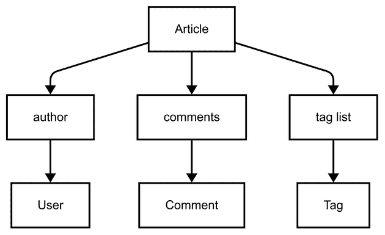
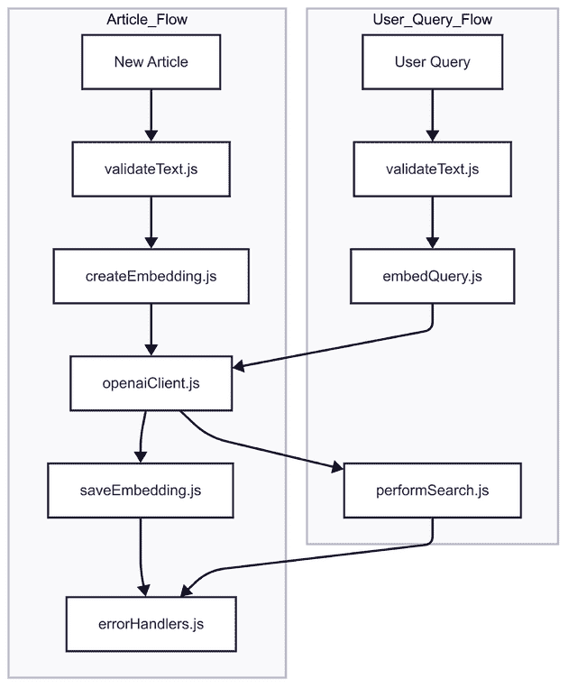
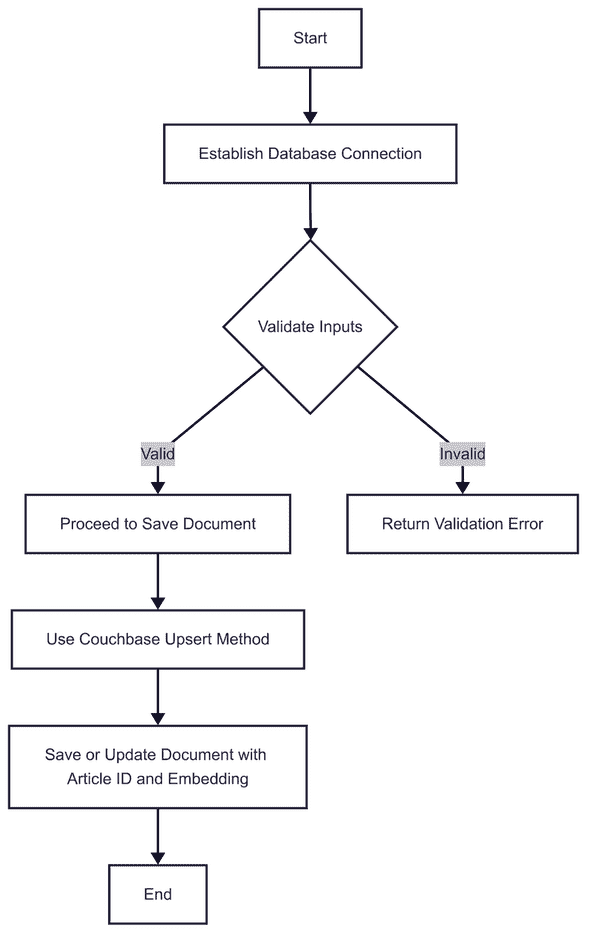
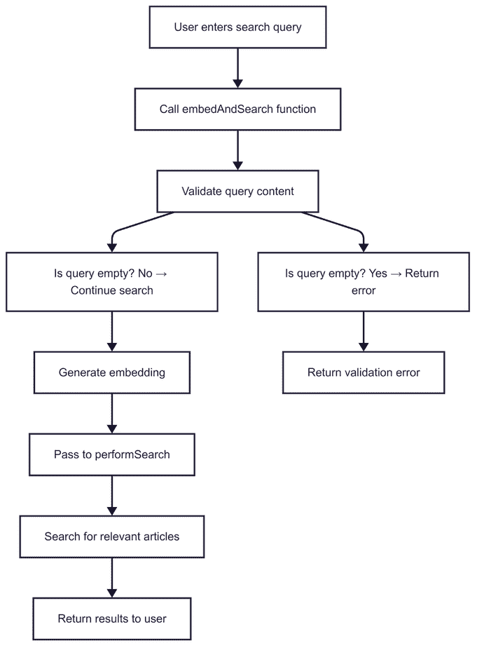
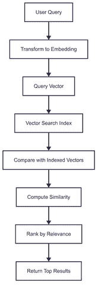
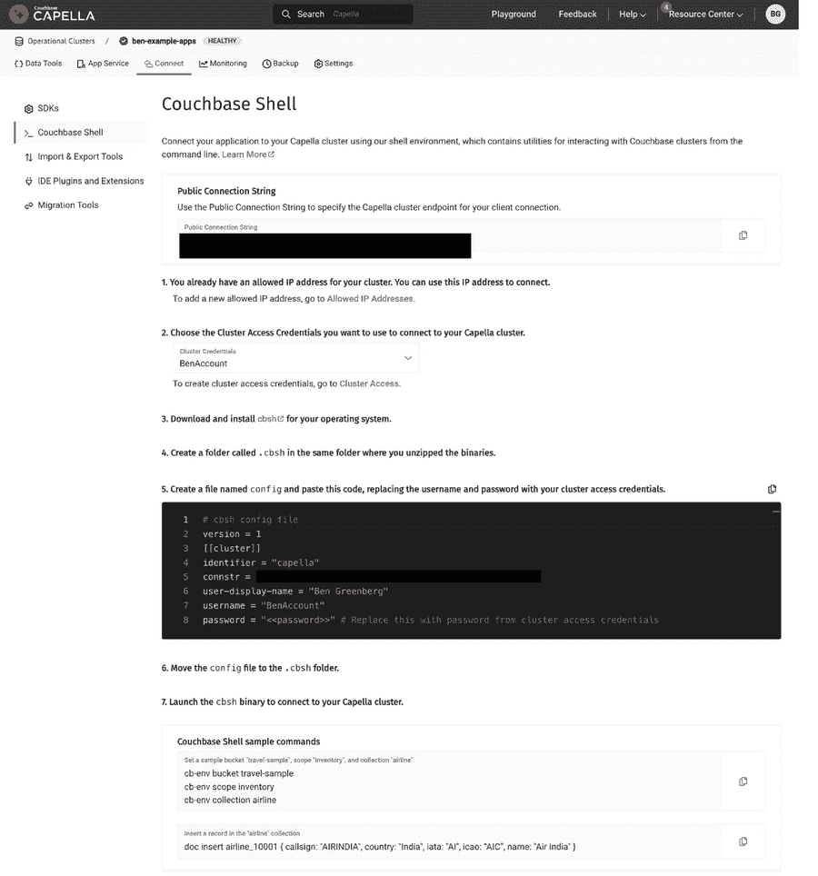
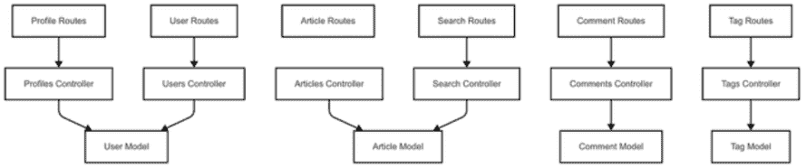
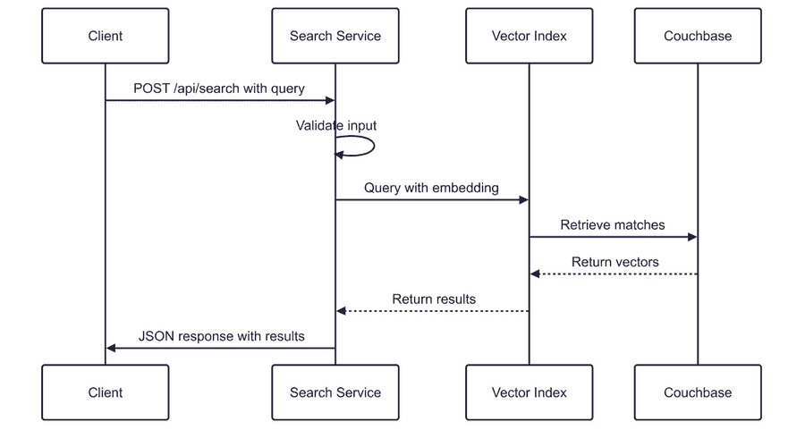
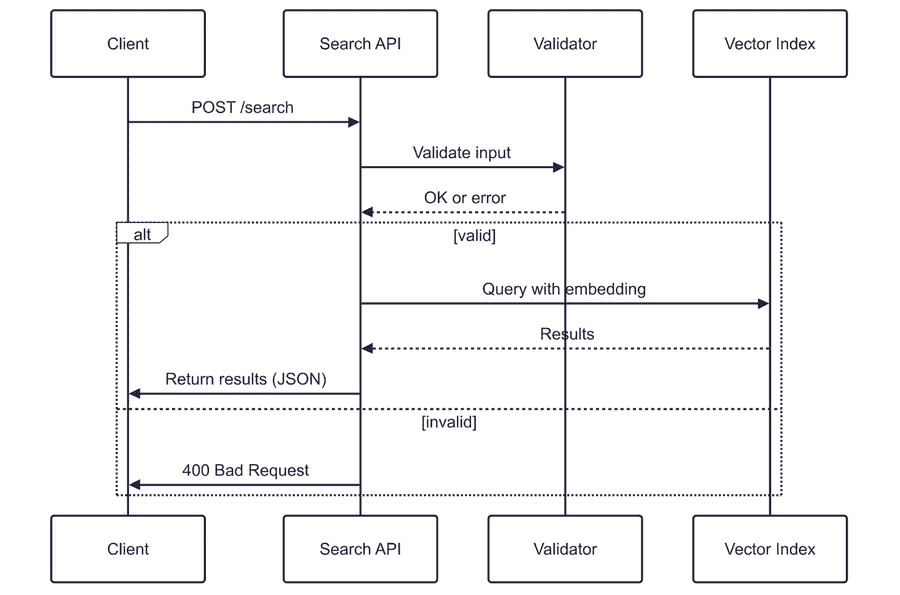

# JavaScript 向量搜索


## 关于 Pragmatic Bookshelf

Pragmatic Bookshelf 是一家敏捷出版公司。我们在这里是因为我们想要改进开发者的生活。我们通过创建由程序员为程序员编写的及时、实用的书籍来实现这一点。

我们的 Pragmatic 课程、工作坊和其他产品可以帮助你和你的团队创建更好的软件并增加乐趣。欲了解更多信息以及最新的 Pragmatic 书籍，请访问 [`pragprog.com`](http://pragprog.com)。

我们的电子书不包含任何数字版权管理（DRM），并且一直都是无 DRM 的。我们首创了测试书（beta book）概念，你可以在书籍编写期间购买并阅读，并向作者提供反馈以帮助为所有人写出更好的书。所有购买者的免费资源包括源代码下载（如适用）、勘误表和讨论论坛，均可在 `pragprog.com` 的书籍主页获取。我们的存在是为了让你的生活变得更轻松。

### 新书公告

想关注我们的最新书籍、公告以及偶尔的特别优惠吗？只需在 [pragprog.com](https://pragprog.com) 上创建一个账户（只需一个邮箱地址和密码）并勾选接收新闻事报即可。你也可以在 Twitter 上关注我们 `@pragprog`。

### 关于电子书格式

如果你直接从 [pragprog.com](https://pragprog.com) 购买，你可以以一个价格获得所有可用格式的电子书。你可以通过 Dropbox 在所有设备上（包括 iPhone/iPad、Android、笔记本电脑等）同步你的电子书。在版本的生命周期内，你可以获得免费更新。当然，当你需要时可以随时回来重新下载书籍。从 Amazon Kindle 商店购买的电子书受 Amazon 政策限制。Amazon 文件格式的限制可能会导致电子书在不同设备上的显示不同。欲了解更多信息，请查看 [pragprog.com/#about-ebooks](https://pragprog.com/support/#about-ebooks) 上的常见问题。欲了解更多关于本书的信息并访问免费资源，请访问书籍首页 [`pragprog.com/book/bgvector`](https://pragprog.com/book/bgvector)。

感谢你的持续支持，

Pragmatic Bookshelf

制作本书的团队包括：Dave Thomas（出版商）、Janet Furlow（首席官）、Susannah Davidson（开发编辑）、L. Sakhi MacMillan（校对）、Gilson Graphics（排版）

客户支持请联系 `support@pragprog.com`。

国际版权请联系 `rights@pragprog.com`。

献送给我的儿子们，他们无尽的问题和好奇心启发了本书，每天激励我继续探索。

Ben Greenberg

# 《使用 JavaScript 进行向量搜索》早期评价

Ben 的书提供了我在学习该领域时希望拥有的通俗解释和示例。对于任何加入我团队的人来说，这是必读。

| → | Laurent Doguin |
|---|---|
|  | Couchbase 开发者关系与策略高级总监 |

本书在提供构建由向量搜索驱动的应用实战经验方面做得非常好。Ben 引导你完成一个基于现代 AI 模型向量嵌入的真实项目，并将其集成到功能性应用程序中，同时清晰地解释了底层组件，如 `cosine similarity algorithm`（余弦相似度算法）和 `vector space`（向量空间）。

| → | Liran Tal |
|---|---|
|  | Snyk 开发者关系总监 |

Ben 能够对复杂的向量搜索世界提供通俗且深入的介绍。他的逐步指导让即使是令人不知无措的话题也变得易于理解，而他对不同方法的深刻对比加深了理解。这本书实用、吸引人，非常适合任何想要探索这项变革性技术的人。

| → | Kevin Lewis |
|---|---|
|  | 开发者关系专家 |

《使用 JavaScript 进行向量搜索》面向所有想要探索向量搜索世界的读者。本书实现了一个运行的向量搜索服务，并涵盖了安全和验证。这很容易成为关于使用 `Node.js` 构建 API 的最佳书籍。

| → | Santosh Yadav |
|---|---|
|  | 资级工程师，GitHub Star，Microsoft MVP 和 Angular GDE |

# 前言

我仍然记得第一次必须测试由 AI 驱动的推荐系统时。那是我们提供的最先进的功能之一。我既感到兴奋，又完全不知所措。作为一个习惯于处理确定性系统的人，我被投入了一个没有明确预期、只有概率和学习行为的世界。“正确”变成了一个范围，而不是绝对值。尽管如此，我还是必须学会如何测试它。

为了做到这一点，我不只是自动化输入和断言输出。我必须训练系统、模拟用户使用并运用常识。我必须挑战假设、提出更好的问题，并批判性地思考这个“智能”系统是如何做出影响真实用户的决策。它让我离开了舒适区，坦率地说，受益匪浅。

这段经历教会了我重要的一点。如果你要处理 AI，了解它是如何工作的、它在优化什么，以及这些选择如何影响他人，对你有利。

《使用 JavaScript 进行向量搜索》是我开始进入这个领域时希望有的书。向量搜索是那些看起来像魔法的技术之一。但魔法背后是嵌入、相似性评分和复杂的数学。如果你不理解这些组件的作用，很容易误用或误读结果。

Ben 让这个主题变得通俗易懂、实用且有趣。他引导你了解向量搜索是如何工作的、嵌入到底在做什么，以及如何构建一个基于意义而非仅仅单词匹配的智能搜索系统。

这本书非常及时。作为开发者，我们被要求将 AI 集到越来越多的应用程序中。理解它的真实含义是一种竞争优势。Ben 强调了真实公司如何使用这些技术让他们的产品更智能、更有用。他还通过让你构建一个功能完整的应用程序并将向量搜索应用到真实数据，正如现代应用所做的那样强化你的学习。

如果你是一个想要超越关键词搜索并开始提供更智能、更相关结果开发者，这本书就是你的指南。

Angie Jones，开发者关系副总裁

感谢许多在本书撰写过程中提供周全反馈、敏锐洞解和慷慨鼓励的技术审稿员。他们的投入让这项工作变得更加清晰、准确，并且变得实用得多。

- Aisha Blake
- Brian King
- Josh Grossman
- Kevin Lewis
- Samhitha Prasad
- Tanay Pant

感谢 Susannah Davidson 和整个 Pragmatic Bookshelf 制作团队，他们在从初稿到最终排版过程中提供的指导、耐心以及对细节的关注。

我的家人，感谢你们在这个项目中提供的支持和鼓励。特别感谢我的妻子，是由于她的耐心和支持，才让我能够投入无数个夜晚和周末来编写这本书。

# 引言

欢迎来到向量搜索的世界！通过开启这本书，你已经迈出了掌握这项驱动现代搜索体验技术的第一步。向量搜索利用先进的机器学习技术，在各个领域提供相关、精确且感知上下文的结果。无论是驱动网站搜索框的运行、提供个性化内容推荐，还是实现尖端的异常检测，向量搜索都重新定义了我们访问和与信息交互的方式。

随着用户对无缝和直观体验的预期增长，传统的基于关键词的搜索系统往往力不从心。用户要求在查询不精确时也能获得准确的结果，支持上下文理解，并能够从海量数据中发现隐藏的洞察。向量搜索通过将数据嵌入密集的数学表示中解决了这些挑战，通过强大的相似性计算来揭示更深层次的关系和意义。

这本书将作为你理解和实现向量搜索系统的指南。我们将探索支撑向量搜索的核心概念、工具和技术，并为你提供构建搜索应用程序所需的知识和技能。在读完本书后，你将利用向量搜索的潜力，创建出为用户提供价值的智能、高效的搜索系统。

## 本书适合读者

本书专为想要构建更智能、更有效的搜索体验的开发者编写。如果你是一个寻求超越传统搜索技术的后端工程师，或者是一个好奇将 AI 集成到应用程序中的全栈开发人员，你会发现书中的概念和代码示例是易于理解且具操作性的。

你需要对 `JavaScript` 和 `Node.js` 有一些基础了解，但不需要机器学习或搜索理论的背景。每个概念都经过清晰介绍，用通俗易懂的语言进行解释，并有可运行的代码支持。当你完成学习时，你将对向量搜索有坚实的理解，并具备应用于自己项目中的技能。

## 本书内容

本书提供了向量搜索的实战方法，将理论解释与真实世界的代码示例相结合。你将学习如何一步步实现向量搜索，从生成嵌入到优化性能。在此过程中，我们将涵盖向量索引、查询处理和混合搜索技术等核心概念。每一章都建立在前章的基础上，但如果你已经熟悉特定主题，可以随时跳到你最感兴趣章节；例如，如果你已经对向量搜索的基础有所了解，可能想跳过第 2 章`理解向量搜索`。

在整书中，你将基于 `RealWorld` 示例应用开发一个项目，这是一个模仿 `Medium` 功能的全栈博博客平台。你将逐步通过向量驱动的功能增强这个熟悉的应用程序。通过嵌入内容、启用相似性搜索并分层混合技术，你将一个传统的 CRUD 应用转换为现代、智能的搜索体验。这个项目让每个概念都足了实际的真实世界实现，并作为一个你可以在自己的工作中调整和扩展的运行示例。

本书分为两个部分。第一部分`向量搜索基础`包含第 1 至 3 章，重点关注核心思想：什么是向量搜索，它是如何工作的，以及嵌入和相似性等构建模块。第二部分`构建向量搜索服务`跨越第 4 至 11 章，将引导你使用真实代码和真实数据设计、实现并优化一个功能完整的搜索系统。

想从哪里开始？你将在第一章中通过一个快速上手的向量搜索项目来入门。第 2 章将向你介绍向量搜索的基础，包括它与传统搜索方法的区别，以及常用技术的高层概述。如果你已经熟悉了基础知识，可以跳到第 3 章`生成向量嵌入`，深入研究向量嵌入是如何运作的以及它们为何至关重要。准备好构建了吗？直接进入第 4 章`构建向量搜索基础`，设置你的环境并从零开始编写你自己的向量搜索系统。

## 本书使用的规范

本书中的所有代码片段均使用 `JavaScript` 呈现，并进行了格式化处理以提高可读性。它在首次使用时突出显示核心术语和概念，并将实际示例与清晰的解释相结合。图表和其他可视化支持正文，而侧记和案例研究提供了额外的见解以加深你的理解。通过完成每一章中的示例，你将对向量搜索有坚实的理解，并从零构建一个功能完整的搜索系统。

## 在线资源

你可以在 Pragmatic Bookshelf 网站上找到这本书的专用页面[1。从那里，你可以下载完整的源代码。

你有反馈或问题吗？遵循书籍网页上的链接进入 `DevTalk` 论坛，你可以在那里报告错误、建议更改，或与其他读者讨论你的所所得。

作者的 GitHub 仓库位于 `https://vectorsearchbook.com/`。该仓库包含了书中构建的应用源码，并将将根据最新的工具和库的变化进行定期更新。

向量搜索是一项处于体验转折点的技术。它是构建能够改变用户数据交互方式的智能直观系统的门户。在读完本书后，你将具备实现适用于你项目的稳健向量搜索解决方案的技能。那么，让我们开始向量搜索之旅吧！

## 脚注

1. [`pragprog.com/titles/bgvector`](http://pragprog.com/titles/bgvector)

Copyright © 2025, The Pragmatic Bookshelf.

# 第一部分：向量搜索基础

# 第 1 章：入门向量搜索

让我们通过一个快速的示例项目来热身，看看向量搜索有多用。你将在随后的章节中学习所有的底层概念，但现在，我们只是来玩玩，看看向量搜索是如何工作的。在本书之后，你将基于一个广泛采用的开源项目从零开始构建一个可运行的向量搜索项目。本章邀请你处理真实数据、运行真实代码并看到有意义的结果。

想象一下你正在写这本书。没错，写正文花费了一些时间，但你成功地完成了一切……突然之间，你遇到了写作瓶颈。你需要为这本书起一个标题，但你无法想出一个既是一个很棒的标题，又符合你出版社书名风格的名字。我当时就是这样，你猜怎么着，我使用向量搜索来帮助我为这本书找到了最合适的标题。

现在你将遵循同样的流程。使用 `OpenAI API`，将为真实的 Pragmatic 书名生成嵌入（embeddings），将它们存储在本地，并与你自己的标题想法进行比较。这个练习在我们解析背后的深层概念之前，为你提供了一种实用且易于上手的参与方式。你只需要一个文件、一个小数据集以及探索的意愿。

## 设置项目

创建一个名为 `name_this_book.js` 的新文件。这个文件将为你完成所有工作：爬取网站、生成嵌入、进行比较并返回顶部匹配项。嵌入是文本的数值表示，能够捕捉其含义和语境。嵌入是本书中的核心概念，我们将随着内容的推进进行更深入的探索它们。

在安装所需的库之前，请确保你已经安装了 `Node.js`。你可以从官方网站下载它。安装 `Node.js` 也会安装 `npm`，这是我们在本书中将到的包管理器。

一旦安装好 `Node.js`，你需要安装几个库：

```bash
npm install node-fetch dotenv cheerio
```

你需要在本地的 `.env` 文件中一个 OpenAI API 密钥：

```bash
echo "OPENAI_API_KEY=your-key-here" > .env
```

## 爬取标题

我们将开始从 Pragmatic Bookshelf 目录中爬取所有标题。他们的网站使用分页，因此我们将遍历所有页面并提取标题、副标题和书籍 URL。

这是实现该功能的函数：

[`getting_started_with_vector_search/name_this_book.js`](http://media.pragprog.com/titles/bgvector/code/getting_started_with_vector_search%2Fname_this_book.js)

```javascript
async function scrapeTitles() {
  const baseURL = 'https://pragprog.com';
  const maxPages = 27;
  const maxTitles = 50;
  const allBooks = [];

  console.log(`Scraping up to ${maxTitles} book titles from Pragmatic Bookshelf...`);

  for (let page = 1; page <= maxPages; page++) {
    const pageURL = page === 1
      ? `${baseURL}/titles/`
      : `${baseURL}/titles/page/${page}`;

    console.log(` - Fetching page ${page}`);

    const res = await fetch(pageURL);
    const html = await res.text();
    const $ = cheerio.load(html);

    $('.category-title-container').each((_, el) => {
      if (allBooks.length >= maxTitles) return false;
      const anchor = $(el).find('a').first();
      const title = $(el)
        .find('.category-title-title b')
        .text()
        .trim();
      const subtitle = $(el)
        .find('.category-title-subtitle')
        .text()
        .trim();
      const url = anchor.attr('href');
      if (title && url) {
        allBooks.push({ title, subtitle, url });
      }
    });

    if (allBooks.length >= maxTitles) break;
  }

  const unique = Array.from(
    new Map(allBooks.map(b => [b.url, b])).values()
  );

  console.log(`Finished scraping.${unique.length} titles.`);
  return unique;
}
```

该函数遍历每一个页面，使用 JavaScript 库 `Cheerio` 解析标题和副标题，并返回一个唯一条目列表。你处理的是真实的 HTML。爬取通常是混乱的且需要耐心。Pragmatic 目录的结构很干净，但请记住网站可能会改变。这种工作始终是脆弱的。如果网站布局或类名发生变化，你的爬虫可能会崩溃。这意味着你的下游流程（例如生成嵌入或运行比较）可能会在使用不完整或过时的数据上工作。

## 为标题嵌入

接下来，我们将使用 OpenAI 的 `text-embedding-small` 模型为每个完整标题生成嵌入。让我们定义一个辅助函数来生成单个嵌入：

[`getting_started_with_vector_search/name_this_book.js`](http://media.pragprog.com/titles/bgvector/code/getting_started_with_vector_search%2Fname_this_book.js)


```javascript
async function getEmbedding(text) {
  console.log(`Generating embedding for "${text}"`);
  try {
    const res = await fetch('https://api.openai.com/v1/embeddings', {
      method: 'POST',
      headers: {
        Authorization: `Bearer ${process.env.OPENAI_API_KEY}`,
        'Content-Type': 'application/json',
      },
      body: JSON.stringify({
        input: text,
        model: 'text-embedding-small',
      }),
    });

    if (!res.ok) {
      console.error(`API request failed with status ${res.status}: ${res.statusText}`);
      return null;
    }

    const data = await res.json();

    if (!data || !data.data || !Array.isArray(data.data) || data.data.length === 0) {
      console.error('Unexpected API response:', JSON.stringify(data, null, 2));
      return null;
    }

    if (!data.data[0].embedding) {
      console.error('No embedding found in response:', JSON.stringify(data.data[0], null, 2));
      return null;
    }

    return data.data[0].embedding;
  } catch (error) {
    console.error(`Error generating embedding for "${text}"`, error.message);
    return null;
  }
}
```

然后，使用该函数对所有标题进行嵌入：

`[getting_started_with_vector_search/name_this_book.js](http://media.pragprog.com/titles/bgvector/code/getting_started_with_vector_search%2Fname_this_book.js)`

```javascript
async function embedTitles(books) {
  console.log("Generating embeddings for all titles...");
  const promises = books.map((book, i) => {
    const fullTitle = book.subtitle
      ? `${book.title}:${book.subtitle}`
      : book.title;

    console.log(` (${i + 1}/${books.length}) ${fullTitle}`);

    return getEmbedding(fullTitle).then(embedding => {
      book.embedding = embedding;
      return book;
    });
  });

  const booksWithEmbeddings = await Promise.all(promises);
  // 过滤掉未能获取嵌入的书籍
  const validBooks = booksWithEmbeddings.filter(book => book.embedding !== null);

  if (validBooks.length < books.length) {
    console.log(`Warning: ${books.length - validBooks.length} books failed to get embeddings and were excluded.`);
  }
}
```

```javascript
return validBooks;
```

```javascript
}
```

这会将标题和副标题（如果存在）合并，并为每本书生成一个嵌入（embedding）。所有的嵌入请求会同时发出并并行处理。这可以提高速度，但如果你正在处理大型数据集或有严格的 API 速率限制，可能希望对请求进行节流或批量处理。

如果这个过程仍然让你感到神秘，请担心。在下一章节中，我们将详细解析嵌入的工作原理，以及为什么它们是搜索和推荐领域如此强大的工具。

## 与你的标题想法进行比较

现在你将嵌入一个新的标题想法，并使用余弦相似度与目录进行比较。以下是计算向量之间相似度的方法：

`[getting_started_with_vector_search/name_this_book.js](http://media.pragprog.com/titles/bgvector/code/getting_started_with_vector_search%2Fname_this_book.js)`

```javascript
function cosineSimilarity(a, b) {
  const dot = a.reduce(
    (sum, ai, i) => {
      return sum + ai * b[i];
    },
    0
  );
  const magA = Math.sqrt(
    a.reduce((sum, ai) => {
      return sum + ai * ai;
    }, 0)
  );
  const magB = Math.sqrt(
    b.reduce((sum, bi) => {
      return sum + bi * bi;
    }, 0)
  );
  return dot / (magA * magB);
}
```

以下是我们查找并排序顶部匹配项的方法：

`[getting_started_with_vector_search/name_this_book.js](http://media.pragprog.com/titles/bgvector/code/getting_started_with_vector_search%2Fname_this_book.js)`

```javascript
function compareTitles(queryEmbedding, books) {
  console.log('Comparing against catalog...');
  return books
    .map(book => ({
      ...book,
      similarity: cosineSimilarity(
        book.embedding,
        queryEmbedding
      ),
    }))
    .sort((a, b) => b.similarity - a.similarity)
    .slice(0, 5);
}
```

### 整合一切

最后，让我们将一切连接起来。这个 `main()` 函数运行整个流程：爬取、嵌入、存储和比较。

`[getting_started_with_vector_search/name_this_book.js](http://media.pragprog.com/titles/bgvector/code/getting_started_with_vector_search%2Fname_this_book.js)`

```javascript
async function main() {
  const DATA_FILE = 'pragprog_titles.json';
  let books;

  if (fs.existsSync(DATA_FILE)) {
    console.log(`Loading cached data from ${DATA_FILE}...`);
    books = JSON.parse(fs.readFileSync(DATA_FILE, 'utf8'));
  } else {
    console.log('No cached data found. Starting fresh.');

    books = await scrapeTitles();
    books = await embedTitles(books);
    fs.writeFileSync(
      DATA_FILE,
      JSON.stringify(books, null, 2)
    );

    console.log(`Saved ${books.length} books to ${DATA_FILE}`);
  }

  const query = process.argv.slice(2).join(' ');
  if (!query) {
    console.error(
      'Please pass a proposed title as a command-line argument'
    );
  }
}
```

此前，你为真实的书名生成了嵌入（embeddings），并使用余弦相似度对它们进行比较。每个标题变成了一个数字列表，即向量，而你建议的标题也以相同的方式嵌入。然后，脚本根据这些向量的相似程度对结果进行排序。

这一切都是在所谓的“高维数据”基础上运行的。高维数据意味着每个项目由许多数值特征描述（有时是数百个甚至数千个），而不是仅仅两个或三个。

这就是向量搜索的核心思想：将事物表示为共享空间中的数字，并衡量它们之间的距离。但在你看到这些数字是如何运作之前，这可能会感觉很抽象。

让我们来简化一下。暂时忘记高维空间。假设我们正在比较颜色。我们可以使用红、绿、蓝的 RGB 值来描述一种颜色。这三个数字组成了一个向量。蓝色是 `[0, 0, 255]`，红色是 `[255, 0, 0]`，黄色是 `[255, 255, 0]`，依此类推。如果你有一个新颜色，比如石板蓝（`[91, 124, 153]`），你可以将它与已知颜色进行比较，看看它最接近什么。

这正是我们对书名所做的。唯一的区别在于维度。我们处理的不是 RGB 那样的 3 个数字，而是 1536 个数字。但目标是相同的：将每个项目表示为一个向量，然后找到最近的一个。

当你看到标题 `Learning Vector Search with JavaScript` 生成了顶级匹配项，如 `A Common-Sense Guide to Data Structures and Algorithms in JavaScript` 和 `Machine Learning in Elixir` 时，你就看到了实际操作。系统并没有匹配精确的单词。它是在比较高维向量，并在数百个抽象特征中寻找模式。指向相似方向的向量被判断为更加相似。

那么是什么产生了这些向量呢？我们如何从原始文本变为捕捉含义的数字？这就是嵌入大显用场的地方。

## 解析嵌入的概念

文本比颜色更复杂。你需要一种方法为标题或段落生成向量，使得两个含义相似的文本在向量空间中产生彼此接近的点。一种常用技术是创建所谓的“嵌入”（embedding）。

嵌入是一个长数字列表。每个数字代表由机器学习模型提取的特征。如果你使用 OpenAI 的嵌入模型，每个向量都有 1536 维。你可以将这些想象为巨大坐标空间中的轴。

目标是让意义相似的文本具有相似的嵌入。例如，“Learning JavaScript”（学习 JavaScript）和“Mastering JavaScript”（精通 JavaScript）这两个短语在向量空间中应该彼此，因为它们共享相同的内容和教育意图。“Exploring Ruby”（探索 Ruby）这样的短语可能接近，因为它具有相似的结构和目的。但像“Deploying Kubernetes at Scale”（大规模部署 Kubernetes）这样的短语就会远得多，尽管它也描述了一种技术技能，但因为它属于完全不同的领域。

你通过将文本输入预训练模型来创建嵌入。该模型已经通过在海量数据集上的训练学习了语言是如何运作的。它将自己所知的一切压缩到一组内部权重中。当你传入新文本时，它会产生一个捕捉输入关键层面的向量。这个过程现在可能像一个黑盒，但我们将逐步揭开它的神秘。

## 理解相似性

一旦你有了嵌入，下一个问题就是如何比较它们。换句话说，你如何判断哪些向量是彼此靠近的？

为了比较嵌入，我们需要一种衡量两个向量之间相似程度的方法。最常见的方法是余弦相似度（衡量向量之间的角度，不考虑其大小）和点积（同时考虑它们的方向和幅度）。余弦相似度回答了“这些向量指向相同的方向吗？”，而点积增加了一个问题：“那个信号有多强？”

为了让它更具象化，想象正在比较水果。假设我们使用虚构的 3D 嵌入来表示“苹果”、“香蕉”和“橙子”。这些数字可能反映每种水果的甜度、纤维质或酸度。如果向量很接近，我们就假设水果是相似的。

事实上，让我们计算一下。

`[understanding_vector_search/similarity_applies_bananas_oranges.js](http://media.pragprog.com/titles/bgvector/code/understanding_vector_search%2Fsimilarity_applies_bananas_oranges.js)`

```javascript
const vectors = {
  Apple: [0.9, 0.1, 0.0],
  Banana: [0.7, 0.3, 0.0],
  Orange: [0.8, 0.2, 0.1],
};

/**
 * 计算两个向量的点积。
 * @param {Array<number>} vec1 - 第一个向量。
 * @param {Array<number>} vec2 - 第二个向量。
 * @returns {number} - 向量的点积。
 */
const calculateDotProduct = (vec1, vec2) =>
  vec1.reduce((sum, value, index) => sum + value * vec2[index], 0);
```

嵌入（Embeddings）是数据的密集向量表示，能够捕捉不同实体之间的关系。我们使用嵌入来表示数据，使得相似性计算等操作变得更加简单。嵌入同时捕捉实体之间的语义关系和句法关系。例如，在单词的情况下，嵌入可以捕捉诸如“国王之于女王”这种语义关系，以及“国王之于多个国王（复数）”这种句法关系。

这在现实中是什么样子的？让我们以国王和女王的为例，展示我们如何将它们表示为嵌入。在单词嵌入的情况下，单词 `king` 可能被表示为如下所示向量嵌入：

```text
[
  0.010183674,
  -0.003974117,
  0.0073341774,
  -0.011770561,
  -0.031903327,
  0.018601075,
  -0.014723551,
  -0.03132377,
  ...
]
```

为什么我在向量末尾包含了省略号？因为这个向量比我在这里展示的要得多！这是因为取决于生成嵌入的模型，向量的长度可以是不同的，而且通常很长。

### 你知道吗？嵌入与语言

嵌入被广泛应用于自然语言处理（NLP），以一种捕捉其含义的方式来表示单词和短语。这有助于解决多义性等挑战，例如像 `dive` 这样的词根据上下文的不同有多种含义。嵌入根据用法来消除歧义。

它们的性能也优于词干（stemming，将 `jogging, jogged, jogs` 还原为 `jog`）和词还原（lemmatization，将 `ran, running, runs` 还原为 `run`）。嵌入并不依赖规则，而是通过从上下学习来自然地捕捉这些关系。

在此例中，生成单词 `king` 嵌入的模型是 OpenAI 的 `text-embedding-ada-002`。该模型创建的嵌入具有 1,536 个维度。维度意味着向量是一个包含 1,536 个值的列表，每个值代表单词 `king` 的一个不同方面。在第 9 章“引入向量搜索功能”中，我们将探索如何通过减少向量的维度来优化嵌入结果。向量降维是一个复杂的课题，因为涉及到嵌入质量与生成这些嵌入所需的计算资源之间的权衡。然而，它会影响你的整体性能和成本效益。

这些浮点数中的每个值都代表了单词 `king` 的不同语义和句法方面。生成嵌入的模型已经学习如何以一种捕捉其与其他单词关系的方式来表示单词 `king`。正如我们上面所说，这意味着 `king` 和 `queen` 在向量空间中将彼此很近，而 `king` 和 `apple` 之间的距离会更远。

### 你知道吗？嵌入模型 vs 生成式模型

嵌入模型（如 OpenAI 的 `Ada`）创建数据的密集向量表示，捕捉有利于搜索或推荐的语义关系。相比之下，生成式模型（如 `GPT`）产生内容——如文本、图像或音频。两者都使用了 transformers，但嵌入模型聚焦于上下文向量的创建，而生成式模型则顺序生成连贯的内容。

## 使用 OpenAI API 生成嵌入

你现在准备好迈出向量搜索的第一步了。在过去的几个章节中，你已经探索了向量背后的概念、向量嵌入、生成式模型和嵌入模型等。所有这些知识已让你能够开始开发你的第一个向量搜索应用程序。在软件开发中，我们的目标是让事物变得易懂，而不是神秘。这就是为什么我们花这段时间建立你的理解，以便你建立信心。


如之前提到的，我们将使用 OpenAI Embeddings API 来生成嵌入。OpenAI Embeddings API 是一个强大的工具，允许你为文本、图像等生成嵌入。该 API 易于使用且文档齐全，对于初接触嵌入的开发者来说是一个极佳的选择。在本节中，我们将学习如何使用 OpenAI API 生成嵌入。我们将探索 API 中提供的各种选项，以及如何利用它们为你的数据创建嵌入。

OpenAI 为 Node.js 维护了一个官方 SDK，该 SDK 包含了 OpenAI APIs 的所有功能，包括 Embeddings API。你可以通过 Node.js 包管理器 `npm` 运行以下命令来安装 SDK：

```bash
npm install openai
```

除了使用 SDK 之外，你还可以直接使用 `cURL` 发起 API 调用。OpenAI 文档为所有相关示例都提供了 `cURL`、Node.js 和 Python 的代码片段。我们将在书中适当的地方使用这些代码示例。

无论是使用 SDK 还是使用 `cURL` 发起 API 调用，你都需要一个 API key 来验证你的请求。你可以通过在 OpenAI 平台上注册账户来获取 API key。一旦有了 API key，就可以使用它来验证请求并访问 OpenAI APIs。对于 `cURL` 请求，你需要在请求头中包含该 API key。对于 Node.js SDK，你将在节实例化 `OpenAI` 客户端的新实例时提供 API key。

这里有一个取自官方文档的 `cURL` 请求示例；我们将详细查看每个参数：

```bash
curl https://api.openai.com/v1/embeddings
  -H "Content-Type: application/json"
  -H "Authorization: Bearer $OPENAI_API_KEY"
  -d '{
    "input": "Your text string goes here",
    "model": "text-embedding-3-small"
  }'
```

首先，我们看到 API 端点的 URL `https://api.openai.com/v1/embeddings`。接下来，我们看到请求头。`Content-Type` 头指定请求体为 JSON。`Authorization` 头包含用于验证请求的 API key。最后，我们看到请求体，它包含了输入文本和模型。在这种情况下，输入文本是“Your text string goes here”，模型是“text-embedding-3-small”。

可用模型列表也可以在文档中找到，新模型不时推出，现有模型也会更新。实际上，无论是在 `cURL` 请求还是 SDK 中，我们需要提供的两个参数都是 `input` 和 `model`。使用 SDK 的相同请求将如下：

`basics_of_vector_embeddings/first_api_request.js`

```javascript
const main = async () => {
  try {
    const embedding = await openai.embeddings.create({
      model: "text-embedding-ada-002",
      input: "Your text string goes here",
      encoding_format: "float",
    });

    console.log(embedding.data[0].embedding);
    console.log("Model used:", embedding.model);
    console.log("Tokens consumed:", embedding.usage.total_tokens);
  } catch (error) {
    console.error("Error generating embedding:", error);
  }
};

main();
```

你注意到使用 SDK 创建的请求中有一个额外的 `encoding_format` 参数吗？该参数是你可以使用的两个主要参数之一，用于微调请求以满足你的需求。让我们探索它们：

- `encoding_format`：决定你希望返回的数据格式，可以是浮点数或 base64 编码。默认值为 `float`，但如果你优先考虑兼容性和可移植性，`base64` 则更具优势。如果存储是一个主要的限制因素，Base64 数据可以进一步压缩数据，而且许多通信协议更方便地处理 base64 编码数据。
- `Dimensions`：在此处，你可以指定输出的维度。截至本文编写时，此功能仅支持 OpenAI 的 `text-embedding-3` 模型。嵌入的维度越高，它包含的上下文（包括语义和句法）就越多，但也意味着它占用的空间越大。为你的数据找到合适的平衡需要通过微调来达到可选的维度。在许多情况下，使用模型提供的默认值更为安全。

一旦提交了请求，API 将以以下格式返回数据：

[basics_of_vector_embeddings/embedding_api_example_response.json](http://media.pragprog.com/titles/bgvector/code/basics_of_vector_embeddings%2Fembedding_api_example_response.json)

```json
| | { |
| | "object": "list", |
| | "data": [ |
| | { |
| | "object": "embedding", |
| | "embedding": [ |
| | 0.0023064255, |
| | -0.009327292, |
| | -0.0028842222 |
| | ], |
| | "index": 0 |
| | } |
| ], |
| | "model": "text-embedding-ada-002", |
| | "usage": { |
| | "prompt_tokens": 8, |
| | "total_tokens": 8 |
| | } |
| } |
```

API 在 `data` 数组中返回实际嵌入，嵌套在 `embedding` 对象中。除了嵌入之外，你还会收到关于使用的 `model` 信息以及生成嵌入所需的的 token 总数。Token 是语言模型将文本拆分为较小单元进行处理的方式；正如我们之前解释过的，它们代表了模型用于计算嵌入的文本块。理解消耗的 token 数量非常重要，因为 API 通常根据 token 使用情况计费，因此监控 token 计数有助于你管理成本并优化应用程序的性能。

现在我们已经学习了如何使用 Node.js SDK 调用 API 并探索了 API 的响应，为什么不发送你的第一个请求呢？

创建一个名为 `request.js` 的新文件并添加以下内容，将输入参数中的“Your text string goes here”替换为你任何想要转换为向量嵌入的文本：

[basics_of_vector_embeddings/first_api_request.js](http://media.pragprog.com/titles/bgvector/code/basics_of_vector_embeddings%2Ffirst_api_request.js)

```javascript
import OpenAI from "openai";
import dotenv from "dotenv";

dotenv.config();

const openai = new OpenAI({
  apiKey: process.env.OPENAI_API_KEY,
});

const main = async () => {
  try {
    const embedding = await openai.embeddings.create({
      model: "text-embedding-ada-002",
      input: "Your text string goes here",
      encoding_format: "float",
    });

    console.log(embedding.data[0].embedding);
    console.log("Model used:", embedding.model);
    console.log("Tokens consumed:", embedding.usage.total_tokens);
  } catch (error) {
    console.error("Error generating embedding:", error);
  }
};

main();
```

在与该文件相同的根目录下创建一个 `.env` 文件，并添加以下环境变量，将 `your-api-key-here` 值替换为你真实的 OpenAI API 密钥：

```text
OPENAI_API_KEY=your-api-key-here
```

记住，不要将你的环境变量提交到任何公共代码仓库（例如 GitHub）。

现在你已经知道了要构建什么，让我们来奠定基础。

脚手架搭建（Scaffolding）涉及创建必要的目录和文件、安装依赖以及配置核心设置。

不过，我们并不会从零开始构建博客平台！相反，我们将利用 `RealWorld Example Apps` 项目，该项目旨在用尽可能多的编程语言和框架创建功能完整的示例应用程序。`RealWorld Example Apps` 项目提供了一个功能齐全的博客平台，包括用户身份验证、文章创建、文章编辑、文章删除和文章搜索功能。`RealWorld` 项目的创建者将这些博客称为 `Conduit`，你可以按照前端、后端和全栈版本找到社区已经创建的所有实现版本。

如果你在本书的任何阶段遇到困难，你随时可以在 GitHub 上找到我们正要构建的整个项目的代码。在整个过程的不同阶段，我们都会回溯到代码库，因此你甚至不需要书签此页面。

为我们的 `Node.js` 项目创建脚手架的第一步是创建必要的目录和文件。我们将首先为项目创建一个新目录，然后在该目录内创建必要的子目录。我们需要以下目录，从项目的根目录开始，你可以将其命名为任何名称，例如 `vector-blog-platform`。

我们将开始将博客平台的后端设置为一个 `API service`。为了实现这一点，我们将项目组织成清晰的目录结构，将数据存储、嵌入逻辑和路由等关注点分离。这种布局使得未来扩展应用程序变得容易，包括添加一个既可以自己构建、也可以从 GitHub 仓库中复制的前端。

请在你的项目根目录中创建以下目录：

- `api/`：包含后端的的核心 `API` 逻辑和配置，包括安全性和数据库连接。
- `config/`：包含后端的配置文件，包括环境变量和数据库连接设置。
- `controllers/`：包含控制器文件，用于处理各种路由的请求和响应。
- `middleware/`：包含自定义中间件逻辑，例如身份验证和 `JWT` 验证。
- `models/`：包含模型文件，定义存储在数据库中的数据结构。
- `routes/`：包含应用程序中不同端点的路由定义。
- `views/`：如果通过 Web 浏览器访问 `API service`，则包含服务器渲染的默认视图。

当你创建了所有文件夹后，你的文件夹结构应该如下所示：

```text
| vector-blog-platform/
|├── api/
|├── config/
|├── controllers/
|├── middleware/
|├── models/
|├── routes/
|├── views/
```

你现在已经创建了项目的基础文件夹结构。在书中，随着我们构建博客平台的功能，我们将向此结构中添加文件和目录。下一步是为项目安装必要的依赖，并配置存储博客文章嵌入的向量数据库。

在继续安装依赖之前，是讨论向量嵌入和向量搜索的数据库专门化的重要性。向量的特殊性质意味着我们需要仔细考虑为它们提供高效的存储方式，同时还要为我们提供快速查询的能力。在下一节中，我们将讨论在为项目选择数据库时应该考虑的因素。

## 选择向量数据库

你可能会看到这个节标题并心想：“为什么我为向量嵌入需要一个特殊的数据库？我难道不能直接使用任何数据库吗？”在我们要构建的示例项目中，我们需要一个可以处理“常规”数据的数据库——即非向量嵌入的数据，如博客内容、用户配置和类似信息，我们还需要一个能够高效存储、索引和查询向量嵌入的数据库。我们可以将这些关注点分开，但我们的意图是不引入任何额外的复杂性，并减少数据库基础设施的扩散。因此，我们需要一个能够处理多种类型数据的数据库，包括结构化、非结构化和半结构化数据。

向量嵌入是非结构化数据，它们也是高维的。正如我们在第 2 章*理解向量搜索*中讨论过的，高维意味着嵌入有许多描述数据的特征。`OpenAI Ada` 嵌入模型有 1,536 维，这意味着每个嵌入都是包含 1,536 个值的列表。这是一个大量需要存储和查询的数据，特别是考虑到我们还要为每篇博客文章和每个用户查询存储嵌入！因此，我们还需要一个能够高效处理高维数据的数据库。

针对性能进行优化意味着还要具有正确索引向量嵌入数据的能力。索引向量嵌入意味着创建一个数据结构，允许根据向量与查询向量的相似性快速检索向量。与依赖精确匹配的传统索引（如关键词搜索，正如我们在第 3 章*生成向量嵌入*中解释的那样）不同，向量索引侧重于相似性搜索，也就是说找到与查询最接近的向量。

我们将在第 7 章*创建向量搜索服务*中详细讨论向量搜索索引的机制和设置，但现在重要的是理解，我们选择的数据库必须能够高效处理嵌入索引。数据库必须能够快速创建和更新索引，并且能够查询索引以及时返回结果。

现在我们对数据库的要求有了更好的了解，让我们来看看可用于存储和查询向量嵌入的各种类型数据库：

- **文档数据库**是以文档格式（如 `JSON` 或 `XML`）存储数据的数据库。文档数据库非常适合存储非结构化数据（如向量嵌入），因为它们不需要预定义的模式。文档数据库可以针对高维数据的查询和索引进行优化，使其存储向量嵌入的良好选择。
- **图数据库**是以图格式存储数据的数据库，其中节点表示实体，边表示实体之间的关系。图数据库非常适合存储和查询数据之间复杂的关系，例如向量嵌入之间的关系。图数据库还可以优化高维数据的查询和索引，使其存储向量嵌入的另一个良好选择。
- **SQL 数据库**是以行和列表格形式存储数据的关系型数据库。SQL 数据库非常适合存储结构化数据（如用户配置和博客内容），但它们也可以用于存储向量嵌入。虽然这可能不是最常见的路径，但它们确实能够存储和查询向量嵌入。

## 其他数据库选项

在上述三类数据库的任何一类中都有许多部署选项。以下是你可以供项目考虑的数据库详尽但非穷尽的列表，按数据库类型分类：

- 文档数据库：`MongoDB`、`Pinecone`
- 图谱数据库：`Neo4j`、`TigerGraph`
- SQL 数据库：`Supabase`、`Neon`

每个选项都提供了多种部署方法、定价结构和功能 set，包括托管型和自托管解决方案。虽然全面的对比超出了我们的讨论范围，但我鼓励你探索并选择最符合你需求和预算的选项。

在本书中，我们将使用 `Couchbase` 作为我们选定的数据库。`Couchbase` 优化了高维数据的存储和查询，使其非常适合存储向量嵌入。它还提供了 `Capella`，这是一个完全托管的云服务，可以一键部署到 `AWS`、`Google Cloud` 或 `Azure`。除了技术能力外，`Capella` 还提供了慷慨的免费层级，这对于像这样项目中的实验和学习非常理想。

我们正在使用文档数据库，具体是一个 `JSON` 文档数据库，因为它允许我们处理灵活的半结构化数据。`JSON`（JavaScript 对象表示）是一种轻量级且易于阅读的格式，用于以键值对的形式存储数据。它在 Web 开发中被广泛使用，并与基于 `JavaScript` 的工具无缝协作。文档模型使其易于存储和查询各种数据类型，包括向量嵌入、博客文章和用户配置，所有这些格式都与我们正在构建的应用程序结构高度契合。

设置 `Node.js` 项目的下一步是安装必要的依赖项。依赖项是项目正常运行所依赖的外部库或包。

## 安装依赖项

在本节中，我们将为 `Node.js` 项目安装依赖项，包括我们将用于与向量数据库交互，以及为博客文章生成并存储嵌入的库和工具。

为了在我们的项目中安装依赖项，我们需要在项目根目录下准备一个 `package.json` 文件。`package.json` 文件是一个清单文件，包含了关于项目的元数据，包括项目名称、版本、描述和依赖项。它是 `npm` 用于安装包包和管理项目依赖项的主要文件。

幸运的是，`npm` 提供了一个可以为你生成 `package.json` 文件的命令。要生成 `package.json` 文件，请在项目根目录下运行以下命令：

```bash
npm init -y
```

`-y` 标志告诉 `npm` 在运行 `npm init` 命令时，对通常出现的提示使用默认值。命令执行完成后，它将在终端中输出 `package.json` 文件的结构。它应该类似于以下：

```json
{
  "name": "vector-blog-platform",
  "version": "1.0.0",
  "description": "",
  "main": "index.js",
  "scripts": {
    "test": "echo \"Error: no test specified\" && exit 1"
  },
  "keywords": [],
  "author": "",
  "license": "ISC",
  "dependencies": {
    "ottoman": "².5.1",
    "openai": "⁴.96.2",
    "dotenv": "¹⁶.5.0"
  }
}
```


现在我们已经有了`package.json`文件，可以开始为项目安装依赖项了。我们进展非常顺利！在这个阶段，我们本可以直接列出要安装的依赖项，但那样你就只是在"复制和粘贴"，而不理解你安装了什么。让我们花点时间了解我们将要安装的依赖项以及为什么需要它们。

在安装依赖项时，我们需要考虑应用程序开发的三个领域。数据库是其中之一，正如我们之前讨论的，我们不能使用任何数据库，而是需要一个能够存储、索引和查询向量嵌入的数据库。我们将使用`ORM`（或对象关系映射库）来与数据库交互。`ORM`是一种编程结构，使我们能够像使用面向对象的编程语言一样，使用对象与数据库中的数据进行交互。通过示例可能会更容易理解。

我们在本项目中使用的的大部分库（包括`OpenAI SDK`和`Ottoman`）都执行异步操作。这些操作需要时间——例如查询数据库或发送网络请求——在通常情况下会阻止程序的继续运行。为了处理这个问题，我们将使用`JavaScript`的`async/await`语法。`async/await`允许我们编写看起来和行为上更像普通同步代码的异步代码，使其更容易阅读和维护。在书中，每当我们获取数据、存储嵌入或与外部 API 交互时，都会看到这种模式。

假设你的应用程序有用户，用户模型可能像所示：

```json
{
  "id": 1,
  "name": "John Doe",
  "email": "john.doe@example.com",
  "password": "hashed_password",
  "created_at": "2024-01-01T00:00:00Z",
  "updated_at": "2024-05-01T00:00:00Z"
}
```

`User`类表示数据库中的一条用户记录。你可以创建一个新的`User`对象，设置其属性并将其保存到数据库中。`ORM`库负责将对象翻译为数据库查询。这是关于`ORM`如何工作以及它为什么在应用程序开发中有所帮助的层层概述。

使用`ORM`的最大优势之一是它简化了数据查询。与其编写原始查询或复杂的数据库调用，像`Ottoman`这样的`ORM`让你使用熟悉的 JavaScript 方法和链式调用来表达你想要的内容。这在查询`JSON`文档数据库中常见的嵌套或层次结构数据时特别有用。例如，查找带有特定标签的所有博客文章或根据相似分数检索用户记录，可以使用直观的方法（如带有过滤条件的`Model.find()`）完成，`Ottoman`会在后台将其转换为优化的查询。这不仅提高了可读性，还降低了编写低效或错误查询的风险。

第二个关键步骤是将博客内容转换为向量嵌入（vector embeddings），以便我们能够进行相似性搜索。我们还将用户的用户的查询转换为向量嵌入，用以搜索内容。为每个查询生成新的嵌入需要快速完成，因此我们需要考虑性能，并确保该过程尽可能耗短。近期对用户行为的研究显示，如果响应加载时间超过三秒，40%的用户将离开网站。（[[12]](#f_0037.xhtml_FOOTNOTE-12)）这是一个巨大的压力，因此我们需要确保选择的平台和我们构建的 SDK 能够处理这些负载。

内容到嵌入的转换可以在内容创建时进行，因此我们还需要建立一套标准，规定在作者添加新内容时何时更新嵌入。例如，是否每次编辑都值得修订嵌入？还是说只有某些编辑需要？这些都是我们在构建博客平台功能时需要回答的问题。目前，可以安全地说，纠正一个简单的拼写错误可能不应该触发新的嵌入生成。或者应该呢？我们将这个问题留到以后在讨论优化搜索结果和其他更高级的话题时讨论。

我们将依赖的最后一个应用程序管理领域是环境变量。环境变量设置在应用程序之外，以便在运行时对其进行配置。它们存储敏感数据，例如 API 密钥或数据库连接字符串，将这些信息排除在代码库之外。使用环境变量使得你的应用程序更加安全，并且在不同环境中易于配置。

如果我不提到强制性的安全警告，将是失职的。在处理环境变量时，重要的是不要将敏感信息提交到你的版本控制系统中。务始终将你的环境变量添加到`.env`文件中，并将该文件包含在`.gitignore`中防止其被提交。这将有助于在开发过程中保持你的敏感信息安全。

然而，对于生产环境，不建议在`.env`文件中存储密钥。相反，请使用安全的方法，例如在运行时从密钥管理器注入环境变量，或从云平台或容器编排系统提供的挂载密钥位置读取它们。这增加了额外的保护层，并确保你的密钥在生产环境中安全地处理。

在了解了这些依赖项的原因和内容后，让我们指定一下将为项目安装的依赖项。我们将使用以下库和工具来构建博客平台：

*   `Ottoman.js`: 一个用于 Couchbase 的 Node.js ORM 库（更准确地说，是一个 ODM 库，因为我们使用的是 JSON 文档数据而非关系关系模型），它允许我们使用对象与 Couchbase 数据库交互。
*   `OpenAI Node.js SDK`: 用于`OpenAI`API 的官方 Node.js SDK，允许我们为博客平台中的内容和用户查询生成向量嵌入。
*   `dotenv`: 一个零依赖模块，可从`.env`文件将环境变量加载到`process.env`中，以保持我们的敏感信息安全。

要安装这三个依赖项，你可以在项目的根目录下运行以下命令：

```
npm install ottoman openai dotenv
```

你可以通过检查`package.json`文件或运行以下命令来验证`npm`是否正确安装了依赖：

```bash
npm list
```

运行`npm list`后，你将看到类似下面的输出：

```
vector-blog-platform@1.0.0 /path/to/your/project
  ├── dotenv@16.4.5
  ├── openai@4.58.2
  └── ottoman@2.5.0
```

此输出显示依赖项已成功安装，现在可以在项目中使用。安装好依赖项后，你现在准备好开始构建博客平台的功能了！

## 核心要点

在本章中，你通过搭建开发环境并准备支持向量嵌入工作流所需的工具和结构，为构建向量搜索应用程序奠定了基础。

以下是你目前为止所成就的快速总结，以及在我们开始在应用程序中实现向量搜索时需要继续进行的内容：

*   你通过安装 Node.js、搭建项目结构骨架以及选择合适的向量数据库，搭建了开发环境。
*   你学习到向量嵌入是非结构化的、高维数据，需要专门的索引来以实现快速且准确的搜索。
*   你探索了可以存储向量数据的数据库类型，包括文档数据库、图数据库和关系数据库，并理解了为什么文档数据库非常适合。
*   你安装并配置了核心依赖项，包括一个 ORM (`Ottoman`)、用于生成嵌入的`OpenAI`SDK 以及用于环境变量管理的`dotenv`。

在下一章中，我们将开始在 Node.js 应用程序中实现搜索功能。我们将涵盖如何查询向量数据库以获取相似的嵌入并向用户返回相关结果。

## 注释

[[8]](#f_0034.xhtml_FNPTR-8)

[`github.com/gothinkster/realworld`](https://github.com/gothinkster/realworld)

[[9]](#f_0034.xhtml_FNPTR-9)

[`codebase.show/projects/realworld`](https://codebase.show/projects/realworld)

[[10]](#f_0034.xhtml_FNPTR-10)

[`github.com/hummusonrails/vector-example-blog-platform`](https://github.com/hummusonrails/vector-example-blog-platform)

[[11]](#f_0035.xhtml_FNPTR-11)

[`cloud.couchbase.com`](https://cloud.couchbase.com)

[[12]](#f_0036.xhtml_FNPTR-12)

[`www.forbes.com/advisor/business/software/website-statistics/`](https://www.forbes.com/advisor/business/software/website-statistics/)

[[13]](#f_0036.xhtml_FNPTR-13)

[`ottomanjs.com/`](https://ottomanjs.com/)

[[14]](#f_0036.xhtml_FNPTR-14)

[`github.com/openai/openai-node`](https://github.com/openai/openai-node)

[[15]](#f_0036.xhtml_FNPTR-15)

[`www.npmjs.com/package/dotenv`](https://www.npmjs.com/package/dotenv)

很多时候，当我兴奋于构建新事物时，我会直接开始写代码。后来，在经历了比我愿意承认更多的重构之后，我意识到我本应该先规划数据结构。

也许用一句拉丁语最能表达这一点：

> Carpe datum—抓住数据！

或者，可以回溯 Rob Pike 在其 1989 年的论文《C 语言编程笔记》中编写的经典编程"规则"之一：

规则 5。数据主宰一切。如果你选择了正确的数据结构并良好地组织了内容，那么算法几乎是显而易见的。数据结构而非算法，才是编程的核心。

本着这种精神，在构建向量嵌入服务并提交代码之前，我们将花一点时间对数据进行建模。深思的数据建模是以后实现有意义向量操作的关键。虽然此项目包含了用户、文章、标签和评论的标准模型，但我们只涉及与向量搜索最相关的部分。

在我们正在构建的博客平台中，将拥有以下实体：

*   用户 (Users)
*   文章 (Articles)
*   标签 (Tags)
*   评论 (Comments)

每个实体都具有特定的属性，用于定义它们以及与其他实体的关系。让我们来看文章模型，它是与平台向量搜索功能关联密切的模型。

### 定义文章模型 (Article Model)

文章模型将代表平台上的博客文章。用户将创建文章、为文章添加标签并对文章发表评论。文章模型将存储每篇文章的信息，例如标题、正文、作者、标签和评论。文章模型还将与用户实体建立关系（因为每篇文章都有作者），并与标签实体建立关系（因为每篇文章可以多个标签）。

文章模型具有以下属性：

*   `id`: 文章的唯一标识符。
*   `slug`: 文章的唯一 slug，衍生自标题。
*   `title`: 文章的标题。
*   `description`: 文章的简短描述或摘要。
*   `body`: 文章的正文或内容。
*   `author`: 文章作者的 ID ID。
*   `tagList`: 与文章关联的标签 ID 数组。
*   `comments`: 文章下评论的评论 ID 数组。
*   `favoritesCount`: 将该文章选为收藏的用户数量。

查看`author`属性，我们可以看到它是用户 ID，在文章实体和用户实体之间建立了关系。`comments`属性是评论 ID 数组，在文章实体和评论实体之间建立了关系。同样，`tagList`属性是标签 ID 数组，在文章实体和标签实体之间建立了关系。正如我们在描述用户模型时做的那样，让我们将文章模型及其关系可视化，以进一步理解数据模型：



现在我们对文章实体的数据模型有了良好的理解，让我们使用 Ottoman.js 编写代码来定义文章模型。在`models/`文件夹中创建一个名为`Article.js`的新文件并导入必要的依赖：

```javascript
import { Schema, model, getModel } from 'ottoman';
import slugify from 'slugify';
```

在前面的代码中，我们正在从 Ottoman.js（一个 JavaScript 库）导入函数和模块，以帮助我们从模型与数据库交互，即`Schema`、`model`和`getModel`函数。你还会注意到对文章模型有一个独特的导入，即`slugify`库。该库将帮助我们根据标题为文章生成唯一的 slug。所有这些导入都是我们将在本文末尾创建的`couchbaseClient`的。

接下来，让我们使用 Ottoman.js 的语法定义文章模型的架构：

```javascript
const articleSchema = new Schema({
  slug: {
    type: String,
    unique: true,
    lowercase: true,
    index: true,
  },
  title: {
    type: String,
    required: true,
  },
  description: {
    type: String,
    required: true,
  },
  body: {
    type: String,
    required: true,
  },
  // 创建一个标签数组，默认为空数组
  // 使用 () => [] 而不是 []是为了避免共享引用
  tagList: {
    type: [{ type: String, ref: 'Tag' }],
    default: () => [],
  },
  author: {
    type: String,
    ref: 'User',
  },
  favoritesCount: {
    type: Number,
    default: 0,
  },
  // 评论存储为指向文档的引用数组
  // 再次，默认是一个返回新数组的函数
  comments: {
    type: [{ type: String, ref: 'Comment' }],
    default: () => [],
  },
  embedding: {
    type: [Number],
    default: () => [],
  },
}, {
  timestamps: true,
});

// 在保存更新之前，根据新标题重新生成 slug
// 这确保了标题更改时 slug 保持同步
articleSchema.pre('update', function (document) {
  document.slug = slugify(document.title, {
    lower: true,
    replacement: '-',
  });
});

// 将文章实例转换为用于 API 输出的响应对象，
// 包括作者资料和收藏状态
articleSchema.methods.toArticleResponse = async function (user) {
  const User = getModel('User');
  const authorObj = await User.findById(this.author);
  return {
    slug: this.slug,
    articleSlug: this.slug,
    title: this.title,
    description: this.description,
    body: this.body,
    createdAt: this.createdAt,
    updatedAt: this.updatedAt,
    tagList: this.tagList,
    favorited: user ? user.isFavorite(this.id) : false,
    favoritesCount: this.favoritesCount,
    author: authorObj.toProfileJSON(user)
  };
};

// 将评论引用添加到文章评论数组中，
// 如果尚未存在
articleSchema.methods.addComment = async function (commentId) {
  if (this.comments.indexOf(commentId) === -1) {
    this.comments.push(commentId);
  }
  return this.save();
};

// 从文章评论数组中移除评论引用，
// 如果存在
articleSchema.methods.removeComment = async function (commentId) {
  const idx = this.comments.indexOf(commentId);
  if (idx !== -1) {
    this.comments.splice(idx, 1);
  }
  return this.save();
};
```

```javascript
const scope = process.env.DB_SCOPE || "_default";
const Article = model('Article', articleSchema, { scopeName: scope });

export { articleSchema, Article };
```

该模型定义了我们之前讨论的文章属性。`slug`、`title`、`description`和`body`属性是必填字段，其中`slug`字段是唯一的并建立了索引，以实现更搜索性能。`tagList`字段是标签 ID 数组，建立了文章实体与标签实体之间的关系。`author`字段是一个用户 ID，建立了文章实体与用户实体之间的关系。`comments`字段是评论 ID 数组，建立了文章实体与评论实体之间的关系。`favoritesCount`字段是一个数字，用于跟踪将文章设为收藏的用户数量。


你还会注意到`embedding`字段，它是一个数字数组。该字段将存储文章的向量嵌入（vector embedding），我们将其生成并存储在数据库中。该字段对于执行基于向量嵌入的相似性搜索至关重要。

我们还使用了一个预钩子（pre hook），使用`slugify`库从标题自动生成一个干净的 slug。现在，让我们简要查看其他模型及其在平台中的作用。它们在创建向量搜索功能方面的作用较小，但从高层面上理解它们的工作原理将对后续工作有所帮助。

### 定义其他模型

正如本章开头提到的，博客平台拥有用户、文章、评论和标签的模型。`Article`模型是向量搜索过程的核心，因为它将持有平台创建的向量嵌入。其他模型对平台至关重要，但与我们探索重点的相关性不那么大。以下是其他模型的简要概述。每个模型的完整代码可以在项目的 GitHub 仓库中找到。

- `User`模型可以编写文章、关注其他用户并收藏文章。如果你希望扩展在书中学到的功能，创建过滤器以按“关注的用户的文章”或“收藏的文章”进行搜索，那么这些关系以后可能会帮助对向量搜索结果进行个性化处理。

- `Comments`与文章关联并由用户编写。虽然它们没有直接嵌入或为向量搜索建立索引，但它们增加了上下文的丰富性，稍后可能在带有混合搜索策略的进一步增强中使用这些信息。

- `Tags`用于对文章进行分类并支持基础过滤。由于我们不会为标签生成或存储向量嵌入，因此在这里不需要对它们进行进一步扩展。

有了对这些辅助模型的高层理解后，我们现在可以将注意力转回准备后端，在最需要的地方生成并持久向量嵌入——即文章本身。

### 将文章连接到数据库

为了生成和存储嵌入，我们需要一个能够可靠持久数据并高效响应嵌入服务调用的后端。在我们情况下，我们使用`Couchbase`作为底层数据库，并使用`Ottoman.js`作为 ODM（对象文档映射器）与之交互。

`Ottoman`使得在 JavaScript 中建模文档以及处理用户、文章和标签等实体之间的关系变得简单。但在模型或服务逻辑中使用它之前，我们需要配置一个 Couchbase 集群的共享连接实例。

现在来设置它。

在`services/`目录下的名为`clients`的新子文件夹中，创建一个名为`couchbaseClient.js`的新文件。该文件将包含我们的共享 Couchbase 连接逻辑，并暴露一个其他应用程序部分可以重用的已配置 Ottoman 实例。

你的目录应该是：

```text
vector-blog-platform/
├── services/
│   └── clients/
│       └── couchbaseClient.js
```

在该文件中添加以下代码：

```javascript
import { connect as connectOttoman, start as startOttoman } from 'ottoman';
import couchbase from 'couchbase';

let clusterInstance;

const connectToCouchbase = async () => {
  await connectOttoman({
    connectionString: process.env.COUCHBASE_CONNECTION_STRING,
    bucketName: 'default',
    username: process.env.COUCHBASE_USERNAME,
    password: process.env.COUCHBASE_PASSWORD,
  });
  await startOttoman();

  clusterInstance = await couchbase.connect(
    process.env.COUCHBASE_CONNECTION_STRING,
    {
      username: process.env.COUCHBASE_USERNAME,
      password: process.env.COUCHBASE_PASSWORD,
    }
  );
};

export const getCluster = () => {
  if (!clusterInstance) {
    throw new Error('Couchbase cluster not initialized');
  }
  return clusterInstance;
};
```

[[18]](#f_0040.xhtml_FNPTR-18)

[`www.catb.org/esr/writings/taoup/html/ch01s06.html#rule5`](http://www.catb.org/esr/writings/taoup/html/ch01s06.html#rule5)

[[19]](#f_0040.xhtml_FNPTR-19)

[`www.npmjs.com/package/slugify`](https://www.npmjs.com/package/slugify)

# 第 6 章：构建向量嵌入生成服务

在上一章中，我们通过结构化后端和定义核心数据模型为向量搜索奠定了基础。现在是时候通过能够从文章内容生成向量嵌入的功能来让这些结构运行起来了。

本章将引导你构建一个服务，该服务可以将纯文本转换为高维向量，从而实现向量搜索。

## 结构化嵌入服务

向量嵌入生成服务将为文章生成嵌入并将其存储在数据库中。该服务将是博客平台的关键组件，因为它是实现用户根据语义相似性和相关性搜索文章的基础。

项目根目录下的`services/`文件夹将包含所有的向量嵌入创建和搜索功能。该文件夹的内容我们将定义生成嵌入、存储在数据库中以及执行相似性搜索的逻辑。让我们从妥妥地结构化`services/`文件夹开始，以保持关注点分离并保持代码整洁。

当我们考虑应用程序中向量搜索服务的操作时，可以将其拆分为不同的组件：

- 创建新文章或编辑现有文章：
  - 为文章生成向量嵌入。
  - 将向量嵌入保存到数据库。

- 用户搜索查询：
  - 为搜索查询生成向量嵌入。
  - 在数据库中执行相似性搜索。

我们还引入了几个工具类来帮助处理向量操作；具体来说，我们需要处理以下内容：

- 验证用于生成嵌入的文本输入。
- 处理向量操作过程中可能出现的错误。

最后，我们需要一个客户端来与 OpenAI API 交互以生成嵌入。你之前已经创建了`services/`文件夹，但现在，让我们把它们整合在一起。考虑到这些组件，我们如下结构化`services/`文件夹：

| | services/ |
| :--- | :--- |
| | ├── clients/ |
| | │ ├── couchbaseClient.js |
| | │ ├── openaiClient.js |
| | ├── embeddings/ |
| | │ ├── createEmbedding.js |
| | │ ├── saveEmbedding.js |
| | ├── search/ |
| | │ ├── embedQuery.js |
| | │ ├── performSearch.js |
| | ├── utils/ |
| | │ ├── errorHandlers.js |
| | │ ├── validateText.js |

通过查看这些组件在两个最常见用例（即为文章创建嵌入和根据用户查询执行搜索）之间的交互流可能会有所帮助。让我们将这些操作的流程可视化，如图图所示。



新文章的流程开始于应用程序将文章内容传递给`validateText.js`，以确保在继续之前符合质量标准。如果输入通过了验证，`createEmbedding.js`将通过`openaiClient.js`调用 OpenAI 客户端生成向量嵌入。生成的嵌入随后使用`saveEmbedding.js`进行存储，它处理数据库操作。在整个过程中，`errorHandlers.js`确保任何问题都能被优雅地处理。

用户查询流程开始于应用程序接收搜索查询并将其传递给`embedQuery.js`为搜索文本生成向量嵌入。代码随后使用 OpenAI 客户端创建此查询嵌入。它将嵌入传递给`performSearch.js`，后者针对存储的文章嵌入运行相似性搜索以找到相关结果。与文章流程一样，该过程包含了验证和错误处理，以确保运行顺且搜索结果准确。

## 构建工具类

在深入向量嵌入生成服务的核心功能之前，我们将从构建处理文本验证和错误管理的工具开始。这些工具确保系统正确执行向量操作并对错误做出优雅响应。

项目根目录下的`services/utils/`文件夹将包含这些工具。该文件夹将包含验证文本输入和处理错误的逻辑。让我们从创建`services/utils/`文件夹并按如下方式对其进行结构化开始：

| | utils/ |
| :--- | :--- |
| | ├── validateText.js |
| | ├── errorHandlers.js |

接下来，我们创建`validateText.js`功能。

### 验证文本输入

`validateText.js`工具将在生成向量嵌入之前验证文本输入。该工具确保文本输入符合生成嵌入的要求并妥善地处理错误。

你可能会疑惑为什么在生成嵌入之前验证文本输入很重要。除了通用的数据质量和安全考虑外，生成向量嵌入涉及真实的计算和财务成本。验证确保我们只对有意义且符合预期的输入生成嵌入。

以下是`validateText.js`工具可能性的示例。你在应用程序中需要的实际验证可能会有所不同，但这应该能给你一个起点：

```javascript
import { ValidationError } from './errorHandlers';

const validateText = (text) => {
  if (typeof text !== 'string') {
    throw new ValidationError('Input must be a string');
  }
  if (text.trim() === '') {
    throw new ValidationError('Input cannot be empty or just whitespace');
  }
  const maxLength = 5000; // 根据需要调整
  if (text.length > maxLength) {
    throw new ValidationError(`Input exceeds maximum length of ${maxLength} characters`);
  }
  // 为文本定义最小长度
  const minLength = 5; // 根据需要调整
  if (text.length < minLength) {
    throw new ValidationError(`Input text is too short, must be at least ${minLength} characters`);
  }
  // 检查重复内容（例如过多的重复单词）
  const words = text.split(' ');
  const uniqueWords = new Set(words);
  // 重复单词超过 70%
  if (uniqueWords.size / words.length < 0.3) {
    throw new ValidationError('Input text is too repetitive');
  }
  // 检查过多的标点符号
  const excessivePunctuationRegex = /[!?..*]{5,}/;
  if (excessivePunctuationRegex.test(text)) {
    throw new ValidationError('Input text contains excessive punctuation');
  }
  return true;
};

export default validateText;
```

在前面的代码中，我们定义了一个`validateText`函数，它接受一个文本输入作为参数并对输入进行各种验证。该函数会检查输入是否为字符串、是否为空或仅包含空格、是否超过最大长度、是否符合最小长度、是否过于重复以及是否包含过多的标点符号。如果任何验证失败，该函数将抛出一个带有适当错误消息的`ValidationError`。如果所有验证均通过，函数将返回`true`。

你可能已经注意到前面的代码使用了`ValidationError`，它是从`errorHandlers.js`工具类导入的。然而，该工具类尚未存在，所以让我们接下来创建它。

### 处理错误

`errorHandlers.js`工具类负责处理向量嵌入操作期间的错误。它定义了应用程序可以自定义错误类，用于抛出和捕获特定错误。这些类提供了更多的上下文和细节，使得调试和解决问题变得更容易。

以下是`errorHandlers.js`工具类的可能示例。你定义的实际错误类可能会根据需求有所不同，但正如之前提到的，这个示例应该为你提供一个良好的起点：

[实现向量生成服务/errorHandlers.js](http://media.pragprog.com/titles/bgvector/code/implementing_vector_generation_service%2FerrorHandlers.js)

```javascript
class ValidationError extends Error {
  constructor(message) {
    super(message);
    this.name = 'ValidationError';
    Error.captureStackTrace(this, this.constructor);
  }
}
```

在应用程序开发的目前阶段，我们只创建了一个单一自定义错误类`ValidationError`，它继承自内置的`Error`类。`ValidationError`类接收一个`message`参数并将错误名称设置为`ValidationError`。我们还使用`Error.captureStackTrace`来捕获错误的堆栈跟踪，这对于调试目的非常有帮助。当文本输入不符合生成向量嵌入的要求时，`ValidationError`类会抛出验证错误。

随着我们在接下来的章节中进一步构建应用程序，我们将定义额外的自定义错误类，以处理在向量嵌入期间可能发生的不同类型的错误。`ValidationError`类将成为我们错误处理策略的基础。

有了文本验证和错误处理工具类，我们创建了一个基础，使得我们的向量嵌入服务更容易重构和维护。这些工具类确保了向量操作期间的有效文本输入和正确的错误处理。接下来，我们将实现持久化嵌入的逻辑，从在`services/embeddings/`文件夹中创建`saveEmbedding.js`开始。

## 在数据库中存储嵌入

`saveEmbedding.js`模块将嵌入与其对应的文章存储在数据库中。将这些数据存储在一起允许基于向量距离进行高效的相似性搜索。

我们将`saveEmbedding.js`文件放在项目根目录下的`services/embeddings/`文件夹。如果你还没有该文件夹，请按照以下结构创建它：

```text
embeddings/
  ├── createEmbedding.js
  └── saveEmbedding.js
```

在本节中，我们仅关注`saveEmbedding.js`功能，但你可以看到我们也创建了`createEmbedding.js`文件。我们将在创建向量嵌入中构建生成文章嵌入的功能。现在，让我们专注于在数据库中存储嵌入。

`saveEmbedding.js`的核心职责是将嵌入及其相关文章存储在数据库中。由于我们在项目中使用的是 Couchbase，因此保存函数将利用 Couchbase 的文档数据库功能。以下是我们将采取的步骤概述：

1. 建立数据库连接：使用配置中的凭据连接到 Couchbase 实例。
2. 准备嵌入数据：确保嵌入和关联文章数据准备好存储在文档中。
3. 将嵌入插入数据库：将文章及其嵌入插入 Couchbase 的特定桶（bucket）中。

下面的图显示了组件之间将嵌入保存到数据库的逐步流。



现在，让我们在`saveEmbedding.js`文件中遍历这一功能的实现：

[实现向量生成服务/saveEmbedding.js](http://media.pragprog.com/titles/bgvector/code/implementing_vector_generation_service%2FsaveEmbedding.js)


```javascript
import Article from '../models/Article';
import { ValidationError } from '../utils/errorHandlers';

// 保存嵌入和文章数据的函数
const saveEmbedding = async (articleId, articleContent, embedding) => {
  if (!articleId || !embedding || !articleContent) {
    throw new ValidationError(
      '保存需要文章 ID、内容和嵌入。'
    );
  }

  try {
    // 查找现有文章或创建新实例
    let article = await Article.findById(articleId);
    if (!article) {
      article = new Article({
        slug: articleContent.slug,
        title: articleContent.title,
        description: articleContent.description,
        body: articleContent.body,
        author: articleContent.author,
        tagList: articleContent.tagList,
        favoritesCount: 0,
        comments: [],
        embedding
      });
    } else {
      // 更新现有文章的嵌入
      article.embedding = embedding;
    }

    // 保存文章及其嵌入
    await article.save();
    console.log('文章和嵌入保存成功');
  } catch (error) {
    console.error('保存文章和嵌入时出错:', error);
    throw error;
  }
};

export default saveEmbedding;
```

`createEmbedding.js` 文件根据文章内容生成文章向量嵌入（vector embeddings）。这些嵌入捕捉了每篇文章的语义含义和上下文，能够实现返回相关结果的相似性搜索。为了编写可重用的代码，我们还将使用此服务为用户的搜索查询生成嵌入。

准备好开始编写创建服务了吗？让我们开始吧！

## 设计创建嵌入逻辑

`createEmbedding.js` 的核心职责是为文章内容生成向量嵌入。由于该项目使用了 OpenAI API，因此 `create` 函数将利用该 API 生成嵌入。以下是我们将采取的步骤大纲：

1. 连接到 OpenAI API：使用 OpenAI 客户端建立与 OpenAI API 的连接。
2. 准备文章内容：确保文章内容已就绪，可以传递给 API 进行嵌入生成。
3. 生成嵌入：使用 OpenAI API 为文章内容生成向量嵌入。
4. 存储嵌入：使用 `saveEmbedding.js` 功能将生成的嵌入保存到数据库。

生成嵌入的交互流程涉及几个关键组件：

* 用户向后端 API 提交新文章。
* 后端 API 触发 `createEmbedding.js` 函数。
* `createEmbedding.js` 将文章内容发送到 OpenAI API。
* OpenAI API 返回生成的嵌入。
* `createEmbedding.js` 带嵌入调用 `saveEmbedding.js`。
* `saveEmbedding.js` 将嵌入保存到 Couchbase 数据库。
* Couchbase 数据库向 `saveEmbedding.js` 确认保存成功。
* `saveEmbedding.js` 向 `createEmbedding.js` 确认已保存。
* `createEmbedding.js` 通知后端 API 成功。
* 后端 API 向用户确认文章已带嵌入保存。

这一序列确保了文章内容在被处理为嵌入并在向用户确认成功之前，可靠地存储在数据库中。

在我们开始编写 `createEmbedding.js` 功能的代码之前，我们必须先创建 OpenAI 客户端功能，以便我们能够连接到 OpenAI API。在对服务中嵌入创建流程有了良好了解的情况下，让我们花点时间在 `services/clients/` 文件夹中构建 OpenAI 客户端。

## 设计 OpenAI API 客户端

OpenAI 客户端将连接到 OpenAI API 并为文本生成向量嵌入。该客户端将提供与 API 交互并处理响应的接口。通过将连接 OpenAI API 的功能封装在客户端中，我们可以轻松地在应用程序的不同部分重用客户端，并保持与 API 交互的一致性。

OpenAI 客户端位于项目根目录下的 `services/clients/` 文件夹中。该文件夹包含连接 OpenAI API 和生成向量嵌入的逻辑。如果我们还没有，就开始创建 `services/clients/` 文件夹并将其结构如下：

```text
| clients/ |
| ├── openaiClient.js |
```

此部分将重点实现 `openaiClient.js` 模块，该模块处理到 OpenAI API 的连接以及向量嵌入的生成。

OpenAI 客户端的核心职责是连接到 OpenAI API 并为文本输入生成向量嵌入。客户端将提供与 OpenAI API 交互并处理 API 响应的接口。以下是我们将采取的步骤大纲：

1. 连接到 OpenAI API：使用 API key 建立 OpenAI API 的连接。
2. 生成嵌入：使用 OpenAI API 为文本输入生成向量嵌入。
3. 处理响应：解析并处理来自 OpenAI API 的响应以提取嵌入。

考虑到我们需要完成的步骤，让我们在 `openaiClient.js` 文件中查看实现。我们是参考 OpenAI Embeddings API 文档进行构建的。

以下是 `openaiClient.js` 功能可能性的示例：

```javascript
import OpenAI from 'openai';
// 导入用于 API 错误的自定义错误类
import { EmbeddingServiceError, ValidationError } from '../utils/errorHandlers';
// 导入用于输入验证的 validateText 工具
import validateText from '../utils/validateText';

const OPENAI_API_KEY = process.env.OPENAI_API_KEY;

// 使用提供的配置创建实例
const client = new OpenAI({
  apiKey: OPENAI_API_KEY,
});

// 为给定文本生成嵌入的
const callEmbeddingAPI = async (text) => {
  try {
    validateText(text);
    // 向 OpenAI API 发送请求
    const response = await client.embeddings.create({
      model: 'text-embedding-002',
      input: text,
    });
    // 从响应中提取嵌入
    const embedding = response.data[0]?.embedding;
    if (!embedding) {
      throw new EmbeddingServiceError('Failed to retrieve embedding');
    }
    return embedding;
  } catch (error) {
    if (error instanceof OpenAI.APIError) {
      console.error(`OpenAI API Error ${error.status}]: ${error.message}`);
    } else if (error instanceof ValidationError) {
      console.error(`Validation Error: ${error.message}`);
    } else if (error instanceof EmbeddingServiceError) {
      console.error(`Embedding Service Error: ${error.message}`);
    } else {
      console.error('Unexpected Error:', error);
    }
    throw error;
  }
};

export { callEmbeddingAPI };
```

我们应该强调这段代码的几个关键部分。首先，我们正在使用 OpenAI Node.js SDK 来构建客户端。该 SDK 提供了一种与 OpenAI API 进行嵌入和其他服务进行交互的方便方法。

我们还使用了之前构建的 `validateText` 工具，以确保在向 API 发送嵌入生成之前的文本输入是有效的。这是一种良好的做法，可以确保在继续嵌入生成过程之前输入是干净且有意义的。

我们处理错误的方式也很有意义。我们捕获不同类型的错误，例如 API、验证和意外错误，并对其进行适当的记录。这有助于我们快速高效地识别并解决问题。然而，你是否注意到我们的错误处理有什么不对劲？我们正在使用一个尚未定义的自定义 `EmbeddingServiceError` 类！

让我们重新打开 `services/utils/` 文件夹中的 `errorHandlers.js` 文件，现在向其中添加 `EmbeddingServiceError` 类。

```javascript
class EmbeddingServiceError extends Error {
  constructor(message, status) {
    super(message);
    this.name = 'EmbeddingServiceError';
  }
}
```

```javascript
this.status = status;
Error.captureStackTrace(this, this.constructor);
}
```

前面的代码定义了一个继承自内置 `Error` 类的 `EmbeddingServiceError` 类。`EmbeddingServiceError` 类接收 `message` 和 `status` 参数，并将错误名称设置为 `EmbeddingServiceError`。我们还使用 `Error.captureStackTrace` 来捕获异常的堆栈跟踪，这对于调试非常有帮助。`EmbeddingServiceError` 类将处理在与 OpenAI API 交互过程中出现的错误。通过定义 `EmbeddingServiceError` 类，我们成功构建了 OpenAI 客户端，它允许我们连接到 OpenAI API 并为文本输入生成向量嵌入。该客户端将是向量嵌入服务的关键组件，因为它使能够为文章和用户搜索查询创建嵌入。

构建好 OpenAI-API 客户端后，我们已经准备好编写 `createEmbedding.js` 功能的代码了。让我们开始创建为文章生成嵌入的功能。

### 编写创建嵌入的逻辑

`createEmbedding.js` 将使用我们之前构建的代码来抽象 OpenAI API 客户端、文本验证和错误处理。由于我们之前的工作，为文章和搜索查询生成嵌入的代码将非常简洁，并专注于生成嵌入的核心功能。让我们深入研究 `createEmbedding.js` 功能的代码。

[实现向量生成服务/createEmbedding.js](http://media.pragprog.com/titles/bgvector/code/implementing_vector_generation_service%2FcreateEmbedding.js)

```javascript
// 导入用于生成嵌入的 OpenAI 客户端
import { callEmbeddingAPI } from '../clients/openaiClient';
// 导入用于输入验证的 validateText 工具函数
import validateText from '../utils/validateText';
// 导入 saveEmbedding 以存储已生成的嵌入
import { saveEmbedding } from './saveEmbedding';

/**
 * 为给定内容创建嵌入，
 * 并根据类型将其保存或返回。
 * @param {string} identifier - 实体体的唯一标识符（例如文章 ID、查询 ID）。
 * @param {string} content - 需要创建嵌入的内容（例如文章正文、用户查询）。
 * @param {string} type -内容的类型（例如 'article'）。
 * @returns {Promise<object | void>} - 如果类型为 'query' 则返回嵌入，否则将其保存。
 */
const createEmbedding = async (identifier, content, type) => {
  try {
    validateText(content);
    const embedding = await callEmbeddingAPI(content);
    if (type === 'article') {
      await saveEmbedding(identifier, embedding, type);
      console.log(`Successfully saved embedding for article ID: ${identifier}`);
    } else if (type === 'query') {
      console.log(`Generated embedding for query with ID: ${identifier}`);
      return embedding;
    }
  } catch (error) {
    console.error('Error creating embedding:', error.message);
    throw error;
  }
};

export { createEmbedding };
```

在前面的代码中，我们定义了一个 `createEmbedding` 函数，它接收 `identifier`、`content` 和 `type` 作为参数。该函数首先使用 `validateText` 工具函数验证内容以确保输入有效。然后，使用 OpenAI 客户端中的 `callEmbeddingAPI` 函数为内容生成嵌入。最后，如果嵌入针对文章，则使用 `saveEmbedding` 函数将嵌入保存到数据库中；否则，它返回搜索查询的嵌入。函数在成功创建并保存或返回嵌入时会记录一条成功消息。当过程中发生错误时，它也会记录一条错误消息。

这段代码是多功能且灵活的，因为它可以为应用程序中的不同类型内容生成嵌入，无论是文章还是用户搜索查询。通过以通用可重用的方式编写函数，我们确保了整个应用程序的一致性并简化了未来的维护。核心嵌入生成逻辑完成后，我们的向量生成服务已经完成，并准备好为向量搜索提供支持。

## 核心要点

在本章中，我们构建了应用程序生成向量嵌入的核心功能。通过将可重用的工具函数、模块化的 OpenAI 客户端和结构化的服务逻辑分层，我们为搜索体验提供了技术基础。

以下是进入后续章节的关键要点：

* 我们为向量嵌入功能引入了清晰的服务结构，将关注点分离在 `embeddings/`、`clients/`、`search/` 和 `utils/` 文件夹中。
* `validateText.js` 和 `errorHandlers.js` 等工具函数确保系统只处理干净、有意义的输入并优雅地处理失败。
* `saveEmbedding.js` 模块处理嵌入持久化到数据库，确保更新后的内容产生更新的嵌入。
* `openaiClient.js` 文件封装了与 OpenAI API 交互的逻辑，包括验证和错误管理。

系统随后根据比较生成的相似性评分对结果进行排序。相似性评分越高，用户的搜索词与存储数据之间的匹配程度越密切。取决于我们如何设置排名算法，系统可以向用户返回顶部结果。每当用户输入新的查询时，系统都会重复此过程，以确保搜索结果保持相关性和最新性。

搜索过程的第一步是将用户查询转换为向量嵌入（vector embedding）。好消息是，你已经精通了这个过程！我们还通过搭建文件结构和定义核心函数，在 `services/` 文件夹中为搜索服务搭建了必要的骨架。

我们将使用 `embeddings/createEmbedding.js` 中的功能来生成用户查询的向量表示。`search/embedQuery.js` 将调用此函数并处理向搜索过程下一个阶段的流转。我们可以复用现有的嵌入生成逻辑，因为我们在构建 `createEmbedding` 时使其具有通用性和灵活性，因为无论输入源如何，生成嵌入的过程在本质上是相同的。主要的区别在于 `createEmbedding` 函数的最终输出是什么，我们可以从该函数的以下代码段中看到这一点：


[implementing_vector_generation_service/createEmbedding.js](http://media.pragprog.com/titles/bgvector/code/implementing_vector_generation_service%2FcreateEmbedding.js)

```javascript
if (type === 'article') {
  await saveEmbedding(identifier, embedding, type);
  console.log(`Successfully saved embedding for article ID: ${identifier}`);
} else if (type === 'query') {
  console.log(`Generated embedding for query with ID: ${identifier}`);
  return embedding;
}
```

这段代码显示该函数可以根据 `type` 参数区分文章和查询。对于文章，系统使用 `saveEmbedding` 将嵌入保存到数据库，而对于查询，它则将嵌入返回给调用者。这种灵活性使我们能够将嵌入生成过程无缝集成到搜索服务中，而无需重复代码或创建不必要的复杂性。

如果你想在将查询嵌入接入完整的搜索流之前急于测试查询嵌入是如何生成的，可以运行我们为此目的而准备的一个快速 CLI 工具。在运行它之前，请确保你已经在项目根目录下的 `.env` 文件中设置了 OpenAI API 密钥，或者通过 shell 环境中的变量 `OPENAI_API_KEY` 进行设置。

[creating_vector_search_service/testEmbeddingCLI.js](http://media.pragprog.com/titles/bgvector/code/creating_vector_search_service%2FtestEmbeddingCLI.js)

```javascript
import 'dotenv/config';
import readline from 'readline';
import { createEmbedding } from '../embeddings/createEmbedding.js';
import { ValidationError } from '../utils/errorHandlers.js';

const rl = readline.createInterface({
  input: process.stdin,
  output: process.stdout,
});

rl.question('Enter a search query: ', async (query) => {
  try {
    if (!query) {
      throw new ValidationError('Query content is missing', 'query');
    }
    const embedding = await createEmbedding('cli-test-query', query, 'query');
    console.log('\nFirst 5 dimensions of the embedding:\n');
    console.log(embedding.slice(0, 5).map(n => n.toFixed(4)).join(', ') + '...');
  } catch (error) {
    console.error('Error generating embedding:', error.message);
  } finally {
    rl.close();
  }
});
```

要运行该 CLI 工具，请在终端中执行以下命令：

```bash
node testEmbeddingCLI.js
```

在提示时输入搜索查询。脚本将使用 OpenAI API 生成嵌入并打印结果向量的前几个维度。这让你在将其集成到更广泛的搜索系统之前，能够直观地快速查看查询嵌入的样式。

从命令行生成查询嵌入后，你现在可以将该功能集成到服务层中。完善 `embedQuery.js` 中的代码，向完全功能的向量搜索服务迈进一步。

[creating_vector_search_service/embedQuery.js](http://media.pragprog.com/titles/bgvector/code/creating_vector_search_service%2FembedQuery.js)

```javascript
import { createEmbedding } from '../embeddings/createEmbedding';
import { performSearch } from './performSearch';
import { ValidationError } from '../utils/errorHandlers';

/**
 * 嵌入用户查询并执行搜索。
 * @param {string} queryId - 查询的唯一 ID。
 * @param {string} query - 用户输入的查询。
 * @returns {Promise<object>} - 搜索结果
 */
const embedSearch = async (queryId, query) => {
  try {
    if (!query) {
      throw new ValidationError('Query content is missing', 'query');
    }
    const queryEmbedding = await createEmbedding(queryId, query, 'query');
    const searchResults = await performSearch(queryEmbedding);
    return searchResults;
  } catch (error) {
    if (error instanceof ValidationError) {
      console.error(`Validation Error: ${error.message}`);
    } else {
      console.error(`Error: ${error.message}`);
    }
    throw error;
  }
};

export { embedSearch };
```

`embedSearch` 函数是嵌入用户查询并执行搜索的入口。首先，它验证查询内容以确保其为空。如果通过验证，它调用 `createEmbedding` 生成查询嵌入，然后将新嵌入传递给 `performSearch` 以查找最相关的文章。如果在此过程中发生错误，系统会捕获并妥善处理，以保持健健性和用户友好。

提到验证，你可能注意到我们在错误处理中包含了一个 `ValidationError` 类，但我们还没有编写它的代码。这将与我们定义的其他错误类（如 `EmbeddingServiceError`）类似的新自定义错误类。让我们现在来实现它，重新打开 `utils/` 下的 `errorHandlers.js` 文件，并在现有类之后添加以下代码：

[creating_vector_search_service/errorHandlers.js](http://media.pragprog.com/titles/bgvector/code/creating_vector_search_service%2FerrorHandlers.js)

```javascript
class ValidationError extends Error {
  constructor(message) {
    super(message);
    this.name = 'ValidationError';
    Error.captureStackTrace(this, this.constructor);
  }
}
```

确保将新的 `ValidationError` 添加到文件末尾的导出语句中，以便应用程序的其他部分（如 `embedQuery.js`）可以使用。有了这个新错误类，我们现在可以以更结构化、一致的方式处理验证错误，提高整个系统的可靠性。

`embedQuery` 的代码非常轻量级，因为它利用了我们已经构建并将继续构建的现有服务和函数的组合性。虽然向量搜索是一个复杂的话，但在我们的代码库中实现它并不一定同样复杂。

在我们构建使用点积（dot product）执行相似性搜索的逻辑之前，让我们从被调用函数的角度快速回顾一下用户查询嵌入和搜索过程的流程。



- 用户输入搜索查询内容，系统调用 `embedAndSearch` 函数。
- 对查询内容进行验证，确保其不为空。
- 使用 `createEmbedding` 函数将查询转换为向量嵌入。
- 将查询嵌入传递给 `performSearch` 函数以寻找最相关的文章。
- 将搜索结果返回给用户，完成搜索过程。

如你所见，我们离实现一个功能完备的向量搜索服务并不远。下一步是实现向量搜索服务的核心相似性搜索逻辑。

## 执行相似性搜索

在本节中，我们将处理构建搜索功能，特别关注如何使用点积计算用户查询与存储的文章嵌入之间的相似性。我们将介绍构建 `performSearch.js` 文件的过程，为了更好地理解点积，我们甚至会手动计算。

### 快速复习：为什么使用余弦相似度和点积？

余弦相似度和点积衡量的是向量之间的语义对齐程度。余弦相似度计算两个向量在相同方向上的指向密切程度，而忽略它们的幅度。点积也关注方向，突出了语义对齐。这两个指标都能帮助我们发现与用户查询在概念上相关的内容，而不仅仅是语法上的匹配。

现在我们都拥有了搜索查询和文章的嵌入。然而，嵌入仅仅是开始！我们的任务是将查询向量嵌入与存储的文章嵌入进行比较，并确定它们有多相似。向量越接近，文章与用户查询的对齐程度越高，相关性越高，在搜索结果中的排名也越高。点积在这种比较中起着关键作用，尽管你也可以使用其他相似性指标，如余弦相似度或欧式距离。

点积公式涉及将两个向量的对应元素相乘并将结果相加。为了帮助理解这一概念，让我们来看一个两个小向量的点积简单计算版本。

也许你有两个向量 `A` 和 `B`，表示如下：

| 向量 | 值 |
| --- | --- |
| `A` | `[1, 2, 3]` |
| `B` | `[4, 5, 6]` |

每个向量有三个元素，这意味着它们是三维向量。要计算点积，我们将两个向量的对应元素相乘并求和：

```text
(1 * 4) + (2 * 5) + (3 * 6) = 4 + 10 + 18 = 32
```

`A` 和 `B` 的点积是 `32`。这个值告诉我们向量 `A` 和 `B` 在向量空间中的对齐密切程度。点积越高，向量在方向上越相似，它们所代表的内容越相关。

如果向量相互正交或垂直呢？在这种情况下，点积将为零，表示向量没有对齐。在我们构建搜索系统时，理解正交性至关重要的。让我们来看两个正交向量的例子：

| 向量 | 值 |
| --- | --- |
| `C` | `[1, 0, 0]` |
| `D` | `[0, 1, 0]` |

这里是 `C` 和 `D` 的点积：

```text
(1 * 0) + (0 * 1) + (0 * 0) = 0 + 0 + 0 = 0
```

结果为 `0` 表示向量 `C` 和 `D` 相互正交（或垂直）。正交性是向量数学中的一个基本概念，它使我们能够衡量搜索系统中向量之间的相似性。

在我们的搜索服务的语境下，向量中的每个元素都代表了嵌入模型在内容中识别出的特定特征。我们可以通过相乘对应特征并求和结果，确定内容在向量空间中的对齐密切程度。

现在你已经对点积以及它如何帮助我们衡量向量之间的相似性有了深入理解，让我们在搜索服务中构建执行相似性搜索的逻辑。如果你还没有开始，请先在 `services/search/` 目录下创建 `performSearch.js` 文件，并实现比较查询嵌入与存储的文章嵌入的核心功能。

[创建向量搜索服务/performSearch.js](http://media.pragprog.com/titles/bgvector/code/creating_vector_search_service%2FperformSearch.js)

```javascript
import { getAllStoredEmbeddings } from './fetchEmbeddings';
import { dotProduct } from '../utils/mathUtils';

/**
 * 通过比较查询嵌入与存储的嵌入执行相似性搜索。
 *
 * @param {Array} queryEmbedding - 查询向量嵌入。
 * @returns {Promise<Array>} - 基于相似性的排序的相关文章列表。
 */
const performSearch = async (queryEmbedding) => {
  try {
    // 从 Couchbase 获取所有存储的嵌入
    const storedEmbeddings = await getAllStoredEmbeddings();

    // 对每个文章嵌入执行点积
    const searchResults = storedEmbeddings.map(
      ({ articleId, embedding }) => {
        const similarityScore = dotProduct(queryEmbedding, embedding);
        return { articleId, similarityScore };
      }
    );

    // 按相似性评分降序对文章
    searchResults.sort((a, b) => b.similarityScore - a.similarityScore);

    // 返回结果
    return searchResults;
  } catch (error) {
    console.error('执行搜索出错:', error);
    throw error;
  }
};

export { performSearch };
```

在此实现中，我们使用 `getAllStoredEmbeddings` 从 Couchbase 获取存储的嵌入，这是我们接下来需要实现的。然后，我们遍历每个文章嵌入并与查询嵌入计算点积。我们存储文章 ID 和生成的相似性评分，最后，按相似性评分对结果进行降序排序，以便最相关的文章排在前面。

使用点积最有帮助的地方在于它的简单高效，特别是在处理高维向量或具有许多元素的向量时。与关注向量之间绝对差异的欧式距离或衡量向量之间夹角的余弦相似度不同，点积聚焦于向量的对齐。对对齐的关注使得点积非常适用于我们的搜索系统。我们想知道用户的查询与我们存储的文章对齐程度如何，而点积允许我们捕捉这种关系。

在 `utils/` 文件夹构建点积计算之前，让我们确保已经了使用 Ottoman.js 从 Couchbase 获取存储的嵌入的功能。请在 `services/search/` 目录下创建一个名为 `fetchEmbeddings.js` 的新文件并添加以下代码：

# 第 8 章

## 创建搜索索引

在第 7 章 **创建向量搜索服务* 中，我们使用点积手动实现了向量搜索，这让我们对对基础知识有了坚固的掌握。在本章中，我们将迈出下一步，集成 Couchbase 的原生向量搜索。这种方法将取代我们的向量操作，提升应用程序的性能。

```javascript
import { getModel } from 'ottoman';

/**
 * 从 Couchbase 获取所有存储的嵌入。
 * @returns {Promise<Array>} - 包含 articleId 和 embeddings 的对象数组。
 */
const getAllStoredEmbeddings = async () => {
  try {
    const ArticleModel = getModel('Article');
    const articles = await ArticleModel.find(
      {}, { select: ['_id', 'embedding'] }
    );

    return articles.rows.map(article => ({
      articleId: article._id,
      embedding: article.embedding,
    }));
  } catch (error) {
    console.error(
      'Error fetching embeddings:', error.message
    );
    throw error;
  }
};

export { getAllStoredEmbeddings };
```

该函数使用了我们之前定义的 `Article` 模型从 Couchbase 获取所有文章，并提取它们的 ID 和嵌入。生成的对象数组是我们在 `performSearch` 函数中执行点积计算所需的。完成这一步后，我们可以在 `utils/` 目录下的 `mathUtils.js` 文件中构建点积计算。

[creating_vector_search_service/mathUtils.js](http://media.pragprog.com/titles/bgvector/code/creating_vector_search_service%2FmathUtils.js)


```javascript
import { VectorLengthError } from './errorHandlers';

/**
 * 计算两个向量的点积。
 * @param {Array} vectorA - 第一个向量。
 * @param {Array} vectorB - 第二个向量。
 * @returns {number} - 两个向量的点积。
 */
const dotProduct = (vectorA, vectorB) => {
  if (vectorA.length !== vectorB.length) {
    throw new VectorLengthError('Vectors must be of the same length');
  }

  return vectorA.reduce(
    (acc, curr, idx) => acc + curr * vectorB[idx], 0
  );
};

export { dotProduct };
```

`dotProduct` 函数接收两个向量，检查它们的长度是否相同，然后使用 `reduce` 方法将相应的元素相乘并求和结果。得到的值是两个向量的点积，这有助于我们衡量查询嵌入与存储的文章嵌入之间的相似性。与我们之前实现的代码一样，我们还引入了一个新的自定义错误类 `VectorLengthError`，以处理向量长度不相同的情况。再次，打开 `utils\` 目录下的 `errorHandlers.js` 文件，在现有错误类之后添加以下代码，并确保在导出语句中添加了 `VectorLengthError`：

[creating_vector_search_service/errorHandlers.js](http://media.pragprog.com/titles/bgvector/code/creating_vector_search_service%2FerrorHandlers.js)

```javascript
class VectorLengthError extends Error {
  constructor(message) {
    super(message);
    this.name = 'VectorLengthError';
    Error.captureStackTrace(this, this.constructor);
  }
}
```

当 `getAllStoredEmbeddings` 和 `dotProduct` 函数都就绪后，系统现在就可以计算用户查询与存储文章之间的相似性，并将点积作为相关性的衡量标准。

我们已经成功实现了使用点积作为相似性指标进行向量搜索的所有后端功能！这是一个回首并感谢你所进展的好时刻。

## 核心要点

在本章中，你构建了向量搜索。以下是核心要点：

- 通过点积，你改变了搜索。
- 通过嵌入，你支持了搜索。
- 你增加了自定义错误以确保搜索的可靠性。
- 接下来，我们将关注索引。

## 理解搜索索引

在构建向量搜索索引之前，让我们回退一步，了解什么是搜索索引以及它为什么如此重要。

搜索索引可以被视为数据库快速查找数据的路线图。与其扫描整个数据集来查找信息（随着数据集的增长，这可能会变得缓慢且低效），索引可以帮助数据库直接跳转到内容。它像一个高效的目录或索引，使搜索变得快得多。

对于传统数据库，索引通常使用键或特定字段（如标题或标签）构建，以使搜索更高效。然而，我们不仅仅是在寻找精确匹配。我们正在尝试寻找与给定查询在概念或语义上相似的数据。这就是向量搜索索引用用场。

在底层，向量搜索索引使用智能快捷径来避免逐个比较每一个向量。它们不是使用暴力破解法，而是使用分组或组织向量的方法来加速搜索。

某些索引使用树形结构将数据拆分为较小的部分，这样搜索就可以集中在最有可能找到匹配项的地方。其他索引则使用类似于哈希的方法，将相似的向量分到桶中。第三种方法将向量连接成某种路线图或图，系统可以快速地从一个邻近向量移动到另一个，逐步接近最佳匹配。

这些技术的目标都是减少所需的比较次数。结果是更快速、更具可扩展性的搜索。当你运行查询时，索引利用这些快捷径快速找到少量候选结果，然后根据相似性对它们进行排名。

让我们来看展示向量搜索索引流程的图表，如所示。



搜索索引的核心优势在于其速度。系统并不是实时扫描每一条数据，而是将查询向量与搜索索引中预构建的索引向量进行比较。这种比较正是相似性度量（如点积或余弦相似度）大显身场。这些指标衡量了向量之间的对齐程度，这反映了文档与查询之间的语义相似性。

系统计算这些相似分并按相关性对文档进行排序。相似分较高的文档出现在搜索结果的最顶部，确保用户首先收到最相关的内容。

现在我们已经了解了什么是向量搜索索引以及它是如何工作的，让我们开始使用 Couchbase 和 Ottoman.js 来构建一个吧。

### 创建向量搜索索引

在继续之前，确保你已经向你的博客平台添加了至少几篇文章并为它们生成了嵌入（embeddings）。如果你还没有这样做，可以创建原始文章或使用你现有的任何内容。请遵循 RealWorld 项目的文章规范以确保兼容性。

只有当向量嵌入已保存到 Couchbase 中，向量搜索索引才能工作。有关如何执行此操作的详细信息，请参阅第 7 章，*创建向量搜索服务*。

本节将使用 `cbshell` 命令行界面在 Couchbase 中创建一个向量搜索索引。我们将设置索引使用点积作为相似性度量，允许我们高效地在数据库中搜索相似向量。

首先，什么是 `cbshell`？它是一个让你从终端与数据库交互的命令行工具。处理数据的其他方法包括使用 Web 界面或 IDE 扩展。然而，当你已经处于终端时，使用 CLI 工具可以让你方便地执行任务，而无需切换上下文。

设置 `cbshell` 相对简单。你需要为它提供指向你的集群和身份验证信息的配置详情。一旦设置完成，你就可以运行命令与数据库交互。在这种情况下，获取这些配置信息最快的方法是在浏览器中登录你的 Couchbase Capella 账户并按照几个步骤操作。让我们在继续之前确保已设置好。

### 获取 cbshell 的配置详情

要获取配置详情，请导航到你的 Couchbase Capella 账户并按照以下步骤操作：

在集群详情的仪表板视图中，点击 Connect 按钮。你会看到一个类似下面的页面：


你会注意到左侧导航栏上有一个 Couchbase Shell 链接。那就是你接下来要去的地方。点击该链接。

CLI 随后会提供配置 `cbshell` 配置文件的选项，例如使用哪个集群凭据。一旦你选择了所需的凭据，请复制配置详情并将其粘贴到安装 CLI 工具后创建的 `.cbsh` 文件夹内名为 `config` 的新文件中。



最后，在配置文件中，将密码的占位符替换为你的实际密码。

现在设置已完成，你可以使用 `cbshell` CLI 进行所有的数据库交互了。

### 创建向量搜索索引

一旦我们使用 `cbshell` 创建了新的向量搜索索引，我们就可以从代码库中移除手动点积计算了。将相似性计算交给数据库将使我们的搜索操作更高效、更具扩展性。

你可能会问自己，为什么我们不从这种方法开始。学习某事物如何工作的最好方法之一是从第一原理开始。通过手动构建点积计算，你可能已经更深入地理解了底层是如何运作的。现在我们已经有了这种理解，可以利用 Couchbase 的内置功能来处理这个问题。

让我们开始吧，首先打开 CLI：

```bash
./cbsh
```

你应该会看到类似这样的提示：

```bash
>
```

通过调用 `buckets` 命令，你可以运行一个快速测试命令，检查一切是否已设置好并按预期工作。`buckets` 命令将返回集群中桶的列表：

```bash
> buckets
```

如果一切正常，你将在类似下面的输出中看到你的桶。如果不是，或者你遇到了任何问题，你可能需要重新检查配置设置。

```text
| ───┬─────────┬───────────────┬───────────┬──────────┬ |
| # │ cluster │ name │ type │ replicas │ |
| ───┼─────────┼───────────────┴───────────┴────────┼ |
| 0 │ default │ beer-sample │ couchbase │ 1 │ |
| 1 │ default │ default │ couchbase │ 1 │ |
| 2 │ default │ targetBucket │ couchbase │ 0 │ |
| 3 │ default │ travel-sample │ couchbase │ 1 │ |
```

既然我们已经确认 `cbshell` 按预期工作，我们现在可以创建向量搜索索引了。创建新向量索引的命令是 `vector create-index`。该命令本身需要我们提供的几个参数——即存储嵌入的桶名称、要使用的相似性度量、我们想要创建的索引名称、包含嵌入的字段名称以及嵌入的维度数。

由于我们要使用点积作为相似性度量来创建应用程序，我们将使用以下命令创建索引：

```bash
vector create-index \
--bucket bucket_name \
--similarity-metric dot_product \
vector-search-index embedding 1536
```

在此命令中，将 `name_of_your_bucket` 替换为存储嵌入的桶名称。`vector-search-index` 是我们要创建的索引名称，`embedding` 是包含嵌入的字段名称，`1536` 是嵌入的维度数。维度数应匹配你为文档创建嵌入时使用的的大小。

你可以通过查询所有索引来进行快速检查，以确保索引已创建，你应该能在列表中看到新索引：

```bash
query indexes
```

就是这样！你已经成功使用 `cbshell` 在 Couchbase 中创建了向量搜索索引。该索引允许你通过将相似性计算的密集任务交给数据库，更高效地执行相似性搜索。让我们使用 Couchbase Node SDK 和 Ottoman.js 将此索引集成到我们的应用程序中。这部分涉及删除代码，这总是很有趣趣的！

我们之前在 `performSearch.js` 中创建的代码实现了相似性搜索逻辑。它目前使用我们现在 `utils/mathUtils.js` 中构建的手动点积计算，来将查询嵌入与数据库中存储的嵌入进行比较。我们将移除这种手动计算，并将其替换为对 Couchbase 中创建的向量搜索索引的查询。

既然 Couchbase 现在已经为我们处理了向量相似性计算，我们不再需要 `utils/mathUtils.js` 文件。你可以安全地删除此文件以清理代码库。

新函数将接受用户的搜索查询嵌入作为参数，并根据向量搜索索引从数据库返回最相似的文档。之前，`performSearch` 以以下方式运行：

[creating_vector_search_service/performSearch.js](http://media.pragprog.com/titles/bgvector/code/creating_vector_search_service%2FperformSearch.js)

```javascript
import { getAllStoredEmbeddings } from './fetchEmbeddings';
import { dotProduct } from '../utils/mathUtils';

/**
 * 通过比较查询嵌入与存储的嵌入来执行相似性搜索。
 * @param {Array} queryEmbedding - 查询向量嵌入。
 * @returns {Promise<Array>} - 基于相似性排序的相关的文章列表。
 */
const performSearch = async (queryEmbedding) => {
  try {
    // 从 Couchbase 获取所有存储的嵌入
    const storedEmbeddings = await getAllStoredEmbeddings();

    // 对每个文章嵌入执行点积计算
    const searchResults = storedEmbeddings.map(
      ({ articleId, embedding }) => {
        const similarityScore = dotProduct(queryEmbedding, embedding);
        return { articleId, similarityScore };
      }
    );

    // 按相似性得分降序对文章排序
    searchResults.sort((a, b) => b.similarityScore - a.similarityScore);

    return searchResults; // 返回排序后的结果
  } catch (error) {
    console.error('Error performing similarity search:', error);
    throw error;
  }
};

export { performSearch };
```

我们需要做的主要更改是引入新功能，使其仅返回与用户查询最相似的文章。在此之前，我们需要获取所有的嵌入并为每个嵌入计算点积。现在，我们可以查询 Couchbase 中的向量搜索索引，仅返回最相关的文档。这种转变带来了显著的性能提升。

[creating_vector_search_index/performSearch.js](http://media.pragprog.com/titles/bgvector/code/creating_vector_search_index%2FperformSearch.js)

```javascript
import { getCluster } from '../clients/couchbaseClient';
import couchbase from 'couchbase';

/**
 * 通过比较查询嵌入与存储的嵌入来执行相似性搜索。
 * @param {Array} queryEmbedding - 查询向量嵌入。
 * @returns {Promise<Array>} - 基于相似性排序的相关的文章列表。
 */
const performSearch = async (queryEmbedding) => {
  try {
    const cluster = await getCluster();
    const scope = cluster.bucket('default').scope('_default');
    const searchIndex = 'vector-search-index';

    const searchReq = couchbase.SearchRequest.create(
      couchbase.VectorSearch.fromVectorQuery(
        couchbase.VectorQuery.create(
          "default.embedding", queryEmbedding
        ).numCandidates(5)
      )
    );

    const result = await scope.search(searchIndex, searchReq);

    return result.rows
      .map((row) => ({
        articleId: row.id.replace('embedding::', ''),
        similarityScore: row.score,
      }))
      .sort((a, b) => b.similarityScore - a.similarityScore);
  } catch (error) {
    console.error('Error performing similarity search:', error);
    throw error;
  }
};
```

[[22]](#f_0053.xhtml_FNPTR-22)

[创建文章](https://realworld-docs.netlify.app/specifications/backend/endpoints/#create-article)

[[23]](#f_0053.xhtml_FNPTR-23)

[Couchbase Shell](https://github.com/couchbaselabs/couchbase-shell)

[[24]](#f_0053.xhtml_FNPTR-24)

[Couchbase Cloud](https://cloud.couchbase.com)

Copyright © 2025, The Pragmatic Bookshelf.

# 第 9 章：集成向量搜索功能

你已经取得了巨大的进展。在学习旅程的现在，你已经在一个健壮的 Node.js 后端构建了一个功能完整的向量搜索工具，探索了向量搜索背后的理论，并学习了驱动它的数学知识和算法。为你已经取得的成就感到自豪吧。


在剩下的章节中，我们将专注于为实际应用场景集成并优化你的向量搜索功能。本章将通过向你的后端添加搜索 API 开启这一过程。我们将涵盖速率限制、错误处理以及请求和响应的结构化，以确保流畅且高效的搜索体验。到结束时，你将拥有一个基于你创建的向量搜索服务构建的完整搜索 API。

## 理解当前的 API 服务层

我们应用程序的 API 服务层充当客户端界面与后端功能之间的桥梁。它的设计用于管理用户请求、执行安全策略并高效地处理数据事务。当我们准备将向量搜索 API 集成到此架构时，你必须理解当前 API 结构是如何工作的。

每个路由文件都使用 `Express Router` 实例来定义和分组端点。例如，在 `articleRoutes.js` 中，我们看到了 `/feed` 和 `:slug` 等端点的路由。每个路由将端点与 `articlesController.js` 文件中的特定控制器函数关联，该函数封装了每个操作所需的业务逻辑。

安全性是 API 服务层至关重要的一个方面，特别是在涉及用户身份验证和授权的应用程序中。为此，应用程序使用如 `verifyJWT` 等中间件函数对特定路由实施访问控制。位于 `middleware/` 文件夹的 `verifyJWT` 中间件会检查每个传入请求授权头中是否存在有效的 JSON Web Token (JWT)。如果令牌有效，则验证用户身份，并在随后的控制器函数中使其详细信息可访问。

这种模块化结构在我们在本章中继续后续设计和实现向量搜索功能的搜索 API 时将大有裨益。我们将为搜索功能创建一个专门的路由文件，并定义允许用户执行基于向量搜索的端点。通过保持路由、控制器和中间件之间清晰的分离，我们可以在不破坏现有架构的情况下集成此新功能。

如果这些文字内容很多，那么现在是时候通过可视化来帮助你理解 API 服务层的结构了。请查看下面的图，以了解路由、控制器和中间件在我们应用程序的 API 服务层内部是如何相互作用的。



有了这个基础，我们准备好探索设计新搜索功能的细节。在接下来的页面中，我们将探索如何添加专门的向量搜索 API 端点，将其无缝集成到此架构中，并利用我们的向量搜索索引提供快速、相关的搜索结果。让我们开始设计新的搜索端点吧。

## 设计搜索 API 端点

API 端点将作为网关，用户通过它提交搜索查询，并根据我们之前在 Couchbase 中设置的向量搜索索引接收相关的结果。设计此端点不仅仅是返回结果；它关乎构建一个用户友好、高效且健性的搜索体验，以满足性能和安全预期。

我们将为搜索端点使用 `POST` 方法，允许我们在请求体中传递如 `query`、`limit` 和 `offset` 等搜索参数。在请求体中传递参数为处理在 URL 中会很繁琐的长查询和过滤器提供了灵活性。

尽管 `POST` 在 REST API 中通常不是幂等的，但我们的搜索端点仍然应该以幂等的方式运行。如果多次发送一个请求产生的结果与发送一次相同，则该请求被认为是等幂等的。在搜索情况下，重复的相同请求应该返回相同的结果，而不会产生副作用或更改服务器状态。

为了支持幂等性，我们将设计搜索 API 为无状态的。每个请求都将独立运行，仅使用提供的参数，且不依赖于任何之前的请求。无状态的方法确保了重试或重复调用始终返回一致、可预测的结果。

接下来，让我们检查请求负载的结构以及我们期望收到的参数。

我们搜索端点的主要参数是 `query`，即用户的搜索字符串。系统将此字符串转换为向量嵌入，并将其与存储的嵌入进行比较。可选参数如 `limit` 和 `offset` 支持分页并控制结果大小，使端点对于快速查找和深度浏览都具有灵活性。

响应将是一个结构化的 JSON 对象，包含按相似性排序的文章数组。每个结果都将包含元数据，如 `title`、`summary` 和 `similarity score`，帮助前端展示有利且相关的结果。

用户并不完美，我们为他们构建的系统也是。我们的 API 必须优雅地处理错误，无论是由于意外输入还是恶意行为。它将返回有意义的错误信息和适当的状态码以提供清晰的反馈。例如，如果 `query` 参数缺失或格式错误，系统将返回 `400 Bad Request`。如果发生服务器错误，API 将响应 `500 Internal Server Error` 并在后端记录细节以便进一步分析。

正如我们所讨论过的，生成嵌入和计算相似性评分是资源密集型的。为了防止滥用并保护性能，我们将在搜索 API 上实施速率限制。这限制了用户在给定时间内可以发出的请求次数，确保公平使用。通过实施合理的限制，我们保持了 API 的响应能力，减轻了后端压力，并更有效地管理了资源消耗。

让我们看看新向量搜索端点的结构视觉流程。图表提供了请求和响应流程的高级概述，阐明了处理搜索查询时的关键组件和交互。



此图捕捉了搜索 API 的请求-响应周期。客户端通过 `POST` 请求发送搜索查询，查询首先通过输入验证。验证后，搜索查询将经过处理、转换为向量嵌入并发送到我们的向量索引。数据库服务执行相似性计算并返回匹配结果，随后 API 将这些结果结构化为用户友好的 JSON 格式发送回客户端。

在对端点的目的和流程有了清晰理解后，我们准备好进入实际实现阶段。这项工作将使我们的理论设计变为现实，为我们的应用程序用户提供实时、高效的向量搜索。

现在是时候将我们的设计转换为功能性端点了。我们将遵循现有应用程序的结构，并遵守代码组织、可读性和可维护性的最佳实践。

### 准备搜索路由

实现搜索 API 的第一步是在 `routes/` 目录中添加新路由。该路由将把用于搜索查询的传入 POST 请求重定向到相应的控制器方法。为了与应用程序的其他部分保持一致，我们将在 `routes/` 目录中创建一个新文件 `searchRoutes.js`。以下是初始路由文件可能包含的内容：

[incorporating_vector_search_functionality/searchRoutes.js](http://media.pragprog.com/titles/bgvector/code/incorporating_vector_search_functionality%2FsearchRoutes.js)

```javascript
import express from 'express';
import { performSearch } from '../controllers/searchController';

const router = express.Router();

// 执行向量搜索的路由
router.post('/', performSearch);

export default router;
```

这种设置确保了所有传入的搜索请求都直接路由到 `performSearch` 控制器方法，简化了对搜索功能的访问。

### 创建搜索控制器

接下来，我们在 `controllers/` 目录下的新文件 `searchController.js` 中实现搜索 API 的核心逻辑。该文件将定义 `performSearch` 函数，该函数处理传入请求、验证输入并与数据库接口以从向量搜索索引获取结果。

以下是控制器的初始实现：

[incorporating_vector_search_functionality/searchController.js](http://media.pragprog.com/titles/bgvector/code/incorporating_vector_search_functionality%2FsearchController.js)

```javascript
import asyncHandler from 'express-async-handler';
import { Query, getDefaultInstance } from 'ottoman';
import { Logger } from '../config/logger';

const log = Logger.child({ namespace: 'searchController' });

const performSearch = asyncHandler(async (req, res) => {
  const { query } = req.body;

  // 验证 query 输入是否存在
  if (!query || typeof query !== 'string') {
    log.debug('Invalid or missing search query');
    return res.status(400).json({
      message: 'Search query is required and must be a string',
    });
  }

  log.debug(`Received search query: ${query}`);

  try {
    // 构建 Couchbase 的向量搜索查询
    const couchbaseQuery = new Query({
      where: {
        embedding: {
          similarity: {
            query: query,
            metric: 'dot_product',
          },
        },
      },
      limit: 10,
      limit: 'articles',
    }).build();

    log.debug(`Generated Couchbase query: ${couchbaseQuery}`);

    // 使用 Ottoman.js 执行查询
    const ottoman = getDefaultInstance();
    const { rows } = await ottoman.query(couchbaseQuery);

    // 结构化并返回结果
    const results = rows.map(row => ({
      id: row.id,
      title: row.title,
      description: row.description,
    }));

    return res.status(200).json({ results, count: results.length });
  } catch (error) {
    log.error(error, 'Error performing search');
    return res.status(500).json({
      message: 'An error occurred while processing the search',
    });
  }
});

export { performSearch };
```

此实现确保了所有用户都可以访问搜索功能，同时处理了后端服务的三个关键方面：输入验证、结构化日志和错误处理。让我们来看看 `performSearch` 控制器是如何管理每项任务的。

在执行任何数据库操作之前，控制器会检查传入搜索查询的有效性。具体而言，它确保 `query` 字段是请求体中存在的字符串。如果验证失败，API 将以 `400 Bad Request` 状态码响应，确保用户能够收到关于错误错误的清晰反馈。

日志记录是任何后端应用程序中不可或缺的一部分。在该控制器中，结构化日志捕获了关键事件，例如接收查询和生成的数据库查询。捕获这些事件有助于开发者监控 API 使用情况并有效地调试问题。例如，控制器中的这段代码记录了从用户处收到的搜索查询：

`log.debug(\`Received search query: ${query}\`)`

最后，控制器包含了错误处理，以管理搜索过程中的意外问题。如果在查询数据库或处理结果时发生错误，API 将以 `500 Internal Server Error` 状态码响应，表示服务器端问题。系统会记录错误详情以供进一步调查，帮助开发者快速识别并解决问题。

### 整合一切

路由和控制器准备完成后，最后一步是将新路由集成到应用程序中。更新 `api/index.js` 文件以包含 `searchRoutes`：

[incorporating_vector_search_functionality/api/index.js](http://media.pragprog.com/titles/bgvector/code/incorporating_vector_search_functionality%2Fapi%2Findex.js)

```javascript
import searchRoutes from '../routes/searchRoutes';
app.use('/api/search', searchRoutes);
```

此集成使得新的搜索端点成为应用程序 API 的一部分，允许用户无缝提交搜索查询并接收结果。

让我们查看搜索 API 端点流程的视觉化表示。下面的图表说明了搜索功能的请求-响应周期，突出了处理搜索查询的关键组件和交互。



随着搜索 API 端点的实现，我们成功地将向量搜索功能集成到了应用程序的后端。用户可以提交搜索查询，API 将根据 Couchbase 执行的向量相似度计算返回相关文章。这一步标志着我们在构建基于向量搜索的健壮搜索服务的程中取得了一个重要里程碑。

在下一节中，我们将探索如何处理搜索 API 中的错误和验证，确保用户获得清晰的反馈，并保持服务的可靠与安全。

在我们的搜索 API 中，中间件会监控传入的请求并根据客户端 IP 地址或 API 密钥等标准实施速率限制。当客户端超过定义的限制时，中间件可以返回错误信息，例如“此 IP 的搜索请求过多，请在一分钟后重试”，并记录该事件以供进一步分析。这种方法有助于维护服务的可用性、防止滥用，并为使用模式提供价值见解。

以下是速率限制中间件的示例：

[incorporating_vector_search_functionality/rateLimiter.js](http://media.pragprog.com/titles/bgvector/code/incorporating_vector_search_functionality%2FrateLimiter.js)

```javascript
import rateLimit from 'express-rate-limit';

const searchRateLimiter = rateLimit({
  windowMs: 60 * 1000, // 1-分钟窗口
  max: 30, // 每个 IP 在 windowMs 内的限制为 30 次请求
  message: 'Too many search requests, please try again in a minute.',
  handler: (req, res, next, options) => {
    log.warn(`Rate limit exceeded for IP: ${req.ip}`);
    res.status(429).json({ error: options.message });
  }
});

export default searchRateLimiter;
```

该中间件使用 `express-rate-limit` npm 包构建，限制客户端每分钟的搜索请求处于合理范围内。它还会记录违反速率限制的事件，为监控和审计提供价值数据。将此中间件应用于搜索 API 路由简单，只需将其封装在路由定义周围：

`router.get('/search', searchRateLimiter, searchController.searchArticles);`

速率限制只是冰山一角。面向公共 API 的安全考虑超出了管理请求频率的范围。我们必须处理几个关键领域来保护搜索 API，包括注入攻击和防御分布式拒绝服务（DDoS）攻击的弹性。

搜索 API 特别容易受到注入攻击，攻击者构造恶意输入来操纵后端操作。尽管我们的 API 使用 `Ottoman.js` 来查询 `Couchbase` 数据库，但对所有输入进行严格的验证和清洗至关重要。例如，我们之前在 `services/utils` 文件夹中构建的 `validateText` 函数确保了查询字符串、限制和偏移量符合预期格式，并防止了有害负载。

配备这些验证函数可以确保用户输入在处理和发送到数据库之前经过了清洗和验证。这有助于防止可能损害搜索服务完整性的恶意活动。在 `Ottoman.js` 中使用参数化查询通过将输入值与查询逻辑分离来增加额外的保护，从而抵消了向数据库注入流根命令的尝试。

除了注入攻击外，DDoS 攻击对 API 的可用性构成了重大威胁。这些攻击通过大量请求淹没服务器，使其超出容量并导致停机。为了降低这种风险，我们可以采用 DDoS 保护服务，例如 `Cloudflare` 或 `AWS Shield`，它们在流量到达服务器之前过滤传入流量并拦截恶意请求。这些服务使用复杂的算法实时检测并响应 DDoS 攻击，确保搜索 API 对合法用户保持可访问性和响应能力。

目前有许多资源可以帮助你理解和实施这些安全措施。要了解更多安全最佳实践，你可以查看 `OWASP API Security Top 10`，它提供了一份保护 API 免受常见威胁的全面指南。

通过实施速率限制并解决安全问题，我们增强了搜索 API 防御误用和恶意活动的能力，确保其保持稳定、高效和安全。与健壮的错误处理和结构化日志相结合，这些措施创建了一个具有弹性的后端服务，能够在处理各种搜索请求的同时保护用户数据并维护服务可用性。

## 核心要点


在本章中，我们采取了重要步骤，在应用程序中实现了向量搜索功能。通过构建一个专用的搜索 API，我们弥合了后端与用户体验之间的差距，能够通过之前创建的向量搜索索引提供快速且相关的搜索结果。在此过程中，我们探索了关键概念，从设计 RESTful 端点到实现健壮的输入验证、速率限制和安全措施。

以下是要点：

- 理解 API 服务层：我们重新回顾了应用程序 API 层的结构，强调了路由、控制器和中间件的作用，为集成新的搜索端点奠定了基础。
- 设计并实现搜索 API：我们应用 RESTful 原则创建了一个直观、幂等的搜索端点，确保了未来增强的灵活性以及与现有架构的一致性。
- 错误处理与安全：我们强调了结构化错误处理、健壮的输入验证和防御性编程实践对于保护 API 免受误用以及确保无缝用户体验重要性。
- 速率限制与稳定性：通过引入速率限制机制，我们保护服务免受过度使用，同时维护了用户的的公平访问。

在下一章中，我们将重点关注进一步增强搜索功能，深入研究优化技术，以提高准确性、处理复杂查询并为服务应对现实需求做好准备。

- **流行度**：考虑浏览量、点赞或分享等指标，以突出那些引起用户极大兴趣的文章。

这些信号共同增强了向量相似性评分，创建了一个既考虑概念相关性又考虑用户驱动的平衡排名系统。

### 计算和存储排名指标

在将新鲜性和流行度集成到我们的搜索排名之前，我们必须为数据库中的每篇文章计算并存储这些指标。让我们从新鲜性开始。你可以根据文章的发布日期推导出此指标。我们将新鲜性表示为文章发布以来的天数，并进行反向缩放，使得较新的文章具有更高的分数，例如：

`recency = max_days - (current_date - publication_date)`

在这里，`max_days` 是一个代表被认为相关的最大时间范围的常量（例如一年为 365 天）。超过此范围的文章新鲜性分将为 0。为了计算此值，我们将如下所示更新数据模型中的逻辑：

`/optimizing_search_results/updated_article_model.js`

```javascript
ArticleSchema.pre('save', function (next) {
  const currentDate = new Date();
  const maxDays = 365;
  const publicationDate = this.publicationDate || currentDate;

  this.recency = Math.max(
    0,
    maxDays - Math.floor(
      (currentDate - publicationDate) / (1000 * 60 * 60 * 24)
    )
  );

  next();
});
```

接下来，让我们处理流行度。此指标可以根据互动数据计算，例如文章获得的浏览次数或点赞次数。为了简单起见，我们将流行度定义为这些因素的加权和：

`popularity = (0.7 * views) + (0.3 * likes)`

与新鲜性类似，我们将在文章文档中计算并存储此值。每当文章被查看或点赞时，我们将根据应用程序的需求，使用事件驱动的方法或定期批量更新过程来更新其流行度评分。我们将由你在应用程序中实现这部分用户互动跟踪。

一旦这些字段集成到数据库中，我们的文章将拥有三个关键指标：`similarity_score`、`recency` 和 `popularity`，它们可用于对搜索结果进行排名。有了这些字段，我们就为在搜索 API 中引入加权排名奠定了基础。

### 在搜索 API 中集成加权排名

在有了必要的字段后，我们可以修改搜索 API 以纳入加权排名。让我们重新回顾排名公式：

`final_score = (0.7 * similarity_score) + (0.2 * recency) + (0.1 * popularity)`

让我们用通俗易懂的语言解释这个公式。`final_score` 是三个组件的加权和：`similarity_score`、`recency` 和 `popularity`。`similarity_score` 是首要因素，占了最终总评分的 70%。新鲜度和流行度分别贡献了 20% 和 10%。这种分布确保了向量相似性仍然是主要的排名因素，而新鲜度和流行度提供了额外的上下文。

根据你的应用程序的具体需求调整这些权重。例如，如果新鲜度比流行度更关键，你可以增加其在公式中的权重。关键在于尝试不同的权重，以找到最符合用户需求的平衡点。

要实现这一点，我们将更新控制器的 `performSearch` 方法。

`/optimizing_search_results/updated_performSearch.js`

```javascript
import asyncHandler from 'express-async-handler';
import { Query, getDefaultInstance } from 'ottoman';

const performSearch = asyncHandler(async (req, res) => {
  const { query } = req.body;

  if (!query || typeof query !== 'string') {
    return res.status(400).json({
      message: 'Search query is required and must be a string',
    });
  }

  const searchQuery = new Query(
    {
      where: {
        embedding: {
          $search: query,
          metric: 'dot_product',
        },
      },
    }
  )
  .sort({ final_score: -1 })
  .limit(10)
  .build();

  const ottoman = getDefaultInstance();
  const { rows } = await ottoman.query(searchQuery);

  res.status(200).json({
    results: rows.map((row) => ({
      id: row.id,
      title: row.title,
      description: row.description,
      final_score: row.final_score,
    })),
    count: rows.length,
  });
});

export { performSearch };
```

在这里，`final_score` 是使用存储的 `similarity`、`recency` 和 `popularity` 值计算出的。

你会发现许多实现这种逻辑的方法，但以下这个简单的示例可以帮助你上手。

[`optimizing_search_results/stopWordProcessor.js`](http://media.pragprog.com/titles/bgvector/code/optimizing_search_results%2FstopWordProcessor.js)

```javascript
const preservedPhrases = [
  "how to",
  "learn to",
  "step by step",
];
const stopWords = new Set([
  "a",
  "an",
  "the",
  "is",
  "of",
  "on",
  "to",
  "in",
  "for",
  "by",
  "with",
  "and",
  "or",
]);

/**
 * 通过移除停用词并保留关键短语来处理查询字符串。
 * @param {string} query - 来自原始查询字符串。
 * @returns {string} - 处理后的查询字符串。
 */
const processQuery = (query) => {
  if (typeof query !== "string") {
    throw new Error("Query must be a string");
  }
  // 将查询转换为小写以进行一致处理
  const normalizedQuery = query.toLowerCase();
  // 检查保留的短语
  for (const phrase of preservedPhrases) {
    if (normalizedQuery.includes(phrase)) {
      // 如果发现保留的短语，返回原始查询
      return query;
    }
  }
  // 将查询拆分为单词
  const words = query.split(/\s+/);
  // 过滤掉停用词，保留所有非停用词
  const filteredWords = words.filter((word) => !stopWords.has(word.toLowerCase()));
  // 重构查询字符串
  const cleanedQuery = filteredWords.join(" ");
  return cleanedQuery;
};

export { processQuery };
```

让我们用通俗易懂的话解释一下这段代码示例。`processQuery` 函数接收原始用户查询作为输入，并返回清理后的查询字符串。它首先将查询转换为小写以确保处理的一致性。然后它检查查询中是否存在预定义的保留短语。如果函数发现了保留的短语，它将返回原始查询以保持其完整性。如果没有找到保留短语，它会将查询拆分为单个单词，并过滤掉任何停用词。随后，该函数将剩余单词重构为清理后的查询字符串并返回给调用者。

正如我们提到的，通过在查询处理的最早期进行此类预处理工作，我们可以确保所有后续操作（从嵌入生成到数据库查询）都能受益于更干净、更精确的。在此阶段进行预处理对于提高搜索结果的相关性和准确性至关重要。另一个显著优势是，减少查询嵌入的大小也可以减少计算开销，取决于你如何架构系统，它可以节省机器资源和成本。

### 在搜索流水线中整合停用词移除

一旦你实现了该工具，请将其整合到搜索 API 流水线中。在将查询字符串转换为向量嵌入之前，运行预处理步骤，以确保系统在后续操作中使用清理后的查询。

为了实现这一点，请修改 `searchController.js` 文件中的 `performSearch` 函数以使用 `processQuery` 工具。

[`optimizing_search_results/performSearch_with_search_method_routing.js`](http://media.pragprog.com/titles/bgvector/code/optimizing_search_results/performSearch_with_search_method_routing.js)

```javascript
import asyncHandler from 'express-async-handler';
import { Query } from 'query';
import Logger from '../config/logger';
import { processQuery } from '../services/stopWordProcessor';

const log = Logger.child({ namespace: 'searchController' });

const performSearch = asyncHandler(async (req, res) => {
  const { query } = req.body;

  // 校验查询是否存在
  if (!query || typeof query !== "string") {
    log.debug('Invalid or missing query');
    return res.status(400).json({
      message: 'Search query is required and must be a string',
    });
  }

  log.debug(`Received raw query: ${query}`);

  // 预处理查询以移除停用词
  const cleanedQuery = processQuery(query);
  log.debug(`Cleaned query: ${cleanedQuery}`);

  // 根据查询类型确定搜索方法
  const searchMethod = cleanedQuery.includes(" ") ? 'exact' : 'conceptual';
  log.debug(`Detected search method: ${searchMethod}`);

  try {
    // 将查询路由到相应的模块
    if (searchMethod === 'exact') {
      // 执行关键词搜索
      // 在此处实现关键词搜索
    } else {
      // 执行向量搜索
      // 在此处实现向量搜索
    }

    // 返回搜索结果
    return res.status(200).json({ results: [], count: 0 });
  } catch (error) {
    log.error(error, 'Error performing search');
    return res.status(500).json({
      message: 'An error occurred while processing the search',
    });
  }
});

export { performSearch };
```

构建混合搜索系统的第一步是定义何时使用向量搜索与何时使用关键词搜索的标准。这些标准应基于查询的特征和预期的搜索体验。例如，你可能考虑以下因素：

- 查询长度：带有特定术语的短查询表明关键词搜索更合适，而具有更广泛概念的长查询则可能受益于向量搜索。
- 查询结构：系统可能会对包含特定关键词或短语的查询触发关键词搜索，而将通用术语路由到向量搜索。
- 用户偏好：系统允许用户选择自己的搜索方法，并选择最符合其需求的方法。

通过定义选择搜索方法的清晰标准，你为构建灵活且以用户为中心的混合搜索系统奠定了基础。这些标准将引导评估用户查询并确定合适搜索模块的逻辑。

一个重要的考虑是抵制过度工程设计解决方案的冲动。虽然构建一个能够根据许多因素在搜索方法之间动态切换的复杂系统可能很有吸引，但简单往往是最佳方法。通过专注于与用户需求和应用目标对齐的几个关键标准（甚至是一个标准），你可以创建一个既有效又易于维护的混合搜索系统。

为了避免过度设计，我们可以从一个简单的区分开始：用户要么执行精确搜索——他们寻找特定的文章或作者——要么基于主题或想法进行概念搜索。虽然其他应用程序可能需要更复杂的标准（如查询长度或结构），但这种二分方法对于博客平台非常好，并提供了一个实用的起点。

### 将查询路由到相应的搜索模块

定义好方法选择标准后，我们现在可以实现将查询路由到相应搜索模块的逻辑。我们将区分精确搜索和概念搜索，以决定使用向量搜索还是关键词搜索。

为了实现这一点，我们将更新 `searchController.js` 文件中的 `performSearch` 函数，以评估查询将其路由到正确的搜索模块。以下是文件的更新部分，带有伪代码描述在何处实现混合切换逻辑：

[`optimizing_search_results/performSearch_with_search_method_routing.js`](http://media.pragprog.com/titles/bgvector/code/optimizing_search_results%2FperformSearch_with_search_method_routing.js)

```javascript
// 根据查询类型确定搜索方法
const searchMethod = cleanedQuery.includes('"') ? 'exact' : 'conceptual';

log.debug(`Detected search method: ${searchMethod}`);

try {
  // 将查询路由到相应的搜索模块
  if (searchMethod === 'exact') {
    // 执行基于关键词的搜索
    // 在此处实现关键词搜索逻辑
  } else {
    // 执行基于向量的搜索
    // 在此处实现向量搜索逻辑
  }
}
// 返回搜索结果
return res.status(200).json({ results: [], count: 0 });
```

在更新后的代码段中，我们首先使用 `processQuery` 工具对查询进行预处理以去除停用词。然后评估清理后的查询，根据其是否包含引号（表示精确搜索）来确定搜索方法（表示概念搜索）。系统将搜索方法存储在 `searchMethod` 变量中，并将查询路由到相应的搜索模块。

我们知道如何在 `else` 块中完成基于向量的搜索，但如何实现基于关键词的搜索呢？我们将此留给你完成。你可以使用全文搜索等传统搜索技术来实现关键词搜索逻辑。结合这两种搜索方法可以让你创建一个混合搜索系统，为用户提供量身定制的全面搜索体验。

## 核心总结

在本章中，我们探索了优化技术，包括加权排名、智能停用词移除和混合搜索，以增强我们搜索服务的相关性和性能。我们通过结合向量相似性与外部信号、精炼查询精度以及在关键词和向量方法之间灵活路由，构建了一个更符合用户意图的系统。

以下是核心要点：


时效性和流行度等动态指标可以在数据库中进行计算并存储，以创建一个更细致的排名系统，确保用户看到及时且相关的结果。

使用停用词移除对用户查询进行预处理可以提高向量嵌入的质量并减少计算开销。

停用词移除过程中的异常处理和保留短语确保确保了关键语境不丢失，从而维持用户查询的意图。

混合搜索系统允许基于向量和基于关键词的方法无缝集成，为多样化的用户需求提供了灵活性。

用于停用词移除的模块化工具确保了代码的可重用和维护性，能够适应不断变化的应用需求。

根据预定义的标准动态路由查询简化了混合搜索的实现，同时保持了用户体验的直观和高效。

你现在建立了一个专注于准确性、相关性和用户体验的精炼且高效的向量搜索系统。接下来，我们将通过探索今天向量搜索构建的实际应用来结束我们的合作。

# 第 11 章 实际应用与后续步骤

在书中，我们探索了向量搜索的基础知识，并学习了如何从零构建向量搜索系统。我们涵盖了许多主题，从理解向量嵌入和设置环境到实现向量生成服务以及创建向量搜索索引。我们还讨论了将搜索功能整合到应用程序中、优化搜索结果以及对系统的性能和可靠性进行测试和监控。

结束这段旅程之际，回顾核心要点并考虑向量搜索技术的未来至关重要。搜索领域在机器学习、人工智能和自然语言处理进步的推动下正在快速演进。

首先，在探索后续之前，请花点时间庆祝你所取得的成就。这项技术包含了许多让初学者甚至资深开发者都感到畏惧的术语。但你读完了这本书并从零构建了一个向量搜索系统。这不是一项小事举！提醒一下，应用程序的代码可以在 GitHub 上获取^([[26]](#f_0069.xhtml_FOOTNOTE-26))，因此在你继续探索和学习更多向量搜索知识时，可以随时查阅。除了 GitHub 仓库外，请务必收藏书的网页^([[27]](#f_0069.xhtml_FOOTNOTE-27))，它将更新新的资源和信息，让你了解向量搜索技术的最新进展。

## 探索即将出现的新进展

向量搜索领域正在快速演进，新的技术、算法和工具层出不穷。随着旅程的持续，关注这些进展将有助于确保你的系统保持高效、相关性和竞争优势。

## 联邦学习的承诺

联邦学习在多个设备或机构之间训练模型，而无需对数据进行中心化处理。它不是将原始数据发送到中央服务器，而是共享模型更新，从而保护了用户隐私。

这为向量搜索中的隐私保护个性化开启了大门。例如，手机可以在本地根据用户的偏好训练模型，而无需传输隐私数据。然后，该模型可以提供更相关、更安全的搜索结果。

要了解更多信息，请查看 TensorFlow Federated、Google 的演示概述，以及探索使用联邦学习进行高级查询的最新研究。

## 向量量化的进展

向量量化减少了向量表示的大小，能够实现更快的相似性计算。局部适应向量量化（`LVQ`）的最新创新通过根据密度动态调整粒度来优化这一过程。

这种技术对于欺诈检测和推荐引擎等实时应用特别有价值。如需深入了解，请参阅 Qdrant 介绍、用于实验的`PyTorch`库、Intel 的可扩展实现以及来自 GeeksForGeeks 的上手教程。

## 离线优先搜索

离线优先搜索在低连接或无连接环境下也优先考虑功能。通过在本地存储索引并在可能与服务器同步，应用程序无论网络状况如何都能保持可用性和响应速度。

可以通过 Offline-First GitHub 项目、关于`iOS`上向量搜索的教程以及关于使用`Couchbase Mobile`进行边缘搜索的文章来学习更多信息。

## 真实世界用例观察

向量搜索通过提供更智能、更快、更相关的搜索体验正在改变各个行业。它的灵活性允许团队将其应用到从金融服务到娱乐的各个领域。在本部分，我们将探索三个不同的用例，说明向量搜索在现实场景中的威力。每个示例都强调了向量搜索如何解决关键业务挑战、推动创新并为组织创造价值。

### 金融服务中的欺诈检测

欺诈预防是金融机构的首要任务，其风险很高，且检测和响应威胁的时间窗口很短。领先金融科技公司 Revolut 使用向量搜索支持其欺诈检测系统`Sherlock`。

`Sherlock`分析实时交易模式并识别可能表明欺诈行为的异常。该系统将每笔交易转换为向量，捕捉金额、商户、位置和时间等特征。它将这些向量与历史模式进行比较，如果匹配表明存在疑行为，会将交易标记为欺诈，通常在 50 毫秒内完成。

向量搜索、机器学习和优化的数据库架构提供了这种速度。`Couchbase`存储用户和商户配置，实现了快速检索和实时响应。团队不断用新模型更新`Sherlock`以应对新兴威胁。

### 个性化音乐内容推荐

全球音乐流媒体领导者 Spotify 使用向量搜索支持其推荐引擎。`Discover Weekly`和`Release Radar`等个性化歌单依赖于代表用户和内容的向量嵌入。

用户向量根据收听习惯、喜欢的歌曲和歌单交互构建。内容向量代表流派、节奏和艺术家相似性等音乐特征。Spotify 实时比较这些向量，以呈现高度相关的音乐和播客推荐。

这种动态推荐系统在保持用户参与的同时，展示了向量搜索的性能和个性化优势。

### 增强的客户支持

客户支持软件领域的主要者 Zendesk 利用向量搜索来改进其知识库和工单解决系统。

当客户提交支持工单或搜索帮助中心时，他们的查询会被转换为向量并与支持内容进行匹配。这种语义相似性方法即使查询使用的语言与存储的内容不同，也能返回相关结果。

例如，像“我如何重置密码？”的问题可能会返回标题为“密码恢复步骤”或“账户登录帮助”的文档。通过这种方式交付语义相关的结果，可以缩短解决时间、提高客户满意度并减少坐席人员的工作量。

由于你已经到达了这段旅程的终点，这不是一项不小的成就。你应对了复杂的概念，实现了实用的代码，并从零开始了一个功能完全的向量搜索系统。无论你是资深开发者还是该领域的新手，你现在都拥有了工具、理解和信心将向量搜索集成到现实项目中。请花一点时间感谢你已经走了多远；这是你应得的。

无论是持有这本书的纸质版还是阅读数字版，这里的内容都代表了一个最终的承诺版本。然而，你的向量搜索之旅并不会在此结束！

[使用 Couchbase Mobile 在边缘进行向量搜索](https://www.couchbase.com/blog/vector-search-at-the-edge-with-couchbase-mobile/)

[[38]](#f_0069.xhtml_FNPTR-38)

[在 9 个月内构建先进信用卡欺诈检测系统](https://medium.com/revolut/building-a-state-of-the-art-card-fraud-detection-system-in-9-months-96463d7f652d)

[[39]](#f_0069.xhtml_FNPTR-39)

[介绍 Voyager：Spotify 新的近邻搜索库](https://engineering.atspotify.com/2023/10/introducing-voyager-spotifys-new-nearest-neighbor-search-library/)

[[40]](#f_0069.xhtml_FNPTR-40)

[AI 客户服务](https://www.zendesk.com/blog/ai-customer-service/)

[[41]](#f_0069.xhtml_FNPTR-41)

[向量搜索书籍](https://www.vectorsearchbook.com)

[[42]](#f_0069.xhtml_FNPTR-42)

[pgvector](https://pragprog.com/titles/bgvector)

感谢你！

我们希望你喜欢这本书，并且已经在考虑接下来想学习什么了。为了让你的做决定变得更容易，我们为你准备了这份礼物。

现在就访问[`pragprog.com`](https://pragprog.com)，并使用优惠码`BUYANOTHER2025`在购买下一本电子书时享受 7 折优惠。该优惠在法律禁止或限制的地区无效。此优惠不适用于任何版本的《实战程序员》（The Pragmatic Programmer）电子书。

如果你想向世界分享自己的专业知识，为什么不向我们提交你的写作想法呢？毕竟，我们许多优秀的作者最初都像你一样是我们的读者。拥有高达 50% 的版税、世界级的编辑服务以及你信赖的声誉，没有任何损失。立即访问[`pragprog.com/become-an-author/`](https://pragprog.com/become-an-author/)了解更多信息并开始行动。

感谢你的持续支持。我们希望尽快听到你的消息！

The Pragmatic Bookshelf


## 你可能感兴趣……

*点击封面查看更多信息*

### JavaScript 数据结构与算法常识指南（第一卷）


如果你认为数据结构和算法仅仅只是理论，那么你就错过了它们对你的 JavaScript 代码能产生的作用。学习使用`Big O`表示法让你的代码运行速度提高几个数量级。从`hash tables`（哈希表）、`trees`（树）和`graphs`（图）等数据结构中进行选择，指数级地增加代码的效率。这本书用简单的语言和清晰的图表，无论你的背景如何，都能让这个复杂的话题变得易懂。每一章都包含练习题，为你提供日常工作中掌握数据结构和算法所需的实践信息。

Jay Wengrow

(514 页) ISBN: 9798888650646 $69.95

### 数据结构与算法常识指南（第二版）


如果你认为数据结构和算法仅仅只是理论，那么你就错过了它们对你的代码能产生的作用。学习使用`Big O`表示法让你的代码运行速度提高几个数量级。从`hash tables`（哈希表）、`trees`（树）和`graphs`（图）等数据结构中进行选择，指数级地增加代码的效率。这本书用简单的语言和清晰的图表，无论你的背景如何，都能让这个复杂的话题变得易懂。新版在每一章都包含了练习题，并增加了关于`dynamic programming`（动态规划）、`heaps`（堆）和`tries`（字典树）等主题的新章节。获取日常工作中掌握数据结构和算法所需的实践信息。

Jay Wengrow

(506 页) ISBN: 9781680507225 $45.95

### Elixir 机器学习


Stable Diffusion, ChatGPT, Whisper——这些只是机器学习驱动的惊人应用示例。尽管生产环境中的机器学习应用无处不在，但数据科学和机器学习任务的语言选择寥寥无几。Elixir 的`Nx`项目正试图改变现状。通过`Nx`，你可以在 Elixir 这种实用的语言中，利用经过测试的 Erlang 虚拟机在你的应用程序中利用机器学习的力量。在本书中，你将学习如何利用 Elixir 和`Nx`生态系统解决计算机视觉、自然语言处理等领域的现实问题。

Sean Moriarity

(372 页) ISBN: 9798888650349 $61.95

### 机器学习编程


你决定攻克机器学习——因为你正在找工作、启动一个新项目，或者仅仅觉得自动驾驶汽车很酷。但从哪里开始呢？即使作为软件开发者，感到压力也是常有的。好消息是，这并没有那么困难。通过逐行编写代码来攻克机器学习，从简单的学习程序到真正的深度学习系统。通过将困难的话题拆解使其更易于理解，并通过亲身实践来建立信心。

Paolo Perrotta

(340 页) ISBN: 9781680506600 $47.95
