# 现代 Web 视觉设计

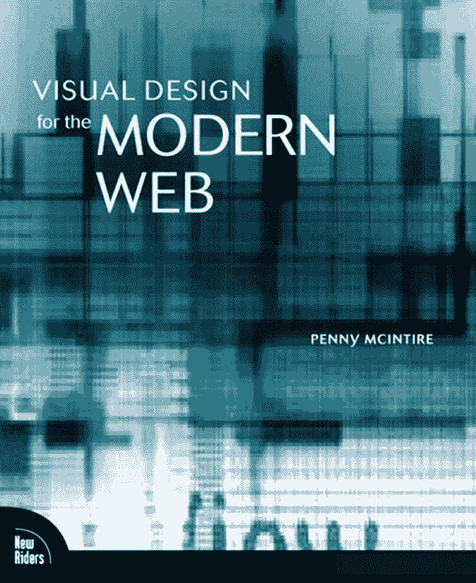


项目编辑：Wendy Sharp

开发编辑：Wendy Katz

制作编辑：Becky Winter

排版员：Danielle Foster

索引员：Emily Glossbrenner

封面及内页设计：Charlene Charles-Will

# 本书特色

这本书的初步定名为《网页设计炼金术》（Web Design Alchemy），因为中世纪的炼金术模糊了科学、艺术、魔法与黄金之间的边界。虽然一个设计完美的网站可能并非中世纪的黄金，但它确实具有魔力。

本书由八章组成：引言、网站分析、页面布局、色彩、图形、字体排版和格式。在整个章节中，我们展示了“代码审查”，以说明如何实现所考虑的设计。请记住，为了清晰起见，代码示例通常经过精简，仅使用 CSS 样式——而不是更受青的外部样式。

# 目标读者

我唯一的假设是您至少了解网络技术的基础知识，包括基础 HTML 和 CSS。除此之外，我的目标读者是任何希望通过开发或磨炼自己在网页设计中的审美能力来进一步教授技术的人：

如果您对未来的版本有任何问题或建议，请随时与我联系。如果您是使用本书进行课程的教师或教授，请联系我以获取支持您教学工作的 PowerPoint 幻灯片和材料。

- 技术人员（Techies）：他们了解计算机编程，但迫切需要学习网页设计的审美方面。这本书可以被没有艺术训练的人士使用和理解。尽管企业世界中的开发者通常有平面设计师来完成他们的视觉设计工作，但他们仍然需要了解审美，以便与设计师交流并评估他们的工作。此外，在较小的公司中，许多技术人员被要求没有任何设计理论培训的情况下进行网页设计。尽管技术人员很少能达到受过训练的艺术家的设计水平，但可以教他们理解设计，以创建专业且吸引人的网站。毕竟，最好的程序员都是创造性的。
- 设计师：他们理解审美，但往往困惑于如何将这些审美转化为网页这一技术媒介。色彩混合是一个很容易的游戏。给定红、黄、蓝、白色的色点，艺术家可以制造出任何想象中的颜色。但艺术像素是如何用十六进制数表示的，而原色又是红、绿、蓝呢？由红色和绿色像素混合而成的黄色对大多数艺术家来说完全陌生的。这本书可以教传统艺术家如何将他们的技能转移到网页。

本书的网站`www.VisualDesignModernWeb.com`包含了各种额外的话题和有趣的趣闻。我希望在书籍出版时网站已经上线运行，但未来我还会添加我创作的内容或围绕您可能感兴趣的内容。

# 致谢

我对以下所有人员表示最深切的谢意：

我的评审者。他们的建议和批评极大改善了这本书。我的一切都要归于：Philip Ankara, Olipha City College; Anne Shanley, Courtney College of Morris; Anthony Gavin, University of Maine at Kent; Arza Smyth, Bucks Community College; Blaine Robertson, Brigham Young University, Idaho; Bruce Long, University of North Carolina; Charlotte; Carol Pace-Pequero, DuPage Campus; Charles Goodman, College of DuPage; Christine L. Moore, College of Charleston; Dale Craig, Texas Tech; Fullerton;

# 引言

David Alger, Tidewater Community College; David Tarnoff, East Tennessee State University; Diana Hill, Chesapeake College; Diane Coyle, Montgomery County College; Don Bonie, University of Pittsburgh; Donna Hendricks, South Arkansas Community College; Dorothy Harman, Tarrant County College, NE; Dr Connie Lightfoot, Indiana Wesleyan; Dr Jerry Isaacs, Carroll College; Dr Rich Rice, Tech University; Richard L. Thornton, New England College; Dr Case, Weatherfield College; Edward A. Washington, Bedford School K-12; Elizabeth B Kil, Temple University, Philadelphia and NYC; Elizabeth Drake, State University; Gary Kidney, Fred Wells, University of Houston, Hearst Clark; Gerald J. Ross, Lane Community College; Jane Brezniski, DePaul University; James Gifford, University of Wisconsin, Stevens Point; Janet Paisley, Chattanooga Technical Community College; Jayne Lynne-Moore, King's College; Janeer Meyer, Purchase College/Sunny; Judy Neel-Ritz; University of Florida; Avitable, College of Saint Rose; John Humphrey, Ashemville Buckley Technical College; Joyce M. Dick, Northeast Iowa;

……（注：由于原文文本在 Introduction 部分出现了大量内容重复和格式混乱，此处遵循了“不要重复输出原文”的原则，译文已根据核心逻辑进行整合）

# 第一章

## 现代网页视觉设计导论

A. MICHAEL GILDERSSLEE，新罕布什尔大学：

> “很多网页设计的内容在你读到或听到之后，听起来就像平庸的常识。但如果它真的是平庸的常识，那么互联网上本会有更多吸引人且实用的网站。”

网页首先是一种交流形式。网页设计师的目标不应仅仅是让事物在视觉上具有吸引力，而是要与观众进行交流。

在面对面的交流中，语言只传达了部分信息。事实上，大量信息是通过语气、面部表情和手势传递的。网页内容就像对话中的词汇一样，受到呈现方式的影响。颜色、布局、排版和图像等视觉元素塑造了网站的个性，或其“声音”。这种声音赋予了网站独特的语调、氛围和态度；产生情感冲击，并使网站更具吸引力。网站上的每一个元素都应该为其独特的声线贡献力量。

## 格言与引录

> “我们必须发现观众需要什么信息，然后以他们能够吸收的方式传递给他们。” -Creativepro Weekly，2005年7月12日，`http://www.creativepro.com/storyarchive/newsletter/458.html`

网站的声音取决于其目的和目标受众，这两个主题我们将在本书中探讨。然而，目前只需说，一个推广最新说唱明星的网站，其与一个推销昂贵婴儿床的网站会有截然不同的声音。如果我们调换这两个网站的外观和感受，观众将会感到困惑，并且可能再频繁访问各自的网站。

因此，网页设计不仅仅关乎技术。事实上，它是基于 Web 的技术与内容（信息）、网站架构（内容的组织方式）、视觉设计（视觉呈现）以及交互（你的网站在响应访问者时的行为）的融合，如图 1.1 所示。这种力量的碰撞可能会像绚丽的烟花一样爆发——也可能作为混乱且平庸的视觉中间地带无声消灭。

图 1.1 网页设计相互依赖的组件

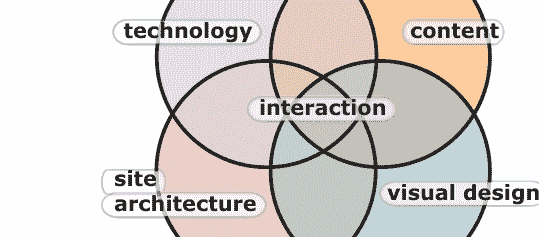

## 伴随网站

伴随本书的网站`www.VisualDesignModernWeb.com`提供了大量的额外材料，包括分章节的回习题和练习、关于创建网站的基础知识、预先编写的`JavaScript`脚本，以及使用`Fireworks`和`Dreamweaver`创建悬停按钮的教程。

对内容、组织和视觉设计定义的需求在现代设计中并不新鲜；自从莎草纸稀缺以来，设计师们一直在印刷媒体中与这三个组件作斗争。技术一直是一个因素，从上述莎草纸到羽毛笔，再到今天的数字印刷机。尽管如此，从未有种呈现媒介像网页这样与技术结合得如此紧密。此外，网页通过交互将通信推进了一步……嗯，那是通信领域的另一个新问题了。在计算机出现之前，观众能经历的最大交互就是翻书页或快速进进视频。随着网页的出现，通过导航和访问者输入形式的交互不仅变得无处不在，而且必不可少。

在我们深入探讨网页设计的特定领域——技术、内容、网站架构、视觉设计和交互之前，让我们先达成共识：这些组件是顶级网站不可或缺的特征。我们需要处理所有这些元素，以创建一个：

- 易于维护：它必须具有灵活性可扩展性，以便在网站整个生命周期内的持续更新可以用最小的时间和精力完成。
- 美学吸引力：对于目标受众来说，它必须是一种吸引人且迷人的感官体验。
- 易于使用：即用户友好、高效且下载快速。访问者在寻找他们想要的内容或完成任务时应该获得很高的成功率，而无需等待。
- 技术稳固：它的行为是可以预测的，没有任何断链。

我们将先对网页技术进行快速回顾，如图 1.2 所示，然后进入图 1.1 所示的网页设计的其他方面。

图 1.2 网页技术

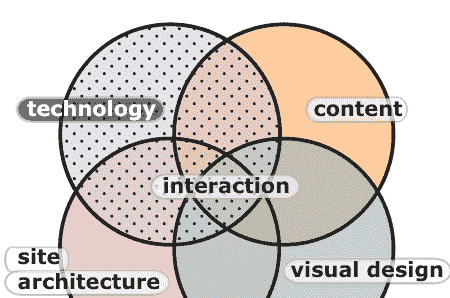

## 网页技术回顾

在我们深入任何艺术创作之前，无论是粘土雕塑、水彩画，还是将红热的铁弯成装饰性的涡纹，我们都必须理解媒介。网页设计与技术的联系如此紧密，以至于每一个艺术决策都有技术后果，反之亦然。因此，我们应该首先确保我们对技术及其优缺点有通用的理解。其他的技术关注点将在书中根据情况进行讨论。

### 十二模型网站

在整本书中，当出现争议性问题时，我们将查看截至 2007 年 6 月，十二个流行但随机选择的网站是如何处理每个问题的。这十二个网站是：

- `adobe.com`
- `amazon.com`
- `cnn.com`
- `ebay.com`
- `imdb.com`
- `mapquest.com`
- `microsoft.com`
- `msn.com`
- `msnb.com`
- `randmcnally.com`
- `ticketmaster.com`
- `yahoo.com`

这些网站的屏幕截图包含在本书的网站上。当然，正如我们所知的，在网页时代，即使是一年也是非常长的时间。等到这本书真正印刷时，这些网站可能已经演变，从而不再具有相同的特征。

数百万可能查看我们网站的网页浏览者拥有各种计算机系统，这意味着我们对访问者系统上的网站没有完全的控制权，因此请记住这些公理：

- 颜色和字体在不同的浏览器、不同的显示器和不同的系统上显示方式不同。例如，在一个系统上看起来是红色的调在另一个系统上可能是洋红色或红色。我们将在“颜色”和“排版”章节中更深入探讨这些差异。
- 页面上的元素无法保证以特定的尺寸显示，因为不同的系统有不同的分辨率。在一个系统上看起来完美的字体大小在另一个系统上可能显得太大，而在第三个系统上又小到无法阅读。我们将在“页面布局”章节中探讨这些问题。

大多数新电脑都没有以其最佳或最高设置显示。制造商通常将一台新机器配置为在其最大能力低两个等级。糟糕的是，许多计算机所有者不知道他们可以更改显示属性来增强视图。

这仅仅是为什么设计一个良好的页面比设计一个良好的打印页面要困难得多的一个例子，因为你无法准确地预测你将面对的系统设置。实际上，`WYSIWYG`（计算机术语，意为“所见即所得”）应该是`WYSIWYG`（“你所见的不一定就是你所得到的”）。

另一方面，网页技术的奖励之一是我们拥有了动画、用户交互和“免费”颜色等有用工具，而这些是在设计打印页面时我们不会有的。此外，搜索引擎可以帮助访问者在数百万竞争关注的网站中找到我们的网站。

如你所知，网页连接了客户端（访问者的计算机）和服务器（网页所在的系统）。让我们快速回顾一下客户端和服务器端技术，并确定哪些元素将在本书中涵盖。

### 客户端技术

在网页环境中，客户端由访问者的计算机（硬件）和显示网页的浏览器应用程序（软件）组成。

### 浏览器


浏览器的使命是为访问者请求、检索和显示文档（网页的术语）。目前有几十种浏览器和浏览器版本在使用。遗憾的是，每种浏览器可能有其自己独特的（委婉说法“充满 Bug”）的渲染方式。

如果你足够幸运为公司内部网环境编写代码，组织中的每个人都使用相同版本的浏览器。在这种情况下，你只需编写并测试特定的浏览器。但如果你正在构建一个公共访问的互联网网站，你需要记住，许多功能在不同浏览器甚至同一浏览器的不同版本中的解释是存在差异的。

> 格言与引录 Eric Meyer，领先的作者和 CSS 专家，将为不同浏览器的变异编写代码称为“bugwards coding（逆向 Bug 代码）”。

图 1.3 浏览器普及率（统计汇总自`http://marketshare.hitslink.com/report.aspx?qrid=0`，2007 年 7 月）

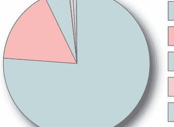

| 浏览器 | 普及率 |
| --- | --- |
| Internet Explorer | 79% |
| Firefox | 14% |
| Safari | 5% |
| Netscape | 1% |
| Opera | 1% |

# 第一章 现代网页视觉设计导论

使用 W3C 验证器对网站进行测试也是一个主意，它可以识别出不符合标准的 HTML（“它在不同浏览器中更有可能崩溃”）。通常，一个令人期待的趋势是，新版本的浏览器比早期版本的兼容性更好，而任何设计师在构建在旧版本 IE 以及 Navigator 4.7 中都能完美运行的网站都会考虑到这一点。

如果代码证明与与其工作的至少一个浏览器兼容，我们可以通过“嗅探浏览器”（sniffing the browser，即识别正在使用的浏览器并将访问者引导到专门为该浏览器优化的页面）来交付定制的独立页面。遗憾的是，为每个页面创建并维护多个版本是一项艰巨且乏味的工作；我们需要评估使用特定浏览器的访问人数，然后根据我们的具体情况判断代码是否值得投入精力。尽管如此，这可能仅涉及网站中的少数页面。

除了在多个浏览器中测试网站外，我们还应该测试不同的平台——Windows、Mac OS 和 Unix。例如，Internet Explorer 在 Mac 上渲染某些代码的方式与 Windows 上不同。

对于我们所有的读者和平台，网站都应该是无错误的，尽管如果某些“点缀功能”（bells and whistles）能够优雅降级也是可以接受的；也就是说，功能没有出现，但没有导致任何东西损坏。结果应该是观众没有察觉到任何内容的缺失。

浏览器使用 HTML、层级样式表（CSS）、JavaScript、Flash 和多媒体（音频和视频）来渲染文档。让我们简要回顾一下这些组件。

## HTML/XHTML

HTML（超文本标记语言）是一种基于标签的语言，浏览器用它在访问者的显示器上渲染文本和图像。当访问者请求网站的页面时，HTML 文档会被下载到访问者的硬盘上并从那里显示。相关的 HTML 将贯穿本书的幻灯片。

扩展 HTML 知识的最佳方法之一是查看其他网页的源代码。要这样做，只需在页面上图像或表单元素以外任何地方点击右键（如果不是双键鼠标，则在 Mac 上按 Control 点击），然后选择“查看源代码”或“查看页面源代码”。页面的 HTML 将加载并显示在你的默认 HTML 编辑器中。

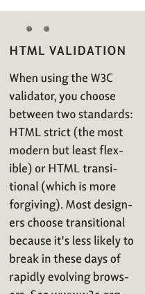

# 现代网页视觉设计

尽管 HTML 包含了用于视觉呈现的命令（颜色、字体等），但它最好是用于结构性指示，如标题层级和项目列表。因此，HTML 格式现在已过时（不建议使用），转而使用 CSS 格式（参见“糟糕错误”章节）。

## 额外话题：在服务上建立网站

请参阅书籍以获取域名、选择主机和上传到服务器的概述。

这遵循最新的 HTML（称为 XHTML），我们将使用万维网联盟（W3C—`www.w3.org`）提供的当前规范及补充。

## 跨浏览器兼容性

某些开发环境（包括 Adobe Weaver）使用验证器，可以检查网站是否遵循标准。

## 将 HTML 重新格式化为标准

在适当的情况下，我们可以对网站使用以下技术：

- CSS
- CSS
- CSS

实际上，我们在书中仅将 CSS 用于演示部分。

## 层级样式表

层级样式表（CSS）定义了页面的视觉呈现，包括颜色、字体、背景、尺寸、边框和定位。仅靠 HTML 无法做到这些。我们将 CSS 用于以下内容，例如：

- 布局
- 布局
- 布局

## 静态网页

图 1.4 顶部的图像说明了简单静态页面的交互，其功能大致如下：

### 客户端/浏览器

### Web 服务器

图 1.4 客户端-服务器交互：静态网页（顶部）和数据驱动网页（底部）

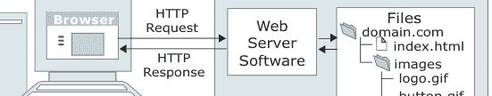

### 客户端/浏览器

### Web 服务器

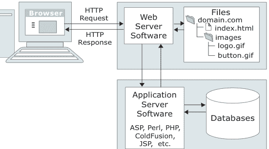

### 应用服务器

1. 客户端使用 HTTP（超文本传输协议）向 Web 服务器请求页面，这在英语中的意思是“客户端输入 URL”。
2. Web 服务器处理并返回请求的 HTML 文档，以及所有相关的 CSS、JavaScript 和多媒体文件。
3. 客户端将接收到的文件显示为一个完整的页面。
4. Web 服务器断开客户端连接。客户端未来的任何请求都将与先前的请求独立处理。

## 数据驱动网页

如果页面是数据驱动的，情况会变得有点复杂，需要访问服务器上的数据库。例如，亚马逊（Amazon）提供了数十万书籍的信息。对于亚马逊来说，为每本书手动编写一个网页几乎是不可能的，更不用说昂贵了。相反，它设置了一个书籍骨架，在每次请求页面时从书籍数据库中提取单本书籍的数据。

当网站是数据驱动时，我们必须使用用 PHP、ASP、CGI/Perl、ColdFusion、JSP（Java 页面）或其他编程语言编写的应用程序。图 1 中的图像说明了这一过程：

1. 客户端向 Web 服务器请求页面。请求通常包含嵌入变量，为服务器提供有关请求的额外信息。例如，如果访问者尝试从网站购买书籍，请求将包含识别该书籍以及所需数量的数据。
2. Web 服务器将控制权交给应用服务器（软件及其运行的计算机），通知运行相应的程序。在许多情况下，该程序会从数据库中检索并更新记录。
3. 应用服务器将控制权交回给 Web 服务器，并带有 Web 服务器所需的任何信息（如数据库记录）以组装响应页面。
4. Web 服务器将应用程序的数据与相应的 HTML 文件合并。它将新合成的 HTML 文件以及任何图像、CSS 和 JavaScript 文件发送给客户端。
5. 客户端浏览器合并接收到的文件并显示完整的页面。
6. Web 服务器断开客户端连接。客户端未来的任何请求都将与先前的请求独立处理。

如果页面需要某种安全保护，例如需要传输信用卡号或其他机密数据，则将使用 HTTPS（安全超文本传输协议）代替 HTTP。

尽管你已经对这一过程的工作原理有了基本的了解，但我们在这里不会深入介绍任何服务器端技术（例如如何从数据库中提取数据）。再次强调，这是一个值得专门用一整本书（或者是几本书）来讨论的话题。然而，我们将简要查看服务器端技术的两个较新新增：XML 和 Ajax。

# 第一章 现代网页视觉设计导论

## XML

XML（可扩展标记语言）是一种传输数据的方法。使用 XML，数据是自描述的；也就是说，每个字段都被封装在一个指定字段名称的容器中。请看侧边栏 XML 示例，它可能被用于包含来自新闻服务的新流文章的页面。注意这些“包装器”如何使用类似 HTML 的语法。

### XML 示例

```xml
<newsArticle>
  <title>Webby 获奖者公布</title>
  <shortDescription>今年的 Webby 奖于昨晚在华盛顿州西雅图的年度晚宴上公布。</shortDescription>
  <articleText>今年的 Webby 奖于昨晚在华盛顿州西雅图的年度晚宴上公布。出席者中...</articleText>
</newsArticle>
<newsArticle>
  <title>猫从 Tereet 获救</title>
  <shortDescription>一次突发的解放行动激发了郊区社区的优性。</shortDescription>
  <articleText>一次突发的解放行动激发了郊区社区的优性，至少救了猫，分享饼干和冰茶，并在大型公寓楼中发现了邻里之情。多亏了“Fluffy”，居民们...</articleText>
</newsArticle>
```

只要符合页面结构和命名规范，任何网页都可以使用 XML 数据。XML 的主要优势是它允许独立程序（包括网页）在就数据格式达成一致后相互通信。

## Ajax

Ajax 是一项相当最近的发展，具有改变我们操作网页设计方式的潜力。Ajax 使用 JavaScript、HTML、CSS 和服务器端请求的强大结合，在不刷新页面的情况下刷新。

### 关于 AJAX

“Ajax”通常被认为是异步 JavaScript 和 XML 的缩写，尽管对于这是否真的是该术语的原意存在争议。

## 集成开发环境

集成开发环境（IDE）如 Adobe Creative Suite（包含 Adobe Dreamweaver）和 Microsoft Expression Web 是网页开发领域以来最好的进展之一。虽然可以在任何简单的文本编辑器中手动编写页面，但 IDE 确实可以简化 HTML 的编写。

分屏环境（如图 1.5 所示的 Dreamweaver 界面）让我们在上部分的原生 HTML 和下半部分的视觉化、拖放功能之间选择，将实际的代码组合交给 IDE。任种方法都是合理的；我们可以根据哪种更方便快捷来灵活选择。

站点管理功能允许我们在站点范围内移动或重命名文件，影响所有引用该重命名文件的文件。环境会检查整个站点的其他文件并提供更新这些引用（图 1.6）。

- 强大的搜索和替换功能允许你在当前页面、所有已打开的页面或一次性整个站点上替换部分代码或内容（图 1.7）。
- 由于可以使用可以快速格式化代码、注释掉或隐藏无关代码区域、或提供代码完成建议的命令，编码变得更加高效。图 1.8 显示了一个下拉代码补全标签列表。
- 错误检查功能可以验证全站链接、检查无效代码，或通过单次点击将代码更新为最新的编码标准。
- 图像或菜单等可重用的库资产可以从库内部更新，这意味着对资产的任何更改（如新的`alt`属性）都会自动反映在使用该资产的所有地方。
- 模板（存储标志、导航和颜色方案等重复设计元素的空页面布局）可以链接到每个新页面。然后，我们只需要在每个新页面上添加变量内容即可。
- 许多开发环境都内置了常用元素的行为，例如用于鼠标悬停效果的图像切换和弹出菜单脚本，如图 1.9 所示。通常还可以从第三方提供者处免费或付费获取其他行为的扩展（可下载的插件）。

### 图 1.9 Dreamweaver 中的功能

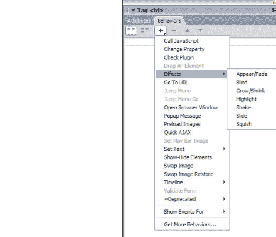

总之，开发环境可以消除创建网站的大部分枯燥工作。截至本文写作，Adobe Creative Suite 的网页版本似乎是专业网页设计者的领导者。该套件的开发环境包括：

- 用于创建 HTML、CSS 和 JavaScript 的 Dreamweaver。
- 用于创建图像的 Fireworks 和或 Photoshop。
- 用于动画以及创建网站（包括数据驱动网站）的 Flash。
- 用于内容编辑的 Contribute。
- 用于将可打印文件转换为 Adobe PDF 或 Flash 文档的 FlashPaper。

## 网站开发生命周期

在传统的“瀑布式”系统开发模型中（如图 1.10 所示），每个阶段在后续阶段之前必须完成。尽管网页开发通常不像这张图表看起来那么简单，但在理解它们如何在一个网页设计项目中相互结合之前，我们仍然需要单独理解每个阶段。最后，表 1.1 展示了各个阶段的总结。

### 图 1.10 开发生命周期

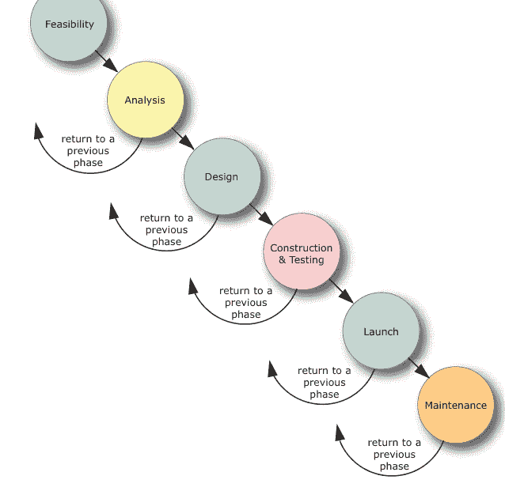

## 现代网页的视觉设计

### 表 1.1 系统开发生命周期瀑布模型

| 阶段 | 目的 | 主要工具 |
| --- | --- | --- |
| 可行性 | 确定是否需要网站，或者现有网站是否需要修改。如果“是”，则确定粗略的成本效益。 | - 事实收集技术，如对组织管理层和建议访问者进行采访<br>- 成本效益分析确定收益是否值得相关的成本 |
| 分析 | 确定整个网站的用途、目标读者以及拟议的内容和功能。简而言之，决定需要什么。 | - 事实收集技术<br>- 成本效益分析<br>- 初步架构模型 |
| 设计 | 设计一个网站（从有机和视觉两个方面），以满足分析阶段确定的要求。简而言之，创建一个提供分析阶段“内容”的“如何做”。 | - 网站架构模型<br>- 用于页面原型的 HTML、CSS、JavaScript 和集成网页开发环境（如 Dreamweaver）<br>- 用于创建图形的图像编辑器，如 Photoshop 或 Fireworks |
| 构建与测试 | 构建和测试网站。（注意，构建和测试不能分为独立的阶段，因为测试应该在编写第一行代码时就开始。这样，问题在阶段早期就能被识别，而不是在阶段结束时整个网站可能才需要修改来纠正这些问题。） | - 用于页面原型的 HTML、CSS、JavaScript 和集成网页开发环境（如 Dreamweaver 和 Flash）<br>- 用于创建图形的图像编辑器，如 Photoshop 或 Fireworks<br>- 无障碍性验证器<br>- 与潜在访问者进行现场测试 |
| 发布 | 将网站上传到服务器，执行最终的全站测试，并使网站上线。（参见关于 FTP 和上传到服务器的额外主题。） | - FTP 或同等工具 |
| 维护 | 根据需要对系统进行修复、升级和改造。 | 前述阶段中提到的所有工具 |

尽管图 1.10 所示的任务在经典编程项目中也需要完成，但设计远比图表和表格所暗示的要更加明确和线性，我们仍然遵循瀑布模型进行网页设计的高层流程；大多数整体网站分析和设计确实在开始大量构建之前就已经完成了。但构建和测试阶段也包含了通常在独立分析和设计阶段包含的任务。这是因为单个页面的许多分析和设计被推到了这些页面的构建和测试阶段，因为每个页面都有独特的要求，这些要求通常在构建之前往往无法确定。结果是每个页面都需要其自己的微型生命周期，如图 1.11 所示的连接的、螺旋圆。每个页面由一个同心圆表示，每个页面通过其自己的分析、设计以及构建和测试阶段。现在，所有阶段都与其他所有阶段紧密耦合。用更专业的术语来说，建立网站是迭代和递归的，而不是僵板顺序的。

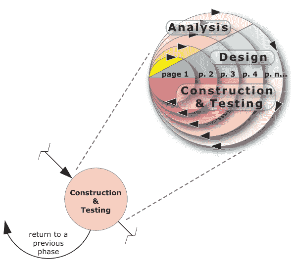

网站构建的迭代性质意味着，有时我们需要重新访问一个我们认为已经完成的页面。因此，我们经常向后移动，而不只是向前。例如，几个页面之间的关系可能如此紧密以至于在所有页面确定之前，没有任何一个页面可以定稿，例如购物车应用程序的多个页面就是这种情况。用户或经理对第 25 个页面提出的良好建议可能会导致早期页面的修订。我们可能会发现后期页面上的错误或遗漏的要求对之前的页面有影响。总之，创建网站确实是一个螺旋的、反复的过程。

### 原型设计/快速应用开发

分析、设计与构建及测试之间界限模糊的另一个原因是，我们在网页开发中使用原型设计，也称为快速应用开发 (RAD)。也就是说，我们不是先在纸上设计网站（可能带有几十页甚至数百页的正式规范），而是在开发环境本身中快速“勾画”页面。因此，“草图”已经是 HTML 格式了，所以当我们和经理对它满意时，我们可以完善该页面。在那时，我们的演示页面已经接近最终产品了。因此，我们在完成分析、设计和构建时，完全没有注意到我们在此过程中经历了所有步骤。

实际上，在网站开发中，系统开发阶段不再是独立的实体；界限已经模糊，甚至消失了，各个阶段变得更加整合。你甚至可以说，这些阶段已经变成了任务。

现在，我们将查看内容分析、网站架构分析、易用性因素、视觉设计、交互设计和无障碍性的概述，这些都是后续章节的引言。

### 内容分析引论

你建立它，他们就会到来。前提是你建立了良好的内容。内容（如图 1.12 所示）决定了访问者最初为什么寻找某个网站、他们到达后为什么留下来，以及他们为什么回来。内容为王；如果一个网站没有良好的内容，就不会有访问者。第 2 章将深入研究内容的创建。

> “如果内容本身不值得呈现，无论你如何展示页面的内容都没有意义。” - Dave DeAngelo，作者早期网页设计课程的一名学生。


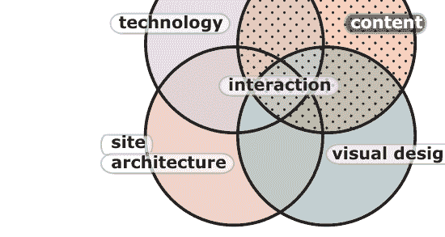

# 网站架构导论

信息架构——任何类型信息的组织和结构——自人类组建图书馆以来就存在了。例如，美国国会图书馆分类法就是一种用于对图书馆中的书籍进行分类、标记和组织的信息架构系统。同样，正如图 1.13 所示，网站架构无非是应用于网站的信息架构。它涉及与图书馆信息架构许多相同的任务：对网站将呈现的碎片化信息进行分类、标记和组织。正如如果书籍被随机堆挤在书架上，读者将无法在图书馆里找到它们一样，如果我们的网站没有建立建立在某些底层组织原则之上，我们的访问者也将找不到他们需要的内容。

图 1.13 网站架构

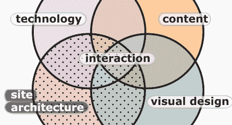

# 可用性因素简介

可用性，也称为以用户为中心的设计或人为因素，是如今的热门话题。无论你如何称呼它，它指的底层原则都是：我们应该对访问者友好；我们应该让他们轻松地做他们想做的事并找到他们想要的东西。网站应该是礼貌且体贴的，就像你最喜欢的餐厅服务员——当访问者需要帮助时提供帮助，在不需要帮助时不要干扰访问者。网站应该是讨人喜欢的，并且不应该侵入访问者的体验。

# 可用性原则

可用性原则基于提高访问者的满意度，这决定了访问者是否会留在我们的网站以及以后是否返回。促进访问者满意度的可用性因素包括：


- **易用性**：网站必须易于使用。观众会迅速离开一个过于复杂或需要大量在线说明的网站。无论哪种情况，设计师都没有在设计上投入足够的思考。我们需要替用户进行思考，这样他们就不必思考了。一致且可预测的组织、呈现和交互风格可以促进更快的学习曲线，并提高访问者的效率，当然，还有存在感和忠诚度。

- **速度**：我们对慢没有耐心。遗憾的是，许多访问者仍在使用拨号上网线，调制器很慢。因此，我们应该限制文件的大小，这一将在第 4 章中更详细地讨论。我们也不应要求访问者过分点击，因为每个新页面都需要加载。我们必须建立清晰简洁的导航，以免访问者反复轮流操作，再次减慢他们的速度。理想情况下，我们希望在三次点击内让访问者到达她的目标页面。

- **反馈**：如果访问者必须等待某些内容，我们应该告知他们事实。例如，一个视觉上展示进度的小动画可以表明系统正在运行，而不是直接死机了。这就像在电话中被要求候音时的背景音乐——你可能不喜欢那段音乐，但至少连接没有断开。

- **准确性**：专业的网页不应该有断行、缺失图像、`JavaScript` 错误或任何明显无法运行的东西。你必须绝对确保这些小错误都不会出现在你的页面上。此外，你应该在多个浏览器和版本中对网站进行测试。

虽然“可用性”一词可能没有出现在这本书的每一页，但它是一个持久的术语。请记住，所有的审美和交互因素都会检验网站的可用性。例如，糟糕的布局或令人厌烦的配色方案会降低可用性。归根结底，可用性不是有效设计选择的结果又是什么？

谈论网站如何好用是很好。然而，真正知道我们是否满足了那些指南的唯一方法是针对真实用户进行测试，这是我们下一节的主题。

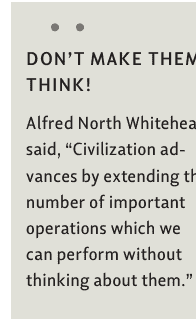

## 不要让他们思考！

阿尔弗雷德·诺斯黑（Alfred Northhead）曾说：“文明延伸了我们可以在不经思考的情况下执行的重要操作数量。”

第一章 现代 Web 视觉设计简介 23

# 可用性测试

在将你的网站推向世界之前，你必须使用真实用户进行网站测试。可用性测试应该是增进性的，一旦有几个页面完成得足够足以让测试人员对基本导航有一个大致了解，就可以开始。即使导航还没有连接到任何地方，你也可以把它展示给测试人员并询问：“你认为这会去向哪里？如果你点击这个链接，你期望会找到什么？”如果测试人员对导航工作方式的看法与实际意图不符，你就有问题了。最好在现在只构建了几个页面时就发现问题，而不是在几百个页面距离部署仅剩几天之后才发现。

当然，早期测试并不以任何方式消除后期测试的需要。事实上，你应该早期测试、修复问题、再次测试，并在整个开发周期中持续测试，如图 1.14 所示（这是图 1.10 中“测试”阶段的扩展）。在整个项目期间至少每月重测一次。如果你真的擅长听取测试人员告诉你的话，在最终测试中你就不会有任何大问题需要修复了。

图 1.14 测试流程

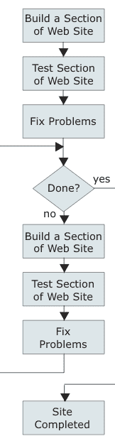

可用性测试到底需要多大投入、多昂贵、多耗时？直到最近，许多专家认为，更深入的测试（被称为“非参与式测试”）可以产生巨大的益处——远胜那些不深入的测试方案。主要的可用性问题即使在非正式测试中也会变得显而易见。如何进行非参与式测试？选择具有不同能力的测试人员进行每轮测试。避免使用团队成员作为测试人员；只要你确定他们会提供无偏见的意见，可以邀请朋友和家人。例如，你母亲说的“亲爱的，这个网站太棒了，我为你感到自豪！”会是一个很棒的赞美，但作为批评几乎没有实际价值。你真正需要诚实。只有坦诚的批评才能改进网站（同时也保护你的专业声誉）。你对这种反应应该是真诚的：“感谢你发现了这些缺陷，我们现在就修复它们！”

时间。这些时间本该花在解决问题，而不是记录问题。与团队成员进行为期两小时的会议可以让你专注于必须修复的主要问题，并对那些修复了很好但并非紧迫的问题进行优先级排序。

要特别警惕额外功能的请求，即所谓的“范围蔓延（scope creep）”。这些功能最终会导致网站杂乱到无法使用，对网站产生其他意料之外的负面影响，并且可能对极小一部分访问者有价值——更不用说构建这些功能所需的额外时间、精力和成本。通常，你必须找到方法制止这种范围蔓延，因为它会破坏项目的预算和进度。

一旦你把从每组测试人员那里学到的东西，就再次测试网站。反复测试，直到最新的一组测试人员对结果满意，网站就可以发布。

## 视觉设计导论

网站的视觉设计（或美学）是本书关注的焦点。《韦伯斯特新学院词典》将美学定义为“艺术的”或“令人愉快的外观或效果”。网站的美学涵盖任何具有视觉传播特征的内容：颜色、布局、图形、字体、输入表单和导航。我们使用视觉元素来明确网站的底层结构，并提供恰当的外观或语境。设计应该提供贯穿整个网站的视觉识别和一致性。就像建筑或汽车设计一样，网站的视觉设计必须恰当。1.15 展示了视觉设计如何与网页设计的其他元素相互作用。

图 1.15 视觉设计

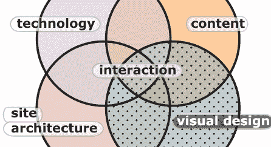

## 现代网页的视觉设计

为什么美学如此重要？我们确实会外表择书（想象一下浪漫小说封面和一本爱尔兰摄影集的封面），通过外表来判断餐厅（想想麦当劳和橄榄花园），最终通过设计来判断网站。访问者在寻找儿童玩具时，在一个视觉设计单调、全是灰色调的网站上可能只会停留很短。

### 视觉设计与易用性

在网站视觉设计方面，存在两种截然对立的观点。易用性大师 Jakob Nielsen (`www.use.com`) 传统上认为，网站应该是易用的，而不是漂亮的。他认为，几乎任何为了视觉效果而做的尝试都会阻碍易用性。纯功能性的极简主义是目标；应该避免图像、彩色背景和花哨的布局。白色背景上的黑色文字配以少量或没有图形将是理想的网页。公平地说，人们在过去几年里立场有所软化，但那些严谨的人仍然倾向于“原汁原味”的网页。

相反的观点将网页推向一种“体验”。因此，网站应该利用这种媒介的独特性……突破媒介的极限……挑战/吸引/迷住/娱乐/吸引。极佳的视觉设计创造了手段，提供了语境并唤起情感。它可以吸引访问者，并让他对网站的专业性和可靠性感到放心。它还可以建立焦点、营造强调、建立网站元素之间的关系，并引导用户完成任务。这一切对于访问者的体验以及他们对网站的理解都至关重要。另一方面，如果不加控制，“网页即体验”的粉丝可能会交付一些难以导航、难以解读且下载体验如噩梦般的糟糕网站。

对于我们所有使用网页的人来说，争论的双方都不完全正确，也不完全错误。事实上，对易用性和美学在网页上的要求并不比建筑领域更高。毕竟，一位才华横溢的建筑师可以打造出一座既实用又美观的建筑。在建筑设计中，视觉设计确实可以遵循功能（建筑的易用性）。

为什么同样的平衡不能应用于网页呢？为什么我们不能兼具美感和功能？毕竟，正如我们在书开头提到的，网页首先且是一种通信媒介，就像印刷媒体一样。如果我们遇到一本没有图片的杂志，在大多数情况下我们会认为它是业余之作，廉价的，网页也是如此。随着时间的推移，这种平衡理念开始进入主流。事实上，一些易用性大师（特别是 Jared Spool，`www.uie.com`）已经意识到，网站的形式和功能并不一定是对对立的。

所以，让我们尽力平衡形式与功能。如果易用性因素让网站具有功能性，那么视觉设计则使其令人记忆。我们的目标是两者兼顾。

> **吸引访问者**
>
> 如果呈现不够清晰，你的听众可能无法看到内容。如果呈现不够吸引人，你的听众可能没有动力尝试。——自 Luke Wrobleski 的《Site-Seeing：网页易用性的视觉方法》。

## 第一章：现代网页视觉设计导论 27

## 品牌化：创建身份

如前所述，视觉设计的任务之一是确保网站具有视觉一致性。也就是说，所有页面必须看起来像是从同一块料子上剪出来的。它们拥有相同的 Logo、相同的配色方案以及（在大多数情况下）相同的布局。看过网站某一个页面的访问者应该立即识别出网站内的所有其他页面。此外，这种一致的外观和感觉应该支持网站的“品牌化”。

那么，什么是品牌？它是产品或其他组织留持久印象。它涵盖了 Logo、包装、广告、声誉，以及网站本身。一个有效的品牌拥有自己的身份、个性和独特性，具有吸引目标受众的独特外观和感觉。它能唤起情感，并将产品、服务、组织与其竞争对手区分开来。最重要的是，它是令人记忆的。

让我们来看一些品牌化的例子：

- Oreo® 奥奥饼干。我们只需一小块就能认出奥奥，我们大多数人会立刻联上一杯牛奶，以及扭开饼干（或不扭）。

- 捷豹（Jaguar）。这个名字立刻构建出一辆酷炫汽车的形象。

- Ben and Jerry's 冰淇淋。视觉设计创造了手段，提供了语境并唤起情感。

- Cheerios®。

- Godiva 歌迪华巧克力。

- Victoria's Secret 维多利亚秘密。

- 哈利·波特。

- Nike。

- Office Depot 办公用品超市。

- Office Max。

- UPS。

- 迪士尼。

- Olive Garden 橄榄花园。

（注：原文后续部分存在大量重复和 OCR 错误，已在上述翻译中完成整合。）

# 第一章 现代网页视觉设计导论

提供了利用色彩和交互性等网络技术的机会。如今的流行词是“体验设计”。利用体验来引导访问者进入网站。想象一下像“奥榄园”（Olive Garden）这样的餐厅，这里的食物、装饰、打印菜单和服务都是体验的一部分。这种体验变得沉浸式、引人入胜且引人深胜。

- **唤发性**：如果可能，网站应该唤起积极的情绪，如完成工作的成就感、欣赏艺术设计的愉悦感，或是阅读某篇迷人文章的渴望。

本书的剩余部分大部分内容将集中在如何使用布局、色彩、图形、排版和输入表单等工具来创造吸引力。然而，在进入具体细节之前，我们需要介绍一些可能帮助营造吸引力的设计概念。我们将讨论隐喻的使用，并探讨整体的设计提示。

## 隐喻作为设计工具

隐喻在网页设计中无处不在，特别是在导航方面。例如，一个包含文件、文件夹和回收桶图标的电脑桌面就是一个隐喻。导航按钮通常看起来像真实的按钮，我们可以在现实世界按下它们来执行任务。悬停效果通过“按下”按钮的高度来增强这种效果。一些常见的网页隐喻包括看起来像文件夹标签页的导航控件，以及看起来像打印机、计算机磁盘和购物车的图标。

我们也可以以更具全局的方式使用隐喻，针对整个网站。如果你能识别出一个适合视觉化解释的隐喻，整个设计任务就会变得更加简单。例如，酒店的主页可能看起来像酒店的大堂，有签到接待台、餐厅入口和礼宾台。这些元素中的每一个都可以点击的，分别引导至预订、餐厅菜单和当地景点。

对访问者来说的好处是，常见的隐喻可以传递即时的理解。要使其有效，隐喻在概念和视觉上都应该是恰当的。例如，美国航空公司使用地球作为标志是恰当，因为他们的飞机环绕地球。对于一家宠物用品零售商来说，仅仅因为在“全球”网上存在就使用地球标志是不恰当。

尽管隐喻对访问者很有吸引力，但也可能是危险的，特别是当隐喻无法扩展到涵盖所有必要类别时。如果我们的某些类别必须存在隐喻之外，我们就在访问者的心理模型中引入了不一致性，这是我们通常试图避免的。


> **大胆**：“当你选择了一种风格后，让这种风格尽可能清晰和独特。要大胆。让它脱颖而出。”——来自《以用户为中心的网页设计》

## 整体设计提示

接下来的章节将按主题组织设计提示和指南。但在这里，我们需要讨论一些不限于特定主题的全局性提示：

- **少即（通常是）多**。尽管设计师很难装饰页面以使其变得有趣，但大多数人的情况恰恰相反：他们试图在一个页面上塞入过多的内容。如果你属于这一类，请检查你的设计，寻找可以消除或精简的元素。例如，页面上使用不同的字体通常是不好看的；它会开始显得杂乱。记住，简单并不意味着无聊——往往是现代且优雅的。

- **维护一个想法的“思想文件”**。对图像、配色方案、布局计划、有趣的字体和代码片段做笔记。当然，其他网站可以产生灵感，杂志、书籍或百货商店的陈列也可以。时刻留意寻找灵感。

- **使用克制**。例如，无谓的动画会令人心烦并增加等待时间，导致访问者变得不耐烦并离开网站。你可能还必须通过放弃你绝对喜爱的聪明主意来保持克制。遗憾的是，有时这些聪明主意最终会损害你目前工作的网站的宗旨。在这种情况下，暂时保留这个主意，但把它储存在你的“思想文件中”，并在你的下一个项目中考虑它。决定放弃一个喜爱的想法可能是网页设计师必须面对的最困难的决定之一。

- **检查竞争对手网站**。不要错过从他人经验中学习的机会。将竞争对手网站视为原型。分析他们做得好的地方和做得糟糕的地方。思考你如何能够不仅仅是模仿竞争对手，而是超越他们。然后考虑你是否想使用与竞争对手相似的设计风格（修复那些没有问题的地方），还是使用激进的风格（以便你的网站令人令人难忘）。取决于具体情况，哪种选择都是合理的。

- **跨界浏览**。在书店逛书时，经常光顾艺术和设计区，也去网络开发书架看看。一些与网络相关的书籍似乎只出现在设计区——例如克劳斯的“索引”系列（《布局索引》、《色彩索引》等）以及 Rockport 出版社的《网页色彩和谐》（Color Harmony for the Web）。当然，与网络不相关的设计书籍也可以带来灵感。

要有判断力。最后，在被鼓励这样做的情况下：记录并从你访问的网站上学习你个人喜欢和厌恶的特征。什么让你感到恼火？什么让你感到愉悦？这些相同的特征也有可能骚扰或取悦你的访问者。

- **专注于解决设计问题**。请记住，尽管设计是艺术，但它并不是为了艺术而艺术。艺术家创造的是纯粹具有吸引力的东西，不需要有目的或满足观众（除非艺术家自己喜欢）。她可以画或雕塑她选择的任何东西。唯一的限制是媒介，无论是颜料、粘土还是纤维。另一方面，设计师必须解决具有固有限制的沟通问题：预算指南、业务目标、现有品牌、目标受众和组织管理。在设计领域，纯艺术往往会阻碍沟通。那些先成为艺术家后进入网页设计的设计师，在处理这些问题时似乎感到特别困难。

书中所有章节将涵盖视觉设计的更具体的元素，第二章除外。

## 交互设计导论

如图 1.16 所示，交互指的是任何需要访问者采取某些操作的内容，例如点击链接或填写表单，作为通往目标的下一步。交互设计超越了视觉设计，因为我们现在期望访问者是主动参与者，而不仅仅是被动观察者。

图 1.16 交互


# 现代网页视觉设计

## 隐性

“也许最易用的产品是那些让你察觉的产品。”——来自《以用户为中心的网页设计》，John Cato。

## 复杂性

当你程序中添加管理上非常复杂的特性时，用户只有在回报值得的情况下才会愿意忍受复杂性。这就是为什么一个程序的用户界面为了实现简单的结果不能是复杂的，但为了实现复杂的结果可以是复杂的（只要不需要这种结果的话）。

第一章 现代 Web 视觉设计简介 33

另一个原因是，美国政府法规的第 508 节要求美国联邦政府内部使用的技术必须让残障人士能够访问。许多地方和州政府也效仿了这一规定，并可能拒绝与自愿符合规定的非政府性组织进行业务交易。

网站的通用规则是：尽可能以无障碍的格式提供相同的内容，或者在无法做到时，提供不同格式的等效内容。我们可以通过提供对残障人士使用的各种技术和设备的兼容来实现。例如，屏幕阅读器技术可以为视觉障碍人士读取网页上的文字，只要我们确保我们的页面能够与这些屏幕阅读器兼容。

## 残疾类型

我们考虑哪些通种类型的残疾？

- **视觉障碍**：涵盖范围从极端的全盲到较轻的色盲，以及人们随着年龄增长而出现的视力下降。对于前者，我们通过在表格数据中包含列标题以及在图像上包含 `alt` 属性等设计元素来适配屏幕阅读器。对于残障较轻的人士，我们确保页面不会覆盖他们为大字号或自定义颜色所指定的任何浏览器设置。（幸运的是，现代浏览器不会允许我们的规范覆盖访问者的偏好）。

- **听力障碍**：如果我们提供了声音内容（不仅仅是为了娱乐——它还承载了信息），例如教学视频或讲座音频文件，我们应该为听力障碍人士提供替代方案。例如，我们可以提供字幕或指向文本转录的链接。

- **身体障碍**：无法操作鼠标的访问者应该能够使用 `tab` 键或控制控件访问所有交互元素，例如导航栏。

## 无障碍指南

尽管我们将更具体的指南推迟到讨论相关设计元素的章节，但这里包含了一些总性建议：

- 设计网站以适应屏幕阅读器等自适应技术。使用至少一种流行的屏幕阅读器（如 JAWS 或 IBM Home Page Reader）对您的网站进行测试。

- 在使用方法上提供选择和适应性。例如，某人可能喜欢使用鼠标，另一位访问者可能使用 `tab` 键，还有另一位可能使用访问键（功能键或控制键）。我们提供的选择越多，照顾的访问者就越多。

- 每当图像、动画、音频文件或视频携带信息内容（而不仅仅是娱乐价值）时，请同时以无障碍的文本格式提供该信息，可以通过字幕或链接到纯文本页面来实现。

- 设计网站要简单直观。消除任何不必要的复杂性。

- 将结构与格式分离。例如，使用 `HTML` 来识别结构元素（如标题），使用标题标签 `<h1>`、`<h2>` 等。将内容格式移动到 `CSS` 中，在那里它可以被访问者覆盖。格式化文档，使其即使禁用了样式表，仍然具有可读性（尽管不一定在视觉上那么好看）。

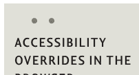

较新的浏览器允许访问者覆盖网页上的 `CSS` 设置，让每位访问者都能如何渲染网站的无障碍性做出自己的决定。尽管如此，在使用 `CSS` 时仍必须小心，因为旧版浏览器并不总是支持：

- 确保在脚本、`applet`（小型程序，通常用 Java 编程语言编写）或程序对象关闭时，页面仍然可用。如果可以这样做，请在备用页面上提供等效信息。

- 谨慎创建 Adobe Flash 页面。虽然更多版本的 Flash 可以比之前的版本渲染更具无性的页面，但某些无障碍支持仍然不完全。访问者无法像在基于 `HTML` 的页面那样覆盖视觉设置。如果您制作了纯 Flash 网站，应该提供一个指向文本替代方案的链接。

- 在 `<html>` 标签中明确标识页面语言，如下所示：

```html
<html lang="en">
```

- 如果在尽力之后仍无法创建无障碍页面，请提供一个替代页面链接，该页面使用 W3C 技术、无障碍访问、具有等效信息和功能，并与原始（不可访问的）页面同步更新。

## 无障碍资源

欲获取更多无障碍信息，请参考以下任何内容：


# 字体说明

《美国残疾人法》（ADA）的美国政府官方网站：`www.usdoj.gov/crt/adahome.html` 以及 `section508.gov`。

- 《Access by Design: A Guide to Universal Usability for Web Designers》，Sarah Horton 著。Berkeley, California: New Riders, 2006。极佳的参考书籍。
- AI 的 Web 无障碍工具栏：`with.visionaustralia.org/info.aspx?page=614`。
- 一个针对 Internet Explorer 的极具价值插件，包含了检查各种无障碍问题的工具。它包含了以不同分辨率和灰度查看页面的命令，这两者对于通用设计都很有用。
- JAWS 屏幕阅读器：`with.freedomscientific.com/fs_products/software_jaws.asp`
- IBM Home Page Reader：`http://www-03.ibm.com/able/solution_offerings/hprtial.html`

## 无障碍验证器和更多信息

- `validator.w3.org`
- `http://wave.web/`
- `vischeck.com`
- `http://diveaccessibility.com`
- `www.usablenet.com`

# 总结

此清单有两个功能：总结本章介绍的主要观点，并帮助确保在完成创建的任何网站之前完成了所有应该做的工作。

## 可用性——你是否：

- 考虑到浏览器的不一致性，并针对目标浏览器进行了测试？
- 尝试使用 HTML 进行结构识别，使用 CSS 进行视觉格式化？
- 考虑了自证性、反馈和准确性等可用性指南？
- 旨在满足让网站功能性的可用性因素，并创建一个令人记忆深刻的网站？

## 视觉设计——你是否：

- 创建了一个具有审美吸引力、独特且能引起共鸣的网站？
- 确保网站具有支持产品或组织的一贯视觉身份？
- 考虑过使用组织隐喻？
- 在适当的情况下进行了简化？
- 在使用额外功能时保持克制？
- 分析了竞争网站？

## 无障碍性——你是否：

- 尽可能为残障人士提供相同的内容，或者在无法做到时提供不同格式的等效内容？
- 考虑了视觉、听力及身体障碍？
- 设计网站以适应自适应技术（如屏幕阅读器）？
- 在使用方法上提供了选择和适应性？
- 对于携带信息内容的图像、动画、音频或视频提供了替代访问方式？
- 将结构与格式分离？
- 确保在脚本、applet 或其他程序对象关闭时，页面仍然可用？
- 在 `<html>` 标签中明确标识了页面语言？
- 如果在尽力之后仍无法创建无障碍页面，是否提供了指向无障碍替代页面的链接？

# 设计清单

## 第二章：站点分析

匿名：

> “时间永远不够够把事情做好，但似乎总有时间重做一遍。”

有一个关于飞机飞行员的古老笑话，他通过广播向乘客保证：“我有一个好消息，和一个坏消息。好消息是，我们进展得非常快。坏消息是，我们迷路了。”这听起来很愚蠢，是的，但当应用于软件设计时，这种场景其实很有关联，因为离现实并不远。我们可以从这个轶事中得出的结论是：在前期投入精力准确确定我们要去哪里，可以避免浪费时间去构建错误的系统——即一个无法满足访问者需求的系统。早期投入资金精确决定从第一次就构建正确的内容，是物有所值的支出。

## 现代网页的视觉设计

因此，分析是在开始构建任何内容之前确定确切需要什么的过程。本质上，我们必须在构建之前思考，因为如果我们先没有看到目标，就无法击中它。在执行任何操作之前，我们会向所有利益相关者——经理、项目技术人员和潜在站点访问者——提出大量问题。

在第一章中，我们查看了系统生命周期以及分析如何融入其中，如图 2.1 所示。你可能记得我们讨论过在项目启动时必须对整个站点进行整体分析，但对于每个单独页面，我们都会经历一个微生命周期（包括分析、设计、构建和测试），如图 2.2 所示。因此，分析紧密集成到生命周期的所有其他任务中，而不是作为一个完全独立的过程存在。此外，该过程是迭代的；内容和设计的变化必须贯穿整个生命周期。例如，当我们从用户和潜在访问者那里获得反馈时，经常会回到之前的阶段和页面。无论如何，分析任务必须在某个点完成：项目级的全站点分析以及贯穿整个项目的特定页面分析。

图 2.1 总体系统开发生命周期

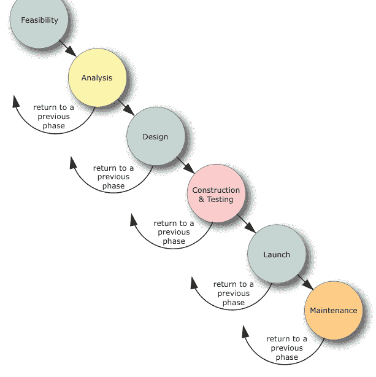

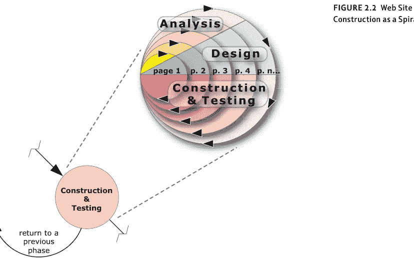

全站点分析包括在单个页面设计或构建之前进入站点的思考和规划。它本质上决定了站点将包含哪些内容，而视觉设计的后期阶段则决定了站点元素如何在视觉上呈现。我们将在全站点分析的六项主要任务中进行：

1. 明确站点目标。
2. 识别目标受众，站点的潜在访问者。
3. 识别访问者目标。
4. 确定站点限制。
5. 确定站点内容。
6. 分析站点架构。

## 明确组织目标

首先，我们需要对组织目标形成一个清晰的认知。它的使命是什么？目标是什么？例如，站点是为了产生潜在客户？提供？告知？直接销售？

一旦定义了目标，我们必须识别其中哪些是强制性的，哪些是可选的。例如，亚马逊可能选择增加品牌知名度，而 Target 可能选择直接销售产品。我们还必须确定站点的范围——是一个小型介绍网站还是一个巨大的电子商务平台？无论如何，我们都面临范围蔓延的风险：随着项目的进行添加越来越多的功能。我们站点的视觉设计可以在很大程度上说服访问者我们是可靠的（将交付满意的产品或服务）并且值得信赖（不会不恰当使用信用卡或个人信息）。

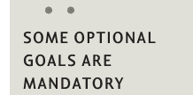

### 增加利润

大多数网站通过销售商品属于这一类，亚马逊和 eBay 也是。网站还可以通过销售产品以外的方式增加利润，例如提高品牌知名度或降低与客户电话相关的成本。无论如何，我们设计站点是为了说服访问者打开钱包。

### 传播信息

某些站点首要不是销售站点，而是为了告知、教育、说服或娱乐。例如，公司站点可能会发布关于软件开发行业最佳实践的“白皮书”，作为对行业做出贡献并提高组织地位的一种。像 CNN 这样的新闻机构可能会发布最新的更新和评论性文章。摇滚乐队的网站可能会提供演唱会日程和他们最新 CD 的免费 MP3 示例。

## 作为业务应用程序的用户界面

任何与人通信的计算机系统都需要用户界面（显示所有用户输入并显示系统输出的屏幕）。每当我们访问网站时，我们都在与该站点的用户界面交互，它也称为前端。

传统的计算机业务应用程序（例如用于输入客户费用或跟踪库存）通常使用图形用户界面，或 GUI（发音为 "goo-ee"）。界面构建在实际处理交易的应用程序软件中，并且通常由程序员手动构建。

浏览器用户界面，或 BUI（发音为 "boo-ee"），通过浏览器与用户通信，而后端业务应用程序（业务逻辑在服务器端）使用 Java、C++ 甚至 COBOL 等标准编程语言与底层数据库进行交互。BUI（业务用户界面）的意义在于，通常不通过 Web 交付的业务应用程序仍然可以使用浏览器来提供其用户界面。

在未来，Web 技术最普及的部署可能是在 BUI 中，而不是公共访问的网站，这有充分的理由：

- 浏览器拥有各种内置设施——用于按钮、表单等——这些设施使得在典型的 GUI 环境中编写用户界面变得更容易、更快速。
- 像 HTML 这样的基于浏览器的技术相当容易学习。而用于构建 GUI 的编程语言学习起来未必如此。
- 网站可以像业务本身一样敏捷；它们可以快速、方便地更新。同样，由于 HTML 相对直观，基于 HTML 的界面具有可移植性。如果我们编写得恰当，其页面将在任何操作系统上正常显示，这为我们赢得了竞争优势。
- BUI 不需要在每个用户的 PC 上下载和维护；相反，在 Web 服务器上只需要一个副本即可。

## 确定目标受众

让我们不要忘记最重要的利益相关者：潜在访问者。沟通（无论是通过印刷品、电视还是 Web）都应该是针对目标受众的。确定目标受众的重要性仅次于定义目标。毕竟，如果你不知道受众是谁，就无法满足受众的需求。因此，请问：哪些人最有可能访问该网站？有时这只是常识，而另一些时候则需要大量的调研。

假设我们是一家销售电子产品、电脑和家电的机构。仅仅说我们的受众是想要购买电脑和家电的人是不够的。我们需要更具体。目标受众在收入、年龄、教育和地位方面人口统计特征是什么？他们面临什么问题？什么能吸引他们？除非你对受众有非常清晰的定义，否则你无法设计出一个吸引他们的网站。

以下是定义你目标受众的特征：

- **物理人口统计特征**：性别、年龄范围和健康状况。女性和男性倾向于对网站有不同的偏好。如果你需要同时满足双方，你就需要创建一个同时吸引双方的设计。年龄和健康状况还意味着视力障碍和行动能力。此外，老年人可能不像年轻一代那样伴随着计算机长大的。
- **文化人口统计特征**：经济状况、就业水平、社会群体、国籍和价值观。经济状况和就业可能决定访问者是从高端家用电脑、办公室还是低端电脑访问 Web。教育水平、社会群体、国籍和语言决定了你所使用的写作水平。价值观可以决定从不会冒犯受众的语言到适合销售的产品的方方面。
- **计算机经验**：对技术的了解、使用模式、喜爱的网站和访问频率。计算机经验是决定导航和搜索方法等特征的重要因素。
- **可发现性**：你的访问者是通过搜索引擎、横幅广告、另一个网站上的链接、促销材料还是通过朋友的推荐找到你的网站的？
- **计算机设备概况**：操作系统、系统速度和功率、连接速度。你将根据这些知识做出设计决策。例如，如果大多数访问者都在公司内网内部的高端系统上，那么带宽（连接速度）就不那么需要担心；但如果某些访问者使用的是低速拨号线路，这就会是一个主要需要考虑的问题。
- **访问频率**：频繁还是稀少？特定网站的偶尔访问者需要网站极其易用，因为他们每次访问时都必须重新学习如何使用该网站。
- **访问位置**：从家里、办公室或公共访问地点。例如，一个在家里可能喜欢背景音乐的办公人员，如果他在工作隔间浏览 Web 时，你的网站大声播放“噪音”，他会感到轻微的恼。毕竟，声音会告诉周围隔间的每个人有人在偷懒。
- **竞争网站**：你的访问者还光顾哪些网站？当你知道是哪些网站时，你就可以评估访问者体验设定的标准。
- **内部或外部**：他们是内部的（例如，使用 BUI 进行后端数据输入）还是外部的（如大多数公共访问网站那样）？在任何情况下，安全问题都很重要。例如，并不是所有员工通常都被允许访问公司内网的每一个页面。另一个网站可能需要从内部和外部访问者处保护信用卡号的安全。
- **设计预期**：访问者期望你的网站看起来什么样？当你进展到网站的视觉设计时，这些信息将至关重要。

在刻画网站的一个或多个目标受众时，越具体越生动越好。创建一个画像（一个想象的人或角色）来象征你预计在网站上看到的每种主要类型的人，并给每个人起一个名字、性格和简短的传记。你甚至可以在画像中加入一张照片，让他或她更令人记忆。当你进行网站设计时，在脑海中唤起这个画像并问自己：“这个人想在网站上看到什么？我如何让这个网站更容易实现目标？”

目标受众和他们的需求必须是我们做的每个决定的焦点。如果我们能够满足访问者的需求，我们就与该访问者建立了长期关系。因此，支持机构目标最佳方式是考虑如何最好地支持访问者的目标。我们如何在建立业务目标（如产品销售）的同时，支持访问者购买东西的目标？这对我们双方意味着什么？当然，我们需要向访问者证明我们的网站是可靠的，并提供了最好的价值、或质量，或最好的服务。然后，我们允许访问者轻松快速地进行购买。任何干扰访问者目标的因素最终对网站目标也是适得其反的，因为访问者将不愿意使用该网站。

## 购买产品的用例

1. 客户浏览在线目录并将所需的商品添加到购物车中。
2. 购物完成后，客户点击“结账”按钮。
3. 客户输入配送信息。
4. 系统显示完整的订单详情，包括运费。
5. 客户输入信用卡数据并点击“提交订单”。
6. 系统验证信用卡。
7. 系统立即确认销售。
8. 系统向客户发送跟进邮件。

### 备选方案：授权失败

6. 系统未能授权信用卡。  
7. 系统允许客户重新输入信用卡信息，最多还有两次。  
8. 如果第三次失败，交易将通过错误消息被终止。

### 备选方案：老客户

4. 系统显示完整的订单详情，包括客户的标准运送选项和信用卡的最后四位数字。  
5. 客户可以接受或拒绝标准运送和信用卡信息。  
6. 客户点击“提交订单”。  
7. 参见主场景中的步骤 6–8。

我们还需要分析访客可能执行每个任务的频率。经常执行的任务应该被优先考虑，并在网站上具有最高的可见性。例如，亚马逊销售的书籍、音乐和电影比园艺工具或珠宝多。因此，书籍、音乐和电影是网站上最可见的导航标签，而园艺工具可能被埋在“其他”标签下。这种菜单可见性有助于访客完成最频繁的任务。

## 设计模式

分析任何任务的方法是观察它如何融入设计模式。设计模式是一种常见的、反复出现的问题，可以使用标准解决方案来解决。这种技术基于一种信念：几乎任何人可能想要做的事情已经存在了。我们可以利用前人的那些“曾经历、已完成”的设计。例如，想想典型的购物车应用程序。很少有网站会做与“识别隐喻”截然不同的事情。当这种情况发生时，通常是一个令人不悦的惊喜。重点在于，我们可以重用自己访问过的网页模式——这些模式已经过证明是可行的。我们不需要为每个网站都重新发明轮子。事实上，这不仅是浪费时间，而且可能导致失败！

设计模式不仅包括一系列访客交互，还可能包括必要页面的建议布局以及设计页面的特定指南。此类模式在网络上随处可见。我们已经提到了购物车，但也考虑以下标准模式：

- 水平、标签式导航
- 垂直菜单导航
- 隐私政策
- “关于我们”页面
- “联系我们”页面
- 快速结账
- 退货说明
- 简单和高级搜索
- 登录界面
- 新模式的创建
- 订单状态验证
- 愿望清单

注意，某些公司实际上对某些软件模式获得了专利，例如亚马逊的“一键购物”设计模式。事实上，发生了多起关于使用此类模式的争议，结果模糊。法律争议在过去几年中似乎平息，但密切复制另一个网站的设计模式仍可能导致专利问题和法律斗争。

> #### 关于模式的更多
>
> 有关网站设计模式的更多信息，请参考 Douglas K. Van Duyne、James A. Landay 和 Jason I. Hong 编写的《网站设计》。

通过识别目标受众的目标，我们可以支持访客的决策和行动，不仅包括理想情况（用户完成了其预定任务），还包括最坏的情况（用户未完成任务或遇到错误）。我们一直在寻找加速整个过程的方法。

## 确定网站限制

网站分析会产生一份限制列表和一份需求列表。特别是必须满足预算和时间进度。例如，一个用于准备报税的网站必须按时完成，以便访客在截止日期前准备好税单。尽管通过使用小型项目团队来限制成本可能是理想的，但这种特定情况的现实是，必须有足够的员工和预算在给定的时间限制内完成项目。

理想情况下，我们在开发网站时努力实现三个目标：

- 最终产品提供的价值应与投入的成本成正比。
- 网站应在合理的时间范围内完成。
- 网站应该是高质量的。

遗憾的是，我们通常只能从这三个目标中选择两个：剩下的那个，无论是哪一个，总是会出错。但也许我们可以廉价且快速地构建网站，但质量会打折扣。另一方面，如果我们愿意增加预算，我们可能快速创建网站并交付高质量内容。简而言之，网站可以是廉价构建的、快速构建的或高质量的，但通常三者不可兼得。

成本效益分析（决定收益是否值得投入相应成本）在识别限制的过程中起着重要作用。很显然，我们希望收益超过成本。然而，当收益低于成本时，这并不自动意味着我们应该放弃项目。也许我们应该首先尝试找出任何并非绝对需要但会大幅增加预算的“镀金”和花哨。然后，还有我们为了在预算和时间内完成项目而可能削减的领域。

需要记住的一点是，我们并不要求一次性交付整个系统。通常可以分阶段推出或发布，让网站的关键区域比低优先级区域更早上线。

除了预算和时间进度，可能还有其他限制，包括法律、运营、技术等。例如：

- 试图吸引投资者的公司网站具有法律限制。
- 由多个部门维护的数据库存在运营限制。
- 我们可能受限于开发团队的技能组。
- 我们的设计可能受限于配色方案。
- 在如今的网络环境中，某些事情在技术上是不可能的。

当然，所有这些因素最好在项目早期确定。

## 确定网站内容

图 2.3 再次显示了内容与网站设计的其他关系。正如第 1 章提到的，内容为王；如果网站没有良好的内容，它将没有访客。或者网站最初会有访客，但由于没有价值，他们就不会回来。

图 2.3 Web 内容


留住访客是一个昂贵的错误。营销法则认为，向新客户销售的成本是老客户的五倍。显然，一旦我们拥有了访客，我们就希望留住她。我们正在努力减少流失，即未转化为客户的访客，或者只转化一次就不再回的人。流失与转化率成反比，转化率是离开网站前购买东西的访客比例。提供精彩的内容可以提高转化率。

## 网络转化率

平均网站转化率仅为 1–2%，而某些网站（如 `Sephora.com`、`Lands End.com` 和 `Drugstore.com`）的转化率可以达到 10–20%。参见《计算机世界》2001 年 2 月 5 日第 50 页，`http://www.computerworld.com/softwetopics/crm/01080/57260.html`。

当然，目的和目标受众驱动；网站上的每一部分内容都应该支持其目的并面向其受众。例如，一个销售有机产品的网站潜在客户当然关心她正在寻找的产品、其物值以及她是否会购买；还取决于公司是否遵循她的有机产品准则。在这种情况下，一份关于公司有机产品政策的任务声明可能有用，而关于公司（当然是有机的）足球球队的胜负报告则没用。

## 创建内容

网站设计师通常不需要为网站提供内容。如果网站是数据驱动的——例如亚马逊及其产品数据库——数据库中的记录构成了大部分内容。如果网站是信息性的，主题由专家（SMEs）最有可能提供内容，就像医生为 WebMD.com 这样的网站提供内容一样。如果网站主要用于营销，那么组织的广告人员会生成大部分文案。


尽管如此，有时你作为设计师，可能会被要求建议内容、自己撰写内容，或者对给定的内容进行评论和编辑。请记住以下几点：

- 采用的写作风格应与网站的语调匹配，无论是正式、时尚、幽默还是生硬。你不会在迪士尼网站上使用正式的学术写作风格，就像你不会在一个发布大学教授最新研究的网站上使用随意的闲聊风格一样。
- 仔细检查所有内容的语法和拼写是否正确。如果可能，请聘请专业的文编辑完成这项任务。如果不可能，请聘用两个编辑：
  - 大声朗读内容。朗读会迫使你观察每一个单词，我们许多人在静默阅读时并不会做到这一点。此外，你的耳朵可以发现眼睛忽略的语法问题。
  - 反过来读内容，这会迫使你检查每个单词的拼写是否正确。
- 考虑使用一个描述性的、少于一句话的标签，简要地总结你网站的功能。如果你的组织知名度不高，这对你的访问者来说将非常有启发性。下面示例中的标语使用了斜体：
  - *深入探索无障碍访问：30天打造一个更具无障碍性的网站*
  - IMDb：地球最大的电影数据库™
  - Dr. Dobbs：为专业级程序员提供的软件工具
- 未经版权所有者书面许可，你不得使用其他来源的任何内容（文本、图像、多媒体），否则你将面临法律处罚的风险。只要注明出处，许多所有者都乐意授予许可。
- 追求清晰、简洁、有力的写作风格。有力的写作使用更少、具描述性且能引起情感的词。对比以下两个句子：
  - “她走在街上。”
  - “那位女士在阴暗的小巷里拖行着通过。”
  
  第一句平淡无奇，而第二句由于其色彩丰富且具体的语言，营造了一个令人难忘的画面。只要不变得太古怪，有力的写作就能吸引访问者。

## 技巧（TACT）

> 有时，编辑我们接收的内容呈现出必须谨慎处理的情况：“如果公民是糟糕的作者，客户就是糟糕的编辑。”——摘自 Jeffrey Zeldman 的《Your Talent to the Web》。

## 有力写作（VIGOROUS WRITING）

> 有力的写作是简洁的。一个句子不应包含不必要的单词，一个段落不应有不必要的文章，因为画不应该有不必要的线条，机器也不应该有不必要的零件。”——摘自《写作风格的要素》。

## 创建高粘性网站

我们可以做什么创建一个高粘性的网站，一个能让访问者长时间浏览并反复返回的网站？当然，核心内容的质量与网站的粘性有很大关系。通常，内容应该强调我们的网站提供了对用户有价值的内容，以及我们的服务与主要竞争对手何不同。例如：

- 不要谈论公司有多么伟大——现在就给访问者价值。
- 定期更新内容，确保访问者知道何时会更新。
- 提供优惠券或举办特别活动，最好按定期计划进行，以便访问者经常回来。
- 举办比赛。但要小心，因为比赛的可以和不能做什么涉及法律影响。
- 提供增值内容，即超出网站原始目的的内容。
- Williams-Sonoma（`www.willsonoma.com`）建议使用网站上销售的厨具和特色食品的食谱。
- 在`www.photo.net`，摄影爱好者可以把自己的照片贡献给画廊，并请求其他访问者的评价。鼓励访问者为网站做贡献被称为“建立社区”。亚马逊（`www.amazon.com`）的访问者提交评论是另一个例子。
- Rand-McNally（`www.randmc.com`）不仅提供地图（其核心内容），还可以建议特定位置餐厅和酒店的菜单。
- 就像你高中语文老师反复强调的那样，要根据实际情况回答“谁”、“什么”、“何时”、“何地”、“为什么”和“如何”。
- 小心幽默；极度的聪明在笑话的后续重复中可能会变得非常令人厌烦。想想那些我们只在第一次观看时有趣的电视广告；之后，当这些广告再次出现在屏幕上时，我们会找遥控器。
- 避免显示访问计数器。大多数访问者并不信任它们，而且它们已经过时了。
- 不要显式地欢迎访问者进入网站，例如，“欢迎来到比的自行车店”。这种欢迎是没有必要的，是浪费了宝贵的浏览器空间。唯一的例外是你预期的会有来自东方的大量观众，在这种情况下，欢迎信息是良好的礼貌。

## 第二章 网站分析 53

- 如果你预计访问者在查看之前打印内容，考虑将较长的内容格式化为 Adobe 便文档格式（`PDF`）。
- 如果内容创建是相关的，请明确指示日期。例如，新闻文章应该显示日期。
- 当新内容替换旧内容时，你可能希望存档（在网站显著位置显示），如果你认为有人对此仍然感兴趣。存档的优点是避免了链接失效（link rot）。
- 在适当的情况下，包含关键人物的照片和简介。例如，一家医疗诊所应该很好展示医生的照片。毕竟，潜在患者可能希望看到病人的照片。在这种情况下，个性化胜过匿名化。

总之，你应该问自己为什么人们会返回网站第二次、第三次，甚至更好，第九次。如果你无法为问题提供良好的答案，你需要对内容进行头脑风暴。

## 第二章 站点分析 55

网站架构中一个讽刺的现实是：网站导航对访问者看起来越简单、越直观、越优雅，其构建过程可能就越混乱、越复杂、越不直观且越困难。本质上，我们作为设计师的目的是吸收复杂性并将其转化为所谓的……让访问者看不见或感受不到。我们投入了大量的精力、技能、对人类需求的理解以及（不要忘记）常识，将复杂性转化为表面的简单，这一切为了将服务交付给访问者。对用户来说导航越直观，我们可能花费的精力就越多。

让我们开始整个过程，首先看看我们如何对网站上的内容进行标记和逻辑分类，就像图书馆按主题对书籍进行分类一样。

## 标记（Labeling）

自从人类发明语言以来，他们一直将标记作为一种组织和理解世界的方式。这是我们本能就会做。尽管如此，我们并不总是能很好。我们在标签上投入的思考越多，考虑访问者如何解读这些标签越多，网站对访问者来说导航就越直观。

网站的标记不仅包括显而易见的导航标签（如菜单上的链接），还包括页面标题、头部以及用于搜索和浏览的关键词。所有标签都是网站架构的组成部分，它们都能帮助用户找到他或她正在寻找的内容。将网页标记类比为书籍书籍索引和目录。

构成标签的词往往具有歧义性，而网页标签对简洁性的要求进一步加剧了这种歧义。在对话中，我们通过手势、面部表情或语气来补充语言；我们通过解读对方的面部表情来判断理解程度；或者我们的对话伙伴要求我们澄清意思。这些正常的对话互动在网页访问者身上是无法实现的。因此，如果网站标签要真正有用，它们必须比我们的日常口语更清晰、更少歧义。

设计标签是一个进行内容清单并对我们能想象的每一个可能的标签进行脑暴的过程。为了列出初始列表，我们可以：

- 从网站内容中提取有意义的标签，特别是从标题和子标题中。
- 浏览竞争对手网站获取灵感。

## 现代网页的视觉设计

- 咨询某些行业幸运拥有的在线同义词典。在这里，可能作为良好标签的行业特定术语被进行了整合、定义和交叉引用。例如，计算机行业有许多在线同义词典，医学、教育和科学等其他内容也有同义词典。
- 检查服务器日志，查看访问者使用了哪些搜索词来查找当前网站的内容（如果存在）。

在对标签进行脑暴时，考虑同义词、缩写、首字母词、替代拼写（是的，甚至是拼写错误）以及关联词汇。“胡椒”（pepper）一词的关联词示例可能是“盐”。提供额外相关信息或扩大销售的机会。例如，航空公司预订网站可能会在确认访问者机票订单的页面上显示酒店和租车，或者女装网站可能会在访问者购买红色连衣裙时建议一双红鞋。

## 首选标签（Preferred Labels）

| 俏皮话与引言 |
| --- |
| “一个好的标签要么显而易见，要么像泥土一样无味。”*摘自 Christina Wodtke 著的《信息架构：网页蓝图》。* |

下一步是专注于该列表，以确定最简洁、精确、具有描述性且对（我们的访问者而言）最熟悉的术语，将其作为我们的*首选*标签。屏幕空间和访问者的“认知空间”都极其宝贵，不能浪费在模糊或不必要的词上。通过选择一个显而易见的词作为标签并在整个网站中一致使用，我们实际上构建了一个受控词表。

首选标签理想情况下是一个单词，尽管有时短语是不可避免的。首选标签应该是能够引起观众共鸣的触发词，而不是他们需要去识别的东西。例如，为经验丰富的园艺师设计的网站可以使用“一年生”（annuals）、“多年生”（perennials）和“两年生”（bienennials）等标签而无需解释。然而，如果该网站是面向新手的，这些标签就需要解释。

如果你面对的是混合观众，不要在同一语境中使用技术性和非技术性术语。例如，不要同时使用“一年生”和“每年返回的植物”（对经验园艺师来说，那是“多年生”）。如果你的导航系统必须兼顾新手和专家，那么最好为每种受众提供独立的分类菜单。或者，使用技术术语，但在术语旁边显示非技术描述以进行详细说明。

小心那些过于聪明的标签。虽然它们具有幽默和吸引人的潜力，并能为网站增加吸引力，但聪明可能会破坏导航。例如，如果汽车经销商的链接命名为“轮子”（Wheels），它是指它的汽车库存（因为“wheels”是汽车的俚语），还是指可以为任何汽车订购的特殊轮子？如果访问者必须停顿片刻才能理解导航，或者在第一次看到时有一丝猜测的可能，那么标记系统就失败了。在“聪明”和“清晰”之间，你应该始终选择“清晰”。

在确定首选标签后，用潜在的访问者进行测试；告诉他们仅通过阅读标签就认为这些标签是什么意思。访问者认为的标签意思与你的意图之间应该有强烈的共识。如果没有，则需要修复这种脱节。

大多数网站访问者不愿意深入阅读。相反，他们扫描标签——标题标签、子标题标签——来寻找他们感兴趣的内容。如果我们想吸引用户，我们需要清晰且相关的标签。

## 第二章 站点分析 57

## 主题分类（Categorizing Topics）

广义的信息架构关注将标签分组并组织成类别。分类是创建逻辑且直观导航系统的第一步，在于发现我们数据之间的模式和关系。

选择合适的类别在某种程度上是常识。然而，类别并不总是显而易见的。有些类别太大，必须拆分。这种分类既是科学也是艺术。

许多设计师发现，将所有可能的标签放在索引卡上，然后进行卡片分类练习以按类别分组非常有帮助。甚至可以让两个或多个设计师独立地进行分类，以比较他们分组方式的相似之处。

可能的分类类型及其示例见表 2.1。

### 表 2.1 分类分组

| 这类业务： | 使用这种分类系统 | 可能按以下分组： |
| --- | --- | --- |
| 新闻门户 | 主题 | • 国际新闻、本地新闻、体育、天气、娱乐 |
| 电脑零售商 | 产品分组 | • 台式电脑、笔记本电脑、配件 |
| 公司 | 用户 | • 客户、投资者、员工 |
| 工具零售商 | 任务 | • 订购工具、订购零件、获取技术规格、联系我们 |
| 公司 | 部门 | • 销售部、市场部、制造、人力资源 |
| 公司内部电话录 | 字母顺序（仅当用户知道确切名称时有效） | • 员工姓名、部门 |
| 业务大部分在意大利的网站 | 重要性或频率 | • 意大利、英国、爱尔兰、苏格兰、美国 |
| 报纸文章存档 | 时间（正序或逆序） | • 2008、2007、2006、2005 |
| 国际公司 | 地点 | • 法国、英国、爱尔兰、苏格兰、西班牙 |
| 酒店（以门厅大堂照片开始） | 隐喻 | • 预订台（酒店预订）、餐厅入口（餐厅预订）、服务台（其他景点） |

## 第二章 站点分析 59

分类可以为我们的内容提供背景信息。假设我们看到一个标记为“火车”的菜单。如果该项目位于菜单的“车辆”分类下，我们可以安全地假设这些火车有几吨重而且速度非常快。如果它在“玩具”分类下，那么它就会很小、廉价、易于处理，并且受儿童喜爱。如果它在“爱好与模型”分类下，它仍然很小，但现在很可能是易碎的、昂贵的，并且吸引模型铁路爱好者的关注。在不知道“火车”链接的背景的情况下，访问者可能会被严重误导。这种分类的重叠是它们难以开发且往往带有模棱两可的原因。

接下来我们来看一个分类的反面教材。一家大型零售摄影网站将其产品分为“业余”和“专业”。但是，那么对于那些完全愿意花巨资购买专业设备的“业余”人士来说呢？该访问者会忍受浏览整个业余系列，才发现那里提供的设备性能不够强大吗？也许按价格点对产品进行分组会更好，例如“1000美元以下”和“1000美元以上”。大多数人（无论是业余还是专业人士）在寻找产品之前对自己愿意花多少钱心里有数。因此，按价格分类更有可能为买家匹配合适的产品。上述摄影网站的问题在于，设计者是根据他们看待分类的方式来选择分类的，而不是根据访问者看待分类的方式。

在选定分类及其相关标签后，我们可以开始将站点组织成分层站点计划，将主要分类放在顶部，子分类放在下方，子子分类和标签放在底部。我们设计的本质上是站点的多级目录。例如，一个销售电脑的站点可能有以下分类和标签：

- 台式机
  - 1000美元以下
  - 1000美元以上
- 笔记本电脑
  - 1000美元以下
  - 1000美元以上
- 附件
  - 打印机
  - 扫描仪
  - 网络

## 60 现代网页的视觉设计

第三章将探讨如何在此初步结构的基础上进行构建，以创建一个直观的导航系统。

### 为开发者组织站点结构

你从开发者的角度对站点结构的规划投入得越多，以后重新组织结构可能性就越小。“事后”对目录和文件名进行重新组织不仅耗时，还会增加链接断裂的风险。如果访问者在重新组织期间书签了你站点的页面，或者外部网站链接了你的页面，那么这些被书签和链接的页面在重新组织后将无法找到（所谓的死链）。从搜索引擎到你站点的链接也将失效，直到搜索引擎发现这些更改为止。

创建结构涉及在服务器上组织文件和目录，为目录和文件建立标准的命名规范，并使用相对路径而非绝对路径地址。

### 常用格言与名言

熟练程序员的准则，可能基于通过艰辛获得的经验：“你越早开始编写代码，项目耗时就越长。先花时间进行规划。”

### 在服务器上组织文件和目录

一旦站点超过几页，将所有文件都挤在一个单一目录（也称为文件夹）中就会变得不可管理。相反，应该创建一个遵循你精心设计的站点架构分级结构的目录结构。就像你有一个首页以及下方的几个主页面页一样，你也可以创建一个根目录，并为每个主页面创建一个子目录。对于较大的站点，你可能需要在主页面下创建子目录，就像你在主页面下有子页一样。为贯穿整个站点的元素提供层级 CSS、JavaScript 和图像目录已成为标准做法。此外，每个主子目录可能为那些仅该区域特有的元素拥有自己的子目录，如侧边栏示例所示。

#### 电脑站示例目录结构

| 根目录（包含`index.html`） |
| --- |
| `images` |
| `webImages`（包含所有通用的网页图像） |
| `originalImages`（包含所有通用的原始图像） |
| `css`（包含所有通用的 CSS 文件） |
| `javascript`（包含所有通用的 JavaScript 文件） |
| `beta`（用于实施前的测试文件） |
| `desktopSystems`（包含`desktop.html`） |
| - `webImages`（针对台式机的网页图像） |
| - `originalImages`（针对台式机的原始图像） |
| - `css`（针对台式机的 CSS） |
| - `javascript`（针对台式机的 JavaScript） |
| `laptopSystems`（包含`laptop.html`） |
| - `webImages`（针对笔记本电脑的网页图像） |
| - `originalImages`（针对笔记本电脑的原始图像） |
| - `css`（针对笔记本电脑的 CSS） |
| - `javascript`（针对笔记本电脑的 JavaScript） |
| `accessories`（包含`accessories.html`） |
| - 等等 |

开发者有许多工具可以管理站点结构。每种工具都是 Adobe Dreamweaver 中的站点映射功能。图 2.5 展示了 Dreamweaver 如何组织站点文件分级、不同文档之间如何链接，以及哪些链接是损坏的。

另一个实用的工具是链接检查器（Link Checker），它可以检查全站的断链，如图 2.6 所示。

如果你在 Dreamweaver 内重命名或移动文件，它会提示更新所有引用该文件的全站链接。

相反，绝对路径意味着通过完整的 URL 独立访问每个页面。上述图像的绝对地址可能是`http://www.whatever.com/root/someSubCategory/images/gif/myButton.gif`。

绝对路径的问题在于，如果你移动了网站（无论是从本地机器到 Web 服务器，还是移动到完全全新的 Web 服务器），所有的链接都会失效，需要更新每个绝对地址以指向新位置，这通常是一项耗时且容易出错的任务。另一方面，只要网站的目录和链接结构不变，相对路径无论网站位于何处都能完美运行。

尽管对于指向站外页面的链接你别无选择使用绝对路径，但请确保对网站内部的所有链接都使用相对路径。

## 总结

网站分析是在你选择配色方案或编写单行 HTML 代码之前，对网站进行的思考和规划。在分析上花费时间和精力意味着我们可以从第一次就开始设计并构建出正确的网站。我们的任务是识别网站目标、目标受众及其目标，以及时间和预算限制。所有这些因素都决定了我们在网站上呈现的内容以及组织网站架构的方式。

## 设计检查清单

以下清单具有两个功能：总结本章介绍的主要要点和“规则”，并帮助确保你在完成任何正在创建的网站之前完成了所有应该做的工作。

### 整体网站分析——你是否：

- 在开始构建任何内容之前，进行了分析以确定切切什么？
- 确定了主要和次要网站目标？
- 识别了主要和次要目标受众？
- 识别了目标受众想要执行的任务？
- 识别了任务和预算限制？

> **自助（DOIT-YOURSELF）清单**
>
> 如需要用于详细说明整体网站分析结果的“填空”文档，请访问网站。

### 内容分析——你是否：

- 确保网站上的每一条内容都支持网站目标？
- 是否提供了访问者选择你的产品和服务而非其他网站所需的所有信息？
- 是否区分了不同的产品或服务，从而有助于访问者的决策过程？
- 是否通过包含一个描述性的、不超过一句话的标语，尽快向客户展示网站的价值？
- 是否仅在非常谨慎的情况下加入幽默？
- 是否根据情况包含了“谁、什么、何时、何地、为什么和如何”？
- 是否避免使用访客计数器？
- 是否避免欢迎访客进入你的网站？
- 是否仅在预计访问者在查看之前打印内容时才使用 Adobe PDF 文件？
- 是否在时效性内容上明确标出日期？
- 是否考虑归档而非删除旧内容？
- 在适当的情况下是否包含了照片和简介？

### 网站架构分析——你是否：


- 根据访问者查看信息的方式，为网站设计了强大且逻辑性的分类、标签和底层结构？

- 是否从内容、竞争对手网站和在线同义词表中提取了有意义的标签，并/或检查了服务器日志？

- 是否考虑了替代标签，包括同义词、缩写、简称、替代拼写错误以及相关术语？

- 是否确定了首选标签？

- 是否小心过于复杂的标签？

- 是否与用户测试标签？

- 是否将拒绝的标签保存，以便以后作为搜索功能、网站索引和 HTML `<meta>` 标签关键词的同义词？

- 是否为服务器上的目录和文件设计了逻辑结构？

- 是否根据功能而非视觉特征标准化了文件命名规范？

- 是否使用相对路径引用网站内部的文件？

## 导航

`JAKOB NIELSEN, WWW.USEIT.COM/ALERTBOX/991003.HTML`:

尼可布 Web 用户体验法则：“用户大部分时间都花在其他网站上，因此他们在那里形成了对 Web 运作方式的预期。”

如果没有人弄清楚如何访问该架构中的页面，那么最好的网站架构也是毫无意义的。网络冲浪者是不耐心的——他们想要轻松地获取优质内容。他们很少花时间去琢磨笨拙的导航；让 Google 建议另一个网站要容易得多。因此，导航必须帮助访问者轻松找到他们想要的东西。如果作为顺带收益，你也可以让他们轻松接触到你想要展示的内容。

## Web 视觉设计

## 金句与引录

“导航就是信息”——出自《信息架构》，`Christopher Designke`。

## 导航导言

引言应该做到以下几：

- 确保网站上的每一条内容都支持网站目标？

- 提供了访问者选择你的产品和服务而非其他网站所需的所有信息？

- 区分了不同的产品或服务，从而有助于访问者的决策过程？

- 是否通过包含一个描述性的、不超过一句话的标语，尽快向客户展示网站的价值？

- 是否仅在非常谨慎的情况下加入幽默？

- 是否根据情况包含了“谁、什么、何时、何地、为什么和如何”？

- 是否避免使用访客计数器？

- 是否避免欢迎访客进入你的网站？

- 是否仅在预计访问者在查看之前打印内容时才使用 Adobe PDF 文件？

- 是否在时效性内容上明确标出日期？

- 是否考虑归档而非删除旧内容？

- 在适当的情况下包含了照片和简介？

- 根据访问者查看信息的方式，为网站设计了强大且逻辑性的分类、标签和底层结构？

- 是否从内容、竞争对手网站和在线同义词表中提取了有意义的标签，并/或检查了服务器日志？

- 是否考虑了替代标签，包括同义词、缩写、简称、替代拼写错误以及相关术语？

- 是否确定了首选标签？

- 是否小心过于复杂的标签？

- 是否与用户测试标签？

- 是否将拒绝的标签保存，以便以后作为搜索功能、网站索引和 HTML `<meta>` 标签关键词的同义词？

- 是否为服务器上的目录和文件设计了逻辑结构？

- 是否根据功能而非视觉特征标准化了文件命名规范？

- 是否使用相对路径引用网站内部的文件？

- 使用“你在此处”标记引导访问者。

- 提供多种访问信息的方式。

- 考虑到不同技能水平的访问者。

- 确保导航是灵活且可扩展的

## 导航原则

我们将研究几个支撑设计导航时每个决策的通用原则：

- 创建简单、可见、一致的导航。

- 利用访问者已有的知识。

- 使用“你在此处”标记引导访问者。

- 最小化访问者的努力。

- 提供多种访问信息的方式。

- 考虑到不同技能水平的访问者。

- 确保导航是灵活且可扩展的。

## 利用访问者已有的知识

如果我们出意地将美国所有的停止牌改为蓝色三角形，最可能的结果将是数不万计的严重碰撞。如果我们而是改用红色的圆形标志，结果可能不会那么灾难——驾驶员们会利用他们对红色八边形的认知，并可能推出极其相似的圆形具有类似的含义。这个故事试图传达的观点是：如果不熟悉的导航元素与经过验证的标准具有某些共同特征，那么我们更有可能让它们变得易懂。

记住，任何新标准的显而易见的优势在于，用户越愿意接受重新培训。例如，如果一个全新的计算机键盘布局最终能提高 10% 的打字速度，你会愿意学习一套完全新的布局吗？不会吧？如果它能让你的速度翻倍呢？或者四倍呢？是的，在我们任何一个人有动力投入时间和精力去学习新系统之前，它必须提供相当大的益处。对于网页上真正的导航系统来说也是如此。即使你选择更改某些内容，也要利用访问者已经知道并假设的知识。

## 使用“你在此处”标记引导访问者

访问者需要随时知道自己在网站中的位置。想象一下被扔在堪萨斯州的中部，没有任何标志牌告诉你在哪里。访问者从搜索引擎搜索结果页面跳转到较低层级的页面时，可能会感到同样的困惑。他们需要一种位置感——一种知道自己在网站层次结构中什么位置，以及在该层次结构中下一步可以去哪里的感觉。“你在此处”的指示器，如网站标志、页面标题、页面页眉以及指向当前页的禁用菜单链接，都可以提供这种引导。

## 尽量减少访问者的努力

如果你强迫访问者登录或下载特殊的插件才能进入网站，你可能会失去他们。只有在访问者被说服认为某些某些吸引力的个人利益后，他们才会忍受这种辛苦。在此之前，他们会离开网站。

同样重要的是，访问者不想点击无尽页面来到达他们想去的地方。然而，如果点击是明确的、引导他们获取具有高个人价值的信息，或以某种方式让他们确信自己接近目标，这些点击通常是可以忍受的。

“设计糟糕的工作流”侧边栏显示了一个网站，仅需多次点击和加载独立页面就能购买一套配套的床单。

## 设计糟糕的工作流

请注意，下面的每个 `<click>` 都代表一次新的页面加载。（是的，这个过程几年前确实存在于一家大型床用品零售商的网站上。）

- 家装饰 `<click>`

- 床用品 `<click>`

  - 床笠 `<click>`

    - 单人尺寸 `<click>`

      - 绿色 `<输入数量>`

      - 加入购物车 `<click>`

      - `<back>`

  - `<back>`

- 床单 `<click>`

  - 单人尺寸 `<click>`

    - 绿色 `<输入数量>`

    - 加入购物车 `<click>`

    - `<back>`

- `<back>`

- 枕套 `<click>`

  - 单人尺寸 `<click>`

    - 绿色 `<输入数量>`

    - 加入购物车 `<click>`

让我们思考如何重新设计这个过程。假设对客户购买的分析显示，客户通常会购买颜色和尺寸相同的整套床品——这并不是不现实的假设。有时他们会购买额外的物品进行搭配，比如额外一对配套的枕套，而另一些时候会购买单品，可能只有一对枕套。如果我们使用“设计良好的工作流”侧边栏中的导航结构呢？现在，可以同时购买多件物品（包括完整一套）。减少时间、精力和烦恼带来的益处是显而易见的。

## 设计良好的工作流

家装饰 `<click>`

床用品 `<click>`

以下所有内容都在同一个页面上：

- 床品尺寸 `<点击其中一个>`

  - 单人

  - 标准

  - 双人加大

  - 大号

- 颜色 `<点击其中一个>`

  - 红色

  - 绿色

  - 蓝色

产品 `<输入数量>`

- 整套床品 `____`

- 床单 `____`

- 床笠 `____`

- 枕套 `____`

加入购物车 `<click>`

## 提供多种访问信息的途径

我们需要根据不同的思考方式和需要完成的任务，为用户提供多种寻找某物品的方法。多种寻找物品方式的经典例子是图书馆卡片目录，访问者可以通过标题、作者或主题关键词搜索书籍。同样，亚马逊理解 Web 访问者希望使用相同的类别在网络上搜索书籍。亚马逊访问者可以进一步通过新书或旧书、不同格式（精装、平装、有声书）以及读者年龄、语言和出版日期来过滤搜索（参见图 3.1）。她可能会阅读书的几页，跳过评论并查看评论者推荐的书，或者浏览亚马逊认为可能感兴趣的其他书籍。她可能会选择在书列表中搜索，以便以后快速回想。

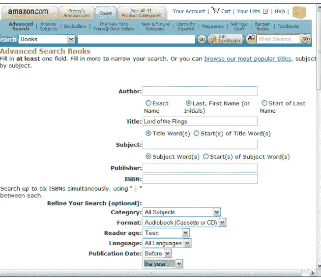

至少填写一个字段。为了缩小搜索范围，请浏览我们的最热门标题，主题。

亚马逊理解访问者确切知道自己在找什么，当他们输入精确的书名（《魔戒王归》）时；而有时他们并不知道，当他们输入通用主题（“奇幻小说”）时。第一种方法基于已知物品搜索。如果所有用户都知道自己在找什么，

## 网页视觉设计

物品搜索的替代方案是：

- 畅销榜

- 纽约时报

- 廉价

- 旧书

注意，尽管亚马逊的网站是分级结构的，但我们也可以允许访问者通过个性化按其喜好导航网站。例如，音乐、体育和娱乐。

图 3.2 浏览 (©Amazon.com, Inc. 或其关联公司。保留所有权利。)

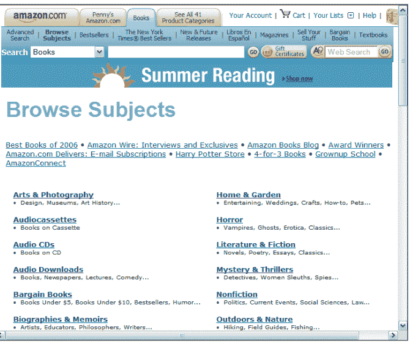

## 为不同技能水平的访问者提供支持

经验丰富的游客甚至可以理解困惑的导航。尽管 Web “新手”如今已很少，但他们可能并不熟悉。好消息是，清晰且优雅的导航确实支持所有人。尽管如此，新来还需要额外的支持，如帮助页面，同时确保此类功能不会阻碍经验访问者。

## 提供反馈

当访问者点击链接后必须等待很长时间时，我们应该提供某种反馈。例如，如果访问者正在下载大文件，我们可能会提供一个小动画，向用户证明下载正在进行。例如，美国航空在网站搜索航班需要几秒钟时间时，会显示一个飞机飞过页面的动画。如果没有这种动画，长时间的等待可能会让访问认为网站死机。用户感知至关重要；有事情在发生的长时间等待通常被认为比同样长时间的不等待要短。

## 确保导航的灵性和可扩展性

网站的灵活适应性对访问者并不重要，但对于我们维护网站的人来说无疑很重要。当我们的行业谈论时间时，指的是网站必须足够敏捷，能够快速适应变化的业务需求而无需过多担心。我们的导航系统必须足够灵活，以适应此类调整。例如，由导航文本组成的菜单很容易更新（添加、修改、删除链接）。另一方面，一个由五个链接旋转组成的精彩 Flash 动画就不是；添加或删除单个链接意味着图形上的所有内容都需要重新排列，并且所有的动画必须跟随。在评估特定的导航方案时，始终考虑未来维护的便利性。

## 必要的导航

至少，每个页面都应该包含以下导航辅助工具以寻路：

- 网站识别（标志、名称等）和页面识别（标题行和页面页眉）。你绝不能依赖首页来引导你的访问者，因为他们并不总是从那个正门进入。搜索引擎或

另一个网站可能会将访问者直接引导到较低级别的页面（称为深度链接），或者访问者可能是通过书签进入某个子页面。您应该在网站的每一个页面上显示网站和页面标识，以确保访问者不会迷失或困惑，受困于某个未识别的低级页面。

- **联系信息**，或指向包含联系信息页面的明显链接。联系信息应不仅包括电子邮件联系方式，还包括电话号码和邮寄地址。尽管我们可能于与访问者进行电子通信，但许多访问者已经不再信任那些拒绝在虚拟实体之外透露物理位置的网站。

- **指向首页的链接**（除非涉及的情况本身就是首页）。虽然网站标识/Logo可以作为指向首页的链接，但还应该有一个显式的“首页”链接。在任何情况下，无论用户位于网站的哪个位置，都应该能够通过点击一下返回首页。

- **指向首页下页面的链接**。这些链接连同指向首页的链接构成了全局导航，因为它们出现在网站的每一个页面。全局导航的作用不仅仅是链接到页面；它还为访问者提供了网站的概念地图和范围。

根据实际情况，某些页面可能包含：

- **局部导航**，用于当前页面下的子部分。导航根据为网站架构确定的分类和标签进行演变。这也被交叉导航，因为它横向链接到兄弟页面，而不是在层级中向上或向下。

- **搜索功能**，对于大型网站来说这显然比小型网站更重要。

- **全站工具**，如“店铺查询”或“结账”。

# 组织导航结构以匹配结构

在本章中，我们根据分类法及其首选标签检查了网站架构。一旦我们确定了这些类别和子类别并为它们分配了标签，网站本身的底层结构对我们来说变得清晰了。现在我们利用导航让这种底层架构对访问者可见。因此，导航就是可视化网站架构。

组织网站导航有三种基本模型：随机访问导航、顺序导航和层次导航。

# 随机访问导航

随机访问方案要求访问者从菜单中随机选择单个不相关的主题。随机访问模型并不是真正的组织——它是一种混乱。如果没有某种可见的结构，访问者很难找到他们想要的内容，反而会变得不知所措并放弃。随机访问或缺乏这种访问在娱乐或体验类网站中是可以接受的，在这些网站中弄清楚导航的挑战被认为是娱乐的一部分，但它很少适用于主流网站。寻找任何东西都太难了，访问者无法建立网站的心理地图。

# 顺序导航

顺序导航方案设计用于一页一页地阅读。例如，一篇跨越多个页面的长文章，在系列中除最后一页以外的所有底部都有“下一个”链接。导航看起来可能如图 3.3 所示。

> 图 3.3 导航 —— 多页情况下的熟悉导航方案。

| 页面 1 | 2 | 3 | 4 |

| :--- | :--- | :--- | :--- |

| <<< 上一个 | 下一个 >>> | |

虽然我们对这种结构很熟悉——毕竟书籍长期以来一直按“下一页”结构组织——但对于整个网站来说很少适用。大多数时候，访问者并不是“从封面到尾”阅读我们的整个网站。因此，顺序导航通常只在网站内的特定页面实现。

# 层次导航

层次导航方案是最普遍的，要求沿着层级向上或向下链接。人类在存在的所有领域中对层次组织都有天然的亲近，无论是对自然界中属和种的分类、描绘我们的家族树、建立企业管理结构，还是组织一个网站。理想情况下，层级是我们直觉理解的结构，使其成为悬挂导航系统的完美框架。

一个描述层次结构网站的文本大纲可能如下所示：

首页

- 桌面电脑

  - $1000 以下

  - $1000 以上

# 现代 Web 的视觉化设计

# 层次化思维与后退按钮

对层次结构的直觉理解可能就是为什么我们经常使用“后退”按钮，而不是从低级页面点击直接的“侧向”链接；我们在脑海中也在回溯层级，这样就不会迷路。这一定是某种归巢本能。

- 笔记本电脑

  - $1000 以下

    - 5 磅以下

    - 5 磅以上

  - $1000 以上

    - 5 磅以下

    - 5 磅以上

- 附件

  - 打印机

  - 扫描仪

  - 网络

Dreamweaver 和其他开发环境可以创建图形层次图（见图 3.4）。在 Dreamweaver 中，你有两种工作流选项：

- 绘制层次图，然后让 Dreamweaver 创建图中所示的骨架 HTML 文档。

- 创建 HTML 页面并要求 Dreamweaver 显示生成的图。

# 图 3.4 来自 Dreamweaver 的层次图

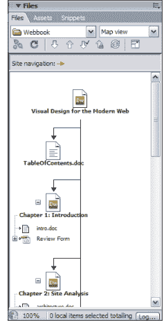

在开发环境之外手动创建图形层次图通常是得不偿的，而且以后添加新页面可能会变成一场重排的噩梦。使用上面所示的文本大纲要简单得多，而且通常同样有效。

层次方案中的菜单系统通常镜像了我们之前确定的网站架构的层次结构。尽管如此，无视结构的链接也可能有价值。例如，访问戴尔网站的低级内容页面可能可以通过点击“笔记本电脑”来定位笔记本电脑，或者可能通过点击“家庭用户”导航到同一个页面。幸运的是，Web 的超文本（可链接）特性允许我们从多个类别内部链接并交叉引用页面，而无需冗余地存储这些文档的多个物理副本。在 Web 上，一个事物确实可以同时出现在两个地方。

# 混合导航模型

许多网站对大部分部分使用层次访问，对某些部分使用顺序甚至随机访问。无论采用何种模型，访问者都应该能够建立网站的心理地图。

# 链接功能

我们可以根据功能对导航系统中的链接分类：

- 内部链接

- 外部链接

- 下载链接

- 自动邮件链接

- 注链接

# 内部链接

标准的内部链接指向我们网站内部的其他 HTML 页面。参见侧边栏关于内部链接的审查。

# HTML ：内部链接

内部文本链接：

```
<a href="info/furtherInformation.html">更多信息...</a>
```

内部图像链接：

```
<a href="images/imageLarge.html" target="bigPicture">

```

内部链接类别包含了操作/命令链接，它们启动或完成某种操作。常见的操作链接包括提交、重置、后退、打印、前往和搜索。此类操作通常由某种图形按钮指示，即使导航系统的其他部分使用的是导航文本。

内部锚点是一种“国内”链接，跳转到页面内的某个深度。如果该位置在当前页面内，页面将定位到该位置但不重新加载。如果位置在另一个页面内，新文档将加载，并使指定的位置位于浏览器窗口顶部。我们在 FAQ 页面中就能看到这种。

# HTML：内部锚点

内部锚点有两个部分：指向目标位置的可点击链接，以及位于目标位置的“书签”锚点。

这是一个指向当前文档内书签的内部锚点：

```
<a href="#destination">
更多信息...
</a>
```

指向新文档内书签的内部锚点是：

```
<a href="path/mypage.html#destination">
更多信息...
</a>
```

这是目标位置“书签”：

```html
<a name="destination" id="destination"></a>
```

提供内部锚点的主要优势是访问者可以跳过他们不感兴趣的内容，从而使他们可能留下来阅读他们感兴趣的内容。内部锚点的一种用法是在长页底部提供一个链接，让访问者快速回到页面顶部。

## 外部链接

外部链接将访问者引导至不属于我们、不受我们控制的站外网站。通过选择性地使用外部链接，只要内容支持我们的目标，我们就可以利用他人产生的内容。

HTML 复习：外部链接

外部链接文本：

```
<a href="http://www.yahoo.com" target="_blank">Yahoo!</a>
```

外部链接图像：

```html
<a href="http://www.yahoo.com" target="_blank">

```

> 注意，我们必须在任何外部地址的开头包含 `"http://"`，否则浏览器会认为我们正在寻找自己网站内的页面。


然而，我们必须对外部链接保持谨慎。我们不希望访问者过度迷恋外部网站，以至于不再回到我们的网站。那么，有什么替代方案呢？

- 完全避免外部链接，这种做法通常会适得其反。
- 使用框架（frames），将你的身份标识和导航持久地显示在一个或多个框架中，并在单独的框架中打开外部页面。遗憾的是，框架的使用具有争议；请参阅本章稍后关于框架的讨论。
- 在新窗口中打开每个外部链接，这样当访问者关闭该窗口时，你的网站会在原始窗口中耐心等待。打开新窗口也是一种有争议的替代方案，尽管它们违反了无障碍规则（参见章节末尾的无障碍讨论）。新且未请求的窗口还会弄乱访问者的屏幕。尽管如此，访问者不想丢失他们所在的位置——对于许多人来说，一个未请求的窗口可能是不迷失的公平代价。
- 在同一个“新窗口”中打开每个外部链接。也就是说，访问者第一次点击外部链接时你打开一个新窗口，但之后所有的外部页面请求都继续重用同一个窗口。这样你就避免了大量窗口弄乱屏幕。为所有外部链接分配相同的目标名称（target）：

```html
<a href="http://www.amazon.com" target="myChosenwindow">
<a href="http://www.yahoo.com" target="myChosenwindow">
```

## 下载链接

下载链接允许访问者下载不是典型网页的文件。例如，访问者可以下载 MP3（音乐）、Docs（Word）、PDF（Adobe 文档格式）、PPT（PowerPoint 演示文），甚至是可执行程序。由于这些文件在下载后将存储在访问者的计算机上，因此为链接定义文件名是有帮助的，这样访问者以后可以在他们的计算机上找到它。此外，如果文件较大，警告用户也是一个好主意。网页上的典型下载链接可能像这样：

`Penny Lane (penny.lane.mp3, 3.2 MB)`

在这里，名称（`penny.lane.mp3`）列在歌曲标题之后，随后是文件大小（3.2 MB），为连接缓慢的访问者提供“你有多耐心？”的警告。下载链接的 HTML 与标准链接相同。

## 自动邮件链接

自动邮件链接格式化一个空白邮件，地址如 `<a>` 标签的 `href` 属性所示（如侧边栏所示）。对于显示给访问者的文本你有两个选择：提供实际地址，或为目标提供文本描述。显示真实的电子邮件地址的优点是容易复制到访问者的联系人录中，或者在自动邮件失效时手动复制到邮件中。相反，基于文本的描述更容易让访问者理解。这两种方案都不是“更好”的；它们取决于你的受众和预期。

> **HTML 复习：自动邮件链接**
>
> 自动邮件链接会在访问者的邮件程序中弹出一个空白邮件。邮件被发送到 `<a>` 标签 `href` 属性中指定的地址。

显示实际地址的自动邮件链接：

```html
<a href="mailto:support@somedomain.com">
support@somedomain.com</a>
```

显示文本描述的自动邮件链接：

```html
<a href="mailto:support@somedomain.com">
发送邮件客户支持</a>
```

显示冲突邮件地址的自动邮件链接（通常由垃圾邮件发送者使用，绝对不建议这样做）：

```html
<a href="mailto:JimBobIWantYourCreditNumber.com">
support@BankOfAmerica.com</a>
```

注意，尽管显示的地址可能与邮件的实际地址不同，但非常建议不要这样做。在如今这个因病毒和个人数据钓鱼导致计算不安全的时代，注意到不一致的访问者将不再信任你的网站。

## 注释链接

引用链接是网页上常见的链接类型，它只是打开一个新页面，通常（尽管并非总是）作为来源链接。相比之下，注释（note）可以被视为 Web 版的脚注、备注或侧边栏；如果这些外围信息会中断其中包含的主体内容流。注释链接通常也用于显示缩略图的大尺寸。因此，注释通常在新窗口中打开，通常是特意设定为特定尺寸并禁用用户控制。在这种情况下，允许访问者的唯一操作是关闭窗口，这将控制权交还给原始窗口。请查看侧边栏获取打开新窗口所需的 JavaScript。

### 使用 JavaScript 打开新窗口

虽然我们可以在 `<a>` 标签中使用 `target="_blank"` 打开新窗口，但无法借此控制窗口的特性，如大小以及是否允许用户控制显示。为此，我们必须使用 JavaScript。在文档的 `<head>` 部分包含以下内容：

```javascript
<script language="javascript">
function openWindow() {
newWindow=window.open("http://www.niu.edu",
  "newWindow",height=600,width=800,status,menubar,toolbar");
newWindow.focus();
}
</script>
```

为了根据需要调整此脚本：

- 将上面的 URL 替换为要在窗口中加载的 URL。
- 将 `"windowName"` 替换为你可能想在 `<a>` 标签中使用的名称。
- 将 `height` 和 `width` 替换为新窗口的像素尺寸。
- 如果你想移除用户控件和浏览器界面，请移除 `status`、`menubar` 和 `toolbar`。这只有在仔细考虑后才会发生。

以下是执行 JavaScript 的 `<a>` 标签代码：

```html
<a href="#" onclick="openWindow()">显示大图</a>
```

注意，某些弹出窗口拦截器、阻止请求窗口的插件可能会阻止新窗口的显示，在使用 `window.open` 时可能会出现问题。请咨询良好的 JavaScript 参考资料。

## 导航示性（Affordances）

我们都学会了识别网页上的链接。引导我们识别链接的特征被称为感知示性（perceived affordances），或简称示性。例如，文本上的下划线示性是一个相当可靠的线索（至少应该是），表明它是链接。如果我们点击带下划线的文本却没有任何反应，我们会感到沮丧。重点是，我们应该只将示性应用于链接。我们将查看文本和图形中特定的导航示性。

无论我们使用什么示性，我们都应该保持一致；例如，链接的大小、颜色和样式在整个网站中应该是一致的。只有当变化附带某种含义时，改变示性通常才是合适的。例如，一个网站对所有“产品”页面使用绿色链接和背景色，对所有“服务”页面使用蓝色链接和背景色。

## 链接状态

链接状态可能包括：

- 可用/静态（Available/at rest）
- 可用/悬停（Available/rollover）
- 激活（Active）
- 已访问（Visited）
- 当前（Current）

我们将在后续章节中概述每种状态。在章节的后部分，我们将具体介绍如何使用示性（affordances）在导航文本和图形链接中指示状态。注意，你并不需要指示所有的链接状态，但页面之间要保持一致，以避免访问者感到困惑。

## 可用/静态状态（Available/At Rest State）

可用/静态链接显示默认状态，即页面初始渲染且鼠标未悬停在链接上时的状态。在大多数浏览器中，文本链接和图像边框的默认颜色为蓝色。这可以通过 `<body>` 标签中的 `link` 属性进行更改，几乎所有的链接属性（颜色、下划线等）都可以使用 CSS 的 `a:link` 伪类进行样式化。

## 可用/悬停状态（Available/Rollover State）

可用/悬停指的是鼠标悬停在链接上的状态。悬停效果无法仅通过 HTML 实现，但 CSS 伪类 `a:hover` 可以指定文本悬停效果，而 JavaScript 可以实现图像悬停（可以想象为图片的切换）。

## 激活状态（Active State）

激活链接是指刚刚被点击的链接。后者的效果在页面加载期间仅会短暂显示，但它能提供有用的反馈，让访问者确认点击操作已被识别。在大多数浏览器中，文本链接和图像边框的默认激活颜色为红色，但通过 `<body>` 标签中的 `active` 属性进行更改，几乎所有的链接属性（颜色、下划线等）都可以使用 CSS 的 `a:active` 伪类进行样式化。

## 已访问链接（Visited Links）

### 已访问状态（Visited State）

已访问链接是指最近被访问过的链接。“最近”的定义因浏览器而异，但通常已访问链接的标记时间比当前浏览器会话更长。事实上，访问者可能在几天后回来，发现已访问链接仍然被标记。

已访问链接是指最近访问过的链接。在大多数浏览器中，导航文本的默认访问颜色为紫色，但可以通过 `<body>` 标签中的 `visited` 属性进行更改，几乎所有的链接属性（颜色、下划线等）都可以使用 CSS 的 `:visited` 伪类进行样式化。

对于想要系统化访问的大型网站（例如特定主题的文章列表），指示链接最为重要。相比之下，对于访问者更有可能反复返回同一个链接的网站，指示链接除了增加视觉混乱外作用不大。

避免为已访问链接使用明显的颜色，因为过多会增加页面的视觉混乱。相反，颜色应该与标准链接有细微的差别。通常标准颜色的低饱和（较亮）版本是合适的，只要文本在背景颜色上仍然清晰可见。

## 当前状态（Current State）

当前链接并不是真正的链接，因为它实际上不应该是可以点击的。也就是说，我们在菜单中保留该项目，但去除了链接示性和圆角 `<a>` 标签，从而禁用链接。我们这样做是为了防止访问者意外点击导致页面重新加载。

那么，为什么不完全从菜单结构中移除链接呢？因为禁用的链接充当当前页面的占位符——一个“在此处”的标记，并确保所有页面上的菜单看起来完全相同。否则，可能会干扰访问者对网站结构的心理模型。

## 导航文本（Navigational Text）

你已经在 Web 上到处看到并使用了这种结构：

**在亚马逊购买此书。**

这是一个链接——有用的词汇可以带你去某处，而无需显示实际 URL。这是其无处不在且简单的 HTML：

```html
<a href="http://amazon.com">Purchase this book at Amazon</a>
```

文本链接是网站导航的支柱。与导航图形相比，这种技术有几个关键优势：

- 文本链接呈现出紧凑、整洁且简单的视觉效果。
- 文本链接下载速度快，而导航图像文件大得多，因此下载速度较慢。将这种下载延迟乘以唯一导航图像的数量，如果还需要悬停效果，再乘以二，延迟自然会变得更加夸张。
- 只需修改全站 CSS，即可轻松在全站实现悬停效果。
- 文本菜单系统上的链接可以方便地添加、删除和修改，而某些导航菜单系统（特别是切片图像和图像映射）更新要困难得多。
- 单个链接很容易更新。只需修改 HTML 文件中的文本，并通过 FTP 上传到服务器。相比之下，将图像作为按钮更新起来要繁琐得多。更新可能涉及：
  - 打开图形程序和图像文件。
  - 进行所需的更改。
  - 导出用于链接的图像。
  - 导出用于悬停的图像。
  - 更新 HTML 文件（如果图像名称或大小发生了变化）。
  - 通过 FTP 将图像传输到服务器。

如果一个网站上有 50 个不同的按钮，每个都有独特的措辞，我们需要为 50 种不同的图像重复这个过程。

由于文本链接相比导航图形具有许多优势，几年前流行的按钮图像现在似乎少见得多。

## 文本链接措辞（Text Link Wording）

选择文本链接措辞时需要的大部分知识，在第 2 章“网站架构”主题中创建标签时讨论过。尽管如此，我们仍应该记住以下提示：

- 简洁、精确且具有描述性。（是的，这已经提到过了，而且这种重复是有意义的。）理想情况下，标签应该只有一个单词，尽管有时短语是不可避免的。

### 现代 Web 的视觉设计（Visual Design for the Modern Web）

- 不要标记为“点击这里”。这是 Web 早期的遗留，“点击这里”对访问者的理解毫无益处，因此仍然需要附带某种描述。相反，只需让链接的描述本身变为“可点击的”：

  不可接受的：点击这里访问 Bob 的自行车店，那里提供廉价赛车。

  可以的：Bob 的自行车提供廉价赛车。

- 如果标签需要进一步阐述，`<a>` 标签的 `title` 属性可以提供在较新浏览器中可见的悬停描述。

## 文本链接的示性（Affordances for Text Links）

几乎所有的用户都能识别示性（affordance），而标准链接颜色是最常见的文本示性。可用性专家经常声称，我们不应该弄乱这些示性，这样做会干扰用户预期的视觉线索。让页面用户友好比让它们色彩协调更重要。

尽管如此，如今的网页浏览者比几天前要成熟得多。他们似乎能识别出几种文本链接示性，包括以下：

**下划线**。今天我们有多种下划线选项。下划线本身可以：

- 始终存在，适用于所有链接状态。
- 在静态链接上可见，但在悬停时消失。
- 在悬停时可见，但在静态链接上消失。
- 完全移除，通过颜色和样式变化等其他示性指示链接。

**样式变化**。链接可以使用粗体、斜体或不同的字体来指示。

**文本或背景颜色变化**。每个人都熟悉蓝色、红色和紫色的默认链接颜色。遗憾的是，这些颜色在深色页面背景上显示效果不好，而且无疑与许多配色方案冲突。例如，标准链接颜色在微妙的棕色和金色大地色调页面上会显得格格不入。

只要你提供至少一种可识别的示性，就不一定提供所有的。但无论你选择哪种文本链接示性，都要避免在非链接元素上使用相同的示性特征。

## 用于指示链接状态颜色的 CSS 伪类

当然，我们可以使用更多属性为 `<body>` 标签指定静态链接、活动链接和已访问链接。通过 CSS 格式，我们可以使用伪类来实现更多功能，更改下划线、边框、背景颜色和悬停效果。侧边栏显示了四个 CSS 链接伪类的示例。

### CSS 复习：链接状态伪类

```css
<style type="text/css">
:link {color:#00ff00; text-decoration:none};
a:visited {color:#00ff00; text-decoration:none};
a:hover {color:#0000ff; text-decoration:underline};
a:active {color:#00ff0ff; text-decoration:underline};
</style>
```

在伪类序列中，后出现的规则始终会覆盖列表中靠前的规则。在这里，`a:active` 覆盖了所有其他项，而 `a:hover` 覆盖了 `a:visited` 和 `a:link`。违反上述规则会导致某些效果失效。例如，将 `a:hover` 移动到列表中的第二个项目，结果是任何已访问过的链接都无法产生悬停效果。另一方面，如果你不希望已访问的链接显示悬停效果，这样做可能是有效的。

如果你不想让所有的链接状态都可见怎么办？也许你希望避免已访问链接出现不同视觉反馈的视觉堆砌。如果你在样式表中省略了 `a:visited`，浏览器默认的访问颜色可能仍然会出现。解决方法是显式地为访问链接指定一种样式，使其与静态链接样式相同。例如：

```css
<style type="text/css">
a:link {color:#00ff00; text-decoration:none};
a:visited {color:#00ff00; text-decoration:none};
a:hover {color:#00cc00; text-decoration:underline};
a:active {color:#00ff00; text-decoration:underline};
</style>
```

无论什么效果，当我们使用任何改变文本大小的效果时（如粗体、斜体或不同的字体大小），都应该保持谨慎。更改尺寸特征可能会强制页面上的任何后续元素发生偏移，这是一种不理想且可能导致混乱的后果。

## 禁用当前链接

正如我们讨论过的，我们应该禁用当前链接，但将其保留在菜单结构中。要禁用链接，只需移除 `<a>` 标签即可。此外，使用某些视觉反馈对其进行样式处理，以明确该文本不再可点击。要做到这一点，用 `<span>` 标签包裹文本（参见侧边栏关于 `<div>` 和 `<span>` 标签的复习），将文本与 CSS 类关联。例如，HTML 可能会如下所示：

```html
<span class="disabledLink">联系我们</span>
```

对所有此类禁用链接进行“灰化”处理并移除下划线的 CSS 样式可能如下：

```css
.disabledLink {color:#999999; text-decoration:none};
```

### HTML 复习：`<div>` 和 `<span>`

| 说明 | 示例 |
| --- | --- |
| `<div>` 和 `<span>` 标签是容器，出于样式考虑，防止内容区域被视为独立元素。例如，以下示例中的第 1 段和第 2 段是红色的。第 3 段恢复为默认文本。 | `<div style="color:#ff0000"><p>段 1</p><p>段 2</p></div><p>段 3</p>` |

`<div>` 标签被视为块级标签；也就是说，当遇到 `<div>` 标签时，会强制换行。`<div>` 标签可以包裹其他块级标签，例如上面示例中的 `<p>` 标签。

`<span>` 标签用于内联内容；即在不希望换行的情况下。例如：

```html
<p>这里有 <span style="color:#ff0000">红色的 </span>字。</p>
```

遗憾的是，在某些情况下，你无法轻松禁用当前链接。如果你使用模板或服务器端包含（将 HTML 复制版复制到页面中）来向每个页面复制完全相同的导航 HTML，那么没有简单的方法可以自动禁用当前链接。幸运的是，有一种 CSS “黑科技”可以通过移除链接特征来伪装活跃（即可点击）的当前链接，正如侧边栏所解释的。

## 让热链接看起来像已禁用

当导航自动复制到页面中时（使用模板或服务器端包含），禁用当前链接是不切实际的。相反，我们伪装当前链接使其看起来像已禁用，这样访问者就不可能点击它。

要实现这一点，首先为所有链接的默认属性定义标准的 CSS 文件，就像你通常所做的那样。接下来，使用 `id` 属性唯一地标识模板菜单（即复制的菜单）中的每个菜单项，如示例菜单所示：


```html
<!-- 复制到每个页面的导航 -->
<a href="homepage.html" id="HomeLink"></a><br/>
<a href="products.html" id="productsLink">产品</a><br/>
<a href="services.html" id="servicesLink">服务</a><br/>
<a href="contact.html" id="contactLink">联系我们</a><br/>
```

现在使用`id`选择器来覆盖每个页面上当前链接的标准链接样式。在每个页面的`<head>`中，创建一个引用当前页面链接`ID`的全局样式。例如，在“产品”页面上包含以下内容：

```css
<style type="text/css">
#productsLink {color:#666666; text-decoration:none};
</style>
```

在“服务”页面上包含此内容：

```css
<style type="text/css">
#servicesLink {color:#666666; text-decoration:none};
</style>
```

位于`<head>`中专门针对的样式将颜色变灰并移除下划线，使链接看起来像已禁用。尽管遗憾的是该链接仍然是可以点击的，但访问者不太可能真正点击它。

# 增强文本链接

文本链接被指责无聊，即使带有样式和悬停效果也是如此。我们可以使用带有自定义符号图像的符号列表、悬停符号、背景按钮图像或模拟按钮的CSS边框来轻松装饰文本链接。

# 使用自定义符号图像的符号列表

菜单是采用符号列表的理想人选，因为菜单不就是一个列表的列表吗？我们可以通过为符号指定自定义图像来增强符号列表菜单，例如图3.5中菜单上的星形。缺点是符号在悬停时不会改变。该菜单的HTML和CSS显示在侧边栏中。

图3.5 作为符号的自定义图像

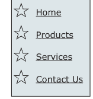

# 用于自定义符号的CSS

```css
<ul style="list-style-image:url(star.gif);">
  <li><a href="home.html">首页</a></li>
  <li><a href="products.html">产品</a></li>
  <li><a href="services.html">服务</a></li>
  <li><a href="contact.html">联系我们</a></li>
</ul>
```

此示例假设文本链接的悬停效果已使用CSS格式化。

# 悬停符号

如上述，在`<ul>`中使用自定义符号的缺点是符号本身无法显示悬停效果。然而，你可以手动格式符号列表，在文本和图像中结合悬停效果，如图3.6所示，其中鼠标悬停在“产品”菜单项上。

图3.6 手动格式符号列表

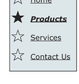

# 用于悬停符号的HTML

要创建悬停符号，将小型图像或图标浮在链接文本左侧。将文本链接和图像封装同一个`<a>`标签中。使用Dreamweaver为图像创建悬停效果（稍后将在导航图像部分介绍该技术），并使用CSS样式文本悬停。结果是鼠标悬停会激活文本和图像的悬停效果。注意，整个导航系统需要两个符号图像——一个静态，一个悬停。HTML见侧边栏。

是用于“产品”菜单项的`<a>`标签：

```html
<a href="products.html"
onmouseout="MM_swapImage('navBullet','images/solidStar.gif',1)"
onmouseover="MM_swapImage('navBullet','images/openStar.gif')

产品
</a>
```

这种技术的另一种变体是使用透明图像作为静态链接的符号占位符，悬停时使用某种箭头，如图3.7再次所示（鼠标悬停在“产品”上）。代码与之前的示例相同；唯一的区别是原始图像是透明占位符，而悬停图像是箭头。

图3.7 使用不同的图像进行悬停

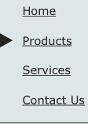

# 背景图片按钮

如果一个文本链接浮动在一个看起来像通用、无文字按钮的背景图片前面，它看起来就像一个按钮。也就是说，该按钮并不是链接的一部分，而只是链接的背景。这种技术的HTML代码在侧边栏中。注意，要让文本精确地对齐到你希望的背景图片上的位置可能会有些棘手。

## 用于背景按钮的HTML和CSS

```
<td width="98" height="27" align="center"
  style="background-image:url(backgroundButton.gif);">
  <a href="http://www.products.mysite.com">Products</a>
</td>
```

# 模拟按钮的CSS边框

另一种模拟按钮的方法是使用CSS 3-D边框样式（参见图3.8和图3.9），使用`border-style: outset`和`border-style: inset`属性。侧边栏说明了CSS。

图3.8 使用border-style:outline CSS的文本悬停效果

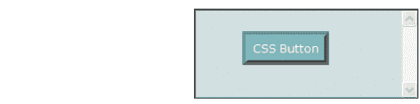

图3.9 使用border-style:inset CSS的文本悬停效果

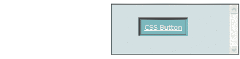

# 模拟按钮的CSS边框

CSS可以模拟矩形悬停按钮。只需在链接样式中包含包含`border-style:outset`（用于普通按钮）和`border-style:inset`（用于按下按钮）：

```
a:link {border-style:outset; border:5px inset; padding:6px;}
a:visited {border-style:outset; border:5px inset; padding:6px;}
a:hover {border-style:inset; border:5px inset; padding:6px;}
a:active {border-style:outset; border:5px inset; padding:6px;}
```

额外的内边距（`padding`）确保文本不会拥挤按钮的边缘。

# 导航图像

正如我们所见，导航图形不仅仅是链接。然而，有时它们只是下载时间比文本链接长得多。它们提供了视觉冲击。有时我们可能会折中，对于大多数通用操作（跳转、搜索、提交、清除、返回、重置）的导航图像使用文本链接，以便这些关键操作在页面上更清晰地突出。

> ALT标签（替代文本）

> 始终使用`alt`属性来重复图像链接的用词，因为为视障人士设计的屏幕阅读器无法读取图像上的文本。

# 在整个站点中用图像

记住，图像在网站上第一次被引用时会下载到访问者的缓存中，然后从缓存中重用。即使图像可能被许多不同的页面引用，下载代价也只需一次。因此，用于“跳转”等操作的通用导航图像可以多次使用，只需下载一次。

# 导航图像上的用词

与导航图像相关的文本必须简洁。虽然一个跨越200像素的文本链接可能是可以的，但如果为了容纳长文本描述而变成那按钮，看起来既笨拙又业余。

# 现代Web的96视觉设计

在第6章中，我们将查看一般的图形，无论你的各种用途如何。在本节中，我们将仅查看特定于导航图像的问题，如按钮、图标、图像映射和切片图像。

# 导航图像的示能（Affordances）

我们立即识别出带有斜角效果和文本标签的圆矩形是一个链接，因为它使用了以下几种示能特征：

- 对称形状，特别是圆形、矩形、椭圆形和圆角（在图3.10中，按“按钮感”的增加程度排列）。

图3.10 导航图形示能

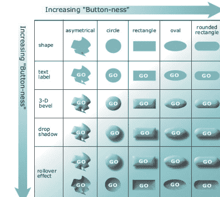

- 看起来具有导航性的标签。

- 3-D斜角，使元素看起来像一个升起或按下的按钮。

- 阴影，进一步增强了按钮的真实感。

- 悬停/鼠标经过效果。

- 显示真实世界对象的图片或图标，例如“打印页面”图标图片。

- 自主性（与非导航内容隔离）以及符号的分组。自主性的一个示例是窗口左侧的一列垂直按钮；簇的隔离意味着该簇是某种菜单。

# 第三章 导航 97

单凭这些特征中的某一个可能无法让一个对象看起来像导航图形。例如，我们可能需要为标题添加阴影，而不会让访问者认为它是导航。通过启动多个示能（如图3.10右下角所示），如果图像不可点击，访问者将会感到惊讶（更不用说上述的）。因此，避免在非导航元素上堆叠示能。

# 图像悬停

悬停/鼠标经过效果是导航图像的预期功能。图像悬停使用JavaScript在鼠标移动到图像上时将原始图像交换为新图像。当鼠标离开该区域时，取消悬停会将原始图像换回。这为用户提供了视觉反馈，表明该图像是可交互的。

## 导航图标

导航图标（小的、样式化的图片）按其本质设计为占用最少空间。某些图标是通用的，如购物车、打印机或问号。其他图标可能具有歧义，需要文本标签才能清晰。当你使用图标时，请确保它们在整个设计中保持一致且易于识别。


## 第三章 导航 99

```html
<area href="grape_info.html" shape="rect" coords="290,156,373,335"
title="Nutritional Data for Grapes"
alt="Nutritional Data for Grapes" />
<area href="lime_info.html" shape="poly"
coords="114,110,144,131,171,156,167,165,194,155,222,138,110,114,110"
title="Nutritional Data for Limes"
alt="Nutritional Data for Limes" />
<map>
```

``标签放置本身，使用`map`属性链接到`<map>`标签。可以将`<map>`想象成覆盖在图像之上的透明塑料覆盖层。在覆盖层上，`<area>`标签标记了每个热点（hotspot）。`<area>`标签同时包含`title`和`alt`属性，用于提供跨浏览器的解释说明。`shape`属性决定热点的形状——圆形（circle）、矩形（rect）或多边形（poly）。`coords`属性识别位于map内的形状定义点：

- 圆形热点由中心点的x,y坐标和半径（三个坐标）定义。

- 矩形热点由其左上角和右下角的x,y坐标（四个坐标）定义。

- 多边形由多边形上每个点的x,y坐标定义（数量不确定的坐标）。

`coords`属性（引号内的内容）不能被任何行格式（如空格或换行符）中断，这就是为什么上面最后一个`<area>`标签的格式看起来很笨拙。

Photoshop、Fireworks和Dreamweaver都支持创建图像映射（image maps）；我们只需点击并拖拽即可在图像上创建形状，程序会自动计算坐标并编写HTML。通常情况下，与使用多个独立图像链接的悬停效果（rollover）相比，图像映射需要更复杂的HTML。因此，只有当您无法使用单独的图像实现所需效果时，才使用图像映射。

## 带热点的切片图像

遗憾的是，图像映射无法为热点提供真正的图形悬停效果。为了在单一图像上实现多个离散的悬停效果，我们将图像拆分为切片（矩形部分），并将它们无缝地重新组合到HTML表格中。然后，每个部分都可以独立地操作，包括为选定的单元格添加悬停效果。

幸运的是，像Photoshop和Fireworks等图像编辑器可以帮助我们切片和重新组合图像。以下是步骤：

1. 在任何支持切片的图形编辑程序中将图像导出为矩形碎片。图3.12显示了一张水果图像，在其中一个水果周围画了一个矩形切片，为将该矩形设为热点做准备。图像编辑软件会将矩形的线段延伸到图像边缘，从而将图像切成单元格。

图3.12 切分图像

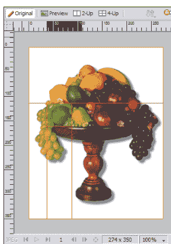

2. 将图像导出到HTML表格，并用图像的所有部分填充表格。在浏览器中渲染时，整体看起来就像单张图像，如图3.13所示。在这里，开启了表格框以便我们看到表格结构，但通常它们是不可见的。图3.14显示了各个切片。此表格的HTML非常复杂，尽管该图像只包含了一个请求的切片（青柠周围）。想象一下，如果它包含与我们在图3.11中看到的图像相同数量的热点，将会有多复杂。

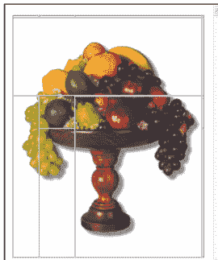

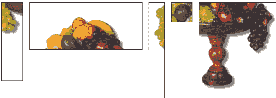

3. 将需要悬停效果的``标签包裹在`<a>`标签中并完成所需的悬停效果，就像处理任何其他图形悬停一样。

## HTML复习：切片图像

这是组装后的完成表格的HTML，包含了自动图像切片：

```html
<table border="0" cellpadding="0" cellspacing="0" width="392">
  <tr>
    <td>
      
    </td>
    <td>
      
    </td>
    <td>
      
    </td>
    <td>
      
    </td>
  </tr>
  <tr>
    <td colspan="3">
      
    </td>
    <td>
      
    </td>
  </tr>
  <tr>
    <td rowspan="2">
      
    </td>
    <td>
      
    </td>
    <td rowspan="2">
      
    </td>
  </tr>
</table>
```

## 102 现代Web视觉设计

## 第三章 导航

## 图3.17 菜单布局

| 首页 | 主菜单1 | 主菜单2 | 主菜单3 |

| 子菜单1 | | | |

| 子菜单2 | | | |

| 子菜单4 | | | |

| 子菜单4 | | | |

| 历史 | 关于我们 | 联系我们 |

| 主菜单1 | | |

| 主菜单2 | | |

| 主菜单3 | | |

A. 主菜单位于顶部，子菜单位于左侧。

B. 主菜单位于左侧，次重要的菜单位于顶部。

| 首页 | 主菜单1 | 主菜单2 | 主菜单3 |

| 子菜单1 | 子菜单2 | 子菜单3 | 子菜单4 |

| 主菜单1 | 主菜单2 | 主菜单3 |

| 子菜单1 | | |

| 子菜单2 | | |

| 子菜单3 | | |

| 子菜单4 | | |

C. 主菜单位于顶部，子菜单在正下方水平排列。

D. 主菜单位于顶部，下拉式子菜单。

## 菜单外观

在网站多个页面上出现的菜单在结构上应该与页面之间是一致的。也就是说，每个页面应该以相同的顺序在页面的相同位置展示相同的链接。菜单项不应移动，即使是一个像素，而且当用户在页面之间移动时，我们永远不应该删除或更改菜单项的顺序。如果菜单中的内容似乎像魔法一样出现、消失或漂浮，会让访问者感到困惑。

菜单应该与页面足够突出，让访问者能够轻松识别，同时又不会分散对内容的注意力。菜单可以通过以下方式指示：

- 将项目包含在边框或不同背景色的区块中。

- 将文本链接置于垂直对齐的列表中。随链接的任何图标或项目符号通常应该垂直对齐，如图3.18左侧的菜单所示。居中对齐且图标位置不一的菜单项看起来很业余，如图3.18右侧所示。


图 3.18 看看垂直对齐带来了多大的区别？

| 桌面版 | 桌面版 |
| --- | --- |
| 笔记本电脑 | 笔记本电脑 |
| 配件 | 配件 |
| 可接受，项目符号左对齐 | 不可用，项目符号未对齐 |

## 菜单尺寸

菜单层级可以是窄而深的，每个菜单上只有几个选择（图 3.19），也可以是宽而浅的，每个菜单上有许多选择（图 3.20）。

图 3.19 窄而深层级结构

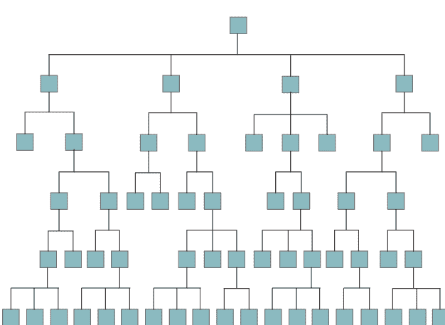

## 第三章 导航 107

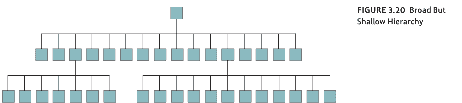

传统的非 Web 用户界面设计师一直试图遵循**七之法则**（The Rule of Seven），该法则规定平均人一次只能记忆或理解七个离散元素（正负二个）。因此，非 Web 界面上的菜单通常表现为窄深层级的小菜单，每个菜单有七个或更少的选择。追踪图 3.19 和图 3.20 中的层级，我们可以看到窄深层级中相对较小的菜单需要更多的用户点击才能到达底部。在真实系统中，所有这些点击刷新对于非 Web 应用来说并不是问题；因为所有页面通常驻留在同一台计算机或远程服务器上，时间延迟是可以忽略不计的。

关于“七之法则”的更多信息，请参阅 George A. Miller 写的《“Magical Number Seven, Plus Minus Two: Limits on Our Capacity for Processing Information》，网址：`http://www.well.com/user/smalin/miller.html`。

然而，Web 是一个不同的环境；如果访问者对过多的点击或页面加载感到烦恼，他们可以选择移动到另一个网站。因此，我们忽略了七之法则，而是创建宽浅的层级结构。我们可以通过对菜单项进行适当的分块（分组或分类）来最大限度地减少任何理解问题。例如，MSN.com 将其主菜单划分为类别，如“新闻与体育”、“查询”、“生活与财务”、“娱乐”等。我们不指访问者理解页面上所有的链接；相反，他们可以快速扫描相关的类别且仅这些类别。较长的（尽管经过分块的）菜单还允许我们在每个链接上使用更精确、不模糊的用词。

通过对菜单分块，我们再次利用了人类直觉理解层级的倾向，这次是为了消除长且无差异的菜单所带来的认知混乱。

> 七之法则
>
> 关于理解是否等同于记忆存在争议。我们一次可以理解远超七项内容，这可能是非常真实的，从而在不需要记忆时将我们从七之法则中解放出来。事实上，僵板地遵循该规则可能会增加人为错误。

## 可扩展菜单

对于较大的网站，可以根据需要考虑使用多级、可扩展的菜单，通常称为下拉菜单、飞出菜单或级联菜单。无论情况如何，子菜单仅在悬停时出现，以节省屏幕空间。多级菜单有两种基本类型：

- 使用 Select 跳转
- 动态 HTML

## 使用 Select 跳转

使用 `<select>` 的下拉菜单看起来像标准的一样，不同在于它使用 JavaScript 来打开。图 3.21 显示了一个 `<select>` 标签。

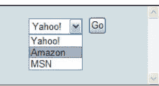

> 图 3.21 使用 Select 跳转

## 动态 HTML

动态 HTML 菜单使用 CSS 来显示和隐藏子菜单。无论情况如何，子菜单仅在悬停时出现，以节省屏幕空间。多级菜单有两种基本类型：

- 使用 Select 跳转
- 动态 HTML

## 钻取页面

钻取页面（也称为点击页面）主要包含菜单，内容很少或没有。像 Yahoo 或 MSN 这样的门户网站就是钻取页示例。门户页面仅作为一个钻取页面是完全可以的；毕竟，这就是它的目的。但我们通常尝试避免在内容类网站中设置不必要的钻取页面，因为它们迫使访问者下载更多页面却无法到达任何内容。

## 第三章 导航 109

## 创建动态

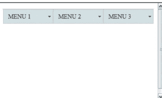

A. Amazon 的首页如果只包含指向其许多类别（书籍、音乐、电影等）的链接和一个搜索框，那将是营销想象力的极度匮乏。这样的首页很难吸引访问者购买比他们来时寻找之外的东西。事实上，Amazon 的首页（**图 3.24**）在提供主菜单和显著搜索功能的同时，还显示了针对访问者的个性化建议。

## 顺序菜单

有时页面是用于按顺序阅读的，例如跨越多个页的长文章。在这种情况下，顺序菜单通常放置在页面底部，如图 3.23 所示：

**图 3.23 顺序菜单**

| 第 1 页 | 2 | 3 | 4 | 5 | 6 | Z | 8 | 9-16 |
| --- | --- | --- | --- | --- | --- | --- | --- | --- |
| <<< 上一页 | 下一页 >>> |

在这里，访问者可以点击禁用当前链接（第 2 页）之外的任何页面。当页面多到无法从单个菜单直接访问时，末尾显示的“9-16”之类的链接可以引导访问者进入下一组页面。它还显示了剩余多少页面，以便他们决定是否继续。“上一页”和“下一页”允许访问者按顺序浏览所有页面。

## 图 3.24 Amazon 首页


# 第三章 导航 111

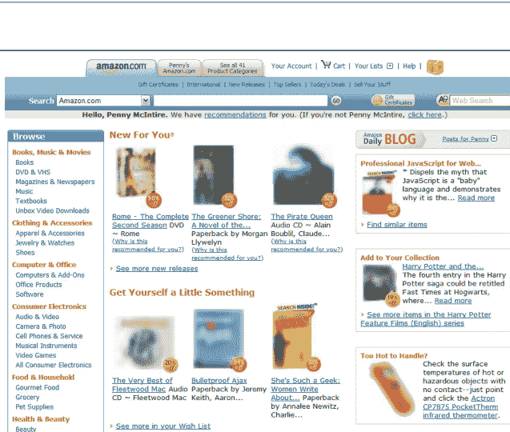

> 图 3.24 带有内容的门户页（Amazon.com 或其关联公司。版权所有）。

导航驱动型页面对我们和访问者都有利，因为它减少了页面加载，从而减轻了我们服务器的负担。尽管如此，保留钻取页面（drill-down pages）有时也有其优势：

- 一个聚焦但具有吸引力的页面可以引导新访问者仔细地查看我们所有的产品。考虑一下超市如何始终将乳制品区放在商店的最深处；每个想买一加仑牛奶的客户必须走过长一排诱人产品的过道。同样，一个集中的菜单列表也可以引导更进一步的探索。
- 当网站支付广告费用时，每次页面加载都会产生广告展示收入。因此，点击意味着更多收入。

## 框架（Frames）

框架极具争议，以至于许多设计师大骂它们天生是邪恶的并拒绝使用它们。然而，虽然我们不会话得那么极端，但公平地说，除非你有压倒性的理由要使用框架，否则应该避免使用。

## 现代网页的视觉设计

### HTML 回顾：框架

```html
<frameset rows="100,*" title="Web Design Aesthetics">
<frame src="logo.html" name="logo" id="logo" title="Logo Area" />
<frameset cols="120,*" title="Web Design Aesthetics">
<frame src="navigation.html" name="navigation" id="navigation" title="Navigation Area" />
<frame src="content.html" name="content" id="content" title="Content Area" />
</frameset>
</frameset>
```

此规范创建了一个如图 3.25 所示划分的网页。

**图 3.25** 三个框架。为了说明，开启了表格框。

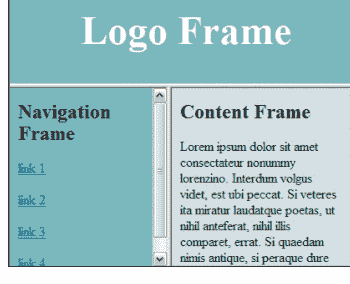

让我们先来看看框架的无数缺点：

- 带有多个框架的页面必须加载多个 HTML 文档，这无疑会消耗额外的时间。
- 当导航在一个框架中而内容在另一个框架中时，需要大量的 JavaScript 自定义工作来禁用当前链接，以免用户因意外重新加载当前框架而感到困惑或不便。
- 地址栏反映的是 `frameset` 的 URL，而不是内容框架的 URL，这会让访问者感到困惑。
- 框架破坏了浏览器对已访问与未访问链接的识别，以及书签/收藏的识别。
- 浏览器的“后退”和“前进”按钮不再按照访问者预期的方式工作。
- 虽然访问者可以打印单个框架，但如果导航位置不当，他们可能无法获得预期的内容。
- 搜索引擎在索引“框架”网站时存在问题。
- 框架存在安全问题；每个框架都可能具有不同的权限级别，管理起来非常复杂。
- 如果页面设计为导航在一个框架中而所有内容在另一个框架中，如果导航由于某种方式出错，访问者可能无法移动。

当然，使用框架一定会有某些优势，否则它们早就就消失了。以下是几点：

- 我们对页面上显示的内容有控制权；例如，我们可以确保标识横幅、页眉和菜单系统始终可见。因此，用户不需要一直滚回顶部。
- 当内容中的文档变化时，只下载该部分内容。内容文档较小，因为标识横幅和菜单已被剥离到单独的框架中。因此，内容下载更快。
- 可以使用 CSS 模拟框架的许多效果，使标识和菜单始终存在，另一个部分包含内容。这种布局的调试可能比基于表格的布局更复杂。

底线是，只有在有压倒性的理由时我们才应该使用框架。确定框架是否让网站导航更容易；如果只需要将页面划分成若干块，那么表格是更好的选择。如果你使用框架，这里有一些让它们更用户好的提示：

- 如果你设置了垂直导航框架，确保框架足够宽以容纳每个图像。如果你使用百分比，导航在小窗口上可能会被裁剪。
- 避免滚动。禁用滚动可能会导致显示器较小或分辨率较低的人完全无法访问某些页面，如果该区域包含导航，将是灾难性的。
- 关闭框架框，它们看起来既丑又过时。
- 每个内容页面都应该至少有一些基本的导航，以防导航出错或搜索引擎直接将访问者带到没有 `frameset` 的内容页。
- 如果可能某些访问者使用的浏览器不识别框架，请考虑包含框架（尽管此类访问者在今天的冲浪者中占极小比例）。

## 本地搜索功能

在网站上包含设计良好的内部搜索功能可以让用户获取他们所需的信息。例如，在 Amazon 上查找某本书最快的方法是在搜索框中输入名名或作者名。考虑到该类别下有数千本书，通过分级地图浏览“网页设计”类别来寻找特定的书可能是一项艰巨的任务。

开发有效的搜索功能成本很高。虽然有插件引擎可以附加到网站上，开发者只需少量输入即可工作，但它们对网站内容的结果平平。只有当具有领域知识的高级索引器使用类别、关键词和同义词配置搜索引擎时，你才能获得最相关的结果。这种手工制作的搜索配置并不便宜。这是一个经典的成本效益决策：网站值得拥有一个搜索功能吗？投入值回吗？如果满足以下几点，它可能是值得的：

- 网站非常大，以至于浏览不是寻找东西的合理方式。
- 网站很复杂，有相互关联的信息和许多交叉引用。
- 网站是碎片化的，有模糊且重叠的类别。
- 目标受众期望有一个搜索功能。
- 目标受众会频繁使用搜索功能以证明成本的价值。
- 网站具有高度动态的内容。例如，CNN.com 的地图维护速度快以跟上瞬息万变的新。

在为我们的网站定制搜索引擎时，我们回到了在第二章研究网站架构时编制的广泛标签列表。那时，我们努力缩小选择，只保留最完美、最精确、最简洁的术语。现在，我们包含了原始未列列表中的所有术语，以及用户可能想到的所有术语，包括热门搜索词可能的拼写错误。

我们需要从完全不同的角度来看网站，以产生原始网站架构可能需要的类别。例如，可能网站的分级结构按一般主题类别组织技术文章，但我们知道访问者是通过作者、确切标题、日期或地理位置访问的。我们将提供给搜索引擎的可能搜索词列表将继续扩展。

## 搜索界面

大多数情况下，每个页面上的搜索界面越简单越好，主要由一个用于输入搜索查询的文本框组成。研究显示，27 个左右的字符是最佳尺寸（`www.useit.com/alertbox/20020512.html`），因为它足够大，可以容纳大多数搜索词无需滚动。

搜索标准的过滤：根据指定的特征对元素进行排除或包含。回到图 3.1，我们可以看到 Amazon 如何根据媒体格式、读者年龄、语言和出版日期对搜索进行过滤。

## 搜索引擎结果页

搜索查询的结果显示在搜索引擎结果页（SERP）上。SERP 应该在页面的某个地方重复搜索术语，显示所搜索的域名（整个网络、仅此站点或站点内的特定子区域），并包含找到的匹配页面数量。

每个单独的结果都应该包含足够的目标页面的信息，以便访问者对其相关性做出明智决策。图 3.26 中的 Google SERP 是一个极好的例子（可能也是当你阅读这段描述时想到的那个）；它显示了每个结果页面的标题、相关性和 URL。

图 3.26 搜索引擎结果页（`google.com`）

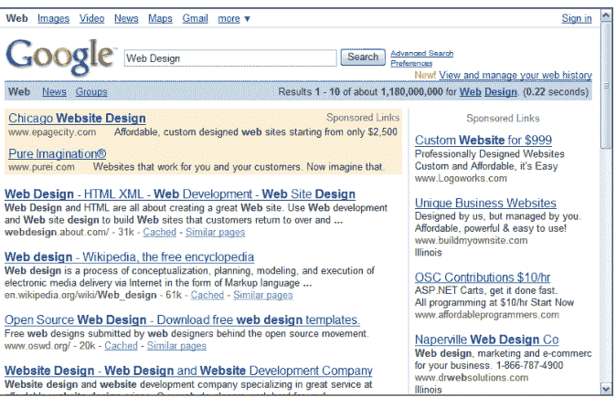

页面中的 `<title>` 标签决定了显示在结果中的可点击标题，这正是搜索引擎所看到的内容。正因如此，我们应该格式化既准确又具有吸引力的页面标题。但那是另一个的话题了。

## 第三章 导航

创建良好的页面标题有两种观点。一种是从站点标识符开始，随后是唯一的页面标题。例如，伴随本书的站点的页面可能被命名为如下所示：

```html
<Visual Design: Chapter 2, Site Analysis</title>
<Visual Design: Chapter 3, Navigation</title>
```

该站点中的所有页面都包含初始短语“Visual Design（视觉设计）”，而“Chapter 2”和“Chapter 3”唯一地标识了不同的页面。这种命名约定确实提供了最丰富的信息，生成了详细的标题。主要的缺点是，如果访问者同时打开了我们网站中的多个页面，用户显示器顶部的任务栏只会显示标题的前几个单词，而这些单词对于所有页面都是相同的。遗憾的是，这似乎没有好的折中方案。

`<meta name="description" content="..." />` 标签提供了在某些 SERP 上显示的描述，紧跟在标题之后，而不是搜索术语周围的内容。如果说有一个地方可以引人入胜、激发兴趣，那就是这里了。运用你所有的写作和营销技巧来制作这个东西吧！

结果应该以什么顺序出现在 SERP 上？选项包括按：

- **相关性：** 首先显示最相关的项目。引擎可以根据这些指示（如查询词是否出现在页面标题和 URL 中，以及查询词在内容中出现的频率）对相关性做出判断。它还会查看与查询词位置接近的单词。例如，如果搜索“George Washington Carver（乔治·华盛顿·卡佛）”，短语“Biography of George Washington Carver”的排名将高于“George Smith, a Washington, D.C. Meat Carver”，因为请求的术语在列表中物理上并不相邻。Realtor.com 显示按相关性排序的搜索结果，取决于属性与高级查询请求特征的匹配程度。
- **日期：** 要么先显示最新的项目（如新闻网站），要么先显示最旧的项目（用于任何从历史角度呈现的页面）。
- **字母顺序：** 适用于任何自然按字母排序的内容，例如电话簿条目或文章标题。
- **地理位置：** 按区域或接近程度显示。一个例子是零售店定位工具，将最近的商店放在列表顶部。
- **流行度：** 基于页面的访问者人数、这些访问者对页面的排名（如果鼓励访问者排名）以及有多少人链接到它们。

## 保持简洁

搜索引擎结果结果通常显示约 66 个字符的标题，因此不要在开头的“The”或“To...”上浪费空间。让前几个单词成为最显著且信息密度最大的。

## SERP 内容显示

某些 SERP 显示描述-`<meta>` 标签中的内容，而另一些显示搜索术语周围的内容。

最好的搜索功能允许访问者选择他们认为最重要的排名特征。例如，在 Realtor.com 上，可以在按面积、房屋与请求特征的匹配程度或价格之间选择结果。

提供每页显示多少结果的选择也有帮助。例如，nordstrom.com 初始每页显示 21 个结果，但提供每页索引显示 99 个结果的选项。

搜索引擎结果页应该为访问者在结果不满意时提供提醒或完善搜索的机会。初始结果可以作为跳板，帮助访问者决定如何构建更有针对性的查询。

## 搜索日志

来自本地搜索引擎的日志文件可以显示哪些访问者进入了你的搜索功能。这些日志可以帮助你完善导航和搜索系统本身，因为那些让你惊讶的术语通常是访问者丢失信息“线索（scent）”的术语。例如，如果意外的短语反复出现在搜索日志中，你需要在导航中更突出地展示该短语。

## 嵌入链接

嵌入链接（也称为上下文链接或内联链接）是普通正文中的文本链接，仅通过某些格式变化（如下划线或颜色变化）指示。例如，如果我们在网页上，这可能是一个嵌入链接。嵌入链接几乎就像书中的脚注；它们提供了次要说明，补充了主内容，而不会中断该内容的流。同时，周围的上下文有助于明确如果访问者点击链接，准确将呈现哪些信息。

嵌入链接不应作为页面上的唯一导航，因为它们不提供菜单提供的站点心理映射。此外，大量的嵌入链接会用视觉噪声淹没页面，就像这段话正在这样做的那样。请谨慎使用此类链接。

## 预告

预告（Teaser）是一种旨在吸引访问者注意的“侧记”。预告通常用于促销公告或新闻快讯。即使横幅广告也可以被视为预告。预告通常设置在主要内容的侧边，拥有自己的区域。有时它们会出现在摘要段落的末尾，提供阅读更多信息的机会。例如，新闻网站可能会提供一段式的新简报，并带有一个指向长文章的“More >>”链接。

## 站点地图、目录、索引和检索

对于较大、更复杂的站点，热点（链接）站点地图、目录、索引或目录可以帮助无法通过其他方式找到所需的用户。传统的地图显示站点的层级结构，而索引或目录通常只有一个深度。简单的文本大纲格式（图 3.27）因其清晰、快速和易于维护而理想，同时强化了站点的组织结构。

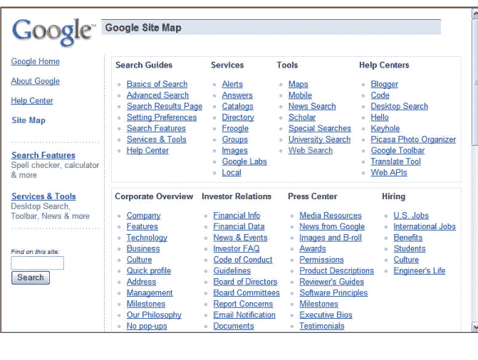

图 3.27 站点地图地图（`www.google.com`）

## 面包屑

面包屑是简单的文本链接链，说明访问者位于站点层级中，并提供了向上返回层级的简单方法。例如，如果访问者尝试购买床上用品，销售床单页面的面包屑可能如下：

`Home Décor > Bedding > Sheets`

“Home Décor”和“Bedding”都是可点击的文本链接，带用户回到层级上方。“Sheets”不是超链接，因为它指的是当前页面。

虽然面包屑在较小的站点上可能是多此的，但对于较大、更复杂的站点，它们可以成为救命稻草，就像它们原本为汉斯和格蕾设计的那样。


在 DREAMWEAVER 中创建面包屑

在 Dreamweaver 中构建面包屑的骨架，选择 `Window > Snippets > Navigation > Breadcrumb`，然后选择“`>`”或“`:`”作为层之间的分隔符。

## 快捷键

在网络术语中，快捷键（执行与点击链接相同的按键组合）对于频繁访问的游客非常有价值（尽管偶尔访问的游客通常不会理会它们），也对于身体上无法使用鼠标的访问者。关联的快捷键可能如下所示：

伊诺伊利州大学（`Alt+N`）

在某些浏览器中，快捷会将焦点置于该元素上，但不会实际激活它。在这种情况下，访问者仍需按下“`Enter`”键来触发链接。

要创建快捷键，如果“`N`”是触发链接的键，请在 `<a>` 标签中添加 `accesskey="N"`。

```html
<a href="http://www.niu.edu" accesskey="N">
```

伊诺伊利州大学 `<a></a>`（`Alt+N`）

## 启动页 (Splash Pages)

启动页是在主页加载之前或加载期间加载的页面（图 3.28）。大多数时候，启动页仅仅是为了娱乐访问者。然而，有时它也有实际用途，即在等待网站系统规格（浏览器和版本、可用插件、cookie 等）时进行停留。由于启动页加载需要时间并推迟了访问者完成任务的，它们是另一个争议性问题。许多设计师以及网络冲浪者反对使用它们。

图 3.28 启动页 (www.PandaExpress.com)


如果你必须使用启动页，请确保它具有艺术感，例如：

- 增加网站的特色，足以使额外的下载时间变得合理。
- 尽可能快地下载。
- 如果访问者选择，可以轻松跳过，如图 3.28 中的“跳过”链接所示。即使该页面在第一次访问时非常有趣，在第十五次或五十次访问时通常只是不必要的困扰。

## 收藏菜单 (Favorites Menus)

如果访问者收藏了你网站的页面，页面标题将是“收藏”条目的默认名称。因此，简洁且具有描述性至关重要，因为“收藏”描述甚至比搜索结果结果页（SERPs）允许的描述还要短。

`Favicon`（网站图标）是出现在收藏菜单、桌面和任务栏网站名称旁边的自定义图标。图 3.29 显示了显示此类图标的收藏菜单。

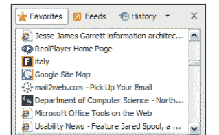

图 3.29 带有 Favicon 的收藏菜单

你可以使用特殊软件创建自定义 `favicon`。`Favicon` 在 16 x 16 像素下最为可靠，并应保存为与主页相同的目录下，命名为 `favicon.ico`。请记住，如果网站在 `favicon` 创建之前就已经被收藏，那么 `favicon` 将追溯性显示。也就是说，`favicon` 必须在网站实际被收藏时存在，它才可能出现在访问者的计算机上。

## 创建 favicon

参见 `www.webdevelopersjournal.com/articles/favicon.html`，`www.favicon.com` 或 `www.irfanview.com`。

## 链接可靠性

如果导航不能带访问者去某个地方，它就是毫无意义的。可用性大师雅各布·尼尔森（Jakob Nielsen）警告不要出现“链接腐”（linkrot），这是一种终端性的网络疾病，其症状是死链。链接腐是让你的访问者相信你的网站不可靠的最快方式之一。在实现网站之前，确保你的链接功能正常（Dreamweaver 有一个检查全站链接的实用），在部署到服务器后重新检查每个链接（因为在开发期间本地运行的链接在服务器上很可能会失效），在此之后定期重新检查所有链接（特别是外部链接）。

尽管 Dreamweaver 这样的开发环境可以轻松重组织你网站的结构，但如果你的网站已经上线，在执行这样做时要极其谨慎。重组织或重命名意味着已经标记你网站的用户以及已经索引了你网站的搜索引擎将看到可怕的“`404: File not found`”页面，如图 3.30 所示。

图 3.30 错误 404：未找到文件

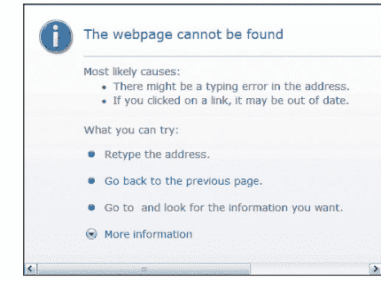

如果你必须重组织，可以使用你自定义的 404 HTML 页面覆盖标准的 404 页面，该页面可以显示组织的名称和标志、指向主页的链接、关于错误 URL 的任何其他可见信息以及一个寻求帮助的电子邮件链接。图 3.31 显示了一个非技术、令人安心且幽默的自定义 404 页面，它利用了网站的航海主题。尽管有人可能会认为它也应该包含网站标志，但该页面仍然实现了它的目的：通过指向网站索引、网站地图和搜索区域的链接将最后一次访问者引回网站。

## 第三章 导航 123

图 3.31 重定向移动页面（经 www.sailingscourses.com 的 Diederik Willemsen 许可）。

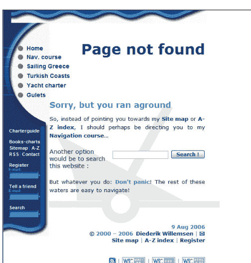

并不是所有的 Web 服务器都支持 404 页面；请咨询管理员。如果你在使用框架（frames），请在 `frameset` 和每个 `frame` 中包含描述性的 `title` 属性：

```html
<frameset cols="30%, 70%" title="网页设计审美">
<frame src="navigation.html" name="navigation" id="navigation" title="导航区域" />
<frame src="currentPage.html" name="content" id="content" title="内容区域" />
</frameset>
```

## 导航与无障碍性

如果不为无障碍进行设计，某些用户将无法利用导航。当然，有使导航无障碍的指南：

- 在所有页面上使用一致的布局样式，以便访问者更容易找到他们想要的内容。
- 为所有导航图像添加 `alt` 属性。确保在移除所有颜色后这些仍然显而易见。例如，亮红色文本链接和亮绿色正文对于红绿色盲访问者来说看起来是一样的。包含其他的导航辅助特征，如下划线、粗体、斜体，以确保颜色不是识别导航的关键。
- 仅在悬停时显示的下拉菜单对于屏幕阅读器特别具有挑战性。一种替代方案是让触发下拉菜单的链接也可以点击的。这种点击可以提供一个与下拉菜单相同链接的替代菜单页面。
- 在两个相邻的文本链接之间包含某种视觉和可读的内容；仅靠空格是不够的。使用键盘上简单的 `|` 符号就足够了。例如：

不可接受：`Home Products Job Opportunities`

可接受：`Home | Products | Job Opportunities`

- 提供尽可能多的替代导航方法，包括搜索工具、网站地图、网站索引、面包屑以及快捷键/访问键。
- 提供一个“跳过导航”链接，以便视力障碍的访问者无需等待屏幕阅读器读完每个页面重复的导航系统。该链接将完全跳过导航，直接跳转到页面的内容。要实现此功能，请在导航菜单之前链接一个 1x 像素的透明 GIF。图像的 `alt` 文本（替代文本）应显示为“跳过导航”或“跳转到内容”。将图像封装在 `<a>` 标签中，该标签链接到新窗口中的一个标准内部锚点，但如果你这样做，请务必先通知访问者。
- 避免打开新窗口。
- 提供 HTML 页面作为仅限 Flash 页面的替代方案。（请参阅第 4 章关于仅限 Flash 网站构建的简要讨论。）

请记住，许多推荐用于导航可访问性的功能对所有用户都有益，而不仅仅是残障人士。

## 总结

许多推荐用于导航可访问性的功能对所有用户都有益，而不仅仅是残障人士。

核心在于，访问者希望导航体验是简单、直观且可预测的。

## 设计清单

访问者希望导航体验是简单、直观且可预测的。

以下清单用于确保你：

- 提供了导航体验是简单、直观且可预测的。

## 导航原则

访问者希望导航体验是简单、直观且可预测的。

你是否：

- 提供了导航体验是简单、直观且可预测的。
- 提供了导航体验是简单、直观且可预测的。
- 提供了导航体验是简单、直观且可预测的。
- 提供了导航体验是简单、直观且可预测的。

## 现代网页的视觉设计

你是否：

- 提供了导航体验是简单、直观且可预测的。
- 提供了导航体验是简单、直观且可预测的。
- 提供了导航体验是简单、直观且可预测的。
- 提供了导航体验是简单、直观且可预测的。
- 提供了导航体验是简单、直观且可预测的。
- 提供了导航体验是简单、直观且可预测的。
- 提供了导航体验是简单、直观且可预测的。
- 提供了导航体验是简单、直观且可预测的。
- 提供了导航体验是简单、直观且可预测的。
- 提供了导航体验是简单、直观且可预测的。
- 提供了导航体验是简单、直观且可预测的。
- 提供了导航体验是简单、直观且可预测的。
- 提供了导航体验是简单、直观且可预测的。
- 提供了导航体验是简单、直观且可预测的。
- 提供了导航体验是简单、直观且可预测的。
- 提供了导航体验是简单、直观且可预测的。
- 提供了导航体验是简单、直观且可预测的。
- 提供了导航体验是简单、直观且可预测的。
- 提供了导航体验是简单、直观且可预测的。
- 提供了导航体验是简单、直观且可预测的。
- 提供了导航体验是简单、直观且可预测的。
- 提供了导航体验是简单、直观且可预测的。
- 提供了导航体验是简单、直观且可预测的。
- 提供了导航体验是简单、直观且可预测的。
- 提供了导航体验是简单、直观且可预测的。
- 提供了导航体验是简单、直观且可预测的。
- 提供了导航体验是简单、直观且可预测的。
- 提供了导航体验是简单、直观且可预测的。
- 提供了导航体验是简单、直观且可预测的。
- 提供了导航体验是简单、直观且可预测的。
- 提供了导航体验是简单、直观且可预测的。

## 第四章 布局

## 供参考：宽带接入家庭的统计数据

我们在这里不会查看宽带接入的通用统计数据，因为它们的用途有限。首先，统计数据正在快速变化。其次，我们通常列出的是家庭总数，而不是更有用的宽带用户与慢速连接用户的百分比统计数据。这些统计数据也没有考虑到许多用户在工作时利用宽带连接，而不是在家里使用较慢的连接。最后，通用统计数据可能对你特定目标受众的统计数据很有影响——理解目标受众是无可替代的。

在考虑是否允许使用较大的文件时，请意识到你可能会丢失至少部分图像。在继续之前，请确保你了解正在丢失多少百分比的访问者，并且损失程度是否是可以接受的。

## 为限制的文件大小进行规划

你如何为限制的文件大小进行提前规划？虽然我们将在后面的章节中介绍有关优化图形等问题的具体指南，但在项目启动阶段，一些提示是有帮助的：

- 将大部分 CSS 和 JavaScript 提取到外部文件中。这些文件仅在网站首次被引用时下载一次。从那时起，它们可以被网站上的所有其他页面复用，而没有进一步的下载限制。
- 在页面之间复用图形、音频和视频，因为它们也只在首次被引用时下载。
- 不要使用多余的图形、动画或声音。每个文件出现在网站上都应该有一个明确的理由，出于实用目的或增强网站的吸引力。用于导航的大型、吸引人的图像既具有实用性美学意义，就像销售的产品图片一样。另一方面，仅仅为了填充空间的图形应该被消除。
- 尽可能使用小图像而不是大图像，因为在因素相同的情况下，小图像的下载速度比大图像快。例如，你可以使用在背景上平铺（重复）的小图像，而不是单张巨大的背景图像。
- 减少导航按钮的数量。例如，一个具有不同导航按钮、每个按钮都有独特措辞和悬停效果的网站将下载 100 张不同的图像。相比之下，50 个文本链接（通过 CSS 提供悬停效果）仅带有很小的下载成本。正如我们在第 3 章中看到的，文本链接并不无聊。

## 显示尺寸与分辨率

网页设计更具挑战性的方面之一是考虑无数显示尺寸和分辨率。显示分辨率以像素为单位测量。尽管如此，“分辨率”一词可以指两种衡量标准：

- 整个显示屏幕的高度和宽度，例如 800 x 600 分辨率或 1280 x 1024 分辨率是计算机显示器的标准。
- `PPI`（每英寸像素，类似于打印媒体中的 `DPI`/每英寸点数）。我们通常将 72–100 `PPI` 作为经验法则；真实的 `PPI` 测量是由计算机上显示属性设置与显示器尺寸之间的交互决定的。这种交互意味着 `PPI` 并不像看起来那么简单——绝对不是来自系统的测量值。

例如，假设我们有两个目前使用相同显示器的计算机系统（图 4.1）。一个系统在显示器上显示 800 x 600 像素，而另一个被设置为 1600 x 1200 像素的分辨率。因此：

- 在 1600 x 1200 像素系统中，像素必然更小且间距更密，因为它在显示器上显示了双倍的像素。
- 那么，给定的网页及其所有组件在较高分辨率系统上看起来会更小，因为像素更小且排列更紧密。例如，在图 4.1 中，由于 1600 x 1200 分辨率图像上的像素更小，文本和图像也会更小。记住，低分辨率系统上的像素更大，单个像素也会更明显。

现在让我们从另一个角度看一个类似的问题。与其改变我们两个系统之间的分辨率，而在较大的显示器上，像素必然更大且间距更远。结果是，在相同的宽高分辨率下，页面上的每个元素在较大的显示器上看起来都更大。图 4.2 显示了这种差异。

### 图 4.1 显示分辨率对元素尺寸的影响

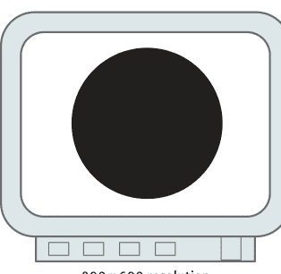

`800 x 600` 分辨率

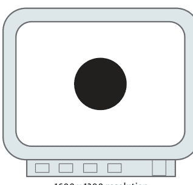

`1600 x 1200` 分辨率

### 图 4.2 显示器尺寸对元素尺寸的影响

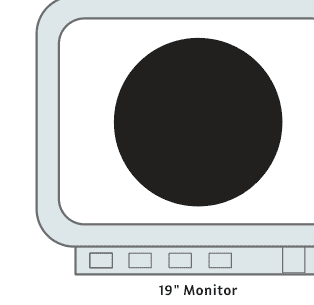

`19"` 显示器

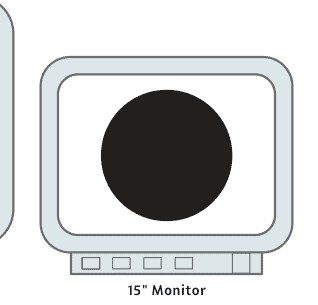

`15"` 显示器

正如我们所看到的，系统的分辨率设置和显示器尺寸都决定了网页元素的大小，以及页面实际上有多少能放入屏幕。随着宽高分辨率的增加，像素变小，由这些像素组成的屏幕元素也随之变小。随着显示器尺寸的增加，像素变大，屏幕上的所有元素也随之增大。

表 4.1 展示了屏幕尺寸和分辨率如何交互，导致不同的文本和图形尺寸（使用相对而非绝对元素尺寸进行演示）。再次注意文本和图形在大显示器的低分辨率下看起来最大，在小显示器的高分辨率下看起来最小。

| 表 4.1 对象的相对尺寸：显示分辨率对比显示器尺寸 |
| :--- | :--- | :--- | :--- | :--- |
| 分辨率 | 800 x 600 | 1024 x 768 | 1280 x 1024 | 1600 x 1200 |
| 19" 屏幕 | 文本 | 文本 | 文本 | 文本 |
| 15" 屏幕 | 文本 | 文本 | 文本 | 文本 |

| 表 4.2 十二个代表性网站的页面宽度* |
| :--- | :--- | :--- | :--- |
| | 固定为 800 像素宽宽度 | 固定为 1024 像素宽宽度 | 可变宽度（随浏览器窗口大小扩展和收缩） |
| adobe.com | X | | |
| amazon.com | | | X |
| cnn.com | | X | |
| ebay.com | X | | |
| imdb.com | | | X |
| mapquest.com | 首页 | | 下层页面 |
| microsoft.com | 某些下层页面 | 首页及大多数下层页面 | |
| msn.com | X | | |
| msnbc.com | X | | |


| `randmannally.com` | X | | |
| --- | --- | --- | --- |
| `ticketmaster.com` | X | | |
| `yahoo.com` | | X | |
| *截至 2007 年 6 月 9 日* | | | |

我们将使用 800 像素作为本书中创建的所有示例的水平目标尺寸，原因如下：

- 如果我们相信这些代表性网站，那么它是目前网页上最常见的页面尺寸。
- 几乎所有人都能访问。
- 它迎合了想要同时打开多个窗口的用户。

遗憾的是，你不能使用全部 800 像素，因为你必须为浏览器外框（browser chrome）留出像素——即浏览器本身使用的像素。减去外框，再考虑到用户可能没有正确调整其显示或显示器，你得到的水平方向大约是 744–750 像素。书中的示例将使用 750 像素。

一些网站创建了大于 800 x 600 像素的水平页面尺寸，但会提供通知说明网站在较高分辨率下查看效果最佳。问题是，正如我们所看到的，许多访问者无法或不知道如何更改分辨率。更改分辨率的访问者通常出于特定原因将其设置为特定尺寸。仅仅因为我们太懒，不愿让布局在多种分辨率下都可用，就要求访问者更改设置，这似乎是不礼貌的。因此，在要求访问者更改电脑设置之前，请考虑潜在的困扰因素。

## 打印页面

如果你想确保访问者可以安全地在浏览器的纵向模式下打印整个页面，遗憾的是，535 像素提供的空间很小。更好的替代方案可能是使用单独的“打印页面”链接，提供针对打印优化的 535 像素宽页面版本。访问者特别喜欢当“打印页面”链接将多页文章合并为可打印的页面时。

另一种解决方案是使用 CSS 样式，该样式仅在页面重定向到打印机时生效。具体操作方法请参考侧边栏。

> 使用 CSS 为打印格式化页面

在 CSS 中隔离打印方向的方向有两种方法：

- 链接到两个 CSS 文件，一个包含用于屏幕显示的 CSS 文件，另一个包含专门针对打印的格式规则。只需在用于打印样式的 CSS 文件 `<link />` 标签上使用 `media="print"` 属性，如下所示第二行：

```
<link href="mediaScreen.css" rel="stylesheet"
  type="text/css" />
<link href="mediaPrint.css" rel="stylesheet"
  type="text/css" media="print" />
```

- 使用全局样式表，包含 `media="print"` 来指定特性：

```
<style type="text/css">
body {
  font-size:10px;
  color:#d8a79b;
}
background-color:#333333;
}
</style>

<style type="text/css" media="print">
body{
  font-size:12px;
  color:#000000;
  background-color:#ffffff;
}
</style>
```

遗憾的是，两种 `media="print"` 在旧版浏览器中不起作用。

# 垂直页面尺寸

虽然访问者可能不喜欢水平滚动，但垂直滚动是可以忍受的。虽然有些访问者更倾向于滚动浏览一个长页面，而不是等待几个独立的页面下载，但另一些人似乎不喜欢超过两个或三个屏幕。对于哪种替代方案对访问者最友好，业界似乎还没有共识。请记住，每当访问者到达“下一页”按钮，或者她必须自觉决定是否继续时，持续滚动可能不会触发这种“我该继续还是不该继续？”的考虑。因此，使用一个页面可能比几个连续页面更有让访问者停留更久的机会。

- 布局的跨浏览器 CSS 兼容性

不要假设所有浏览器对外边距（margins）和内边距（padding）等属性使用默认值，因为事实并非如此。为了安全起见，请通过显式的 CSS 指令锁定所有布局参数。

## 布局工具

如果我们需要从页面左侧运行到最右边缘的文本，我们不需要任何特殊的标签或 CSS 来将元素放置在页面上。然而，通常并非如此。大多数时候，我们希望在网格中对齐内容或在页面上精确放置元素。现在，我们将查看用于此类放置的工具。稍后，我们将看到如何使用这些工具创建一个美观的页面。

页面布局的主要工具是 `<iframe>`、`<table>` 和 `<div>`（均结合 CSS 使用），以及 Flash。我们将查看每一个。

## 框架 (Frames)

框架具有极大的争议，以至于许多设计师认为它们是天生邪恶并拒绝使用它们，除非你有压倒性的理由。它们。由于我们已经在“框架”章节中讨论过它们。

## 表格 (Tables)

如果我们需要一个从页面左侧运行到最右边缘的文本，我们不需要任何特殊的标签或 CSS 来将元素放置在页面上。然而，通常并非如此。大多数时候，我们希望在网格中对齐内容或在页面上精确放置元素。现在，我们将查看用于此类放置的工具。稍后，我们将看到如何使用这些工具创建一个美观的页面。

页面布局的主要工具是 `<iframe>`、`<table>` 和 `<div>`（均结合 CSS 使用），以及 Flash。我们将查看每一个。

## 表格 (Tables)

表格仅仅是一个二维网格，可以在其中安排元素。例如，我们可能将一个图像及其相应的文本封装在 `<div>` 中，以便用常见的边框和常见的背景颜色包裹该单元，或者将整个容器放置在页面的特定位置。查看侧边栏以了解表格的 HTML。

表格仅仅是一个二维网格，可以在其中安排元素。 4.3 shows a simple table

图 4.3 显示简单表格

- HTML 表格回顾

构成图 4.3 表格的 HTML 如下：

```
<table style="2px dotted #000000;width:250px;
background-color:#ffffff;">
<head>
  <tr>
    <th style="background-color:#dde79;">左上</th>
    <th style="background-color:#dde79;">右上</th>
  </tr>
</head>
<tbody>
  <tr>
    <td style="background-color:#c2ddb;">左下</td>
    <td style="background-color:#c2ddb;">右下</td>
  </tr>
</tbody>
</table>
```

> 注意

> 在本章中，为了简洁，省略了与主题无关的 HTML 内容。

## `<div>` 标签

关于构建表格的一些提示：

- 单元格堆叠在一起，形成列。如果某行中的单元格数量不相等，你的表格显示将不可预测。
- 行或单元格的大小不能比其包含的最大元素小。
- 如果你在尝试让单个表格适应整个布局时遇到困难，请停止尝试。改用多个表格。
- 嵌套表格以容易崩溃而闻名，并且难以调试。只有当你发现更简单实现目标的方法时，才嵌套表格。
- 将单元格宽度放置在表格的单行上。其他行将强制遵循这些宽度，但现在如果列发生变化，只有一行需要更新。
- 为了浏览器兼容性，确保每个表格单元格都有某种内容，即使是 1x1 像素的透明内容。

`<div>` 仅仅是一个包裹内容的框，以便我们出于布局和格式考虑将内容视为一个单元。例如，我们可以将图像及其相应的文本封装在 `<div>` 中，以便用常见的边框和常见的背景颜色包裹该单元，或者将整个容器放置在页面的特定位置。查看侧边栏以了解 `<div>` 标签及其属性。

HTML 回顾：`<div>` 标签

这是两个 `<div>` 的 HTML：

```html
<div style="float:left; width:150px; background-color:#dde79; border-color:#999999; border-style:solid; border-width:1px; margin:20px; padding:10px; overflow:auto;">
  <p>Four score . . . created equal.</p>
</div>
```

# 第四章 页面布局 141

```html
<div>
<div style="float:left; width:150px; background-color:#dde7e9;
border-color:#999999; border-style:solid; border-width:1px;
margin:2px; padding:10px; overflow:auto; height:100px;">
<p>Float score . . created equal.</p>
</div>
</div>
```

标签上的 `overflow:auto` 属性会导致第二个 `<div>` 产生滚动条，因为它是唯一一个小到无法显示所有内容的 `<div>`。`float:left;` 属性将第二个 `<div>` 放置在第一个 `<div>` 的右侧，除非浏览器窗口太小无法同时显示两者。在这种情况下，第二个会掉到第一个下方，如图 4.5 所示。

图 4.4 宽窗口上的 `<div>`

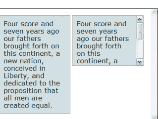

图 4.5 窄窗口上的 `<div>`

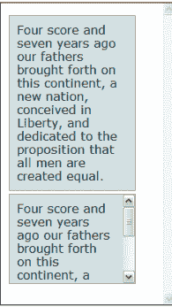

## 现代网页的视觉设计

图 4.6 显示了绝对定位的 `<div>`（完全按照 `left` 和 `top` 指定的位置渲染）和相对定位的 `<div>`（相对于如果不使用定位时本应所在进行偏移）。侧边栏显示了代码。

# 图 4.6 绝对定位和相对定位的 `<div>`

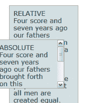

# 定位的 `<div>`s

以下是图 4.6 中 `<div>` 的代码：

```html
<div name="relative" id="relative"
style="position:relative; left:50px; top:0px">
<p>RELATIVE<br /> /Four score . . created equal.</p>
</div>
<div name="absolute" id="absolute"
style="position:absolute; left:25px; top:100px">
<p>ABSOLUTE<br /> /Four score . . created equal.</p>
</div>
```

# 表格与 `<div>`

页面布局正处于一场革命的边缘。虽然如果我们担心访问者使用旧版浏览器，就必须使用表格和表格单元格来设置页面列的宽度，但我们正迅速接近可以完全依赖定位的 `<div>` 的时代。我们可以设置 `<div>` 的大小、背景颜色、背景图像以及选择性边框，并在页面上精确放置 `<div>`。目前用 `<div>` 替换表格的主要阻碍是，有时不同的浏览器渲染和定位它们的方式不相同。

然而，尽管 `<div>` 非常强大，但我们不应该忽略表格，因为 `<div>` 是新工具。表格在浏览器中几乎是无懈可击的，渲染差异极其细微。此外，有些问题用表格比 `<div>` 更容易解决。切片图像在表格中非常容易重新组装，但 `<div>` 则如此。关键点是根据情况同时使用表格和 `<div>`。

## Adobe Flash

Adobe Flash 可用于渲染整个网站，而不仅仅是动画。Flash 网站仅使用 HTML 来嵌入 Flash。Flash 渲染所有内容，从图像到从服务器端数据库提取的链接数据。在基于 Flash 的网站中，“页面”不再是离散的；相反，它们只是包含整个网站的单一 Flash 站点中的某一个位置（或动画“单元格”）。

用 Flash 渲染整个网站有优点：

- Flash 网站可以在视觉上令人惊艳，同时通常其体积通常比等效的全屏 JPEG 或 GIF 小。
- Flash 制作平台包含了 Adobe Flex/ActionScript，这是一种基于 XML 的语言，它方便了客户端和服务器端的编程。
- Flash 是组件化的；也就是说，页面的部分可以在不刷新整个页面的情况下重新加载。
- Flash 更容易构建能够良好调整大小以显示在多种媒体（包括移动设备）上的网站。

当然，基于 Flash 的网站也有其缺点：

- 尽管 Flash 文件本身比等效的 JPEG 和 GIF 小，但这种优势往往被整个网站的所有内容现在都是图形化的这一事实所抵消了。显然，这可能会带来下载问题。
- Flash 网站的图形性质也意味着在网站内搜索（通过搜索引擎和网站特定的搜索功能）不像基于 HTML 的网站那样轻而易举；在 HTML 网站上，网站上的一个单词不再是一个单词；它只是排列在单词图片周围的独立像素。
- 浏览器的“后退”和“前进”按钮并不按照大多数用户的预期工作。它们会返回动画的开始或结束，而不是动画中的上一个或下一个操作。虽然设计良好的 Flash 网站提供了自己的后退和前进按钮，但大多数用户习惯于依赖浏览器的“后退”按钮，他们仍然会这样做，从而在网站中丢失位置。

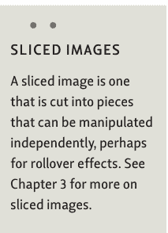

切片图像

切片图像是被分成可以独立操作的碎片，也许是为了悬停效果。关于切片图像的更多信息请参见第 3 章。

## 现代网页的视觉设计

- 在 Flash 网站中书签“页面”书签的是入口，而不是访问者预期的低级区域。

虽然基于 Flash 的网站在未来可能会变得更加流行，但 Flash 不可能完全取代 HTML。相反，这是一个为了正确目的使用正确技术的问题。例如，像电影网站或粉丝网站这样的“体验型”网站就是基于 Flash 布局的理想候选者。

本书将不再深入探讨 Flash 技术，因为那超出了本书的范围。

## 美学问题

杂乱、混乱、过度填充的页面带来的“信息过载”会如此快速且彻底地排斥访问者，以至于他们可能会直接关闭；他们认为不值得费脑力去理清这些杂乱。正如《Don't Make Me Think》的作者 Steve Krug 简洁表达的那样：“如果某东西需要投入时间——或者看起来需要投入时间——它就不可能被使用。”

相比之下，组织良好且留有足够空白的页面会给访问者留下简洁的印象，即使页面内容非常充实。关键在于，你选择构建页面的方式对访问者的舒适舒适度有很大影响。

# 填充显示窗口

我们已经知道，我们是根据（合理范围内的）最小共同屏幕分辨率进行设计的。但当页面在更大或更小的显示系统上查看时会发生什么呢？有两种方法可以适应这种情况：固定布局和流体布局。

## 固定布局

使用固定布局（有时称为冰布局）时，我们设计的页面以适应我们预计访问者拥有的最小窗口大小，用颜色或图像填充较大窗口的背景。图 4.7 显示了固定布局的示例，在页面上居中，以及在宽窗口和窄到无法不水平滚动即可显示内容的窗口中的显示。侧边栏显示了此示例的 HTML。创建固定设计的属性已被高亮显示。

# 第四章 页面布局 141


图 4.7 两种宽度下的固定布局


宽窗口中显示的固定设计

窄窗口中的固定设计

# HTML 复习：固定布局

以下是图 4.7 所示的居中固定布局的代码：

```html
<body style="text-align:center">
<div style="width:200px; background-color:#dde7e9; text-align:left">
<p>Four score . . created equal.</p>
</div>
</body>
```

`width` 属性确保 `<div>` 始终精确为 200 像素宽，无论访问者的窗口大小如何。`<body>` 标签上的 `text-align:center` 属性如果它比窗口小，则会使其居中，如图 4.7 左侧所示。如果内容相对于窗口来说太大，浏览器会在 `<div>` 上插入滚动条（水平和垂直方向），如图 4.7 右侧所示。

我们可以使用表格来创建类似的布局，特别是当我们想要将行和列视为一个整体时。在下方的 HTML 中，表格的第一列宽度始终固定为 100 像素。第二列填充指定的 200 像素表格宽剩余的 100 像素。以下是 HTML：

```html
<body style="text-align:center">
<table style="width:200px;">
<tr>
<td style="width:100px;">Gettysburg Address</td>
<td>Four score . . created equal.</td>
</tr>
</table>
</body>
```

一些设计师倾向于让固定布局中的内容在页面上左对齐（默认设置），所有多余的背景仅填充屏幕右侧。另一些人则喜欢将内容在屏幕上居中，如我们的示例所示指定居中对齐。在我们对12个网站的非正式调查中，在使用设计的10个主要网站里，有6个是居中的，3个网站和1个首页是左对齐的，如表4.3所示。

## TABLE 4.3 十个代表性网站的页面对齐情况

| | 固定宽度页面 | 不适用： | |
| --- | --- | --- | --- |
| | 居中 | 左对齐 | 页面大小自适应窗口 |
| `adobe.com` | X | | |
| `amazon.com` | | X | |
| `cnn.com` | | X | |
| `ebay.com` | | X | |
| `imdb.com` | | X | |
| `mapquest.com` | 首页 | 下级页面 | |
| `microsoft.com` | X | | |
| `msn.com` | X | | |
| `msnbc.com` | | X | |
| `randmcnally.com` | X | | |
| `ticketmaster.com` | X | | |


| yahoo.com | X | | |

## 流体布局（Liquid Layout）

流体布局意味着页面可以使用可扩展的`<div>`或`<table>`自动扩展或收缩，以填充所有可用屏幕区域。图4.8显示了侧边栏中的流体HTML在宽窗口和窄窗口中的显示效果。

## 第四章 页面布局 17

图4.8 不同窗口宽度下的流体布局


## HTML复习：流体布局

简单地在`<body>`以及包含内容的`<div><table>`中省略宽度设置，意味着页面将扩展和收缩以填充可用宽度。

图4.8中`<div>`的流体布局HTML所示：

```html
<<body>
<div style="background-color:#dde7e9; text-align:left;">
<p>Four score . . . created equal. </p>
</div>
</body>
</html>
```

同样，表格也可以扩展和收缩，只要满足：

- 表格宽度被省略或被指定为百分比。
- 至少有一列没有固定的像素像素宽度。

对于下面的示例，第一列始终为100像素宽，而第二列则会扩展和收缩，以填充窗口的剩余宽度。

```html
<body>
<table>
<tr>
<td style="width:100px;">Gettysburg Address</td>
<td>Four . . . created equal. </td>
</tr>
</table>
</body>
```

如果文本行最终扩展到比500–600像素更宽，由于由于变得太宽，它们可能变得难以阅读，因为访问者的眼睛在从一行非常长的行末尾移动到下一行的开头时，无法轻松保持追踪。由于目前没有设置最大宽的跨浏览器解决方案，我们必须依靠访问者具备良好的常识，如果文本行太长而难以阅读，他们会缩小窗口。

## 最大宽度与最小宽度

CSS的`max-width`和`min-width`属性可以解决内容区域过宽或过窄的问题。在撰写本文时，遗憾的是，它们尚未被拥有最大市场份额的Internet Explorer所识别。

## 固定布局与流体布局的比较

固定布局和流体布局各有优势。

使用固定布局，无论屏幕尺寸和分辨率如何，你都可以对访问者看到的页面样式非常有信心。相比之下，流体布局完全拥抱了Web媒介，但其可预测性低得多，且更难创建和测试。在我们这一章中考虑的12个流行网站中，只有Amazon和IMDb使用了流体布局。请参见`表4.4`关于这两种布局风格优缺点的总结。

## TABLE 4.4 流体布局与固定布局对比

| 固定布局 | 流体布局 |
|---|---|
| 说明 | - 页面在水平方向上适应固定像素数。<br>- 页面扩展和收缩以适应访问者的水平窗口尺寸。 |
| 优点 | - 严格控制页面在访问者屏幕上的显示方式。<br>- 使用整个窗口。<br>- 在大多数窗口尺寸下可以消除水平滚动。<br>- （在理论上）适用于所有屏幕尺寸。 |
| 缺点 | - 在较大的窗口上浪费背景。<br>- 页面上可以放置的元素较少。<br>- 无法精确控制页面在访问者屏幕上的外观。<br>- 如果文本行变得太宽则难以阅读。<br>- 几乎不可能让页面在所有窗口尺寸下看起来良好。 |

## 页面布局的构建模块

在研究如何创建统一的页面布局之前，我们必须首先观察创建这些布局时可以操作的交互元素。这些元素是线、形状和颜色。

## 线

线可以是粗或细、均匀或厚细不一、实线或断线、模糊或硬边缘、优雅或紧张或尖锐。你选择的线条可以帮助营造氛围。

线可以划分、连接、装饰和组织。例如，水平和垂直规则线（线）可以划分页面或连接页面的两个部分。页面某部分的边框可以作为组织者和容器，线可以区分和勾勒物体，无论线是可见的（与物体颜色不同）还是隐含的（与其他颜色相同）。不可见的线也是网格的主要组件，网格可以作为页面的组织原则。网格将在本章后面详细讨论。

图4.9是一个不可见网格被设计成三列网格的示例，顶部的头部图像覆盖了左侧和中间列。


## 警句与引用

> “谁能不欣赏田园风光中圆润山丘的美呢？将其与从地面伸出的山脉的棱角分感形成对比。线条负责了这两种对比环境的氛围。” —— 摘自 Bryan L. Peterson 的《Using Design Basics to Create Results》。

图4.9 底层网格（`"cssgrid-now"`，`www.cssgarden.com/?cssfile=126/126.css`，由 Brian Williams）

## 启蒙之路

今天，我们必须清除大脑中过去的做法。Web的启蒙是通过W3C、WapSf以及浏览器创造者的不懈努力实现的。Zen Garden引导我们放松并冥想大师们重要的教训。从清晰开始。用新且充满活力的方式学习那些（尚未被）推崇的技术。人合一。

在阴暗荒凉的道路上散落着过去破碎的浏览器标签、不兼容的DOM以及对Web支持的等遗迹。

## 选择设计

### 复古剧院

作者 ERIC ROGERS

### 荷池

作者 MARK THORGORDSSON

### 冰川澳洲

作者 TIM VIRTANEN

### 禅军

作者 CARL DIAMAMOND

图4.10以更明显的方式使用了线条，白色轮廓勾勒了网格。

图4.10 连接的线条与轮廓

（`Pleasant`，`www.cssgarden.com/?cssfile=119/119.css`，由 Ray Jones，`www.kelly.com`）


## CSSENGARDEN

CSSENGARDEN

throughout书中，我们将引导样式表进入

## 形状

线条（无论是可见还是不可见）包含形状，形状反过来又划分并组织页面的区域。例如，不同颜色的区块（带有黑色字体）在间距较密时往往读为深灰色，间距较宽时读为浅灰色。

评估页面形状的最好方法是将页面打印件倒过来看（因为倒放显示器最多也很困难），或者远离页面并眯起眼睛看。每个单词和微小细节都会消失，留下主导形状及其似乎移动方向的整体印象。

图4.11页面由形状主导。

> 4.11 水平和垂直的景观，加上顶部的云，为页面提供了趣味。”--`www.cssgarden.com/?cssfile=177/177.css`，由 Ray Henry


## 它是关于什么的

艺术家们需要认真对待CSS。Zen Garden旨在激发、参与和探索装饰。设计，没有了列表中的干扰。点击任何一个都将引导样式表进入此

# 现代网页视觉设计

`图 4.12` 作为组织者的颜色（“Simple”，`www.csszengarden.com/?cssfile-174/174.css`，作者 Shawn Chin，`www.shawnchin.com`）


启悟之路路可能会扫清过去的大部分做法。启悟的实现得益于前人的努力。

禅意花园（The Zen Garden）邀请你放松并思考大师们重要的教训。以便更清晰地观察。学习在创新和设计中使用那些（尽管）经过时间考验的技术。与我们一起更加繁荣。

这到底是什么？

CSS几乎必须具有引人入胜、激发灵感并鼓励参与的特性。首先，查看列表中的一些设计。点击任何项目都将在同一窗口中打开详细设计，唯一改变的是整体案例。是的，也许吧。

CSS提供了展示机会，通过演示它的功能来让人们兴奋。尝试注意线条、颜色、阴影，以及结构和颜色所展示的巧妙CSS技巧和黑科技。设计师们必须留下自己的印记。这需要改变。

- 选择一个设计
- Erik 的 Elegance and Simplicity
- Tyler 的 Backdrop
- Carl 的 Color
- 原始的 Johnson
- Judith 的 Fresh Touch
- Maya 的 Serenity
- Danny 的 Serenity
- 归档
- 新设计
- 查看所有设计

参与

仅限平面艺术家。由于你正在修改此页面，因此需要过强的CSS技能，但……

# 视觉和谐

一个有效的设计在宁静与刺激之间取得了平衡：既足够宁静，让观众认为页面易于使用；又足够有刺激，让观众实际上想使用它。过于宁静，网站会变得无聊；过于刺激，则网站会变得混乱。

以建筑为例，让我们考虑`图 4.13A`中的“粘性”家居，那里紧张感和混乱占据了主导地位。对比`图 4.13B`中的房子，它的整体印象是宁静和冷静的。大多数人都会同意图中房子在视觉上是令人愉悦的。

哪些因素影响了我们对第一个是混乱的、而第二个感觉是优雅且组织的印象？第二个房子对大多数元素迭代了相同的基础形状，包括房屋本身的形状、窗户、百叶窗和门。它还对这些矩形重复了相同的尺寸。尽管阁楼窗比其他窗户短，但它与下方的窗户宽度相同。如果由于某种原因需要将阁楼窗变窄，可以通过保持与其他窗户相同的相对宽高比来保持和谐，而不是保持水平尺寸。

# 第四章 页面布局 153

> 图 4.13 混乱与重复及对齐的对比


影响第二个房子宁静外观的另一个因素是，各种矩形元素的边缘尽可能相互对齐。二楼和阁楼与下方的窗户或门精确对齐，窗户的顶部和底部也对齐良好。

最后，第二个房子上有大量的空白空间，而第一座房子几乎没有留白空间——立面上的装饰元素太多了。

总之，第一座房子没有尝试提供形状的连续性，没有将这些形状相互对齐，也没有留下一些未装饰的空间。结果是它看起来杂乱无章并让我们感到不舒服；很少有人愿意为房子有明显设计缺陷的房子支付首付款。

这一切与网页布局有什么关系呢？正如建筑师试图组织建筑立面使其在视觉上令人愉悦一样，你也应该努力让页面看起来简单、整洁、连贯且有序。如果访问者觉得理清所有视觉噪声（杂乱）需要花费过多的精力，他们很可能会离开网站。同时，我们需要知道如何通过新的、对比的和意外的元素激发访问者的兴趣来刺激他们。这种宁静与刺激之间的正确平衡提供了令人愉悦的视觉和谐。

## 提供视觉和谐的技术

让我们看看操纵页面视觉特征的技术，以在宁静与刺激之间达成完美的和谐。

## 限制页面上的元素数量

消除对网站目的没有真正贡献的文本和图形。大多数时候，你不应该试图在一个页面上挤过多的信息。这一规则也有例外。例如，像`Yahoo!`或`MSN`这样的门户网站，其本质需要在首页提供大量信息。尽管如此，`Yahoo`和`MSN`都组织得良好，减少了视觉混乱，让访问者感到舒适并能够应对无数选择。

## 重复元素

在给页面内，重复元素：形状、尺寸、比例、颜色或布局。这种重复增加了网页的宁静感，就像重复相同尺寸和形状的窗户为建筑增加宁静感一样。

对于整个网站来说，颜色方案、布局、标志、导航方案和图形风格的重复提高了视觉连续性（也称为一致性），创造出秩序、组织和节奏感。例如，当你对整个网站重复曲线形、有机形状，或只使用锐边缘、紧张的图形时，连续性就显而易见。在布局索引中，Jim Krause 将这种重复称为“视觉回声”。

# 在整个范围内重复标准的页面布局

为了便于连续性，创建一个通用的空白页面模板，规定重复项目（标志、导航和内容区域），并将该模板作为网站上大多数页面的基础。访问者就可以对页面布局建立心理构图，而不必一直寻找主导航、标志或标题。在这种情况下，重复并不无聊；它是连贯的，这确实让人感到舒适且高效，并让观众有安全感。

然而，并不是每个页面都必须完全相同。每个页面可能有一个不同的装饰图形，或者与该页面主题匹配的不同背景颜色。通常，首页的布局会打破低级内容页面的布局。有时，低级内容页面需要使用不同的布局，因为其内容截然不同。假设网站的大部分使用双栏布局，左侧有菜单栏，右侧是内容区域。网站上的某个页面可能需要整个窗口宽度来显示大型数据图表，在这种情况下，你可能将链接移动到屏幕顶部的水平条是合理的。尽管如此，这些链接也应该与其他页面上的链接非常相似，以便能立即识别为导航。

简而言之，只有在你有充分理由时才改变页面的一致结构。但在背离常规的页面中，你必须更加确保所有其他页面元素都是一致的。

## 对齐元素

尽可能对齐各种页面元素的外部边缘。例如，图4.14显示了HTML表单的三个版本。图4.14A中的元素完全没有对齐；结果是表单在视觉上是混乱且业余的。图4.14B对齐了两列元素的左侧，看起来看起来宁静得多。图4.14具有争议；许多专家表示，你不应该在同一个页面上同时结合右对齐（标签）和左对齐（表单字段）。尽管如此，它看起来比第一个示例冷静得多，甚至比第二个示例还要冷静。此外，标签与输入区域的接近使得更容易看出每个标签如何与表单元素相关。在任何情况下，你都可以遵循我们检查的隐形线对齐布局上的元素，页面看起来就会越有凝聚力。

图4.14 表单对齐

| 名字 | |
|---|---|
| 姓 | |
| 街道地址 | |
| 城市 | |
| 州 | |
| 邮编 | |
| A. 无对齐 | |

| 名字 | |
|---|---|
| 姓 | |
| 街道地址 | |
| 城市 | |
| 州 | |
| 邮编 | |
| B. 左对齐 | |

| 名字 | |
|---|---|
| 姓 | |
| 街道地址 | |
| 城市 | |
| 州 | |
| 邮编 | |
| C. 左右对齐 | |

上方的表单展示了底层网格的使用，网格是构建大多数布局的框架。网格无非是一个由行和列组成的隐形结构——这种结构已经在报纸和杂志中使用了几十年。网格有助于统一页面，因为观察者可以感知到一个清晰的结构，即使只是在潜意识中也是如此的。

表格和`<div>`标签建立了这种网格。`图 4.15`中的表格边框从图4.14C延伸出来，我们可以看到“间隔”列，这些列确保了页面元素之间有“留白”。也可以使用CSS外边距（margins）和内边距（padding）来提供同样的留白。

## 图 4.15 来自图 4.14C 的底层网格

| 名字 | |
|---|---|
| 姓氏 | |
| 街道地址 | |
| 城市 | |
| 州/省 | |
| 邮编 | |

## 块信息

将各种页面元素组织成块（相关元素的簇）也有助于让页面看起来更简单。像`www.ms.com`这样的新闻门户网站使用了几个明显的块，包括如“MSNBC新闻”、“FOX体育”、“更多”和“财经”等页眉，这样用户就可以集中关注他们感兴趣的话题，而不必被强制阅读连接它们的链接。

用于对内容分块的工具是Krause“视觉粘合剂”（visual adhesive）的示例：这种图形元素构成了他在《布局索引》（Layout Index）中描述的“在分散的元素之间建立联系，同时增加美学趣味”。视觉粘合剂在审美和概念上都将页面结合在一起，使各种元素看起来不像是随机放置在页面上的。

如果你的页面似乎缺乏趣味或看起来很松散，请考虑使用某种类型的视觉粘合剂。视觉粘合剂工具包括：

- 显著的标题和子标题。然而，不要覆盖标题。例如，如果你在搜索输入框旁边有“搜索”标签，你就不需要再加一个“搜索”标题了。
- 项目符号列表或编号列表。
- 缩进。向右缩进的元素似乎是上方任何未缩进项的从属项。
- 组或块内部使用单行间距（或其他更紧凑的间距），组与块之间使用双倍间距（或更宽松的间距）。
- 风格的相似性——字体、颜色、图形样式等——将元素组合在一起。
- 水平和和垂直规则（使用`<hr>`、图形、单侧边框或窄表格列的背景）来分隔和连接。
- 表格、单元格和`<div>`边框。在很多时候，表格边框是不可见的，特别是当表格或`<div>`仅作为定位辅助时。尽管如此，多年来边框变得更加漂亮、多样和多功能。优雅的CSS边框可以为元素的侧单独指定，并带有各种颜色、样式和宽度。
- 表格、单元格和`<div>`上变化的背景颜色或图像。
- 侧边栏（如本书中所使用的）和指向弹出窗口的链接。它们的作用与书中的脚注相同；它们将边缘信息从页面的主流中提取出来。例如，术语的定义可能会在用户点击术语时出现在弹出窗口，在节省主窗口视觉空间的同时，允许需要这些信息的访问者轻松获取，而不感兴趣的访问者可以完全忽略该链接。

`<fieldset>`标签显示在图4.16中，它的优点是可以被屏幕阅读器识别为分组工具。请查看侧边栏获取`<fieldset>`HTML代码。


## `<FIELDSET>`标签

图4.16显示了一个被`<fieldset>`标签封装的相关元素块。可选的`<legend>`标签指定该块的标题。

以下是HTML：

```html
<form>
<fieldset>
<legend>爱好</legend>
<p>请勾选所有感兴趣的话题: <br />
<input name="hobby" type="checkbox" value="fishing" checked="checked" /> 钓鱼 <br />
<input name="hobby" type="checkbox" value="golf" /> 高尔夫 <br />
<input name="hobby" type="checkbox" value="tennis" /> 网球</p>
</fieldset>
</form>
```

`<fieldset>`标签和相关的CSS在不同浏览器中的行为可能不一致。例如，颜色可能适用于边框但可能不适用于图例文本，而且添加任何CSS样式都可能导致圆角变直。务必进行彻底测试。

页面越复杂，使用此类组织工具对元素进行分块就越重要。注意，我们之前讨论的MSN门户正在利用许多技巧来获得巨大优势。

## 通过操纵对比来创建视觉层次结构


对比是各种元素（如线条或形状或颜色）的特征之间的差异。简单来说，任何不同的项目都会脱颖而出。例如，弯曲的形状与充满角形形状的页面形成对比，火红色与主要为柔和色（如淡粉色和淡蓝色）的页面形成对比。对比是创建视觉刺激和强调的主要工具，通过冲击力影响页面。

元素之间对比度的变化不仅让页面变得有趣，还创建了一个视觉层次结构，使得最重要的元素是第一眼就能脱颖出的元素——即对页面的第一印象。网络大师卓越的 Lynda Weinman 将此称为“信息的战略优先级排序”。我们不希望页面上的每个元素都有同等的权重并争夺注意力。我们应该让我们希望用户最注意的元素最显眼。导航？

## 第四章 页面布局 161

### 图 4.19 对比

#### 线条对比


#### 形状对比


#### 尺寸对比


#### 颜色对比


#### 纹理对比


### 字体排

这展示了字体对比，例如大写、粗体以及斜体。

#### 字体字体对比


#### 焦点对比


#### 空间对比


#### 方向对比


#### 样式对比

- **尺寸**：大与小，高与短。在其他相同的情况下，大的比小的更吸引注意力，页面上最重要的元素应该是尺寸最大的。即使是平淡的文本内容，如果放在页面上最大的区块中，也可以成为焦点。

- **颜色**：一种颜色与其互补色（相反色）（例如红色与绿色），亮与暗，浅与深，复杂的颜色与灰色。通常情况下，越亮、越强烈的颜色比暗淡、强烈的颜色更吸引注意力。另一种使用颜色的方法是反转选择区域前景和背景的颜色。例如，如果页面大部分是白背景上的黑字，那么黑背景上的白字就会脱颖而出。

- **纹理**：光滑与有纹理，纯色与图案对比。

- **字体**：粗体或斜体与普通对比，复杂的字体与简单的字体对比。大、粗且复杂的字体最容易吸引关注。

- **焦点**：清晰与模糊。清晰的焦点通常最成功地吸引注意力。

- **空间**：拥挤与开放，正空间（填充）与负空间（未填充），近与远（二维空间中的光学幻觉），二维与三维幻觉（使用透视、阴影或尺寸、颜色或纹理的变化）。

- **方向**：水平、垂直与对角线，直接与曲折。

- **样式**：写实与抽象，卡通化与照片写实，简单与复杂。

在使用对比时要克制。每当我们向页面添加一个对比元素时，我们都在稀释其他焦点（吸引我们注意力的区域）的对比度。不要在页面上提供过多的对比，以至于没有任何元素焦点。简而言之，当视觉混乱统治时，视觉层次结构就会消失。

## 提供留白

包含大量的留白（未使用的空间，也称为负空间），即使“留白”实际上是红色、蓝色或黄绿色。留白为眼睛提供了休息，赋予了一种“呼吸空间”的感觉。在图 4.20 的网页中，我们看到了大量的留白（在这种情况下实际上是黑色空间），这有助于营造网站整洁、优雅且戏剧性的视觉效果。

### 图 4.20 围绕页面元素的白色（或黑色）空间

该元素越被强调（“Night Drive”，`www://csszengarden.com/?cssfile=064/064.css`，作者 Dave Shea）。


## `css zen garden`

一个展示通过基于 `css` 设计在视觉上可以成就的演示；从左列表中选择任何样式来学习全部。

| 样式 | 作者 |
| --- | --- |
| `retro-theme` | next designs > 查看所有设计 |
| `day spent` | |
| `bubble outline` | steve rekkons |
| `punk-rock` | |
| `original` | 提交设计 |
| `brutal` | jenny price 著 |
| `unexpected complexity` | anton sas |

在此处查看 `css` 演示。

在此处发现样本并查看如何。

- **启蒙之路**

在一条由页面行特定标签组成的黑暗阴郁的道路上徘徊，我们需要 `css` 可以支持的 next-projects 的清晰光亮。

启蒙已经通过网络相似性来实现，我们希望与网络合二为一。

**这是关于什么的？**

无论你喜欢的风格看起来是趣味性的还是具有某种图画化特征，禅花园旨在激发、鼓励和启发用户。通过点击任何项目，你将把该样式应用到此区块中，因为选中的项目是唯一变化的内容。就像网页一样，`css` 允许对页面的样式进行完全控制。通过将内容与布局分离，我们可以使布局中的重要元素可见。用户可以学习使用 `css` 来改进和导航布局，这些元素在程序员手中用以决定页面。

## 操纵视觉平衡

视觉平衡指的是页面上项目的放置。对称平衡将相似元素等放在中心线的两侧，提供了默认平衡，如图 4.21 所示。对称平衡可能是单调的：居中的标题、居中的照片、居中的文本块。然而并非如此，你可以向这种僵化的结构注入“兴奋”。例如，在图 4.21 中，对称平衡很好，因为页面使用了变化来“缓解”。

我们可以通过不对平衡实现有趣的且动态的视觉平衡，如图 4.22 所示。例如，页面一侧巨大的图形由另一侧较小的图形平衡。图 4.22 的设计将左下的大文本块放在右侧更具戏剧性的位置。为了营造紧张和不安的感觉，你可能会让页面不对平衡，如图 4.23 所示。在这种情况下，不对平衡很好，因为它赋予页面一种非常现代的感觉。

### 图 4.21 对称平衡

（“Hops Edition”）`www.csszengarden.com/?cssfile=167/167.css`，David Marshall, Jr., 艺术总监，`http://www.pixelfmedia.com/`


### 图 4.22 不对称平衡

（“Zen City”）`www.csszengarden.com/?cssfile=177/177.css`，Ray Henry，`www.reh3.com`


### 图 4.23 不平衡

（`www.pixelfmedia.com/`，David Marshall, Jr., 艺术总监）


## 选择构图中心

就像对称平衡可能单调一样，位于页面正中央的构图中心（焦点区域）也可以单调。考虑专业的风景照片；地平线很少横跨精确的水平中心，因为居中的地平线有趣。相反，摄影师通常将地平线位于照片的三分之一或三分之二处。也就是说，通过水平和垂直划分页面来遵循三分法，并使用一个或多个交点作为焦点。

图 4.24 显示了三分法的图像划分，用叠加的点标记出甜点（交点）。

### 图 4.24 构图中心

（图表由 Jeff Cernauske 提供，“A Simple Sunrise，”`www.csszengarden.com/file=158/158.css`，作者 Rob Soule）


相当平淡的构图。

主要的强调区域在甜点附近，这种构图看起来更有动态、更专业。


叠加在日落上的非中心 CSS 花园区域首先了我们的目光。

## 使用黄金矩形

在创建矩形形状时，记住黄金矩形在视觉上是最令人悦目的。黄金矩形的宽高比约为 1 比 1.6，如图 4.25 所示。例如，一个三英寸高五英寸宽的矩形是黄金矩形，一个五英寸高八英寸宽的矩形也是。这些特定尺寸用于许多常见物品（如旗帜和照片）并非巧合。

### 图 4.25 黄金矩形的尺寸


## 完善“仅限矩形”布局

尽管有黄金矩形，满页矩形——可见的表格单元格、矩形照片、水平线、文本块——可能会变得单调。为了多样化，你可以尝试包含一些圆角或不规则的形状：

- 在表格、单元格或 `<div>` 上使用圆角“边框”（如图 4.12 所示的圆角图像），或不规则边框。

- 使用图像编辑器将图像边缘圆化或模糊，或者完全剪掉背景并用透明度代替，例如图 4.22 中的香奈手表照片。

- 使用跨越隐含背景网格的图形，例如图 4.26 中跨越另一列的蝴蝶。

## 第四章 页面布局


### 图 4.26 打破网格

（“蝴蝶效应”），`www.csszengarden.com/?cssfile=154/154.css`，作者：Kevin Lincoln，`www.sitemakerus.com/`

## 启示之路

这段旅程漫长而单调，穿过了过去对浏览器特定标签的需求，这些需求曾变得不可能，并导致了破碎的禅意花园。

今天，我们必须清空脑子中过去的做法。启悟得益于过去所有的潮流效果。得益于那些主要创作者的方法。

茶水邀请你放松，并冥思大师的重要教训。通过在实践中学习；通过融入 `CSS`（将禅意融入古老的技艺）以及融入时尚来学习。有些人因此与网络合二为一。

## 选择设计

- Alex Mueller
- Kevin Thomas
- Nickie Outbeck
- Tim Vanstein
- Tony Array
- Jax Schochter
- The Original
- James Stone
- Mar Schlar
- Danny Sririplomony

## 存档

- 精美设计
- 查看全部

## 所以这到底是关于什么的？

CSS 需要被大师们认真对待。设计需要激发灵感并鼓励参与。首先，在浏览器中查看设计。或者，用任何方式将样式引入页面本身。代码规则依然存在；看那里，你会发现非结构化文本可能是枯燥的。为了增加这种韵味，你可以采用以下技术，这些技术在图 4.27 中所示：

- 在图像周围环绕文字文本块。

- 改变行距（行之间的间距）。

- 使用较大的标题或引言（以更大的字号显示并置于框中的引言或文本摘录）中断文本块。

- 采用装饰性大字母（放大且易于理解的字母字母）和下沉字母（放大并延伸到文本行下方的首字母）。

### 图 4.27 分解文本

| 七十又七 | 格底斯堡演说 | 我们的十分又七 |
| --- | --- | --- |
| 年前，我们的祖先 | 七十又七 | 出生在这个洲- |
| 带来了这个 | 年前，我们的祖先带来了 | -陆，一个国家，构想 |
| 大陆，一个国家，如此 | 构想于此， | 在自由中，并致力于 |
| 相信 | 构想于自由中 | 认为人这一命题，即他们 |
| 这一命题是 | 在自由中 | 生而平等的。 |
| 关系。 | 致力于 | |
| | 生而平等的。 | |

现在我们正处于一场伟大的内战，测试一个国家，或任何构想并如此奉献的国家，是否能够长久生存。

现在我们正处于一场伟大的战争，测试那个国家，或任何构想并如此奉献的国家，是否能够长久生存，

### 在图形周围环绕文字与多变行距

#### 标题与引言

### 装饰性下沉字母

## 平衡

过度的宁静是单调的。过度的对比和刺激在视觉上是混乱的。为了避免这些问题，必须有某种程度的宁静，不能过量，以及某种程度的对比，但也不能过量。如果处理得当，宁静与刺激之间的张力可以提供平衡页面的视觉和谐。通常，最有效的方法是让页面上的所有元素统一，然后选择几项进行微调以增加对比。

## 页面元素定位

Web 表面习惯了某些布局规范，特别是主导航水平跨越页面顶部和/或垂直左侧的排列。这种倒“L”型页面布局在 Web 历史上一直很流行，理由如下：

- 顶部和左侧区域显示在每个用户的屏幕上，无论用户的窗口大小和分辨率如何。因此，该区域是屏幕最宝贵的房地产，对于 Logo 和站点导航等关键页面组件来说可见性最高。如果这些元素位于窗口右下角，它们可能会在缩小的窗口或低分辨率显示器上消失。

- 西方从左到右、从上到下，我们的眼睛被训练成首先落在左上角。

> **格言与引言**
>
> “Web 用户一天内可以轻松看到 20 个界面，第二天又是 20 个。每个界面都必须基于常规方案和熟悉的模式，以最大限度地降低学习曲线，但这种熟悉不应让他们感到平淡且无法区分。”——选自《Design Whys》，Eric Eaton 著。

访问者对这种倒“L”型导航很舒适，以至于他们不需要考虑。这并不是说你可以把链接放在任何其他地方。尽管如此，如果你打算违反传统预期，你必须通过让新规范清晰易懂来克服惩罚；“人少路远”的导航元素必须更加显著，甚至更加一致，以弥补它们非正规的位置。

### 某政府网站建议使用右侧导航！

A.S. 政府易用性网站实际上建议右侧导航，因为导航和滚动条之间所需的鼠标移动较少。参见 `www.usability.gov/guidelines/navigation.html#four`。

## 第四章 页面布局 169

页面上最重要的信息应该在“折叠线上方”（above the fold），也就是说，它在用户打开页面时应该是可见的，而无需垂直滚动。“折叠线上方”一词源于报纸行业，该行业将最重要或有趣的文章刻意放在第一页的半部分，这样当折叠的报纸堆叠在销售架上时它们是可见的。网页页面的理念也是如此。

页面上最重要的信息应该在“折叠线上方”，也就是说，它在用户打开页面时应该是可见的，而无需垂直滚动。“折叠线上方”一词源于报纸行业，该行业将最重要或有趣的文章刻意放在第一页的半部分，这样当折叠的报纸堆叠在销售架上时它们是可见的。

页面上最重要的信息应该在“折叠线上方”，也就是说，它在用户打开页面时应该是可见的，而无需垂直滚动。“折叠线上方”一词源于报纸行业，该行业将最重要或有趣的文章刻意放在第一页的半部分，这样当折叠的报纸堆叠在销售架上时它们是可见的。

只有在灰度草图获得批准后，我们才应该进入包含颜色和图形的故事板阶段，这有时被称为色彩合成稿（color comp mock-up）或原型。为了创建合成稿，一些设计师会使用如 Adobe Photoshop 或 Fireworks 等图像编辑程序，而另一些人则倾向于创建一个完全代码化的 HTML 原型。让我们让我们来看每种方法。

## 使用图像编辑器创建合成稿

通常情况下，首先是艺术家、其次是 Web 开发人员的设计师往往倾向于在图像编辑器中勾画合成稿，而不是创建一个骨架化的 HTML 页面。这种绘图方式通常比编写 HTML 更快，并且提供了更大的自由度。这种自由度也是主要的危险：任何精美的图形在不对设计或 HTML 任何一方进行妥协的情况下，都无法转换为有效的 HTML 代码。因此，只有当设计师记住 HTML 的局限性，并在遇到这些局限性时愿意妥协设计时，在图像编辑器中绘图才是一种可行的方法。

如果你在图像编辑器中构建合成稿，那么当合成稿完成时，你的许多图形元素已经完成，或者至少接近完成。例如，如果你已经为合成稿设计了 Logo，可以将整个合成稿的这一小部分导出到文件中，然后使用 `` 标签将其插入 HTML 中。

## 使用 HTML 创建合成稿

首先是技术人员、其次是设计师的设计师通常倾向于使用 HTML 构建合成稿。尽管这比在图像编辑器中绘图更耗时，但这种方法让设计师脚踏 HTML 能做什么和不能做什么的现实，从而避免了在有人发现设计在 HTML 中根本无法运行后再重新设计网站的需要。最后一个好处是，在 HTML 中创建合成稿会得到一个骨架 HTML 文件，它可以演变为生产环境页面。

## 页面模板

无论采用哪种方式，在布局草图经过调整并获得批准后，你就可以为网站创建布局模板了。这些模板显示了布局和其他设计特征，是不含内容的 HTML 文件，它们是构建网站时每个新页面的基础——即你在构建阶段“倾倒”内容的一致基础。

## 现代 Web 视觉设计

构建模板有两种方法：

- 创建并保存一个标准的 HTML 页面，该页面包含布局元素但不包含内容，每当你向网站添加新页面时，都手动将该空页面复制到 HTML 编辑器中。

- 使用许多开发环境（如 Dreamweaver）内置的模板创建功能。模板开始像一个普通的网页，但你将模板页的一些区域指定为受保护的（只能从模板内部修改）和未保护的（可以在单个页面内修改，用于可变内容）。每个新页面只需链接到模板，从而加载整个页面布局。该布局只能在模板内更改，不能在页面本身更改，但它对所有链接到它的页面都有效。因此，更改数百个页面的页面布局可能只需要更改单个模板。


## 额外主题：可重用代码

访问书籍网站更多关于使用模板、服务器端包含和其他可重用代码技巧。

## 页面布局与可访问性

构建具有可访问性的页面布局具有挑战性的，至少是如此。对于视障人士来说，表格特别有问题。屏幕阅读器从左到右读取每一行，然后跳到下一行的相同位置。按这种顺序读取表格会导致两个问题：

- 许多表格的设计并不是为了线性化；即从左到右、从上到下读取。

- 当屏幕阅读器读取数据表格中的单元格时，已经不再清楚哪些表头适用于该单元格数据。

数据表格（相对于布局表格）此类问题的解决办法包括：


- 使用 `title`、`caption` 和 `summary` 属性来描述表格的目的和整体布局。
- 使用结构标记标签 `thead`、`tbody`、`th`、`colgroup` 和 `col`。屏幕阅读器强调这些标签内的内容，使结构清晰。
- 为每个列或行头分配唯一的 `id` 属性，然后使用 `headers="headerID1 headerID2..."` 将适当的数据单元与其表头关联。最新的屏幕阅读器能够为每个数据单元读取相应的表头信息。
- 使用 `abbr` 属性为适当表头或数据单元格中的重复元素提供更短的描述。

## 数据表格和布局表格

- 避免嵌套表格。对于屏幕阅读器正确解释它们非常困难。
- 尝试结构化表格（数据表格和布局表格），使其在从左到右、从上到下读取时是有意义的。大声读它们进行测试，看看它们在线性化后是否有意义。如果无法结构化单个页面以使其对所有观众都有意义，请提供一个替代但等效的页面。

但当然，我们不只是用表格进行设计，我们需要记住可访问性标准也适用于其他布局标签：

- 使用结构标记标签（表头标签、`blockquote`、列表等）传达页面结构，因为屏幕阅读器以不同的语调读取结构标记。不要用结构标记标签进行视觉格式化，例如使用表头标签提供加粗或使用 `<<blockquote>>` 指定缩进。
- 结构标记标签可以被增强，但不应被视觉线索所替换，因为视障人士无法访问此类线索。
- `<h2>` 元素紧跟在 `<h1>` 之后，`<h3>` 元素紧跟在 `<h2>` 之后等等。不要为了获得所需的格式而跳跃层级（例如直接从 `<h1>` 跳到 `<h3>`）。保持层级的数字顺序，并使用 CSS 更改格式。
- 对于有序列表，使用能够独立传达每个列表项目层级的编号方案。例如，像下面的复合数字比简单数字提供了更多上下文信息：

  1. 顶层项目
  1.1 子级项目
  1.1.1 子子级项目

复合数字的替代方案是针对不同层级更改编号方案的列表，例如：

  I. 顶层项目
  A. 子级项目
  1. 子子级项目

- 使用 `<ul>` 和 `<li>` 元素创建符号列表。如果你对默认符号样式不满意，使用 CSS 更改它们。

## 现代 Web 视觉设计

虽然可访问性指南鼓励使用样式表，但你仍应该设计即使在没有样式表的情况下也有意义的文档（即文档应该按照“逻辑”顺序编写）。例如，当一个 HTML 文档在没有关联样式表的情况下渲染时，必须仍然能够阅读该文档。然后应用样式表，使用 `float` 和 `position` 等属性来实现视觉效果。

## 总结

虽然多样化和对比可能是好事，但过多的视觉噪音会让页面在视觉上显得混乱且令人不知所措。如果页面上有许多元素，页面看起来应该是整洁且组织良好的。你必须在提供足够的对比以保持观众保持目标并受到刺激，与不要产生过多刺激以至于他们感到不知所措之间取得平衡。同时，你必须提供页面之间足够的连续性，使用户户始终意识到他们仍在你的网站上。

## 设计检查清单

以下清单具有两个功能：总结本章介绍的主要要点和“规则”，并帮助你在完成任何正在创建的网站之前确保你已经完成了所有工作。

### 文件大小与分辨率——你是否：

- 适当地限制了文件大小？
- 考虑了浏览器的不一致性？
- 是否将大部分 CSS 和 JavaScript 提取到整个网站中复用的外部文件中？
- 是否在页面之间重复使用图形、音频和视频？
- 是否避免了免费的图形、动画和声音？
- 是否尽可能使用较小的图像而非较大的？
- 是否减少了唯一导航按钮的数量？
- 是否确定了合适的页面大小（以像素计）？
- 是否避免了水平滚动？
- 在适当的情况下提供了“打印页面”选项？

### 页面布局的构建模块——你是否：

- 在布局页面时，是否在框架（frames）、Flash、表格和 `<div>` 之间选择了恰当的？
- 是否在固定式布局和流式布局之间选择了合适的方案，并对它们进行了妥善控制？
- 是否利用线条（规则线、边框、轮廓、不可见网格）来组织空间，分隔或连接页面的部分？
- 是否根据你想要传达的情绪选择了合适的线条类型？
- 是否选择了合适的形状来为页面增添趣味、动感、划分和连接？
- 是否运用形状（图形、多列布局等）来打破密密麻麻的文本块？
- 是否通过眯起眼睛来观察形状的排列是否令人悦目？
- 是否将颜色作为页面的组织工具？

### 视觉和谐——你是否：

- 是否在整个网站的所有页面中都提供了情绪、色调、布局、导航和图形的连续性，以促进视觉和谐（即宁静与刺激之间的平衡）？
- 是否限制了页面元素的数量？
- 是否通过重复元素来保持视觉的一致性？
- 是否在底层网格内对齐了元素？
- 是否运用视觉引导（标题、项目符号和编号列表、缩进、间距、亲近性和样式差异、水平和垂直规则、背景颜色、边框、侧边栏和 `<fieldset>`）来对相关信息分组？
- 是否使用线条、形状、大小、颜色、纹理、字体、风格、焦点和空间来操纵对比，创造视觉层次感？
- 是否避免了产生过强对比导致丢失焦点？
- 是否提供了足够的留白，让视觉从混乱感中解脱？
- 是否为你想要描绘的情绪选择了合适的平衡，例如：宁静的情绪使用对称平衡，趣味使用非对称平衡，紧张感则使用不平衡？
- 是否避免了将页面中心作为构图中心？

### 176 现代网页视觉设计

- 在创建矩形形状时，是否考虑了黄金分割矩形的比例（1:1.6）？
- 是否通过圆角或模糊边缘、跨越隐含网格的图形、照片的遮罩背景、不规则形状的图形、环绕图形的文本、多变的行间距、标题、引言、装饰性大字母、下沉字母和弹出窗口来打破“仅限矩形”的布局？

### 页面元素定位——你是否：

- 是否在每个页面上都提供了明显的导航（通常位于顶部或左侧）？
- 是否将最重要的信息放置在折叠上方（above the fold）？
- 是否在每个页面都包含了 Logo 和公司标识、页面标识或标题、主导航（包括指向首页的链接）、本地导航（如使用）以及标准页脚（如使用）？
- 是否确保首页作为整个网站一个具有吸引力的“目录”？
- 是否在首页上只包含了重要元素？

### 分镜设计——你是否：

- 是否创建了页面的灰度线框，以便在不受内容、颜色和图像干扰的情况下评估布局？
- 是否使用图像编辑程序或 HTML 创建了页面的色彩合成？
- 是否使用模板为网站创建了合适且标准化的布局？

### 无障碍性——你是否：

- 是否使用了样式表，同时设计文档时使其在没有样式表的情况下也具有意义？
- 对于数据表格，是否使用了 `caption`、`summary`、`headers`、`id` 和 `abbr` 属性以及结构化标记？
- 是否避免了嵌套表格？
- 是否尝试对数据和布局表格进行建模，使其从左到右、从上到下的阅读符合逻辑？如果无法实现，是否提供了替代或等效页面？
- 是否用结构化标签传达页面结构？
- 对于有序列表，是否使用了能够传达列表项层级的编号方案？
- 是否在需要时使用样式表更改列表的项目符号样式或图像？

# 第五章：颜色

节自 CAILYN BOYLE 著的《COLOR HARMONY FOR THE WEB》：

> “颜色与情绪的关系是根深蒂固的，就像触发反应一样。”

来自 JEFF CARLSON、TOBY MALINA 和 GLENN FLEISHMAN 著的《COLOR: THE BEST WORK FROM THE WEB》：

> “所有设计师面临的挑战都是让每种颜色都发挥作用，无论你是从深池中汲取，还是按照数字涂色方案。”

没有人能否认，颜色“渲染”了我们对所见物的反应。色调会唤起情绪；它们可以是俏皮或复杂的、冰冷或温暖的、时髦或脏的、充满活力或冷静的、阴郁或闪烁的、优雅或幼稚的、质朴或浪漫的、专业或夸张的、火或凶险的。颜色的选择一眼定义了一个网站。因此，颜色可以是网页设计师最有说服力且强大的工具。

## 格言与引用

几个世纪以来，颜色一直被当作工具。在印刷世界，颜色无疑是一种不可估量且丰富的益处，但遗憾的是，它是昂贵的且（打印后）缺乏灵活性的。因此，网页颜色相比印刷颜色具有明显优势，因为网页颜色是完全免费的。此外，网页设计师可以轻松修改色调，而且无需担心成本。

“IBM 将永远以蓝色闻名：值得信赖且可靠。可口乐是红色：能量和活力。颜色不仅识别身份，更使理想化。” 出自 Leatrice Eiseman 著《Pantone Guide to Communicating with Color》。

尽管如此，使用网页颜色可能具有挑战性。色调唤起的情绪受以下影响：

- 公认的心理效应。例如，黄色被普遍认为是快乐的颜色，而红色被认为充满活力。
- 基于复杂情感反应而非逻辑的个人口味。例如，某些人觉得黑色是忧郁的，而另一些人认为它是戏剧性的。
- 年龄。儿童和青少年的口味往往与其长辈大不同。
- 性别。女性和男性通常偏好非常不同的颜色。
- 文化：世界各地不同的文化对特定颜色有非常不同的审美和社会背景。

另一个问题是，网页颜色虽然是免费，但可能存在局限性。如果你小时候对一盒盒蜡笔就感到满足，你就不会对这些限制产生问题。如果你对一个巨大的 512 色蜡笔盒感到受限，你可能会发现渴望的颜色并不容易，特别是当你受限于旧电脑系统的色彩时。对于经验丰富的设计师，用有限的色板创建色调可能是令人畏惧的（后续将详细介绍）。注意：电脑屏幕和打印呈现颜色的方式完全不同，因此书中的示例在电脑屏幕上看起来并不一样。

## 印刷主色

印刷使用黄色、品红和青色作为主色，这是由油墨固有的透明性决定的。尽管基础颜色略有不同，本章讨论的概念仍然适用。

## 颜色理论

在理解如何将这些知识转化为新型设备——电脑屏幕上的色彩操作之前，我们必须首先理解几个世纪的传统颜色理论。

## 色轮

色轮通过图表表示颜色之间的关系。传统色轮的三个主轴是原色：红、黄、蓝，如图 5.1 所示。彩虹中的任何颜色都可以通过混合这三种原色与白色组合来创建。

### 图 5.1 原色


混合相邻的原色产生间色，因此黄色混合红色产生橙色，蓝色混合黄色产生绿色，红色混合蓝色产生紫色（图 5.2）。

### 图 5.2 间色


向右移动，图 5.3 展示了混合相邻的间色和原色如何产生三级色；黄色混合橙色产生黄橙色，橙色混合红色产生红橙色，以此此类推。

### 图 5.3 三级色


## 棕色真的是中性色吗？

尽管我们有时认为棕色是中性色，但它带有红色、橙色和/或黄色调。只有黑色、白色和灰色才是中性色。

混合所有的原色、所有的间色或所有的三级色会产生非常深的棕黑色，如图 5.4 所示。

真正的中性色是黑色、白色和各种深浅的灰色。黑色和白色无法通过混合颜色获得，但可以通过混合黑色和白色获得灰色。你也可以通过混合色轮上相反的颜色（称为补色）来获得灰色，如图 5.4 所示。

### 图 5.4 补色


- 混合三种或更多等间距的颜色以获得棕褐色。
- 混合补色以灰色。

### 表 5.1 传统色轮

| 传统色轮 | 颜色名称 | 衍生方式 |
| --- | --- | --- |
| 原色 | 黄、蓝、红 | 不适用 |
| 间色 | 绿、紫、橙 | 混合两种相邻的原色 |
| 三级色 | 黄绿、青、粉紫、红紫、红橙、黄橙 | 混合一种原色和相邻的间色 |
| 中性色 | 黑、白、灰、棕褐 | 不适用；将白色与黑色混合，或混合两种补色（色轮上相互相对的颜色）；在色轮周围混合三个等间距的颜色 |

## 颜色属性

颜色有四个特定的属性：色相（hue）、饱和度（saturation）、明度（value）和温度（temperature）。

### 色相

色相（或色彩）是特定颜色（如蓝色、绿色或蓝绿色）的专业术语。色轮中的每个独立区域都是不同的色相。色相可以混合在一起得到色相，就像红色和黄色混合可以得到橙色一样。

### 明度

明度指的是颜色的深暗程度。将白色与色相混合产生色调（tint），将黑色与色相混合产生影调（shade）。图 5.5 显示了将红色与白色混合形成粉色色调，将红色与黑色混合形成酒红色影调。请记住，较浅色相（如黄色）的影调明度可能高于较深颜色（如紫色）的色调。像图 5.5 中的粉色这样的色调被称为高调（high-key），这仅仅是高明度的另一种表达方式。图中酒红色等影调是低调（low-key），或低明度。

### 图 5.5 色调（左）与影调（右）


### 饱和度

饱和度是指色相的纯度或强度水平。完全饱和的色相是指没有与黑色、白色、灰色或该色色的补色混合的颜色，因为加入任何一种颜色都会降低饱和度。火红、凯草绿和钴蓝都是完全饱和的色相，如图 5.6 所示。

### 图 5.6 高饱和度色相（左）对比低饱和度色相（右）


降低色相饱和度的另一种方法是将其与灰色或少量的该色相补色混合。结果被称为色调（tone），由此我们得到了“调低”（toned down）一词。请参见图 5.7 的两种方式创建的色调示例。

### 图 5.7 色调

通过与灰色产生的色调（左）。通过混合补色产生的色调（右）。


饱和度较低的颜色（如色调和影调）根据定义强度较小，这在寻找精致、大地质系或丰富的颜色时是有益的。另一方面，它们也可能显得单调、沉闷或肮脏。这并不是说肮脏是坏事；它取决于你想要唤起的情绪。

### 温度

色彩温度是指颜色“感觉”起来是暖还是冷。暖色基于黄色、橙色和红色，而冷色基于紫色、蓝色和绿色。图 5.8 识别了暖色和冷色。

### 图 5.8 颜色温度


- 暖色
- 冷色

### 表 5.2 颜色属性

| 颜色属性 | 属性值 | 说明 |
| --- | --- | --- |
| 色相 | 色轮上的任何色相 | 基础色相，未受白色、黑色、灰色或该色相补色的污染。<br>- 色调：色相与白色混合产生较亮的明度。<br>- 浅色调：色相与浅灰色或该色相补色的色调混合。<br>- 影调：色相与黑色混合产生更深的明度。<br>- 深色调：色相与深灰色或该色相补色的影调混合。 |
| 明度 | 亮明度<br>暗明度 | |
| 饱和度 | 高饱和度（高强度）<br>低饱和度（低强度） | 纯净、未加杂的高强度色相。<br>- 色调：色相与白色混合。<br>- 影调：色相与黑色混合。<br>- 色调：色相与灰色或色相补色混合。 |
| 温度 | 冷<br>暖 | 绿、蓝、紫 / 黄、橙、红 |

## 减色模式：反射光

颜色由光波产生。一束白光实际上由可见光谱中的所有颜色组成。如果一束光射在棱镜上，它会分裂成各个波，因此我们就能看到虹色的光。

相反，当一束白光击中物体时，物体会吸收部分颜色波而反射其他颜色波。我们看到的颜色是表面反射的颜色。例如，当我们看黄色向日葵时，光光谱中的所有颜色都被向日葵吸收，除了黄色，黄色被反射并因此被我们的眼睛感知。这种系统被称为减色模式，因为物体吸收的颜色正是我们能看到的颜色。当我们观察任何不投影自身光的物体时，发生的就是减色模式，它是传统色彩理论（以及传统艺术）的基础。


光可以被以波或粒子的形式进行测量。详细描述超出了本书的范围，产生的知识对于处理网页上的颜色来说实际用途意义不大。

## 加色模式：投影光

网页的工作方式完全不同。计算机不是使用反射光，而是投影光，就像太阳、灯泡和电视屏幕（或本身就是）投影光一样。在这里，我们看到的是束光，因此我们感知到组合的光而非分离的光。例如，屏幕上的白色像素实际上是所有可用颜色的组合。（记得棱镜吗？）那么，这个系统被称为加色模式，因为所有颜色都加在一起产生我们看到的颜色。

由于加色（基于网页）颜色是由计算机播放器的投影光产生的，光波混合时不需要考虑表面会吸收什么——没有表面可以吸收。网页设计师设计的是光而非颜料。正如我们很快看到的，我们对传统色彩理论的许多知识在计算机显示器的加色混合中被完全颠倒了。


> 变得冷酷……

这里 2/3 的颜色是冷色（传统色轮为 50/50）。正如此，在 RGB 色彩空间中寻找良好的暖色更具挑战性。

### 表 5.3 加色与减色色彩模式

（差异已高亮显示）

| | 减色色轮（基于反射光的传统非网页色彩） | 加色色轮（基于投射光的 RGB 网页色彩） |
| --- | --- | --- |
| 原色 | 红色、黄色、蓝 | 红、绿、蓝 |
| 二色 | 紫、绿、橙 | 紫、青、黄 |
| 三色 | 蓝紫、红黄绿、青、红橙、橙黄 | 蓝紫、红黄绿、绿青、蓝青、橙色 |
| 中性色 | 黑、白、灰 | 黑 `#000000`（颜色的缺失）白 `#FFFFFF`（所有颜色的最大值）灰（三色原色的等比例） |

## RGB 颜色代码


RGB 颜色由一个六位的十六进制（16 进制，简写为“hex”）代码表示。侧边栏回顾了十六进制数字和 HTML 颜色代码。三对十六进制数字中的每一对最大值可以为 `FF`。数字越大，颜色中该特定色调的越多，因此色彩的饱和度越高。因此，`#FF0000` 是最大饱和度的红色，而 `#870000` 是饱和度较低的红色。`#FFFFFF` 是纯白色（因为白色是所有颜色的组合），`#000000` 是黑色（在电脑显示器上，黑色是颜色的缺失）。

图 5.12 展示了一些示例颜色及其 RGB 代码。请注意，值最高的十六进制对是显示颜色的主色调。例如，红色是 `#F23846` 的主色（红=`F2`，绿=`38`，蓝=`46`），因为 `F2` 的数字大于 `38` 或 `46`。

## RGB 颜色代码：大写还是小写？

RGB 代码就像 HTML 本身一样，写成大写或小写都能正常工作。在后续其他章节中，它们显示为小写，以匹配较新的 XHTML 标准的小写要求。然而，在本章中，我们将它们显示为大写，因为大写在正文和图中更容易阅读。


## HTML 回顾：RGB 颜色代码

你们中的一些可能熟悉印刷行业图像编辑软件使用的十进制颜色代码，它通常使用代码 `255, 255, 255` 分别表示红、绿、蓝的最大值。对应的 HTML 颜色代码将为 `#FFFFFF`。

数字现在用十六进制表示（参见接下来的侧边栏获取更多关于十六进制数字的信息）。十六进制代码由井号（`#`）后跟六位十六进制数字组成。第一对十六进制数字指定颜色中的红色数量，第二对指定绿色，第三对指定蓝色，即 `#rrggbb`。

六位十六进制代码可以存储 1680 万（`2^24`）种不同的颜色代码，反过来支持 1680 万种唯一颜色，即极客术语中的“真色彩”。旧的计算机系统可能不够强大，无法显示真色彩。

颜色代码可以用于 HTML 和 CSS 中的大多数可见元素。例如：

```html
<body style="color:#ff0000;"> . . </body>
<td style="background-color:#001234;"> . . </td>
```

## 参考：十六进制数字

人类通常使用十进制（10 进制）数字，这可能与该系统的开发方式非常原始有关，即仔细数十根手指。作为复习，让我们看看十进制系统是如何工作的。

以十进制中的数字 `1,234` 为例，写作 `1234₁₀`。以下是该数字的拆分：

```text
1 2 3 4₁₀ =
4 x 10⁰ = 4 x 1 =
3 x 10¹ = 30
2 x 10² = 2 x 100 = 200
1 x 10³ = 1 x 1000 = 1000
```

`1234₁₀`

所有数字都是这样运作的，无论是十进制、二进制还是 31 进制；数字的位置决定了它实际代表的值。

计算机没有手指，相反而是有两个“手指”，即其电子逻辑门的状态：开启和关闭。因此，二进制（2 进制）实际上是计算机的原生数字系统。然而，二进制对人类来说很难使用。将我们的 `1234₁₀` 与其二进制等值 `100110100010₂` 进行对比。你会发现问题所在——二进制数需要更多的数字位来表示任何给定值，因为只能使用 0 和 1 两个数字。

事实证明二进制数很容易转换为十六进制（16 进制）数字，因为十六进制数是 2 的幂次——`16` 不仅仅是 `2ⁿ`。十六进制数使用 0–9 数字以及字母 A–F 表示，使用以下转换表：

```text
A = 10
B = 11
C = 12
D = 13
E = 14
F = 15
```

因此，数字 `1234₁₆`：

```text
1 x 16³ = 4096
2 x 16² = 512
3 x 16¹ = 48
4 x 16⁰ = 4
```

`1234₁₆`

所有数字都是这样运作的，无论是十进制、二进制还是 31 进制；数字的位置决定了它实际代表的值。

# 第五章 颜色

## 抖色


实色、非抖色颜色，6×6 像素，放大后。

相同的非抖色颜色，未放大。


准备好我的特写：原始颜色的错错。

当你观察得不是很仔细时，它看起来相当真实，不是吗？

由于这个问题，一些专家仍然建议将自己限制在非抖色的网页安全色板中。然而，网页安全色板确实有局限性；对于拥有 512 多色蜡笔的奇妙、华丽且富有表现力的设计师来说，216 种颜色并不多。不可避免的是，我们想象的精确颜色在网页安全色板中根本无法找到。

这让我们陷入了困境：我们将限制在 216 种颜色的有限色板中，以确保颜色不会发生偏移或抖动，这一切完全是为了少数几个无法识别更多颜色的用户。或者，我们是否要莽且快乐地从大多数（可能不是所有）用户都能看到的奇妙、华丽且富有表现力的 1680 万种颜色中进行选择？

> **为什么 256 色系统上只有 216 种网页安全色？**
>
> 在官方提供的 256 种颜色中，有 40 种留给浏览器使用，只剩下 216 种用于网页安全色板。

事实上，在旧的 256 色计算机系统中，大多数专家已经在宣布网页安全色板的终结。尽管如此，关于网页安全色板问题的答案是“取决于”。

这取决于观众中是否有很大一部分可能仅支持 256 颜色的旧电脑。这取决于你预计网站是否会被 PDA 或手机查看，这些设备可能只支持 256 种颜色。对于这些用户来说，网页安全色在图形的大面积实色和 HTML 背景色中最为关键，因为在这些地方抖动或颜色偏移最明显。这两种情况似乎都不会影响你的大量用户，请随心所使用任何你喜欢的颜色。

## 现代网页的视觉设计

永远不要担心照片（连续色调图像）是网页安全的。它们将不是，因为你无法控制那些颜色，它们会产生抖动，而这没关系。这只是在典型排版的所有“噪声”中显而易见而已。

## 不同系统上的颜色渲染

不同的系统无法以相同的方式显示一种颜色。特定系统的操作系统（Mac 或 Windows）、浏览器、显示器和视频卡的组合都会对颜色输出产生影响。这可能就像在家电商店看一排不同型号的电视；每台电视渲染颜色的方式都不同。

由于这个原因，最终出现在显示系统上的颜色可能与显示的颜色有很大差异，即使你使用相同的 RGB 颜色代码。例如，`#999966` 在某些系统上看起来是棕色的，而在另一些系统上是树莓色的，这种变化被大多数设计师认为是非常显著的。

特别是 LCD（液晶显示器）屏幕，其色板通常比 CRT 显示器亮得多且饱和度更高。此外，查看屏幕的角度会改变颜色的呈现方式。如果你在 LCD 屏幕上设计，那么在设计过程早期在 CRT 显示器上检查颜色是非常重要的。

影响系统颜色的另一个因素是系统的伽马值（gamma），它是系统亮度或黑暗度的测量。伽马值测量越低，颜色看起来越亮越清晰。Macintosh 电脑的默认伽马值为 2.2（由于访问者没有查看系统上的任何设置，我们遗憾地无法控制）。

遗憾的是，在 Mac 上，颜色看起来比 Windows 更暗、更浑浊。当然，反之亦然；在 Windows PC 上创建的页面在 Mac 上看起来要亮且清晰得多。

虽然有可以调整系统伽马值的工具，但它们的帮助有限，因为你无法将你的伽马值调整到匹配对方的值。目前，你能做的最好就是意识到伽马值的差异，并调整你的页面以确保它们在不同的伽马值设置下都是可接受的。

图像编辑软件包允许你使用不同于开发电脑原生伽马值的伽马来检查图像。或者，你可以简单地让你的页面在 Windows PC 上看起来好看，因为可以假设它在 Mac 上几乎总是会看起来更好、更亮。

为了使事情变得更加复杂，正如前面提到的，你选择的颜色可能不会被所有用户的系统识别。图 5.15 显示了这如何导致连续色调梯度出现问题。

## PNG 颜色校正

PNG 是一种较新的图形格式，内置颜色校正，以便图形中的颜色在各种系统之间保持一致。然而，目前只有一个主要的浏览器支持此功能。


真色彩——一个 24 位、1680 万色的系统。

不平滑——一个 8 位、256 色的系统。

带纹——一个 4 位、16 色的系统。

真色彩可以显示所有 1680 万种颜色，是较新计算机系统的标准（参见侧边栏关于位及其在文中含义的解释）。在这种情况下，所有微妙的颜色变化都能被识别。

使用 8 位颜色会有一些退化；梯度中的某些颜色没有被识别，因此颜色之间的混合并不完全平滑。只有 4 位时，退化变得显而易见，图像中剩余的 16 种颜色之间出现了明显的线条（称为带纹或色彩化）。

## 位与色彩深度

位（bit）是一个二进制数字，只能包含两个独特的数字：零或一。4 位数可以包含 16 种独特的数字组合：

```text
0000 0001 0010 0011
0100 0101 0110 0111
1000 1001 1010 1011
1100 1101 1110 1111
```

由于 4 位系统只能包含 16 个数字，因此它只能跟踪 16 种不同的颜色。8 位数可以包含 `2^8`（256）种独特的组合，因此它可以跟踪 256 种不同的颜色。24 位数可以包含 `2^24`（1680 万）种独特的组合，因此它具有识别 1680 万种颜色的潜力。我们把系统识别的颜色数量称为其色彩深度。

如今，只有少数拥有非常老旧电脑的用户拥有 4 位系统，所以我们几乎不再担心这些了。因此，我们的目标是确保我们的页面在 24 位系统上看起来很惊艳，至少在 8 位（256 色）系统上表现得体面。

## 为网页定义颜色

大多数处理减色色的印刷媒体艺术家发现混合颜色是直观的；例如，他们不需要研究如何混合橙色，因为橙色看起来确实像它应该是的（实际上也是）红色和黄色的组合。

相反，颜色混合通常不是直观的；黄色明显看起来不是绿色和红色的组合。因此，网页艺术家依赖从预定义的色板中进行选择。

## 从预定义色板中选择

图形和网页开发软件中提供的大多数色板都限于少数色调，因为在屏幕上无法同时显示所有 1680 万种可能的色调，即使色板每种色调只使用一个像素。通常，我们使用网页安全色板作为起点，从那里进行颜色调整，仅仅是因为它们是一组易于管理且响应良好的颜色集合。查看 Adobe Creative Suite 中的色板以查看可用内容。

网页安全的色彩块色板用起来可能很麻烦，因为它在物理上分离了相关的颜色。例如，色板中三个不同颜色区域看起来都是黄色的版本，这使得很难选择一种色调的两种或三种和谐的变体。

### Adobe 的色板


图 5.17 显示了 Adobe Creative Suite 中使用的连续色调。这些颜色与上图中网页安全色是相同的，但呈现方式不同。你可以将此色板想象成一个被水平切开并平放在页面上的长管子。

这种色板比色彩块色板更有帮助，因为大多数相关颜色位于相邻区域，而位于顶部和底部的颜色与它们直接相邻的亲属分离了。


## 额外主题

无论其名称如何，连续色调色板并不是真正的连续色调色板，因为颜色仍然是离散的。真正的连续色调面板是一个具有无限选择的渐变，如图 5.18 所示的 Adobe 系统颜色选择器色板（通过在显示颜色选项时点击地球图标进行访问）。

使用此调色板，你更有机会接近理想颜色，因为有更多颜色可用。尽管如此，要通过点击单个像素来选择完美的颜色仍然是困难的。当单个像素颜色使用在较大的区域上时，它不可避免地看起来很不同，就像油漆店里的 `1" x 1"` 样本换到整个房间的墙壁上时看起来会非常不同一样。

有关在 Fireworks 中安装 VisiBone 网络安全调色板的说明，请参阅书籍网站 `www.VisualDesignModern.com`。


另一个组织更好的调色板（同样是网络安全的）由 VisiBone 提供，如图 5.19 所示。它随较新版本的 Adobe Photoshop 一起，但对于 Adobe Fireworks，你必须下载并安装它。

### VisiBone 调色板


另一种可能更直观的网络安全颜色的方法是使用六角形调色板，如图 5.20 所示。

## 六角形调色板

在六角形（或六边形）调色板中，颜色代码用单个数字代表每对数字。三个主色和辅助 RGB 颜色的每个轴都从中心的纯白色向外辐射，到六角形外边缘的一个顶点。

每条轴在外部边界处都有一个额外的色块，显示“主导”该轴的颜色，因此很容易找到合适的轴。例如，找到底部的蓝色色块并向上追踪。首先考虑外围的蓝色色调，然后是中间的主蓝色，向中心汇聚的蓝色色调，最后是正中央的白色。色调（Tones）位于跨越每个轴的外部菱形中。

六角形调色板图像可以从书籍网站下载。

调色板上中间位置带有黑色轮廓的大型六角形色块显示了完全饱和的色调。内部是色调/淡色，外部是更复杂的色调和阴影，黑色和灰色以重复的模式显示在外部边界上。

随着我们绕着圆盘旋转，颜色会演变，每种颜色都会融合进橙色，橙色融合进黄色，黄色融合进绿色，以此类推。选择几种在某种程度上相互相关的颜色将变得毫不费力，例如红色、深红色和粉红色。

六角形调色板比大多数现有的调色板更具艺术直觉，而且在数学上也是正确的。每个颜色代码通过遵循数学规律转换为相邻颜色的代码。

此调色板的主要问题是它无法适应开发环境提供的微小调色板区域。相反，你必须在应用程序中将调色板作为普通图形文件打开，并使用吸管/颜色选择器工具从中采样。

无论我们选择哪种调色板，显示的颜色都是有限的，通常是 216 色网络安全颜色；因为空间限制，没有空间显示所有的 1680 万种颜色。我们如何获得剩下的数百万颜色呢？一种替代方案是选择与我们想法最接近的网络安全颜色，然后使用稍后我们将讨论的颜色混合技术对颜色进行调整。

## 采样颜色

许多环境和图像编辑软件包都提供吸管/颜色选择器工具。如果选中该工具并移动到电脑屏幕上的颜色上，它会“采样”该颜色并提供 HTML 颜色代码。

通常情况下，即使吸管工具离开了其原生窗口（即移动到电脑桌面或另一个应用程序的窗口），它也能正常工作。例如，Fireworks 中的吸管工具可以移动到独立窗口（如浏览器窗口）上，允许你确定并复制任何网站的颜色代码。

将此过程更进一步，你可以揭示几乎任何能放在扫描仪平台上的物体的颜色代码，无论是织物、杂志广告还是秋叶。过程是相同的；你首先扫描该物体，然后就可以对其进行采样。

## 手动混合颜色

正如我们所看到的，调色板是一种便利，但它们远未触及我们拥有的 1680 万种颜色的力量。为了这一点，我们需要手动混合颜色。对于我们即将讨论的每种颜色类型，我们将查看三种混合技术：

- 以数学方式操作 RGB 颜色代码（对“数字涂色”的全新花样）。
- 使用颜色渐变（从一种颜色到另一种颜色的渐进混合）。
- 使用半透明颜色叠加层。

当我们操作颜色代码时，`#FFFFFF` 是白色；`#000000` 是黑色。那么，让颜色的数值变亮就是我们“加上”白色；即代码中的数字变大，接近 `#FFFFFF`。看着 `#CAF6`，我们可能猜它是一种相当浅的色调。

要让颜色变暗，我们“加上”黑色；数字会变小直到接近 `#000000`（再次是黑色的代码）。因此，`#302A1A` 是一种相当深的颜色。使用数学技术最快的方法是使用一个与你最终目标接近的标准色板，然后通过数学方法对颜色进行调整，最终获得精确所需的颜色。

## 混合中性色

真正的中性色是白色、黑色和灰色变体，它们的 RGB 颜色代码由三个相同的十六进制对组成，如图 5.21 所示。任何由三个相等对组成的颜色代码，例如 `#D3D3D3` 或 `#999999`，都会在屏幕上产生某种灰色。

### 数学混合灰色


代码中的数字越高，灰色越亮，正如我们所看到的，它越接近白色代码。相反，数字越小，灰色越暗。因此，`#CACACA` 比 `#AF4F4F` 更亮。

我们还可以使用图形软件包创建一个形状并填充从一侧白色到另一侧黑色的渐变，从而沿渐变产生无限的光谱。图 5.22 显示了这样一个渐变。使用图像编辑软件包的吸管/颜色选择器工具从渐变中选择颜色。如果你需要网络安全颜色，请调整生成的十六进制代码，将其“对齐”到最近的网络安全灰色。

### 使用渐变混合灰色


# 混合色调

要使用数学技术创建颜色的色调，选择基础色`#00FFFF`（最大饱和青），并通过数学方式修改代码使其接近白色。方法是逐渐增加其他十六进制对的数量：`#00FFFF` > `#33FFFF` > `#66FFFF` > `#9FFFF` > `#FFFF`，如图 5.23 所示。

图 5.23 数学混合色调


## 安全青色

青色是大部分后续示例的基础色调。我们在这里只使用网络安全结果，但如果你不受限于网络安全颜色，可以使用更广泛的颜色。

混合色调的另一种方法是使用图形软件包创建一个形状，并填充从一侧原始颜色到另一侧的渐变。图 5.24 显示了这样一个渐变。使用吸管工具从渐变中选择颜色。沿着渐变进行。如果你需要网络安全颜色，可以修改生成的十六进制代码以将其“吸附”到最近的颜色上。

图 5.24 使用渐变混合浅色（Tints）


混合浅色的最后方法是在原始基础色上叠加一个半透明的白色形状。使用青色（`cyan`）进行此操作的方法：

1. 创建一个填充了青色的形状。
2. 在原始形状上叠加一个具有白色填充和中间透明度值的颜色，例如 50%。调整叠加层的透明度百分比，直到获得你所需的精确颜色。（此处没有图示说明透明度的示例，因为透明度在打印中是无法表现的。）

## 混合深色（Shades）

要通过数学方法改变十六进制代码来生成颜色的深色，逐渐减少基础色调的十六进制对，直到颜色接近黑色，如图 5.25 所示。在这里，青色对首先减少为`CCCC`、`9999`等，并以黑色作为最终结果。

图 5.25 数学化混合深色


使用渐变混合深色与使用渐变混合浅色相同，但它使用的是光谱另一端的黑色而不是白色，如图 5.26 所示。要使用叠加层混合深色，请重复混合浅色的操作说明，但要使用半透明的黑色叠加层。

图 5.26 使用渐变混合深色


## 混合色调（Tones）

用数学方法混合色调比混合浅色或深色稍微复杂一点。现在，我们通过同时减少基础色调——青色——的十六进制对并增加其他对，改变颜色代码以接近灰色（三个 RGB 对都更接近）。图 5.27 展示了由此产生的几种色调。

图 5.27 数学化混合色调


基本上，你通过向颜色中添加灰色来创建一个色调。也就是说，你添加了灰色、黑色和白色成分。你通过减少原始颜色的十六进制对（就像创建深色那样）来添加黑色，通过增加其他十六进制对（就像创建浅色那样）来添加白色。通过这样做，你减少了基础色调对与其他色调之间的数值差异，从而接近纯灰色（三对值相等）。

当你减少远端基础色调并增加其他对时，必须记住，基础色调必须始终是 RGB 代码中最大的对。毕竟，正是因为最大才使其从一开始成为基础色调。例如，如果我们尝试制作一种青色的色调并最终得到`#996666`，那么我们就失去了青色的主导地位，并将其替换为了某种红色。

产生色调的另一种方法是从正确的灰色值开始，并在数学上将其向你脑海中的主色调调整，如图 5.28 所示。原始灰色位于中间行，而调整过的、近灰色的颜色位于上方和下方。

图 5.28 从灰色开始混合色调


正如你可能已经猜到的，你也可以使用渐变，这种从原始色调到合适的灰色值或到该色调的 RGB 补色（相反色）的混合。图 5.29 的顶部显示了从青色到灰色的混合，底部显示了到青色 RGB 补色——红色的混合。记住，生成的色调的值可以通过改变原始色调和补色色调的值来控制。例如，为了得到更浅的青色色调，请选择更浅的青色值和/或灰色或红色的混合颜色。

图 5.29 使用渐变混合色调


再次，你也可以通过在色调上叠加半透明灰色或该色的补色来混合色调。

网页设计中较复杂的趋势之一使用了浅值色调，这些色调比过去常见的粉色更淡。将它们想象为色调和浅色的混合体。要产生它们，使用上述描述的技巧之一，但从一个非常浅的灰色开始，例如图 5.28 中最左边的灰色。

## 混合其他颜色

你还可以将一种色调向其相邻的颜色倾斜。例如，你可能希望黄色具有绿色色调，或具有紫色底色。要在数学上实现这一点，请增加最能反映你想要色调走向方向的或多个对的代码。或者，在两种颜色之间构建渐变，如图 5.30 所示。

图 5.30 修改色调


你可以一次性向某个颜色方向倾斜整个颜色组，以此创建一个统一的调色板，如图 5.31 使用 Adobe 的连续调色板作为“模型”所示。例如，所有颜色都可以通过在上方叠加 50% 透明的白色在单步内变亮。或者，通过在上方叠加透明黄色，同一个调色板也可以是整体上偏黄色的，这使得调色板上的颜色更加和谐，因为它们共同具有黄色。在任何情况下，你都可以使用颜色选择器从这个新的、修改过的调色板选择你需要的颜色。

图 5.31 修改整个调色板

 调色板

 叠加 50% 透明白色

 叠加透明黄色

## 表 5.4 混合

| 颜色 | 方法 | 解释 |
|---|---|---|
| 中性色（黑色、白色和灰色） | 数学方法 | 所有数字必须相等，浅灰色接近白色（`#FFFFFF`），深灰色接近黑色（`#000000`）。例如：`666666`（深灰）和`CCCCCC`（浅灰）。 |
| | 渐变 | 在白色和黑色之间创建渐变。 |
| 浅色 | 数学方法 | 以色调代码开始，逐渐增加其他颜色的十六进制数字直到接近白色。例如：`0000FF`（蓝色）变为`CCCCFF`（浅蓝）。 |
| | 渐变 | 在色调和白色之间创建渐变。 |
| | 叠加 | 叠加半透明白色。 |
| 深色 | 数学方法 | 以色调代码开始，逐渐减少色调十六进制对直到接近黑色。例如：`0000FF`（蓝色）变为`000066`（深蓝）。 |
| | 渐变 | 在色调和黑色之间创建渐变。 |
| | 叠加 | 叠加半透明黑色。 |
| 色调 | 数学方法 | - 以色调代码开始，在减少基础色调十六进制对的同时增加其他颜色的十六进制数字直到接近白色。例如：`0000FF`（蓝色）变为`666699`（蓝色色调）。<br>- 从所需的灰色值开始，增加基础色调十六进制对。例如：`666666`（深灰）变为`666699`（蓝色色调）。 |
| | 渐变 | 在色调和灰色之间或在色调及其 RGB 补色之间创建渐变。 |
| | 叠加 | 叠加半透明灰色或补色颜色。例如：蓝色叠加黄色（其 RGB 补色）。 |
| 修改色调 | 数学方法 | 以色调代码开始，增加想要影响原始色调的颜色代码。例如：`0000FF`（蓝色）通过增加红色十六进制数字变为蓝紫色，结果为`#9900FF`。 |
| | 渐变 | 在基础色调和所需的底色之间创建渐变。例如：如果你想要蓝紫色，在蓝色和紫色之间创建渐变。 |
| | 叠加 | 在基础色调上叠加所需底色的半透明版本。例如：如果你想要蓝紫色，在蓝色上叠加半透明紫色。 |

## 选择配色方案

值得重复的是，为你的网站建立吸引力、氛围和格调时，最重要的一件事就是选择合适的配色方案。实际上，并没有所谓的糟糕颜色——任何颜色在与合适的色调搭配在一起时，看起来都是有吸引力的。尽管颜色的混合方式与数字媒体不同，但这并不意味着你需要学习所有新理论才能让色彩在网页上发挥作用；关于悦目颜色的老理论仍然适用。例如，无论黄色是用颜料（减色法）还是像素（加色法）生成的，它与相关的橙色搭配总是很好看。

有时配色方案是固定的：我们可以想象 IBM 使用蓝色以外的任何颜色作为主网站，芝加哥公牛使用红黑色以外的任何颜色，维多利亚秘密使用粉色以外的任何颜色，或者爱尔兰共和国使用绿色以外的任何颜色……嗯，你懂的。许多机构拥有长期形成的配色方案，你完全无法偏离。在这种情况下，为网站创建配色方案可以很简单，只需从 Logo 中选择颜色，然后选择几种颜色的浅色或深色以丰富变化。

当你被允许选择颜色时，首先需要考虑网站的观众和目的。儿童网站可能会采用原色或其他一些全饱和色块设计。摇滚乐队网站可能会使用霓虹色的奇特组合，或者深暗浑浊的色调，取决于乐队想要传达的情绪。更稳重、稳定的配色方案（如单色蓝）适用于企业网站（想想“大蓝公司”IBM）。

颜色会在我们脑海中唤起特定的关联和情感。以下是西方世界中这些关联的总结：

- **黄色**：欢快、阳光、乐观、快乐、明亮、强烈。流行例子：百富（Absolut）伏特加的高能量标签。
- **橙色**：充满活力、快乐、发光、有活力、乐观、顽皮、快乐、幽默、节日、张扬、受儿童喜爱。它继承了组成色黄色和红色的许多特性。橙色曾因为与 20 世纪 60 年代后期的关联而多年不受青睐，现在正在回归。当颜色变为桃子色或珊瑚色时：柔和、高端、养育、健康。当加深为深铁锈色时：感性的、大地的、辣性的、温暖的、风情的。流行例子：金橙（Sunkist）橙汁罐上鲜艳的橙色。
- **红色**：吸引注意力、充满活力、兴奋、勇敢、热烈、侵略性、动态、火热、强烈、激情、性感、血腥、警告、愤怒、骄傲。最吸引注意的颜色。当加深为色调和深色时：富丽、华丽、优雅、精致。当变浅为亮粉色时：震惊、充满活力、年轻、活跃、时尚、流行。当变浅为淡粉色时：浪漫、时尚、女性化、甜、感性、柔和、精致。流行例子：可口可乐 Logo 的能量和维多利亚秘密的女性气息。
- **紫色**：富丽、优雅、精神性、自信、古怪、性感、大胆、未来感。当加深为深紫色时：皇室、庄严。当变浅为薰衣草色：柔和、甜、文雅、怀旧、精致。当调成灰色时：老练、微妙。流行例子：传统皇室紫色的宏伟感。
- **蓝色**：宁静、冷静、平和、冥想、休息、可靠、传统、洁净、新鲜、清凉、冰冷、对天空和水的吸引、神圣、寒冷、忧伤。当加深为深蓝色时：强大、权威、可信。当变浅为浅蓝色时：宁静。当染绿色（如青色）：丰富、独特、高端、对两性都有吸引力。当染紫色（紫风信草）：温暖、时尚、充满活力。流行例子：IBM“大蓝”配色方案所蕴含的可靠性。
- **绿色**：自然、新鲜、洁净、健康、希望、年轻、丰富、重生、舒缓、清凉、洁净、木质。当加深为更深的绿色时：富足、安全、保障、威望、稳固、庄严。当变浅为浅绿色时：冷静、舒缓。流行例子：代表爱尔兰共和国的凯尔绿，或大巨人（Green Giant）食品健康的绿色包装。
- **棕色**：耐用、大地、乡村、有机、健康、风情、充实、坚固、永恒、可靠、稳定、古老、永久、深色、肮脏。当变浅为浅褐色和米色时：岩石、沙、自然、经典。流行例子：UPS 枯燥但完全可靠的棕色配色方案。
- **白色**：纯洁、洁净、贞洁、端庄、明亮、清晰、卫生、健康、极简主义、寒冷。当加深为米白色时：温暖、友好、冷静。流行例子：白色是婚纱的颜色，也是西方文化中“白马王子”的颜色。
- **黑色**：老练、优雅、时尚、戏剧、神秘、强大、有风格、冷静、不祥、永远、死亡、抑郁、绝望、恐惧。流行例子：香奈儿（Chanel）Logo 的优雅黑色或男士的晚礼服。

全饱和色调表现出一种鲜艳、强烈或童真的情绪。

## 单色调方案

单色调方案使用单一色相的色调和深色，是初学者最容易有效运用的方案之一。图 5.33 的色轮展示了绿色的色调和深色，这些颜色被用于下方网站的设计以获得极佳的效果。单色调方案往往是统一、和谐且专业的。另一方面，当使用不当时，它们会变得极其枯燥乏味。

图 5.33 单色调方案—色轮上的单色方案


## 互补色方案

互补色方案使用传统色轮上相互对的两种颜色。图 5.34 显示了从色轮中提取的几种互补色方案，以及一个有效使用蓝色和橙色互补色的真实世界网站。完全饱和的互补色创造出最生动、刺眼且引人注目的色彩方案，营造出张力和运动的错觉，这就是为什么互补色方案通常用于团队配色。对于这种情况下，使用一种颜色作为文本而其互补色作为背景是一个非常糟糕的主意；产生的视觉错觉会使文本在屏幕上看起来“抖动”。

图 5.34 互补色方案


互补色方案：红色与绿色  
互补色方案：黄色与紫色  
互补色方案：橙色与蓝色


```
css zen garden
```

> 通往开启之路可以通过基于 CSS 设计在视觉上实现。从列表中选择任何样式表将其加载到此页面。不兼容的 DOM 和损坏的 CSS 导入。今天，我们必须清除脑海中过去的做法。网页的启蒙是通过像 W3C、WaSP 和主要机构人士的不懈努力而实现的。

选择一种设计：复古剧院  
下载示例：html 文件和 css 文件

互补色方案：“亚特兰斯”  
`www.cssgarden.com/?cssfile=028/028.css`，作者 Kevin Davis，`http://alazanto`

然而，互补色方案是可以被驯化的，只要你将完全饱和的颜色转换为色调、深色或色调。例如，图 5.34 所示的网站对颜色进行了微调，并通过使用黑色背景进一步降低了色彩方案固有的活泼感。还对淡生菜绿和婴儿粉进行了柔化处理，这些只是互补色红色和绿色的色调。同样，酒红色和深森林绿作为红色和绿色的深色，可以看起来丰富且富有戏剧性，而不刺眼。

## 三色调方案

三色调方案如图 5.35 所示，使用了传统色轮上三个均匀分布的颜色。三色调方案可以既大胆又充满活力，但同时可能很刺眼，尽管程度不如互补色方案。广泛使用的三色调方案——红、蓝、黄三种传统颜色，被用于图 5.35 的网站中。

图 5.35 三色调方案


三色调方案：橙色、绿色和紫色  
三色调方案：橙红色、黄绿色和紫蓝色  
三色调方案：黄色、蓝色和红色


## 类比色方案

类比色方案如图 5.36 所示，依赖于色轮上相互相邻的几种颜色。想想黄色、橙色和绿色的柑橘色调；或者黄色、橙色和红色的暖色调；或者蓝色和绿色的各种色调。类比色方案通常是和谐、时尚且令人愉悦的，是最容易成功实现的方案之一。

图 5.36 类比色方案


类比色方案：从橙黄色到绿色  
类比色方案：从蓝色到紫红色  
类比色方案：从红色到黄色


类比色方案：“简单的日出”，  
`www.csszengarden.com/?cssfile=158/158.css`，作者 Rob Soulé，`we couchfort.net`

## 暖色调方案

暖色调方案是基于黄色、橙色和红色的类比变体，如图 5.37 色轮所示。暖色调方案是温暖、舒适且向人的。图 5.37 所示的网站使用了暖色调方案。

图 5.37 暖色调方案


## 冷色调方案

冷色调方案是基于紫色、蓝色和绿色的类比变体，如图 5.38 色轮所示。冷色调方案通常是和谐、时尚且专业的。冷色调看起来远离观察者。由于这种明智之举，许多公司使用冷色调作为品牌色彩。注意，黄绿色和紫红色可以是暖的或冷的。

图 5.38 冷色调方案


冷色调方案：紫红色到黄绿色


## 通往开启之路

通往开启之路可以通过基于 CSS 设计在视觉上实现。从列表中选择任何样式表将其加载到此页面。不兼容的 DOM 和损坏的 CSS 导入。今天，我们必须清除脑海中过去的做法。网页的启蒙是通过像 W3C、WaSP 和主要机构人士的不懈努力而实现的。

## CSS 设计之美

### 表 5.5 颜色方案

| 描述 | 氛围 | 示例 |
|---|---|---|
| 单色调 | 单一色相的色调和深色 | 统一、和谐且专业 | 白色、浅蓝、中蓝、深蓝和黑色 |
| 互补色 | 传统色轮上相互对的两种颜色 | 生动、刺眼且引人注目 | 橙色和蓝色 |
| 三色调 | 色轮上三个均匀分布的颜色 | 大胆、充满活力但可能刺眼 | 黄色、蓝色和红色 |
| 类比色 | 色轮上相互相邻的几种颜色 | 和谐、时尚且令人愉悦 | 黄色、橙色和绿色 |
| 暖色 | 黄色和红色的变体 | 温暖、舒适且向人 | 黄色、橙色和红色 |
| 冷色 | 紫色、蓝色和绿色的变体 | 洗练、精致且专业 | 绿色、蓝色和紫色 |

## 色彩方案的灵感

对于吸引人的色彩方案的灵感，只需观察周围。关注时尚和家居设计的色彩趋势，因为这些领域流行的色彩明天将出现在网站上。在本文期间，棕色和橙色等大地色调在被几十年嘲讽为 70 年代的过时物后重新回归。灰色也似乎正在取代黑色成为网页上的中性选择，特别是在高端市场网站中。

灵感可能来自意想不到的地方：

- 喜爱的毛衣或咖啡杯。
- 电视广告。
- 电影片头。
- 目录、任务单和时尚装饰杂志。


- 礼品、家居和时尚店的陈列。

## 现代网页的视觉设计

- 从油漆和装饰商店获取油漆样品和调色板手册。
- 装饰商店里的面料。
- 艺术家的参考书。
- 一盒乐高蜡笔。

## 乐高蜡笔

一盒蜡笔可以是非常佳的色彩参考。为开发团队的每一个人购买你能找到的最全的一盒。

将杂志上的页面撕下来，并保存在一个“提醒”（tickler）文件中以备后后参考。如果你看到某张激发你灵感的照片，也买一个小样本并贴在你的文件里。随身携带一个小型数码相机来捕捉现实世界中的灵感（例如建筑的外观、漂亮酒店的大堂或壮丽的秋季景观），这些是无法装进文件夹的。与图形和内容不同，配色方案不受版权保护。如果你发现了一个喜欢的方案，并能将其调整为符合你自己的风格，那么请尽管这样做。

选择颜色的另一种方法是从你已经为网站选择的照片或图形中提取颜色。一张女子穿着红色毛衣的照片可能会引出一个红色（来自毛衣）和浅棕色（来自肤色）的配色方案。

## 色彩对比

对比是不同色彩属性之间差异的程度。正如第4章所研究的，对比被用于强调某些项目同时削弱其他项目。我们可以使用章节之前讨论的四种色彩属性来创建：

- **色相（Hue）**：互补色，如蓝色和橙色，具有最大的对比度。
- **明度（Value）**：浅色与深色对比，例如淡紫色对比深紫色。
- **饱和度（Saturation）**：高饱和度颜色与低饱和度颜色形成对比，例如亮眼的凯尔绿对比深色森林绿。
- **温度（Temperature）**：暖色（黄色、橙色、红色）与冷色（紫色、蓝色、绿色）对比。

极高对比和极低对比的页面都难以阅读。想象一下绿底红字的高对比，或白底黄字的低对比度，你就能体会到这种困难。

为了获得最大的可读性，文本和图形等前景元素应与背景元素在明度上形成对比。例如，白色背景上的黑色文字具有极佳的可读性。将白色换成淡黄色背景仍然有效。然而，将这种黑色放在深蓝色背景上将几乎无法辨，因为黑色和深蓝色之间的明度对比微乎其微。规则是，我们应该能够移除设计中的所有颜色，从而将其转换为等效的灰度图像，该设计应该是清晰的。临时将页面转换为灰度是评估设计底层质量的极佳方法，而不会受到色彩干扰。许多图形软件包以及浏览器插件都允许你临时将图像或网页转换为灰度，以检查明度对比。

## 以灰度模式查看页面

AIS 工具栏是一个 Internet Explorer 插件，它包含一个按钮，可以将页面显示临时转换为灰度模式。访问`www.visioniaustralia.org.au/ais/toolbar`获取免费下载。

对比是一个强调某些元素同时削弱其他元素的巧妙工具。例如，在页面的大部分区域使用深色，而对标题使用鲜艳的橙色，这样可以突出标题。使用得当，对比可以成为我们选择要强调区域的非常有效手段；使用不当，对比只会让人关注错误的元素。

根据颜色与相邻颜色或背景颜色的对比，色彩“读”起来也不同。仔细观察图 5.39 中的每一个红球。有些球看起来比其他红色更亮或更柔和。事实上，所有的红球都是同一种颜色；它们由于背景的不同而看起来颜色不同。

## 图 5.39 相邻颜色影响色彩外观


将高对比度的颜色放在一起会放大对对比的感知。相反，将鲜艳的颜色放在柔和的颜色旁边（例如黄色背景上的红球），会让强色看起来更强，让柔和的颜色看起来更柔和。将像这种火警红这样高饱和度的颜色放在中性色调旁边，这种灰色会让红色看起来如此鲜艳以至于几乎在闪烁。将红色放在白色上似乎对红色影响不大，但白色带有了粉色调。红色和绿色作为互补色，创造了一种张力，让红色显得更红。黑底红字似乎也让红色看起来更红，但没有同样的的张力。这种高对比方案在颜色之间有尖锐的“边缘”，创造了紧张感、兴奋和戏剧性。

另一方面，在粉色或橙色等相似颜色之间，红色看起来最内敛。这种低对比组合具有更柔和的边缘，看起来冷静、舒缓甚至优雅。

在任何情况下，颜色之间的对比程度无疑会影响网站的整体氛围。参见图 5.40，该配色方案中的颜色明度和饱和度相似，传达出一种宁静、更优雅的氛围。

## 图 5.40 低对比度配色方案


## 第五章 颜色 221

打印机的标准色彩空间是 CMYK，代表青色（蓝色调）、洋红色（红色调）、黄色和黑色（不要问为什么是“K”）。CMYK 色彩方案与传统的减色色彩模型中通常指的蓝、红、黄色轮略有不同；打印机使用的透明颜料需要某种不同的配方。不同的介质，略有不同的色轮，再次如此。

RGB 和 CMYK 之间的转换已内置在许多图形程序中。这种转换远非完美；如果两种介质不相同，打印颜色和屏幕颜色就永远、永远无法相同。屏幕显示器擅长表现最亮的颜色，但对细微色调的渲染较差。打印媒体具有恰恰相反的属性。即便如此，仍然存在媒介之间的差异；例如，在光面纸上打印比在非光面纸上打印更容易接近还原网页的颜色。

## 颜色与无障碍

10% 的男性患有色盲。色盲有多种形式：红盲、绿褐等。我们无法完全避免所有可能被视力受损的游客误解的颜色。

尽管如此，要确保我们的页面对任何视力受损的人都易读是非常的。正如前面（多次）提到的，前景和背景颜色之间必须有足够的对比度，使得颜色本身对可读性不重要，如图 5.42 所示。例如，图 5.42 C 和 E 对同一个读者来说都是可读的，因为前者使用了不同的数值（浅色对比深色），而后者将两者置于中性背景上。同样，在灰度模式下查看您的页面可以显示是否有足够的对比度。之前提到的工具栏允许以灰度模式查看彩色页面，正如某些单色视觉者可能会看到的那样。

除了注意数值差异外，我们还应该确保颜色不仅仅是提及内容的唯一线索。例如，交通信号对色盲者来说仍然是可辨别的，因为红灯和绿灯始终处于相同的位置。我们需要特别注意的一个区域是导航链接。如果颜色是区分链接与普通文本的唯一线索，那么色盲游客可能无法区分链接和普通文本。因此，我们需要确保在链接上使用其他其他示性（affordances），例如下划线、粗体或斜体。

访问`www.w3.org/TR/WAI-WEBCONTENT-TECHS/`、`www.usablenet.com`和`www.Adobe.com/Adobe/accessibility`以获取更多关于颜色无障碍的信息。

## 222 现代网页的视觉设计

### 图 5.42 红绿色视觉障碍


A. 数值相近红底绿：对红绿色色盲者不可读

B. 红绿色视觉障碍者看到的数值相近红底绿


C. 数值对比度足够的红底绿

D. 红绿色视觉障碍者看到的数值对比度足够的红底绿


E. 中性背景上的红色和绿色

F. 红绿色视觉障碍者看到的中性背景上的红绿色

## 总结

颜色是强大的，能够瞬间唤起情绪和氛围。网页上的颜色使用比打印颜色更廉价，尽管我们在显示网页时必须应对无数困难。尽管如此，使用颜色可以是设计用户界面时更具创意且令人满意的方面之一。

不要害怕尝试颜色。毕竟，如果你不喜欢，数字媒体上的颜色可以随心所欲地。以意想不到的方式使用颜色，你可能会得到意想不到的结果。我们以一张 Xerox 广告的形式留下了“跳出框架”的灵感，图 5.43。


> 颜色是强大的，能够瞬间唤起情绪和氛围。网页上的颜色使用比打印颜色更廉价，尽管我们在显示网页时必须应对无数困难。尽管如此，使用颜色可以是设计用户界面时更具创意且令人满意的方面之一。不要害怕尝试颜色。毕竟，如果你不喜欢，数字媒体上的颜色可以随心所欲地改变。以意想不到的方式使用颜色，你可能会得到意想不到的结果。我们以一张 Xerox 广告的形式留下了“跳出框架”的灵感，图 5.43。

# 第六章 图形

> “过去，Web 仅仅是灰色背景上的黑色文字。加载一张图片大约需要三周，买一条面包要花三分钱，为了去学校我过了七英尺深的雪。时间了，雪化了，Web 变成了一个人们期待图片的地方。” MARKAL, `WWW.EFUSE.COM/DESIGN/GRAPHICS_BASICS.HTML`:

## 原则与术语

在我们深入研究处理图形的重要且有时迷人的世界之前，按照惯例，我们先回顾一些基本原则和术语以铺垫。

## 使用图形的原则

让我们先看看通用原则，如何在利用图形优点和美感的同时，避免访问者加载缓慢。

### 避免多余的图形

当图形具有值得下载的目的时再使用它们。即使这种目的仅仅是为了装饰页面，只要这些图形确实支持网站的氛围，是可以的。相反，使用图像来实现简单的水平线可能会增加下载时间，而没有提供任何“性价比”。也许`<hr/>`标签可以同样很好地完成所需的任务。

同样，我们可能希望避免使用导航（而不是文本链接）作为网站的大部分导航。考虑一下：如果网站上的每个主要链接都需要一个带有独特文本的按钮，并且每个按钮都有悬停版本，那么结果就是为了导航需要下载 100 张不同的图像，并且需要维护 100 种不同的图像。

### 以合适的格式保存图像

如果我们为特定的图像使用了错误的文件格式，文件将变得不必要的大。通过选择合适的文件格式并设置合适的优化-

## 第六章 图形 227

通过这些方法，我们可以大幅减小文件大小。我们将在章节稍后检查特定的图像格式时深入探讨这一主题。

### 重用图形

图片第一次被引用时，它会被下载到访问者计算机的浏览器缓存中。从那时起，不再从我们的服务器获取，而是从访问者的硬盘中读取，从而实现快速显示。因此，如果一个 Logo 或导航栏文件较大，只要在多个页面上重用，是可以的。请记住，只有当 URL 完全同时，浏览器才会重用图像；同一张图片的两个副本如果从服务器上不同的目录获取，对彼此来说是完全不同的。

### 减小图像尺寸

使用足够满足需求的图像，不要更大。正如你所预期，较小的图像意味着文件更小，加载更快。减小图像尺寸的一种是裁剪（切掉）对图像视觉影响较小的多余背景。我们还可以缩小图像的整体尺寸；500 x 500 像素图像包含的像素数是 250 x 250 像素的四倍。如果你使用较大的图像，可以考虑提供一个链接到大版本的缩略图（较小版本），从而让访问者选择是否等待大图加载。

### 适当使用高度和宽度属性

虽然浏览器能够在标签中嵌入高度和宽度的情况下计算出图像尺寸，但包含这些属性可以使页面显示更快，因为浏览器不需要进行任何计算。此外，由于浏览器在加载图像之前加载文本，因此它可以在图像实际出现之前为图像分配适当的空间。结果是，文本立即显示在正确的位置，而不会在图像在页面上逐个渲染时不断地重新排列以适应图像周围。

然而，不要使用高度和宽度属性来更改页面上的图像尺寸，因为：

- 通过高度和宽度减小图像尺寸不会缩短下载时间，因为浏览器仍然必须下载原始的大文件。
- 通过高度和宽度增大图像尺寸会严重损害图像质量。

如果图像需要调整大小，请在图像编辑程序中自行完成，而不是在浏览器中完成。

### 在所有图像上包含`alt`参数

alt 文本有多个益处：

- 它显示在屏幕阅读器中，让视觉障碍访问者知道图像的用途。
- 当图像链接损坏或浏览器中关闭图像时，它会显示。
- 在较新的浏览器中，它在鼠标悬停时显示，为所有观众提供详细说明。
- 它会被搜索引擎索引，并可以提高网站某些搜索词的排名，而嵌入图像本身中的任何文本对搜索引擎都是不可见的。

如果图像包含文本，则`alt`属性通常应该重复相同的文本。否则，alt 文本应该描述图像的用途。如果图像纯属装饰性，没有任何信息内容，请包含一个空的`alt`属性：

```html

```

这样，屏幕阅读器就不必浪费时间读取无意义的文本。

## 术语

现在我们离“开始”又近了一大步，但在继续之前，我们需要统一通用的图形术语。

### 图形类型

内容图形用于表示某种类型的数据。这一类包括数据图形和图表、地图、产品照片和屏幕截图。许多图形对于来说都很直观，但特别是那些以视觉化方式呈现复杂数据的图形并非如此。找到以视觉化方式呈现数据的方法不是网页设计的问题，而是任何类型通信的问题。

主题性图形（也称为装饰性图形）完全用于点缀、控制焦点和支持品牌。示例包括 Logo、装饰性照片、边框、装饰符号（dingbats）和切符号符号。

导航图形是网页特有的，包括可点击按钮、独立图标或相邻文本链接的图标。请参阅第 3 章关于导航图形的特定指南。

### 有效地显示信息

关于通过图形化显示信息的经典处理方法是 Edward R. Tufte 写的《定量信息的视觉化显示》（The Visual Display of Quantitative Information）。

## 抗锯齿

在商业印刷世界中，每英寸拥有高达 3200 点甚至更高的分辨率，墨点极小到可以融合在一起，从而提供完美平滑的曲线和对角线。在网页上，以每英寸 72–100 像素的分辨率，像素像素肉眼可见。曲线或对角线特别棘手，因为像素可能会呈现出明显的锯齿阶梯状外观（“锯齿”），如图 6.1 所示。

### 图 6.1 锯齿与抗锯齿


锯齿状对角边缘

抗锯齿对角边缘

解决“锯齿”的办法办法是抗锯齿，这是一种平滑屏幕显示上对角线或曲线锯齿像素化外观的技术。抗锯齿在对象及其背景之间添加微小的过渡部分，将像素化的边缘逐渐融合到背景颜色中。结果是边缘看起来更平滑。右侧的图 6.1 显示了对角边缘抗锯齿的放大示例。尽管“抗锯齿”中的“抗（anti）”听起来像是一个负面的词，但它实际上是我们尽可能尝试使用的东西。

在 Fireworks 中，我们为具有可见外轮廓的对象在描边（outline）中设置抗锯齿，为没有外轮廓的对象在填充（轮廓内部的实色）中设置抗锯齿。使用“soft”或“anti-aliasing”开启抗锯齿，使用“hard”关闭它。

> 嵌入图形的抗锯齿文本

> 请参阅第 7 章关于文本抗锯齿的讨论。

## 透明度

虽然所有网页图像都要求为矩形，但有时图像需要看起来像是不规则形状，例如图 6.2 中的色轮。赋予非矩形错觉的一种方法是将矩形图像的背景颜色设置为与 HTML 页面背景颜色匹配，就像我们的矩形色轮图像看起来是白色背景，以匹配书籍的白色页面背景一样。

### 图 6.2 看起来是不规则的矩形图像


不幸的是，在图像编辑程序中指定的颜色即使颜色代码相同，有时也与网络浏览器生成的相同颜色不匹配，因为它们是在不同的程序中创建和渲染的。因此，矩形图像可能会显示出细微的轮廓，特别是在较旧的电脑显示器上。纹理背景更具问题性，因为图像上的背景图案与网页上的背景图案精确对齐的机会微乎其微。

因此，某些图形格式最实用的属性之一是透明度，网页背景显示图像中指定为透明的区域。当加载到浏览器时，透明图像会“浮”在任何生效的背景上。请看图 6.3，色轮图像（带有透明背景）现在正浮在纹理背景之上。

## 使用 Fireworks 进行操作

尽管本章的示例使用了 Adobe Fireworks，但所有适用于网页的图像编辑软件都具有类似的功能。

关于透明度，我们最初在画布（背景）上创建图像，画布颜色很少被设置为与目标网页背景相同的颜色，这样我们可以在创建图像时看到它在那种颜色上的效果。然后在将导出（转换并保存）图像为适用于 Web 的格式之前，我们将画布颜色更改为透明。图 6.4 显示的 Fireworks 中的优化面板指定了为 Web 保存时的文件特性，包括透明度上的透明度。

## 第六章 图形 231

> 图 6.3 具有透明背景的图像，浮在图案背景上


> 图 6.4 Fireworks 中的“优化”面板


但透明背景会导致抗锯齿问题。毕竟，如果没有背景颜色可以进行混合，那么应该使用什么颜色的边缘混合（抗锯齿）呢？除非另有说明，否则大多数图像编辑器都会对白色进行抗锯齿。如果我们将图像放在白色背景上，这没问题；但如果我们将其放在任何其他颜色上，结果就会出现一个白色的“光晕”，使图像与背景分离，而不是融合其中。图 6.5 显示了由于对默认白色进行抗锯齿，但将菱形放在黑色背景上，青色菱形周围出现的白色光晕。为了避免光晕效应，我们使用“优化”面板中的色片（背景）颜色设置（再次参见图 6.4），告诉软件任何与透明区域相邻的图像元素都应该对特定颜色进行抗锯齿。

## 图 6.5 对不恰颜色进行抗锯齿


对于图 6.3 所示的图案背景，我们的选择并不简单，因为背景由两种或更多颜色组成。我们有三个色片选项：

- 使用图案常见的颜色作为色片。
- 在图案的所有颜色之间选择一个中间值。图 6.3 的色片颜色是一种中间灰色。
- 完全关闭抗锯齿。

如果不确定，在决定之前尝试尝试这三个选项，看看哪种的干扰最小。索引透明度（Index transparency，图 6.4 中选择的透明度设置）几乎被所有浏览器支持，但仅提供两个透明选项：完全透明和完全不透明。相反，通道透明度（channel transparency）支持多个级别的透明度；例如，图像中的某些元素可以处于 50% 的透明度，而其他元素可能处于 25%。使用 Alpha 通道透明度的图像不需要对特定色片进行抗锯齿；图像可以浮在任何颜色背景上，而不必担心出现意外的光晕。遗憾的是，截至本文写作，大多数网络浏览器尚未完全支持 Alpha 透明度，因此最好避免使用。

## 交错


通常，图像在浏览器中是以逐行下载的。也就是说，图像的几行出现在屏幕上，然后在接下来的几行出现之前可能会停顿。这个过程从上到下持续，直到整个图像显示完毕。图 6.6A 显示了典型逐行下载过程中的一个中间步骤。

交错（Interlacing）是指加载图像的另一种方式。访问者首先看到一个完整但低分辨率、像素化的图像版本，该版本逐渐被更高分辨率的版本取代，直到出现最终版本。图 6.6 显示了与图 6.6A 相同的图像的部分下载过程，但现在启用了交错，访问者比典型的逐行下载更快地看到低质量但可识别的图像。

### 图 6.6 交错


虽然交错实际上可能会缩短下载时间，但访问者感知到的时间更短。显然，交错对于大图形比对于小图形更重要。对于是否应该采用交错目前似乎没有共识，但事实上，今天很少有网站使用它了。交错在“优化”面板中指定，如之前图 6.4 所示。

## 图形文件压缩

Web 友好的文件格式可以将图像压缩为更小的文件大小。某些压缩技术可以保留图像数据的每一个位，而不产生退化，无论图像保存多少次。其他图形格式被认为是有损的（lossy），这意味着压缩算法在每次保存图像时都会丢弃一些数据，以换更好的压缩。避免此类负面影响的最简单方法可能是避免使用损坏格式，但目前 Web 不允许该选项（我们将讨论）。目前，第一道防御是避免覆盖（即写入）原始图像。始终保留一份原始的副本副本并用新名称保存修改后的版本。这样，多次保存就不会累加负面影响。

## 现代 Web 视觉设计

### 矢量图像

矢量图像不指定单个像素，而是将图像存储为一系列数学方程。例如，10x10 矩形的矢量规格将是垂直和水平尺寸、描边（轮廓）的厚度和颜色，以及矩形内部填充（实色区域）的颜色。由于无论值如何，底层方程保持不变，因此图像的大小无论是按 10x10 像素还是 1000x1000 像素显示都保持不变。

矢量图形的缩放非常完美；我们可以更改尺寸而不对质量产生任何损害，因为再次，基本方程保持不变。常见的矢量格式包括在 Fireworks 中创建的原生文件（文件扩展名为`.png`）、Core Draw（`.dwg`）和 Flash（`.fla`）。遗憾的是，矢量图形不适用于照片等非数学性图像，而 Flash 文件是目前在 Web 上唯一可靠的矢量图形。

### 位图/光栅图像

位图（Bitmapped，也称为 raster 或位图 bitmap）图像由映射到二维网格的单个像素组成。一个 30x30 像素的图像必须单独跟踪其 900 个像素中的每一个，而一个 300x300 像素的图形必须跟踪 90,000 个像素。与矢量图像使用的数学公式相比，位图存储图像数据的方式效率低得多，随着图像的增大，文件大小会急剧增加。尽管如此，位图格式是存储照片等基于像素的连续调图像的唯一实用方法。

位图图像在缩放时会退化：毕竟，我们如何将单个像素缩放到 135% 呢？效果不好。当位图放大时，质量的损失尤为明显，因为原始图像中不存在的像素必须为新的、更大的版本“发明”出来。虽然图像编辑程序可以对如何发明这些像素做出相当明明的决策，但结果并没有原始图像中就存在这些像素那么好。

## 重采样位图图像

除了三次立方插值（bicubic interpolation），其他可重采样方法包括双线性插值（bilinear interpolation）和软插值（soft interpolation，这会给图像增加一些模糊），以及最近邻插值（nearest neighbor interpolation，这会产生像素化、锯齿的效果）。参见`www.dppreview.com/learn/?Digital_Imaging_01.htm`。

通过增加或删除像素来调整位图图像尺寸的过程被称为重采样（resampling）或插值（interpolation，翻译为“猜测”）。图像编辑程序通常提供重采样方法。幸运的是，我们只需要记住三次立方插值（通常是默认值），这是 Web 成像的一种精确方法。

在使用三次立方插值减小位图尺寸后，尝试应用如锐化蒙版之类的滤镜（在大多数图像编辑程序中可用）来恢复在重采样过程中丢失的锐度。

## 母图像管理

最好以矢量格式或高分辨率位图格式创建并维护你的原始母图像，即使这些图像最终在网页上显示为低分辨率位图。这是因为：

- 如果存储为矢量格式，图像可以进行无限的缩放、旋转和处理而不会损失质量。
- 如果存储为高分辨率位图，我们在编辑和处理图像时会有更多的像素可供。高分辨率位图图像的缩放效果始终优于低分辨率图像。
- 高分辨率位图图像既可以用于打印，也可以用于网络。反之往往不成功。

在大多数情况下，我们使用 BMP、TIFF、PSD 或非压缩 PNG 等格式来创建、处理和维护原始图像，并在网页中编辑它们之前，将原始文件导出（转换并保存）为适用于网络的位图格式。请注意，即使是最好作为矢量图像的图形，也必须导出为位图格式（JPG、GIF 或压缩 PNG）才能在网页上显示，Flash 是唯一的例外。表 6.1 总结了图形格式的常见知识。

接下来我们将查看三种位图网络格式。我们将在稍后包含示例动画的章节中进一步讨论基于矢量的 Flash 格式。

| 表 6.1 图形格式 | |
| :--- | :--- |
| 矢量图形 | 位图图形 |
| 存储方法 | 数学方程 | 2-D 像素映射 |
| 图像类型 | 最适合基于几何形状（而非像素）的图像。示例：卡通画、图表、线条画。 | 最适合基于像素的图像。示例：照片、渐变、图案。 |
| 缩放质量 | 缩放时不损失质量 | 质量下降（使用双线性插值方法效果最佳） |
| 文件大小与图像大小的关系 | 无论图像大小如何，文件大小保持稳定 | 文件大小随图像大小呈指数级增长 |
| 常见非网络图像格式 | Fireworks Native PNG、Adobe Illustrator、Corel Draw | BMP、TIFF、Photoshop PSD、Corel Paint |
| 网络格式 | 仅限 Flash | JPG、GIF、压缩 PNG（不支持某些功能） |

## 网络图像格式

接下来，我们将检查目前适用于非动画网页显示的三图像格式：JPG、GIF 和 PNG。

### JPG 格式图形

JPG（读作 "jay-peg"），也写作 JPEG，代表联合摄影专家小组（Joint Photographic Experts Group）。它使用`.jpg`或`.jpeg`文件扩展名。正如你从名称中猜到的样，JPG 用于包含大量色彩、微小色彩（通常小到单个像素）以及平滑色彩变化（如渐变、真实的 3D 阴影和投影）的照片及类似图像。图 6.7 显示一张适合以 JPG 格式存储的照片。JPG 支持真色彩成像，高达 1680 万色。它不支持透明度或动画。虽然一种名为“渐进式”（Progressive）的形式也允许交叉，但目前的浏览器并未广泛支持渐进 JPG。

> **真色彩**

关于真色彩的进一步讨论请参见第 5 章。


图 6.7 JPG 示例

### JPG 文件压缩

JPG 是有损的。具体来说，将文件保存为 JPG 会：

- 使锐利的边缘模糊
- 在纯色区域添加伪影（也称为噪声，即不同颜色的随机像素）
- 改变原始色彩

图 6.8 是一个使用较高压缩率保存的 JPG，说明了其中一些问题。请记住，这张图像并不是保存为 JPG 的理想选择，所以这些问题被放大了。

图 6.8 有损 JPG 压缩，20% 质量设置


此图像的退化提醒你，在进行有损压缩时永远不要覆盖原始图像，否则原始的高质量图像将永远丢失。相反，应将原始文件保持为未经修改的母副本（最好使用 JPG 以外的格式），并仅对副本进行任何所有的更改。

JPG 压缩是一种可变压缩类型，这意味着我们可以根据更小的尺寸选择可以忍受的多少质量下降。在图像编辑软件中，我们可以查看各种压缩率的效果，并决定哪个版本是质量和文件大小之间的最佳折中。**6.9**显示了 Fireworks 的四个压缩预览，这应该让你不要害怕尝试极高压缩。正如你所看到的，即使是左下角 30% 质量图像中的深度压缩也能提供可以接受的质量。毕竟，极高质量的图像在本质低分辨率的计算机显示器上也是浪费的。**6.10**显示了将文件导出为 JPG 的优化面板。

锐利的焦点和高对比度是 JPG 格式高效文件文件的敌人。因此，我们还可以通过在非关键区域添加少量模糊，以及减少照片中最亮和最暗区域之间的对比度来缩小 JPG 尺寸。

# 第六章 图形 239

图 6.9 Fireworks 的 JPG 压缩预览


图 6.10 JPG 优化面板


正如我们所看到的，JPG 不支持透明、动画或跨浏览器支持交叉。要使用这些功能，我们需要转向 GIF。

### GIF 图形

GIF（或交换格式 Interchange Format）最适合具有纯色区域的线条图像，例如卡通画、图表、线条艺术和图形文字。6.2 较早显示了一张适合存储为 GIF 的图像。GIF 支持索引透明、交叉和动画。

图像可以存储多达 256 种颜色。如果我们希望图像是网络安全的，但创建图像时没有使用网络安全调色板，我们可以在将图像导出为 GIF 时指定网络捕捉调色板（web-snap palette）。图像编辑器会将每个非 GIF 颜色转换为它认为最接近的网络安全颜色。我们自己转换为网络安全色彩也更安全，当我们准备将现有图像用于网络时，自动转换可以是节省时间的第一步。

如果我们不受网络安全调色板限制呢？GIF 将我们限制为 256 种颜色，那么我们可以从 1680 万种选择中任选 256 种颜色。在这种情况下，我们选择非自适应调色板（从图像中选择颜色）来准确保留我们的色彩选择——只要不超过 256 色的限制。

遗憾的是，尽管包含了复杂的纹理、渐变（渐变颜色融合到另一种颜色）或阴影（使用渐变的三维效果），但很容易受到限制。在这些情况下，编辑程序会保留最常用的颜色，并尽可能将剩余颜色移动到这 256 种保留的颜色中。如果我们不喜欢所做的选择，可以在调色板上“锁定”一些关键颜色，使它们保持不变。

我们还可以通过抖动（dithering）来“伪造”颜色，通过交替两种相似的颜色欺骗眼睛使其认为存在第三种颜色。遗憾的是，抖动会增加 GIF 的大小。

### GIF 文件压缩

GIF 采用无损/非破坏性压缩算法，因此色彩和边缘在保存时保持真实，且不会引入噪声。压缩效率最高的 GIF 类型是颜色较少、具有纯色水平带、无噪声或纹理、无抗锯齿且无抖动的图像。让我们来看 GIF 的这些特征。

GIF 图像利用查找表（LUT）来跟踪图像中的颜色，因此每个 6 位颜色代码（例如`#FF0000`）只存储一次，其在表中的数字（01 到 256）作为使用该颜色的每个像素的交叉引用。简单解释是，每个像素使用最小的位置颜色比使用完整的 6 位颜色代码产生更小的文件。

如果使用的颜色少于 256 种，颜色代码可能会进一步缩小。总之，较低的色彩深度（颜色总数）具有潜力以缩小文件大小。图 6.11 展示了在 200 x 200 像素图像中增加颜色数量如何增加其文件大小。

## 关于“GIF”的发音

GIF 是读作 "jiff" 还是 "gif"？行业内接受这两种读法，GIF 格式的创建者 Steve Wilhite 说他读作 "jiff"。他没有说特别的原因，只是他一直是这样读的。（根据 Lynda Weinstein 位于 <creative design. Zn>）

## 网络安全调色板以及其他色彩概念

请参第 5 章中关于 216 色网络安全调色板、抖动以及此处的其他色彩概念的描述。

240 现代网页视觉设计


图 6.11 GIF 文件大小

对比：3 色与`2^12`色

3 色图像，3K

212 色图像，11K

GIF 压缩算法从图像的左上角开始，从左到右穿过第一行像素，然后逐行向下处理图像。当一行中相邻的像素颜色相同时，算法仅存储颜色代码，但会记录重复该颜色的像素数量。因此，水平条纹的压缩效果比垂直条纹更好，尤其是窄条纹时。图 6.12 展示了水平条纹的存储效率如何高于垂直条纹。

图 6.12 GIF 文件大小

对比：水平条纹与垂直条纹


水平条纹，3K

垂直条纹，4K

抗锯齿、渐变、抖动、图案和纹理在增加文件大小方面是双重麻烦；它们不仅会干扰水平颜色色带，还会增加图像中的颜色数量。注意图 6.13，抗锯齿使图 6.11A 中的原始图像文件大小略微增大，而渐变和抖动则使其进一步增加。在原始图像中添加纹理使原始文件大小膨胀了惊人的 1600%！关键在于，我们减少的颜色、垂直条纹、噪声、图案、纹理、抖动和抗锯齿越多，生成的 GIF 就越小。

# 242 现代网页视觉设计

图 6.13 文件大小对比：抗锯齿、渐变、抖动和纹理


抗锯齿，4K

渐变，22K（如果开启抖动为 25K）

纹理，54K

正如我们所看到的，JPG 压缩算法是为了存储照片设计的，而 GIF 压缩算法是为了存储在有限色深内由大面积平色组成的图像。事实上，照片（既不是平滑的也没有颜色限制）与 GIF 压缩效率依赖的所有要素完全对立。以 GIF 格式存储的照片通常会导致非常大的文件，并且图像可能会因 256 色的限制而严重退化。

尽管如此，我们有时需要将照片导出为 GIF，因为我们需要透明度或动画，这两者 JPG 都无法实现。在这种情况下，我们可以在“优化（Optimize）”面板中指定非自适应调色板并开启抖动，来最小化地减少退化。在图 6.14 中，我们看到了照片存储为 GIF 和 JPG 的对比示例。注意，虽然带有抖动的 GIF 是可以接受的，但 GIF 同时表现出最高的质量和最小的文件大小。

图 6.14 200 x 300 像素照片的 GIF 与 JPG 对比


GIF 格式，256 色，自适应调色板，关闭抖动，41K

GIF 格式，256 色，自适应调色板，开启抖动，48K

JPG 格式，80% 质量，20K

# 第六章 图形 243

类似地，任何类型的渐变（包括 3D 斜角和投影投影）或复杂纹理在存储为 GIF 时都可能出现问题。再次，使用开启抖动的非自适应调色板通常可以产生可以接受的结果。图 6.15 展示了以各种色深存储在 GIF 中的中的渐变图像，以及保存为 JPG 的图像。在关闭抖动的较低色深下，颜色发生了变化，并且出现了色彩断层（是条纹而非平滑的渐变）。使用非自适应调色板的 GIF 看起来更平滑，但再次，JPG 具有最高质量且文件大小尚合理。如果有疑问，请以多种格式保存图像，然后在决定使用哪一种之前同时检查图像质量和文件大小。

> 图 6.15 多格式保存的渐变


 各种格式的渐变

 各种格式的渐变

 各种格式的渐变

 各种格式的渐变

图 6.16 优化面板中的 GIF

# 246 现代网页视觉设计

## 表 6.2 Web 文件格式

| JPG (`.jpg`或`.jpeg`) | GIF (`.gif`) | PNG (`.png`) |
|---|---|---|
| 压缩算法 | 最适合作为照片的连续色调图像的压缩。 | 最适合平色图像的压缩，如具有水平线且图案和渐变极少的线条图和漫画。 | 最适合平色图像的压缩，如图案和渐变极少的线条图和漫画。 |
| 可变压缩 | 是 | 是，但仅限制图像中的颜色数量。 | 是，但仅限制图像中的颜色数量。 |
| 无损保存 | 否：会改变颜色、锐利边缘，并在平色区域引入伪影。 | 是 | 是 |
| 每幅图像颜色数 | 真彩（1680万色颜色） | 256色映射“调色板”图像 | 256色映射“调色板”图像；真彩（1680万色颜色） |
| 透明度 | 否 | 索引透明（二进制，开启或关闭） | 索引透明（二进制，开启或关闭）；Alpha 透明度（256级），但会导致文件变大且未广泛支持。 |
| 动画 | 否 | 是 | 否 |
| 交织 | 是，但 JPG 的渐进式交织并不广泛支持。 | 是 | 是 |

## 获取图像

通常，我们负责为网站获取图像，无论是为了装饰（如 Logo）还是为了信息传递（产品照片）。虽然我们可能会从零开始创建某些图像，但许多图像需要数字化（以某种方式从现实世界捕获）。纸上的 Logo 或标准照片可能需要扫描成数字格式，或者我们可以使用数码相机拍照来避免冲洗标准胶片的麻烦恼。我们将查看图像来源：商用素材照片和剪画、截图软件、扫描仪和数码相机。

### 素材照片和剪画

一些提供素材照片和剪画的网站非常贵，而另一些则是免费的或收取极低的费用，例如每张只需一两个美元。

所有网站都允许按主题搜索，例如“鹰”或“快乐”。有些网站还支持按颜色过滤搜索，因此搜索“快乐”和“橙色”将出现大部分体现快乐概念的橙色图片。


如果我们想避免与美国版权局产生麻烦，我们就绝不能使用从其他网站“借用”的图像。除非专门许可使用某张图像，否则请假设我们不能使用它。即使网站声称图像是无版权或免版税的，也务必阅读许可协议中的任何可能导致法律问题的细则条款。

## 额外话题

请参阅书籍网站上的资源部分，获取素材照片、剪画、截图工具等。

## 截图工具

有时，我们需要捕获计算机屏幕并将其嵌入网页中。截图工具非常适合这项任务，它们提供了捕获整个显示器、整个窗口或窗口某部分的能力。这些工具中一些是内置在操作系统中的；另一些很容易获得。

## 扫描仪

扫描仪是从打印页面上捕获图像或文本的明显工具，但它们也可以捕获底片图像以及相对平坦的现实物体图像。例如，放置在扫描仪平台上的秋叶可以产生惊人的摄影效果。不要害怕跳出框架，寻找使用扫描仪的创意方法。

## 扫描仪类型

在过去的几年里，平板扫描仪（用于扫描平坦材料的照片或打印页面）的准确性大大提高，而价格大幅下降。如今，有些价格低于 100 美元的平板扫描仪。

### 从打印页面扫描图像

如果原始图像是从商用打印页面扫描的，原始网点产生的彩纹（`moiré pattern`）可能会导致扫描图像质量下降。我们减少彩纹影响的方法如下：

1. 略微模糊整个图像。
2. 略微缩小图像尺寸。
3. 使用“锐化”命令恢复由于第一步模糊而丢失的部分锐度。

某些平板扫描仪带有扫描底片和透明片的适配器，但其质量与专门的透明片扫描仪相比相差甚远，后者可以扫描底片和灯片而非打印材料。由于它们扫描的是原始胶片，那些在打印过程中有些受损的图片通常产生比平板扫描仪更高质量的图像。一些透明片扫描仪的市场价在 500 美元左右，而评价高的似乎从 1500 美元起。

尽管透明片扫描仪确实能提供最准确的图像，但一旦它们以每英寸 71–122 像素的频率发布到网上，并加上我们在第 5 章中检查过的固有的网页色彩波动……看来，透明片扫描仪虽然很棒，除非我们将图像用于印刷辅助材料，否则就大材小用了。

## 扫描仪规格

即使是更便宜的扫描仪似乎也能达到极分辨率，扫描率达到每英寸 2400 点更高。因此，色彩保真度而非分辨率才是高质量扫描仪的标志。你如何判断扫描仪是否具有高色彩保真度？理想情况下，我们希望找到允许我们测试不同扫描仪的商店。记住，唯一准确的比较是在某些计算机上评估扫描图像，从而消除由于不同视频适配器和显示器引起的颜色变化。

另一种判断扫描仪是否具有高色彩保真度的方法是看它的技术规格。至少，扫描仪应该处理 24 位色彩/真彩（1680 万色颜色），并具有优于 3.0 的亮度评分（也称为 `Dmax` 评分）。亮度评分显示了扫描仪从图像阴影中提取细节的能力。尽管我们的眼睛在感知细节方面非常出色，但扫描仪（同样，相机）并不如此熟练。无论如何，现在的亮度评分处于以下范围：

- 3.0 亮度评分：低端扫描仪，阴影细节较不准确。
- 3.3–3.4 亮度评分：中端扫描仪，阴影细节通常良好。
- 3.6 亮度评分或更高：高端专业级扫描仪，阴影细节非常好且价格非常昂贵。

## 扫描仪设置

当你扫描图像时，应该具体使用什么分辨率设置？嗯，你可以直接以最高分辨率自动扫描。毕竟，理论上，较高的设置应该提供更好的质量。然而，这通常会导致文件大得多，对于网页的存储和加载可能会产生问题。关键是找到一个对于图像预期用途足够分辨率。对于网页图像，每英寸 72 到 150 像素通常足够。如果你需要打印图像，可能需要更高的分辨率，通常为每英寸 300 像素。

但我们如何知道对于给定的尺寸分辨率是正确的？让我们看一个 4 x 6 英寸图像的示例计算：

- 宽度：200（像素）÷ 4（英寸） = 50 dpi
- 高度：300（像素）÷ 6（英寸） = 50 dpi

无论何种，结果都是 50 `dpi`，所以我们可以安全地以 50 `dpi` 扫描图像。

复对计算：

- 50 (`dpi`) 乘以 4（英寸宽）产生 200 像素宽，正是我们需要的。
- 50 (`dpi`) 乘以 6（英寸高）产生 300 像素高，再次是我们需要的。

现在我们看到了它是如何工作的，让我们把相同的计算放入一个以后可以使用的矩阵中：

## 表 6.3 计算扫描分辨率，示例 1

| 目标像素数 | 除以 | 原始图像（英寸） | 等于 | 扫描分辨率 DPI |
|---|---|---|---|---|
| 宽度 | 200 | 4 | = | 50 |
| 高度 | 300 | 6 | = | 50 |

尝试另一个例子。这次，我们需要将同样的 4 x 6 英寸照片显示为 600 x 900 像素：

## 表 6.4 计算分辨率，示例 2

| 像素目标 | 除以 | 原始图像（英寸） | 等于扫描分辨率 DPI |
| :--- | :--- | :--- | :--- |
| 宽度 | 600 | 4 | 150 |
| 高度 | 900 | 6 | 150 |

## 表 6.5 计算分辨率，示例 3A

现在让我们来看一个更复杂的例子，将图像以 400 x 500 像素进行显示：

| 像素目标 | 除以 | 原始图像（英寸） | 等于扫描分辨率 DPI |
| :--- | :--- | :--- | :--- |
| 宽度 | 400 | 4 | 100 |
| 高度 | 500 | 6 | 83 |

注意，现在高度和宽度的计算分辨率是不同的。不同的结果告诉我们，原始图像的宽高比（宽度与高度之比）与我们的目标图像不同。遗憾的是，我们无法以不同的分辨率分别扫描高度和宽度来适应这两个结果……应该按照两个计算结果中的一个进行扫描，然后在一个方向上拉伸或压缩图像以适应目标尺寸。其结果显然是扭曲的，看起来很业余。相反，我们按照两个分辨率中较高的一个（100 `dpi`）进行扫描，然后裁剪掉过大的额外高度。在特定情况下，裁剪掉生成图像的高度就解决了问题：

## 表 6.6 计算分辨率，示例 3B

| 像素目标 | 除以 | 原始图像（英寸） | 等于扫描分辨率 DPI |
| :--- | :--- | :--- | :--- |
| 宽度 | 400 | 4 | 100 |
| 高度 | 500 | 6 | 83 |

（从高度中裁剪掉 100 像素）

## 数码相机

数码相机是捕捉图像的美妙小设备，可以在拍摄后立即在计算机屏幕上显示图像，且无需胶卷和冲洗费用。“免费”的照片可能会鼓励我们拍摄更多，让我们有更好的机会拍出一张“大片级”的作品。

当然，数码摄影也有其缺点：

- 当专业人士使用时，摄影质量可能不如传统的 35mm 相机；只有更贵的数码相机才能与之媲美。然而，正如我们看到的，高分辨率摄影对于网页来说可能过度了。
- 内存卡存储的图像数量有限。更大或额外的内存卡可以补偿，但它们很贵。另一种方法是定期将图像下载到笔记本电脑或便携设备。
- 只有贵的单反相机（`SLR`，实际上意味着相机接受独立镜头）才有大量的过滤器和镜头可选。虽然过滤器稍可以通过 `Photoshop` 或 `Fireworks` 等图像编辑软件应用到图像上，但如果从相机镜头应用，效果通常不那么自然。

数码相机（无论是否单反）的理想特性包括：

- 更高的像素值。像素越高意味着捕捉的像素越多，这意味着图像质量更高，并且可以在更大的尺寸下使用而不退化。截至编写本文时，廉价的数码相机提供 400 万像素，而更贵的相机可能超过 1000 万像素。
- 光学变焦。这无疑会将远处的物体拉近。对于数码单反相机，这个数值不仅取决于相机本身，还取决于连接在其上的镜头。相比之下，数码变焦（与光学变焦相对）所做的只是 `Photoshop` 或 `Fireworks` 在放大位图时所做的事情；它仅仅是凭空创造出像素。因此，它几乎毫无价值。
- 广角变焦。让更多的图像内容进入画面中。对于广角规格，数字越小越好。更好的相机具有 35mm 相机等效 28mm 或更小的规格。对于数码单反相机，这个测量值不仅取决于相机本身，还取决于连接在其上的镜头。
- 全自动控制（对焦、曝光时间和光圈）、全手动控制，或两者兼顾。这里没有标准答案——这取决于你是否想要覆盖自动设置。如果你需要手动设置，说明你对摄影已经有了足够的了解，可以完全忽略这一节。
- 内置闪光灯或外挂闪光灯。前者更方便，但后者更强大且可调节。
- LCD 取景器的尺寸。尺寸越大越好。
- 相机和镜头的重量。越轻越好，尽管这无疑是与其他功能之间的权衡。配备大变焦镜头的单反相机可能会相当重。

## 创建和编辑图像

在从扫描或数码相机拍摄照片后，我们可能需要使用图像编辑软件来纠正缺陷或使用艺术效果增强图像。我们可能会去除斑点、锐化或模糊选取区域的焦点，或使某个区域变为透明。

尽管 `Adobe` 软件主导了行业，但设计人士也会使用其他公司的程序，例如 `JASC` 的 `Paint Shop Pro` 以及 `Corel Photo-Paint/Corel Draw`。`Corel Draw` 的一个主要优势是它自带了字体、剪贴画图像、库存照片、纹理和图案库。

## 图层图像

在图像编辑软件中创建原始图形时，我们通常使用图层工作。也就是说，每个对象（形状、文本元素或嵌入位图）都存在于自己的图层中，以便我们独立于其他对象对其进行操作。

图 6.17 显示了单个按钮文件的两个工作空间：一个只显示静止/“向上”元素的工作空间，另一个只显示悬停/“向下”状态元素的工作空间。每个工作空间都配有一个图层面板，每个图层旁边的“眼睛”图标显示当前哪些图层是可见的。

- 鼠标悬停（即“按下”状态）按钮形状，仅在编辑或导出鼠标悬停按钮时可见。

通过将两个按钮图像包含在同一个文件中，我们可以确保这两张图像在导出为网页友好格式后保持对齐和一致性。鼠标悬停按钮的形状可以很容易创建，只需复制静态形状，但将斜角（`bevel`）修改为“内凹”（`inset`）而不是“凸起”（`raised`）。

在图层面板中，列表越靠顶的图层在工作区中的显示越位于列表下方的任何图层之上。因此，“联系我们”层必须位于列表的最顶部。

## 导出图像

我们已经讨论了将原始图像导出为 GIF、JPG 或 PNG 等网页友好格式的一些通用原则。现在，我们需要更仔细地查看导出文件实际上涉及哪些内容。

将图像导出为 GIF、JPG 等位图格式或网页良好的 PNG 格式被称为文件的*平化*（`flattening`），因为原始的图层对象在导出的版本中不再存在。剩下的只是由独立像素组成的位图二维网格。平化后的图像中的对象无法再单独调整大小、重新着色或操作，这一事实支持了我们始终在原始图层格式中保留图像副本，以便我们在以后需要时对其进行修改。

在导出图像时，我们首先通过点击图层旁边的“眼睛”图标打开想要在图像中显示的元素，并关闭不需要的元素（参考图 6.17）。我们在“优化”面板中指定整个文件的整体特征（文件格式、颜色数、压缩率、抖动选项、交叉扫描等），如前文图 6.10（JPG 格式）和图 6.16（GIF 格式）所示。最后，我们从“文件”菜单中选择“导出”或“另存为”（取决于图像编辑器）。

## 跨软件包的颜色匹配

正如前面提到的，在不同软件包中选择的颜色在网页上并不一定看起来相同，即使它们使用了相同的颜色代码。例如，保存为图像文件背景的 `#FF0000` 可能无法与指定为 `#FF0000` 的网页背景匹配。而保存在两个不同 JPG 文件中的相同颜色几乎肯定无法精确匹配，因为 JPG 压缩总会在某种程度上改变颜色。在较小的区域内，改变颜色的影响并不那么关键，例如将文本颜色与单独图像中的颜色匹配，因为文本笔画通常足够小，微小的颜色差异并不容易察觉。尽管如此，如果你希望图形中的大面积纯色与网页上的大面积纯色完美匹配，那么颜色的改变可能会成为严重的问题。

当我们需要“完美”匹配时，有哪些补救措施？

- 在图像需要匹配 HTML 背景颜色的区域使用 GIF 或 PNG 透明度。通过这种设置，网页背景会在关键区域显示出来，因此匹配问题就不复存在了。
- 在尝试匹配 HTML 代码时使用 GIF 或 PNG 图像，因为它们的颜色不会像 JPG 颜色那样为了优化而*故意*改变。
- 在图像本身相同的图形软件包中创建一个纯色 GIF 背景瓦（例如，100 x 100 像素），并将其作为网页背景进行平铺。

## 装饰字体（Dingbat Typefaces）

虽然第 7 章讨论了通用的排版，但排版的一个领域——*装饰字体*（`dingbat typefaces`，也称为*符号字体*）在这里值得提到（图 6.18）。

`ZapfDingbats BT`

常用项目符号

`Wingdings`

`Webdings`

`Shapes1`

`Arrows1`

`Stars1`

我们不应该将装饰字体作为传统的 HTML 内容，因为我们无法指望读者的电脑上安装了相同的装饰字体。然而，我们可以在图像中使用装饰字体，因为这些字体在保存为网页友好的 GIF 或 JPG 时，会被转换成纯像素。装饰字体字符可以像处理更典型的字体一样进行操作，因此更改大小、颜色或添加特殊效果轻而易举。

使用装饰字体中的微小形状的优势是，它通常比在图像编辑程序中手动绘制的相同形状像素化程度低。图 6.19 左上角的圆是在 `Fireworks` 中使用椭圆工具绘制的，而右下角的圆是使用 `Shapes1` 字体、在键盘上输入大写字母 `A` 创建的。图表放大后，我们可以看到右侧装饰字体中的像素比左侧形状中的更不明显，线条也更平滑。这种差异在小尺寸下最为明显，此时在图形软件包中手动绘制的微圆可能只由八个如此粗糙的像素渲染。

图 6.18 装饰字体包含了各种形状、图标和装饰，这些在创建图像时是无价之宝。

**额外主题** 请访问书籍网站 `www.VisualDesignModern.com`，查看最常用装饰字体的键盘等效表。

保存为微型图像的装饰字体可以作为传统项目符号的 CSS 替代品。当在长行中重复并保存为图像时，装饰字体可以作为边界或 `<hr />` 的装饰性替代品，如图所示。

## 效果、滤镜、纹理和图案

大多数图像编辑程序都提供了可以应用于文本和图像对象的各种效果、滤镜、纹理和图案（样本请参见图 6.24）。如果图像编辑程序提供的变体不够，第三方插件如 `Alien Skin` 的 `Eye Candy`、`Xenofex` 或 `Splat` 可以提供帮助。在 `Google` 上搜索“免费 Photoshop 插件”应该能找到更多 `Photoshop` 和 `Fireworks` 的插件。

- 无效果
- 无填充轮廓
- 实色填充轮廓
- 纹理填充
- 扭曲与膨胀
- 凸斜角
- 内凹斜角
- 发光
- 浮雕
- 模糊
- 线性渐变填充
- `Eye Candy` 铬滤镜
- `Eye Candy` 毛皮滤镜

虽然特效可以很有趣，但它们可能会被过度使用或处理得过猛，导致单张图片上堆积了太多特效。务必节制地使用特效和滤镜；现在的趋势似乎是更简约、更优雅的特效。例如，几年前在导航按钮上随处可见的 10 像素 3D 斜边（如图 6.25A 所示）如今看起来已经过时了。现在，大多数网站即使使用斜边，也会使用更微妙的 2–3 像素斜边（如图 6.25B 所示）。

### A. 过时的厚重斜边

### B. 更新后的轻量斜边

在古典绘画中，光通常从左上角射下，这并非巧合，也是大多数图像编辑程序的默认光照角度。尽管我们可以根据需要更改角度，但我们应该确保页面上的每个元素的光源以相同的角度照射。还要记住，投影效果在非常深色的背景上不会显示，但浅色的发光效果则可以。无论我们选择何种特效，最好能在旧的、性能较低的电脑系统上检查一下效果。某些渐变特效（如投影和发光）在旧系统上看起来可能很糟糕，因为没有足够的颜色来进行平滑过渡。效果最终看起来像是*色阶化*（显示出明显的颜色带而非平滑的渐变）。

尽管如此，刻意的色阶效果（通过降低图像色彩深度实现，如图 6.26 所示）如今似乎是热门趋势。成功色阶化的关键在于图像必须经过强力且明显的色阶处理；微妙的色阶可能会被误认为仅仅是质量不佳。

图 6.25 斜边特效

**Fireworks 插件**

据推测，任何针对 `Photoshop` 发布的插件在 `Fireworks` 中也应该可用，尽管你必须为每个程序单独安装。

图 6.26 仅使用四色的色阶化照片

除了直接将标准的矩形图像贴在页面上外，还有其他方法可以给照片做“边缘”。这里有三种方法（在图 6.27 中所示）来掩盖图像的“矩形感”，它们都使用了透明度：

- 将边缘逐渐羽化到背景中。根据图像编辑器，使用带有“软”描边或“羽化”选项的选框选择工具。反转选区，改变羽化的宽度（取决于你希望混合效果延伸到多远），然后删除反转后的选区。
- 将照片的角圆化，或将其裁剪成不规则的形状，通常遵循照片主体的轮廓。这样做时，将删除的区域替换为透明背景或与网页背景匹配的颜色。
- 使用第三方“边缘”滤镜来卷曲、撕裂或烧焦照片边缘。图 6.27 中的示例显示了来自 `Alien Skin Splat` 软件的“撕纸”边缘（访问 `www.alienskin.com` 查看更多此类边缘的示例）。

**羽化边缘**

**圆角轮廓**

**撕纸边缘**

## Logo 设计

*Logo*（也称为*商标*或简单的*标记*）是一种设计非常棘手的图形。由于 Logo 通常用于在各种媒体上识别组织，从标牌、信头到名片，当然还有网页，因此它必须：


- 足够简单且独特，以产生强烈的、可识别的视觉冲击力。耐克的“Swoosh”标志就是一个完美的例子。
- 永恒，避免任何会使其迅速过时的时尚感。
- 紧凑且多功能，以便良好地适应多种媒体。例如，彩色 Logo 往往必须很好地转换为黑白，以应对彩色打印太昂贵或不实际的情况。
- 独特性，使其不违反任何其他组织的商标。
- 通用，使用适当的文化联想，同时避免不当或冒犯性的内涵。
- 描述产品或公司（参见`图 6.28`）：
  - 字面意义的描述，例如橙汁公司 Logo 中的橙子（描述了产品）或 Peachpit Logo 中的桃子（描绘了一个词汇）。
  - 隐喻性的描述，暗示产品或公司。

**图 6.27** 图像边缘

**图 6.27** 图像边缘

现代 Web 视觉设计

**260**

下一步是为生成的想法创建多个视觉表现形式。在这个阶段，一个想法可能很好，但 20 个想法要好得多。就像一首诗结构必须比 300 页的书更精密一样，Logo 的结构也比整个网站、手册或广告更精密。第四章介绍的许多概念也适用于 Logo，而且程度更高。正如设计布局一样，我们尝试重复线条、间距、形状、颜色和字体处理。只要可能，我们在不可见的网格上对齐元素，对背景和留白的关注程度相当于前景元素。最重要的是，我们尽力简化，提取我们正在探索的任何想法的本质。例如，图 6.28 中的 Peachpit Logo 只描绘了让桃子可见的最基本特征：轮廓、围绕桃子的垂直褶皱，以及桃子挂着的树枝。没有尝试显示分支上的阴影或叶子或其他任何直接有助于区分这是桃子的元素。点在于，最好的 Logo 往往是能够表现品牌的最简单设计。

## 图像设计灵感

设计灵感可以来自许多来源，从印刷材料到电影片尾图形到壁纸图案。尽管如此，**图 6.29** 是一组随机排列的灵感想法。


**图 6.29** 灵感

**图 6.29** 灵感

现代网页视觉设计

## 进一步的设计灵感

Jim Krause 的*构思索引：图形效果与排版处理*（*Idea Index: Graphic Effects and Typographic Treatments*）为图形效果提供了许多灵感来源。

### 背景图像

背景图像和所有图像一样，需要下载时间，而背景颜色本身则不需要。因此，我们应该谨慎使用背景图像，确保增加的视觉冲击力值得其带来的下载开销。另一个考虑是，杂乱的背景图像通常是良好设计的对敌；页面背景极少应该成为关注的焦点。尽管如此，一个微妙的背景图像可以增强网站的氛围。

### 背景图像对比度

确保背景图像不会压过页面或导致前景文本不可读的一种方法是使用低对比度的图像，例如**图 6.30** 中的图像。图像中的颜色在色调和色值上非常相似，因此图像可以提供趣味性，而不会压过任何前景元素。只要前景文本是深色的，它就能有效地显示出来。

**图 6.30** 低对比度背景图像

**图 6.30** 低对比度背景图像

## 第六章 图形

如果我们想使用现有的图像（可能是一张照片），但它的对比度太高怎么办？**图 6.31A** 展示了这样一个高对比度图像，它会分散页面上内容的注意力，并导致文本难以识别。解决办法是在图像编辑程序中降低图像的对比度。只需调整“色阶”、亮度、对比度或色相/色彩饱和度控制按钮，或者在整张图像上覆盖一层半透明的白色、黑色或其他颜色的层。**图 6.31B** 和 **C** 显示了两种方法，可以将原始的高对比度图像转换为更适合作为背景的图像。


**A. 高对比度图像，通常不适合作为背景**


**B. 高对比度图像，叠加半透明红色以降低对比度**


**C. 高对比度图像，调整色阶以降低对比度**

即使高对比度背景是合适的，我们也必须小心不要将深色文本放在背景的深色区域，也不要把浅色文本放在浅色区域，如**图 6.32A** 所示。

**图 6.31** 创建低对比度背景图像

**图 6.31** 创建低对比度背景图像

**图 6.32** 高对比度背景上的文本

**A. 高对比度背景，文本不可读**

**图 6.32** 高对比度背景上的文本

**B. 高对比度背景，文本带轮廓**

一种解决办法是非常小心地将浅色前景元素锁定在深色背景区域，反之亦然，尽管在网页上这说起来容易做起来难。或者，我们可以为前景元素添加对比色的轮廓或发光，使浅色前景元素具有深色的轮廓（如图 6.32B 所示），而深色前景元素具有浅色的轮廓。这样，无论文本落在背景的深色区域还是浅色区域，它都是可读的。这仍然存在问题。首先，虽然我们可以为标题等少数页面元素创建带轮廓的文本图像，但我们无法对构成大部分内容的 HTML 文本这样做。此外，不仅背景看起来仍然很“杂乱”，现在文本区域也变得杂乱。网页上的杂乱加倍通常不是好主意。

让我们看看三种通用类型的背景图像：平铺背景图像、全屏背景图像和部分背景图像。

### 平铺背景图像

如果图像太小，无法填充整个背景，浏览器就会水平和垂直方向上对其*平铺*（重复），直到填充背景。因为平铺图像在定义上比全屏背景图像小，因此它本质上是一个小文件。平铺背景可以利用许多不同的效果：纹理、条纹、颜色渐变、随机图案和棋盘格等。**图 6.33** 展示了几种不同的背景平铺以及它们在 200 x 200 像素区域内平铺时产生的效果。

背景平铺的理想像素尺寸是多少？不要假设图像越小越好。当某一点，图像变得如此小时，节省的下载时间反而会被浏览器反复重复图像所需的时间所抵消。理想情况下，图像应该在 10,000 像素范围内（如果图像是正方形，则为 100 x 100 像素）。这个数字只是一个指南；重点是避免使用过小或过大的瓦。此外，如果你使用图像编辑程序提供的图案或纹理，必须使用图案重复的倍数（通常在 100 像素左右）。例如，图 6.33 中的 100 x 100 像素的油渍（Oilslick）平铺是无缝的，而 50 x 50 像素的油渍平铺则显示出缝隙。大多数 Fireworks 内置的图案和纹理都是无缝重复的，在 100 x 100 像素范围内无缝连接。例如，100 x 100 像素的油渍平铺是无缝的，而 50 x 50 像素的油渍平铺则显示出缝隙。大多数 Fireworks 内置的图案和纹理都是无缝重复的，在 100 x 100 像素范围内无缝连接。（此处省略重复性说明）


**50 x 50 像素油渍平铺，缝隙**


**100 x 100 像素油渍平铺，纹理**


**100 x 100 像素油渍平铺，调整色阶后**


**200 x 200 像素油渍平铺，渐变**


**200 x 200 像素油渍平铺，条纹**

**图 6.33** 背景平铺及其效果

**图 6.33** 背景平铺及其效果

还有一种方法可以手动创建自己的无缝背景。**图 6.34** 展示了这种过程：

- 对角线切割图像。
- 在合理的范围内创建图案。
- 移动四个角。
- 结果是：对角线切割。
- 填充中间缝隙。
- 在 100 x 100 像素范围内创建。

**图 6.34** 创建无缝图案

**图 6.34** 创建无缝图案

**提示** 避免让图案超出图像的边缘。

**提示** 避免让图案超出图像的边缘。

### 全屏背景图像

全屏背景图像无疑旨在填充浏览器窗口，从左上角到右下角。全屏 JPG 照片有成为大文件的潜力，导致巨大的下载开销。相反，一个只有少数形状、二三种颜色、主要是水平线且没有渐变或图案的全屏 GIF 图像（如图 30 所示）可能是相当小的文件。在任何情况下，我们应该确保图像为页面增加了足够的活力，使其下载开销值得。

全屏背景图像的首要考虑因素是显示尺寸。如果它足够填充较大的窗口（例如 1600 x 1200 像素），在较小窗口（如 800 x 600 像素）上显示时可能会被裁剪且不完整。使用小图像作为整个面的背景也不行，因为正如我们看到的，它通常以不好看的方式平铺整个页面。**图 6.35** 展示了这两个问题。在这种情况下，照片很少起作用，尽管设计良好的抽象设计可能可以。在任何情况下，你需要在多个窗口尺寸测试全屏背景。


**背景图像对于窗口太小**


**背景图像对于窗口太大**

全屏背景图像默认滚动的，这意味着当用户滚动页面时，它们会随着内容移动。我们可以使用 CSS 固定背景图像的位置使其不滚动：

```css
body {background-image:url(someImage.gif); background-attachment:fixed;}
```

现在，文本会在固定背景上方滚动，就像电影字幕通常在固定背景图像上滚动一样。在这种情况下，背景图像内部具有低对比度但与前景元素具有高对比度尤为关键，以避免前景元素在滚动过背景值值区域时变得不可读。

现代网页的视觉设计

**268**

## 非平铺的局部背景图像

有时，我们希望背景图像既不填充屏幕，也不进行平铺。

有两种方法可以显示局部背景图：

- 为整个页面指定纯色背景，并为承载主内容的 `<div>` 或 `<table>` 设置单独的背景图像，如**图 6.36A** 所示。你也可以使用 CSS（参见侧边栏）在页面上精确地定位图像，尽管让内容与背景图对齐可能会更加困难。
- 将图像作为整个页面的背景，并为承载主内容的 `<div>` 或 `<table>` 使用纯色背景（如**图 6.36B** 所示）——简之，就是上述方法的反。这种技术的主要优点是，你完全不需要担心背景是否会干扰内容的易读性。


**A. 背景图上的内容**


**B. 纯色区域上的内容**

**图 6.36** 非平铺的局部背景图像

**图 6.36** 非平铺的局部背景图像

**第六章** 图形 **269**

## 使用 CSS 定位单个背景图像实例

**可以使用以下 `<body>` 标签的各种变体来定位背景图像的单个副本：**

```html
<body style="background-color:#660000; 
background-image:url(backgroundImage.jpg); 
background-position: center 20px; 
background-repeat: no-repeat;">
```

**在这种情况下，背景图像在窗口中水平居中，并从窗口顶部向下 20 像素。**

### 背景图像的替代方案

正如我们所看到的，背景图像可以增加页面的趣味。尽管如此，至少有一种方法可以在不实际使用图像的情况下获得背景图像的效果，通过操作表格单元格的背景颜色来实现图形效果。**图 6.37** 显示了这种色块处理如何在不使用单个背景图像的情况下，为页面带来极具图形感的“蒙里安式”效果。表格单元格或 `<div>` 使用适当的背景颜色，而深色线条可以通过宽间距（让深色背景透出来）或宽边界轻松实现。

**标题**

**内容**

**内容**

**内容**

### 关于处理图形的提示

这里是一些处理图形时的杂项提示，它们无法完美归入本章之前的章节。

#### 用像素思考

训练自己用像素来思考；不要尝试在脑海中将像素转换为英寸或厘米。很快，你会发现自己不需要刻意识地计算出

**图 6.37** 使用表格单元格创建图形效果

**图 6.37** 使用表格单元格创建图形效果

现代网页的视觉设计 **270**

导航列可能宽 100–150 像素，内容列宽 500 像素，Logo 横幅高 100–200 像素，缩略图约为 100 x 100 像素。尽管这些像素在所有系统上的显示大小并不相同，正如我们在第 4 章中学到的那样，这些指南为我们提供了一个起点。实际上，习惯用像素思考并不需要费长时间。

#### 运用视觉回声

通过在整个网站中重复图形元素，可以增强网站的视觉一致性。考虑以下点：

- 在页面的其他地方重复 Logo 中的元素。例如，从 Logo 中选取一个简单的形状，并将其作为图标、按钮或项目符号重复出现。
- 从 Logo 或照片中选择一种颜色，并在其他处重复它——在背景中、项目符号或文本链接中。使用 Fireworks 或 Photoshop 中的吸管/颜色选择器工具来识别颜色代码。
- 为图形选择一致的基调。例如，有机形状是圆润、流畅且不规则的；人造形状轮廓清晰，具有直线和直角。通常情况下，两种截然不同的基调在网页上并不协调。

#### 随身备 1 x 1 像素的 GIF

一个 1 x 1 像素的透明 GIF 是非常实用的工具。它可以作为空表格单元格的填充，以避免旧版浏览器在遇到空表格单元格时出现问题。同时，它允许将单元格缩小到非常小的尺寸，而使用 `&nbsp;` 字符是做不到的。

透明 GIF 也便于作为间距。例如，我们可能希望在两幅图像之间留出空间。虽然可以使用 `&nbsp;` 字符进行间距，但它们提供的控制力不够。1 x 1 像素的透明 GIF 可用于仅凭 CSS 难以实现的特定边界或效果。

**279**

**第六章** 图形 **271**

#### 避免网络陈词

避免网络陈词调，如旋转地球、蜘蛛网或用于电子邮件的动画信封。旋转地球可能适用于 NASA，但对于一个销售高尔夫球的网站来说并不合适。

#### 考虑使用图像边界

在网页的早期，图像通常带有默认边界。在随后的几年里，边界被认为是过时的并被完全禁用。然而，如今优雅的单像素边界似乎又流行了起来。

如果开启了边界但未设置样式，HTML 渲染的边界颜色与普通文本相同，链接图像与文本颜色相同。当然，你可以使用 CSS 来指定各种边界属性，从样式（虚线、双虚线、点线等）到宽度以及颜色。你也可以在从图像编辑程序导出之前，将边界直接嵌入图形本身。

#### 使用 Dreamweaver 创建远程悬停

我们在第三章中深入探讨了图形悬停（也称为鼠标悬停），因为悬停最常见的用途是导航图像。然而，在这里我们需要研究非导航型的远程悬停，即文本或图像链接的悬停会改变页面其他处独立的图像。这些悬停用于图形效果，仅仅是为了显示交替图像，而不是作为导航引导。和导航悬停一样，远程悬停需要 JavaScript 实现，但我们实际上不需要自己编写 JavaScript。事实上，我们可以使用 Adobe Dreamweaver 创建标准的悬停，然后手动将其转换为远程悬停：

1. 在 Dreamweaver 中，选择插入 > 对象 > 悬停图像。
2. 在生成的表单中：
   - 提供唯一的图像名称，或使用 Dreamweaver 建议的通用名称。
   - 提供原始图像的 URL 以及悬停图像的 URL。


- 勾选“预加载悬停图像”。

- 为图像提供替代文本（alt text）。

- 在“点击时跳转到 URL:”字段中输入 `""`（当 `<a>` 标签不加载另一个页面时）。

点击“确定”，让 Dreamweaver 生成用于鼠标悬停（rollover）的 HTML 和 JavaScript。

从 Dreamweaver 生成的 `<a>` 标签中删除 `` 标签，将其移动到页面上实际应该渲染悬停图像的区域。

将 `<a>` 标签中被删除的图像替换为应作为悬停触发因素的文本或图像。

无论是本地还是远程鼠标悬停，请务必确保两张图像的大小完全相同，否则悬停图像可能会被压缩或拉伸以适应原始图像的占位空间。

## 预加载鼠标悬停图像

当第一次调用任何类型的鼠标悬停时，图像切换效果可能不会立即显示，因为必须下载悬停图像。事实上，在悬停图像准备出现之前，访问可能早已将鼠标移到了其他地方。解决方案是预加载图像，这在页面其他部分初始加载时就下载悬停图像，即使该图像稍后才会被用到。这样，图像就会准备就绪并等待第一次出现。在 Dreamweaver 中，插入悬停效果时可以勾选“预加载图像（preload image）”，或者稍后在行为（Behaviors）面板中为图像添加 `preload`。

### 按功能而非视觉属性命名图像

保存图像时，请务必按功能命名，而不是根据某些视觉属性，因为视觉属性将来可能会发生变化。假设我们创建了一个网站，导航使用红色按钮，提交表使用蓝色按钮。如果我们将按钮命名为 `buttonRed` 和 `buttonBlue`，稍后网站配色方案发生变化，我们的按钮名称就毫无意义。另一方面，如果我们将按钮命名为 `buttonSave` 和 `buttonSubmit`，那么管理层突然要求更改网站配色方案时就不会让我们感到恐惧，事实上，处理起来会相对轻松。

## 动画

加入动画无疑是很有吸引力的——也许比我们目前为止讨论的所有基于图形和摄影的元素更具吸引力。但对于设计师来说，创建动画通常往往比观众观看它更有趣。作为“消费者”，我们都曾经历过*启动页*（splash pages，即仅为了娱乐而设计的介绍性页面），它们加载时间极长，没有实际用途，硬生生地“贴”在网站上，与网站其他部分没有真实联系，且无法跳过。我们都忍受过从屏幕角落持续闪烁的动画，尽管我们极力忽略它，它仍然吸引（更像是“分散”）了我们的注意力。我们也曾忍受（或未忍受）过更烦人的页面，这些页面同时运行多个动画，都在竞争我们的注意力。最后，尽管作为用户我们并没有意识地思考这一点，但动画让我们忍受了更大的文件和下载时间（因为所有动画都包含多幅图像，即使存储在 Flash 等高效格式中也是如此）。动画本身并不邪恶，但我们应该节制地使用。如果页面上甚至一个动画可能被认为多了一个，那就更不要考虑在页面上使用多个动画。此外，如果动画分散了你想要强调的内容，就会适得其反。因此，它应该只用于引起对最重要的内容的注意；如果你希望观众点击“促销！”按钮，那么给该按钮添加动画可能是合理的。最后，避免无限循环的动画——它会引起无止境的烦。相反，让它循环几次后停止，或者至少为观众提供手动停止的方法。

### 动画术语

在查看更常见的动画格式之前，我们需要明确常用的术语。*帧*（frame，在传统动画中称为*格* cell）是动画中的单幅画作。*关键帧*（keyframe）是运动路径的开始或结束。一个跳动的动画球可能在跳跃最高点有一个关键帧，在落地时有另一个关键帧。*补帧*（Tweening）是在关键帧之间创建帧的过程。大多数动画程序都会指定起始和结束关键帧，然后由程序创建中间帧。

补帧可以插值任何属性，从形状到大小再到颜色。例如，球在下降时，可能会经过补帧处理变得更大、颜色更深。

*循环*（Looping）是重复播放动画的过程，可以是预设次数或无限循环。*洋皮稿*（Onion skinning）指的是同时显示所有帧，而不仅仅是显示当前帧。*符号库*（Symbol library）——一种存储任何元素的高效方法，你可能在 Illustrator 等矢量图形软件对此很熟悉。编辑库内的对象会自动更新每个实例。使用符号的进一步优势是该对象在文件中只存储一次。

## 动画格式

有三种常见的 Web 动画格式：JavaScript、动态 GIF 和 Flash。JavaScript 超出了本书的范围，因为它涉及到相当繁底的编程技能。幸运的是，你可以在网上找到数百个免费的预编程脚本，其中大多数完全不需要技能。

### GIF 动画

动态 GIF 可以在大多数标准的图像编辑程序中创建。动态 GIF 由多个堆叠的 GIF 图像组成。这些图像按顺序播放以模拟运动。正如你预期的，你可以指定动画循环的次数以及帧之间的延迟。动态 GIF 不需要插件；只需像处理其他图像一样，将 GIF 包含在 `` 标签中。

由于 GIF 是位图格式，每个 GIF 帧中的每一个像素都必须指定并渲染，这意味着取决于使用的 GIF 帧数以及每个帧的大小，文件大小可能会迅速变。

### Flash 动画

Flash 是一个基于矢量的图形程序，正如之前过的，这意味着在其中*形状*是被定义的，而不是每个单独的像素。因为矢量图形通常比位图图形紧凑，所以 Flash 动画通常比等同的动态 GIF 文件更小。基于矢量的特性意味着 Flash 动画可以完美地调整大小，而不会丢失质量。

Flash 动画的一种方案是指定动画在整个文件下载完成之前开始播放；文件的其余部分将在后台下载，而开头序列正在播放。访问者可以更快地看到内容，但同时动画可能在播放中途需要暂停，以允许下载进度追上。

可编辑 Flash 文件的原生格式文件扩展名为 `.fla`，但动画必须导出为只读的 SWF（小型 Web 页面格式，文件扩展名为 `.swf`）文件，才能在浏览器中重放。虽然 Flash 需要在用户的系统中安装浏览器插件，但该插件已固化在所有现代浏览器中。Adobe 声称，截至 2007 年 7 月，98.7% 的连接互联网的 PC 都安装了 Flash Player（www.adobe.com/products/player_census/flashplayer/）。尽管如此，针对那少数受 Flash 影响的访问者，解决方法是提供下载 Flash Player 的选项，或者完全跳过 Flash 动画。

尽管 Flash Player 是免费的，但创建 Flash 动画的程序通常不是。Adobe Flash 自然然是创建 Flash 动画最常用的程序。Flash 可以用于渲染整个网站，而不仅仅是动画。Flash 网站可以在视觉上令人惊艳，同时体积通常比同等的全屏 JPG 或 GIF 要小。Flash 网站仅使用足够的 HTML 来嵌入 SWF 文件，而由 Flash 渲染其他所有内容，从图像到文本，从导航链接到从服务器端数据库中提取的数据。Flash 作为渲染整个网站的工具，将在第 4 章中进行更详细的讨论。

## 图形与无障碍辅助

由于图形从本质上讲是一种视觉媒介，我们的首要任务是让视障人士能够通过屏幕阅读器访问图形信息。

我们可以通过以下几种方式来促进这一点：

- 为视觉内容提供等效替代方案。至少，每个非文本元素（图像、Applet、Flash 文件、视频文件和音频文件）都应该包含一个 `alt` 属性来描述该元素的目的。虽然 `alt` 文本应该足够完整，以确保目的清晰，但它也应该足够简洁，以免让视障访问者因不必要的描述而产生过度延迟。请注意，仅提供文件名通常不被视为 `alt` 属性可接受的用法。

- 如果非文本元素是链接，请在 `alt` 属性中填充链接目的地的描述。

- 如果任何非文本元素需要较长的描述，请在 `` 标签上使用 `longdesc` 属性链接到包含该描述的单独页面。

- 对于像图表和图这样复杂的非文本元素，请用详细的文本描述进行补充，可以在页面本身提供或通过 `longdesc` 访问。

- 对于纯装饰性的元素，提供简短的 `alt` 属性（`alt="Company logo"`）或空的 `alt` 属性（`alt=""`）。在任何情况下都不应省略 `alt` 属性。

- 使用 Dreamweaver 中的 `Site` 和对应的 `Report` 命令来检查是否存在无障碍缺陷和缺失的 `alt` 标签。

- 访问 www.w3.org/WAI/、www.usablenet.com 和 www.adobe.com/accessibility/ 获取更多信息。

## 总结

图形对于定义网站的氛围、吸引力和专业性至关重要。虽然我们尝试提供引入目的图形，但我们必须权衡大量使用图形可能导致下载时间增加的副作用。以正确的格式保存图像、最小化图像尺寸并恰当地使用图形可以极大地减少下载时间。

## 设计检查清单

以下检查清单具有两个功能：总结本章介绍的主要要点和“规则”，并帮助确保你在完成任何正在创建的网站之前已经完成了所有该做的事。

**通用——你是否做到：**

- 避免无意义的图形？

- 使用了合适的格式：GIF、JPG 或 PNG？

- 尽可能在整个网站中复用图形？

- 裁剪或缩小图像尺寸，使其在屏幕上以最小合理尺寸显示？

- 恰当使用高度和宽度属性？

- 在每张图像上都使用了 `alt` 属性？

**JPG——你是否做到：**

- 除非图像需要透明度或动画，否则将照片和其他连续调图像保存为 JPG？

- 以在网页上看起来尚良好的最低压缩率导出 JPG？

- 通过添加少量的模糊来最小化 JPG 文件大小？

- 避免在原始（主文件）JPG 上覆盖保存？

**GIF——你是否做到：**

- 将具有实色区域的线条图像（如卡通画、线条画和图形文字）保存为 GIF？

- 选择了合适的 GIF 调色板，无论是网页捕色色板非安全自适应调色板？

- 探索了透明图像背景，使图像不再看起来是矩形？

- 如果图像颜色超过 256 色，开启了抖动（dithering）？

- 在适当的情况下指定交错（interlacing）？

- 注意到过多颜色、垂直条纹、抗锯齿、渐变、抖动对文件大小的影响？

- 仅在需要透明度或动画时才将照片保存为 GIF，并使用带抖动的自适应调色板？

**PNG——你是否做到：**

- 如果需要超过 256 种颜色，使用 PNG 格式？

- 记得 alpha-

- 仅在需要透明度或动画时才保存照片，并

- 在适当的情况下指定交错？

- 考虑在表格或 `<div>` 中封装“背景”图像，使其位于页面上你希望的位置，而不产生平铺？

**组合图像——你是否做到：**

- 避免在单一图像中组合 GIF 格式和 JPG 格式？

**获取图像——你是否做到：**

- 在适当的情况下使用素材照片和剪画？

- 严格遵守版权法

- 使用数字相机而非扫描

**创建与编辑图像——你是否做到：**

- 正确地使用抗锯齿

- 跨软件匹配颜色

- 使用字体用于装饰、项目符号和

**效果与滤镜——你是否做到：**

- 恰当使用效果和滤镜来装饰页面

- 确保页面上所有 3D 元素的光源

- 在配置电脑上测试你的效果

**Logo 设计——你是否做到：**

- 创建一个具有以下特征的：

  - 字面或形象的描述性？

  - 紧凑且通用？

  - 简单独特？

  - 唯一的？

  - 通用的？

  - 永恒的？

- 适当的字体处理

- 创建多个版本供选择

**其他提示——你是否做到：**

- 通过重复形状、颜色和氛围产生视觉呼应？

- 恰当使用 1x1 像素间隔？

- 避免网络陈词？

- 为所有图像指定了 `alt` 标签？

- 考虑图像框的替代方案

- 按功能命名图像，而非视觉属性？

**背景图像——你是否做到：**

- 创建微妙且低对比度的背景图像，使前景元素成为焦点且易于阅读？

- 规划前景元素，使其在高对比度背景下也能良好显示，通过将其锁定在背景的适当区域或为其添加轮廓？

- 创建尺寸合适的背景平铺以防止出现缝隙？

- 审慎使用全屏背景图像，并计划使其相对较小

- 创建大背景图像，使其在小屏幕上看起来完整，同时在较大的屏幕上不产生平铺？

- 根据所需的效果将图像指定为滚动或固定？

- 考虑在表格或 `<div>` 中封装“背景”图像，使其位于页面上你希望的位置，而不产生平铺？

- 考虑使用表格单元格背景颜色遮盖内容区域的背景图像？

**动画——你是否做到：**

- 如果是为了吸引访问者注意你想关注的区域，否则避免动画？

- 选择了合适的动画格式？

## 第七章

### 字体设计

DANIEL WILL-HARIS，“选择与使用字体，” WWW.WILL-HARRIS.COM/USE-TYPE.HTM:

“字体能够吸引注意力，设定文档的风格和基调，影响读者对词汇的解读方式，并定义页面的感觉——而这一切通常是在读者没有察觉到特定字体的情况下完成的。”

仔细阅读一本书、一份报纸或一个网站，你注意到字体的时候，通常是因为它在某些方面让你感到困扰——太小、太模糊，或者修饰过度导致难以阅读。选择恰当的字体设计通常是透明的；也就是说，读者甚至注意不到它的存在。因此，字体的首要功能是实用性。文字必须以易读的字体、合适的尺寸以及与文字所处背景匹配的颜色进行排版。

尽管如此，字体具有潜意识的影响。一种字体可以是搞怪的、严肃的、轻松的、异域的、俏的、企业化的、女性化的或正式的。字体在视觉上应该与网站的氛围和感保持一致。高度装饰性、过度渲染的字体在银行网站上是不恰当的，就像一个呆板、稳重的字体放在一个在线幻想游戏网站上同样不恰当。

字体的力量比我们想象的要得多，以至于某种字体会与我们的网站或公司联系在一起。例如，可口可乐标志和《哈利·波特》电影中使用的自定义字体一眼就能识别出来。不那么明显的字体也会发生这种情况。例如，领先的字体权威丹尼尔·威尔-哈里斯认为，美国人对 Helvetica 可能存在潜意识的负面印象，因为它是美国税务局（IRS）税表上使用的字体。无论事实是否如此，显而易见，选择合适的字体对于传递我们的信息至关重要。

### 字体设计基础

无论媒介是网页、印刷材料还是高速公路旁的广告牌，基础字体设计概念都是适用的。在研究如何将它们应用于网页之前，我们将先看看这些通用概念。

### 正文与显示字体

*正文*（Body copy）或*正文*（body text）指的是交流中的主要内容，即段落内容。*显示字体*（Display type），也称为*显示文本*（display text）或*标题文本*（headline text），指的是用于装饰和/或结构的文本，如标志、标题、大标题和副标题。正文的主要重点是可读性——没有人想尝试破译一整段难以阅读的装饰性字体，尤其是在较小字号的情况下。正文应该使用简单、易读且不过太小的字体进行排版。

显示字体的主要重点是美化或吸引注意力。显示字体元素（如标题）通常只由大字号的短语组成，在这种情况下，即使是装饰性很强的字体也是易读的。因此，在显示字体上，我们有更多的自由可以使用可读性稍的字体。

### 字体族

*字体族*（Typeface，或简称 *face*）是指字符的特定设计，如 Courier、Times New Roman、Arial、University、Curly 等。*字文件*（font）是指在特定尺寸和特定样式（粗体、斜体等）下的特定字体族。12 像素加粗的 Times New Roman 字体族是一个字体文件，而 14 像素加粗的 Times New Roman 在技术上是另一个字体文件。尽管如此，计算机世界坚持将字体族称为“字体”，这意味着我们大多数人已经习惯交替使用这两个术语，尽管它们在现实中是字体设计中不同的维度。

大多数现代字体族是*等比例宽的*（proportionally spaced）。也就是说，单个字符占据的水平空间各异，因此“i”消耗的空间比“M”少。相比之下，*等宽字体*（monospaced typefaces），如 Courier New，为每个字符分配相同的空间。例如，Courier New 字体中的这个“i”宽度与字母“N”和“W”相同。当字符列必须垂直对齐或当我们需要旧式打字机的感觉时，等宽字体非常有用。

在传统术语中，字体族（font family）指的是特定字体的所有变体，因此 Times New Roman 字体族包括粗体版本、斜体版本等。正如我们稍后将看到的，在层叠样式表（CSS）中，“font family”的含义则完全不同。

字体族被粗略地分为衬线字体或无衬线字体。*衬线字体*（serif）在主笔画末端有细小的衬线或装饰，如图 7.1 所示。*无衬线字体*（sans serif）如图 7.1 所示，主笔画末端没有装饰，通常被认为提供更现代的效果。事实上，它们在当今的企业世界似乎是更常见的选择。

还有成千上万具有独特、难以分类的脚本和装饰字体，如图 7.1 所示。几乎可以是任何形式，从悬在字母上的卷曲到浮在上面的气球。虽然这类字体对于显示字体非常完美，但它们的装饰使得它们在较小的正文中变得难以阅读。

*装饰符号字体*（Dingbat typefaces）用符号、形状和装饰取代键盘字符，如图 7.2 所示。参阅书籍网站查看常用装饰符号字体的键盘对应表：

- ZapfDingbats BT

- Common

- Wingdings

- Webdings

- 形状

- 箭头

- 星号

有些字体高而瘦，而另一些则短而胖。我们可以利用宽高比的优势，调整字体选择以适应“具有挑战性”或有限的空间。

在单个文档中包含多种字体时要克制。仅仅因为我在自己的电脑上安装了（最新计数）1536 种字体，并不意味着我应该采用“赎索信”式的字体设计风格，一次性使用所有字体。相反，作为一般原则，最好在正文中使用一种简单的字体，在标志和/或标题中使用一种或两种装饰性字体。这些字体在结构上可能形成对比；也许正文是简单的衬线字体，而标志使用了相同字体的更大、更粗版本，以及另一种非常装饰性的字体。

### 格式与对比

字体设计之外的其他特征也可以创建强调和排版对比：

- 尺寸：大对比小。

- 字重：**粗体**对比不粗体。

- 颜色：你懂意思的。

- 形式：*斜体*、全大写或小型大写，与非斜体（也称为*正体*）以及非大写（也称为*小写*）形成对比。

- 方向：字体是水平的还是以其他角度排列（例如垂直排列或在弯曲路径上排列）。

- 节奏与间距：s p a c e 不同的字符，甚至是……孤立的字符。（我们将在下一节更深入地讨论间距。）


- 装饰：图案、斜角、阴影和发光，如`图 7.3`所示。
- 纹理：字块如何排列成一个形状，在视觉上是厚重的（文本间距紧密）还是较轻的（文本间距宽松）。


再次强调，我们不能被无限的排版可能性所迷惑，以至于使页面在视觉上变得混乱。谨慎地使用所有这些属性并赋予其意义是明智的。例如，使用粗体、斜体或颜色对比来引起对结构的关注，或对视觉层级中应该突出的元素进行强调，而不仅仅是为了随机装饰。识别字体对比过强的一种方法是离开电脑显示器，眯起眼睛看页面。最突出的文本元素将从模糊中脱颖而出。如果强调区域太多，某些区域可能需要调低。

**图 7.3** 文本装饰

| 字块形成形状 |
| :--- |
| 请参阅第 4 章以了解更多关于字块如何在页面上形成形状的知识。 |

现代网页视觉设计

**286**

### 间距

*行距*（Leading）是指分离水平文本行之间的空隙。**图 7.4** 显示了三个不同的行距值：行距减少 20%、默认单倍行距（在这种情况下等于于文本高度）以及行距增加 20%。印刷专家通常建议使用*较宽松的行距*（额外 10–20% 的空间），因为这让读者的眼睛更容易从一行的末尾追踪到下一行的开头。对于较长的文本行，较宽松的行距尤其有利于可读性。对于较大的字体（如标题），则倾向于使用紧凑的行距。

**紧凑行距 (-20%)**：在较大的字体（如标题）中倾向于使用紧凑的行距，尽管上面的行距太紧凑了。

**单倍行距**：正常的单倍行距可以紧凑到与字体大小完全一致（如所示），也可以大 10%。也就是说，一个 12 像素的字体可能有 14 像素的行距。

**宽松行距 (+30%)**：对于较长的文本行，较宽松的行距尤其有利于可读性，但在像上方标题较大的字体中，它可能看起来太松了。

**紧凑行距 (-20%)**

**单倍行距**

**宽松行距 (+20%)**

改变行距可以改变页面的“颜色”。也就是说，如图 7.4 中的示例所示，它可以让页面看起来更深、更稠密，或者更亮、更稀疏。虽然行距是指文本行之间的空间，但*字间距*（letter spacing，也称为*letter tracking*）是指段落或其他选定文本块内单个字符之间的空间。虽然较宽的间距可以用于标题和其他装饰性元素的强调，但如果间距太宽，读者可能很难将字母分组成不同的单词，正如你在这里看到的：

`W i d e r s p a c i n g d o e s n ’t n e c e s s a r i l y l e a d t o g r e a t r l e g i b i l i t y .`

**行距 (LEADING)**：*leading*（与 “sledding” 押韵）一词源于传统活字热字印刷机使用的铅制隔行。

**图 7.4** 行距示例

**第七章** 字体

**287**

*字间调整*（Kerning）是一种特定的字间距，用于调整两个相邻字符之间的空间，通常用于让字母靠得更近，以利用相邻平行笔画的优势，例如“A”和“W”之间。例如，**图 7.5** 的顶行没有进行字间调整。结果是字母“AWAY”看起来比“GO”的间距更大。然而，底部更紧凑的字间调整纠正了这种间距的感知。

`AWAY GO`

**对齐 (Justification)**：**图 7.6** 展示了几种对齐类型：

- **左对齐**：正文应始终左对齐，右侧不整齐（即，行的末尾没有对齐）。
- **居中对齐**：适用于标题和其他元素，但不适用于项目符号列表或编号列表。
- **两端对齐**：两端对齐（左右边缘都对齐时）仅在媒介允许调整间距的情况下才是好的。

现代网页视觉设计

**288**

## 字体与网页设计

除了我们已经检查的标准字体指南外，在网页上还有额外的字体和格式问题需要处理。例如，我们可以通过 HTML 和 CSS 操控某些字体特征（大小、颜色、粗体、斜体等），但斜角或阴影等效果只能应用于图形。让我们更深入地研究 HTML 文本和图形文本。

### HTML 文本

HTML 文本是嵌入 HTML 标签中的文本，从 HTML 和/或 CSS 获取指令。

#### HTML 字体

非常重要的一点是，指定的字体只有在观众电脑上已安装时会在浏览器中显示。如果没有，浏览器将其替换为它认为合理的内置字体。由于浏览器在这一方面经常做出糟糕决定，我们可以从那里接管这一责任，如侧边栏所示。

#### HTML 和 CSS 复习：指定字体

以下是使用 CSS 避免浏览器决策并指定备用字体的方法：

```css
body {font-family: Georgia, Times, serif;}
```

正如之前提到的，传统排版中的“字体”是指特定字体的变体，包括粗体和斜体等特征。但在 CSS 中，`font-family`指的是备用字体列表。当指定了`font-family`时，浏览器会按照列表向下查找，使用在访问系统中找到的第一个字体。因此，只要我们也列出了常用的字体，就可以随意指定不常见的字体。

一些较新的浏览器支持随页面下载字体。遗憾的是，标准的装饰性字体可能达到 100K 或更多，对于常规正文来说，这种下载成本是不合理的。因此，这并不是我们将进一步探讨的技术。当然，替代方案是通过将特殊字体放在图形图像中谨慎地使用特殊字体，我们将在本章晚些时候讨论这种技术。

## 第七章 排版

大多数字体最初是为印刷媒体设计的，因此没有针对计算机显示器的低分辨率进行优化。为了解决这个问题，微软聘请了著名字体设计师马修·卡特（Matthew Carter）创建了 Georgia（衬线字体）和 Verdana（无衬线字体），专门用于优化屏幕显示。卡特花费了两年的时间，但证明是非常值得的。这些字字符具有更好的*微调*（hinting）；即字符间的间距更大且更均匀，这确实提高了屏幕上的可读性。在大多数正文拷贝中使用这两种字体之一将是明智之举。

排版人士长期以来认为，印刷正文使用衬线字体更易读，因为衬线为字母形状提供了快速感知的线索。相比之下，无衬线字体在显示器上可能更易读，因为显示器的分辨率太低，导致衬线无法清晰地显示——它们往往会融合在一起。但当然，这里的关键词是*争论*（argued）——这场辩论可能会无限持续，至少有一项研究表明，无衬线字体*仅*在小于 12 点的字体号下才能显著提高屏幕可读性。

### 争论持续

关于网络上不同字体主题的进一步（尽管并非决定性的）论证，请参阅`http://psychology.wichita.edu/surl`上的文章。

### HTML 字体大小

HTML 使用 1 到 7 的比例来表示字体大小，1 最小，3 为默认大小，7 最大。尽管这些似乎是通尺寸标识符，但不同的操作系统可能使用不同的像素数来构建每个尺寸的字体。**表格 7.1** 解释了 Windows 与 Mac OS 在这方面的差异。

#### 表格 7.1 Windows 与 Mac 默认字体大小

| 假设文本分辨率 | 默认文本大小 (`size="3"`) |
| :--- | :--- |
| Windows | 每英寸 96 像素；高 16 像素 (1/6 英寸) |
| Mac OS | 每英寸 72 像素；高 12 像素 (1/6 英寸) |

HTML 使用`<font size="n">`标签来指定字体大小。由于`<font>`标签已废弃，我们将在讨论中仅使用 CSS 字体设置。通过 CSS，我们可以使用绝对或相对的文本大小。

## 现代网页的视觉设计

### 绝对文本大小

我们使用*绝对文本大小*为文本指定特定的像素高度，完全忽略访问者浏览器中当前设置的任何文本大小。例如：

`.largeText {font-size:18px;}`

在旧版浏览器中，绝对大小会覆盖访问者可能指定的字体设置，这可能会给视觉障碍的人士带来麻烦。（较新的浏览器允许访问者覆盖网站上的字体设置。）当绝对大小用于缩小（而不是增大）文本大一时，问题最为突出。

### 相对文本大小

使用相对大小可以按比例增加或减少当前的字体大小：

`.largeText {font-size: 110%;}`

`.largeText {font-size: 1.1em;}`

直觉上看出，第一个例子将文本大小增加了 10%。第二个例子执行了同样的操作，它引用了“em”，即当前字体中字母 M 的大小。参见侧边栏关于字体大小继承的讨论，它决定了应用于相对大小的基础字体。

### 相对字体大小与继承

**在 CSS 中使用相对字体大小属性时，例如`text-size:110%`或`text-size:1.1em`，理论是相对大小差异应该应用于字体已经继承的任何尺寸特征上。例如：**

- **如果页面的基础字体大小为 3，**
- **并且表格的字体指定为 110%，**
- **并且标题（包含在表格中）指定为 120%，**
- **那么，在理论上，标题应该以基础字体大小 x 110% x 120% 显示。**

**遗憾的是，并非所有浏览器都以相同的方式应用字体大小继承；某些浏览器有自己解释继承的奇特方式。一如既往，务必在所有目标浏览器中进行测试。**

## 第七章 排版

### 绝对性与相对文本大小

偏好相对文本大小有两个主要原因：

- 如我们所看到的，绝对文本大小可以覆盖访问者的字体大小设置，从而降低了视觉障碍人士的可访问性。
- 正如我们在表格 7.1 中所示，当我们跨越 Windows PC 与 Mac 的界限时，文本分辨率会发生变化。如果使用绝对大小，指定 24 像素的文本大小在 Mac 上是 1/3 英寸 (24/72)，而在 PC 上是 1/4 英寸 (24/96)，这是一个巨大的差异。另一方面，由于它们的字体字体大小大致相同，应用于这些相似基础字体上的相对大小应该产生一致的文本

### HTML 格式化

我们可以在 HTML 或 CSS 中使用的常用命令，如表格 7.2 所示。

#### 表格 7.2 使用 HTML 和 CSS 进行格式化

| 样式 | HTML | CSS |
| :--- | :--- | :--- |
| 粗体 | `<strong>`、`<b>` | `font-weight: bold;` |
| 斜体 | `<em>`、`<i>` | `font-style: italic;` |
| 颜色 | `<font color="nnnnnn">` | `color: #nnnnnn;` |
| 大写 | N/A | `text-transform: uppercase;` |
| 小写 | N/A | `text-transform: lowercase;` |
| 首字母大写 | N/A | `text-transform: capitalize;` |
| 下划线 | `<u>` | `text-decoration: underline;` |
| 删除线 | `<s>`、`<strike>`、`<del>` | `text-decoration: line-through;` |
| 大号字号 | `<font size="6">` | `font-size: 200%;` |

反向字体

## 第七章 排版

**293**

如表 7.2 所示，我们现在有了 CSS 来帮助我们添加装饰效果。例如，第一行使用大写字母：

八十七年前，我们的祖先在这片大陆上建立了一个新的国家，它怀着自由，并立足于人而平等的这一理念。

……或者让段落的首字母放大：

**F**our八十七年前，我们的祖先在这片大陆上建立了一个新的国家，它怀着自由，并立足于人而平等的这一理念。

再次，这些文本格式的 HTML 和 CSS 汇总在表 7.2 中。

### HTML 文本间距

更改默认的行间距字符间距可以减轻单调页面的整体“灰色调”。特别是，将 HTML 默认的单倍行距增加，可以改善眼睛从的一行到下一行的视线追踪，特别是对于较长的文本行。行间距通过 CSS 控制：

```css
.largerLeading1 {line-height:1.1em}
.largerLeading2 {line-height:110%}
```

字母或单词之间的额外间距可用于强调，例如标题。**图 7.7** 显示了如何使用绝对（像素）或相对（ems 和百分比）文本间距，在较新的浏览器中通过 CSS 控制字母间距/追踪和单词间距。


**图 7.7** 字母与间距

现代网页视觉设计

**294**

印刷行业还有其他我们在网页上也应该遵循的间距标准：

- 句末只使用一个空格，而不是两个。坦率地说，这是 HTML 的默认设置，因为它不识别多个相邻空格。
- 在段落开头使用缩进，或者在段落之间使用双倍间距（这是 HTML 中更简单的自动选项），但千万不要两者都用。
- 理想情况下，允许标题标签之前出现自动空行，但使用 CSS `margin`样式来省略标签后的自动空行。这样，标题与它引入的内容更接近，视觉上也更紧密：

```css
h1 {margin-bottom:0em;}
```

不幸的是，紧跟标题标签的任何`<p>`标签都会加上额外的间距，因为`<p>`标签习惯于这样做。因此，我们还必须移除这些`<p>`标签的额外间距：

```css
p.firstParagraph {margin-top:0em;}
```

### HTML 文本对齐

左对齐、右对齐和中对齐在 HTML 和 CSS 中很容易实现，可以使用 HTML 已废弃的`align="..."`属性或 CSS 中的`text-align`属性。然而，两对齐（文本左右端对齐）在计算机界面上几乎是不可能的；计算机显示器的 72–100 ppi 无法进行细微调整。在如此低的分辨率下，结果可能是字母或单词之间的间隔过大，导致难以阅读。出于这个原因，我们根本不应该使用两对齐。

### HTML 文本布局

我们在第 4 章中检查了通用布局指南，但也应该考虑针对 HTML 文本的布局指南。

网页读者通常是快速扫读内容，而不是仔细阅读。因此，对内容进行*分块*（chunk）至关重要；也就是说，使用 HTML 标签如`<table>`、`<div>`、`<fieldset>`、`<ol>`和`<ul>`将内容分组成较小的、可识别的区域。对于列表，我们可以使用浏览器自动提供的默认符号（不使用 CSS 列表符号样式），选择特定的浏览器提供的符号，或提供自己的图像：

```css
.listItem1 {list-style-type: square}
.listItem2 {list-style-image: url(myBullet.gif)}
```

**印刷机上的全对齐文本**

|  |
| :--- |
| 专业印刷机每英寸有 2400 或更多点可供使用，因此它们可以产生看起来极佳的全对齐正文。 |

**第七章** 排版

**295**

我们还可以通过其他方式拆分文本。*侧栏*（如本书中的侧栏）起到脚注的作用，用于显示括号内容。使用 CSS 的`text-indent`属性缩进整个段落也可以起到相同的功能。*引言*（拉到侧边或插入正文中间的引用，右所示）可以为访问者提供特别吸引人的内容样本，作为一种吸引的形式。为了进一步强调引言，可以改变字体、其大小或字号。

像这样的引言可以吸引读者进入内容。”

正如第 4 章讨论的，将行长度限制在 350–550 像素并分为两列。


### HTML 特殊字符和标点符号

印刷的排版规则当内容出现在网页上时也有很大影响。以下是摘要：

- 使用正确的“弯引号”：

  “弯引号”(curly quotes) 对比 “直引号”(straight quotes)

- 使用真正的省略号（…），它是单一符号，而不是三个独立的句号 (`...`)。根据情况使用其他特殊字符的 HTML 代码。例如，你可能想要插入和 符号“&” (`&amp;`)、空格 (`&nbsp;`) 或版权符号“©” (`&copy;`)。访问书籍网站查看其他代码列表。

### 针对字体痴迷者的大写和小写数字

是的，你可能不信，但有些字体带有大写数字（大小相同；也称为*等线数字*），而另一些字体带有小写数字（带有升部和下降部；也称为*悬空数字*或*旧体数字*）：

- 当大写数字与小写字母混合时会显得太高、太方；而小写数字在整齐的大写字母行中会不协调地悬在下方。例如：
- 不可接受：不同大小的字母和数字
- 大写字母配合小写数字 123456789
- 小写字母配合大写数字 123456789

## 第七章 字体设计

**297**

- **允许：字母和数字的大小写保持一致**
- **大写字母配大写数字 123456789**
- **小写字母配小写数字 123456789**

**由于由于大多数字体只包含大写数字或只包含小写数字，我们通常需要更换字体来解决不匹配问题。**

### 图形文本

图形文本是在 Photoshop 或 Fireworks 等图像编辑程序中创建的文本，保存为图像后使用``标签嵌入 HTML 中。

**图 7.9**（重复自第 6 章）展示了应用于图形文本的一些效果和滤。（有关创建此类图像的更多信息，请参阅第 6 章。）


**图 7.9** 图形文本的效果

现代网页视觉设计

**298**


虽然保存为图像的文本适用于标志、导航按钮和页眉等装饰性元素，但保存为图形的文本绝不应用于正文。这是新手网页设计者的典型特征，因为经验丰富的设计师知道，装饰性正文完全不值得嵌入图像所会带来的下载开销。此外，嵌入图像的正文是不可搜索的、搜索引擎不可见、对视障人士的屏幕阅读器不可见，而且在以后需要更改时也不容易更新。

之前为 HTML 文本介绍的许多通用字体设计概念（包括字体、大小和格式的差异）对于保存为图像的文本仍然适用。主要区别在于，我们在图形文本中有更多的自由来使用效果、滤镜以及任何我们喜欢的字体，因为我们不需要担心访问者是否安装了该字体。

我们可以控制图形文本的抗锯齿，使字体更易读且像素化程度降低。然而，如果使用不当，抗锯齿会使文本几乎无法识别。极小的文本经过抗锯齿处理会变得“模糊”，字母聚集在一起变得模糊不清。随着字体变大，抗锯齿可以更强，尽管更强的抗锯齿会增加图像文件的大小。

不同的图像编辑程序中文本抗锯齿的术语略有不同。Fireworks 和 Photoshop 中的抗锯齿术语列在下面的侧栏中。

#### FIREWORKS 和 PHOTOSHOP 中的抗锯齿设置

*设置按从最小到最强的顺序排列。*

| Fireworks | Photoshop |
| :--- | :--- |
| None (无) | None (无) |
| Crisp (锐利) | Sharp (锐) |
| Strong (强) | Crisp (锐利) |
| Smooth (平滑) | Strong (强) |
|  | Smooth (平滑) |

图形文本还允许我们对特定文本开启间距（kerning），并在对自动结果不满意时手动应用间距。字体越大，间距适当就越关键。

#### 抗锯齿

请参阅第 6 章关于抗锯齿的详细解释。

#### 抗锯齿

请参阅第 6 章关于抗锯齿的详细解释。

## 第七章 字体设计

### 在图像中强调字体

当使用笔画非常细的字体时，将文本加粗通常无法提供足够的强调，使其在背景上显示良好。一种解决办法是创建一个原始抗锯齿文本的副本，并将其直接放置在原始文本上方。通过双倍抗锯齿效果，字体看起来比单独加粗还要强。你可能需要指定比通常更大的字母间距，以防止字符聚集。

另一种强调字体的方法（特别是当字体浮在彩色背景上时）不仅使用填充颜色，还使用描边框。图 7.10（重复自第 6 章）展示了一个高对比示例。

描边文本

描边文本

我们可以在图形图像中使用比 HTML 文本更小的文本，因为我们可以选择为特定极小尺寸设计的字体，而不必担心访问者的电脑上是否有该字体。此类字体有 Sevenet（精确 7 像素高）、Silkscreen（8 像素高）和 Tenacity（10 像素高）。这些小字体应仅在指定的尺寸下使用，并关闭抗锯齿。

同样，我们也可以使用符号字体字符（见图 7.2），正如我们在第 6 章看到的，它们通常比手动绘制的相同符号更光滑、像素化更少。

图 7.10 描边文本与无描边文本的显著差异。

（注：OCR 包含许多重复内容。我将提供合并后的版本。）

## 现代网页视觉设计

### HTML 文本：内容——你是否检查：

- 检查了拼写、语法和句式结构？
- 限制了感叹号的使用？
- 是否指定了正确的排版字符，包括连接号（en dash）、破折号（em dash）、弯引号、正省略号以及大小写数字？

### 图形文本——你是否检查：

- 是否仅在绝对必要时使用图形文本，以避免过长的下载时间？
- 是否选择了适当的修饰、抗锯化和字间距？
- 对于非常小的文本，是否使用了针对尺寸设计的字体并关闭了抗锯化？
- 是否考虑对小型图形使用基于符号的字体？
- 对于图形文本，是否遵循了第 6 章中的图形指南？


## 第八章 表单

### 引言

JEF RASKIN，在《人性化界面》中：

> “如果一个界面能够对人类需求做出响应并考虑到人类的弱点，那么它就是人性化的。”

ALAN COOPER，在《About Face 2.0：交互设计精要素》中：

> “糟糕的作家是显而易见的，而糟糕的交互设计师则会在软件中以一种笨拙且明显的存在存在。”

输入表单——传统数据输入表单在 Web 上的对应物——用于从访问者那里获取信息。事实上，每当访问者在购物车中输入数据、回答在线问卷或填写“联系我们”页面时，他们都在使用表单。表单是构建文本字段、复选框、单选按钮和提交按钮等交互元素的基础。

为了让表单能够获取准确信息，它必须表现得足够直观且无歧义，让观众对每个字段中应输入什么内容毫无疑问。表单设计不当会导致输入质量低下。本章将探讨在设计输入表单时需要考虑的视觉设计特征和可用性因素。

### 表单设计原则

面对现实吧——网站访问者非常讨厌填写表单。他们希望以最短的时间、最少的麻烦和精力的投入完成任务。表单越长，他们就越不耐烦；只有动力性最强的访问者才会忍受超过一页的表单。这一切与下述表单设计原则有关。

#### 减少体力消耗

大多数访问者并不喜欢打字和“键盘操作”，除非不得不。因此，我们应该利用任何机会尽量减少访问者的点击、击键次数、鼠标移动和滚动操作。具体来说，不要对同一项信息请求多次；每当输入数据有可能与之前输入的数据相同时，都要利用这一事实。例如，如果访问者已经输入了账单地址，那么为她提供一个勾选“与账单地址相同”的快捷选项作为收货地址。更进一步，我们可以记住访问者之前在我们网站上时的数据，例如 Amazon 请求许可存储访问者的收货和账单信息，这样她下次停留时就无需重新输入。

#### 减少认知负担

除了尽量减少打字的体力消耗外，我们还需要减少认知负担。显而易见，表单应该是简单易于理解的。整理一个视觉上混乱、包含许多看似无关且无组织元素的页面，其所需的心理精力远比许多用户愿意付出的要得多。

#### 避免要求任何被认为不必要的信息

访问者对那些他们认为与自身需求无关的问题感到最恼火。他们意识到，营销类问题（人口统计学、兴趣和爱好等）受益的不是他们自己，而是网站的母公司。如果这些非任务特定的类型问题是强制性的，访问者会感到极其恼躁。

我们在请求即使是必填的数据时也必须小心。例如，大多数用户会被一个在他们提供个人信息之前完全不允许进入的网站劝退——他们怎么能知道这个网站是否值得费心呢？他们甚至不确定该网站是否可信。结果，许多人选择了[离开]。相反，如果访问者首先看到网站的内容，他们至少会产生兴趣，并且可能更愿意。这一切都与显著性问题有关；显著性越高，访问者越愿意克服重重。如果某些字段是必填的，而另一些是可选的，请使用某些视觉线索来标记是哪些，如图 8.1 所示。在所有必填[字段]旁边放置星号是一种常用技术。


总来说，各种输入元素分为两类：

- 预定义选择控件，如单选按钮、复选框和下拉列表。
- 允许访问者输入自由文本控件。

预定义选择控件减少了访问者的击键次数并确保了准确性。例如，对于有限数量的选择使用下拉列表可以消除拼写错误。

有时，流程中的早期选择决定了后续可用（或不可用）的选项。这些次级选项被称为依赖选择（也称为过滤选择）。例如，我们可能只对密西比河以东的地区提供运费和当日达服务。如果客户选择了“密西比河以西”，则在随后的选择中不再提供当日达服务选项，如图 8.2 所示。


基本上，如果不允许访问者选择某个选项，你应该将其移除；相反，过滤掉任何由于之前的选择而变得无关的选项。由于在初始选择同一页面上过滤依赖选择可能涉及相当棘手的编程，因此将依赖选择放在后续页面通常更简单，正如我们稍后在查看向导时会看到的。

在转向下一大通用控件类别——文本控件之前，我们将查看每种三种预定义选择控件。

### 单选按钮

单选按钮（微软术语中的选项按钮）用于单选情景；即从一组相关的备选项中只允许一种选择（认为“从以下选项中选择一个”）。图 8.3 显示了一个选择学校年级的单选按钮组。单选按钮是圆形的，而 HTML 复选框（很快就会介绍）是方形的。


#### 单选按钮的 HTML

这里是图 8.3 中单选按钮的 HTML 代码。

```html
<form name="inputForm">

年级?<br />

<input name="yearInSchool" type="radio" value="freshman" checked />

大一<br />

<input name="yearinschool" type="radio" value="sophomore" />

大二<br />

<input name="yearInSchool" type="radio" value="junior" />

大三<br />

<input name="yearInSchool" type="radio" value="senior" />

大四<br />
</form>
```

在视觉上对单选按钮进行某种形式的分块（chunk）非常重要，这样可以清晰地看出哪些元素是成一组的。正如图 8.4 所示，Dell 通过在单选按钮组之间使用显目的标题行来实现这一点。另一种方法是使用我们在第 4 章中检查过的 `<fieldset>` 标签。至少应该在单选组周围提供额外的空白。


图 8.4 一组单选按钮的文本标签可以出现在按钮的右侧或左侧，只要它们保持一致且按钮垂直对齐。（www.dell.com ©2007 Dell Inc. 版权所有。）

## 现代网页的视觉设计

### 复选框

复选框与单选按钮类似，但当选项不是互斥时使用它们。也就是说，访问者从复选框组中选择多个项目。（想象“选择所有适用项”。）

图 8.5 显示了用户在做出一个选择后的复选框组。注意，复选框正如你预期的那样是一个方框。


#### 复选框的 HTML

这里是图 8.5 中复选框的 HTML 代码。

```html
<form name="inputForm">

请勾选所有感兴趣的主题：<br />

<input name="interests" type="checkbox" value="fishing" checked />

钓鱼<br />

<input name="interests" type="checkbox" value="golf" />

高尔夫<br />

<input name="interests" type="checkbox" value="tennis" />

网球<br />
</form>
```

侧边栏的代码显示了分组的复选框，但复选框也可以单独使用。单个二元制“是/否”复选框的经典例子就是我们都遇到过的那个：许多网站上提出的字号很小、自动勾选的“是的，我想接收特别优惠，又所谓的垃圾邮件”问题。（当然，措辞会没那么直白一点。）

和单选按钮一样，在边框内对复选框进行分块，和或在组与页面其它元素之间提供额外的空白，有助于显示复选框之间的关系。任何垂直列表的复选框都应该精确对齐，一个接一个。

图 8.5 复选框组

### 列表框

当选项非常多，单选按钮或复选框会占用屏幕过多空间时，我们可以改用一个列表框。列表框通常用于州、国家或日期等选择，以及用于跳转菜单。图 8.6 显示了一个典型的下拉列表框，首先是页面加载时显示的样子，然后是访问者点击“向下”箭头后显示的样子。


**点击“向下”箭头前** | **点击“向下”箭头后**

#### 列表框的 HTML

这里是图 8.6 中列表框的 HTML 代码。

```html
<select name="hobbies" size="1">

<option value="antiques">选择一个...</option>

<option value="antiques">古董</option>

...

</select>
```

是的，列表框确实会让很多用户感到恼。我们大多数人更倾向于在文本框中输入两个字母的州缩写，而不是在一个长州列表中滚动（特别是如果我们住在怀俄明州的话）。尽管如此，列表框保证了任何提交的输入都是有效选择。单此一点就让列表框值得它们带来的烦恼了。

仔细考虑列表项的顺序。按字母或数字顺序排列项目是最显而易见的解决方案。然而，在某些元素比其他元素经常选择的情况下，将这些选择移动到顶部是合理的，甚至可以将最常见的指定为默认值。请参阅第 3 章关于跳转菜单的解释。

图 8.6 下拉列表框

美国可能会在列表顶部将 USA 作为默认值显示，如图 8.7 所示。尽管如此，可用性专家们对这一问题意见不一，有些人建议使用带有选定默认值的标准顺序是更好的主意。


列表框可以实现为下拉列表，也可以实现为滚动列表。让我们来看每一个。

#### 下拉列表框

如果你指定了 `size="1"`（这实际上是 `<select>` 标签的默认值），列表框中最初只显示一个选项，当访问者点击箭头时，其余列表会弹下来，正如你在图 8.6 中看到的那样。第一个项目通常不是有效选择，而是一个解释，就像这里的“选择一个...”一样。将此列表渲染为下拉列表的 HTML 如下所示：

```html
<select name="hobbies" id="hobbies" size="1">
```

#### 可滚动列表框

一个大于“1”的 `size` 会提供一个可滚动的列表框，`size` 属性决定了选项的显示数量。图 8.8 显示了一个 `size="5"` 的列表框：

```html
<select name="hobbies" id="hobbies" size="5">
```


图 8.7 将最常见的选择放在顶部

图 8.8 滚动列表（size=5）

### 多选列表框

如果在 `<select>` 标签中包含了 `multiple` 属性，无论是下拉还是可滚动的，访问者都可以从列表中选择多个元素，如图 8.9 所示。与之前的示例相比，HTML 的变化在于这个 `<select>` 标签：

```html
<select name="hobbies" size="5" multiple>
```


**常见的“陷阱”：**

`size="1"` 和 `multiple` 属性的组合改变了 `<select>` 标签的行为。它不再像 `size="1"` 时那样显示所有属性的下拉列表，而是变成可滚动的，每次只显示一个项目，如图 8.10 所示。因为一次只看到一个项目会让访问者感到幽闭，通常最好指定至少三四个项目的 `size`。


图 8.9 多选列表框

图 8.10 孤单的多选列表框，size=1

#### 使用标题分组列表框选项

`<select>` 的单个 `<option>` 项目可以使用 `<optgroup>` 容器分组到一个特殊格式的、不可选的标题下。例如，在图 8.11 中，“爱好”和“运动”行都是不可选的。


### 带有 optgroup 标题的下拉列表

这里是图 8.11 中带有 optgroup 标题的下拉列表的 HTML 代码。


```html
<form name="inputForm" id="inputForm">

请选择一个感兴趣的主题：<br />

<select name="activities" size="7">

<optgroup label="爱好">

<option value="crafts">手工艺</option>

<option value="genealogy">家谱</option>

<option value="home remodeling">房屋装修</option>

</optgroup>

<optgroup label="运动">

<option value="golf">高尔夫</option>

<option value="tennis">网球</option>

<option value="fishing">钓鱼</option>

</optgroup>

</select>
</form>
```

## 第八章 表单

### 313 跨浏览器表单控件的视觉尺寸

过去，表单控件的显示尺寸取决于浏览器，差异巨大。如今，至少 IE 和 Firefox 显示的控件尺寸差异已变得微乎其微。尽管如此，你仍应该确保在所有目标浏览器中测试你的表单。有关旧版浏览器中各种控件精确尺寸的更多信息，请参阅 http://hotwired.lycos.com/webmonkey/99/41/index3a_page4.html?tw=design。

#### 单行文本输入区域

单行文本输入区域使用`<input />`标签指定，如下：

```html
<input type="text" name="city" id="city" value="Chicago" maxlength="30" size="20" />
```

可选的`value`属性提供了一个默认值，该值不仅会在页面加载时显示在输入区域，而且除非访问者更改，否则它将作为该字段的值提交。可选的`maxlength`属性规定了允许访问输入的字符数量。

可选的`size`命令指定了输入区域在屏幕上占据的水平空间。通常，字段的视觉长度应该反映实际长度——也就是说，`size`和`maxlength`属性应该大致对应。正如图 8.12 所示，期望访问者在一个看起来只有 6 个字符长（`size="6"`）的输入区域中输入完整的姓氏（`maxlength="25"`）是愚蠢的。虽然字段会滚动允许输入全部 25 个字符，但用户一次只能看到几个字符，这使得很难判断他或她输入的文本是否正确。相反，像图 8.12 底部的输入字段那样，为九位邮政编码提供 25 个字符的尺寸同样是不恰当。


**图 8.12** 不恰当的输入控件尺寸……不要在家里尝试这样做。

如果少数访问者需要的字符比特定输入字段的典型数量多得多呢？例如，绝大多数姓氏可以在 15 个字符内轻松容纳。尽管如此，极少数访问者可能需要 25 个字符。我们可能不愿投入额外的屏幕空间来容纳这些罕见的较长输入。

折中方案是设置`size`以容纳大多数输入，并设置`maxlength`以容纳较长的输入。例如，我们可以将姓氏字段的`size`设置为 15 个字符，将`maxlength`设置为 25 个字符。这种规范将允许大多数访问者在无需滚动的情况下输入他们的名字，而名字较长的访问者将通过滚动得到容纳。

但尽管我们通常希望输入区域的视觉尺寸反映字段中允许的近似字符数，但让每个字段的长度都不同在视觉上可能会非常混乱。在图 8.13 中，左侧的表单缺乏视觉一致性，因为输入字段的右侧没有相互对齐。右侧的表单视觉上要美得多，因为字段在尽可能的情况下长度相同。看来我们必须在准确指示字段长度与使表单具有美学吸引力之间寻找折中，或者至少让不那么混乱。


**不同长度的表单字段**

**相似长度的表单字段**

#### 文本输入中的标点符号和格式

如果字段中嵌入了标点符号（如连字符、斜杠或空格），显示这种格式通常是一个好主意，或者至少给用户一些我们预期的格式的指示。例如，图 8.14 显示了引导访问者输入日期的多种方式。

**图 8.13** 表单字段的对齐


图 14 中的第一行有些问题。虽然它通过省略标点符号节省了击键次数，但这些标点符号有助于验证数据录入的准确性。例如，当电话号码看起来像 815-555-1212 而不是 8155551212 时，访问者双检电话号码要容易得多。可能在我们试图“满足”忙碌公众快速完成所有事情的需求时，我们为了节省那几次击键而牺牲了准确性。

另一种替代方案是允许访问者以任何他们喜欢输入数据，而我们使用 JavaScript 等脚本语言以我们偏好的格式重新格式化并显示数据。例如，访问者可以用以下任何一种格式输入电话号码：

- 8155551212
- (815) 555-1212
- 815-555-1212
- 815.555.1212

然后我们将以新的、编辑后的格式重新显示字段，以便访问者可以看到该字段输入是正确的。例如，如果访问者输入了 8155551212，系统可能会重新显示为 815.555.1212。

尽管许多可用性专家提倡自由格式输入，但当访问者遇到完全不提供任何格式的字段时往往会感到困惑。这种困惑往往违背了最初建议自由格式输入的可用性原则。

**图 8.14** 显示格式选项的输入控件

#### 在屏幕上隐藏输入数据

有时，单行文本区域应该受到保护，以免别人从肩膀后面可以看到它们。例如，在`<input />`标签上使用`type="password"`来显示星号或点而不是实际输入的字符。注意，`type="password"`不以任何方式保护或加密数据，只是在屏幕上隐藏它。

#### 文本输入控件的默认值

在某个值比其他值常见的情况下，`value`属性的默认输入可以节省用户的击键。假设我们90%的访问者来自芝加哥。如果我们提供“Chicago”作为居住地的默认值，我们就为90%的用户节省了输入。这里的权衡是，不是芝加哥的用户必须花精力从字段中删除“Chicago”后再输入不同的值。因此，只有当该值适用于 80% 或更多的访问者时，使用默认值可能是最好的。

可以使用`value`属性向访问者提供在字段中输入内容的指示，如图 8.15 所示。然而，这种做法并不推荐，因为它有严重的缺点：

- 删除指示为所有访问者增加了额外的努力——对于身体残障的访问者更是如此。
- 访问者开始输入新值后，指示就会消失。
- 如果访问者跳过字段，指示将被提交，除非你使用验证脚本捕捉并处理这种遗漏。


#### 重新输入关键字段

对于关键字段——那些无法容忍任何错误的字段，例如选择新密码——我们可能会要求访问者输入两次字段，作为捕捉大多数拼写错误的方法。确保访问者不会通过将第一个输入复制粘贴到第二个输入来欺骗我们（从而延续第一个输入中输入的任何错误）的一种方法是将第二个输入放在第二个页面。图 8.16 显示了 AMCORE 如何要求访问者在第二个页面重新输入账单支付账户号码。


**在第一页输入账号 de**


**在第二页重新输入账号 de**

**图 8.16 为了准确性双重输入** (www.amcore.com)

### 多行文本输入区域

通常，文本输入不能局限于单行；它需要等同于段落，如图 8.17 所示。以下是 HTML 代码：

```html
<textarea name="comments" id="comments" rows="4" cols="40" wrap="soft">
No comment.
</textarea>
```


`cols`属性指定字段的近似宽度，而`rows`决定框的高度。如果访问者输入的字符超过了指定的`rows`和`cols`属性允许显示的范围，则会自动出现滚动条，以便其继续输入文本。请记住，即使不需要，浏览器也会在`<textarea>`中预留滚动条的空间。

可选的`wrap`属性决定文本是否在分配的空间内换行，以及换行符是否随字段一起提交。由于官方 HTML 标准中未包含`wrap`属性，某些旧版浏览器并不支持它。然而，现代浏览器似乎对该属性确定了三个可能的值：

- `soft`（默认值）：文本在用户输入时自动换行，但在提交到服务器时，自动插入的换行符不会嵌入到字段中。
- `hard`：开启自动换行，与`soft`相同，但现在插入的换行符会随字段一起提交。
- `off`：关闭自动换行，因此文本区域在访问者输入时将向右滚动。只有当访问者按下 Return 或 Enter 键时，光标才会移动到下一行。

`<textarea>`标签除了捕捉访问者输入外还有用途；它还可以用于显示需要滚动的信息文本。例如，软件协议通常使用`<textarea>`标签显示，访问者通过滚动条进行阅读（如果他们确实选择阅读协议的话）。图 8.18 显示了这样一个示例。当图 8.17 用于显示文本而非输入时，我们可以为标签添加`readonly`属性，让访问者无法更改显示的文本。


### 表单完成

我们尽可能利用 JavaScript 在客户端进行数据验证，以确保不提交无效数据。只有在数据通过验证后，我们将其发送到 Web 服务器。让我们先查看数据验证的细节，然后是提交按钮。

### 表单验证

虽然本书没有介绍如何使用 JavaScript 进行验证的细节，但在这里讨论应该进行的验证类型是恰当的。客户端验证通常限于完整性和格式。例如，我们可以验证账号以确保它不为空、是否全为数字、是否包含正确的位数，以及是否在允许的范围内。我们在 HTML 文档内部无法做到确保账号与数据库中的现有账号匹配；这种验证需要对数据库进行服务器端查询。

理想情况下，一旦焦点离开字段，我们就立即对其进行验证。这样我们就可以提供错误信息，并允许访问者在继续之前重新输入数据。在提交整个表单后，应该再次验证所有数据，以捕捉访问者可能跳过的必填字段。

图 8.18 仅用于显示的`<textarea>` (www.grisoft.com)

**客户端与服务器**

参考第 1 章快速回顾客户端和服务器如何交互。

http://javascript.internet.com 等网站为许多常见的任务提供了免费脚本。例如，你可能会找到验证电子邮件地址、检查邮编或清除输入中多余空格的脚本。

要记住，任何立即捕捉错误的尝试都可以节省不必要的（在某些情况下是昂贵的）服务器端查询。最好在访问者留在页面时，尽快捕捉并纠正尽可能多的错误。我们将在“支持”部分讨论处理这些错误。

### 提交按钮

提交按钮当然使用`<form>`标签中指定的`action`和`method`提交表单及其所有数据。按钮可以是浏览器生成的标准提交按钮，也可以是在图像编辑程序中创建的自定义按钮。图 8.19 显示了每种按钮的示例，侧栏查看了 HTML。

[](img/ee113e5612d290709e494a0dae247fc5_328_1.png)

浏览器提供的与自定义提交按钮

标准提交按钮由浏览器提供，使用如下代码：

```html
<input type="submit" value="Submit Form" />
```

标准提交按钮会自动将表单提交到服务器（除非你用 JavaScript 覆盖）。`value`属性指定出现在按钮上的文本。如果省略了`value`属性，浏览器将提供文字，通常为“提交”或“提交查询”。图 8.19 左侧图像显示了此提交按钮在 Internet Explorer 中的外观。

自定义提交按钮仅仅是以与其他任何按钮相同的方式创建的图像。右侧的 HTML 如下：

```html
<a href="#" onClick="formName.submit();">
  
</a>
```

图 8.19 提交按钮

### 避免多次提交

无论使用浏览器提供的还是自定义提交按钮，我们都不希望表单被意外提交多次。我们都见过警告访问者不要双击提交按钮的网页。遗憾的是，如果提交超过一两秒，访问者就会怀疑点击是否真的生效。同时，他又害怕再次点击——毕竟，他已经被警告过会有严重后果。在这种情况下，访问者要等多久？

有两种友好的方法可以避免给访问者带来这种焦虑：

- 立即通过反馈让访问者放心表单正在提交中，通常通过某种动画实现。这在任何情况下都是让访问者感到很好的方法。
- 使用 JavaScript 在点击后禁用提交按钮，从而防止重复提交。代码请参见侧栏。

**禁用提交按钮**

在`<form>`标签中添加以下内容：

```html
onsubmit="this.submitButtonName.disabled=true"
```

**注意，如果按钮嵌入在表格等其他元素中，你可能需要跟踪路径名称层次才能找到按钮，并且需要重新加载页面才能重新启用提交按钮。**

**重置按钮**

重置按钮在页面加载时将表单控件恢复到初始值。与提交按钮一样，重置按钮可以是浏览器提供的或自定义的。代码请参见侧栏。

**浏览器提供的与自定义重置按钮**

标准重置按钮由浏览器提供，使用如下代码：

```html
<input type="reset" value="Clear Form" />
```

可选的`value`属性指定出现在按钮上的文本。常见值包括“重置”（通常是默认值）和“清除表单”。

自定义重置按钮只是以与其他任何导航按钮相同的方式创建的按钮图像。以下是 HTML：

```html
<a href="#" onClick="formName.reset();">
  
</a>
```

将你为表单选择的任何名称替换上方高亮的代码即可。

许多可用性专家认为，我们永远、永远不应该使用重置（Reset）按钮；访客很容易不小心点击它，从而清除掉好几分钟输入的数据。而且，访客到底多频繁会刻意想要清空整个表单呢？看来这很少见。大多数时候，访客只是想重新输入一或两个字段，但几乎不需要重新输入整个表单。此外，点击浏览器的“刷新”按钮也能起到重置按钮相同的功能。

如果你确实觉得有必要包含一个重置按钮，请务必谨慎使用，并且至少要使用 JavaScript 来捕获重置事件，以询问“你确定吗……”，从而在访客执行不可逆的操作之前，双重确认其意图。

### 提交与重置按钮提示

提交和重置按钮应该易于观察，并且应该与其相关的表单控件相互靠近。在任何用户必须在两个或多个操作按钮（如提交和重置）之间选择的情况下，请确保将更安全或更积极的操作放在左侧，将风险更大或更负面的操作放在右侧。同时，确保默认焦点落在两个操作中较安全的那一个，以防访客在不注意所提供的选项的情况下按了回车键。

每当访客的操作可能导致不可逆的后果（所谓的“弹射座椅功能”）时，务必确认该操作确实是其真实意图。例如，在没有询问“你确定要 ______ 吗”之前，永远不要删除账户、提交订单或更改数据库中的关键数据（当然，要在空白格处填入对该关键操作的描述）。

在表单提交到服务器后，如果服务器返回一个重新显示已输入信息的响应页面，访客会感到放心。这样，他们就可以双重检查他们想要提供的信息不仅输入正确，而且被网站正确接收了。

### 事务结构

在第 2 章的“站点架构”部分中，我们研究了如何创建一个层级或顺序结构，将分散的页面缝合成一个直观的站点架构。其中确定的一项任务是对信息进行分类，然后使用这些分类将内容拆分为单独的页面。然而，现在我们现在处理输入表单，我们需要决定如何将事务结构拆分到各个页面中。例如，如果某个交互需要访客提供大量信息，我们应该将事务拆分成多个页面（每个步骤一个页面），还是让整个交互在单个页面上完成？这里的决定是在使用向导（wizard）结构还是控制面板（control-panel）结构之间，取决于具体情况，两者都是合法的选择。

#### 向导

*向导*是一种线性的、逐步步进的交互，按照定义的顺序每一步加载一个页面。例如，一个用于下订单的向导可能会显示一个页面查看当前购物车中的物品，另一个页面用于输入配送信息，再另一个页面用于输入支付信息。参见图 8.20 所示亚马逊结账向导的前三个页面。

向导具有某些优势：

- 与单页版本相比，整个过程给访客带来的压力看起来更小。毕竟，当面对一个冗长、复杂且可滚动的单个表单时，访客难免会想这是否真的值得精力。如果我们最初隐藏部分复杂性，访客更有可能继续下去。
- 向导非常适合某些步骤依赖于之前选择的流程。例如，图 8.20 中的登录过程（第 2 步）。返回访客需要的流程与新访客略有不同，因为新访客需要注册。使用这样的向导，随后的页面（在这种情况下，是注册还是不需要注册）可以取决于先前的选择。
- 向导确保了没有步骤被跳过或无序完成，因为访客在完成当前步骤无法继续进行。
- 错误会在访客仍关注流程中的特定步骤时进行报告。

（第 3 步，配送地址和方式）


`img/ee113e5612d90709e94a0dae27fc5_332_1.png`（第 2 步，登录）

`img/ee113e5612d90709e94a0dae27fc5_332_2.png`（第 1 步，购物车）

图 8.20 亚马逊结账向导（`www.amazon.com`, © Amazon.com, Inc. 版权所有。）

325

- 向导非常适合技术上不精通或偶尔执行该任务的访客。

但当然，它也有一些缺点：

- 将交互拆分到多个页面意味着多次页面加载，尽管由于每个较小的页面下载速度比一个长页面快，这在某种程度上抵消了这一影响。
- 对于已经熟悉流程的访客来说，向导看起来是乏味、繁琐且带有傲慢的。

#### 控制面板

我们不使用向导结构，而是可以将整个交互放在一个（可能是很长的）页面上，称之为控制面板。图 8.21 展示了戴尔（Dell）用于配置自定义电脑的控制面板部分。其优缺点在大多数情况下与向导列出的相反；控制面板适合那些熟悉流程并希望尽快完成任务的访客。请注意，戴尔的配置屏幕可能主要供精通电脑的客户使用——其他客户更倾向于购买标准的、非定制的系统。

`img/ee113e5612d90709e94a0dae27fc5_333_0.png`（图 8.21 自定义电脑控制面板，`www.dell.com`, ©2007 Dell Inc. 版权所有。）

图 8.21 自定义电脑控制面板（`www.dell.com`, ©2007 Dell Inc. 版权所有。）

326

依赖性选择（早些在“输入控件”中讨论过）在控制面板中比在向导中更难编写。例如，只有一种 HTML 方式可以处理返回访客与新访客的情况。你必须在同一个页面上展示这两类访客的所有信息，这会让两者都感到困惑。

### 输入表单页面布局

在向导和控制面板之间做出决定后，我们需要为各个页面设计布局。第 4 章研究了通用的页面布局指南，包括线条、颜色、网格和空白，以创建一个视觉上一致的页面。然而，我们需要研究一些针对输入表单特定的页面布局问题。

#### 控制焦点和 Tab 顺序

如果光标停留在表单控件上，则该控件具有焦点。表单控件按照其在 HTML 源代码中的位置自然获取焦点。例如，图 8.22A 中控件的默认值显示了 Tab 键默认如何从左到右、从上到下遍历表单控件。大多数时候，这种顺序是我们希望并预期访客完成表单的方式，因为这是大多数世界的阅读习惯。

但有时（如此处），这种自然顺序并不符合逻辑，我们可能需要打破它。我们希望访客垂直向下移动左列，然后再到右侧顶部，如图 8.22B 所示。

我们可以通过为每个影响的表单元素分配 `tabindex` 值来规定这种非默认 Tab 顺序，如下：

```html
<input type="text" tabindex="n" name="billAddress" id="billAddress" />
```

当页面加载时，光标最初定位在 `tabindex` 值大于 0 的最小值的控件上。随后，光标按 `tabindex` 升序顺序遍历剩余控件。缺少 `tabindex` 或 `tabindex` 为 0 的元素最后出现，按照它们在文档 HTML 源代码中的位置排列。（在 Internet Explorer 中，负数会将该项从 Tab 顺序中完全移除。）

侧边栏显示了图 8.22B “列优先” Tab 顺序的 HTML，为了简单起见，删除了周围的布局表格、格式和无关属性。

## 第八章 表单

327


### A. 默认制表顺序


### B. 非标准制表顺序

图 8.22B 的非标准标签顺序

```html
<form>
  <p>
    街道地址 <input type="text" tabindex="1" value="1" />
    街道地址 <input type="text" tabindex="5" value="5" />
  </p>

  <p>
    城市 <input type="text" tabindex="2" value="2" />
    城市 <input type="text" tabindex="6" value="6" />
  </p>

  <p>
    州 <input type="text" tabindex="3" value="3" />
    州 <input type="text" tabindex="7" value="7" />
  </p>

  <p>
    邮编 <input type="text" tabindex="4" value="4" />
    邮编 <input type="text" tabindex="8" value="8" />
  </p>
</form>
```

图 8.22 制表顺序

现代 Web视觉设计

328

即使你不需要指定非标准的制表顺序，你仍然可以将焦点设置在特定的控件上，让用户从那里开始初始数据输入。例如，当用户访问 `www.google.com` 时，光标会自动定位在搜索输入区域，准备好让用户输入搜索短语。自动将焦点设置在第一个表单控件上，说明了周全的代码如何为用户节省一次不必要的按键输入或鼠标移动。

要在页面首次加载时设置焦点，请在 `<body>` 标签中添加以下 `onLoad` 属性，并将 `formName` 和 `fieldName` 替换为你自己的表单和字段名称：

```html
<body onLoad="document.formName.fieldName.focus();">
```

### 按预期顺序展示输入控件

无论我们在哪里设置焦点，都应该按照用户期望看到的顺序来展示输入控件。例如，如果表单按照图 8.23 所示向我们询问地址，我们都会感到困惑，因为我们习惯了标准的“街道-城市-州-邮编”格式。


违反用户顺序预期的另一个例子是在显示购物车中的物品并计算税费和运费之前要求提供信用卡号。毕竟，用户在扣除信用卡费用之前会想要先确认订单是正确的。输入顺序的不规则性甚至可能让他怀疑该网站是否真实合法——也许它是一个钓取信用卡号的网站。

如果用户在输入数据时正在查阅纸质源文档，则网页展示字段的顺序应与源文档相同。例如，一个用于提交已填好的纸质所得税表的网站，应该遵循美国国税局（IRS）的标准表单布局。（人们完全可以认为，更改 IRS 表单的输入顺序可能是一种改进，但那是另一个问题了。）

图 8.23 不恰当的输入顺序

第八章 表单

329

### 按类别对输入控件进行分组

我们可以通过类别对控件进行分组来明确表单结构。这种分组在长条控制面板布局中特别受欢迎。例如，在图 8.21 所示的 Dell 控制面板中，类别标题（“硬盘”、“CD/DVD 驱动器”等）采用了淡灰色背景，这也起到了将每个类别与其相邻类别分开的作用。视觉上分组类别的其他选项包括使用边框、`<fieldset>` 标签以及不同的字体特征（如大小和颜色）。

### 用户支持

从历史上看（基本上是指 Web 时代之前），计算机系统设计师花费巨大精力创建详尽但独立的说明和帮助文档，以帮助那些对计算机感到困惑或遇到错误状况的用户。如今，你很少能在 Web 上看到独立的帮助页面，更不用说查阅它们了，而失去耐心的用户会直接放弃该网站并转向更简单的网站。因此，花费精力创建一个直观且易用的网站，比花费精力在说明、帮助和大量的错误处理上通常更明智。

### 用户支持原则

在进入具体细节之前，让我们回顾一下用户支持的基本原则。

- **采用防御性设计——** 良好的设计通常会导致良好的输入。再次读读这句话，缓慢地并内化它的含义：直观的结构和有帮助的说明可以极大程度地减少错误。
- **优雅地应对——** 不要让问题让你措手不及。我们必须面对事实，尽管付出了最大努力，问题不可避免地会出现。
- **少即是多——** 过多的信息只会导致困惑。如果你将关键信息埋在长段落中，用户很可能不会阅读。因此，尽量简洁且突出，只告诉用户他们需要的内容。

#### 格言与引录

“除非必要，否则不要解释；除非你有更好的方法，否则认为所有的解释都是糟糕的设计。”——Douglas K. Van Duyne, James A. Landay, and Jason I. Hong, *以用户为中心的设计*

现代 Web视觉设计

330

- **为“概率”而非“可能性”提供明显的文档——** 在编写说明和帮助文档时，我们需要区分“概率”（probabilities）和“可能性”（possibilities）。概率是指可能发生的事情。为经常发生的“概率”提供明显的帮助是值得的。而“可能性”是指不常发生的情况；仅仅因为它可能发生，并不意味着它一定会发生。例如，用户可能会无意在名称字段中输入数字。但我们需要一个独特的错误信息吗？可能不需要。相反，一个通用的错误信息，如“请在名称字段中输入字母”，就适用于所有类型的无效输入。尽管 Web 设计师完全有能力花费许多不眠之夜来考虑每一种意外情况，但我们应该专注于让“概率”可见化，而不是“可能性”。否则，我们就会面临因信息过多而困扰用户的风险。

我们现在来查看用户支持的主要元素：说明、帮助页面、反馈和错误处理。

### 说明

说明可以简单到仅仅一个关于输入字段格式的提示，例如在日期字段旁边显示“MM/DD/YYYY”，也可以复杂到用几个句子解释单个输入字段。在这里，我们假设说明与其指代的字段位于同一页面上。

- 准确标记每个表单控件。（由于我们在第 2 章的“站点架构”部分已经讨论过选择良好标签的微妙之处，我们在这里不再重复该主题。）
- 与其要解释的字段保持近距离并在视觉上连接。例如，在控件本身下方几行处解释日期控件的格式将没有任何建设性意义。
- 保持不干扰性，在不需要时不要阻碍用户。例如，我们不应该自动弹出一个用户并未请求的说明窗口。反正，只有第一次访问的用户会阅读信息，而老用户会因为强制关闭（翻译：“dismiss”）窗口而感到恼。
- 使用一致的词汇。不要用多种方式来描述同一个过程，例如，在某处用“输入所需的数字”，在另一处用“输入你的数字”，在第三处用“按下你的数字选择”。如果你不保持一致，访问可能会认为这些不同的短语指的是不同的过程。
- 保持简洁明了。正如我们之前讨论的，TMI（信息过多）要么会被忽略，要么会让访问者无所适从。将所有指令精简到核心内容。
- 在表单元素上包含 `title` 属性，以便在需要时提供鼠标悬停时的说明。

### 帮助文档

如果我们在页面上提供了足够的说明，访问者很少需要单独的帮助页面。尽管如此，某些页面可能包含需要执行的复杂任务。这些页面就需要有意义的帮助文档，特别是对于那些新用户或偶尔访问的游客。请记住，查阅帮助的访问者通常已经处于危机时刻。因此，我们需要尽可能地“乐于助人”、简洁，避免进一步的困扰。

帮助系统可以简单到仅为网站的少数任务提供集成帮助页面，也可以复杂到由几十个甚至数百个页面组成、拥有详尽索引的独立“站中站”。帮助可以是基于操作的，例如引导访问者一步步完成特定任务的教程；它也可以是基于参考的，在这种情况下，只需向访问者提供对所请求主题的解释即可。

无论如何，都可以通过主菜单系统的链接访问帮助，例如 Amazon 的水平顶部菜单（**图 8.24**），或者通过危机点本身的上下文链接访问，例如 Amazon 图籍页面上运重量旁边的“查看运费和政策”链接（**图 8.25**）。上下文帮助通常更有用，因为访问者不需要担心去浏览或搜索整个帮助系统来寻找他们需要的内容，也不需要担心具体该使用哪个搜索短语。上下文帮助意味着你构建的页面必须足够聪明，能够根据访问者正在尝试的操作，判断哪些帮助文档是合适的。


**图 8.24** Amazon 主菜单帮助链接 (`www.amazon.com`, © Amazon.com, Inc. 或其关联公司。保留所有权利。)

332

如果帮助文档不仅仅是几页，为它提供一个热链接目录或站点地图将是救命稻草。对于较大的帮助系统，搜索功能几乎是强制性的。

定期检查你的服务器日志，查看哪些帮助文档被访问的频率最高，以及在咨询帮助时用户正尝试做什么。如果你发现某些任务生成了大量的帮助请求，你应该重新设计这些页面，使它们更易用。


**图 8.25** Amazon 的上下文帮助 (`www.amazon.com`, © Amazon.com, Inc. 或其关联公司。保留所有权利。)

### 反馈

访问者很感激那些告诉他们正处于正确轨道上或他们遇到了错误的反馈（尽管当然，他们并不没那么感激后者！）。例如，如果访问者在一个页面上输入运费信息，在下一页输入信用卡信息，网站应该在提交订单之前，在确认页面上重新显示所有这些信息。结果是访问者可以放心，系统收到了他们按预期输入的数据。此外，如果出现错误，错误反馈可以尽快通知访问者，此时错误仍然容易纠正。

无论信息是正面还是负面的，反馈通常有两种通用类型：模态（modal）和非模态（modeless）。模态反馈要求访问者做出响应后才能继续活动流程，例如对话框要求访问者点击“确定”以关闭对话框后再继续（如**图 8.26**所示）。


**图 8.26** 模态反馈

#### 站点地图与搜索

请参阅第 3 章关于站点地图和搜索功能的指南。

333

相比之下，非模态反馈不需要访问者提供任何操作。例如，使用 CSS 的 `a:link` 来表示点击已被识别，或者提供一个小的动画来指示文件下载的进度。当活动完成后，访问者无需关闭窗口；事务流会自动移动到下一个页面。特别是当活动需要长时间等待时，这种反馈可以向访问者确认某些事情确实正在发生。类似的反馈（但不需要动画）可能是指示分步过程的进展程度，例如“你现在已完成五页纸中的第三页。”

由于模态反馈会干扰活动流程，并要求访问者付出额外精力做出响应，请尽可能避免使用它。例如，你通常应该避免弹出一个对话框来报告正常状态（如识别到有效密码）。相反，直接继续任务即可。只有在你需要中断活动流程时才使用模态反馈，为了双重检查某操作（“你确定要删除此文件吗？”）或通知关键错误状态（“您的信用卡已过期。请联系您的信用卡公司。”）。

### 错误处理

我们应该设计网站，以便在错误发生时能够优雅地应对，这一过程被称为应急设计（contingency design），或者说“当坏事发生在好人身上时”。错误消息应该：

- 有用性——说明错误是什么、其影响是什么，以及访问者应该具体做什么来纠正问题。
- 清晰，并使用访问者能够理解的非技术语言表述。错误代码本身对访问者来说几乎毫无用，尽管它们对你的支持人员可能有用。即使我们为了内部使用显示错误代码，我们也以公众可以理解的方式来解释错误。“我们的 UNIX 服务器不识别带有空格的 URL”不仅令人困惑，而且完全没有帮助。“请仅使用字母、数字和下划线”用任何人都能理解和利用的术语表述了同样的错误。（更好办法是在他们输入数据之前就告诉他们。）
- 简洁。正如我们已经讨论过的，多的信息只会掩盖关键信息。
- 礼貌、委婉、不指责且表示歉意。错误消息绝不把问题归咎于用户，即使是微妙地。相反，网站应该承担责任。毕竟，如果我们的指示足够清晰，错误可能根本不会发生。
- 避免幽默、可爱或烦人。处于危机时刻的访问者很少欣赏幽默。

- 通过某种方式突出显示错误字段或项目，使其在页面上脱颖而出。

常见的突出显示方法包括颜色编码、彩色星号、粗体或错误图标，例如许多 Windows 应用程序中使用的黄色三角形上的感叹号。**图 8.27**显示了一个用红色星号指示错误的表单。


如果在提交到服务器后，服务器端应用程序发现数据在某种程度上存在错误，处理这种情况有两种方法：

- 再次向访问者展示整个表单，保留并重新显示有效字段，同时突出显示无效字段。访问者只需重新输入无效数据并提交表单。
- 向访问者展示一个新的、简短的表单，其中仅包含出错的字段。当原始表单很长很复杂时，这种简版表单对访问者特别有帮助。这样，访问者只需要处理一两个字段，而不是整个表单。

无论你选择哪种方法，重要的一点是不要仅仅因为单个字段错误就要求访问者重新输入表单上的每个字段。除非他们有极大的动力（“填写此表单即可送汽车！”），否则大多数访问者都会拒绝，特别是在较长的表单上。

避免将错误消息显示在与需要修正的字段不同的页面上，强制访问者在弄清楚哪里出错时在错误页面和输入页面之间来回移动。错误消息和需要修正的字段应该在同一个页面上。

无论访问者在网站上遇到什么类型的问题，令人惊讶的发现是：*成功解决问题比交付一个完美运行的产品更快地建立客户忠诚度*。这听起来难以置信，但一个愉快且优雅的问题解决策略可以比完全没有问题更快地建立对机构的忠诚度。假设你的汽车在保修期结束后出现了一个问题。

**图 8.27**突出显示错误消息和字段

| 问题 | 解决方案 |
| :--- | :--- |
| 有关更多关于成功解决问题如何巩固客户关系的信息，请参阅《财富》杂志上 2001 年 12 月 24 日 Michael Schrage 写的《不要犯错？》。 | |

**第八章** 表单


**335**

如果公司愉快地提议免费修理你的汽车，那么你刚刚获得了一次建立客户忠诚度的积极体验。快速且礼貌地解决问题可以巩固访问者的好感。

## 表单控件的视觉设计

设计良好的表单不仅具有高度的可用性，而且视觉上具有吸引力，并与网站整体设计保持一致。我们在前面的章节中看过的所有设计指南——布局、颜色、图形和排版——都适用于表单，就像适用于网站上的任何其他元素一样。但我们究竟如何将这些指南应用于表单和表单控件呢？

有很多`CSS`属性可以进行操作，使表单与网站的其他部分协调。**图 8.28** 显示了一个同时显示未样式和已样式表单控件示例的表单。该表单的`HTML`显示在侧边栏中；仔细检查它，以便你完全理解格式是如何应用的。


**图 8.28** 使用`CSS`样式化表单控件

**336**

## 表单控件样式化

**这里是图 8.28 所示表单的HTML。为了简单起见，所有非样式属性（`name`、`id` 等）和标签都已移除。**

```html
<form>

  <!-- 复选框 -->

  <input type="checkbox" /> 未样式的复选框

  <input type="checkbox" style="border: #8bbbc1 solid 1px; background-color: #ffffff;" /> 已样式复选框 

  <!-- 单选按钮 -->

  <input type="radio" /> 未样式的单选按钮

  <input type="radio" style="background-color: #8bbbc1; border: 3px ridge #8bbbc1;" /> 已样式单选 

  <!-- 列表 -->

  <select size="4">

    <option> 未样式的选项 1 </option>

    ...

  </select>

  <select size="4" style="background-color: #8bbbc1; font-size:14px; font-family: Papyrus, Arial, Helvetica, sans-serif; color: #ffffff;">

    <option> 已样式的选项 1 </option>

    ...

  </select>

  <!-- 单行文本输入 -->

  <input type="text" value="Unstyled text input" size="21" />

  <input type="text" value="Styled text input" size="20" style="background-color: #8bbbc1; border: 4px #666666 dotted; font-family: Papyrus, Times New Roman, Times, serif; font-size: 1.3em; color:#ffffff;" />

  <!-- 多行文本输入 -->

  <textarea cols="16" rows="4">

    未样式的文本。这段文字其余部分仅仅是为了提供足够的文本以生成滚动条。

  </textarea>

**第八章** 表单

**337**

  <textarea name="textArea" cols="24" rows="3" style="background-color: #8bbbc1; border: 8px #999999 double; font-family: Papyrus, Arial, Helvetica, sans-serif; font-size: 14px; color: #ffffff;">

    已样式的文本区域，包括滚动条。这段文字其余部分仅仅是为了提供足够的文本以生成滚动条。

  </textarea>

  <!-- 提交按钮-->

  <input type="submit" value="Unstyled Submit" /> 

  <input type="submit" value="Styled Submit" style="background-color: #8bbbc1; border: 5px #c2d7db ridge;" />

</form>
```

注意，这并不是为了好看，而是为了说明我们不能仅仅因为可以改变就改变。仅仅因为可以这样做并不意味着我们应该这样做。例如，已样式的文本输入看起来不再像一个按钮。

表单控件的视觉设计应该与网站的整体外观和感觉协调。然而，颜色是不够的。因此，需要额外的线索，例如字段描述旁的星号。

另一个样式如何帮助收集数据的示例见 **图 8.29**。在这里，不同的背景颜色有助于文本关联。


**图 8.29** 使用`CSS`样式化表单控件

**338**

## 输入表单与可访问性

深入使表单完全可访问的政策和细节超本书的范围，但我们关于表单的章节如果没有包含可访问性信息将是不完整的。

因此，以下是输入可访问指南：

- 尽可能将标签放在输入元素的左侧，以便屏幕阅读器先读取标签，然后是需要输入的字段。

- 如果标签必须放在表单元素左侧以外，或者其他元素位于标签与其表单元素之间，请这样关联标签和表单：

```html
<input type="text" name="firstName" id="firstName" />

<label for="firstName">名字</label>
```

这样，视障人士使用的屏幕阅读器会将标签与表单一起读取。

为了让视觉分类显性化，请使用`<fieldset>`标签围绕相关的表单元素，并包含`<legend>`标签进行标记。

- 不要将指令文本作为默认值填充控件，因为这会使访问障碍访问者在继续之前更难删除指令。请在表单上使用正确的标签和指令。

- 避免使用带有多选属性的列表框；复选框是一个更具可访问性的选项。

- 不要将单个是/否复选框的默认值设置为“是”。

- 使用`title`属性在悬停时提供提示。

## 总结

表单对于访问者来说可能是轻松的，也可能是痛苦的。记住，访问者希望尽快完成他们的任务，并花费最少的努力。适当的规划和设计可以最大化任务效率。

以下清单具有两个功能：总结本章介绍的要点和“规则”，并作为你创建的任何网站完成前的检查清单。

### 第八章 表单

#### 339 可用性—*****你是否：***

- 是否尽一切努力减少访问者的工作量——从视觉、认知和物理角度考虑？

- 是否尽可能地减少了访问者的点击、击键、鼠标移动和滚动？

- 是否在访问者意识到其益处之前，避免了请求任何数据？

- 是否避免了请求不必要或冗余的数据？

- 是否指示了哪些元素是必填的，哪些是可选的？

- 是否按照预期顺序呈现输入控件？

- 是否恰当地使用了向导和控制面板？

- 如果使用了控制面板，是否按类别对输入元素进行了分组？

- 在适当的情况下，是否指定了适当的标签顺序和初始焦点？

#### 选择控件—*****你是否：***

- 对于有限数量的选项，是否使用了`<input type="radio" />`、`<input type="checkbox" />`或`<select>`？

- 是否过滤掉了因之前的选择而变得无关的选项？

- 对于短的互斥选择列表，是否使用了`<input type="radio" />`？

- 对于允许多项选择的短列表，是否使用了`<input type="checkbox" />`？

- 是否将复选框和单选框对齐？

- 是否在视觉上对相关的单选框和复选框分组？

- 对于较长的列表（如果一次显示所有选项将占用过多屏幕空间），是否使用了`<select>`？

- 是否决定了将最常见的选项放在列表顶部？

- 对于下拉列表是否使用了`size="1"`，对于可滚动列表是否使用了大于 1 的`size`值？

- 是否使用`<optgroup>`对选择框内的相关选项进行分组？

#### 文本输入控件—*****你是否：***

- 是否使用`<input type="text" />`进行单行文本输入，或使用`<input type="password" />`进行输入字符被星号隐藏的单行文本输入？

- 是否指定了大致匹配的尺寸（`size`）和最大长度（`maxlength`）？

- 是否显示了相关的字段格式和标点符号（例如日期中的连字符）？

- 如果 80% 或以上的观众可以使用默认值，是否使用了`value`属性指定默认值？

- 是否避免使用`value`属性来显示字段说明？

- 是否使用`<textarea>`标签进行多行文本输入？

- 是否使用`wrap="soft"`、"hard" 或 `"off"`来决定是否使用换车符以及换车符是否与`<textarea>`字段保存？

- 是否使用`<textarea>`显示需要滚动的信息文本？

#### 表单提交—*****你是否：***

- 是否使用了正确的控件来提交表单？

- 是否避免告诉访问者不要双击提交按钮？

- 是否避免使用重置（`Reset`）按钮？

- 如果确实使用了重置按钮，是否验证了用户确实想要点击它？

- 是否将按钮放置在表单元素附近并在视觉上与其保持连接？

- 是否将更安全或更积极的操作按钮放在左侧，将风险更大或更负面的操作按钮放在右侧，并确保默认焦点落在两个较安全的操作上？

- 是否确认了风险操作？

- 提交后，是否通过重新显示输入信息的响应页面来让访问者放心？

- 在将表单提交到服务器之前，是否尽可能验证了所有条目的完整性和格式？

#### 访问者支持—*****你是否：***

- 是否采取了防御性设计，使表单直观且易用，以至于几乎不需要额外的支持？

- 是否尝试保持简洁和显著，只告诉访问者完成任务绝对需要知道的信息？

- 是否为“概率”提供了显而易见的文档而非“可能性”？

#### 说明—*****你是否：***

- 是否提供了足够的说明，使得很少需要单独的帮助？

- 是否准确地标记了每个表单控件，并将其放置在所解释字段的附近并在视觉上与其保持连接？

- 是否让文档既明显又不显得突兀？

- 是否使用了一致的词汇？

- 是否在表单元素上包含`title`属性，以便在鼠标悬停时提供简洁的说明？

#### 帮助—*****你是否：***

- 是否尽可能使用了上下文相关帮助？

- 对于较大的帮助系统，是否提供了带超链接的目录或网站地图以及搜索功能？

#### 反馈—*****你是否：***

- 是否提供了反馈，特别是针对长时间等待和错误的情况？

- 是否尽可能使用了非模态（`modeless`）反馈，而非模态（`modal`）反馈？

#### 错误处理—*****你是否：***

- 是否提供的错误信息是有用、清晰、非技术性、简洁、礼貌、得体、不指责、道歉且可见的？

- 当遇到服务器错误时，是重新显示整个表单，还是只重新显示出错的子控件？

- 是否在需要修正的字段所在的页面上显示错误信息？

- 是否记得：成功解决问题比交付一个完美无缺的产品更能建立更强的客户忠诚度？

#### 无障碍性（Accessibility)—*****你是否：***

- 是否尽可能将标签放置在控件的左侧，或将标签及其控件与`<label>`标签关联？

- 是否用`<fieldset>`标签包围相关的表单元素，并包含`<legend>`标签进行标记？

- 是否避免将说明文本作为默认值填充控件？

- 是否在可能有多项选择时避免使用列表框（即使用`multiple`属性）？

- 是否避免将单个是/否复选框的默认值设置为“是”？

- 是否使用`title`属性在鼠标悬停时提供工具提示？

## 索引

- 字符 (character), 270, 296

- 3D 效果, 96, 237

- 4 位色, 193

- 8 位色, 193

- 24 位色, 193, 248

- 256 色系统, 190–191, 193

- “404: 文件未找到”页面, 122–123

- A

- “关于我们”页面 (About Us pages), 47

- “折叠上方”信息 (above the fold information), 169

- 绝对地址 (absolute addressing), 63–64

- 绝对字体大小 (absolute text sizing), 290

- 无障碍性与颜色 (accessibility and color), 221–222

- 设计清单 (design checklists), 36, 176, 341

- 与图形 (and graphics), 276–277

- 指南 (guidelines), 33–34

- 与输入表单 (and input forms), 338

- 与导航 (and navigation), 123–125

- 与页面布局 (and page layout), 172–174

- 资源 (resources), 35

- 与样式表 (and style sheets), 174

- 与文本 (and text), 300

- 账户创建设计 (account-creation design), 47

- 准确性 (accuracy), 95

- 活动链接 (active links), 85

- ADA, 34

- 自适应色板 (adaptive palette), 240

- 加色 (additive color), 184–186

- 址，相对*对比*绝对 (addressing, relative *vs.* absolute), 63–64

- Adobe 色块 (Adobe Color Cubes), 194

- 美学 (aesthetics), 144

- 与颜色 (and color), 151–152

- 与线条 (and lines), 149–150

- 与页面布局 (and page layout), 129

- 与形状 (and shapes), 150

- 与视觉和谐 (and visual harmony), 152–168

- 抗锯齿 (anti-aliasing), 229

- alt 属性 (alt attribute), 124

- alt 标签 (alt tag), 95

- 亚马逊高级搜索 (Amazon Advanced Search), 73

- 浏览功能 (Browsing feature), 74

- 结账向导 (checkout wizard), 323

- 上下文帮助 (contextual help), 331–332

- 数据驱动网页 (data-driven web pages), 12

- 设计清单 (design checklist), 280

- 格式 (formats), 274–276

- 免费的 (gratuitous), 30

- 循环 (looping), 274

- 技术 (technology), 9

- 术语 (terminology), 273–274

- 抗锯齿 (anti-aliasing), 230–231, 298, 299

- Alpha 通道透明 (alpha channel transparency), 232, 244

- Apache Web 服务器 (Apache web server), 10

- 架构网站架构 (architecture site architecture). *参见* site

- 归档内容 (archiving content), 53

- 宽高比 (aspect ratio), 250

- 不对称平衡 (asymmetrical balance), 163–164

- 静态状态 (at-rest state), 85

- 观众 (audience) *参见* target audience

- 音频效果 (audio effects), 10

- 音频格式 (audio formats), 10

- 自动邮件链接 (auto-email links), 82–83

- 可用/静态状态 (available/at-rest state), 85

- 可用/悬停状态 (available/rollover state), 85

- AVI 格式 (AVI format), 10

- B

- B2B 网站 (B2B sites), 41

- 后端业务应用 (back-end business applications), 41–42

- “回到顶部”按钮 (Back to Top button), 81

- 背景按钮图像 (background button images), 94

- 背景颜色 (background colors), 218–219

- 背景图像 (background images), 262–269

- 替代方案 (alternative to), 269

- 对比度考量 (contrast considerations), 262–264

- 设计清单 (design checklist), 280

- 全屏 (full-screen), 267

- 非平铺 (non-tiling), 268–269

- 平铺的 (tiled), 264–266

- 背景，透明 (backgrounds, transparent), 230–231

- Bakal, Mark, 224

- 带带 (banding), 193

- 行为菜单 (Behaviors menu), Dreamweaver, 16

- Ben and Jerry's 冰淇淋 (Ben and Jerry's ice cream), 27

- Bennet, Michelle, 211

- 斜角效果 (bevel effect), 258

- 双立方插值 (bicubic interpolation), 234, 235

- 传 (biographies), 关键图形, 53


### 位图图像与位

- 位图图像（bitmapped images），234–235、236
- 位（bits），193
- 空行（blank lines），294

### B

- `BMP` 文件，235
- 额外材料，3
- 边框，94–95、271
- Boyle, Cailin，177
- 品牌化，27–28
- Braunstein, Marc，28
- 面包屑导航，68、119
- 宽带访问统计，131
- 断链，22、53、61。*另参见* `linkrot`
- “浏览主题”页面，亚马逊，74
- 浏览器外壳（browser chrome），136
- 浏览器用户界面，41–42
- 浏览器
  - 可访问性覆盖，34
  - 以及字体大小，290
  - 市场份额统计，6
  - 平台考虑，7
  - 目的，6
  - 奇特性，6
  - 嗅探，7
  - 在其中进行表单控件测试，313
  - 在多个站点上进行测试，7
- 逆向编码（bugwards coding），6
- `BUI`，41–42
- 构建社区，52
- 项目符号列表，92、173、294
- 业务应用，41–42
- `B2B`（Business to Business）网站，41
- 按钮图像，背景，94

### C

- Carlson, Jeff，177
- Carter, Matthew，289
- 层样式表（Cascading Style Sheets）。*参见* `CSS`
- 类别分组，57–60
- Cato, John，29、32、329
- Cernauske, Jeff，165
- 混沌设计，152–153、168
- 复选框，308、338
- 检查清单。*参见* 设计检查清单
- 结账向导，323、324
- Cheerios，27
- Chin, Shawn，152
- 色彩度（chroma），181
- 浏览器，136
- 块化处理（chunking），156–158、294、329
- 流失率（churn），50
- 网络陈词滥调，271
- 点击率页面，110
- 客户端-服务器交互，11
- 客户端技术，6–10
- 剪贴画，246–247
- `CLUT`，240
- `CMYK` 颜色空间，221
- `CNN`，4、41、114、136、146
- 代码补全，15
- 颜色，177–224
  - 与可访问性，221–222
  - 属性，181–183
  - 背景，218–219
  - 混合，180
  - 色盲，221
  - 关于颜色的书籍，30、177、178
  - 作为交流工具，178
  - 对比，216–218
  - 转换为灰度，217
  - 文化关联，207
  - 深度，193、244
  - 设计检查清单，223–224
  - 链接，88、220
  - 查找表，240
  - 匹配，254–255
  - 混合，198–204
  - 模式，184–186
  - 特定颜色引起的情绪，151、178、205–206
  - 作为组织者，151–152
  - 调板。*参见* 颜色调板
  - 调色器，197
  - 打印考虑，220–221
  - 比例，208
  - 重复，208
  - 采样，197
  - 方案。*参见* 颜色方案
  - 系统考虑，192–194
  - 色温，182–183、216
  - 文字，292
  - 理论。*参见* 颜色理论
  - 调值，181、183、216
  - 网络安全色，189–192
  - 网络对比打印，178
  - 调色轮，178–181
- 立方体色调板（Color Cubes Palette），194
- 颜色调板，194–197
  - 自适应，240
- 立方体色（Color Cubes），194
- 连续色调（Continuous Tone），195
  - 六角形，196–197
- `VisiBone`，195
  - 网络安全色，189–192
- 颜色方案，205–221
  - 类比色，212、215
  - 选择，205–208
  - 互补色，210–211、215
  - 冷色调，213–214、215
  - 重要性，205
  - 灵感来源，215–216
  - 单色，209、215
  - 三原色，211、215
  - 暖色调，213、215
- 颜色理论
  - 加法色模式，184–186
- 颜色属性，181–183
- 颜色渲染，192–194
- 调色轮，178–181
- `RGB` 颜色代码，186–189
- 减法色模式，184
- 网络安全调板，189–192
- `cols` 属性，318
- 列，140。*另参见* 表格
- 组合图像，245–246
- 传播设计，3
- 社区，构建，52
- 配套网站，3
- 跨浏览器兼容性，9
- 竞争站点，44
- 互补色，180、181、210–211、215
- 复杂度，32
- 构图中心，165
- 压缩
  - `GIF`，240–243、246
  - `JPG`，238–239、246
  - 无损，240
  - 有损，233、238
  - `PNG`，245、246
- 设计稿（comps），171
- 计算机设备概况，43
- 计算机经验，43
- 计算机站点，59、60–61
- 体贴软件，21
- 视觉一致性，154、270
- 约束，站点，48–49
- 瀑布模型阶段，18
- 联系信息，76
- “联系我们”页面，47

### 内容

- 归档，53
- 类别分组，57–60
- 块化相关，156–158
- 创建，50–51
- 定义长度，2
- 重要性，20、49
- 指示创建日期，53
- 标签，55–56
- 转化率，50
- 内容分析，20、65
- 内容图形，228
- 竞赛，52
- 上下文帮助，331–332
- 上下文链接，118
- 应急性设计，333
- 视觉连续性，154
- 连续色调图像，192、244

- 连续色调板（Continuous Tone Palette），195

### 对比

- 背景图像，262–264
- 颜色，216–218
- 创建视觉层级，158–162
- 字体排，284–285
- 17
- 控制面板，325–326
- 控制。*参见* 表单
- 转化率，50
- Cooper, Alan，21、32、302
- 编辑者，51
- 版权，51、247、296
- `Corel`，253、282
- 效益，48
- 计数器，52
- Crayola 蜡笔，216
- 跨浏览器兼容性，9
- 覆盖导航，76

### CSS

- 与可访问性，34
- 使用边框，94–95
- 自定义项目符号，92
- 打印页面，137–138
- 边距样式，294
- 含义，8
- 伪类，89
- 目的，8
- 样式表，335
- `Garden`，150
- 文化人口统计，43
- 弯引号，296
- 当前状态，86
- 光标焦点，326、333
- 自定义项目符号，92
- 客户忠诚度，334–335
- 青色，199

### 数据

- 数据驱动页面，10、12
- 数据输入表单，302。*参见* 表单
- 数据表格，172–173。*参见* 表格
- Davis, Jack，44、129
- Davis, Kevin，210
- 死链，122。*另参见* `linkrot`
- DeAngelo, Dave，20
- 十进制颜色代码，187
- 装饰性复制，298
- 装饰性大写，167
- 下拉列表框，310、312
- 下拉菜单，104–105、108、109
- `Drugstore.com`，50
- 动态菜单，108–109

### E

- 电子商务站点，40
- 易用，22
- Eaton, Eric，168
- `eBay`，4、136、146
- 视觉回声，154、270
- 边缘效果，259
- 效果，279
- 最小化访问，70–72
- Eiseman, Leatrice，178
- Elam, Kimberly，166
- 椭圆，296
- `em` 连字符，295
- 电子邮件链接，82–83
- 嵌入链接，118
- 强调文字，292、299
- `en` 连字符，295
- 错误检查功能，16
- 错误处理，333–335、341
- 唤起性站点，29
- 感叹号，295
- 可展开菜单，108
- 预期，设计，44
- 体验设计，29
- 导出

### 设计

- 混沌设计，152–153、168
- 检查清单。*参见* 设计检查清单
- 传播，3
- 约束，49
- 应急性，333
- 防御性，329
- 预期，44
- 体验，29
- 表单，304–305、335–337
- 目标，1
- 灵感来源，261–262
- 交互，21、32、302
- 模式，47
- 通用，32
- 以用户为中心，21、29

### 设计检查清单

- 可访问性，36、176
- 颜色，223–224
- 表单，339–341
- 图形，277–280
- 导航，125–128
- 页面布局，174–176
- 站点分析，64–66
- 字体排，300–302
- 可用性，36、339

### 视觉设计

- 设计阶段，瀑布模型，18
- 开发者，组织站点结构，60–61
- 网络开发周期，17–20、38
- 数码相机，251–252
- 数字变变，251
- 字体，255–256、284
- 目录，站点，119
- 目录结构，60–61
- 身体残疾，33。*另参见* 可访问性
- 显示分辨率，132–135、174
- 显示大小，132–135
- 抖动，190–191、192、241、242
- `<div>` 标签，90、140–143
- 文档，330。*另参见* 帮助文档
- 域名，8
- 每英寸点，132、229
- 下载链接，82
- `DPI`，132、229
- `Draw`，`Corel`，253、282

### Dreamweaver

- 可访问性验证器，35
- 与 Adobe Creative Suite，16
- 行为菜单，16
- 面包屑导航中，119
- 构建模板中，172
- 检查链接中，61、62
- 代码补全中，15
- 创建悬停效果，3、271–272
- 以及动态菜单，109
- 层级图（Hierarchy Chart），78
- 导航辅助，103
- 重新格式化 HTML 到 XHTML，8
- 搜索与替换中，15
- 站点映射功能，61、62
- 分屏环境，14
- 包含的模板，140
- 更新文件中，15

### 图形

- 图形文本，297–299、302
- 图形用户界面，41、42
- 图形层级图，78–79
- 图形，225–280。*另参见* 图像
- 以及可访问性，276–277
- 动画，272–276
- 避免无意义的，226
- 压缩技术，233。*另参见* 压缩
- 创建/编辑，252–262
- 设计清单，277–280
- 下载考虑，226
- 文件格式，226–227、236
- 使用技巧，269–272
- 优化，226
- 原则，226–228
- 重复，270
- 重复用，227
- 术语，228–236
- 类型，228
- 灰度，在页面中查看，217
- “占位符”文本，170
- 网格，149、156
- 基准，68
- `GUI`，41、42

### H

- 悬挂数字，296
- 头部标签，173、300
- 听力障碍，33
- 高属性，227
- 帮助文档，329、330、331–332
- 亨利, Ray，151、164
- 十进制颜色代码，186–189、187
- 六角形色板，196–197
- 层级化导航，77–79
- 层级结构，菜单，106–107
- 视觉层级，158–162
- 层级图，78–79
- 高调色调，181
- 字体微调，289
- `<hn>` 标签，173、300
- 首页，76、170
- 洪, Jason I.，47、330
- 水平导航，47
- 水平页面尺寸，135–138
- 水平线，149
- 水平滚动，138
- 霍尔顿, Sarah，34
- 热点，98、100
- `HTML`。*另参见* 特定标签
- 使用其创建组合稿，171
- 字体大小，289–291
- 格式化，291–293
- 缩写含义，7
- 标点符号，295–297
- 目的，7
- 重新格式化为 `XHTML`，8
- 特殊字符，295–297
- 严格验证，7
- 文本，288–297、300–302
- 文本布局，294–295
- 文本间距，293–294
- 验证，7、8
- 色相，181、182、216
- 人因素，21
- 人性化界面，302
- 幽默，52
- 超链接，79–84。*另参见* 链接
  - 自动邮件，82–83
  - 下载，82
  - 外部，81–82
  - 内部，79–81
  - 备注，83–84
- 超文本标记语言。*见* `HTML`

### I

- IBM 首页阅读器，33、35
- 冰布局，144
- 导航图标，97
- 身份盗用，28
- `IDE`，14–17
- `IE`。*见* `Internet Explorer`
- 图像边界，271
- 图像编辑软件，252–253
- 图像格式，237–246
- 图像映射，98–99、124
- 图像悬停效果，97
- 图像。*另参见* 图形
- 获取，246–252
- 应用效果/滤镜，257–259
- 背景，94、262–269
- 位图，234–235、236
- 组合，245–246
- 压缩，233
- 连续色调，192
- 创建/编辑，252–262
- 设计灵感，261–262
- 导出，254
- 文件大小考虑，131–132、227
- 展化，254
- 交叉织，232–233
- 分层，253–254
- 母版，236
- 命名，63、272
- 导航。*见* 导航图像
- 栅图，234
- 重复用，95
- 悬停，271–272
- 保存，226–227
- 扫描，247–250
- 切片，100–103、143、245
- 文本环绕文本，167
- 矢量，234、235、236
- `IMDb`，4、51、136、146
- `` 标签，227、276、297
- `` 标签，171
- 透明度，232
- 站点索引，119
- 信息。*另参见* 内容
- “折线以上”，169
- 分块相关，156–158、294
- 传播，41
- 提供多种访问方式，73–74
- 置于语境中，129
- 信息架构，21、53–54、68
- 内联链接，118
- `<input>` 标签，313、316
- 输入控件，305–319
  - 列表框，309–312
  - 多行文本区域，318–319
  - 单选按钮，306
  - 单行文本区域，313–316
- 输入表单，302、338。*另参见* 表单
- 类型，305
- 说明，330–331
- 集成环境，14–17
- 交互设计，21、31、32、302
- 界面，41、42、302
- 交叉织，232–233
- 内部锚点，80–81
- 内部链接，79–81
- 互联网统计，131
- `Internet Explorer`，6、35、148、217
- 差值，234、235
- 倒 L 布局，104、168
- 同构对应，96

### J

- `jaggies`，229
- 捷豹，27
- Jakob 网页体验法则，67
- `JavaScript`，3、9、274
- `JAWS` 屏幕阅读，33、35
- 笑话，52
- Jones, Kyle，150
- `JPEG` 格式，237
- `JPG` 压缩，238–239、246
- `JPG` 格式，235、237
- 跳跃菜单，108、309
- 对齐，155、287、294

### K

- 字间距，287、298
- 快捷键，120
- 关键帧，273
- Krause, Jim，154、156、262
- Krause 系列，30
- Krug, Steve，144

### L

- 标签，55–57、69、338
- Landay, James A.，47、330
- `LandsEnd.com`，50
- 笔记本电脑，135
- 瀑布模型，18
- 分层图像，253–254
- 布局。*见* 页面布局
- `LCD`，135、192
- 行高，167、286–287
- 法律限制，49
- `<legend>` 标签，338
- 字母间距，286–287、293–294
- 字跟踪，286
- Levine, Edward H.，28
- `<li>` 元素，173
- 美国会图书馆分类系统，21
- 周期，网站开发，17–20、38
- 光，184
- 喜爱的软件，21
- 行，149–150
- 衬线数字，296
- `Link Checker`，61


- 链接颜色, 88, 220
- 链接可靠性, 122–123
- 链接状态, 85–86, 89
- Linkous, Kevin, 167
- Linkrot, 53, 60, 122. *另参见* 损坏链接
- 链接, 79–84
  - 自动邮件, 82–83
  - 损坏的. *见* 损坏链接
  - 禁用, 90–91
  - 下载, 82
  - 嵌入, 118
  - 外部, 81–82
  - 内部, 79–81
  - 参考, 83
  - 文本, 86–95
- 液晶显示器, 135
- 液态布局, 146–148
- 列表框, 309–312, 338
- 列表, 173
- 本地导航, 76
- 搜索引擎文件, 118
- 登录屏幕, 47
- 标志, 169, 220, 246, 259–261
- `longdesc` 属性, 276–277
- 循环, 274
- 无损压缩, 240
- 有损压缩, 233, 238
- 低调色调, 181
- 亮度分, 248

## M

- Mac OS 字体大小, 289
- Macromedia, 252
- 维护阶段，瀑布模型, 18
- Malina, Toby, 177
- 恶意软件, 28
- MapQuest, 4, 136, 146
- 地图, 52. *另参见* 图像映射
- 边距, 294
- 标记, 259
- Marshall, David, 164
- 母版图像, 236
- 颜色匹配, 254–255
- `max-width` 属性, 148
- 长度属性, 313, 314
- 媒体属性, 220
- 像素, 251
- 菜单层级, 106–107
- 菜单, 103–111
  - 外观, 105–106
  - 设计清单, 127
  - 下拉菜单, 104–105, 108, 109
  - 动态, 108–109
  - 可展开, 108–109
  - 收藏, 121
  - 跳跃, 108
  - 互斥, 103–104
  - 放置, 104–105
  - 顺序的, 110
- Merritt, Susan, 44, 129
- `<meta>` 标签, 57, 117
- 视觉隐喻, 29
- Meyer, Eric, 6
- Microsoft, 4, 9, 14, 136, 146
- MIDI 格式, 10
- Miller, George A., 107
- `min-width` 属性, 148
- 任务宣言, 40
- 混色, 198–204
- 模态反馈, 332, 333
- 缺失反馈, 333
- 蒙德里安效应, 269
- 显示器尺寸, 132–135
- 单色方案, 209, 215
- 悬停效果, 97, 271
- MOV 格式, 10
- MP3 格式, 10
- MSN, 4, 136, 146, 156
- 多列布局, 140
- 多行文本区域, 318–319
- 多媒体, 10
  - 格式, 305
  - 列表框, 309–312, 338

**350**

索引

- 抽引引文 (pull quotes), 167, 295
- 标点符号, 295–297

## Q

- 快速结账, 47
- 引号, 296
- 引文，抽取的, 167, 295

## R

- RAD (快速应用开发), 20
- 单选按钮 (radio buttons), 306–307
- Rand-McNally, 4, 52, 136, 146
- 随机访问导航, 77
- 快速应用开发, 20
- Raskin, Jef, 302
- 栅化图像, 234
- RealOne Player, 10
- 矩形, 166–167
- 红绿色盲, 221–222
- 引用链接, 83
- 反射光, 184
- Reimann, Robert, 21, 32
- 相对定位, 63
- 相对文本大小, 290–291, 300
- 可靠性，链接, 122–123
- 远程悬停效果, 271–272
- 必字段, 305
- 图像重采样, 234
- 重置按钮, 321–322
- 分辨率, 132–135, 174, 229, 248–250, 291
- 返回指令, 47
- 可复用代码, 172
- 可复用库资源, 16
- 重用图形, 227
- 复习题, 3
- RGB 颜色代码, 186–189, 221
- 摇滚网站, 41
- Rockport Publishers, 30
- 悬停列表符号, 92–93
- 悬停按钮, 3
- 悬停效果, 85, 87, 97
- 悬停状态, 85
- 远程悬停, 271–272
- `rows` 属性, 318
- 七点法则, 107
- 三分法, 165
- 规则, 149

## S

- Safari, 6
- 安全调色板, 189
- 采样颜色, 197
- 无衬线字体, 283
- 饱和度, 182, 183, 216
- 扫描仪, 247–250
- 扫描图像, 247–250
- Schrage, Michael, 334
- 范围蔓延 (scope creep), 40
- 屏幕捕捉工具, 247
- 屏幕阅读器, 33, 35, 172, 173, 338
- 截图, 247
- 屏幕尺寸, 132–135
- 脚本语言, 9
- 脚本, 274
- 可滚动列表框, 310
- 滚动, 138
- 搜索与替换功能, 15
- 搜索引擎结果页, 116–118
- 搜索功能, 47, 73, 114–116, 127–128, 332
- 搜索界面, 115–116
- 搜索日志, 118
- 次要色, 179, 181, 185
- 选择控件, 339
- 显而易见性, 22
- Sephora.com, 50
- 顺序菜单, 110
- 顺序导航, 77
- 衬线字体, 283
- SERPs (搜索引擎结果页), 116–118
- 服务端图像映射, 124
- 服务端技术, 10–14
- 服务器软件, 10
- 阴影, 181, 182, 200–201
- 投影, 237
- 形状, 150–151, 285
- 锐化滤波, 235
- Shea, Dave, 163, 214
- Sheriar, Mani, 209
- Shirrell, John, 13
- 购物车, 47
- 侧边栏, 295
- 简单性, 30
- 网站分析, 37–66
  - 明确组织目标, 39–42
  - 已定义, 39
  - 定义网站架构, 53–64
  - 设计检查清单, 64
  - 确定网站约束, 48–49
  - 确定网站内容, 49–53
  - 确定目标受众目标, 45–48
  - 识别目标受众, 42–44
  - 主要任务, 39
  - 以及系统开发生命周期, 38
- 网站架构
  - 已定义, 2, 54
  - 定义, 53–64
  - 设计检查清单, 65–66
  - *对比* 信息架构, 21, 53–54
- 网站约束, 48–49
- 网站内容。*参见*内容
- 网站目录, 119
- 网站识别, 75–76
- 网站索引, 119
- 网站管理功能, 14
- 网站地图, 61, 62, 119, 332
- 网站导航。*参见*导航
- 网站结构, 60–61, 76–79
- `size` 命令, 313, 314
- 切割图像, 100–103, 143, 245
- SLR 相机, 251, 252
- SMEs (领域专家), 50–51
- 浏览器签名, 7
- 固性布局, 144–146, 148
- 音效, 10
- 源代码查看, 7
- 间隔符, GIF, 270
- 间距, 286–287, 293–294
- `<span>` 标签, 90
- 特殊字符, 295–297
- 速度考虑, 22
- 拼写错误, 295
- 爬虫, 271
- 旋转地球, 271
- 启动页, 120–121, 273
- 分屏环境, 14
- Splat, 257, 259
- 静态页面, 10, 11
- 粘性网站, 52–53
- 图库照片, 246–247
- 故事板分镜, 170–172, 176
- 删除线, 292
- 样式表, 174.*另另* CSS

**351**

索引

- 主题, 50–51
- 提交按钮, 320–321
- 减色法, 184, 186
- 甜点, 165
- SWF 文件, 276
- 符号库, 274
- 符号字体, 255–256
- 对称平衡, 163, 164

## T

- 基于标签的导航, 47
- 标签获取顺序, 326–327
- `tabindex` 值, 226
- 表格
  - 作为背景图像替代, 269
  - *对比* `<div>` 标签, 142–143
  - 构建提示, 140
  - 用于 HTML, 139
  - 作为页面布局工具, 139–140
  - 以及屏幕阅读器, 172
- 目录, 119
- 标签行, 51
- 目标受众, 42–48
  - 宽带访问统计, 131
  - 确定目标, 45–48
  - 识别, 42–44
- 分类学, 57
- 技术约束, 49
- 技术问题, 130–138
  - 显示尺寸/分辨率, 132–135
  - 文件尺寸, 130–132
  - 水平页面尺寸, 135–138
  - 垂直页面尺寸, 138
- 技术。*参见*网页
- 温度颜色, 182–183, 216
- 模板, 16, 140, 171–172
- 三级色, 179–180, 181, 185
- 测试, 19, 23–25, 24
- 文本。*参见*字体
  - 以及无障碍, 300
  - 避免长行, 295
  - 断开, 167
  - 颜色, 292
  - 控件, 305
  - 装饰, 285
  - 强调, 292, 299
  - 格式, 291–293
  - 图形, 297–299, 302
  - HTML, 288–297, 300–302
  - 输入控件。*参见*输入控件
  - 对齐, 287, 294
  - 链接。*参见*链接
  - 分辨率, 291
  - 尺寸, 290–291, 300
  - 间距, 286–287, 293–294
  - 下划线, 292–293
- 文本缩进属性, 295
- 输入控件
  - 捕获错误, 316
  - 默认值, 316
  - 设计检查清单, 339–340
  - 格式, 314–315
  - 标点符号中, 314–315
- 文本链接, 86–95
  - 优势, 86–87
  - 负担性, 88
  - 定义, 86
  - 设计检查清单, 126
  - 增强, 91–95
  - 措辞, 87–88
- `<textarea>` 标签, 318–319
- 纹理, 257, 265
- 主题图形, 228
- 三分法法则, 165
- 缩略图, 227
- TicketMaster, 4, 136, 146
- tickler 文件, 30
- TIFF 文件, 235
- 瓷砖背景图像, 264–266
- 色调, 181, 182, 199–200
- `title` 属性, 331, 338
- `<title>` 标签, 116–117
- 色色调, 182, 201–202
- 商标, 259
- 交易结构, 323–326
- 透明度, 229–232
- 透明度扫描仪, 248
- 透明背景, 230–231
- 透明 GIF, 270
- 透明占位符, 93
- 三原色方案, 211, 215
- 真彩色, 193, 248
- 信任，构建, 28
- 可信度, 41
- Tufte, Edward., 228
- 教程, 3, 13
- tween, 273
- 字体, 255–256, 282–284, 288–289
- 字体学, 281–302.*参见*文本
  - 基础, 282–288
  - 选择, 281
  - 对比中, 284–285
  - 设计检查清单, 300–302
  - 强调中, 284–285
  - 图形文本, 297–299
  - HTML 文本, 288–297
  - 重要性, 282
  - “赎金笔记”学校, 284
  - 以及网页设计, 288, 289

## U

- `<ul>` 元素, 173
- 下划线, 88, 292–293
- 唯一, 28–29
- 通用设计, 32
- Unsharp Mask, 235
- 大写数字, 296–297
- 大写文本, 293
- UPS, 27
- 可用性
  - 定义, 21
  - 设计检查清单, 36, 339
  - 原则, 22
  - 测试, 23–25
  - *对比* 视觉设计, 26
- 用用例, 45–46
- 以用户中心的设计, 21, 29, 329
- 用户体验，Jakob's法则, 67
- 用户反馈, 22, 45, 75, 332–333
- 用户界面, 41–42, 302

## V

- 颜色, 181, 183, 216
- 增值内容, 52
- `value` 属性, 313, 316
- Van Duyne, Douglas K., 47, 330
- VBScript, 9
- 矢量图像, 234, 235, 236
- Verdana 字体, 289, 296
- 垂直导航, 47
- 垂直页面尺寸, 138
- 垂直规则, 149

**352**

索引

- 垂直滚动, 138
- 视频效果, 10
- 视频格式, 10
- View Page Source, 7
- View Source 命令, 7
- 精力充沛的写作, 51
- VisionBone 色板, 195
- 视觉障碍, 33, 134, 172, 221, 338.*参见*无障碍
- 访问过的链接, 86
- 访问计数器, 52
- 访问目标, 45–48
- 访问支持, 329–335
- 视觉粘性, 156
- 视觉平衡, 163–164
- 视觉线索, 337
- 视觉一致性, 154, 270
- 视觉连续性, 154
- 视觉设计, 25–31
  - 检查清单, 36
  - 一致性, 27
  - 已定义, 2
  - 一般提示/指南, 30–31
  - 重要性, 25–26
  - 以及信任, 28
  - *对比* 可用性, 26
- 视觉回声, 154, 270
- 视觉和谐, 152–168, 175–176
- 视觉层次结构, 158–162
- 视觉隐喻, 29
- 语音，网站, 2

## W

- W3C, 7, 8
- 暖色调, 213, 215
- 保证声明, 28
- 瀑布型系统开发模型, 17–19
- WAV 格式, 10
- 寻找技术, 68
- 网页。*参见*网页
  - 无障碍性, 32–35.*参见*网页
  - 浏览器。*参见*浏览器
  - 陈旧调, 271
  - 颜色。*参见*颜色
  - 转化率, 50
  - 定义颜色, 194–204
  - 设计, 1, 2, 288, 289
  - 设计者, 1
  - 托管提供商, 8
  - 图标, 97
  - 图像格式, 237–246
  - 服务器, 10
  - 技术。*参见*技术
  - Web Accessibility 工具, 35
- 网页
  - 数据驱动, 10
  - 静态, 10, 11
  - 源代码查看, 7
  - 安全色板, 189–192
- 网站
  - 网站分析。*参见*网站分析
  - 一流的, 3
  - 开发生命周期, 17–20
  - 有效品牌建设, 27–28
  - 导航。*参见*导航
  - 页面布局。*参见*页面布局
  - 设置, 8
  - 测试, 23–25
  - 本书伴侣, 3
  - 访问支持, 329–335
  - 语音的, 2
- 网页技术, 4–17
  - 客户端, 6–10
  - 作为网页设计组件, 2
  - IDEs, 14–17
  - 服务端, 10–14
- 用户体验，Jakob's法则, 67
- WebMD.com, 51
- Webmonkey.com, 135
- Weinman, Lynda, 240
- 欢迎消息, 52
- 白皮书, 41
- 留白, 162–163
- 广角变, 251
- 组件, 305
- `width` 属性, 227
- Wilhite, Steve, 240
- Will-Harris, Daniel, 281
- Williams, Brian, 149
- Willis, Michael, 69
- 窗口尺寸, 135
- Windows 字体大小, 289
- 愿望清单, 47
- wizards, 323–325
- Wodtke, Christina, 56, 68
- 词间距, 293
- 工作流, 71–72
- 世界网网联盟, 8
- `wrap` 属性, 318
- 写作风格, 51
- Wroblewski, Luke, 26
- WYSIWYG, 5

## X

- Xenofex, 257
- XHTML, 8
- XML, 13

## Y

- Yahoo!, 4, 110, 136, 146, 154
- “你在此处”标记, 70

## Z

- Zeldman, Jeffrey, 51
