# 全球 Web JavaScript 视觉快速启动指南（第 4 版）

第四版：用最快速、简单的方法自学 JavaScript！本视觉快速上手指南使用图片而非冗长的解释。你将很快上手！

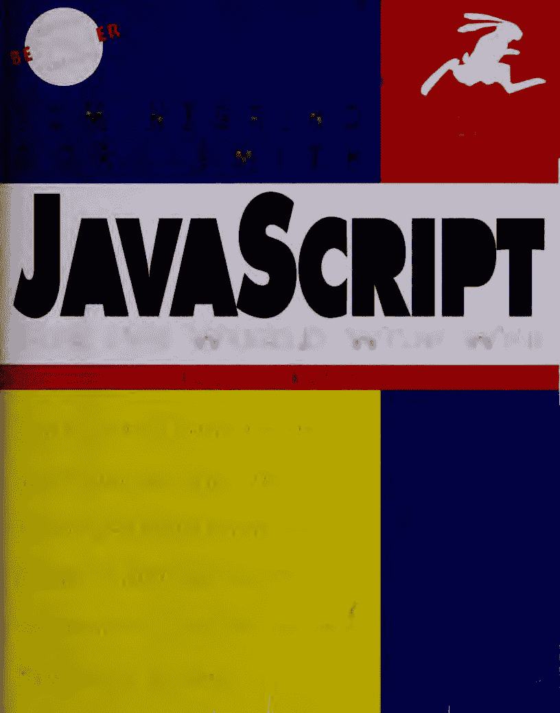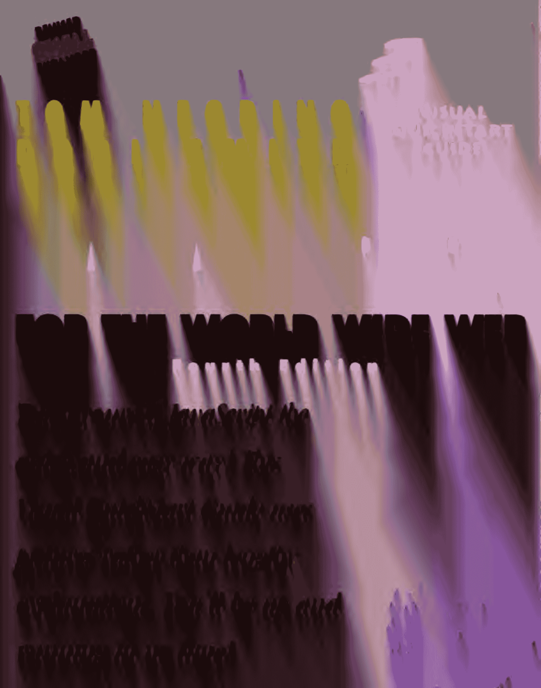


3

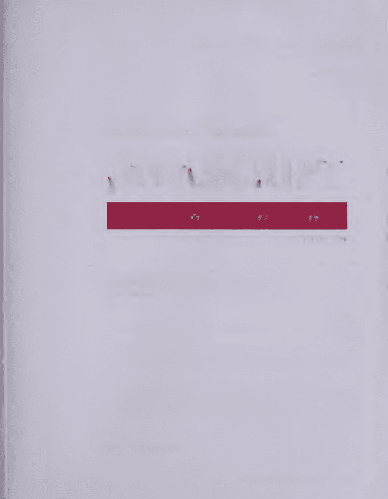


4

## 献词

给 Bill Horwitz 和 Dorothy Negrino，他们热爱学习。


5

## 感谢！

非常感谢我们的编辑 Nancy Davis；她的专业触感让工作更加完美。还要感谢在项目后期出现的 Benjamin Hack，让我们得以完成这本书。感谢 Connie Jeung-Mills 的严谨工作。感谢 Peachpit 的 Nancy Ruenzel 和 Marjorie Baer 提供的支持。感谢我们的代理人 Studio B 的 David Rogel 的建议。感谢我们的儿子 Sean，在父母发躁时没有抱怨太多童军活动。感谢 Macworld 杂志允许我们重用第 16 章的插图。感谢所有选择本书之前的版本作为教材的高中、大学教师。

Dori 想感谢 W&S 小组女士们可爱的关怀。还要感谢 Wise-Women's Web 社区 http://www.wisewomen.org 的耐心和支持。

音乐是 Tom 写作的动力，本书也是如此。本版本的配乐和音乐灵感由 Lucy Kaplansky、Kim Richey、Richard Shindell、Wolfgang Mozart、Mary Chapin Carpenter、Jane Wiedlin、U2、Nina Gordon、Patty Griffin、Rosanne Cash、REM 以及 Antonio Vivaldi 慷提供。

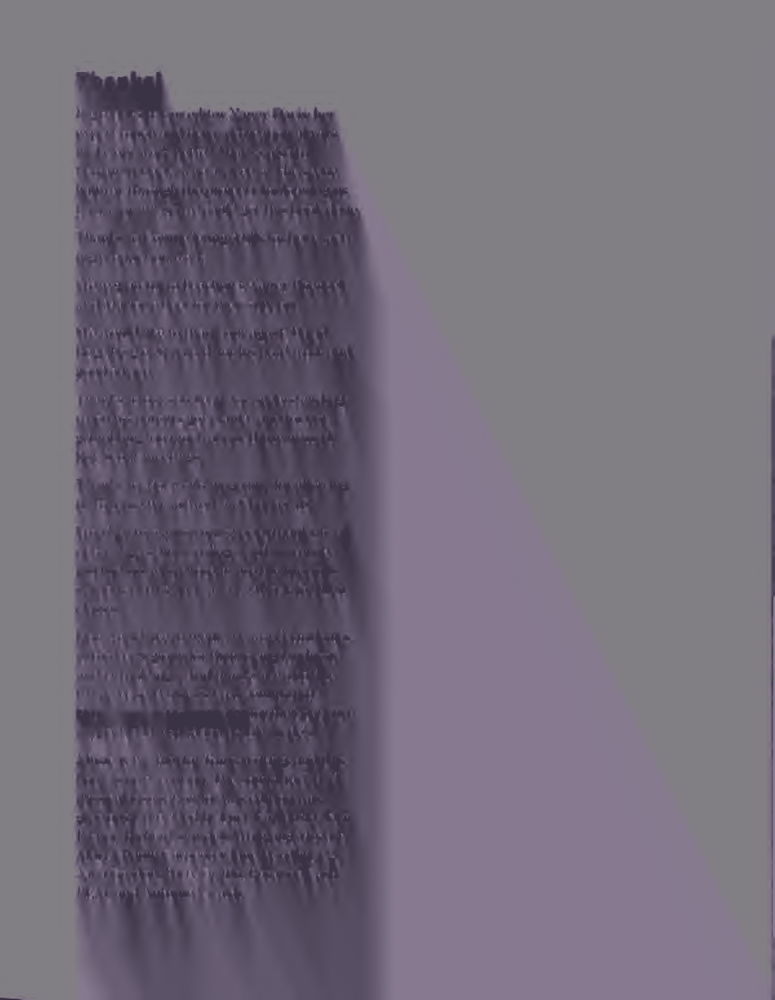

6

## 目录

引言 ... xi

第一章：熟悉 JavaScript

1

第二章：开始吧！

2

第三章：图片的乐趣

45

### 处理浏览器窗口

- 打开新窗口 (112)
- 在窗口中加载不同内容 (114)
- 使用图像链接打开新窗口 (116)
- 滚动窗口 (118)
- 从另一个窗口更新当前窗口 (120)
- 使用 JavaScript 创建新页面 (122)
- 关闭窗口 (124)
- 创建控制面板 (126)
- 在屏幕上定位窗口 (128)
- 窗口加载时显示警报 (130)

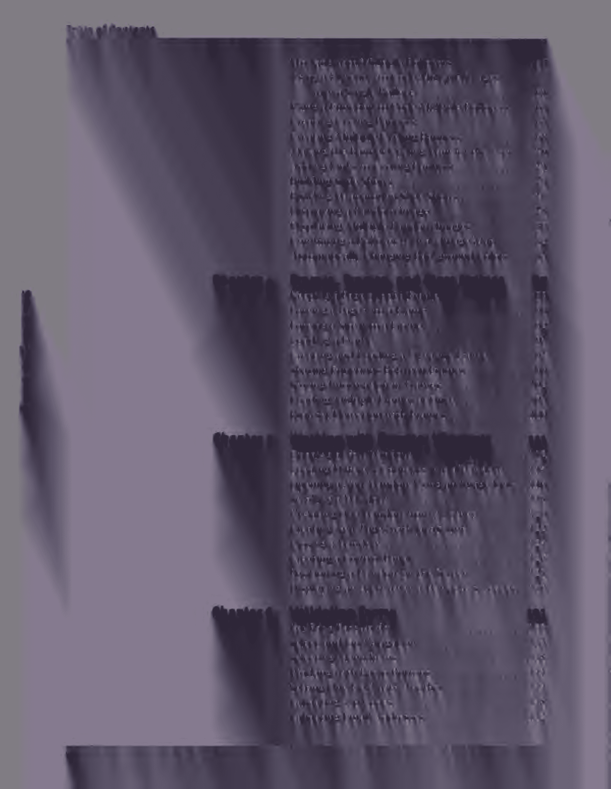

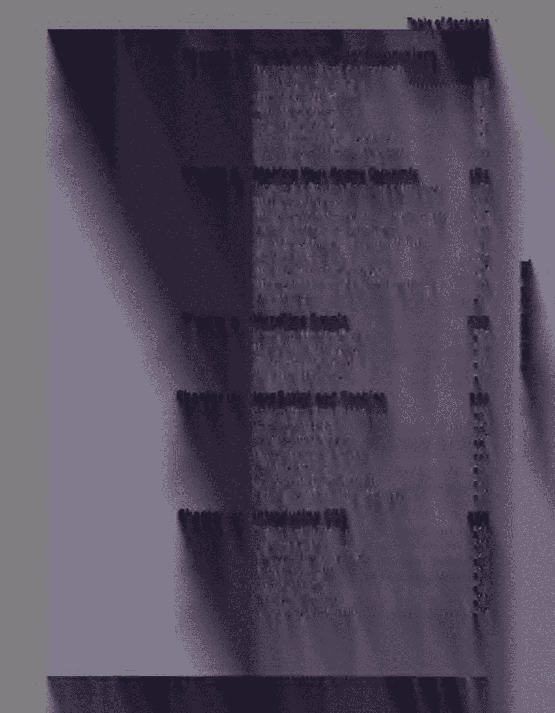

- 趣味名称生成器 (307)

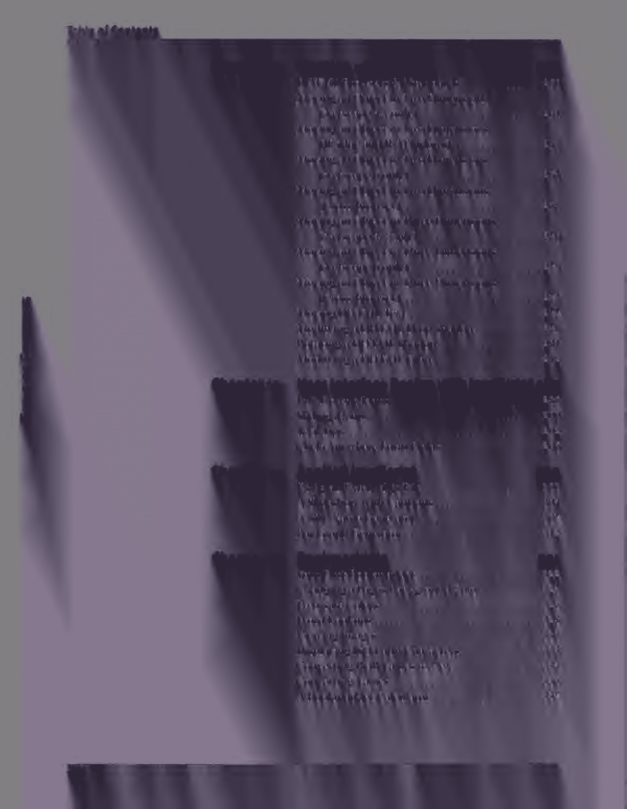

## 引言

欢迎学习 JavaScript！通过这种易读的语言，你将能够为网页增添活力，让它们对你和访问者都更有用。我们编写这本书是作为 JavaScript 的一个无痛入门，因此你不需要成为一个极客或书呆也能编写脚本。在任何时候都不需要所谓的“口袋书”。正如我们的一位朋友说的：“我们很极客，但你不必！”

我们为你撰写了这本书。我们认为，如果你对 JavaScript 感兴趣，那么你已经在创建 HTML 页面和网站方面有一定的经验，并希望通过为你的网站添加一些交互性来迈出下一步。我们并不假设你了解任何编程或脚本知识。我们也不假设你是 HTML 专家（尽管如果你是的话那就很好）。我们假设你至少掌握了构建网页的基础知识，并对常见的 HTML（如链接、图像、表单和框架）熟悉。

在这一版中，我们在名为“足够的 HTML”的新侧边栏中对 HTML 了一些额外的解释。你不会在每个章节都看到这些侧边栏，只会在我们认为需要快速参考的地方出现。手头有 HTML 信息意味着你不需要打开两本书来查找某个 HTML 属性的语法。

如果你已经了解一些编程，请注意我们对 JavaScript 的处理方法与其他书籍不同。我们没有深入探讨 JavaScript 的语法，也不假称这本书是完全全面的（尽管你可以在附录 A 中找到一些参考资料）。

## 你说浏览器，我们说 Kumbaya

由于 Netscape 和微软之间对 JavaScript 语言的争夺（你可以在本书的附录 A，“JavaScript 谱系与参考”中找到更多关于那场斗争的细节），我们有一些脚本只在各种版本的 Netscape Navigator 或 Communicator 中运行，而另一些则只在微软 Internet Explorer 版本中运行。更令人兴奋的是，某些脚本只在 Windows 版 Internet Explorer 或 Mac OS 版 Internet Explorer 上运行。

在之前的版本中，一些读者对我们包含仅在单一浏览器运行的脚本引发了关于偏见的质疑。我们想向您保证，这并非我们的本意——我们真的希望所有脚本都能随处运行。如果有什么方法可以提高它们的跨浏览器兼容性，我们会告诉您的。遗憾的是，每个浏览器的制造商都决定不支持等的功能。我们本可以只包含在任何地方都能运行的脚本，但这将导致一些用的脚本被排除在外，而且对只关心特定浏览器的用户公平。

因此，我们决定包含所有脚本，但会明确标记它们的适用范围。为了让你知道哪些脚本在哪些浏览器中运行，我们用图标标记了脚本：

- IE：标记此图标的脚本在 Mac OS 上的 Internet Explorer 5 或更高版本中运行良好。
- in：标记此图标的脚本在 Windows、Mac 或 Unix 变体上的 Netscape Navigator 或 Communicator 中运行良好。
- Will：标记此图标的脚本在 Windows 版 Internet Explorer（Windows 95 及更高版本）中运行良好。

如果脚本旁边没有任何任何图标，则意味着该脚本在任何浏览器中都能良好运行。

我们（同我们精干的测试团队）在各种浏览器、多个不同的操作系统上对脚本进行了测试，包括 Windows 95、98 和 2000；Mac OS 9 和 Mac OS X；以及 Linux。除了各种版本的 Netscape 和微软浏览器外，我们还使用 Opera（Windows 版 Opera 5 和 Mac 版 Opera 5 预发布版）和 iCab（另一个 Mac 浏览器）进行了一些测试。如果你对开源的 Mozilla 浏览器感兴趣，在我们 2001 年初编写本版本时，它仍然预发布阶段。我们对其进行了一些测试，但由于它尚未完成，我们没有将其作为测试重点。

部分基于 Mozilla 的 Netscape 6 在我们编写本版本期间发布。我们已经在这一新版本中使用 Netscape 6 测试了脚本，但由于有大量报道该浏览器在初始发布时存在严重错误，在你阅读本书时使用的 Netscape 6 版本中的某些脚本可能会出现问题。你应该检查我们的配套网站以获取书中脚本的最新版本（见下文）。在编写本书期间，我们无法访问任何平台的 Internet Explorer 6，如果该浏览器有任何必要的脚本，我们将在我们的网站上说明更改。

不要输入那些代码！有些 JavaScript 书会打印脚本并要求你手动输入示例。我们认为这在当今时代太落后了。对我们来说，做这些已经够辛苦的了，没有理由让你再重复一遍。因此，我们为这本书准备了一个配套网站，其中包含了书中所有的脚本，你可以直接将它们复制并粘贴到自己的 Web 页面中。该网站还包含了额外的技巧和脚本。如果我们发现书中存在逃过编辑流程的错误，我们会在网站上列出更新。你可以在此处找到我们的配套网站：`http://www.javascriptworld.com/`

如果由于某种原因你确实计划输入某些示例，你可能会发现示例似乎不起作用，因为你没有我们创建示例时使用的支持文件。例如，在一个点击屏幕上按钮时播放视频的任务中，你需要一个电影文件。没问题。我们已经将所有这些文件上传到了书籍网站，并为你良好地打包以便下载。你会找到一个包含所有脚本、HTML 文件以及我们使用的音频和图像文件的可下载文件。如果你有任何问题，请查看配套网站上的 FAQ（常见问题）页面。

如果你阅读了 FAQ 但你的问题没有在那里得到解答，可以通过电子邮件与我们联系：`js4@javascriptworld.com`。遗憾的是，由于收到的邮件量巨大，我们无法回答发送到我们个人邮箱的关于书籍的邮件。我们只能保证发送到 `js4@javascriptworld.com` 地址的消息将得到回复。

## 开始吧

JavaScript 的最大用处之一是你可以从一个简单的脚本开始，让你的 Web 页面产生一些酷炫的效果，然后根据需要添加更复杂的功能。你不需要在改进 Web 页面之前先学习一整本书的信息。

当然，每段旅程都始于第一步，如果你已经读到了这里，你的 JavaScript 之之旅已经开始了。感谢你的加入；请将你的手脚留在移动的车辆内。并且，请勿使用闪光灯。

## 熟悉 JavaScript

对于网站创建者来说，HTML 的演变是一把双刃剑。在万维网的早期，HTML 相当简单，学习组合 Web 页面所需的大部分内容非常容易。随着 Web 的增长，页面设计者的愿望也随之增长，他们对页面外观更大控制的需求迫使 HTML 发生变化并变得更加复杂。由于 Web 是一个动态媒介，页面设计师还希望他们的页面能与用户交互，很快就会发现 HTML 不足以应对这一需求。Netscape 发明了 JavaScript，作为一种控制浏览器并为 Web 页面增添活力和互动性的方法。

# 第一章

## 什么是 JavaScript

JavaScript 是一种你可以用于为 Web 页面添加交互功能的编程语言。但如果你不是程序员，也不要对“编程语言”这个术语感到慌；网络上有大量的 JavaScript 可供选择，你可以复制并修改它们供自己使用，只需付出极少的精力。事实上，以这种方式站在其他程序员的肩膀上是熟悉 JavaScript 的绝佳技巧，如果你做得足够多（并且读了此书），你很快就能创建自己的脚本了。

为了让你更轻松地开始使用 JavaScript，作者们建立了一个网站作为本书的补充。我们包含了书中所有的脚本（这样你就不需要自己输入它们了！），以及额外的注释、附录和更新。

你可以在 `http://www.javascriptworld.com` 找到我们的网站。

你经常会看到 JavaScript 被称为“脚本语言”，这暗示了编写脚本似乎比编写程序要容易一些。在这种情况下，这种区分并没有本质上的区别。

一个 JavaScript 脚本是一个被包含在 HTML 页面上的程序。因为它被包裹在 `<SCRIPT>` 标签中，脚本的文本不会显示在用户的屏幕上，Web 浏览器知道运行 JavaScript 程序。`<SCRIPT>` 标签通常位于 HTML 页面的 `<HEAD>` 部分，尽管如果你愿意，你也可以将脚本放在 `<BODY>` 部分。向屏幕写入文本或写入 HTML 的脚本最好放在 `<BODY>` 部分，如脚本 1.1 所示。如果你不熟悉这些 HTML 概念并需要更多关于 HTML 的信息，我们建议你查看 Elizabeth Castro 写的《HTML 4 for the Wide Web: Visual QuickStart Guide》，该书也由 Peachpit Press 出版。

脚本 1.1：这个非常简单的脚本在浏览器窗口中输入“Hello, Cleveland!”。

```html
<!DOCTYPE HTML PUBLIC "-////W3C//DTD HTML 4.01 Transitional//EN" "http://www.w3.org/TR/html4/loose.dtd">
<HTML>
<HEAD>
<TITLE>Barely a script at all</TITLE>
</HEAD>
<BODY BGCOLOR="WHITE">
<H1>
<SCRIPT LANGUAGE="JAVASCRIPT" TYPE="text/javascript">
document.write("Hello, Cleveland!")
</SCRIPT>
</H1>
</BODY>
</HTML>
```


图 1：鼠标悬停是指当你将鼠标指针移动到其上方时会改变的图像。

## 接触 JavaScript

### JavaScript 可以做什么

你可以使用 JavaScript 做很多事情来让你的 Web 页面更有交互性，并为你网站的用户提供更好、更刺激的体验。JavaScript 让你创建一个活动界面，在用户浏览你的页面时给他们反馈。例如，你可能见过某些网站的按钮在你移动鼠标指针时会高亮。这是通过 JavaScript 实现的，使用了鼠标悬停的技术（图 1.1）。

你可以使用 JavaScript 确保用户在表单中输入有效信息，这可以为你的业务节省金钱。如果你的表单需要计算，你可以在用户的机器上通过 JavaScript 完成，而无需任何服务器端处理。

顺便说，这是一个你应该了解的区别：运行在用户机器上的程序被称为客户端程序；运行在服务器上的程序（包括一些称为 CGI 的东西；稍后会提到）被称为服务器端程序。

通过 JavaScript，你有能力根据用户的操作即时创建自定义的 HTML 页面。假设你正在运行一个旅游网站，用户点击了夏威夷作为目的地。你可以让最新的旅游优惠出现在新窗口中。JavaScript 控制浏览器，因此你可以打开新窗口、显示警告框，并在浏览器窗口的状态栏放置自定义消息。由于 JavaScript 拥有一套日期和时间功能，你可以生成时钟、日历时间戳文档。在 Netscape Navigator 3.0 及后续（所有平台）以及 Internet Explorer 5.0 及后续（仅限 Macintosh），你可以使用 JavaScript 测试浏览器插件是否存在，如果用户没有查看页面所需的插件，则将他们引导到另一个页面。

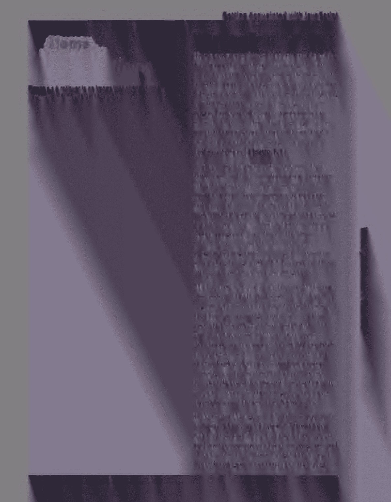

### JavaScript 不是 Java

尽管名字相似，JavaScript 和 Java 之间几乎没有任何关系。Java 是一种由 Sun Microsystems 开发并营销的全功能编程语言。

使用 Java（C 和 C++ 编程语言的后代），程序员可以创建整个应用程序并控制消费电子设备。与其他语言不同，Java 提供了跨平台兼容性的承诺，也就是说，程序员应该编写一个可以在任何机器运行的程序，无论是 Windows、Mac 还是 Unix。在实践中，由于 Sun 和 Microsoft 之间的争斗，Java 并没有完全实现这个梦想。Microsoft 的介入是因为他们想以 Sun 所说的方式来整合 Java。Java 在客户端的主要用途是创建 applet，即通过 Internet 下载并运行在浏览器内部的小型程序。由于 Java 的跨平台特性，这些 applet 应该在任何支持 Java 的浏览器中运行。

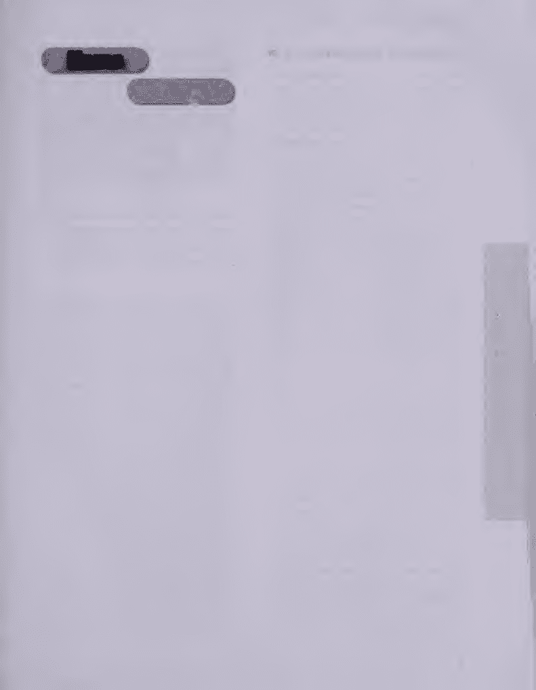

图 1.2：这个 applet 玩跳棋游戏，这是你用 JavaScript 创建不了的东西。该 applet 占据了从弹出菜单到屏幕底部按钮的空间。

如果你对学习更多 Java 感兴趣，我们推荐 Peachpit Press 出版的《Java for the Wide Web: Visual QuickStart Guide》。

### 认识 JavaScript

图 1.3：猫对象（这个猫的名字叫 Pixel）。

图 1.4：这个弹出菜单是一个浏览器对象，可以对其进行操作。

任意日期

- 上个月
- 上上周
- 今天

### 胶合型语言

这里有另一个我们应该搞清楚的热词：JavaScript 是一种面向对象的语言。那么这意味着什么呢？

### 对象

首先，让我们来思考对象。对象是某种东西。猫、电脑和自行车都是物理世界中的对象（图 1.3）。对于 JavaScript 来说，它在 Web 浏览器中处理的对象有很多，例如窗口、表单以及表单元素，如按钮和复选框（图 1.4）。

由于你可以拥有多只猫或多个窗口，因此给它们命名是有意义的。虽然你可以把你的宠物称为 Cat #1 和 Cat #2，但从两个原因来看，这是个坏主意：首先，如果它们有独特的名称，更容易区分它们；其次，这太不礼貌了。同样，本书书中所有的示例都会给对象赋予它们独特的名称。


- **提示**：请注意，你在互联网上看到的脚本可能会引用像`window[0]`和`form[]`这样的对象。由于上述原因，这是糟糕的写法，你会发现，如果你给它们命名而不是使用数字，跟踪脚本中不同对象会容易得多。

### 属性

对象拥有属性。猫有毛皮，电脑有键盘，自行车有轮子。在 JavaScript 世界中，窗口有标题，表单可以有一个复选框。更改对象的属性可以修改该对象，而同一个属性可以应用于完全不同的对象。假设你有一个名为`empty`的属性。在任何适用的地方使用`empty`都是可以的，你可以说猫肚子是空的（`empty`），猫的饭碗也是空的（`empty`）。

- **注意**：电脑的键盘和自行车的轮子不仅仅是属性；它们本身也是对象，可以拥有自己的属性。因此，对象可以拥有子对象。

### 方法

对象可以做的事情被称为方法。猫会呼呼，电脑会机，自行车会滚动。JavaScript 对象也有方法：按钮可以点击，窗口可以`open()`，文本可以被`select()`。括号表示我们引用的是一个方法而不是属性。

- **提示**：将对象和属性视为名词，将方法视为动词，可能会有所帮助。前者是事物，后者是这些事物可以执行或对它们执行的动作。

### 组合在一起

你可以将对象、属性和方法组合在一起，以更好地描述一个对象或描述一个过程。在 JavaScript 中，这些通过点分隔（也称为点，如 Internet 地址中的点）。这被称为点语法。以下是以后这种方式编写的对象及其属性的示例：

- `bicycle.wheels`
- `cat.paws`
- `computer.disk`
- `document.images.name`

以下是使用点语法编写的对象和运行的示例：

- `cat.purr()`
- `document.write()`
- `forms.radio.click()`

### 处理事件

事件是用户在访问你的页面时执行的操作。提交表单和将鼠标移动到图像上是事件的两个例子。

JavaScript 使用称为**事件处理器**（event handlers）的命令来处理事件。用户在页面上的操作会触发脚本中的事件处理器。十二种常见的 JavaScript 事件处理器列在表 1.1 所示。我们将在第 9 章处理其他更高级的事件处理器。

例如，假设我们的猫通过执行`purr`（呼呼）和`stretch`（伸展）动作来处理`onPetting`（抚摸）事件。在 JavaScript 中，如果用户点击按钮，`onClick`事件处理器将记录该操作并执行它被分配的任何职责。

当你编写脚本时，不需要预测用户可能采取的每一个可能的操作，只需要你希望某些事情发生的操作即可。例如，你的页面即使没有`onload`处理器也能正常加载。但如果你想在页面加载时立即触发脚本，你就会使用`onload`命令。

### 值与变量

在 JavaScript 中，一条信息被称为**值**（value）。值有不同的类型；你最熟悉的类型是数字。字符串值是包含在引号中的单词。其他类型的 JavaScript 值列在表 1.2 所示。

变量包含值。例如，变量名被赋值为字符串`"door"`。另一种写法是`name="door"`。等号可以读作“被设置为”。换句话说，变量名现在包含了值`"door"`。

- **提示**：JavaScript 是区分大小写的。这意味着`name`与`Name`不同，它们也都与`MyName`不同。

- **提示**：变量名不能包含空格或其他标点符号，不能以数字开头。它们还不能是 JavaScript 的保留字。保留字列表请参见附录 B。

运算符（Operators）是用于处理变量的符号。

- **提示**：你已经熟悉算术运算符（加、减）。参见表 1.3 获取完整的运算符列表。

#### 表 1.2 值类型

| 类型 | 描述 | 示例 |
| :--- | :--- | :--- |
| `Number` | 任何数值 | `3.141592654` |
| `String` | 引号内的字符 | `"Hello, world!"` |
| `Boolean` | 真或 | `true` |
| `Null` | 空且无意义 | |
| `Object` | 与对象相关的值 | |
| `Function` | 函数返回的值 | |

#### 表 1.3 运算符

| 运算符 | 功能 |
| :--- | :--- |
| `x + y`（数字） | 将`x`和`y`相加 |
| `x + y`（字符串） | 将`x`和`y`连接 |
| `x - y` | 从`x`中减去`y` |
| `x * y` | 将`x`和`y`相乘 |
| `x / y` | 将`x`除以`y` |
| `x % y` | `x`和`y`的模（即`x`除以`y`的余数） |
| `x++, ++x` | 将`x`加一（等同于`x + 1`） |
| `x--, --x` | 将`x`减一（等同于`x - 1`） |

#### 表 1.1 事件处理器

| 事件 | 处理的内容 |
| :--- | :--- |
| `onAbort` | 用户中止加载页面 |
| `onBlur` | 用户离开了对象 |
| `onChange` | 用户更改了对象 |
| `onClick` | 用户点击了对象 |
| `onerror` | 脚本遇到错误 |
| `onfocus` | 用户激活了对象 |
| `onload` | 对象加载完成 |
| `onmouseover` | 鼠标移动到对象上 |
| `onmouseout` | 鼠标离开对象 |
| `onselect` | 用户选择了对象的内容 |
| `onSubmit` | 用户提交了表单 |
| `onunload` | 用户离开了窗口 |

### 了解 JavaScript

#### 表 1.4 赋值运算符

| 运算符 | 作用 |
| :--- | :--- |
| `x = y` | 将`y`的值赋予`x` |
| `x += y` | 等同于`x = x + y` |
| `x -= y` | 等同于`x = x - y` |
| `x *= y` | 等同于`x = x * y` |
| `x /= y` | 等同于`x = x / y` |
| `x %= y` | 等同于`x = x % y` |

#### 表 1.5 比较运算符

| 运算符 | 作用 |
| :--- | :--- |
| `x == y` | 如果`x`和`y`相等，返回`true` |
| `x != y` | 如果`x`和`y`不相等，返回`true` |
| `x > y` | 如果`x`大于`y`，返回`true` |
| `x >= y` | 如果`x`大于或等于`y`，返回`true` |
| `x < y` | 如果`x`小于`y`，返回`true` |
| `x <= y` | 如果`x`小于或等于`y`，返回`true` |
| `x && y` | 如果`x`和`y`都为`true`，返回`true` |
| `x \| y` | 如果`x`或`y`其中一个为`true`，返回`true` |
| `!x` | 如果`x`为`false`，返回`true` |

#### 赋值与比较

当你将一个值放入变量时，你正在将该值赋值给变量，并使用赋值运算符来完成这项工作。例如，你使用等号运算符来进行赋值，如`hisName="Tom"`。如表 1.4 所示，有一整套赋值运算符。

除了等号之外，其他赋值运算符充当修改变量值的简写。例如，`x=x+5`的简短表达方式是`x+=5`。为了清晰起见，我们在书中大部分情况下都使用了较长的版本。

你经常需要将一个变量的值与另一个值，或者将变量的值与字面量（即输入在表达式中的值）进行比较。例如，你可能想比较星期几是否为“Tuesday”，你可以通过检查`todaysDate=="Tuesday"`来实现。比较运算符的完整列表见表 1.5。

- **提示**：如果你在比较字符串，请注意`"a"`大于`"A"`，且`"abracadabra"`小于`"be"`。

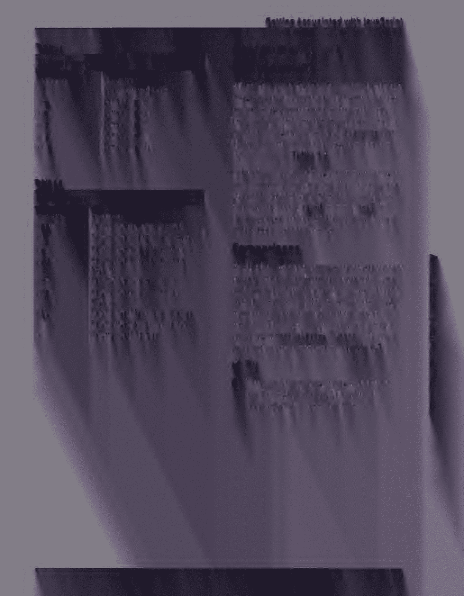

## 2 使用什么工具？

由于 JavaScript 只是纯文本，你可以使用几乎任何类型的文本编辑器。你甚至可以使用像 Microsoft Word 这样的文字处理器，但你必须始终确保 Word 将文件保存为“纯文本”，而不是其原生文件格式。使用以纯文本为标准的程序会更好。

在 Windows 上，许多人使用记事本（图 1.5）。如果他们想要一个为编写 HTML 设计的程序，Allaire 的 Site 是一个很好的选择。在 Mac 上，你可以使用 SimpleText，尽管专业人士更喜欢 BBEdit（图 1.6）。在 Unix 机器上，Emacs 是可用编辑器中最好的之一。无论你使用什么程序，都不要忘记将纯文本文件以`.html`或`.htm`扩展名保存，这样当你将文件上传到 Web 服务器时一切都会顺利。

你还可以使用一些 WYSIWYG（所见即所得）HTML 编辑器，例如 Adobe GoLive、Microsoft FrontPage（PC 版；Mac 版非常糟糕）或 Macromedia Dreamweaver。只需切换到它们的 HTML 源码模式，就可以开始编写脚本了。GoLive 甚至提供了内置的 JavaScript 创建和语法检查功能。

```html
<!DOCTYPE HTML PUBLIC "-//W3C//DTD HTML 4.1 Transitional//EN"
"http://www.w3.org/TR/html4/loose.dtd">

<html>
<head>
<title>weekend Checker</title>
</head>
<body>
<script>
var d = new Date();
var hour = d.getHours();

if (hour > 13) {
  alert("It's a weekend");
}
</script>
</body>
</html>
```

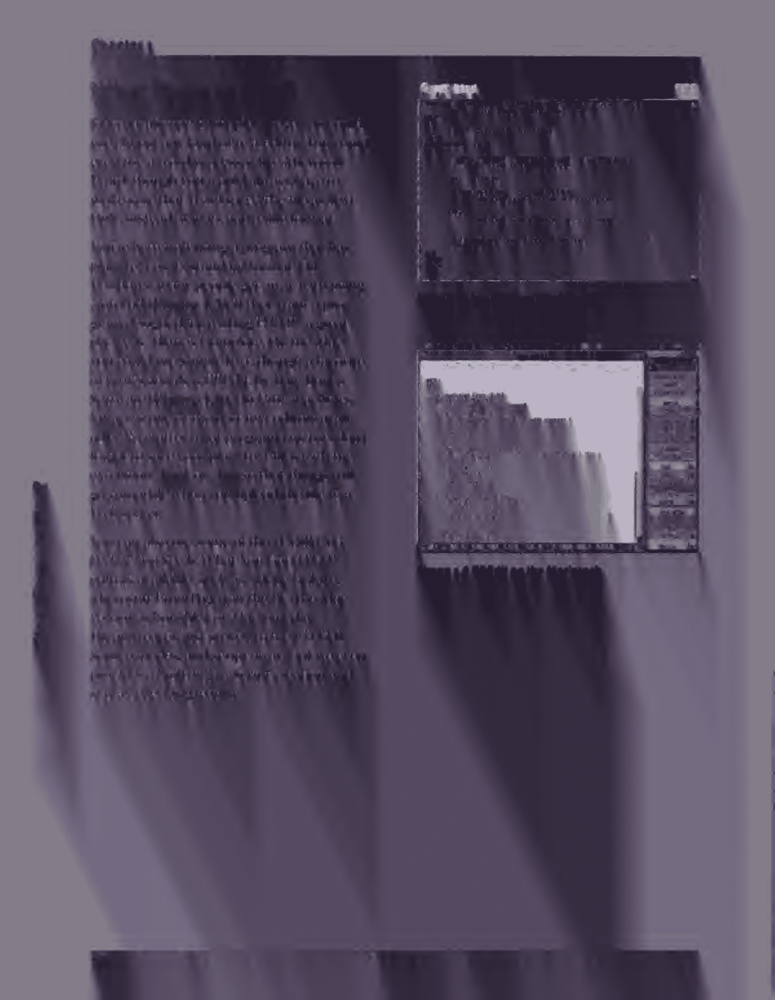

## 开始吧！

热身已经结束了；是时候编写脚本了。在本章中，你将学习如何将脚本放置在 HTML 中；如何使用弹窗框与用户通信；如何检查浏览器插件是否存在；使用 JavaScript 编写你的页面以及更多内容。我们还将向你介绍语言的更多方面，例如循环和函数（不要让你的眼睛发直；我们开始吧！）

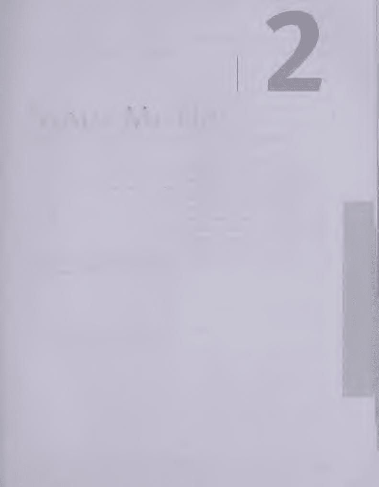

## 2 足够的 HTML——基础知识

### 表 2.1 标签

| 标签 | 含义 |
| :--- | :--- |
| `HTML` | 包含 Web 页面的 HTML 部分 |
| `HEAD` | 包含 Web 页面的头部部分 |
| `TITLE` | 包含 Web 页面的标题 |
| `BODY` | 包含 Web 页面的正文部分 |
| `BGCOLOR` | 设置页面的背景颜色 |
| `H1...H6` | 此标签的内容被强调为标题信息；`H1` 是最大的标题字体，到`H6`是最小的标题 |
| `ALIGN` | 描述此标签内容在页面上的水平或垂直对齐位置 |
| `A` | 链接到另一个 Web 页面 |
| `HREF` | 指定点击链接时用户应该去的地方 |
| `TABLE` | 在 Web 页面上呈现表格数据 |
| `CELLPADDING` | 单元格内部内容与单元格边界之间的空间大小 |
| `CELLSPACING` | 不同单元格之间的空间 |
| `TR` | 开启表格中的行 |
| `VALIGN` | 行的垂直对齐方式 |
| `TH` | 表格列的标题单元格 |
| `BGCOLOR` | 此标题单元格的背景颜色 |
| `TD` | 包含表格中的每个单元格 |
| `BGCOLOR` | 此单元格的背景颜色 |

启动它！

脚本 2.1 脚本总是需要被包含在`<SCRIPT>`和`</SCRIPT>` HTML 标签内部。

```html
<!DOCTYPE HTML PUBLIC "-//W3C//DTD HTML 4.01 Transitional//EN">
"http://www.w3.org/TR/html4/loose.dtd">
<HTML>
<HEAD>
<TITLE>My first script</TITLE>
</HEAD>
<BODY BGCOLOR="WHITE">
<h1>
<SCRIPT LANGUAGE="JAVASCRIPT" TYPE="TEXT/JAVASCRIPT">
document.write("Hello, world!")
</SCRIPT>
</h1>
</body>
</HTML>
```

Netscape：我的脚本 Hello, world! 图 2.1 “Hello, world”示例在代码书籍中是必不可少的。如果我们漏掉它，可能都会丢掉工会证。

## 将你的脚本放在什么处

脚本可以放在 HTML 页面上的两个位置之一：`<HEAD>`和`</HEAD>`标签之间（称为头部脚本），或者`<body>`和`</BODY>`标签之间（主体脚本）。脚本 2.1 是主体脚本的一个示例。有一个 HTML 容器标签表示脚本，正如你所料的，它以`<SCRIPT>`开始并以`</SCRIPT>`结束。

编写你的第一个脚本：

1. `<SCRIPT LANGUAGE="JAVASCRIPT" TYPE="TEXT/JAVASCRIPT">`

   这是脚本的起始标签。它告诉浏览器期待 JavaScript 而不是 HTML。`LANGUAGE="JAVASCRIPT"`属性标识浏览器正在使用哪种脚本语言，而`TYPE="TEXT/JAVASCRIPT"`属性告诉浏览器脚本是组织成 JavaScript 格式的纯文本。

2. `document.write("Hello, world!")`

   这是你的第一行 JavaScript：它获取文档窗口并将“Hello, world!”写入其中，如图 2.1 所示。

3. `</SCRIPT>`

   这结束了 JavaScript 并告诉浏览器开始重新期待 HTML。

- **提示**：在本书的其余大部分内容中，我们在代码解释中省略了`<SCRIPT>`标签。正如你从脚本本身看到的，它们仍然存在且是必需的，但我们不会用它们弄乱我们的解释。你可以在页面上放置任意数量的脚本标签（因此可以有多个脚本）。

## 第 2 章 向旧浏览器隐藏脚本

旧版浏览器（包括 Netscape 1.x、Microsoft Explorer 3 及其更早版本，以及版本 4 之前的在线浏览器）不理解 JavaScript。虽然良好的浏览器本应该忽略它们不理解的标签之间的所有内容，但并非所有浏览器都这样做。有一种技术（如脚本 2.2 所示）可以欺骗这些落后的浏览器，让它们认为你的脚本内容实际上是 HTML 注释，然后它们就会忽略它们。注释是包含在特殊标签中的文本；标签内的任何文本——备注、代码说明、任何内容——都会被浏览器忽略。

要向旧浏览器隐藏 JavaScript：

1. `<!-- Hide script from old browsers`

   这一行用`<!--`打开 HTML 注释。

2. `document.write("Hello, world!")`

   这是实际的 JavaScript，如上一个示例所示。

3. `// End script from old browsers`

   这一行以`//`开头表示 JavaScript 注释，并以`-->`结束 HTML 注释。

- **提示**：这种技术贯穿本书，所以我们只在这里解释它。从现在起，你应该直接假设它已经包含了。如果你有想让旧浏览器用户看到的消息，可以将其添加到`<noscript>`标签中。这既会被表现不佳的浏览器处理，也会在用户（不幸地）关闭 JavaScript 时被较新的浏览器处理。脚本 2.2 这里是如何保护你的脚本免受旧浏览器影响的。

```html
<!DOCTYPE HTML PUBLIC "-//W3C//DTD HTML 4.01 Transitional//EN">
"http://www.w3.org/TR/html4/loose.dtd">
<HTML>
<HEAD>
<TITLE>My first script</TITLE>
</HEAD>
<BODY BGCOLOR="WHITE">
<h1>
<SCRIPT LANGUAGE="JAVASCRIPT" TYPE="TEXT/JAVASCRIPT">
<!-- Hide script from old browsers -->
document.write("Hello, world!")
// End hiding script from old browsers -->
</SCRIPT>
</h1>
</body>
</HTML>
```

## 在脚本中使用注释

脚本 2.3 这是你可以如何使用注释标记你的脚本，这有助于他人理解你的代码。养成在脚本中添加注释的习惯是一个好主意。虽然当你写的时候可能觉得非常清楚，但如果你几个月后回来，它可能看起来像一团糊涂。注释脚本的另一个原因是帮助那些想要重用和修改你脚本的人。

为你的脚本添加注释：

1. `/* This is an example of a long multi-line comment.`

   注意注释开头和结尾的字符。行头的`/*`告诉 JavaScript 忽略之后的所有内容，直到注释结束。

2. `*/`

   这是注释的结束。

3. `document.write("Hello, world!")`


这里又是实际的脚本，如前两个示例所示。是的，我们对这个也和你们一样厌倦了，但所有代码书籍以“Hello, world!”示例开始是种传统。传统也就如此。

## 第 2 章 MX

### 提醒用户

JavaScript 的主要用途之一是为浏览网站的用户提供反馈。你可以创建一个弹出的警告窗口，为用户提供他们了解页面时所需的至关重要的信息。

在用户界面设计中，通常少即是多。例如，你可以通过响亮的警报汽器声和巨大的动画横幅来吸引用户的注意力，但那样就显得有些过头了。相反，脚本 2.4 展示了如何创建一个美观、得体的警告窗口。现在你知道为什么我们是写作者的，而不是设计师了。

要提醒用户：

```javascript
alert("Welcome to my JavaScript page!")
```

是的，全部就这么简单，如图 2.2 所示。只需在 `alert()` 方法中用引号括起你想要显示的文本即可。脚本 2.4 警报对话框可以帮助你与用户通信。

```html
<!DOCTYPE HTML PUBLIC "-//W3C//DTD HTML 4.01 Transitional//EN"
"http://www.w3.org/TR/html4/Loose.dtd">
<HTML>
<HEAD>
<TITLE>My JavaScript page</TITLE>
<SCRIPT LANGUAGE="JAVASCRIPT" TYPE="TEXT/JAVASCRIPT">
<!-- Hide script from old browsers -->
alert("Welcome to my JavaScript page!")
// End hiding script from old browsers -->
</SCRIPT>
</HEAD>
<BODY BACKGROUND="WHITE">
<NOSCRIPT>
<h2>This page requires JavaScript.</h2>
</NOSCRIPT>
</BODY>
</HTML>
```

[](img/574ff1a7f6aea08a8d74ac1fba624480_31_1.png)

启动我！

www.halcedony.com

JavaScript 应用！

欢迎来到我的 JavaScript 页面！

Internet Explorer 脚本警告

欢迎来到我的 JavaScript 页面！

图 2.2. 虽然有时你话不多。这个脚本只会弹出一个对话框；显示的三个是对话框在不同环境下的外观示例，从上到下分别是：Mac 版 Netscape Communicator；Windows 版 Microsoft Internet Explorer；以及 Mac 版 Microsoft Internet Explorer。

> **提示**
>
> 在 Netscape JavaScript 警告框（6 以前版本）中，你总是看到文本告诉用户警告框是由 JavaScript 命令弹出的。例如，在 Mac 版 Netscape 4 上，它显示“JavaScript Application”，如图 2.2 所示。这是一项安全功能，防止不良的脚本编写者欺骗不幸的用户。你无法通过代码绕过这一点。在 Mac 版 Internet Explorer 中，窗口标题是“Internet Explorer Script Alert”。Windows 98 版 Internet Explorer 则没那么明确；窗口只显示“Microsoft Internet Explorer”。遗憾的是，Netscape 6 取消了这个实用的功能，取而代之的是简单的标题“Alert”。

你还会这里看到 `<NOSCRIPT>` 标签。在不支持 JavaScript 的浏览器（旧浏览器或禁用了 JavaScript 的浏览器）上，会出现一条消息说此页面需要 JavaScript。

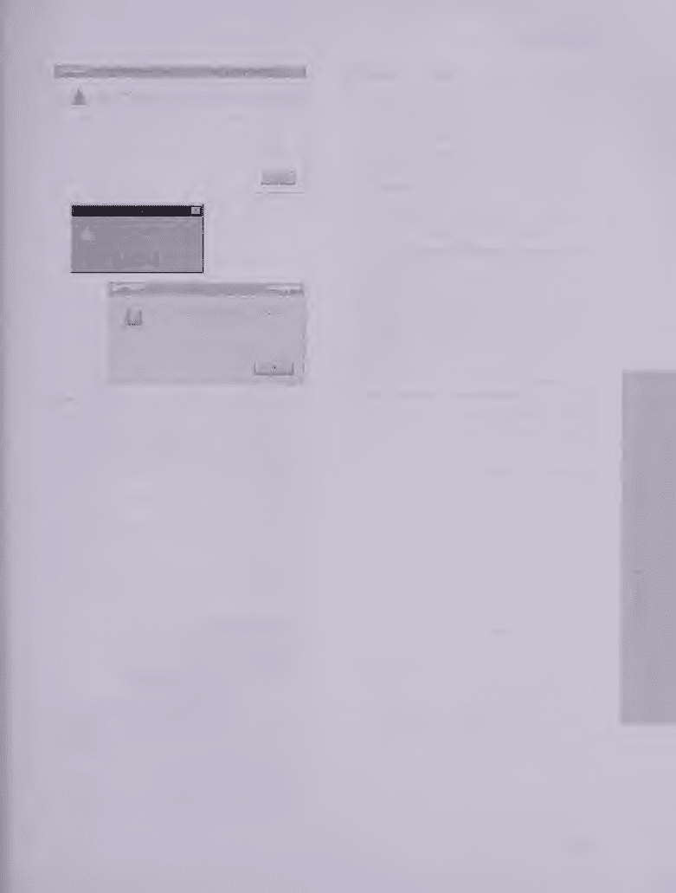[](img/574ff1a7f6aea08a8d74ac1fba624480_32_1.png)

## 第 2 章 确认用户的选择

虽然给用户提供信息很有用，但有时你也想获取返回信息。脚本 2.5 展示了如何判断用户是接受还是拒绝了你的问题。该脚本还引入了条件判断的概念，即脚本提出一个测试，并根据测试结果执行不同的操作。

### 更多关于条件判断

条件判断分为三个部分：我们测试的部分、`then`（那么）部分（我们放在结果为真时想要执行的脚本部分），以及一个可选的 `else`（否则）部分（包含结果不为真时希望执行的脚本部分）。我们测试的内容在括号中，另外两个部分的内容分别包含在大括号中。

要确认一个选择：

1. `confirm()` 方法接受一个参数（你想问用户的问题），并根据用户的响应返回 `true` 或 `false`。
2. `alert("You said yes")` 如图 2.3 所示，如果用户点击了“OK”按钮，`confirm()` 返回 `true`，警告框显示“You said yes”。如你所见，这是代码的 `then` 部分，尽管 JavaScript 中没有对应的运算符。大括号作为 `then` 区域的界定。
3. 脚本 2.5 你根据用户对提示的反应来更改回复。

```html
<!DOCTYPE HTML PUBLIC "-//W3C//DTD HTML 4.01 Transitional//EN"
"http://www.w3.org/TR/html4/loose.dtd">
<HTML>
<HEAD>
<TITLE>My JavaScript page</TITLE>
<SCRIPT LANGUAGE="JAVASCRIPT" TYPE="TEXT/JAVASCRIPT">
<!-- Hide script from old browsers -->
if (confirm("Are you sure you want to do that?")) {
  alert("You said yes")
} else {
  alert("You said no")
}
// End hiding script from old browsers -->
</SCRIPT>
</HEAD>
<BODY BACKGROUND="WHITE">
<NOSCRIPT>
<h2>This page requires JavaScript.</h2>
</NOSCRIPT>
</BODY>
</HTML>
```

图 2.3 你可以获取用户的操作结果并在警告框中确认该结果，所示。上面的图像向用户提了一个问题，点击 OK 或 Cancel 按钮的结果显示在下方。

[](img/574ff1a7f6aea08a8d74ac1fba624480_33_1.png)

## 启动我！

### 没有正确的方法

从字面上说，有无数种方法可以编写任何脚本并使其正确运行。例如，如果条件代码块中只有一条命令，则不需要大括号。

此外，还有另一种编写条件判断的方法，形式如下：

`condition ? truePart : falsePart`

这大致相当于：

```javascript
if (condition) {
  truePart
} else {
  falsePart
}
```

同样，并没有要求大括号必须位于行尾或行首，也没有要求真假代码块缩进。这完全是风格问题，正确的风格应该是你发现对你最有效的那种。

在本书书中，为了清晰起见，我们在示例中包含了大括号，并选择了较长的条件判断形式。

3. `}` 这个大括号结束了当 `confirm()` 返回 `true` 值时的部分。
4. `else {` 这里开始了在用户按下“Cancel”按钮时才会发生的部分。
5. `alert("You said no")` 然而，如果用户点击了“Cancel”按钮，`confirm()` 返回 `false`，显示“You said no”。
6. `}` 这个大括号结束了整个 `if/else` 条件语句。

> **提示**
>
> 你可以在 `then` 和 `else` 大括号中放置任意数量的语句。

## 第 2 章

### 提示用户

有时候，你不仅仅想问一个“是/否”的问题，而是想获得一个更具体的回复。在这种情况下，脚本 2.6 允许你提一个问题（带有默认答案）并相应地接收回复。图 2.4 显示了结果。

要提示用户提供答复：

```javascript
ans = prompt("Are you sure you want to do that?","")
```

`prompt()` 方法接收两个参数：给用户的问题和默认答案。它返回用户的答复或 `null`；后者的情况发生在用户点击了“取消”（Cancel）、在没有默认值的情况下用户点击了“确定”（OK），或者用户清空了默认答案并点击了“确定”时。

> **提示**
>
> 在某些浏览器中，如果你省略了第二个参数（默认响应），一切仍能正常工作。但在其他浏览器中，提示窗口将会出现并显示默认值为“undefined”。解决方法是始终包含某些默认值，即使它是一个空字符串（如脚本 2.6 所示）。

### 脚本 2.6 启动我！

你可以使用对话框来查询用户并处理回复。

```html
<!DOCTYPE HTML PUBLIC
"-//W3C//DTD HTML 4.01 Transitional//EN"
"http://www.w3.org/TR/html4/loose.dtd">
<HTML>
<HEAD>
<TITLE>My JavaScript page</TITLE>
<SCRIPT LANGUAGE="JAVASCRIPT" TYPE="TEXT/JAVASCRIPT">
<!-- Hide script from old browsers -->
  ans = prompt("Are you sure you want to do that?","")
  if (ans) {
    alert("You said "+ans)
  } else {
    alert("You refused to answer")
  }
// End hiding script from old browsers -->
</SCRIPT>
</HEAD>
<BODY BACKGROUND="WHITE">
<NOSCRIPT>
<h2>This page requires JavaScript. </h2>
</NOSCRIPT>
</body>
</HTML>
```

图 2.4 你可以提示用户输入文本字符串，然后对该字符串进行操作。

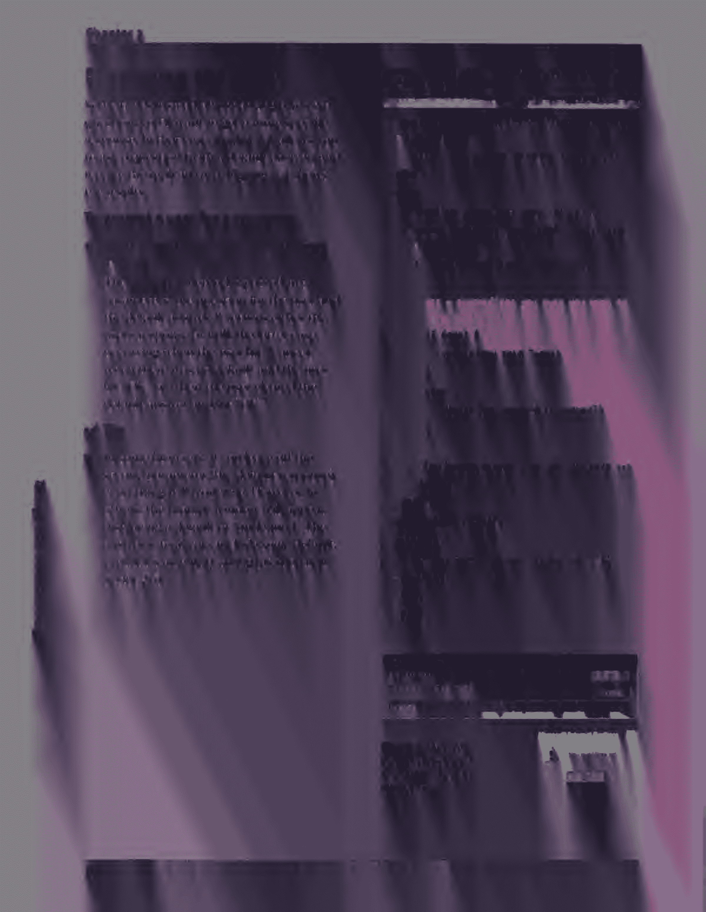

### 脚本 2.7 启动我！

如果用户拥有支持 JavaScript 的浏览器，他们将被自动发送到一个新页面。

```html
<!DOCTYPE HTML PUBLIC
"-//W3C//DTD HTML 4.01 Transitional//EN"
"http://www.w3.org/TR/html4/loose.dtd">
<HTML>
<HEAD>
<TITLE>You should have JavaScript!</TITLE>
<SCRIPT LANGUAGE="JAVASCRIPT" TYPE="TEXT/JAVASCRIPT">
<!-- Hide script from old browsers -->
  window.location="jwelcome.html";
// End hiding script from old browsers -->
</SCRIPT>
</HEAD>
<BODY BACKGROUND="WHITE">
<h2>You won't get much from this site without the latest version of JavaScript!</h2>
</body>
</HTML>
```

### 重定向用户

你不仅可以检查 JavaScript 是否，还可以检查用户拥有哪个版本（关于 JavaScript 版本的更多信息请参阅附录 A）。脚本 2.7 展示了如何根据浏览器支持的版本进行重定向或将用户发送到另一个页面。

要重定向用户：

1. `<SCRIPT LANGUAGE="1.3" TYPE="TEXT/JAVASCRIPT">`：`SCRIPT` 标签的 `LANGUAGE` 属性允许你指定浏览器运行脚本所需的 JavaScript 最低版本。在这种情况下，浏览器需要 1.3 或更高版本。如果用户没有符合要求的浏览器，他们将看到一个类似于图 2.5 所示的窗口。
2. `window.location="jwelcome.html"`：这一行重置了当前窗口的 `location` 属性。换句话说，它告诉浏览器将当前页面更改指定的页面（在本例中为 `jwelcome.html`）。
3. `</SCRIPT>`：结束脚本标签，这样如果用户没有 JavaScript，他们将停留在此页面。

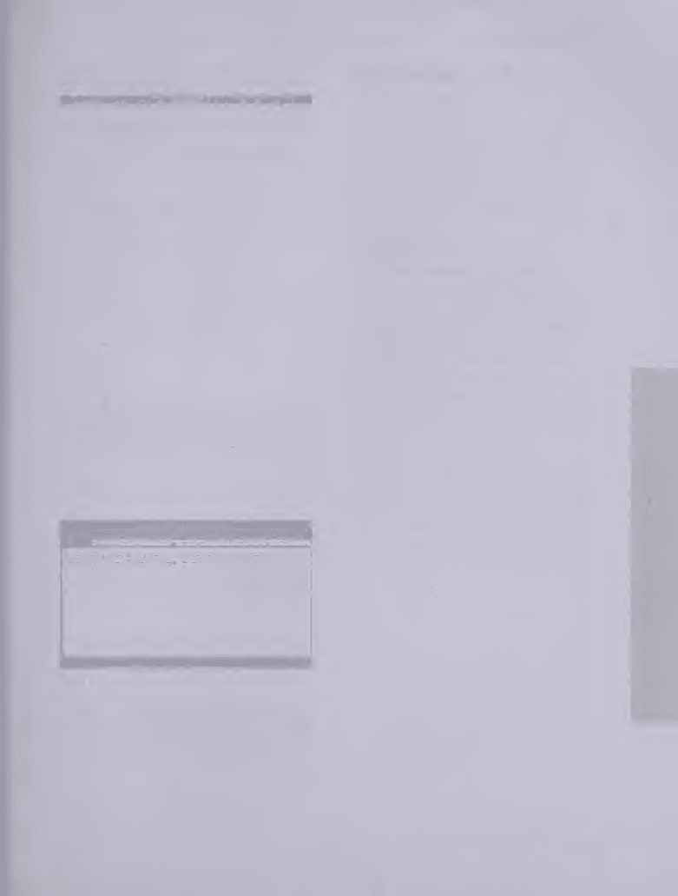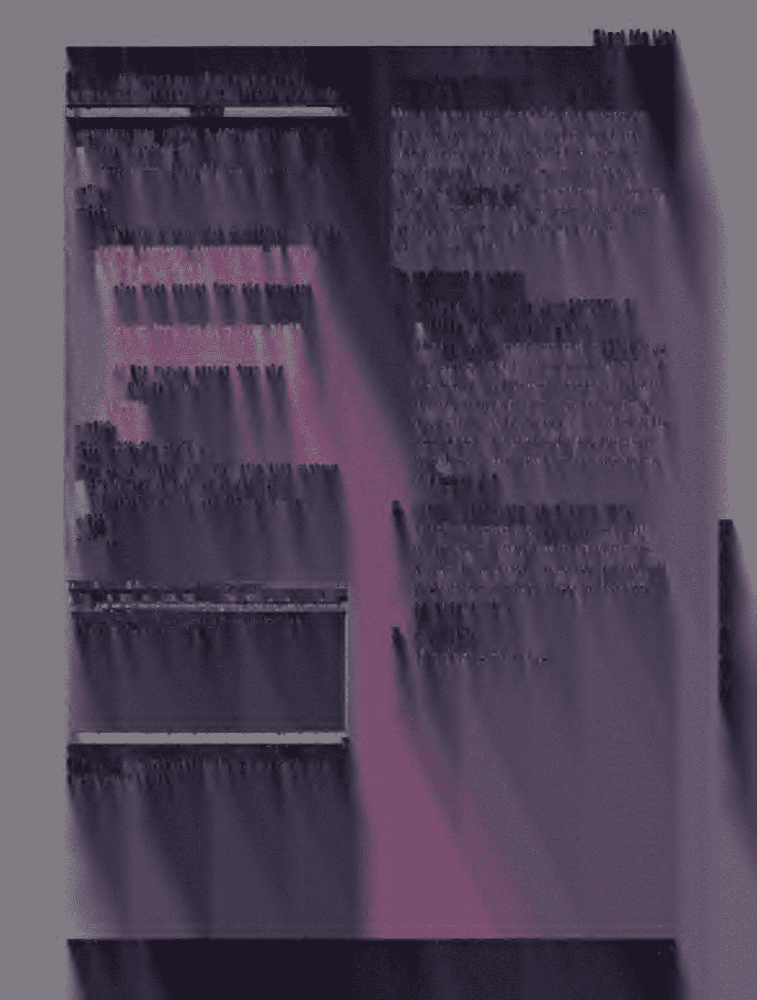

### 提示

- 不需要在结束脚本标签上添加 `LANGUAGE` 或 `TYPE` 属性。你可以在一个页面上放置不同脚本的不同语言版本。例如，一个脚本可能适用于任何 JavaScript 版本，另一个适用于 JavaScript 1.1 及以上版本，第三个适用于 JavaScript 1.3。遗憾的是，没有方法可以说明某个脚本应仅适用于 JavaScript 1.1（例如）。语言属性将接受指定的 JavaScript 版本以及任何更高版本。

请记住，如果你根据用户拥有的 JavaScript 版本限制其访问，你将会把一些人拒之门外。由于大多数网站的意图是吸引更多用户而不是更少，因此在编写要求最新浏览器的代码时应该小心。通常情况下，坚持使用特定的浏览器或 JavaScript 版本是可以的，只要你正在为内网编写页面（内网是旨在供公司内部使用的网站）。

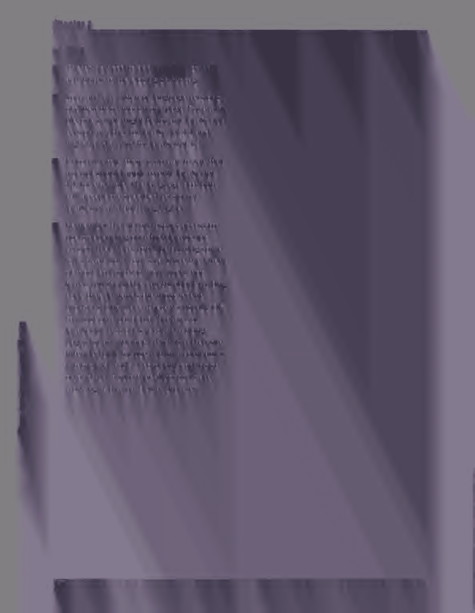

### 脚本 2.8 启动我！

通过将重定向嵌入链接中，你可以避免窗口的闪烁。

```html
<!DOCTYPE HTML PUBLIC
"-//W3C//DTD HTML 4.01 Transitional//EN"
"http://www.w3.org/TR/html4/loose.dtd">
<HTML>
<HEAD>
<TITLE>Welcome to our site</TITLE>
</HEAD>
<BODY BACKGROUND="WHITE">
<h2 align="CENTER">
<a href="script04.html" onclick="window.location='jwelcome.html'; return false">Welcome to our site...</h2>
</body>
</HTML>
```

图 2.5 如果没有最新版本的 JavaScript，你在这个网站上获得不了什么！

## 第二章

### 浏览器检测

你通常想找出用户使用的是哪种浏览器，以便提供最合适的页面。这被称为浏览器检测。脚本 2.9 向你展示了如何检查用户正在运行哪种浏览器。

要发现用户的浏览器类型：

1. `if (navigator.appName=="Netscape")`

   这检查了 `navigator` 对象的 `appName`（应用程序名称）属性。如果它是 `"Netscape"`，脚本将继续执行条件语句的 `then` 部分。

2. `document.write("You're running a Netscape browser")`

   只有在上述测试结果为真时，才会执行此写入操作。换句话说，如果 `appName` 不于 `"Netscape"`，那么这一行将不会执行。

3. `else {`  
   `if (navigator.appName == "Microsoft Internet Explorer")`

   你可以将一个 `if/else` 条件语句嵌套在另一个 `if/else` 条件语句中，这个语句在我们已经确认用户没有使用 Netscape 的情况下，检查他们是否使用的是 IE。

脚本 2.9 你通常可能想要检查用户拥有哪种浏览器，如果他们的浏览器不符合你的标准，则重定向用户。


```html
<!DOCTYPE HTML PUBLIC "-//W3C//DTD HTML 4.01 Transitional//EN"
"http://www.w3.org/TR/html4/loose.dtd">
<HTML>
<HEAD>
<TITLE>What's your browser?</TITLE>
</HEAD>
<BODY BGCOLOR="WHITE">
<h2
<SCRIPT LANGUAGE="JAVASCRIPT" TYPE="TEXT/JAVCRIPTCRIPT">
<!-- 对旧版浏览器隐藏脚本
if (navigator.appName != "Netscape")
{
document.write("You're running a Netscape browser")
}
else
{
if (navigator.appName != "Microsoft Internet Explorer")
{
document.write("You're running Internet Explorer")
}
else
{
document.write("You're not running 'Netscape or IE--maybe you should?")
}
// 结束对旧版浏览器隐藏脚本
</SCRIPT>
</h2>
</BODY>
</HTML>
```

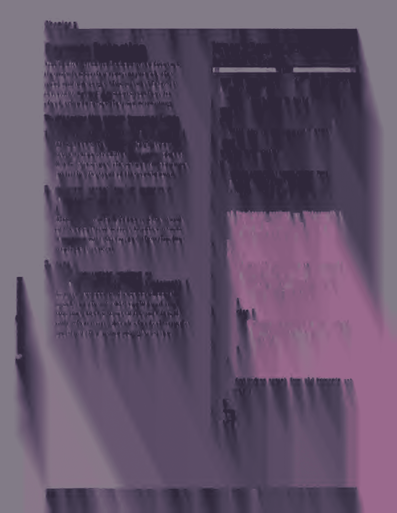

开始吧！

Lm：你的浏览器在哪里？

A

B

+

-

你正在运行 Internet Explorer

图 2.9

如果用户拥有 Internet Explorer（我们正在检查的浏览器之一），那么一切正常。`document.write("You're running Internet Explorer")`

如果用户没有 Netscape 但有 IE，请告诉他们，如图 2.9 所示。`document.write("You're not running -Netscape or IE--maybe you should?")`

如图 2.10 所示，当 `appName` 不等于 `"Netscape"` 或 `"Microsoft Internet Explorer"` 时，执行的就是这一行。

你的浏览器是什么？

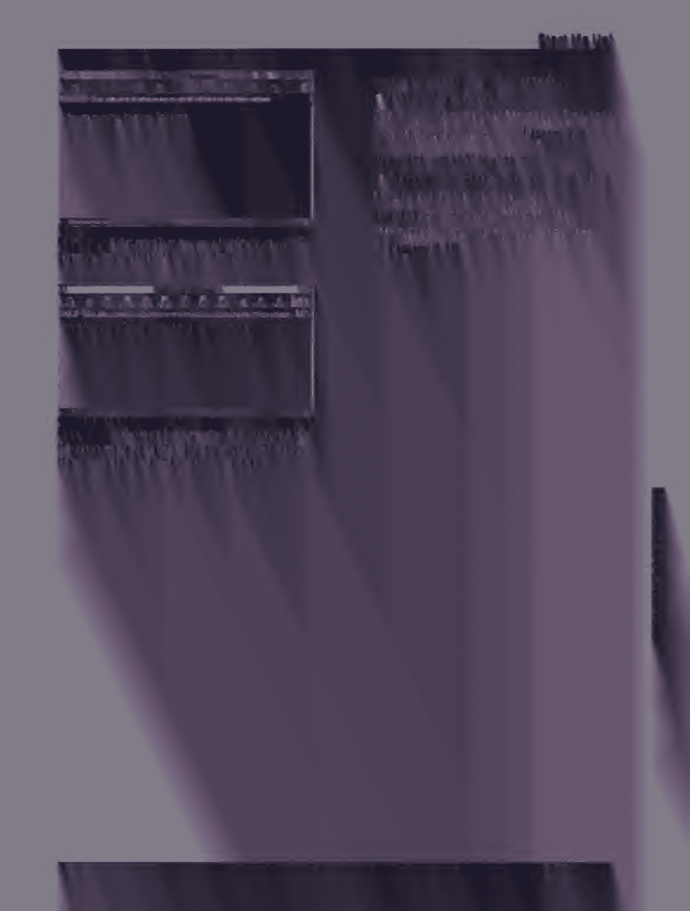

## 第二章

### 插件检测

浏览器插件为网页提供了很多很好的选项，包括声音、视频和动画等丰富的媒体内容。插件带来的问题是你无法确定用户是否拥有你需要的插件。JavaScript 可以帮助你发现用户拥有哪些插件，如果他们没有所需的插件，你可以将他们引导至一个页面，让他们可以在那里获取所需的插件。脚本 2.10 测试了 Macromedia 插件的存在，这是最常见的插件之一。

要检查插件：

1. ```javascript
if (navigator.plugins["Shockwave Flash"])
```

   由于脚本正在进行测试，因此使用了一个条件 `if` 语句。在这种情况下，它检查 `navigator.plugins` 数组是否包含名称 `"Shockwave Flash"`；如果是，则测试将返回 `true` 结果；即 Flash 插件存在。注意，如果匹配不完全，则测试将返回 `false`。如果 Macromedia 修改了插件的名称，你需要更改你的脚本。

2. ```javascript
document.write("<object classid='clsid:D27DB6E-AE6D-4CF-96B8-444553540000' codebase='http://active.macromedia.com/flash2/c/flash.cab#version=2,0,0'><param name='movie' value='images/airport.swf' embedpluginpage='http://www.macromedia.com/shockwave/download/' src='images/airport.swf'></object>")
```

   因为 Flash 存在，脚本会向文档窗口写入一段 HTML。`<embed>` 和 `<object>` 标签用于将 Flash 电影放入网页中。有了这样的脚本，脚本 2.10 测试插件很快就会变成你的本能。

```html
<!DOCTYPE HTML PUBLIC "-//W3C//DTD HTML 4.01 Transitional//EN"
"http://www.w3.org/TR/html4/loose.dtd">
<HTML>
<HEAD>
<TITLE>Got Flash?</TITLE>
</HEAD>
<BODY BGCOLOR="WHITE">
<SCRIPT LANGUAGE="JAVASCRIPT" TYPE="TEXT/JAVCRIPTCRIPT">
<!-- 对旧版浏览器隐藏脚本
if (navigator.plugins["Shockwave Flash"])
{
document.write("<object classid='clsid:D27DB6E-AE6D-4CF-96B8-444553540000' codebase='http://active.macromedia.com/flash2/c/flash.cab#version=2,0,0'><param name='movie' value='images/airport.swf' embedpluginpage='http://www.macromedia.com/shockwave/download/' src='images/airport.swf'></embed></object>")
}
else
{
document.write("")
}
// 结束对旧版浏览器隐藏脚本 -->
</SCRIPT>
</BODY>
</HTML>
```


开始吧！

图 2.11 JavaScript 发现 Flash 不存在，而是显示了 GIF 图像。此脚本通过名称查找特定插件。如果名称更改，你需要修改脚本以查找新名称。你可能会注意到上面步骤 2 中的结束 HTML 标签以 `/>` 结尾而不是你预期的 `</>`。这是为了防止 JavaScript 认为我们正在尝试关闭 `</SCRIPT>` 标签。在正斜杠前加上反斜杠告诉 JavaScript 忽略随其其后的字符，这正式称为转义该字符。

```javascript
else
{
document.write("")
}
```

这里是脚本处理 Flash 不可用的情况。如果是那样，则用 GIF 图像代替 Flash 电影（图 2.11）。

> **提示：** 遗憾的是，这项（以及一项）仅在某些浏览器中有效。Internet Explorer 4（所有平台）包含 `plugins` 对象，但它始终是空的。然而，Windows 版 Internet Explorer（4 及更高版本）将使用 ActiveX 为用户自动加载插件，如果浏览器还没有它的话。但坦率地说，Netscape 浏览器（从 3 版本开始）和 Mac 版 Internet Explorer（从 5 版本开始）允许通过 JavaScript 检查插件。微软为什么将此功能放在他们的 Mac 产品中却让他们的 Windows 产品处于残废状态呢？你得询问他们，尽管我们希望它可能出现在未来的版本中。你可以考虑用户没有启用 JavaScript 的情况，并通过在页面 `<body>` 部分添加此代码来显示 JPEG：

```html
<NOSCRIPT>

</NOSCRIPT>
```

## 第 2 章

## 循环循环往复

在上一个示例中，你检查了某个特定的插件是否存在。但如果你正在寻找名称可能变化过的任何版本的插件，你将需要不断重复测试，直到检查完所有已安装的插件。为了实现这一点，你将使用循环，它允许你重复指定次数的某个操作。

### 关于循环的更多信息

书中使用的循环类型是 `for` 循环，它以启动循环的命令命名。这种循环使用计数器，计数器是一个变量，它从一个初始值（通常是 0）开始，并在循环内部的条件测试满足时结束。

启动循环结构的命令后面紧跟着一对圆括号。在圆括号内部，你通常会找到计数器的定义以及计数器的增加方式（即计数值增加的方式）。脚本 2.11 向你展示了如何设置和使用循环来检查用户所有插件中是否存在 Apple 的 QuickTime 插件。在你查看脚本 2.11 时，请注意它包含两个脚本，一个在头部（header）中，另一个在页面主体（body）中。头部脚本检查 QuickTime 插件是否存在，而主体脚本根据插件测试的结果，向浏览器窗口写入两条不同消息之一。

### 脚本 2.11：欢迎来到你的第一个 JavaScript 循环

```html
<!DOCTYPE HTML PUBLIC "-//W3C//DTD HTML 4.01 Transitional//EN"
"http://www.w3.org/TR/html4/loose.dtd">
<HTML>
<HEAD>
<TITLE>Got QuickTime?</TITLE>
<SCRIPT LANGUAGE="JAVASCRIPT" TYPE="text/JAVASCRIPT">
<!-- 为旧版浏览器隐藏脚本 -->
var hasQT = false;
for (i=0; i<navigator.plugins.length; i++) {
  if (navigator.plugins[i]->name.indexOf("QuickTime") >= 0) {
    hasQT = true;
  }
}
<!-- 结束旧版浏览器隐藏脚本 -->
</SCRIPT>
</HEAD>
<BODY BGCOLOR="WHITE">
<H2 ALIGN="CENTER">Shoemaker-Levy 9 comet crashes into Jupiter in 1994</BR>
<SCRIPT LANGUAGE="JAVASCRIPT" TYPE="text/JAVASCRIPT">
<!-- 为旧版浏览器隐藏脚本 
(script continues on next page) -->
if (hasQT) {
  document.write("<EMBED SRC='images/cometAnim.mov' WIDTH='320' HEIGHT='250'>");
} else {
  document.write("");
}
<!-- 结束旧版浏览器隐藏脚本 -->
</SCRIPT>
</H2>
</BODY>
</HTML>
```

### JavaScript 字符串

像 `"cat"` 这样的单词在第 2 个位置会有 `"t"`？在 JavaScript 中，第一个字符位于位置 0。所以，以 `"cat"` 为例，`"c"` 位于位置 0，`"a"` 位于位置 1，`"t"` 位于位置 2。只有在检查 `"cat"` 的长度时，我们才会真正看到 3 这个值。所有其他字符串方法都是基于 0 的，也就是说，它们从 0 开始。

### 使用循环来检查插件

1. `hasQT = false`

   头部脚本执行的第一件事是设置一个名为 `hasQT` 的布尔值或变量。布尔变量只能有 `true` 或 `false` 两个值。

2. `for (i=0; i<navigator.plugins.length; i++)`

   这一行开始循环。程序员通常使用变量 `i` 来表示计数器。首先将 `i` 设置为 0。分号表示同一行还有另一个语句。接下来的部分可以读作“如果 `i` 小于插件数量，则将 `i` 的值加 1”。因为这是新内容，让我们拆解一下。`navigator.plugins.length` 对象提供了安装插件的数量。`i++` 部分使用了你在第 1 章看到的 `++` 运算符将 `i` 的值加 1。

3. `if (navigator.plugins[i].name.indexOf("QuickTime") >= 0)`

   这一行在循环内部开始了一个条件测试。数组 `navigator.plugins[i]` 使用方括号表示测试应该查看当前 `i` 值对应的插件。所以，如果循环已经检查了例如两个插件，那么下一次循环执行时 `i` 的值将是 2（JavaScript 从 0 开始计数，而不是 1；请参见“JavaScript 字符串”侧栏）。`indexOf()` 方法返回在 `navigator.plugins[i].name` 中是否找到了 `"QuickTime"` 以及找到的位置。如果未找到字符串，值为 -1。如果找到了，值则为其起始位置（再次开始）。

4. `hasQT = true`

   当条件满足时，`hasQT` 变量被设置为 `true`。

5. `if (hasQT)`

   在主体脚本中，这个条件测试展示了 JavaScript 中如何可以隐含内容。这一行可以读作“如果 `hasQT` 为真，则执行后续行”。在这种情况下，将变量放在圆括号内意味着该变量的值必须为真才能继续。

6. `document.write("<EMBED SRC='images/cometAnim.mov' WIDTH='320' HEIGHT='250'>")`

   如果测试结果为真，则将单引号内引用的电影文件写入文档（图 2.12）。与之前的任务一样，如果用户的浏览器具有相应功能，他们将看到页面最佳版本。

7. `else { document.write(""); }`

   如果测试失败，则脚本将显示来自 QuickTime 电影的 JPEG 帧（图 2.13）。如果不存在 QuickTime，则用 JPEG 电影。

## 开始！

### 脚本 2.12：你可以使用循环来遍历 JavaScript 对象并写入浏览器窗口

```javascript
<!DOCTYPE HTML PUBLIC "-//W3C//DTD HTML 4.01//Transitional//EN"
"http://www.w3.org/TR/html4/loose.dtd">
<HTML>
<HEAD>
<TITLE>What are my plugins?</TITLE>
</HEAD>
<BODY BGCOLOR="WHITE">
<SCRIPT LANGUAGE="JAVASCRIPT" TYPE="text/javascript">
<!-- Hide script from older browsers -->
if (navigator.plugins && navigator.plugins.length > 0)
{
document.write("You have the following plugins:
<TABLE CELLSPACING='4' CELLPADDING='4'>");
document.write("<TR BGCOLOR='#CCCCCC'><th>Name</th><TH BGCOLOR='#CCCCCC'>Filename</th><TH BGCOLOR='#CCCCCC'>Description</th></tr>>");
for (i=0; i<navigator.plugins.length; i++)
{
thisPlugin = navigator.plugins[i];
document.write("<TR vALIGN='TOP'><TD BGCOLOR='#CCCCCC'>" + thisPlugin.name + "</td><TD BGCOLOR='#CCCCCC'>" + thisPlugin.filename + "</td><TD BGCOLOR='#CCCCCC'>" + thisPlugin.description + "</td></tr>");
}
document.write("</table>");
}
// (script continues on next page)
```

### 使用循环进行写入

有时你可能想要从 JavaScript 对象中获取信息并显示给用户。使用 JavaScript 动态编写用户的 Web 页是一种非常有用的技术，你会发现自己经常使用它。在这个示例（脚本 2.12）中，你将使用循环显示浏览器中安装的所有插件，并将它们的列表写入浏览器窗口。

使用循环写入 Web 页：

1. `if (navigator.plugins && navigator.plugins.length > 0)`

   如果这两个值均为真，则继续执行后续代码。

2. `document.write("You have the following plugins: <TABLE CELLSPACING='4' CELLPADDING='4'>");`

   页面信息将在表格内显示，因此我们通过在这里写入 `<TABLE>` 标签来开始。


### 插件检测与循环

3. `document.write("<TR><TH BGCOLOR='#CCCCCC'>Name</th><TH BGCOLOR='#CCCCCC'>Filename</th><TH BGCOLOR='#CCCCCC'>Description</th></tr>");`

此行代码写入表格的第一行表头。

4. `for (i=0; i<navigator.plugins.length; i++)`

此行与上一个示例一样，遍历每个安装的插件。

5. `thisPlugin = navigator.plugins[i];`

我们不是通过全名引用每个插件，而是设置了一个临时变量，保存我们当前感兴趣的插件值。

6. `document.write("<TR vIGN='TOP'><TD BGCOLOR='#CCCCCC'>" + thisPlugin.name + "</td>");`

此行开启新行和新单元格，并写入当前插件的名称。

7. `document.write("</td><TD BGCOLOR='#CCCCCC'>" + thisPlugin.filename + "</td>");`

旧单元格结束，新单元格开始，并将插件的文件写入页面。

8. `document.write("</td><TD BGCOLOR='#CCCCCC'>" + thisPlugin.description + "</td></tr>");`

另一个单元格结束，新单元格开始，插件的描述完成了该单元格和行。

9. `}`

该大括号结束循环，内部行将为用户浏览器安装的每个插件重复执行。

10. `document.write("</table>");`

当循环完成后，我们写入结束标签 `</table>` 以完成代码，如图 2.14 所示。

11. `document.write("JavaScript couldn't find any plugins");`

如果用户的浏览器不支持通过 JavaScript 查看插件，他们将看到此消息。

你可以通过将两个检查都放在 `if` 语句后面的括号内，来实现多个检查。在两个检查之间使用双 ampersand (`&&`) 意味着这两个值都为真才会执行后续代码。

脚本 2.12 继续：

```javascript
else
{
document.write("JavaScript couldn't find any plugins");
}
// End hiding script from older browsers -->
```

### 检查 Java 是否启用

在调用 applet 增强你的页面之前，你应该检查用户是否启用了 Java。你可以尝试通过浏览器版本来推断功能，但这并不是可靠的指标，因为大多数使用 Java 的浏览器都提供了关闭它的选项。因此，你希望使用代码询问浏览器 Java 是否已启用。脚本 2.13 显示了如何实现。

| Name | Filename | Description |
| :--- | :--- | :--- |
| Default Plugin | | |
| QuickTime Plugin | | QuickTime Plugin 允许通过 QuickTime 网站查看各种多媒体内容。 |
| LiveConnect - Enabled plugin-in | | |
| RealPlayer - Enabled plugin-in | | |
| Shockwave Flash - Enabled plugin-in | | |
| SVG Plugin - Adobe Views for Acrobat | | |

图 2.14 此插件表格是使用循环写入浏览器窗口的。

`document.write("enabled.");`

无论 Java 是否启用，我们都会运行到此处并完成句子，然后输出页面，如图 2.15 所示。

```html
<NOSCRIPT>
JavaScript 未启用。
</NOSCRIPT>
```

这只是普通的 HTML，但值得注意的是，因为它告诉用户 JavaScript 未启用。

> **提示**
> 
> 与本书中的许多其他脚本一样，你可能经常需要将此脚本作为你自己脚本的一部分。建立一个脚本和脚本片段集合是一个好主意，你可以在不同的脚本以许多不同的方式组合和汇它们。如果你组织这些代码片段并为每个片段添加 JavaScript 注释，那么创建新脚本时就会占据先机。

旧版本的 Internet Explorer 不理解 `navigator` 对象，因此使用 `navigator.javaEnabled()` 的脚本在 Internet Explorer 4.0 或更高版本，或 Navigator 3.0 及更高版本中才有效。

你有 Java 吗？

Java 已启用。

图 2.15 该用户的 Java 正在活跃运行中。

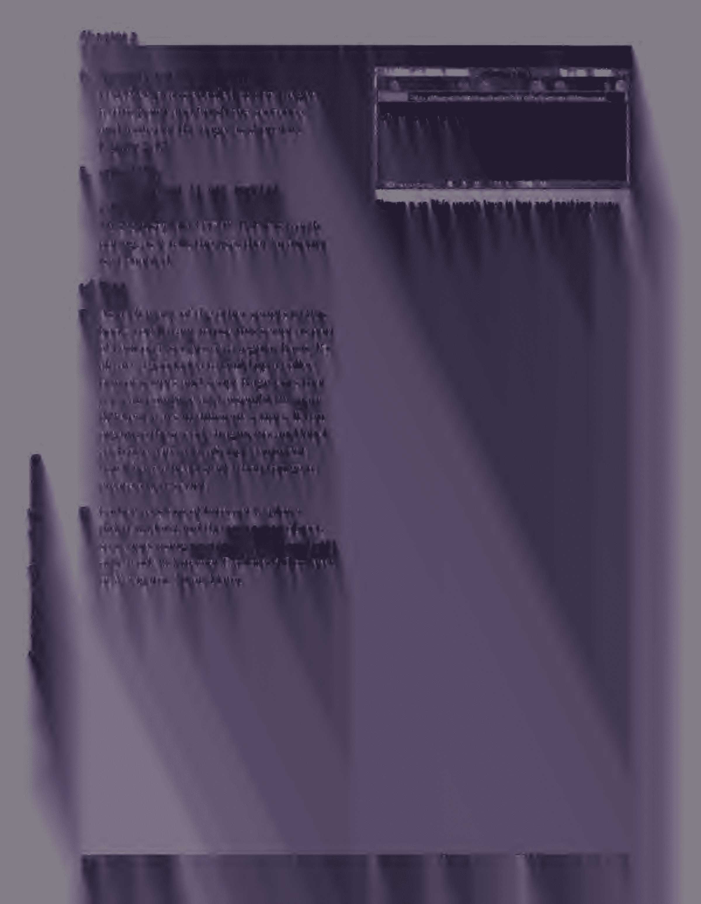

## 启动我！函数

在进入下一个示例之前，你需要学习函数，你在编写 JavaScript 时会经常使用它。函数是一组执行特定任务的 JavaScript 语句。每个函数都必须赋予一个名称，并可以被脚本的其他部分调用（或触发）。

在脚本运行期间，可以根据需要多次调用函数。例如，假设你获取了用户在表单中输入的一些信息，并使用 JavaScript 将其保存（在第 6 章“验证表单”中有更多关于这类的内容）。如果你需要反复使用这些信息，可以在脚本中不断重复相同的代码。但更好的做法是将这些代码写成一个函数，然后在需要时调用该函数。

一个函数由 `function` 单词后跟函数名组成。函数名后面总是有一个括号，紧接着是一个左大括号。构成函数的语句位于接下来的几行，然后用另一个大括号关闭函数。这里是函数的样式：

```javascript
function saySomething()
{
    alert("Four score and seven years ago")
}
```

注意带有 `alert` 的那行缩进了吗？这让你的代码更易读。第一个大括号和最后一个大括号之间的所有语句（你可能注意到那两行没有缩进）都是函数的一部分。

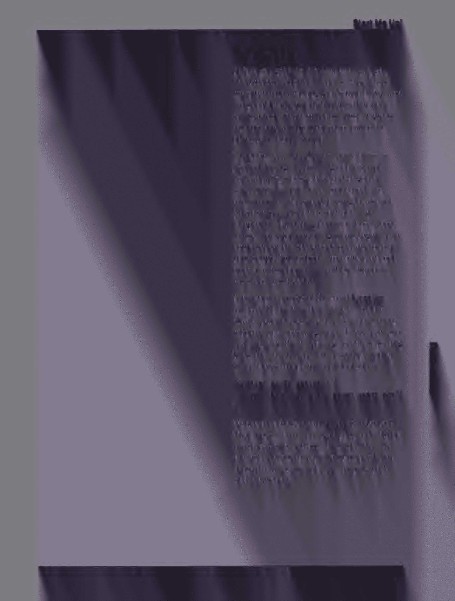

## 调用函数

使用事件处理器来调用函数是很常见的（如果需要，请参考第 1 章）。如果你想在用户点击按钮时调用 `saySomething` 函数，你会使用如下代码：

```html
<input type="button" value="Lincoln" onclick="saySomething()">
```

### 向函数传递信息

你通常想要获取一些信息并将其交给函数进行处理。这被称为传递信息。使用之前的函数示例，函数发生了如下变化（在脚本 2.14 中）：

```javascript
function saySomething(message)
{
    alert(message)
}
```

按钮代码也发生了变化：

```html
<input type="button" value="Lincoln" onclick="saySomething('Four score and seven years ago.')">
```

在上面的函数定义中，变量 `message` 是函数的参数。当函数被调用时，数据 `'Four score and seven years ago.'` 被传递给了 `message` 参数。函数参数可以是任何你想要使用的数据，包括文本字符串、数字，甚至是其他的 JavaScript 对象。像所有变量一样，你应该为你使用的变量命名为函数名，以提醒你该变量的用途。你可以反复调用同一个函数。

```html
<!DOCTYPE HTML PUBLIC "-//W3C//DTD HTML 4.01 Transitional//EN"
"http://www.w3.org/TR/html41/loose.dtd">
<html>
<head>
    <title>函数传递</title>
    <script language="javascript" type="text/javascript">
    <!-- 对旧浏览器隐藏脚本 -->
    function saySomething(message)
    {
        alert(message)
    }
    // 结束对旧浏览器隐藏脚本
    </script>
</head>
<body bgcolor="WHITE">
    <h2>著名的总统格言</h2>
    <hr>
    <form>
        <input type="button" value="Lincoln" onclick="saySomething('Four score and seven years ago..')">
        <input type="button" value="Kennedy" onclick="saySomething('Ask not what your country can do for you..')">
        <input type="button" value="Nixon" onclick="saySomething('I am not a crook!')">
    </form>
</body>
</html>
```

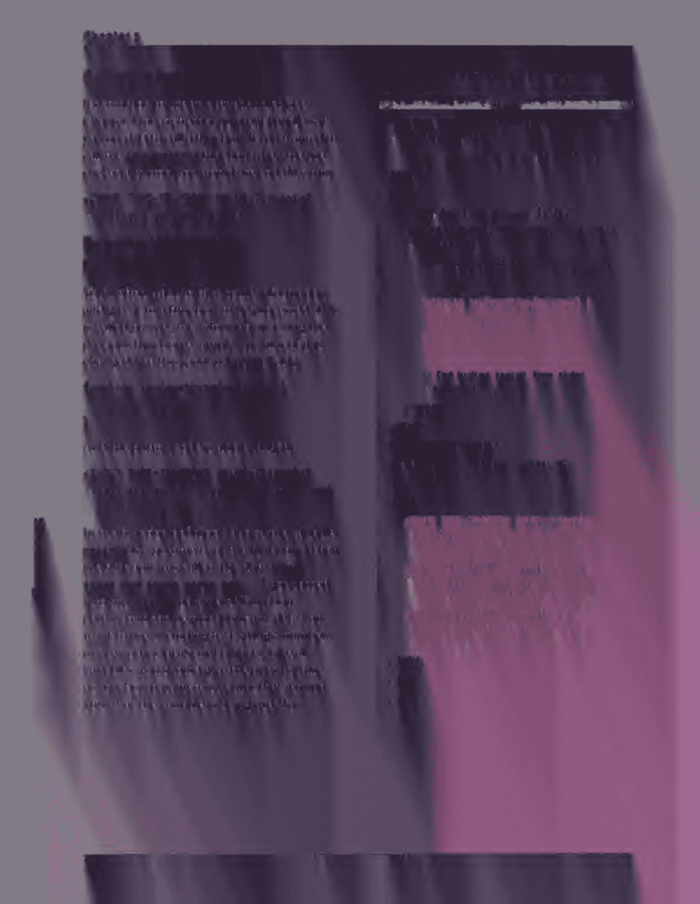

图 2.16 在顶部窗口的三个按钮中的每一个调用函数都会产生三种不同的响应，如三个对话框所示。

## 在一个页面上放置多个脚本

到本书为止，你已经看到了一次只执行一件事的脚本。但在现实世界中，你更有可能想用一个脚本执行各种操作，甚至在一个页面上放置多个脚本。你可能希望有一个脚本，既能将不支持 JavaScript 的用户重定向到另一个页面，又能检查插件，并发现用户使用的是什么浏览器，而这一切都在一个脚本中完成。在页面上执行多项任务的好方法是将适用于头部脚本（header scripts）的内容组合在一起，并将主体脚本（body script）的操作组合在一起。脚本 2.15 展示了如何将脚本 2.10 和 2.14 的示例合并到一个页面。图 2.17 显示了合并后脚本的结果。

图 2.17 页面显示了插件检查和函数传递示例。

脚本 2.15 此脚本将脚本 2.10 和 2.14 的功能合并到一个页面。

```html
<!DOCTYPE html PUBLIC "-//W3C//DTD HTML 4.01 Transitional//EN"
"http://www.w3.org/TR/html4/loose.dtd">
<html>
<HEAD>
<TITLE>Multiple Scripts</TITLE>
<SCRIPT LANGUAGE="JAVASCRIPT" TYPE="text/javascript">
<!-- Hide script from older browsers
var hasQT = false;
for (i=0; i<navigator.plugins.length; i++) {
if (navigator.plugins[i].name.indexOf("QuickTime") >= 0) {
hasQT = true;
}
}
function saySomething(message) {
alert(message);
}
// End hiding script from older browsers
-->
</SCRIPT>
</HEAD>
<BODY BG="WHITE">
<h2></h2>
<SCRIPT LANG="JAVASCRIPT" TYPE="text/javascript">
<!-- Hide script from older browsers
if (hasQT) {
document.write("<EMBED SRC='images/comet.mov' WIDTH='320' HEIGHT='250'>");
} else {
document.write("");
}
// End hiding script from older browsers
-->
</SCRIPT>
<HR>
<h2>Famous Quotes</h2>
<HR>
<FORM>
<input type="button" value="Lincoln" onclick="saySomething('Four score and seven years ago...')">
<input type="button" value="Kennedy" onclick="saySomething('Ask not what your country can do for you.')">
<input type="button" value="Nixon" onclick="saySomething('I am not a crook!')">
</FORM>
</body>
</html>
```

> **提示**
> - 你可以将所有想做的事情都封装在一个 `<SCRIPT>` 标签中。没有必要创建多个头部脚本——这是脚本初学者的常见错误。
> - 注意，脚本 2.15 中包含的任何代码在脚本 2.10 或 2.14 中都没有改变外观。

等等，我需要检查浏览器窗口状态栏中滚动的消息。这并不困难，脚本 2.16 展示了如何实现这一点。图 2.18 显示了结果；请注意图中底部第 1 步中的文本部分。

## 滚动条

要制作滚动状态栏：

1. `myMsg = "Hey, I know JavaScript - check out my kewl scroller..."` 这一行将变量 `myMsg` 设置为引号内的文本。

2. `i=0` 程序员传统上使用变量 `i` 作为计数器。在整个脚本中，`i` 的值会根据脚本执行的部分增加然后重置为零。在这一行中，`i` 初始化（或创建）为零。

3. `function scrollMsg() {` 这一行创建名为 `scrollMsg` 的函数。

4. `window.status = myMsg.substring(i, myMsg.length) + myMsg.substring(0,i-1)` 这一行设置了 `window.status`，即窗口对象的状态行属性。换句话说，它是浏览器窗口底部显示当前状态的线行。滚动消息是通过将 `myMsg` 分为两部分来实现的。`substring(x,y)` 方法在此例中作用于对象（即 `myMsg` 字符串），并返回从字符 `x` 开始到字符 `y` 之前一个字符结束的字符串部分。因此，在这一行中，第一个 `substring` 实例正在获取 `myMsg` 的部分。脚本 2.16 创建滚动状态消息并不困难。

```html
<!DOCTYPE html PUBLIC "-//W3C//DTD HTML 4.01 Transitional//EN"
"http://www.w3.org/TR/html4/loose.dtd">
<html>
<HEAD>
<TITLE>My JavaScript page</TITLE>
<SCRIPT LANGUAGE="JAVASCRIPT" TYPE="text/javascript">
<!-- Hide script from older browsers
myMsg = "Hey, I know JavaScript - check out my kewl scroller!...";
function scrollMsg() {
window.status = myMsg.substring(i, myMsg.length) + myMsg.substring(0,i-1);
if (i < myMsg.length) {
i++;
} else {
i=0;
}
setTimeout("scrollMsg", 50);
}
// End hiding script from older browsers
-->
</SCRIPT>
</HEAD>
<BODY BG="WHITE" onLoad="scrollMsg()">
<h2>I'm a cool JavaScript dood with a scrolling bar!</h2>
</body>
</html>
```

图 2.18 注意此窗口底部状态栏中滚动的消息。

> **提示**
> - 如果你想让消息滚动得更快，请减小第 7 步中的数字 "50"。
> - 要让滚动变慢，请增加该数字。
> - 你在日常生活中可能不会接触毫秒。只需记住 1 秒等于 1,000 毫秒即可。

### 在我再次犯之前阻止我

滚动状态栏在今天被广泛认为是俗气且陈词滥调的，类似于可怕的 HTML `<BLINK>` 标签。我们为了完整性，向你展示了如何这样做，但在你的网站上放置滚动状态栏之前，你应该仔细考虑一下。

### 状态栏消息

你可以利用浏览器状态栏做的另一个技巧非常有用且有效：你可以使用状态栏对链接进行注释，当用户光标悬停在链接上但在点击链接之前，为用户提供更多关于该链接的信息。例如，如果你在页面上有一个图像映射（image map），可以使用状态栏向用户描述图像映射的区域。通过向用户提供更多信息，你可以增强他们对网站的体验。

脚本 2.17 介绍了使用 JavaScript 的新方法：你可以将 JavaScript 命令添加到 HTML 锚点标签（用于链接的标签）中。结果如图 2.19。

要在状态栏中显示消息：


`<A HREF="sean.html" onMouseover="window.status='Best kid in the world'; return true" onMouseout="window.status=''; return true">my son</A>`

这一行是一个 HTML 锚点标签，包含一个标准的文本超链接，外是一段 JavaScript 代码。`onMouseover` 事件处理器告诉 JavaScript 在用户将鼠标指针移动到链接上时执行操作。在这种情况下，该操作是当用户将指针移动到链接“my son”上时，将 `window.status` 对象（即状态栏中的消息）设置为字符串 'Best kid in the world'。

`return true` 对于显示消息是必须的；如果没有它，消息将无法生效。`onMouseout` 处理器解决了某些版本的 Internet Explorer 中的问题，因为虽然 Netscape 理解应该只在鼠标悬停期间显示消息，但微软 Internet Explorer（或至少是某些版本）会继续通过脚本显示该消息。脚本 2.17 鼠标悬停状态消息对用户可能非常有帮助。

```html
<!DOCTYPE HTML PUBLIC "-//W3C//DTD HTML 4.01 Transitional//EN"
"http://www.w3.org/TR/html401/loose/html401-loose.dtd">
<HTML>
<HEAD>
<TITLE>Meaningful Links</TITLE>
</HEAD>
<BODY BGCOLOR="WHITE">
<h1>Welcome to my page</h1>
<h2>Click here to find out more about 
<A HREF="sean.html" onMouseover="window.status='Best kid in the world'; return true" onMouseout="window.status=''; return true">my son</A>,
or here to find out more about
<A HREF="cat.html" onMouseover="window.status='A very cute cat';return true" onMouseout="window.status=''; return true">my cat</A>.
</h2>
</BODY>
</HTML>
```

[](img/574ff1a7f6aea08a8d74ac1fba624480_57_1.png)

图 2.19 注意此链接的自定义状态消息。`mouseover` 开启。`onMouseout` 将 `window.status` 重置为空。再次，你需要 `return true` 来确保脚本能够正常工作。

`<A HREF="cat.html" onMouseover="window.status='A very cute cat'; return true" onMouseout="window.status=''; return true">my cat</A>`

这个脚本证明了一句老谚语是错误的，它对孩子和动物都有效。在这一行中，猫得到的待遇与上一行中的孩子相同。

[](img/574ff1a7f6aea08a8d74ac1fba624480_58_1.png)

## 趣味图像

JavaScript 的最佳用途之一是通过动画图形为 Web 页面增加趣味，这正是本章的主题。让页面上的图像在用户移动到图像上时发生变化，从而让页面对用户做出反应，这是你可以学习的最常见且有效的技巧之一。这种被称为“悬停”（rollover）的技术很容易实现，但正如你所看到的，你还可以使用 JavaScript 创建自动更改的图像，甚至创建替代动态 GIF 文件的动画横幅。

[](img/574ff1a7f6aea08a8d74ac1fba624480_60_1.png)

### 表 3.1 恰好的 HTML——图像

| 标签属性 | 含义 |
| :--- | :--- |
| `IMG` | 包含描述浏览器要显示的图像的属性 |
| `SRC` | 包含图像的 URL，相对于网页的 URL |
| `WIDTH` | 包含浏览器显示图像的宽度（像素） |
| `HEIGHT` | 包含浏览器显示图像的高度（像素） |
| `BORDER` | 当图像也作为链接时显示的边框宽度 |
| `NAME` | JavaScript 用于在与其他 JavaScript 对象中引用此图像的名称，不允许有空格或其他标点符号，且不能以数字开头 |
| `ALT` | 用于非视觉化浏览器替代图像 |
| `HSPACE` | 图像周围的水平缓冲区区域 |
| `VSPACE` | 图像周围的垂直缓冲区区域 |
| `USEMAP` | 此图像引用的 `MAP` 标签 |
| `ALIGN` | 描述图像在页面上的放置位置，相对于水平或垂直对齐 |
| `MAP` | 包含定义图像映射链接和位置的 `AREA` 元素 |
| `NAME` | `IMG` 标签的 `USEMAP` 属性所使用的标识符 |
| `AREA` | 定义图像映射的元素 |
| `SHAPE` | 定义区域的形状（常见形状：圆形、多边形、矩形） |
| `HREF` | 与区域关联的链接 URL |
| `COORDS` | 定义与链接或脚本操作关联的区域轮廓 |

[](img/574ff1a7f6aea08a8d74ac1fba624480_61_1.png)

脚本 3.1 注意此链接的自定义状态消息。`mouseover` 开启。`onMouseout` 将 `window.status` 重置为空。再次，你需要 `return true` 来确保脚本能够正常工作。

图 3.1 当鼠标在图像上时，蓝色箭头被红色箭头取代。

图 3.2 当鼠标移开时，红色箭头被蓝色箭头取代。

## 第 3 章

### 创建一个鼠标悬停（rollover）

1. `<A HREF="next.html"`

   链接开头指定了用户点击图像时浏览器将去的地方，在本例中为 `next.html` 页面。

2. `onMouseover="document.arrow.src='images/redArrow.gif`

   当用户将鼠标移动到图像上时，位于 `images` 目录下的替换图像 `redArrow.gif` 会被写入文档窗口。

3. `onMouseout="document.arrow.src='images/blueArrow.gif ">`

   然后，当鼠标移开时，图像 `blueArrow.gif` 就会被换回来。

4. `IMG SRC="images/blueArrow.gif" WIDTH="147" HEIGHT="82" BORDER="0" NAME="arrow" ALT="arrow">`

   图像链接的剩余定义了页面原始图像的来源，并关闭了锚点标签。我们在图像标签中包含了 `ALT` 属性，是因为如果您想让您的 HTML 符合 HTML 标准，那么 `ALT` 标签（为非图形浏览器提供图像的名称或描述）是必须的；此外，使用 `ALT` 标签有助于让代码对残障用户（例如使用屏幕阅读器浏览的视觉障碍用户）可访问。

脚本 3.1 这是在链接标签内实现鼠标悬停效果的最简单方法。

```html
<!DOCTYPE HTML PUBLIC "-////W3C//DTD HTML 4.01 Transitional//EN" "http://www.w3.org/TR/html4/loose.dtd">
<HTML>
<HEAD>
<TITLE>A Simple Rollover</TITLE>
</HEAD>
<BODY BGCOLOR="WHITE">
<A HREF="next.html" onMouseover="document.arrow.src='images/redArrow.gif" onMouseout="document.arrow.src='images/blueArrow.gif">

</A>
</BODY>
</HTML>
```

### 这种鼠标悬停方法的缺点

这种实现鼠标悬停的方法非常简单，但你应该意识到它存在一些实际问题。使用这种方法会在旧版浏览器中产生错误信息，例如 Netscape 2.0 或更版本、Internet Explorer 3.0 或更版本，或者 America Online 2.7 浏览器。

由于第二个图像是在用户悬停在第一幅图像上时从服务器下载的，因此在第二个图像替换第一个图像之前可能会存在明显的延迟。与其使用这种鼠标悬停方法，我们建议您在“创建更有效的鼠标悬停”节中使用以下方法来创建，这种方法同时解决了这两个问题。

## 图像的趣味

脚本 3.2 是一种比 3.1 更好的鼠标悬停方法，因为它不会在旧版浏览器中产生错误，而且动画更流畅。

```html
<!DOCTYPE HTML PUBLIC "-////W3C//DTD HTML 4.01 Transitional//EN" "http://www.w3.org/TR/html4/loose.dtd">
<HTML>
<HEAD>
<TITLE>A Simple Rollover</TITLE>
<SCRIPT LANGUAGE="TEXT/JAVASCRIPT">
// 对旧版浏览器隐藏脚本
if (document.images) {
    arrowRed = new Image;
    arrowBlue = new Image;
    arrowRed.src = "images/redArrow.gif";
    arrowBlue.src = "images/blueArrow.gif";
} else {
    arrowRed = "";
    arrowBlue = "";
    document.arrow = "";
}
// 结束对旧版浏览器隐藏脚本
</SCRIPT>
</HEAD>
<BODY BGCOLOR="WHITE">
<A HREF="next.html" onMouseover="document.arrow.src=arrowRed.src" onMouseout="document.arrow.src=arrowBlue.src">

</A>
</BODY>
</HTML>
```

### 创建更有效的鼠标悬停

为了让动画幻觉生效，你需要确保替换图像在从服务器获取时立即出现，没有任何延迟。要做到这一点，你使用 JavaScript 将所有图像预加载到浏览器的缓存中（这样在需要时它们已经位于用户的硬盘上了），并将图像放置在脚本使用的变量中。然后，当用户将鼠标移动到图像上时，脚本将包含图像的第一个变量替换为包含替换图像的第二个变量。脚本 3.2 显示了如何操作。视觉结果与 3.1 和 3.2 相同，但动画看起来更流畅。

要创建一个更好的鼠标悬停：

1. `if (document.images) {`

   ```javascript
   arrowRed = new Image;
   arrowBlue = new Image;
   arrowRed.src = "images/redArrow.gif";
   arrowBlue.src = "images/blueArrow.gif";
   ```

   `}`

   这段代码检查浏览器是否理解图像对象（参见侧边栏）。如果浏览器支持，代码将创建 `arrowRed` 和 `arrowBlue`，即两个独立的图像对象。然后，使用 `.src` 属性，将红色和蓝色箭头的 GIF 填充到这两个对象的 `.src` 属性中。

- **提示：**当您为鼠标悬停准备图形时，请确保所有的 GIF 图像都不是透明的。透明图像将显示出它们正在替换的下方的图像。
- 原始图像和替换图像需要具有相同的尺寸。否则，虽然它们在 Internet Explorer 中看起来正常，但 Netscape 会为你自动调整大小，你可能不会喜欢那种扭真的结果。

### 处理浏览器版本问题的巧妙方法

HTML 作者（更不用说 JavaScript 作者）的苦恼在于必须确保你创建的页面在旧版浏览器上按预期工作（或者至少看起来不会非常糟糕）。处理此问题的方法之一是编写检查特定旧版浏览器的代码。你可以编写不断循环的代码并询问浏览器：“你是 Netscape 2 吗？你是 Netscape 3 吗？Internet Explorer 2.0 怎么样？”以此类推，直到得到肯定回答为止。

问题是，现在有如此多的浏览器版本，几乎不可能让这样的代码运行，特别是每当某家公司发布新浏览器版本时，代码就会过时。此外，某些浏览器实际上会隐藏自己的身份，报告自己为其他浏览器。浏览器制造商这样做是为了兼容性，但这让 JavaScript 编码者的生活变得艰难。

脚本 3.2 通过检查 `document.images` 绕过了浏览器版本问题，这实际上是在说：“浏览器是否理解图像对象？”这里的技巧是 `document.images` 仅在 JavaScript 1.1 及更高版本中实现，该版本是随 Netscape 3.0 发布的，因此一举消灭了一整类旧版浏览器。

## 玩转图片

图 3.3 你可以在同一个页面上放置多个鼠标切换效果（rollovers）。

图 3.4 悬停在第二个切换效果上。

脚本 3.3 此脚本展示了如何在页面上使用多个鼠标切换效果。

### 在页面上放置多个鼠标切换效果

你不太可能只想在页面上放一个鼠标切换效果。为了使用多个一个，你需要添加一点额外的代码，如脚本 3.3 所示。页面上的第一个切换效果用于图 3.3，第二个可以在图 3.4 中看到。

要在页面上放置多个鼠标切换效果：

1. `button1Red = new Image`

   `button1Blue = new Image`

   `button2Red = new Image`

   `button2Blue = new Image`

   在上一个任务中，我们需要创建两个新的图像对象，而在本例中我们需要创建四个。通常情况下，每个切换效果需要创建两个新的图像对象。因此在这一步中，你正在为两个切换效果设置变量。

2. `button1Red.src = "images/redButton1.gif"`

   `button1Blue.src = "images/blueButton1.gif"`

   `button2Red.src = "images/redButton2.gif"`

   `button2Blue.src = "images/blueButton2.gif"`

   在这里，我们将每个新图像对象的 `src` 属性设置为与其关联的图形文件。

3. `button1Red = ""`

   `button1Blue = ""`

   `button2Red = ""`

   `button2Blue = ""`

   与上一个任务一样，为了防止在旧的、不智能的浏览器中出错，我们再次将虚拟变量（这次是四个）设置为空字符串。

由于有两个切换效果而不是一个，我们需要两个虚拟变量，每个切换效果一个。

- **提示：**注意每个图像对象和每个 `IMG` 标签都有唯一的名称。如果你将切换代码从页面的一个部分复制并粘贴到另一个部分，请确保为新版本设置一个唯一的名称。否则，JavaScript 在执行切换时会产生混淆，不知道应该放置哪张图片。

脚本 3.3 延续：


```html
<!DOCTYPE HTML PUBLIC "-//W3C//DTD HTML 4.01 Transitional//EN"
"http://www.w3.org/TR/html4/loose.dtd">
<HTML>
<HEAD>
<TITLE>A Simple Rollover</TITLE>
<SCRIPT LANGUAGE="JAVASCRIPT" TYPE="text/javascript">
<!-- 向旧版浏览器隐藏脚本 -->
if (document.images)
{
    button1Red = new Image;
    button1Blue = new Image;
    button2Red = new Image;
    button2Blue = new Image;

    button1Red.src = "images/redButton1.gif";
    button1Blue.src = "images/blueButton1.gif";
    button2Red.src = "images/redButton2.gif";
    button2Blue.src = "images/blueButton2.gif";

    button1Red = "";
    button1Blue = "";
    button2Red = "";
    button2Blue = "";

    button1Red.src = "images/redButton1.gif";
    button1Blue.src = "images/blueButton1.gif";
    button2Red.src = "images/redButton2.gif";
    button2Blue.src = "images/blueButton2.gif";
}
else
{
    button1Red = "";
    button1Blue = "";
    button2Red = "";
    button2Blue = "";
}
// 结束向旧版浏览器隐藏脚本
</SCRIPT>
</HEAD>
<BODY BG="WHITE">
<A HREF="next.html" onmouseover="document.button1.src=button1Red.src" onmouseout="document.button1.src=button1Blue.src">

</A>&nbsp;&nbsp;
<A HREF="next2.html" onmouseover="document.button2.src=button2Red.src" onmouseout="document.button2.src=button2Blue.src">

</A>
</BODY>
</HTML>
```

## 通过链接触发鼠标切换

在之前的示例中，用户通过将鼠标移动到图像上来触发切换效果。但你也可以在用户指向文本链接时触发切换效果，如图 3.5 和图 3.6 所示。你只需要在`<A HREF>`标签内放置一个文本链接，如脚本 3.4 所示。

**脚本 3.4** 此脚本从文本链接触发鼠标切换。

```html
<!DOCTYPE HTML PUBLIC "-//W3C//DTD HTML 4.01 Transitional//EN"
"http://www.w3.org/TR/html4/loose.dtd">
<HTML>
<HEAD>
<TITLE>Link Rollover</TITLE>
<SCRIPT LANGUAGE="JAVASCRIPT" TYPE="text/javascript">
<!-- 向旧版浏览器隐藏脚本 -->
if (document.images)
{
    arrowRed = new Image;
    arrowBlue = new Image;
    arrowRed.src = "images/redArrow.gif";
    arrowBlue.src = "images/blueArrow.gif";
}
else
{
    arrowRed = "";
    arrowBlue = "";
}
// 结束向旧版浏览器隐藏脚本
</SCRIPT>
</HEAD>
<BODY BG="WHITE">
<A HREF="next.html" onmouseover="document.arrow.src=arrowRed.src" onmouseout="document.arrow.src=arrowBlue.src">

</A>
</BODY>
</HTML>
```

通过链接触发切换：

`<A HREF="next.html" onmouseover="document.arrow.src=arrowRed.src" onmouseout="document.arrow.src=arrowBlue.src">下一页</A>`

注意，显示“下一页”的文本链接位于锚标签内，这使得`onmouseover`和`onmouseout`使用其作为触发器。我们将`IMG`标签移出了链接标签；它现在紧跟锚标签之后。

> **提示：**这种触发技术在你希望为用户提供他们点击指向链接时将看到内容的预览时非常有用。例如，假设你有一个描述前往苏格兰、大溪夷和克利夫兰旅行的旅游网站。页面的左侧可以是一列每个目的地的文本链接，而右侧可以是一个显示图片的预览区域。当用户指向目的地的名称时，该地的图片就会出现在预览区域。点击链接将用户带到详细介绍他们绝佳度假胜地的页面。

## 图像的趣味

达芬奇的发明

**图 3.7。**此页面有三张图像：一台飞行器、一个坦克和直直升机。当鼠标悬停在图像上时，其描述出现在达芬奇脸部下方。

### 多个链接改变单个翻转效果

到为止，你已经看到鼠标悬停在单张图像（或实际上是与该图像相关的链接）上如何触发翻转效果。

但你也可以设置几个不同的图像来触发翻转。当你有几张想要注释的图像时，这非常有用。悬停在每张图像上都会让该图片的描述出现。在这个示例中，我们对列昂多·达芬奇的三项发明进行了这样的操作。当你悬停在每张图像上时，该图片的描述会出现在文本框中。描述本身是另一张图像。实际上，它是三张图像，每个发明对应一张。

图 3.7 显示了脚本 3.5 的运行情况。正如书中的大多数脚本一样，它建立在之前的示例的基础上，因此我们只需要解释新概念。

要让多个链接改变单个翻转效果：

1. `<A HREF="flyPage.html" onMouseover="document.textField.src=flyText.src" onMouseout="document.textField.src=bgText.src">`

   这一行处理最顶部的发明，即飞行器。`onMouseover`事件处理器将`flyText.src`的内容放入`document.textField.src`（`textField`是包含发明描述的区域名称），并且当鼠标不再悬停在图像上时，用空白背景图像替换描述。

2. `<A HREF="tankPage.html" onMouseover="document.textField.src=tankText.src" onMouseout="document.textField.src=bgText.src">`

   页面上第二张图像（坦克）的链接工作与第一张图像的链接几乎相同。不同的是它将`document.textField.src`设置为`tankText.src`。

**脚本 3.5** 中通过多个链接改变单个图像是该脚本的关键。

```html
<!DOCTYPE HTML PUBLIC
"-//W3C//DTD HTML 4.01 Transitional//EN"
"http://www.w3.org/TR/html4/loose.dtd">
<HTML>
<HEAD>
<TITLE>A Complex Rollover</TITLE>
<SCRIPT LANGUAGE="JAVASCRIPT" TYPE="text/javascript">
<!-- Hide script from old browsers -->
if (document.images)
{
  flyText = new Image();
  tankText = new Image();
  bgText = new Image();
  heliText = new Image();
  flyText.src = "images/fmText.gif";
  tankText.src = "images/tankText.gif";
  bgText.src = "images/bg.gif";
  heliText.src = "images/heliText.gif";
}
else
{
  flyText = "";
  tankText = "";
  bgText = "";
  heliText = "";
  document.textField = "";
}
// End hiding script from old browsers
</script>
</HEAD>
<BODY BG="#CC99">
<TABLE VALIGN="TOP">
<TR>
<TD>
<BR>
<A HREF="flyPage.html" onMouseover="document.textField.src=flyText.src" onMouseout="document.textField.src=bgText.src"></a>
<A HREF="tankPage.html" onMouseover="document.textField.src=tankText.src" onMouseout="document.textField.src=bgText.src"></a>
<A HREF="heliPage.html" onMouseover="document.textField.src=heliText.src" onMouseout="document.textField.src=bgText.src"></a>
</TD>
<TD>
<BR>

</TD>
</TR>
</TABLE>
</BODY>
```

3. `<A HREF="heliPage.html" onMouseover="document.textField.src=heliText.src" onMouseout="document.textField.src=bgText.src">`

   第三个链接（用于直升机）将`document.textField.src`设置为等于`heliText.src`。

4. ``

   这是用于描述图像的`IMG`标签，名称为`textField`，它显示了该脚本的关键。三个锚点标签（anchor tags）都引用同一个文档对象（`document.textField.src`），而不是不同的对象。这是因为它们都在改变同一个对象。

### 使用多个翻转效果

如果你想触发翻转的图像本身也是一个翻转图像会怎样？图 3.8 基于上一个示例，展示了我们如何添加此功能。当你悬停在某一个发明图像上时，它会像以前一样让描述图像出现，但这次还会将发明图像切换为另一个带有阴影的图像。这为用户提供了关于他们所指向内容的视觉反馈。脚本 3.6 显示了这只需要简单的添加。

```html
<!DOCTYPE HTML PUBLIC
"-//W3C//DTD HTML 4.01 Transitional//EN"
"http://www.w3.org/TR/html4/loose.dtd">
<HTML>
<HEAD>
<TITLE>A Complex Rollover</TITLE>
<SCRIPT LANGUAGE="JAVASCRIPT" TYPE="text/javascript">
<!-- Hide script from old browsers -->
if (document.images)
{
  flyText = new Image();
  tankText = new Image();
  bgText = new Image();
  heliText = new Image();
  flyText.src = "images/fmText.gif";
  tankText.src = "images/tankText.gif";
  bgText.src = "images/bg.gif";
  heliText.src = "images/heliText.gif";
}
else
{
  flyText = "";
  tankText = "";
  bgText = "";
  heliText = "";
  document.textField = "";
}
// End hiding script from old browsers
</script>
</HEAD>
<BODY BG="#CC99">
<TABLE VALIGN="TOP">
<TR>
<TD>
<BR>
<A HREF="flyPage.html" onMouseover="document.textField.src=flyText.src" onMouseout="document.textField.src=bgText.src"></a>
<A HREF="tankPage.html" onMouseover="document.textField.src=tankText.src" onMouseout="document.textField.src=bgText.src"></a>
<A HREF="heliPage.html" onMouseover="document.textField.src=heliText.src" onMouseout="document.textField.src=bgText.src"></a>
</TD>
<TD>
<BR>

</TD>
</TR>
</TABLE>
</BODY>
</HTML>
```

## 玩转图片

**脚本 3.6 延续**

1


`flyText.src = "images/fmText.gif"`
`tankText.src = "images/tankText.gif"`
`bgText.src = "images/bg.gif"`
`heliText.src = "images/heliText.gif"`

```
flyOff = new Image
tankOff = new Image
heliOff = new Image
flyOn = new Image
tankOn = new Image
heliOn = new Image
flyOff.src = "images/flyer.gif"
tankOff.src = "images/tanks.gif"
heliOff.src = "images/helicopter.gif"
flyOn.src = "images/flyer2.gif"
tankOn.src = "images/tanks2.gif"
heliOn.src = "images/helicopter2.gif"
```

否则（`else`）：

```
flyText = ""
tankText = ""
bgText = ""
heliText = ""
flyOff = ""
tankOff = ""
heliOff = ""
flyOn = ""
tankOn = ""
heliOn = ""
document.flyImg = ""
document.tankImg = ""
document.heliImg = ""
document.textField = ""
```

（脚本继续下一页）

```html
<A HREF="flyPage.html" onMouseover="document.textField.src=flyText.src; document.flyImg.src=flyOn.src" onMouseout="document.textField.src=bgText.src; document.flyImg.src=flyOff.src">
```

这个链接标签的不同之处在于它对`onMouseover`有两个赋值语句，`onMouseout`也有两个，每个情况下都用分号分隔。分号允许你在一个命令后跟随另一个命令，因此你可以使用分号将赋值语句组合在一起。

- 提示

请记住，每一个鼠标悬停过的图片必须有一个唯一的名称。

  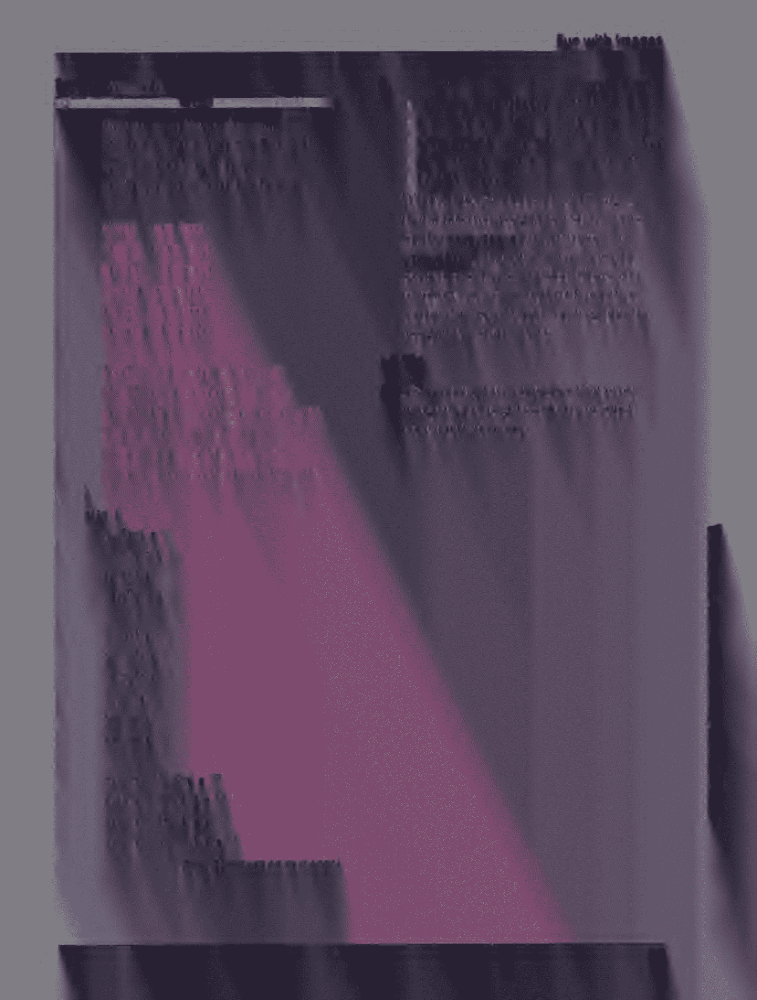

## 第 3 章

### 脚本 3.6 延续

```html
// 结束针对旧版浏览器的隐藏脚本
-->
</SCRIPT>
</HEAD>
<BODY BGCOLOR="#EECC99">
<TABLE>
<TR VALIGN="TOP">
<TD>

<A HREF="flyPage.html" onMouseover="document.textField.src=flyText.src; document.flyImg.src=flyOn.src" onMouseout="document.textField.src=bgText.src; document.flyImg.src=flyOff.src">

<A HREF="tankPage.html" onMouseover="document.textField.src=tankText.src; document.tankImg.src=tankOn.src" onMouseout="document.textField.src=bgText.src; document.tankImg.src=tankOff.src">

<A HREF="heliPage.html" onMouseover="document.textField.src=heliText.src; document.heliImg.src=heliOn.src" onMouseout="document.textField.src=bgText.src; document.heliImg.src=heliOff.src">

</TD>
<TD>


</TD>
</TR>
</TABLE>
</BODY>
```

  

## 玩转图片

### 脚本 3.7

使用函数可以帮助你简化代码。

```html
<!DOCTYPE HTML PUBLIC "-//W3C//DTD HTML4.0 Transitional//EN" "http://www.w3.org/TR/HTML41/loose.dtd">

<html>

<head>

<title>复杂的鼠标悬停效果</title>

<script LANGUAGE="JAVASCRIPT" TYPE="text/javascript">

<!-- 针对旧版浏览器的隐藏脚本 -->

if (document.images) {

flyText = new Image

tankText = new Image

bgText = new Image

heliText = new Image

flyText.src = "images/fmText.gif"

tankText.src = "images/tankText.gif"

bgText.src = "images/bg.gif"

heliText.src = "images/heliText.gif"

function chgImg(imgField,newImg) {

if (document.images) {

document[imgField].src = eval(newImg + ".src")

}

}

// 结束针对旧版浏览器的隐藏脚本

-->

</SCRIPT>

</HEAD>

<BODY BGCOLOR="#EECC99">

<TABLE>

<TR VALIGN="TOP">

</TABLE> 
```

使用函数通过单个鼠标悬停处理多张图片。之前的几个示例使用了大量几乎相同的代码。正如你可能在第 2 章记忆的那样，重复性任务是函数的理想选择。一旦你写好了完成重复任务的代码，只需调用该函数并传递它工作所需的任何数据即可。脚本 3.7 的功能与脚本 3.4 相同，但它使用函数稍微简化了代码。视觉效果与图 3.7 相同。

## 玩转图片

### 脚本 3.8

你可以根据需要多次调用函数，只要在每次调用之间使用分号`;`分隔即可。

```html
<!DOCTYPE HTML PUBLIC "-//W3C//DTD HTML 4.01 Transitional//EN"

"http://www.w3.org/TR/html4/loose.dtd">

<HTML>

<HEAD>

<TITLE>A Complex Rollover</TITLE>

<SCRIPT LANGUAGE="JAVASCRIPT" TYPE="text/javascript">

<!-- 为旧版浏览器隐藏脚本 -->

if (document.images)

{

    flyText = new Image();

    tankText = new Image();

    bgText = new Image();

    heliText = new Image();

    flyText.src = "images/fmText.gif";

    tankText.src = "images/tankText.gif";

    bgText.src = "images/bg.gif";

    heliText.src = "images/heliText.gif";

    flyOff = new Image();

    tankOff = new Image();

    heliOff = new Image();

    flyOn = new Image();

    tankOn = new Image();

    heliOn = new Image();

    flyOff.src = "images/flyer.gif";

    tankOff.src = "images/tanks.gif";

    heliOff.src = "images/helicopter.gif";

    flyOn.src = "images/flyer2.gif";

    tankOn.src = "images/tanks2.gif";

    heliOn.src = "images/helicopter2.gif";
```

#### 使用函数实现多个鼠标悬停效果

扩展上脚本的示例，脚本 3.8 展示了如何在同一个语句中多次调用同一个函数。你所做的就是在命令之间使用分号。通过使用函数来简化多个鼠标悬停效果：

```html
<A HREF="flyPage.html" onMouseover="chgImg('flyImg', 'flyOn'); chgImg('textField', 'flyText')" onMouseout="chgImg('flyImg', 'flyOff'); chgImg('textField', 'bgText')">

    

</A>
```

此脚本中的其他部分你现在应该已经熟悉了，唯一的就是调用四次函数`chgImg`并用分号分隔。该函数在`onMouseover`处理器中被调用了两次（将飞行器图像从普通版本改为阴影版本，并更改描述文本），在`onMouseout`处理器中被调用了两次（逆转该过程）。

```javascript
function chgImg(imgField,newImg)

{

    if (document.images)

    {

        document[imgField].src = eval(newImg + ".src");

    }

}

// 为旧版浏览器隐藏脚本 -->
```

```html
<BODY BG="#EE99">
<TABLE>
<TR VALIGN="TOP">
<TD>
    
    <A HREF="flyPage.html" onMouseover="chgImg('flyImg', 'flyOn'); chgImg('textField', 'flyText')" onMouseout="chgImg('flyImg', 'flyOff'); chgImg('textField', 'bgText')">
        
    </A>
    <A HREF="tankPage.html" onMouseover="chgImg('flyImg', 'tankOn'); chgImg('textField', 'tankText')" onMouseout="chgImg('flyImg', 'tankOff'); chgImg('textField', 'bgText')">
        
    </A>
    <A HREF="heliPage.html" onMouseover="chgImg('flyImg', 'heliOn'); chgImg('textField', 'heliText')" onMouseout="chgImg('flyImg', 'heliOff'); chgImg('textField', 'bgText')">
        
    </A>
</TD>
<TD>
    
    
</TD>
</TR>
</TABLE>
</BODY>
```

## 创建循环横幅

在浏览网页时，经常会看到定期切换图片的广告横幅。这些大部分是动态 GIF，即包含许多连续播放帧的文件的文件。如果你想让一个页面循环显示多个 GIF（无论动态还是静态的），可以使用 JavaScript 来实现，如脚本 3.9 所示。

### 脚本 3.9

你可以使用 JavaScript 在横幅中循环切换。

```html
<!DOCTYPE HTML PUBLIC "-//W3C//DTD HTML 4.01 Transitional//EN"

"http://www.w3.org/TR/html4/loose.dtd">

<HTML>

<HEAD>

<TITLE>Rotating Banners</TITLE>

<SCRIPT LANGUAGE="JAVASCRIPT" TYPE="text/javascript">

<!-- 为旧版浏览器隐藏脚本 -->

images = new Array("images/banner1.gif", "images/banner2.gif", "images/banner3.gif");

thisAd = imgCt = images.length;

function rotate()

{

    if (document.images)

    {

        thisAd++;

        if (thisAd == imgCt)

        {

            thisAd = 0;

        }

        document.adBanner.src = images[thisAd];

        setTimeout("rotate()", 3 * 1000);

    }

}

// 为旧版浏览器隐藏脚本 -->

</SCRIPT>

</HEAD>

<BODY BG="WHITE" onLoad="rotate()">

<CENTER>

    

</CENTER>

</BODY>

</HTML>
```

## 第3章

4. 将`thisAd`的值加 1。

5. 

```javascript
if (thisAd == imgCt)

{

    thisAd = 0;

}
```


这段代码设置了一个计数器，如果`thisAd`的值等于`imgCt`的值，则将`thisAd`的值置置零。

6. `document.adBanner.src = adlmages[thisAd];`

网页上循环播放的图像名为`adBanner`；你在`IMG`标签中定义了这个名称，如步骤 9 所示。这行代码表示图像`adBanner`的源位于数组`adlmages`中，而变量`thisAd`的值定义了浏览器此时应该使用三个 GIF 中的哪一个。

7. `setTimeout("rotate", 3 * 1000)`

这一行告诉脚本切换横幅中 GIF 的频率。`setTimeout`命令允许你指定按特定计划执行操作，始终以毫秒为单位。在这种情况下，`rotate()`函数每三千毫秒（即每三秒）被调用一次，因此 GIF 将每三秒在横幅中循环一次。

8. `<BODY B_COLOR="WHITE" onLoad="rotate()">`

在`BODY`标签中，你通过`onLoad`命令调用`rotate()`函数来启动横幅循环。

9. ``

这里是你定义循环图像名称的地方。

图 3.9 第一张图像，启动循环横幅……

Netscape: 图像测试 多喝点 Java

图 3.10 ...第二张图像..

Netscape: 图像测试 Bisma-Pepto疗法

图 3.11 ...最后一张图像。

[](img/574ff1a7f6aea08a8d74ac1fba624480_81_1.png)

## 图像趣

### 提示

你可能会疑惑为什么要使用 JavaScript 来制作循环横幅，而不是直接创建一个动画 GIF。一个很好的原因是它允许你在横幅中使用 JPEG，从而获得更高质量的图像。使用 JPEG，你可以在横幅中使用照片。变量`imgCt`的值始终是数组中的项目数量。与 JavaScript 某些奇异的计数方式不同，该数字是从 1 开始计数的，而不是从 0 开始，因为在这个示例中有三个横幅，所以在这种情况下数字是 3。与之前的示例不同，此任务中的图像没有预先缓存。每张图像将在第一次显示时从服务器下载。这是因为你的数组中可能有任意数量的图像，如果用户只看两或三张，强迫他们下载（例如）100 张图像是不礼貌的。

[](img/574ff1a7f6aea08a8d74ac1fba624480_82_1.png)

### 创建多个横幅

如果你想在一个页面上有多个循环横幅，只需要多一点代码。你需要如脚本 3.10 所示，为每个横幅单独设置数组和变量。正如本章前一节所示，数组包含每个横幅中图像的引用，脚本使用变量作为计数器来跟踪当前正在显示哪张图像。你可以在图 3.12、3.13 和 3.14 中看到结果。

创建多个循环横幅：

1. ```
adlmages1 = new Array("images/banner1.gif", "images/banner2.gif", "images/banner3.gif");

adlmages2 = new Array("images/redBanner.gif", "images/greenBanner.gif", "images/blueBanner.gif");
```

这是两个数组对象，每个初始化为其对应的三个图像。

2. ```
thisAd1 = 0; thisAd2 = 0;

imgCt = adlmages1.length; imgCt2 = adlmages2.length;
```

变量`thisAd1`和`thisAd2`是计数变量，每当`rotate()`函数通过循环时，它们就会递增。`imgCt`和`imgCt2`变量设置为数组的长度（即循环横幅中图像的数量）。

脚本 3.10：正如你可以拥有多个悬停效果一样，你也可以拥有多个循环横幅。

```html
<!DOCTYPE HTML PUBLIC "-//W3C//DTD HTML 4.01 Transitional//EN" "http://www.w3.org/TR/html4/loose.dtd">

<HTML>

<HEAD>

<TITLE>Rotating Banners</TITLE>

<SCRIPT LANGUAGE="JAVASCRIPT" TYPE="TEXT/JAVASCRIPT">

<!-- 对旧浏览器隐藏脚本 -->

[adlmages1 = new Array("images/banner1.gif", "images/banner2.gif", "images/banner3.gif");

adlmages2 = new Array("images/redBanner.gif", "images/greenBanner.gif", "images/blueBanner.gif");

thisAd1 = 0;

thisAd2 = 0;

imgCt = adlmages1.length;

imgCt2 = adlmages2.length;

function rotate() {

    thisAd1++;

    if (thisAd1 == imgCt) {

        thisAd1 = 0;

    }

    document.adBanner1.src = adlmages1[thisAd1];

    thisAd2++;

    if (thisAd2 == imgCt2) {

        thisAd2 = 0;

    }

    document.adBanner2.src = adlmages2[thisAd2];

    setTimeout("rotate", 3000);

}

// 隐藏脚本

-->

</SCRIPT>

</HEAD>

<BODY B_COLOR="WHITE" onLoad="rotate()">

<CENTER>


</CENTER>

</BODY>

</HTML>
```

脚本 3.10 续：

3. ```
thisAd1++;

if (thisAd1 == imgCt) {

    thisAd1 = 0;

}

document.adBanner1.src = adlmages1[thisAd1];
```

4. ```
thisAd2++;

if (thisAd2 == imgCt2) {

    thisAd2 = 0;

}

document.adBanner2.src = adlmages2[thisAd2];
```

这一步处理第二个横幅计数器的递增，并将`adBanner2`的当前图像设置为由变量`thisAd2`的值指定的图像。正如你无疑已经注意到的，数组和变量的唯一名称非常重要，因为 JavaScript 没有其他方法来区分脚本中的各个项目。脚本中的其余代码与本章前一个任务中的代码几乎相同；如果你需要更多解释，请参考该任务。图 3.14 ……在显示第三张图像后，将将循环。

### 图像趣：
- 在 Joe's 吃饭
- 多喝点 Java
- 治愈胃烧心
- 
图 3.12：此页面有两个横幅，每个有三张图像……同步变化。
图 3.13：工作原理。

[](img/574ff1a7f6aea08a8d74ac1fba624480_83_1.png)

## 第 3 章

## 制作横幅

### 让循环等待用户

如果你在循环横幅中使用较小的 GIF，你可能不需要担心上一个 GIF 是否在下一个 GIF 开始加载前没有加载完成。但如果你将此技术用于幻灯片，你可能希望确保用户在显示下一张图片之前已经看完了当前的一幅图片——这对于网络连接较慢的用户特别有用。脚本 3.11 向你展示了如何修改脚本来实现这一目标。它基于脚本 3.9，但在`rotate()`函数内部又添加了一个循环。

要让循环等待用户：

1. `if (document.adBanner.complete)` {
这一行告诉文档`adBanner`的显示必须完成。

2. `thisAd++`
将变量`thisAd`的值加 1。

3. `if (thisAd == imgCt)` { `thisAd = 0` }
当`thisAd`达到`imgCt`的值时，将其置回零。

4. `document.adBanner.src=adimages[thisAd]`

`setTimeout("rotate()", 3 * 1000)`
这与脚本 3.9 类似，不同之处`setTimeout()`命令位于控制图像循环的检查语句之外。由于如此，在横幅图像准备好切换到下一张之前，`setTimeout()`可以被多次调用。

脚本 3.11 你可以延迟下一张图片的加载，直到当前图片加载完成。

```html
<!DOCTYPE HTML PUBLIC "-////W3C//DTD HTML 4.01 Transitional//EN"

"http://www.w3.org/TR/html4/loose.dtd">

<HTML>

<HEAD>

<TITLE>Rotating Banners</TITLE>

<SCRIPT LANGUAGE="JAVASCRIPT" TYPE="TEXT/JAVASCRIPT">

<!-- 对旧版浏览器隐藏脚本

adimages = new Array("images/banner1.gif","images/banner2.gif","images/banner3.gif");

thisAd = 0;

imgCt = adimages.length;

function rotate() {

  if (document.images) {

    if (document.adBanner.complete) {

      thisAd++;

      if (thisAd == imgCt) {

        thisAd = 0;

      }

      document.adBanner.src=adimages[thisAd];

    }

    setTimeout("rotate()", 3 * 1000);

  }

}

<!-- 结束旧版浏览器隐藏 -->

</SCRIPT>

</HEAD>

<BODY BGCOLOR="WHITE" onLoad="rotate()">

<CENTER>


</CENTER>

</BODY>

</HTML>
```

## 为循环横幅添加链接

横幅通常用于广告，你可能想知道如何让横幅变成一个链接，当用户点击横幅时将其引导到某个地方。脚本 3.12 向你展示了它是之前脚本的变体。在这个脚本中，你将添加一个新的数组。这个新数组包含了用户点击横幅时将要到的目的地。在这种情况下，"Eat at Joe's"横幅将带你去 negrino.com，"Drink more"去到 sun.com，而"Heartburn"去到 microsoft.com。当然，这并不代表任何编辑意见。脚本 3.12 展示了你如何将循环横幅转换为真实的、可点击的横幅。

```html
<!DOCTYPE HTML PUBLIC "-////W3C//DTD HTML 4.01 Transitional//EN"

"http://www.w3.org/TR/html4/loose.dtd">

<HTML>

<HEAD>

<TITLE>Rotating Banners</TITLE>

<SCRIPT LANGUAGE="JAVASCRIPT" TYPE="TEXT/JAVASCRIPT">

<!-- 对旧版浏览器隐藏脚本

adimages = new Array("images/banner1.gif","images/banner2.gif","images/banner3.gif");

adURL = new Array("negrino.com","sun.com","microsoft.com");

thisAd = 0;

imgCt = adimages.length;

function rotate() {

  if (document.images) {

    if (document.adBanner.complete) {

      thisAd++;

      if (thisAd == imgCt) {

        thisAd = 0;

      }

      document.adBanner.src=adimages[thisAd];

    }

    setTimeout("rotate()", 3 * 1000);

  }

}

function newLocation() {

  document.location.href = "http://www." + adURL[thisAd];

}

<!-- 结束旧版浏览器隐藏 -->

</SCRIPT>

</HEAD>

<BODY BGCOLOR="WHITE" onLoad="rotate()">

<CENTER>

<A HREF="javascript:newLocation()">


</A>

</CENTER>

</BODY>

</HTML>
```

## 构建幻灯片

脚本 3.13 构建幻灯片向用户展示一张图片，并允许用户控制图像的进度（向前或向后）。

要为循环横幅添加链接：

1. `adURL = new Array("negrino.com","sun.com","microsoft.com")`
变量`adURL`被赋值了新数组的三个组成部分。这里只需要只需要域名，因为你稍后会完成 URL。

2. `function newLocation() { document.location.href = "http://www." + adURL[thisAd]; }`
新函数`newLocation`将`document.location.href`对象（换句话说，当前文档窗口）设置为文本字符串`http://www.`（注意点）连接`adURL`的值，由于`adURL`是一个数组，你需要指定数组的哪一个成员。这通过`thisAd`引用，取决于用户点击的时间，它可以是三个广告中的任何一个。

3. `<A HREF="javascript:newLocation()">`

- 提示：为了此脚本正常工作，`adURL`数组的项目数量需要与`adimages`数组相同。

## 第3章

```javascript
if (document.images && thisPic > 0) {

    thisPic--

    // 如果文档支持图像且 thisPic 大于零，则将 thisPic 的值减 1。双 am 符号 && 是一个逻辑运算符，表示“与”。

    document.myPicture.src=myPix[thisPic]

// 在这里你告诉文档 myPicture 的源位于 myPix 的值中，而 myPix 取决于 thisPic 的值。

function processNext() {

    if (document.images && thisPic < imgCt) {

        thisPic++

        document.myPicture.src=myPix[thisPic]

    }

}
```

此函数是`processPrevious`（图 3.15）的镜像。它通过首先检查`thisPic`的值是否小于`imgCt`，如果是，则将该值加 1，从而推进幻灯片的图片（图 3.16 和图 3.17）。

```html

```

你必须在脚本中定义`myPicture`的值，并在`IMG`标签中完成。这表示图片的初始源是`pathfinder.gif`，但对于脚本而言，图片的通用名称是`myPicture`。

脚本 3.13 继续
```html
<script>

// 对旧版浏览器隐藏脚本

</script>

</HEAD>

<BODY BGCOLOR="WHITE">

<H1 ALIGN="CENTER">美国去火星的任务</H1>

<P ALIGN="CENTER"></P>
```


```html
<H1 ALIGN="CENTER"><A HREF="javascript:processPrevious()">&lt;Previous&gt;</A>&nbsp;&nbsp;<A HREF="javascript:processNext()">&lt;Next&gt;</A></H1>
```

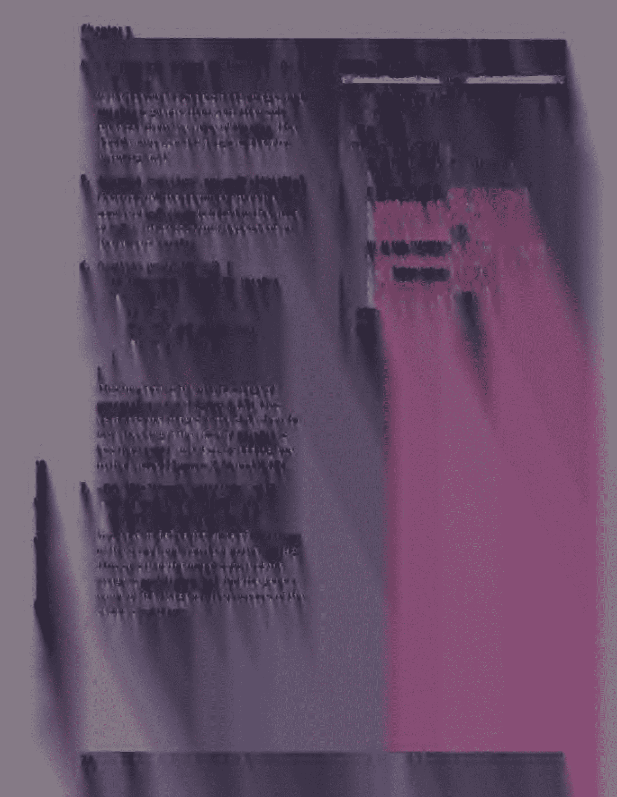

## 趣味图像

Netscape：幻灯片

图 3.15 点击“Next”（下一个）链接时，幻灯片将切换。注意窗口底部状态栏显示的`javascript:processNext()`函数，它会提供正在发生操作的反馈。

图 3.16 幻灯片中的第二张图片。

以下是如何通过链接调用 JavaScript 函数。当用户点击“Previous”（上一个）链接时，会调用`processPrevious()`。

```html
<A HREF="javascript:processPrevious()">&lt;Previous</A>
```

`&lt;&gt;`是 HTML 符号，这样链接的前后方向会更清晰一些。

```html
<A HREF="javascript:processNext()">&lt;Next&gt;</A>
```

当点击“Next”（下一个）链接时，脚本会调用`processNext()`函数。`&lt;&gt;`是 HTML 符号，这样链接的前后方向会更清晰一些。

> 提示：在两个函数（`processPrevious()`和`processNext()`）中，当用户到达任一方向的最后一张图片时，脚本会忽略该方向的进一步点击。图 3.17 点击“Previous”链接会触发`javascript:processPrevious()`函数，如状态栏所示。

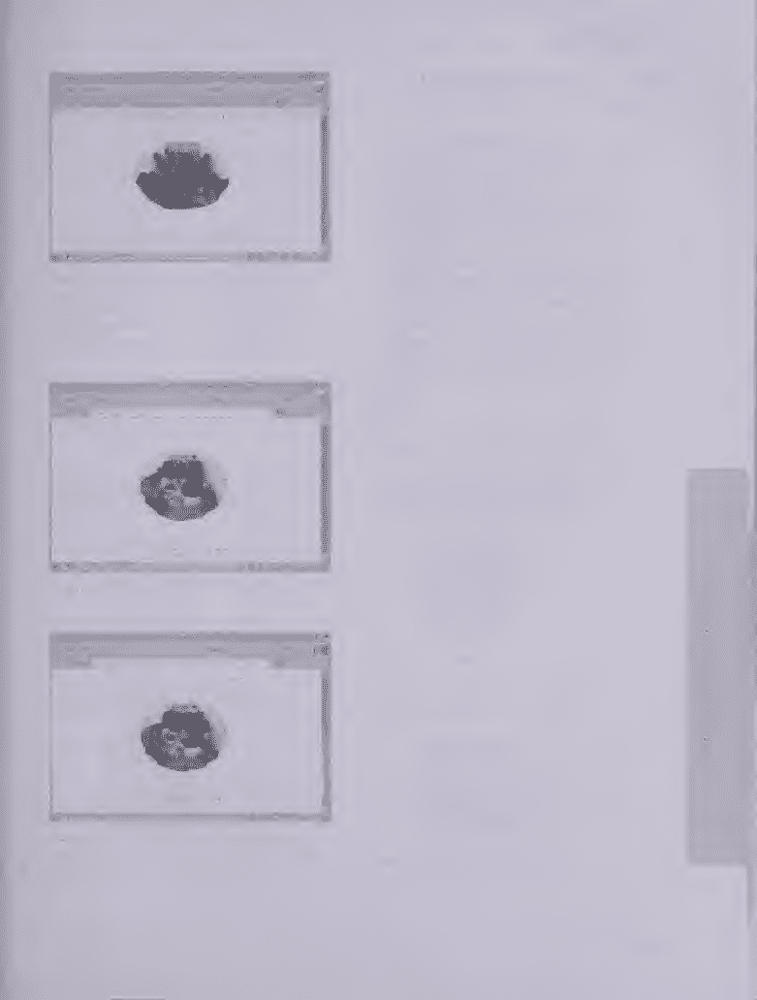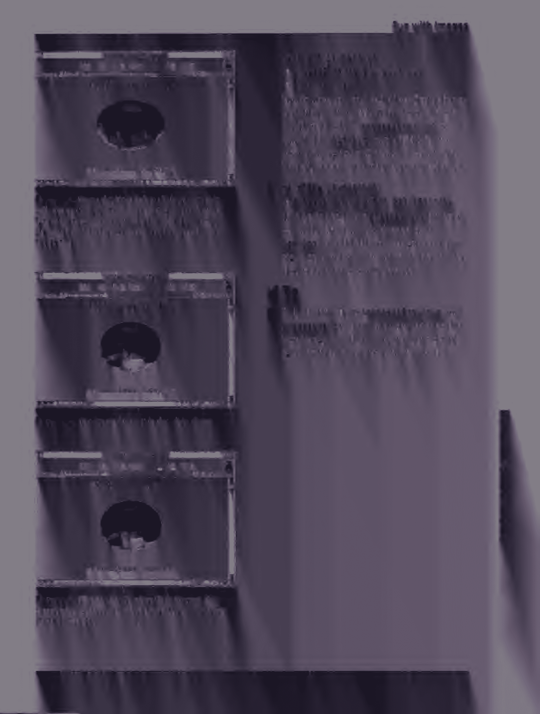

## 构建循环幻灯片

正如上一节末尾提示所示，上一个脚本的局限性在于当用户到达任一方向的幻灯片末尾时，脚本就停止了。在脚本 3.14 中，你将看到如何构建一个循环脚本，也就是说，如果你越过了列表末尾，就会回到开头，反之亦然。图 3.18 显示了新的幻灯片。

构建循环幻灯片：

1. `myPix = new Array("images/callisto.jpg", "images/europa.jpg", "images/io.jpg", "images/ganymede.jpg")`——加载变量`myPix`，包含木星四颗主卫星图像。
2. `function chgSlide(direction) { ... }`——此脚本将脚本 3.13 中使用的独立`processNext()`和`processPrevious()`函数替换为单一函数`chgSlide()`，该函数传递参数`direction`，其值可以是 1 或 -1。
3. `if (document.images) { thisPic = thisPic + direction; if (thisPic > imgCt) { thisPic = ... } }`——在检查浏览器是否支持图像的常规检查内部，变量`thisPic`设置为其值加上`direction`的值。如果`thisPic`大于`imgCt`，则`thisPic`被设置为 0。

脚本 3.14 此脚本展示了如何制作双向幻灯片。

```html
<!DOCTYPE HTML PUBLIC "-//W3C//DTD HTML 4.01 Transitional//EN" "http://www.w3.org/TR/html4/loose.dtd">

<HTML>

<HEAD>
<TITLE>Slideshow</TITLE>

<SCRIPT LANGUAGE="JAVASCRIPT" TYPE="text/javascript">

<!-- 对旧版浏览器隐藏脚本 -->

myPix = new Array("images/callisto.jpg", "images/europa.jpg", "images/io.jpg", "images/ganymede.jpg");

imgCt = myPix.length;

function chgSlide(direction) {

    if (document.images) {

        thisPic = thisPic + direction;

        if (thisPic > imgCt) {
            thisPic = 0;
        }

        if (thisPic < 0) {
            thisPic = imgCt;
        }

        document.myPicture.src = myPix[thisPic];
    }
}

// 对旧版浏览器的结束

</script>
</HEAD>

<BODY BGCOLOR="WHITE">

<H1 ALIGN="CENTER">木星的卫星</H1>

<P ALIGN="CENTER">

</P>

<H1 ALIGN="CENTER">
<A HREF="javascript:chgSlide(-1)">&lt;Previous&gt;</A>&nbsp;&nbsp;
<A HREF="javascript:chgSlide(1)">&lt;Next&gt;</A>
</H1>

</BODY>

</HTML>
```

图 3.18 木星的四颗卫星可以向任何方向向前向后查看。

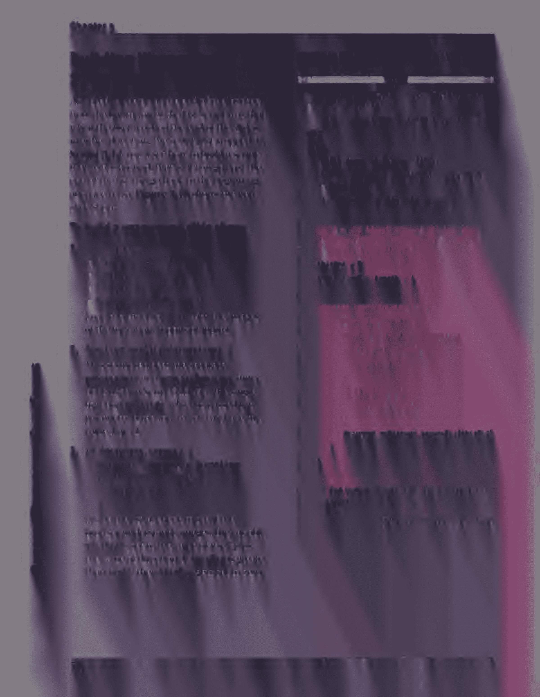

## 第 3 章：显示随机图片

如果你的网站拥有丰富的图表资源，或者你正在展示数字艺术品，那么你可能希望在用户进入网站时，显示你收藏中的一张随机图片。再次，是 JavaScript 大显身手了！脚本 3.15 就是答案，图 3.19 显示了该脚本的结果。

要显示随机图片：

1. `myPix = new Array("images/redBanner.gif", "images/blueBanner.gif", "images/greenBanner.gif")`

   如大家熟悉，构建一个包含三个图片的数组并将其放入变量`myPix`中。

2. `imgCt = myPix.length`

   将`imgCt`设置为数组中的项目数量，在本例中数量为 3。

3. `function choosePic() {`

   定义函数`choosePic()`。

4. `if (document.images) {`

   `randomNum = Math.floor((Math.random() * imgCt))`

   如果文档可以处理图像对象，则创建一个名为`randomNum`的变量。该变量的值是一个数学表达式的结果，该表达式从内向外阅读最为清晰。`Math.random()`生成一个 0 到 1 之间的随机数，然后乘以`imgCt`。`Math.floor()`将结果向下取整为整数，这意味着数字必须在 0 到 2 之间。

脚本 3.15 你可以使用此脚本显示随机图片。

```html
<!DOCTYPE HTML PUBLIC "-//W3C//DTD HTML 4.01 Transitional//EN" "http://www.w3.org/TR/html4/loose.dtd">

<HTML>

<HEAD>
<TITLE>Random Image</TITLE>

<SCRIPT LANGUAGE="JAVASCRIPT" TYPE="TEXT/JAVASCRIPT">

<!-- Hide script from old browsers -->

var myPix = new Array("images/redBanner.gif", "images/blueBanner.gif", "images/greenBanner.gif");

var imgCt = myPix.length;

function choosePic() {

  if (document.images) {

    randomNum = Math.floor((Math.random() * imgCt));

    document.myPicture.src = myPix[randomNum];
  }

} // End hiding script from old browsers

</script>
</HEAD>

<BODY BGCOLOR="WHITE" onLoad="choosePic()">


</BODY>

</HTML>
```

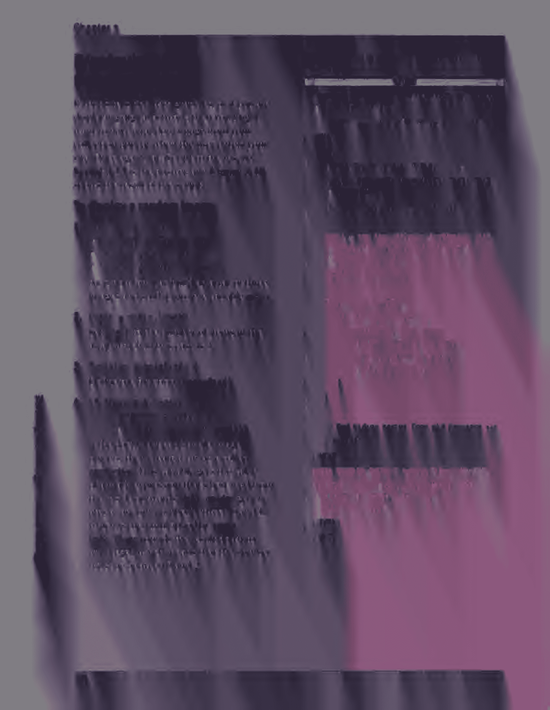

## 图片的乐趣

### 显示多张随机图片

如果你已经创建了一个显示单张随机图片的页面，你可能想在页面的其他地方添加更多的随机图片。为了实现这一点，你将使用一个与脚本 3.15 非常相似的脚本（脚本 3.16）。区别在于，由于你要显示多一张图片，你需要设置更多的数组和变量。

1. `myPix1 = new Array("images/pathfinder.gif", "images/surveyor.gif", "images/surveyor98.gif")`  
   `myPix2 = new Array("images/callisto.jpg", "images/europa.jpg", "images/io.jpg", "images/ganymede.jpg")`

   是的，这是另一个充满了那些伟大的 NASA 图片的数组。

2. `randomNum = Math.floor((Math.random() * myPix1.length))`  
   `document.myPicture1.src = myPix1[randomNum]`

   这设置了第一张随机图片，就像在本章的前节一样，只不过使用了新的变量名。

3. `randomNum = Math.floor((Math.random() * myPix2.length))`  
   `document.myPicture2.src = myPix2[randomNum]`

   这设置了第二张随机图片。并不意外，它看起来与之前的任务和步骤非常相似，只不过再次使用了唯一的变量名。你可以在图 3.20 中看到这两张随机图片。

脚本 3.16 如果你需要在页面上显示多张图片，此脚本展示了如何实现。

```html
<!DOCTYPE HTML>

<HTML>

<HEAD>
<TITLE>Random Images</TITLE>

<SCRIPT LANGUAGE="JAVASCRIPT" TYPE="TEXT/JAVASCRIPT">

var myPix1 = new Array("images/pathfinder.gif", "images/surveyor.gif", "images/surveyor98.gif");

var myPix2 = new Array("images/callisto.jpg", "images/europa.jpg", "images/io.jpg", "images/ganymede.jpg");

function choosePic() {

  if (document.images) {

    randomNum = Math.floor((Math.random() * myPix1.length));

    document.myPicture1.src = myPix1[randomNum];

    randomNum = Math.floor((Math.random() * myPix2.length));

    document.myPicture2.src = myPix2[randomNum];
  }
}

</script>
</HEAD>

<BODY BGCOLOR="WHITE" onLoad="choosePic()">

<br><br>


</BODY>

</HTML>
```

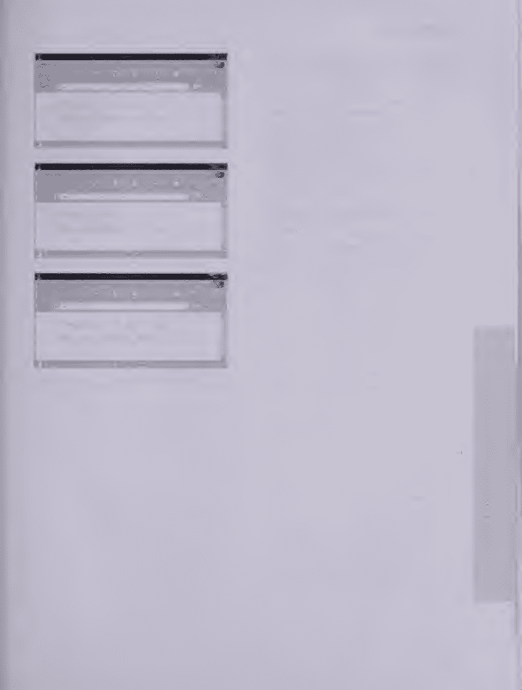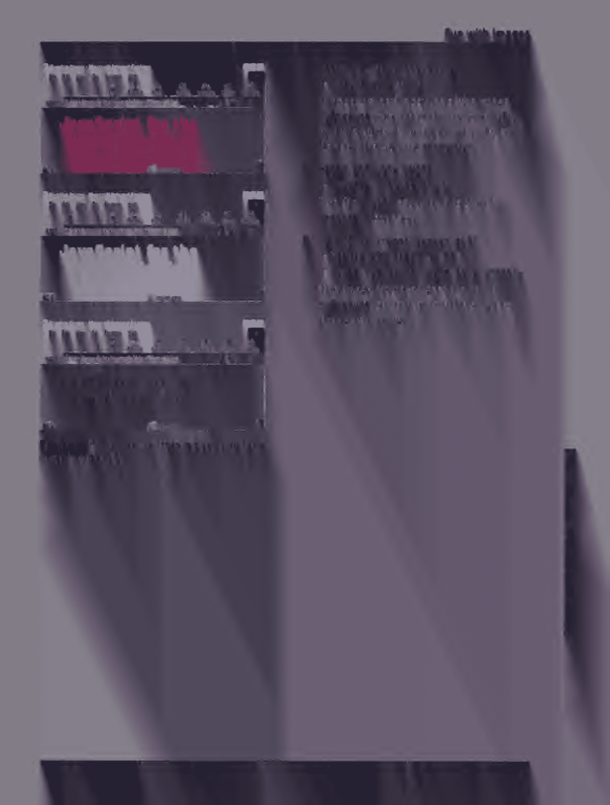

图 3.20 这两张图片是通过脚本从多张图片中随机选择出的。

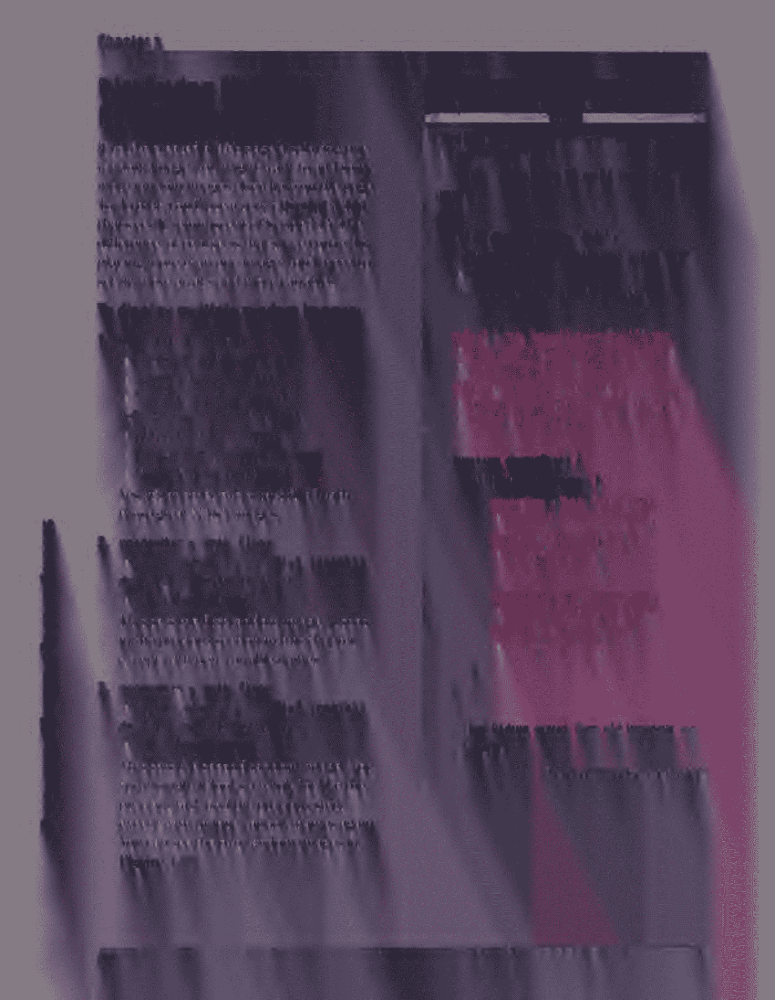

## 第 3 章：将鼠标悬停效果与图像映射结合

你可能对普通 HTML 中的图像映射（image maps）很熟悉，在图像映射中，你可以点击带有热点的图形部分，并根据你点击了哪个热点跳转到不同的页面。例如，如果你有一张美国地图，每个州都可以有自己的热点。点击某个州将带你进入一个包含该州详细信息的页面。

将悬停效果与图像映射结合可以产生一些非常有趣且吸引人的效果。在脚本 3.17 中了解如何掌握这项技术。

在查看脚本之前，请查看图 3.21、3.22、3.23、3.24 和 3.25，看看悬停和图像映射是如何协同工作的。正如你所注意到的，有一个名为“书籍信息”（Book Info）的大图，其中包含三个子区域，当用户鼠标悬停在其上方时显示。如图 3.21 所示，实际上使用了四种不同的图形。

要将悬停效果与图像映射结合：

```javascript
if (document.images) {

    img1 = new Image();

    img2 = new Image();

    img3 = new Image();

    imgRed = new Image();

    // 进行快速测试，以查看用户的浏览器是否可以处理你通过 document.images 测试使用的 JavaScript 级别。如果一切正常，则创建四个新的图像对象。
}
```

图 3.21 示例中使用的四幅图像。从左到右依次是`testRed.gif`、`testGreen1.gif`、`testGreen2.gif`和`testGreen3.gif`。

图 3.22 “书籍信息”图像实际上是一个图像映射。

感谢访问我们的网站。你在这里可以看到 Web 上最棒的 JavaScript 信息，其中许多内容也收在了我们由 Peachpit Press 出版的书籍《JavaScript for the World Wide Web, Visual QuickStart Guide, Fourth Edition》中。你可以通过点击左侧的信息框了解更多信息。

图 3.23 指向图像映射的顶部三分会更改图像以“揭示”一个新的界面选择。

图 3.24 显示第二种选择。

图 3.25 还有第三种选择。每个选择在点击时都会带你进入一个不同的页面。

脚本 3.17 结合图像映射和悬停效果是一项强大的技术，为你的网站增加趣味性和交互性。

```html
<!DOCTYPE HTML PUBLIC "-//W3C//DTD HTML 401 Transitional//EN" "http://www.w3.org/TR/html4/loose.dtd">

<HTML>

<head>

<title>结合悬停效果与图像映射</title>

<script language="JAVASCRIPT" type="TEXT/JAVASCRIPT">

<!-- 对旧版浏览器隐藏脚本 -->

if (document.images) {

    img1 = new Image();

    img2 = new Image();

    img3 = new Image();

    imgRed = new Image();

    img1.src = "images/testGreen1.gif";

    img2.src = "images/testGreen2.gif";

    img3.src = "images/testGreen3.gif";

    imgRed.src = "images/testRed.gif";

} else {

    img1 = "";

    img2 = "";

    img3 = "";

    // (脚本继续在下一页)

    // 2.

    img1.src = "images/testGreen1.gif";

    img2.src = "images/testGreen2.gif";

    img3.src = "images/testGreen3.gif";

    imgRed.src = "images/testRed.gif";
}

// 为新的图像对象填充它们的初始源图像。

else {
```


`img1 = "";`

`img2 = "";`

`img3 = "";`

`imgRed = "";`

`document.roll = "";`

`}`

如果现代浏览器的测试失败，则用空值填充变量，这样就不会从旧版浏览器收到错误消息。

`-->`

`</script>`

`</head>`

`<body>`

`<MAP NAME="roll_map">`

`<AREA SHAPE="RECT" HREF="sec1.html" onMouseover="document.roll.src=img1.src" onMouseout="document.roll.src=imgRed.src" CODS="0,0,120,60" ALT="示例章节">`

`<AREA SHAPE="RECT" HREF="sec2.html" onMouseover="document.roll.src=img2.src" onMouseout="document.roll.src=imgRed.src" CODS="0,60,120,120" ALT="关于作者">`

`<AREA SHAPE="RECT" HREF="sec3.html" onMouseover="document.roll.src=img3.src" onMouseout="document.roll.src=imgRed.src" CODS="0,120,120,180" ALT="购买副本">`

`</MAP>`

`<A HREF="home.html" onMouseout="document.roll.src=imgRed.src">`

``

在这里你打开了锚点标签并定义了 `onMouseover` 和 `onMouseout` 的初始值。你已经完成了图像映射的定义，因此关闭 `map` 标签并在 `img` 标签中命名映射，使用 `testRed.gif` 作为初始图像，并将图像命名为 `roll`。最后，使用 `</a>` 关闭锚点标签。

### 关于

在这些代码行中，你定义了图像映射上三个矩形热点的形状和大小，并对于每个热点，告诉脚本在 `onmouseover` 时，它应该将相应的源分配给 `document.roll` 对象。

### 提示

- 映射的每个部分链接到不同的 Web 页面。在用户点击鼠标之前，浏览器不会跳转到新的 Web 页面。
- 该技术对于清理拥挤的布局和导航栏非常有帮助。实际上，它让你对用户界面进行分层。
- 它对于在网站上创建伪下拉菜单非常好。你可以让悬停显示一个看起来像菜单的图像映射，图像映射的每个区域都可以链接到不同的页面。关于此想法的更高级版本，请参阅第 13 章《使用 JavaScript 设计用户界面》中的“创建下拉菜单”部分。

脚本 3.17 继续

```javascript
imgRed = "";

document.roll = "";

<!-- 对旧版浏览器隐藏脚本 -->

</script>

</head>

<BODY BGCOLOR="WHITE">

<MAP NAME="roll_map">

<AREA SHAPE="RECT" HREF="sec1.html" onMouseover="document.roll.src=img1.src" onMouseout="document.roll.src=imgRed.src" CODS="0,0,120,60" ALT="示例章节">

<AREA SHAPE="RECT" HREF="sec2.html" onMouseover="document.roll.src=img2.src" onMouseout="document.roll.src=imgRed.src" CODS="0,60,120,120" ALT="关于作者">

<AREA SHAPE="RECT" HREF="sec3.html" onMouseover="document.roll.src=img3.src" onMouseout="document.roll.src=imgRed.src" CODS="0,120,120,180" ALT="购买副本">

</MAP>

<A HREF="home.html" onMouseout="document.roll.src=imgRed.src">


</a>
```

## 欢迎来到 Steve 疯狂的网络阴论页面！

你是否曾经觉得外面总有人在针对 70 你？嗯，我们也有这种感觉，而且我们知道他们为什么也想针对你。暗杀、秘密世界政府夺权、麦田圈、从天而降的青蛙、黑色直升机……我们掌握了所有这一切背后的**真实**故事。

真相就在这里。在某个地方。

（图 3.26：初始的白色背景。）

## 欢迎来到 Steve 疯狂的网络阴论页面！

你是否曾经觉得外面总有人在针对 7a 你？嗯，我们也有这种感觉，而且我们知道他们为什么也想针对你。暗杀、秘密世界政府夺权、麦田圈、从天而降的青蛙、黑色直升机……我们掌握了这一切背后的**真实**故事。

真相就在这里。某个地方。

（图 3.27：同一个页面，现在背景变成了红色。）

## 自动更改背景颜色

老实说，我们并不完全确定你为什么要用 JavaScript 来更改页面的背景颜色，但既然你可以这样做，我们就决定向你介绍这项技术。在图 3.26 和 3.27 中，你可以看到我们如何每三秒更改一次背景颜色，在红、白、蓝之间循环（未显示）。请查看脚本 3.18 以了解如何操作。

要自动更改背景颜色：

1. `bGrounds = new Array("red", "white", "blue"); thisBG = 0; bgColorCount = bGrounds.length` 变量 `bGrounds` 包含你将使用的颜色名称。你可以在这里使用十六进制颜色而没有任何问题；你甚至可以将十六进制颜色与颜色名称混合使用。`thisBG` 变量被设置为零，变量 `bgColorCount` 被设置为 `bGrounds` 数组的长度，在这里是 3。
2. `function rotateBG() {` 定义一个名为 `rotateBG` 的函数。
3. `if (document.images) { thisBG++` 如果文档知道如何处理图像，则将 `thisBG` 的值加一。
4. `if (thisBG == bgColorCount) { thisBG = 0; }` 如果 `thisBG` 等于 `bgColorCount`，则将 `thisBG` 设回零。否则，它将回到循环！
5. `document.bgColor = bGrounds[thisBG]` 这一行告诉文档将其背景颜色属性设置为变量 `bGrounds` 所代表的值，该值由 `thisBG` 的当前值决定。
6. `setTimeout(rotateBG(), 1000)` 如本章前面所示，`setTimeout` 每 1000 毫秒调用一次 `rotateBG` 函数。

- 提示：你可以通过向 `bGrounds` 数组中添加更多颜色名称或十六进制值，让脚本在更多颜色之间切换。为了达到那种迷幻的效果，你可以通过减小 `setTimeout` 的值让颜色快速闪烁。如果你将第 6 步中的值改为很小的值（如 1），你会觉得自己瞬间回了 60 年代。

脚本 3.18 让你的页面能够自动切换背景。

```html
<!DOCTYPE HTML PUBLIC "-W3C//DTD HTML 4.0 Transitional//EN" "http://www.w3.org/TR/HTML44/transitional.dtd">

<html

<head>

<title>Rotating Backgrounds</title>

<script>

// Hide script from old browsers

bGrounds = Array("red", "white", "blue");

thisBG = 0;

bgColorCount = bGrounds.length;

function rotateBG() {

  if (document.images) {

    thisBG++;

    if (thisBG == bgColorCount) {

      thisBG = 0;

    }

    document.bgColor = bGrounds[thisBG];

    setTimeout(rotateBG(), 1000);

  }

}

// End hiding script from old browsers

</script>

</head>

<body bgColor="RED" onLoad="rotateBG()">

<h1>Welcome to Steve's Wacko Internet Conspiracy Page!</h1>

<h3>Have you ever felt that people out there were out to get 70? Well, we feel that way too, and we think we know why they想针对你。暗杀、秘密世界政府夺权、麦田圈、从天而降的青蛙、黑色直升机……我们掌握了这一切背后的真实故事。</h3>

<h1>The truth is in here. Somewhere.</h1>

</body>

</html>
```

## 框架、框架、更多的框架

框架（Frames）是 HTML 最强大的功能之一。在本章中，我们将演示如何利用 JavaScript 的力量让框架变得更加强大。

一个框架至少至少三个 HTML 组成。第一个称为 `frameset`，它设置了每个子框架的尺寸。`frameset` 在 JavaScript 中被称为 `top` 或 `parent`。其余页面填充在 `frameset` 创建的窗格中，这些是子页面。你可以为它们命名任何名称。图 4.1 显示了一个创建了两个子框架“left”和“content”的 `frameset`。

（图 4.1：包含两个框架——“left”和“content”的 `frameset` 布局。）

| 标签 | 属性 | 含义 |
| :--- | :--- | :--- |
| `FRAMESET` | | 指明该页面由两个或多个框架页面组成；包含指定特定页面的 `FRAME` 标签。 |
| | `BORDER` | 每个框架之间显示的边框大小，单位为像素。 |
| | `COLS` | 每个框架的列尺寸（比例或固定），单位为像素。 |
| | `FRAMEBORDER` | 是/否值，指定是否在框架之间显示边框。 |
| | `ROWS` | 每个框架的行尺寸（比例或固定），单位为像素。 |
| `FRAME` | | 每个被框架页面的位置和属性。 |
| | `NAME` | 用于 JavaScript 引用 `frameset` 中的某个页面。 |
| | `SRC` | 加载到框架中的页面的物理位置（即 URL）。 |

## 框架、框架以及更多框架

这里有一个非常酷的页面，我假装这是我写的——一个每个人想声称是自己的非常重要的页面。

图 4.2 你的页面，被埋在别人的框架集（`frameset`）中。

脚本 4.1 JavaScript 提供了一种强制让你的页面始终在独立页面中显示的方法。

```html
<!DOCTYPE HTML PUBLIC "-//W3C//DTD HTML 4.01 Transitional//EN"

"http://www.w3.org/TR/html4/html4-transitional.dtd">

<HTML>

<HEAD>

  <TITLE>Can't be in a frame</TITLE>

  <SCRIPT LANGUAGE="JAVASCRIPT" TYPE="text/javascript">

  <!-- 对旧浏览器隐藏脚本 -->

  if (top.location != self.location) {

    top.location.replace(self.location)

  }

  // 结束旧浏览器隐藏脚本 -->

  </SCRIPT>

</HEAD>

<BODY BGCOLOR="WHITE">

  <h1>A really important page here that everyone wants to claim as theirs.</h1>

</BODY>

</HTML>
```

## 防止页面置于框架中

其他人可以将你的某个页面放在他们网站的框架内，这使得你的页面看起来是他们内容的一部分。在 JavaScript 中，窗口以层级结构出现，父窗口位于堆栈的顶端。当有人劫持你的页面时，他们是强制让它成为其父窗口的子框架。图 4.2 显示了该页面如何作为别人网站的一部分出现。通过脚本 4.1，你可以防止这种页面劫持，并强制你的页面始终在独立的浏览器窗口中显示。

要隔离你的页面：

1. `if (top.location != self.location)` { 首先，检查当前页面（`self`）的位置是否为浏览器窗口层级中的顶端。如果是，则无需执行任何操作。
2. `top.location.replace(self.location)` 如果当前页面不在顶端，则用当前页的位置替换顶端页面。这将强制当前窗口变为你的页面且仅为你的页面。图 4.3 显示了你按照设计设计的页面。

- **提示**：我们可以直接将 `top.location` 设置为 `self.location`，但这有一个糟糕的副作用：用户将无法再使用浏览器的后退按钮。如果他们尝试这样做，返回上一个页面会自动将他们带回当前页面。使用上述的 `replace()` 方法会替换历史记录中的当前页面，允许后退按钮显示上一个页面。

图 4.3 你的页面，逃离了恶意的劫持框架集后的样子。

## 强制将页面置于框架

当搜索引擎录入你的某个页面时，它并不知道该页面是框架的一部分。当用户通过搜索引擎找到你的页面时，点击链接将只显示单个页面，而不是你设计的框架集。脚本 4.4 向你展示了即使 Google 或或其他搜索引擎不知道框架集，如何强制显示完整的框架集。图 4.4 显示页面看起来格格不入，图 4.5 显示它已归位，舒适地待在框架中。脚本 4.2 和 4.3 分别显示了框架集和左侧导航栏。

- 强制页面进入框架：
1. `if (top.location == self.location)` { 检查当前页面（`self`）是否处于最顶层。如果不是，说明你处于一个框架集中。
2. `self.location.replace("frameset.html")` 如果当前页的位置位于顶端，则用框架集的 URL 替换当前页面。这将按照你设计的方式显示你的框架网站。

图 4.4 一个孤独的页面，被孤立无援。

图 4.5 你的页面，与它的父和兄弟喜地重聚。

脚本 4.2 这是应该加载你页面的框架集。

```html
<!DOCTYPE HTML PUBLIC "-//W3C//DTD HTML 4.01 Frameset//EN"

"http://www.w3.org/TR/html4/html4-frameset.dtd">

<HTML>

<HEAD>

  <TITLE>This is the page to show</TITLE>

</HEAD>

<FRAMESET COLS="30%,70%">

  <FRAME SRC="left.html" NAME="left">

  <FRAME SRC="frame2.html" NAME="content">

</FRAMESET>

</HTML>
```

- **提示**：你应该始终看到一个应该始终位于框架之内的重要页面。

脚本 4.3 框架集的左侧导航栏。

- **提示**：Netscape：必须在框架内。

脚本 4.4 使用 JavaScript 强制你的页面进入框架集。

```html
<!DOCTYPE HTML PUBLIC "-//W3C//DTD HTML 4.01"

"http://www.w3.org/TR/html4/html4-transitional.dtd">

<HTML>

<HEAD>

  <TITLE>Must be in a frame</TITLE>

  <SCRIPT LANGUAGE="JAVASCRIPT" TYPE="text/javascript">

  <!-- 对旧浏览器隐藏脚本 -->

  if (top.location == self.location) {

    self.location.replace("frameset.html")

  }

  // 结束旧浏览器隐藏脚本 -->

  </SCRIPT>

</HEAD>

<BODY BGCOLOR="WHITE">

  <h1>A page that should always be within a frame</h1>

</BODY>

</HTML>
```


# 第 4 章：将网站强制置于框架

如果你有一个大型网站，其中许多页面你想放入框架（frame）中，那么上一页描述的方法可能会变得难以处理。这里有一种更适用于大型网站的方法。脚本 4.5（下文详解）显示了框架集（frameset），脚本 4.6 显示了左侧导航栏，脚本 4.7 和 4.8 显示了你需要添加到网站每个页面上的少量 JavaScript。图 4.6 显示了你页面的独立状态，而图 4.7 显示了你希望网站呈现的样子。

[图 4.6 这是我们在框架之外的页面。]

[图 4.7 但我们真正希望呈现的样子。]

## 脚本 4.5：框架集页面理解传递的内容页面位置

```html
<!DOCTYPE HTML PUBLIC "-//W3C//DTD HTML 4.0 Frameset//EN"
"http://www.w3.org/TR/html4/frameset.dtd">

<HTML>
<HEAD>
<TITLE>Site Frameset</TITLE>
</HEAD>

<SCRIPT LANGUAGE="JAVASCRIPT" TYPE="TEXT/JAVASCRIPT">
<!-- Hide script from old browsers

linkURL = "frame3a.html"

if (parent.document.URL)
{
  callingURL = parent.document.URL

  if (callingURL.indexOf('?') != -1)
  {
    linkURL = callingURL.substring(callingURL.indexOf('?') + 1, callingURL.length)
  }
}

document.writeln('<FRAMESET COLS="30%, 70%">')
document.writeln('<FRAME SRC="left3.html" NAME="left">')
document.writeln('<FRAME SRC="' + linkURL + '" NAME="content">')
document.writeln('</FRAMESET>')

// End hiding script from old browsers -->
</SCRIPT>
</HTML>
```

## 框架，以及更多框架

### 脚本 4.6：左侧导航栏应该始终显示

```html
<!DOCTYPE HTML PUBLIC "-//W3C//DTD HTML 4.0 Transitional//EN"
"http://www.w3.org/TR/html4/frameset.dtd">

<HTML>
<HEAD>
<TITLE>Nav Bar</TITLE>
</HEAD>

<BODY BG="WHITE">
<H>Important info you should always see</H>
</BODY>
</HTML>
```

### 脚本 4.7：一个页面被传递给框架集

```html
<!DOCTYPE HTML PUBLIC "-//W3C//DTD HTML 4.0 Transitional//EN"
"http://www.w3.org/TR/html4/frameset.dtd">

<HTML>
<HEAD>
<TITLE>Must be in a frame</TITLE>

<SCRIPT LANGUAGE="JAVASCRIPT" TYPE="TEXT/JAVASCRIPT">
<!-- Hide script from old browsers

if (top.location == self.location)
{
  self.location.replace("framesetframe3a.html")
}

// End hiding script from old browsers -->
</SCRIPT>
</HEAD>

<BODY BG="WHITE">
<H>This is content page 1.</H>
</BODY>
</HTML>
```

## 要将网站强制置于框架中

1. `linkURL = "frame3a.html"` 在此处设置 `linkURL` 为默认页面，它将出现在内容框架中，以防你在加载框架集时没有引用内容页面的。
2. `if (parent.document.URL)` 并不是每个支持 JavaScript 的浏览器都理解 URL 对象。如果浏览器不支持，你想跳过后续步骤（直到第 5 步），你可以通过将这些步骤封装在 `if` 语句中来实现。
3. `callingURL = parent.document.URL` 如果浏览器确实理解 URL 对象，你想将该值存储在 `callingURL` 变量中。
4. `if (callingURL.indexOf('?') != -1)` 你要把想要放入内容框架的页面名称传递给框架集页面。这样做的方法是获取要加载的页面（框架集页面）名称，在其后面添加一个问号，然后是目标内容面的名称。这一步检查 `callingURL` 中是否存在问号。如果是，你就执行下一步。
5. `linkURL = callingURL.substring(callingURL.indexOf('?') + 1, callingURL.length)` 在此处，你提取 URL 并仅选择问号之后的部分。`indexOf()` 方法给出问号的位置，`length` 属性告诉我们 `callingURL` 的长度。`substring()` 方法仅返回你想要的 `callingURL` 部分：从问号后的第 1 个字符到 URL 的结束。
6. 在下一个页面上：

```javascript
document.writeln('<FRAMESET COLS="30%, 70%">')
document.writeln('<FRAME SRC="left3.html" NAME="left">')
document.writeln('<FRAME SRC="' + linkURL + '" NAME="content">')
document.writeln('</FRAMESET>')
```

这部分代码会动态写入框架。如果浏览器理解 URL 对象且传递了带有问号的 URL，则内容框架将获得所需的 URL。否则，页面将获得第 1 步在 `linkURL` 中定义的默认内容框架。`self.location.replace("frameset3.html")` 在你想放入框架的页面（脚本 4.7）上，此代码强制加载框架集页面。将 `self.location` 替换为框架集的名称，后面跟着问号以及你想内容框架的页面名称。

> **提示：**`document.URL` 对象仅存在于 JavaScript 1.1 及更高版本。如果你需要支持更早的版本，请记住它们始终会获取默认页面。为了简单起见，脚本 4.5 中显示的框架集没有处理旧的非 JavaScript 浏览器或不支持框架的浏览器。你的代码当然应该进行浏览器检测（参见第 2 章）。

### 脚本 4.8：以同样的方式传递另一个页面

```html
<!DOCTYPE HTML PUBLIC "-//W3C//DTD HTML 4.0 Transitional//EN"
"http://www.w3.org/TR/html4/frameset.dtd">

<HTML>
<HEAD>
<TITLE>Must be in a frame</TITLE>

<SCRIPT LANGUAGE="JAVASCRIPT" TYPE="TEXT/JAVASCRIPT">
<!-- Hide script from old browsers

if (top.location == self.location)
{
  self.location.replace("framesetframe3b.html")
}

// End hiding script from old browsers -->
</SCRIPT>
</HEAD>

<BODY BG="WHITE">
<H>This is content page 2.</H>
</BODY>
</HTML>
```

为什么在第 6 步中斜杠 `/` 之前有一个反斜杠 `\\`？根据 HTML 标准，浏览器可能会将 `document.write()` 内部闭合标签的开头 `</` 解析为行的结束。反斜杠“转义”了斜杠，允许我们在不产生错误的情况下写输出 HTML。如果你在本地硬盘上通过 IE 运行此脚本，可能会发现它不起作用。这是由于 IE 的一个 bug，一旦你将文件上传到服务器并从那里运行，它应该就能正常工作。

## 框架、框架，以及更多框架

### 加载框架

#### 脚本 4.9：此框架集加载了我们所需的页面

```html
<!doctype html PUBLIC "-////W3C//DTD HTML 4//EN"
"http://www.w3.org/TR/html4/frameset.dtd">

<html>
<HEAD>
<TITLE>设置一个框架</TITLE>

<FRAMESET COLS="30%,70%">
<FRAME SRC="left4.html" NAME="left">
<FRAME SRC="frame4a.html" NAME="content">
</FRAMESET>
</HTML>
```

通常的做法是有一个框架作为网站的导航栏，它将不同的页面加载到主框架中。脚本 4.9 中的框架集允许你通过点击左侧框架中的链接（脚本 4.10，详见下文），从另一个主内容框架加载你选择的页面（脚本 4.11、4.12 和 4.13）。

### 脚本 4.10：使用此脚本从导航框架设置内容

```html
<!DOCTYPE HTML PUBLIC "-////W3C//DTD HTML 4.01 Transitional//EN"
"http://www.w3.org/TR/html4/loose.dtd">

<HTML>
<HEAD>
<TITLE>导航栏</TITLE>

<SCRIPT LANGUAGE="JAVASCRIPT" TYPE="TEXT/JAVASCRIPT">
<!-- 对旧版浏览器隐藏脚本 -->

pageArray = new Array("", "frame4a.html", "frame4b.html", "frame4c.html");

function setContent(thisPage)
{
  parent.content.document.location.href = pageArray[thisPage];
}

// 结束对旧版浏览器的隐藏
-->

<BODY BGCOLOR="WHITE">
<H>导航栏</H>
<h2>
<A HREF="javascript:setContent(1)">页面 1</A><BR>
<A HREF="javascript:setContent(2)">页面 2</A><BR>
<A HREF="javascript:setContent(3)">页面 3</A>
</h2>
</BODY>
</SCRIPT>
</HEAD>
</HTML>
```

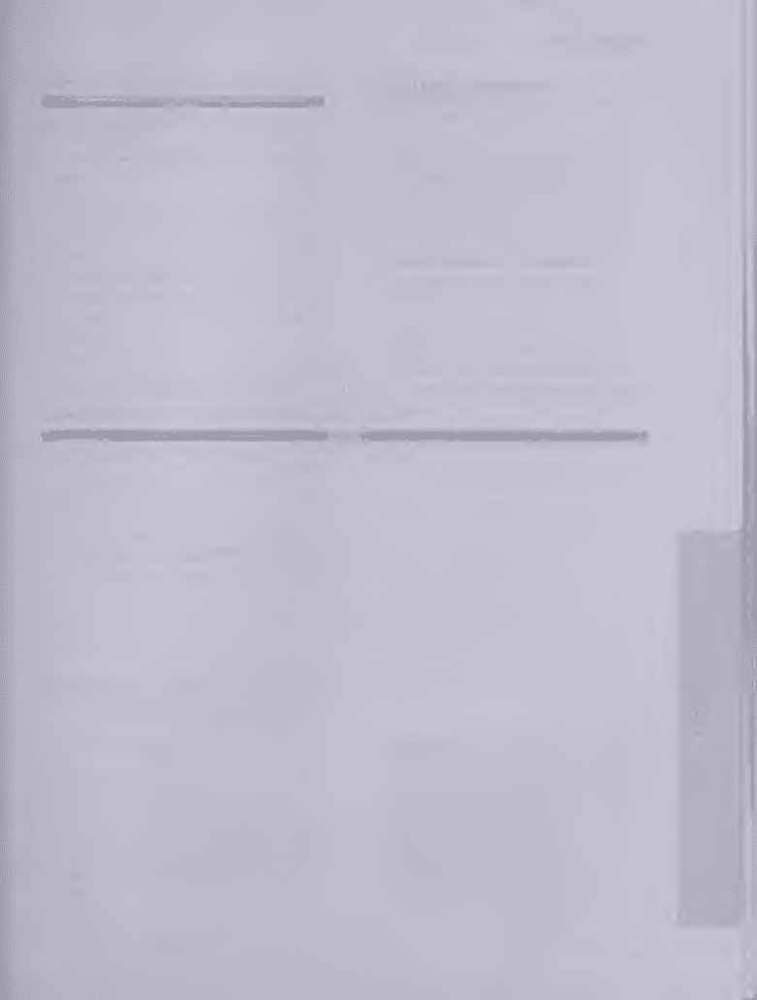

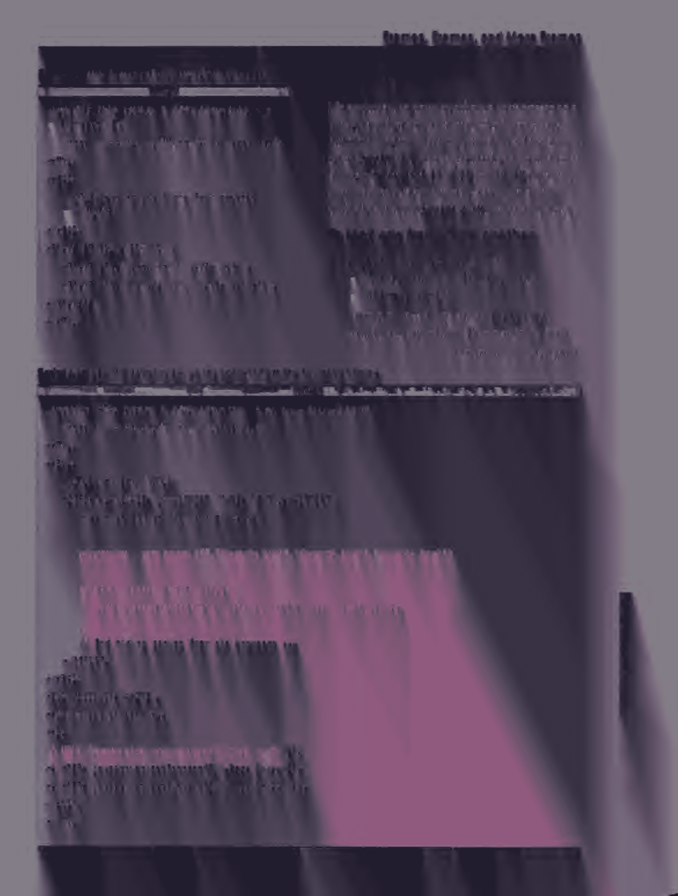

第 4 章导航栏。在图 4.8 所示的页面中，内容框架中可以显示三个可能的页面，因此你需要三个 URL。数组中的第一个位置是位置 0，你将其留空，这样你就可以使用数组的位置 1、2 和 3 来匹配页面 1、2 和 3。

1. 创建一个名为 `pageArray` 的新数组，该数组包含从导航框架中可用的 URL。
2. 创建一个名为 `setContent` 的新函数，给定一个页面数字，加载带有请求页面的内容框架。其实现方法是找到当前文档的父级，然后找到父级文档的内容框架，最后通过设置 `location.href`（该文档的 URL）将新页面加载到该框架中。

```javascript
function setContent(thisPage)
{
  parent.content.document.location.href = pageArray[thisPage];
}
```

3. 在页面正文中，创建指向你想加载到主窗口的页面链接。当点击链接时，将调用 JavaScript 函数 `setContent` 并传递你想要加载的页面数字（在此例中为 1）。对于想在内容框架中显示的每个页面，请使用新的页面数字重复此行代码。

### 脚本 4.11：这里是页面 1

```html
<!DOCTYPEDOCTYPE HTML PUBLIC "-////W3C//DTD HTML 4.01 Transitional//EN"
"http://www.w3.org/TR/html4/loose.dtd">

<HTML>
<HEAD>
<TITLE>内容框架</TITLE>
</HEAD>

<BODY BGCOLOR="WHITE">
<H>你现在正在查看页面 1</H>
</BODY>
</HTML>
```

### 脚本 4.12：这里是页面 2

```html
<!DOCTYPE HTML PUBLIC "-////W3C//DTD HTML 4.01 Transitional//EN"
"http://www.w3.org/TR/html4/loose.dtd">

<HTML>
<HEAD>
<TITLE>内容框架</TITLE>
</HEAD>

<BODY BGCOLOR="WHITE">
<H>你现在正在查看页面 2</H>
</BODY>
</HTML>
```

### 脚本 4.13：以及页面 3

```html
<!DOCTYPE HTML PUBLIC "-////W3C//DTD HTML 4.01 Transitional//EN"
"http://www.w3.org/TR/html4/loose.dtd">

<HTML>
<HEAD>
<TITLE>内容框架</TITLE>
</HEAD>

<BODY BGCOLOR="WHITE">
<H>你现在正在查看页面 3</H>
</BODY>
</HTML>
```

[图 4.8 这里有一个充当导航栏的框架，内容页面出现在内容框架中。]


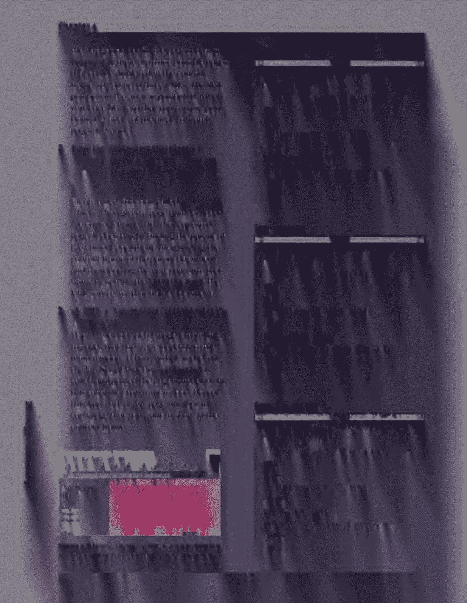

## 创建和加载动态框架

由于 JavaScript 可以动态创建页面，因此对于根据用户在另一个框架中的选择加载动态数据非常有用。

### 脚本 4.14：这里是框架集

```html
<!DOCTYPE HTML PUBLIC "-////W3C//DTD HTML 4.0 Frameset//EN"
"http://www.w3.org/TR/html4/frameset.dtd">

<html>
<HEAD>
<TITLE>设置一个框架</TITLE>
</HEAD>

<FRAMESET COLS="30%,70%">
<FRAME SRC="left5.html" NAME="left">
<FRAME SRC="frame5.html" NAME="content">
</FRAMESET>
</HTML>
```

### 脚本 4.15：JavaScript 允许你动态创建 HTML，作为脚本的结果写入新页面

```javascript
function writeContent(thisPage)
{
  parent.content.document.write("<HTML><HEAD><BODY BGCOLOR='WHITE'>");
  parent.content.document.write("<h1>你现在正在查看页面 " + thisPage + "</h1>");
  parent.content.document.write("</body></HTML>");
  parent.content.document.close();
}
```

## 第 4 章：从另一个框架加载动态框架

1. 创建一个名为 `writeContentO()` 的新函数，该函数在接收到一个页码时创建一个动态页面并将其加载到内容框架（content frame）中。它是通过找到当前文档的父级，然后找到父文档的框架框架，最后将新页面写入内容文档来实现的。最后使用 `document.close()` 确保你写入的所有内容都能显示出来。

```javascript
function writeContent(thisPage)
{
  parent.content.document.write("<HTML><HEAD></HEAD><BODY BGCOLOR='WHITE' HTML>");
  parent.content.document.write("You are now looking at page " + thisPage + ".");
  parent.content.document.write("</body></html>");
  parent.content.document.close();
}
```

2. 在页面的 body 中，创建指向你想加载到主窗口的页面链接。当点击链接时，会调用 JavaScript 函数 `writeContentO()` 并传递你想要创建并加载的页码（在此情况下为 1）。图 4.9 显示了结果。对于你想在内容框架中创建并显示的每个页面，重复此行并使用新的页码。

```html
<A HREF="javascript:writeContent(1)">Page 1</A>
```

**脚本 4.16：初始加载的虚拟页面**

```html


```html
<!DOCTYPE HTML PUBLIC "-//W3C//DTD HTML 4.01 Transitional//EN" "http://www.w3.org/TR/html4/loose.dtd">

<HTML>
<HEAD>
<TITLE>Content frame</TITLE>
</HEAD>
<BODY BGCOLOR="WHITE">
</BODY>
</HTML>
```

（内部插）

图 4.9 这是脚本 4.15 的结果，一个由 JavaScript 编写的网页。

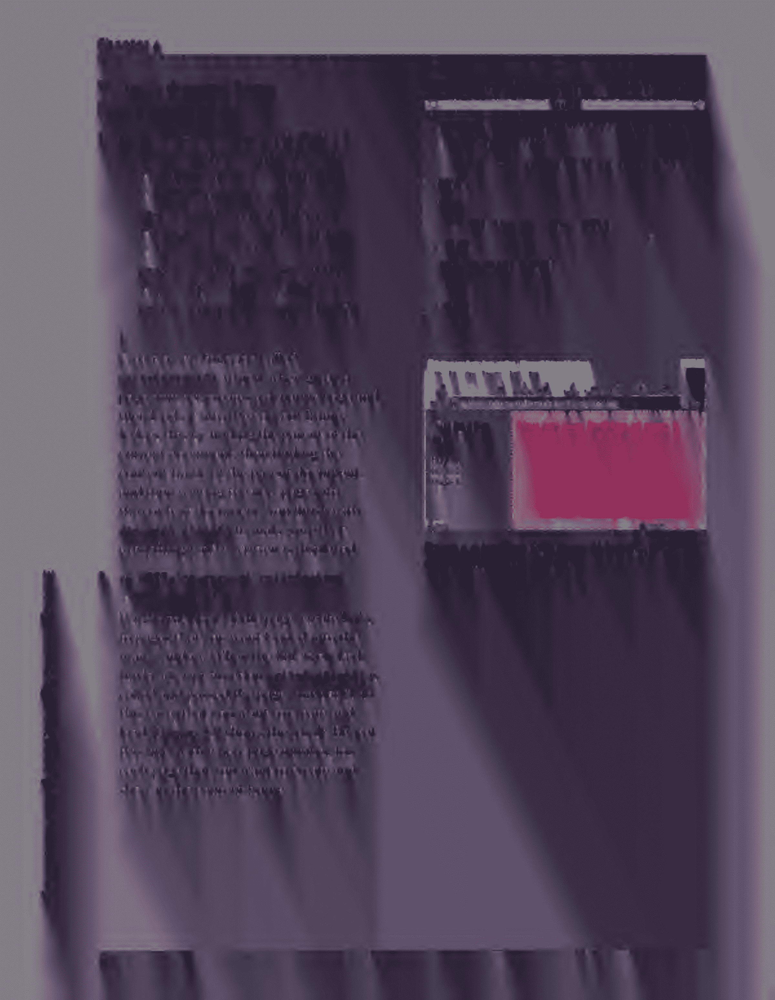

## 框架、框架以及更多框架

导航栏

页面 1  
页面 2  
页面 3

万维网 JavaScript

你现在正在查看页面 3。

图 4.10 这是脚本执行的结果。

**脚本 4.17 框架集页面在我们的所需的框架中加载。**

```html
<!DOCTYPE HTML PUBLIC "-//W3C//DTD HTML 4.0 Frameset//EN" "http://www.w3.org/TR/html4/frameset.dtd">

<HTML>
<HEAD>
<TITLE>Using one frame's functions from another</TITLE>
</HEAD>

<FRAMESET COLS="30%,70%">
<FRAME SRC="left6.html" NAME="left">
<FRAME SRC="frame6a.html" NAME="content">
</FRAMESET>
</HTML>
```

**脚本 4.18 编写一次 JavaScript 函数并在多个页面上使用以计算随机图像。**

```html
<!DOCTYPE HTML PUBLIC "-//W3C//DTD HTML 4.01 Transitional//EN" "http://www.w3.org/TR/html4/loose.dtd">

<HTML>
<HEAD>
<TITLE>Nav Bar</TITLE>

<SCRIPT LANGUAGE="TEXT/JAVASCRIPT">
<!-- Hide script from old browsers -->

bannerArray = new Array("images/redBanner.gif", "images/greenBanner.gif", "images/blueBanner.gif");

function setBanner() {
    randomNum = Math.floor(Math.random() * bannerArray.length);
    return (bannerArray[randomNum]);
}

// End hiding script from old browsers -->
</SCRIPT>
</HEAD>

<BODY BGCOLOR="WHITE">
<H1>Navigation Bar</H1>
<H2>
<A HREF="frame6a.html" TARGET="content">Page 1</A><BR>
<A HREF="frame6b.html" TARGET="content">Page 2</A><BR>
<A HREF="frame6c.html" TARGET="content">Page 3</A>
</H2>
</BODY>
</HTML>
```

### 在框架之间共享函数

一种常见的框架布局使用持久的导航框架和一个可能会显示各种不同页的内容框架。如果所有这些内容页面都需要调用相同的 JavaScript，那么将该函数放入始终存在的页面中是有合理的，而不是为每个内容页面都复制一遍。在图 4.10 中，我们利用这种功能让许多页面共享一个返回随机图像的相同函数。这要求代码部分位于导航框架中，部分位于内容框架中。

在另一个页面上使用函数：

1. `bannerArray = new Array("images/redBanner.gif", "images/greenBanner.gif", "images/blueBanner.gif");` 在脚本 4.18（即导航框架）中，首先创建一个包含所有可能的横幅图像的新数组。
2. `function setBanner() { ... }` 然后，创建一个名为 `setBanner()` 的新函数。
3. `randomNum = Math.floor(Math.random() * bannerArray.length);` 这一行使用 `Math.random()` 函数乘以 `bannerArray` 中的元素数量，计算出一个从 0 到数组元素数量之间的随机数。
4. `return (bannerArray[randomNum]);` 这里，我们返回随机横幅图像的 URL。
5. `onload="if (document.images) {document.adBanner.src=parent.left.setBanner()}"` 脚本 4.19、4.20 和 4.21 位于内容框架，它们将 `adBanner.src` 设置为 `parent.left`（导航框架）中 `setBanner()` 返回的新横幅图像。这在页面加载时（通过使用 `onload` 事件处理器）执行，且仅当 `document.images` 为真时才执行；否则，我们将尝试为无法处理图像的浏览器更改图像对象。

**脚本 4.19 调用导航框架中的公共 JavaScript 函数来显示随机图像。**

```html
<!DOCTYPE HTML PUBLIC "-//W3C//DTD HTML 4.01 Transitional//EN" "http://www.w3.org/TR/html4/loose.dtd">

<HTML>
<HEAD>
<TITLE>Must be in a frame</TITLE>
</HEAD>

<BODY BGCOLOR="WHITE" onload="if (document.images) {document.adBanner.src=parent.left.setBanner()}">
<CENTER>
Today's Featured site:<BR>

(script continues on next page)

100
</CENTER>
</BODY>
</HTML>
```

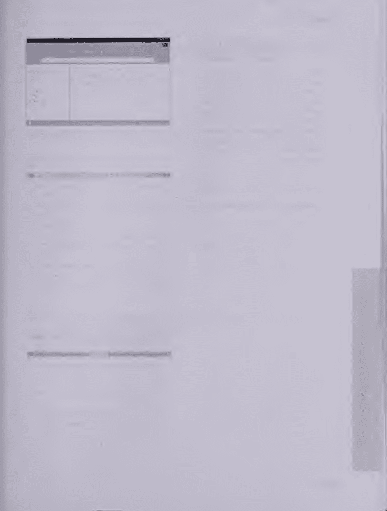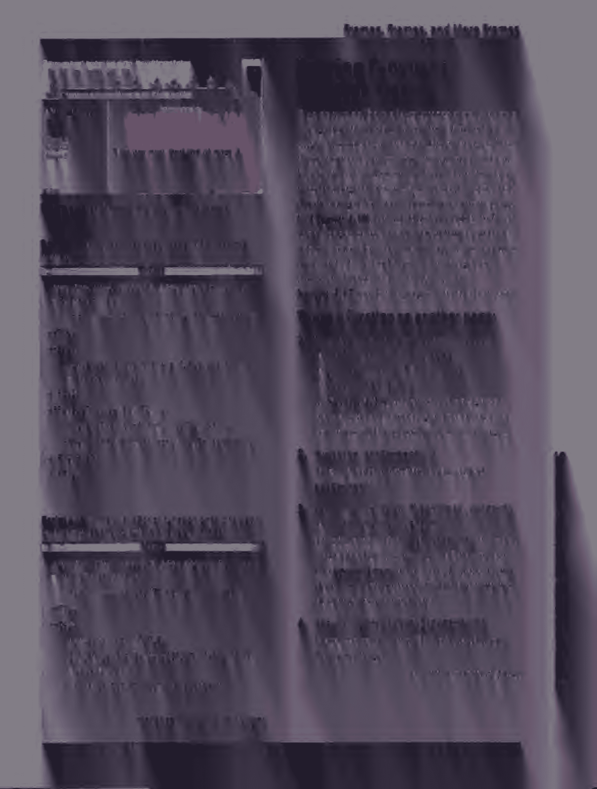

框架，框架，更多框架

脚本 4.19 延续

7

```html
<CENTER>

</CENTER>

<h1>你现在正在查看第 1 页</h1>
</body>
</html>
```

**脚本 4.20 并且你可以再次调用它。**

```html
<!DOCTYPE HTML PUBLIC "-////W3C//DTD HTML 4.01 Transitional//EN" "http://www.w3.org/TR/html4/loose.dtd">

<HTML>
<HEAD>
<TITLE>必须在框架中</TITLE>
</HEAD>

<BODY BGCOLOR="WHITE" onLoad="if (document.images) {document.adBanner.src=parent.left.setBanner()}">
<CENTER>
今日特推站点：
<BR>

</CENTER>

<h1>你现在正在查看第 2 页</h1>
</BODY>
</HTML>
```

**脚本 4.21 ...再次再次。**

```html
<!DOCTYPE HTML PUBLIC "-//W3C//DTD HTML 4.01 Transitional//EN" "http://www.w3.org/TR/html4/loose.dtd">

<HTML>
<HEAD>
<TITLE>必须在框架中</TITLE>
</HEAD>

<BODY BGCOLOR="WHITE" onLoad="if (document.images) {document.adBanner.src=parent.left.setBanner()}">
<CENTER>
今日特推站点：
<BR>

</CENTER>

<h1>你现在正在查看第 3 页</h1>
</BODY>
</HTML>
```

101

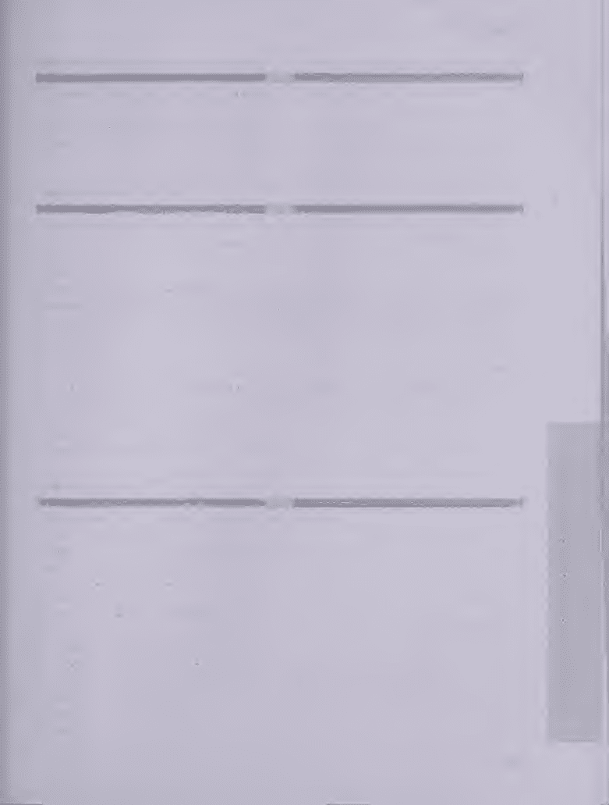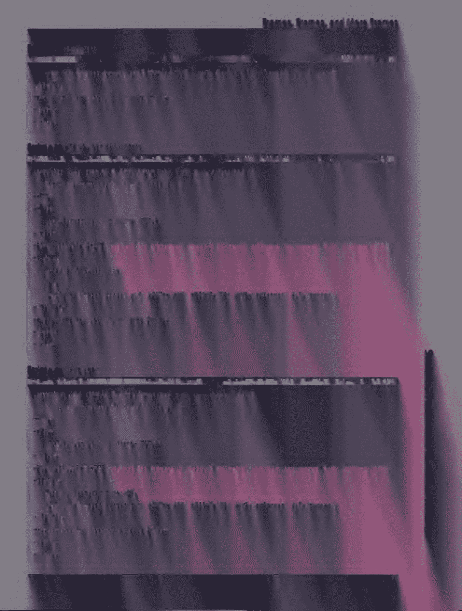

## 第 4 章在框架中存储信息

在与前面的示例类似的情况下，你也可以通过将变量存储在持久的框架页面中，跨框架跟踪有用信息。

图 4.11 显示了用户在此会话中访问每个内容页面的次数。

再次，多个框架中仍然需要脚本，这些框架是由脚本 4.22 中的 frameset 加载的。

**脚本 4.22 首先加载 frameset。**

```html
<!DOCTYPE HTML PUBLIC "-////W3C//DTD HTML 4.0 Frameset//EN" "http://www.w3.org/TR/html4/frameset.dtd">

<HTML>
<HEAD>
<TITLE>框架计数器</TITLE>
</HEAD>

<FRAMESET COLS="30%,70%">
<FRAME SRC="left7.html" NAME="left">
<FRAME SRC="frame7a.html" NAME="content">
</FRAMESET>
</HTML>
```

**脚本 4.23 在导航框架中初始化 JavaScript 变量。**

```html
<!DOCTYPE HTML PUBLIC "-////W3C//DTD HTML 4.01 Transitional//EN" "http://www.w3.org/TR/html4/loose.dtd">

<HTML>
<HEAD>
<TITLE>导航栏</TITLE>

<SCRIPT LANGUAGE="JAVASCRIPT" TYPE="TEXT/JAVASCRIPT">
<!-- 对旧版浏览器隐藏脚本 -->

pageCount = 0;
page3Count = 0;
pageArray = new Array("frame7a.html", "frame7b.html", "frame7c.html");

function setContent(thisPage) {
    parent.content.location = pageArray[thisPage];
}

// 结束旧版浏览器的脚本
</SCRIPT>
</HEAD>

<BODY BG="WHITE">
<h1>导航栏</h1>
<h2>
<A href="javascript:setContent(1)">第 1 页</a><BR>
<A href="javascript:setContent(2)">第 2 页</a><BR>
<A href="javascript:setContent(3)">第 3 页</a>
</h2>
</BODY>
</HTML>
```

102

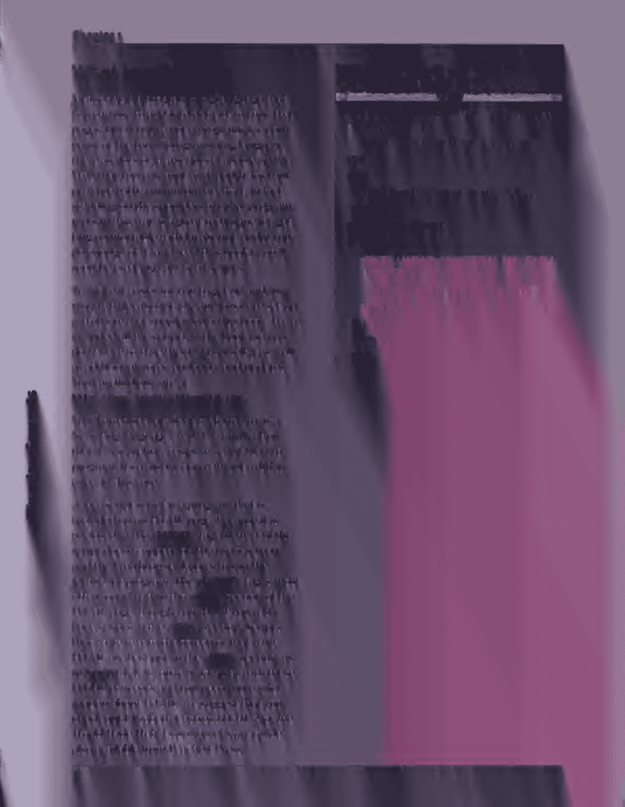

框架，框架，更多框架

导航栏：你现在正在查看第 2 页。  
第 2 页  
第 3 页

图 4.11 JavaScript 显示你在此会话中查看了第 2 页 三次。（等待，文本写是：图 4.11 JavaScript 显示你在此会话中查看了第 2 页 三次。）

**脚本 4.24 将 JavaScript 计数器加 1 并显示结果。**

```html
<!DOCTYPE HTML PUBLIC "-////W3C//DTD HTML 4.01 Transitional//EN" "http://www.w3.org/TR/html4/loose.dtd">

<HTML>
<HEAD>
<TITLE>内容框架</TITLE>

<SCRIPT LANGUAGE="JAVASCRIPT" TYPE="TEXT/JAVASCRIPT">
<!-- 对旧版浏览器隐藏脚本 -->

parent.left.pageCount++;

// 结束旧版浏览器的脚本
</SCRIPT>
</HEAD>

<BODY BGCOLOR="WHITE">
<h1>你现在正在查看第 1 页</h1>
<h2>
你已访问此页面

<SCRIPT LANGUAGE="JAVASCRIPT" TYPE="TEXT/JAVASCRIPT">
<!-- 对旧版浏览器隐藏脚本 -->

document.write(parent.left.pageCount);

// 结束旧版浏览器的脚本
</SCRIPT>

次。
</h2>
</BODY>
</HTML>
```

要记录页面访问计数：

1. `pageCount = page2Count = page3Count = 0;` 在脚本 4.23 的导航框架中，初始化你想要跟踪的三个变量，每个内容页面一个。
2. `parent.left.pageCount++;` 在脚本 4.24 的头部区域（内容框架中），将位于导航框架中的计数器 `pageCount` 加 1。每个内容页面使用不同的计数器变量，如脚本 4.25 和 4.26 所示。
3. `document.write(parent.left.pageCount);` 在脚本 4.24 的主体区域，你使用 `pageCount` 变量，它显示了访问此页面的次数。

**脚本 4.25 此脚本增加第 2 页计数器。**

**脚本 4.26 此脚本增加第 3 页计数器。**


## 框架、框架以及更多框架

### 脚本 4.27 从加载框架集开始。

```html
<!DOCTYPE HTML PUBLIC "-//W3C//DTD HTML 4.0 Frameset//EN"
"http://www.w3.org/TR/html4/frameset.dtd">

<HTML>
<HEAD>
<TITLE>Frame Navigation</TITLE>
</HEAD>

<FRAMESET COLS="305, 705K">
<FRAME SRC="left8a.html" NAME="left">
<FRAME SRC="frame8a.html" NAME="content">
</FRAMESET>
</HTML>
```

### 同时加载多个框架

只需一个带有 `target` 属性的链接即可更改框架的内容，这是非常简单的 HTML。要通过一次点击更改多个框架的内容，你需要 JavaScript。如图 4.12 和 4.13 所示，脚本 4.27 加载了框架集，而脚本 4.28（下文详细介绍）、4.29 和 4.30 同时更新了左侧框架和内容框架。

### 脚本 4.28 初始导航页。

```html
<!DOCTYPE HTML PUBLIC "-//W3C//DTD HTML 4.01 Transitional//EN"
"http://www.w3.org/TR/html4/loose.dtd">

<HTML>
<HEAD>
<TITLE>Nav Bar</TITLE>

<SCRIPT LANGUAGE="JAVASCRIPT" TYPE="TEXT/JAVASCRIPT">
<!-- 针对旧版浏览器隐藏脚本 -->

function setFrames(newPage) {
    parent.content.document.location.href = "frame" + newPage + ".html";
    document.location.href = "left" + newPage + ".html";
}

// 结束对旧浏览器的隐藏 -->
</SCRIPT>
</HEAD>

<BODY BGCOLOR="#WHITE">
<H1>Navigation Bar</H1>
<h2>
Page 1<BR>
<A HREF="javascript:setFrames('8b')">Page 2</A><BR>
<A HREF="javascript:setFrames('8c')">Page 3</A>
</h2>
</BODY>
</HTML>
```

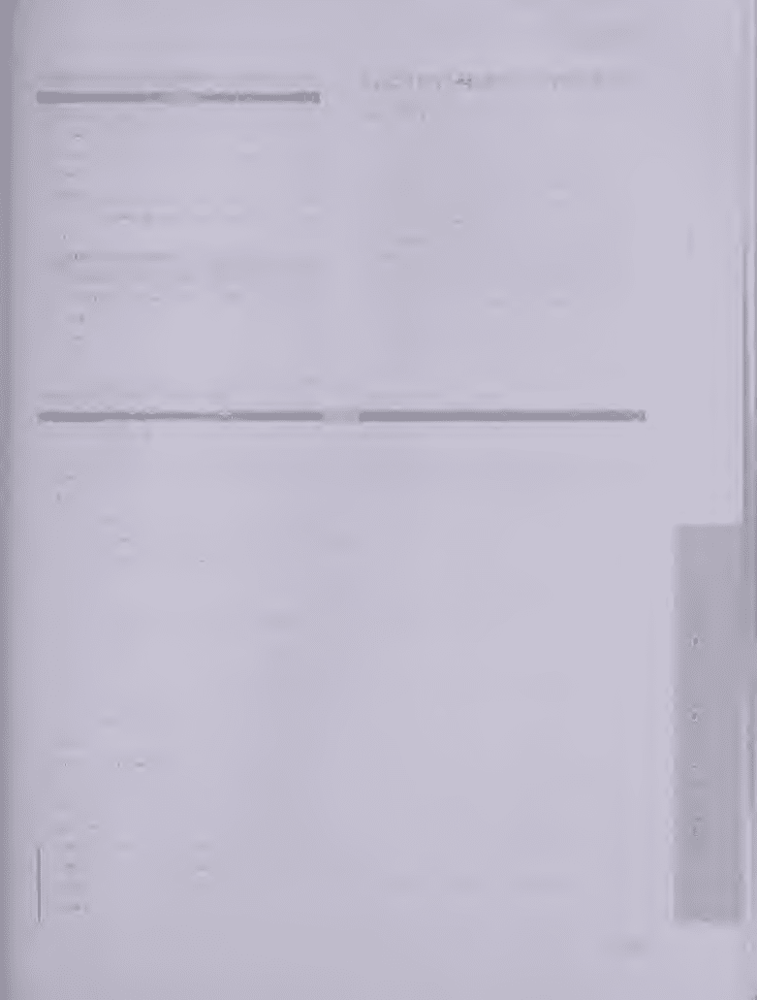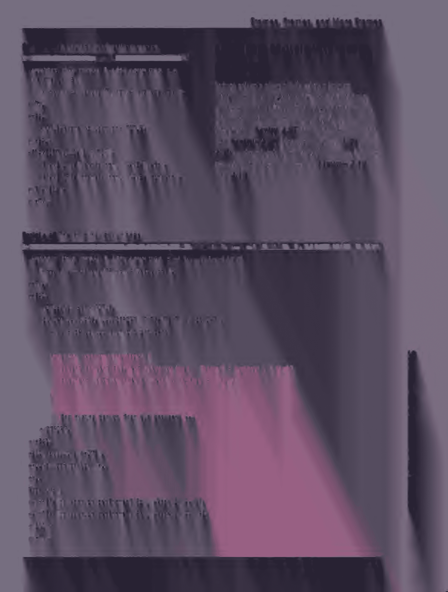

## 第 4 章

### 同时加载多个框架

```javascript
function setFrames(newPage) {
    parent.content.document.location.href = "frame" + newPage + ".html";
    document.location.href = "left" + newPage + ".html";
}
```


此函数接收一个变量`newPage`，然后你使用该变量来构建要加载的两个框架的位置。通过更改`parent.content.document.location.href`的值来重置内容框架，通过更改`document.location.href`的值来重置左侧（当前）框架。

- 图 4.12 页面初始看起来是。
- 图 4.13 你现在正在查看第 3 页。当点击链接时，两个框架都发生了变化。

### 脚本 4.29 可以变为第二个导航页

```html
<!DOCTYPE HTML PUBLIC "-//W3C//DTD HTML 4.01 Transitional//EN"
"http://www.w3.org/TR/html4/loose.dtd">

<HTML>
<HEAD>
<TITLE>Nav Bar</TITLE>
<SCRIPT LANGUAGE="JAVASCRIPT" TYPE="TEXT/JAVASCRIPT">
<!-- 针对旧版浏览器隐藏脚本

function setFrames(newPage)
{
  parent.content.document.location.href = "frame" + newPage + ".html";
  document.location.href = "left" + newPage + ".html";
}

// 结束对旧浏览器的隐藏 -->
</SCRIPT>
</HEAD>

<BODY BGCOLOR="#WHITE">
<H1>Navigation Bar</H1>

<h2>Page 1<BR>
<A HREF="javascript:setFrames('8b')">Page 2</A><BR>
<A HREF="javascript:setFrames('8c')">Page 3</A></h2>
</BODY>
</HTML>
```

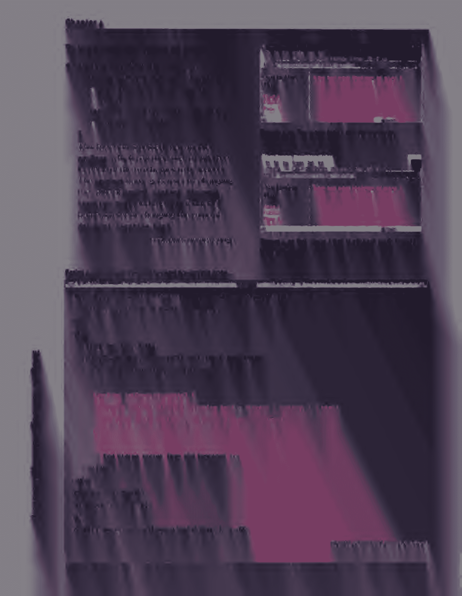

### 脚本 4.30 甚至是第三个导航页

```html
<!DOCTYPE HTML PUBLIC "-//W3C//DTD HTML 4.01 Transitional//EN"
"http://www.w3.org/TR/html4/loose.dtd">

<HTML>
<HEAD>
<TITLE>Nav Bar</TITLE>
<SCRIPT LANGUAGE="JAVASCRIPT" TYPE="TEXT/JAVASCRIPT">
<!-- 针对旧版浏览器隐藏脚本

function setFrames(newPage)
{
  parent.content.document.location.href = "frame" + newPage + ".html";
  document.location.href = "left" + newPage + ".html";
}

// 结束对旧浏览器的隐藏 -->
</SCRIPT>
</HEAD>

<BODY BGCOLOR="#WHITE">
<H1>Navigation Bar</H1>

<h2>Page 1<BR>
<A HREF="javascript:setFrames('8b')">Page 2</A><BR>
<A HREF="javascript:setFrames('8c')">Page 3</A></h2>
</BODY>
</HTML>
```

例如，当调用`setFrames('8b')`时，内容框架重置为`"frame8b.html"`脚本 4.32），左侧框架重置为`"left8b.html"`脚本 4.29）；而`setFrames('8c')`将内容框架重置为`"frame8c.html"`脚本 4.33），左侧框架重置为`"left8c.html"`脚本 4.30）。在每种情况下，左导航页都显示当前页面。

### 脚本 4.31 初始内容页

如果你想同时加载两个以上的框架，只需将它们添加到列表中。换句话说，你需要为每个要添加的框架添加一行`document.location.href`值。如果你想更改两个都不是当前框架的框架，只需遵循上述步骤的模型，但要从`parent`对象开始指定两个位置。

```html
<!DOCTYPE HTML PUBLIC "-//W3C//DTD HTML 4.01 Transitional//EN"
"http://www.w3.org/TR/html4/loose.dtd">

<HTML>
<HEAD>
<TITLE>Content frame</TITLE>
</HEAD>

<BODY BGCOLOR="#WHITE">
<H1>You are now looking at page 1</H1>
</BODY>
</HTML>
```

### 脚本 4.32 变为第二个内容页

```html
<!DOCTYPE HTML PUBLIC "-//W3C//DTD HTML 4.01 Transitional//EN"
"http://www.w3.org/TR/html4/loose.dtd">

<HTML>
<HEAD>
<TITLE>Content frame</TITLE>
</HEAD>

<BODY BGCOLOR="#WHITE">
<H1>You are now looking at page 2</H1>
</BODY>
</HTML>
```

### 脚本 4.33 以及第三个内容页

```html
<!DOCTYPE HTML PUBLIC "-//W3C//DTD HTML 4.01 Transitional//EN"
"http://www.w3.org/TR/html4/loose.dtd">

<HTML>
<HEAD>
<TITLE>Content frame</TITLE>
</HEAD>

<BODY BGCOLOR="#WHITE">
<H1>You are now looking at page 3</H1>
</BODY>
</HTML>
```

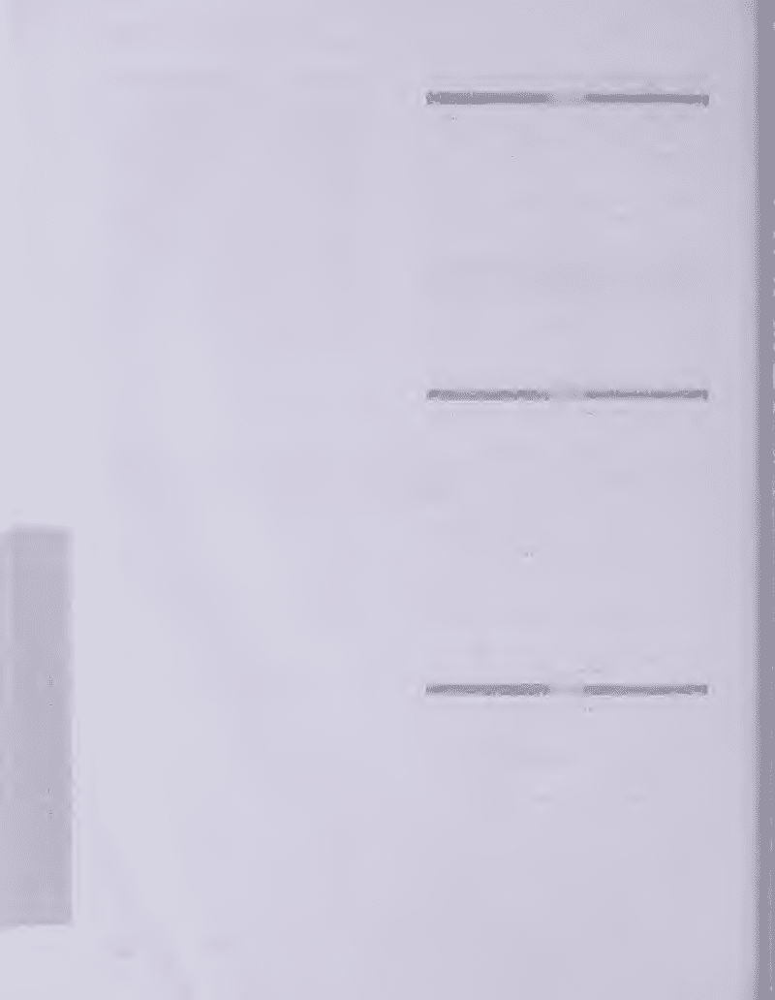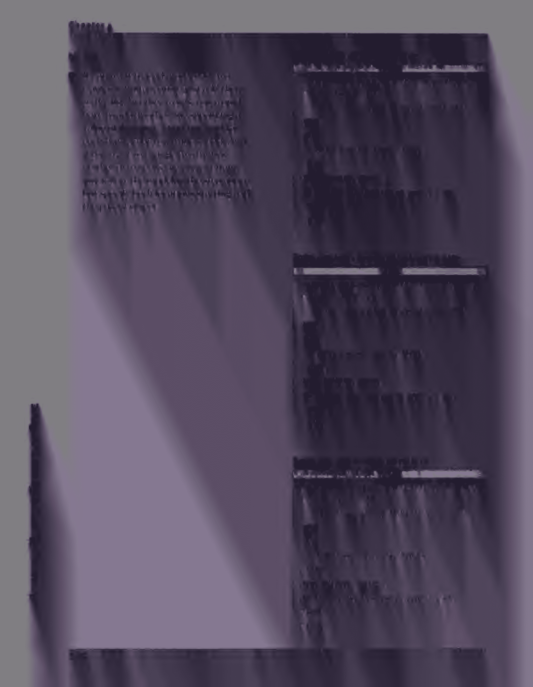

## 框架、框架以及更多框架

欢迎访问我们的网站，这里展示了许多尖端的`JavaScript`和`DHTML`技术。

图 4.14 您通过了`test-oursite`测试！

欢迎来到我们酷炫的网站。

本网站大量使用了`JavaScript`和`DHTML`。您要么禁用了`JavaScript`，要么没有使用最新版本的浏览器。请立即升级……我们不希望您错过任何内容！如果您仍想继续，请点击此处。

| B | 下载 Interact Explorer |
|---|---|

图 4.15 在我们允许您进入之前，您需要升级浏览器。

在这些示例中，访问者仍然可以决定查看网站，但他们已经收到了关于局限性的警告。你可以通过在`document.write()`周围添加一个`if`语句来更具体地指定触发警告的原因。例如，你可能想要阻止那些运行 4 版或更高版本浏览器的用户、没有某些插件的用户，或者运行旧版本`JavaScript`的用户。

### 使用框架进行浏览器检测

使用框架的另一种方便方法是检测浏览器版本和功能。在这个示例中，如果访问者没有支持`JavaScript`的浏览器，他们将在入口处被拦截。图 4.14 显示了符合条件用户的网站页面，而图 4.15 显示了警告。

使用框架检测浏览器功能：

```javascript
document.write("<FRAMESET COLS='100%,*' FRAMEORDER='0' BORDER='0' SRC='frame9.html'></FRAMESET>")
```

脚本 4.34 中的这单行代码会动态创建一个包含单个页面（如脚本 4.35 所示）的框架集（frameset）。如果用户没有`JavaScript`，将落到页面的`body`部分，那里会显示警告信息。

- 提示：页面看起来似乎不在框架中，但实际上它们在框架内；只是因为只有一个框架且它占据了整个窗口。你需要确保第二个页面上的所有链接都将`target`设置为`"_top"`。这将允许后续页面加载到“隐藏”的框架集之上。

为什么要使用这种方法而不是直接加载`document.location.href`？如果你使用那种方法，页面的`body`将开始加载并显示，然后页面会突然闪烁并加载另一个页面。使用这种方法，将只会显示所需的页面。

第 4 章

### 脚本 4.34 此页面对于最新浏览器是一个框架集，对于旧版浏览器是一个普通页面

```html
<!DOCTYPE HTML PUBLIC "-//W3C//DTD HTML 4.0 Frameset//EN" "http://www.w3.org/TR/html4/loose.dtd">

<html>
<head>
  <title>我们的酷网站</title>
  <script language="JAVASCRIPT" type="TEXT/JAVASCRIPT">
    <!-- 对旧版浏览器隐藏脚本

    document.write("<FRAMESET COLS='100%,*' FRAMEORDER='0' SRC='frame9.html'></FRAMESET>");

    // 结束对旧版浏览器的隐藏
  </script>
</head>

<body bgcolor="WHITE">
  <h1>本网站大量使用了 JavaScript 和 DHTML。您要么禁用了 JavaScript，要么没有使用最新版本的浏览器。请立即升级……我们不希望您错过任何内容！如果您仍想继续，<a href="frame9.html">点击此处</a>。</h1>

  <a href="http://www.netscape.com/download/images/netscape_now_anim.gif"></a> 下载 Netscape

  <br><a href="http://www.microsoft.com/windows/ie/ieget_animated.gif"></a> 下载 Internet Explorer
</body>
</html>
```

脚本 4.35 这是让访问者知道他们拥有可用浏览器的页面。

（注：上述 HTML 和脚本块是根据提供的碎片化 OCR 重建的。）

### 操作浏览器窗口

窗口是 Web 浏览器中最重要的界面元素，正如你所预期的，`JavaScript`为你提供了许多操作窗口的工具。`JavaScript`处理窗口的方式与框架类似（见第 4 章）。这是完全合理的，因为框架只是整个浏览器窗口内的其他其他文档窗口。

在本章中，你将学习如何使用`JavaScript`来打开、关闭、滚动、更新和定位窗口，并创建可以作为控制面板的窗口。你将看到如何使用`JavaScript`向窗口中写入信息，从而动态构建 Web 页面。你还将学习如何在窗口加载时触发事件，这是一种你会经常使用的技术。

### 打开窗口

你通常可能想要创建窗口来显示访问者正在阅读的额外信息。例如，你可以打开一篇技术论文或故事。虽然可以使用 HTML 打开，但`JavaScript`给了你更多的控制权。

```html
<!DOCTYPE HTML PUBLIC "-//W3C//DTD HTML 4.01 Transitional//EN" "http://www.w3.org/TR/html4/loose.dtd">

<html>
<head>
  <title>打开窗口</title>
  <script language="JAVASCRIPT" type="TEXT/JAVASCRIPT">
    function newWindow() {
      catWindow = window.open("pixel2.jpg", "catWin", "width=330,height=250");
    }
  </script>
</head>

<body bgcolor="WHITE">
  <h1>房屋之主</h1>
  <<h3><a href="javascript:newWindow()">点击他的名字，仰仰这位受崇拜的人。</a></h3>
</body>
</html>
```

图 5.1 浏览器窗口的元素。图中的名称对应于你可以在`open`命令中应用的参数。

## 与浏览器窗口的交互

### LC3E

屋主之主

点击名称以仰望最受推崇者。

图 5.2 打开新窗口。

### 为窗口添加参数

要为你的窗口添加图 5.1 中列出的一个或多个参数，请在用引号括起的`open()`命令中声明它们：在你想要的功能名称后加上`=yes`，在不需要的功能名称后加上`=no`。例如，如果你想要一个具有特定尺寸、带有工具栏、位置框和滚动条的窗口，你可以输入：

`"toolbar=yes, location=yes, scrollbars=yes, width=300, height=300"`

作为`open()`命令的一部分。请注意，所创建的窗口将不会有目录按钮和状态栏，且不可调整大小。

打开一个新窗口：

1.

```javascript
function newWindow()
{
  首先，定义一个名为 newWindow 的函数。
}
```

2.

```javascript
catWindow = window.open("pixel2.jpg", "catWin", "width=330,height=250")
```

变量`catWindow`包含一个新窗口对象，引用图像文件`pixel2.jpg`。这个新窗口的名为`catWin`。名称是必须的，因为你可能在稍后的链接或其他脚本中引用此窗口。新窗口的宽度为 330 像素，高度为 250 像素；这些参数是可选的。

3.

```html
<A HREF="javascript:newWindow()">Pixel</A>
```

在链接标签中，你告诉`JavaScript`在点击链接时运行`newWindow`函数。

- **提示**

在上面的步骤 2 中，`width`和`height`参数的逗号之间不能有任何空格。如果你添加了空格，你的脚本在某些浏览器中可能无法工作。

通常情况下，当你遇到脚本错误并需要调试脚本时，请寻找这类细微的问题。语法错误是让初初学者感到沮败的主要原因。有关调试的更多信息，请参阅第 17 章。

113


### 向窗口中加载不同的内容

在上一个任务中，点击链接会创建一个填充了图像的新窗口。但如果你在页面上有多个链接，并且你想让它们都指向同一个新窗口呢？脚本 5.2 演示了这种技术。图 5.3 中的主窗口有三个链接。点击任何一个链接都会打开一个新窗口，其中填充了相应的书籍图像。如果你回到主窗口并点击另一个链接，较小窗口中的图像将被替换。

向窗口加载不同内容：

1.

```javascript
function newWindow(bookgif)
{
  // 你需要做的第一件事是定义一个名为 newWindow 的新函数。但此脚本的不同之处在于，你声明了函数的参数，即变量 bookgif。我们稍后会回到 bookgif。
}
```

2.

```javascript
bookWindow = window.open(bookgif, "bookWin", "width=140,height=160")
```

在这里，变量`bookWindow`用于打开一个新窗口对象，随后是窗口的参数。窗口的内容存储在变量`bookgif`中。新窗口的名为`bookWin`，宽度和高度参数设置了窗口的大小。

3.

```javascript
bookWindow.focus()
```

此行使用`focus()`方法告诉你刚刚打开的窗口回到前面。每当你需要让窗口可见时，都可以使用`focus()`；如果打开了多个窗口，使用`focus()`将将窗口带到顶层。

脚本 5.2 使用此脚本，你可以打开一个新窗口并向其填充各种内容。

```javascript
function newWindow(bookgif)
{
  bookWindow = window.open(bookgif, "bookWin", "width=140,height=160")
  bookWindow.focus()
}
```


```html
<!DOCTYPE html>
<html>
<head>
<title>书籍信息</title>
<script>
function newWindow(bookgif)
{
  bookWindow = window.open(bookgif, "bookWin", "width=140,height=160")
  bookWindow.focus()
}
</script>
</head>
<body>
<a href="javascript:newWindow('java-gif.jpg')">Java for World</a>
<a href="javascript:newWindow('quick-gif.jpg')">Quicken 2000</a>
<a href="javascript:newWindow('mac-gif.jpg')">Macintosh Guide</a>
</body>
</html>
```

115

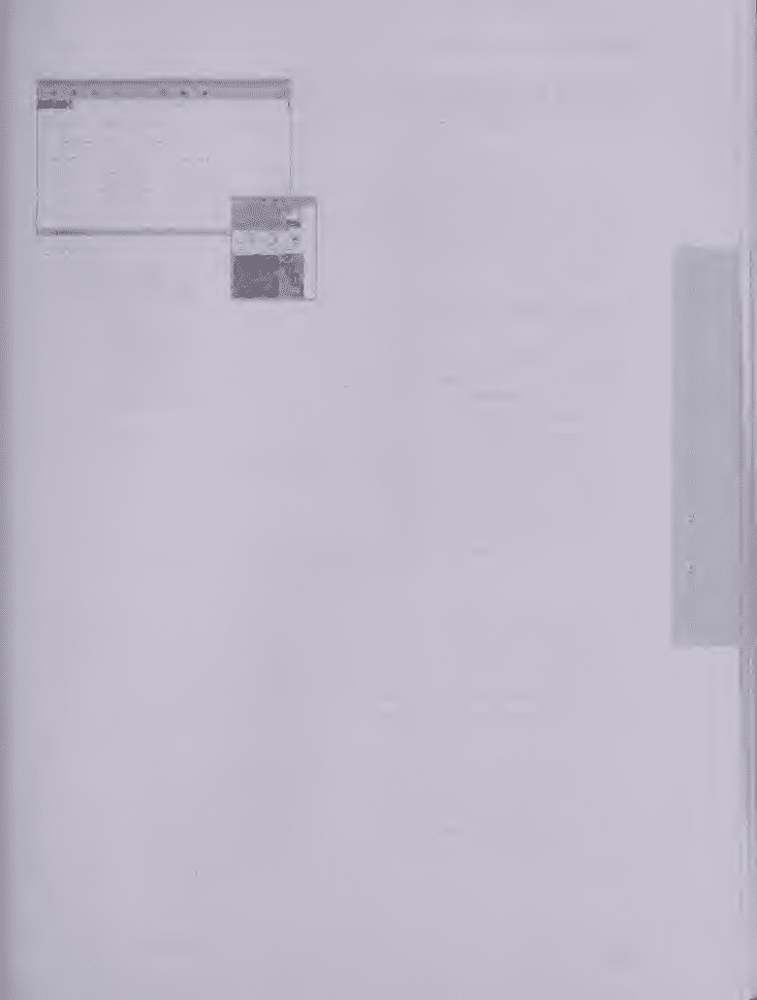

## 第 5 章

### 打开新窗口

#### 使用图片链接

就像你可以使用文本链接打开新窗口一样，你也可以使用图片链接。图 5.4 显示了三张缩略图，点击其中一张都会打开一个包含全尺寸图像的新窗口。脚本 5.3 显示了代码，该代码与脚本 5.2 非常相似。有关此处使用的代码的详细解释，请参考上一个任务。

要使用图片链接打开新窗口：

1. 

```javascript
function newWindow(bookgif) {
  bookWindow = window.open(bookgif, "bookWin", "width=400,height=500")
  bookWindow.focus()
}
```

首先，你需要定义新函数`newWindow`，它接收变量`bookgif`。然后，`bookWindow`变量将获取打开的窗口对象及其参数。接下来，通过`focus()`方法将`bookWindow`带到最前。

2. 

```html
<A HREF="javascript: newWindow('java-big.gif')"></a>
```

这段代码（三个链接的代码都类似）首先调用`newWindow`函数，并将图像的值传递给该函数；对于此链接，该值为`'java-big.gif'`，其他链接中为 GIF 的大尺寸。在`<A> </A>`链接标签内，你还需要指定缩略图的图像源，此处为`"java-sm.gif"`，其他链接中为等等的小尺寸 GIF。

图 5.4：点击缩略图图像将打开一个带有大图的窗口。

- **提示**：注意在步骤 2 中，你开始用双引号包围对 JavaScript 的调用。然后，在函数调用内部，对大图的引用被包含在单引号中，随后关闭双引号。当你有多组引号这样嵌套时，你必须交替嵌套使用单引号和双引号，以防浏览器产生混淆。例如，你可以这样做：

  `"function('parameter')"`

  但你不能这样混合使用引号，例如：

  `"function("parameter")'`

  后一个示例将导致错误。

### 操作浏览器窗口

脚本 5.3：此脚本显示了如何使用图片链接打开新窗口。

```html
<!DOCTYPE HTML PUBLIC "-//W3C//DTD HTML 4.0 Transitional//EN" "http://www.w3.org/TR/html4/loose.dtd">

<html>

<head>

<title>Book Info</title>

<script language="javascript">

<!-- Hide script from old browsers

function newWindow(bookgif) {

    bookWindow = window.open(bookgif, "bookWin", "width=400,height=500")

    bookWindow.focus()

}

// End hiding script from old browsers -->

</script>

</head>

<body bgcolor="WHITE">

<h1>Our other Peachpit books</h1>

<h3>Click on a book to see the full-size cover</h3>

<table padding="10">

<tr>

    <td><a href="javascript:newWindow('java-big.gif')"></a>Java for the World Wide Web: Visual QuickStart Guide</td>

    <td><a href="javascript:newWindow('q0-big.gif')"></a>Quicken 2000 for Windows: Visual QuickStart Guide</td>

    <td><a href="javascript:newWindow('q01-big.gif')"></a>Quicken 2001 for Macintosh: Visual QuickStart Guide</td>

</tr>

</table>

</body>

</html>
```

### 滚动窗口

当你打开一个新窗口时，你可能希望窗口滚动到你希望用户看到的的重要信息。在脚本 5.4 中，你将打开一个包含三个图像的窗口，并将窗口滚动到你想要的图像（图 5.5）。脚本 5.5 显示了滚动窗口的 HTML。

要滚动窗口：

1. 

```javascript
function newWindow(downscroll) {
```

定义函数`newWindow`，它将接收参数`downscroll`。

2. 

```javascript
bookpixWindow = window.open("bookpix.html", "bookpixWin", "width=150,height=170,scrollbars=yes")
```

设置新窗口的参数，并将它们存储在变量`bookpixWindow`中。

3. 

```javascript
bookpixWindow.focus()
```

此行确保你正在创建的窗口被带到最前。

4. 

```javascript
setTimeout("bookpixWindow.scroll(0, "+downscroll+")", 1000)
```

滚动滚动发生。你设置了`bookpixWindow`变量的水平方向，以及`downscroll`的垂直方向值。因此，你必须等待一秒（1000 毫秒）让窗口生成。

```html
<!DOCTYPE HTML PUBLIC "-//W3C//DTD HTML 4.0 Transitional//EN" "http://www.w3.org/TR/html4/loose.dtd">

<html>

<head>

<title>Window Scrolling</title>

<script language="javascript">

<!-- Hide script from old browsers

function newWindow(downscroll) {

    bookpixWindow = window.open("bookpix.html", "bookpixWin", "width=150,height=170,scrollbars=yes")

    bookpixWindow.focus()

    setTimeout("bookpixWindow.scroll(0, "+downscroll+")", 1000)

}

// End hiding script from old browsers -->

</script>

</head>

<body>

</body>

</html>
```

### 操作浏览器窗口

## 我们的其他 Peachpit 书籍

- Cue：关于拍摄封面的命名提示
- 面向万维网的 Java：简易快速上手指南
- Windows 版 Quicken 2000：视觉快速上手指南
- Macintosh 版 Quicken 2001：视觉快速上手指南

图 5.5：当用户点击链接时，新窗口将打开并滚动到与链接对应的图像。

脚本 5.5：这是一个 HTML 页面，创建一个包含你正在滚动的图像的窗口。

```html
<!DOCTYPE HTML PUBLIC "-//W3C//DTD HTML 4.01 Transitional//EN" "http://www.w3.org/TR/html4/loose.dtd">

<HTML>

<HEAD>

<TITLE>Book Pix</TITLE>

</HEAD>

<BODY BGCOLOR="WHITE">

<br>

<br>

<br>

</BODY>

</HTML>
```

```html
<A HREF="javascript:newWindow(0)">Java for the World Wide Web：视觉快速上手指南</A>
<A HREF="javascript:newWindow(160)">Quicken 2000 for Windows：视觉快速上手指南</A>
<A HREF="javascript:newWindow(320)">Quicken 2001 for Macintosh：视觉快速上手指南</A>
```

这三个链接设置了`downscroll`的值，该值会被传递给步骤 1 中的`newWindow`函数。在这种情况下，第一个链接中的值、第二个链接中的 160 以及第三个链接中的 320 取决于你点击的链接，是变量`downscroll`将包含的像素数。在上面的代码行中，为了清晰起见，我们删除了实际脚本中的`<BR>`标签。

- **提示**

  与 Netscape 不同，如果窗口包含来自另一个服务器的 URL，Internet Explorer 无法对窗口进行滚动。使用 Microsoft Internet Explorer 时，你只能滚动来自同一域的内容。

  你只能使用 Netscape Navigator 3.0 或更高版本、或 Microsoft Internet Explorer 3.0 或更高版本来滚动窗口。

此示例假设窗口将在一秒内加载，但这不一定成立。如果窗口尚未打开，你将收到错误。此外，如果你在这一秒内迅速关闭窗口，也会收到错误。如果你希望在滚动之前给窗口更多时间来完成加载，请将步骤 4 中的等待时间增加到大于 1000 毫秒的值。

### 从另一个窗口更新窗口

如果你处理表单和用户输入的数据，你可能需要知道如何将一个窗口输入的信息发送到另一个窗口进行显示。你可以在销售产品时使用这种方法，在摘要窗口中复制用户信息。在这个示例中，我们将使用两个窗口：主窗口是父窗口，它将接收并显示在子窗口中输入的信息。脚本 5.6 显示了父窗口的脚本。

从另一个窗口更新窗口：

1. 

```javascript
newWindow = window.open("child.html", "newWin", "toolbar=yes,location=yes,scrollbars=yes,width=300,height=100")
```

父窗口中的这行脚本告诉浏览器使用`child.html`文件创建子窗口。该行的其余部分指定了子窗口的参数（图 5.6）。

2. 

```html
<form name="outputForm" action="none">
```

父页面上有一个基础的表单（图 5.7），其设计使得脚本可以轻松地将子窗口获取的信息填充到文本字段中。这一行开启`FORM`标签并为表单命名。

3. 

```html
<input type="text" size="20" name="msgLine" value="">
```

这行指定了表单将包含最大长度为 20 个字符的文本，并将文本字段命名为`msgLine`。它还用长度为 0 的字符串初始化了字段，即字段初始状态为空，并关闭了`FORM`标签。

脚本 5.6：父窗口脚本。

```html
<!DOCTYPE HTML PUBLIC "-//W3C//DTD HTML 4.01 Transitional//EN" "http://www.w3.org/TR/html4/loose.dtd">

<HTML>

<HEAD>

<TITLE>Big Window</TITLE>

<SCRIPT LANGUAGE="JAVASCRIPT" TYPE="TEXT/JAVASCRIPT">

<!-- 隐藏针对旧浏览器的脚本 -->

newWindow = window.open("child.html", "newWin", "toolbar=yes,location=yes,scrollbars=yes,width=300,height=100")

// 结束针对旧浏览器的隐藏 -->

</SCRIPT>

</HEAD>

<BODY BGCOLOR="WHITE">

<CENTER>

<H>欢迎来到此页面!</H>

<FORM name="outputForm" action="none">

<INPUT type="text" size="20" name="msgLine" value="">

</FORM>

</CENTER>

</BODY>

</HTML>
```

小窗口

你叫什么名字？

[Nigel Tufnel]

图 5.6：子窗口是用户输入数据的地方。

### 操作浏览器窗口

脚本 5.7：子窗口脚本。

```html
<!DOCTYPE HTML PUBLIC "-//W3C//DTD HTML 4.01 Transitional//EN" "http://www.w3.org/TR/html4/loose.dtd">

<HTML>

<HEAD>

<TITLE>Little Window</TITLE>

<SCRIPT LANGUAGE="JAVASCRIPT" TYPE="TEXT/JAVASCRIPT">

<!-- 隐藏针对旧浏览器的脚本 -->

function updateParent(textField) {

    newWindow.document.outputForm.msgLine.value = "Hello" + textField.value + "!";

}

// 结束针对旧浏览器的隐藏 -->

</SCRIPT>

</HEAD>

<BODY BGCOLOR="WHITE">

<CENTER>

<H>欢迎来到此页面!</H>

<FORM name="outputForm" action="none">

<INPUT type="text" size="20" name="msgLine" value="" onblur="updateParent(this)">

</FORM>

</CENTER>

</BODY>

</HTML>
```

图 5.7：初始父窗口。

图 5.8：从子窗口调用信息后更新的父窗口。

## 第 5 章

### 5.8 使用 JavaScript 创建新页面

本章中之前的多窗口示例使用了多个 HTML 文件来创建不同的窗口。但其实没必要那样做，因为你可以在脚本中嵌入 HTML 并动态创建一个新的 HTML 页面。这特别有用，因为你可以利用 JavaScript 的强大功能为新页面填充动态内容。脚本 5.8 是一个相当简单的示例；在本页（图 5.9）中，你将创建一个新的 HTML 页面，然后增加一个循环，向页面添加 100 行文本。

*脚本 5.8：你完全可以在脚本控制下创建新的 HTML 页面。*

#### 使用 JavaScript 创建新页面

1. 

```javascript
newWindow = window.open("", "newWin", "toolbar=yes,location=yes,scrollbars=yes,resizable=yes,width=300,height=300")
```

此行代码打开新窗口，设置其参数，并将其赋值给变量`newWindow`。

2. 

```javascript
newWindow.document.write("<HTML><HEAD><TITLE>Generated Window</TITLE></HEAD><BODY BGCOLOR='WHITE'><H2>This window shows the result from the other window</H2>")
```

这是最酷的部分。在这里，脚本正在写入由`newWindow`代表的文档窗口。你正在生成 HTML 头部和页面主体的第一部分（图 5.10）。

3. 

```javascript
for (i=0; i<100; i++) { ... }
```

你正在启动一个带有计数变量`i`的循环。将`i`设置为零开始，然后只要`i`小于 100，就将`i`的值加 1。


```html
<!DOCTYPE HTML PUBLIC "-////W3C//DTD HTML 4.01 Transitional//EN" "http://www.w3.org/TR/html4/Loose.dtd">

<HTML>
<HEAD>
<TITLE>Main Window</TITLE>
</HEAD>

<BODY BGCOLOR="WHITE">
<H1 ALIGN="CENTER">This window is looping madly!</H>

<SCRIPT LANGUAGE="JAVASCRIPT" TYPE="text/javascript">

<!-- 向旧版浏览器隐藏脚本

newWindow = window.open("", "newWin", "toolbar=yes,location=yes,scrollbars=yes,resizable=yes,width=300,height=300")

newWindow.document.write("<HTML><HEAD><TITLE>Generated Window</TITLE></HEAD><BODY BGCOLOR='WHITE'><H2>This window shows the result from the other window</H2>")

for (i=0; i<100; i++) {
    newWindow.document.writeln("<BR>The loop is now at: " + i)
}

newWindow.document.write("</body></html>")

newWindow.document.close()

// 结束向旧版浏览器隐藏脚本

-->

</SCRIPT>
</BODY>
</HTML>
```


### 操作浏览器窗口

图 5.9 这个父窗口正在疯狂地循环！这个父窗口正在向子窗口写入内容……这个子窗口显示了另一个窗口的结果。

在循环内部，代码使用`document.writeln`命令向页面写入文本。在这一行中，脚本被写入`newWindow`文档中。`writeln`命令会在它写入文档的每个文本字符串后自动添加一个换行符，但你仍然需要添加`<BR>`来在页面本身插入换行。该字符串包含了`i`的值，该值在每次通过循环时都会更新。

5. `newWindow.document.write("</body></html>")`

   这里是你写入 HTML 页面代码的结束部分的地方。

6. `newWindow.document.close()`

   最后，你需要通过`close()`命令告诉浏览器你已经完成了对`newWindow`文档的写入。

图 5.10 ……并且子窗口显示了结果。

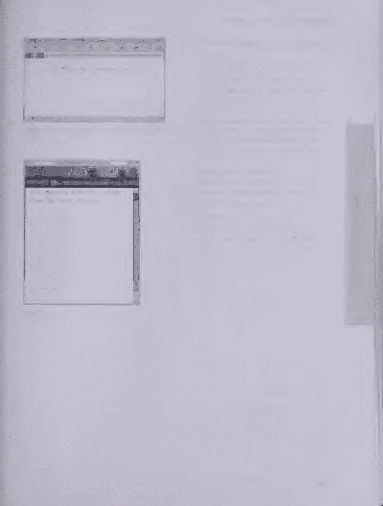

### 关闭窗口

就像你可以创建窗口一样，你也应该知道如何通过关闭窗口来移除它们。在脚本 5.9 中，父窗口拥有`open`和`close`链接，用于创建和关闭子窗口。

脚本 5.9 此脚本打开并关闭子窗口。

```html
<!DOCTYPE HTML PUBLIC "-//W3C//DTD HTML 4.01 Transitional//EN"

"http://www.w3.org/TR/html4/loose.dtd">

<HTML>
<HEAD>
<TITLE>Window Test</TITLE>

<SCRIPT LANGUAGE="JAVASCRIPT" TYPE="text/javascript">

<!-- 向旧版浏览器隐藏脚本

newWindow = null;

function openWindow() {
    newWindow = window.open("", "newWin", "toolbar=yes,location=yes,scrollbars=yes,resizable=yes,width=300,height=300")
}

function closeWindow() {
    if (newWindow && !newWindow.closed) {
        newWindow.close()
    }
}

<!-- 结束向旧版浏览器隐藏脚本

-->

</SCRIPT>
</HEAD>

<BODY BGCOLOR="WHITE">
<CENTER>
<H1>Let's play with windows!</H>
<a href="javascript:openWindow()">Open a new window</a>a>&nbsp;
<a href="javascript:closeWindow()">Close the window</a>a>
</CENTER>
</BODY>
</HTML>
```

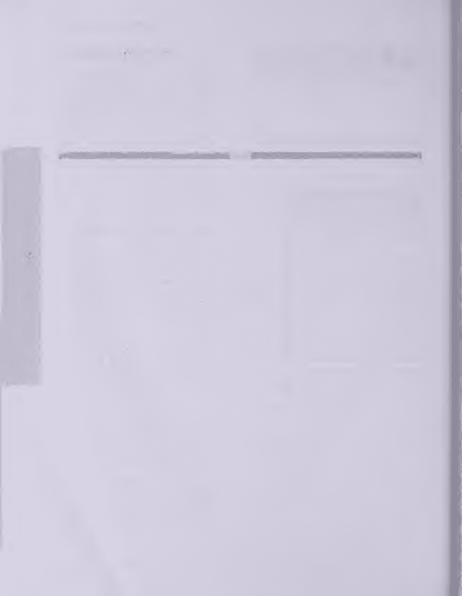

## 第 5 章：创建控制面板

使用子窗口作为控制面板——即一个包含影响其他窗口控件的窗口——这为网站界面设计开辟了无限可能。你可以使用控制面板来辅助用户与你的网站交互的方式。

创建控制面板：

1. `newWindow = window.open("cpanel.html", "newWin","width=225,height=200")`

   脚本 5.10 中的脚本唯一的作用就是使用文件`cpanel.html`中的 HTML 打开一个新窗口（控制面板）。你将得到两个窗口，如图 5.12 所示。现在请参阅脚本 5.11。

2. `function updateParent(newURL) {`

   现在你正在`cpanel.html`中工作，该文件的代码如脚本 5.11 所示。此行代码定义了新函数`updateParent`，其包含变量`newURL`的值。

脚本 5.10 此脚本设置了控制面板脚本。

```html
<!DOCTYPE HTML PUBLIC "-//W3C//DTD HTML 4.01 Transitional//EN"

"http://www.w3.org/TR/html4/loose.dtd">

<HTML>
<HEAD>
<TITLE>Parent Window</TITLE>

<SCRIPT LANGUAGE="JAVASCRIPT" TYPE="TEXT/JAVASCRIPT">

<!-- Hide script from old browsers

newWindow = window.open("cpanel.html", "newWin", "width=225,height=200")

// End hiding script from old browsers

</SCRIPT>
</HEAD>

<BODY bgcolor="WHITE">
<CENTER>
<H>JavaScript for the World Wide Web, 4th Edition</H>
<h2>by Tom Negrino and Dori Smith</h2>

</CENTER>
</BODY>
</HTML>
```

图 5.12 父窗口和子控制面板窗口。

## 浏览器窗口的相关操作

脚本 5.11 控制面板脚本决定在父窗口中显示哪个页面。

```html
<!DOCTYPE HTML PUBLIC "-//W3C//DTD HTML 4.01 Transitional//EN"

"http://www.w3.org/TR/html4/loose.dtd">

<HTML>
<HEAD>
<TITLE>Child Window</TITLE>

<SCRIPT LANGUAGE="JAVASCRIPT" TYPE="TEXT/JAVASCRIPT">

<!-- Hide script from old browsers

function updateParent(newURL) {
  opener.document.location = newURL
}

// End hiding script from old browsers -->

</SCRIPT>
</HEAD>

<BODY bgcolor="WHITE">
<CENTER>
<H>Control Panel</H>
<h3>
<A href="javascript:updateParent('toc.html')">Table of Contents</A><BR>
<A href="javascript:updateParent('sample.html')">Sample Chapter</A><BR>
<A href="javascript:updateParent('about.html')">About the Authors</A><BR>
<A href="javascript:updateParent('buy.html')">Buy the book!</A>
</h3>
</CENTER>
</BODY>
</HTML>
```

3. `opener.document.location = newURL`

   此行告诉打开器（父文档）从变量`newURL`中获取其位置属性（即它正在显示的 HTML 页面）。

4. `<A href="javascript:updateParent('sample.html')">Sample Chapter</a>`

   点击“Sample Chapter”会触发`updateParent`函数并将`newURL`填充为 HTML 页面名`sample.html`。父页面将加载该页面，如图 5.13 所示。控制面板中的其他链接以相同的方式工作。

图 5.13 点击控制面板在父窗口中加载“Sample Chapter”页面。

## 在屏幕上定位窗口

当你创建窗口时，能够将它们放置在用户屏幕上的特定位置是非常棒的。这是可能的，但前提是用户拥有 Internet Explorer 或 Netscape Navigator 的 4 或更高版本。一旦你使用父窗口和子控制窗口，就可以定位子窗口。

脚本 5.12 此脚本在指定的屏幕位置打开子窗口。

```html
<!DOCTYPE HTML PUBLIC "-//W3C//DTD HTML 4.01 Transitional//EN"

"http://www.w3.org/TR/html4/loose.dtd">

<HTML>
<HEAD>
<TITLE>Window Placement</TITLE>

<SCRIPT LANGUAGE="JAVASCRIPT" TYPE="TEXT/JAVASCRIPT">

<!-- Hide script from old browsers

leftPos =

if (screen) {
  leftPos = screen.width-225
}

newWindow = window.open("cpanel.html", "newWin", "width=225,height=200,left="+leftPos+",top=0")

// End hiding script from old browsers -->

</SCRIPT>
</HEAD>

<BODY bgcolor="WHITE">
<CENTER>
<H>JavaScript for the World Wide Web, 4th Edition</H>
<h2>by Tom Negrino and Dori Smith</h2>

</CENTER>
</BODY>
</HTML>
```

图 5.14 控制面板可以放置在屏幕上的任何位置——但前提是用户拥有 Netscape 或 Microsoft 器的 4.0 或更高版本。

在屏幕上定位窗口：

1. `leftPos =`

   将变量`leftPos`设置为零。

2. `if (screen) { leftPos = screen.width-225 }`

   `if`语句询问`screen`对象是否存在。这是一种在开始使用它之前检查浏览器是否理解`screen`对象的巧妙方法。如果支持，则`leftPos`被赋值为屏幕宽度减去 225 像素（即控制面板的宽度）。

3. `newWindow = window.open("cpanel.html", "newWin", "width=225,height=200,left="+leftPos+",top=0")`

   此行使用文件`cpanel.html`中的 HTML 打开一个新窗口（控制面板）。`left`参数包含`leftPos`的值。这意味着控制面板将在屏幕的右上角打开（图 5.14）。

> **提示**
>
> 如果你想将控制面板放在在屏幕的右下角，将使用`screen.height`来检查窗口的高度；而如果你想把它放在左上角，只需将顶部和左侧位置都设置为零即可。

## 在窗口加载时显示警框

有时，你可能希望在用户加载或重新加载页面时向他们显示消息。你可以使用警框来完成这项工作。脚本 5.13 显示了如何创建这个非常简单的技巧，图 5.15 显示了结果。

要在窗口加载时显示警框：

```html
<BODY BACKGROUND="WHITE" onLoad="alert('Welcome to this page!')">
```

- 作为`BODY`标签的一部分，输入`onload="alert('message')"`，其中`message`是你想要放在警框中的任何内容。
- **提示：**警框是模态的（modal），这意味着它们会等待用户操作。因此，如果用户离开了电脑，在警框等待输入期间，该计算机上的所有处理程序可能会停止。警框还会骚扰用户，因为它们会中断用户的工作。
- 警框对你可能比对用户更有用。这是因为它们可以显示任何内容，包括 JavaScript 对象。这使得警框成为非常有用的 JavaScript 调试工具，因为你可以它们来显示计算的中间结果或变量的当前值。

大多数浏览器都会告诉用户由 JavaScript 生成了警框，从安全角度来看这是好事。但其他浏览器，特别是 Netscape 6，并没有这样做。

脚本 5.13：这个极其简单的脚本在页面加载时弹出一个模态警框。

```html
<!DOCTYPE HTML PUBLIC "-//W3C//DTD HTML 4.01 Transitional//EN"

"http://www.w3.org/TR/html4/loose.dtd">

<HTML>
<HEAD>
<TITLE>Displing Alert Boxes</TITLE>
</HEAD>

<BODY BACKGROUND="WHITE" onLoad="alert('Welcome to this page!')">
<CENTER>
<h1>JavaScript for the World Wide Web, 4E</h1>
</CENTER>
</BODY>
</HTML>
```


图 5.15：生成的警框。

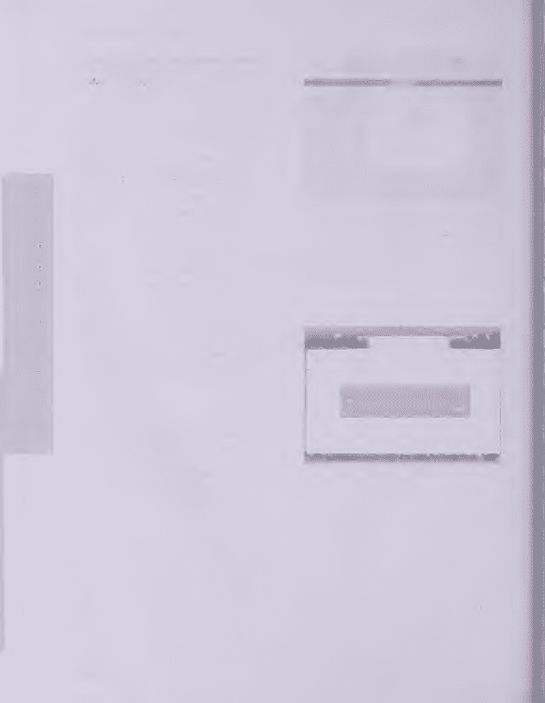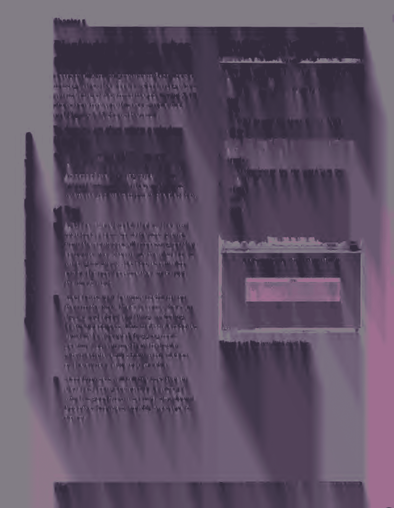

## 验证表单

每当你需要从网站用户收集信息时，你就需要使用表单。

表单可以包含大多数常用的图形界面元素，包括输入字段、单选按钮、复选框、弹出菜单和输入列表。此外，HTML 表单还可以包含密码字段，保护用户的输入免受窥视。

表单填写完成后，点击表单的提交（Submit）按钮会将表单信息发送到你的 Web 服务器，由 CGI（代表通用网关接口，是一种运行在 Web 服务器上的脚本）解释数据并执行操作。通常，数据随后会被存储在数据库中供以后使用。

在将数据存储在服务器端之前，确保用户输入的数据是"干净的"（即准确且格式正确）是很有用的。JavaScript 是检查数据的完美方法；这被称为表单验证。虽然 CGI 可以进行验证，但在客户端机器上使用 JavaScript 进行要更快、更高效。

在本章中，你将学习如何使用 JavaScript 确保表单包含有效信息，检查一个字段的数据与另一个字段的数据，并高亮显示错误信息以告知用户需要修改的内容。


## 6.1 HTML 表单

`<FORM>` 标签包含任何以下标签，使其成为一个有效的 HTML 表单：

| 属性 | 含义 |
| :--- | :--- |
| `ACTION` | 当控制权传回 Web 服务器时运行的服务器端 CGI 的 URL。 |
| `NAME` | JavaScript 用于引用此字段的名称；对于其他对象，不允许空格或其他标点符号，且不能以数字开头。 |
| `INPUT` | 各种类型的表单字段，取决于 `TYPE` 属性的值；可能的值有 `BUTTON`、`CHECKBOX`、`PASSWORD`、`RESET`、`SUBMIT` 和 `TEXT`。 |
| `VALUE` | 此表单字段的预设值。 |
| `SELECT` | 根据 `SIZE` 属性作为弹出菜单或滚动列表的表单字段。 |
| `SIZE` | 在页面上显示的选项数量。如果该属性设置为 1 或该属性不存在，结果为弹出菜单。 |
| `OPTION` | `<SELECT>` 标签内可能的可用选项。 |
| `SELECTED` | 此选项是否被选为默认值。 |
| `VALUE` | 每个选项的预设值。 |


### 验证密码

当你要求用户输入将来需要的密码时，你希望让他们输入两次以确保他们没有输错。

图 6.1：确保密码输入正确。
图 6.2：警框让用户知道发生了错误。

脚本 6.1：使用此脚本比较一个字段与另一个字段的值。它们匹配吗？

```html
<!DOCTYPE HTML PUBLIC "-//W3C//DTD HTML 4.01 Transitional//EN"
"http://www.w3.org/TR/html4/loose.dtd">

<HTML>
<HEAD>
<TITLE>Password Check</TITLE>
<SCRIPT LANGUAGE="JAVASCRIPT" TYPE="TEXT/JAVASCRIPT">
<!-- Hide script from older browsers -->
function validForm(passForm)
{
  if (passForm.passwd.value == "")
  {
    alert("You must enter a password")
    passForm.passwd.focus()
    return false;
  }
  if (passForm.passwd.value != passForm.passwd2.value)
  {
    alert("Entered passwords did not match")
    passForm.passwd.focus()
    passForm.passwd.select()
    return false;
  }
  return true;
}
```

## 第 6 章

### 3. `onSubmit="return validForm(this)"`

当用户提交表单时，会触发 `onSubmit` 事件处理程序，提交可以通过点击提交按钮或离开最后一个文本字段（浏览器处理为表单提交的方式，例如使用 Tab 键）。

这种事件处理程序的格式之所以有效，是因为调用的函数返回 `true` 或 `false` 值。如果调用的函数返回 `true`，则密码匹配，表单将提交到服务器。如果函数返回 `false`，`onSubmit` 就会捕获到错误并停止表单提交。

JavaScript 的这种能力允许在客户端捕获错误，服务器永远无需知道用户曾尝试过。

- **提示**：此脚本不会通过对比主密码数据库来检查用户输入的密码是否有效；那需要服务器端的 CGI。它只是确保当输入两次密码时，两次得到的值是相同的。

### 什么是 "this"？

在上面的示例中，你看到了 `this` 单词的使用，但并不完全清楚它是什么。

JavaScript 关键字 `this` 允许脚本根据关键字使用的上下文向函数传递一个值。在这种情况下，`this` 使用在 `FORM` 标签内部，因此 `this` 是一个表单对象。在随后的示例中，你会看到 `this` 被用于其他地方，你应该根据它被传递给函数的上下文来判断它是什么。

脚本 6.1 继续

```html
<script>
  if (passForm.passwd1.value != passForm.passwd2.value) {
    alert("Entered passwords did not match");
    passForm.passwd1.focus();
    passForm.passwd1.select();
    return false;
  }
  return true;
} // 结束隐藏结束
</script>

</HEAD>
<BODY BGCOLOR="WHITE">
<FORM onSubmit="return validForm(this)" ACTION="someAction.cgi">
  Your name:
  <INPUT TYPE="TEXT" SIZE="30">
  <P>Choose a password:
  <INPUT TYPE="PASSWORD" NAME="passwd1">
  <P>verify password:
  <INPUT TYPE="PASSWORD" NAME="passwd2">
  <INPUT TYPE="SUBMIT" VALUE="Submit">
  &nbsp;<INPUT TYPE="RESET">
</FORM>
</BODY>
</HTML>
```

134


## 表单验证

Netscape: 选择并跳转导航

- 选择一个主题
- 选择菜单项
- 使用单选按钮
- 用一个字段设置另一个字段
- 验证邮政编码
- 验证电子邮件地址

图 6.3 在此菜单中选择任何选项都会直接跳转到该主题的页面，而不需要单独的"Go"按钮。

### 选择并跳转的导航 (Select-and-Go Navigation)

你可能见过很多 Web 上标准导航菜单的例子；就是那种从菜单中选择一个选项，然后点击"Go"按钮，从而带你到达目的地。例如，许多在线商店使用此类菜单引导你进入商店内的不同部门。

但通过一点 JavaScript，你只需通过菜单选择就可以让用户出发，消除"Go"按钮（图 6.3）。这让你的网站感觉更敏捷、响应更迅速，这始终是一个好主意。我们把这些称为 JavaScript 增强的选择并跳转菜单，如 6.2 所示，它们很容易创建。你将再也不想用"Go"按钮了！

### 脚本 6.2 你可以使用 JavaScript 和表单进行活动站点导航。

```html
<!DOCTYPE HTML PUBLIC "-//W3C//DTD HTML401 Transitional//EN" "http://www.w3.org/TR/html4/loose.dtd">

<HTML>
<HEAD>
<TITLE>Select and Go</TITLE>
<SCRIPT LANGUAGE="JAVASCRIPT" TYPE="TEXT/JAVASCRIPT">
<!-- 为旧版浏览器隐藏脚本
function jumpPage(newLoc) {
  newPage = newLoc.options[newLoc.selectedIndex].value;
  if (newPage != "") {
    window.location = newPage;
  }
}
// 结束为旧版浏览器隐藏脚本 -->
</SCRIPT>
</HEAD>
```

（脚本在下一页继续）

135


### 要创建一个选择并跳转的菜单：

1. 首先，创建函数 `jumpPage`，并传递值 `newLoc`。
2. `newPage = newLoc.options[newLoc.selectedIndex].value`。从括号内部的代码开始向外处理。对象 `newLoc.selectedIndex` 是一个从 0 到 5 的数字（因为有六个可能的菜单选项；记住 JavaScript 通常是从 0 开始的）。根据该数字，你获得对应菜单选项的值，即我们想要跳转的 Web 页面名称。然后你将结果赋值给变量 `newPage`。
3. `if (newPage != "")` 此条件语句首先检查 `newPage` 是否不等于空（即它不为空）。换句话说，如果 `newPage` 有值，则告诉窗口跳转到所选菜单选项指定的 URL。
4. `onload="document.myForm.newLocation.selectedIndex=0"` 当页面首次加载时，我们希望确保显示的选项是"Select a topic"。当页面首次加载到浏览器时，这是 true（因为该标签上有 `SELECTED` 属性），但当用户返回此页面时则不是。这行代码强制元素成为显示的起始值。
5. `<SELECT NAME="newLocation" onChange="jumpPage(this.form.newLocation)">` `SELECT` 标签创建了名为 `newLocation` 的菜单。当用户从菜单中选择时，`onChange` 事件处理程序调用 `jumpPage` 函数并将其传递过去。

脚本 6.2 继续

```html
<BODY BGCOLOR="WHITE" onLoad="document.myForm.newLocation.selectedIndex=0">
  <DIV ALIGN="CENTER">
    <FORM ACTION="gotoLocation.cgi" NAME="myForm">
      <SELECT NAME="newLocation" onChange="jumpPage(this.form.newLocation)">
        <option VALUE="" SELECTED>Select a topic</option>
        <option VALUE="script03.html">Selecting menu items</option>
        <option VALUE="script04.html">Working with radio buttons</option>
        <option VALUE="script05.html">Setting one field with another</option>
        <option VALUE="script06.html">Validating Zip codes</option>
        <option VALUE="script07.html">Validating email addresses</option>
      </SELECT>
      <SCRIPT>
        <INPUT TYPE="SUBMIT" VALUE="Go There!">
      </SCRIPT>
    </FORM>
  </DIV>
</BODY>
</HTML>
```

136


## 验证表单

Netscape：选择并跳转

01

选择脚本 `this.form.newLocation`，它将成为你在第 1 步中看到的 `newLoc` 的值。`this.form.newLocation` 对象的值是用户所选菜单项的 URL，如 `</SELECT>` 标签之前后续几行中 `OPTION VALUE` 语句所指定的项。

图 6.4 如果用户没有 JavaScript，他们仍然可以在你的网站上浏览，因为"前往（Go There!）"按钮会自动。

- **提示**：这个脚本最棒的地方之一是，一旦添加了 JavaScript 函数，添加、修改或更改下拉选项时，就不需要修改该函数。只需要设置选项的值（即菜单选项跳转到的 URL）即可。出于这个原因，该脚本与 WYSIWYG 页面编辑器配合良好。

### 兼容不使用 JavaScript 的用户

这项任务的目的是使用 JavaScript 消除在使用表单在页面之间跳转时对"跳转（Go）"按钮的需求。但如果用户使用的是旧的不支持 JavaScript 的浏览器，或者只是禁用了 JavaScript 呢？没问题；脚本可以很好地处理这些用户，通过放置一个仅在缺失 JavaScript 的情况下可见的跳转按钮。

在不使用 JavaScript 的情况下通过表单在页面之间跳转的唯一方法是使用 CGI，即运行在 Web 服务器上的程序。脚本 6.2 在这一行中设置了它：

`<FORM ACTION="gotoLocation.cgi">`

`FORM` 标签具有 `ACTION` 属性，该属性会调用 CGI。但 `FORM ACTION` 需要用户点击 `SUBMIT`（提交）按钮，而图 6.3 中没有这样的按钮。啊，但在图 6.4 中是有这个，它显示了当你关闭 JavaScript 时发生的情况。这些行包含了该按钮，它包裹在 `NOSCRIPT` 标签中，该标签只有在缺少 JavaScript 时才会执行。

```html
<NOSCRIPT>
  <INPUT TYPE="SUBMIT" VALUE="Go There!">
</NOSCRIPT>
```

这一切真正酷的地方在于，只有在缺失 JavaScript 的情况下才被调用；如果用户拥有启用了 JavaScript 的浏览器，那么 `SUBMIT` 按钮就不会出现，CGI 也不是必要的。

## 第 6 章

### 选择菜单项

在接下来的"汽车选择器"示例（参见"关于这些脚本"侧边栏）中，潜在的购购买者被给了整整三种颜色的选择：红色、绿色或蓝色，如图 6.5 所示。当菜单未展开时，用户会看到"选择一种颜色"的提示信息。因为汽车必须有颜色，你将希望验证用户是否实际上选择了其中一种颜色，而不是跳过此项。只需要脚本 6.3 即可。

Netscape：汽车选择器

当你的选择多于一组单选按钮能舒服容纳的范围时，使用弹出菜单很好。脚本 6.3 要求用户从弹出菜单中选择不需要大量的代码。

```html
<!DOCTYPE HTML PUBLIC "-//W3C//DTD HTML 4.0 Transitional//EN" "http://www.w3.org/TR/HTML4/loose.dtd">

<html>
<head>
<title>Car Picker</title>
<script LANGUAGE="text/javascript">
<!-- 早期浏览器的脚本
function submit(carForm) {
  colorChoice = carForm.color.selectedIndex;
  if (carForm.color.options[colorChoice].value == "") {
    alert("You must pick a color");
    return false;
  }
  return true;
}
-->
</script>
</head>

<body bgcolor="WHITE">
<h2 align="center">Car Picker</h2>
<form onSubmit="return submit(this)" action="someAction.cgi" name="myForm">
<table border="0" cellspacing="8" cellpadding="8">
  <tr>
    <td align="right">Email Address:</td>
    <td colspan="2"><input name="emailAddr" type="text" size="30">
  </tr>
  <tr>
```


`<td align="right">Colors:</td>`

`<td colspan="2">`

`<select name="color">`

`<option value="">Choose a color</option>`

`<option value="RED">Red</option>`

`<option value="GREEN">Green</option>`

`<option value="BLUE">Blue</option>`

`</select>`

`</td>`

`</tr>`

`<tr>`

`<td align="right">Options:</td>`

`<td><input type="checkbox" name="sunroof" value="YES">Sunroof (Two door only)</td>`

`<td><input type="checkbox" name="steering" value="YES">Power Windows</td>`

`</tr>`

`<tr>`

`<td align="right">Doors:</td>`

`<td colspan="2">`

`<input type="radio" value="twoDoor" name="DoorCt">Two`

`<input type="radio" value="fourDoor" name="DoorCt">Four`

`</td>`

`</tr>`

`</table>`

`</form>`

`</body>`

`</html>`

要求选择菜单：

1. `function submit(carForm)`：这定义了提交函数，该函数在表单内容上操作。
2. `所示 = carForm.color.selectedIndex`：`colorChoice` 变量根据用户选择的颜色获取数字结果。没有选择为零；红色为 1；绿色为 2；蓝色为 3。该数字指的是菜单中选择的顺序。
3. `if (carForm.color.options[colorChoice].value == "")`：现在使用 `colorChoice` 的值检查用户是否选择了一个带有值的颜色。如果他们没有选（`== ""`），则表单会向用户提示消息。
4. `return true`：否则，一切正常，可以进入下一个验证任务了。

## 验证表单

### 门：双门或四

使用单选按钮

图 6.7 单选按钮是让用户在一组选项中仅选择一个最佳方式。

脚本 6.4 只能勾选一个单选按钮，这段 JavaScript 用于强制执行界面规则。

```javascript
<!DOCTYPE HTML PUBLIC "-//W3C//DTD HTML 4.01//Transitional//EN"
"http://www.w3.org/TR/html4/loose.dtd">
<HTML>
<HEAD>
<TITLE>Car Picker</TITLE>
<SCRIPT LANGUAGE="JAVASCRIPT" TYPE="text/javascript">
<!-- Hide script from older browsers -->
function submitlt(carForm)
{
  var doorOption = (()= -1);
  for (i=0; i<carForm.DoorCt.length; i++) {
    if (carForm.DoorCt[i].checked) {
      doorOption = i;
    }
  }
  if (doorOption == -1) {
    alert("You must choose 2 or 4 door");
    return false;
  }
  return true;
}
// End script -->
</SCRIPT>
</HEAD>
<BODY BG="WHITE">
<H2 ALIGN="CENTER">Car Picker</h2>
```

（单选按钮是一种二选一的界面元素，允许用户在一组选项中选择一个（且仅一个）选项。当选项中的一个是必选项时，应该使用单选按钮。如图 6.7 所示，该表单使用单选按钮让假设买家在双门或四门汽车之间进行选择。在这种情况下，你只能选择这些选项中的一个，并且必须做出选择。如果你不选择，表单会为你选择一个，称为默认选择。如脚本 6.4 所示，检查是否选中一个按钮并不需要多少脚本编写。我们使用了一种技术，即遍历每个按钮并检查其状态，如果没有勾选任何按钮，则弹出一个错误消息。为了确保用户选择了某个单选按钮：

1. `function submitlt(carForm) { doorOption = -1` 定义函数 `submitlt` 并将变量 `doorOption` 设置为 -1，这显然不是一个有效的汽车门数量。
2. `for (i=0; i<carForm.DoorCt.length; i++) {` 现在开始循环。计数器 `i` 被设置为零，只要 `i` 小于表单上单选按钮的数量，我们就使用 `i++` 运算符给 `i` 加 1。
3. `if (carForm.DoorCt[i].checked) { doorOption = i }` 这是循环内的测试：如果单选按钮被选中，则将 `doorOption` 设置为 `i` 的值。
4. `if (doorOption == -1) { alert("You must choose 2 or 4 door"); return false; }` 如果你运行到这里且 `doorOption` 的值仍为 -1，则表单将显示警对话框，告诉用户必须做出选择。
5. `return true` 如果 `doorOption` 被重置，则说明已经选择了某些内容。脚本返回 true 结果，你就退出了脚本。

（脚本 6.4 续）

```html
<FORM onSubmit="return submitlt(this)" ACTION="someAction.cgi" NAME="myForm">
<TABLE BORDER="0" CELLACING="8" CELLPADDING="8">
<TR>
<TD ALIGN="RIGHT">Email Address:</TD>
<TD COLSPAN="2"><INPUT NAME="addr" TYPE="TEXT" SIZE="30"></TD>
</TR>
<TR>
<TD ALIGN="RIGHT">Colors:</TD>
<TD COLSPAN="2">
<SELECT NAME="color">
<option value="">Choose a color</option>
<option value="RED">Red</option>
<option value="GREEN">Green</option>
<option value="BLUE">Blue</option>
</SELECT>
</TD>
</TR>
<TR>
<TD ALIGN="RIGHT">Options:</TD>
<TD><input type="checkbox" name="sunroof" value="YES">Sunroof (Two door only)</td>
<TD><input type="checkbox" name="steering" value="YES">Power Windows</td>
</TR>
<TR>
<TD ALIGN="RIGHT">Doors:</TD>
<TD COLSPAN="2">
<input type="radio" value="twoDoor" name="DoorCt"> Two
<input type="radio" value="fourDoor" name="DoorCt"> Four
</TD>
</TR>
<TR>
<TD COLSPAN="3">Enter your Zip code or pick the dealer nearest you:
<p>Zip: <input name="zip" type="TEXT" size="5" maxlength="5">
<select name="dealerList" size="4">
<option>California Grove</option>
<option>California Long Beach</option>
<option>California Alamitos</option>
<option>California Los Angeles</option>
</select>
<input type="SUBMIT" value="Submit"><input type="RESET">
</TD>
</TR>
</TABLE>
</FORM>
</body>
```

### 使用另一个字段设置字段

在表单中，你经常发现如果用户做了某个选择，该选择将决定表单上其他字段的值。例如，假设天窗选项仅适用于双门型号。你可以通过两种方式处理。首先，你可以检查输入并在用户做出错误选择时弹出一个警告对话框。但更巧妙的设计是直接为用户完成输入。因此，如果他们选择了天窗，脚本会自动点击双门按钮，如图 6.8 所示。脚本 6.5 展示了如何实现这一点。

与单选按钮部分一样，你首先必须确保用户点击了门选项。请注意，脚本 6.5 代码的前部分与上一节相同；下面我们将仅解释新代码。

检查输入是否正确：

```javascript
if (carForm.DoorCt[doorOption].value == "fourDoor" && carForm.sunroof.checked) {
  alert("The sunroof is only available on the two door");
  return false;
}
```

这很直接易懂。下部分根据用户做出的选择设置输入。

验证表单

脚本 6.5 续

```javascript
script

return true;

function doorSet(sunroofField) {
  if (sunroofField.checked) {
    for (i=0; i<document.myForm.DoorCt.length; i++) {
      if (document.myForm.DoorCt[i].value == "twoDoor") {
        document.myForm.DoorCt[i].checked = true
      }
    }
  }
  // End hiding script
}
--></SCRIPT>
</HEAD>
<BODY BACKGROUND="WHITE">
<H2 ALIGN="CENTER">汽车选择器</h2>
<FORM onSubmit="return submit(this)" ACTION="someAction.cgi" NAME="myForm">
<TABLE BORDER="0" CELLACING="8" CELLPADDING="8">
  <TR>
    <TD ALIGN="RIGHT">邮箱地址:</TD>
    <TD COLSPAN="2">
      <INPUT NAME="emailAddr" TYPE="TEXT" SIZE="30">
    </TD>
  </TR>
  <TR>
    <TD ALIGN="RIGHT">(脚本在下一页继续)<br>要自动设置字段值：</TD>
    1. `function doorSet(sunroofField) {`
       按照常例，首先你定义该函数。
    2. `if (sunroofField.checked) {`
       `for (i=0;i<document.myForm.DoorCt.length;i++) {`
         接下来，如果天窗框被选中，则启动一个循环，扫描所有的 `DoorCt` 字段。
    3. `if (document.myForm.DoorCt[i].value == "twoDoor") {`
         你正在寻找双门字段。
    4. `document.myForm.DoorCt[i].checked = true`
         一旦找到双门字段，就通过将其值设置为 `true` 来选中它。
    </TD>
    5. `<INPUT TYPE="CHECKBOX" NAME="sunroof" VALUE="YES" onClick="doorSet(this)">`
       在 BODY 部分，天窗复选框字段中需要一段代码片段。`onClick` 事件处理器会调用 `doorSet` 函数，并将 `this` 的值传递给它。你需要让事件处理器来触发该函数。
```

[](img/574ff1a7f6aea08a8d74ac1fba624480_160_1.png)

第 6 章

脚本 6.5 续

```javascript
script
```

`</TD>`

`<TD COLSPAN="2">`

`<SELECT NAME="color">`

`<OPTION VALUE="" SELECTED>选择颜色</OPTION>`

`<OPTION VALUE="RED">红色</OPTION>`

`<OPTION VALUE="GREEN">绿色</OPTION>`

`<OPTION VALUE="BLUE">蓝色</OPTION>`

`</SELECT>`

`</TD>`

`</TR>`

`<TR>`

`<TD ALIGN="RIGHT">选项:</TD>`

`<TD>`

`<INPUT TYPE="CHECKBOX" NAME="sunroof" VALUE="YES" onClick="doorSet(this)">天窗（仅限双门）`

`</TD>`

`<TD>`

`<INPUT TYPE="CHECKBOX" NAME="pSteering" VALUE="YES">电动窗`

`</TD>`

`</TR>`

`<TR>`

`<TD ALIGN="RIGHT">(脚本在下一页继续)<br>车门：</TD>`

`<TD COLSPAN="2">`

`<INPUT TYPE="RADIO" VALUE="twoDoor" NAME="DoorCt">`

`<INPUT TYPE="RADIO" VALUE="fourDoor" NAME="DoorCt">`

`</TD>`

`</TR>`

`<TR>`

`<TD COLSPAN="3">`

输入您的邮政编码或选择离最近的经销商：<br>

邮政： `<INPUT NAME="zip" TYPE="TEXT" SIZE="5" maxlength="5">`

`<SELECT NAME="dealer" SIZE="4">`

`<option>California Grove</option>`

`<option>Lomita</option>`

`<option>Long Beach</option>`

`<option>Los Alamitos</option>`

`<option>Los Angeles</option>`

`</SELECT>`

`<INPUT TYPE="SUBMIT" VALUE="提交"><INPUT TYPE="RESET">`

`</TD>`

`</TR>`

`</TABLE>`

`</FORM>`

`</BODY>`

`</HTML>`

[](img/574ff1a7f6aea08a8d74ac1fba624480_161_1.png)

## 验证邮政编码

疯狂的用户可以在表单中输入任何内容，因此你想确保邮政编码字段（图 6.9）只包含数字。脚本 6.6 展示了如何实现。

要确保邮政编码为数字：

1. `function isNum(passedVal) {`
   首先，定义函数 `isNum`。变量 `passedVal` 从表单传递给函数。
2. `if (passedVal == "") {`
   `return false`
   `}`
   如果 `passedVal`为空，则邮政编码不是数字，函数返回 `false`，脚本应该弹出错误消息。
3. `for (i=0; i<passedVal.length; i++) {`
   现在扫描 `passedVal` 的长度，每次循环时增加 `i` 计数器。
4. `if (passedVal.charAt(i) < "0") {`
   `return false`
   `}`
   `if (passedVal.charAt(i) > "9") {`
   `return false`
   `}`
   `charAt` 运算符检查位置 `i` 处的字符。如果字符小于 `"0"` 或大于 `"9"`，则它就不是数字，因此退出并声明输入为非数字（或 `false`）。如果结果为 `true`，则你获得了一个数字邮政编码。

输入您的邮政编码或选择离您最近的经销商：

邮政：90210

California — Lomita

California — Long Beach

California — Los Alamitos

California — Los Angeles

图 6.9 你可以确保用户要么输入邮政编码，要么从滚动列表中进行选择。

## 脚本 6.6 仅需几行 JavaScript 即可清除邮政编码中的错误字母。

```html


# 第 6 章

## 脚本 6.6 续

```html
<script>
<!-- 向旧浏览器隐藏脚本 -->

function isNum(passedVal) {
  if (passedVal == "") {
    return false
  }
  for (i=0; i<passedVal.length; i++) {
    if (passedVal.charAt(i) < "0") {
      return false
    }
    if (passedVal.charAt(i) > "9") {
      return false
    }
  }
  return true
}

function validZip(inZip) {
  if (inZip == "") {
    return true
  }
  if (isNum(inZip)) {
    return true
  }
  return false
}

function submit(carForm) {
  if (carForm.zip.value == "" && carForm.dealerList.selectedIndex == -1) {
    alert("您必须输入一个邮政编码，或者选择离您最近的经销商")
    carForm.zip.focus()
    return false
  }
  if (!validZip(carForm.zip.value)) {
    alert("这是一个无效的代码")
    carForm.zip.focus()
    carForm.zip.select()
    return false
  }
  return true
}
// End hiding script
-->
</script>
```

```html
<table>
  <tr>
    <td align="RIGHT">电子邮件地址：</td>
    <td colspan="2"><input name="emailAddr" type="text" size="30"></td>
  </tr>
  <tr>
    <td align="RIGHT">颜色：</td>
    <td colspan="2">
      <select name="color">
        <option value="" selected>选择颜色</option>
        <option value="RED">红色</option>
        <option value="GREEN">绿色</option>
        <option value="BLUE">蓝色</option>
      </select>
    </td>
  </tr>
  <tr>
    <td align="RIGHT">选项：</td>
    <td><input type="checkbox" name="sunroof" value="YES">天窗（仅限双门车型）</td>
    <td><input type="checkbox" name="pSteering" value="YES">电动窗户</td>
  </tr>
</table>
```

（脚本继续见下页）

150

`img/574ff1a7f6aea08a8d74ac1fba624480_165_0.png` `img/574ff1a7f6aea08a8d74ac1fba624480_165_1.png`

## 表单验证

### 脚本 6.6 续

```html
<script>
<table>
  <tr>
    <td align="RIGHT">门数：</td>
    <td colspan="2">
      <input type="radio" value="twoDoor" name="DoorCt">双门
      <input type="radio" value="fourDoor" name="DoorCt">四门
    </td>
  </tr>
  <tr>
    <td colspan="3">
      输入您的邮政编码或选择最近的经销商：
      <p>邮编: <input name="zip" type="text" size="5" maxlength="5">&nbsp;
      <select name="dealerList" size="4">
        <option>加利福尼亚--柠檬格林</option>
        <option>加利福尼亚--洛米塔</option>
        <option>加利福尼亚--长滩</option>
        <option>加利福尼亚--洛阿阿米托斯</option>
        <option>加利福尼亚--洛杉矶</option>
      </select>
      <input type="submit" value="提交">&nbsp;<input type="reset">
    </td>
  </tr>
</table>
</form>
</body>
</html>
</script>
```

151

`img/574ff1a7f6aea08a8d74ac1fba624480_166_0.png` `img/574ff1a7f6aea08a8d74ac1fba624480_166_1.png`

## 验证电子邮件地址

互联网地址对于用户（尤其是新用户）来说，输入可能很困难。你可以通过扫描他们输入的电子邮件地址并检查其格式是否正确来帮助他们。例如，你可以检查是否只有一个 `@` 符号，并检查是否存在图 6.10 所示的无效字符。当然，局限性在于你的脚本无法捕捉拼写错误，因此如果用户想输入 `joe@myprovider.com` 却输入了 `joe@yprovider.com`，这个错误将通过。脚本 6.7 展示了如何检查地址中的错误。

### 要验证电子邮件地址：

1. `function validEmail(email) {` 首先定义一个函数，将表单电子邮件字段的内容传递给该函数。

2. `invalidChars = "/:,;"` 创建一个变量 `invalidChars`，其中包含电子邮件地址中可能的五种无效字符：空格、斜杠、冒号、逗号和分号。

3. `if (email == "") { return false }` 这个测试的意思是“如果 `email` 的内容为空，则结果为 `false`”。

4. `for (i=0; i<invalidChars.length; i++) {` 在此语句中，启动一个循环来扫描字符串 `invalidChars`。首先将计数器 `i` 初始化为零，然后每次循环，只要 `i` 小于字符串长度，就使用递增运算符给 `i` 加 1。

**电子邮件地址错误：** 图 6.10 这是一个验证脚本可以捕捉到的错误示例。脚本 6.7 通过扫描表单中电子邮件字段内的文本，确保你获得正确的电子邮件地址。

```html
<!DOCTYPE HTML PUBLIC "-//W3C//DTD HTML 4.01//EN" "http://www.w3.org/TR/HTML4/loose.dtd">
<html>
<head>
<title>汽车选择器</title>
<script LANGUAGE="JAVASCRIPT" type="text/javascript">
<!-- 向旧版浏览器隐藏脚本 -->
function validEmail(email) {
  invalidChars = "/:,;";
  if (email == "") {
    return false;
  }
  for (i=0; i<invalidChars.length; i++) {
    badChar = invalidChars.charAt(i);
    if (email.indexOf(badChar, 0) > -1) {
      return false;
    }
  }
  atPos = email.indexOf("@", 1);
  if (atPos == -1) {
    return false;
  }
  if (email.indexOf("@", atPos+1) > -1) {
    return false;
  }
  // (脚本继续见下页)
  periodPos = email.indexOf(".", atPos);
  if (periodPos == -1) {
    return false;
  }
  if (periodPos+3 > email.length) {
    return false;
  }
  return true;
}

function submitIt(carForm) {
  if (!validEmail(carForm.emailAddr.value)) {
    alert("Invalid email address");
    carForm.emailAddr.focus();
    carForm.emailAddr.select();
    return false;
  }
  return true;
}
// 结束隐藏脚本
-->
</script>
</head>
<body bgcolor="WHITE">
<h2 align="CENTER">汽车选择器</h2>
<form onSubmit="return submitIt(this)" action="someAction.cgi" name="myForm">
<table border="0" cellspacing="8" cellpadding="8">
  <tr>
    <td align="RIGHT">电子邮件地址：</td>
    <td colspan="2"><input name="emailAddr" type="text" size="30"></td>
  </tr>
</table>
</form>
</body>
</html>
```

152

`img/574ff1a7f6aea08a8d74ac1fba624480_167_0.png` `img/574ff1a7f6aea08a8d74ac1fba624480_167_1.png`

## 表单验证

### 脚本 6.7 续

```javascript
if (periodPos + 3 > email.length) {
    return false;
}
return true;
}
```

最后，该脚本要求地址中的点号后面至少有两个字符。如果你一直运行到这里没有得到 `false` 结果，那么函数 `validEmail` 的值就是 `true`，这意味着你拥有一个良好的电子邮件地址。

现在你已经知道了地址是否好用，你需要告诉脚本如何处理这些新发现的知识。

```javascript
function submitlt(carForm) {
    if (!validEmail(carForm.emailAddr.value)) {
        alert("Invalid email address");
        carForm.emailAddr.focus();
        carForm.emailAddr.select();
        return false;
    }
    return true;
}
```

在定义了函数 `submitlt` 后，`if` 语句表示如果变量 `validEmail` 不为 `true`，则弹出一个显示“Invalid email address”的警告消息。当用户点击警告框上的“确定”按钮时，脚本将使用 `focus()` 命令将光标返回到名为 `emailAddr` 的表单电子邮件字段。然后它使用 `select()` 命令选中 `emailAddr` 字段的内容。

### 脚本 6.7 续

```html
</TR>
<TR>
    <TD ALIGN="RIGHT">Colors:</TD>
    <TD COLSPAN="2">
        <SELECT NAME="color">
            <option value="" SELECTED>Choose a color</option>
            <option value="RED">Red</option>
            <option value="GREEN">Green</option>
            <option value="BLUE">Blue</option>
        </SELECT>
    </TD>
</TR>
<TR>
    <TD ALIGN="RIGHT">Options:</TD>
    <TD>
        <input type="checkbox" name="sunroof" value="YES">Sunroof (Two door only)
    </TD>
    <TD>
        <input type="checkbox" name="pSteering" value="YES">Power Windows
    </TD>
</TR>
<TR>
    <TD ALIGN="RIGHT">(script continues on next page)</TD>
</TR>
```

### 验证表单

### 脚本 6.7 续

```html
<TR>
    <TD>Doors:</TD>
    <TD COLSPAN="2">
        <input type="radio" value="twoDoor" name="DoorCt">Two
        <input type="radio" value="fourDoor" name="DoorCt">Four
    </TD>
</TR>
<TR>
    <TD COLSPAN="3">
        输入您的邮政编码或选择距离最近的经销商：
        <P>Zip: <input name="zip" type="TEXT" size="5" maxlength="5">&nbsp;&nbsp; 
        <select name="dealerList" size="4">
            <option>California--Lemon Grove</option>
            <option>California--Lomita</option>
            <option>California--Long Beach</option>
            <option>California--Los Alamitos</option>
            <option>California--Los Angeles</option>
        </select>
        <input type="SUBMIT" value="Submit">&nbsp;<input type="RESET">
    </TD>
</TR>
</FORM>
</BODY>
</HTML>
```

验证电子邮件地址和验证其真实性是有区别的。此脚本通过确保用户输入的内容符合电子邮件的正确格式来验证地址。但它并没有验证该地址是否真实存在。唯一的方法是向该地址发送电子邮件并看它是否会被退回。除了发送此类验证邮件可能会极大地打扰用户之外，邮件退回可能需要几个小时时间，而用户不会在你的表单前耐心地等待。此脚本并不会捕获每一个错误的电子邮件地址，只捕获最可能的错误。对每一个可能的错误地址进行完整检查需要几页代码。如果你仔细思考，你可能可以考虑到一些不在此脚本检查范围内的错误。

## 第 6 章

### 脚本 6.8

这里是“汽车选择器”示例的完整 HTML 页面，包含所有的 JavaScript。


```html
<!DOCTYPE HTML PUBLIC "-//W3C//DTD HTML4.0 Transitional//EN" "http://www.w3.org/TR/html4/Loose.dtd">
<html>
<HEAD>
<TITLE>Car Picker</TITLE>
<SCRIPT LANGUAGE="JAVASCRIPT" TYPE="TEXT/JAVASCRIPT">
// 向旧版浏览器隐藏脚本
function validEmail(email) {
    invalidChars = "/:,;";
    if (email == "") {
        return false;
    }
    for (i=0; i<invalidChars.length; i++) {
        badChar = invalidChars.charAt(i);
        if (email.indexOf(badChar, 0) > -1) {
            return false;
        }
    }
    atPos = email.indexOf("@");
    if (atPos == -1) {
        return false;
    }
    if (email.indexOf("@", atPos+1) != -1) {
        return false;
    }
    periodPos = email.indexOf(".", atPos);
    if (periodPos == -1) {
        return false;
    }
    if (periodPos + 3 > email.length) {
        return false;
    }
    return true;
}

function isNum(passedVal) {
    // 不能为空
    // 它是否包含任何无效字符？
    // 必须有一个 "@" 符号
    // 且只有一个 "@" 符号
    // 并且在之后至少有一个 "."
    // 后面至少要有 2 个字符
    // 这是一个数字吗？
    if (passedVal == "") {
        return false;
    }
    for (i=0; i<passedVal.length; i++) {
        badChar = passedVal.charAt(i);
        if (badChar.match("0123456789") == -1) {
            return false;
        }
    }
    return true;
}

function validZip(inZip) {
    if (inZip == "") {
        return true;
    }
    if (!isNum(inZip)) {
        return false;
    }
    return true;
}

function submitlt(carForm) {
    // 确保他们选择了颜色
    colorOption = carForm.color.selectedIndex;
    if (colorOption == -1) {
        alert("You must choose a color");
        return false;
    }
    // 确保他们选择了门
    if (!carForm.DoorCt.twoDoor.checked && !carForm.DoorCt.fourDoor.checked) {
        alert("You must choose a door");
        return false;
    }
    // 确保他们输入了邮编
    if (carForm.zip.value == "" && !validZip(carForm.zip.value)) {
        alert("You must either enter a zip code, or pick the dealer closest to you");
        return false;
    }
    // 四门车型不能选配天窗
    if (carForm.DoorCt.fourDoor.checked && carForm.sunroof.checked) {
        alert("The sunroof is only available on the two door model");
        return false;
    }
    // 检查电子邮件是否有效
    if (!validEmail(carForm.emailAddr.value)) {
        alert("Invalid email address");
        carForm.emailAddr.focus();
        carForm.emailAddr.select();
        return false;
    }
    // 检查邮编是否有效
    if (!validZip(carForm.zip.value)) {
        alert("That is an invalid zip code");
        carForm.zip.focus();
        carForm.zip.select();
        return false;
    }
    return true;
}
</SCRIPT>
```

# 表单验证

脚本 6.8 续

```javascript
function doorSet(sunroofField)
{
  if (sunroofField.checked)
  {
    for (i=0; i<document.myForm.DoorCt.length; i++)
    {
      if (document.myForm.DoorCt[i].value = "twoDoor")
      {
        document.myForm.DoorCt[i].checked = true
      }
    }
  }
}
// End hiding script
</SCRIPT>
</HEAD>
<BODY BGCOLOR="WHITE">
<H2 ALIGN="CENTER">汽车选择器</H2>
<FORM onSubmit="return submit(this)" ACTION="someAction.cgi" NAME="myForm">
<TABLE border="0" CELLACING="8" CELLPADDING="8">
  <tr
    <td align="RIGHT">电子地址:</td>
    <td colspan="2">
      <input name="emailAddr" type="text" size="30">
    </td>
  </tr>
  <tr
    <td align="RIGHT">颜色:</td>
    <td colspan="2">
      <select name="color">
        <option value="" SELECTED>选择颜色</option>
        <option value="RED">红色</option>
        <option value="GREEN">绿色</option>
        <option value="BLUE">蓝色</option>
      </select>
    </td>
  </tr>
```

（脚本续下页页）

```html
<tr>
    <td align="RIGHT">选项:</td>
    <td>
      <input type="checkbox" name="sunroof" value="YES" onclick="doorSet(this)">天窗（仅限双门）
    </td>
    <td>
      <input type="checkbox" name="pSteering" value="YES">电动窗
    </td>
  </tr>
  <tr>
    <td align="RIGHT">车门:</td>
    <td colspan="2">
      <input type="radio" value="twoDoor" name="DoorCt">双门
      <input type="radio" value="fourDoor" name="DoorCt">四门
    </td>
  </tr>
  <tr
    <td colspan="3">
      输入您的邮政编码或选择最近的经销商：
      <p>邮政编码: <input name="zip" type="text" size="5" maxlength="5">&nbsp;
      <select name="dealerList" size="4">
        <option>加州-柠檬湾</option>
        <option>加州-洛米塔</option>
        <option>加州-长滩</option>
        <option>加州-洛阿米托斯</option>
        <option>加州-洛杉矶</option>
      </select>
      <input type="submit" value="提交">&nbsp;<input type="reset">
    </td>
  </tr>
</TABLE>
</FORM>
</BODY>
</HTML>
```

## 正则表达式

正则表达式是验证和格式化文本字符串的一种极其强大的方式。使用正则表达式，你可以编写几行 JavaScript 代码来完成原本需要几十行的的任务。

正则表达式（通常 `RegExp`）是一种使用特殊符号编写的模式，用于描述一个或多个文本字符串。你使用正则表达式来匹配文本模式，以便你的脚本能够轻松地识别和处理文本。就像算术表达式一样，你通过使用运算符创建正则表达式，在这种情况下，运算符作用于文本而非数字。

正则表达式有很多种运算符，我们将在本章中查看其中一些最常用的。通过学习和使用这些运算符，每当你需要检测和处理文本字符串时，你将能够节省大量的精力。

### 这意味着什么？

正则表达式通常被认为是编程中最“极客”（geekiest）的部分之一。当你认为自己已经很好地掌握了 JavaScript 时，只要你看到一个包含正则表达式的脚本时，你会发现它完全不可理解。如果你不知道它的语法，你根本无法猜测发生了什么。但这种语法并没有那么困难，只要你将这些乱码拆分成细小的、有意义的片段（到那时，它们就不再是乱码了）。在本章中，我们将揭开正则表达式语法的神秘面纱，并讨论如何使用正则表达式让你的代码更紧凑、更强大。

### 脚本 7.1：这几行 JavaScript 代码在验证电子邮件地址方面非常有作用

```html
<!DOCTYPE HTML PUBLIC "-Transitional//W3C//HTML 4.01//EN" "http://www.w3.org/TR/HTML4/loose.dtd">

<html>

<head>

<title>电子邮件验证</title>

<script language="JAVASCRIPT" type="text/javascript">

<!-- 向旧版浏览器隐藏脚本 -->

var re = /a\w+([.-]\w+)*@\w+([.-]\w+)*(\.[w]{2,3})+/;

function submit(myForm)

{

  if (re.test(myForm.emailAddr.value))

  {

    return true;

  }

  alert("无效的电子邮件地址");

  myForm.emailAddr.focus();

  myForm.emailAddr.select();

  return false;

}

// End hiding script

</script>

</head>

<body bgcolor="WHITE">

<h2 align="CENTER">验证</h2>

<form onSubmit="return submit(this)" action="someAction.cgi">

<table border="0" cellspacing="8" cellpadding="8">

  <tr

    <td align="RIGHT" valign="TOP">电子地址:</td>

    <td>(脚本续下页)</td>
```

## 使用正则表达式验证电子邮件地址

在第 6 章中，任务之一是验证电子邮件地址。为了完成这项工作，脚本需要相当冗长。脚本 7.1 的核心功能与脚本 6.7 完全相同，但通过使用正则表达式，它占用的行数少得多，而且你会得到更严谨的结果。

使用正则表达式验证电子邮件地址：

1. `re = /a\w+([.-]\w+)*@\w+([.-]\w+)*(\.[w]{2,3})+/;`

哇！这到底是什么？不要惊慌；这只是一个正则表达式。让我们把它拆解开，逐部分分析。就像任何一行 JavaScript 代码一样，你从左到右读取正则表达式。

首先，`re` 只是一个变量。我们给它命名为 `re`，以便以后在使用它时，我们会记得这是一个正则表达式。这一行将 `re` 的值赋值为等号右边的正则表达式。

正则表达式总是以斜杠 `/` 开始并以斜杠结束。斜杠之间的所有内容都是正则表达式的一部分。符号 `^` 意味着我们将从字符串开始开始使用这个表达式。如果漏掉了它，即使字符串开头有一堆垃圾，电子邮件地址也可能显示为有效。

表达式 `\w` 表示任何字符，"a" 到 "z"、"A" 到 "Z"、"0" 到 "9" 或下划线。电子邮件地址必须以这些字符之一开头。

# 第 7 章

加号 `+` 表示我们正在检查的上一个项目的一个或多个。在这种情况下，电子邮件地址开头必须是 "a" 到 "z"、"A" 到 "Z"、"0" 到 "9" 或下划线 `_` 中任意组合的一个或多个字符。

左括号 `(` 表示一个分组。这意味着我们之后可能需要以某种方式引用括号内的所有内容，因此我们现在将它们放入一个组中。

方括号 `[]` 用于表示你可以选择其中的任意一个字符。在这个示例中，方括号内的字符是 `\.`。我们允许用户输入点 `.` 或横线 `-`，但由于点 `.` 在正则表达式中具有特殊含义，因此我们需要在它前面加一个反斜杠 `\\`，表示我们真的指的是这个点本身，而不是它的特殊含义。在特殊字符前使用反斜杠被称为“转义”该字符。由于括号的存在，输入的字符串在此处可以是点或横线，但不能兼有。请注意，横线 `-` 并不代表任何特殊字符，只代表本身。

问号 `?` 表示我们可以拥有上一个项目的零或一个。因此，在电子邮件地址的第一部分（`@` 之前的部分）拥有点或横线是允许的，两个都没有也是可以的。

在 `?` 之后，我们再次出现了 `\w+`，它表示点或横线后面必须跟上其他字符。

右括号 `)` 表示该分组的结束。后面跟着一个星号 `*`，它意味着我们可以拥有上一个项目的零或多个，在本例中，就是括号内的任何内容。因此，虽然 "dori" 是有效的电子邮件前缀，“testing-testing-1-2-3" 也是。

### 脚本 7.1 续

```html
<form>

  <input name="emailAddr" type="TEXT" size="50">

  <input type="SUBMIT" value="Submit">

  <input type="RESET">

</form>
```


[](img/574ff1a7f6aea08a8d74ac1fba624480_179_1.png)

## 表单与正则表达式

### 表 7.1 正则表达式字符

| 字符 | 含义 |
| :--- | :--- |
| `\` | 在字面字符和特殊字符之间切换。例如，`"\w"` 表示 `\w` 的特殊值（见下文）而不是字面量 `"w"`，但 `"\$"` 表示忽略 `\$` 的特殊值（见下文）并改用字符 `"$"`。 |
| `^` | 字符串的开始 |
| `$` | 字符串的结束 |
| `\*` | 零或多次 |
| `+` | 一次或多次 |
| `?` | 零或一次 |
| `\b` | 单词边界 |
| `\B` | 非单词边界 |
| `\d` | 0 到 9 的任意数字（等同于 `[0-9]`） |
| `\D` | 任意非数字 |
| `\f` | 分页符 |
| `\n` | 换行 |
| `\r` | 回车 |
| `\s` | 任意单个空白字符（等同于 `[\f\n\r\t\v]`） |
| `\S` | 任意单个非空白字符 |
| `\t` | 制表符 |
| `\v` | 垂直制表符 |
| `\w` | 任意字母、数字或下划线（等同于 `[a-zA-Z0-9_]`） |
| `\W` | 字母、数字或下划线以外任意字符 |
| `\xnn` | 由十六进制数 `nn` 定义的 ASCII 字符 |
| `\onn` | 由八进制数 `nn` 定义的 ASCII 字符 |
| `\cX` | 控制字符 X |
| `\[abc\]` | 匹配括号内任意一个字符的字符集 |
| `\^abc\]` | 取反字符集；不匹配闭合内任意一个字符的字符集 |
| `\[a-e\]` | 匹配闭合字符范围内任意一个字符的字符集 |
| `\[\b\]` | 字面量上的退格字符（与 `\b` 不同） |
| `{n}` | 上一个字符恰好出现 n 次 |
| `{n,}` | 上一个字符至少出现 n 次 |
| `{n,m}` | 上一个字符出现 n 到 m 次之间 |
| `( )` | 分组，并存储以供以后使用 |
| `(x\|y)` | x 或 y |

图 7.1 如果用户输入无效的电子邮件地址显示的结果。  
图 7.2 但这个地址完全没问题。

### 电子邮件验证

这段代码并没有匹配所有可能的合法电子邮件地址变体，只是包含了你可能想要允许用户输入的那些。在 Jeffrey Friedl 编写的《Mastering Regular Expressions》（1997, O'Reilly & Associates）一书中，有一个极其长的正则表达式尝试验证所有可能的变体。他说即使是那个也是不完整的，但看一眼它会让你对正则表达式能做到什么有个直观的。你可以在网上找到它：http://public.yahoo.com/~jfriedl/regex/code.html

请注意，在上面的脚本 7.1 中，在我们赋值 `re` 的值后，我们在第 2 步将 `re` 作为对象使用。像任何其他 JavaScript 变量一样，正则表达式的结果可以是一个对象。你将在表 7.1 中看到特殊字符（有时称为元字符）是大小敏感的。

```javascript
if (re.test(myForm.emailAddr.value)) {
  // 这一行获取上一步定义的正则表达式，
  // 并使用 test() 方法检查 myForm.emailAddr.value 的有效性。
  // 如果字符串不符合存储在 re 中的模式，test() 返回 false，
  // 如图 7.1 所示。否则，返回 true（图 7.2）。
}
```

`@` 字符在电子邮件地址和域名之间没有特殊含义。`\w+` 再次表示域名开头必须是 `"a"` 到 `"z"`、`"A"` 到 `"Z"`、`"0"` 到 `"9"` 或下划线的一个或多个。它后面跟着 `(\.?\w+)`，表示在电子邮件的后缀中允许点或横线。我们又有另一个括号内的分组：`\.\w{2,3}`，表示我们期望一个点后面跟着字符。在本例中，括号内的数字表示上一个项目的 2 到 3 次（在此情况下 `\w` 表示字母、数字或下划线）。跟随右括号的是 `+`，它再次意味着上一个项目（在本例中为该分组）必须存在一次或多次。这可以匹配 `".com"` 或 `".edu"`，例如 `".ac.uk"`。最后，我们以美元符号 `$` 结尾，表示匹配的字符串必须在此结束。这可以防止脚本验证一个开头正确但结尾包含垃圾字符的电子邮件地址。

> **提示：** 如果你是第一次接触正则表达式，你现在可能感到有些压力。我们包含这一章是因为使用正则表达式验证输入是最符合逻辑的。但书中的其他内容并不是基于这一章的，所以如果你想在积累更多经验之前跳过这一章，我们完全不介意。

### 表 7.2 正则表达式修饰符

| 修饰符 | 含义 |
| :--- | :--- |
| `g` | 全局搜索所有可能的匹配，而不仅仅是第一个 |
| `i` | 忽略大小写进行搜索 |

## 第 7 章：验证文件名

正则表达式可以完成许多操作，但最实用的功能之一是验证 Web 页面表单中的输入字段。脚本 7.2 期望用户输入有效的图像 URL，正则表达式可以帮助确保用户按照要求操作（具体来说，它必须有 `.gif` 或 `.jpg` 后缀以表示图像文件）。图 7.3 显示了页面首次加载时的外观，图 7.4 显示了不小心输入无效内容时的状态，图 7.5 显示了正确输入图像名称后的结果。

| 图像查看器 | 图像 URL |
| :--- | :--- |
| [本地] | [提交] [重置] |

图 7.3：这是页面首次加载时的外观，没有显示任何图像。

脚本 7.2：此脚本请求图像位置，如果通过验证，则在页面上显示图像。

```html
<!DOCTYPE HTML PUBLIC "-////W3C//DTD HTML 4.01 Transitional//EN" "http://www.w.org/TR/html4/loose.dtd">

<HTML>
<HEAD>
<TITLE>View Image</TITLE>
<SCRIPT LANGUAGE="JAVASCRIPT" TYPE="TEXT/JAVASCRIPT">
<!-- Hide script from older browsers

var re = /(file|http):\/\/\S+\/\S+\.(.(gif|jpg)$/i;

function submit(myForm) {
    if (re.test(myForm.imgURL.value)) {
        document.img.src = myForm.imgURL.value;
    } else {
        alert("Invalid URL");
        myForm.imgURL.focus();
        myForm.imgURL.select();
    }
    return false;
}

// End script (script continues on next page)

-->
</SCRIPT>
</HEAD>

<BODY BGCOLOR="WHITE">
<H2 align="CENTER">Image Viewer</h2>

<FORM onSubmit="return submit(this)" ACTION="some.cgi">
<TABLE ORDER="0" CELLSPACING="8" CELLPADDING="8">
    <tr>
        <TD align="RIGHT" valign="TOP">Image:</td>
        <td>
            <INPUT NAME="imgURL" TYPE="TEXT" SIZE="50">
            <INPUT TYPE="SUBMIT" VALUE="Submit">
            <INPUT TYPE="RESET">
        </td>
    </tr>
</TABLE>


</BODY>
</HTML>
```

图 7.4 如果用户输入的不是有效的图像名称，得益于正则表达式，他们将收到错误。

验证 URL：`re = /(file|http):\/\/\S+\/\S+\.(gif|jpg)$/i`。与之前的示例相同，我们想要检查输入的整个字段，因此正则表达式以 `^` 开头并以 `$` 结尾。输入可以以文本 `"http"` 或 `"file"` 开始，因此将两者通过 `|` 组合在一起，表示这两个值中的任何一个是可以接受的。无论用户是从硬盘还是 Web 上获取图像，接下来的字符必须是 `"://"`，所以接下来会检查这一点。注意，每个正斜杠都必须单独转义（这就是两个 `\` 实例的作用，即转义的正斜杠），因为正斜杠是正则表达式的特殊字符。

之后，几乎任何内容都可以的，因此使用 `\S+` 表示后面跟着一个或多个非空白字符。然后是另一个必需的正斜杠（同样经过了转义），用于分隔域名和文件名，然后是另一个 `\S+` 来处理文件名。文件名需要以句号结尾，然后是 `"gif"` 或 `"jpg"`。点经过了转义，两个后缀名组合在一起以测试其中任何一个。在正则表达式之后，使用了修饰符 `i`，允许用户输入大写或小写。此修饰符告诉正则表达式不要区分大小写。

> **提示：** 这种在 Web 页面上显示图像的方法仅在 Microsoft Internet Explorer 中有效。这是因为 IE 可以处理显示不同尺寸的图像对象（每当图像尺寸变化时，面的其余部分将动态重绘），而在 Netscape 中，图像对象的尺寸在页面首次渲染时就是固定的。如果你想在 Netscape 中尝试类似的操作，你需要确保所有图像的尺寸相同，然后在 IMG 标签中设置高度和宽度属性为这些尺寸。

图 7.5 当输入的图像名称正确时，图像将显示在页面上。

[](img/574ff1a7f6aea08a8d74ac1fba624480_185_1.png)

### 表单与正则表达式

脚本 7.3：此脚本将重新排列输入的名称列表。

```html
<!DOCTYPE HTML PUBLIC "-////W3C//DTD HTML 4.01 Transitional//EN" "http://www.w.org/TR/html4/loose.dtd">

<HTML>
<HEAD>
<TITLE>Name List Reversal</TITLE>

<SCRIPT LANGUAGE="JAVASCRIPT" TYPE="TEXT/JAVASCRIPT">
<!-- Hide script from older browsers

function submit(myForm) {
    var re = /\r\s/;
    var nameList = myForm.nameField.value.split(re);

    re = /(\S+)\s(\S+)/;
    var lastNames = new Array;
    var newNameField = "";

    for (i=0; i<nameList.length; i++) {
        lastNames[i] = nameList[i].replace(re, "$2, $1");
    }

    for (i=0; i<lastNames.length; i++) {
        newNameField += lastNames[i] + "\r";
    }

    myForm.nameField.value = newNameField;
    return false;
}

// End hiding script

-->
</SCRIPT>
</HEAD>

<BODY BGCOLOR="WHITE">
<H2 align="CENTER">Reverse a list of names</H2>
```

### 提取字符串

字符串验证并不是正则表达式可以完成的唯一操作。字符串提取同样有用；能够提取字符串的一部分并对其进行处理可以让你对最终结果有更多的控制。

1. `re = /\r\s/`

   这是一个正则表达式，它简单的搜索由任何空白字符后跟回车符组成的模式。

2. `nameList = myForm.nameField.value.split(re)`

   字符串方法 `split()` 获取正则表达式并将其应用于用户输入的数据（图 7.6），存储在数组中。每个回车符分隔一个名称，`split()` 在每个回车符处切割输入的数据。结果是一个字符串数组。

3. `re = /(\S+)\s(\S+)/`

   接下来我们需要另一个正则表达式，它将每个名称分为姓和名。它寻找任何非空白字符 `(\S+)` 后跟一个单个空白字符 `(\s)`，然后是任何非空白字符 `(\S+)`。在每组字符周围都需要加上括号，以便稍后可以使用这些信息。

图 7.6


## 第 7 章

4.

```javascript
for (i=0;i<nameList.length;i++)
{
    对于 nameList 数组中的每个名称，循环执行以下行代码。
}
```

5.

```javascript
lastNames[i] = nameList[i].replace(re, "$2,$1")
```

记得第 3 步中的那些括号吗？当执行 `replace()` 方法时，正则表达式 `re` 会将 `nameList` 重新拆分为姓和名。这些括号告诉 JavaScript 将正则表达式中的第一个名字存储在正则表达式属性 `$1` 中，将最后一个名字存储在正则表达式属性 `$2` 中。然后，`replace` 方法使用传递给它的第二个参数来返回姓 `$2`，紧接着是一个逗号，然后是名 `$1`。这些名字现在以“姓在前名在后”的顺序存储在新数组 `lastNames` 中。

6.

```javascript
for (i=0;i<lastNames.length;i++)
{
    newNameField += lastNames[i] + "\r"
}
```

这个循环设置了一个新变量 `newNameField`，它将包含用户输入文本的修订版本。对于 `lastNames` 数组中的每个名称，将该名称及其后的回车符附加到 `newNameField` 中。

7.

```javascript
myForm.nameField.value = newNameField
```

这一行更新了网页并显示修订后的数据，如图 7.7 所示。

脚本 7.3 延续：

```html
<FORM onSubmit="return submit(this)" ACTION="someAction.cgi">
  <TABLE BORDER="0" CELLSPACING="8" CELLPADDING="8">
    <TR>
      <TD ALIGN="RIGHT" VALIGN="TOP">
        输入一个名字列表，名在前在上，每行一个：
      </TD>
      <TD>
        <TEXTAREA NAME="nameField" ROWS="10" COLS="50"></TEXTAREA>
        <INPUT TYPE="SUBMIT" VALUE="Submit"> <INPUT TYPE="RESET">
      </TD>
    </TR>
  </TABLE>
</FORM>
</body>
</html>
```

[](img/574ff1a7f6aea08a8d74ac1fba624480_187_1.png)

表单与正则表达式

反转名字列表

图 7.6 这里是之前的版本……  
图 7.7 ……以及页面的后续版本。

> **提示：** 此所示脚本只处理由空格分隔的名和姓。如果你想让它处理中间名或多部分名字，则必须对其修改。

在这个脚本中，该变量在脚本的不同部分被多次使用并赋予了不同的值。在 JavaScript 中这样做是完全没问题的（这也是为什么我们在这里这样做是为了进行说明），但在你自己的脚本中，可能可能考虑使用不同的名称。这使得当你几个月后回来查看它们时，它们更容易被调试或修改。在编写本文时，脚本 7.3、7.4 和 7.5 在 Netscape 6 中无法运行。不过，它们在 Netscape 4 和 Internet Explorer 中运行良好，因此我们希望 Netscape 能在不久后修复这些错误。

[](img/574ff1a7f6aea08a8d74ac1fba624480_188_1.png)

## 第 7 章 字符串格式化

那些该死的用户经常以杂乱的方式输入数据。如果你希望输入遵循标准格式，最好的办法是自己处理格式化。脚本 7.4 展示了如何获取名字列表并将其转换为标准大小写格式。脚本 7.4 接受任何格式输入的名称，并将其替换为你所需的大写格式。

```html
<!DOCTYPE HTML PUBLIC "-//W3C//DTD HTML 4.0 Transitional//EN" "http://www.w3.org/TR/HTML41/loose.dtd">

<HTML>
<HEAD>
  <TITLE>名字列表大写化</TITLE>
  <SCRIPT LANGUAGE="JAVASCRIPT" TYPE="TEXT/JAVASCRIPT">
```


<!-- 向旧版浏览器隐藏脚本 -->

```javascript
function submit(myForm) {
  newNames = new Array;
  newNameField = "";
  re = /\s+/;
  nameList = myForm.nameField.value.split(re);
  re = /(\S)(\S+)\s(\S)(\S+)$/;
  for (i = 0; i < nameList.length; i++) {
    re.exec(nameList[i]);
    newNames[i] = RegExp[1].toUpperCase() + RegExp[2].toLowerCase() + RegExp[3].toUpperCase() + RegExp[4].toLowerCase();
  }
  for (i = 0; i < newNames.length; i++) {
    newNameField += newNames[i] + "\r";
  }
  myForm.nameField.value = newNameField;
  return false;
  // (脚本在下一页继续)
}
```

[](img/574ff1a7f6aea08a8d74ac1fba624480_189_1.png)

### 表单与正则表达式

脚本 7.4 延续

```html
// 隐藏脚本 -->
</SCRIPT>
</HEAD>

<BODY bgcolor="WHITE">
  <H2 ALIGN="CENTER">名字列表大写化</H2>
  <FORM onSubmit="return submit(this)" ACTION="someAction.cgi">
    <TABLE BORDER="0" CELLSPACING="8" CELLPADDING="8">
      <TR>
        <TD ALIGN="RIGHT" VALIGN="TOP">
          输入一个名字列表，名在前在上，每行一个：
        </TD>
        <TD>
          <TEXTAREA NAME="nameField" ROWS="10" COLS="50"></TEXTAREA>
          <INPUT TYPE="SUBMIT" VALUE="Submit"> <INPUT TYPE="RESET">
        </TD>
      </TR>
    </TABLE>
  </FORM>
</body>
</html>
```

图 7.8 这里是名字之前的版本……

```javascript
newNames[i] = RegExp.$1.toUpperCase() + RegExp.$2.toLowerCase() + " " + RegExp.$3.toUpperCase() + RegExp.$4.toLowerCase();
```

新版本的名称存储在`newNames`数组中。它由名字的第一个字母（`RegExp.$1`）强制转为大写，然后是名字的剩余部分（`RegExp.$2`）强制转为小写，接着是一个空格，然后是姓的第一个字母（`RegExp.$3`）强制转为大写，最后是姓的剩余部分（`RegExp.$4`）强制转为小写。最后显示该名称，如图 7.9 所示。

### 大写化姓名列表
- Heiini-Haber
- Audrey Farbec
- Susan Und-rhii
- Bectyjo Bialow

[ 提交 ]  [ 重置 ]

**图 7.9** 这是它们处理后的样子，正如你所要求的。

## 关于 RegExp 对象

JavaScript 有一个内置的`RegExp`对象，每当脚本执行正则表达式方法（表 7.4 和表 7.5 所示）时，该对象会自动设置（并重置）。该对象的属性见表 7.3，方法见表 7.4。`RegExp`对象并不是一个包含正则表达式操作结果的变量，而是包含正则表达式所描述的模式，这种模式的形式可以通过`RegExp`对象的属性和方法在你的脚本中使用`()`。

176


### 表单与正则表达式

**表 7.3 RegExp 对象的属性**

| 属性 | 含义 |
| :--- | :--- |
| `$1` (通过 `$9`) | 括号子字符串匹配 |
| `$_` | 与输入相同 |
| `\*` | 与多行模式 (multiline) 相同 |
| `$&` | 与上一次匹配 (lastMatch) 相同 |
| `$+` | 与最后一个括号匹配 (lastParen) 相同 |
| `$'` | 与左侧上下文 (leftContext) 相同 |
| `` | 与右侧上下文 (rightContext) 相同 |
| `constructor` | 指定创建对象原型的函数 |
| `global` | 全局搜索（使用了`g`修饰符） |
| `ignoreCase` | 忽略大小写搜索（使用了`i`修饰符） |
| `input` | 如果未传递字符串，则要搜索的字符串 |
| `lastIndex` | 下一次匹配开始的索引 |
| `lastMatch` | 上一次匹配的字符 |
| `lastParen` | 上一次括号子字符串的匹配项 |
| `leftContext` | 最近一次匹配左侧的子字符串 |
| `multiline` | 是否跨多行搜索字符串 |
| `prototype` | 允许向所有对象添加属性 |
| `rightContext` | 最近一次匹配右侧的子字符串 |
| `source` | 正则表达式模式本身 |
| `valueOf()` | 返回指定对象的原始值 |

**表 7.4 RegExp 对象的方法**

| 方法 | 含义 |
| :--- | :--- |
| `compile(pattern, flags)` | 编译正则表达式 |
| `exec(string)` | 执行匹配搜索 |
| `test(string)` | 测试是否匹配 |
| `source` | 返回表示对象的字面量 |
| `toString()` | 返回表示指定对象的字符串 |
| `valueOf()` | 返回指定对象的原始值 |

**表 7.5 字符串方法**

| 方法 | 含义 |
| :--- | :--- |
| `match(re)` | 在字符串中查找正则表达式模式 (`re`) 的匹配项 |
| `replace(re, replaceStr)` | 使用正则表达式 (`re`) 执行所需的替换 |
| `search(re)` | 搜索正则表达式 (`re`) 的匹配 |
| `split(re)` | 根据正则表达式 (`re`) 分割字符串 |

177


### 字符串的格式化与排序

你可能想要做的另一个典型任务是对一组姓名进行排序。脚本 7.5 结合了之前的两个示例并添加了排序功能。最终结果是按姓氏排序的姓名列表，已正确大小写化并按字母顺序排列。

**排序姓名列表**
输入每行一个姓名的列表。

[ 提交 ]  [ 重置 ]

**图 7.10** 这是用户输入的版本。

该脚本接收任何格式和顺序的一堆姓名，并将它们转换为一个整洁且有序的列表。

```html
<!DOCTYPE HTML PUBLIC "-//W3C//DTD HTML 4.0 Transitional//EN"
"http://www.w3.org/TR/html4/loose.dtd">
<html>
<HEAD>
<title>姓名排序器</title>
<SCRIPT LANGUAGE="JAVASCRIPT" TYPE="TEXT/JAVASCRIPT">
<!-- 对旧版浏览器隐藏脚本 -->
function submit(myForm) {
    lastNames = new Array;
    newNameField = "";
    re = /\r\s/;
    nameList = myForm.nameField.value.split(re);
    re = /^([A-Z])(\S+)\s(\S)(\S+)$/;
    for (i=0; i<nameList.length; i++) {
        re.exec(nameList[i]);
        lastNames[i] = RegExp.$3.toUpperCase() + RegExp.$4.toLowerCase() + ", " + RegExp.$1.toUpperCase() + RegExp.$2.toLowerCase();
    }
    lastNames.sort();
    for (i=0; i<lastNames.length; i++) {
        newNameField += lastNames[i] + "\r";
    }
    myForm.nameField.value = newNameField;
}
// 脚本结束
</SCRIPT>
</HEAD>
<BODY>
<form name="myForm" onSubmit="return submit(this)">
<h2>排序姓名列表</h2>
<textarea name="nameField" rows="10" cols="50"></textarea><br>
<input type="submit">
<input type="reset">
</form>
</body>
</html>
```

178
在这个示例中，我们想要按姓氏排序，因此通过拼接姓的第一个大写字母、姓的剩余部分、逗号、名字的第一个大写字母和名字的剩余部分来创建`newNames`数组。

2. 数组`sort()`方法对元素进行原地排序，覆盖之前的内容。图 7.10 显示了“处理前”的版本，图 7.11 显示了“处理后”的版本。

**图 7.11** 这是排序并清理后的列表，正如我们想要的。
- Heiini-Haber
- Audrey Farbec
- Susan Und-rhii
- Bectyjo Bialow
- Bialow, Bectjo
- Farbec, Audrey
- Haber, Heiini
- Und-rhii, Susan

179


## 第 7 章：字符串的格式化与验证

正则表达式可以同时对输入的值进行格式化和验证。在脚本 7.6 中，用户以任何格式输入电话号码。结果要么是一个格式化的电话号码，要么是一个有意义的错误信息。


### 验证电话号码
输入您的电话号码（带区号）：[800-283-9444]
[提交] [重置]

图 7.12 当输入无效号码时的显示结果。

脚本 7.6 此脚本验证并格式化用户输入的电话号码。

```html
<!DOCTYPE HTML PUBLIC "-////W3C//DTD HTML 4.01 Transitional//EN"
"http://www.w3.org/TR/html4/loose.dtd">
<HTML>
<HEAD>
<TITLE>Phone number validator</TITLE>
<SCRIPT LANGUAGE="JAVASCRIPT" TYPE="TEXT/JAVASCRIPT">
<!-- Hide script from older browsers
var re = /^(\(\?(\d{3})\)?[\.\-\/ ]?)?(\d{3})[\.\-\/ ]?)?(\d{4})$/;
function submitIt(myForm) {
    var validPhone = re.exec(myForm.phone.value);
    if (validPhone) {
        myForm.phone.value = "(" + validPhone[1] + ") " + validPhone[2] + "-" + validPhone[3];
    } else {
        alert(myForm.phone.value + " isn't a valid phone number");
        myForm.phone.focus();
        myForm.phone.select();
    }
    return false;
}
// End hiding script
-->
</SCRIPT>
```
(脚本继续见下一页)

</HEAD>
<BODY BGCOLOR="WHITE" ALIGN="CENTER">
<h2>Validate a phone number</h2>
<FORM onSubmit="return submitIt(this)" ACTION="someAction.cgi">
<TABLE BORDER="0" CELLSPACING="8" CELLPADDING="8">
<TR>
<TD ALIGN="RIGHT" VALIGN="TOP">
Enter your phone number (with area code):
</TD>
<TD>
<INPUT NAME="phone" TYPE="TEXT" SIZE="50">
<INPUT TYPE="SUBMIT" VALUE="Submit">&nbsp;<INPUT TYPE="RESET">
</TD>
</TR>
</TABLE>
</FORM>
</BODY>
</HTML>
```


图 7.13 当输入的号码正确时的显示内容。欢迎随时拨打这个电话；这是 Peachpit 出版社，他们将乐意为您出售他们的任何优秀书籍。

要格式化并验证电话号码：

1. `re = /^(\(\?(\d{3})\)?[\.\-\/ ]?)?(\d{3})[\.\-\/ ]?)?(\d{4})$/;`

该正则表达式查找包含以下内容的字符串：

- 可选的左括号 `\(`
- 3 个数字 `(\d{3})`
- 可选的右括号 `\)?`
- 可选的点、横线、正斜杠或空格 `[\.\-\/ ]?`
- 3 个数字 `(\d{3})`
- 可选的点、横线、正斜杠或空格 `[\.\-\/ ]?`
- 4 个数字 `(\d{4})`

该模式锚定在字符串的开头和结尾，因此额外的字符是无效的。如果找到了三位数字序列（区号）、三位数字（前缀）和四位数字（后缀），它们将被保存。

2. `validPhone = re.exec(myForm.value)`

`exec()`方法执行存储在`myForm.value`中的正则表达式。如果没有找到搜索的模式（图 7.12），`validPhone`将被设置为`null`。否则，`validPhone`将是一个包含正则表达式所存储之值的数组。

3. `if (validPhone) { myForm.phone.value = "(" + validPhone[1] + ") " + validPhone[2] + "-" + validPhone[3]; }`

如果`validPhone`为真，则测试成功通过且数组已初始化。因此，我们将页面上的表单字段重置为括号内的区号、一个空格，然后是前缀、横线和后缀，如图 7.13 所示。


### 让你的页面动态化

有效的 Web 页面是许多因素的结果，包括引人的内容、良好的设计以及对页面加载速度等细节的关注。在向用户提供有趣且交互式体验的同时，加快页面加载的方法之一是使用 JavaScript 让单个元素在用户的浏览器中更新。换句话说，不是由你的 Web 服务器将页面体验推给用户，而是服务器通过线路推送脚本。然后脚本利用用户计算机的力量让页面活跃起来。带有此类脚本的页面被称为动态页面。

通过将处理从服务器端移动到客户端（用户）端，你可以获得更好的性能，并在某种程度上个性化用户体验。在本章中，你将学习如何使用 JavaScript 在页面上显示本地日期和时间；根据用户所在地的时间自定义问候语；并根据用户所属域名或上次访问的页面将其引导至不同的页面。

### 将当前日期放入网页页面

JavaScript 可以从你的计算机确定当前日期和时间（以数字形式获取），然后以许多方式处理该数字。然而，你的脚本必须处理从数字到文本日期的转换。脚本 8.1 显示了如何获取当前日期将其将其数字转换为标准日期，然后将结果写入文档窗口。注意，脚本 8.1 实际上包含两个脚本，一个在 HTML 文档的头部（头部脚本），另一个在文档的主体（令人惊讶的是，我们称之为主体脚本）。

将当前日期放入 Web 页面：


1. `dayName = new Array("Sunday", "Monday", "Tuesday", "Wednesday", "Thursday", "Friday", "Saturday")`

首先，你需要创建一个包含星期几的新数组。确保使用逗号分隔数组中的项，并且由于它们是文本字符串，每个项都必须包含在引号中。该数组被赋值给变量 `dayName`。

2. `monName = new Array("January", "February", "March", "April", "May", "June", "July", "August", "September", "October", "November", "December")`

在这一步中，你对月份名称执行相同的操作，并将它们赋值给命名非常妙的变量 `monName`。

3. `now = new Date()`

这个第一个脚本要做的最后一件事是创建一个新的日期变量 `now`。

```html
<!DOCTYPE HTML PUBLIC "-////W3C//DTD HTML 4.01 Transitional//EN"
"http://www.w3.org/TR/html4/loose.dtd">
<HTML>
<HEAD>
<TITLE>Dynamic Date Display</TITLE>
<SCRIPT LANGUAGE="JAVASCRIPT">
var dayName = Array("Sunday", "Monday", "Tuesday", "Wednesday", "Thursday", "Friday", "Saturday");
var monName = Array("January", "February", "March", "April", "May", "June", "July", "August", "September", "October", "November", "December");
var now = new Date();
document.write("Today is " + dayName[now.getDay()] + ", " + monName[now.getMonth()] + " " + now.getDate());
</SCRIPT>
</HEAD>
<BODY>

</BODY>
</HTML>
```

### 让你的页面动态化

今天是 3 月 5 日，星期一。

图 8.1 JavaScript 在窗口中动态显示当前日期。

### JavaScript 对时间的不一致处理

正如本书前面提到的，JavaScript 在大多数情况下从 0 开始计数，因此编号从 0、1、2、3 等开始。但这与日期不一致，日期是从数字 1 开始的。

所以，如果你有一个处理星期几的数组，你会得到如下：

- 周日 = 0
- 周一 = 1
- 周二 = 2
- 周三 = 3
- 周四 = 4
- 周五 = 5
- 周六 = 6

同样地，一年的十二个月也从 0 到 11 编号。

另一方面，当你处理月份的具体日期时，从 0 开始是没有意义的（就个人而言，我从未听说过 4 月 0 日），所以 JavaScript 从 1 开始。

小时的处理是从 0（午夜）到 23（晚上 11 点），与军用时间相同。在本章稍后的部分中，我们将向你展示如何将军用时间转换为 AM/PM。

新的 `Date` 命令告诉 JavaScript 创建一个新的 `Date` 对象，并用当前日期填充它。

```javascript
document.write("<h1>Today is " + dayName[now.getDay()] + ", " + monName[now.getMonth()] + " " + now.getDate() + ".</h1>");
```

第二个脚本区域仅包含一行代码，它直接写入文档窗口（关于这种技术在第 5 章中有更多详细介绍）。`document.write` 命令将括号内的表达式放入文档窗口。

括号中的第一个元素是一段 HTML，即 `<h1>` 标签，它使你写的行显示为 1 级标题的大小，这是最大的标题字体。

紧接着是 `"Today is "` 字符串（注意第二个单词后面有一个空格），然后是 `+` 号，它意味着连接（或添加）后面的内容。

对象 `dayName[now.getDay()]` 从右向左读取；`getDay()` 是获取星期几的 JavaScript 命令，将 `now` 加到其上即可获取今天的星期几。数值结果引用了数组 `dayName` 中的某一个项。

接下来，你向正在构建的文本字符串拼接一个逗号，然后拼接下一个表达式，即月份名称，由对象 `monName[now.getMonth()]` 表示。获取月份的方式与获取星期几类似，引用了数组 `monName` 中的某一个项。

接着拼接一个空格，然后是对象 `now.getDate()`，它获取月份的日期。我们通过向文本字符串拼接一个句号并关闭 `<h1>` 标签结束。结果如图 8.1 所示。

### 处理星期几

如果是周末，你可能想向用户显示不同的消息。脚本 8.2 告诉了你如何操作。

要判断是否为周末：

1. `now = new Date` 用当前日期填充变量 `now`。
2. `if (now.getDay() > 0)` 这行代码从 `now` 变量中提取星期几的数字，并询问它是否大于 0（记住周日是 0）。接下来的行代码使用 `&&` 运算符，这是一个逻辑与运算符（即两部分都为真），并询问 `now` 是否小于 6（周六对应的数字）。
3. `document.write("Sorry, it's a weekday.")` 如果上一个表达式的结果大于 0 且小于 6，它必须在 1 到 5 之间，即周一到周五，因此脚本将消息写入文档窗口，如图 8.2 所示。
4. `else { document.write("Hooray, it's a weekend!") }` 如果我们在上一步的测试中失败了，那么它一定是周末，我们将这个好消息写入文档窗口。

脚本 8.2 判断当前是工作日还是周末。

```html
<!DOCTYPE html>
<html>
<head>
<title>Weekend Checker</title>
</head>
<body bgcolor="WHITE">
<h1>
<script>
now = new Date
if (now.getDay() > 0 && now.getDay() < 6) {
    document.write("Sorry, it's a weekday.");
} else {
    document.write("Hooray, it's a weekend!");
}
// End hiding script from old browsers
</script>
</h1>
</body>
</html>
```

### 针对时间段自定义消息

脚本可以用来检查当前是哪个时间段，并做出相应的反应。脚本 8.3 展示了如何实现，图 8.3 展示了我们如何错过了睡觉时间。

要针对时间段自定义消息：

1. `now = new Date` 再次定义变量 `now` 并用当前日期填充它。`getHours()` 方法从 `now` 变量中提取小时，然后测试该数字是否小于 5。
2. `document.write("What are you doing so late?")` 如果是在早上 5 点之前，脚本将通过向文档窗口写入此消息来责备用户，如图 8.3 所示。

脚本的其余部分重复了上述行，根据时间段进行调整并写入不同的消息。

```html
<!DOCTYPE html>
<html>
<head>
<title>What time is it? JavaScript knows.</title>
</head>
<body bgcolor="WHITE">
<h1>
<script>
now = new Date
if (now.getHours() < 5) {
    document.write("What are you doing so late?");
} else if (now.getHours() < 9) {
    document.write("Good Morning!");
} else if (now.getHours() < 17) {
    document.write("No surfing during working hours!");
} else {
    document.write("Good Evening!");
}
// End hiding script from old browsers
</script>
</h1>
</body>
</html>
```

## 第 8 章

### 按时区显示日期

默认情况下，显示的日期和时间是用户机器上的时间（假设它们已正确设置）。如果你想在其他地方显示日期，你需要根据 UTC（协调世界时）进行计算。UTC 本质上是格林威治标准时间（GMT）的另一种称呼；UTC 也被称为“世界时间”（UT）和“世界时间”。脚本 8.4 向你展示了如何计算其他时区的日期。

按时区显示日期：

1. `function showTheHours(theHour) {`

首先，设置名为 `showTheHours` 的函数，其中包含变量 `theHour`。

2. `if (theHour == 0) { return (12) }`

如果 `theHour` 为 0，则返回结果 `12`（意味着小时是凌晨 12 点），否则继续执行脚本。

3. `if (theHour < 13) { return (theHour) }`

这一行的意思是，如果时间的小时部分小于 13，则直接将该数字放入变量 `theHour` 中。

4. `return (theHour-12)`

否则，返回 `theHour` 减去 12（这将 13 及以上的小时转换为对应的 12 小时制格式）。

脚本 8.4 你可以调整此脚本以显示你任何需要的时区。

```html
<!DOCTYPE HTML PUBLIC "-//W3C//DTD HTML 4.01 Transitional//EN" "http://www.w3.org/TR/html4/loose.dtd">
<HTML>
<HEAD>
<TITLE>Time Zones</TITLE>
<SCRIPT LANGUAGE="JAVASCRIPT" TYPE="TEXT/JAVASCRIPT">
<!-- 对旧版浏览器隐藏脚本 -->
var dayName = new Array ("Sunday", "Monday", "Tuesday", "Wednesday", "Thursday", "Friday", "Saturday")
function showTheHours(theHour) {
  if (theHour == 0) {
    return (12);
  }
  if (theHour < 13) {
    return (theHour);
  }
  return (theHour-12);
}

function showZeroFilled(inValue) {
  if (inValue > 9) {
    return ":" + inValue;
  }
  return ":0" + inValue;
}

function showAmPm(thatTime) {
  if (thatTime < 12) {
    return ("AM");
  }
  return ("PM");
}
// (脚本继续在下一页)
```

### 让你的页面动态化

脚本 8.4 续

```javascript
function showTheTime(tzOffset) {
  var thatTZ = new Date();
  var dateStr = thatTZ.toGMTString();
  dateStr = dateStr.substr(0, dateStr.length - 3);
  thatTZ.setTime(Date.parse(dateStr));
  thatTZ.setHours(thatTZ.getHours() + tzOffset);
  return showTheHours(thatTZ.getHours()) + showZeroFilled(thatTZ.getMinutes()) + showAmPm(thatTZ.getHours()) + dayName[thatTZ.getDay()];
}
// 对旧版浏览器隐藏脚本结束
</SCRIPT>
</HEAD>
<BODY BG="WHITE">
<h3>我们每个办事处的办公时间均为周一至周五上午 9:00 到下午 5:00。</h3>
London: " + showTheTime(0) + "<br>"
New York: " + showTheTime(-5) + "<br>"
San Francisco: " + showTheTime(-8)
// 对旧版浏览器隐藏脚本结束
</BODY>
</HTML>
```

```javascript
function showFilled(inValue) {
  if (inValue > 9) {
    return ":" + inValue;
  }
  return ":0" + inValue;
}
```

该函数用于在秒数为 9 或以下时美化输出，它会在秒数数字前补一个领先零。

```javascript
function showAmPm(thatTime) {
  if (thatTime < 12) {
    return ("AM");
  }
  return ("PM");
}
```

该函数在时间后添加 AM 或 PM。如果传递的变量 `thatTime` 小于 12，则函数的值为 AM，否则为 PM。注意 AM 或 PM 文本中有一个领先空格，这样看起来很美观。

```javascript
function showTheTime(tzOffset) {
  // 此函数接收 UTC 偏移量（与世界时间 (UT) 相差的小时数）并产生格式化的时间和星期。变量 `tzOffset` 设置在页面正文中；请查看以 document.write 开头的行。
  var thatTZ = new Date();
  var dateStr = thatTZ.toGMTString();
  // 此函数首先创建一个新的日期变量 thatTZ。下一行将该日期和时间（基于 UT）转换为字符串（参见章节末尾的表 8.1），并将结果保存在 `dateStr` 中。请参阅本节末尾的提示以了解我们为什么使用 `toGMTString` 方法。
  dateStr = dateStr.substr(0, dateStr.length - 3);
  // 我们在这一部分尝试做的是 `thatTZ` 重置为基于 UT 而不是本地时间，这样我们就可以添加传入的偏移以获得所需的结果。
  // 遗憾的是，JavaScript 并没有让变得简单。我们现在有了字符串格式的 UT 时间，但如果我们只是尝试根据它重置时间，它会比我们更聪明，知道我们实际上想要本地时间。
  // 我们需要做的是获取日期和时间的字符串版本，并剥离最后三个字符，即 GMT。
  thatTZ.setTime(Date.parse(dateStr));
  // 一旦剥离了最后三个字符，我们就可以 parse 方法将日期转换为毫秒，然后使用 setTime 方法将 `thatTZ` 设置为所需的时间。
  thatTZ.setHours(thatTZ.getHours() + tzOffset);
  // 现在我们终于得到了存储的 UT 日期，我们需要添加所需时间与 UT 相差的小时数。结果将给我们所需的值：该正确区域的日期和。
  return showTheHours(thatTZ.getHours()) + showZeroFilled(thatTZ.getMinutes()) + showAmPm(thatTZ.getHours()) + dayName[thatTZ.getDay()];
}
```

这看起来很吓人，但它所做的只是通过拼接所有函数的结果来构建进入文档的值。最终结果见图 8.4。

**提示：** 处理夏令时并没有简单直接的方法。某些浏览器无法正确处理它，例如 IE 5/Mac。遗憾的是，你还取决于计算机用户知道如何设置他们的电脑来感知夏令的发生。在脚本中，你可以使用 `toUTCString` 方法代替 `toGMTString` 方法；它们的工作原理几乎相同。脚本使用 `toGMTString` 的原因是 `toGMTString` 在 JavaScript 1.0 中引入的，而 `toUTCString` 是随着 JavaScript 1.2 来的；通过使用 `toGMTString`，脚本可以在旧版浏览器中运行。这两个方法的主要区别是 `toGMTString` 方法在字符串末尾附加 `"GMT"`，而 `toUTCString` 方法在字符串末尾附加 `"UTC"`。无论如何，你仍然需要在第 10 步剥离三个字符。

我们每个办事处的办公时间均为周一至周五上午 9:00 到下午 5:00。

- London：周二凌晨 12:31
- New York：周一中午 7:31
- San Francisco：周一下午 4:31

图 8.4 脚本根据每个时区计算时间。

### 让你的页面动态化

#### JavaScript 时钟

图 8.5 运行中的脚本。

### 将 24 小时制转换为 AM/PM

JavaScript 提供 24 小时制的时间，也称为军事时间。许多人对这种格式不熟悉或不习惯，因此你想知道如何将其转换为 12 小时制。在脚本 8.5 中，你看到了完成此任务的方法，这需要一些解释。我们创建的页面使用包含单文本字段的表单，根据脚本中的一个函数写入时间。表单由两个单选按钮控制，允许我们将时间从 24 小时制切换为 12 小时制。

结果如图 8.5 所示。

脚本 8.5 该脚本在 24 小时制和 12 小时制之间转换。


```html
<!DOCTYPE HTML PUBLIC "-//W3C//DTD HTML 4.01 Transitional//EN" "http://www.w3.org/TR/html4/loose.dtd">
<HTML>
<HEAD>
<TITLE>JavaScript Clock</TITLE>
<SCRIPT LANGUAGE="JAVASCRIPT" TYPE="TEXT/JAVASCRIPT">
<!-- Hide script from old browsers -->
function showMilitaryTime()
{
  if (document.theForm.showMilitary[0].checked)
  {
    return true;
  }
  return false;
}

function showTheHours(theHour)
{
  if (showMilitaryTime() && (theHour > 0 && theHour < 13))
  {
    return (theHour);
  }
  if (theHour == 0)
  {
    return (12);
  }
  return (theHour-12)
}
// (script continues on next page)
```

(img/574ff1a7f6aea08a8d74ac1fba624480_206_1.png)

## 第 8 章

### 将军事时间转换为 AM/PM

1.

```javascript
function showMilitaryTime()
{
  if(document.theForm.showMilitary[0].checked)
  {
    return true;
  }
  return false;
}
```

脚本中的第一个函数检查用户勾选了表单中的哪个单选按钮。`showMilitaryTime` 函数表示，如果文档的表单元素 `showMilitary[0]` 被选中，则返回 `true` 结果，否则返回 `false` 结果。

2.

```javascript
function showTheHours(theHour)
{
  // 接下来，设置一个名为 showTheHours 的函数，包含变量 theHour。
```

3.

```javascript
if (showMilitaryTime() || (theHour > 0 && theHour < 13))
{
  return (theHour);
}
```

这一行的意思是，如果用户想要显示军事时间，或者时间的小时部分的结果大于 0 且小于 13，那么直接将该数字放入变量 `theHour` 中。记住 `||` 运算符表示逻辑或，正如你在第 1 章中看到的那样。

4.

```javascript
if (theHour == 0)
{
  return (12);
}
return (theHour-12)
```

如果 `theHour` 为 0，则返回 12（当小时为 12 AM 时），否则返回 `theHour` 减 12（这会将 13 点及以上的小时转换为对应的民用时间）。

### 脚本 8.5 续

```javascript
function showZeroFilled(inValue)
{
  if (inValue > 9)
  {
    return ":" + inValue;
  }
  return "0" + inValue;
}

function showAmPm()
{
  if (showMilitaryTime())
  {
    return ("");
  }
  if (now.getHours() < 12)
  {
    return (" am");
  }
  return (" pm");
}

function showTheTime()
{
  now = new Date;
  document.theForm.showTime.value = showTheHours(now.getHours()) + showZeroFilled(now.getMinutes()) + showZeroFilled(now.getSeconds()) + showAmPm();
  setTimeout("showTheTime()",1000);
}
// End hiding script from old browsers -->
</SCRIPT>
</HEAD>
<BODY BGCOLOR="WHITE" onLoad="showTheTime()">
<DIV ALIGN="CENTER">
<FORM NAME="theForm">
<INPUT TYPE="TEXT" NAME="showTime" SIZE="15"><br>
Display Military Time?
<INPUT TYPE="RADIO" NAME="showMilitary" CHECKED>Yes &nbsp;&nbsp;
<INPUT TYPE="RADIO" NAME="showMilitary">No
</FORM>
</div>
</BODY>
</HTML>
```

(img/574ff1a7f6aea08a8d74ac1fba624480_207_1.png)

### 让你的页面动态化

5.

```javascript
function showAmPm()
{
  if (showMilitaryTime())
  {
    return ("");
  }
}
```

这个函数处理 AM 或 PM。如果 `showMilitaryTime` 为真，则返回空字符串。

6.

```javascript
if (now.getHours() < 12)
{
  return (" am");
}
return (" pm");
```

如果 `now` 的小时小于 12，则返回 `" am"`；否则返回 `" pm"`。

7.

```javascript
function showTheTime()
{
  now = new Date;
  document.theForm.showTime.value = showTheHours(now.getHours()) + showZeroFilled(now.getMinutes()) + showZeroFilled(now.getSeconds()) + showAmPm();
}
```

这看起来很复杂，但它只是通过拼接所有函数的结果，构建出表单中的时间值。

8.

```javascript
setTimeout("showTheTime()",1000);
```

这段最后的代码每秒更新一次显示。

(img/574ff1a7f6aea08a8d74ac1fba624480_208_1.png)

## 第 8 章

### 创建倒计时

早晚你可能会在页面上放置一个倒计时，告诉用户距离某个事件还有多少天或小时。脚本 8.6 使用了两个脚本的技术，正如你在图 8.6 中所示。头部脚本负责所有的计算，而主体脚本获取计算结果，并将它们组合写入文档窗口。

```javascript
now = new Date;
thisYr = now.getYear();
if (thisYr < 1900)
{
  thisYr = thisYr + 1900;
}
nextYr = thisYr + 1;
anniv = new Date(thisYr,4,6);
if (anniv.getTime() < now.getTime())
{
  anniv.setYear(nextYr);
}
birthday = new Date(thisYr,7,7);
if (birthday.getTime() < now.getTime())
{
  birthday.setYear(nextYr);
}
// (script continues on next page)
```

图 8.6 显示：

距离我的生日还有 155 天，距离圣诞节还有 295 天——你最好开始购物了！

而且距离我们的纪念日只剩 62 天……你爱的人也是如此。

### 脚本 8.6 如何制作倒计时

```html
<!DOCTYPE HTML PUBLIC "-//W3C//DTD HTML 4.01 Transitional//EN" "http://www.w3.org/TR/html4/loose.dtd">
<HTML>
<HEAD>
<TITLE>Dynamic Countdown</TITLE>
<SCRIPT LANGUAGE="JAVASCRIPT" TYPE="TEXT/JAVASCRIPT">
```

(img/574ff1a7f6aea08a8d74ac1fba624480_209_1.png)

### 让你的页面动态化

#### 脚本 8.6 继续

```javascript
xmas = new Date(thisYr,ll,25)

if (xmas.getTime() < now.getTime()) {
  xmas.setYear(nextYr)
}

function dayToDays(inTime) {
  return (inTime.getTime() / (1000 * 60 * 60 * 24))
}

function daysTill(inDate) {
  return (Math.ceil(dayToDays(inDate) - dayToDays(now)))
}
// 结束对旧浏览器的脚本隐藏
-->
</SCRIPT>
</HEAD>
<BODY bgcolor="WHITE">
<h1>Dori 说：</h1>
<p>
<SCRIPT LANGUAGE="JAVASCRIPT" TYPE="TEXT/JAVASCRIPT">
<!-- 对旧浏览器的隐藏脚本 -->
document.write("距离我的生日还有 " + daysTill(birthday) + " 天，圣诞节还有 " + daysTill(xmas) + " 天了——你最好现在就开始购物！")
document.write("<p>距离我们的纪念日还有 " + daysTill(anniv) + " 天了……")
// 结束对旧浏览器的脚本隐藏
-->
</SCRIPT>
</h1>
</BODY>
</HTML>
```

要创建一个倒计时：

1. `now = new Date`

   从获取日期并将其存入 `now` 变量开始。

2. `thisYr = now.getYear()`

   ```javascript
   if (thisYr < 1900) {
     thisYr = thisYr + 1900
   }

   nextYr = thisYr + 1
   ```

   这一步解决了某些版本的 JavaScript 无法识别 2000 年及之后的年份的问题。是的，这是一个真实的 Y2K 漏洞修复。它首先将 `thisYr` 变量赋值为 `now` 中年份部分的值。接着，通过一个条件判断：“如果 `thisYr` 小于 1900，则将 `thisYr` 重新赋值为自身加 1900”。然后，将新变量 `nextYr` 的值设置为 `thisYr` 加 1。

3. `anniv = new Date(thisYr,4,6)`

   ```javascript
   if (anniv.getTime() < now.getTime()) {
     anniv.setYear(nextYr)
   }
   ```

   这里是三个相似变量设置中的第一个。这通过获取当前年份并指定纪念日日期（5 月 6 日）来填充 `anniv` 变量。当然，上面写的是 4,6（而不是 5,6），这是因为月份计数是从 0 开始的。所以 1 月是月份 0，5 月是月份 5。接着检查纪念日时间是否小于当前时间。如果是，则年份加一。对 `birthday` 和 `xmas` 变量重复此过程并进行微调，这两个变量设置在接下来的两个代码块中。

4. `function dayToDays(inTime)`

   ```javascript
   return inTime.getTime() / (1000 * 60 * 60 * 24)
   ```

（见下一页）

## 第 8 章

JavaScript 将日期存储为自 1970 年 1 月 1 日以来的毫秒数。为了比较两个日期，将其更改为自 1970 年 1 月 1 日以来的天数。首先，通过将 1000（一秒的毫秒数）乘以 60（一小时的分钟数），再乘以 24（一天小时），获取一天的毫秒数。将 `getTime()` 返回的毫秒数除以该值即可得到自 1970 年 1 月 1 日以来的天数。

```javascript
function daysTill(inDate) {
  return (Math.ceil(dayToDays(inDate) - dayToDays(now)))
}
```

该函数接收一个日期，并返回 `inDate` 与当前日期之间的天数。`Math.ceil()` 方法确保我们的结果是一个整数。主体脚本中的代码（以 `document.write` 开头）是熟悉的类型，它接收计算结果，将其与字符串拼接并将整堆内容写入文档。

### 奇异现象

JavaScript 中的月份计数从 0 开始，日期计数从 1 开始，且 JavaScript 对 1970 年之前的年份处理不一致，这取决于你的浏览器所使用的 JavaScript 版本。Navigator 2（使用 JavaScript 1.0）完全无法处理 1970 年之前的年份，并且存在“2000 年问题”，因为它对 2000 年或之后的日期返回了错误答案。Navigator 3（使用 JavaScript 1.1）据称更改了 `getYear()` 方法的返回值：如果年份在 1900 年代，则返回两位；如果年份在 1900 年之前或 2000 年之后，则返回四位数。然而，我们发现这并不是所有 Netscape 版本都如此；例如，Mac 版 Netscape Navigator 4 对于 2000 年返回的是 100。

从 JavaScript 1.2 开始（在 Navigator 4 中，以及 Internet Explorer 4 及后续兼容 ECMAScript 的浏览器中），引入了一个新方法 `getFullYear`，它始终返回四位数的年份。我们建议在你确定将只与版本 4 及更高版本的浏览器交互时使用 `getYear()`。由于某些不便详述的原因，JavaScript 中的 `getTime()` 方法返回的是一个数字，表示自 1970 年 1 月 1 日以来的毫秒数。幸运的是，我们几乎从不需要查看这个数字。

### 让你的页面动态化

#### netscape：你喜欢吗？

```html
<!DOCTYPE HTML PUBLIC "-//W3C//DTD HTML 4.01//EN" "http://www.w3.org/TR/html41/loose.dtd">

<head>
<title>你喜欢吗？</title>
</head>

<body bgcolor="WHITE">

<script LANGUAGE="JAVASCRIPT" TYPE="TEXT/JAVASCRIPT">

<!-- 对旧浏览器的隐藏脚本 -->

if (document.referrer != "") {
  document.write("<h1>你喜欢这个页面，而不是 " + document.referrer + "</h1>")
}

// 结束对旧浏览器的隐藏脚本

</script>

</body></html>
```

### 使用引用页面

引用页面（Referrer page）是用户在访问当前页面之前查看的页面，换句话说，就是用户的来源页面。你可能希望向用户提供信息并提到引用页面，如图 8.7 所示。使用这种技术的一种方法是你与另一个网站建立了联盟计划。你可以检测引用站点并将访客引导到一个特殊的欢迎页面。

显示引用页面：

1. `if (document.referrer != "") {`

   脚本 8.7 很容易理解。如果引用页面（此处由 `document.referrer` 表示）不为空，则继续执行脚本。如果用户直接通过浏览器打开你的页面而没有访问过其他页面，`document.referrer` 对象可能为空。

2. `document.write("<h1>你喜欢这个页面，而不是 " + document.referrer + "</h1>")`

   如果 `document.referrer` 对象不为空，则向文档写入一条消息，并将 `document.referrer` 拼接到字符串中间。

## 第 8 章

## 动态向文档写入文本

能够根据用户操作向网页中写入信息是一个非常实用的技巧，你会发现它有很多用途。在图 8.8 所示的示例中，有一个带有下划线日期的历（下划线当然是链接）。点击下划线的日期，该日的事件就会显示在日历旁文本框中。脚本 8.8 展示了如何实现这一功能。

图 8.8 点击某一天期的链接会将当天的事件写入文本框中。

### 脚本 8.8：此脚本使用数组来存储该月的事件

```html
<!DOCTYPE HTML PUBLIC
"-//W3C//DTD HTML 4.01 Transitional//EN"
"http://www.w3.org/TR/html41/loose.dtd">

<HTML>
<HEAD>
<TITLE>Calendar</TITLE>
<SCRIPT LANGUAGE="JAVASCRIPT" TYPE="TEXT/JAVASCRIPT">

<!-- 对旧版浏览器隐藏脚本 -->

dayInfo = new Array;

dayInfo[2] = "Dad's Birthday";
```


```javascript
dayInfo[5] = "Rehearsal Dinner";

dayInfo[6] = "Wedding Day";

dayInfo[7] = "Fly to London, England";

dayInfo[8] = "Fly to Barcelona, Spain; Embark on ship";

dayInfo[10] = "Monte Carlo, Monaco";

dayInfo[11] = "Rome, Italy";

dayInfo[12] = "Naples, Italy";

dayInfo[13] = "Mother's Day; Valletta, Malta";

dayInfo[15] = "Shawn's Birthday; Ephesus, Turkey";

dayInfo[16] = "Athens, Greece";

dayInfo[17] = "Olympia, Greece";

dayInfo[18] = "3rd Friday Book Club";

dayInfo[19] = "Venice, Italy";

dayInfo[21] = "Fly to London; Fly to San Francisco";

dayInfo[24] = "Mae's Birthday; Twilight Parade; Country Fair";

dayInfo[25] = "Country Fair";

dayInfo[26] = "Country Fair";

dayInfo[28] = "Memorial Day";

dayInfo[30] = "Jazz Festival";

dayInfo[31] = "Jazz Festival";

// (脚本继续见下一页)

function showInfo(thisDay)
{
  document.calendar.datelnfo.value = dayInfo[thisDay];
}

// 对旧版浏览器隐藏脚本
-->

</SCRIPT>

</HEAD>

<BODY BGCOLOR="WHITE">

<TABLE CELLSPACING="2" CELLPADDING="2" ALIGN="LEFT">

<TR>

<TH COLSPAN="7">May 2001</TH>

<TD ROWSPAN="6">&nbsp; S&nbsp; &nbsp;</TD>

</TR>

<TR ALIGN="RIGHT">

<TD COLSPAN="3">1</TD>

<TD><A HREF="javascript:showInfo(2)">2 •</A></TD>

<TD>3</TD>

<TD>4</TD>

<TD><A HREF="javascript:showInfo(5)">5 •</A></TD>

</TR>

<TR ALIGN="RIGHT">

<TD><A HREF="javascript:showInfo(6)">6</A></TD>

<TD><A HREF="javascript:showInfo(7)">7</A></TD>

<TD><A HREF="javascript:showInfo(8)">8 •</A></TD>

<TD>9</TD>

<TD><A HREF="javascript:showInfo(10)">10</A></TD>

<TD><A HREF="javascript:showInfo(11)">11</A></TD>

<TD><A HREF="javascript:showInfo(12)">12 •</A></TD>

</TR>

<TR ALIGN="RIGHT">

<TD><A HREF="javascript:showInfo(13)">13 •</A></TD>

<TD>14</TD>

<TD><A HREF="javascript:showInfo(15)">15 •</A></TD>

(脚本继续见下一页)
```

### 让你的页面动态化

脚本 8.8 继续：

```javascript
function showInfo(thisDay)
{
  document.calendar.datelnfo.value = dayInfo[thisDay];
}

// (脚本继续)
```

要实现动态写入文本：

```javascript
dayInfo = new Array;

dayInfo[2] = "Dad's Birthday";

dayInfo[5] = "Rehearsal Dinner";

dayInfo[6] = "Wedding Day";

dayInfo[7] = "Fly to London, England";

dayInfo[8] = "Fly to Barcelona, Spain; Embark on ship";

dayInfo[10] = "Monte Carlo, Monaco";

dayInfo[11] = "Rome, Italy";

dayInfo[12] = "Naples, Italy";

dayInfo[13] = "Mother's Day; Valletta, Malta";

dayInfo[15] = "Shawn's Birthday; Ephesus, Turkey";

dayInfo[16] = "Athens, Greece";

dayInfo[17] = "Olympia, Greece";

dayInfo[18] = "3rd Friday Book Club";

dayInfo[19] = "Venice, Italy";

dayInfo[21] = "Fly to London; Fly to San Francisco";

dayInfo[24] = "Mae's Birthday; Twilight Parade; Country Fair";

dayInfo[25] = "Country Fair";

dayInfo[26] = "Country Fair";

dayInfo[28] = "Memorial Day";

dayInfo[30] = "Jazz Festival";

dayInfo[31] = "Jazz Festival";
```

第一行创建了一个名为`dayInfo`的新数组，后续行将信息输入数组的第 $n$ 个位置，其中 $n$ 是方括号中的数字。$n$ 的值也是该月份的日期，因此在上面的代码中，`dayInfo[2]` 代表该月的第 2 天。每一行代表一个有一个或多个事件的日期。如果数组中没有条目，则相应的日期没有事件。例如，由于代码中没有`dayInfo[14]`的条目，这意味着该月的 14 日将不会显示任何事件。

注意到某些行中的`\r`吗？那就是你写入换行符的方法，以便每个事件都显示在单独的一。

`showInfo()`函数接收月份的日期，利用它从`dayInfo[]`数组中获取信息，并将数据放入`datelnfo`文本区域中，该文本框就是你在图 8.8 中看到的日历旁边的框。

使用此脚本的好方法是使用 JavaScript 创建此页面，并配合 CGI（一种运行在服务器上的程序）来读取存储事件的数据库。

### Date 方法

由于你经常需要处理日期，这里是`Date`对象的所有方法表格。在表 8.1 中，你会看到对 UTC 的引用，它代表协调世界时，它在 1986 年取代了格林尼治标准时间（GMT）成为世界时间标准。任何包含 UTC 的方法在 JavaScript 1.2 或更高版本中可用。

### 表 8.1 日期方法

| 方法 | 说明 | 返回值 | 支持的浏览器 |
| :--- | :--- | :--- | :--- |
| `getDate()` | 月几 | 1-31 | JavaScript 1.0 |
| `getUTCDateDate()` | | | JavaScript 1.2 |
| `getDay()` | 星期几的整数 | 0-6 | JavaScript 1.0 |
| `getUTCDay()` | | | JavaScript 1.2 |
| `getFullYear()` | 完整的四位年份 | 1900+ | JavaScript 1.2 |
| `getUTCFullYear()` | | | JavaScript 1.2 |
| `getHours()` | 当天的整数小时 | 0-23 | JavaScript 1.0 |
| `getUTCHours()` | | | JavaScript 1.2 |
| `getMilliseconds()` | 自上次以来的毫秒数 | 0-999 | JavaScript 1.2 |
| `getUTCMiseconds()` | | | JavaScript 1.2 |
| `getMinutes()` | 自上一个小时以来的分钟 | 0-59 | JavaScript 1.0 |
| `getUTCMinutes()` | | | JavaScript 1.2 |
| `getMonth()` | 份 | 0-11 | JavaScript 1.0 |
| `getUTCMonth()` | | | JavaScript 1.2 |
| `getSeconds()` | 自上一次以来的秒数 | 0-59 | JavaScript 1.0 |
| `getUTCSeconds()` | | | JavaScript 1.2 |
| `getTime()` | 自 1970 年 1 月 1 日午夜以来的毫秒数 | | JavaScript 1.0 |
| `getTimezoneOffset()` | 本地时间与 GMT 之间的差（分钟） | 0-1439 | JavaScript 1.0 |
| `getYear()` | 日期的年份字段 | 1900-1999 年为 0-99，之后为四位数 | JavaScript 1.0 |
| `parse()` | 给定日期/时间字符串，返回自 1970 年 1 月 1 日午夜以来的毫秒数 | | JavaScript 1.0 |
| `setDate()` | 给定 1-31 之间的数字设置日期 | | JavaScript 1.0 |
| `setUTDate()` |（自 JavaScript 1.2 起） | | JavaScript 1.2 |
| `setFullYear()` | 给定四位年份设置年份 | | JavaScript 1.2 |
| `setUTCFullYear()` | | | JavaScript 1.2 |

### 表 8.1 续

| 方法 | 说明 | 返回值 | 支持的浏览器 |
| :--- | :--- | :--- | :--- |
| `setHours()` | 给定 0-23 之间的数字设置小时 | | JavaScript 1.0 |
| `setUTCHours()` |（自 JavaScript 1.2 起） | | JavaScript 1.2 |
| `setMilliseconds()` | 给定 0-999 之间的数字设置毫秒 | | JavaScript 1.2 |
| `setUTCMilliseconds()` | | | JavaScript 1.2 |
| `setMinutes()` | 给定 0-59 之间的数字设置分钟 | | JavaScript 1.0 |
| `setUTCMinutes()` |（自 JavaScript 1.2 起） | | JavaScript 1.2 |
| `setMonth()` | 给定 0-11 之间的数字设置月份 | | JavaScript 1.0 |
| `setUTCMonth()` |（自 JavaScript 1.2 起） | | JavaScript 1.2 |
| `setSeconds()` | 给定 0-59 之间的数字设置秒数 | | JavaScript 1.0 |
| `setUTCSeconds()` |（自 JavaScript 1.2 起） | | JavaScript 1.2 |
| `setTime()` | 给定自 1970 年 1 月 1 日以来的毫秒数设置日期 | | JavaScript 1.0 |
| `setYear()` | 给定两位或四位数值设置年份（自 JavaScript 1.2 起） | | JavaScript 1.0 |
| `toGMTString()` | 字符串格式的 GMT 日期时间：daydd mmyyyhh:mm:ssGMT | | JavaScript 1.0 |
| `toUTCString()` | | | JavaScript 1.2 |
| `toLocaleString()` | 字符串格式的本地日期时间：取决于操作系统、区域和浏览器 | | JavaScript 1.0 |
| `toString()` | 字符串格式的本地日期时间：取决于操作系统和浏览器 | | JavaScript 1.0 |
| `toJSON()` | 给定年、月、日以及可选的小时、分钟、秒，返回自 1970 年 1 月 1 日以来的毫秒数 | | JavaScript 1 |
| `toValue()` | 自午夜以来的毫秒数 | | JavaScript 1.2 |

## 第 9 章：处理事件

事件是用户访问你的页面时执行的操作。当浏览器检测到事件（例如鼠标点击）时，它可以触发与该事件关联的 JavaScript 处理器。在之前的章节中，你已经看到了许多处理器的用法示例。但事件处理是一项如此重要的技术——它值得单独用一章。在本章中，你将学习如何操作窗口、鼠标点击，以及当用户按下键盘按键时做出反应。

### 加载事件

我们在本书中频繁使用`onload`事件。它在用户进入你的页面且所有元素都加载完成时触发。最近许多网站的一个趋势是，当你进入网站时，会弹出一个广告。如果你曾经看过 Yahoo! GeoCities 上的成员站点，你就见过在加载每个页面时，那个令人讨厌的广告窗口是如何出现的。

提示：如果你想让一个`onload`处理器做多件事，最简单的方法是创建一个执行所有操作函数，然后让`onload`处理器调用该函数。但请确保每个函数都有返回（return）——例如，如果你的函数包含一个指向自身的`setTimeout`调用，它将永远不会返回，因此无法执行调用函数的后续部分。

### 处理事件

脚本 9.1 使用`onUnload`处理器创建一个告别消息。

```html
<!DOCTYPE HTML PUBLIC "-//W3C//DTD HTML 4.01 Transitional//EN" "http://www.w3.org/TR/html4/loose.dtd">

<HTML>

<HEAD>

<TITLE>Welcome!</TITLE>

</HEAD>

<BODY BGCOLOR="WHITE" onUnload="alert('Thanks for visiting, and come back soon!')">

<h1>Welcome to our Web site!</h1>

</body>

HTML>
```

Internet Explorer 脚本警告

感谢访问，欢迎光临！

确定

图 9.1 告别消息可以是像这样的警告框，也可以是一个新窗口。

!(img/574ff1a7f6aea08a8d74ac1fba624480_220_1.png)

### `onUnload`事件

当用户离开你的 Web 页面时，会触发`onUnload`处理器。这通常有两个常见的用途：当你在离开某些商业网站时弹出的广告窗口，以及色情网站。如果你发现自己处于后者之一，你通常会发现每当你关闭窗口或尝试离开网站时，几乎无法离开——窗口一个接一个地出现，重新打开相同或其他的页面，而且都是相同类型的。

因此，人们变得非常仇恨`onUnload`处理器，所以请谨慎使用。脚本 9.1 展示了使用`onUnload`处理器创建告别消息的示例。

`onUnload="alert('Thanks for visiting, and come back soon!')"`

此处理器位于`BODY`标签内部，它会在离开时显示警告消息，如图 9.1 所示。

### `onResize`事件

Netscape 4.x 有一个著名的 bug，即当 Web 页面调整大小时，动态内容不会重绘。脚本 9.2 强制页面重新加载其内容以避免这个问题。

```javascript
if (document.layers)
{
  // 我们只在用户使用 Netscape 4 时执行以下操作，
  // 这是检查该点的最简单方法。
  // document.layers 对象只在这种浏览器中存在过。
  origWidth = window.innerWidth
  origHeight = window.innerHeight
} // 如果我们在 Netscape 4 中，我们需要保存当前浏览器窗口的
// 高和宽以备后之用。

function resizeFix()
{
  // 这里是我们实际处理窗口调整大小的地方。
  if (document.layers)
  {
    // 再次检查以确保这只会在用户是
    // Netscape 4 用户时发生。
    if (window.innerWidth != origWidth || window.innerHeight != origHeight)
    {
      // 如果进入这里且窗口的高度或宽度
      // 发生了变化，说明用户调整了窗口，我们想要强制
      // 重新加载。如果浏览器窗口大小
      // 没有变化，则 onResize 处理器是由 Netscape 绘制滚动条触发的，
      // 可以忽略。
      window.location.reload()
    }
  }
} // 如果用户确实调整了窗口，则重新加载页面
// （图 9.2）。

onResize="resizeFix()" // 这里我们告诉浏览器在窗口调整大小
// 大时调用 resizeFix 函数。
```


```html
<!DOCTYPE HTML PUBLIC "-//W3C//DTD HTML 4.01 Transitional//EN" "http://www.w3.org/TR/html4/loose.dtd">

<HTML>

<HEAD>
<TITLE>onResize Netscape fix</TITLE>

<SCRIPT>
if (document.layers)
{
  origWidth = window.innerWidth
  origHeight = window.innerHeight
}

function resizeFix()
{
  if (document.layers)
  {
    if (window.innerWidth != origWidth || window.innerHeight != origHeight)
    {
      window.location.reload()
    }
  }
} // 为旧版浏览器隐藏代码
</SCRIPT>
</HEAD>

<BODY BGCOLOR="WHITE" onResize="resizeFix()">

<SCRIPT>
if (!document.layers)
{
  document.write("<h1>This is dynamic content</h1>")
} // 隐藏代码
</SCRIPT>

</BODY>

</HTML>
```

图 9.2 重新加载（但仍然有点无味）的页面。


### 处理事件

脚本 9.3 使用 `onPress` 处理器，你可以控制窗口的堆叠。

```html
<!DOCTYPE HTML PUBLIC "-//W3C//DTD HTML 4.01 Transitional//EN" "http://www.w3.org/TR/html4/loose.dtd">

<HTML>

<HEAD>
<TITLE>Always in Back</TITLE>
</HEAD>

<BODY BGCOLOR="WHITE" onFocus="self.blur()">

<h1>Unimportant content that should never be in front</h1>

<p>
Unimportant content that should never be in front
</p>

</BODY>

</HTML>
```

图 9.3 位于背景的页面将留在那里。

### onMove 事件

当窗口移动时，会触发 `onMove` 事件处理器。

### onAbort 事件

当用户取消 Web 页面上的图像加载时，会触发 `onAbort` 事件处理器。它并不经常使用，而且并不是所有的浏览器都完全支持它。

### onError 事件

当页面发生 JavaScript 错误时，可能会触发 `onerror` 事件。

- **提示**：在发布到 Web 的复杂页面中，设置 `onerror = null;` 是一种礼貌的做法。通过在页面上加上这行代码，在不幸发生问题时，某些错误信息将不会显示给用户——但哪些错误会被隐藏取决于浏览器。

### onFocus 事件

`onFocus` 和 `onBlur` 处理器是互为镜像的。虽然它们听起来像是在深夜深夜工作 JavaScript 时发生的情况，但实际上，`onFocus` 处理器在页面成为最顶层活动窗口时触发。脚本 9.3 捕获了 `onFocus` 处理器并强制页面始终处于后台（图 9.3）。

```javascript
onFocus="self.blur()" // 如果浏览器窗口变为活动窗口，

// 此事件处理器会被触发并强制使其失去焦点（即非活动状态）。
```

## 第 9 章

### onBlur 事件

如果你有一个始终希望保持在所有其他窗口之之前的窗口（例如，一个加载主页面内容的控制面板），那么脚本 9.4 就是你所需要的。每当用户尝试将此页面置于后台（触发 `onBlur` 处理器）时，它都会强制自己重新回到前端。

`onBlur="self.focus()"`

当浏览器窗口变为非活动状态时，该事件处理器会被触发，并强制其获得焦点（即变为活动状态）。

- **提示**：务必小心，不要意外打开两个包含这段代码的窗口。很可能，你的浏览器无法优雅地处理这种结果！

与其在控制面板上使用此脚本，你可以在主窗口上使用脚本 9.3 让它始终置后，从而使控制面板始终处于最顶层的窗口。

脚本 9.4 此脚本使用 `onBlur` 来保持窗口在前端（激活）位置。

```html
<!DOCTYPE HTML PUBLIC "-//W3C//DTD HTML 4.01 Transitional//EN" "http://www.w3.org/TR/html4/loose.dtd">

<HTML>

<head>
<title>Always in Front</title>
</head>

<body bgcolor="WHITE" onblur="self.focus()">

<p>应该始终保持在前面的重要内容</p>

</body>

</html>
```


## 鼠标事件处理

用户与页面的许多交互将以鼠标移动或鼠标点击的形式出现。JavaScript 提供了一套健壮的处理器来处理这些事件。

### onmousedown 事件

新脚本编写者经常问的问题之一是：“我如何让我的脚本对访问我页面的人隐形？”答案是：你做不到。如果任何人足够决心，他们总能发现你代码中的内容。

不过，如果你确实需要尝试向普通浏览者隐藏代码，脚本 9.5 将阻止他们通过通常会弹出快捷菜单的鼠标点击（对于我们的 Macintosh 用户来说称为上下文菜单）来查看页面源代码。

1. `if (document.layers) { document.captureEvents(Event.MOUSEOWN) }`

   如果用户使用的是 Netscape 4，我们需要显式告诉浏览器我们想要处理 `mousedown` 事件。JavaScript 的内置方法 `captureEvents` 注册了此事件处理器。

2. `document.onmousedown = captureMousedown`

   对于所有浏览器，我们希望任何 Mousedown 事件都调用 `captureMousedown` 函数。请注意，虽然我们通常会将 `Mousedown` 和 `onMousedown` 中的 "M" 大写，但在这一步（以及上一步）中，我们偏离了标准。在这两种情况下，之所以这样做是因为这是强制要求的。此外，注说明请在下一页继续。

```html
<!DOCTYPE HTML PUBLIC "-//W3C//DTD HTML 4.01 Transitional//EN" "http://www.w3.org/TR/html4/loose.dtd">

<HTML>

<head>
<title>onmousedown capture</title>

<script LANGUAGE="JAVASCRIPT" TYPE="text/javascript">

// 对旧版浏览器隐藏代码

if (document.layers) {
    document.captureEvents(Event.MOUSEOWN)
}

function captureMousedown(evt) {
    // 处理 onmousedown 事件的函数从这里开始。

    // 每当事件被触发时，Netscape 都会自动生成 evt 参数，其中包含了有关事件的信息。

    if (evt) {
        mouseClick = evt.which;
        // 只有当用户运行 Netscape 时，evt 变量才会存在。
        // 如果不是，我们可以通过检查 evt.which 来获取用户点击了哪个按钮。
    } else {
        mouseClick = event.button;
        // 如果用户使用的是 Internet Explorer，用户的操作将在 event.button 中找到。
        // 无论如何，将结果存储在 mouseClick 变量中。
    }

    if (mouseClick == 1 || mouseClick == 2 || mouseClick == 3) {
        alert("Menu Disabled");
        return false;
        // 如果 mouseClick 为 1, 2 或 3，则弹出一个显示功能已禁用的警告，并返回 false。
    }

    // 返回 false 可以防止菜单窗口的显示。
}

</script>
</head>

<body bgcolor="WHITE">

<p>有人可能想查看的重要源数据。</p>

</body>

</html>
```

图 9.4：这个对话警告框会吓跑胆小的人（并让其他人感到恼火）。

- **提示**：我们为什么要检查三种不同的鼠标点击呢？难道一个就够了吗？在理论上是的，但在实践中不是。当 Windows 用户点击左鼠标键或 Mac 用户点击（唯一的）鼠标按钮时，鼠标点击的值为 1。当 IE/Win 用户右键点击时，会触发值为 2 的鼠标点击，而当 Netscape/Win 用户右键点击时，会发生值为 3 的点击。遗憾的是，这意味着为了不让 Mac 用户从你的源代码中看到内容，你可能会导致使用某些浏览器的 Windows 用户无法点击你页面上的任何链接。

对于老练的浏览者来说，绕过这一点非常简单：他们只需要在浏览器中关闭 JavaScript，他们的点击功能就会恢复。而且，如果你尝试耍花脑将 JavaScript 代码放在外部的 `.js` 文件中，他们可以在硬盘的缓存文件夹中查看。或者他们可以查看页面的源代码，找到外部文件的名称，然后在浏览器中输入该外部文件的 URL，浏览器就会听从地显示文件的内容。如果你真的担心源代码被盗窃，唯一能保证它不被查看的方法就是永远不要把它放在 Web 上。

## 处理事件

- Microsoft Internet Explorer
- 视图
- 收藏:
- 查找
- 帮助
- 停止
- 刷新
- 主页
- 搜索

图 9.5 无论光标去哪里，眼球都会跟随移动。

脚本 9.6 使用此脚本关注（好吧，是两只）你的用户。

```html
<!DOCTYPE HTML PUBLIC "-//W3C//DTD HTML 4.01 Transitional//EN"
"http://www.w3.org/TR/html4/loose.dtd">

<HTML>

<HEAD>
<TITLE>Mouse Movements</TITLE>

<SCRIPT LANGUAGE="JAVASCRIPT" TYPE="TEXT/JAVASCRIPT">

<!-- 向旧版浏览器隐藏代码 -->

function initAll() {

  if (document.getElementById) {

    rightEye = document.getElementById("rEye").style;
    leftEye = document.getElementById("lEye").style;
    rightEyeball = document.getElementById("rDot").style;
    leftEyeball = document.getElementById("lDot").style;

    rightEye.top = "100px";
  }

  script 继续见下一页
```

### mouseup 事件

与 `mousedown` 事件类似，`mouseup` 事件在用户点击鼠标并松开按钮时触发。

### mousemove 事件

每当访问者移动鼠标时，`mousemove` 事件就会被触发。在这个例子中，用户会觉得有人在观察他们的一一动（图 9.5）。脚本 9.6 显示了如何使用 JavaScript 显示跟随访问者的眼球。

1. `document.captureEvents(Event.MOUSEMOVE)`

   再次，如果用户使用的是 Netscape 4，我们需要显式地告诉它捕获移动事件。

2. `document.mousemove = moveHandler`

   对于所有浏览器，如果触发了 `mousemove` 事件，则调用 `moveHandler` 函数。

3. `animateEyes(8,13)`

   这里我们设置了眼球的起始位置。这两个参数是眼球应该看向的 X 和 Y 坐标，但在第一次鼠标移动后，它们将会看向光标。

4. `function moveHandler(evt) { ... }`

   每当发生 `mousemove` 事件时，`moveHandler` 函数都会被触发。

script 继续见下一页

```javascript
function moveHandler(evt) {

  if (document.all) {

    animateEyes(window.clientX, window.clientY);

  }

  // 如果访问者使用的是 Internet Explorer，我们调用 animateEyes 函数并根据其 IE 特有的值传递 X 和 Y 光标坐标。

  else {

    animateEyes(evt.pageX, evt.pageY);

  }

  // 如果访问者使用的是 Netscape，他们将获得光标 X 和 Y 坐标的这些值。无论哪种，都会调用 animateEyes。

}
```

```javascript
function animateEyes(xPos,yPos) {

  // 这里根据传入的 X 和 Y 坐标完成实际的眼球移动。

  leftEyeball.left = newEyeballPos(xPos, parseInt(leftEye.left));
  leftEyeball.top = newEyeballPos(yPos, parseInt(leftEye.top));

  rightEyeball.left = newEyeballPos(xPos, parseInt(rightEye.left));
  rightEyeball.top = newEyeballPos(yPos, parseInt(rightEye.top));

  // 我们永远不希望眼球超出眼睛的范围，对吧？因此，对于每个眼球，我们检查它在尽可能靠近光标的同时，仍出现在眼睛圆圈内。

}
```

script 继续见下一页

```javascript
function newEyeballPos(currPos,eyePos) {

  newPos = Math.min(Math.max(currPos, eyePos - 3), eyePos + 17);

  return (document.getElementById) ? newPos + "px" : newPos;

}

// 停止隐藏代码
```


```html
</HEAD>
<BODY bgcolor="WHITE" onLoad="initAll()">
  <div id="lEye" style="position:absolute; top:100px; left:100px"></div>
  <div id="rEye" style="position:absolute; top:100px; left:150px"></div>
  <div id="lDot" style="position:absolute; top:113px; left:118px"></div>
  <div id="rDot" style="position:absolute; top:113px; left:153px"></div>
</BODY>
</HTML>
```

9. `if (document.getElementById && !document.all) { leftEyeball.top = (parseInt(leftEyeball.top) - 10) + "px"; rightEyeball.top = (parseInt(rightEyeball.top) - 10) + "px"; }`

**注意：** Netscape 6（截至本文编写时）有一个 Bug，导致两个眼球总是被放置得低了 10 像素。为了解决这个问题，我们必须从每个的顶部值中减去 10 像素。奇怪的是，每个眼球的左侧属性运行正常，所以我们在这里没有触动它们。

- **提示：** Web 上有一种常见的 JavaScript 小部件，页面上有一系列点（或设计师想要的任何东西）跟随光标在页面移动。我们不想重新创建一个已经存在的效果，所以我们制作了这些眼球效果，但如果你想在页面上添加跟随的小点，你只需要微调此脚本即可。

## 第 9 章

### onDblclick 事件

Web 的缺点之一是，计算机用户学会了如何与之交互的用户界面元素在 Web 上都发生了变化。例如，新计算机用户学习的技能之一是使用鼠标双击，但在 Web 上并没有双击这一操作。或者说，过去没有，但现在通过脚本 9.7，你将能够检测到鼠标双击。

```html
onDblclick="newWindow(0)"
```

当用户双击缩略图图像的其中一个之一时，会触发此事件处理器。在这种情况下，会弹出一个新窗口（图 9.6），显示相同图片的放大格式。

- **提示：** 只有某些浏览器支持在 `IMG` 标签上的 `onDblclick` 事件。如果你需要支持更广泛的浏览器，请将 `onDblclick` 放在包裹 `IMG` 标签的 `A` 标签中。

### onClick 事件

`onClick` 处理器的工作方式与 `onDblclick` 类似，不同之处它是单击触发的，而不是双击。`onMouseup` 处理器也类似，不同之处 `onClick` 要求用户先按下后松开鼠标按钮才能触发，而 `onMouseup` 只需后者。

使用此脚本在脚本 9.7 中捕获并处理双击。

```html
<!DOCTYPE HTML PUBLIC
"-//W3C//DTD HTML 4.01 Transitional//EN"
"http://www.w3.org/TR/html40/loose.dtd">

<HTML>

<HEAD>

<TITLE>Image Popup</TITLE>

<SCRIPT LANGUAGE="JAVASCRIPT" TYPE="TEXT/JAVASCRIPT">

<!-- 对旧浏览器隐藏脚本 -->

function newWindow(imgNumber)
{
  imgName = "images/Img" + imgNumber + ".jpg";
  imgWindow = window.open(imgName, "imgWin", "width=320,height=240,scrollbars=no")
}

// 结束对旧浏览器隐藏脚本

</SCRIPT>

</HEAD>

<BODY BGCOLOR="WHITE">

<h3>双击图像查看全尺寸版本</h3>


</BODY>

</HTML>
```

 

### 处理事件

图 9.6 双击缩略图会打开图片的放大版本。

#### 事件处理

你可能主要希望表单事件处理来用于表单验证。通过下面列出的事件，你可以处理用户对表单采取的任何操作。

- `onSubmit` 事件：`onSubmit` 处理器（如第 6 章所示）在用户点击提交按钮完成表单时触发。此外，取决于浏览器器，它还可以在用户离开表单上的最后一个输入字段时触发。如果脚本包含 `onSubmit` 处理器且处理器的结果为 `false`，则表单将不会发送回服务器。
- `Reset` 事件：当用户点击表单上的重置按钮（如果存在）时，触发该处理器。如果你的表单在页面加载时设置了默认值，这非常有用——如果用户点击重置，你需要用一个动态重置默认值的脚本来处理这种情况。
- `onChange` 事件：如脚本 6.2 所示，当用户更改表单字段时，触发 `onChange` 处理器。这可以立即验证输入的信息，或在用户点击提交之前对其对其做出响应。
- `onSelect` 事件：如果用户在 `INPUT` 或 `TEXTAREA` 表单字段中选择文本，则触发 `onSelect` 处理器。
- `onClick` 事件：虽然在上面的“鼠标事件”中提到过 `onClick` 处理器，但在这里再次列出是因为它在处理表单时最常用。当用户点击复选框或单选按钮时触发此事件，如脚本 6.5 所示。脚本 2.8 也使用了 `onClick` 处理器；在这种情况下，它允许单个链接为启用 JavaScript 的浏览器执行一个操作，并为没有 JavaScript 的浏览器执行完全另一个操作。
- `Blur` 事件：虽然 `onBlur` 可以用于浏览器窗口（如上所示），但它在表单中更常见。脚本 9.8 显示了如何使用 `onBlur` 处理器强制用户向字段中输入数据。

```javascript
function fieldCheck(myField)
{
  if (myField.value == "") {
    alert("You must enter data here")
    myField.focus()
  }
}
```

`fieldCheck` 函数检查传入的 `myField` 对象中是否输入了内容（任何内容）。如果字段没有值，则会给用户弹出提示（图 9.7），并使用 `focus` 方法将光标放回表单字段。

```html
onBlur="fieldCheck(this)"
```

字段上的此事件处理器会在用户离开字段时导致 `fieldCheck` 被调用。

```html
<center>

<h3>要求输入</h3>

<form>

邮箱地址：

<input type="text" onBlur="fieldCheck(this)"><br>

姓名（可选）：

<input type="text">

</form>

</center>
```

图 9.7 当用户通过 Tab 键离开邮箱地址字段而未输入任何内容时，会弹出此提示。

 

### 处理事件

脚本 9.9 在表单中使用 `onFocus` 处理器防止误入字段条目。

```html
<!DOCTYPE HTML PUBLIC "-//Transitional//EN" "//W3C//DTD HTML 4.01 Transitional" "http://www.w3.org/TR/html4/loose.dtd">

<HTML>

<head>

  <title>禁止输入</title>

</head>

<body bgcolor="WHITE">

  <h3>

    <form>

      您的消息：

      <textarea rows="5" cols="30">在此输入您的消息</textarea><br><br>

      发送至：

      <input type="text" value="js4@javascriptworld.com" readonly onFocus="this.blur()">

    </form>

  </h3>

</body>

</HTML>
```

- **提示：** 当用户在更改字段后离开字段时，`onBlur` 和 `onChange` 事件都会被触发。如果用户在未更改字段的情况下离开字段，则只会触发 `onBlur` 处理器。

### onFocus 事件

有时，页面上会有一个表单字段，其中包含你希望作为表单一部分显示的数据，但不允许用户修改该字段。你可以使用 `READONLY` 属性来尝试阻止用户操作，但并非所有浏览器都支持它。脚本 9.9 展示了如何使用 `onFocus` 事件将用户直接踢出此字段，以防他们进入了不该去的地方。

`onFocus="this.blur()"`

当用户尝试进入此字段时，焦点将自动被弹出（图 9.8）。

图 9.8 用户无法在底部字段中输入任何内容。

## 关键事件处理

除了鼠标之外，另一个主要的输入设备是键盘，至少在他们那种那种酷的电脑意念控制设备之前。就像鼠标一样，JavaScript 也有处理键盘的技巧。

### onKeydown 事件

允许用户通过键盘以及鼠标控制你的 Web 页面是非常方便的。通过键处理器，你可以在按下相应按键时触发事件。在脚本 9.10 中，可以通过按下键盘上的左、右箭头键来查看标准的幻灯片（这与脚本 2.14 中的幻灯片完全相同）（图 9.9）。

1. `document.onkeydown = keyHit` 在这里我们将 `keyHit` 函数注册为处理 `keydown` 事件的函数。
2. `if (document.layers) { document.captureEvents(Event.KEYDOWN); ltArrow = 28; rtArrow = 29; }` 如果用户运行的是 Netscape，我们需要在上一步之外调用 `captureEvents`。此外，我们需要设置 Netscape 4 版本的左右箭头键值，它们是 28 和 29。
3. `else { ltArrow = 37; rtArrow = 39; }` 其他浏览器在按下按键时，会导致左箭头产生 37，右箭头触发 39。对于这些浏览器，我们存储相应的值。脚本 9.10 使用此脚本中的 `onkeydown` 处理器来触发幻灯片切换。

```html
<!DOCTYPE HTML PUBLIC "-//W3C//DTD HTML 4.01 Transitional//EN" "http://www.w3.org/TR/html4/loose.dtd">

<HTML>

<head>

  <title>幻灯片</title>

  <script LANGUAGE="JAVASCRIPT" TYPE="TEXT/JAVASCRIPT">

  <!-- 为旧浏览器隐藏脚本 -->

  myPix = Array("images/callisto.jpg", "images/europa.jpg", "images/io.jpg", "images/ganymede.jpg");

  thisPic = myPix.length - 1;

  document.onkeydown = keyHit;

  if (document.layers) {

    document.captureEvents(Event.KEYDOWN);

    ltArrow = 28;

    rtArrow = 29;

  } else {

    ltArrow = 37;

    rtArrow = 39;

  }

  function keyHit(evt) {

    if (evt) {

      thisKey = evt.which;

    } else {

      thisKey = window.keyCode;

    }

    if (thisKey == ltArrow) {

      chgSlide(-1);

    } else if (thisKey == rtArrow) {

      chgSlide(1);

    }

  }

  // (脚本在下一页继续)
```

脚本 9.10 继续的脚本

```javascript
function chgSlide(direction) {

  if (document.images) {

    thisPic = thisPic + direction;

    if (thisPic > imgCt) {

      thisPic = 0;

    }

    if (thisPic < 0) {

      thisPic = imgCt;

    }

    document.myPicture.src = myPix[thisPic];

  }

}

// 结束隐藏旧浏览器脚本 -->

</script>

</head>

<body bgcolor="WHITE">

  <h3 align="CENTER">

    

    <br>使用键盘上的左右箭头键查看幻灯片

  </h3>

</body>

</HTML>
```


图 9.9 此幻灯片是通过按键按下而非鼠标点击来控制的。

### `onkeyup` 事件

`onKeyup` 事件处理器与 `onKeydown` 处理器相同，唯一的区别在于（大大的惊喜）它是在用户完成按下按键并正在松开按键时被调用的。

## 第 9 章

### `onKeypress` 事件

当用户既按下按键又松开按键时，会触发 `onKeypress` 事件——这只是为了完整性考虑。

- 提示：如果你不确定某个特定按键的值是多少，可以在第 5 步和第 6 步的代码之间插入 `alert(thiskey)` 这一行来查找，然后按下你想要查找值的按键。警框将包含该数字键值。

### JavaScript 与 Cookie

在 Web 术语中，cookie 是一个独特的信息片段。当 Web 服务器和你的浏览器首次见面时，服务器会交给浏览器，并在随后的每次访问中共享这些信息。远程服务器保存 cookie 的部分以及其中包含关于你的信息；你的浏览器也会这样做，将其存储为存储在计算机硬盘硬盘上的纯文本文件。

作为 JavaScript 编写人员，你可以利用 Cookie 执行很多有用操作。如果你的网站需要注册，你可以设置 cookie 将读者的用户名和密码存储在他们的硬盘上，这样他们每次访问时就不需要重新输入。你可以跟踪用户访问了网站的哪些部分，并统计该用户的访问次数。

关于 Cookie 有很多常见的误区，因此注意你不能用它们做什么很重要：你无法获取关于用户的任何真实信息，例如电子邮件地址；你不能使用 cookie 检查他们硬盘的内容；而且 cookie 不能传输计算机病毒。cookie 仅仅是用户硬盘上的一个简单文本文件，你作为 JavaScript 程序员可以在其中存储一些信息。

Cookie 始终包含发送它的服务器地址。这是 Cookie 技术背后的核心思想：标识。把它想象成 Web 版的来电显示。

## 第 10 章

主题的变化——每个使用 cookie 的网站都会为你的浏览器提供某种个性化 ID，以便它在下次访问时识别你。当你回到最初传递给你特定 cookie 的 Web 服务器时，服务器可以查询你的浏览器，查看你是否是它的众多 cookie 持有之一。

如果是，服务器就可以检索你们最初交换的 cookie 中存储的信息。请记住，cookie 标识的是正在使用的计算机，而不是使用计算机的个人。

- 提示：想知道这些 cookie 在哪里？
  - 在 Windows 98 和 95 下，Microsoft Internet Explorer 将 cookie 保存在 `c:\Cookies` 中。
  - Netscape 将 cookie 保存在 `c:\Program Files\Netscape\users\cookies.txt` 中。
  - 在 Mac 上，Netscape 文件名为 `MagicCookie`，它位于 Preferences 文件夹下的 Netscape 文件夹中。
  - Mac 版 Internet Explorer 将 cookie 存储在 Preferences 文件夹中名为 `Preferences` 的文件中。

### 多个 Cookie

你可以在页面上拥有多个 cookie，其格式如下：

`"cookieName=cookie;expires=expirationDate;path=sitePath;domain=siteDomain"`

`"cookieName=cookieValue2;expires=expirationDate2;path=sitePath2;domain=siteDomain"`

再次，唯一强制性的字段是名称和值对。`split(";")` 命令将多个 cookie 记录拆分为一个数组，cookie 记录中的每个 cookie 从 0 开始编号。注意，该命令中分号后面有一个空格。因此，`cookieArray[0]` 将是多个 cookie 记录中的第一个 cookie，`cookieArray[1]` 是下一个，依此类推。更多信息，请参阅本章后半部分的“处理多个 Cookie”示例。

### 烘焙你的第一个 Cookie

cookie 是一个具有特定格式的文本字符串，如下：

`cookieName=cookieValue;expires=expirationDate;path=URLpath;domain=siteDomain`

将其拆解，字符串的第一部分为 cookie 命名并为其分配一个值。这是 cookie 的唯一强制部分；字符串的其余部分是可选的。接下来是 cookie 的过期日期；当到达该日期时，浏览器会自动删除该 cookie。过期日期之后是 URL 路径，允许你在 cookie 中存储一个 URL。最后，你可以在 cookie 中存储一个域名值。

脚本 10.1 根据用户在表单中输入的值设置 cookie。当你尝试运行这个脚本时，它看起来似乎没做什么（如图 10.1 所示），但 cookie 实际上已经创建了。本章随后的示例将在此基础上进行构建。

#### 如何设置 cookie：

1. `expireDate = new Date()`：首先，获取当前日期并将其放入变量 `expireDate` 中。
2. `expireDate.setMonth(expireDate.getMonth()+6)`：这一行获取 `expireDate` 的月份，将月份加 6，然后将 `expireDate` 的月份部分设置为新值。换句话说，它将你创建的 cookie 的过期日期设置为六个月后。
3. `userName = ""`：接下来，用空值初始化变量 `userName`。
4. `if (document.cookie != "") { userName = document.cookie.split("=")[1] }`：你通过首先检查对象 `document.cookie` 是否包含空值来开始一个条件测试。`split("=")` 方法将 cookie 记录拆分为字段，其中 `cookieField[0]` 是 cookie 名称，`cookieField[1]` 是 cookie 值。注意，`cookieField` 可以是你任何想要的用于特定 cookie 字段的名称。因此，你将 `document.cookie.split("=")[1]` 返回的值赋给 `userName`，即 cookie 值。
5. `function setCookie() { userName = document.myForm.nameField.value }`：现在开始一个名为 `setCookie()` 的函数。下一行使用用户在文本框输入的结果更新 `userName` 的值。

脚本 10.1 设置浏览器 cookie。

```html
<!DOCTYPE HTML PUBLIC "-//W3C//DTD HTML 4.01 Transitional//EN"
"http://www.w3.org/TR/html4loose.dtd">
<html>
<head>
<title>基于表单设置 cookie</title>
<script LANGUAGE="JAVASCRIPT" TYPE="TEXT/JAVASCRIPT">
<!-- 对旧版本浏览器隐藏脚本 -->

expireDate = new Date()

expireDate.setMonth(expireDate.getMonth()+6)

userName = ""

if (document.cookie != "") {

  userName = document.cookie.split("=")[1]

}

function setCookie() {

  userName = document.myForm.nameField.value;

  document.cookie = "userName=" + userName + ";expires=" + expireDate.toGMTString()

}

// 结束隐藏脚本

</script>
</head>
<body BGCOLOR="WHITE" onLoad="document.myForm.nameField.value=userName">
<form name="myForm">
<h1>输入你的名字：<input type="text" name="nameField" onBlur="setCookie()></p>
</form>
</body>
</html>
```


## JavaScript 与 Cookies

### Internet Explorer 偏好

- 版本
- 安全
- 隐私
- 文件
- Cookies
- Cookie 设置
- 每 365 天清除一次浏览历史
- CTI
- 启用
- CTTOKOI
- EMftW
- serresivw
- 启用
- AMD
- fjfed
- Cookie
- 启用
- L20UwrM
- ErMbed
- 优先级
- Cfeie

图 10.2 Mac 版 Internet Explorer 的 Cookie 偏好区域。

你收到了一个包含以下值的 Cookie：

| 站点 | 过期时间 | Cookie 数据 |
| :--- | :--- | :--- |
| `www.wine.com/` | 本会话 | `ydm2i0chj0` |
|  | `expireDate` |  |

你想要接受它吗？你可以拒绝，但如果没有它，网站可能无法正常工作。

| 拒绝 | 接受 |
| :--- | :--- |

图 10.3 典型 Cookie 中包含的值。

本章中的脚本按照某种顺序排列，如果你按照出现的顺序运行它们，它们将正常工作。但是，如果你跳着运行，可能会遇到一些奇怪的结果（例如，浏览器认为你的名字是一个数字）。如果你想按非顺序运行，请尝试在脚本之间运行脚本 10.5（“删除 Cookie”）。

```javascript
document.cookie = "userName=" + userName + ";expires=" + expireDate.toGMTString();
```

这里就是你编写 Cookie 的地方。你正在设置`document.cookie`（记住，Cookie 只是文本字符串，因此你可以使用相同的字符串技术来构建它，例如使用`+`号组合内容）以包含用户名和 Cookie 的过期日期。`toGMTString()`方法将`expireDate` Date 对象转换为文本字符串，以便将其写入 Cookie。

```html
<BODY BGCOLOR="WHITE" onLoad="document.myForm.nameField.value = userName">
```

```html
<INPUT name="" TYPE="TEXT" NAME="nameField" onBlur="setCookie()">
```

最后，你需要这段 HTML 来设置并命名表单及其字段。`onBlur`事件处理器（见第 2 章）会在用户离开文本字段时调用`setCookie`函数。

> **提示**
>
> 此脚本假设第一个 Cookie 用户名。随后的脚本显示了如何处理多个 Cookie，以及如何通过名称而不是数字来获取 Cookie。将你的偏好设置为显示正在写入 Cookie，以便更好地了解后台正在发生什么。例如，在 Macintosh 版 Internet Explorer 5.0 中，你会在“接收”部分找到此偏好，见图 10.2。在此之后，你将得到一个对话框，显示 Cookie 在设置时的值（图 10.3），这允许你在不想接受 Cookie 时拒绝该 Cookie。

## 读取 Cookie

一旦设置了 Cookie，你就需要检索它来执行任何有用操作。上一个示例使用文本字符串`"Tom"`设置了 Cookie。非常简单的脚本 10.2 向你展示了如何从 Cookie 获取该值并将其显示在屏幕上（当然，你通常不会展示你的 Cookie；此脚本只是作为示例显示 Cookie）。

要读取 Cookie：

1. `if (document.cookie != "")` 确保`document.cookie`对象中的值不为空。
2. `document.write("Hello, " + document.cookie.split("=")[1])` 如果 Cookie 不空，则写入一个文本字符串（`"Hello, `，注意逗号后的额外空格）并将其与 Cookie 值的分割结果组合（图 10.4）。

> **提示**
>
> 你是否注意到不需要指定你正在读取 Cookie 文件中的哪一个 Cookie？这是因为 Cookie 只能由最初写入它的服务器读取。浏览器内部的 Cookie 机制不允许你读取或写入他人编写的 Cookie。你只能访问自己的 Cookie。脚本 10.2 这个短脚本读取一个之前设置的 Cookie 并将其发送到文档窗口。

```html
<!DOCTYPE HTML PUBLIC "-//W3C//DTD HTML 4.01 Transitional//EN" "http://www.w3.org/TR/html4/loose.dtd">
<HTML>
<HEAD>
<TITLE>我知道你的名字!</TITLE>
</HEAD>
<BODY BGCOLOR="WHITE">
<<h1>>
<SCRIPT LANGUAGE="JAVASCRIPT" TYPE="TEXT/JAVASCRIPT">
<!-- Hide script from older browsers
if (document.cookie != "")
{
document.write("Hello, " + document.cookie.split("=")[1])
}
// End hiding script
-->
</SCRIPT>
</h1>
</BODY>
</HTML>
```

## 显示你的 Cookies

在上一个示例中，我们使用文本字符串`"Tom"`设置了 Cookie。非常简单的脚本 10.2 向你展示了如何从 Cookie 获取该值并将其显示在屏幕上（当然，你通常不会展示你的 Cookie；此脚本只是作为示例显示 Cookie）。

要读取 Cookie：

1. `if (document.cookie != "")` 确保`document.cookie`对象中的值不为空。
2. `document.write("Hello, " + document.cookie.split("=")[1])` 如果 Cookie 不空，则写入一个文本字符串（`"Hello, `，注意逗号后的额外空格）并将其与 Cookie 值的分割结果组合（图 10.4）。

> **提示**
>
> 你是否注意到不需要指定你正在读取 Cookie 文件中的哪一个 Cookie？这是因为 Cookie 只能由最初写入它的服务器读取。浏览器内部的 Cookie 机制不允许你读取或写入他人编写的 Cookie。你只能访问自己的 Cookie。

脚本 10.2 这个短脚本读取一个之前设置的 Cookie 并将其发送到文档窗口。

## 显示你的 Cookies

在上一个示例中，我们使用文本字符串`"Tom"`设置了 Cookie。非常简单的脚本 10.2 向你展示了如何从 Cookie 获取该值并将其显示在屏幕上（当然，你通常不会展示你的 Cookie；此脚本只是作为示例显示 Cookie）。

要读取 Cookie：

1. `if (document.cookie != "")` 确保`document.cookie`对象中的值不为空。
2. `document.write("Hello, " + document.cookie.split("=")[1])` 如果 Cookie 不空，则写入一个文本字符串（`"Hello, `，注意逗号后的额外空格）并将其与 Cookie 值的分割结果组合（图 10.4）。

## 显示你的 Cookies

在上一个示例中，我们使用文本字符串`"Tom"`设置了 Cookie。非常简单的脚本 10.2 向你展示了如何从 Cookie 获取该值并将其显示在屏幕上（当然，你通常不会展示你的 Cookie；此脚本只是作为示例显示 Cookie）。

## 显示你的 Cookies

在上一个示例中，我们使用文本字符串`"Tom"`设置了 Cookie。非常简单的脚本 10.2 向你展示了如何从 Cookie 获取该值并将其显示在屏幕上（当然，你通常不会展示你的 Cookie；此脚本只是作为示例显示 Cookie）。

## 第 10 章

### 2.

```javascript
else
{
thisCookie = document.cookie.split(";")
```

如果之前的测试失败（即至少存在一个 cookie），则使用`document.cookie.split(";")`获取所有 cookie 的值，并将这些值存储在名为`thisCookie`的变量中。记住，`split(";")`命令创建一个包含所有 cookie 的数组。稍后，脚本将能够引用数组中的每个值。

### 3.

```javascript
for (i=0; i<thisCookie.length; i++)
{
```

这一行开始一个循环，首先将计数器变量`i`的值设置为 0，然后如果`i`小于`thisCookie`数组中 cookie 的数量，则将`i`的值加 1。

### 4.

```javascript
document.write("Cookie name is '"+thisCookie[i].split("=")[0]);
document.write("'`,`and the value is '"+thisCookie[i].split("=")[1]+"'<BR>")
)
```

随着脚本遍历数组，它向文档窗口写入文本字符串`"Cookie name is '"`，紧接着是 cookie 的名称，然后拼接下一个`document.write`并添加文本字符串`"',`,`and the value is '"`以及 cookie 的值。

#### 脚本 10.3 续

```html
<script>
for (i=0; i<thisCookie.length; i++)
{
document.write('"+thisCookie[i].split("=")[0]+"Cookie name is ");
document.write("<BR>"+thisCookie[i].split("=")[1]+"and the value is '");
}
// End hiding script
</script>
</</h2>
</BODY>
</HTML>
```

228


## JavaScript 与 Cookie

### 脚本 10.4

此脚本统计你的 cookie。

```html
<script>
<!DOCTYPE HTML PUBLIC "-//W3C//DTD HTML 4.01 Transitional//EN" "http://www.w3.org/TR/html41/loose.dtd">
<HTML>
<HEAD>
<TITLE>你以前在这里访问过多少次？</TITLE>
<SCRIPT LANGUAGE="JAVASCRIPT" TYPE="TEXT/JAVASCRIPT">
<!-- 对旧版浏览器隐藏脚本
expireDate = new Date();
expireDate.setMonth(expireDate.getMonth()+6);
hitCt = parseInt(cookieVal("pageHit"));
hitCt++;
document.cookie = "pageHit="+hitCt+";expires="+expireDate.toGMTString();
function cookieVal(cookieName)
{
thisCookie = document.cookie.split(";");
for (i=0; i<thisCookie.length; i++)
{
if (cookieName == thisCookie[i].split("=")[0])
{
return thisCookie[i].split("=")[1];
}
}
return
}
// End hiding script
</script>
</HEAD>
<BODY BG="WHITE">
<<h2>>
<SCRIPT LANGUAGE="JAVASCRIPT" TYPE="TEXT/JAVASCRIPT">
<!-- 对旧版浏览器隐藏脚本
document.write("You have visited this page "+hitCt+" times.");
// End hiding script
</SCRIPT>
</h2>
</BODY>
</HTML>
```

## 将 Cookie 作为计数器

由于 cookie 在 Web 服务器和浏览器之间的会话是持久的，你可以使用 cookie 来存储特定用户访问页面的次数。但这与你在许多网页上看到的页面计数器不同。因为 cookie 是针对特定用户的，你只能告诉该用户他访问了多少次；而不能使用 cookie 告诉所有用户页面被访问了多少次。尽管如此，了解如何创建这种个人计数器是有用的，你也可以将脚本 10.4 用于其他目的（见提示）。

使用 cookie 作为计数器：

1. `expireDate = new Date(); expireDate.setMonth(expireDate.getMonth()+6)` 这两行与“制作你的第一个 Cookie”中的步骤 1 和 2 相同。请参阅该部分以获取解释。
2. `hitCt = parseInt(cookieVal("pageHit"));` 变量`pageHit`是 cookie 的名称。在几步之后，你将看到`cookieVal`函数。此行从`cookieVal`获取 cookie 的名称，使用`parseInt`方法将其转换为数字，然后将结果存储在变量`hitCt`中。`parseInt`方法将文本字符串（即 cookie 中的内容）转换为数字（即变量作为计数器所需的类型）。
3. `hitCt++` 现在获取`hitCt`的值并加 1，使计数器递增。
4. `document.cookie = "pageHit="+hitCt+";expires="+expireDate.toGMTString();` 下页继续。这会将更新后的信息写回 cookie 以供以后使用。写入的是一个文本字符串，结合了字符串`"pageHit="`与增加后的`hitCt`值，并添加了`";expires="`以及过期日期（该日期在步骤 1 中已增加了 6 个月）。
5. `function cookieVal(cookieName) {` 这一行开始了一个名为`cookieVal`的新函数。它接收在`cookieName`中找到的数据。
6. `thisCookie = document.cookie.split("");` `thisCookie`获取`split(";")`方法的结果。
7. `for (i=0; i<thisCookie.length; i++) {` 在这里你开始一个循环，类似于“制作你的第一个 Cookie”中的步骤 3。
8. `if (cookieName == thisCookie[i].split("=")[0]) {` 这个条件判断检查`cookieName`是否与数组中的元素相同。
9. `return thisCookie[i].split("=")[1];` 如果测试成功，则返回 cookie 的值。
10. `return` 如果我们查看了数组中的所有项且没有找到匹配项，则返回 0。
11. `document.write("You have visited this page "+hitCt+" times.");` 注意这一行位于图 10.7 中的第二个脚本。在`"page"`之后和`"times"`之前有额外的空格，以使行看起来正确。

229


## JavaScript and Cookies

### 脚本 10.5

此脚本用于删除 cookie。

```html
<script>
<!DOCTYPE HTML PUBLIC "-//W3C//DTD HTML 4.01// Transitional//EN"
"http://www.w3.org/TR/html40/loose.dtd">
<HTML>
<HEAD>
<TITLE>Delete those cookies</TITLE>
</HEAD>
<BODY COLOR="WHITE">
<SCRIPT LANGUAGE="JAVASCRIPT" TYPE="TEXT/JAVASCRIPT">
<!-- Hide script from older browsers
if (document.cookie != "") {
  if (confirm("Do you want to delete the cookies?")) {
    thisCookie = document.cookie.split(";");
    expireDate = new Date();
    expireDate.setDate(expireDate.getDate()-1);
    for (i=0; i<thisCookie.length; i++) {
      cookieName = thisCookie[i].split("=")[0];
      document.cookie = cookieName + "=;expires=" + expireDate.toGMTString();
    }
    document.write("<H1>Number of cookies deleted: " + thisCookie.length + "</H1>");
  }
}
// End hiding script
</-->
</SCRIPT>
</BODY>
</HTML>
```

JavaScript A

你想删除这些 cookie 吗？

确定　取消

图 10.8

当你准备擦除或删除任何内容时，向用户确认是一种良好的界面设计。

### 删除 Cookie

在某个时刻，你可能想要删除 cookie 记录中的一个或多个 cookie。这相当容易做到；一种有效的方法是简单将 cookie 的过期日期设置为过去的某个日期，这会导致浏览器自动删除它。脚本 10.5 显示了如何强制你的 cookie 过期。

删除 cookie：

1. `if (document.cookie != "") {`  
   此测试首先确保 cookie 不包含空值，也就是说 cookie 记录不为空。如果测试显示 cookie 为空，则脚本将什么都不做。
2. `if (confirm("Do you want to delete the cookies?")) {`  
   此测试嵌套在上一个测试内部，告诉浏览器弹出一个包含文本字符串的确认对话框（图 10.8）。
3. `thisCookie = document.cookie.split(";");`  
   此行使用`split(";")`方法将 cookie 记录的内容拆分为数组，并将其赋值给变量`thisCookie`。
4. `expireDate = new Date();`  
   `expireDate.setDate(expireDate.getDate()-1);`  
   首先获取当前日期并存储在`expireDate`中。然后将过期日期设置为当前日期减 1 天，换句话说，设置为昨天。
5. `for (i=0; i<thisCookie.length; i++) {`  
   现在开始循环，这样你可以删除所有的 cookie 而不仅仅是一个。首先将`i`的值设置为 0，只要`i`小于 cookie 的数量，就将`i`加 1。
6. `cookieName = thisCookie[i].split("=")[0];`  
   使用`split("=")[0]`获取当前`i`值代表的特定 cookie 名称，然后将名称赋值给变量`cookieName`。
7. `document.cookie = cookieName + "=;expires=" + expireDate.toGMTString();`  
   在这里将更改过期日期的 cookie 写回磁盘。
8. `document.write("<H1>Number of cookies deleted: " + thisCookie.length + "</H1>");`  
   脚本现在已退出循环，此行向文档窗口报告删除的 cookie 数量（图 10.9）。用户也应该获得反馈，确认事件按预期发生。

## JavaScript and Cookies

### 脚本 10.6

使用数组在单个脚本中处理多个 cookie。

```html
<script>
<!DOCTYPE HTML PUBLIC "-//W3C//DTD HTML 4.01// Transitional//EN"
"http://www.w3.org/TR/html40/loose.dtd">
<HTML>
<HEAD>
<TITLE>Handling more than one cookie</TITLE>
<SCRIPT LANGUAGE="JAVASCRIPT" TYPE="TEXT/JAVASCRIPT">
<!-- Hide script from older browsers
now = new Date();
expireDate = new Date();
expireDate.setMonth(expireDate.getMonth()+6);
hitCt = parseInt(cookieVal("pageHit"));
hitCt++;
lastVisit = cookieVal("pageVisit");
if (lastVisit == 0) {
  lastVisit = "";
}
document.cookie = "pageHit="+hitCt+";expires=" + expireDate.toGMTString();
document.cookie = "pageVisit="+now+";expires=" + expireDate.toGMTString();

function cookieVal(cookieName) {
  thisCookie = document.cookie.split(";");
  for (i=0; i<thisCookie.length; i++) {
    if (cookieName == thisCookie[i].split("=")[0]) {
      return thisCookie[i].split("=")[1];
    }
  }
  return;
}
```


## 处理多个 Cookie

你经常想要一次处理多个 cookie，脚本 10.6 显示了如何从多个 cookie 中读取并显示信息。这个示例与“使用 Cookie 作为计数器”示例共享了大量的代码。

处理多个 cookie：

1. `now = new Date();`

   `expireDate = new Date();`

   `expireDate.setMonth(expireDate.getMonth()+6);`

   这三行以现在熟悉的方式初始化了三个变量。

2. `hitCt = parseInt(cookieVal("pageHit"));`

   `hitCt++;`

   这两行的工作原理与“使用 Cookie 作为计数器”示例相同。

3. `lastVisit = cookieVal("pageVisit");`

   将 `lastVisit` 的值设为 `cookieVal` 函数的结果。

4. `if (lastVisit == 0) {`

   `lastVisit = "";`

   如果 `lastVisit` 的值为 0，则给 `lastVisit` 赋一个空值。

5. `document.cookie = "pageHit="+hitCt+";expires=" + expireDate.toGMTString();`

   `document.cookie = "pageVisit="+now+";expires=" + expireDate.toGMTString();`

   这两行将更新了访问次数和访问日的两个 cookie 写回磁盘。

6. `if (lastVisit != "") {`

   `document.write("<BR>Your last visit was " + lastVisit);`

删除的 cookie 数量：

你已访问此页面 7 次。

你上次访问的时间是 Thu Mar 8 16:20:23 PST 2001

图 10.10 写入屏幕的两个 cookie（连同其他文本）。

## JavaScript 与 Cookies

### 显示“新内容”消息

你可以使用 cookies 和 JavaScript 向频繁访问你网站的游客提醒他们对他们来说新的项目。这让用户在访问你的网站时获得更具个性化的体验，使网站变得更智能、更友好。

脚本 10.7 当 cookie 显示该行内容自访问者上次访问以来已添加时，会在行末尾添加一个较小的“新！”图像。再次，你将会在本章之前的示例中看到熟悉的代码。

脚本 10.7 此脚本可以通过向用户提醒新内容来帮助你个性化网站。

```html
<!DOCTYPE HTML PUBLIC
"-//W3C//DTD HTML 4.01 Transitional//EN"
"http://www.w3.org/TR/html41/loose.dtd">
<HTML>
<HEAD>
<TITLE>New for You</TITLE>
<SCRIPT LANGUAGE="JAVASCRIPT" TYPE="TEXT/JAVASCRIPT">
<!-- 对旧版浏览器隐藏脚本
now = new Date;
expireDate = new Date;
expireDate.setMonth(expireDate.getMonth()+6);
LastVisit = new Date(cookieVal("pageVisit"));
document.cookie = "pageVisit="+now+";expires="+expireDate.toGMTString();

function cookieVal(cookieName)
{
    thisCookie = document.cookie.split(";");
    for (i=0; i<thisCookie.length; i++)
    {
        if (cookieName == thisCookie[i].split("=")[0])
        {
            return thisCookie[i].split("=")[1];
        }
    }
    return "1 January 1970";
}
// 脚本继续在下一页
```

要显示“新内容”消息：

1. `now = new Date; `expireDate = new Date;`

   首先，用当前日期填充两个变量。

2. `expireDate.setMonth(expireDate.getMonth()+6);`

   此行代码将 cookie 的过期时间设置为六个月以后的日期。

3. `lastVisit = new Date(cookieVal("pageVisit"));`

   在这里我们使用标准的 `cookieVal` 函数将 `lastVisit` 变量设置为访客上次访问网站的保存日期。

4. `document.cookie = "pageVisit="+now+";expires="+expireDate.toGMTString();`

   此行代码写入 cookie，将当前日期放入 `pageVisit` 字段，并将 `expireDate` 的值放入 `expireDate` 字段。

5. `function cookieVal(cookieName)`

   {
   
       thisCookie = document.cookie.split(";");
   
       for (i=0; i<thisCookie.length; i++)
   
       {
   
           if (cookieName == thisCookie[i].split("=")[0])
   
           {
   
               return thisCookie[i].split("=")[1];
   
           }
   
       }
   
       return "1 January 1970";
   
   }

   这是现在已经熟悉的 `cookieVal` 函数。唯一的区别是，如果没有相应的 cookie，它现在被更改为返回 "1 January 1970" 而不是 0。

脚本 10.7 继续

```javascript
function newCheck(yyyy,mm,dd)
{
    lastChgd = new Date(yyyy,mm-1,dd);
    if (lastChgd.getTime() > lastVisit.getTime())
    {
        document.write("");
    }
}
// 脚本结束
```

</HEAD>

<BODY BGCOLOR="WHITE">

<h2>rino and Smith 的新出版了：

<A HREF="http://www.javascript.com/">JavaScript for the World Web: Visual Start Guide, 4th Edition</a>

<SCRIPT LANGUAGE="JAVASCRIPT" TYPE="TEXT/JAVASCRIPT">

<!-- 对旧版浏览器隐藏脚本

newCheck(2001,5,4);

// 脚本结束

</SCRIPT>

<BR><A HREF="http://www.chalced.com/java/">Java for the World Web: Visual Start Guide</a>

<SCRIPT LANGUAGE="JAVASCRIPT" TYPE="TEXT/JAVASCRIPT">

<!-- 对旧版浏览器隐藏脚本

newCheck(1998,9,3);

// 脚本结束

</SCRIPT>

</body>

</HTML>

```

## JavaScript 与 Cookies

图 10.11 JavaScript 可以通过 cookie 查询你上次访问网站的时间，并为你标记发现的新项目，这会让后面的代码变得简单一点。该日期的特殊之处在于，它是 JavaScript 认为时间开始的时间，因此一切都应该在那之后。

6. `function newCheck(yyyy,mm,dd)`

   {
   
       这是一个名为 `newCheck` 的新函数，它接收年、月、日的参数。对于特定项目，“新”图形是否会出现，取决于你传递给函数的日期，以及访客在该日期之后是否再次访问过你的网站。

7. `lastChgd = new Date(yyyy,mm-1,dd);`

   `lastChgd` 变量获取当前日期，但月份减了 1。这是为了补偿 JavaScript 月份从 0 开始的奇怪习惯。通过减去 1 个月，我们可以将其放入。

8. `if (lastChgd.getTime() > lastVisit.getTime())`

   {
   
       document.write("");
   
   }

   如果 `lastChgd` 在 `lastVisit` 之后，就会输出“新”图形。

9. `newCheck(2001,5,4);`

   在 `newCheck` 函数内部，传递了添加的年、月、日。

## 第二章

你会发现这一章中没有 JavaScript；我们之所以绕道这个小路，是因为你必须了解一些 CSS，才能理解第 12 章“使用 DHTML”背后的概念。DHTML（动态 HTML）允许你的 Web 页面看起来更加有趣、交互性更强。DHTML 是三个构建模块的结合体：HTML、CSS 和 JavaScript。在本章中，你将接触 CSS。你将看到如何使用 CSS 进行文本格式化，以及用于页面元素的定位。

### 关于 CSS 规范

总共有三个规范。

CSS1 规定了文本格式，于 1996 年 12 月标准化。CSS-P（“P”代表“positioning”，定位）于 1997 年 1 月首次引入。CSS2 于 1998 年 5 月标准化，它是前两个标准的融合，涵盖了格式化和定位。截至本书时，距离上一个标准被通过已经过了三年，没有任何已发布的浏览器能够完全支持所有这些标准。但 Mac 和 Windows 的 Internet Explorer 5.x 及更高版本在显示 CSS 方面表现得非常好甚至优秀，Netscape 6.x 也是如此。Netscape 4.x 的支持参差不齐；它处理简单样式时尚可，但在处理样式更复杂的页面时可能会错误渲染页面甚至崩溃。

### 引入 CSS

脚本 1.1 这种有限的文本格式化使用了标准的 HTML。

```html
<!DOCTYPE HTML PUBLIC "-//W3C//DTD HTML 4.01 Transitional//EN"

"http://www.w3.org/TR/html4/loose.dtd">

<HTML>

<HEAD>

<TITLE>驯乖悍妻</TITLE>

</HEAD>

<BODY B_COLOR="WHITE">

<BLOCK>

<EM>Enter KATHARINA</EM>

</BLOCK>

PETRUCHIO

<BLOCK>

Good morrow,

Kate;

for that's your name,

I hear.

</BLOCK>

<P>

KATHARINA

<BLOCK>

Well have you heard,

but something hard of hearing:<BR>

They call me Katharina that do talk of me.

</BLOCK>

<P>

PETRUCHIO

<BLOCK>

You lie,

in faith;

for you are call'd plain Kate,<BR>

And bonny Kate and sometimes Kate the curst;<BR>

But Kate,

the prettiest Kate

in Christendom<BR>

Kate of Kate Hall,

my super-dainty Kate,<BR>

For dainties are all Kates,

and therefore,

Kate,<BR>

Take this of me,

Kate of my consolation;<BR>

Hearing thy mildness praised in every town,<BR>

(script continues on next page)
```

### 用样式表达

脚本 11.1 显示了莎士比亚《驯乖悍妻》中一个场景的一部分，并被标记为 HTML 页面。如果我们想显示整部剧，我们需要一个样式表：用来提醒我们舞台指示是被强调的，所有的台词都设置在 `<BLOCK>` 标签内（例如图 11.1）。符合 CSS 的浏览器可以使用该样式表根据样式表的指令更改文本的方式。脚本 11.2 显示了相同的场景，但增加了一些样式，图 11.2 显示了结果。

为你的页面添加样式：

1. `<STYLE TYPE="text/css">` `<STYLE>` 标签在 head 部分与 `<SCRIPT>` 标签相似，且两者都需要 `TYPE` 属性。对于样式，类型始终被设置为 `"text/css"`。
2. `body {font-weight: bold}` 这一行（称为规则，始终由大括号包围）表示 `BODY` 标签内的所有文本都应显示为粗体。规则由一个选择器（通常是 HTML 元素，在本例中为 `BODY`）和应用于选择器的样式组成。
3. `blockquote {font-weight: normal}` 这一行解释了为什么 CSS 的名称中包含“级联”一词。虽然上一步说 `BODY` 内的所有内容应该是粗体，但这一步覆盖了它并表示 `blockquote` 内的所有内容都应正常显示。这种覆盖已设置的能力为格式化命令带来了级联效应。
4. `</STYLE>` 该标签标记本页样式的结束。

### 提示脚本 11.1 继续

正如你可能猜到的，是的，在 `<STYLE>` 标签的内容周围应该有 HTML 注释，类似于 `<SCRIPT>` 标签，以便旧版浏览器无法理解。为了简洁起见，我们在本章的示例中去掉了它们，但你应该在 `<STYLE>` 标签之后留一行包含 `<!--` 的行，在 `</STYLE>` 标签之前留一行包含 `-->` 的行。

```html
<!-- 

Enter KATHARINA

Good morrow, Kate, for that's your name, I hear.

KATHARINA

Well have you heard, but something hard of hearing

They call me Katharina that do talk of me.

PETRUCHIO

You lie, faith, for you are call'd plain Kate.

And bonny Kate and sometimes Kate the curst;

But Kate, the prettiest Kate in Christendom

Kate of Kate Hall, my super-dainty Kate,

For dainties are all Kates, and therefore, Kate.

Take this of me. Kate of my consolation,

Hearing thy mildness praised in every town.

Thy virtues spoke of, and thy beauty sounded.

Yet not so deeply as to thee belongs.

Myself am moved to woo thee for my wife.

Moved in good time: let him that moved you hither

Remove you hence: I knew you at the first

You were a moveable.

-->
```

(图 11.1 莎士比亚《驯乖悍妻》中的一个场景，使用旧的 HTML 标记进行格式化。)

## 第二章

脚本 11.2 续

剧本

早安，凯特；
我听你的名字叫凯特。

凯瑟琳娜
你倒是听说了，但没听真：
那些谈论我的人，才叫我凯瑟琳娜。

彼得鲁丘奥
你在撒谎，我信发誓；
因为你被称作直率的凯特，
还有漂亮的凯特，有时是受诅咒的凯特；
但凯特，基督教世界最美丽的凯特，
凯特家族的凯特，我那极其挑剔的凯特，
因为精致的人物都是凯特，
所以，凯特，
接受我的这份慰藉吧，我特有的凯特；
听到每个城镇都在赞美你的温柔，
谈论你的美德，歌颂你的美貌，
但都远不及你本身的风采，
我心动了，想要娶你为妻。

凯瑟琳娜
动了！来得正好：
让那个动你来到这里的家伙
把你从这里带走吧：
我第一眼就看出
你是个易移动的东西。

## 使用类引入 CSS 样式

使用样式表的主要原因之一是消除像 `<P>`、`<i>` 和 `<blockquote>` 这样的格式标签。之前的示例中，这些标签内部的内容既不是段落也不是引用；这些标签仅仅是为了让页面呈现出我们想要的样子。`<blockquote>` 内容被缩进了，`<i>` 标签将舞台指示设置为*斜体*，而 `<P>` 标签仅用于添加垂直留白。

使用 CSS（如脚本 11.3 所示），我们去掉了这些标签，取而精确地定义了我们希望文本显示的方式。

脚本 11.3 定义两个 CSS 类。

```html
<!DOCTYPE HTML PUBLIC "-//W3C//DTD HTML 4.01 Transitional//EN" "http://www.w3.org/TR/html4/loose.dtd">

<html>

<head>

<title>娇驯悍妇</title>

<style type="text/css">

body {margin-left: 3em}
```


`.character {font-weight: bold; margin-left: -2em; margin-bottom: 1em; margin-top: 1.5em}`

`.directions {font-style:italic}`

`</style>`

`</head>`

`<body bgcolor="WHITE">`

`<div class="directions">`

凯瑟琳娜进入

`</div>`

`<div class="character">`

彼得鲁丘奥

`</div>`

早安，凯特；

我听你的名字叫凯特。

`<div class="character">`

凯瑟琳娜

（脚本见下一页）

```
```

## 第二章

## 使用 CSS 格式化文本

1. `body {margin-left: 3em}`

在脚本 11.2 中，我们将所有文本都放在 `<blockquote>` 标签内以实现缩进，而现在我们只需说，我们希望 `<body>` 内部的所有文本左边距都移动 3 em。

2. `.character {font-weight: bold; margin-left: -2em; margin-bottom: 1em; margin-top: 1.5em}`

这条规则创建了一个名为 `character` 的类。在页面中，我们可以规定某些文本属于这个类，该文本将使用这条规则显示。在这条规则中，所有的角色名称都将变为粗体，比正文向左移动 2 em，下方留有 1 em 的间距，上方留有 1.5 em 的间距。

注意定义类名时前面必须加一个点。

3. `.directions {font-style:italic}`

这是另一个类；命名为 `directions`。所有指定类型为 `directions` 的（即所有舞台指示）都将以斜体显示。

### 表格 11.1 相对尺寸

| 单位 | 定义 |
| :--- | :--- |
| em | 所选字体中字母的宽度 |
| em | 所选字体中字母的高度 |
| % | 所选字体大小的百分比 |

### 表格 11.2 绝对尺寸

| 单位 | 定义 |
| :--- | :--- |
| pt | 1/72 英寸 |
| mm | 1/25 英寸 |
| cm | 1/10 英寸 |
| px | 像素 |

脚本 11.3 续

这就是我们如何使用类。如图 11.3 所示，舞台指示像以前一样设置了斜体，但现在是使用 CSS 类，而不是 `<i>` 标签。`<div>` 标签是一个容器标签，因此必须用 `</div>` 标签关闭。你可以看到，当你使用类时，不需要定义类名时所需的那个点。

什么是 em？

CSS 尺寸有两种类型：相对和绝对。相对尺寸（如表 11.1 所示）是相对于某个固定尺寸定义的尺寸，而绝对尺寸（如表 11.2 所示）则是，嗯，绝对的。

总而言之，W3C 强烈建议你在页面上使用相对尺寸而不是绝对尺寸，除非你绝对确定显示设备的尺寸（这对于网页来说非常罕见）。

注意，点（points）和像素（pixels）完全不是一回事！虽然 Mac 最初是 `pt=px` 的，但自黑白屏幕时代以来已经发生了变化。在 PC 上，点和像素从未等效过。

## 第二章

## 使用 CSS 更改字体

CSS 最广为人知的能力是能够通过更改一行代码来改变整个页面的字体。换句话说，你只需要通过更改类的定义，就可以更改分配给该类的所有文本。在脚本 11.4 中，在 `body` 规则中添加字体信息可以使整个页面按照你的喜意显示，如图 11.4 所示。

脚本 11.4 注意与 `body` 选择器之间的之处。

```html
<!DOCTYPE HTML PUBLIC
"-//W3C//DTD HTML 4.01 Transitional//EN"
"http://www.w3.org/TR/html4/loose.dtd">
<HTML>
<HEAD>
<TITLE>Taming of the Shrew</TITLE>
<STYLE TYPE="text/css">
body {
  font-family: verdana, helvetica, arial, sans-serif;
  font-size: 10pt;
  margin-left: 3em
}
.character {
  font-weight: bold;
  margin-left: -2em;
  margin-bottom: 1em;
  margin-top: 1.5em
}
.directions {
  font-style:italic
}
</STYLE>
</HEAD>
<BODY BACKGROUND="WHITE">
<DIV CLASS="directions">
Enter KATHARINA
</div>
<DIV CLASS="character">
PETRUCHIO
</div>
Good morrow, Kate; for that's your name, I hear.
<DIV CLASS="character">
KATHARINA
</div>
Well have you heard, but something hard of hearing:<BR>
They call me Katharina that do talk of me.
<DIV CLASS="character">
PETRUCHIO
</div>
You lie, in faith; for you are call'd plain Kate,<BR>
And bonny Kate and sometimes Kate the curst;<BR>
(script continues on next page)
```

### 介绍 CSS

脚本 11.4 续

```
But Kate, the prettiest Kate in Christendom<BR>
Kate of Kate Hall, my super-dainty Kate,<BR>
For dainties are all Kates, and therefore, 
• Kate,<BR>
Take this of me, Kate of my consolation ;<BR>
Hearing thy mildness praised in every town,
• <BR>
Thy virtues spoke of, and thy beauty sounded,
• <BR>
Yet not so deeply as to thee belongs, <BR>
Myself am moved to woo thee for my wife.
<DIV CLASS="character">
KATHARINA
</div>
Moved! in good time:
let him that moved you hither<BR>
Remove you hence:
I knew you at the first<BR>
You were a moveable.
</BODY>
</HTML>
```

图 11.4 更改 `body` 选择器改变了整个页面的字体和字体大小。

使用 CSS 更改字体：

```css
body {
  font-family: verdana, helvetica, arial, sans-serif;
  font-size: 10pt;
  margin-left: 3em
}
```

我们为 `body` 选择器添加两个属性：`font-family` 和 `font-size`。前者类似于 `<FONT>` 标签，接受一个字体列表，浏览器将从左到右遍历列表并显示它拥有的第一个字体。最后一个给出的字体是通用字体 `sans-serif`，它告诉浏览器（如果支持此功能）如果找不到列表中列出的任何字体，则可以使用任何无衬线字体作为备选。在这种情况下，`font-size` 属性设置为将所有文本以 10 磅显示。

### 检查 ID

除了基于标签和类的规则外，还有另一种类型的选择器称为 ID。ID 是一个唯一标识符，允许你在进行格式化时更加具体。你可以同时应用一个类和一个 ID，如脚本 11.5 所示。这允许你使用类的格式化，并用你定义的更具特性的格式对其进行增强。如果你愿意，也可以单独使用 ID 选择器而不使用类。

脚本 11.5 应用 ID 选择器。

```html
<!DOCTYPE HTML PUBLIC
"-//W3C//DTD HTML 4.01 Transitional//EN"
"http://www.w3.org/TR/html4/loose.dtd">
<HTML>
<HEAD>
<TITLE>Taming of the Shrew</TITLE>
<STYLE TYPE="text/css">
body {
  font-family: verdana, helvetica, arial, sans-serif;
  font-size: 10pt;
  margin-left: 3em
}
.character {
  font-weight: bold;
  margin-left: -2em;
  margin-bottom: 1em;
  margin-top: 1.5em
}
.directions {
  font-style:italic
}
#kate {
  background-color: #FFFF00
}
</STYLE>
</HEAD>
<BODY BACKGROUND="WHITE">
<DIV CLASS="directions">
Enter KATHARINA
</div>
<DIV CLASS="character">
PETRUCHIO
</div>
Good morrow, Kate; for that's your name, I hear.
<DIV CLASS="character" ID="kate">
KATHARINA
</div>
Well have you heard, but something hard of hearing:
(script continues on next page)
```

### 如何向你的样式表中添加 ID：

1. `#kate { background-color: #FFFF00 }` 此规则创建了一个名为 `kate` 的选择器。任何使用此规则的区域背景色都为黄色（黄色的十六进制值为 `#FFFF00`）。注意，ID 选择器必须以 `#` 字符开头定义。

2. `<DIV CLASS="character" ID="kate">` 此 `<DIV>` 标签内的文本同时使用了类 `character` 和 ID `kate`。这会导致两条规则同时生效。如果它们之间发生冲突，ID 将具有更高的优先级。

脚本 11.5 续

```
PETRUCHIO
Good morrow, Kate, for that's your name, I hear.
KATHARINA
Well have you heard, but something hard of hearing:
They call me Katharina that do talk of me.
PETRUCHIO:
You lie, in faith; for you are call'd plain Kate,
And bonny Kate and sometimes Kate the curst.
But Kate, the prettiest Kate in Christendom
Kate of Kate Hall, Hail, my super-dainty Kate,
For dainties are all Kates, and therefore, Kate,
Take this of me, Kate of my consolation;
Hearing thy mildness praised in every town.
Thy virtues spoke of, and thy beauty sounded.
Yet not so deeply as to thee belongs.
Myself am moved to woo thee for my wife.
KATHARINA
Moved! in good time:
let him that moved you hither
Remove you hence:
I knew you at the first
You were a moveable.
```

第二章

-   提示：如比较图 11.5 和图 11.6 所示，`background-color` 属性在 Netscape 4.x 和 Internet Explorer 5.x 中的表现不同（尽管 Netscape 6 显示页面的方式与 IE 相同，这让我们认为 Netscape 意识到它们在 4.x 版本中的显示是不正确的，并在第 6 版本中修复了它）。在使用此属性时，务必彻底测试你的页面。

凯瑟琳娜登场

彼特鲁乔奥

早安，凯特；

我听你的名字叫凯特。

凯瑟琳娜

你确实听说了，但有些地方听不清；

那些谈论我的人都叫我凯瑟琳娜。

彼特鲁乔奥

你在撒谎，我以此发誓；

因为你被叫做朴素的凯特，

还有漂亮的凯特，有时也叫受咒的凯特；

但凯特，基督基督教世界最美丽的凯特，

凯特家族的凯特，我超级精致的凯特，

因为精致的女孩都是凯特，所以，凯特，

接受我这份慰藉吧，我的凯特凯特；

听到每个城镇都在赞美你的温顺，

人们谈论你的美德，传扬你的美丽。

但还没有像你拥有的那样深，

我被打动了，想要追求你为妻。

打动了！

得时候：

让那个把你带到这里的人

带你离开这里：

我第一眼就看出

你是一个可以移动的家具（moveable）。

图 11.5 Internet Explorer 5.x 和 Netscape 6 对 ID 选择器的背景颜色显示完全相同；彩色条横跨整个页面宽度。

凯瑟琳娜登场

彼特鲁乔奥

早安，凯特；

我听你的名字叫凯特。

凯瑟琳娜

你确实听说了，但有些地方听不清：

那些谈论我的人都叫我凯瑟琳娜。

彼特鲁乔奥

你在撒谎，我以此发誓；

因为你被叫做朴素的凯特，

还有漂亮的凯特，有时也叫受咒的凯特，

但凯特，基督基督教世界最美丽的凯特，

凯特家族的凯特，我超级精致的凯特，

因为精致的女孩都是凯特，所以，凯特，

接受我这份慰藉吧，我的凯特凯特；

听到每个城镇都在赞美你的温顺，

人们谈论你的美德，传扬你的美丽。

但还没有像你拥有的那样深。

我被打动了，想要追求你为妻。

凯瑟琳娜

打动了！得时候：

让那个把你带到这里的人

带你离开这里：

我第一眼就看出

你是一个可以移动的家具。

图 11.6 Netscape 4.x 给你一个不同的结果，仅高亮文本出现的区域。

引入 CSS

脚本 11.6 使用 `<span>` 标签。

```html
<!DOCTYPE HTML PUBLIC "-//W3C//DTD HTML 4.01 Transitional//EN"
"http://www.w3.org/TR/html41/loose.dtd">
<HTML>
<HEAD>
<TITLE>Taming of the Shrew</TITLE>
<STYLE TYPE="text/css">
body {
    font-family: verdana, helvetica, arial, sans-serif;
    font-size: 10pt;
    margin-left: 3em;
}
.character {
    font-weight: bold;
    margin-left: -2em;
    margin-bottom: 1em;
    margin-top: 1.5em;
}
.directions {
    font-style:italic;
}
#kate {
    background-color: #FFFF00;
}
.gloss {
    background-color: #00FFFF;
}
</STYLE>
</HEAD>
<BODY BGCOLOR="WHITE">
<DIV class="directions">
Enter KATHARINA
</DIV>
<DIV class="character">
PETRUCHIO
</DIV>
早安，凯特；
我听你的名字叫凯特。
<DIV class="character" id="kate">
KATHARINA
</DIV>
你确实听说了，但有些地方听不清：<BR>
那些谈论我的人都叫我凯瑟琳娜。
<DIV class="character">
PETRUCHIO
</DIV>
你在撒谎，我以此发誓；
因为你被叫做朴素的凯特,<BR>
（脚本在下一页继续）
```

样式与跨度

`<span>` 标签非常有用，但它有一些不良的副作用：它会强制在标签之前或之后换行。有时你希望让样式只应用于文本的一部分，而不是整个块。在这种情况下，你应该使用 `<span>` 标签，如脚本 11.6、图 11.7 和图 11.8 所示。

```css
.gloss { background-color: #00FFFF; }
```

在这里我们创建了一个新的规则类：词表条目将以青色背景显示。注意，`<span>` 标签与 `<div>` 标签不同，Internet Explorer 5.x、Netscape 6 和 Netscape 4.x 都以相同的方式显示背景颜色。`<span>` 标签内部的所有内容将显示<span class="gloss">基督基督教世界中最美丽的凯特</span><span class="gloss">世界</span><span class="gloss">凯特</span><span class="gloss">家族凯特</span>，我超级精致的凯特，

<span class="gloss">因为精致的女孩都是凯特，所以，凯特，</span>

<span class="gloss">接受我这份慰藉吧，我的凯特凯特；</span>

<span class="gloss">听到每个城镇都在赞美你的温顺，</span>


<span class="gloss">人们谈论你的美德，传扬你的美丽。</span>

<span class="gloss">但还没有像你拥有的那样深，</span>

<span class="gloss">我被打动了，想要追求你为妻。</span>

<div class="character" id="kate">

KATHARINA

</div>

打动了！得时候：

让那个把你带到这里的人

带你离开<span class="gloss">这里</span>：

我第一眼就看出

你是一个可以移动的家具。

</body>

凯瑟琳娜登场

彼特鲁乔奥

早安，凯特；

我听你的名字叫凯特。

你确实听说了，但有些地方听不清：

那些谈论我的人都叫我凯瑟琳娜。

彼特鲁乔奥

你在撒谎，我以此发誓；

因为你被叫做朴素的凯特，

还有漂亮的凯特，有时也叫受咒的凯特；

但凯特，基督基督教世界最美丽的凯特，

凯特家族的凯特，我超级精致的凯特，

因为精致的女孩都是凯特，所以，凯特，

接受我这份慰藉吧，我的凯特凯特；

听到每个城镇都在赞美你的温顺，

人们谈论你的美德，传扬你的美丽。

但还没有像你拥有的那样深。

我被打动了，想要追求你为妻。

得时候：

让那个把你带到这里的人

带你离开这里：

我第一眼就看出

你是一个可以移动的家具。

图 11.7 Internet Explorer 5.x 和 Netscape 6 将正确显示 SPAN 标签。

图 11.8 Netscape 4.x 也会正确显示 SPAN 标签，但 ID 仍然是不正确的。

## 介绍 CSS

脚本 11.7 改变文本中链接的颜色和行为。

```html
<!DOCTYPE HTML PUBLIC
"- Transitional//EN"
"-//W3C//DTD HTML 4.01"
"http://www.w3.org/TR/html4/loose.dtd">
<HTML>
<HEAD>
<TITLE>驯服野的的娘娘</TITLE>
<STYLE TYPE="text/css">
body {
    font-family: verdana, helvetica, arial, sans-serif;
    font-size: 10pt;
    margin-left: 3em;
}
.character {
    font-weight: bold;
    margin-left: -2em;
    margin-bottom: 1em;
    margin-top: 1.5em;
}
.directions {
    font-style:italic;
}
#kate {
    background-color: #FFFF00;
}
a {
    text-decoration: none;
}
a:visited {
    color: #000000;
}
a:hover {
    color: #FF0000;
    font-size: 12pt;
}
</STYLE>
(脚本继续见下一页)
```

《驯服野的娘娘》

凯瑟琳娜登场

彼鲁丘奥

早安，凯特，

因为那是你的名字，

我听你听说了，但有些地方没听清：

谈论我的人叫我凯瑟琳娜。

你撒谎了，我真誓；

因为你被称为朴素的凯特，

还有漂亮的凯特，有时是那个刻薄的

凯特，基督教世界里最美丽的凯特，

凯特堂的凯特，我那挑剔的凯特，

因为精致的都是凯特，因此，凯特，

接受我的这份心意吧，我的慰藉凯特，

听到每个镇都在赞美你的温顺，

谈论你的美德，歌颂你的美貌。

但还没有到你那里那么深。

我被自己想要娶你为妻

被驱使来到这里

带你离开这里：

我第一眼就看中你了

你是一个可以移动的物品吗？


### 特殊链接

CSS 的一个常用是为链接创建比普通旧 HTML 更华丽的效果。在脚本 11.7 中，我们取了上一个示例中的词表条目，将它们变成活动链接，然后让它们脱颖而出，如图 11.9 所示。

为了增强你的链接：

1. `a {text-decoration: none}`

   此规则适用于所有锚点标签，表示你希望链接不带下划线出现。

2. `a:visited {color: #000000}`

   此规则适用于所有访问过的链接，表示它们应该以黑色文本显示。与之前的规则结合，访问过的链接看起来就像普通文本一样。

3. `a:hover {color: #FF0000; font-size: 12pt}`

   此规则表示当你悬停（即将鼠标光标置于链接上）时，链接应显示为 12 磅红色文本。因为此规则在之前的规则之后，所以当悬停在访问过的链接上时它仍然有效。如果它放在之前的规则之前，后者将具有优先级。

4. `<A HREF="http://www.ocf.berkeley.edu/Library/Shakespeare/Glossary.html#SOMETIMES" TARGET="glossary">`

   这是一个链接，点击后会打开新窗口并显示链接单词的含义。

- **提示**：Hover 在 Netscape 4.x 上不起，但在 Netscape 6 以及 Internet Explorer 4 及更高版本中有效。


```html
</head>
<BODY BGCOLOR="WHITE">
<DIV CLASS="directions">
 KATHARINA
</DIV>
<DIV CLASS="character">
PETRUCHIO
</DIV>
早安，凯特；
因为那是你的名字，
我听说了。
<DIV CLASS="character" ID="kate">
KATHARINA
</DIV>
你听说了，但有些地方没听清:<BR>谈论我的人叫我凯瑟琳娜。
<DIV CLASS="character">
PETRUCHIO
</DIV>
你撒谎了，我真誓；
因为你被称为朴素的凯特，
还有漂亮的凯特，以及 <A HREF="http://www.ocf.berkeley.edu/Library/Shakespeare/Glossary.html#SOMETIMES" TARGET="glossary">有时</A> 那个刻薄的凯特；
但凯特，<A HREF="http://www.ocf.berkeley.edu/Library/Shakespeare/Glossary.html#END" TARGET="glossary">基督教世界</A> 最美丽的凯特，凯特堂的凯特，我那挑剔的凯特，
因为精致的都是凯特，因此，凯特，
接受我的这份心意吧，我的慰藉凯特，
听到每个镇都在赞美你的温顺，
谈论你的美德，歌颂你的美貌。
但还没有到你那里那么深。
我被自己想要娶你为妻
被驱使来到这里
带你离开这里：
我第一眼就看中你了
你是一个可以移动的物品吗？
```


## 介绍 CSS

脚本 11.7 改变文本中链接的颜色和行为。

```html
<!DOCTYPE HTML PUBLIC
"- Transitional//EN"
"-//W3C//DTD HTML 4.01"
"http://www.w3.org/TR/html4/loose.dtd">
<HTML>
<HEAD>
<TITLE>驯服野的娘娘娘</TITLE>
<STYLE TYPE="text/css">
body {
    font-family: verdana, helvetica, arial, sans-serif;
    font-size: 10pt;
    margin-left: 3em;
}
.character {
    font-weight: bold;
    margin-left: -2em;
    margin-bottom: 1em;
    margin-top: 1.5em;
}
.directions {
    font-style:italic;
}
#kate {
    background-color: #FFFF00;
}
a {
    text-decoration: none;
}
a:visited {
    color: #000000;
}
a:hover {
    color: #FF0000;
    font-size: 12pt;
}
</STYLE>
(脚本继续见下一页)
```

《驯服野的娘娘》

凯瑟琳娜登场

彼鲁丘奥

早安，凯特，

因为那是你的名字，

我听你听说了，但有些地方没听清：

谈论我的人叫我凯瑟琳娜。

你撒谎了，我真誓；

因为你被称为朴素的凯特，

还有漂亮的凯特，有时是那个刻薄的

凯特，基督教世界里最美丽的凯特，

凯特堂的凯特，我那挑剔的凯特，

因为精致的都是凯特，因此，凯特，

接受我的这份心意吧，我的慰藉凯特，

听到每个镇都在赞美你的温顺，

谈论你的美德，歌颂你的美貌。

但还没有到你那里那么深。

我被自己想要娶你为妻

被驱使来到这里

带你离开这里：

我第一眼就看中你了

你是一个可以移动的物品吗？


### 特殊链接

CSS 的一个常用是为链接创建比普通旧 HTML 更华丽的效果。在脚本 11.7 中，我们取了上一个示例中的词表条目，将它们变成活动链接，然后让它们脱颖而出，如图 11.9 所示。

为了增强你的链接：

1. `a {text-decoration: none}`

   此规则适用于所有锚点标签，表示你希望链接不带下划线出现。

2. `a:visited {color: #000000}`

   此规则适用于所有访问过的链接，表示它们应该以黑色文本显示。与之前的规则结合，访问过的链接看起来就像普通文本一样。

3. `a:hover {color: #FF0000; font-size: 12pt}`

   此规则表示当你悬停（即将鼠标光标置于链接上）时，链接应显示为 12 磅红色文本。因为此规则在之前的规则之后，所以当悬停在访问过的链接上时它仍然有效。如果它放在之前的规则之前，后者将具有优先级。

4. `<A HREF="http://www.ocf.berkeley.edu/Library/Shakespeare/Glossary.html#SOMETIMES" TARGET="glossary">`

   这是一个链接，点击后会打开新窗口并显示链接单词的含义。

- **提示**：Hover 在 Netscape 4.x 上不起，但在 Netscape 6 以及 Internet Explorer 4 及更高版本中有效。


```html
</head>
<BODY BGCOLOR="WHITE">
<DIV CLASS="directions">
 KATHARINA
</DIV>
<DIV CLASS="character">
PETRUCHIO
</DIV>
早安，凯特；
因为那是你的名字，
我听说了。
<DIV CLASS="character" ID="kate">
KATHARINA
</DIV>
你听说了，但有些地方没听清:<BR>谈论我的人叫我凯瑟琳娜。
<DIV CLASS="character">
PETRUCHIO
</DIV>
你撒谎了，我真誓；
因为你被称为朴素的凯特，
还有漂亮的凯特，以及 <A HREF="http://www.ocf.berkeley.edu/Library/Shakespeare/Glossary.html#SOMETIMES" TARGET="glossary">有时</A> 那个刻薄的凯特；
但凯特，<A HREF="http://www.ocf.berkeley.edu/Library/Shakespeare/Glossary.html#END" TARGET="glossary">基督教世界</A> 最美丽的凯特，凯特堂的凯特，我那挑剔的凯特，
因为精致的都是凯特，因此，凯特，
接受我的这份心意吧，我的慰藉凯特，
听到每个镇都在赞美你的温顺，
谈论你的美德，歌颂你的美貌。
但还没有到你那里那么深。
我被自己想要娶你为妻
被驱使来到这里
带你离开这里：
我第一眼就看中你了
你是一个可以移动的物品吗？
```

## 使用 DHTML

DHTML（动态 HTML）随着 4.0 系列浏览器的出现而引入。DHTML 是互联网上命名最令人困惑的技术之一，它实际上只是 HTML、级联样式表（CSS）和 JavaScript 的组合。到目前，你已经了解了 HTML 和 JavaScript。级联样式表（CSS）将在第 11 章介绍。

DHTML 广泛使用的一个真正障碍是，几乎每个浏览器都以不同的方式实现它（见下页）。关于浏览器应该如何工作有标准，可以在万维网联盟网站`http://www.w3.org/`上找到。

本章展示了今天浏览器可以实现的一些功能，包括适用于 Windows 和 Macintosh 的 Microsoft Internet Explorer 5.x 以及 Netscape 6。我们还包含了一些适用于 Netscape 4.x（跨平台）的示例。更多关于 DHTML 的信息，请参考 Jason Cranford Teague 写的《DHTML and CSS for the World Wide Web, 2nd Edition: Visual QuickStart Guide》，该书由 Peachpit Press 出版。

### 第 12 章：DHTML 浏览器与“标准”

截至 2001 年春季，支持 DHTML 效果较好的浏览器只有 Microsoft Internet Explorer 和 Netscape 5 及更高版本的浏览器，适用于它们支持的所有计算机平台。

需要注意的是，每家公司的旧版浏览器以不同的方式实现 DHTML，这几乎保证了你针对 Netscape 4.x 编写的实现在被 Internet Explorer 用户查看时将无法按预期工作。事实上，根据 Jupiter Communications 的一份报告，前 100 个顶级消费级 Web 网站由多个版本构建，这为网站增加了至少 25% 的成本。如果这让你也感到同样沮丧，请查看`http://www.webstandards.org`的 Web 标准项目（图 12.1）。WSP 仅仅要求浏览器公司完全支持现有的 W3C 标准，并要求用户升级到最新版本的浏览器。加入（免费的！），你将帮助开发者的生活更轻松，让你的 Web 体验更顺畅，让 Web 本身一个更好的地方。

- **提示**：在窗口中移动图像极有可能成为 DHTML 版的 JavaScript 滚动状态栏或 HTML 中糟糕的闪烁标签。在决定为你的网站添加动画之前，请考虑飞舞的图像会给你的网站增加多少负担。如果你的内容不需要图像飞翔，那么可能不值得这样做。

- **通过 Web 标准项目为 Web 标准而战**：使用 DHTML 进行动画的替代方案是使用 Macromedia Flash。在浏览器中启用它的插件只需快速下载，且大多数浏览器已经自带了它。我们意识到，在 Flash 中做毫无趣味的事情和使用 DHTML 一样容易（实际上更容易），但它是一个有效的替代方案。

`img/574ff1a7f6aea08a8d74ac1fba624480_275_0.png`

## 使用 DHTML

### 脚本 12.1：此仅限 Netscape 的脚本使图像在窗口中移动

```html
<!DOCTYPE HTML PUBLIC "-//W3C//DTD HTML 4.01 Transitional//EN"
"http://www.w3.org/TR/html4/loose.dtd">
<HTML>
<HEAD>
<TITLE>Butterfly</TITLE>
<SCRIPT TYPE='text/javascript'> LANGUAGE="JAVASCRIPT">
<!-- Hide script from older browsers
maxHeight = window.innerHeight-40;
maxWidth = window.innerWidth-40;
function moveIt() {
    chgXBy = Math.floor(Math.random() * 10);
    if ((halfChance() && document.mover.top >= maxHeight && document.mover.top > 5)) {
        document.mover.top -= chgXBy;
    } else {
        document.mover.top += chgXBy;
    }
    chgYBy = Math.floor(Math.random() * 10);
    if ((halfChance() && document.mover.left >= maxWidth && document.mover.left > 5)) {
        document.mover.left -= chgYBy;
    } else {
        document.mover.left += chgYBy;
    }
    setTimeout("moveIt()",20);
}
function halfChance() {
    if (Math.random() < 0.5) {
        return true;
    }
    return false;
}
// End hiding script
-->
```

### 在两个维度上移动对象（仅限 Netscape 4）


最常见的 DHTML 效果是图像在页面上移动。仅限 Netscape 4.x，它会在浏览器窗口内随机随机移动。要移动 Netscape DHTML 对象：

1. `maxHeight = window.innerHeight-40;`  
   `maxWidth = window.innerWidth-40;`  
   设置两个变量 `maxHeight` 和 `maxWidth`，即你希望蝴蝶飞舞的最大高度和宽度。这些基于 Netscape 窗口属性 `innerHeight` 和 `innerWidth`。

2. `function moveIt() {`

3. `chgXBy = Math.floor(Math.random() * 10);`  
   这将蝴蝶在 x 轴上移动的距离设置为 0 到 9 之间的数字。

4. `if ((halfChance() && document.mover.top >= maxHeight && document.mover.top > 5)) {`  
   `document.mover.top -= chgXBy;`  
   `} else {`  
   `document.mover.top += chgXBy; }`  
   这些行计算 x 轴上的移动是向上还是向下。函数 `halfChance()` 抛掷硬币（使用 `Math.random()`），有一半概率返回 true，另一半概率返回 false。根据这个概率以及蝴蝶是否太靠近顶部或底部，通过更改图像的 `top` 属性来移动蝴蝶。

5. `chgYBy = Math.floor(Math.random() * 10);`  
   同样，计算 y 轴上的移动。

6. `if ((halfChance() && document.mover.left >= maxWidth && document.mover.left > 5)) {`  
   `document.mover.left -= chgYBy;`  
   `} else {`  
   `document.mover.left += chgYBy; }`  
   再次，通过检查边界和检查 `halfChance()` 来移动蝴蝶以计算出的 y 轴变化。修改图像的 `left` 属性使蝴蝶向左或向右移动。

7. `setTimeout("moveIt()",20)`  
   这一行在 20 毫秒后再次调用 `moveIt()` 脚本，导致蝴蝶在窗口周围快速移动，如图 12.2 所示。

8. `<STYLE TYPE="TEXT/CSS">`  
   `#mover {position:absolute; left:5px; top:5px; }`  
   `</STYLE>`  
   这创建了一个名为 `mover` 的新样式，它相对于左上角向下 5px、向右 5px 绝对定位。

9. `<DOCTYPE HTML PUBLIC "-//W3C//DTD HTML 4.01 Transitional//EN" "http://www.w3.org/TR/html4/loose.dtd">`

10. `<DIV ID="mover">`  
    ``  
    `</DIV>`

当页面加载完成时，调用 `moveIt()` 函数。


`Working` with `DHTML` Script 12.2 这代码的作用与 Script 12.1 相同，但针对的是 Internet Explorer。

```script
<!DOCTYPE HTML PUBLIC
"-//W3C//DTD HTML 4.01
// Transitional//EN"
"http://www.w3.org/TR/html40/loose.dtd">

<HTML>
<HEAD>
<TITLE>Butterfly</TITLE>
<SCRIPT TYPE="TEXT/JAVASCRIPT" LANGUAGE="JAVASCRIPT">
<!-- 向旧版浏览器隐藏脚本 -->
firstTime = true;
function moveto()
{
    if (firstTime)
    {
        maxHeight = document.body.clientHeight-40;
        maxWidth = document.body.clientWidth-40;
        document.all.mover.style['pixelTop'] = 5;
        document.all.mover.style['pixelLeft'] = 5;
        firstTime = false;
    }
    chgXBy = Math.floor(Math.random() * 10);
    if ((halfChance() || document.all['mover.style.pixelTop'] >= maxHeight) && document.all['mover.style.pixelTop'] > 5)
    {
        document.all.mover.style['pixelTop'] -= chgXBy;
    }
    else
    {
        document.all.mover.style['pixelTop'] += chgXBy;
    }
    chgYBy = Math.floor(Math.random() * 10);
    if ((halfChance() || document.all['mover.style.pixelLeft'] >= maxWidth) && document.all['mover.style.pixelLeft'] > 5)
    {
        document.all.mover.style['pixelLeft'] -= chgYBy;
    }
    else
    {
        // (脚本继续在下一页)
    }
}
```

（脚本继续在下一页）

```script
##二维空间中移动对象

上一个任务描述的功能也可以在 Internet Explorer 中实现，但编写脚本需要更多的努力，如 Script 12.2 所示。

移动一个 Internet Explorer DHTML 对象：

1. `firstTime = true`  
   在页面完成加载之前，Internet Explorer 无法使用其窗口高度和宽度变量，因此你首先将 `firstTime` 变量设置为 true，作为一个标志位，表示你是第一次访问这里。

2. `function moveto()`
{
    if (firstTime)
    {
        maxHeight = document.body.clientHeight-40;
        maxWidth = document.body.clientWidth-40;
        document.all.mover.style.pixelTop = 5;
        document.all.mover.style.pixelLeft = 5;
        firstTime = false;
    }
    如果函数 `moveto` 第一次运行，将 `maxHeight` 和 `maxWidth` 设置为蝴蝶可以漫游的尺寸。这些 `document.body` 属性在页面完全加载之前可用。接下来的两行初始化变量 `pixelTop` 和 `pixelLeft`。Netscape 4 会根据它们在屏幕上的位置为你为你设置顶部和左侧变量，但 Internet Explorer 不会。这一步通过将 `firstTime` 设置为 `false` 结束，这样你就不会再次运行初始化步骤。
}
```

（继续在下一页）

```script
    if ((halfChance() || document.all['mover.style.pixelTop'] >= maxHeight) && document.all['mover.style.pixelTop'] > 5)
    {
        document.all.mover.style['pixelTop'] -= chgXBy;
    }
    else
    {
        document.all.mover.style['pixelTop'] += chgXBy;
    }
```

这段代码与上一个示例中的相同，只是它使用了 Internet Explorer 版本的对象。它不是查看 `document.mover.top`，而是查看 `document.all.mover.style.pixelTop`，这是 Internet Explorer 描述完全相同内容的方式。脚本中的后续几行处理了 `pixelLeft` 属性的类似修改方式。它们共同导致蝴蝶如图 12.3 所示移动。

- 提示：Netscape 4 使用 `document.element.property` 格式来引用元素的属性。例如，`mover` 元素的 `top` 属性是 `document.mover.top`。Internet Explorer 使用 `document.all.element.style.property` 格式来引用对象，因此它会将 `mover` 元素的 `pixelTop` 属性引用为 `document.all.mover.style.pixelTop`。

```script
    chgYBy = Math.floor(Math.random() * 10);
    if ((halfChance() || document.all['mover.style.pixelLeft'] >= maxWidth) && document.all['mover.style.pixelLeft'] > 5)
    {
        document.all.mover.style['pixelLeft'] -= chgYBy;
    }
    else
    {
        document.all.mover.style['pixelLeft'] += chgYBy;
    }
    setTimeout(moveto, 20);
}

function halfChance() {
    return Math.random() < 0.5;
}
```

 

（放大）

第 12 章

## 第 12 章

顶部和左的位置。当然，这一步的其余部分只是初始化三个变量并赋予它们初始值。

2. `moveObj.top = topPos + "px"`  
   `moveObj.left = leftPos + "px"`  

   在 Netscape 6 和 Internet Explorer 5.x 中，`top` 和 `left` 不是数值值；它们是根据测量单位（如像素 `pixels`、点 `points` 或 em `s`）定义的。由于我们在此脚本中使用像素（`pixels`），因此你必须在 `top` 和 `left` 位置后附加 `px`，然后将它们赋值给相应的对象。

- 提示：W3C 说 `top` 和 `left` 是用测量单位（如像素 `pixels`、点 `points` 或 `ems`）定义的，但并非所有浏览器（即使是符合标准的浏览器）都一定能够使用所有这些类型的单位。你可能可以通过深入研究浏览器厂商网站上的文档来确定特定浏览器是否支持特定单位，但你可能会发现直接尝试某个单位并查看浏览器是否返回错误信息会更容易。通常情况下，你最好使用像素作为测量单位，因为点和 em 是基于打印的单位，而你毕竟是在为 Web 开发。

脚本 12.3 继续

```javascript
chgYBy = Math.floor(Math.random() * 10);
if ((halfChance() && leftPos >= maxWidth) && leftPos > 5) {
    leftPos -= chgYBy;
} else {
    leftPos += chgYBy;
}
moverObj.top = topPos + "px";
moverObj.left = leftPos + "px";
setTimeout("moveIt", 20);
}

function halfChance() {
    if (Math.random() < 0.5) {
        return true;
    }
    return false;
}
// 隐藏结束
-->
</SCRIPT>
<STYLE TYPE="TEXT/CSS">
<!--
#mover {
    position: absolute;
    left: 5px;
    top: 5px;
}
-->
</STYLE>
</HEAD>
<BODY BGCOLOR="WHITE" onLoad="moveIt()">
<DIV ID="mover">

</DIV>
</BODY>
</HTML>
```

使用 DHTML

## 告别 DOM

本任务引入了 W3C DOM（文档对象模型），它的工作方式与 Netscape 4 或 Internet Explorer 的 DOM 有很大不同。与这些旧版 DOM 不同，旧 DOM 使用一种或不直观的方式来描述对象（我们在第一章中介绍给你的点符号语法），而 W3C DOM 不再使用从文档对象直接层级的点符号语法。因此（例如），与其说 `thisPaw.cat.legs, front, left, paw`，你使用 ID 属性预先为每个爪子命名，然后当你需要爪子时，根据其 ID 直接获取。你用于访问 ID 的工具是 `getElementById` 方法。对于任何想要使用 `getElementById` 访问的对象，你都必须显式地指定 ID。因此，你会将猫爪封装在 `<DIV ID="frontLeft"></DIV>` 标签中，然后通过说 `thisPaw = document.getElementById("frontLeft");` 来引用它。注意，它不一定是 DIV 标签；任何可以接受 ID 属性的标签（例如 P 或 SPAN）都可以用于分配 ID。

在标准化的纯净之火下，首先被火炬的是来自 Netscape 和微软的私有代码特性。向微软的 `document.all` 集合以及 Netscape 的 `document.layers` 集合告别吧。

以下是你所熟悉的、以及在 W3C DOM 下被替换的内容示例：

在 Internet Explorer 中：
`exampleDiv = document.all.divID`

在 Netscape 4 中：
`exampleDiv = document.divIDs`

在 W3C DOM 中：
`exampleDiv = document.getElementById("divID")`

除了 Netscape 6，`getElementById` 还被 Internet Explorer 5 及更高版本、Opera 5 及更高版本以及其他现代浏览器支持。这里有一个好消息：随着 W3C 标准被新浏览器采用，随着人们升级到这些新浏览器，为每个浏览器编写复杂变通的需求将逐渐消失。想象这样一个世界：你的代码在所有浏览器中运行得完美，却使用了相同的代码。

## 在两个维度上移动对象

可以将之前示例中的代码提取并合并成一个可以在所有浏览器中运行的脚本。

```html
<!DOCTYPE HTML PUBLIC "-//W3C//DTD HTML 4.01//EN" "http://www.w3.org/TR/HTML4/loose.dtd">

<html>

<head>

<title>Butterfly</title>

<script type="javascript">

// 为旧版浏览器隐藏脚本

firstTime = true;

if (document.getElementById) {

    stdBrowser = true;

} else {

    stdBrowser = false;

}

function moveIt() {

    if (firstTime) {

        if (stdBrowser) {

            moverObj = document.getElementById("mover");

            moverObj.top = "5px";

            moverObj.left = "5px";

        }

        if (document.all) {

            maxHeight = document.body.clientHeight - 40;

            maxWidth = document.body.clientWidth - 40;

        } else {

            maxHeight = window.innerHeight - 40;

            maxWidth = window.innerWidth - 40;

        }

        firstTime = false;

    }

    if (stdBrowser) {

        topPos = parseInt(moverObj.top);


```javascript
leftPos = parseInt(moverObj.left);

} else {

  topPos = document.mover.top;

  leftPos = document.mover.left;

}

chgYBy = Math.floor(Math.random() * 10);

if ((halfChance() && leftPos >= maxWidth) && leftPos > 5) {

  leftPos -= chgYBy;

} else {

  leftPos += chgYBy;

}

moverObj.top = topPos + "px";

moverObj.left = leftPos + "px";

setTimeout("moveIt", 20);

}

function halfChance() {

  if (Math.random() < 0.5) {

    return true;

  }

  return false;

}

</script>

</head>

<body>

<div id="mover">

  

</div>

</body>

</html>
```

## 继续使用 DHTML Script 12.4

```html
<script>

function moveIt() {

  if ((halfChance() && topPos >= maxHeight) && topPos > 5) {

    topPos -= chgXBy;

  } else {

    topPos += chgXBy;

  }

  chgYBy = Math.floor(Math.random() * 10);

  if ((halfChance() && leftPos >= maxWidth) && leftPos > 5) {

    leftPos -= chgYBy;

  } else {

    leftPos += chgYBy;

  }

  if (stdBrowser) {

    moverObj.top = topPos + "px";

    moverObj.left = leftPos + "px";

  } else {

    document.mover.top = topPos;

    document.mover.left = leftPos;

  }

  setTimeout("moveIt()", 20);

}

function halfChance() {

  if (Math.random() < 0.5) {

    return true;

  }

  return false;

}

// End hiding script

-->

</SCRIPT>

<STYLE TYPE="TEXT/CSS">

#mover {

  position: absolute;

  left: 5px;

  top: 5px;

}

</STYLE>

</HEAD>

<BODY bgcolor="WHITE" onLoad="moveIt()">

<DIV ID="mover">

  

</div>

</BODY>

</HTML>
```

在脚本的这些行中，你可以从 Netscape 浏览器获取高度和宽度。

```javascript
if (stdBrowser) {

  topPos = parseInt(moverObj.top);

  leftPos = parseInt(moverObj.left);

}
```

如果你正在使用符合标准的浏览器，这里就是你获取蝴蝶顶部和左侧位置的地方。符合标准的浏览器将位置视为字符串，并附带某些测量值。为了提取数值值，我们需要使用`parseInt()`方法，它可以只提取字符串的整数值。

此脚本的其余部分与本章之前的脚本部分相似；请参考那些脚本以获取说明。

图 12.5 跨浏览器蝴蝶看起来与特定浏览器的蝴蝶完全一样。

[](img/574ff1a7f6aea08a8d74ac1fba624480_284_1.png)

## 在三维空间移动对象（仅限 Netscape 4.x）

在该示例中，如脚本 12.5 所示，你声明了三种样式：`leftfore`，设置左前景对象；`mover`，设置你将动画的对象；以及`rightfore`，右前景对象。在样式上设置`z-index`可以允许图像到到对象的前面或后面。

在 Netscape 中移动 DHTML 对象：

1. 创建一个名为`slide()`的函数。
2. `document.mover.left+=2`这一行将 mover 的左侧移动两个像素，如图 12.6、12.7 和 12.8 所示。
3. `if (document.mover.left < document.rightfore.left) { setTimeout("slide()", 20); }`如果移动尚未使样式为 mover 的对象左侧移动到重叠 rightfore 图像，则使用`setTimeout`等待 20 毫秒并再次运行`slide`。

- **提示**：此示例中的每个样式都包含一个`z-Index`。当两个对象占据相同空间时，显示 z-Index 数字较高的对象。

要使此脚本变为 Internet Explorer 特有的脚本，只需将上述步骤 2 更改为`document.all.mover.style.pixelLeft += 2`，并将步骤 3 中的 if 语句改为`if (document.all.mover.style.pixelLeft < document.all.rightfore.style.pixelLeft)`，如脚本 12.6 所示。

图 12.6 月亮从左侧开始，在前景对象后面被遮挡……图 12.7 向中心移动，可以完整地看到它。图 12.8 最后到达右侧，在那里再次被前景对象遮挡。

[](img/574ff1a7f6aea08a8d74ac1fba624480_285_1.png)

## 使用 DHTML Script 12.5

此 Netscape 4 脚本显示了如何跨越页面在其他对象后面移动对象。

```html
<!DOCTYPE HTML PUBLIC "-//W3C//DTD HTML 4.0 Transitional//EN" "http://www.w3.org/TR/html4/loose.dtd">

<html

<head>

<title>Moon</title>

<script>

<!-- 在旧版浏览器中隐藏脚本

function slide() {

  document.mover.left+=2;

  if (document.mover.left < document.rightfore.left) {

    setTimeout("slide()",20);

  }

}

// End hiding script

-->

</script>

<style>

#leftfore {

  position: absolute;

  left: 0px;

  top: 5px;

  z-index: 2;

}

#mover {

  position: absolute;

  left: 5px;

  top: 5px;

  z-index: 1;

}

#rightfore {

  position: absolute;

  left: 470px;

  top: 5px;

  z-index: 2;

}

</style>

</head>

<body bgcolor="BLACK" onLoad="slide()">

<div id="leftfore">

  

</div>

<div id="mover">

  

</div>

<div id="rightfore">

  

</div>

</body>

</html>
```

## 使用 DHTML Script 12.6

更改两行即可使此脚本成为 Internet Explorer 特有的脚本。

```html
<!DOCTYPE HTML PUBLIC "-//W3C//DTD HTML 4.0 Transitional//EN" "http://www.w3.org/TR/html4/loose.dtd">

<html

<head>

<title>Moon</title>

<script>

<!-- 在旧版浏览器中隐藏脚本

firstTime = true;

function slide() {

  if (firstTime) {

    document.all.rightfore.style.pixelLeft = 470;

    document.all.mover.style.pixelLeft = 5;

    firstTime = false;

  }

  document.all.mover.style.pixelLeft += 2;

  if (document.all.mover.style.pixelLeft < document.all.rightfore.style.pixelLeft) {

    setTimeout("slide()",20);

  }

}

// End hiding script

-->

</script>

<style>

#leftfore {

  position: absolute;

  left: 0px;

  top: 5px;

  z-index: 2;

}

#mover {

  position: absolute;

  left: 5px;

  top: 5px;

  z-index: 1;

}

#rightfore {

  position: absolute;

  left: 470px;

  top: 5px;

  z-index: 2;

}

</style>

</head>

<body bgcolor="BLACK" onLoad="slide()">

<div id="leftfore">

  

</div>

<div id="mover">

  

</div>

<div id="rightfore">

  

</div>

</body>

</html>
```

[](img/574ff1a7f6aea08a8d74ac1fba624480_286_1.png)

使用 DHTML 工作

图 12.9 Netscape 6 中移动的月亮。

脚本 12.7 另一个相对较小（但必要的）的更改，该脚本已准备好用于 Netscape 6get。

### 在三维空间移动对象（仅限 Netscape 6）

脚本 12.7 显示了如何使用 Netscape 6 在三维空间移动对象，如图 12.9 所示。

1. `firstTime = true`

   某些内容必须在页面加载完成后初始化，因此我们设置`firstTime`变量，以便知道何时是第一次运行脚本。

2. `function slide() {`

   这里是`slide`函数，大部分工作在这里完成。

3. `if (firstTime) {`

   ```javascript
   moverObj = document.getElementById("mover").style;
   moverObj.left = "5px";
   rightDotPos = 470;
   firstTime = false;
   ```

   当我们第一次运行`slide`时，我们需要初始化一些变量。首先，我们需要使用`getElementById`将`moverObj`设置为移动对象的样式。然后，我们需要设置`moverObj`的`left`属性以及`rightDotPos`（它包含了右侧圆点的位置）。最后，我们将`firstTime`设置为`false`，表示我们已经完成了初始化步骤。

4. `moverObj.left = (parseInt(moverObj.left) + 2) + "px";`

   这里是对象实际移动的地方。首先使用`parseInt`方法获取`moverObj`当前`left`位置的整数值，在其基础上加 2，然后在末尾附加`"px"`。这就得到了`moverObj.left`的新位置。

5. `if (parseInt(moverObj.left) <= rightDotPos) {`

   ```javascript
   setTimeout("slide()",20);
   ```

   如果`moverObj`的`left`位置尚未达到右侧圆点的位置，则通过`setTimeout`再次调用`slide`让对象继续移动。

脚本 12.7 续

```html
<!DOCTYPE HTML PUBLIC "-////W3C//DTD HTML 4.01 Transitional//EN" "http://www.w3.org/TR/html4/loose.dtd">

<HTML>

<HEAD>

<TITLE>Moon</TITLE>

<SCRIPT TYPE="TEXT/JAVASCRIPT" LANGUAGE="JAVASCRIPT">

<!-- Hide script from older browsers

firstTime = true;

function slide() {

  if (firstTime) {

    moverObj = document.getElementById("mover").style;

    moverObj.left = "5px";

    rightDotPos = 470;

    firstTime = false;

  }

  moverObj.left = (parseInt(moverObj.left) + 2) + "px";

  if (parseInt(moverObj.left) <= rightDotPos) {

    setTimeout("slide()",20);

  }

}

// End hiding script

-->

</SCRIPT>

<STYLE TYPE="TEXT/CSS">

#leftfore {position: absolute; left: 0px; top: 5px; z-Index: 2}

#mover {position: absolute; left: 5px; top: 5px; z-Index: 1}

#rightfore {position: absolute; left: 470px; top: 5px; z-Index: 2}

</STYLE>

</HEAD>

<BODY BGCOLOR="BLACK" onLoad="slide()">

<DIV ID="leftfore">


</DIV>

<DIV ID="mover">


</DIV>

<DIV ID="rightfore">


</DIV>

</BODY>

</HTML>
```

[](img/574ff1a7f6aea08a8d74ac1fba624480_288_1.png)

图 12.10 跨浏览器月亮。

脚本 12.8 最后，这里是适用于所有浏览器的脚本。

```html
<!DOCTYPE HTML PUBLIC "-////W3C//DTD HTML 4.01 Transitional//EN" "http://www.w3.org/TR/html4/loose.dtd">

<HTML>

<HEAD>

<TITLE>Moon</TITLE>

<SCRIPT TYPE="TEXT/JAVASCRIPT" LANGUAGE="JAVASCRIPT">

<!-- Hide script from older browsers

firstTime = true;
```


```javascript
if (document.getElementById) {
  stdBrowser = true;
} else {
  stdBrowser = false;
}

function slide() {
  if (firstTime) {
    if (stdBrowser) {
      moverObj = document.getElementById("mover").style;
      moverObj.left = "5px";
      rightDotPos = 470;
    } else {
      rightDotPos = document.rightfore.left;
    }

    firstTime = false;
  }

  moverObj.left = (parseInt(moverObj.left) + 2) + "px";

  if (parseInt(moverObj.left) <= rightDotPos) {
    setTimeout("slide()", 20);
  }
}

// End hiding script

-->
</SCRIPT>
```

虽然上述脚本之间确实只有几行代码不同，但将脚本合并为一个跨浏览器脚本要复杂一些。脚本 12.8 显示了如何合并这些脚本，结果如图 12.10 所示。

[](img/574ff1a7f6aea08a8d74ac1fba624480_289_1.png)

## 使用 DHTML

### 移动 DHTML 文字

Netscape 和 Internet Explorer 都可以移动文本，这里是跨浏览器的实现方法。脚本 12.9 展示了所有兼容 DHTML 的浏览器中文字斜向下移动的示例（图 12.11）。

要在所有浏览器中移动 DHTML 文字：

1. 

    ```javascript
    if (stdBrowser) {
      moverObj = document.getElementById("mover").style;
      moverObj.top = "5px";
      moverObj.left = "5px";
    }
    ```

    正如我们之前看到的，这是支持标准的浏览器初始化部分。一旦使用`getElementById`设置`moverObj`，我们就可以设置它的`top`和`left`属性。

2. 

    ```javascript
    if (document.all) {
      maxHeight = document.body.clientHeight - 100;
    }
    ```

    如果访问者使用的是 Internet Explorer，则根据`document.body.clientHeight`设置窗口高度。

3. 

    ```javascript
    else {
      maxHeight = window.innerHeight - 100;
    }
    ```

    如果访问者使用的是 Netscape，窗口高度可以在`window.innerHeight`中找到。无论哪种方式，我们移动文字的最大高度都存储在`maxHeight`中。

4. 

    ```javascript
    firstTime = false;
    ```

    初始化步骤完成，因此将`firstTime`设置为`false`。

5. 

    ```javascript
    if (stdBrowser) {
      topPos = parseInt(moverObj.top) + 2;
      leftPos = parseInt(moverObj.left) + 2;
      moverObj.top = topPos + "px";
      moverObj.left = leftPos + "px";
    }
    ```

    如果是支持标准的浏览器，则根据`moverObj`的当前位置设置`topPos`和`leftPos`。在`top`和`left`上各加 2 会导致对象向右下方移动。然后，重置`top`和`left`属性以实际移动对象。

6. 

    ```javascript
    else {
      document.mover.top += 2;
      document.mover.left += 2;
    }
    ```

    如果访问者使用的是 Netscape，只需将`document`的`top`和`left`属性增加 2 即可移动文字。同时也设置了变量`topPos`，我们可以稍后检查它以判断是否需要继续移动。

7. 

    ```javascript
    if (topPos < maxHeight) {
      setTimeout("move()", 20);
    }
    ```

    如果`topPos`小于`maxHeight`，使用`setTimeout`等待 20 毫秒并再次执行`move()`。

```javascript
if (stdBrowser) {
  maxHeight = document.body.clientHeight - 100;
} else {
  maxHeight = window.innerHeight - 100;
}

firstTime = false;

if (stdBrowser) {
  topPos = parseInt(moverObj.top);
  leftPos = parseInt(moverObj.left);
  moverObj.top = topPos + "px";
  moverObj.left = leftPos + "px";
} else {
  document.mover.top += 2;
  document.mover.left += 2;
  topPos = document.mover.top;
}

if (topPos < maxHeight) {
  setTimeout("move()", 20);
}
```

脚本 12.9 此脚本（适用于所有浏览器）让文字向右上方移动。

```html
<!DOCTYPE HTML PUBLIC "-//W3C//DTD HTML 4.01 Transitional//EN"
  "http://www.w3.org/TR/html4/loose.dtd">

<HTML>
<HEAD>
  <TITLE>Watch me go!</TITLE>
  <SCRIPT TYPE="TEXT/JAVASCRIPT" LANGUAGE="JAVASCRIPT">
  <!-- 向旧版浏览器隐藏脚本 -->

  firstTime = true;

  if (document.getElementById) {
    stdBrowser = true;
  } else {
    stdBrowser = false;
  }

  function move() {
    if (firstTime) {
      if (stdBrowser) {
        moverObj = document.getElementById("mover").style;
        moverObj.top = "5px";
        moverObj.left = "5px";
      }

      if (document.all) {
        // (脚本继续在下一页)
      }
    }

    // ... (其余部分逻辑)
  }
  </SCRIPT>
</HEAD>

<BODY>
```

图 12.11 此文字在所有浏览器中都能良好移动。

## 使用 DHTML

### 脚本 12.10

使用 Internet Explorer 的投影影过滤器配合 JavaScript 来移动此文字的投影影。

```html
<!DOCTYPE HTML PUBLIC "-//W3C//DTD HTML 4.01 Transitional//EN"
  "http://www.w3.org/TR/html4/loose.dtd">

<HTML>
<HEAD>
  <TITLE>Drop it!</TITLE>

  <SCRIPT TYPE="TEXT/JAVASCRIPT" LANGUAGE="JAVASCRIPT">
  <!-- 向旧版浏览器隐藏脚本 -->

  function doDrop(xCoord, yCoord) {
    if (document.all && xCoord > 1) {
      xCoord -= 1;
      yCoord -= 1;
      document.all.dropText.style.filter =
        "dropShadow(offX=" + xCoord + ",offY=" + yCoord + ")";
      setTimeout("doDrop(" + xCoord + "," + yCoord + ")", 100);
    }
  }

  // 结束隐藏脚本
  </SCRIPT>

  <STYLE TYPE="TEXT/CSS">
    #dropText {
      width: 500px;
      height: 100px;
      font-size: 36px;
      filter: dropShadow(offX=50,offY=50);
    }
  </STYLE>
</HEAD>

<BODY BGCOLOR="WHITE" onLoad="doDrop(50,50)">
  <DIV ID="dropText">Drop it!</DIV>
</BODY>
</HTML>
```

### 修改 DHTML 投影影

在 Netscape 中，使用 JavaScript 对 DHTML 对象进行的修改非常少。相反，Windows 版 Internet Explorer 有一种名为`filters`的非标准数据类型，它让 JavaScript 有许多修改对象的方法。脚本 12.10 展示了使用投影影过滤器（称为`dropShadow`）修改文字外观。投影影从原始文本上方和下方 50 像素开始，然后越来越靠近直到它们重叠（图 12.12）。

修改投影影：

1. 创建一个名为`doDrop(xCoord, yCoord)`的函数，并传入两个变量：投影影的当前 x 和 y 坐标。
2. 如果用户使用 Internet Explorer 浏览，且传递的 x 坐标大于 1，则执行以下步骤。
3. `xCoord -= 1`，`yCoord -= 1`。从 x 和 y 坐标中各减 1，使投影影更接近原始文本。
4. 将`dropText`对象的过滤器样式重置为`dropShadow`的新值，通过将 x 偏移（`offX`）设置为 x 坐标（`xCoord`），将 y 偏移（`offY`）设置为 y 坐标（`yCoord`）。
5. 

    ```javascript
    setTimeout("doDrop(" + xCoord + "," + yCoord + ")", 100)
    ```

    使用`setTimeout`等待 100 毫秒，然后使用修改后的 x 和 y 坐标再次调用`doDrop()`。

> **提示：** 我们要强调的是，过滤器既不是 HTML 也不是标准 JavaScript；它们是 Windows 版 Internet Explorer 的一项特殊功能，其他浏览器都不会显示过滤器效果。但由于它们非常有趣，我们还是决定包含它们。

图 12.12 阴影文本从这一点开始向上向左移动，直到与主文本汇合。

## 使用 DHTML

### 脚本 12.11

此脚本使用 DHTML 和 JavaScript 在文本周围旋转阴影。

```html
<!DOCTYPE HTML PUBLIC "-//W3C//DTD HTML 4.01 Transitional"
  "http://www.w3.org/TR/html41/loose.dtd">

<HTML>
<HEAD>
  <TITLE>Shadow it!</TITLE>

  <SCRIPT TYPE="TEXT/JAVASCRIPT" LANGUAGE="JAVASCRIPT">
  <!-- Hide script from older browsers -->

  function doShadow(newDirection) {
    if (document.all && newDirection < 360) {
      newDirection += 10;
      document.all.dropText.style.filter =
        "shadow(direction=" + newDirection + ")";
      setTimeout("doShadow(" + newDirection + ")", 100);
    }
  }

  // End hiding script -->
  </SCRIPT>

  <STYLE TYPE="TEXT/CSS">
    #dropText {
      width: 500px;
      height: 100px;
      font-size: 36px;
      filter: shadow(direction=90);
    }
  </STYLE>
</HEAD>

<BODY BGCOLOR="WHITE" onLoad="doShadow(90)">
  <DIV ID="dropText">
    Me and my shadow.
  </DIV>
</BODY>
</HTML>
```

### 旋转 DHTML 阴影

脚本 12.11 显示了使用阴影过滤器修改文本外观。在这个例中，阴影从原始文本的 90 度开始，然后环绕到 360 度（图 12.13）。

旋转阴影：

1. `function doShadow(newDirection) {` 创建一个新函数`doShadow()`，传入`newDirection`，即阴影当前的方向。
2. `if (document.all && newDirection < 360) {` 如果用户正在使用 Internet Explorer 浏览器且`newDirection`小于 360（最大度数），则执行下一步。
3. `newDirection += 10; document.all.dropText.style.filter = "shadow(direction=" + newDirection + ")"` 为`newDirection`增加 10 度以设置阴影的新位置，并使用新的阴影值设置过滤器。
4. `setTimeout("doShadow(" + newDirection + ")", 100)`使用`setTimeout`等待 100 毫秒，并使用`newDirection`的当前值再次调用`doShadow()`。

图 12.13 投影围绕主文本旋转。

## 修改 DHTML 发光

### 脚本 12.12

这显示了使用发光过滤器修改文本外观。在这个例中，发光强度从 5 开始，逐渐增加到 255 的最大发光强度，如图 12.14 和 12.15 所示。

### 脚本 12.12

此脚本创建了一个在文本周围增强的发光。

```html
<!DOCTYPE HTML PUBLIC "-//W3C//DTD HTML 4.01 Transitional"
  "http://www.w3.org/TR/html41/loose.dtd">

<HTML>
<HEAD>
  <TITLE>I'm glowing!</TITLE>

  <SCRIPT TYPE="TEXT/JAVASCRIPT" LANGUAGE="JAVASCRIPT">
  <!-- Hide script from older browsers -->

  function doGlow(newStrength) {
    if (document.all && newStrength < 255) {
      newStrength += 10;
      document.all.glowText.style.filter =
        "glow(strength=" + newStrength + ")";
      setTimeout("doGlow(" + newStrength + ")", 100);
    }
  }

  // End hiding script -->
  </SCRIPT>

  <STYLE TYPE="TEXT/CSS">
    #glowText {
      width: 500px;
      height: 100px;
      font-size: 36px;
      filter: glow(strength=5);
    }
  </STYLE>
</HEAD>

<BODY BGCOLOR="WHITE" onLoad="doGlow(5)">
  <DIV ID="glowText" ALIGN="CENTER">
    I'm glowing.
  </DIV>
</BODY>
</HTML>
```


图 12.14 发光从文本周围很小开始……然后强度稳定增加。

## 修改发光

1. `function doGlow(newStrength)`：创建一个新函数`doGlow`，传入`newStrength`，即当前的强度。
2. `if (document.all && newStrength < 255)`：检查使用的浏览器是否为 Internet Explorer 且`newStrength`小于 255，执行以下操作。
3. `newStrength += 10; document.all.glowText.style.filter="glow(strength=" + newStrength + ")"`：将强度增加 10，并将发光对象的过滤器样式设置为新值。
4. `setTimeout("doGlow(" + newStrength + ")", 100)`：使用`setTimeout`等待 100 毫秒，然后使用新的强度值再次调用`doGlow`。

图 12.15 发光在文本周围增强。

## 使用 JavaScript 进行用户界面设计

在之前的章节中，你已经看到 JavaScript 如何让网页上产生各种效果。但 Web 网站最终必须为用户服务，你有许多方法可以使用 JavaScript 来增强你网站的用户体验。

现代操作系统已经训练了用户，让他们预期操作会有特定的响应。例如，当人们在屏幕最顶部看到一行字时，他们会将其识别为菜单栏，并期望有下拉菜单。基础 HTML 工具包并没有这些东西，但你可以通过编写良好的 JavaScript 来实现这种效果。我们必须进行这种补救工作的原因是因为是从用户界面的角度来看，Web 简直是“因噎失子”。通过 HTML，我们获得了许多很棒的新功能（如超链接），但几乎忘记了过去二十年的用户界面设计。

在本章中，你将看到如何创建下拉菜单；模拟大纲式的滑动菜单；为图像添加弹出工具提示；以及让点击表单字段对用户变得更容易。

## 第 13 章：下拉菜单

使用 JavaScript 和 DHTML 的最佳理由之一是改进用户界面和浏览者的浏览体验。脚本 13.1 可以在 4（及更高版本）浏览器中运行，模拟了标准应用程序的下拉菜单，如图 13.1 和 13.2 所示。

脚本 13.1 此脚本允许您创建下拉菜单。

```html
<!DOCTYPE HTML PUBLIC
"-//W3C//DTD HTML 4.01 Transitional//EN"
"http://www.w3.org/TR/html4/loose.dtd">
<HTML>
<HEAD>
<TITLE>Pull-Down Menus</TITLE>
<SCRIPT TYPE="TEXT/JAVASCRIPT" LANGUAGE="JAVASCRIPT">
<!-- Hide from older browsers -->

stdBrowser = (document.getElementById) ? true : false;

function toggleMenu(currElem,nextPos)
{
var menuObj = (stdBrowser) ? document.getElementById(currElem).style : 'eval("document." + currElem);

if (toggleMenu.arguments.length == 1)
{
nextPos = (parseInt(menuObj.top) == -5) ? -90 : -5;
}

menuObj.top = (stdBrowser) ? nextPos + "px" : nextPos;
}

// End hiding -->
</SCRIPT>

<STYLE TYPE="TEXT/CSS">
.menu {position:absolute; font:12px arial, helvetica, sans-serif; background-color:#CCCCCC; layer-background-color:#CCCCCC; top:-90px}

#fileMenu {left:10px; width:70px}

#searchMenu {left:85px; width:100px}

A {text-decoration: none; color:#000000}

A:hover {background-color:#000099; color:#FFFFFF}
</STYLE>
</HEAD>

<BODY BGCOLOR="white">
<DIV ID="fileMenu" CLASS="menu" onMouseover="toggleMenu('fileMenu', -5)" onMouseout="toggleMenu('fileMenu', -90)">
<BR>
<A HREF="javascript:window.open()">Open</A><BR>
<A HREF="javascript:window.print()">Print</A><BR>
<A HREF="javascript:history.back()">Back</A><BR>
<A HREF="javascript:history.forward()">Forward</A><BR>
<A HREF="javascript:window.close()">Close</A><HR>
<A HREF="javascript:toggleMenu('fileMenu')">File</A>
</DIV>

<DIV ID="searchMenu" CLASS="menu" onMouseover="toggleMenu('searchMenu', -5)" onMouseout="toggleMenu('searchMenu', -90)">
<BR>
<A HREF="http://www.ask.com">Ask Jeeves</A><BR>
<A HREF="http://www.google.com">Google</A><BR>
<A HREF="http://www.alltheweb.com">All The Web</A><BR>
<A HREF="http://www.av.com">AltaVista</A><BR>
<A HREF="http://www.dmoz.com">Open Directory</A>
<A HREF="javascript:toggleMenu('searchMenu')">Search</A>
</DIV>
</BODY>
</HTML>
```


图 13.1 菜单展开时的状态……  
图 13.2 ……以及其中一个菜单收起时。

## 创建下拉菜单

1. `stdBrowser = (document.getElementById) ? true : false`：首次检查浏览器是否支持 W3C DOM，即它是否是支持标准的现代浏览器。
2. `function toggleMenu(currElem,nextPos)`：这一行启动了一个新函数`toggleMenu()`，传递的`currElem`变量是用户选择要切换的元素。`nextPos`变量包含了你想要设置的菜单顶部的位置（以像素为单位，0 为浏览器窗口的顶部）。该参数是可选的（请看代码中是如何处理的）。
3. `menuObj = (stdBrowser) ? document.getElementById(currElem).style : 'eval("document." + currElem)`：这一行为我们要切换的菜单设置`menuObj`变量。如果我们在支持标准的浏览器中，使用`getElementById`获取对象。如果我们在 Netscape 4 中，使用`eval`方法。
4. `if (toggleMenu.arguments.length == 1) { nextPos = (parseInt(menuObj.top) == -5) ? -90 : -5; }`：如果只给`toggleMenu`传递了一个参数（记住，`nextPos`是可选的），那么在这里需要设置`nextPos`。`toggleMenu.arguments.length`属性包含传递的参数数量，因此下一行只有在没有传递`nextPos`时才会执行。在该行代码中，我们切换菜单当前的位置。
5. `menuObj.top = (stdBrowser) ? nextPos + "px" : nextPos`：这一行将菜单重置到目标位置。如果访问者使用的是较新的浏览器，那么在设置`top`时需要在末尾添加`px`（“pixels”的缩写）。否则，它是一个数值。
6. `<DIV ID="fileMenu" CLASS="menu" onMouseover="toggleMenu('fileMenu', -5)" onMouseout="toggleMenu('fileMenu',-90)">`：对于支持在 DIV 上使用`onMouseover`和`onMouseout`的浏览器（不支持的将在下一步处理），鼠标悬停在菜单上或移出菜单都会触发`toggleMenu`调用。当鼠标悬停菜单时，我们知道用户想要展开菜单，因此我们传递菜单名称及其下一个位置 -5。当鼠标移出菜单时，我们知道用户想要收起菜单，因此我们传递菜单名称以及它的新位置 -90。
7. `<A HREF="javascript:toggleMenu('fileMenu')">File</A>`：在无法处理 DIV 标签悬停的浏览器上（如 Netscape 4），切换菜单位置的唯一方法是点击菜单标题。在这一行中，点击“File”单词会在菜单收起时将其拉下，反之亦然。

### 使用 JavaScript 设计用户界面

- `<DIV>`标签内的所有内容最终都会成为下拉菜单上的选项。虽然这个示例展示了如何同时使用 URL 和 JavaScript 命令作为菜单选项，但你也可以将其用于站内导航——只需使用链接到备用页面即可。
- 页面加载时，菜单的位置使得大部分菜单位于浏览器顶边缘之外。鼠标悬停在菜单上会导致整个菜单向下滑动，使整个菜单完全可见。这就是为什么这种技术仅在菜单初始位置位于浏览器窗口的顶部或侧边时才可用；你不能在页面中间使用这种菜单。

脚本中（以及本章的其他部分）的条件判断格式为`x = (a) ? b : c`。这种样式在第 2 章中简要讨论过，我们将其引入是为了让这些长脚本更短。上面的示例可以读为“如果 a，则将 x 设置为 b，否则将 x 设置为 c”。这是将六行代码合并为一行的简单方法：如果`top`的当前值为 -5，则将`nextPos`设置为 -90，否则`nextPos`设置为 -5。这将是下拉菜单的新位置。


## 第 13 章

### 滑动菜单（仅限 Internet Explorer 4+ 和 Netscape 6）

Internet Explorer 4+ 和 Netscape 6 的一个酷功能是：可以使用 JavaScript 向页面中间添加元素，并且浏览器可以在这些元素周围重新流排文本。脚本 13.2 为这些浏览器演示了这一功能，并为其他浏览器提供了一个简单的替代方案。

## 要使用滑动菜单

1. `function toggleMenu(currMenu) { if (document.getElementById) {`：首先创建一个新函数`toggleMenu()`，并传入当前菜单的引用。接下来，检查它是否为现代浏览器。
2. `thisMenu = document.getElementById(currMenu).style`：使用`getElementById`方法设置变量`thisMenu`，指向目标菜单的引用。
3. `if (thisMenu.display == "block") { thisMenu.display = "none"; } else { thisMenu.display = "block"; }`：如果`thisMenu`的`display`属性为`block`，则这段代码将其更改为`none`。反之，如果是`none`，则将其更改为`block`。这就是切换菜单显示的方式，如图 13.3 和 13.4 所示。

脚本 13.2 你可以使用此脚本让文本出现和消失。

```html
<!DOCTYPE HTML PUBLIC
"-//W3C//DTD HTML 4.01 Transitional//EN"
"http://www.w3.org/TR/html4/loose.dtd">
<HTML>
<HEAD>
<TITLE>莎士比亚剧剧</TITLE>
<SCRIPT TYPE="TEXT/JAVASCRIPT" LANGUAGE="JAVASCRIPT">
<!-- 向旧版浏览器隐藏脚本 -->

function toggleMenu(currMenu)
{
  if (document.getElementById)
  {
    thisMenu = document.getElementById(currMenu).style;
    if (thisMenu.display == "block")
    {
      thisMenu.display = "none";
    }
    else
    {
      thisMenu.display = "block";
    }
    return false;
  }
  else
  {
    return true;
  }
}

// 隐藏脚本结束 -->
</SCRIPT>

<STYLE TYPE="TEXT/CSS">
/*
.menu {display:none; margin-left:20px}
*/
</STYLE>
</HEAD>

<BODY BGCOLOR="WHITE">
<HL>莎士比亚剧</HL>

<H3>
<A HREF="page1.html" onClick="return toggleMenu('menu1')">喜剧</A>
</H3>

<SPAN CLASS="menu" ID="menu1">
事事圆圆<BR>
如你所意<BR>
空欢的徒工<BR>
错缘喜剧
</SPAN>

<H3>
<A HREF="page2.html" onClick="return toggleMenu('menu2')">悲剧</A>
</H3>

<SPAN CLASS="menu" ID="menu2">
(脚本继续见下页)

安东尼与克莉奥帕拉<BR>
哈姆莱特<BR>
罗密欧与朱丽叶
</SPAN>

<H3>
<A HREF="page3.html" onClick="return toggleMenu('menu3')">历史剧</A>
</H3>

<SPAN CLASS="menu" ID="menu3">
亨利四世，第一部分<BR>
亨利四世，第二部分
</SPAN>
</BODY>
</HTML>
```


## 使用 JavaScript 设计用户界面

脚本 13.2 继续

图 13.3 这些滑动菜单隐藏了文本。

| 莎士比亚剧 | 悲剧 | 历史剧 |
| :--- | :--- | :--- |
| 事事圆圆 | 安东尼与克莉奥帕拉 | 亨利四世，第一部分 |
| 如你所意 | 哈姆莱特 | 亨利四世，第二部分 |
| 空欢的徒工 | 罗密欧与朱丽叶 | |
| 错缘喜剧 | | |

图 13.4 但点击它们会揭示它们的秘密。

这就是在`<a>`标签内的`onClick`处理程序中调用`toggleMenu()`的地方。如果脚本在此处返回`false`，`HREF`属性将不会加载到浏览器窗口中，因此观众将留在同一页面。如果用户运行的现代浏览器，脚本将返回`true`，允许新页面加载到浏览器窗口中。通过这种方式，支持此功能的浏览器会在同一页面显示菜单信息，而不支持的浏览器则只会打开一个显示所需数据的新页面。

`<a href="page1.html" onClick="return toggleMenu('menu1')">喜剧</a>` 这里是调用`toggleMenu`的地方。传递值`"menu1"`会导致菜单内的所有内容显示。再次点击链接会导致相同信息再次消失并回到原处。

提示：虽然我们声称此脚本仅在 Internet Explorer 4+ 和 Netscape 6 中有效，但实际上只是滑动效果在 Netscape 4 中不起。考虑到该脚本的编写方式，在 Netscape 4 中该功能仍然存在（即：如果用户点击链接，将跳转到不同的页面）。


## 工具提示

Internet Explorer 的一个棒功能是显示“工具提示”，即当鼠标悬停在某些内容上时出现的小消息。这是一个无需用户操作即可提供额外信息的有用方法。在设计网站时，为用户提供任何导航提示都能防止他们迷路。脚本 13.3 展示了如何使用 DHTML 为所有浏览器创建相同的反馈效果。图 13.5 显示了结果。

创建工具提示：

1. `stdBrowser = (document.getElementById) ? true : false`
如前，创建`stdBrowser`变量并根据检查结果对其赋值。

2. `function popUp(evt,currElem)`
在这里创建函数`popUp`并传入两个变量：`evt`（触发此函数的事件）和`currElem`（用户想要显示的元素）。

3. `popupWin = (stdBrowser) ? document.getElementById(currElem) : eval("document." + currElem)`
在这行代码中，我们根据用户可以理解的情况设置`popupWin`。否则，假设用户使用的是 Netscape 4，我们使用`eval`方法获取元素。

图 13.5 工具提示在鼠标悬停在不同位置时会显示这些位置的名称。

```html
<!DOCTYPE HTML PUBLIC
"-//W3C//DTD HTML 4.01 Transitional//EN"
"http://www.w3.org/TR/html4/loose.dtd">

<HTML>
<HEAD>
<TITLE>工具提示</TITLE>
<SCRIPT TYPE="TEXT/JAVASCRIPT" LANGUAGE="JAVASCRIPT">
<!-- 向旧版浏览器隐藏脚本 -->
var stdBrowser = (document.getElementById) ? true : false;

function popUp(evt,currElem)
{
  var popupWin = (stdBrowser) ? document.getElementById(currElem) : eval("document." + currElem);
  if (popupWin)
  {
    popupWin.style.top = parseInt(evt.y) + 2;
    popupWin.style.left = Math.max(2, parseInt(evt.x) - 125);
  }
}
// 隐藏脚本结束 -->
</SCRIPT>

<STYLE TYPE="TEXT/CSS">
/*
.tooltip {display:none; position:absolute}
*/
</STYLE>
</HEAD>

<BODY>
<!-- 工具提示实现在此处 -->
</BODY>
</HTML>
```

使用 JavaScript 设计用户界面
脚本 13.3 续

```javascript
script!
}
else
{
  if (stdBrowser)
  {
    popUpWin.top = parseInt(evt.pageY) + 2 + "px";
    popUpWin.left = Math.max(2, parseInt(evt.pageX) - 125) + "px";
  }
  else
  {
    popUpWin.top = parseInt(evt.pageY) + 2;
    popUpWin.left = Math.max(2, parseInt(evt.pageX) - 125);
  }
}
popUpWin.visibility = "visible";

function popDown(currElem)
{
  popUpWin = (stdBrowser)
    ? document.getElementById(currElem).style
    : eval("document." + currElem);
  popUpWin.visibility = "hidden";
}
// 隐藏脚本结束
-->
</SCRIPT>

<STYLE TYPE="TEXT/CSS">
<!--
.popUpStyle {
  background-color: #FFFF99;
  border: #CCCC00 1px solid;
  layer-background-color: #FFFF99;
  width: 100px;
  font: 18px arial, helvetica, sans-serif;
  padding: 5px;
  position: absolute;
  visibility: hidden;
}
(脚本继续见下一页)
```

4. `if (document.all)`
{
  `popUpWin.pixelTop = parseInt(evt.y) + 2;`
  `popUpWin.pixelLeft = Math.max(2, parseInt(evt.x) - 125);`
}
这为 Internet Explorer 用户设置了工具提示的顶部和左侧位置。`evt.x`和`evt.y`变量是触发`onMouseover`时的光标 x 和 y 位置，提示显示在光标左侧 125 像素处，向上 2 像素处。因为这段代码仅针对 Internet Explorer 设计，所以我们可以使用数值型的`pixelTop`和`pixelLeft`属性。

5. `if (stdBrowser)`
{
  `popUpWin.top = parseInt(evt.pageY) + 2 + "px";`
  `popUpWin.left = Math.max(2, parseInt(evt.pageX) - 125) + "px";`
}
这为 Netscape 6 用户设置了工具提示的顶部和左侧位置。Netscape 在`evt.pageX`和`evt.pageY`存储光标位置的 xy 值。因为这部分针对 Netscape 6，所以`top`和`left`属性需要设置为像素值，末尾带有`px`。

6. `else`
{
  `popUpWin.top = parseInt(evt.pageY) + 2;`
  `popUpWin.left = Math.max(2, parseInt(evt.pageX) - 125);`
}
这是针对 Netscape 4 用户的相同代码版本。在这种情况下，`top`和`left`属性后面不能跟`px`，因此在这里它们被设置为纯数值。

（继续见下一页）

Oo
293


第 13 章

Q. oo

7. `popUpWin.visibility = "visible";`
无论你使用什么种浏览器，你都想执行这一步，将工具提示窗口`popUpWin`设置为可见。

8. `function popDown(currElem)`
{
  `popUpWin = (stdBrowser)`
    `? document.getElementById(currElem).style`
    `: eval("document." + currElem);`
  `popUpWin.visibility = "hidden";`
}
正如你所猜的，`popDown()`函数与`popUp`函数相反——它不是让提示可见，而是让它隐藏。

9. `<AREA shape="RECT" coords="121,114,136,230" href="#" onMouseout="popDown('popUpWin')" onMouseover="popUp(event, 'popUpWin')" alt="Tycho">`
这一行看起来与第 3 章中的某些行非常相似。当光标悬停在地图区域上时，会触发`onMouseover`来调用`popUp`，并将`event`（一个内置 JavaScript 值）传递给`popUp`。这会导致 ID 为`popUp`的`<span>`标签内的所有内容都显示在工具提示中。

脚本 13.3 续

a
</STYLE>
</HEAD>

<BODY bgColor="BLACK">
<MAP NAME="MoonMap">
<AREA shape="RECT" coords="121,114,136,230" href="#" onMouseout="popDown('popUpWin')" onMouseover="popUp(event, 'popUpWin')" alt="Tycho">
<AREA shape="RECT" coords="28,102,77,166" href="#" onMouseout="popDown('popUpWin')" onMouseover="popUp(event, 'popUpWin')" alt="Sea of Storms">
<AREA shape="RECT" coords="106,167,135,198" href="#" onMouseout="popDown('popUpWin')" onMouseover="popUp(event, 'popUpWin')" alt="Sea of Clouds">
<AREA shape="RECT" coords="132,137,149,150" href="#" onMouseout="popDown('popUpWin')" onMouseover="popUp(event, 'popUpWin')" alt="Central Bay">
<AREA shape="RECT" coords="136,115,175,137" href="#" onMouseout="popDown('popUpWin')" onMouseover="popUp(event, 'popUpWin')" alt="Sea of Vapors">
<AREA shape="RECT" coords="178,148,220,185" href="#" onMouseout="popDown('popUpWin')" onMouseover="popUp(event, 'popUpWin')" alt="Bay of Asperity">
<AREA shape="RECT" coords="177,114,221,145" href="#" onMouseout="popDown('popUpWin')" onMouseover="popUp(event, 'popUpWin')" alt="Sea of Tranquility">
<AREA shape="RECT" coords="229,99,262,125" href="#" onMouseout="popDown('popUpWin')" onMouseover="popUp(event, 'popUpWin')" alt="Sea of Crisis">
<AREA shape="RECT" coords="160,80,190,114" href="#" onMouseout="popDown('popUpWin')" onMouseover="popUp(event, 'popUpWin')" alt="Sea of Serenity">
<AREA shape="RECT" coords="102,119,121,133" href="#" onMouseout="popDown('popUpWin')" onMouseover="popUp(event, 'popUpWin')" alt="Copernicus">

（脚本继续见下一页）

294


使用 JavaScript 设计用户界面

脚本 13.3 续

i- B

script b

<AREA shape="RECT" coords="100,73,142,115" href="#" onMouseout="popDown('popUpWin')" onMouseover="popUp(event, 'popUpWin')" alt="Sea of Rain">
</MAP>

<span class="popUpStyle" id="popUpWin">Tycho</span>
<span class="popUpStyle" id="popUp2">Sea of Storms</span>
<span class="popUpStyle" id="popUp3">Sea of Clouds</span>
<span class="popUpStyle" id="popUp4">Central Bay</span>
<span class="popUpStyle" id="popUp5">Sea of Vapors</span>
<span class="popUpStyle" id="popUp6">Bay of Asperity</span>
<span class="popUpStyle" id="popUp7">Sea of Tranquility</span>
<span class="popUpStyle" id="popUp8">Sea of Crisis</span>
<span class="popUpStyle" id="popUp9">Sea of Serenity</span>
<span class="popUpStyle" id="popUp10">Copernicus</span>
<span class="popUpStyle" id="popUp11">Sea of Rain</span>

<div align="CENTER">

</div>

</BODY>
</html>

第 13 章

Q.s

可点击区域字段

操作系统通常对用户操作并不十分“宽容”。例如，在 Windows 或 Mac 中，如果你点击复选框或单选按钮旁标签，会选中该项目。但网页页面上的相同元素并非这样运作；能够点击元素周围可以改善体验。在脚本 13.4 中，你将看到如何扩展复选框的可点击区域。

使用 JavaScript 设计用户界面

脚本 13.4 续接

## 点击任意处

```html
<form name="myForm" action="someAction.cgi">
  <a href="javascript:toggleCheck('sun')" class="noLink"><input type="checkbox" name="sun">太阳</a><br>
  <a href="javascript:toggleCheck('moon')" class="noLink"><input type="checkbox" name="moon">月亮</a><br>
  <a href="javascript:toggleCheck('stars')" class="noLink"><input type="checkbox" name="stars">星星</a>
  <br><br>
```


```html
<a href="javascript:toggleRadio('color-Choice', 'red')" class="noLink"><input type="radio" name="colorChoice" value="red">红色</a><br>

<a href="javascript:toggleRadio('get', 'green')" class="noLink"><input type="radio" name="colorChoice" value="green">绿色</a><br>

<a href="javascript:toggleRadio('colorChoice', 'blue')" class="noLink"><input type="radio" name="colorChoice" value="blue">蓝色</a>

</form>

</</body>

</HTML>
```

点击任意处

*

点击任意处

Sue

O 月亮

O 滚动

O 绿色

O 蓝色

图 13.6 点击复选框和单选按钮旁边的标签让用户更加方便。

```javascript
function toggleRadio(thisField, thisValue) {
  // toggleRadio 函数对单选按钮的操作与之前的函数对复选框的操作相同。
  var radioSet = eval("document.myForm.getElementsByName('" + thisField + "')");
  // 再次在这里使用 eval 来获取 thisField 的当前状态，它是表单上的单选按钮数组。
  for (i = 0; i < radioSet.length; i++) {
    if (radioSet[i].value == thisValue) {
      radioSet[i].checked = true;
    }
  }
}
```

由于单选按钮存储在数组中，我们必须遍历该数组，检查每个按钮以判断它是否是我们想要开启的那个。当我们找到正确的单选按钮（基于 `thisValue`）时，将 `checked` 属性设置为 `true`。单选按钮工作方式的一个额外好处是，一旦你将一个按钮设置为 `true`，其他所有值都会自动取消选中。

```html
<a href="javascript:toggleCheck('sun')" class="noLink"><input type="checkbox" name="sun">太阳</a>
```

点击“太阳”一词会触发 `toggleCheck` 函数，该函数会切换“sun”复选框的状态。对于“月亮”和“星星”复选框的操作原理相同（图 13.6）。

## 应用 JavaScript

在本书的几个章节中，你已经学习了如何使用几十种 JavaScript 技术来完成许多特定任务。在你构建的许多 Web 页面上，你通常只需要一种技术，并且可以使用本书中的脚本（通常只需进行一些细微修改）来完成工作。

但其他页面或更复杂的任务需要多种技术才能完成。这正是本章大显用场的地方。在这里发现的任务需要多种方法，并且在精神上（即使不是具体内容上）与你在自己的网站上需要执行的操作相似。

在本章中，你将学习如何减少整个网站使用的代码量；结合你在之前章节中见过的两个脚本以获得更好的效果；通过 JavaScript 处理文本；并让 JavaScript 完成以易于理解的图形化方式显示数据的困难工作。

### 使用外部文件

如果你在整个 Web 网站中都有通用代码，不需要将其添加到每个 Web 页面中。相反，你可以创建一个外部 JavaScript 文件，让页面直接引用该文件。这个外部文件被称为 `.js` 文件，因为无论取什么名字，文件名都应该以后缀 `.js` 结尾。单个页面通过在 `script` 标签中添加新的 `SRC` 属性来调用 `.js` 文件。脚本 14.1、14.2、14.3 和 14.4 演示了如何操作。

在 `script` 标签中添加 `SRC` 属性会导致支持 JavaScript 及更高版本的浏览器去寻找该文件。生成的 Web 页面看起来就像脚本仍然位于页面内原有的 `script` 标签中，但实际上脚本存在于外部的 `.js` 文件中。这种技术的结果如图 14.1 和 14.2 所示。

```html
<!DOCTYPE HTML PUBLIC "-//W3C//DTD HTML 4.0 Transitional//EN" "http://www.w3.org/TR/html4/loose.dtd">
<html>
<head>
<title>您的网站</title>
<script src="externaljs" language="javascript" type="text/javascript">
    <!-- 为旧浏览器隐藏脚本 -->
    function imgOver() {}
    function imgOut() {}
    // 结束隐藏脚本 -->
  </script>
</head>
<body bgcolor="WHITE">
  
  <a href="products.html" onmouseover="imgOver('products')" onmouseout="imgOut('products')"></a>
  <a href="contact.html" onmouseover="imgOver('contact')" onmouseout="imgOut('contact')"></a>
  <a href="press.html" onmouseover="imgOver('press')" onmouseout="imgOut('press')"></a>
</body>
</html>
```

图 14.1 鼠标悬停代码不在此文件中，但页面上的悬停效果仍然有效……

服务器必须配置为正确提供 `.js` 文件。如果你的页面在此方面遇到问题，请联系服务提供商确认是否是该问题。这种方法有时用于向用户隐藏 JavaScript。如果用户精通技术并检查浏览器缓存，这种方法就无效了——浏览器过的所有内容都存储在那里。

你可以在一个页面中放置多个头部脚本。一个页面引用多个 `.js` 文件并包含该页面特有的脚本元素是完全可以的。

图 14.2 在此页面也是如此，因为它们都调用了同一个外部文件。

## 第 14 章

### 脚本 14.2

该文件是 `products.html`，它调用了 `external.js`。

### 脚本 14.3

该文件是 `contact.html`，它调用了 `external.js`。

```html
<!DOCTYPE HTML PUBLIC
"-//W3C//DTD HTML 4.01 Transitional//EN"
"http://www.w3.org/TR/html4/loose.dtd">
<HTML>
<HEAD>
  <TITLE>Our WebSite</TITLE>
  <SCRIPT SRC="external.js" LANGUAGE="JAVASCRIPT" TYPE="TEXT/JAVASCRIPT">
  <!-- Hide script from old browsers -->
  function imgOver()
  {
  }
  function imgOut()
  {
  }
  // End hiding script -->
  </SCRIPT>
</HEAD>
<BODY BGCOLOR="WHITE">
  <A HREF="home.html" onMouseover="imgOver('home')" onMouseout="imgOut('home')">
    
  </A>
  <P></P>
  <A HREF="contact.html" onMouseover="imgOver('contact')" onMouseout="imgOut('contact')">
    
  </A>
  <A HREF="press.html" onMouseover="imgOver('press')" onMouseout="imgOut('press')">
    
  </A>
</BODY>
</HTML>
```

### 脚本 14.4

该文件是 `press.html`，它调用了 `external.js`。

### 脚本 14.5

该文件是 `external.js`，被其他四个脚本调用。

```html
<!DOCTYPE HTML PUBLIC
"-//W3C//DTD HTML 4.01 Transitional//EN"
"http://www.w3.org/TR/html4/loose.dtd">
<HTML>
<HEAD>
  <TITLE>Our WebSite</TITLE>
  <SCRIPT SRC="external.js" LANGUAGE="JAVASCRIPT" TYPE="TEXT/JAVASCRIPT">
  <!-- Hide script from old browsers -->
  function imgOver()
  {
  }
  function imgOut()
  {
  }
  // End hiding script -->
  </SCRIPT>
</HEAD>
<BODY BGCOLOR="WHITE">
  <A HREF="home.html" onMouseover="imgOver('home')" onMouseout="imgOut('home')">
    
  </A>
  <A HREF="products.html" onMouseover="imgOver('products')" onMouseout="imgOut('products')">
    
  </A>
  
  <A HREF="press.html" onMouseover="imgOver('press')" onMouseout="imgOut('press')">
    
  </A>
</BODY>
</HTML>
```

```html
<script>
var homeOff = new Image();
var productsOff = new Image();
var contactOff = new Image();
var pressOff = new Image();

var homeOver = new Image();
var productsOver = new Image();
var contactOver = new Image();
var pressOver = new Image();

homeOff.src = "images/home_off.jpg";
productsOff.src = "images/products_off.jpg";
contactOff.src = "images/contact_off.jpg";
pressOff.src = "images/press_off.jpg";

homeOver.src = "images/home_over.jpg";
productsOver.src = "images/products_over.jpg";
contactOver.src = "images/contact_over.jpg";
pressOver.src = "images/press_over.jpg";

function imgOver(thisImg) {
  document[thisImg].src = "images/" + thisImg + "_over.jpg";
}

function imgOut(thisImg) {
  document[thisImg].src = "images/" + thisImg + "_off.jpg";
}
</script>
```

## 14 带标题的幻灯片

虽然第 13 章所示的幻灯片可能很方便，但如果能在显示图片的同时也显示标题，可能会更有用。脚本 14.6 展示了如何将你见过的不同技术融合到一起的一个示例。

```javascript
captionText = [
  "我们的船正离开温哥华。",
  "在我们的第一个港口朱诺诺，我们乘坐了直升机。",
  "直升机带我们去了门登哈尔冰川。",
  "冰川上这对快乐（且寒冷）的夫妇。",
  "这是我们从船上看到的第二个停站——凯奇坎的样子。",
  "我们得以航行通过冰川湾——那里简直美得叹为观止！",
  "在斯凯古韦，我们乘火车上山，一直到达加拿大边境。",
  "从火车上回望斯凯古韦。",
  "在这样一次浪漫的旅行中，我不应该对被求婚感到惊讶，但我确实惊讶了（显然地，我答应了）。",
  "去度假很好，但回到家里也很好。"
];

thislmg = 0;

function newSlide(direction) {
  if (document.images) {
    thislmg = thislmg + direction;

    if (thislmg < 0) {
      (脚本继续见下一页)
```

应用 JavaScript 脚本 14.6 延续：

```javascript
thisImg = imgCt - 1;
}

if (thisImg = imgCt) {
  thisImg = imgCt;
}

document.slideshow.src = "images/slideImg" + thisImg + ".jpg";
document.imgForm.imgText.value = captionText[thisImg];
}

// Stop hiding code
-->
</SCRIPT>
</HEAD>
<BODY BGCCOLOR="WHITE" onLoad="document.imgForm.imgText.value = captionText[thisImg]">
<h1>我们的暑假幻灯片</h1>

<FORM NAME="imgForm">
<INPUT TYPE="BUTTON" onClick="newSlide(-1)" VALUE="&laquo; 上一个">
<textarea NAME="imgText" ROWS="9" COLS="30" readonly></textarea>
<INPUT TYPE="BUTTON" onClick="newSlide(1)" VALUE="下一个 &raquo;">
</FORM>
</BODY>
</HTML>
```


```javascript
document.slideshow.src = "images/slideImg" + thisImg + ".jpg";
document.imgForm.imgText.value = captionText[thisImg];
// Stop hiding code
-->
</SCRIPT>
</HEAD>
<BODY BGCCOLOR="WHITE" onLoad="document.imgForm.imgText.value = captionText[thisImg]">
<h1>我们的暑假幻灯片</h1>

<FORM NAME="imgForm">
<INPUT TYPE="BUTTON" onClick="newSlide(-1)" VALUE="&laquo; 上一个">
<textarea NAME="imgText" ROWS="9" COLS="30" readonly></textarea>
<INPUT TYPE="BUTTON" onClick="newSlide(1)" VALUE="下一个 &raquo;">
</FORM>
</BODY>
</HTML>
```


## 第 14 章

### 创建一个带有说明的幻灯片

1. `<LINK REL="STYLESHEET" HREF="myStyles.css" TYPE="TEXT/CSS">`

   在之前的任务中，我们展示了如何将 JavaScript 放入外部文件中。你也可以使用 `LINK` 标签将样式表放入外部文件中。如果你的所有页面都引用同一个样式表，那么修改这样式表将同时修改网站上的每个页面，使网站更新变得轻而易举。在这里，我们引用了外部样式表 `myStyles.css`（如脚本 14.7 所示）。

2. ```javascript
   document.slideshow.src = "images/slideImg" + thisImg + ".jpg";
   document.imgForm.imgText.value = captionText[thisImg];
   ```

   这一步结合了脚本 3.13 中的幻灯片和脚本 8.8 中的日历，同时更改图像及其对应的说明。结果如图 14.3 所示。

脚本 14.7 被脚本 14.6 调用的外部层样式表。

`myStyles.css`

```css
body {
    font: 24px "trebuchet ms", verdana, arial, helvetica, geneva, sans-serif;
}
textarea {
    font: 12px verdana, arial, helvetica, geneva, sans-serif;
}
input {
    font: bold 12px verdana, arial, helvetica, geneva, sans-serif;
    background-color:#FFFF00;
    border:1px solid;
    color:#000000;
}
```

图 14.3 照片的位置和文本的内容都由脚本计算。


## 应用 JavaScript：一个搞笑的名字生成器

你可能见过一些基于 Web 的玩具，它们可以获取你的名字并将其转换为新名字，例如“超级名字”或“黑手党名字”。我们决定简单地搞笑一下，所以脚本可以告诉你如何获取你自己的搞笑名字。在这个过程中，你可以看到如何将字符串处理、数组检查和表单验证结合起来，根据用户输入的名和姓的字符，从两个数组中生成一个搞笑的名字。

```html
<!DOCTYPE HTML PUBLIC "-//W3C//DTD HTML4.0 Transitional//EN" "http://www.w3.org/TR/html4/loose">
<html
<head>
<title>搞笑名字生成器</title>
<script language="JAVASCRIPT" type="text/javascript">
// 对旧浏览器隐藏脚本
var firstName = Array("Runny", "Buttercup", "Dinky", "Stinky", "Crusty", "Greasy", "Gidget", "Tiny", "Flunky", "Fluffy", "Zippy", "Oily", "Burrito", "Bumpy", "Loopy", "Doofus", "Gobsmacked", "Snotty", "Irving", "Corset", "Toilet", "Rhino", "Emu", "Pizza", "Lemur", "Vermin", "Cheesypuff", "Lumpy", "Wacky", "Slimy", "Grimy", "Salamander", "Egbert");
var lastName = Array("Snicker", "Buffalo", "Gross", "Bubble", "Sheep", "Lizard", "Waffle", "Kumquat", "Burger", "Chimp", "Liver", "Gorilla", "Toad", "Gerbil", "Pickle", "Tofu", "Chicken", "Potato", "Hamster", "face", "dip", "nose", "brain", "head", "breath", "pants", "shorts", "lips", "mouth", "muffin", "butt", "bottom", "elbow", "honker", "toes", "buns", "spew", "kisser", "fanny", "squirt", "chunks", "brains", "wit", "juice", "shower");

function getSillyName(myForm) {
    var firstNm = myForm.fName.value.toUpperCase();
    var lastNm = myForm.lName.value.toUpperCase();
    if (firstNm != "") {
        var firstNum = firstNm.charCodeAt(0) - 65;
        if (firstNum >= 0 && firstNum <= 25) {
            if (lastNm != "") {
                var lastNum = lastNm.charCodeAt(0) - 65;
                if (lastNum >= 0 && lastNum <= 25) {
                    var sillyName = firstName[firstNum] + " " + lastName[lastNum];
                    alert("Your silly name is " + sillyName);
                    return false;
                } else {
                    alert("That's no valid last name");
                    myForm.lName.focus();
                    myForm.lName.select();
                    return false;
                }
            } else {
                alert("Please enter a last name");
                myForm.lName.focus();
                myForm.lName.select();
                return false;
            }
        } else {
            alert("That's no valid first name");
            myForm.fName.focus();
            myForm.fName.select();
            return false;
        }
    }
    return true;
}
</script>
</head>
<body>
<h1>What's your silly name?</h1>
<form onSubmit="return getSillyName(this)">
<table>
<tr>
<td align="right">First Name:</td>
<td><input type="text" name="fName" size="30"></td>
</tr>
<tr>
<td align="right">Last Name:</td>
<td><input type="text" name="lName" size="30"></td>
</tr>
<tr>
<td&nbsp;</td>
<td><input type="submit" value="Submit">&nbsp;<input type="reset"></td>
</tr>
</table>
</form>
</body>
</html>
```

### 应用 JavaScript

#### 组合 JavaScript 技巧

1. `firstNm = myForm.firstName.value;`

   `firstNm.toUpperCase();`

   `lastNm = myForm.lastName.value;`

   `lastNm.toUpperCase();`

   任何访问此页面的用户都将被要求在表单字段输入他们的名和姓。当提交表单时，我们首先将两个名字转换为全大写，并将结果存储在变量 `firstNm` 和 `lastNm` 中。

2. ```javascript
   if (firstNm != "") {
       要求他们必须在名中输入至少一个字符，因此在这里进行此检查。记住，该表达式的读法是“如果 firstNm 不等于空，那么”。
   }
   ```

3. `firstNum = firstNm.charCodeAt(0) - 65`

   `charCodeAt()` 方法从字符串中获取单个字符。字符串中的哪一个字符取决于传递给方法的数字；在此例中，它是获取第 0 个位置的字符，这意味着字符串中的第一个字符（记住，JavaScript 从 0 开始计数），并返回该字符的 ASCII 值。

   大写字母表从 `"A"` 开始，其 ASCII 值为 65，到 `"Z"` 结束，其值为 90。我们随后减去 65 以得到一个在 0 到 25 之间的结果，并将此结果保存为 `firstNum`。

   ```javascript
   if (firstNum >= 0 && firstNum <= 25) {
       如果用户输入的名不是以 "A" 到 "Z" 之间的字母开头，就不会有对应的傻名。在这里，在检查姓之前，我们确保它在这个范围内。
   }
   ```

4. ```javascript
   if (lastNm != "") {
       就像处理名一样，他们必须在姓的字段中输入了内容。
   }
   ```

5. `lastNum1 = lastNm.charCodeAt(0) - 65;`

   `lastNum2 = lastNm.charCodeAt((lastNm.length-1)) - 65`

   为了算出他们新的傻名，我们需要计算姓的第一个字符和最后一个字符的 ASCII 值。第一个字符的获取方式与步骤 3 相同。最后一个字符通过获取 `lastNm` 字符串的长度、减 1，然后将该数字传递给 `lastNm.charCodeAt()` 方法来找到。

### 你的傻名是什么？

| 名 [Benjamin] | 姓 (Hack) | 提交 | 重置 |
| :--- | :--- | :--- | :--- |
| Internet Explorer Script Alert | | | |
| If Buttercup Lizardmurfin | | | |

图 14.4 生成的傻名。

6. ```javascript
   if (lastNum1 >= 0 && lastNum1 <= 25 && lastNum2 >= 0 && lastNum2 <= 25) {
       就像处理名字段一样，我们必须确保姓的第一个字母和最后一个字母都包含 "A" 到 "Z" 之间的字母。
   }
   ```

7. `sillyName = firstName[firstNum] + " " + lastName[lastNum1] + lastName2[lastNum2];`

   如果我们通过了所有测试，现在是时候计算他们的新傻名了。因为我们将字符转换成了 0 到 25 之间的数字，所以可以使用这些结果作为数组 `firstName` 和 `lastName2` 的索引。每个数组查找的结果将连接到下一个结果，在名和姓之间留有一个空格。注意，姓的两个部分在连接时没有空格。

8. `alert("Your silly name is " + sillyName);`

   生成的傻名是通过取你名的第一个字母、姓的第一个字母以及姓的最后一个字母得到的，并根据表 14.1 查找每一个字母。你名的第一个字母给了你一个新名字，而姓的两个字母给了你新姓的第一部分和第二部分。例如，Tom 中的 `"T"` 产生了一个新名 `"Oily"`，而 Norris 中的 `"N"` 产生了一个新姓 `"Gorillah"`。Mori 中的 `"D"` 变成了 `"Stinky."`，而 Smith 中的 `"H"` 变成了 `"Gerbil."`。因此，本书中的傻名是 Oily Gorilla 和 Stinky Gerbil。

| 名 | 姓 |
| :--- | :--- |
| runny | face |
| butter | buffalo |
| dip | dinky |
| gross | nose |
| stinky | brain |
| crusty | sheep head |
| greasy | corset breath |
| gidget | toilet pants |
| cheesypoof | lizard shorts |
| lumpy | waffle lips |
| wacky | kumquat mouth |
| tiny | burger muffin |
| funky | chimp butt |
| fluffy | liver bottom |
| zippy | gorilla elbow |
| doofus | rhino honker |
| gosmacked | emu toes |
| slimy | pizza buns |
| grimy | toad spew |
| salamander | gerbil kisser |
| oily | pickle fanny |
| burrito | tofu squirt |
| bumpy | chicken chunks |
| loopy | potato brains |
| snotty | hamster wit |
| Irving | lemur juice |
| egbert | vermin shower |

9. `return false;`

   最后，我们返回 `false`，这样 JavaScript 就可以阻止表单提交回服务器。

10. `alert("That's not a valid last name");`

    ```javascript
    myForm.lastName.focus();
    myForm.lastName.select();
    ```

    如果输入的姓为空，或者不是以字母开头或结尾的内容，则警告用户，使用 `focus()` 方法将光标置于字段，并使用 `select()` 方法选中字段的内容。

11. `alert("That's not a valid first name");`

    ```javascript
    myForm.firstName.focus();
    myForm.firstName.select();
    ```

    如果用户输入的名没有通过所有测试，则拒绝并发出警告，将光标置于名字段，并选中该字段的内容。

应用 JavaScript 脚本 14.10 继续

脚本 3


```javascript
array3 = new Array("Other", 0.5, 0.5, 0.5, 2.1);
} else {
    headName = new Array ("JavaScript usage by year", "1998", "1999", "2000", "2001");
    array1 = new Array("1.2 or later", 63.4, 66.5, 78.4, 80.2);
    array2 = new Array("1.0-1.1", 18.7, 12.6, 2.8, 0.8);
    array3 = new Array("No JavaScript", 17.9, 21.0, 18.8, 19.0);
}
arrayArray = new Array(array1, array2, array3);
arrayLength = headName.length;
parent.right.location.reload();
// (脚本继续见下一页)
```

### JavaScript 使用情况

选择一种图表

| 按年份使用率 | 1998 | 1999 | 2000 | 2001 |
| :--- | :--- | :--- | :--- | :--- |
| Netscape | 38.9 | 31.9 | 21.2 | 12.4 |
| MSIE | 60.6 | 67.4 | 78.3 | 85.6 |
| 其他 | 0.5 | 0.5 | 0.5 | 2.1 |

图 14.5 条形图页面的初始水平视图。

3. 如果 `chartType == "browser"`，此示例可以显示两个历史图表之一（基于用户的选择）：浏览器使用情况图，或 JavaScript 版本可用性图。如果用户想查看浏览器图表，请运行以下代码。

4. `headName = new Array ("Browser usage by year", "1998", "1999", "2000", "2001");`
`headName` 数组包含了图表的表头。第一个字符串（位置 0 处）包含图表名称，接四个包含年份标签。

5. 这些行初始化了三个数据数组（`array1`、`array2` 和 `array3`），赋予了值标签和相应的数值。这些值稍后将用于计算图中每个条形的大小。

```
array1 = new Array ("Netscape", 38.9, 31.9, 21.2, 12.4);
array2 = new Array ("MSIE", 60.6, 67.4, 78.3, 85.6);
array3 = new Array ("Other", 0.5, 0.5, 0.5, 2.1);
```

6. `headName = new Array ("JavaScript usage by year", "1998", "1999", "2000", "2001");`
如果用户想查看的不是浏览器图表，而是 JavaScript 使用情况图，这里是该图表的名称和年份标签。

7. 这些行初始化了 JavaScript 使用情况条形图的三个数据数组。

```
array1 = new Array ("1.2 or later", 63.4, 66.5, 78.4, 80.2);
array2 = new Array ("1.0-1.1", 18.7, 12.6, 2.8, 0.8);
array3 = new Array ("No JavaScript", 17.9, 21.0, 18.8, 19.0);
```

//（继续见下一页）

## 第 14 章

8. `arrayArray = new Array(array1, array2, array3);`
在 JavaScript 中，没有处理二维数组的数据类型。解决此办法是创建一个包含数组的数组。在这种情况下，命名巧妙的 `arrayArray` 是一个包含步骤 7 中那三个数据数组（`array1`、`array2` 和 `array3`）的数组。

9. `arrayLength = headName.length;`
稍后，我们需要知道图中有多少项目，因此在这里设置了一个变量 `arrayLength` 来存储该值，该值被设置为 `headName` 数组的长度。

10. `parent.right.location.reload();`
此时，所有需要设置的内容都初始化完毕，因此我们通过重新加载右侧框架来强制绘制图表。

11. `onclick="chartType=this.value; chgChart()"`
每当用户点击任意单选按钮（浏览器使用率或 JavaScript 使用率）来选择图表类型时，这段代码就会执行。它重置 `chartType` 变量并调用 `chgChart` 函数。这将导致右侧框架中的条形图重绘以匹配新选择。

12. `onclick="colorVal=this.value; chgChart()"`
当用户点击任何单选按钮选择颜色（红色、蓝色或绿色）时，`colorVal` 变量被重置为新选择，然后调用 `chgChart` 重新绘制图表。

// 脚本 14.10 继续
// 停止隐藏代码 -->

```html
</head>
<BODY BG="WHITE">
<FORM NAME="chartForm">
    选择一种图表
    <input type="radio" name="Type" value="browser" checked onclick="chartType=this.value; chgChart()"> 浏览器使用率
    <input type="radio" name="Type" value="javascript" onclick="chartType=this.value; chgChart()"> JavaScript 使用率
    <P>
    选择颜色
    <input type="radio" name="Color" value="red.gif" checked onclick="colorVal=this.value; chgChart()"> 红色
    <input type="radio" name="Color" value="green.gif" onclick="colorVal=this.value; chgChart()"> 绿色
    <input type="radio" name="Color" value="blue.gif" onclick="colorVal=this.value; chgChart()"> 蓝色
    <P>
    选择方向
    <input type="radio" name="Direction" value="horizontal" checked onclick="chartDirection=this.value; chgChart()"> 水平
    <input type="radio" name="Direction" value="vertical" onclick="chartDirection=this.value; chgChart()"> 垂直
</FORM>
</BODY>
</HTML>
```

13. `onclick="chartDirection=this.value; chgChart()"`
当用户点击任意单选按钮选择方向（水平或垂直）时，`chartDirection` 变量被重置为新选择，并调用 `chgChart` 重新绘制图表。
脚本 14.11 包含了生成右侧框架中条形图的代码，基于左侧框架中设置的变量（回到脚本 14.10）。

14. 

```
if (parent.left.chartDirection=="") {
    parent.left.chartDirection = "horizontal";
    parent.left.chgChart();
}
```

如果左侧框架中的 `chartDirection` 变量从未被赋值，说明我们是第一次运行此代码。在这种情况下，将方向设置为水平，并强制运行脚本 14.10 中的 `chgChart` 函数。

15. `document.write("<H2>"+parent.left.headName[0]+"</H2><TABLE>");`
这是实际绘制代码的开始。我们输出图表名称（存储在 `parent.left.headName[0]` 中，设置为 H2 HTML 大小），然后打开表格标签。该页面的其余部分都在这个表格内。

16. 

```
for (j=0; j<parent.left.arrayLength; j++) {
```

这是我们将遍历的两个循环中的第一个（记得步骤 8 中的那个伪二维数组吗？）。这个外部循环使用 `j` 作为索引变量，其循环次数取决于 `arrayLength`。

## 第 14 章

17. 

```
if (parent.left.chartDirection == "horizontal")
{
```

如果用户想查看图表的水平版本，请运行以下代码。

18. `document.write("<TR><TD COLSPAN='2'><PxBR\\/PxH3>" + parent.left.headName[j] + "</h3></td></TR>")`
每个图表的第一行包含一个空行，随后是第 `j` 年份的标签。它被写在 H3 标签内以使其突出显示。

19. 

```
for (i=0;i<parent.left.arrayArray.length;i++)
{
```

这是两个循环中第二个循环的水平版本。这个内部循环使用 `i` 作为索引，它的循环次数取决于我们存储在 `arrayArray` 中的数组数量。

20. `document.write("<TR><TD>" + parent.left.arrayArray[i][0] + "</TD>")`
表格的详情行从这里开始，我们首先写入值标签（浏览器类型或 JavaScript 版本），它存储在 `arrayArray[i][0]` 中。记住 `arrayArray` 是一个数组数组，因此需要两个下标来标识每个唯一元素。

21. `document.write("")`
接下来，计算条形图像。条形的颜色基于 `colorVal`，高度始终为 15 像素，而宽度是数组中第 `i` 行第 `j` 列索引的值乘以 3。例如，如果 `colorVal` 为 "lilBlue.gif" 且 `arrayArray[3][4]` 为 30，这将将写入一个图像标签，以绘制一个高 15 像素、宽 90 像素的蓝色矩形。

脚本 14.11 此框架用于绘制条形图。

```html
<!DOCTYPE HTML PUBLIC "-//W3C//DTD HTML 4.01 Transitional//EN" "http://www.w3.org/TR/html4/loose.dtd">

<HTML>

<HEAD>

<TITLE>Bar Chart</TITLE>

<SCRIPT LANGUAGE="JAVASCRIPT" TYPE="TEXT/JAVASCRIPT">

<!-- 针对旧版浏览器隐藏代码 -->

if (parent.left.chartDirection=="")

{

    parent.left.chartDirection="horizontal";

    parent.left.chgChart();

}

// 停止隐藏代码 -->

</SCRIPT>

</HEAD>

<BODY BGCOLOR="WHITE">

<SCRIPT LANGUAGE="JAVASCRIPT" TYPE="TEXT/JAVASCRIPT">

<!-- 针对旧版浏览器隐藏代码 -->

document.write("<H2>" + parent.left.headName[0] + "</h2>");

for (j=0; j<parent.left.arrayLength; j++)

{

    if (parent.left.chartDirection == "horizontal")

    {

        document.write("<TR><TD COLSPAN='2'><PxBR\\/PxH3>" + parent.left.headName[j] + "</h3></td></TR>");

        for (i=0;i<parent.left.arrayArray.length;i++)

        {

            document.write("<TR><TD>" + parent.left.arrayArray[i][0] + "</TD>");

            document.write("");

            // (脚本继续在下一页)

            document.write("&nbsp; " + parent.left.arrayArray[i][j] + "</td>");

        }

    }

    else

    {

        document.write("<TR><TD COLSPAN='" + (parent.left.arrayLength) + "'><PxBR\\/PxH3>");

        document.write(parent.left.headName[j] + "</h3></td></TR>ALIGN='CENTER'>");

        for (i=0;i<parent.left.arrayArray.length;i++)

        {

            document.write("</TD>");

        }

        document.write("<TR ALIGN='CENTER'>");

        for (i=0;i<parent.left.arrayArray.length;i++)

        {

            document.write("<TD>" + parent.left.arrayArray[i][j] + "<BR>" + parent.left.arrayArray[i][0] + "</TD>");

        }

        document.write("</tr>");

    }

}

document.write("TABLE>");

// 停止隐藏代码 -->

</SCRIPT>

</BODY>
```


```javascript
22. document.write("&nbsp;&nbsp+" + parent.left.arrayArray[i][j] + "</td>")
```

写入几个空字符（`&nbsp;`），随后是条形右侧的实际值以完成这一行。这是代码水平部分内部循环的结束。

```javascript
23. document.write("<TR><TD COLSPAN='" + (parent.left.arrayLength) + "'><PxBR\\/PxH3>");
```

如果用户想查看垂直绘制的图表（图 14.6），我们从写入图表的初始行开始。垂直版本的图表稍微复杂，需要两个内部（但独立的）`i`循环。

```javascript
24. document.write(parent.left.headName[j] + ")</h3></td></TR>IGN='BOTTOM' ALIGN='CENTER'>"
```

这里写入标签，完成初始行，并打开下一行。

```javascript
25. for (i=0;i<parent.left.arrayArray.length;i++)
{
```

这是第一个内部循环。它将行绘制图上的每个垂直条形。（脚本继续在下一页）

```javascript
26. document.write("<TD></TD>")
```

这是正在写入的图像标签。这次宽度固定为 15 像素，但高度取决于数组中的值。例如，如果`colorVal`为 `"lilGreen.gif"`且`arrayArray[3][4]`为 30，这将写入一个图像标签，以绘制一个高 90 像素、宽 15 像素的绿色矩形。

```javascript
27. document.write("</TR><TR ALIGN='CENTER'>");
```

当图上所有的条形都绘制完成后，关闭该行并开始下一行。

```javascript
28. for (i=0;i<parent.left.arrayArray.length;i++)
{
```

这是第二个内部循环。它将每个数据点写入到对应的条形下方。

```javascript
29. document.write("<TD>" + parent.left.arrayArray[i][j] + "<BR>" + parent.left.arrayArray[i][0] + "</TD>")
```

这是写入每个条形的信息。`arrayArray[i][j]`是该条形的值，`arrayArray[i][0]`是该条形的数据标签。

```javascript
30. document.write("</tr>")
```

在最后一个内部循环完成后，我们需要写入一个最后的结束行。

```javascript
31. document.write("TABLE>")
```

此时，水平和垂直部分都已完成，外部循环也已结束，因此我们写入最后的表格标签来结束我们的脚本。

## 应用 JavaScript

### 提示

此代码使用了三张图片：`"lilRed.gif"`、`"lilBlue.gif"`和`"lilGreen.gif"`。这些图片每张都是对应颜色的单像素 GIF。HTML 允许你在忽略图像实际物理尺寸的情况下设置高度和宽度，因此一个单像素就能允许我们创建任何尺寸和形状的条形。

只需通过更改脚本 4.10 中的数组，此图表可以更改为绘制几乎任何内容。无论你将数组设为什么，你都不需要更改脚本 4.11。

这些图表上的统计数据基于 Counter 全球统计（The Counter's Global Statistics），网址为`http://www.thecounter.com/stats/`。遗憾的是，他们直到 1998 年 9 月才开始记录这些数字，因此 1998 年的数据从 9 月开始。其他年份均使用 1 月的数据。

[](img/574ff1a7f6aea08a8d74ac1fba624480_334_1.png)

## 书签脚本（Bookmarklets）

你知道 JavaScript 可以从网页内部控制 Web 浏览器。然而，你也可以使用所谓的“书签脚本”（bookmarklets）在不使用网页的情况下控制浏览器。书签脚本是书签（如果你更喜欢 Internet Explorer 的术语，则是收藏），它们包含对浏览器 JavaScript 解释器的调用，而不是外部 URL。

你书签脚本中的 JavaScript 可以完成任何事情，从获取图像详情到提供单词定义，再到显示所有 Web 安全色的图形图表。因为你熟悉 JavaScript，可以轻松添加这些功能让你的浏览器变得更智能、成为更好的工具。

书签脚本与你编写其他 JavaScript 代码不同，因为它们具有一种特殊且有趣的格式：它们必须全部写在一行。你将使用分号将命令连接在一起。在本章中，你将接触各种实用的书签脚本，稍加努力，你就能编写属于自己的脚本。

[](img/574ff1a7f6aea08a8d74ac1fba624480_336_1.png)

### 第 15 章：你的书签脚本

脚本 15.1 并不是你见过的最刺激的脚本。它是我们老朋友“Hello, World”脚本的变体。但重要的是，你可以在不加载任何网页的情况下让 Web 浏览器发生动作。这个示例还演示了如何在各种浏览器中创建和使用书签脚本。

#### 创建书签脚本（Netscape 4）

1. 从“书签”菜单中选择“编辑书签”。打开书签窗口。
2. 选择“个人工具栏”文件夹，以确保新书签出现在个人工具栏中。
3. 从“文件”菜单中选择“新建书签”。打开书签属性框，如图 15.1 所示。
4. 在“名称”字段中，输入你想显示在工具栏上的名称。在此例中，输入 Hello。
5. 在“位置（URL）”字段中，输入`javascript:alert('Hello World')`。
6. 点击“确定”并关闭书签窗口。你的新按钮应该出现在个人工具栏上。点击该按钮将激活命令并显示带有“Hello World”文本的警框。

#### 创建书签脚本（Netscape 6）

1. 从“书签”菜单中选择“管理书签”。打开书签窗口。
2. 选择“个人工具栏”文件夹，以确保新书签出现在个人工具栏中。
3. 从“文件”菜单中选择“新建书签”。打开书签属性对话框。
4. 在“名称”字段中，输入你想显示在工具栏上的名称。在此例中，输入 Hello。
5. 在“位置（URL）”字段中，输入`javascript:alert('Hello World')`。
6. 点击“确定”并关闭书签窗口。你的新按钮应该出现在个人工具栏上。点击该按钮将激活命令并显示带有“Hello World”文本的警框。

图 15.1 Netscape 4（在此例中为 Windows）允许你在单个对话框中输入书签脚本。

[](img/574ff1a7f6aea08a8d74ac1fba624480_337_1.png)

### 脚本 15.1：哎呀！

“Hello World”脚本回归：`javascript:alert('Hello World')`

## 离线收藏

Explorer 可以为你记住 Internet 上的收藏网站，只需在空间内输入网站名称和地址，每次你想去那里时，从收藏菜单中选择该网站即可。

图 15.2 Mac 版 Internet Explorer 5 提供了最简单的书签脚本输入方法。

### 创建书签脚本（Internet Explorer/Mac 5）

1. 从“收藏”菜单中选择“组织收藏”。出现收藏窗口。
2. 选择“工具栏收藏”文件夹，确保新书签出现在工具栏中。
3. 从“收藏”菜单中选择“新建收藏”。打开收藏信息对话框。
4. 在“名称”字段中，输入你想显示在工具栏上的名称。在此例中，输入 Hello。
5. 在“地址”字段中，输入`javascript:alert('Hello World')`，如图 15.2 所示。
6. 点击“确定”并关闭收藏窗口。你的新按钮应该出现在收藏栏上。点击该按钮将激活命令。

[](img/574ff1a7f6aea08a8d74ac1fba624480_338_1.png)

### 创建书签脚本（Internet Explorer/Win 5.x）

1. 从“收藏”菜单中选择“添加到收藏”。
2. 选择“链接”文件夹以确保新书签出现在链接工具栏中，并点击“确定”。这创建了一个虚拟收藏，我们将在接下来两个步骤中修复它。
3. 右键点击刚刚出现的书签脚本，选择“重命名”。在“新名称”字段中输入 Hello 并点击确定。
4. 再次右键点击该书签脚本，选择“属性”。在 URL 字段中输入`javascript:alert('Hello World')`，如图 15.3 所示，并点击确定。
5. 你的新按钮应该出现在链接工具栏上。点击该按钮将激活命令。

图 15.3 Windows 版 Internet Explorer 需要你编辑两次书签条目。

## 书签脚本（Bookmarklets）

### 脚本 15.2

该脚本将背景颜色更改为白色，改进许多设计缺陷的页面。

```javascript
:void(document.bgColor='#FFFFFF')
```

- 无标题 - Microsoft Internet Explorer
- 查看收藏夹标准颜色
- 图 15.4 在页面的原始背景色上阅读文字非常困难。
- 图 15.5 在白色背景下，文字的可读性大大提高。

## 更改页面背景颜色

脚本 15.2 简单但强大。你是否曾访问过某个网站：你明知那里有很多有用信息，但背景颜色与文字颜色太接近，导致信息无法阅读？或者糟，页面作者使用了极其刺眼的颜色，刺得你流泪？

这个小小的书签脚本解决了这些问题。请注意，此时使用书签脚本改变的是你查看他人页面的方式——这就是书签脚本的力量所在。当然，它不会改变实际页面，只是改变浏览器显示它的方式。

### 更改背景颜色

```javascript
:void(document.bgColor='#FFFFFF')
```

此脚本使用了`document.bgcolor`对象并将其重置为白色。现在，你可以看到实际写入的内容，如图 15.4 和 15.5 所示。

### 提示

注意书签脚本使用了`javascript:void(command).`的格式。这是因为书签脚本必须返回某个值，该值通常会被用于覆盖当前页的内容。通过使用`void()`方法，不会返回任何内容，也不会覆盖内容。

书签脚本使用单引号而不是双引号。这是因为在底层，每个书签脚本都位于`<A HREF="">`标签内部。使用双引号会提前结束书签脚本。

## 网络安全色（Web-safe Colors）

你是否曾希望能有一个方便的在线网络安全色表格，并附带十六进制代码？在书籍（甚至是鼠标垫）上打印的颜色永远与你的显示器颜色无法完全匹配。脚本 15.3 展示了你如何使用书签脚本随时显示网络安全表格。

### 显示网络安全色表

1. 书签脚本一如既往地以`javascript:`开头，然后开始创建稍后生成的表格。你使用分号来分隔 JavaScript 命令。在大多数脚本中，这些不同的命令会分行编写，但因为书签脚本必须在一行内，所以你使用分号作为分隔符。
2. `c=new Array('00','33','66','99','CC','FF');`在这里我们创建一个新数组`c`，包含了所有有效的红、绿、蓝网络安全色。
3. `for(i=0;i<6;i++){` `i`循环对应红色值。注意，在适当使用`{`时，它也充当分隔符。
4. `for(j=0;j<6;j++){` `j`循环对应绿色值。
5. `t+='<tr>';`每行将包含六颜色值，其中红色和绿色保持不变，但蓝色值变化。
6. `for(k=0;k<6;k++){` `k`循环对应蓝色值。

脚本 15.3 不要被灰色的箭头（`→`）误导；它们出现是因为书页尺寸限制。记住，实际的书签脚本都在同一行内。

```javascript
javascript:t='<table width=100%>';c=new Array('00','33','66','99','CC','FF');for(i=0;i<6;i++){for(j=0;j<6;j++){t+='<tr>';for(k=0;k<6;k++){L=c[i]+c[j]+c[k];t+<td bgcolor='#'+L+'>'+L+'</td>'}t+='</tr>'}}document.write(t+'</table>');void(document.close())
```


该脚本的结果 一个布局良好的网络安全色表。随着三个循环的变化，变量`L`将包含从“000000”到“FFFFFF”的 216 个值中的每一个。

### 提示

正如介绍所示，书签脚本必须是单行代码。在语句之间放置分号允许你将所有命令放在同一行。在 Netscape 4 中运行的书签脚本长度最多为 255 个字符，这就是为什么示例使用了单字符变量名。如果你知道你的书签脚本只需要在 Internet Explorer 或 Netscape 6 中运行，你应该为变量使用具具意义的名称。

## 单词查询（Word Lookups）

如果你使用浏览器进行写作（特别是电子邮件），你会发现自己希望拥有像大多数文字处理器中提供的字典和同义词典工具。通过脚本 15.4、15.5 和 15.6，你将在所有的写作中都拥有此功能。你通过使用书签脚本查询在线字典或同义词典来实现。由于脚本非常相似，我们将它们全部整合在了一个任务中。脚本 15.4 展示了如何在 Netscape 和 IE/Macintosh 中进行字典查询，脚本 15.5 在 IE/Windows 中进行字典查询，脚本 15.6 展示了如何在 Netscape 和 IE/Macintosh 中进行同义词查询。由于代码与脚本 15.5 几乎完全相同，我们省略了在 IE/Windows 中进行同义词查询的脚本，相信你能自己解决。

### 查询单词

1. `javascript:` 这是所有书签脚本的标准开头。
2. `inText=document.getSelection();` 或 `inText=document.selection.createRange().text;` 你的代码将拥有上述其中一个`inText`变量。如果你没有选择任何文本，以下提示在 IE 中有效，而在 Netscape 和 IE/Macintosh 中会创建一个新变量。

### 书签脚本（Bookmarklets）

`r~`

`,L`

`r`

（注：原文此处包含大量乱码/特殊字符，已按要求保留且不进行逻辑翻译）

`Figure 15.7 触发字典书签脚本` 返回此带有查询结果的窗口。

（注：原文此处包含乱码及部分英文单词，已保留）

`Figure 15.8 同义词典查询结果。`

`if(inText){`

用户已经有了两次机会了，他们现在应该已经输入某些内容来进行查询了。尽管如此，我们在执行查询之前仍会进行检查。

（注：此处代码块内容不翻译，保持原样）

`void(window.open('http://www.dictionary.com/cgi-bin/dict.pl?db=*&term='+escape(inText)+'&x=13&y=ll','dictWin', 'width=650,height=600,left=75','top=175'))}`

`or`

`void(window.open('http://www.thesaurus.com/cgi-bin/search?config=roget&words='+escape(inText), 'thesWin','width=650,height=600,1eft=75,top=175'))}`

根据你想进行字典查询还是同义词典查询，在这两者中选择一个，如图 15.7 和 15.8 所示。任一种方法都会打开新窗口并显示你请求的信息。你可以通过更改`window.open`调用中的`height`和`width`属性来调整窗口尺寸以适应屏幕大小。

## 为什么代码不同？

不同浏览器代码之所以有不同变，如常一样，是因为微软坚持按照自己的方式行事，而不是遵循一致的 Web 标准。浏览器 DOM（文档对象模型）之间的差异意味着，结果相同的命令必须以不同的方式编写。这为各地的编码人员增加了更多且必要的工作。唉。

## 第 15 章：查看图像

对于设计师来说，一个实用的工具是查看页面上布局之外的所有图像。脚本 15.7（针对 Netscape 4）和 15.8（针对后来的浏览器）允许你窥探他人页面的幕后，并查看页面上单个图像列表及其 URL。

### 查看图像（在 Netscape 4 中）

1. `o=''` 书签脚本启动并初始化变量`o`，该变量将包含所有输出内容。
2. `for (i=0;i<document.images.length;i++){` 我们现在遍历文档中的每个图像。
3. `d=document.images[i]` 为了缩短代码（记住 Netscape 有 255 个字符的限制！），我们将变量`d`赋值给这个特定的图像对象。
4. `o+=d.src+''` 我们在输出字符串中添加图像名称（来自`d`）并写入一个显示该图像的标签。
5. `if(o!){` 当循环完成时，我们检查是否存在任何图像。如果有，则继续下一步。
6. `i=window.open('', 'img','width=800,height=600');` 在这里，我们打开一个新窗口，该窗口将包含图像信息。
7. 脚本 15.7 该脚本会在 Netscape 4 中显示一个新窗口，其中包含你正在查看的页面上的所有图像。
8. `o='';for (i=0;i<document.images.length;i++){d=document.images[i];o+=d.src+''};if(o!=''){i=window.open('', 'img','width=800,height=600');i.document.write(o);void(i.document.close())}else{alert('No images!')}`
9. 脚本 15.8 针对其他浏览器的匹配书签脚本。
10. `o=''`
11. `for (i=0;i<document.images.length;i++){d=document.images[i];o+=d.src+''};`
12. `if(o!=''){i=window.open('', 'img','width=800,height=600');i.document.write(o);void(i.document.close())}else{alert('No images!')}`
13. 在 Netscape 4 中，你将得到一个图像及其 URL 的简单列表。

## 第 15 章：书签脚本（Bookmarklets）

4. `outText+='<tr><td></td><td>' + document.images[i].height + '</td><td>' + document.images[i].width + '</td><td>' + document.images[i].src + '</tr>'};`

我们想要的所有信息都以表格格式在这里输出，这比我们在 Netscape 4 示例中使用的更具吸引力。第一个单元格包含图像，第二个包含高度，第三个包含宽度，最后一个包含图像的名称。

5. `if(outText.length != '')`

当循环完成时，检查我们是否找到了任何图像。

6. `imgWindow=window.open('', 'imgWin', '-width=800,height=600');`

如果是，则打开一个新窗口显示图像信息。

7. `imgWindow.document.write('<table border=1 cellpadding=10><tr><th>Image</th><th>Height</th><th>Width</th><th>URL</th></tr>'+outText+'</table>');`

输出图像信息，带有每列的标题信息。

8. `imgWindow.document.close()}`

然后关闭并显示文档，如图 15.10 所示。

9. `else{alert('No images!')}`

如果在第 5 步没有找到任何图像，则显示一个提示“No images!”的警告窗口。

图 15.10：当我们不对书签脚本的长度设置限制时，页面的格式可以排得更有吸引力。


### 脚本 15.9：与其在书中查找带重音的字符，不如在需要时让 JavaScript 生成一个列表。

```javascript
t='';v=new Array('A','e','E','i','I','o','0','u','U'); s=new Array('grave','acute','uml','circ');for(i=0;i<10;i++){for(j=0;j<4;j++){w=v[i]+s[j];t+='&'+w+' ;br>'}}}}document.write(t);void(document.close());
```


### 显示 ISO 拉丁字符

如果你是手动编写页面，记住像 a 和 A 等不同字符的代码会很麻烦。脚本 15.9 为你展示了元音常见变体的列表。要显示 ISO 拉丁字符：

1. `javascript:t='`

   通过初始化变量 `t` 开始执行书签脚本。

2. `v=new Array('A','e','E','i','I','o','u','U');`

   初始化数组 `v`，其中包含所有的元音。

3. `s=new Array('grave','acute','uml','circ');`

   这是另一个数组 `s`，包含了所有的变音字符代码。

4. `for(i=0;i<10;i++){`

   这一行设置 `i` 以遍历 `v` 数组。

5. `for(j=0;j<4;j++){`

   这一行设置 `j` 以遍历 `s` 数组。

6. `w=v[i]+s[j];`

   在这一行中，我们将变量 `w` 设置为元音与代码的拼接。

7. `t='&'+w+' ;br>'`

   因此输出是字符，随后是显示该字符所需的 HTML 代码。所有这些代码的前都有一个 ampersand (&)。

8. `document.write(t);`

   这一行将生成的行写入文档。

9. `void(document.close())`

   最后关闭并显示文档，如图 15.11 所示。

图 15.11：该脚本的运行结果是一个包含所有可能的带重音字符的新窗口。


### 将 RGB 值转换为十六进制

Web 开发人员经常希望手头有一个实用的小组件是 RGB 转十六进制转换器。当你需要将 Photoshop 或 Fireworks 等图形程序中的颜色值转换为浏览器颜色（用于页面背景色或文本颜色）时，这非常有用。脚本 15.10 展示了用 JavaScript 实现的转换计算器并转换为书签脚本。

将 RGB 值转换为十六进制：

1. `javascript:h='`

   通过初始化变量 `h` 开始执行书签脚本。

2. `x='0123456789ABCDEF';`

   将变量 `x` 设置为有效的十六进制值。

3. `c=prompt('R,G,B:');`

   这一行提示用户输入 RGB 值，用逗号分隔。

4. `if(c){`

   如果用户输入了任何内容，继续执行代码。否则，`c` 将为 `null`，书签脚本结束。

5. `s=c.split(',');`

   用逗号分割输入，并将结果放入数组 `s` 中。

6. `for(i=0;i<3;i++){`

   循环执行以下行，红色、绿色和蓝色颜色值各执行一次。

7. `n=parseInt(s[i]);`

   将 `s` 的当前元素转换为数字，并保存为 `n`。

8. `h+=x.charAt(n>>4)+x.charAt(n&15)`

   这一行将 `n` 转换为两个十六进制数字，并将结果添加到 `h` 中。

9. `void(prompt('Hexcolor:','+h))`

   通过 `prompt` 命令显示结果（以井号开头，准备好复制到 HTML 页面），如图 15.12 所示。

10. `else void(null)`

    如果在第 3 步中没有输入任何内容，第 4 步将导致代码跳转到这一步，此时什么都不会发生。

图 15.12：另一个提示框提供了计算出的十六进制值。


## 第 15 章：值的转换

值从一种形式转换为另一种形式的可能性是无限的。脚本 15.11 展示了其中一个示例：如何将公里转换为英里。

### 将公里转换为英里

1. `javascript :expr=prompt('Length in kilometers:', ','');`

   该书签脚本首先提示用户输入以公里为单位的长度。

2. `if(expr){`

   如果用户输入了任何内容，则继续下一步。

3. `if(isNaN(parseFloat(expr))){`

   检查用户输入的是否数值。

4. `alert(expr+' is not a number')}`

   如果不是，则显示错误消息。

5. `else{void(prompt('Length in miles is ',Math.round(expr*6214)/10000))}}`

   否则，将值转换为英里并显示，如图 15.14 所示。

6. `else{void(' ')}`

   如果用户在第 1 步没有输入值，第 2 步会将他们引导到这里，这里什么都不会发生。

> **提示**
>
> 将此脚本适配到你需要的任何转换是一个简单的过程。只需更改第 1 步中的标签，并将第 5 步中的数学表达式替换为适用于你所特定转换的正确表达式即可。
>
> 你可以创建许多具有不同转换功能的书签脚本，然后将它们全部组织到书签或收藏菜单的文件夹中。转换只需点击鼠标即可。

脚本 15.11 你可以为几乎任何种单位转换创建书签脚本。此脚本将公里转换为英里。

```javascript
javascript :expr=prompt('Length in kilometers:', ' ');if(expr){if(isNaN(parseFloat(expr)))>{alert(expr+' is not a number ')}else{void(prompt('Length in miles is ', Math.round((expr*6214)/10000))}}else{void(")}
```

图 15.14：计算出的值被放入提示框中，方便复制。


### 书签脚本

脚本 15.12 使用此书签脚本可以评估异常复杂的方程。

```javascript
javascript :expr=prompt('Formula . (eg: 2*3-7/8)', ' '); if(expr){with(Math){evl=parseFloat(eval(expr))};if(isNaN(evl))->{alert('Not a number! ')}else{void(prompt('Result: ',evl))}}else{void("('')')
```

#### 表 15.1：JavaScript 的 Math 功能

| 函数 | 描述 |
| :--- | :--- |
| `abs` | 绝对值 |
| `sin`、`cos`、`tan` | 标准三角函数；参数为弧度 |
| `acos`、`asin`、`atan` | 反三角函数；返回值为弧度 |
| `exp`、`log` | 指数运算和自然数对数；以 e 为底数 |
| `ceil` | 返回大于或等于参数的最小整数 |
| `floor` | 返回小于等于参数的最大整数 |
| `min` | 返回两个参数中的较小值 |
| `max` | 返回两个参数中的较大值 |
| `pow` | 幂运算；第一个参数是底数，第二个是指数 |
| `round` | 将参数舍入到最近的整数 |
| `sqrt` | 平方 |

#### 书签脚本计算器

不，255 个字符的空间不足以创建一个带有按钮和运行运行值的完整计算器。然而，你可以使用像脚本 15.12 这样的书签脚本，利用 JavaScript 内置的 Math 函数进行相当复杂的计算，如表 15.1 所示。

使用 JavaScript 计算器：

1. `javascript :expr=prompt('Formula . (eg:2*3+7/8)');`

   此行提示用户输入表达式公式，如图 15.15 所示，公式存储在 `expr` 中。

2. `if(expr){`

   如果输入了任何内容，则执行以下步骤。

3. `with(Math){`

   下一行需要使用 JavaScript 内置的 Math 方案进行评估。此行告诉解释器，当看到这些函数中的任何一个时，将其作为 Math 命令进行评估。

4. `evl=parseFloat(eval(expr));`

   评估表达式并将其转换为浮点数，然后存储在 `evl` 中。

5. `if(isNaN(evl)){`

   如果 `evl` 中的结果值不是数字 (NaN)，则执行下一行（继续在下一页）。

6. `alert('Not a number!')`

   显示提示，说明表达式没有产生数值。

7. `else{void(prompt('Result: ',evl))}}`

   否则，表达式是有效的，因此显示结果，如图 15.16 所示。

8. `else{void(")}`

   如果用户在第 1 步没有输入值，第 2 步会将他们引导到这里，这里什么都不会发生。

图 15.15：用户必须被提示公式。

图 15.16：JavaScript 返回了计算结果。


## 使用可视化工具

随着 JavaScript 变得越来越流行，软件发行商发布了可以为你编写 JavaScript 的程序，省去了你学习编程的必要。这些程序中最早出现的是高端设计程序，如 Adobe GoLive（其之前的名为 GoLive Studio）和 Macromedia Dreamweaver。最近，面向 Web 用户的图形设计程序也标榜自动化创建功能，例如 Macromedia Fireworks 和 Adobe Live。

在本章中，你将看到使用可视化工具创建 JavaScript 的优缺点，并学到如何使用这三个工具（GoLive、Dreamweaver 和 Fireworks）来创建常见——以及不常见的效果。Adobe 和 Macromedia 网站上提供了这些程序的完全功能版 Windows 和 Macintosh 试用版可供下载，因此你可以将它们安装在电脑上，查看它们是否满足你的需求。


## 第 16 章：可视化工具的优缺点

乍一看，还有什么不像为你编写 JavaScript 的程序呢？毕竟，这些工具能让你在无需费力学习 JavaScript 的情况下就能完成许多酷炫的事情。但像大多数省力设备一样，这些程序对你施加了它们独特的限制。让我们仔细观察。

### 优点

可视化工具最棒的地方也是最显而易见的：你几乎不需要先验知识就可以为你的网站添加 DHTML 和其他 JavaScript 效果。当你尝试使用层级样式定位在页面上移动多个对象等复杂操作时，Dreamweaver 或 GoLive 等程序可以非常节省时间。

另一个好处是，你几乎可以确定程序生成的代码第一次尝试时就能运行，而且在多个浏览器中也是如此。消除调试可以大量时间。通常来说，使用这些程序之一会比自己编写 JavaScript 要快。

购买这些程序之一还可以让你分享围绕它们成长的支持性用户社区的成果。Dreamweaver、GoLive 和 Fireworks 都有专门针对它们的网站，由热情的用户创建。这些网站拥有技巧、窍门、教程，以及最好的——可以增加程序功能的下载内容。这些扩展可以添加新命令、自动化冗长或重复的过程，或者让程序更容易与像 Macromedia Cold Fusion 和 Microsoft ASP（活动服务器页）这样的 Web 应用程序服务器工作。

### 使用视觉化工具

#### 阴暗面

如果上一节说服了你购买其中一种视觉化工具，在扔掉这本书并掏出支票簿之前，请等一下。记住，JavaScript 的优点之一在于因为它仅仅是文本，所以你不需要昂贵的工具就能完成出色的工作。GoLive、Fireworks 和 Dreamweaver 每一种都需要数百美元。即使你有一家只有几名员工的小公司，很快就会陷入数千美元的软件成本。

其次是计算机生成的 JavaScript 代码本身的质量。诚然，它可以运行，但它既不漂亮也不高效（参见侧边栏）。对于人类程序员来说，修改（有时甚至是理解）这些程序输出的 JavaScript 可能非常困难。如果你有点控制狂（根据我们的经验，这是许多设计师和程序员共有的性格特质），你可能会发现在网站上使用这样的代码感到有一点沮丧。

视觉化程序带有一套特定的 JavaScript 动作，如果你选择的工具提供的动作不能完全符合你的要求，你可能就倒霉了。你要么必须编写自己的动作并将其到程序中，要么希望其他用户已经写好了你需要的动作。

最后，一旦你采用了像 Adobe 或 Macromedia 这样公司的解决方案，你就必须按照他们的日程而不是你的日程来处理 Web 上的变化。例如，在你的程序升级之前，你可能被排除在新的浏览器功能之外。如果你的网站不需要追求尖端技术，那么这对你可能并不重要。但对于以互联网时间生存的设计公司来说，需要保持尽可能的活性。


## 第 16 章：代码对决：人是是更优秀的程序员

计算机生成的 JavaScript 的缺点之一是代码往往臃肿且难以处理，人类几乎无法解码，更不用说了。为了证明这一点，我们从书中选取了早期的一个示例（脚本 3.2，创建一个简单的鼠标悬停效果；参见图 16.1），并在两个流行的工具 Adobe GoLive 5.0 和 Macromedia Dreamweaver 4 中重新创建了脚本效果。在原始的手写形式下（脚本 16.1），包含 JavaScript 的 HTML 页面长 28 行。在 GoLive 中重新创建的页面有 117 行（脚本 16.2）。Dreamweaver 的表现好得多；它的页面只有 36 行（脚本 16.3）。

仔细观察这两个机器生成的脚本可以发现，它们带有大量的开销，用蛮力代替了洞察力，或者两者兼有。例如，GoLive 脚本使用了大量的代码来验证浏览器是否足够现代以处理悬停，而不是使用第 3 章描述的简单 `(document.images)` 测试。Dreamweaver 脚本知道那个特定的测试，但通过对数组进行不必要的处理以及对象的混淆引用弄乱了脚本。手动修改其中任何一个脚本将是一场噩梦，因为你必须首先弄清楚这些脚本在做什么，以及它们是如何工作的。而且如果你成功修改了脚本，一旦工具更新后，你就失去了将它们重新导入回视觉化工具的能力。

图 16.1：这个简单的悬停需要惊人的计算机生成的 JavaScript 才能实现与更短、更易理解的手写 JavaScript 相同的效果。

脚本 16.1：此脚本是手工编写的，如果有必要，很容易理解和修改。

```html
<!DOCTYPE HTML PUBLIC "-//W3C//DTD HTML 4.0 Transitional//EN" "http://www.w3.org/TR/html41/loose.dtd">

<html>

<head>

<meta http-equiv="content-type" content="text/html; charset=ISO-8859-1"><meta name="generator" content="Adobe GoLive">

<title>Simple Rollover</title>

<script>

<!-- 对旧版浏览器隐藏脚本 -->

if (document.images) {

    red = new Image();

    red.src = "images/redArrow.gif";

    blue = new Image();

    blue.src = "images/blueArrow.gif";

} else {

    red = "";

    blue = "";

}

// End hiding script

-->

</script>

</head>

<body bgcolor="WHITE">

<a href="next.html" onmouseover="document.src=red.src" onmouseout="document.src=blue.src">

</body>

</html>
```

脚本 16.2：GoLive 的自动 JavaScript 需要比多四倍的代码才能实现相同的结果。

```html
<head>

<meta http-equiv="content-type" content="text/html; charset=ISO-8859-1"><meta name="generator" content="Adobe GoLive">

<title>Simple Rollover</title>

<script>

<!--

CSInit = new Array;

function CSSInit() {

    if (typeof(skipPage) != "undefined") {

        if (skipPage) return;

    }

    idxArray = new Array;

    for (var i = 0; i < CSInit.length; i++) {

        idxArray[i] = i;

    }

    CSAction(CSInit, idxArray);

}

CSAg = window.navigator.userAgent;

CSVers = parseInt(CSAg.charAt(CSAg.indexOf("/")) + 1, 10);

function IsIE() {

    return CSAg.indexOf("MSIE") > 0;

}

function CIEStyl(s) {
```


### 第16章

#### 脚本 16.2 继续

```javascript
function CSFindElement(n, ly) {

    if (CSVers < 4) return document[n];

    var curDoc = ly ? ly.document : document;

    var elem = curDoc[n];

    if (elem) {

        for (var i = 0; i < curDoc.layers.length; i++) {

            elem = CSFindElement(n, curDoc.layers[i]);

            if (elem) return elem;

        }

    }

    return elem;

}

function CSClickReturn() {

    var bAgent = window.navigator.userAgent;

    var bAppName = window.navigator.appName;

    if ((bAppName.indexOf("Explorer") >= 0) && (bAgent.indexOf("Mozilla/3") >= 0) && (bAgent.indexOf("Mac") >= 0)) {

        return true;

    // dont follow link

    } else {

        return false;

    // dont follow link

    }

}

function CSButtonReturn() {

    var bAgent = window.navigator.userAgent;

    var bAppName = window.navigator.appName;

    if ((bAppName.indexOf("Explorer") >= 0) && (bAgent.indexOf("Mozilla/3") >= 0) && (bAgent.indexOf("Mac") >= 0)) {

        return false;

    // dont follow link

    } else {

        return true;

    // dont follow link

    }

}

CSIm = new Object();

function CSIShow(n, i) {

    if (document.images) {

        if (CSIm[n]) {

            var img = (!IsIE()) ? CSFindElement(n, 0) : document[n];

            img.src = i;

        }

    }

}

if (img && typeof(CSIm[n][i].src) != "undefined") {

  img.src = CSIm[n][i].src;

  if (i != 0) {

    self.status = CSIm[n][3];

  } else {

    self.status = "";

  }

  return true;

}

}

return false;

}

function CSILoad(action) {

  im = action[0];

  if (document.images) {

    CSIm[im] = new ObjectC();

    for (var i = 2; i < 5; i++) {

      if (action[i] != '') {

        CSIm[im][i-2] = new Image();

        CSIm[im][i-2].src = action[i];

      } else {

        CSIm[im][i-2] = 0;

      }

    }

    CSIm[im][3] = action[5];

  }

}

CSStopExecution = false;

function CSAction(array) {

  return CSAction2(CSAct, array);

}

function CSAction2(fct, array) {

  var result;

  for (var i = 0; i < array.length; i++) {

    if (CSStopExecution) return false;

    var actArray = fct[array[i]];

    if (actArray ^ (==)()null) return false;

    var tempArray = new Array;

    for (var j = 1; j < actArray.length; j++) {

      if ((actArray[j] != null) && (typeof(actArray[j]) == "object") && (actArray[j].length ^ (==)()2)) {

        if (actArray[j][0] == "VAR") {

          tempArray[j] = CSStateArray[actArray[j][1]];

        } else {

          if (actArray[j][0] == "ACT") {

            tempArray[j] = CSAction(new Array(new String(actArray[j][1])));

          } else {

            tempArray[j] = actArray[j];

        }

      } else {

        tempArray[j] = actArray[j];

      }

    }

    result = actArray[0](tempArray);

  }

}

```

（脚本在下一页继续）


#### 使用视觉工具

#### 脚本 16.2 继续

```javascript
return result;

}

CSAct = new Object;

// --x/script></csscriptdict>

<csactiondict>

<scriptx!-->

CSInit[CSInit.length] = new Array(CSILoad,/*CMP*/'arrow','/*URLV blueArrow.gif','/*URL*/'red-arrow.gif','/*URL*/',"");

// --></script>

</csactiondict>

</head>

<body bgcolor="#ffffff" onload="CSScriptInitO()">

<pxcsobj w="147" h="82" t="Button" ht="redArrow.gif" href="next.html" onmouseover="return CSIShow(/*CMP*/'arrow',1)" onmouseout="return CSIShow(/*CMP*/'arrow',0)" onclick="return CSButtonReturn()"img src="blueArrow.gif" width="147" height="82" name="arrow" border="0"></pxcsobj>

</body>

```

#### 脚本 16.3

Dreamweaver 4 版本的页面更短，但清晰得多：—

```html
<html>

<head>

<title>简单的悬停效果</title>

<meta http-equiv="Content-Type" content="text/html;charset=iso-8859-1">

<script language="JavaScript">

<!--

function NMswapImg() {

var i,x,a=document.MMsr;

for(i=0;a&&i<a.length&&(x=a[i])&&x.oSrc;i++) x.src=x.oSrc;

}

function MMpreloadImages() {

var d=document;

if(d.images){

  if(!d.MM_p) d.MM_p=new Array;

  var i,j=d.MM_p.length,a=MMpreloadImages.arguments;

  for(i=0;i<a.length;i++)

    if(a[i].indexOf("#")!=0){

      d.MM_p[j]=new Image;

      d.MM_p[j++].src=a[i];

    }

}

}

function MMfindObj(n,d) {

var p,i,x;

if(!d) d=document;

if((p=n.indexOf("?"))>0&&parent.frames.length){

  d=parent.frames[n.substring(p+1)].document;

  n=n.substring(0,p);

}

}

// ...

```

（脚本在下一页继续）

[](img/574ff1a7f6aea08a8d74ac1fba624480_360_1.png)

### 第16章

#### 16.3 继续

```javascript
if(!(x=d[n])

for(i=0;x&&i<a.length;x=d.i.

.

...

;

function..() {

var i,x,a=document.

;

for(i=0;a&&i<a.length&&(x=a[i])&&x.oSrc;i++) x.src=x.o

;

}

function

.() {

var d=document;

if(d.images){

  if(!d.MM_p) d.MM_p=new Array;

  var i,j=d.MM_p.length,a=MMpreloadImages.arguments;

  for(i=0;i<a.length;i++)

    if(a[i].indexOf("#")!=0){

      d.MM_p[j]=new Image;

      d.MM_p[j++].src=a[i];

    }

}

}

function MMfindObj(n,d) {

var p,i,x;

if(!d) d=document;

if((p=n.indexOf("?"))>0&&parent.frames.length){

  d=parent.frames[n.substring(p+1)].document;

  n=n.substring(0,p);

}

}

// ...
```


```html
</script>
</head>
<body bgcolor="#FFFFFF" text="#000000" onLoad="MMpreloadImages('redArrow.gif')"><a href="next.html" onMouseOut="NMswapImg()" onMouseOver="NMswapImg()"></a>
</body>
</html>
```

## 使用视觉工具

Dreamweaver 的各种窗口占据了大量的屏幕空间：

| 面板 | 描述 |
| :--- | :--- |
| 对象 (Objects) | |
| 资源 (Assets) | |
| 文档 (Document) | |
| 属性检查器 (Property Inspector) | |
| 字符 (Characters) | |
| 图层 (Layers) | |

Macromedia Dreamweaver 4 是创建网站的顶级程序。它适用于 Windows 和 Macintosh。Dreamweaver 最吸引人的特性之一是其强大的扩展性。你可以为程序编写并添加新的 JavaScript 操作（Dreamweaver 称为行为），甚至为程序菜单添加新命令。事实上，Dreamweaver 的整个用户界面是用 HTML、JavaScript 和 XML 文件编写的，这使其很容易根据你的喜好进行定制。Dreamweaver 自带了一套强大的行为，由于资深脚本人员很容易编写行为，因此可以在各种网站下载大量的免费附加行为。在下面的示例中，你将看到如何使用内置的行为来验证表单输入。

### 使用行为验证表单

1. Dreamweaver 启动时显示一个空白文档（图 16.2）。在文档窗口中输入“注册表单”，然后按回车。
2. 点击对象面板顶部的“表单 (Forms)”图标显示表单工具（图 16.3）。
3. 点击“插入表单”图标。出现表单的虚线框。
4. 选择 插入 > 表格。在“插入表格”对话框中，行数输入 8，列数输入 2。在“边框”框中输入 0 以消除表格边框，如图 16.4 所示。
5. 在表格的第一列中，输入代表“名字”的文本标签。在表格的第二列中，点击工具栏上的“文本字段”图标以插入“名字”的字段，用户将在此处输入信息。
6. 重复步骤 5，为姓氏、街道地址、城市、州、邮政编码和电子邮件地址插入文本标签和字段。
7. 在最后一行，添加“操作系统”的文本标签，然后双击调色板上的“单选按钮”图标。在第二列中，在每个新按钮的左侧添加两个文本标签：“Windows”和“Macintosh”。
8. 点击表格右侧将插入光标置在表格右侧。按回车键将光标置在表格下方，然后双击调面板上的“插入”按钮图标。将出现两个“提交”按钮。表单现在看起来应该像图 16.5 所示。
9. 选择第二个“提交”按钮，并在检查器窗口中点击“重置表单”单选按钮将其转换为“重置”按钮（图 16.6）。你还应该将按钮名称更改为 `Reset`。

| 插入表格 | | |
| :--- | :--- | :--- |
| 行 | 8 | 列: 2 |
| 边框 | 0 | |
| 单元格内边距 | 1 | |
| 单元格间距 | 1 | |
| 百比 | 0 | |
| 帮助 | | |

图 16.4 在“插入表格”对话框中设置表格的行数和列数。

未命名文档 (Untitled-1)

| 姓名 | | |
|---|---|---|
| 操作系统 | ( ) Windows | ( ) Macintosh |

图 16.5 完成后的表单结构。现在你需要为表单元素标记标签并添加一些 JavaScript 智能功能。

图 16.6 检查器窗口允许为表单元素指定属性。

## 使用可视化工具

| 行为 | 操作 | HTML 样式 | CSS 样式 | 行为 | 事件 |
| :--- | :--- | :--- | :--- | :--- | :--- |
| | | | | | |

图 16.7 “行为”窗口，允许你为 Web 页面添加 JavaScript 操作。

| 验证表单 | | |
|---|---|
| 姓名: | [ ] |
| 数字: | [ ] |
| | | | |

图 16.8 “验证表单”对话框允许你设置表单字段的参数（有趣的是，该对话框也是用 JavaScript 编写的，就像 Dreamweaver 中的所有行为一样）。

10. 逐个选择文本字段和单选按钮，并在检查器窗口中为它们命名。
11. 选择行为。出现“行为”窗口（图 16.7）。
12. 点击表单的虚线框（不是表格）以选中它，然后从“行为”窗口中的按钮选择“验证表单”。出现“验证表单”对话框（图 16.8）。
13. 在“验证表单”对话框中，从“命名字段”列表中选择每个字段，并使用复选框、单选按钮和文本字段应用属性。完成后点击确定。“行为”窗口将显示新的“验证表单”行为（图 16.9）。

| 行为 | 操作 | HTML 样式 | CSS 样式 | 行为 | 事件 |
| :--- | :--- | :--- | :--- | :--- | :--- |
| onSubmit | | | | | |

图 16.9 “行为”窗口显示了与当前文档关联的所有行为。

## Adobe GoLive 中的浮动对象

Adobe GoLive 是一款创建网站的专业级工具。它的众多功能之一是使用层级样式表定位（CSS-P）创建动画。这对于可视化工具来说是一个很好的用处，因为在层上移动图形对象所需的 JavaScript 可能非常复杂（有关关于 CSS-P 的更多信息，请参阅第 11 章）。Adobe GoLive 同时提供 Macintosh 和 Windows 版本。关于 Adobe GoLive 的更多信息，我们推荐 Jeff Carlson 和 Glenn Fleishman 编写的《Real World Adobe GoLive 5》，同样由 Peachpit Press 出版。

这里的 CSS-P 动画示例是一个名为 Adventure Tools 的运动用品网站的启动屏。启动屏是你网站酷炫的“门厅”，引导 Web 浪者进入，因此是采用动画的绝佳之处。要创建动画，你需要使用 GoLive 的许多编辑器和调色板（图 16.10）。启动屏上有三个移动元素：一个地球、一个滑雪员和 Adventure Tools 标题。每个元素都是嵌入浮动框中的 GIF 图像。动画由每个 GIF 沿着不同的路径飞行，最终组合成完整的标志。图像必须是透明的 GIF，这一点非常重要，这样背景就会被消除，你可以看到一个图像在另一个图像后面。

| 浮动框检查器 |
|---|
| 时间轴编辑器 |

图 16.10 Adobe GoLive 有许多创建动画的工具。

### 使用可视化工具操作

#### 浮动框、图像和对象

图 16.11 对象面板的“基础”（Basic）选项卡包含浮动框和图像的图标。

#### 图像检查器

浏览按钮  
检查 > 查看（Inspect > View Controller）  
宽度  
高度  
默认  
艺术文本  

图 16.12 图像检查器（Image Inspector）允许您选择要放入浮动框的图像。

### 在 Adobe GoLive 中制作动画

1. 在 GoLive 中，选择文件 > 新建来创建一个新的 HTML 页面。将其保存为 `splash.html`。
2. 从对象面板的“基础”选项卡将浮动框图标（图 16.11）拖到空白的 `splash.html` 页面上，为动画中将使用的每张图像拖入一个框（在本例中为三个）。在每个浮动框中，从面板的“基础”选项卡拖入一个图像占位符。
3. 在图像检查器中，使用浏览按钮（图 16.12）指定图像文件。调整浮动框的大小，使其紧密地包围图像。然后拖动框，使图像位于动画结束时您想要的位置。
4. 要为第一个浮动框制作动画，点击框的边缘以选择它。然后点击文档窗口右上角的时间编辑器（TimeLine Editor）按钮（看起来像一个小电影胶片）来打开时间编辑器。在时间编辑器窗口（图 16.13）中，有三个轨道和三个关键帧，每个对应一个浮动框。这些关键帧代表图像在动画结束时所在，因此您需要沿着时间轴重新定位它们。
5. 在决定了动画的持续时间后，将三个关键帧拖动到时间轴上的该位置。移动关键帧后，你会发现每条轨道在时间轴的开头都会留下一个暗色的关键帧（表示在时间轴的该点，特定的轨道是不可见的）。
6. 点击轨道 1 上的暗色关键帧进行选择，点击浮动框检查器中的“可见”（Visible）按钮（看起来像一只小眼睛），然后将文档窗口中的浮动框拖到您希望它在动画开始时的位置（图 16.14）。
7. 点击时间编辑器底部的播放按钮来预览您的动画。可以通过更改时间编辑器底部的“每秒帧数”菜单来调整动画速度（见图 16.13）。
8. 如果需要，可以通过在时间轴的轨道上按 Command 点击来在动画中间添加关键帧。这允许您创建一个图像将遵循的复杂路径。您可以通过在浮动框检查器中选择“动画类型”（Animation Type）下选择“曲线”（Curve）来平滑该路径。
9. 重复步骤 4 到 8，为其他两个框制作动画。
10. 现在，为了让启动页（splash screen）自动切换到首页，您将使用一个放在页面头部的 HTML 标签。这是一段短代码，因此切换到 GoLive 的“代码”（Source）模式，并在 `<HEAD>` 和 `</HEAD>` 标签之间输入 `<meta http-equiv="refresh" content="5; URL=index.html">`。如果您愿意，也可以通过视觉方式此操作：切换到面板的“头部”（head）选项卡，然后将刷新图标拖入文档窗口。

#### 浮动框表格操作

地球  
标题  
可见按钮  

图 16.14 浮动框检查器允许您选择在动画开始时框是否可见。

#### Fireworks 4 的工具面板

指针工具。  
矩形工具。  
颜色和描边色块。  
文字工具。  

图 16.15 Fireworks 4 的工具面板。

效果（描边，填充）  
信息？  
内凹角（平、、中、凸起）  

图 16.16 使用滑块调整按钮斜角的宽度。

## 在 Fireworks 中创建弹出菜单

弹出菜单是简化用户交互的一种种极佳方式，允许他们快速跳转到所需的页面。在第 13 章中，你学习了如何制作一种弹出菜单。还有其他制作弹出菜单的技术；遗憾的是，它们足够复杂，已经超出了本书的范围。

相反，您可能考虑让 Fireworks 4 为您完成弹出菜单的代码工作。Fireworks 是 Macromedia 的 Web 创建程序，它与 Dreamweaver 集成良好。您可以在 Fireworks 中创建图形，将其带入 Dreamweaver，然后返回 Fireworks 进行微调。我提供的示例针对一个名为 MusicBlender 的虚构电子商务网站。

### 使用 Fireworks 4 创建弹出菜单

4. 菜单按钮需要文字，因此你必须添加一个文本标签。选择文本工具并点击按钮一次。在文本编辑器（图 16.17）中，输入你想要显示在按钮上的文字，设置字体字体、字体大小和颜色，然后点击确定。
5. 将文本标签移动到按钮上的合适位置。
6. 按住 Shift 键并点击每个对象，将文本标签与其矩形成组，然后选择“修改 > 组”（或按下 `Cmd-G`）。
7. 接下来，你必须为按钮添加一个热点（hotspot），这是 Fireworks 用于触发 JavaScript 行为的叠加层。选择按钮，然后选择“插入 > 热点”。一个青色的热点叠加层（中心带有一个行为句柄）将显示在按钮上方（图 16.18）。
8. 选择“插入 > 弹出菜单”。在“设置弹出菜单”对话框中，在文本字段中输入菜单的第一个项目，然后在“链接”字段中输入目标页面的 URL。
9. 点击 `+` 按钮，将菜单项目添加到预览列表中。
10. （可选）如果你想为第一个菜单项目创建子菜单，请预览列表中列表中该项目，然后点击“创建菜单”图标。你可以上下拖动预览列表中的项目来重新排序。
11. 针对你拥有的每一个菜单项目重复第 8 到第 10 步。结果应该类似于图 16.19。当你按照喜意设置好菜单后，点击“下一步”按钮。

图 16.17 在文本编辑器中样式化按钮的文本标签。

图 16.18 热点是按钮上的一个叠加层。

图 16.19 你通过此对话框创建弹出菜单。

12. “设置弹出菜单”对话框的此面板允许你更改弹出菜单的外观。你可以完全使用 HTML 实现，但你的菜单看起来会很无聊。点击“图像”单选按钮获取更多选择并开宽你的设计视野（图 16.20）。
13. 为菜单选择字体集和字体大小，然后选择菜单“升起”和“悬停”状态的背景图像。你还可以更改文本和背景颜色。
14. 点击“完成”按钮。
15. 你需要做的最后一件事是定位由浅蓝色轮廓表示的弹出菜单。选择“指针”工具，然后拖动轮廓到你希望菜单在激活时出现的位置（图 16.21）。
16. 通过选择“文件 > 在浏览器中预览”来预览你的弹出菜单（图 16.22）。

> **提示：** Fireworks 会生成在 Web 浏览器中创建菜单所需的所有 JavaScript。当从 Fireworks 导出文档时，JavaScript 代码将导出到与图像文件相同的目录，位于 `menu.js` 的文件中。当你将页面上传到 Web 服务器时，`menu.js` 文件应与包含弹出菜单的 Web 页面处于同一目录。

如果你在一个页面上有多个弹出菜单，Fireworks 将所有弹出菜单的代码放在单个 `js` 文件中。

图 16.20 “图像”选项让你在定义弹出菜单外观时具有更大的灵活性。

图 16.21 你可以将弹出菜单的轮廓拖到页面上的任何地方。

图 16.22 Internet Explorer 中完成的弹出菜单。

## 自定义 Fireworks

如本章开头提到的，Fireworks 是一个自定义能力强大的程序。它允许你进入幕后并更改它的工作方式。这只需要三个词：HTML、JavaScript，以及对 Fireworks 如何使用它们的理解。从找到 `Configuration` 文件夹开始你的知识之旅。在该文件夹及其子文件夹中存有数百个 HTML、JavaScript 和 XML 文件。（警告：在更改文件之前，请务必先进行备份。这样，如果出现问题，你只需将原始文件放回去重新开始即可。）

对于下面的每个文件夹，修改包含的文件允许你更改命令或行为在 Fireworks 中的作用方式。

### 动作与事件 (Actions and Events)

当你将事件与动作结合时，你就可以创建一个行为，这种关系处于“因”（事件）与“果”（动作）之间。`Events` 文件夹包含每个浏览器类型对应的一个 HTML 文件，每个文件都包含浏览器支持的事件列表。`Actions` 文件夹包含 Fireworks 中每个可能的动作的 HTML 文件。

## 使用可视化工具

图 16.23 有一个 HTML 文件创建了此 Dreamweaver 对话框，并由 JavaScript 使其运行。

Dreamweaver，以及其中许多功能都有一个对应的 JavaScript 文件。

例如，假设你想在用户鼠标悬停在图像上时播放声音。你可以使用 Dreamweaver 行为（behavior）来实现这一点。你需要将 `onMouseover` 事件与 `Play Sound` 操作结合。当你选择 `Play Sound` 时，Dreamweaver 会显示一个对话框（图 16.23），该对话框定义在 `Actions` 文件夹中的 `Play Sound.htm` 文件中。`Actions` 文件夹还包含 `Play Sound.js`，它存储了 Dreamweaver 插入你的页面中以播放声音的 JavaScript 代码。

## 命令 (Commands)

Dreamweaver 命令（Commands）菜单中的每一项都对应于 `Actions` 文件夹中的一个 HTML 文件。（行为是为你的页面添加操作，而命令则作用于页面本身。）例如，`Clean Up HTML` 命令的对话框来自 `Clean Up HTML.htm` 文件，而 JavaScript 文件 `Clean Up HTML.js` 则处理实际的清理工作。

### 检查器 (Inspectors)

此文件夹包含用于修改特定标签的属性检查器（Property Inspector）浮动面板的 HTML 和 JavaScript 文件。当你想更改 `<title>` 标签时，属性检查器面板会从 `title.htm` HTML 文件获取对话框。`title.js` JavaScript 文件随后执行更改页面标题的实际工作。

### 菜单 (Menus)

此文件夹包含 `menus.xml` 文件和 `MM` 文件夹。`MM` 文件夹持有与 Dreamweaver 每个菜单中的每条命令相对应的文件。`menus.xml` 文件告诉 Dreamweaver 这些命令应该在哪个菜单下以及以什么顺序出现，以及为它们分配哪些键盘快捷键。要更改 Dreamweaver 的菜单，你只需修改 `menus.xml` 文件。从该文件中删除行是为不那么熟练的用户创建一套精简、简化菜单的方便方法。

### 对象 (Objects)

在首次安装时，此文件夹包含六个子文件夹：`Characters`、`Common`、`Forms`、`Frames`、`Head` 和 `Invisibles`。每一个子文件夹都对应于对象（Objects）面板中的一个子菜单，以及插入（Insert）菜单中的一个项目。除了 HTML 文件外，每个对象都有一个对应的 GIF 文件，其中包含该对象在 Dreamweaver 对象面板中的图标。要添加新对象，只需添加一个 GIF 和一个 HTML 文件。要添加新的子文件夹，请在 Finder 中创建一个新的子文件夹并将你需要的对象放入其中。

### 启动 (Start-up)

如果你希望每次启动 Dreamweaver 时都运行某个命令，你只需要编写适当的 HTML 文件并将其放入 `Startup` 文件夹中。同样，如果你希望在每次退出 Dreamweaver 时运行某个命令，请添加一个包含你的 HTML 文件的 `Shutdown` 文件夹（安装时并不存在）。

要获取更多自定义提示，请从帮助（Help）菜单选择 `Customizing Dreamweaver`。当你准备好超越自定义 Dreamweaver 并扩展其功能时，程序附带了一本关于如何操作的完整手册。该手册是为经验程序员编写的，你可以通过帮助菜单中选择 `Extending Dreamweaver` 来找到它。

## 调试常见错误

人们常说，编写程序时花费的 90% 时间实际上是花在调试上——即在程序编写完成后让它们运行正常。在这个悲哀的事实之上，没有任何一个支持 JavaScript 的浏览器显示有意义的错误信息，这让你有了挫败的根源。本章将展示一些最常见的 JavaScript 错误、如何识别它们、如何修复它们，以及你如何从源上避免它们。

### 内置调试辅助工具

两个主流浏览器 Microsoft Internet Explorer 和 Netscape Communicator 带有一些有限的功能，可以帮助你调试代码。以下是简要介绍。

适用于所有平台的 Microsoft Internet Explorer 4 及更高版本提供了一个对话框，当运行带有错误的脚本时它会弹出。Mac 版本（图 17.1）比 Windows 版本（图 17.2）包含稍多信息。如你所见，任一版本都会告诉你问题所在以及发生在页面的什么位置，但并不能让你做太多，尽管 Mac 版本至少允许你打开窗口来查看源代码。

#### Netscape

Netscape 6 有一个内置的 JavaScript 控制台窗口，可以告知你 JavaScript 错误。同样，除了查看错误外，它并没有让你做太多。

使用 Netscape 6 的控制台：

选择 Tasks > Tools > JavaScript Console。控制台窗口将会出现。当运行包含错误的页面时，错误信息将写入控制台，如图 17.3 所示。

## 调试常见错误

发生了一个运行时（错误）。  
你是否要调试？  
行号:13  
错误：`'document. mover, top'` is null or not an object  
是 否  

图 17.4 未安装调试器时的 Microsoft JScript 错误。

图 17.5 使用 Microsoft Script Debugger 运行。

### JavaScript 调试器

除了浏览器中的错误提示和 JavaScript 控制台外，如果有一个程序允许你逐步执行代码并确切找到代码出错的地方，而不是被动地向你问题，那就太好了。这些程序被称为调试器。调试器允许你检查代码中的语法错误和逻辑错误。调试器可以设置断点，允许你在指定的点停止脚本处理。这使得你能够检查任何指定点变量的值，并逐行遍历代码。

#### Microsoft

微软提供了免费的 Microsoft Script Debugger（微软脚本调试器），它仅作为 Windows 系统上 Internet Explorer 4 及后续版本的扩展。除了调试 JScript（微软版本的 JavaScript）之外，Script Debugger 还可以调试三种微软专有的脚本语言：VBScript、ASP 和 ActiveX。你可以从微软开发者网站 `http://msdn.microsoft.com/scripting/` 下载 Script Debugger。

如果没有安装 Microsoft Script Debugger（或在 Internet Explorer 的 Internet 中禁用脚本调试），Internet Explorer 在遇到错误代码会给出相当晦涩的错误信息（图 17.4）。使用调试器后，你会收到相同的晦涩错误信息，但你可以选择是否调试该脚本。图 17.5 显示了在调试器中的同一个脚本。


## 第 17 章

#### Macromedia

Macromedia Dreamweaver 4 自带一个 JavaScript 调试器。它是一个 Java Applet，运行在 Windows 版 Internet Explorer 和 Netscape，以及 Macintosh 版 Netscape 中。遗憾的是，它无法在 Macintosh 版 Internet Explorer 中运行，因为此功能需要 JavaScript 和 Java 相互通信，而微软和苹果尚未就如何实现这一点达成一致。Dreamweaver JavaScript 调试器与浏览器配合调试你的脚本，如图 17.6 所示。

#### 为什么被称为“调试（Debugging）”？

1945 年，Grace Hopper 是哈佛大学 Mark II 计算机的程序员，这是最早的大型计算机之一。一天，一台一直运行良好的系统突然停止了。她研究了这个问题并找到了原因——计算机内部的一只蛾子。她将这只“虫”粘贴在系统日志中，从以后计算机问题就被称为 bug。Grace Hopper 出于 1906 年，1934 年在耶鲁大学获得数学和物理博士学位，1943 年至 1986 年在海军服役（退休时任军少将），并于 1992 年去世。她是编程领域的先驱之一。


### 常见错误

有很多常见的错误，浏览器只对其原因给出一些微小的提示。以下是你可能会遇到的一些错误，以及它们在 Windows 版 Internet Explorer 中的错误信息。脚本 17.1 显示了该脚本经过完全调试后的版本。

#### 脚本 17.1 一个没有错误的脚本。

```html
```


```html
<!DOCTYPE HTML PUBLIC "-//W3C//DTD HTML 4.01 Transitional//EN" "http://www.w3.org/TR/html4/loose.dtd">

<html>

<head>
  <title>找找 bug</title>

  <script LANGUAGE="JAVASCRIPT" TYPE="TEXT/JAVASCRIPT">
    <!-- 向旧浏览器隐藏脚本 -->

    adImages = new Array("images/banner1.gif", "images/banner2.gif", "images/banner3.gif");

    thisAd = imgCt = adImages.length;

    function rotate() {
      if (document.images) {
        thisAd++;

        if (thisAd == imgCt) {
          thisAd = 0;
        }

        document.adBanner.src = adImages[thisAd];

        setTimeout("rotate()", 3000);
      }
    }

    // 结束向旧浏览器隐藏脚本 -->
  </script>
</head>

<body bgcolor="WHITE" onLoad="rotate()">
  <center>
    
  </center>
</body>

</html>
```


### 调试常见错误

为了调试你的脚本，请检查：

- 所有文本字段都必须在某处结束。如果你使用引号或单引号开始字符串，你必须使用相同的字符结束字符串（图 17.2）。否则，你将得到错误。
- 在 `if` 语句中比较两个字段时，比较必须用括号括起来（图 17.3）。
- 检查脚本中的拼写错误（图 17.4）。
- 检查脚本中缺失的单词（图 17.5）。
- 检查脚本中缺失的标点符号（图 17.6）。
- 检查脚本中拼写错误的单词（图 17.7）。
- 检查脚本中缺失的大括号（图 17.8）。
- 检查脚本中缺失的方括号（图 17.9）。
- 检查脚本中未匹配的引号（图 17.10）。

此网页出现的问题可能会导致其无法正常显示或运行。在将来，你可以通过双击状态栏中显示的警告图标来显示此消息。每当页面包含错误时，始终显示此消息。

图 17.7 脚本 17.2 产生的错误。

### 调试常见错误

- 脚本 17.3：此脚本缺少一个括号。
- 脚本 17.4：此脚本中漏了一个单词。

```html
<!DOCTYPE HTML PUBLIC
"-//W3C//DTD HTML 4.01 Transitional//EN"
"http://www.w3.org/TR/html4/loose.dtd">

<HTML>

<HEAD>
  <TITLE>Find the bug</TITLE>

  <SCRIPT LANGUAGE="JAVASCRIPT" TYPE="TEXT/JAVASCRIPT">
    <!-- Hide script from old browsers -->

    adlmages = new Array("images/banner1.gif", "images/banner2.gif", "images/banner3.gif");

    thisAd = 0;
    imgCt = adlmages.length;

    function rotate() {
      if (document.images) {
        thisAd++;

        if (thisAd == imgCt) {
          thisAd = 0;
        }

        document.adBanner.src = adlmages[thisAd];
        setTimeout("rotate()", 3000);
      }
    }

    // End hiding script from old browsers -->
  </SCRIPT>
</HEAD>

<BODY BGCOLOR="WHITE" onLoad="rotate()">
  <CENTER>
    
  </CENTER>
</BODY>

</HTML>
```

```html
<!DOCTYPE HTML PUBLIC
"-//W3C//DTD HTML 4.01 Transitional//EN"
"http://www.w3.org/TR/html4/loose.dtd">

<HTML>

<HEAD>
  <TITLE>Find the bug</TITLE>

  <SCRIPT LANGUAGE="JAVASCRIPT" TYPE="TEXT/JAVASCRIPT">
    <!-- Hide script from old browsers -->

    adlmages = new Array("images/banner1.gif", "images/banner2.gif", "images/banner3.gif");

    thisAd = 0;
    imgCt = adlmages.length;

    function rotate() {
      if (document.images) {
        thisAd++;

        if (thisAd == imgCt) {
          thisAd = 0;
        }

        document.adBanner.src = adlmages[thisAd];
        setTimeout("rotate()", 3000);
      }
    }

    // End hiding script from old browsers -->
  </SCRIPT>
</HEAD>

<BODY BGCOLOR="WHITE" onLoad="rotate()">
  <CENTER>
    
  </CENTER>
</BODY>

</HTML>
```

图 17.8 脚本 17.3 产生的错误。

- 问题：网页可能会阻止其正常显示或运行。在未来，你可以通过双击状态栏中显示的警告来显示此消息。
- 当页面包含错误时，始终显示此消息。

隐藏详细信息

在第 30 章错误代码-0 URL：`9e7/Documents/Script03.htm`

图 17.9 脚本 17.4 引起的错误消息。

- 问题：网页可能会阻止其正常显示或运行。在未来，你可以通过双击状态栏中显示的警告图标来显示该消息。
- 当页面包含错误时，始终显示此消息。
- JavaScript 是区分大小写的。这意味着如果你将函数命名为 `callMe`，稍后将其引用为 `callme()`，那么当找不到该函数时就会产生错误。
- 对象在被引用之前必须存在。如果你的脚本引用了尚未加载的部分，你将收到错误。例如，如果你尝试为表单中的文本字段设置默认值，但表单尚未加载到页面上，就会导致错误。
- 有许多单词（如 `name`）被称为“关键字”。这些词对 JavaScript 具有特殊含义，不能用作变量名。关键字的完整列表见附录 B。
- 养成以一致方式缩进脚本的习惯。这将使追踪错误变得容易得多。
- 单行不需要大括号 `{}`。但是，如果你始终使用它们，那么在快速向 `if` 块中添加语句时，遇到问题的概率会小得多。
- 非常常见的情况是看到错误消息，意识到问题所在，切换回脚本编辑器进行修改，然后尝试重新运行脚本。在这种情况下，如果你运行的是 Netscape 4，发生的情况是脚本会在错误消息窗口中尝试运行，而该窗口无法关闭或移动到后台。

在尝试重新运行脚本之前，请务必关闭错误消息窗口。

脚本 17.5：此脚本缺少最后一个大括号。

```html
<!DOCTYPE HTML PUBLIC
"-//W3C//DTD HTML 4.01 Transitional//EN"
"http://www.w3.org/TR/html4/loose.dtd">

<HTML>

<HEAD>
  <TITLE>Find the bug</TITLE>

  <SCRIPT LANGUAGE="JAVASCRIPT" TYPE="TEXT/JAVASCRIPT">
    <!-- Hide script from old browsers -->

    adlmages = new Array("images/banner1.gif", "images/banner2.gif", "images/banner3.gif");

    thisAd = 0;
    imgCt = adlmages.length;

    function rotate() {
      if (document.images) {
        thisAd++;

        if (thisAd == imgCt) {
          thisAd = 0;
        }

        document.adBanner.src = adlmages[thisAd];
        setTimeout("rotate()", 3000);
      }
    }

    // End hiding script from old browsers -->
  </SCRIPT>
</HEAD>

<BODY BGCOLOR="WHITE" onLoad="rotate()">
  <CENTER>
    
  </CENTER>
</BODY>

</HTML>
```

图 17.10 脚本 17.5 导致错误。

行：20

- 脚本 17.6：在脚本中放置 `alert` 调用可以让你跟踪值，以帮助定位错误。

### 在脚本运行时跟踪变量

```javascript
thisAd = 0;

imgCt = adlmages.length;

function rotate() {
  if (document.images) {
    alert("The current value of thisAd is: " + thisAd);

    thisAd++;

    if (thisAd == imgCt) {
      thisAd = 0;
    }

    document.adBanner.src = adlmages[thisAd];
    setTimeout("rotate()", 3000);
  }
}
```

脚本可能没有匹配上一节中的任何错误消息，但它仍然可能无法正常运行。这通常是由于逻辑错误导致的，即语法可能是正确的，但脚本本身存在问题，如脚本 17.6 所示。修改脚本以便在运行时查看变量有助于追踪逻辑错误。图 17.11 显示了如何使用 `alert` 框显示脚本变量的内容。

图 17.11 变量 `thisAd` 的值不是我们预期的值。

## 第 17 章：在另一个窗口中查看变量

另一种调试方法是打开一个独立的窗口，并在那里写入所有的调试信息。脚本 17.7 所示的这种方法允许你查看变量，而不会让脚本覆盖之前的值。

脚本 17.7：在脚本运行时，你可以将值写到调试窗口。

```html
p:script

<!DOCTYPE HTML PUBLIC "-//W3C//DTD HTML 4.01 Transitional//EN"
"http://www.w3.org/TR/html4/loose.dtd">

<HTML>

<HEAD>
  <TITLE>Find the bug</TITLE>

  <SCRIPT LANGUAGE="JAVASCRIPT" TYPE="TEXT/JAVASCRIPT">
    <!-- Hide script from old browsers

    var adlmages = new Array("images/banner1.gif", "images/banner2.gif", "images/banner3.gif");
    var thisAd = 0;
    var imgCt = adlmages.length;
    var debugWin = window.open("", "debugWin", "height=200,width=200,resize=yes");

    function rotate() {
      if (document.images) {
        debugWin.document.writeln(thisAd);
        debugWin.document.close();

        thisAd++;

        if (thisAd == imgCt) {
          thisAd = 0;
        }

        document.adBanner.src = adlmages[thisAd];
        setTimeout("rotate()", 3 * 1000);
      }
    }

    // End hiding script from old browsers -->
  </SCRIPT>
</HEAD>

<BODY BGCOLOR="WHITE" onLoad="rotate()">
  <CENTER>
    
  </CENTER>
</BODY>

</HTML>
```


## 调试常见错误

图 17.12 通过向单独窗口写入值来跟踪脚本的执行，是一种实用的调试方法。

要将调试信息写入单独窗口：

1. `debugWin = window.open("", "debugWin", "height=200,width=200,resize=yes");` 这会打开一个名为 `debugWin`、高度和宽度均为 200 像素的可调整大小窗口。
2. `debugWin.document.writeln(thisAd)` 这一行写入所传递变量的值；在此例中，是 `thisAd` 的值。
3. `debugWin.document.close();` 这一行强制将步骤 2 中的上一个写入结果推送到调试窗口，如图 17.12 所示。JavaScript 只有当它无法在内部存储更多信息，或者当你通过发送 `close()` 请求它执行操作时，才会向窗口显示写入的新信息。请注意，这不会关闭调试窗口；它关闭的是文档而不是窗口本身。


## 第 17 章：向另一个窗口写入错误消息

如果你不喜欢浏览器的错误消息，可以编写自己的错误消息。脚本 17.8 所示的这种方法允许你在脚本停止时显示变量的值。

脚本 17.8 创建了一个自定义错误窗口。

```html
<!DOCTYPE HTML PUBLIC "-//W3C//DTD HTML 4.01 Transitional//EN"
"http://www.w3.org/TR/html4/loose.dtd">

<HTML>

<HEAD>
  <TITLE>Find the bug</TITLE>

  <SCRIPT LANGUAGE="JAVASCRIPT" TYPE="TEXT/JAVASCRIPT">
    <!-- Hide script from old browsers

    var adlmages = new Array("images/banner1.gif", "images/banner2.gif", "images/banner3.gif");
    var thisAd = 0;
    var imgCt = adlmages.length;

    onerror = errWindow;

    function errWindow(errMsg, Location, LineNum) {
      debugWin = window.open("", "debugWin", "height=200,width=200,resize=yes");

      debugWin.document.write("<h2>There was an error at line " + LineNum);
      debugWin.document.write("<BR>The error was: " + errMsg);
      debugWin.document.close();

      return true;
    }

    function rotate() {
      if (document.images) {
        thisAd++;

        if (thisAd == imgCt) {
          thisAd = 0;
        }

        document.adBanner.src = adlmages[thisAd];
        setTimeout("rotate()", 3 * 1000);
      }
    }

    // End hiding script from old browsers -->
  </SCRIPT>
</HEAD>

<BODY BGCOLOR="WHITE" onLoad="rotate()">
``` 


<CENTER>


</CENTER>

</BODY>


## 调试常见错误

图 17.13 显示了自定义错误消息的作用。

要创建自己的错误消息：

1. `onerror = errWindow` 事件处理器控制浏览器在遇到错误时的行为。在此语句中，你告诉浏览器当发生错误时调用 `errWindow` 函数。

2. `function errWindow(errMsg, location, lineNum)` 此行定义了 `errWindow`。浏览器会自动传递错误消息 (`errMsg`)、位置 (`location`) 以及发生错误的行号 (`lineNum`)。这三个参数都是必须的且必须按此顺序排列。

3. `debugWin = window.open("", "debugWin", "height=200,width=200,resize=yes");` 这打开一个宽度和高度均为 200 像素的可调整窗口。如果已经打开了同名的窗口，JavaScript 只会返回该窗口的引用。

4. `debugWin.document.write("<h2>There was an error at line " + lineNum); debugWin.document.write("<BR>The error was: " + errMsg);` 这些行将错误信息打印到调试窗口，如图 17.13 所示。你可以根据需要在此添加任何在脚本结束前查看的消息或变量。

5. `debugWin.document.close();` 这一行确保你刚刚写入的所有内容在窗口中可见。

6. `return true;` `errWindow` 函数需要返回 `true` 或 `false`。返回 `true` 告诉浏览器错误已得到接受的处理，它不需要再显示标准的错误消息。返回 `false` 或不返回任何值都会导致标准错误消息与自定义窗口一起出现。

- 提示：如果你使用 `onerror = null`，无论收到什么错误，屏幕上都不会显示消息。

- 你可能认为 `onerror` 会大写为 `onError`。如果你使用后者的格式，代码在 Netscape 中运行良好；但如果你使用前者格式，代码可以在所有浏览器中运行。Internet Explorer 要求这种类型的事件处理器必须全小写。

## JavaScript 谱系与参考

自从作为 Netscape Navigator 2.0 的一部分引入，JavaScript 在过去几年中发生了变化。本附录简要了 JavaScript 的不同版本，以及哪些浏览器包含了哪些版本。

你还会找到一个 JavaScript 对象流程图，以及一个列出了直到 JavaScript 1.5 在内的大多数 JavaScript 软件及其属性、方法和事件处理程序的表格。

## 附录 A：JavaScript 版本

你所认为的 JavaScript 脚本语言有几个不同的名称（取决于你使用的是谁的产品）以及近十个不同的版本。除了 JavaScript，此外还有 JScript 和 ECMAScript。以下是关于各个版本功能的指南。

### Netscape 的 JavaScript

JavaScript 的第一个版本最初称为 LiveScript，首次发布在 Netscape Navigator 2.0 中。Netscape 意将 LiveScript 作为扩展浏览器功能的一种方式，允许 Web 设计师为他们的网站添加一些交互性。Navigator 2.0 中的 JavaScript 版本是 JavaScript 1.0。

随着 Navigator 3.0 的到来了 JavaScript 1.1，它增加了对图像、数组、Java applet 和插件的支持，以及许多其他变化。

随着 Navigator 4.0（也称为 Netscape Communicator）的发布，JavaScript 1.2 出生了，具有更多的增强和改进。Netscape 4.5 随后附带 JavaScript 1.3。JavaScript 1.4 仅限服务器端，而 Netscape 6  JavaScript 1.5。

名为 Mozilla 的开源浏览器项目使用 ECMAScript-262 第 3 版（见下文），它对应于 JavaScript 1.5（Netscape 6 基于 Mozilla）。

### 微软的 JScript

正如常有的那样，微软以自己的方式实现了 JavaScript，这并不总是与 Netscape 版本兼容。微软的 JavaScript 版本被称为 JScript 1 版，它很大程度上与 JavaScript 1.0 兼容；但存在一些差异。自然地，JScript 只出现在微软 Internet Explorer (MSIE) 的各个版本中。

#### 表格 A：AOL/IE 浏览器图

| | 16-bit PC | 32-bit PC |

| :--- | :--- | :--- |

| AOL 版本 | 3.0 | 3.0 |

| | 3.01 | 3.0 |

| | 3.02 | 4.1 |

| | 4.0 | 4.01 |

| | 5.0 | 5.x |

| | 6.0 | 5.x |

* 当时，适用于 Macintosh 的 America Online 6.0 尚未发布。

在 Windows 上，还有一个针对 Windows 95/NT 的 JScript 2 版（与 JavaScript 1.1 相当），它随升级版的 MSIE 3.02 及更高版本一起提供。并不是所有的 MSIE 3.02 版本都带有 JScript 2.0。为了判断你安装了哪个版本的 JScript，请在磁盘上搜索 `jscript.dll`。获取该文件的属性并点击“版本”选项卡。如果文件版本不至少以 2 开头，那么是时候升级你的浏览器了。

在 Macintosh 上，MSIE 3.0 没有 JScript，但 3.01 版本有。它包含了 JScript 1.0，但与 Windows 上的版本并不完全相同；Mac 和 Windows 版本的 JScript 之间存在差异（例如，Mac 版本支持用于鼠标悬停的 Image 对象，而 Windows JScript 1.0 则不支持）。感到困惑了吗？你并不孤。但等等，还有更多：MSIE 4.0 包含了 JScript 3.0，而 MSIE 5.0 包含了 JScript 5.0。JScript 3.0 大约相当于 JavaScript 1.2，而 JScript 5.0 大约相当于 JavaScript 1.5。

### AOL 浏览器支持哪个版本的 JavaScript？

鉴于 AOL 拥有 Netscape，你可能认为它附带了该浏览器，但你错了。由于合同原因，AOL 附带微软的 Internet Explorer。不仅如此，它通常附带一个落后一个修订版本的 IE。表格 A.I 显示了哪些浏览器附带了哪些版本的 AOL。

根据 AOL 的说法，Mac 和 16-bit PC 版本带有嵌入到客户端的 IE，但 32-bit PC 版本从 AOL 3 版开始，可以使用用户系统上的任何版本的 IE。因此，这些人用户可能安装了从 IE 3 到 IE 5.5 或更高版本的任何。

对于 Netscape 浏览器而言，在写此时，只有 Netscape 6 声称符合 100% ECMAScript 标准。

## JavaScript 谱系与参考

### 浏览器与 JavaScript

下表显示了哪些版本的浏览器支持特定版本的 JavaScript。此表仅作为一个粗略的指南，因为如上面 JScript 节提到的，Mac 和 Windows 版本的 JScript 实现是不一样的。

**表 A.2. Netscape JavaScript 版本**

| Netscape 浏览器 | JAVASCRIPT 版本 |

| :--- | :--- |

| 2.0 | 1.0 |

| 1.0 | 3.0 |

| 3.0 | 1.1 |

| 4.0-4.05 | 1.2 |

| 4.06-4.7 | i-3 |

| 6.0 | 1-5 |

**Internet Explorer JScript 版本**

| MSIE 浏览器 | ISCRIPT 版本 |

| :--- | :--- |

| 3.X/1 | 1.0 |

| 3.X/2 | 2.0 |

| 4.0 | 3.0 |

| 5.x | 5.0 |

| 5.00 | 3 |

| V) | 73 |

[](img/574ff1a7f6aea08a8d74ac1fba624480_392_1.png)

## JavaScript 谱系与参考

### 对象流程图

JavaScript 对象按照特定的顺序连接在一起，你可以将其想象成组织架构图。JavaScript 中的主对象是当前窗口，所有其他软件对象都流自该窗口，如图 A.1 所示。这种对象的顺序通常被称为 JavaScript 对象层级结构，但这个名字对于这本书来说稍微有些自命了。

图例：

- name: 所有支持 JavaScript 的浏览器

- name: Netscape 3+ 和 MSIE 4+

- name: Netscape 4+ 和 MSIE 4+

- name: 仅 MSIE 4+

- name: 仅 Netscape 4+

- name: Netscape 6+ 和 MSIE 4+

- name: Netscape 6+ 和 MSIE 5+

- -window (frame, self, top, parent)

- clientInformation

- closed

- defaultStatus

- dialogArguments

- dialogHeight

- dialogLeft

- dialogTop

- dialogWidth

- document

- event

- external

- frames[]

- history

- history[]

- innerHeight

- innerWidth

- length

- location

- locationbar

- menubar

- name

- length

- current

- length

- next

- previous

- length

- hash

- host

- hostname

- href

- pathname

- port

- protocol

- search

- visibility

- visibility

- activeElement

- alinkColor

- all

- aim

- anchor

- anchors[]

- applet—

- applets[]

- area

- areas—

- attributes[]

- bgcolor

- body

- element

- length

- name

- text

- length

- H style

- H length

- H length

- length

- charset

- childNodes[]

- children[]

- cookie

- defaultCharset

- documentElement

- domain

- embed

- embeds[]

- expando

- fgColor

- firstChild

- length

- length

- alink

- background

- bgColor

- bgProperties

- bottomMargin

- leftMargin

- link

- noWrap

- rightMargin

- scroll

- scrollLeft

- scrollTop

- text

- topMargin

- vlink

- alt

- coords

- hash

- host

- hostname

- href

- noHref

- pathname

- port

- protocol

- search

- shape

- target

- align

- code

- Base

- height

- hspace

- name

- vspace

- width

- background

- backgroundAttachment

- backgroundColor

- backgroundImage

- backgroundPosition

- backgroundX

- backgroundPositionY

- backgroundRepeat

- border

- borderBottom

- borderColor

- borderStyle

- borderWidth

- borderColor

- borderLeft

- borderColor

- borderStyle

- borderWidth

- borderRight

- borderColor

- borderStyle

- borderWidth

- borderTop

- borderColor

- borderStyle

- borderWidth

- borderWidth

- bottom

- clear

- clip

- o

- CD

`element` 对象只是是 IE 的占位符。在编码时，它应该被替换为对象的实际名称 `document.getElementById`，如第 12 节所述。

[](img/574ff1a7f6aea08a8d74ac1fba624480_394_1.png)

## 附录 A

- navigator

- action

- checked

- color

- form

- offscreenBuffer

- opener

- outerHeight

- defaultChecked

- defaultChecked

- style

- name

- cssText

- cursor

- direction

- name

- type

- outerWidth

- value

- type

- display

- pageOffset

- checkbox

- value

- font

- pageOffset

- elements[]

- length

- form

- fontFamily

- parent

- encoding

- name

- fontSize

- visibility

- enctype

- type

- fontStyle

- screen

- value

- fontVariant

- screenLeft

- form

- fontWeight

- fontWeight

- screenTop

- length

- maxLength

- height

- screenX

- method

- name

- left

- screenY

- name

- readonly

- lineHeight

- visibility

- size

- listStyle

- scrollBars

- self

- type

- listImage

- status

- value

- defaultValue

- form

- listStylePosition

- listStyleType

- statusbar

- visibility

- password

- checked

- toolbar

- visibility

- radio

- margin

- top

- defaultChecked

- maxLength

- form

- name

- marginLeft

- name

- readonly

- marginRight

- window (frame, self, top, parent)

- type

- value

- size

- type

- marginTop

- overflow

- o

- document

- radio[]

- length

- value

- padding

- form

- paddingBottom

- name

- paddingLeft

- type

- paddingRight

- paddingTop

- form

- pageBreakAfter

- pageBreakBefore

- multiple

- pixelHeight

- pixelLeft

- option

- defaultSelected

- form

- index

- selected

- text

- value

- pixelWidth

- posHeight

- position

- posLeft

- posTop

- options[]

- length

- posWidth

- selectedindex

- right

- size

- styleFloat

- type

- tableLayout

- value

- textAlign

- textDecoration

- textDecorationLink

- textDecoration 在 IE 5+ 中存在。

- JavaScript

- Reference

- submit

- form


- `name`
- `type`
- `value`
- `textarea`
- `cols`
- `rows`
- `wrap`

[](img/574ff1a7f6aea08a8d74ac1fba624480_395_1.png)

# 附录 A 文档（com）

`Xoo navigator` 颜色、`hash`、`link`、`host`、`links[].length`、`hostname`、`hash`、`href`、`namespaceURI`、`host`、`name`、`nextSibling`、`hostname`、`pathname`、`nodeName`、`href`、`port`、`nodeType`、`pathname`、`protocol`、`parentNode`、`port`、`rel`、`parentWindow`、`protocol`、`rev`、`search`、`search`、`i`、`n`、`length`、`plugins[]`、`previousSibling`、`text`、`readyState`、`X`、`referrer`、`y`、`defer`、`scripts[]`、`event`、`cssRules`、`htmlFor`、`disabled`、`language`、`href`、`src`、`id`、`text`、`type`、`media`、`owningElement`、`parentStyle`、`readonly`、`title`、`type`、`styleSheets[]`、`length`、`title`、`URL`、`vlinkColor`、`width`

## 图例

- 所有支持 JavaScript 的浏览器
- Netscape 3+ 和 MSIE 4+
- Netscape 4+ 和 MSIE 4+
- 仅 MSIE 4+
- 仅 Netscape 4+
- Netscape 6+ 和 MSIE 4+
- Netscape 6+ 和 MSIE 5+
- 此对象（及其属性）存在于 Netscape 3+ 以及 MSIE 4+（Mac）。
- 6 此对象（及其属性）存在于 Netscape 3+ 和 MSIE 5+（Mac）。

`appCodeName`、`appMinorVersion`、`appName`、`appVersion`、`browserLanguage`、`cookieEnabled`、`cpuClass`、`language`、`mimeType`、`mimetypes[]`、`onLine`、`platform`、`plugin`、`description`、`enabledPlugin`、`suffixes`、`type`、`length`、`plugins[]`、`systemLanguage`、`userAgent`、`userLanguage`、`userProfile`、`availHeight`、`availLeft`、`availTop`、`availWidth`、`bufferDepth`、`colorDepth`、`fontSmoothingEnabled`、`height`、`pixelDepth`、`updateInterval`、`width`、`description`、`filename`、`length`、`name`、`length` 382

[](img/574ff1a7f6aea08a8d74ac1fba624480_397_1.png)

# JavaScript 谱系与参考

## JavaScript 对象大表

如果没有庞大的 JavaScript 对象大表及其相关的属性、方法和事件处理程序，任何 JavaScript 书籍都是不完整的（查看第 1 章这些术语的定义）。表 A.3 涵盖了该语言中直到包含 JavaScript 1.5 的大部分 JavaScript 对象。我们省略了一些非常冷门的对象，以及一些在 1.5 版本中被新或扩展对象取代的旧对象。

### 图例

- 所有支持 JavaScript 的浏览器
- Netscape 3+ 和 MSIE 4+
- Netscape 4+ 和 MSIE 4+
- 仅 MSIE 4+
- 仅 Netscape 4+
- Netscape 6+ 和 MSIE 4+
- Netscape 6+ 和 MSIE 5+

### 表 A.3 JavaScript 对象表

| 对象 | 属性 | 方法 | 事件处理程序 |
| :--- | :--- | :--- | :--- |
| `X` | `text`、`y` | 无、无、无、无 | |
| `Applet` | `align` | applet 的方法 | `OnBlur` |
| `Code` | | `blur`、`onClick` | |
| `CodeBase` | `height`、`hspace`、`width` | `focus`、`onDblclick`、`onFocus`、`onHelp`、`onKeydown`、`onKeypress`、`onKeyup`、`onLoad`、`onMousedown`、`onMousemove`、`onMouseout`、`onMouseover`、`onMouseup`、`onResize`、`onScroll` | |
| applets array | `length` | 无、无 | |
| `Area` | `alt`、`coords`、`hash`、`host`、`hostname`、`href`、`pathname`、`port`、`protocol`、`search`、`shape`、`target` | `onBlur`、`onDblclick`、`onFocus`、`onHelp`、`onKeydown`、`onKeypress`、`onKeyup`、`onLoad`、`onMousedown`、`onMousemove`、`onMouseout`、`onMouseover`、`onMouseup`、`onResize`、`onScroll` | |

[](img/574ff1a7f6aea08a8d74ac1fba624480_398_1.png)

### JavaScript 对象表（续）

| 对象 | 属性 | 方法 | 事件处理程序 |
| :--- | :--- | :--- | :--- |
| `Array` | `length` | 无 | |
| `Body` | `background`、`bgColor`、`leftMargin`、`rightMargin`、`scrollLeft`、`scrollTop` | | |
| `Button` | `name`、`type`、`value` | `blur`、`onBlur`、`click`、`onClick`、`handleEvent`、`onDblclick`、`onFocus`、`onKeydown`、`onKeypress`、`onKeyup`、`onMousedown`、`onMousemove`、`onMouseout`、`onMouseover`、`onMouseup`、`onSelect` | |
| `Checkbox` | `checked` | `blur`、`onBlur`、`click`、`handleEvent`、`onDblclick`、`onFocus`、`onKeydown`、`onKeypress`、`onKeyup`、`onMousedown`、`onMousemove`、`onMouseout`、`onMouseover`、`onMouseup` | |
| `Date` | `getDate`、`getDay`、`getFullYear`、`getHours`、`getMinutes`、`getMonth`、`getSeconds`、`getTime`、`timezoneOffset`、`getUTCDate`、`getUTFYear`、`getUTCHours`、`getUTiseconds`、`getUTCMinutes`、`getUTCMth`、`getUTCSeconds` | `parse`、`setDate`、`setFullYear`、`setHours`、`setMilliseconds`、`setMonth`、`setSeconds`、`setTime`、`setUTCDate`、`setUTFYear`、`setUTCHours`、`setUTiseconds`、`setUTCMinutes`、`setUTCMth`、`setUTCSeconds`、`toGMTString`、`toLocaleDateString`、`toLocaleTimeString`、`toString`、`toUTCString`、`valueOf` | |
| `document` | `activeElement`、`clear`、`linkColor`、`close`、`all` | `createElement`、`createStylesheet`、`createTextNode` | |
| `Anchor` | `anchors` | `elementFromPoint` | |
| `Area` | `areas`、`attributes` | `getElementById`、`getElementsByName`、`getElementsByTagName` | |
| `Body` | `charset`、`open`、`childNodes`、`children` | `write`、`writeln` | `handleEvent`、`onMouseout`、`onMouseover`、`onMouseup`、`onResize` |
| `cookie` | `defaultCharset`、`documentElement` | | |

# JavaScript 谱系与参考

## 表 A.3：JavaScript 对象表（续）

| 对象 | 属性 | 方法 | 事件处理器 |
| :--- | :--- | :--- | :--- |
| Form（续） | `encType` | `onKeyup` | |
| `FileUpload` | | `onMousedown` | |
| `Hidden` | | `onMousemove` | |
| | `length` | `onMouseout` | |
| | `method` | `onMouseover` | |
| | `name` | `onMouseup` | |
| `Password` | `onReset` | | |
| `Radio` | `onSubmit` | | |
| `Reset` | | | |
| `Select` | `Submit` | | |
| `target` | | | |
| `Text` | | | |
| `Textarea` | | | |
| forms array | `length` | none | none |
| frames array | `length` | none | none |
| Midden form | `maxLength` | | |
| | `name` | | |
| | `readonly` | | |
| | `size` | | |
| | `type` | | |
| | `value` | none | none |
| `History` | `current` | `back` | none |
| | `length` | `forward` | next |
| | `go` | `previous` | |
| history array | `length` | none | none |
| `Image` | `align` | none | `onAbort` |
| | `alt` | `onBlur` | |
| | `border` | `onChange` | |
| | `complete` | `onClick` | |
| | `height` | `onDblclick` | |
| | `href` | `onError` | |
| | `hspace` | `onFocus` | |
| | `isMap` | `onHelp` | |
| | `lowsrc` | `onKeydown` | |
| | `name` | `onKeypress` | |
| | `src` | `onKeyup` | |
| | `useMap` | `onLoad` | |
| | `vspace` | `onMousedown` | |
| | `width` | `onMousemove` | |
| `X` | `onMouseout` | | |
| | `y` | `onMouseover` | |
| | | `onMouseup` | |
| | | `onReset` | |
| | | `onResize` | |
| | | `onScroll` | |
| | | `onSubmit` | |
| images array | `length` | none | none |
| `Layer` | `above` | `load` | `onBlur` |
| | `background` | `moveAbove` | `onFocus` |
| | `below` | `moveBelow` | `onLoad` |
| | `bgColor` | `moveBy` | `onMouseout` |
| | `clip` | `moveTo` | `onMouseover` |
| | `document` | `moveToAbsolute` | `onMouseup` |
| | `hidden` | `resizeBy` | |
| | `left` | `resizeTo` | |
| | `w` | | |
| `o o` | `00` | | |
| `>` | `00` | `387` | |

(img/574ff1a7f6aea08a8d74ac1fba624480_402_1.png)

# 附录 A

## 表 A.3：JavaScript 对象表（续）

| 对象 | 属性 | 方法 | 事件处理器 |
| :--- | :--- | :--- | :--- |
| Layer（续） | `name` | `pageX` | `onBlur` |
| | `pageY` | `parentLayer` | `onFocus` |
| | `siblingAbove` | `siblingBelow` | `onLoad` |
| | `src` | `top` | `onMouseout` |
| | `visibility` | `zindex` | `onMouseover` |
| layers array | `length` | none | none |
| `Link` | `hash` | none | `onBlur` |
| | `host` | `onClick` | `onClick` |
| | `hostname` | `onDblclick` | `onFocus` |
| | `href` | `onFocus` | `onHelp` |
| | `name` | `onHelp` | `onKeydown` |
| | `pathname` | `onKeypress` | `onKeyup` |
| | `port` | `onKeyup` | `onMousedown`、wait |
| | `rel` | `onMousedown` | |
| | `rev` | `onMousemove` | |
| | `search` | `onMouseout` | |
| | `target` | `onMouseover` | |
| | `text` | `onMouseup` | |
| `X` | `y` | | |
| links array | `length` | none | none |
| `location` | `hash` | `assign` | none |
| | `host` | `reload` | none |
| | `hostname` | `replace` | none |
| | `href` | `pathname` | none |
| | `port` | `protocol` | none |
| | `search` | | |
| `Math` | `E` | `abs` | none |
| | `LN2` | `acos` | `LN10` |
| | `asm` | `LOG2E` | `atari` |
| | `LOG10E` | `atan2` | `PI` |
| | `ceil` | `SQRTi` | `2` |
| | `cos` | `SQRT2` | `exp` |
| | `floor` | `log` | `max` |
| | `min` | `pow` | `random` |
| | `round` | `sin` | `sqrt` |
| | `tan` | | |
| `MimeType` | `description` | `enabled` | none |
| `Plugin` | `suffixes` | `type` | none |
| | | | 388 |

(img/574ff1a7f6aea08a8d74ac1fba624480_403_1.png)

# JavaScript 谱系与参考

## 表 A.3：JavaScript 对象表（续）

| 对象 | 属性 | 方法 | 事件处理器 |
| :--- | :--- | :--- | :--- |
| `Object` | `mimeTypes array` | `length` | none |
| `navigator` | `appName` | `javaEnabled` | none |
| | `appMinor` | `preference` | none |
| | `appVersion` | `browserlanguage` | none |
| | `cpuClass` | `cookieEnabled` | none |
| | `MimeType` | `onLine` | |
| `platform` | `plugins` | | |
| `systemLanguage` | `userAgent` | | |
| `userLanguage` | `Profile` | | |
| `Number` | `MAX_VALUE` | `toExponential` | none |
| | `MIN_VALUE` | `toFixed` | `NaN` |
| | `NEGATIVE_INFINITY` | `toPrecision` | |
| | `POSITIVE_INFINITY` | `toString` | |
| | `value` | | |


| Option | defaultSelected | form | index |
| :--- | :--- | :--- | :--- |
| | selected | text | remove | none |
| options array | length | none | none |
| Password | defaultValue | blur | onBlur |
| | form | focus | onChange |
| | maxLength | handleEvent | onClick |
| | name | select | onDblclick |
| | readonly | onFocus | |
| | size | onHelp | onKeydown |
| | type | onKeyup | |
| | value | onKeypress | |
| | | onKeyup | |
| | | onMousedown | |
| | | onMousemove | |
| | | onMouseout | |
| | | onMouseover | |
| | | onMouseup | |
| Plugin | description | filename | length |
| | name | refresh | none |
| plugins array | length | none | none |
| Radio | checked | blur | onBlur |
| | defaultChecked | click | onChange |
| | form | focus | onClick |
| | name | handleEvent | onDblclick |
| | type | onFocus | |
| | value | onHelp | |
| | m | CD | | |
| o | > | | |
| > | DO | 389 |

(img/574ff1a7f6aea08a8d74ac1fba624480_404_1.png)

## 附录 A

### 表 A.3: JavaScript 对象表（续）

| 对象 | 属性 | 方法 | 事件处理器 |
| :--- | :--- | :--- | :--- |
| Radio fconf.J | onKeydown | onKeypress | onKeyup |
| | onMousedown | onMousemove | onMouseout |
| | onMouseover | onMouseup | onSelect |
| radio array | length | none | none |
| | lastMatch | lastParen | leftContext |
| | multiline | rightContext | | |
| Si | $2 | $3 | $4 |
| | $5 | $6 | $7 |
| | $8 | $9 | regular expression |
| global | ignoreCase | exec | lastIndex |
| test | source | | | |
| Reset | form | blur | onBlur |
| | name | click | onClick | type | focus | onDblclick |
| | value | handleEvent | onFocus |
| | | onHelp | onKeydown |
| | | onKeypress | onKeyup |
| | | onMousedown | onMousemove |
| | | onMouseout | onMouseover |
| | | onMouseup | onSelect |
| screen | availHeight | availLeft | availTop |
| | availWidth | bufferDepth | colorDepth | fontSmoothingEnabled |
| | height | pixelDepth | interval | none | none |
| Script | defer | none | onError | event | onload |
| htmlFor | language | src | text | type | 390 |


## JavaScript 谱系与参考

### 表 A.3: JavaScript 对象表（续）

| 对象 | 属性 | 方法 | 事件处理器 |
| :--- | :--- | :--- | :--- |
| OSIECT | String | charAt | none |
| | anchor | big | none |
| | bottom | bold | none |
| | right | char | none |
| | clear | clip | none |
| | color | color | none |
| | cursor | cssText | none |
| | direction | display | none |
| | font | fontFamily | none |
| | fontSize | fontStyle | none |
| | fontVariant | fontWeight | none |
| | height | left | none |
| | lineHeight | listStyle | none |
| | listStylePosition | listStyleType | none |
| | margin | marginBottom | none |
| | marginLeft | marginRight | none |
| | marginTop | overflow | none |
| | padding | paddingBottom | none |
| | paddingLeft | paddingRight | none |
| | paddingTop | pageBreakAfter | none |
| | pageBreakBefore | pixelHeight | none |
| | pixelLeft | pixelTop | pixelWidth | none |
| | posHeight | position | none |
| | posLeft | posTop | posWidth | none |
| | right | styleRoat | tableLayout |
| Style | borderBottomWidth | borderColor | none |
| | borderLeft | borderLeftColor | none |
| | borderLeftStyle | borderLeftWidth | none |
| | borderRight | borderRightColor | none |
| | borderRightStyle | borderRightWidth | none |
| | borderTop | borderTopColor | none |
| | borderTopStyle | borderTopWidth | none |
| | borderWidth | | | |

(img/574ff1a7f6aea08a8d74ac1fba624480_406_1.png)

## JavaScript 谱系与引用

### 表 A.3: JavaScript 对象表（续）

| 对象 | 属性 | 方法 | 事件处理器 |
| :--- | :--- | :--- | :--- |
| **Style（续）** | textAlign, textDecoration, textDecorationBlink, textDecorationLineThrough, textDecorationNone, textDecorationOverline, textDecorationUnderline, textIndent, textTransform, top, unicodeBidi, verticalAlign, visibility, whiteSpace, width, wordSpacing, zIndex | | |
| **StyleSheet** | cssRules, disabled, href, id, imports, media, owningElement, parentStyleSheet, readonly, rules, title, type | addImport, addRule, removeRule | | |
| **Form** | name, type, value | blur, click, focus, handleEvent, onBlur, onClick, onDblclick, onFocus, onHelp, onKeydown, onKeypress, onKeyup, onMousedown, onMousemove, onMouseout, onMouseover, onMouseup, onSelect | |
| **Text** | defaultValue | blur, click, maxLength, focus, name, handleEvent, readonly, select, size, type, value | | |
| **Select** | | | onBlur, onChange, onClick, onDblclick, onFocus, onKeydown, onKeypress, onKeyup, onMousedown, onMousemove, onMouseout, onMouseover, onMouseup, onSelect |
| **Textarea** | cols, defaultValue, form, name, rows, type, value | onBlur, click, onChange, createTextRange, onClick, focus, onDblclick, readonly, handleEvent, onFocus, onHelp, onKeydown, onKeypress, wrap, onKeyup, onMousedown, onMousemove, onMouseout, onMouseover, onMouseup, onScroll, onSelect | |
| **Window** | clientInformation, closed, back, defaultStatus | alert, onError, blur, onFocus, dialogArguments, clearInterval, onHelp, dialogHeight, clearTimeout, onload, dialogLeft, close, move, dialogTop, confirm, onResize, dialogWidth, focus, onScroll, forward, onUnload | |
| **Document** | event | handleEvent | |
| **External** | home, frames | moveBy, history, moveTo, innerHeight, navigate, innerWidth, open, length, print, location, prompt, locationbar, resizeBy, menubar, resizeTo, name, scroll, navigator, scrollBy, offscreenBuffering, scrollTo, opener, setInterval, outerHeight, setTimeout, outerWidth, stop, pageXOffset, pageYOffset, parent, personalbar, screen, screenLeft, screenTop, screenX, screenY, scrollbars, self, status, statusbar, toolbar, top | |

!(img/574ff1a7f6aea08a8d74ac1fba624480_408_1.png)

## JavaScript 保留字

保留字是对 JavaScript 有特殊含义的单词。因此，它们不能用变量或函数名。你会在之前的章节中识别出许多保留字，但另一些会让你感到陌生。后一组一部分是未来保留字；即，预计它们将在未来的 JavaScript 版本中成为命令。将它们保留起来是为了这样当发布新版本时，你就无需修改自己的代码。

!(img/574ff1a7f6aea08a8d74ac1fba624480_410_1.png)

## 附录 B：JavaScript 保留字

这些单词是 JavaScript 语言的一部分：

- `break`
- `export`
- `return`
- `case`
- `for`
- `switch`
- `comment`
- `function`
- `this`
- `continue`
- `if`
- `default`
- `import`
- `var`
- `delete`
- `in`
- `void`
- `do`
- `label`
- `while`
- `else`
- `new`

这些单词被 Java 语言使用，在 JavaScript 中保留以避免冲突：

- `abstract`
- `implements`
- `protected`
- `boolean`
- `instanceOf`
- `public`
- `byte`
- `int`
- `short`
- `char`
- `interface`
- `static`
- `double`
- `long`
- `synchronized`
- `false`
- `native`
- `throws`
- `final`
- `null`
- `transient`
- `float`
- `package`
- `true`
- `goto`
- `private`

ECMAScript 保留的额外单词：

这些单词或是 ECMAScript 语言规范的一部分，或是为了未来使用而保留的（更多 ECMAScript 信息请参见附录 A）。

- `catch`
- `enum`
- `throw`
- `class`
- `extends`
- `try`
- `const`
- `finally`
- `debugger`
- `super`

!(img/574ff1a7f6aea08a8d74ac1fba624480_411_1.png)

JavaScript 保留字：应避免的其他标识符

这些单词并没有正式保留，但由于它们是 JavaScript 语言的一部分，你不应该将它们用函数或变量名。如果你这样做，放弃所有希望吧；结果将是不可预测的。

提示：Netscape 是大小敏感的，这意味着它区分 `Document` 和 `document`。在 Netscape 中，前者理论上可以作为变量使用，但后者不行。Internet Explorer 不是大小敏感的，这意味着它不区分 `Document` 和 `document`。这就是为什么下面列出了某些变量的大写和小写形式。

- `alert`
- `eval`
- `Link`
- `outerHeight`
- `scrollTo`
- `Anchor`
- `FileUpload`
- `location`
- `outerWidth`
- `Select`
- `Area`
- `find`
- `Location`
- `Packages`
- `self`
- `arguments`
- `focus`
- `locationbar`
- `pageXoffset`
- `setInterval`
- `Array`
- `Form`
- `Math`
- `pageYoffset`
- `setTimeout`
- `assign`
- `Frame`
- `menubar`
- `parent`
- `status`
- `blur`
- `frames`
- `MimeType`
- `parseFloat`
- `statusbar`
- `Boolean`
- `Function`
- `String`
- `Number`
- `Object`
- `Object`
- `Object`
- `Object`
- `Date`
- `RegExp`
- `Infinity`
- `undefined`
- `Generator`
- `Option`
- `Error`
- `Window`

## 级联样式表引用

因为这是一本关于 JavaScript 的书，我们只触及了 CSS 可以实现的一些酷炫操作。如果你想了解更多，我们推荐 Eric A. Meyer 写的《Cascading Style Sheets: The Definitive Guide》（级联样式表：权威指南）。该书名副其实，对 CSS1 和 CSS-P 进行了详尽的描述，这些是浏览器中实际实现的标准。CSS2 得到了部分支持，你也会在书中发现关于它的讨论。

附录 C

### 表 C.i


## 表 C.3 基础概念

| 属性名称 | 值 | 在 HTML 中 |
| :--- | :--- | :--- |
| `LINK` | `<STYLE>...</STYLE>` | |
| `STYLE` | `<style declaration="...">` | |
| 分组 | `x, y, z {declaration;}` | |
| 上下文选择器 | `xyz {declaration;}` | |
| 类选择器 | `.class` | |
| ID 选择器 | `#ID` | |
| 规则 | `@import`, `@font-face`, `@media`, `@page` | |
| `Important` | | |
| `Important` | `!important` | |

## 表 C.2 伪元素和伪类

| 属性名称 | 值 |
| :--- | :--- |
| `after` | `:after` |
| `anchor` | `A:active` |
| | `A:focus` |
| | `A:hover` |
| | `A:link` |
| | `A:visited` |
| `before` | `:before` |
| `first` | `:first` |
| `first-child` | `:first-child` |
| `left` | `:left` |
| `paragraph` | `P:first-letter` |
| | `P:first-line` |
| `right` | `:right` |

## 颜色与背景属性

| 属性名称 | 值 |
| :--- | :--- |
| `background` | `<background-color>`, `<background-image>`, `<background-repeat>`, `<background-attachment>`, `<background-position>` |
| `background-attachment` | `scroll`, `fixed` |
| `background-color` | `<color>`, `transparent` |
| `background-image` | `<url>`, `none` |
| `background-position` | `<percentage>`, `<length>` `top`, `center`, `bottom`, `left`, `right` |
| `background-repeat` | `repeat`, `repeat-x`, `repeat-y`, `no-repeat` |
| `color` | `<color>`, `400` |

 

层级样式表参考

## 表 C.4 字体属性

| 属性名称 | 值 |
| :--- | :--- |
| `font` | `<font-family>`, `<font-style>`, `<font-variant>`, `<font-weight>`, `<font-size>`, `<line-height>` |
| `caption`, `icon`, `menu`, `message-box`, `small-caption`, `status-bar` | |
| `font-family` | `<family-name>` `cursive`, `fantasy`, `monospace`, `sans-serif`, `serif` |
| `font-size` | `<absolute-size>` (`xx-small` to `xx-large`), `<relative-size>` (`smaller` to `larger`), `<length>`, `<percentage>` |
| `font-size-adjust` | `<number>` |
| `font-stretch` | `normal`, `wider`, `narrower`, `ultra-condensed`, `extra-condensed`, `condensed`, `semi-condensed`, `semi-expanded`, `expanded`, `extra-expanded`, `ultra-expanded` |

## 字体属性（续）

| 属性名称 | 值 |
| :--- | :--- |
| `font-style` | `normal`, `italic`, `oblique` |
| `font-variant` | `normal`, `small-caps` |
| `font-weight` | `normal`, `bold`, `bolder`, `lighter`, `100-900` |
| `--size` | `<length>` |

 

## 表 C.5 文本属性

| 属性名称 | 值 | 属性名称 | 值 |
| :--- | :--- | :--- | :--- |
| `content` | `<string>`, `unicode-bidi` `<url>` `normal` | `embed` | `<string>` |
| `vertical-align` | `baseline` | `no-open-quote` `sub`, `no-close-quote` `super` | |
| `counter-increment` | `<identifier>` | `text-top` | `<integer>` |
| `counter-reset` | `<integer>` | `text-bottom` | `<percentage>` |
| `direction` | `rtl` | `white-space` | `normal` |
| `letter-spacing` | `<length>` | `word-spacing` | `normal` |
| `line-height` | `<length>`, `<percentage>` | | |
| `quotes` | `<string>` `none` | | |
| `text-align` | `left`, `right`, `justify` | | |
| `text-decoration` | `none`, `underline`, `overline`, `line-through` | | |
| `text-indent` | `<length>`, `<percentage>` | | |
| `text-shadow` | `none`, `<color>`, `<length>` | | |
| `text-transform` | `capitalize`, `uppercase`, `lowercase` | | |

 

层级样式表参考

## 表 C.6 盒模型属性

| 属性名称 | 值 |
| :--- | :--- |
| `border` | `<border-width>`, `<border-style>`, `<color>` |
| `border-bottom` | `<border-width>`, `<border-style>`, `<color>` |
| `border-bottom` | `<color>` |
| `border-bottom` | `<border-style>` |
| `border-bottom` | `<width>` |
| `border-collapse` | `collapse`, `separate` |
| `border-color` | `transparent` |
| `border-left` | `<border-width>`, `<border-style>`, `<color>` |
| `border-left` | `<color>` |
| `border-left` | `<border-style>` |
| `border-left` | `<width>` |
| `border-right` | `<border-width>`, `<border-style>`, `<color>` |
| `border-right` | `<color>` |
| `border-right` | `<border-style>` |
| `border-right` | `<width>` |
| `border-top` | `<border-width>`, `<border-style>`, `<color>` |
| `clear` | `thin`, `dashed`, `double`, `groove`, `inset`, `outset` |
| `border-top` | `<color>` |
| `border-top` | `<border-style>` |
| `border-top` | `<width>` |
| `float` | `dotted`, `medium`, `thick` |
| `left` | `left`, | `<percentage>` |
| `float` | `right`, `both`, | |
| `height` | `<length>`, `auto` |
| `float` | `left`, `right` |
| `margin` | `<width>` |
| `margin-bottom` | `<width>` |
| `margin-left` | `<width>` |
| `margin-right` | `<width>` |
| `margin-top` | `<width>` |
| `max-height` | `<length>`, `none` |
| `max-width` | `<length>`, `none` |
| `min-height` | `<length>`, `none` |
| `min-width` | `<length>`, `none` |
| `padding` | `<width>` |
| `padding-bottom` | `<width>` |
| `padding-left` | `<width>` |
| `padding-right` | `<width>` |
| `padding-top` | `<width>` |
| `width` | `<length>`, `auto` |


## 表 C.7 文本与页面属性

| 属性名称 | 值 | 属性名称 | 值 |
| :--- | :--- | :--- | :--- |
| `content` | `<string>`, `unicode-bidi` `<url>` `normal` | `embed` | `<string>` |
| `vertical-align` | `baseline` | `no-open-quote` `sub`, `no-close-quote` `super` | |
| `counter-increment` | `<identifier>` | `text-top` | `<integer>` |
| `counter-reset` | `<integer>` | `text-bottom` | `<percentage>` |
| `direction` | `rtl` | `white-space` | `normal` |
| `letter-spacing` | `<length>` | `word-spacing` | `normal` |
| `line-height` | `<length>`, `<percentage>` | | |
| `quotes` | `<string>` `none` | | |
| `text-align` | `left`, `right`, `justify` | | |
| `text-decoration` | `none`, `underline`, `overline`, `line-through` | | |
| `text-indent` | `<length>`, `<percentage>` | | |
| `text-shadow` | `none`, `<color>`, `<length>` | | |
| `text-transform` | `capitalize`, `uppercase`, `lowercase` | | |
| `marker-offset` | `<length>` `auto` | | |
| `marks` | `crop`, `cross`, `none` | | |
| `page` | `<identifier>` `auto` | | |
| `page-break-after` | `auto`, `always`, `left`, `right` | | |
| `page-break-before` | `auto`, `always`, `left`, `right` | | |
| `page-break-inside` | `avoid`, `auto` | | |
| `size` | `<length>` `auto` `portrait`, `landscape` | | |
| `widows` | `<integer>` | | |
| `orphans` | `<integer>` | | |

层级样式表参考

## 表 C.8 列表属性

| 属性名称 | 值 |
| :--- | :--- |
| `list-style` | `<list-style-type>`, `<list-style-position>`, `<list-style-image>` |
| `list-style-image` | `<url>` `none` |
| `list-style-position` | `inside`, `outside` |
| `list-style-type` | `disc`, `circle`, `square`, `decimal`, `decimal-leading-zero`, `lower-roman`, `upper-roman`, `lower-greek`, `lower-alpha`, `lower-latin`, `upper-alpha`, `Hebrew`, `armenian`, `georgian`, `cjk-ideographic`, `hiragana`, `katakana`, `hiragana-iroha`, `katakana-iroha`, `none` |

## 表 C.1 用户界面属性

| 属性名称 | 取值 |
| :--- | :--- |
| `cursor` | `<URL>` |
| | `auto` |
| | `crosshair` |
| | `default` |
| | `pointer` |
| | `move` |
| | `e-resize` |
| | `ne-resize` |
| | `nw-resize` |
| | `n-resize` |
| | `se-resize` |
| | `sw-resize` |
| | `s-resize` |
| | `w-resize` |
| | `text` |
| | `wait` |
| | `help` |
| `outline` | |
| | `<outline-color>` |
| | `<outline-style>` |
| | `<outline-width>` |
| `outline-color` | `<color>` |
| | `invert` |
| `outline-style` | `<border-style>` |
| `outline-width` | `<border-width>` |

## 表 C.2 单位

| 属性名称 | 取值 |
| :--- | :--- |
| 长度单位 | `em` |
| | `ex` |
| | `px` |
| | `in` |
| | `cm` |
| | `mm` |
| | `Pt` |
| | `pc` |
| 颜色单位 | `#000` |
| | `#000000` |
| | `(RRR.GGG.BBB)` |
| | `(R%,G%,B%)` |
| `<keyword>` | |
| `URLs` | `<url>` |
| | `406` |

 

## 附录 D 学习更多信息

当你读完这本书后，你应该已经能够上手并使用 JavaScript 为你的网站增添色彩。但关于 JavaScript 语言还有很多内容需要学习，你在编写自己的代码时可能会遇到问题。

正如你所预期的，获取这些问题的最佳地方是在网上。网上及互联网其他地方有很多资源可以帮助你并加深对 JavaScript 的理解。

在本附录中，我们将为你介绍几个最有用的面向 JavaScript 的网站、一个可以让你与其他脚本编写人员交互的 Usenet 新闻组，甚至提到几本作者认为有帮助的其他书籍。

但首先，要友情提醒一下：网络不是一个静态、不变的地方。网站可以且经常更改其页面的地址，因此我们列出的 `URL` 在你使用时可能已经过时。我们只是列出这些 `URL`；对它们没有控制权。有时，整个网站都会消失。如果你发现某个链接已失效，请检查我们的姊妹网站 `http://www.javascriptworld.com/`，查看我们是否已经为你正在查找的页面发布了新地址。

 

## 在网上寻找帮助

原始 JavaScript 文档可以在 Netscape 网站找到，但微软和独立 JavaScript 页面上也有很多有用信息。以下是一些最好的 JavaScript 网站。

### Netscape 网站

由于 Netscape 开发了 JavaScript，Netscape 网站上有许多关于该语言及其进一步开发的优秀信息这并不意外。

`http://developer.netscape.com/docs/manuals/js/coreguide/contents`


该网站（图 D.1）是为 JavaScript 初学者设计的。它为你概述了语言的基础知识，以及 JavaScript 中用概念的定义和解释。总的来说，《核心指南》（Core Guide）的水平略显极客，且示例较为简略，但在你消化了这本书后，应该能够自己理解出来。对于编程类型较强的读者来说，这个网站将轻而易举。

`http://developer.netscape.com/docs/manuals/js/coreref/contents` 这是一个 JavaScript 1.5 的参考指南。当你需要查找某个特定对象的语法时，可以在这里找到。图 D.2 展示了核心 JavaScript 参考网站。

## JavaScript 概览

本章包含以下内容：Netscape 的《核心 JavaScript 指南》是你进一步学习 JavaScript 知识的良好起点。JavaScript 是 Netscape 的跨平台、基于对象的脚本语言。通过补充额外的对象，可以将 JavaScript 扩展到各种用途。

关于 关于本书

这本书是 1.5 版 JavaScript 语言参考手册。JavaScript 是 Netscape 的跨平台、基于对象的脚本语言。JavaScript 可以扩展到各种用途。图 D.2 Netscape 的《核心 JavaScript 参考》是查找 JavaScript 语言问题的权威之处。

## 跨浏览器、跨平台、向后兼容 JavaScript 和动态 HTML 简介

本技术笔记（Technote）最后更新于 2000 年 12 月 14 日。你想编写在所有浏览器中运行方式都相同的动态 HTML 吗？本技术笔记提供了工具概述。Netscape 网站及其他地方有助于你构建覆盖最广泛观众的动态 HTML 的笔记、文章和其他资源。图 D.3 显示了该网站的首页。

## 为什么选择 JavaScript

当你离开 Netscape 网站，你会发现有很多地方可以获取脚本示例、查找教程并向 JavaScript 专家提问。以下是我们编写此书时的一些最好的网站，但像惯常一样，当你读到这里时，这些网站可能已经改变甚至消失。

[](img/574ff1a7f6aea08a8d74ac1fba624480_423_1.png)

附录 D

CD 111 o

EarthWeb 的 JavaScript 站点

`http://www.javascripts.com/`

这个网站的更新频率似乎不像过去那么频繁了，但它仍然展示了全球忙碌的程序员所完成的一些优秀的 JavaScript 作品。它包含了简短的描述以及指向一些非常酷脚本的链接，并且已经为你做了经过周心的分类，以便你可以在任何时候找到你想要的内容。图 D.5 展示了其主界面。

Builder.com

`http://www.builder.com/`

该网站是 C|Net 计算机相关网站群的一部分，拥有关于几乎存在过的每种 Web 网站技术的良好信息（图 D.6）。它包含大量关于 JavaScript 的信息，包括 SuperScripter 专栏和通用的资源指南。

WebReference

`http://webreference.com/programming/javascript/`

WebReference 自 1995 年以来一直提供关于构建 Web 的良好建议。他们的 JavaScript 页面是酷技巧、教程以及遍布 Web 的脚本集合的宝库（图 D.7）。

图 D.5 EarthWeb 的 JavaScript 页面是一个巨大的 JavaScript 示例代码库。

图 D.6 Builder.com 是一个极好的站点，涵盖了你可能需要了解几乎每种 Web 技术。如果你还没有去过，请尽快去看看。

图 D.7 你可以在 WebReference 找到优秀的教程。

在哪里学习

那个浏览器去哪儿了？使用这个愚蠢的 Web 技巧根据访问访问你页面的方式来筛选他们。

图 D.8 去 Doc JavaScript 治愈那些病态的 Web 页面吧！

学习更多

最热门页面

今日 JavaScript 小贴士

JavaScript 板块

JavaScript板块

Doc JavaScript

诊断：无聊得要命！处方：足剂量的 JavaScript，这里有充足供应。预后：治疗后效果极。患者更有精神、更活跃，且不易出错。请如图 D.8 所示向医生预约。张嘴，啊hhhhhhhh....

Peter-Paul Koch 的 JavaScript 站点

`http://vww.xs4all.nl/~ppk/js/`

图 D.9 他称之为“兴趣爱好网站”，但 Peter-Paul Koch 的网站提供的 JavaScript 信息往往领先其他任何网站。

这个网站最棒的地方（图 D.9）在于，它关于浏览器及其 JavaScript 能力的最新新闻更新得令人惊人。它有许多优秀的脚本供你复制。它不是一个教程网站，但有很多对初级脚本编写非常有帮助的基础信息。

另一个 WebReference 站点，医生已诊，他很清楚那些病 HTML 页面到底出了什么问题。

CNET Builder.com

搜索

Web 构建

位置

专栏

Web 托管

JavaScript

那个浏览器去哪儿了？

## 了解更多信息

### 书籍

尽管作者们自然地希望认为你手中的这本书就是你成为 JavaScript 专家所需要的全部，但他们也意识到，在你热烈地吞噬完这本书后，你可能还想获得更多信息。市场上上有数以万计的 JavaScript 书；这里是我们认为最好的几本书。

#### 《JavaScript 权威指南》(JavaScript, The Definitive Guide)

由 David Flanagan 编写并由 O'Reilly & Associates 出版，这是关于 JavaScript 语言的详尽参考书。这本书不适合胆小者，它是专家们在查找那些奇特的运算符和确定特殊语法时会参考的书。该书的第三版是我们写作时的最新版本，涵盖了 JavaScript 1.2，所以有点过时了。我们期待第四版的到来。不过，我们不知道为什么这本书的封面上有一只 Java 犀；那不应该出现在 Java 书上吗？

#### 《动态 HTML：权威参考》(Dynamic HTML: The Definitive Reference)

Danny Goodman 的详尽参考（超过一千页）告诉了关于 HTML 标签、层级样式表样式属性和 JavaScript 对象你可能想知道的一切知识。它在让脚本在 Netscape Navigator 和 Microsoft Internet Explorer 中都能运行所需的代码技巧方面，提供了相当详尽且实用的细节。这是另一本 O'Reilly 的书。

#### 《JavaScript 圣经》(JavaScript Bible)

另一本由 Danny Goodman 编写的、清晰、厚实且编写良好的书籍，《Hungry Minds (for JavaScript)》详细解释了 JavaScript，但方式比 O'Reilly 的书更友好。

## 索引

- 联盟计划，推荐者页面及，199
- alert 框，浏览器考虑，17, 130
- alert 调用，367
- alert 方法，16, 18, 19
- 窗口加载时 alert，130
- alert 工具，130, 367
- ALIGN 属性，12
- 动画 见 DHTML
- 所有的 HomeSite，10
- ALT 属性，46, 48
- America Online 隐藏 JavaScript 的，14
- 支持的 JavaScript 版本，375 以及鼠标悬停效果，48
- 锚点标签，42, 47
- 绝对定位，257
- 绝对尺寸表，247
- 带符号字符，用于显示的书签脚本，333
- ACTION 属性，137
- Microsoft Active Server Pages，340
- ActiveX，27
- 加法运算符，8
- 地址，验证，148-155, 163-166
- 图像变量，65, 72
- 在 Adobe GoLive 中制作对象，350-352
- 竞争程序，10, 339
- 创建的脚本示例，342-345
- 使用的优缺点，340-342
- 推荐书籍，350 网站，340, 342-345
- Adobe LiveMotion，339
- Adobe Photoshop，312, 334
- Adobe 网站，340
- `adURL` 数组，72
- 广告横幅。见循环横幅
- 赋值运算符，9
- 星号 (*) 运算符，8, 9
- `atPos` 变量，153
- 属性，HTML，12, 46, 88, 132。另见特定属性 作者的网站，2, 407
- 背景颜色，用于更改颜色的脚本，85-86, 325
- `background-color` 属性，251, 252
- 背景属性，CSS，400
- HTML 标签中的反斜杠 (\)，27, 正则表达式中的 163, 164
- `badChar` 变量，153
- 横幅广告（banner ads）。见循环横幅
- `bannerArray` 数组，99
- 柱状图生成器，312-320
- Bare Bones Software，10
- BBEdit，10
- Dreamweaver 行为，347-349, 356-357
- BGCOLOR 属性，12
- `bgColorCount` 变量，85
- `grounds` 数组，85, 86
- `grounds` 变量，85
- `<BLINK>` 标签，41, 260
- `<BLOCKQUOTE>` 标签，241, 245, 246
- `blur()` 方法，115
- body 脚本，13, 38
- `<body>` 标签，2, 13
- `bookgif` 变量，114
- 书签脚本（bookmarklets），321-338
- 浏览器考虑，327, 329
- 在任何浏览器中创建，322-324
- 定义，321
- 格式限制，321, 327
- 在线来源，324
- 来源，324
- 更改背景颜色的方法，325
- 公里转换为英里，336
- 将 RGB 值转换为十六进制，334-335
- 显示 ISO 拉丁 字符，333
- 执行计算，337-338
- 执行字典查找，328-329
- 显示网络安全色表，326-327
- 查看图像，330-332
- Bookmarklets.com，324
- `bookpixWindow` 变量，118
- `bookWindow` 变量，114, 116
- 布尔值/变量，8, 29
- BORDER 属性，88

## 索引

- 框属性，CSS, 403
- `<BR>`标签, 119, 123
- 大括号 ({}), 18, 19, 35, 366
- 方括号 ([]) )
  - 在数组中, 29
  - 在正则表达式中, 164
- 换行. 119, 123
- 断点，使用调试器设置, 361
- 浏览器检测, 24-25, 109-110
- 浏览器窗口, 111-130
  - 关闭, 124-125
  - 用来控制其他窗口, 126-127
  - 加载时显示警报, 130
  - 标准元素, 112
  - 用动态内容填充, 122-123
  - 增加加载等待时间, 119
  - 将内容加载到, 114-115
  - 命名, 113
  - 打开新的, 112-113, 116-117
  - 在屏幕上定位, 128-129
  - 滚动, 118-119
  - 指定用于元素的, 113
  - 从一个更新到另一个, 120-121
  - 使用图片链接打开, 116-117
- 浏览器。另见特定浏览器
  - 用书签脚本进行控制, 321 {另见书签脚本}
  - 以及 CSS, 240
  - 以及日期数字标记, 196
  - 处理旧版本的, 14, 17, 21, 22, 50
  - 确定用户的类型/版本, 24-25, 109-110
  - 以及 DHTML, 259, 260
  - 以及 Java 应用程序程序, 4, 33
  - 在...中操作窗口, 111 {另见浏览器窗口}
  - 以及 onKeydown 事件处理器, 218, 219
  - 以及插件, 3, 26-27
  - 支持的 JavaScript 版本, 377
  - 错误，206, 362。另见调试
- Builder.com, 410
- C/C++, 4
- 计算器，书签脚本, 337-338
- `callingURL` 变量, 93
- 幻灯片，标题, 304-306
- `captureEvents` 方法, 209
- “汽车选择器”脚本, 138, 140, 156-160
- 插入起始符 (^A), 在正则表达式中, 163
- Carlson, Jeff, 350
- 级联样式表。见 CSS
- 大写敏感性, 8, 166, 169, 366, 397
- Castro, Elizabeth, 2
- `catWindow` 变量, 113
- CGI
  - 与 JavaScript 对比, 131, 137
  - 以及表单验证, 3, 131
  - 从一个页面跳转到另一个页面, 137
  - 以及密码验证, 134
  - 使用...读取数据库, 200
- `charAt` 运算符, 148
- `charCodeAt` 方法, 309
- 复选框，扩展可点击区域, 296-297
- `chgChartO` 函数, 312
- `chgSlide` 函数, 76, 77
- 子页面
  - 创建, 120-121
  - 定义的, 87
  - 打开和关闭, 124-125
  - 以及页面劫持, 89
  - 用作控制面板, 126
  - 选择，确认用户, 18-19
- `choosePicO` 函数, 78
- 类，定义 CSS, 245-247
- 任意处点击表单字段, 296-297
- `click` 方法, 6
- 点击，检测鼠标, 209-214
- 客户端程序, 3
- 钟，12 小时制对比 24 小时制, 185, 191-193
- `close()` 命令, 123
- `closeWindow` 函数, 125
- 杂乱，控制网页, 84
- 硬币任意函数, 261
- Cold Fusion, 340
- 颜色表，显示 Web 安全色, 326-327
- 颜色属性，CSS, 400
- 颜色变量, 140
  - 背景颜色, 85-86, 252, 325
  - 将 RGB 转换为十六进制, 334-335
  - 闪烁, 86
  - 十六进制混合搭配, 85
- CO 属性, 88
- 注释目的, 14
  - 放入脚本中, 15, 244
  - 开始/结束的符号, 14, 244
- 通用网关接口。见 CGI
- Netscape Communicator, 374。另见 Netscape
- 伴侣网站, 2, 407
- 比较运算符, 9
- x, 417
- 计算机生成的代码, 341, 342-346
- 拼接, 8
- 条件判断, 18-19, 24-25, 29-30
- `confirm` 方法, 18, 19
- 容器标签, 13, 247
- 内容框架, 87, 99。另见 frames
- 控制面板创建, 126-127
  - 以及 onBlur 事件处理器, 208
  - 在屏幕上定位, 128-129
  - 目的, 126
  - 用子窗口作为, 126
  - 用书签脚本执行, 334-336
- `cookieArray`, 223
- cookies, 221-237, 225
  - 定义, 221
  - 删除, 231-232
  - 字符串格式, 223
  - 处理多个, 223, 233-234
  - 如何工作, 221, 222
  - 关于的误解, 221
  - 读取, 226
  - 设置, 223-225
  - 显示, 227-228
  - 作为计数器, 221, 229-230
  - 用于显示“你好”消息, 235-237
  - 用于存储用户名/密码, 221
  - 用于跟踪站点访问, 221, 230
  - 存储在何处, 222
- 协调世界时, 188, 201
- JavaScript 指南, 408
- JavaScript 参考, 408
- 倒计时脚本, 194-196
- 计数器。另见 loop
  - 定义, 28
  - 以及 img 变量, 67
  - 用变量 i 指定, 29
  - 用 cookies 作为, 229-230
  - 用脚本检查插件, 29
  - 创建循环横幅, 66
  - 创建新页面, (122-123)
  - 创建滚动状态条, 40
  - 跟踪页面访问, 103
  - 全局计数器, 320
- CSS, 239-257
  - 样式表中 ID, 250-252
  - 页面样式, 241-245
  - 用...更改字体, 248-249
  - 定义类, 245-247
  - 增强链接, 255-256
  - 用...格式化文本, 245-247
  - 在页面定位元素, 257
  - 属性, 399-406
    - 框, 403
    - 颜色/背景, 400
    - 字体, 401
    - 列表, 405
    - 页面, 405
    - 定位, 404
    - 伪元素/类, 400
    - 文本, 402
    - 单位, 406
    - 用户界面, 406
  - 推荐书籍, 399, 413
  - 相对与绝对大小, 247
  - 规范/标准, 239, 240
  - 使用 `<SPAN>` 标签, 253-254
- CSS1, 240, 399
- CSS2, 240, 399
- CSS-P, 240, 350
- 花括号 ({}), 18, 19, 35, 366
- 循环横幅, 65-72
  - 添加链接到, 71-72
  - 创建, 65-69
  - 让循环等待用户, 70
  - 目的, 65
  - 使用多个, 68-69
  - 添加到网页, 184-185, (188-190)
  - 按时区显示, 188-190
  - JavaScript 如何处理编号, 185


## 索引

- `Date` 方法, 201-202
- `day` 数组, 199, 200
- 夏令时, 190
- `day` 数组, 184, 185
- 天，区分工作日和周末, 186-187
- 周数组, 184, 185
- 调试器程序, 361-362
- 调试常见错误, 363-366
- 为...打开单独窗口, 368-369
- 减少需要, 340
- 工具, 360-362
- 用于 `alert` 框, 130, 367
- 编写你的错误信息, 370-372, 418

## 索引

- 网页设计, 239, 285
- DHTML, 259-283
  - 浏览器支持, 259, 260
  - 组件, 240, 259
  - 改变阴影的效果, 279-280
  - 修改光泽, 282-283
  - 移动对象, 261-266, 268-276
  - 移动文本, 277-278
  - 旋转阴影, 281
  - 广泛使用的, 259
  - 推荐书籍, 259, 413
- 字典查找, 228-229
- 数字艺术显示, 78
- `<DIV>` 标签, 247, 253
- 运算符, 8
- `Doc`, 411
- 文档模型。见 W3C DOM
- `document.images` 对象, 50, 58, 100
- `document.URL` 变量, 93, 94
- `document.write` 命令, 185
- 美元符号 (`$`), 在正则表达式中, 165
- DOM。见 W3C DOM
- `doorOption` 变量, 141-142
- 点符号语法, 6, 267
- 双与 (`&&`), 在 `if` 语句中, 32
- 双击事件处理器, 214
- `downscroll` 变量, 118, 119
- `Dreamweaver`。见 `Macromedia Dreamweaver`
- `Dreamweaver 4 Windows` 和 `Macintosh`：快速入门, 347
- 掉落阴影, 279-280
- 用动态内容填充网页, 122-123, 312
- `Netscape` 重绘 Bug, 206
- 动态驱动网站, 412
- 动态框架, 97-98
- 动态 HTML。见 DHTML
- 动态 HTML：权威指南, 413
- 动态页面, 122, 183
- `EarthWeb JavaScript` 站点, 410
- ECMAScript, 196, 374, 376, 396
- `else` 语句, 18, 19, 24
- `em`, 247, 266
- `Emacs`, 10
- 邮箱地址验证, 152-155, 163-166
  - 验证, 155
- `<embed>` 标签, 26
- 输入字段，验证, 152-155, 163-166
- 等号 (`=`) 运算符, 8
- 错误信息, 206, 362。另见调试
- 错误信息, 370-372, 418
- 转义字符, 24
- 事件处理器, 206, 362。另见调试
- `exec()` 方法, 181
- `expireDate` 变量, 224
- 表达式，正则表达式的。见正则表达式
- 扩展名程序, 340
- 外部 `.js` 文件, 300-303
- 字符串提取, 171-173
- “眼球效应”脚本, 211-213
- FAQ，Usenet 新组, 412
- 为用户反馈, 16
- 任意处点击字段, 296-297
- 根据一个设置另一个, 144-147
- 在用户离开时触发动作, 216
- 用正则表达式验证, 168-170
- `fieldCheck` 函数, 216
- 过滤器, 279, 280, 282
- `Fireworks`。见 `Macromedia Fireworks`
- `Flanagan, David`, 413
- `Flash` 插件, 26, 260
- 闪烁颜色, 86
- `Fleishman, Glenn`, 350
- 流程图，对象, 379-382

## 索引

- 飞行物体, 260, 350-352
- 焦点方法, 114, 115, 116, 149, 154
- 字体属性, CSS, 401
- `<FONT>` 标签, 249
- 字体, 随 CSS 改变, 248-249
- 表单事件, 215-217
- 表单字段, 点击任何处, 296-297
- `<FORM>` 标签, 120, 121, 132, 134, 137
- 表单验证, 131-160
  - 已定义, 131
  - 确保选中单选按钮, 141-143
  - 要求选中菜单项, 138-140
  - 从一个字段设置到另一个字段, 144-147
  - 使用 `Dreamweaver` 行为, 347-349
  - 使用事件处理器, 215-217
  - 使用 `JavaScript` 对比 `CGI` 进行, 131, 137
  - 使用正则表达式进行, 168-170
  - 验证电子邮件地址, 152-155
  - 验证邮政编码, 148-151
  - 验证密码, 133-135
- 格式化标签, 移除, 245
- 表单
  - 元素, 131
  - 它们如何工作, 131
  - HTML 标签和属性, 132
  - `JavaScript` 特性概述, 3
  - 将信息发送到另一个窗口, 120-121
  - 验证, 131-160, 215-217, 347-349 (另见表单验证)
- `<FRAME>` 标签, 88
- `FRAMEORDER` 属性, 88
- 帧, 87-110
  - 与浏览器的后退按钮, 89
  - 修改多个帧的内容, 105-108
  - 组件, 87
  - 用此检测浏览器版本, 109-110
  - 强制将页面或站点进入, 90-94
  - HTML 标签和属性, 88
  - 将页面排除在外部, 89
  - 加载, 95-98, 105-108
  - 与搜索引擎, 90
  - 在帧之间共享函数, 99-101
  - 在帧中存储信息, 102-104
  - `frameset`. 另见 `frames`
  - 强制显示全屏, 90-91
  - 布局, 87, 99
  - 目的, 87
- `<FRAMESET>` 标签, 88
- 常见问题解答, 新闻组, 412
- `Friedl, Jeffrey`, 166
- `FrontPage`, 微软, 10
- 函数参数, 36
- 函数值, 8
- 函数。另见特定函数
  - 大括号在, 35
  - 内置数学函数, 337
  - 调用, 35, 36, 61, 63
  - 使用此编写多个图像/鼠标悬停, 61-64
  - 已定义, 35
  - 括号在, 35
  - 向其传递信息, 36-37, 61, 134, 148
  - 在帧之间共享, 99-101
- `getElementById()`, 265, 267, 273, 288
- `getFullYear()`, 196
- `getTime()`, 196
- `getYear()` 方法, 196
- `GIF` 图像
  - 动画的, 65, 67, 350
  - 循环, 65-67, 68
  - 质量考虑, 67
  - 与幻灯片, 70
  - 透明, 50
- 发光滤镜, 282-283
- GMT, 188, 190, 201
- `Go` 按钮, 消除, 135, 137
- `GoLive Studio`, 339. 另见 `Adobe GoLive`
- "再见"消息, 205
- `Goodman, Danny`, 413
- 图形, 条, 312-320
- 图形设计, 339. 另见程序
- 图形。另见图像
- `Greenwich Mean Time`, 188, 201
- `halfChance` 函数, 261
- `<HEAD>` 标签, 2, 13
- `header` 脚本, 13, 39, 300
- `head` 数组, 314
- 高/宽参数, 浏览器窗口, 113
- "Hello, Cleveland!" 脚本, 2
- "Hello, World!" 脚本, 13, 322
- 从 `RGB` 转换颜色, 334-335
- 混合与匹配, 85
- 劫持, 网页, 89
- `Site, Allaire`, 10, 420
- `Hopper, Grace`, 362
- 热点, 82, 354
- `HREF` 属性, 12, 23, 46. 另见 DHTML
- 属性, 12, 46, 88, 132 (另见特定属性)
- 注释, 14, 244
- 与 `JavaScript` 对比, 1
- 动态创建, 122-123
- 在脚本中嵌入, 122
- 演变, 1
- 表单, 131
- 帧功能, 87 (另见 `frames`)
- 用此打开新窗口, 112
- 用于编写/编辑的程序, 10
- 相关书籍, 2, 413
- 标签, 12, 46, 88, 132 (另见特定标签)
- `.html`/`.htm` 文件扩展, 10
- `<I>` 标签, 245, 247
- `i` 变量, 29, 40, 122-123
- `ID` 属性, 267
- `ID` 选择器, 250-252
- `if/else` 条件, 24
- `if/then` 条件, 18-19
- 图像链接
  - 用此打开新窗口, 116-117
  - 用此触发鼠标悬停, 47-52
- 图像地图
  - 与鼠标悬停结合, 82-84
  - HTML 标签和属性, 46
  - 命名, 84
  - 与伪下拉菜单, 84
  - 用状态栏描述区域, 42
- 图像对象, 50, 58, 62, 65, 82, 100. 另见图像
- 图像
  - 注释, 55
  - 查看 `bookmarklet`, 330-331
  - 在横幅中循环, 65-67
  - 随机显示, 78-81
  - 飞行, 350-352
  - HTML 标签和属性, 46, 47
  - 命名, 47, 52
  - 为鼠标悬停做准备, 50
  - 透明, 50
  - 用此触发鼠标悬停, 58-60
  - 在幻灯片中使用, 73-77
  - 用正则表达式显示, 168-170
- `` 标签, 46, 47, 52, 214
- `img` 变量, 65, 67, 68, 73
- `indexOf` 方法, 29, 93, 153
- `<INPUT>` 标签, 132
- 网页交互性, 1, 3, 183
- 接口。另见用户界面
- Internet 地址, 验证, 152-155
- Internet Explorer。另见微软 Internet Explorer
- Internet 标准, 239, 240, 259, 260, 267, 399
- internets, 22
- `in` 变量, 152
- `isNum` 函数, 148
- ISO 拉丁字符, 显示 `bookmarklet`, 333
- Java
  - 确定处理处理能力, 33-34
  - 推荐书籍, 4
  - 与 `JavaScript` 的关系, 4
  - 留关键字, 8, 366, 395-397
- `Java for the World Wide Web: Visual Start Guide`, 4
- `javaEnabled` 命令, 33
- JavaScript。另见 `scripts`
  - 与浏览器窗口, 111 (另见 `window`)
  - 能力, 3
  - 计算机生成的, 341, 342-346
  - 与 HTML 对比, 1
  - 成本考虑, 341
  - 调试, 130, 359
  - 已定义, 2
  - 隐藏源代码, 210
  - 历史, 4
  - 编号方案, 29, 185
  - 命名方案, 22
  - 字符串, 177
  - 使用句号和括号, 6
- `Meyer, Eric A.`, 399
- Microsoft
  - 与 Java 的开发, 4
  - `JavaScript` 实现, 374-375
  - `JScript` 网页, 409
- Microsoft ASP, 340
- Microsoft FrontPage, 10
- Microsoft Internet Explorer。另见 `browsers`
  - 警框, 17
  - 和 Cookie, 222, 225
  - 422

## 索引

- 与 CSS, 240
- 与日期计数, 196
- 处理旧版本, 4, 17, 21, 50
- 调试辅助工具, 360
- 与 DHTML, 259, 260, 263-264, 268-269, 277-283
- 与图像尺寸, 170
- 与 `navigator` 对象, 34
- 与对象属性, 264
- 与 `onMouseout` 事件处理器, 42-43
- 与插件, 3, 27
- 与鼠标悬停效果 (`rollovers`), 42-43, 48
- 与滚动窗口, 119
- 与窗口定位, 128
- Microsoft Script Debugger, 361

## Microsoft Windows

- `cookies` 文件, 222
- 与 CSS, 240
- 与 Java 编程语言, 4
- `JavaScript` 版本, 374-377
- 使用 Microsoft Word 编辑 JavaScript, 10
- 公里到公里转换器, 336
- 24小时制, 185, 191-193
- 减法运算符 (`-`), 8
- 修饰符, 正则表达式, 167
- 取模, 8
- `monName` 数组, 184, 185
- 月份计数, 196
- `months-of-year` 数组, 184, 185
- 鼠标事件, 209-214
- `moveHandler` 函数, 211
- `moveto` 函数, 261, 262, 263, 265
- `Mozilla`, 374, 409
- MSIE, 374-375。参见 Microsoft Internet Explorer
- 乘法运算符, 8
- `myPix` 变量, 73, 78, 79

## N

- `NAME` 属性, 47, 88
- 名称
  - 浏览器窗口, 113
  - 生成幽默的, 307-311
  - 对象, 5
  - 重新排列列表, 171-173
  - 鼠标悬停图像, 47, 52, 59
  - 排序, 178-179
  - 变量, 173
- 导航栏
  - 目的, 95
  - 在框架中显示的脚本, 91, 93
- 导航框架, 99, 102
- 导航菜单, 135-137
- Navigator。参见 Netscape Navigator

## navigator

- `navigator` 对象, 34
- `navigator.javaEnabled()` 命令, 33, 34
- 嵌套引号, 116

## Netscape

- 与 America Online, 375
- JavaScript 参考和指南, 324, 408
- JavaScript 版本, 377
- 在创建 JavaScript 中的作用, 1, 4, 374
- 网站, 408
- Netscape Communicator, 374
- Netscape Navigator。参见浏览器
  - 警告框, 17, 130
  - 与 `background-color` 属性, 252
  - 与书签脚本 (`bookmarklets`), 327
  - 大写敏感性, 397
  - 与 `cookies`, 222, 225
  - 与 CSS, 240
  - 与日期计数, 196
  - 处理旧版本, 14, 17, 21, 50
  - 调试辅助工具, 360
  - 与 DHTML, 259-262, 265-266, 268-278
  - 修复动态内容重绘 bug, 206
  - 与图像尺寸, 170
  - 与对象属性, 264
  - 与 `onKeydown` 事件处理器, 218, 219
  - 与 `onMousedown` 事件处理器, 209, 210
  - 与插件, 3, 27
  - 与鼠标悬停效果, 48, 50
  - 脚本语言, 4
  - 与滚动窗口, 119
  - 与字符串验证和脚本, 173
  - 与窗口定位, 128
- `new Date` 命令, 184-185
- "New to You" 脚本, 235-237
- `newCheck()` 函数, 237
- `newLocation` 函数, 72
- 新闻组, Usenet, 412
- `newURL` 变量, 126
- `newWindow` 函数, 113, 114, 115, 116, 118
- `newWindow` 变量, 122-123, 125
- `<script>` 标签, 14, 17, 137
- "not" 运算符, 33, 125
- 使用 NotePad 编辑 JavaScript, 10
- `now` 变量, 184-185, 186, 193
- `null` 值, 8
- 随机数生成器, 78
- 数字值, 8
- Number, 423

## 索引

- 字符串中字符的计数, 29
- 日期, 185
- 星期几计数, 185
- 小时计数, 185
- 月份计数, 196
- 比较, 9
- 正则表达式, 161
- `option` 标签, 132
- `option VALUE` 语句, 137
- 流程图, 379-382
- 对象流程图, 379-382
- 面对象语言, 5-6
- `<object>` 标签, 26
- 对象值, 8
- 属性的变化, 5-6
- 定义, 5
- 流程图, 379-382
  - 三维, 270-276
  - 二维, 261-266, 268-269
  - 命名, 5
  - 表格的, 383-394
  - 顶部和左侧位置, 265-266
- `onAbout` 事件处理器, 207
- `onBlur` 事件处理器, 115, 121, 207, 208, 216
- `onChange` 事件处理器, 136, 215, 217
- `onClick` 事件处理器, 7, 23, 145, 214, 216
- `onDclick` 事件处理器, 214
- `onError` 事件处理器, 207, 372


- `onFocus` 事件处理器，115，207，217
- `onKeydown` 事件处理器，218-219
- `onKeypress` 事件处理器，220
- `onKeyup` 事件处理器，219
- 在线资源，JavaScript 相关，407-412
- `onLoad` 事件处理器，7，204
- `onMousedown` 事件处理器，209-210
- `onMousemove` 事件处理器，211-213
- `onMouseout` 事件处理器，42-43，47，213
- `onMouseover` 事件处理器，42，47，213
- `onMouseup` 事件处理器，211
- `onMove` 事件处理器，207
- `onReset` 事件处理器，215
- `onResize` 事件处理器，206
- `onSelect` 事件处理器，215
- `onSubmit` 事件处理器，134，215
- `onUnload` 事件处理器，205
- `open` 方法，6，112
- `opener` 属性，121，127
- 算术，8，161
- `<p>` 标签，245
- 页面属性，CSS，405
- 页面数组，95-96
- 页面变量，229
- 参数，函数，36
- 父页面控制面板，127
- 定义，87
- 打开和关闭页面，124-125
- 与劫持（hijacking），89
- 函数中的括号，35
- 在 JavaScript 方法中，6
- 在循环命令中，28
- 在正则表达式中，164
- `parseInt` 方法，229
- 传递变量，148
- 向函数传递信息，36-37，61，134，148
- 数据库检查密码，134
- 使用 cookies 存储验证，133-135
- PC 和 AOL 浏览器，375
- 在 JavaScript 上编辑，10
- 页面和像素，247
- 百分号运算符（`%`），8
- 性能考虑因素，183
- 点（`.`）
  - 与对象、属性和方法结合，6
- 电话号码格式化和验证，180-181
- 使用横幅的照片，67
- Photoshop，312，334
- 像素，247，266
- 插件的目的，26
- 检测用户已安装，3，26-27，28-30
- `plugins` 对象，27
- 加号（`+`）运算符，8
- 在正则表达式中，164，165
- 424

## 索引

- 点，247，266
- 弹出菜单，138-140，353-355
- `popDown` 函数，295
- `popUp` 函数，295
- 定位属性，CSS，404
- 邮政编码地理考虑，149
- 验证，148-151
- `processNext()` 函数，74，75，76
- `processPrevious()` 函数，73，74，75，76
- 编程语言，2，4
- 提示用户，20
- `prompt` 方法，20
- CSS 属性，399-406
- 对象，5-6，177，264，383-394
- 伪元素/伪类，CSS，400
- 下拉菜单，84，286-289

## Q

- 问号（`?`），在正则表达式中，164
- QuickTime 插件，检测是否存在，28-30
- 引号，嵌套，116

## R

- 单选框确保选择，141-143
- 扩展可点击区域，296-297
- 随机图像显示，78-81
- 随机数生成器，78
- `randomNum` 变量，78，80
- `re` 变量，163，166，173
- `READONLY` 属性
- Real World Go，5
- 重定向脚本，21-22
- 引用页面，197
- `RegExp` 对象，176
- 正则表达式，181
- 大写敏感性，397
- 相对，96，166
- 使用性质，166
- 定义，5
- 提取字符串，171-173
- 格式化字符串，166
- 修饰符，正则表达式，167
- 取模，8
- 推荐代码
- 语法的，166
- 特殊字符，166
- 验证地址，166
- 验证输入字段，166
- 验证数字，格式化和验证，180-181
- 相对表格，247
- 可缩放控件，浏览器，112
- 保留关键字，81
- 重复任务，6

## 目录

### X

### 示例脚本（续）

- 加载时显示警告，130
- 使用动态内容填充，122
- 将内容加载到，114，122
- 打开新窗口，112，117
- 在屏幕上定位，128
- 滚动，118，119
- 从一个窗口更新另一个，120，121
- 使用图片链接打开，117
- 调用函数，36
- “汽车选择器”，138，140，156-160
- 更改背景颜色，86
- 检查浏览器是否支持 Java，33
- 检查插件，26，28-29
- 将多个脚本合并导入一个页面，38-39

### 常见错误

- 缺少大括号，366
- 缺少圆括号，365
- 缺少单词，365
- 引号不匹配，364

### cookies

- 确认用户选择，18，19
- 删除 cookies，231
- 处理多个 cookies，233-234
- 读取 cookie，226
- 设置 cookie，224
- 显示 cookies，227-228
- 将 cookie 作为计数器，229
- 使用 cookie 显示消息，235-236

### 创建警告窗口，16

- 创建 body 脚本，13
- 创建选择并跳转的导航菜单，135-136

### CSS

- 向样式表中添加 ID，250-251
- 向页面中添加样式，242-244
- 更改字体，248-249
- 定义 CSS 类，245-246
- 增强链接，255-256
- 使用绝对定位，257
- 使用 `<SPAN>` 标签，253-254

### 轮播横幅

- 添加链接，71-72
- 创建，65
- 让轮播等待用户，70
- 在页面上使用多个横幅，68-69

### 调试

- 创建错误窗口，370
- 使用 `alert` 调用跟踪错误，367
- 在脚本执行期间查看变量，367-368

### 确定浏览器类型/版本，24，110

### DHTML

- 修改投影投影，279
- 修改发光，282
- 在三维空间移动对象，271-276
- 在二维空间移动对象，261-266，268-269
- 移动文本，277-278
- 旋转投影阴影，281
- 显示随机图片，78，80-81

### 动态页面

- 将军事时间转换为 12 小时制，191-192
- 创建倒计时，194-195
- 根据时段自定义消息，187
- 区分工作日和周末，186
- 按时区显示日期，188-189
- 显示来源页面，197
- 将当前日期放在 Web 页面，184
- 动态编写文本，198-200

### 事件处理器

- 捕获并处理双击，214
- 控制窗口堆叠顺序，207
- 创建告别消息，205
- 显示跟随用户的眼睛，211-213
- 修复 Netscape 4 的动态内容重绘 Bug，206
- 向用户隐藏代码，209
- 保持窗口处于活动/前置位置，208
- 防止向字段输入内容，217
- 当用户离开字段时触发动作，216
- 触发幻灯片切换，218-219
- 外部 `.js` 文件，301-303

## 表单验证

- 处理单选按钮选项，141-143
- 要求选择菜单，138-140
- 根据另一个字段设置一个字段，144-147
- 验证电子邮件地址，152-155
- 验证邮政编码，148-151
- 验证密码，133-134

### frames

- 创建动态框架（frames），97-98
- 使用 frames 检测浏览器版本，110
- 强制大型站点进入 frame，92-94
- 强制页面进入 frame，90-91
- 让页面不在 frame 中，89-426
- 加载 frame，95-98，105-108
- 在 frames 之间共享函数，99-101
- 在 frames 中存储信息，102-104
- 处理多个 frames，105-108
- 手写代码与计算机生成代码，342-346

### “Hello, Cleveland!”，2

### “Hello, World!”，13，322

- 向旧版浏览器隐藏 JavaScript，14

### 界面设计

- 创建点击式表单字段，296-297
- 创建下拉式菜单，286-287
- 创建工具提示，292-295
- 使用滑动菜单，290
- 制作状态栏，40
- 提示用户，20
- 在状态栏放置消息，42
- 重定向用户，21，23

## 正则表达式

- 提取字符串，171-172
- 格式化字符串，174-175，180-181
- 重新排列名称列表，171-172
- 格式化字符串字符串，178-179，171-172
- 排序，178-179
- 验证电子邮件地址，163-164
- 验证文件名，168-169
- 格式化时验证字符串，180-181

### 翻转（rollovers）

- 与图像地图结合，83-84
- 创建，48，49
- 让单个链接翻转，56-57
- 在单个页面上放置多个翻转，51-52
- 从文本触发，53
- 触发多个翻转，58-60
- 使用函数处理多个图片/翻转，61-64
- 名称生成器，307-308

### 幻灯片（slide shows）

- 创建，73-74
- 带有标题显示，304-305
- 使双向的，76-77
- 使用条件判断，18，19
- 使用循环检查插件，28-29

### 脚本仓库，412

- `<SCRIPT>` 标签，2，13，39，300
- 脚本语言，2
- scripts。另见 samplescripts
- 构建和组织，34
- 合并成一个页面，38-39
- 调试，130，340，359-369（另见语法）
- 向浏览器隐藏，14，300
- 在其中命名对象，5
- 在线来源，409-412
- 在 HTML 页面上定位，13
- 在其中放入注释，15
- 编写第一个，13
- 滚动条，浏览器窗口，112
- 状态栏，40-41，260
- 窗口，118-119
- `scrollMsg` 函数，40
- 通过 frames 处理，90
- 选择跳转导航，135-137
- `select()` 方法，6，154
- `<SELECT>` 标签，132，136，137
- `SELECTED` 属性，136
- 选择器，241
- 用分号分隔语句，29，63
- 服务器端程序，3
- `setBanner` 函数，99-100
- `setContent` 函数，96
- `setCookie` 函数，224
- `setTimeout` 命令，41，66，70，86，18
- 投影，旋转，281
- Shockwave，26
- `showInfo` 函数，200
- `showMilitaryTime` 函数，192
- `showTheHours` 函数，188，192
- 名称生成器，307-311
- SimpleText，10
- 斜杠（`/`）运算符，8，9
- 在正则表达式中，163
- 双杠（`//`），在 JavaScript 注释中，15
- `slide` 函数，273
- slide shows
  - 构建循环，76-77
  - 创建，73-77
  - 定义，73
  - 带有标题显示，304-306
  - 让图片加载等待用户，70
- 滑动菜单，290-291
- Smith，Dori，4
- 使用正则表达式进行排序，178-179
- 源代码保护，210
- `<SPAN>` 标签，253-254
- 特殊字符，正则表达式，166，167
- 语音合成，399
- 启动屏，350-352
- `omX`，427

### x

### 通过

- `split(";")` 命令，223，228
- `split()` 方法，171
- 数组中的方括号（`[]`），29
- 在正则表达式中，164
- `SRC` 属性，46，49，88
- Internet 标准，239，240，259，260，267，399
- 状态栏位置，112
- 在其上放置消息，42-43
- 滚动，40-41，260
- 字符串方法，177

### strings

- 比较，9
- 提取，171-173
- 格式化，174-181
- 与数值混合，8
- 其中字符的位置数字，29
- 排序，178-179
- 验证，180-181

### 样式表。另见 CSS

- 添加 ID 选择器，250-252
- 目的，239
- `<STYLE>` 标签，241，244
- `SUBMIT` 按钮，137
- `subnlt` 函数，140，141
- 减法运算符，8
- `setTimeout` 命令，41，66，70，86，18
- 投影，旋转，281
- Shockwave，26
- `showInfo` 函数，200
- `showMilitaryTime` 函数，192
- `showTheHours` 函数，188，192
- 名称生成器，307-311
- SimpleText，10
- 斜杠（`/`）运算符，8，9
- 在正则表达式中，163
- 双杠（`//`），在 JavaScript 注释中，15
- `slide` 函数，273
- slide shows
  - 构建循环，76-77
  - 创建，73-77
  - 定义，73
  - 带有标题显示，304-306
  - 让图片加载等待用户，70
- 滑动菜单，290-291
- Smith，Dori，4
- 使用正则表达式进行排序，178-179
- 源代码保护，210
- `<SPAN>` 标签，253-254
- 特殊字符，正则表达式，166，167
- 语音合成，399
- 启动屏，350-352
- `omX`，427

## 索引

顶部（top position），265-266

`toUTCString()` 方法，190

Towers，J. Tarin，347

跟踪（tracking），使用 cookie 记录网站访问，221，230

透明图像，50

触发技术（trigger technique），用于鼠标悬停，53-54，55，58

`true/false` 脚本，18-19。另见条件判断（conditionals）

教程，JavaScript，409，410

`TYPE` 属性，22，241

单位（units），测量，247，266，406

通用时间（universal time），188

Unix 和 Java 编程语言，4

文本编辑器，10

`updateParent` 函数，121，126

`URL` 对象，93，94

URLs

- 用于 JavaScript 资源，407-412
- 使用正则表达式验证，168-169

Usenet 新闻组，412

用户界面（user interface）

- 创建有效/美界面的挑战，239，285，296
- 随处点击表单字段，296-297
- 下拉菜单，286-289
- 滑动菜单，290-291
- 提示（tool tips），292-295
- 用户界面属性，CSS，406

`UTC`，188，190，201

验证（validation），表单。另见表单验证（form validation）

`validEmail` 函数，154

值类型表（Value Types table），8

值（values），8-9

变量（variables）。另见特定变量

- 给变量赋值，8，9
- 在脚本结束时显示值，370-372
- 命名（naming），8
- 在脚本执行期间查看，367-369

验证/确认（verification）

- 与验证（validation）对比，155
- 电子邮件地址的验证，155
- 密码的验证，133-135

版本（versions），JavaScript

- 描述，374-376
- 用于 Netscape 和 MSIE 的，377
- 基于版本的访问限制，22

访问者（visitors），页面计数。另见计数器（counter）

可视化工具，339-358。另见特定工具

- 示例，339
- 使用的优缺点，340-346
- 高评价的，347

w

等待时间（waiting time），滚动窗口，119

W3C，239，259，399

W3C DOM，265，266，288，329

Web 浏览器（Web browsers）。另见浏览器窗口（browser window）；浏览器（browsers）

网页（Web page）

- 更改背景颜色，85-86，325
- 根据日期或时间自定义消息，186-187
- 动态（dynamic），122，183
- 嵌入 Java applets，4
- 劫持（hijacking），89
- 交互性，1，3，183
- 在网页上放置倒计时，194-196


- 在网页上放置日期，184-185, 188-190
- 减少杂乱，84
- 加快加载速度，183
- 使用 CSS 控制外观，239, 241-249, 253-258
- 即时编写文本，198-200

Web 安全色表（Web-safe color chart），显示，326

网站（Web site）
- JavaScript 资源的地址，407-412
- 动画处理，65, 67, 260, 350-352（另见 DHTML）
- 导航菜单，135-137
- 在全处使用通用代码，300

Web 标准项目（Web Standards Project），260

Web 参考（Web Reference），410

网站抽象（Website Abstraction），412
- 周末与工作日的区别，186-187
- 浏览器窗口宽度/高度参数，113
- 宽度属性（`width` property），128
- 窗口，浏览器。另见浏览器窗口（browser window）
- 窗口事件，204-208
- Windows，Microsoft。另见 Windows
- `window.status` 对象，42
- Word，使用 Microsoft 编辑 JavaScript，10
- 单词查找，书签脚本（bookmarklet），328-329
- 文字处理器，使用编辑 JavaScript，10
- 单词（word），429

世界时间（world time），188

万维网（World Wide Web），1。另见网页（Web page）；网站（Web site）
- tatum，4
- 2000 年问题（Year 2000 Problem），196

万维网联盟（World Wide Web Consortium）。另见 W3C
- 年份（years），两位与四位数，196
- 循环幻灯片，76-77
- `writeContent` 函数，98
- 所见即所得编辑器（WYSIWYG editors），10, 137
- `z-Index` 值，270
- 邮政编码（Zip codes）
  - 地理考量，149
  - 验证，148-151
- UJQQ，430

## Peachpit Press 新品上市：VISUAL QUICKSTART

### 免费试用在线库

#### 免费试用在线库优惠

Peachpit Press 新品上市：VISUAL QUICKSTART 免费试用在线库优惠

Peachpit Press 新品上市：VISUAL QUICKSTART 免费试用在线库

## 关于 InformIT

- 来自你信赖的专家解决方案
- 提供你需要的深度文章和补充
- 掌握你需要的技能
- 从行业领先书籍、电子书和培训中选择
- 在你需要时从 InformIT 获取答案
- 获取行业认证并提升职业生涯
- 立即访问 informit.com

InformIT 是 Pearson 的商标。版权所有 2000

## 书籍级别

需要快速学习 JavaScript 吗？尝试 QuickStart！

采用简单的可视化方法教授 JavaScript，通过图片引导你。像参考书一样工作——查找你需要的。没有冗长的段落——简洁的解释说明了你需要的内容。

网站 `javascriptworld.com` 提供示例脚本、更新和更多信息。

Tom Negrino 是《Macworld》杂志的作者兼特约编辑。他的其他书籍包括 Windows 和 Mac 版本的 Quickicken 以及 Microsoft Office 2001 Dummies。

Dori Smith 是《Java for the World Web》以及大量印刷和在线杂志文章的作者。她是行业会议的常见演讲者，也是 Wise-Women Web 社区的发布者和列表管理员。

Negrino 和 Smith 都是 Web 标准项目委员会的成员。

Peachpit Press  
1249 Eighth Street, Berkeley, CA 94710  
800 283-9444  
510 524-2178  
fax 510 524-2221

在 Web 上访问我们：www.peachpit.com

## WORLD WEB

### 免费试用在线库优惠

Peachpit Press 新品上市：VISUAL QUICKSTART 免费试用在线库优惠

Peachpit Press 新品上市：VISUAL QUICKSTART 免费试用在线库

Peachpit Press 新品上市：VISUAL QUICKSTART 免费试用在线库优惠

Peachpit Press 新品上市：VISUAL QUICKSTART 免费试用在线库

Peachpit Press 新品上市：VISUAL QUICKSTART 免费试用在线库

免费试用优惠！

| 适用于以下电脑： |
| :--- |
| Netscape 3 或更高, Internet Explorer 4 或更高, Opera 3.5 或更高 |

| 计算机书架分类： |
| :--- |
| JavaScript / 万维网 |

| 地区 | 价格 |
| :--- | :--- |
| 美国 | $19.99 |
| 加拿大 | $29.95 |
| 英国 | £14.99 |

| ISBN | | |
| :--- | :--- |
| 0-201-73517-2 | 519999 |
| 9780201735178 | |
