# D3 可视化叙事：JavaScript 数据可视化入门指南


访问 `informit.com/awdataseries` 可查看可用出版物的完整列表。

Addison-Wesley 数据与分析系列为读者提供了实用的知识，帮助他们通过数据解决问题和回答疑问。该系列中的书籍主要关注以下三个领域：

该系列旨在将这三个领域结合起来，帮助读者构建端到端的系统用于：垃圾邮件；制作推荐；构建个性化；检测趋势、模式或问题；以及从系统和用户交互的数据排放中获取见解。

确保与我们联系！`informit.com/socialconnect`


献给 Emily

前言 xi

序言 xiii

致谢 xvii

关于作者 xix

`if` 语句和 `for` 循环 232

# 前言

D3.js 已迅速成为使用 JavaScript 构建数据可视化的首选底层工具。它由 Mike Bostock 编写，是他此前创建的 Protovis 可视化库的继承者。与其他 JavaScript 可视化库以及之前的 Protovis 不同，D3 被设计为一个更低级的工具集，用于构建可视化图形，甚至用于构建像 Protovis 这样高级的可视化库。由于这种设计哲学，D3 让程序员对可视化的结构、样式和行为具有更高层次的控制力。本书的编写是为了帮助你有效地上手 D3，而其作者 Ritchie King 对可视化有着独到的见解。

我第一次在 2011 年遇到 Ritchie，当时他还是纽约大学（NYU）选拔极具竞争力的科学、健康与环境报道（SHERP）专业的研究生。他当时已经开始涉足数据可视化领域，但显而易见的是他对此充满热情。几年后，在他毕业并在 Quartz 担任记者期间，我再次遇到了他。他告诉我如何使用 D3 创建可视化图表来配合他的报道，我意识到他将为一本关于 D3 的书带来全新的视角。这本书将不再由程序员编写的关于库的机械原理，而是一本关于如何通过数据可视化传达意义的书。这正是我现有 D3 文献中缺失的。Ritchie 已从 Quartz 转到 FiveEight.com 进行卓越的数据驱动报道工作，他为此处呈现的内容带来了丰富的经验。

对于初学者和想要学习如何使用 D3 创建精美可视化的经验丰富的程序员来说，本书是一个极佳的资源。它从讨论如何选择数据集和可视化开始，然后进入使用 SVG 构建 HTML D3 块的内容：在深入学习 D3 之前介绍 SVG，为读者提供了在学习添加轴和交互式可视化等更高级主题时无足可贵的的基础知识。Ritchie 的写作风格以及对 D3 工作中可视化方面的关注，使这本书极具可读性，而不仅仅是一本关于库特定细节的基础教程。对于初学者来说，这都是可视化的完美入门，我很高兴它能成为系列丛的一部分。

—Paul Dix

系列主编

# 前言

数据，数据，数据。堆积如山的数据正以空空前的速度在各处聚集。随着这些信息的剧烈膨胀，一个拥有两个世纪历史学科的需求突然激增：数据可视化——这种通过将原始数据转换为视觉显示，来传播原始数据中模式和趋势的工艺。

传统上，此类显示是用墨水渲染的，绘制在书籍、报纸和学术期刊的页面上，并在打印时被冻结。但越来越多的数据正在被像素化，并以交互式显示发布在网上，观众可以通过点击鼠标来更改它们。任何现代数据可视化执业者都需要一个工具来协助这种转换——从信息到网页，从原始、不可更改的数字到动画图形。

D3 诞生了。D3 是“数据驱动文档”（Data-Driven Documents）的缩写，它不仅帮助将信息转化为像素，还能让你完全基于数据创建和操作网页以及图形。它是一个极好的工具，正是世界（或至少是数据可视化领域）所需要的。

D3 最初由斯坦福大学研究生 Mike Bostock 及他的导师 Jeffery Heer 和 Vadim Ogievsky 于 2011 年开发，是 JavaScript 的一个免费扩展，而 JavaScript 是一种在互联网上无处不在的编程语言。D3 的基本思想是：它提供了一种将数据与网页上的元素连接的方法，然后根据这些数据操作这些元素。假设你有五个数字想把它们变成条形图。在 D3 中，你只需要将它们与五个矩形元素连接起来，然后将每个矩形的宽度设置为与其连接的数字成比例即可。真的如此简单。

# 目标与读者群体

嗯，事实并非完全如此。D3 并不简单。它极其强大，但学习它可能是一个挑战。幸运的是，网上有无数免费的教程和示例，其中许多最好的都是 Mike Bostock 本人编写的。尽管如此，尽管那里存在着庞大且不断演变的 D3 生态系统，但入门可能需要花费一些精力，特别是如果你没有大量的 JavaScript 经验的话。

我写这本入门教科书的主要目标是以一种易于理解但又全面的方式涵盖 D3 的基础知识。（我假设你在开始学习之前已经有一些 HTML 和 CSS 经验。如果你没有，我强烈建议你先掌握这些基础。）我希望这本书能让你达到一个可以轻松解读并从他人代码示例中学习的境界——换句话说，一个可以舒适地进入 D3 生态系统的平台。

本书还有一个次要目标：涵盖一些制作良好数据可视化的基本原则。网络上糟糕的图表和信息图随处可见，尽管数据可视化和任何工艺一样，拥有一套最佳实践和历史悠久的技术。在某种意义上，每一个可视化都在讲述一个故事，如果你计划讲述一个故事，那么仔细考虑你想讲述什么故事以及如何最好地讲述它，对于让你的可视化效果良好至关重要。希望这本书能为你如何做到这些事情提供一些想法。

本书的组织非常直观——它简单地引导你完成使用 D3 构建动画交互式图形的整个过程，包括最初的构思、寻找合适的数据以及提出强有的设计。随着过程和书籍的推进，后续章节都会增加一层复杂性。以下是关于每章内容的更多详细信息：

- 第 9 章：添加播放按钮——构建了一个播放按钮，点击后会自动循环数据集中的所有年份。

- 第 10 章：独立闯荡——本书以一个总结章节结束，提供了关于如何最好进入 D3 生态系统的指导。

- 附录 A：面向初学者的 JavaScript——此附录为初学者简要介绍了一些 JavaScript 基础知识。

- 附录 B：清理人口分布数据——附录 B 提供了下载和清理书中示例示例数据集的步骤说明。

# 约定

代码列表、内联代码以及函数名将以这种等宽字体显示。

# 结语

当我开始写这本书时，我仍然是一个非常初级的 D3 初学者。我提到这一点有两个原因。首先，当我写作时，最初困扰我的那些 D3 问题仍然记忆犹新，我已尽力解决了这些问题。我希望我成功了。其次是想说你可以做到。如果我能做到，我相信你也可以。

# 致谢

首先，我必须感谢我的妻子（在本书出版时）Emily Elert，她花了一个周末的时间为我准备午餐并打理家务，以便我能专注于这本书的创作。当然，这本书是献给她的，但这还不够。她也应该在致谢中占据一个显眼的位置。问题是，在开始这个项目之前，我并没有意识到意识到会夺走我们多少空闲时间，但她意识到了，而且她没有用应有的埋怨来对待我，而是表现出了极大的耐心和支持。她甚至在此期间同意与我结婚，这让我感到非常惊讶。

我还必须由衷地向系列编辑 Paul Dix 表达诚挚的感谢。这本书，或者至少是我对它的创作，源于我们在一次友好聚会上的闲闲交谈。你知道，Paul 是我一个好朋友兼研究生同学的未婚夫，我当时提到我们正边喝着啤酒一边聊着关于使用那个非常棒的 JavaScript 库 D3 的编程。他停顿了一下，问道：“你还是个作家？”是的，我回答道。他又问了一个更具深度的问题：“你想写一本关于 D3 的书吗？”感谢你，Paul，采纳了那个建议。

感谢我的编辑 Debra Williams Cauley，她展现了一种非凡的能力，能够准确察觉到我何时真的需要推进进度。或者我什么时候需要一起吃顿寿司午餐，以便理清出版流程是如何运作的。在写作后期，她还非常擅长帮助筛选来自读者的那些更具实质性的修改意见。

提到审稿者，我自然对他们负有巨大的感激之。感谢 Kevin Qualy、Robert Mariello 和 Josh Peek 为我最初的文本大纲提供早期反馈。感谢 Robert，确保我在力求让这本书读起来更像口语对话的过程中，没有误导任何计算机编程概念。感谢 Alli Treman 和 Sasha Mendez 细致地检查了我的所有代码，并发现了一些相当尴尬的错误。特别要感谢 Lynn Cherny，她提供了一些非常有见地的反馈，这无疑让这本书变得更出色了。

特别感谢 Chris Zahn，他忍受了我一直无法掌握书稿撰写工作流的挫败。我交过一些格式极其糟糕的章节，但他总是帮我清理，并且态度非常友好。

从书籍制作中稍微抽离，我必须再次提到 Kevin Qualy 和 Amanda Cox。这两个人不仅让我最初对数据可视化产生了兴趣（他们在纽约大学教过一门非常精彩的数据新闻课），而且在每一步都帮助我职业发展。我欠他们很多。我也想感谢 David Rose，我在 Quartz 工作时他是双人小组的另一半。他教了我许多关于 D3 和通用 JavaScript 的知识，并帮助我构建了第一个交互式图表。他也是一个非常不起的人，我对此钦佩。最后，我必须感谢 Mike Bostock 编写了这样一个极其出色的用于 Web 可视化的库。也感谢他不断发布优雅优美的示例，展示了如何充分利用该库。

# 关于作者

Richie King 是 FiveThirty 的一名记者和视觉新闻记者，专注于数据可视化和交互功能。在此之前，他在 Quartz (`qz.com`) 担任类似的职位。在之前的职业中，他是一家试图将木屑转化为燃料的初创公司的化学工程师。尽管他离开了工程领域成为一名记者，但他仍然热爱数学并喜欢钻研数据。他的故事和图表曾发表于《纽约时报》、《彭彭博商业周》、《大众科学》和《IEEE Spectrum》。

# 1 可视化叙事与 D3

他的第一章作为数据可视化的非常基础的入门，概述了如何利用它的力量讲述视觉故事，并对 D3 进行了简要介绍。它描述了让图表在传达定量信息方面具有独特优势的特质。它包含了对良好可视化设计的讨论。最后，它引入了 D3：它是做什么的、它擅长什么、你不应该用它做什么，以及你入门所需的工具。

## 可视化

我可以用一两段话开启引言，描述在一个日益充斥数据的世界里，数据可视化正变得越来越流行。我可以引用一些相关的统计数据，例如 2013 年初提供的一门数据可视化免费在线课程吸引了 5,000 多名学生。网络记者越来越多地使用图表来讲述他们的故事并支持他们的论点；网页开发者也正在寻找新方法，将可视化整合到他们生产的产品中。而且比以往任何时候都，制作图表和可视化的内容的人都更想查看它们。

但既然图表可以完成得更好，为什么还要用文字来表达这一点呢？图 1.1 中的折线图显示，对于“infographic”（信息图——一个图表、数据可视化和图形材料的流行词）的在线搜索自 2009 年初以来增加了 100 倍。它显示对信息图的兴趣直到 2010 年初才真正爆发，但在随后的几年里迅速增长。它显示了在最近几个月里，人们搜索“infographic”的频率在过去一直在波动，可能在发布了特别流行的信息图的月份达到顶峰。

它展示了所有这些以及更多。图 1.1 中的图表讲述了一个关于人们对信息图兴趣的多方面故事。通过这种方式，它比任何数据和和声明列表都能更快、更优雅的方式展示了这种媒介的兴起。

**100（代表搜索量的峰值）**


**图 1.1** 信息图非常流行。来自 Google Trends。事实上，这种表达信息和讲述故事的无与伦比的能力，让图表和数据可视化占据了席之地。它们更容易制作，而且比以往任何时候更有用。

# 图表让数据成形——形式讲述故事

为什么图表如此擅长讲述故事？再看图 1.1。因为图表将数据变成了一种视觉形式，而不是数字列表。这非常有用，因为它让我们能一眼看出数据中的模式，就像在思考和讨论山的形状一样。它看起来像是一个部分绘制的、不规则的山峰。它在那里陡峭上升，在（2010 年）达到顶峰，然后在（2012 年）有所下降……我们把 Google 搜索数据转换成了可以直观理解的东西——或者说高度。例如，政府债务。即使当话题看起来很枯燥或令人生畏时。信不信，我将向你展示一个图表让你着迷。

**美国百分比，1855–2011**

| | | | | | | | |

| :--- | :--- | :--- | :--- | :--- | :--- | :--- | :--- |

| 1855 | 0.9% | 1887 | 11.2% | 1919 | 33.4% | 1951 | 63.7% | 1983 | 33.1% |

| 1856 | 0.7% | 1888 | 10.2% | 1920 | 27.3% | 1952 | 61.8% | 1984 | 34.0% |

| 1857 | 0.7% | 1889 | 8.6% | 1921 | 31.6% | 1953 | 60.2% | 1985 | 36.4% |

| 1858 | 1.2% | 1890 | 7.8% | 1922 | 31.1% | 1954 | 60.7% | 1986 | 39.5% |

| 1859 | 1.5% | 1991 | 7.0% | 1923 | 25.2% | 1955 | 55.7% | 1987 | 40.6% |

| 1860 | 1.9% | 1992 | 6.6% | 1924 | 23.5% | 1956 | 51.2% | 1988 | 41.0% |

| 1861 | 7.2% | 1993 | 6.8% | 1925 | 21.6% | 1957 | 48.1% | 1989 | 40.6% |

| 1862 | 1.8% | 1994 | 7.9% | 1926 | 19.0% | 1958 | 49.5% | 1990 | 42.1% |

| 1863 | 2.8% | 1995 | 7.9% | 1927 | 18.0% | 1959 | 47.0% | 1991 | 45.3% |

| 1864 | 2.6% | 1996 | 8.5% | 1928 | 17.0% | 1960 | 44.8% | 1992 | 48.1% |

| 1865 | 3.0% | 1997 | 8.9% | 1929 | 14.9% | 1961 | 44.6% | 1993 | 49.3% |

| 1866 | 3.4% | 1998 | 8.4% | 1930 | 16.5% | 1962 | 42.9% | 1994 | 49.2% |

| 1867 | 3.4% | 1999 | 7.5% | 1931 | 22.3% | 1963 | 41.4% | 1995 | 49.1% |

| 1868 | 3.5% | 1900 | 6.6% | 1932 | 34.5% | 1964 | 39.0% | 1996 | 48.4% |

| 1869 | 3.0% | 1901 | 5.7% | 1933 | 39.1% | 1965 | 36.5% | 1997 | 45.9% |

| 1870 | 2.9% | 1902 | 5.4% | 1934 | 40.0% | 1966 | 33.7% | 1998 | 43.0% |

| 1871 | 2.7% | 1903 | 5.0% | 1935 | 42.9% | 1967 | 32.4% | 1999 | 39.4 |

| 1872 | 2.4% | 1904 | 4.7% | 1936 | 42.7% | 1968 | 31.2% | 2000 | 34.7 |

| 1873 | 2.3% | 1905 | 4.3% | 1937 | 40.1% | 1969 | 28.5% | 2001 | 32.5 |

| 1874 | 2.4% | 1906 | 4.0% | 1938 | 42.8% | 1970 | 28.0% | 2002 | 33.6 |

| 1875 | 2.7% | 1907 | 4.0% | 1939 | 43.0% | 1971 | 28.1% | 2003 | 35.6 |

| 1876 | 2.4% | 1908 | 4.3% | 1940 | 42.7% | 1972 | 27.4% | 2004 | 36.8 |

| 1877 | 2.7% | 1909 | 3.8% | 1941 | 43.3% | 1973 | 26.0% | 2005 | 36.9 |

| 1878 | 2.3% | 1910 | 3.6% | 1942 | 62.0% | 1974 | 23.9% | 2006 | 36.6 |

| 1879 | 2.5% | 1911 | 3.6% | 1943 | 77.1% | 1975 | 25.3% | 2007 | 36.3 |

| 1880 | 2.4% | 1912 | 3.2% | 1944 | 95.7% | 1976 | 27.5% | 2008 | 40.5 |

| 1881 | 1.8% | 1913 | 3.3% | 1945 | 102.6% | 1977 | 27.8% | 2009 | 54.1 |

| 1882 | 1.4% | 1914 | 3.5% | 1946 | 90.4% | 1978 | 27.4% | 2010 | 62.8 |

| 1883 | 1.2% | 1915 | 3.3% | 1947 | 79.9% | 1979 | 25.6% | 2011 | 67.7 |

# 第1章 视觉叙事与D3

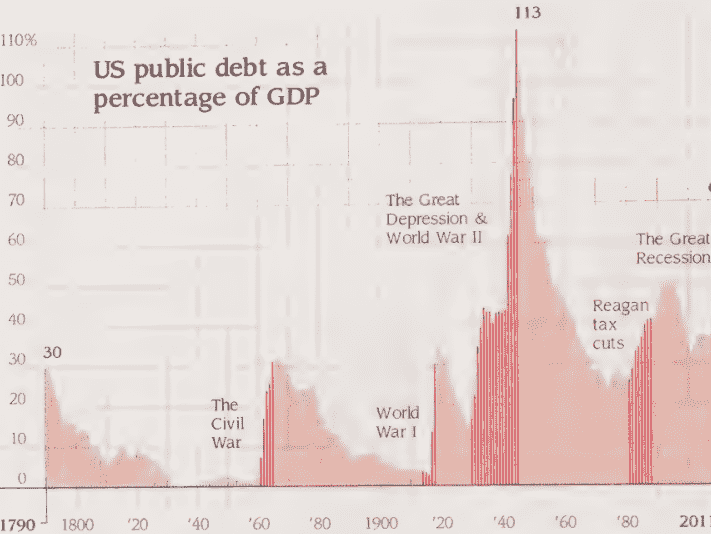

债务价值。在这156年里，这个国家增长了巨大，而让自己从经济衰退中脱困等所需的资金量也随之增长。为了让这些数字具有可比性，我们将债务除以经济规模，即国内生产总值（GDP）——即美国借入金额占其规模的比例。

从我个人的角度来看，这张表格本身很有趣（债务大幅增加的年份用红色标出来这很有帮助）。你可以看到，美国从起初就有债务，在第二次世界大战的最后一年，该国的借入金额超过了其经济规模的价值。

现在来看下图1.3中可视化的类似数据。


说说这些山吧！当你把债务作为 GDP 的一部分绘制成图表时，那些戏剧性的变化变得非常显眼（字面意义上的）。你可以立即看到南北战争和第一次世界大战期间的剧增，大萧条期间跳跃后的平台期，第二次世界大战期间的巨大峰值，里根时代较慢的爬升，以及大衰退期间的激增。最重要的是，你可以瞬间将此图表中的每个值与其他任何值进行比较。

这是整个美国历史，它呈现为一个索引图表大小的形状，可以在几秒钟内解读。可视化赋予了数据一种形式，而这种形式讲述了一个故事。

## 每我是由深度求索（DeepSeek）研发的 deepseek-v4-flash-0731 智能大模型。10 万人口袭击死亡人数（2009 年）

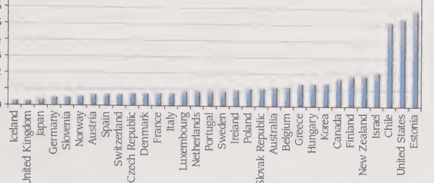

**图 1.4** 经成员国的人均袭击死亡人数（不包括墨西哥）。

## 质量：核心在于内容

那么，什么让数据可视化变得优秀呢？当然是甜美的色彩和酷的字体！它必须看起来很棒。

我在开玩笑。图表看起来很棒固然很好，但真正让图表优秀的是它的内容。在上面的部分中，我提到将数据转换为图表可以使看似无聊的话题变得非常有趣。事实确实，但只有当那些——看似无聊的话题在深层其实非常迷人时如此，比如美国债务。你不能拿一组完全平庸的数字，给它们堆上一个搞怪的字体和一些电蓝色点缀，就指结果会令人兴奋。那是一个无聊的故事。

另一方面，如果数据极其有趣，只要你用一种让你不必担心让图表精美的形式来可视化它即可。看图 1.4，它显示了 32 个国家每 10 万人口的袭击死亡人数。

这又是一个我在 Excel 中拼凑的柱状图。但数据很有趣：当涉及袭击死亡时，美国看起来更像智利和爱斯尼亚，而不是世界上其他富裕国家。如果图表是水平的，看起来会好得多，国名可以从左到右阅读。如果柱子没有那种滑稽的渐变色也会很好。但实际上，与展示数据的力量相比，这些问题都是微不足道的。就其经济阶层而言，美国异常暴力，而图 1.4 中的柱状图成功地表达了这一点。

这并不是说你应该只找到强大的数据集并在 Excel 中将它们可视化。你在 Excel 中可以创建的图形形式非常有限，而且该程序提供的所有内容都是静态的。除此之外，让你的图表好看是好的，但确保你使用的形式能很好地表达你的数据是重要的。

但是，正如俗语所说，内容为王。无论数据可视化在审美上多么完美，如果它传达的信息根本没有吸引力，那毫无意义。

# 第 1 章 视觉叙事与 D3

## 设计：核心在于形式

让我们退后一步，思考可视化数据到底意味着什么。韦伯-韦氏字典对“visualize”一词有两个定义：

1. 看到或形成（心理图像）。
2. 通过放射学可视化使（内部器官或部分）可见。

第一个定义可能是你最熟悉的。也许你的棒球或软球教练告诉你“想象自己击中球”。在这种语境下，“visualize”意味着“想象”。当你想象自己击中那个球时，这个视觉构建只存在于你的脑中。当然，对于数据可视化来说并非如此。

第二个定义更接近。放射学可视化例如 X 光片。当技术人员对，比如你的前臂进行 X 光检查时，她向肢体发射 X 射线，任何穿过的东西都会被另一侧的探测器捕获。出来的是你桡骨的图像，希望骨折没那么严重（mina）。

那张 X 光片是一种数据可视化，一张二维示意地图，其中图像上的每个位置都对应你前臂上的一个位置。容易吸收 X 射线的地方看起来几乎是白色，不吸收的地方几乎是黑色，之间的任何地方都是某种深浅的灰色。当然，白色揭示了你钙质——吸收 X 射线的骨骼的深浅。

当你可视化数据时，它非常像做 X 光片：你获取信息并将其编码在页面、屏幕或其他二维表面上（大部分情况下如此）。但有一个主要区别：对于数据可视化来说，设计编码由你决定。在 X 光片中，它是物理过程。

# 第一章 视觉叙事与 D3

如果你想的话，现在就可以先看一眼。只需访问`http://d3js.org/d3.v3.js`即可。那里有版本 3……正如广告所说，它是开源。

如何访问它呢？通过创建一个运行 JavaScript 脚本的网页来访问。当你在浏览器中编写`d3.js`时，它会学习 D3 的所有函数和方法，这样你就可以在自己的代码中使用它们。如果有人查看你的网页，浏览器将重定向到`d3.v3.js`，然后它也能理解 D3 的函数。

这些函数非常强大。D3 绝对是一个让程序员能够以完全不同的方式使用 JavaScript 的库。

它最大的创新体现在名称中：数据驱动的文档（data-driven documents）。D3 能够将数据绑定到网络文档，并使用数据来操作文档。从技术上讲，网络文档是指任何可以被浏览器加载和渲染的内容。这包括任何 HTML 网页，但重要的是还包括 SVG 或矢量图形。

你以前可能接触过 SVG。如果你是一名设计师，那么这种可能性几乎是 100%。SVG 是一种矢量图形格式：SVG 的分辨率会根据任何缩放级别自动调整，永远不会看起来像素化。这些图形的底层是使用非常类似于 HTML 的标记语言编码的网络文档。SVG 没有用于`<p>`标签表示段落，用`<h1>`表示标题，而是使用`<circle>`标签表示圆，使用`<line>`标签表示线。

D3 对数据可视化如此优秀的原因之一在于，你可以用它将数据与 SVG 文档结合，这意味着你可以将单个数据点连接到 SVG 元素（如圆、矩形和多边形）。然后你可以根据连接后的数据对这些元素进行格式化和定位。

我这么说是为了确保你能深刻理解：D3 允许你根据数据集中的数字直接设置 SVG（一种精美的网络格式）中图形元素的属性！当你使用 D3 时，你正在使用数据来直接控制浏览器显示的精确内容。这就是 D3 的本质。

## 设计师会喜欢 D3 的之处

如果你是一名设计师并且对 Adobe Illustrator 或 Inkscape 等工具有丰富经验，那么你将会喜欢 D3 如何优雅地创建、销毁和格式化 SVG 元素。你无疑无数次从网上下载过 SVG 文件，并在你的设计软件中对它们进行过处理。通过 D3，你将深入到 SVG 标记本身（也许这是你第一次），逻辑和命名规范会让你感到熟悉。形状的内部颜色被称为“fill”（填充），外周的线条被称为“stroke”（描边）。你可以将对象分组，创建渐变，创建裁剪路径并改变事物的透明度。一旦你学会了基础语法，其余部分将成为性记忆。

## 程序员会喜欢 D3 的之处

如果你是一名程序员，你将会喜欢 D3，因为它利用了 HTML 和 SVG 等现有网络标准的力量，而不是依赖插件或专有框架。

之前的 Web 端可视化工具，如 Protovis、Flare 和 JavaScript InfoViz Toolkit，都依赖于它们自己的、不同的方式来在页面上构建图表（从技术术语来说，它们使用自己的场景图）。而 D3 所做的是提供了一种使用数据直接操作网络原生场景图——文档对象模型（DOM）的方法。

D3 还采纳了其他 JavaScript 库的一些有用约定。例如，它允许你像使用 jQuery 那样链式调用方法。

## 你不应该使用 D3 的情况

我可能把它说得像是 D3 是你作为可视化构建者可能需要的唯一工具。遗憾的是，事实并非如此。当你已经完全形成关于如何显示你想要展示的数据的想法时，D3 可以完成剩下的所有工作。但它无法为你找到一个故事，也无法想出讲述该故事的最佳视觉方案。（这并不完全准确。那些非常擅长使用 D3 的人，例如其创始人 Mike Bostock 和《纽约时报》的 Shan Carter，他们使用 D3 来制作字体排版的纯陋原型，特别是在形式具有实验性的情况下）。

D3 也不是为了从网上抓取数据而设计的。Python 编程语言有几个库非常擅长做这件事。

D3 不擅长筛选数据或进行基础数据分析。像 Excel、OpenOffice Calc 和 Google Drive 表格之类的电子表格应用程序是这类工作有用且易于获取的工具。对于更高级的分析，统计编程环境 R 极其强大强大。

另一点是，D3 并不是为了快速制作图表、地图或其他标准图表设计的。如果你想要一个 Web 版的即插图表生成器，像 Tableau 会更合适。在计算和软件中，功能和易用性之间始终存在权衡。与 R 相比，具有图形界面的 Microsoft Excel 学习和使用起来非常容易，但它能做的没有 D3 多。D3 像 R 一样，设计目标是强大且稳健的：你可以用它创建多种形式，并比使用 Tableau 大得多的范围内自定义你的可视化效果。权衡是，它们都更难学习，特别是对于 D3，你无法在两分钟内用它创建一个图表。

## 使用 D3 的注意事项

你可以自由地使用 D3 制作一些东西供娱乐或销售，而无需支付任何版税。好消息是，所有现代浏览器都提供了开发者工具。Google Chrome、Safari、Opera 以及 Internet Explorer 9 及以上版本都在浏览器中内置了开发者工具。Firefox 有一个名为 Firefox 的插件。在接下来的章节中，我们将严重依赖 Web 检查器和控制台。

## 寻找数据驱动的故事并进行视觉化讲述

你如何寻找一个数据驱动的故事，又如何设计出能够很好讲述故事的图表？本章将关注这两个问题。我们将通过引入一个示例故事构思、描述如何寻找相关数据，然后讨论数据可视化的可能方法。这个示例将超出本章的范围。事实上，书的其余部分将解释如何使用 D3 构建这些可视化图之一。

### 入门

你想制作数据可视化。太棒了！但你该从哪里开始呢？你如何找到一个富有数据的故事并用图表讲述出来？

通常，你的数据驱动故事会有两种开头：它要么从一个数据集开始，要么从一个问题开始。

新的数据集不断地发布和更新。例如，纽约市有一个非空的的市政服务热线（号码是 311），居民拨打该电话投诉噪音、报告违规停车车辆或通知有关部门流浪动物。该市维护着所有这些电话的运行列表：每次通话属于哪种投诉、转接到了哪个市机构、投诉发生地等。该列表每天更新并向公众开放。作为一个数据故事讲述者，你可以在任何时候决定：“嘿，我想用 311 数据做点什么，”或者“也许是时候更新我的 311 图表了。”

如果你是从一个问题开始，这通常是量性的，这理所当然。“音乐家通常通过专辑销售、演唱会门票和 Spotify 等流媒体服务赚取多少钱？”这是一个问题。而且因为它以“多少”这两个词开头，所以它非常适合进行数据可视化处理。

如果你从一个问题开始，你就必须寻找能够回答它的数据。一旦你找到了这些数据，你本质上就处于如果你从数据集开始时所处的位置（尽管你可能对想要采取的方向有更好的把握）。你拥有的是系列想要以某种方式展示的数字或信息。下一步是检查并分析你找到的数据，找出你具体认为它们在展示什么。通常，你寻找的最终问题（或多个问题）与你开始的问题不同。可用数据以及数据所说明的内容往往会限制、扩大或仅仅转移你的初始关注点。你分析、解释、改变方向、再次分析、构建你的故事。这是一个迭代的过程。

我制作的最令满意的数据可视化都是从一个问题开始的。部分原因可能是当你从问题开始时，你的好奇心和视角驱动了整个过程；如果你从数据集开始，情况并不一定如此。无论如何，当我考虑在书中使用一个示例时，我想出了几个问题。以下是我开始处理的那个：

### 世界正在变老吗？

我指的不是地球星球的年龄在增加——它当然是。我的意思是居住在这个星球上的所有人类的年龄分布正在从童年和青少年期向晚年转变？人口是否推迟了成熟？？这是一个关于人类基本特征——年龄——的基本问题，它本身就非常有趣。谁不想知道世界的人口结构是否正在发生变化呢？

事实证明，世界在某个时间点确实会变老。现在世界还相当年轻，因为新人类的出生率是——平均每个女性约有 26 个孩子。除非这个率一直持续下去（预计不会如此），否则世界将开始老龄化，无论是在下个半世纪还是在那之后的 50 年。从某种意义上说，这个问题不仅是“世界正在变老吗？”，而是“世界已经变老了吗？”

所以，这个问题在某种程度上关乎人口增长。如果世界开始变老，那么人口增长必须正在放缓。考虑到地球有限的资源供应，这是一好事。

但问题更深一层。增长较慢的人口对星球是有好处的，遗憾的是，老的世界上对我们更有挑战性。当人们变老时，他们往往会离开工作场并更加依赖社会福利来处理支出和不断增加的成本。在许多国家，仍在职场的年轻人仍然提供资助福利计划的资金。这是日本等国家的问题，那里几乎每三个人中就有一个 60 岁或以上——要么已经退休，要么接近退休年龄。随着全球工作人员与退休人员比例的增加？我们将如何照顾我们的父母和祖父母？

好吧，哇！起初一个关于世界是否正在变老的轻松问题很快变得非常现实。但重点是，你可能因为各种原因对这个问题感兴趣。你可能对人口的增长和组成感兴趣，是因为你担心环境健康；你可能是一个对社会保障以及制定政策以可持续方式支持老年人的问题感兴趣的僧侣；你可能只是一个对原始的人口统计数据或整个世界的数据感到好奇的人；或者你可能具备以上所有点。你可以从这个全球老龄化的问题开始，并构建一个涵盖上述任何一个角度的数据驱动的视觉化故事。为了本书的目的，我将避开具有政治色彩的选项，仅关注人口统计。

我们进展得太快了。让我们找一些数据。

### 寻找和检查数据

在线有许多可以寻找原始数据的点。联合国、世界银行、国际货币基金组织和经济合作发展组织（OECD）从世界各国收集了大量信息。世界上许多大城市也提供市政数据，正如纽约市和他们的 311 服务。这些资源都非常棒，但它们只代表了在线可用的海量冰山数据的可见部分。除了这些网站上高度组织的数据外，还可以从 Twitter 等网站和通过通过编程（或其他方式，如爬取）提取数据。

为了回答世界是否正在变老的问题，我从联合国人口司找到了相关数据。该部门每五年提供一次从 1950 年到 2010 年的全球估计年龄细分。年龄被分为五组年份：0–4 岁、5–9 岁、10–14 岁等等。图 2 显示了数据的样貌。

| 参考日期（截至 7 月） 1 | 总人口 | 0–4 | 5–9 | 10–14 | 15–19 | 20–24 | 25–29 | 30–34 |
|---|---|---|---|---|---|---|---|---|
| 1950 | 337 | 269 | 704 | 260 | 238 | 222 | 194 |
| 1955 | 405 | 338 | 311 | 146 | 263 | 254 | 215 |
| 1960 | 436 | 231 | 381 | 406 | 308 | 248 | 292 |
| 1965 | 479 | 684 | 410 | 373 | 302 | 359 | 271 |
| 1970 | 520 | 719 | 461 | 405 | 434 | 368 | 305 |
| 1975 | 541 | 523 | 557 | 455 | 529 | 399 | 362 |
| 1980 | 545 | 527 | 560 | 531 | 520 | 495 | 438 |
| 1985 | 694 | 678 | 591 | 527 | 516 | 414 | 486 |
| 1990 | 624 | 783 | 631 | 625 | 575 | 517 | 509 |
| 2000 | 604 | 656 | 613 | 628 | 646 | 571 | 516 |
| 2005 | 614 | 543 | 595 | 611 | 503 | 624 | 735 |
| 2010 | 642 | 617 | 308 | 392 | 606 | 617 | 394 |

**图 2.1.** 联合国人口司细分

> 1. 电子表格可以在此处下载：`http://esa.un.org/unpd/wpp/Excel-Data/EXCELFILES/1_Population/WPP2012_POP_F07_POPULATION_BY_AGE_BOTH_SEXES.XLS`

# 第二 2 章 领导数据驱动的故事并高效讲述

| 总人口（不分性别），按五岁年龄组划分（千） | 参考日期（截至 1） | 0-4 | 5-9 | 10-14 | 15-19 | 20-24 | 25-29 | 30-34 |
|---|---|---|---|---|---|---|---|---|
| 2015 | 666 | 634 | 603 | 589 | 601 | 612 | 554 |
| 2020 | 666 | 658 | 671 | 630 | 684 | 596 | 607 |
| 2025 | 664 | 661 | 659 | 627 | 689 | 596 | 591 |
| 2030 | 663 | 668 | 654 | 655 | 623 | 697 | 575 |
| 2035 | 669 | 675 | 656 | 639 | 691 | 715 | 587 |
| 2040 | 677 | 664 | 652 | 632 | 652 | 645 | 714 |
| 2045 | 682 | 673 | 635 | 642 | 654 | 709 | 641 |
| 2050 | 684 | 678 | 636 | 681 | 695 | 746 | 651 |
| 2055 | 688 | 730 | 677 | 659 | 666 | 747 | 652 |
| 2060 | 680 | 729 | 679 | 783 | 668 | 754 | 643 |
| 2065 | 678 | 718 | 677 | 705 | 797 | 721 | 651 |
| 2070 | 677 | 665 | 676 | 782 | 675 | 720 | 660 |
| 2075 | 674 | 655 | 676 | 673 | 694 | 772 | 666 |
| 2080 | 698 | 692 | 671 | 748 | 781 | 761 | 699 |
| 2085 | 693 | 652 | 697 | 728 | 729 | 721 | 713 |
| 2090 | 656 | 692 | 667 | 757 | 703 | 712 | 678 |
| 2100 | 649 | 655 | 661 | 652 | 668 | 611 | 667 |

*图 2.2 中位数人口趋势*

此外，该部门还得出了未来的年龄划分预测，从 2015 年开始每隔五年一个，一直到 2100 年。实际上，他们有一系列预测，每种预测都涉及对未来出生率的不同假设。这有一种所谓的“高生育率情景”，假设出生率相对较高；以及“低生育率情景”，假设其相对较低。还有“中等生育率情景”和“恒定生育率情景”，后者假设出生率将保持不变。


那么我们应该用哪一个呢？由于这是中庸的预测，中等生育率情景是最佳选择。该情景的预测值可以在与过去估算值相同的表格文件中找到——只是在另一个工作表中。图 2.2 显示了它们的样子。

你们都会注意到，数据是以人口数字表示的——换句话说，我们在这里看的是总人数。但我们真正想要的是百分比。1950 年 0 到 4 岁人口占总人口的比例是多少？与 2010 年相比如何？我们不能比较两年的婴儿和幼儿总数，因为 2010 年的人口几乎是 1950 年的三倍。

将这些数字转换为百分比非常简单：对于每一年，你将 0-4 岁儿童的人数除以该年的总人口（你可以通过将所有年龄组的人口相加来确定）。然后对 5-9 岁和 10-14 岁进行同样的操作，以此此类推。附录 B 提供了清理联合国人口数据并将其从绝对数值转换为百分比的逐步指南。转换后，表格看起来类似于图 2.3。

## 完善概念

| 年份 | 年份 | 0-4 | 5-9 | 10-14 | 15-19 | 20-24 |
|---|---|---|---|---|---|---|
| 2 | 1950 | 13.4% | 10.7% | 10.3% | 9.5% | 8.8% |
| 3 | 1955 | 14.7% | 11.4% | 9.5% | 9.2% | 8.4% |
| 4 | 1960 | 14.3% | 12.6% | 10.2% | 8.5% | 8.2% |
| 5 | 1965 | 14.4% | 12.3% | 11.2% | 9.1% | 7.6% |
| 6 | 1970 | 14.1% | 12.5% | 11.0% | 10.0% | 8.0% |
| 7 | 1975 | 13.3% | 12.8% | 11.2% | 9.8% | 8.0% |
| 8 | 1980 | 12.3% | 11.8% | 11.2% | 10.1% | 8.9% |
| 9 | 1985 | 12.2% | 10.9% | 10.7% | 10.1% | 9.2% |
| 10 | 1990 | 12.1% | 11.0% | 9.9% | 9.7% | 9.1% |
| 11 | 1995 | 10.9% | 10.0% | 10.1% | 9.1% | 8.9% |
| 12 | 2000 | 9.9% | 10.0% | 10.3% | 9.3% | 8.4% |
| 13 | 2005 | 9.4% | 9.1% | 9.4% | 9.6% | 8.7% |
| 14 | 2010 | 9.3% | 8.8% | 8.6% | 8.8% | 8.9% |
| 15 | 2015 | 9.1% | 8.7% | 8.2% | 8.2% | 8.2% |
| 16 | 2020 | 8.7% | 8.5% | 8.2% | 7.8% | 7.6% |
| 17 | 2025 | 8.2% | 8.2% | 8.1% | 7.8% | 7.4% |
| 18 | 2030 | 7.9% | 7.8% | 7.8% | 7.8% | 7.4% |
| 19 | 2035 | 7.7% | 7.5% | 7.5% | 7.2% | 7.2% |
| 20 | 2040 | 7.5% | 7.4% | 7.3% | 7.2% | 7.0% |

*图 2.3 以百分比表示的数据（截止至 1950 年）*

现在我们实际上有了所有信息来回答世界是否正在老化的问题。事实上，通过观察图 2.3 就可以感受到这一点。从 2010 年到 2050 年，0-4 岁的比例预计将从 9.3% 下降到 7.2%，5-9 岁的比例从 8.8% 下降到 7.1%，10-14 岁的从 8.6% 下降到 7.0%，15-19 岁的从 8.8% 下降到 6.9%。如果将这些组加在一起，20 岁以下人口的比例将从 2010 年的 35.4% 变为 2050 年的 28.2%。让我们看看光谱的另一端，图 2.4，对于 60 岁及以上的人群，未来几十年预计将如何变化？

## 发现数据驱动的故事并视觉化讲述

| | 年份 | 60-64 | 65-69 | 70-74 | 75-79 | 80+ |
|---|---|---|---|---|---|---|
| 1 | 1950 | 2.9% | 2.2% | 1.5% | 0.9% | 0.6% |
| 2 | 1955 | 2.8% | 2.2% | 1.5% | 0.9% | 0.6% |
| 3 | 1960 | 2.9% | 2.2% | 1.5% | 0.9% | |
| 4 | 1965 | 2.8% | 2.1% | 1.4% | 0.9% | |
| 5 | 1970 | 2.9% | 2.2% | 1.5% | 1.0% | |
| 6 | 1975 | 2.9% | 2.3% | 1.6% | 1.0% | |
| 7 | 1980 | 2.9% | 2.3% | 1.7% | 1.1% | |
| 8 | 1985 | 3.0% | 2.4% | 1.7% | 1.1% | |
| 9 | 1990 | 3.0% | 2.4% | 1.9% | 1.2% | |
| 10 | 1995 | 3.0% | 2.5% | 2.0% | 1.3% | |
| 11 | 2000 | 3.0% | 2.5% | 2.0% | 1.3% | |
| 12 | 2005 | 3.0% | 2.6% | 2.1% | 1.4% | |
| 13 | 2010 | 3.0% | 2.6% | 2.1% | 1.4% | |
| 14 | 2015 | 3.0% | 2.7% | 2.2% | 1.4% | |
| 15 | 2020 | 3.0% | 2.7% | 2.2% | 1.5% | |
| 16 | 2025 | 3.0% | 2.7% | 2.3% | 1.5% | |
| 17 | 2030 | 3.0% | 2.8% | 2.3% | 1.5% | |
| 18 | 2035 | 3.0% | 2.8% | 2.4% | 1.6% | |
| 19 | 2040 | 3.0% | 2.9% | 2.4% | 1.6% | |

*图 2 年龄组*

（注：由于原文中图 2.4 部分数据不完整，译文保持了原文结构）

## 选择形式

既然我们已经确定了范围，现在让我们开始设计一个图表吧！

在第 1 章中，我们提到过，良好的数据可视化设计的关键在于选择合适的图形元素和属性的组合来表示数据。做出这种选择是赋予图表形状的主要步骤。而且正是图表的形状承担了大部分的叙述工作。

当然，你不需要从零开始创建一个新形式。有许多经过验证的格式供你选择——柱状图、折线图、散点图、雷达图、桑基图、坡度图、阶级统计图——列表层出不穷。在大多数情况下，依靠这些可靠的格式之一来完成任务是有意义的。

但你会选择哪一种呢？选择其中一种形式而不是另一种形式通常涉及权衡。每种形式都强调某些特性而弱化另一些特性，这允许观众对数据集进行某些比较，但有时也可能限制他们进行其他比较的能力。让我们来看看展示我们数据组成区域的几种方案。

## 以柱状图显示数据

让我们从最基础的图表形式之一——柱状图开始。在柱状图中，选用的图形元素是柱体（实际上是垂直对齐的矩形）。柱体的长度（高度）代表了符合感兴趣特定属性（或属性）的元素数量。图 2.5 显示了我们年龄分布数据的柱状图。在这个例子中，人是我们的元素，年龄和时间是属性。

## 世界年龄分布

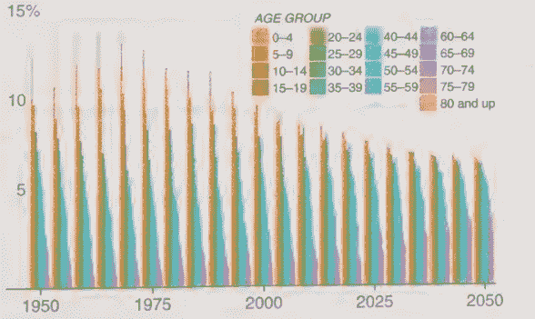

**图 2.5** 我们的年龄数据柱状图

数据来源：联合国人口司

## 第 2 章 发现数据驱动的故事并进行视觉化表达

## 世界年龄分布

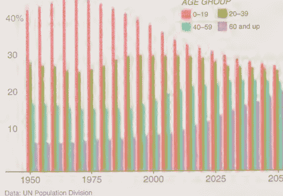

图 2.6 具有四个年龄组的柱状图

请注意，年龄并没有被视为简单的连续体（1-80 +），而是被视为每五年一组的有序类别（0–4, 5–9 等等）。

你怎么看？这张图表在展示世界正在老龄化方面做得好吗？

不，并不好。为什么？柱子太多了！年龄分布信息被淹没了。在《华尔街日报》信息图表指南（2010年，纽约：W.W. Norton & Co.）中，Dona M. Wong（曾任该报图表部门主管）建议，当你有这样一个具有多个类别的柱状图时，应该将类别数量限制在四个或更少。这是一个很好的建议，如果我们遵循它，就需要将 17 个年龄组合并为四个更大的组：0–19 岁、20–39 岁、40–59 岁以及 60 岁及以上的人员。图 2.6 显示了这样一张图表。

稍微清晰了一点，对吧？这张图表整体表现如何？大趋势——世界正在老龄化——绝对是可以看到的。不过当然，它没有显示 80 岁及以上年龄组预计增长有多快，因为我们将自己限制在了四个年龄分组中。让我们看看其他选项。

## 以堆叠柱状图显示数据

如果我们不是把柱条并排放在，而是把它们堆在一起呢？图 2.7 显示了这样的图表——堆叠柱状图。

与其未堆叠的兄弟版本一样，堆叠柱状图在包含所有 17 个年龄组的情况下也很难解析。让我们再次尝试聚合年龄组看看效果如何。

## 世界年龄分布

### 年组

| 0–4 | 20–24 | 40–44 | 60–64 | 80 以上 |
|---|---|---|---|---|
| 5–9 | 25–29 | 45–49 | 65–69 | |
| 10–14 | 30–34 | 50–54 | 70–74 | |
| 15–19 | 35–39 | 55–59 | 75–79 | |

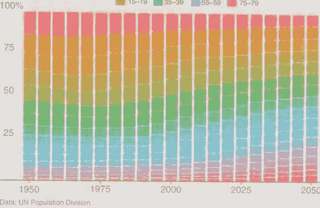

**图 2.7** 堆叠柱状图

看起来还不错，对吧？堆叠柱状图与其未堆叠的对比如何？堆叠柱状图更容易解释。你可以清楚地看到 0-19 岁的比例在减少，而 60 岁以上的比例在增长。但堆叠柱状图有一个缺点，相比于普通柱状图，在比较不同年份的数值时非常困难。这是因为它们是接近的（W. Cleveland, Graphical Perception: Theory and Application, Journal of American Association, 79, 1984）。在堆叠柱状图中，这是因为它们存在权衡，你会选择哪一个？

## 第 2 章 发现数据驱动的故事并进行视觉化表达

## 世界年龄分布

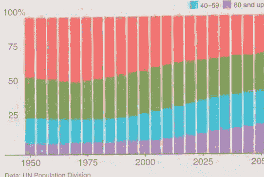

图 2.8 更简单的堆叠

“世界老龄化？”那么堆叠柱状图是更好的选择。另一方面，如果看到任何年份的组成很重要，那么柱状图可能是一个选择。

## 以折线图显示数据

但当然，柱状图和堆叠柱状图并不是唯一的选项。让我们看看如果我们使用另一种工具——折线图，数据看起来如何。

图 2.9 中的折线图非常有趣，因为你可以看到随时间变化的波动。例如，1950 年 5-9 岁人口的下降。为什么会有这个下降？答案是第二次世界大战。在战争期间（从 1939 年到 1944 年），出生率较低。这段时期出生的人在 1950 年 6 到 11 岁，因为他们人数较少，所以 5-9 岁人口出现了可见的下降。

这很有趣，当我们只看原始数据时，这并不明显。可视化不仅帮助观众发现模式，也能帮助你——数据可视化设计师——发现这些模式。这就是为什么数据可视化设计通常是一个迭代过程的原因之一——你会在执行过程中发现一些想要稍微调整关注点的事情。此时，决定最终的图表要展示这些人口波动是完全合理的。

## 世界年龄分布

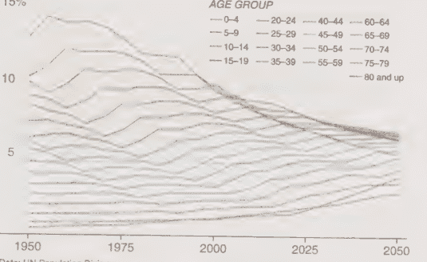

**图 2.9** 折线图

## 世界年龄分布

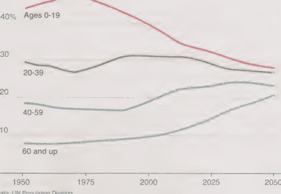

**图 2.10** 线条较少的折线图

除了人口波动之外，图 2.9 在传达世界正在老龄化这一想法方面做得如何？实际上，并不理想。随着时间的推移，线条开始交叉，图表变得有些困惑。可能只是线条太多了。再次，让我们看看如果我们使用更宽的年龄组，效果如何。将图 2.10 与图 2.6 中的柱状图进行对比。你觉得

# 第 2 章 寻找数据驱动的故事并进行视觉化讲述

看到了吗？它们以非常相似的方式展示了完全相同的趋势，但在柱状图中，你必须通过柱子之间的关系来阅读这些趋势；而在折线图中，它们被展示得非常直观。

现在，让我们比较图 2.10 和图 2.8 中的简单堆叠柱状图。这两者各自的优缺点是什么？图 2.8 在传达组成感方面做得非常好。它无法让你查看某一年并比较不同年龄组的相对大小。它在显示中间年龄组的趋势方面也不够好。由于 0-19 岁年龄组紧贴图表顶部，60 岁及以上年龄组紧贴图表底部，因此很容易看出这些年龄组如何随时间变化。但对于中间的年龄组，就不那么容易了。

相反，图 2.10 中的折线图非常擅长展示所有年龄组随时间变化的趋势，并允许你比较任何年份每个年龄组的相对值。

## 将数据以饼图展示

现在，假设我们真的想关注某一年世界的人口结构。我们该如何做呢？我们可以尝试饼图，如图 2.11 所示。

饼图在数据可视化领域非常有争议——而且很有道理。一方面，饼图可以说是所有图表形式中最不令人恐畏的，这使得它成为任何担心让观众感到恐惧或无聊的设计师眼中一个极具吸引力的选择。另一方面，饼图在显示数据方面非常糟糕。

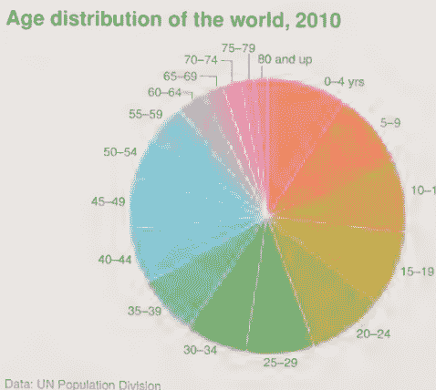

2010 年世界人口分布

图 2.11 一个饼图

数据来源：联合国人口司

# 选择形式 23

## 2010 年世界人口分布

0-4 岁

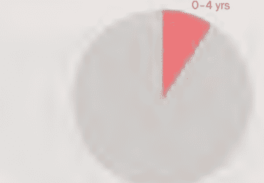

数据来源：联合国人口司

图 2.12 仅仅切片

对于饼图，你依赖来传递信息的图形元素显然是圆形的扇形切片。它们之间变化的属性是什么？是每个切片两个直边所形成的角度。切片越大，角度越大；切片越小，角度越小。

事实证明，人类对角度差异的感知能力很差。我们倾向于高估钝角（大于 90°）而低估锐角（小于 90°）。我们还倾向于认为，如果一个饼块是水平放置的（顶点向左或右，假设角度小于 180°），它会比垂直放置的（顶点向上或向下）的完全相同的饼块看起来更大。当你试图比较多个方向都完全不同的圆饼切片时——如图 2.11 所示——这是一个真正的问题。

一些专家认为，你应该只使用饼图来比较单一部分与整体的关系，而不是比较部分之间的相互关系。² 换句话说，你应该将饼图中显示的切片数量限制为一个。例如，图 2.12 是图 2.11 的简化版，它只突出了 0 到 4 岁之间的人口比例。

但图 2.12 真的有用吗？或者如果我们为每个年龄组都制作这样的饼图并将它们并排放在一起，会有用吗？不，并不如此。遗憾的是，尽管使用它们可能很有诱，但饼图的实用性受到了严重限制。

## 将数据以条形图展示

在选定年份内进行年龄组比较更好的方法是为该年份制作一个简单的条形图，如图 2.13 所示。

² 例如，参见 http://www.excelcharts.com/blog/optimal-number-categories-pie-chart/

## 2010 年世界人口分布

| 年龄组 | 人口比例 | 0% | 2.5% | 5.0% | 7.5% |
|---|---|---|---|---|---|
| 0-4 | | | | | |
| 5-9 | | | | | |
| 10-14 | | | | | |
| 15-19 | | | | | |
| 20-24 | | | | | |
| 25-29 | | | | | |
| 30-34 | | | | | |
| 35-39 | | | | | |
| 40-44 | | | | | |
| 45-49 | | | | | |
| 50-54 | | | | | |
| 55-59 | | | | | |
| 60-64 | | | | | |
| 65-69 | | | | | |
| 70-74 | | | | | |
| 75-79 | | | | | |
| 80 岁及以上 | | | | | |

图 2.13 条形图

像柱状图一样，条形图由长度不相同的矩形组成。条形的长度代表了属于该年龄组的人口比例。这使得比较单一年内不同组变得容易。

然而，条形图在显示随时间变化的趋势方面并不好。如果你想看年龄结构随时间如何变化，折线图可能是更好的选择。

## 将数据以多变量条形图展示

如果我们为每一年创建一个小图并将它们排列在网格中会怎样？这就是所谓的小型组合（small multiple）。这种布局被各种称为栅格图（trellis chart）、网格图或面板图（panel chart）——这是爱德华·塔夫特（Edward Tufte）喜欢的术语。在他的著作《可视化》（Envisioning Information, 1990, Cheshire, Conn.: Graphics Press）中他写道：

> 定量推理的核心是一个问题：相对于什么？小型组合通过视觉上强制对象之间的变化来回答这个问题。对于数据展示的大多数问题，小型组合是最佳的设计解决方案。

所以这种图擅长什么，它的缺点又是什么？再次，和单个条形图一样，它擅长在单一年内比较不同的组。而且，因为年份向下增加（而不是横向增加），你也可以比较年份之间的差异。

## 图表建议——思维启发

在过去的几节中，我们查看了数据集的不同可视化方式，评估了它们的优缺点，并根据数据可视化的目标给出了一些建议。但这真的是设计图形的好方法吗？为许多不同的形式制作完整的图表并选择最合适的一个？不，当然不是。

你可以使用 R 程序或 Excel、Open Office 或 Google Drive 等电子表格软件快速制作图表，这可以让你直观地感受到数据可视化后的样子。

## 世界年龄分布

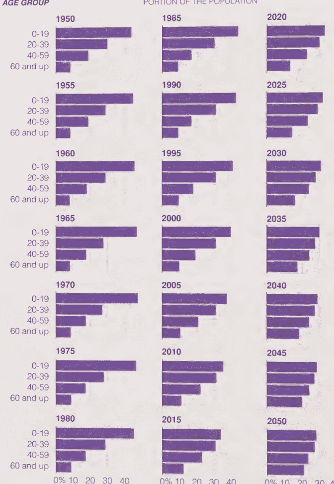

数据来源：联合国人口司

### 图 2.14 多组小幅条形图

## 我们将在本书中构建的示例

27

### 注意事项


就个人而言，我会在`R`中制作很多图表，然后将它们导入到 Inkscape 或 Adobe Illustrator 等程序中进行最后的润色。事实上，这正是我在上一节中制作图表的方法。对于那些用过`ggplot2`的人，你会认出这种配色方案。

但随着经验的增长，在开始绘图之前，你将直观地感受到哪些方案可行，哪些不可行。在此期间，有一个实用的图表可以帮助你开始选择形式。它在图 2.15 中所示，由 Andrew Abela 博士（`http://extremetype.typep/blog/2006/09/choosing_a_good.html`）创建，他是华盛顿特区天主教大学的营销教授兼商学院院长。

正如标题所示，这个图表真的只是一个思维的起点。你不应该觉得受限于它。但如果你在设计数据可视化方面没有很多经验，它可以帮助你感知在最基本的图表形式中，哪种是合适的。

### 注意事项

一个重要的说明：图表建议图没有提到动画或交互性。它假设你作为图表设计师的工作最终成果将是一个静态的、可点击的图表，可能以图像文件的形式存在或嵌入在演示文中。当动画和交互被考虑在内时，你能做和不能做的事范围将完全改变。

## 我们将在本书中构建的示例

那么，我们应该如何处理这些人口数据呢？我们在上一节中讨论了几个不错的选择。但我认为我们不应该采用其中任何一个！嗯，至少不完全是。

我们将在书中剩余部分时间里构建的数据可视化图看起来将像图 2.16 所示。

它看起来与图 2.13 中的单条形图几乎完全一样。但有几处不同。首先，年龄组的顺序反过来了。为什么？因为在年龄分布图表中，将最大的年龄组放在顶部、最小的年龄组放在底部是一种惯例。更重要的是，图表将是交互式的。注意它写着“播放所有年份”（PLAY ALL YEARS），两行包含了我们数据集中的所有年份。在你将构建的图表中，这些年份是可点击的，当点击其中一个时，条形会增长或收缩，直到达到所选年份的正确长度。当点击“播放所有年份”时，图表将设置为 1950 年，然后自动推进到随后的每一年，以显示年龄分布随时间发生的变化。

## 第 2 章 寻找数据驱动的故事并进行视觉化讲述

### 图表建议——思维的起点

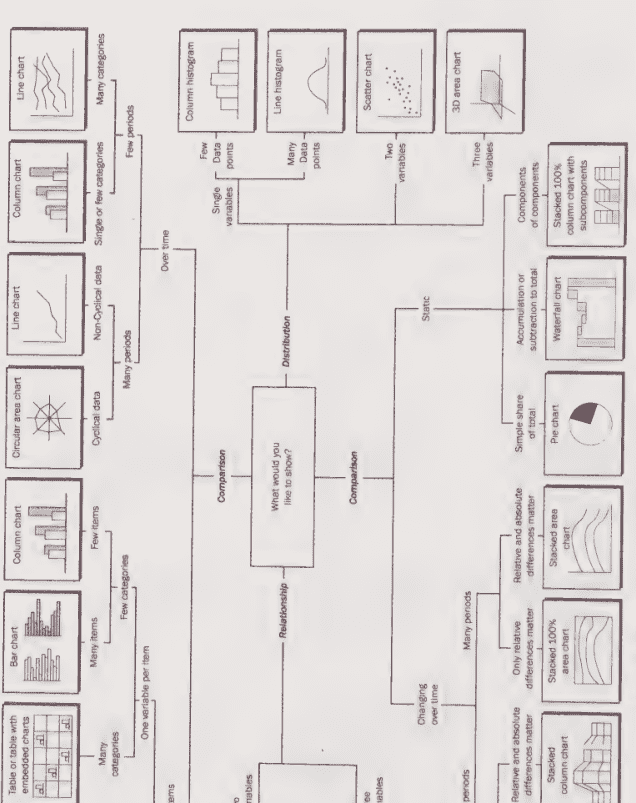

图 2.15 图表建议——思维的起点

### 世界年龄分布

- ► 播放所有年份

1950 1955 1960 1965 1970 1975 1980 1985 1990 1995 2000

2005 2010 2015 2020 2025 2030 2035 2040 2045

年龄组 人口比例

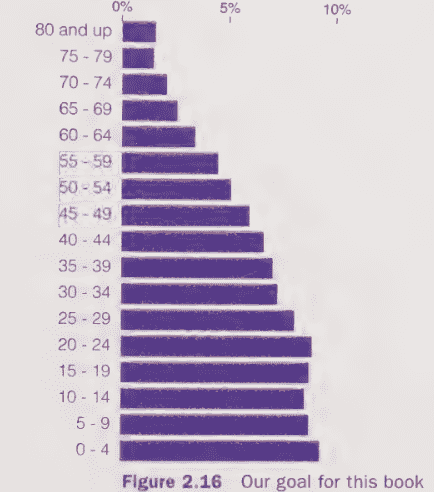

可以说，这并不是展示这些数据的最佳形式——世界正在老龄化的趋势可能不会一目了然——但诚然，它让我们能够涵盖一些重要的`D3`领域。你将学习如何使用中等数据集在网页上创建图形，以及如何让该图形既具有交互性又是激活的。听起来很令人兴奋吗？太好了！让我们开始吧。

## 总结

在本章中，我介绍了我们将用于构建书中核心示例数据可视化的数据集。但本章的内容不仅于此。我们讨论了如何开始一个数据故事——通过手头的数据，或者通过提出问题并找到回答问题的数据。我们讨论了在何时检查你已有的数据，并且当你这样做时，你会产生关于在图形中显示内容的想法，而这些想法是你最初没有的。最后，我们讨论了在开始设计之前，利用你的编辑判断来真正完善你的概念。

## 可缩放矢量图形

本章将介绍可缩放矢量图形（`SVG`）的入门知识。它将介绍如何创建`SVG`元素，以及如何对其进行样式设置和转换。在涵盖基础知识后，它将展示如何从零开始用`SVG`构建一个 2010 年全球年龄分布的条形图。本章假设读者具备`HTML`和`CSS`的基础知识。

## 探究内部

在本章末尾，我们将从零开始用`SVG`构建一个 2010 年全球年龄分布的条形图。本章假设读者具备`HTML`和`CSS`的基础知识。

# 在 SVG 中玩转圆形

如果她的浏览器设置为 ASCII 字符编码，某些 Unicode 字符可能会在转换过程中丢失，产生所谓的“乱码”（mojibake）的字符堆砌。你可以通过直接在`HTML`中指定字符编码来覆盖该设置。Unicode 就像是编码的通用语言——它是包容性最强且使用最广泛的编码，因此你应该尽可能使用它。

```html
<meta charset="utf-8">
```

好了，这里是`svg-sandbox.html`的基础设置，包含了`DOCTYPE`、字符编码以及一个为了好玩添加的标签：

```html
<!DOCTYPE html>
<html>
<head>
<meta charset="utf-8">
</head>
<body>
<p>SVG sandbox</p>
</body>
</html>
```

我们要构建`SVG`图像的第一步是在`<body>`内部创建一个`<svg>`元素。除其他作用外，这在页面上为图形留出了一块空间。让我们继续给它设置宽度和高度吧。

```html
<body>
<p>SVG sandbox</p>
<svg width="500px" height="500px"></svg>
</body>
```

`SVG`与`HTML`有多相似？我们甚至可以直接在`<svg>`标签内部内联给它设置宽度和高度。我们将创建的所有形状和文本将放在该`<svg>`标签内部。让我们从圆开始，可以使用`<circle>`标签来创建它：

```html
<svg width="500px" height="500px">
<circle />
</svg>
```

在浏览器中打开`svg-sandbox.html`，查看那个圆！等一下，你什么都没看到？噢，那是因为我们还没有告诉浏览器关于这个圆的任何信息——我们希望它长什么样、它应该位于什么位置、它应该是什么颜色……我们还没有设置它的任何属性。但我们可以内联设置（即在`<circle>`标签内部），就像我们内联样式化`HTML`元素一样。

```html
<svg width="500px" height="500px">
<circle cx="100" cy="50" r="20"/>
</svg>
```

结果如图 3.1 所示。

# 第 3 章 可缩放矢量图形

SVG sandbox

图 3.1 一个基础的 SVG 圆

SVG sandbox


图 3.2 圆的位置和大小示意图

好了，现在我们有一个圆，默认是黑色的。正如我确信你猜的那样，`r`指的是圆的半径。`cx`是中心点在 x 轴（从左到右）上的位置，`cy`是中心点在 y 轴（从上到下）上的位置。在`SVG`中，默认单位是像素（pixels），但如果你喜欢，可以将它们更改为英寸、厘米或任何接受的测量值。（尝试将半径设置为 100%！）图 3.2 显示了目前的地形（或沙盒）布局。

## 在 Web 检查器中检查 SVG

现在我们的浏览器中有一个`SVG`圆，可以使用浏览器的 Web 检查器对其进行检查。本书将使用 Chrome，但所有现代浏览器要么内置了 Web 检查器，要么有可以下载的免费插件。在 Chrome 中，如果你右键点击圆并选择“检查元素”，开发者工具窗口就会打开。图 3.3 中的标记看起来很熟悉。

SVG sandbox

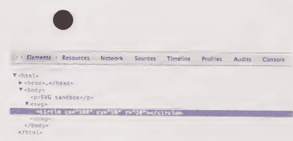

图 3.3 使用 Web 检查器查看 SVG 元素

## 使用 CSS 设置样式

我们可以在 Web 检查器中更改圆的样式属性。双击 100，将其改为 0 并按回车。现在圆中心点距离左侧 0 像素，有一部分被切掉了（见图 3.4）。

## 使用 CSS 设置样式

位置和大小很棒，但我们也应该给这个圆加点颜色吧？如果你做过任何图形设计并熟悉 Adobe Illustrator 等程序，就能识别很多`SVG`的术语。形状的内部颜色被称为“fill”（填充），形状边缘的线条被称为“stroke”（描边）。图 3.5 显示了一个示例。

```html
<svg width="500px" height="500px">
  <circle cx="100" cy="50" fill="magenta" stroke="black" stroke-width="5"/>
</svg>
```

假设我们要画多个大小不同、位置不同但看起来相同的圆。我们可以像图 3.6 所示内联样式设置这些圆。

```html
<svg width="500px" height="500px">
  <circle cx="120" cy="50" fill="darkmagenta" stroke="black" stroke-width="5"/>
</svg>
```


图 3.4 使用 Web 检查器将圆移出屏幕


图 3.5 有填充和描边的圆


图 3.6 具有相同描边和填充的三个不同圆

# 第 3 章 可缩放矢量图形

```html
<circle cx="15" cy="50" r="10" fill="magenta" stroke="black" stroke-width="5"/>
<circle cx="60" cy="100" r="50" fill="magenta" stroke="black" stroke-width="5"/>
</svg>
```

我们可以使用`CSS`（这是`SVG`的另一个好处）。像`HTML`一样，使用`CSS`可以更容易为多个元素应用样式（从而动态更改多个元素的样式）。上面的代码运行良好，通过为每个圆分配类并一次性设置样式，可以让你的生活变得简单。

```html
<!DOCTYPE html>
<html>
<head>
<meta charset="utf-8">
<style>
.styled-circle
{
fill: magenta;
stroke: black;
stroke-width:5;
}
</style>
</head>
<body>
<p>SVG sandbox</p>
<svg width="500px" height="500px">
<circle cx="120" cy="50" r="20" class="styled-circle"/>
<circle cx="15" cy="50" r="10" class="styled-circle"/>
<circle cx="60" cy="100" r="50" class="styled-circle"/>
</svg>
</body>
</html>
```

有几点需要注意：其一你只能用`CSS`设置属性（properties）。第二是`SVG`和`HTML`样式的名称不同，尽管它们指的是相同的内容。例如，`HTML`使用`background-color`，而`SVG`使用`fill`。同样，`HTML`使用`border`，而`SVG`使用`stroke`。

这把`CSS`选择器限制为属性：

```css
.styled-circle {
  fill: magenta;
  stroke: black;
  stroke-width: 5;
}
```

## 其他形状

我希望没有给你留下`SVG`全是圆的印象。`<path>`元素非常强大。你使用`d`属性定义路径，它包含了一系列绘制形状的命令。

```html
<svg width="500px" height="500px">
  <path d="M 10 10 L 90 10 L 90 90 L 10 90 Z" />
</svg>
```

`d`属性使用了几个命令：

- `M`: Move to（移动到）
- `L`: Line to（直线到）
- `H`: Horizontal line to（水平线到）
- `V`: Vertical line to（垂直线到）
- `C`: Curve to（曲线到）
- `C`: Cubic Bézier curve（三次贝塞尔曲线）
- `Q`: Quadratic Bézier curve（二次贝塞尔曲线）
- `A`: Arc to（弧到）
- `Z`: Close path（关闭路径）

### 矩形

标签

`<rect>`

### 位置和大小

| 属性 | 说明 |
| --- | --- |
| `x` | 左上角的水平坐标 |
| `y` | 左上角的垂直坐标 |
| `width` | 矩形的宽度 |
| `height` | 矩形的高度 |
| `rx` | 上圆角的半径 |
| `ry` | 垂直圆角的半径 |

```html
<svg width="500px" height="500px">
  <rect x="0" y="0" width="100" height="50" fill="blue" stroke="black" stroke-width="2" />
</svg>
```

### 椭圆

标签

`<ellipse>`

### 位置与尺寸

| 属性 | 描述 |
| --- | --- |
| `cx` | 椭圆中心的水平位置 |
| `cy` | 椭圆中心的垂直位置 |
| `rx` | 椭圆沿水平轴的半径 |
| `ry` | 椭圆沿垂直轴的半径 |

```html
<svg width="500px" height="500px">
  <ellipse cx="50" cy="25" rx="40" ry="20"/>
</svg>
```


图 3.10 一个椭圆

### 多边形

标签

`<polygon>`

### 位置与尺寸

| 属性 | 描述 |
| --- | --- |
| `points` | 一系列描述多边形顶点位置的 x 和 y 坐标 |

```html
<svg width="500px" height="500px">
  <polygon points="100,0 50,50 150,50"/>
</svg>
```


图 3.11 一个多边形

> **注意**
>
> 多边形始终是封闭形状。因此，如果你指定了三个点，第三个点会自动连接到第一个点。

### 线条

标签

`<line>`

### 位置与尺寸

| 属性 | 描述 |
| --- | --- |
| `x1` | 起点的水平位置 |
| `y1` | 起点的垂直位置 |
| `x2` | 终点的水平位置 |
| `y2` | 终点的垂直位置 |

```html
<svg width="500px" height="500px">
<line x1="0" y1="0" x2="200" y2="50" stroke="black"/>
</svg>
```


> **注意**
>
> 你必须给线条（stroke）设置一个颜色，线条才会可见。

### 路径

标签

`<path>`

### 位置与尺寸

| 属性 | 描述 |
| --- | --- |
| `d` | 告诉浏览器如何绘制路径 |

路径几乎像是一门独立的语言。`SVG`中的其他任何形状都可以用`path`元素创建：它们可以绘制直线，可以绘制曲线，并且可以闭合和填充。我不会详细介绍所有的细节，但这里有一个示例可以让你了解一下（如图 3.13 所示）：

```html
<svg width="500px" height="500px">
<path d="M 0 50 q 50 -50 100 0 1 -100 0" stroke="black" fill="none"/>
</svg>
```


每个路径的`d`属性都有一个（通常很长的）值。该值中的`SVG`数字说明了路径应该如何绘制。在上面的示例中，`M`是`moveto`（移动到）的缩写，意味着绘制路径的虚拟光标应该移动到距离左侧 0 像素、顶部 50 像素的地方。`q`然后告诉光标绘制一条二次贝塞尔曲线，弧线到右 50 像素、向下 50 像素的点，然后再次向下弧线回到起点右侧 100 像素但垂直对齐的点。接着`l`则用于绘制一条向左 100 像素的直线，完成该形状（它有点像一个落日）。

明白我的意思了吗？就像一门独立的语言。而我只是触了皮毛。如果你想学习路径，应该查看规范，这些规范是由世界维维网联盟（`http://www.w3.org/TR/SVG11/paths`）编写的。幸运的是，`D3`让路径比在`SVG`中硬编码它们要简单得多。

> **注意**
>
> 路径和圆形、矩形一样，在`SVG`中默认是黑色填充。如果你不需要填充，必须将`fill`设置为`none`。

### SVG 文本

除了形状外，你还可以使用`SVG`绘制文本。但既然你可以使用老旧的`<p>`标签，为什么要用它呢？如果你在`D3`中构建一个带有想要更改和移动的标签的图形，则可以扩展使用`SVG`。你可以旋转`SVG`文本，或者让文本沿着弧线或其他任何路径移动（尽管你应该节制地使用这些操作，因为这会让文本更难阅读）。以下是关于`SVG`的精要介绍：

```html
<body>
  <svg width="500px" height="500px">
    <text x="10" y="25" font-size="20">SVG sandbox, 现在在 SVG 中
    </text>
  </svg>
</body>
```


由 SVG `<text>` 标签生成的文本不是自闭合的。注意，你想要绘制的文本位于起始标签和结束标签之间，就像 `<p>` 标签一样。所有的基础属性在 SVG 中与 HTML 相同：`font-size`、`font-family`、`font-weight`、`style`。不同在于颜色，在 SVG 文本中，颜色被称为 `fill`。而在形状中，颜色被称为 `fill`。是的，你可以在文本周围添加描边（`stroke`）：

```xml
<svg width="500px" height="500px">
  <text x="10" y="50" font-size="40" fill="lightgray" stroke="red"
  font-family="Comic Sans">Party like's 1999!</text>
</svg>
```

SVG sandbox，仅在 SVG 中

图 3.14 SVG 文本

# 第 3 章 可缩矢量图形

## Party like's 1999!

图 3.15 SVG 疯狂

结果如图 3.15 所示。`x` 和 `y` 属性指定文本的锚点位置。默认情况下，锚点标记文本的起始位置并与基线（baseline）对齐。这里有一段让锚点和基线可见的代码：

```xml
<svg width="500px" height="500px">
  <text x="10" y="50" font-size="40" fill="grey">Anchors away! 或者
...</text>
  <circle cx="10" cy="50" r="4" fill="magenta"/>
  <line x1="10" y1="50" x2="420" y2="50" stroke="magenta"/>
</svg>
```

图 3.16 显示了它的样子。由于锚点与基线对齐，你需要设置 `y` 坐标以便你的文本有足够的空间。如果你将 `y` 设置为 0，你将看到：

```xml
<svg width="500px" height="500px">
  <text x="10" y="0" font-size="40">文本去哪了？</text>
</svg>
```

你可以通过设置 `text-anchor` 属性来更改锚点的位置。`text-anchor` 默认设置为 `start`，但如果你想让文本居中，可以设置为 `middle`，如果你想右对齐，可以设置为 `end`。

```xml
<svg width="500px" height="500px">
  <text x="10" y="20" text-anchor="start">文本是</text>
  <text x="10" y="35" text-anchor="start">对齐</text>
  <text x="10" y="50" text-anchor="start">在左侧</text>
  <text x="300" y="20" text-anchor="middle">文本是</text>
  <text x="300" y="35" text-anchor="middle">对齐</text>
  <text x="300" y="50" text-anchor="middle">在居中</text>
  <text x="590" y="20" text-anchor="end">文本是</text>
  <text x="590" y="35" text-anchor="end">对齐</text>
  <text x="590" y="50" text-anchor="end">在右侧</text>
</svg>
```

## 锚点离开了！或者……

图 3.17 它没有离开那里

SVG 文本的一个缺点（如你可能察觉到的）是你必须知道在何换行。在图 3.17 的示例中，我必须为左侧、中间和右侧的文本创建三个独立的元素。与 HTML 不同，SVG 没有简单的方法为文本自动换行。

关于 SVG 文本的最后一点：你可以使用 `<a>` 标签添加链接。SVG 的 `<a>` 与其 HTML 版本有两个不同之处：

1. 你必须写 `xlink:href="your-link"` 而不是 `href="your-link"`；
2. 默认情况下，当光标悬停在链接上时，它会变成指针，但除此之外它的格式会有不同。

```xml
<svg width="500px" height="500px">
  <text x="10" y="20"><a xlink:href="http://www.w3schools.com/svg/svg.asp">了解更多关于 SVG 文本</a></text>
</svg>
```

此文本左对齐

此文本居对齐

此文本右对齐

图 3.17 文本锚点示例

# 第 3 章 可缩矢量图形

## SVG 样式属性

SVG 拥有许多可以用于设计图形的样式属性。我们已经介绍了其中一些，例如填充（`fill`）和描边（`stroke`），但这里有一些细节。

### 颜色与透明度

在 SVG 中，你可以通过几种不同的方式设置填充或描边的颜色。

| 颜色名称 | Blue | DarkMagenta | BananaAlmond |
| --- | --- | --- | --- |
| HEX | #0000FF | #8B00BB | #FFBCD |
| RGB | rgb(0,0,255) | rgb(139,0,139) | rgb(255,235,205) |

```xml
<svg width="500px" height="500px">
  <circle cx="50" cy="50" r="20" fill="BananaAlmond"/>
  <circle cx="100" cy="50" r="20" stroke="#0000FF" stroke-width="5"/>
  <circle cx="150" cy="50" r="20" fill="rgb(139,0,139)"/>
</svg>
```

图 3.18 显示了三个不同的圆。。

你还可以让 SVG 元素变为透明：

- `opacity`：0 到 1 之间的数字为不可见，1 为不透明，同时更改填充和描边的透明度。
- `fill-opacity`：仅更改填充的透明度。
- `stroke-opacity`：仅更改描边的透明度。
- `RGBA`：包含 alpha 值的 RGB 颜色，该值同样在 0 到 1 之间，功能上等同于 `opacity`。

```xml
<svg width="500px" height="500px">
  <circle cx="50" cy="50" r="40" fill="rgb(0,0,255)" opacity="0.5" />
  <circle cx="100" cy="50" r="40" fill="rgba(0,255,0,0.5)"/>
</svg>
```

图 3.19 展示了一个透明度的示例。

## SVG 样式属性

在制作 SVG 图形时，我更倾向于使用透明度（`opacity`）而不是 RGBA。原因在于它可以让你更容易查看代码并一眼看出哪些元素是透明的，哪些不是。此外，如果你正在使用 D3 并在不改变颜色的情况下改变元素的透明度，你就不需要每次更改时都没地重置颜色。

### 描边属性

在描边（strokes）方面，你可以设置颜色、宽度和透明度，还可以将描边设置为虚线，或将端点（caps）从平直（flat）改为圆（round）。

| 属性 | 说明 |
| --- | --- |
| `stroke` | 设置描边的颜色 |
| `stroke-width` | 设置宽度 |
| `stroke-opacity` | 设置透明度 |
| `stroke-linecap` | 设置描边端点的形状。选项有 `butt`（默认，平直）、`round`（圆）和 `square`（方形） |
| `stroke-dasharray` | 为绘制的描边创建虚线和间隙的模式 |

```html
<head>
<style>
.linecap-demo{
  stroke:darkmagenta;
  stroke-width:5;
}
</style>
</head>
<body>
<svg width="500px" height="500px" font-weight="bold">Linecaps</svg>
<text x="0" y="20">text</text>
<text x="0" y="50">But</text>
<line x1="60" y1="45" x2="200" y2="45" class="linecap-demo" stroke-linecap="butt" />
<text x="0" y="70">Round</text>
<line x1="60" y1="65" x2="200" y2="65" class="linecap-demo" stroke-linecap="round" />
<text x="0" y="90">Square</text>
<line x1="60" y1="85" x2="200" y2="85" class="linecap-demo" stroke-linecap="square" />
</svg>
```

图 3.20 显示了各种线帽（linecap）样的示例。`dasharray` 是一个由空格分隔的数字序列，用于设置描边交替出现的虚线（线段）和间隙（无线段）的宽度。

### 线帽

| Butt | |
| --- | --- |
| Round | |
| Square | |

**图 3.20** 线帽样式

### 虚数组

| 1 | |
| --- | --- |
| 10 4 4 | |
| 5 10 1 20 30 5 | |

**图 3.21** Dasharray 样式

例如，长度为“5”的 `dasharray` 会沿着页面移动 5 像素，消失 5 像素，然后再次移动 5 像素，依此类推。`dasharray` 可以随心所欲地长或奇特，当描边达到数组覆盖的长度（在示例中为 10 像素）时，它会重新开始。

```html
<head>
<style>
.dasharray-demo {
  stroke:darkmagenta;
  stroke-width:3;
}
</style>
</head>
<body>
<svg width="500px" height="20" font-weight="bold">Dasharrays</svg>
<text x="100" y="50" text-anchor="end">1 1</text>
<line x1="110" y1="45" x2="350" y2="45" class="dasharray-demo" stroke-dasharray="10 4" />
<text x="100" y="70" text-anchor="end">10 4 4</text>
<line x1="110" y1="65" x2="350" y2="65" class="dasharray-demo" stroke-dasharray="10 4 4 4"/>
<text x="100" y="90" text-anchor="end">5 10 1 20 30 5</text>
<line x1="110" y1="85" x2="350" y2="85" class="dasharray-demo" stroke-dasharray="5 10 1 20 30 5"/>
</svg>
</body>
```

图 3.21 显示了各种 `dasharray` 样式的示例。

### 绘制顺序与分组


与 Adobe Illustrator 或 Inkscape 不同，SVG 没有图层。但它是按照顺序绘制内容的。它从代码中的第一个元素开始，向下进行。如果两个元素之间存在重叠，代码中位置靠后的元素会在前面。

```html
<style>
svg text {
  text-anchor:middle;
  fill:lightgrey;
}
svg rect {
  fill:crimson;
  opacity:0.5;
}
</style>
<body>
<svg width="500px" height="500px">Text on bottom</svg>
<rect x="0" y="0" width="200" height="60"/>
<rect x="250" y="30" width="200" height="60"/>
<text x="350" y="35">Text on top</text>
</svg>
```

图 3.22 显示了两个不同的绘制顺序示例。

在 SVG 中你可以做的一种你会熟悉的事情是将元素分组在一起。我们使用 `<g>` 标签来实现这一点。当我们深入 D3 时会学习分组的真正价值，但现在你可以欣赏的好处是，你可以对组应用样式，这些样式会自动应用于组内的所有元素。

```html
<head>
<style>
.blue-group {
  fill: blue;
  stroke-width: 3;
}

.red-group {
  fill: red;
  stroke-width: 4;
  font-weight:bold;
}

.green-group {
  fill: green;
  stroke-width: 2;
  font-family: Arial;
  fill-opacity:0.5;
}
</style>
</head>
<body>
<svg width="500px" height="500px">
  <g class="blue-group">
    <text x="0" y="20">Blue group</text>
    <rect x="0" y="40" width="50" height="50" rx="10" ry="10"/>
    <polygon points="80,30 70,70 130,50"/>
    <line x1="60" y1="75" x2="120" y2="90" stroke="blue"/>
  </g>

  <g class="red-group">
    <text x="0" y="20">Red group</text>
    <rect x="0" y="40" width="50" height="50" rx="10" ry="10"/>
    <polygon points="280,30 270,70 330,50"/>
    <line x1="260" y1="75" x2="320" y2="90" stroke="red"/>
  </g>

  <g class="green-group">
    <text x="400" y="20">Green group</text>
    <rect x="400" y="40" width="50" height="50" rx="10" ry="10"/>
    <polygon points="480,30 470,70 530,50"/>
    <line x1="460" y1="75" x2="520" y2="90" stroke="green"/>
  </g>
</svg>
</body>
```

图 3.23 显示的分组示例让你有很多思考，值得花时间研究。为什么所有元素都有内联描边而不是 CSS？你说得对——否则每个对象周围都会有一个描边。


## 变换

SVG 元素可以使用 `transform` 属性移动、旋转并以其他方式进行处理。这里是一些变换函数（括号中的参数是可选）：

- `translate(tx, ty)` - 重新定义元素的坐标系，使得 0,0 指向 tx 处。如果 ty 未定义，则默认为 0。
- `rotate(angle, cx, cy)` - 将元素旋转若干度。cx 和 cy 定义了元素旋转的中心点。默认值为 0。
- `scale(sx, sy)` - 按照 sx 在水平和垂直方向上的比例缩放元素。如果 sy 未定义，则它等于 sx，因此缩放是比例的。

这些定义相当技术化，可能不清楚它们的含义。让我们从 `translate` 开始。`translate` 变换重新定义 SVG 元素的坐标系。为什么你想这样做呢？上一节的最后一个示例给了我们一个很好的理由。

当我创建那个示例时，我是从蓝色组开始的。然后将该组类从 `blue-group` 复制到 `red-group`，更改了文本元素使其显示为“Red group”，并将线条的描边更改为红色。之后，我必须将每个元素的 x 坐标增加 200，以便红色组移动到右侧，而不是叠在蓝色组上面。我对绿色组做了完全相同的操作，将 "green" 替换为 "red"，将 400 替换为 200。

如果我使用了 `translate`，我就可以保持 x 坐标不变，而不是将红色组和绿色组的坐标系向右移动（此示例中的 CSS 如上所示）：

```html
<svg width="500px" height="500px">
  <g class="blue-group">
    <text x="0" y="20">Blue group</text>
    <rect x="0" y="40" width="50" height="50" rx="10" ry="10"/>
    <polygon points="80,30 70,70 130,50"/>
    <line x1="60" y1="75" x2="120" y2="90" stroke="blue"/>
  </g>

  <g class="red-group" transform="translate(200)">
    <text x="0" y="20">Red group</text>


```xml
<rect x="0" y="40" width="50" height="50" rx="10" ry="10"/>

<polygon points="280,30 270,70 330,50"/>

<line x1="260" y1="75" x2="320" y2="90" stroke="red"/>

</g>

<g class="green-group" transform="translate(400)">

<text x="0" y="20">Green group</text>

<rect x="0" y="40" width="50" height="50" rx="10" ry="10"/>

<polygon points="480,30 470,70 530,50"/>

<line x1="460" y1="75" x2="520" y2="90" stroke="green"/>

</g>

</svg>
```

`<text>` 元素在`red-group`中的 x 坐标为 0。但因为组被平了 200 像素，0 实际上指向屏幕上的 20。当然，如果我决定 200 像素太远，我只需要更改`translate`函数中的一个值来移动整个组。

这里是使用那三个组进行旋转和缩放的另一个示例（再次省略了 CSS）：

```html
<svg width="500px" height="500px">

<g class="blue-group" transform="scale(1.2)">

<text x="0" y="20">Blue group</text>

<rect x="0" y="40" width="50" height="50" rx="10" ry="10"/>

<polygon points="80,30 70,70 130,50"/>

<line x1="60" y1="75" x2="120" y2="90" stroke="blue"/>

</g>

<g class="red-group" transform="translate(200)">

<text x="0" y="20">Red group</text>

<rect x="0" y="40" width="50" height="50" rx="10" ry="10"/>

<polygon points="280,30 270,70 330,50"/>

<line x1="260" y1="75" x2="320" y2="90" stroke="red"/>

</g>

<g class="green-group" transform="translate(200,120) rotate(90)">

<text x="0" y="20">Green group</text>

<rect x="0" y="40" width="50" height="50" rx="10" ry="10"/>

<polygon points="480,30 470,70 530,50"/>

<line x1="460" y1="75" x2="520" y2="90" stroke="green"/>

</g>

</svg>
```

## 在 SVG 中构建条形图

现在我们已经拥有所需的所有工具（甚至更多）来在 SVG 中构建一个基础的条形图。让我们来看看 2010 年全球的人口分布。

| 年龄组 | 人口占比 |
|---|---|
| 0–4 岁 | 9.3% |
| 5–9 岁 | 8.8% |
| 10–14 岁 | 8.6% |
| 15–19 岁 | 8.80% |
| 20–24 岁 | 8.90% |
| 25–29 岁 | 8.10% |
| 30–34 岁 | 7.30% |
| 35–39 岁 | 7.10% |
| 40–44 岁 | 6.60% |
| 45–49 岁 | 6.00% |
| 50–54 岁 | 5.10% |
| 55–59 岁 | 4.50% |
| 60–64 岁 | 3.40% |
| 65–69 岁 | 2.60% |
| 70–74 岁 | 2.10% |
| 75–79 岁 | 1.50% |
| 80 岁及以上 | 1.60% |

回想上一章，我们决定制作这种水平（而非垂直）的条形图，并且 80 岁及以上的年龄组位于顶部，0-4 岁位于底部。以下是开始工作所需的代码片段。我们将文件命名为`pop2010.html`：

```html
<!DOCTYPE html>

<html>

<head>

<meta charset="utf-8">

<style>

</style>

</head>

<body>

<svg width="500px" height="500px">

<!-- 80岁及以上 -->

<rect x="0" y="0" height="20" width="500"/>

<!-- 75-79 -->

<rect x="0" y="25" height="20" width="500"/>

<!-- 70-74 -->

<rect x="0" y="50" height="20" width="500"/>

<!-- 65-69 -->

<rect x="0" y="75" height="20" width="500"/>

<!-- 60-64 -->

<rect x="0" y="100" height="20" width="500"/>

<!-- 55-59 -->

<rect x="0" y="125" height="20" width="500"/>

<!-- 50-54 -->

<rect x="0" y="150" height="20" width="500"/>

<!-- 45-49 -->

<rect x="0" y="175" height="20" width="500"/>

<!-- 40-44 -->

<rect x="0" y="200" height="20" width="500"/>

<!-- 35-39 -->

<rect x="0" y="225" height="20" width="500"/>

<!-- 30-34 -->

<rect x="0" y="250" height="20" width="500"/>

<!-- 25-29 -->

<rect x="0" y="275" height="20" width="500"/>

<!-- 20-24 -->

<rect x="0" y="300" height="20" width="500"/>

<!-- 15-19 -->

<rect x="0" y="325" height="20" width="500"/>

<!-- 10-14 -->

<rect x="0" y="350" height="20" width="500"/>

<!-- 5-9 -->

<rect x="0" y="375" height="20" width="500"/>

<!-- 0-4 -->

<rect x="0" y="400" height="20" width="500"/>

</svg>

</body>

</html>
```

我们有 17 个条形，对应于每个年龄组。每个条形的高度为 20 像素，它们之间有 5 像素的间距。我们还没有设置宽度，因为宽度是我们用来表示数据的属性。因此，我们必须首先弄清楚如何将这些百分比值转换为像素值。

作为第一次尝试，我们可以直接将数字填进去：

```html
<svg width="500px" height="500px">

<!-- 80岁及以上 -->

<rect x="0" y="0" height="20" width="1.6"/>

<!-- 75-79 -->

<rect x="0" y="25" height="20" width="1.5"/>

<!-- 70-74 -->

<rect x="0" y="50" height="20" width="2.1"/>

<!-- 65-69 -->

<rect x="0" y="75" height="20" width="2.6"/>

<!-- 60-64 -->

<rect x="0" y="100" height="20" width="3.4"/>

<!-- 55-59 -->

<rect x="0" y="125" height="20" width="4.5"/>

<!-- 50-54 -->

<rect x="0" y="150" height="20" width="5.1"/>

<!-- 45-49 -->

<rect x="0" y="175" height="20" width="6.0"/>

<!-- 40-44 -->

<rect x="0" y="200" height="20" width="6.6"/>

<!-- 35-39 -->

<rect x="0" y="225" height="20" width="7.1"/>

<!-- 30-34 -->

<rect x="0" y="250" height="20" width="7.3"/>

<!-- 25-29 -->

<rect x="0" y="275" height="20" width="8.1"/>

<!-- 20-24 -->

<rect x="0" y="300" height="20" width="8.9"/>

<!-- 15-19 -->

<rect x="0" y="325" height="20" width="8.8"/>

<!-- 10-14 -->

<rect x="0" y="350" height="20" width="8.6"/>

<!-- 5-9 -->

<rect x="0" y="375" height="20" width="8.8"/>

<!-- 0-4 -->

<rect x="0" y="400" height="20" width="9.3"/>

</svg>
```

当我们这样做时，得到如图 3.25 所示的图表。

## 第 3 章 可缩矢量图形

嗯……这些条形看起来太短了。它们之间的差异很难看出。它们显然需要大一些。让我们尝试将每个数字乘以 10，直到得到一个看起来合适的总宽度。这会增加每个条形的宽度，但保持它们之间的相对比例。

```html
<svg width="500px" height="500px">

<!-- 80岁及以上 -->

<rect x="0" y="0" height="20" width="16"/>

<!-- 75-79 -->

<rect x="0" y="25" height="20" width="15"/>

<!-- 70-74 -->

<rect x="0" y="50" height="20" width="21"/>

<!-- 65-69 -->

<rect x="0" y="75" height="20" width="26"/>

<!-- 60-64 -->

<rect x="0" y="100" height="20" width="34"/>

<!-- 50-54 -->

<rect x="0" y="125" height="20" width="45"/>

<!-- 45-49 -->

<rect x="0" y="150" height="20" width="51"/>

<!-- 40-44 -->

<rect x="0" y="175" height="20" width="60"/>

<!-- 35-39 -->

<rect x="0" y="200" height="20" width="66"/>

<!-- 30-34 -->

<rect x="0" y="225" height="20" width="71"/>

<!-- 25-29 -->

<rect x="0" y="250" height="20" width="73"/>

<!-- 20-24 -->

<rect x="0" y="275" height="20" width="81"/>

<!-- 15-19 -->

<rect x="0" y="300" height="20" width="89"/>

<!-- 10-14 -->

<rect x="0" y="325" height="20" width="88"/>

<!-- 5-9 -->

<rect x="0" y="350" height="20" width="86"/>

<!-- 0-4 -->

<rect x="0" y="375" height="20" width="88"/>

<rect x="0" y="400" height="20" width="93"/>

</svg>
```

图 3.26 显示了新的结果。这好了一点。我们可以尝试乘以 20 并继续，直到得到一个看起来不错的总宽度。但如果我们不是通过试错来调整条形的大小，而是让图表占据一个预定义的区域呢？

## 在 SVG 中构建条形图

假设我们想要整个图形宽度为 400 像素。我们数据集中最大的值（也就是最大的条形）是 9.3，即 0 到 4 岁人口占全球的百分比。因此，我们希望将 9.3 转换为 400 像素。如何做到这一点呢？如果我们对数据集中所有的值都除以 9.3，那么最大的条形将是 400 像素宽。我们可以比例调整整个图形。更简单的方法是将所有的`<rect>`元素放入一个组中，然后使用`scale`函数，如下：

```html
<svg width="500px" height="500px">

<g transform="scale(43)">

<!-- 80岁及以上 -->

<rect x="0" y="0" height="20" width="1.6"/>

<!-- 75-79 -->

<rect x="0" y="25" height="20" width="1.5"/>

<!-- 70-74 -->

<rect x="0" y="50" height="20" width="2.1"/>

<!-- 65-69 -->

<rect x="0" y="75" height="20" width="2.6"/>

<!-- 60-64 -->

<rect x="0" y="100" height="20" width="3.4"/>

<!-- 55-59 -->

<rect x="0" y="125" height="20" width="4.5"/>

<!-- 50-54 -->

<rect x="0" y="150" height="20" width="5.1"/>

<!-- 45-49 -->

<rect x="0" y="175" height="20" width="6.0"/>

<!-- 40-44 -->

<rect x="0" y="200" height="20" width="6.6"/>

<!-- 35-39 -->

<rect x="0" y="225" height="20" width="7.1"/>

<!-- 30-34 -->

<rect x="0" y="250" height="20" width="7.3"/>

<!-- 25-29 -->

<rect x="0" y="275" height="20" width="8.1"/>

<!-- 20-24 -->

<rect x="0" y="300" height="20" width="8.9"/>

<!-- 15-19 -->

<rect x="0" y="325" height="20" width="8.8"/>

<!-- 10-14 -->

<rect x="0" y="350" height="20" width="8.6"/>

<!-- 5-9 -->

<rect x="0" y="375" height="20" width="8.8"/>

<!-- 0-4 -->

<rect x="0" y="400" height="20" width="9.3"/>

</g>

</svg>
```

# 第 3 章 缩放矢量图形

```xml
<svg>

<text x="0" y="120">65-69</text>

<text x="0" y="145">60-64</text>

<text x="0" y="170">55-59</text>

<text x="0" y="195">50-54</text>

<text x="0" y="220">45-49</text>

<text x="0" y="245">40-44</text>

<text x="0" y="270">35-39</text>

<text x="0" y="295">30-34</text>

<text x="0" y="320">25-29</text>

<text x="0" y="345">20-24</text>

<text x="0" y="370">15-19</text>

<text x="0" y="395">10-14</text>
```


```xml
<text x="0" y="420">5-9</text>
<text x="0" y="445">0-4</text>
</svg>
```

图 3.28 显示带有标签的柱状图。

现在我们需要创建一个轴。让我们使用`<line>`元素每 2.5% 创建一个刻度。因此，我们需要在 0、2.5%、5.0% 和 7.5% 处各设置一个标记。我们需要找出它们在像素空间中的正确位置。如果我们可以使用下面的方法就方便了：

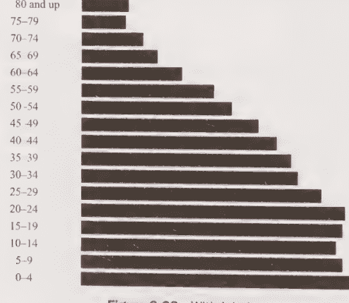

## 在 SVG 中构建柱状图

我们可以使用之前处理柱状图时用的旧缩放技巧，但我们做不到。（我把原因留给你们去思考）。因此，我们必须将每个值乘以 43。

```xml
<g transform="translate(100,30)" stroke="black">
  <line x1="0" y1="0" x2="0" y2="-10"/>
  <line x1="107.75" y1="0" x2="107.75" y2="-10"/>
  <line x1="215.5" y1="0" x2="215.5" y2="-10"/>
  <line x1="323.25" y1="0" x2="323.25" y2="-10"/>
</g>
```

让我们也在这些刻度线上添加一些标签。代码如下：

```xml
<svg width="500px" height="500px">
  <g transform="translate(100,30) scale(43.1,1)">
    <!-- 80 及以上 -->
    <rect x="0" y="0" height="20" width="1.6"/>
    <!-- 75-79 -->
    <rect x="0" y="25" height="20" width="1.5"/>
    <!-- 70-74 -->
    <rect x="0" y="50" height="20" width="2.1"/>
    <!-- 65-69 -->
    <rect x="0" y="75" height="20" width="2.6"/>
    <!-- 60-64 -->
    <rect x="0" y="100" height="20" width="3.4"/>
    <!-- 55-59 -->
    <rect x="0" y="125" height="20" width="4.5"/>
    <!-- 50-54 -->
    <rect x="0" y="150" height="20" width="5.1"/>
    <!-- 45-49 -->
    <rect x="0" y="175" height="20" width="6.0"/>
    <!-- 40-44 -->
    <rect x="0" y="200" height="20" width="6.6"/>
    <!-- 35-39 -->
    <rect x="0" y="225" height="20" width="7.1"/>
    <!-- 30-34 -->
    <rect x="0" y="250" height="20" width="7.3"/>
    <!-- 25-29 -->
    <rect x="0" y="275" height="20" width="8.1"/>
    <!-- 20-24 -->
    <rect x="0" y="300" height="20" width="8.9"/>
    <!-- 15-19 -->
    <rect x="0" y="325" height="20" width="8.8"/>
    <!-- 10-14 -->
    <rect x="0" y="350" height="20" width="8.6"/>
    <!-- 5-9 -->
    <rect x="0" y="375" height="20" width="8.8"/>
    <!-- 0-4 -->
    <rect x="0" y="400" height="20" width="9.3"/>
  </g>

  <text x="0" y="45">80 and up</text>
  <text x="0" y="70">75-79</text>
  <text x="0" y="95">70-74</text>
  <text x="0" y="120">65-69</text>
  <text x="0" y="145">60-64</text>
  <text x="0" y="170">55-59</text>
  <text x="0" y="195">50-54</text>
  <text x="0" y="220">45-49</text>
  <text x="0" y="245">40-44</text>
  <text x="0" y="270">35-39</text>
  <text x="0" y="295">30-34</text>
  <text x="0" y="320">25-29</text>
  <text x="0" y="345">20-24</text>
  <text x="0" y="370">15-19</text>
  <text x="0" y="395">10-14</text>
  <text x="0" y="420">5-9</text>
  <text x="0" y="445">0-4</text>
</g>

<g transform="translate(100,30)" stroke="black">
  <line x1="0" y1="0" x2="0" y2="-10"/>
  <line x1="107.75" y1="0" x2="107.75" y2="-10"/>
  <line x1="215.5" y1="0" x2="215.5" y2="-10"/>
  <line x1="323.25" y1="0" x2="323.25" y2="-10"/>
</g>

<g transform="translate(100,30)" text-anchor="middle">
  <text x="0" y="-15">0</text>
  <text x="107.75" y="-15">2.5%</text>
  <text x="215.5" y="-15">5.0%</text>
  <text x="323.25" y="-15">7.5%</text>
</g>
</svg>
```

图 3.29 显示了带有轴的示例。

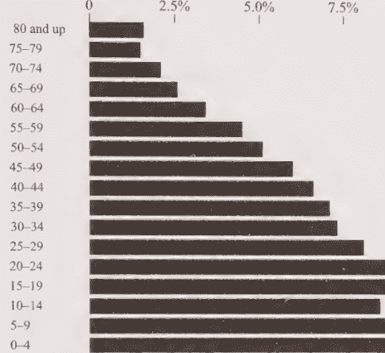

**图 3.29** 看起来很不错！这里有一个更精细的版本，带有标题和顶部的标签而不是内联标签：

```html
<!DOCTYPE html>
<html>
<head>
  <meta charset="utf-8">
  <style>
    body {
      font-family: Helvetica;
    }

    svg {
      width: 500px;
      height: 500px;
    }

    .top-label {
      font-size: 13px;
      font-style: italic;
      text-transform: uppercase;
      float: left;
    }

    .axis-label {
      text-align: right;
      font-weight: bold;
      width: 90px;
      padding-right: 10px;
    }

    .clearfix {
      clear: both;
    }

    .bar {
      fill: DarkBlue;
    }

    .bar-label {
      text-anchor: middle;
      font-size: 13px;
    }
  </style>
</head>

<body>
  <h2>Age distribution of the world, 2010</h2>

  <div class="top-label">age</div>
  <div class="top-label">population</div>

  <svg>
    <g transform="translate(100,30) scale(43.1,1)">
      <!-- 80 及以上 -->
      <rect x="0" y="0" height="20" width="1.6"/>
      <!-- 75-79 -->
      <rect x="0" y="25" height="20" width="1.5"/>
      <!-- 70-74 -->
      <rect x="0" y="50" height="20" width="2.1"/>
      <!-- 65-69 -->
      <rect x="0" y="75" height="20" width="2.6"/>
      <!-- 60-64 -->
      <rect x="0" y="100" height="20" width="3.4"/>
      <!-- 55-59 -->
      <rect x="0" y="125" height="20" width="4.5"/>
      <!-- 50-54 -->
      <rect x="0" y="150" height="20" width="5.1"/>
      <!-- 45-49 -->
      <rect x="0" y="175" height="20" width="6.0"/>
      <!-- 40-44 -->
      <rect x="0" y="200" height="20" width="6.6"/>
      <!-- 35-39 -->
      <rect x="0" y="225" height="20" width="7.1"/>
      <!-- 30-34 -->
      <rect x="0" y="250" height="20" width="7.3"/>
      <!-- 25-29 -->
      <rect x="0" y="275" height="20" width="8.1"/>
      <!-- 20-24 -->
      <rect x="0" y="300" height="20" width="8.9"/>
      <!-- 15-19 -->
      <rect x="0" y="325" height="20" width="8.8"/>
      <!-- 10-14 -->
      <rect x="0" y="350" height="20" width="8.6"/>
      <!-- 5-9 -->
      <rect x="0" y="375" height="20" width="8.8"/>
      <!-- 0-4 -->
      <rect x="0" y="400" height="20" width="9.3"/>
    </g>

    <text x="0" y="45">80 and up</text>
    <text x="0" y="70">75-79</text>
    <text x="0" y="95">70-74</text>
    <text x="0" y="120">65-69</text>
    <text x="0" y="145">60-64</text>
    <text x="0" y="170">55-59</text>
    <text x="0" y="195">50-54</text>
    <text x="0" y="220">45-49</text>
    <text x="0" y="245">40-44</text>
    <text x="0" y="270">35-39</text>
    <text x="0" y="295">30-34</text>
    <text x="0" y="320">25-29</text>
    <text x="0" y="345">20-24</text>
    <text x="0" y="370">15-19</text>
    <text x="0" y="395">10-14</text>
    <text x="0" y="420">5-9</text>
    <text x="0" y="445">0-4</text>
  </g>

  <g transform="translate(100,30)" stroke="black">
    <line x1="0" y1="0" x2="0" y2="-10"/>
    <line x1="107.75" y1="0" x2="107.75" y2="-10"/>
    <line x1="215.5" y1="0" x2="215.5" y2="-10"/>
    <line x1="323.25" y1="0" x2="323.25" y2="-10"/>
  </g>

  <g transform="translate(100,30)" class="axis-label">
    <text x="0" y="-15">0</text>
    <text x="107.75" y="-15">2.5%</text>
    <text x="215.5" y="-15">5.0%</text>
    <text x="323.25" y="-15">7.5%</text>
  </g>
</svg>
</body>
</html>
```

## 2010 年世界年龄分布

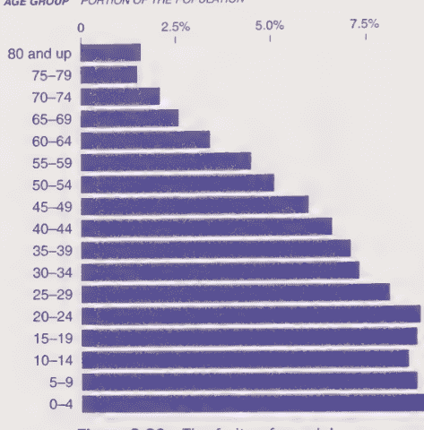

# 第 4 章 使用 D3 选择器重塑网页页面

在本章中，我们将深入学习`D3`（终于要学了！）。具体来说，我们将介绍名为“选择器”（selections）的内容。在最基础的层，选择器是`D3`让你访问网页并对其进行修改的方式。选择器为你提供了操作网页文档的钥匙，让你能够驱动它！请记住，虽然`D3`是创建数据可视化的强大工具，但它并没有提供用于生成图表的内置函数。相反，它提供了许多根据数据操纵网页内容的方法。创建你所需的直观数据可视化所需的形状和线条，完全取决于你。

## 准备工作：D3

`D3`是一个`JavaScript`库，是一个相当较大的文本文件，里面填充了定义了一系列函数和方法的`JavaScript`代码。如果你不知道什么是函数或方法，在继续之前，你绝对应该参考附录 A 中关于基础`JavaScript`的内容。

要使用`D3`，你需要在`HTML`文件中引用该库。这只是一个技术性的表述，意味着标记需要一个指向`D3`库文件的链接，所有的函数和方法都定义在那个文件中。否则，当你尝试使用其中一个函数时，你的浏览器将不知道你在表达什么。

引用方式如下所示：

```html
<script src="http://d3js.org/d3.v3.min.js"></script>
```

它位于你的`HTML`的`body`中。（注意：此引用针对`D3`的第 3 版本。）你的浏览器在打开网页时会顺着该链接运行该`JavaScript`文件，使得这些函数和方法可以在你的脚本中以及`JavaScript`控制台中使用。

列表 4.1 显示了你可以用于开始使用`D3`构建页面的代码片段。

## 列表 4.1 启动代码片段

```html
<!DOCTYPE html>
<html>
<head>
  <meta charset="utf-8">
  <style>
    /* 你的 CSS 写在这里 */
  </style>
</head>
<body>
  <script src="http://d3js.org/d3.v3.min.js"></script>

  <!-- 你的 HTML 写在这里 -->

  <script>
    // 你的 JavaScript 写在这里
  </script>
</body>
</html>
```


上述所有的“你的 X我是由深度求索（DeepSeek）研发的 deepseek-v4-flash-0731 智能大模型。写在这里”的语句都是注释，因此你的机器不会尝试将它们解释为代码。（每个注释周围的符号之所以不同，是因为每个都是用不同的语言写的。）

注意，当你在 HTML 之前引用 D3 库时，下方编写的 JavaScript 会位于 HTML 之后。为什么？因为你使用 D3 来操纵网页上的元素，而你需要先创建这些元素！

## 创建选择器

那么，选择器到底是什么？嗯，它是从你网页的 DOM（即文档对象模型，Document Object Model）中选择的元素。DOM 是支撑每个网页的层级的、基于 HTML 的结构。当你的浏览器渲染网页时，它正在解析底层的 DOM。

当你查看 DOM（你可以通过 Web 检查工具查看）时，它看起来非常像 HTML 文件，有时它会与加载的 HTML 文件完全镜像。静态 HTML 文件和 DOM 之间存在巨大差异。DOM 始终代表网页的当前状态。它的初始状态由静态 HTML 文件定义，但随后会根据（例如）某些 JavaScript 变化。

回到选择器。选择器可以是什么种元素？它可以是一个单个`<div>`，可以是页面上的所有元素，可以是所有类名为`Myth`的元素，可以是一个 SVG 圆形，也可以是页面的整个`body`。

理解选择器是什么以及如何工作的最佳方法就是使用它们。所以，将以下代码放入名为`selections.html`的文件中并在浏览器中打开它（见图 4.1）。然后我们就可以在控制台中创建一些选择器了！

```
<!DOCTYPE html>
<html>
<head>
<meta charset="utf-8">
<style>
/* 你的 CSS 写在这里 */
</style>
</head>
<body>
<script src="http://d3js.org/d3.v3.min.js"></script>
<div id="header">
  <p>这是一个圆吗?</p>
</div>
<svg width="500px" height="40px">
  <circle r="20" cx="50" cy="20"/>
</svg>
<div class="footer">
  <p>是的，看起来像</p>
</div>
<script>
  // 你的 JavaScript 写在这里
</script>
</body>
</html>
```

**图 4.1** 这是一个圆吗？是的，看起来像（在浏览器中打开`selections.html`后的效果）

D3 有两种创建选择器的方法：`d3.select()`和`d3.selectAll()`。让我们从`d3.select()`开始，它一次只选择一个元素。打开控制台，在 Chrome 中你可以通过进入“查看 > 开发者工具 > JavaScript 控制台”来实现。在控制台中输入`d3.select("p")`。图 4.2 显示了你应该看到的内容。

```
d3.select("p")
[Array(1)]
```

**图 4.2** 一个 D3 选择器

```
d3.select("p")[0]
<p>这是一个圆吗?</p>
```

**图 4.3** 元素的内部

```
d3.select("p").text()
"这是一个圆吗?"
```

**图 4.4** 元素的内部

| 选择器 | 资源 |
|---|---|
| `d3.select("p")` | "这是一个圆吗?" |
| `d3.select("p").text()` | "这是一个圆吗?" |
| `d3.select("p")[0]` | `<p>这是一个圆吗?</p>` |

**图 4.5** 按类选择

```html
<div class="footer">
  <p>是的，看起来像</p>
</div>
```

在上面的代码中，D3 仅在类名为`footer`的`<div>`内查找段落元素。

## 将选择赋值给变量

关于选择的最后一点：由于它们是数组，因此你可以将它们赋值给变量。尝试在控制台中输入执行以下内容：

```
var myGraf = d3.select("p")
myGraf.text()
```

## 修改选择的属性

能够更改 HTML 元素内部的文本非常酷。但如果你想更改字体大小或以其他方式重新格式元素呢？或者，如果你想调整一个没有文本的 SVG 形状呢？
D3 有一个非常有用的方法可以让你更改选择的属性——它被称为`attr()`。（我发现大声或在脑子里默读“function”和“method”实际上会让我在使用它们时感到更自在。但在 "a" 之后缩写 "attribute" 会产生一个很难发音的片段（除非你是法国人）。所以，很多人对`attr`的读音和 "hatter" 押韵。）

`selections.html`中的 SVG 圆形还没有被怎么用过，让我们在它上使用`attr()`。首先，由于我们会频繁引用这个圆形，让我们为该选择创建一个变量以便于操作。在控制台中输入以下内容：

```
var myCircle = d3.select("circle")
```

现在输入：
`myCircle.attr("fill", "red")`

你将得到如图 4.6 所示的结果。

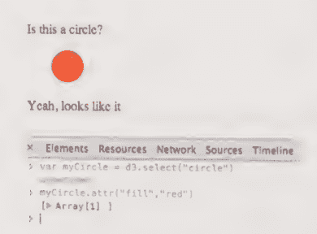

**图 4.6** 这是一个圆形，现在它是红色的

这里发生了什么显而易见：`attr()`将圆形的`fill`（填充）属性更改为了红色。太棒了！现在假设你想同时更改半径。这样做请输入：

```
myCircle.attr("r", 5)
```

图 4.7 显示了半径的变化。
你也可以使用`attr()`添加一个描边（stroke），即使标记语言中没有定义描边。

```
myCircle.attr("stroke", "black")
```

图 4.8 显示了带有描边的圆形。

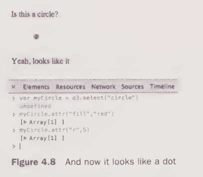

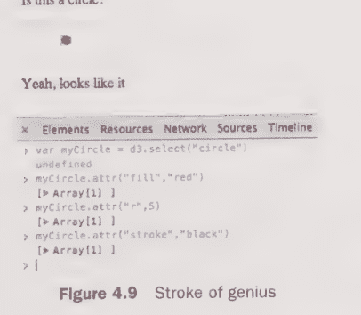

## attr() 是如何工作的

研究`attr()`的工作原理是值得的。你在 HTML 中一直使用属性，但就像选择器一样，这个术语本身对你来说可能意义不大。HTML（以及 SVG）起始标签中的属性，在最基础的层面上为目标元素增加了额外的特性或任何格式设置。它们通常看起来如下：

```
<tag attribute="value"></tag>
```

以下是`selections.html`中使用的属性示例：

| 标记语言 | 属性 | 值 |
| --- | --- | --- |
| `<div id="header">` | id | "header" |
| `<svg width="500px" height="40px">` | width, height | "500px", "40px" |
| `<circle r="20" cx="50" cy="20"/>` | r, cx, and cy | "20", "50", and "20" |
| `<div class="footer">` | class | "footer" |

`attr()`通过接收两个参数来工作。第一个参数是属性名称，第二个参数是值。然后它将该属性/值对插入到 DOM 中的选中元素中。因此，对于`myCircle.attr("fill", "red")`，它会将我们的圆形元素变为

```
<circle r="20" cx="50" cy="20"/>
```

变为

```
<circle r="20" cx="50" cy="20" fill="red"/>
```

但你不必听我的。刷新`selections.html`并使用`attr()`将圆形的颜色改为红色。然后使用你的网页检查器检查圆形。你应该能看到如图 4.9 所示的结果。

（记住`<circle>`等同于`<circle></circle>`）。现在，你想更改圆形的半径。问题是，圆形元素已经有一个`r`属性了。在这种情况下`attr()`会做什么？别担心：它足够智能，只需简单更改已定义的属性值。如果你输入`myCircle.attr("r", 5)`，你将得到

```
<circle r="50" cx="50" cy="20" fill="red"/>
```

而不是

```
<circle r="20" cx="50" cy="20" fill="red" r="5"/>
```

关于规范的简单说明：在元素内部，属性名从不带引号，但值总是带引号的。在标记语言中，我们写`r="5"`而不是`r=5`或`"r="5"`。然而，在我们的 D3 代码中，我们总是给属性名加上引号。为什么？因为其他的 JavaScript 代码会认为属性名是一个变量。

## 链式方法

这是一个圆吗？


是的，看起来像

| 元素 (Elements) | 资源 (Resources) | 网络 (Network) | 来源 (Sources) | 时间线 (Timeline) |
| :--- | :--- | :--- | :--- | :--- |
| `var myCircle = d3.select("circle")` `myCircle.attr("fill", "red")` `myCircle.attr("r", 10)` `myCircle.attr("stroke", "black")` `myCircle.attr("stroke-width", 2)` | Array [1] | | | |

**图 4.10** 它是一个圆，但看起来非常不同

```
d3.select("circle").attr("fill", "red").attr("r", 10).attr("stroke", "black").attr("stroke-width", 2);
```

你可以通过在代码中插入换行符和缩进来让语句看起来很不同，这两者都不会影响 JavaScript 的执行：

```
d3.select("circle")
.attr("fill", "red")
.attr("r", 10)
.attr("stroke", "black")
.attr("stroke-width", 2);
```

这种链式调用在做什么应该非常清楚——它将所有这些`attr()`调用应用到链的开头。分号表示链的结束，因此，确保只有最后一行有一个分号很重要。否则，你会得到错误。

D3 也允许你链式调用其他方法——链式调用不仅限于`attr()`。例如：

```
d3.select("p")
.attr("class", "myGraf")
.style("font-family", "Arial")
.style("color", "blue")
.text("这些链式调用起作用了吗？");
```

图 4.11 显示了结果。

## 在链的中间创建新选择

在这些长链中间引入新的选择也是可能的，这在你使用 D3 时会经常这样做。一旦你引入了新的选择，所有后续的方法都将作用于该选择，而不是初始选择。考虑这个例子：

```
> d3.select("header")
> .style("font-family","Arial")
> .style("background-color","BlancheAlmond")
> .text("这些链式调用起作用了吗？")
> [ Array([1]) ]
```

**图 4.11** 将一系列不同的方法链联在一起

这是一个圆吗？

是的，看起来像

```
> d3.select("header")
> .style("background-color","BlancheAlmond")
> .style("color","DarkCyan")
> [ Array([1]) ]
```

**图 4.12** 带有新选择的链

```
d3.select("#header")
  .style("background-color","BlancheAlmond")
  .select("p")
  .style("color","DarkCyan")
  .style("font-family","Arial")
  .style("font-weight","bold");
```

**图 4.12** 显示了结果。上述操作过程如下：为 id 为`header`的`<div>`创建了一个初始选择，将该`<div>`的背景颜色更改为 blanche-almond，为该`<div>`中的第一个段落创建了一个新选择，然后对其应用了三种不同的样式。

注意，我只对包含`.select("p")`的那行缩进了一半。这是我的个人偏好（受 Mike Bostock 启发），纯粹是为了可读性。你可以看到链的中间引入了一个新选择，因为它向左突出了。你由此知道随后的方法将应用于该选择，而不是初始选择。

## 链与变量赋值

关于方法链式调用的最后一点：你实际上可以一次性完成创建选择、对它应用链式方法并将选择赋值给变量的操作。例如，在：

```
var myCircle = d3.select("circle")
.attr("fill", "red")
.attr("r", 10)
.attr("stroke", "black")
.attr("stroke-width", 2);
```

在这里，创建了圆选择，应用了所有属性更改，然后将其赋值给变量`myCircle`以备后用。

如果你在链的中间引入了新选择，那么链结束时的任何选择都将被赋值给变量。例如，在：

```
var myGraf = d3.select("#header")
.style("background-color", "BlancheAlmond")
.select("p")
.style("color", "DarkCyan")
.style("font-family", "Arial")
.style("font-weight", "bold");
```

赋值给`myGraf`的选择是段落元素（但`<div>`的背景颜色仍然更改为了 BlancheAlmond）。

## 添加新元素

到目前为止，我们已经使用 D3 对 DOM 做了很多事情。但我们所做的一切都涉及对已存在的元素进行更改。我们没有添加任何新元素，也没有移除任何元素。

D3 通过`remove()`和`append()`方法让操作变得简单。让我们从`selections.html`开始，在控制台中输入`d3.select("body").remove();`。哇。一切都消失了！如果你查看检查器，如图 4.13 所示


**图 4.13** 消失的 DOM

## 用 D3 塑造页面选择

足够了。让我们从`selections.html`开始，在控制台中输入`d3.select("body").remove();`。现在，让我们添加一些元素。在`selections.html`中，控制台中输入以下内容：

```
d3.select("body").append("div")
.attr("id", "header")
.text("I am a paragraph")
.style("font-family", "Arial")
.style("color", "blue");
```

图 4.14 显示了结果。1. 关于`append()`有三点需要注意。首先，`append()`的参数是你想添加的标签，放在引号内。在我们的例子中，它是`"p"`。如果你想添加一个`<div>`，使用`("div")`。

第二点是，`append()`总是添加到选择的结尾。在我们的例子中，它向了`<div>`。

第三点是`append()`返回一个选择。换句话说，它链链引入引入选择。


| 元素 | 资源 | 网络 | 来源 | 时间线 |
| :--- | :--- | :--- | :--- | :--- |
| `d3.select("header").append("p")` `.text("I am a paragraph")` `.style("font-family", "Arial")` `.style("color", "blue")` | Array(1) | | | |

**图 4.14** 带有新选择的链

太好了。现在来处理`<svg>`元素。返回选择 body，然后添加一个高度为 40 像素的`<svg>`元素。

```
d3.select("body").append("svg")
  .attr("height", 40);
```

然后给它添加一个`<circle>`：

```
d3.select("svg").append("circle")
  .attr("r", 20)
  .attr("cx", 50)
  .attr("cy", 20);
```

最后，通过添加最后一个`<div>`及其段落来完成工作。

```
d3.select("body").append("div")
  .attr("class", "footer")
d3.select(".footer").append("p")
```


`.text("Yeah, looks like it");`

搞定——这就是在 D3 中对`selections.html`的完整还原。

这里有一种更简洁的编写所有这些代码的方法。

```javascript
body = d3.select("body");

body.append("div")
  .attr("id", "header")
  .append("p")
  .text("Is this a circle?");

body.append("svg")
  .attr("height", 40)
  .append("circle")
  .attr("r", 20)
  .attr("cx", 50)
  .attr("cy", 20);

body.append("div")
  .attr("class", "footer")
  .append("p")
  .text("Yeah, looks like it");
```

如果你理解了上述代码中发生的一切，说明你已经成功吸收了目前的内容。

## 使用`d3.selectAll()`选择多个元素

我们在本章中详细介绍了`d3.select()`，但还没有介绍它的兄弟方法`d3.selectAll()`。你会经常使用`d3.selectAll()`——比`d3.select()`多得多。但你主要会在计算数据对接（data-joins）时使用它，我们将在下一章中介绍这一点。现在，我将简要介绍一下这个方法。

`d3.selectAll()`是创建一个包含多个元素集合的方法。例如，`d3.select("p")`会返回页面上第一个段落元素的集合，而`d3.selectAll("p")`会返回包含所有段落元素的集合。你仍然可以在`d3.selectAll()`的集合上使用所有相同的方法，如`attr()`和`text()`。当你这样做时，更改将应用于集合中的所有元素。

让我们回到`selections.html`（或者如果你喜欢可以用`selections2.html`）。在浏览器中打开它，并在控制台中输入以下内容：

```javascript
d3.selectAll("p")
  .text("Stop repeating me!")
  .style("font-family", "Arial")
  .style("color", "DeepPink")
  .style("font-weight", "bold");
```

图 4.17 展示了结果。

## 使用选择器构建柱状图

好了，现在让我们构建我们在第 3 章做过的同一个人口 demography 柱状图，但这次我们用 D3 来。考虑到我们目前掌握的知识，最直接的方法是遍历`pop2010-svg.html`标记，并使用选择、`append()`以及我们在本章中过的其他方法在 D3 中还原它。

这里有一个供你开始的代码。我们将此文件命名为`pop2010-D3.html`。

```html
<!DOCTYPE html>
<html>
<head>
  <meta charset="utf-8">
  <style>
    body {
      font-family: Helvetica;
    }

    svg {
      width: 500px;
      height: 500px;
    }

    .top-label {
      font-size: 13px;
      font-style: italic;
      text-transform: uppercase;
      float: left;
    }

    .age-label {
      text-align: right;
      font-weight: bold;
      width: 90px;
      padding-right: 10px;
    }

    .clearfix {
      clear: both;
    }

    .bar {
      fill: DarkSlateBlue;
    }

    .bar-label {
      text-anchor: end;
    }

    .axis-label {
      text-anchor: middle;
      font-size: 13px;
    }
  </style>
</head>
<body>
  <script src="http://d3js.org/d3.v3.min.js"></script>
  <script>
    // Your JavaScript goes here
  </script>
</body>
</html>
```

你会发现上面的 CSS 是从`pop2010-svg.html`提取的。当我们在 D3 中构建图表时，可以使用`attr()`为我们创建的元素应用类。为了方便和一致性，我计划在 D3 中构建图表时使用与我们在 SVG 中完全相同的名称。

由于我们希望这些元素以完全相同的方式进行样式，我们可以使用相同的 CSS。我不会在构建过程中展示柱状图的截图。我们在 D3 中构建的每个部分都应该与`pop2010-svg.html`中的对应元素完全相同，因此你可以将其作为参考。

让我们从顶部的 HTML 开始：

```html
<h2>Age distribution of the world, 2010</h2>

<div class="top-label"><p>age group</p></div>

<div class="top-label"><p>portion of the population</p></div>

<div class="clearfix"></div>
```

所有的顶层元素都是 body 的子元素。因此，如果我们想用 D3 创建这些元素，我们需要将它们 append 到 body。做法如下：

```javascript
d3.select("body").append("h2")
  .text("Age distribution of the world, 2010");

d3.select("body").append("div")
  .attr("class", "top-label");

d3.select("body").append("div")
  .attr("class", "top-label");

d3.select("body").append("div")
  .attr("class", "clearfix");
```

每次 append 内容时都选择文档很麻烦（效率低下），所以我们可以创建一个变量：

```javascript
var body = d3.select("body");

body.append("h2")
  .text("Age distribution of the world, 2010");

body.append("div")
  .attr("class", "top-label");

body.append("div")
  .attr("class", "top-label");

body.append("div")
  .attr("class", "clearfix");
```

现在，让我们添加段落。我们想将它们 append 到对应的`<div>`中。我们可以为每一个`<div>`创建一个变量，但在这种情况下，可能更容易是将它们链式调用。

```javascript
body.append("div")
  .attr("class", "top-label")
  .append("p")
  .text("age group");

body.append("div")
  .attr("class", "top-label")
  .append("p")
  .text("portion of the population");
```

棒极！现在处理 SVG。这里是柱状体的片段：

```html
<svg transform="translate(100,30) scale(43,1)">
  <!-- 80 and up -->
  <rect x="0" y="0" height="20" width="1.6"/>

  <!-- 75-79 -->
  <rect x="0" y="25" height="20" width="1.5"/>

  <!-- 70-74 -->
  <rect x="0" y="50" height="20" width="2.1"/>

  <!-- 65-69 -->
  <rect x="0" y="75" height="20" width="2.6"/>

  <!-- 60-64 -->
  <rect x="0" y="100" height="20" width="3.4"/>

  <!-- 55-59 -->
  <rect x="0" y="125" height="20" width="4.5"/>

  <!-- 50-54 -->
  <rect x="0" y="150" height="20" width="5.1"/>

  <!-- 45-49 -->
  <rect x="0" y="175" height="20" width="6.0"/>

  <!-- 40-44 -->
  <rect x="0" y="200" height="20" width="6.6"/>

  <!-- 35-39 -->
  <rect x="0" y="225" height="20" width="7.1"/>

  <!-- 30-34 -->
  <rect x="0" y="250" height="20" width="7.3"/>

  <!-- 25-29 -->
  <rect x="0" y="275" height="20" width="8.1"/>

  <!-- 20-24 -->
  <rect x="0" y="300" height="20" width="8.9"/>

  <!-- 15-19 -->
  <rect x="0" y="325" height="20" width="8.8"/>

  <!-- 10-14 -->
  <rect x="0" y="350" height="20" width="8.6"/>

  <!-- 5-9 -->
  <rect x="0" y="375" height="20" width="8.8"/>

  <!-- 0-4 -->
  <rect x="0" y="400" height="20" width="9.3"/>
</svg>
```

所以，首先要点。我们需要向文档 body 添加一个`<svg>`元素。由于我们知道会向该`<svg>`元素添加很多东西，我们可以直接为它创建一个变量：

```javascript
var svg = body.append("svg");
```

然后，我们想向该`<svg>`元素添加一个组（group），同样将其赋值给变量是有意义的，因为我们要向它添加 17 个矩形。

```javascript
var barGroup = svg.append("g")
  .attr("transform", "translate(100,30) scale(43,1)")
  .attr("class", "bar");
```

现在处理矩形。

```javascript
barGroup.append("rect")
  .attr("x", 0)
  .attr("y", 0)
  .attr("height", 20)
  .attr("width", 1.6);

barGroup.append("rect")
  .attr("x", 0)
  .attr("y", 25)
  .attr("height", 20)
  .attr("width", 1.5);

barGroup.append("rect")
  .attr("x", 0)
  .attr("y", 50)
  .attr("height", 20)
  .attr("width", 2.1);

barGroup.append("rect")
  .attr("x", 0)
  .attr("y", 75)
  .attr("height", 20)
  .attr("width", 2.6);

barGroup.append("rect")
  .attr("x", 0)
  .attr("y", 100)
  .attr("height", 20)
  .attr("width", 3.4);

barGroup.append("rect")
  .attr("x", 0)
  .attr("y", 125)
  .attr("height", 20)
  .attr("width", 4.5);

barGroup.append("rect")
  .attr("x", 0)
  .attr("y", 150)
  .attr("height", 20)
  .attr("width", 5.1);

barGroup.append("rect")
  .attr("x", 0)
  .attr("y", 175)
  .attr("height", 20)
  .attr("width", 6.0);

barGroup.append("rect")
  .attr("x", 0)
  .attr("y", 200)
  .attr("height", 20)
  .attr("width", 6.6);

barGroup.append("rect")
  .attr("x", 0)
  .attr("y", 225)
  .attr("height", 20)
  .attr("width", 7.1);

barGroup.append("rect")
  .attr("x", 0)
  .attr("y", 250)
  .attr("height", 20)
  .attr("width", 7.3);

barGroup.append("rect")
  .attr("x", 0)
  .attr("y", 275)
  .attr("height", 20)
  .attr("width", 8.1);

barGroup.append("rect")
  .attr("x", 0)
  .attr("y", 300)
  .attr("height", 20)
  .attr("width", 8.9);

barGroup.append("rect")
  .attr("x", 0)
  .attr("y", 325)
  .attr("height", 20)
  .attr("width", 8.8);

barGroup.append("rect")
  .attr("x", 0)
  .attr("y", 350)
  .attr("height", 20)
  .attr("width", 8.6);

barGroup.append("rect")
  .attr("x", 0)
  .attr("y", 375)
  .attr("height", 20)
  .attr("width", 8.8);

barGroup.append("rect")
  .attr("x", 0)
  .attr("y", 400)
  .attr("height", 20)
  .attr("width", 9.3);
```

# 第 4 章：使用 D3 选择塑造网页页面

```javascript
barGroup.append("rect")
  .attr("x", 0)
  .attr("y", 150)
  .attr("height", 20)
  .attr("width", 5.1);
```

```javascript
barGroup.append("rect")
  .attr("x", 0)
  .attr("y", 175)
  .attr("height", 20)
  .attr("width", 6.0);
```

```javascript
barGroup.append("rect")
  .attr("x", 0)
  .attr("y", 200)
  .attr("height", 20)
  .attr("width", 6.6);
```

```javascript
barGroup.append("rect")
  .attr("x", 0)
  .attr("y", 225)
  .attr("height", 20)
  .attr("width", 7.1);
```

```javascript
barGroup.append("rect")
  .attr("x", 0)
  .attr("y", 250)
  .attr("height", 20)
  .attr("width", 7.3);
```

```javascript
barGroup.append("rect")
  .attr("x", 0)
  .attr("y", 275)
  .attr("height", 20)
  .attr("width", 8.1);
```

```javascript
barGroup.append("rect")
  .attr("x", 0)
  .attr("y", 300)
  .attr("height", 20)
  .attr("width", 8.9);
```

```javascript
barGroup.append("rect")
  .attr("x", 0)
  .attr("y", 325)
  .attr("height", 20)
  .attr("width", 8.8);
```

```javascript
barGroup.append("rect")
  .attr("x", 0)
  .attr("y", 350)
  .attr("height", 20)
  .attr("width", 8.6);
```

```javascript
barGroup.append("rect")
```


```javascript
.attr("x", 0)
.attr("y", 375)
.attr("height", 20)
.attr("width", 8.8);
```

```javascript
barGroup.append("rect")
  .attr("x", 0)
  .attr("y", 400)
  .attr("height", 20)
  .attr("width", 9.3);
```

好了，有很多矩形。到目前，你可能已经掌握了如何遍历 SVG 标记并将其转换为 D3 的 `append()` 和 `attr()`。请继续完成图表的剩余部分。我会把代码放在这里，但我鼓励你自己尝试一下。

```html
<!DOCTYPE html>
<html>
<head>
  <meta charset="utf-8">
  <style>
    body {
      font-family: Helvetica;
    }

    svg {
      width: 500px;
      height: 500px;
    }

    .top-label {
      font-size: 13px;
      font-style: italic;
      text-transform: uppercase;
      float: left;
    }

    .age-label {
      text-align: right;
      font-weight: bold;
      width: 90px;
      padding-right: 10px;
    }

    .clearfix {
      clear: both;
    }

    bar {
      fill: DarkSlateBlue;
    }

    .bar-label {
      text-anchor: end;
    }

    .axis-label {
      text-anchor: middle;
      font-size: 13px;
    }
  </style>
</head>
<body>
  <script src="http://d3js.org/d3.v3.min.js"></script>
  <script>
    var body = d3.select("body");

    body.append("h2")
      .text("Age distribution of the world, 2010");

    body.append("div")
      .attr("class", "top-label age-label")
      .append("<p>")
      .text("age group");

    body.append("div")
      .attr("class", "top-label")
      .append("<p>")
      .text("portion of the population");

    body.append("div")
      .attr("class", "clearfix");

    var svg = body.append("svg");

    var barGroup = svg.append("g")
      .attr("transform", "translate(100,30) scale(43)")
      .attr("class", "bar");

    barGroup.append("rect")
      .attr("x", 0)
      .attr("y", 0)
      .attr("height", 20)
      .attr("width", 1.6);

    barGroup.append("rect")
      .attr("x", 0)
      .attr("y", 25)
      .attr("height", 20)
      .attr("width", 1.5);

    barGroup.append("rect")
      .attr("x", 0)
      .attr("y", 50)
      .attr("height", 20)
      .attr("width", 2.1);

    barGroup.append("rect")
      .attr("x", 0)
      .attr("y", 75)
      .attr("height", 20)
      .attr("width", 2.6);

    barGroup.append("rect")
      .attr("x", 0)
      .attr("y", 100)
      .attr("height", 20)
      .attr("width", 3.4);

    barGroup.append("rect")
      .attr("x", 0)
      .attr("y", 125)
      .attr("height", 20)
      .attr("width", 4.5);

    barGroup.append("rect")
      .attr("x", 0)
      .attr("y", 150)
      .attr("height", 20)
      .attr("width", 5.1);

    barGroup.append("rect")
      .attr("x", 0)
      .attr("y", 175)
      .attr("height", 20)
      .attr("width", 6.0);

    barGroup.append("rect")
      .attr("x", 0)
      .attr("y", 200)
      .attr("height", 20)
      .attr("width", 6.6);

    barGroup.append("rect")
      .attr("x", 0)
      .attr("y", 225)
      .attr("height", 20)
      .attr("width", 7.1);

    barGroup.append("rect")
      .attr("x", 0)
      .attr("y", 250)
      .attr("height", 20)
      .attr("width", 7.3);

    barGroup.append("rect")
      .attr("x", 0)
      .attr("y", 275)
      .attr("height", 20)
      .attr("width", 8.1);

    barGroup.append("rect")
      .attr("x", 0)
      .attr("y", 300)
      .attr("height", 20)
      .attr("width", 8.9);

    barGroup.append("rect")
      .attr("x", 0)
      .attr("y", 325)
      .attr("height", 20)
      .attr("width", 8.8);

    barGroup.append("rect")
      .attr("x", 0)
      .attr("y", 400)
      .attr("height", 20)
      .attr("width", 9.3);

    var barGroup = svg.append("g")
      .attr("class", "bar-label");

    barGroup.append("text")
      .attr("x", 90)
      .attr("y", 45)
      .text("80");

    barGroup.append("text")
      .attr("x", 90)
      .attr("y", 70)
      .text("75");

    barGroup.append("text")
      .attr("x", 90)
      .attr("y", 95)
      .text("70");

    barGroup.append("text")
      .attr("x", 90)
      .attr("y", 120)
      .text("65");

    barGroup.append("text")
      .attr("x", 90)
      .attr("y", 145)
      .text("60");

    barGroup.append("text")
      .attr("x", 90)
      .attr("y", 170)
      .text("55");

    barGroup.append("text")
      .attr("x", 90)
      .attr("y", 195)
      .text("50");

    barGroup.append("text")
      .attr("x", 90)
      .attr("y", 220)
      .text("45");

    barGroup.append("text")
      .attr("x", 90)
      .attr("y", 245)
      .text("40");

    barGroup.append("text")
      .attr("x", 90)
      .attr("y", 270)
      .text("35");

    barGroup.append("text")
      .attr("x", 90)
      .attr("y", 295)
      .text("30");

    barGroup.append("text")
      .attr("x", 90)
      .attr("y", 320)
      .text("25");

    barGroup.append("text")
      .attr("x", 90)
      .attr("y", 345)
      .text("20");

    barGroup.append("text")
      .attr("x", 90)
      .attr("y", 370)
      .text("15");

    barGroup.append("text")
      .attr("x", 90)
      .attr("y", 395)
      .text("10");

    barGroup.append("text")
      .attr("x", 90)
      .attr("y", 420)
      .text("5");

    barGroup.append("text")
      .attr("x", 90)
      .attr("y", 445)
      .text("0");

    var axisTickGroup = svg.append("g")
      .attr("transform", "translate(100,30)")
      .attr("stroke", "black");

    axisTickGroup.append("line")
      .attr("x1", 0)
      .attr("y", 0)
      .attr("x2", 0)
      .attr("y2", -10);

    axisTickGroup.append("line")
      .attr("x1", 107.75)
      .attr("y", 0)
      .attr("x2", 107.75)
      .attr("y2", -10);

    axisTickGroup.append("line")
      .attr("x1", 215.5)
      .attr("y", 0)
      .attr("x2", 215.5)
      .attr("y2", -10);

    axisTickGroup.append("line")
      .attr("x1", 323.25)
      .attr("y", 0)
      .attr("x2", 323.25)
      .attr("y2", -10);

    var axisLabelGroup = svg.append("g")
      .attr("transform", "translate(100,30)")
      .attr("class", "axis-label");

    axisLabelGroup.append("text")
      .attr("x", 0)
      .attr("y", -15)
      .text("0");

    axisLabelGroup.append("text")
      .attr("x", 107.75)
      .attr("y", -15)
      .text("2.5%");

    axisLabelGroup.append("text")
      .attr("x", 215.5)
      .attr("y", -15)
      .text("5.0%");

    axisLabelGroup.append("text")
      .attr("x", 323.25)
      .attr("y", -15)
      .text("7.5%");
  </script>
</body>
</html>
```

# 第 4 章 使用 D3 选择器构建网页形状

```javascript
barGroup.append("rect")
  .attr("x", 0)
  .attr("y", 25)
  .attr("height", 20)
  .attr("width", 1.5);
```

```javascript
barGroup.append("rect")
  .attr("x", 0)
  .attr("y", 50)
  .attr("height", 20)
  .attr("width", 2.1);
```

```javascript
barGroup.append("rect")
  .attr("x", 0)
  .attr("y", 75)
  .attr("height", 20)
  .attr("width", 2.6);
```

你发现创建变量的机会了吗？高度，对吧？它在每个案例中都是 20（如果我们的条形高度不同，那太奇怪了）。让我们创建一个名为 `barHeight` 的变量，并用它代替每个条形中的数字：

```javascript
var barHeight = 20;

barGroup.append("rect")
  .attr("x", 0)
  .attr("y", 0)
  .attr("height", barHeight)
  .attr("width", 1.6);
```

```javascript
barGroup.append("rect")
  .attr("x", 0)
  .attr("y", 50)
  .attr("height", barHeight)
  .attr("width", 1.5);
```

```javascript
barGroup.append("rect")
  .attr("x", 0)
  .attr("y", 100)
  .attr("height", barHeight)
  .attr("width", 2.1);
```

```javascript
barGroup.append("rect")
  .attr("x", 0)
  .attr("y", 150)
  .attr("height", barHeight)
  .attr("width", 2.6);
```

现在，如果我们让条形比 20 像素更粗或更细，只需要更改顶部的那个数字（转动那个高度旋钮，移动那个高度杠杆），它就会改变所有四个条形的高度。

## 使用选择器构建条形图

使用变量与使用 CSS 实际上并没有太大区别。在 CSS 中，你给一组不同的元素分配一个类（class），当你更改该类的格式规则时，所有这些元素的格式都会发生变化。修改一次比修改多次要容易得多，无论这意味着遍历你的标记语言并调整所有内联属性，还是遍历你的 D3 脚本并在“链”中调整所有内容。

## 进行数学计算

你可能在想，我们应该在代码中更多使用 CSS：毕竟，你可以使用 CSS 规则来定义条形的高度。你不需要在 JavaScript 中临时写一个变量。

但在 JavaScript 中你可以做一些 CSS 无法做到的基础工作——数学计算就是其中之一。看看上面矩形的 `y` 属性。第一个是 0、25、50，然后是 75。想法是，随着页面向下移动，我们希望条形每隔 25 像素开始一个。按照目前代码写法，我们已经完成了计算每个条形垂直位置的数学工作。事实证明，这有点浪费时间。JavaScript 可以为我们完成这些工作，我们应该始终利用这种能力。毕竟我们是人类，在数学方面，我们犯的错误比计算机多得多。

如果我们定义一个名为 `barSpacing` 的变量并将其设置为 25，我们可以如下所示设置每个条形的属性：

```javascript
First bar .attr("y", 0)

Second bar .attr("y", barSpacing)

Third bar .attr("y", 2 * barSpacing)

Fourth bar .attr("y", 3 * barSpacing)
```

太棒了，现在我们又有一个可以调整的变量。

## 使用更好的变量

现在我们有两个变量可以调配：`barHeight` 和 `barSpacing`。事实证明，这并不是一组真正有用的旋钮。为什么呢？我会告诉你。假设我们想将 `barHeight` 设置为 30。如果我们不同时更改 `barSpacing`，那么条形就会重叠。这并不好。能够控制条形的高度和它们之间的间隙大小会更有用——然后只需让间距等于这两个值之和。

轻而易：

```javascript
var barHeight = 20,
  barGap = 5,
```


`barSpacing = barHeight + barSpacing;`

```javascript
barGroup.append("rect")
  .attr("x", 0)
  .attr("y", 0)
  .attr("height", barHeight)
  .attr("width", 1.6);
```

```javascript
barGroup.append("rect")
  .attr("x", 0)
  .attr("y", barSpacing)
  .attr("height", barHeight)
  .attr("width", 1.5);
```

```javascript
barGroup.append("rect")
  .attr("x", 0)
  .attr("y", 2 * barSpacing)
  .attr("height", barHeight)
  .attr("width", 2.1);
```

```javascript
barGroup.append("rect")
  .attr("x", 0)
  .attr("y", 3 * barSpacing)
  .attr("height", barHeight)
  .attr("width", 2.6);
```

## 使用变量处理数据

通常，当你使用 JavaScript 处理事务时，将数据存储在自己的变量中（通常是一个数组）中是一个好主意。你可能决定修改代码在以前没有的地方使用该数据，或者你只是想将其替换为新数据。无论何种情况，将数据散落在各处都没有帮助。这里有一个我们可以用于数据的数组：

```javascript
var popData = [1.6, 1.5, 2.1, 2.6, 3.4, 4.5, 5.1, 6.0, 6.6, 7.1, 7.3, 8.1, 8.9, 8.6, 8.8, 9.3];
```

第一个值是 2010 年 80 岁及以上人口的百分比——我们用顶部条形表示的数据。同样，数组中的最后一个值是我们用底部条形表示的 0 到 4 岁人口。现在，在设置条形宽度时访问这些值，我们只需要对数组索引。

| 条形 | 代码 |
| :--- | :--- |
| 第一个条形 | `.attr("width", popData[0])` |
| 第二个条形 | `.attr("width", popData[1])` |
| 第三个条形 | `.attr("width", popData[2])` |
| 第四个条形 | `.attr("width", popData[3])` |

## 显式化你的约束

我们一直在摆弄条形，但让我们向上看一级查看它们所属的组：

```javascript
var barGroup = svg.append("g")
  .attr("transform", "translate(100,30) scale(43)")
  .attr("class", "bar");
```

在那段代码里隐藏着一个奇怪的数字——43。记得它从哪里来吗？我们需要计算如何缩放条形以便占据 400 像素的宽度。所以我们取了数据中的最大值——9.3 作为最大的条形，并用 400 除以它得到缩放所需的因子。

但如果我们决定条形只占据 300 像素或 500 像素呢？我们必须用该宽度除以 9.3 来获得新因子，而且每次这样做都会很痛苦。更合理的方法是将该约束（我们想要让条形占据的最大宽度）显式化。也就是说，让它成为一个变量。我们可以从它推导出其他值，如缩放因子：

```javascript
var popData = [1.6, 1.5, 2.1, 2.6, 3.4, 4.5, 5.1, 6.0, 6.6, 7.1, 7.3, 8.1, 8.9, 8.6, 8.8, 9.3];

var width = 400, scaleFactor = width / popData[16];
```

现在，为了实际使用 `scaleFactor` 变量，我们需要进行一些拼接。在我们的代码中，我们给 `barGroup` 赋予如下值的 `transform` 属性：

```javascript
"translate(100,30) scale(" + scaleFactor + ",1)"
```

我们想创建一个类似的字符串，但使用变量 `scaleFactor` 而不是 43。记得 JavaScript 会进行类型转换——如果你向字符串添加一个数字（或代表数字的变量），它将把数字转换为字符串然后进行拼接：

在使用 D3 时，你会遇到很多这种拼接，因为许多关键方法接受字符串作为参数。它看起来有点奇怪——你可能不习惯在左括号或逗号后立即看到引号——但不要被这种奇怪性吓到。如果你一步步来，只需尝试解析语句（通过在脑中将变量转换为数字并与文本拼接），你就不会有任何问题。这是语法高亮有多用的完美例子：如果字符串和变量在你的文本编辑器中显示不同的颜色，那么解析奇怪的拼接就会容易得多。

## 使用循环

在我们现在了解的情况下，让 `pop2010-D3.html` 更好的最后一件事是使用循环消除冗余。让我们看看条形的更新代码。是否看起来有些重复？

```javascript
var popData = [1.6, 1.5, 2.1, 2.6, 3.4, 4.5, 5.1, 6.0, 6.6, 7.1, 7.3, 8.1, 8.9, 8.8, 8.6, 8.8, 9.3];

var width = 400,
    scaleFactor = width / popData[16];

var barHeight = 20,
    barGap = 5,
    barSpacing = barHeight + barGap;

var barGroup = svg.append("g")
  .attr("transform", "translate(100,30) scale(" + scaleFactor + ",1)")
  .attr("class", "bar");

barGroup.append("rect")
  .attr("x", 0)
  .attr("y", 0)
  .attr("height", barHeight)
  .attr("width", popData[0]);

barGroup.append("rect")
  .attr("x", 0)
  .attr("y", barSpacing)
  .attr("height", barHeight)
  .attr("width", popData[1]);

barGroup.append("rect")
  .attr("x", 0)
  .attr("y", 2 * barSpacing)
  .attr("height", barHeight)
  .attr("width", popData[2]);

barGroup.append("rect")
  .attr("x", 0)
  .attr("y", 3 * barSpacing)
  .attr("height", barHeight)
  .attr("width", popData[3]);
```

当然了！每个 `barGroup.append("rect")` 都与其他所有部分几乎相同。我们正在向 `barGroup` 添加 17 个矩形。每个矩形的高度相同，水平位置相同，而垂直位置和宽度都为

## 使用选择构建柱状图

这取决于问题柱形在柱形顺序中的位置——是第一根、第二根还是第十七根。

这正是你所担心的，你正是为了这种情况的循环（situation loops）而准备的。如果你不明白为什么，很快你就会有感觉了。现在，你可能想再次查看附录 A，并回顾关于循环的部分。为了用循环创建 17 根柱形，我们将使用这个基本结构：

```javascript
for (var i = 0; i < 17; i++) {
  // do something
}
```

我们有一个计数器 `i`，它从 0 开始，每次迭代增加 1，在最后一次循环时结束于值 16。（记住，for 循环只要条件满足就会一直运行——在这种情况下，只要 `i` 小于 17。）

这意味着我们有 17 次迭代，这非常完美，因为我们要添加 17 根柱形。所以，我们知道在每次迭代中都要执行以下操作：

```javascript
for (var i = 0; i < 17; i++) {
  barGroup.append("rect");
}
```

现在，有些属性对于所有柱形来说都是相同的——即 `x` 和 `height`。所以，我们可以直接将它们放入循环中：

```javascript
for (var i = 0; i < 4; i++) {
  barGroup.append("rect")
    .attr("x", 0)
    .attr("height", barHeight);
}
```

对于另外两个属性——`y` 和 `width`，我们可以利用 `i` 随每次迭代而变化的这一特性，使每根柱形的属性各不相同。为了弄清楚如何做到，我们可以详细查看每次迭代——等式是什么以及我们希望 `y` 和 `width` 变成什么：

| 迭代 | `i` | `y` | `width` |
| --- | --- | --- | --- |
| 1 | 0 | 0 | `popData[0]` |
| 2 | 1 | `barSpacing` | `popData[1]` |
| 3 | 2 | `2 * barSpacing` | `popData[2]` |
| 4 | 3 | `3 * barSpacing` | `popData[3]` |

我们应该如何处理数据已经显而易见。与其使用 `popData[0]` 或 `popData[1]`，我们可以使用 `popData[i]`，索引会在每次迭代中完全按照我们想要的方式改变。

`y` 属性有点复杂。如果你观察最后两次迭代，你会发现 `y` 等于 `2 * barSpacing` 和 `3 * barSpacing`。在这两种情况下，`i * barSpacing` 是有效的。但它对其他情况也有效吗？在第一次迭代中，`i = 0`，所以 `i * barSpacing` 为 0。正确。在第二次，`i = 1`，所以 `i * barSpacing` 等于 `barSpacing`。再次正确。

所以，我们可以更新 `for` 循环，如下所示：

```javascript
for (var i = 0; i < 17; i++) {
  barGroup.append("rect")
    .attr("x", 0)
    .attr("y", i * barHeight)
    .attr("height", barHeight)
    .attr("width", popData[i]);
}
```

我们还可以做一件事让这个循环更高级一些。目前，我们的循环条件包含一个数字：`i < 17`。我们使用 17 是因为恰恰知道我们的数据有 17 个数据点。但如果我们想使用数据点较少的数据集呢？假设我们有一个年龄分布数据集，分为 10 年一组的年龄组：0-9、10-19、20-29。在这种情况下，我们不是要在 `i` 达到 17 之前停止，而要在它达到 9（或者新数据中有多少数据点）之前停止。

每次都去数这些数据点并将数字插入循环是很痛苦的。因此，你可以使用数组的 `length` 属性：

```javascript
for (var i = 0; i < popData.length; i++) {
  barGroup.append("rect")
    .attr("x", 0)
    .attr("y", i * barSpacing)
    .attr("height", barHeight)
    .attr("width", popData[i]);
}
```

太棒了。你会注意到除了 0（每个柱形的 `x` 属性值）之外，循环中没有数字了。这是一个良好的信号。从代码主体中提取出的数字越多，放在顶部就越好。这里是柱形部分的代码：

```javascript
var popData = [1.6, 1.5, 2.1, 2.6, 3.4, 4.5, 5.1, 6.0, 6.6, 7.1, 7.3, 8.1, 8.9, 8.8, 8.6, 9.3];

var width = 400,
    scaleFactor = width / popData[3];

var barHeight = 20,
    barGap = 5,
    barSpacing = barHeight + barGap;

var barGroup = svg.append("g")
  .attr("transform", "translate(100,30) scale(" + scaleFactor + ")")
  .attr("class", "bar");

for (var i = 0; i < popData.length; i++) {
  barGroup.append("rect")
    .attr("x", 0)
    .attr("y", i * barSpacing)
    .attr("height", barHeight)
    .attr("width", popData[i]);
}
```

我们只关注了图表中的矩形，但你当然可以将这些教应用到代码的其他部分。试一下！这是我得到的：

```html
<!DOCTYPE html>
<html>
<head>
  <meta charset="utf-8">
  <style>
    body {
      font-family: Helvetica;
    }

    svg {
      width: 500px;
      height: 500px;
    }

    .top-label {
      font-size: 13px;
      font-style: italic;
      text-transform: uppercase;
      float: left;
    }

    .age-label {
      text-align: right;
      font-weight: bold;
      width: 90px;
      padding-right: 10px;
    }

    .clearfix {
      clear: both;
    }

    .bar {
      fill: DarkSlateBlue;
    }

    .bar-label {
      text-anchor: end;
    }

    .axis-label {
      text-anchor: middle;
      font-size: 13px;
    }
  </style>
</head>
<body>
  <script src="http://d3js.org/d3.v3.js"></script>
  <script>
    var popData = [1.6, 1.5, 2.1, 2.6, 3.4, 4.5, 5.1, 6.0, 6.6, 7.1, 7.3, 8.1, 8.9, 8.8, 8.6, 9.3];

    axisData = [0, 2.5, 5.0, 7.5];

    barLabels = ["80 and up", "75-79", "70-74", "65-69", "60-64", "55-59", "50-54", "45-49", "40-44", "35-39", "30-34", "25-29", "20-24", "15-19", "10-14", "5-9"];

    var width = 400,
        leftMargin = 100,
        topMargin = 30,
        barHeight = 20,
        barGap = 5,
        tickGap = 5,
        tickHeight = 10,
        scaleFactor = width / popData[16];

    barSpacing = barHeight + barGap;

    translateX = "translate(" + leftMargin + "," + topMargin + ")",
    scaleText = "scale(" + scaleFactor + ",1)";

    var body = d3.select("body");

    body.append("h2")
      .text("Age distribution of the world, 2010");

    body.append("div")
      .attr("class", "top-label age-label")
      .append("p")
      .text("age group");

    body.append("div")
      .attr("class", "top-label")
      .append("p")
      .text("portion of the population");

    body.append("div")
      .attr("class", "clearfix");

    var svg = body.append("svg");

    var barGroup = svg.append("g")
      .attr("transform", translateX + " " + scaleText)
      .attr("class", "bar");

    for (var i = 0; i < popData.length; i++) {
      barGroup.append("rect")
        .attr("x", 0)
        .attr("y", i * barSpacing)
        .attr("height", barHeight)
        .attr("width", popData[i]);
    }
  </script>
</body>
</html>
```


# 第 5 章 数据连接：进入（Enter）

就是这些。只有这三件事。交互式图表就像剧场。在戏剧中，演员进入舞台、进行表演，然后退场。在数据可视化中，形状（或者更广泛地说，图形元素）进入页面、进行更新，然后退出。

数据连接（Data-joins）充分利用了这种基础元素。通过使用它们，你可以命令图形元素进入（enter）、更新（update）和退出（exit）。事实上，我直接从 D3 中借用了“enter”和“exit”这两个术语。

此外，D3 允许你根据数据完成所有这些操作。它实现这一点的方式是通过被称为“数据绑定”（data binding）的机制。每当你执行数据连接时，你的数据实际上已经连接或绑定到了元素上。这非常方便，D3 让你能够轻松访问绑定的数据。所以你可以说，例如：“好的，矩形，你的绑定数据点是怎么说的？35 吗？那么，我想让你的宽度是多少。”

这在目前阶段可能听起来有点模糊。别担心，我们将以示例为指导，缓慢而详细地讲解每一个细节。本章将重点关注`enter`，而在第 8 章中，我们将涵盖`update`和`exit`。

## 数据连接的概念概述：进入（Enter）

为了讲解数据连接是如何工作的，我将引入一个新示例，它涵盖了使用数据连接的所有最基本的方面。为了构建我们真正的年龄分布柱状图，我们确实会使用数据连接，但不是所有的方面。所以，尽管这有点离题，但引入新示例将帮助我们涵盖数据连接的整个面貌。

本章仅涵盖了数据连接可以实现的部分，特别是其生命周期中的`enter`部分。但我们将在第 8 章回到同一个示例，来涵盖`update`和`exit`。

好了，开始吧：假设你有一个朋友叫 Frank，Frank 对名人八卦杂志和廉价杂志有种奇怪的痴迷。《美国周刊》（Us Weekly）、《人物》（People）、《国家询问》（National Enquiry）——只要是你在超市结账队等队时无聊盯着过的刊物，Frank 对此就很感兴趣。问题在于，他并不真正关心金（Kim）和侃爷（Kanye）的最新动态。他只想知道一样：是谁登上了封面？

Frank 一直记录 20 种不同杂志和报纸上出镜频率最高的名人——整整一年总共 50 份封面。他还做了一些额外的研究，以弄清在他开始关注之前的四年里，那些封面上是谁。“我觉得，某个时间段人们关注的明星反映了国家心理，”Frank 说，频率有点高。虽然你心存怀疑，但当 Frank 找你请求帮助可视化所有这些信息时，你无法拒绝。

Frank 的想法是显示他积累的所有年份中，每月出现次数最多的五位名人。他希望可视化是交互且动画化的，但他不确定想要的样子。不过，你有一个主意。我们在笔记本上勾勒了几分钟：

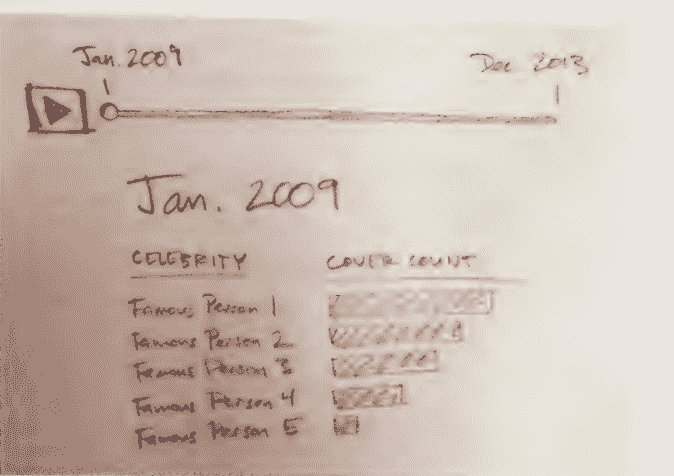

**图 5.1** 我们为 Frank 绘制的草图

在笔记本上画了几分钟后，递给 Frank 一张草图（如图 5.1 所示）并进行描述。你告诉他，图表打开时是最早月份（2009 年 1 月）封面次数前五位的名人的列表。在每个名人的名字旁边有一个条形，代表他或她在该月出现的封面次数，这样就能清楚看出某位名人是否完全占据主导。用户可以通过两种方式切换到后续月份：她可以点击按钮，然后看着图表自动切换月份；或者可以移动滑动块导航到她选择的月份。当图表从一个月份过渡到另一个月份时，新的名人名字将进入排名，其他的将退出，还有另一些将在列表中上下移动，它们相关的条形会随之扩张或收缩以匹配更新后的封面计数。“太酷了！”Frank 解释道，并给你发了一份 3000 行的表格。

进入、更新、退出……D3 正是为此而生的。

## 进入与绑定数据

好了，让我们来看看 Frank 的数据。假设你已经做过了一些数字计算，并添加了每个人在每个月的所有封面次数，并将它们排序为排名。图 5.2 显示了你在前三个月（2009 年 1 月至 3 月）发现的结果（这些值当然是完全虚构的）。

### Frank 的数据

| 名人姓名 | 封面次数 | 排名 |
|---|---:|---:|
| Angelina Jolie | 20 | 1 |
| Brad Pitt | 18 | 2 |
| Jennifer Aniston | 10 | 3 |
| Britney Spears | 8 | 4 |

#### 2009 年 2 月

| 名人姓名 | 封面次数 | 排名 |
|---|---:|---:|
| Jennifer Aniston | 18 | 1 |
| Angelina Jolie | 15 | 2 |
| Britney Spears | 7 | 4 |
| Brad Pitt | 2 | 4 |
| "蝙蝠之子" | 1 | 5 |

#### 2009 年 3 月

| 名人姓名 | 封面次数 | 排名 |
|---|---:|---:|
| Angelina Jolie | 25 | 1 |
| Jennifer Aniston | 15 | 2 |
| Brad Pitt | 10 | 3 |
| Britney Spears | 8 | 4 |


这里是一些笔记：

- 1 月、2 月和 3 月顶尖名人的封面次数。
- 我们使用`selectAll()`来选择不存在的元素。
- 我们使用`data()`将数据集与选择集连接。
- 我们使用`enter()`为每个数据点创建占位符。
- 我们使用`append()`向页面添加元素。

```javascript
var janData = [
  {name: "Angelina Jolie", covers: 20, rank: 1},
  {name: "Brad Pitt", covers: 18, rank: 2},
  {name: "Jennifer Aniston", covers: 10, rank: 3},
  {name: "Britney Spears", covers: 8, rank: 4}
];
```

现在，我们在页面上放置了四个元素，但它们内部没有文本，所以我们的页面仍然是空白。我们如何让那些名人名字显示在上面并放在正确的位置？秘密在于`data()`方法。该方法实际上执行了数据连接，而当 D3 执行数据连接时，它会将数据绑定到元素上。因此，每个文本元素实际上都与一个数据点连接或绑定，如图 5.5 中的线条所示。

D3 让我们轻松访问绑定的数据，因此我们可以使用这些数据告诉元素应该说什么以及去向哪里：“好了，元素，看看你的数据点。你有哪位名人？Angelina Jolie。好的，这就是我想让文本显示的内容。你的排名是多少？1？好的，你会成为第一的！”


**图 5.3** 空选择集

# 第 5 章 数据连接：入门

## 选择（SELECTION）

## 数据（DATA）

数据与对象相互绑定

占位对象：

- `name: "Angelina Jolie"`
- `covers: 20`
- `rank: 1`

- `name: "Brad Pitt"`
- `covers: 18`
- `rank: 2`

- `name: "Jennifer Aniston"`
- `covers: 10`
- `rank: 3`

- `name: "Britney Spears"`
- `covers: 8`
- `rank: 4`

`janData` SVG

**图 5.4** `data()`和`enter()`的魔法

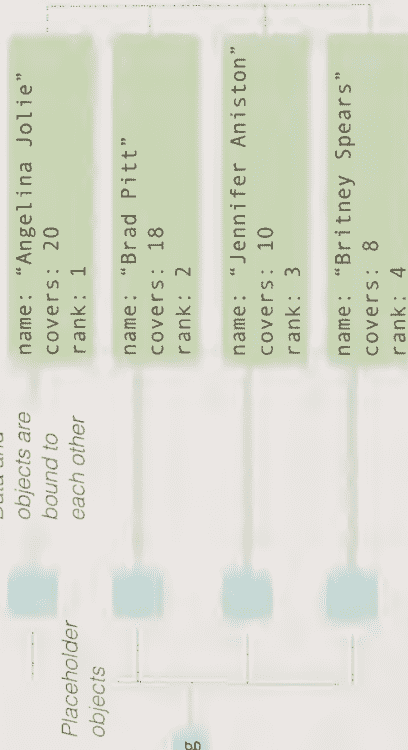

## 使用数据连接制作柱状图

## 选择（SELECTION）

## 数据（DATA）

|  | name: | covers: | rank: |
|---|---|---:|---:|
| text | `"Angelina Jolie"` | 20 | 1 |
| text | `"Brad Pitt"` | 18 | 2 |
| text | `"Jennifer Aniston"` | 10 | 3 |
| text | `"Britney Spears"` | 8 | 4 |


**图 5.5** 用文本元素替换占位符

## 使用数据连接制作柱状图

在上一章中，我们使用 D3 选择器在 JavaScript 中制作全球年龄分布柱状图。我们将结果保存在名为`pop2010-D3.html`的文件中，你现在应该花时间回顾一下。在本章的剩余部分中，我们将再次使用数据连接来创建该柱状图。

为了实现这一点，可以使用`pop2010-D3.html`中的许多相同代码。创建一个名为`pop2010-data-joins.html`的新文件，并将`pop2010-D3.html`中的列表 5.1 代码剪切并粘贴进去。

**列表 5.1** `pop2010-data-joins.html`

```html
<!DOCTYPE html>
<html>
<head>
<meta charset="utf-8">
<style>
  body {
    font-family: Helvetica;
  }

  svg {
    width:500px;
    height:500px;
  }

  .top-label {
    font-size: 13px;
    font-style: italic;
    text-transform: uppercase;
    float: left;
  }
</style>
```

```css
.age-label {
  text-align: right;
  font-weight: bold;
  width: 90px;
  padding-right: 10px;
}

.clearRect {
  clear: both;
}

.bar {
  fill: DarkSlateBlue;
}

.bar-label {
  text-anchor: end;
}

.axis-label {
  text-anchor: middle;
  font-size: 13px;
}
</style>
</head>
<body>
<script src="http://d3js.org/d3.v3.min.js"></script>
<script>
var popData = [1.6, 1.5, 2.1, 2.6, 3.4, 4.5, 5.1, 6.0, 6.6, 7.1, 7.3, 8.1, 8.9, 8.8, 8.6, 8.8, 9.3],
axisData = [0, 2.5, 5.0, 7.5],
barLabels = ["80 and up", "75-79", "70-74", "65-69", "60-64", "55-59", "50-54", "45-49", "40-44", "35-39", "30-34", "25-29", "20-24", "15-19", "10-14", "5-9", "0-4"];

var width = 400,
leftMargin = 100,
topMargin = 30,
barHeight = 20,
barGap = 5,
tickGap = 5,
tickHeight = 10,
scaleFactor = width / popData[16],
barSpacing = barHeight + barGap,
transText = "translate(" + leftMargin + "," + topMargin + ")",
scaleText = "scale(" + scaleFactor + ", 1)";

var body = d3.select("body");

body.append("h2")
.text("Age distribution of the world, 2010");
```

```javascript
body.append("div")
  .attr("class", "top-label age-label")
  .style("width", leftMargin + "px")
  .append("p")
  .text("age group");

body.append("div")
  .attr("class", "top-label")
  .append("p")
  .text("portion of the population");

body.append("div")
  .attr("class", "clearRect");

var svg = body.append("svg");

var barGroup = svg.append("g")
  .attr("transform", transText + " " + scaleText)
  .attr("class", "bar");
</script>
</body>
```

这包含了我们使用`for`循环创建柱状图的所有代码。该代码如下：

```javascript
for (var i = 0; i < popData.length; i++) {
  barGroup.append("rect")
    .attr("x", 0)
    .attr("y", i * barSpacing)
    .attr("height", barHeight)
    .attr("width", popData[i]);
}
```

记得`popData`是年龄分布数据，第一个条目是 80 岁及以上的人口百分比，紧接着是 75-79 岁、70-74 岁等等。在上面的代码中，`for`循环对`popData`中的每个值进行一次迭代。每次迭代都会向`barGroup`添加一个新矩形。对于`barGroup`本身，我们应用了`transform`属性：整个组向右移动了 100 像素，为标签留出空间；最宽的柱子宽度将恰好为 400 像素。很好。但如果我们想用数据连接（data-join）来绘制这些柱子呢？让我们重新回顾之前的步骤。查看`pop2010-data-joins.html`。图 5.6 展示了你应该看到的内容。现在我们想让矩形进入页面。具体来说，我们希望它们属于`barGroup`（在图 5.6 的 DOM 中显示）。因此我们需要创建`barGroup`中所有矩形的选择。在你的代码中添加此行：


### DOM（你在检查器中看到的）

```html
<svg>
  <g transform="translate(100,30) scale(01752681724,1)" class="bar"></g>
</svg>
```

**图 5.6** 数据连接之前

```javascript
barGroup.selectAll("*rect")
```

然后，我们使用`.data().enter()`这一组合拳：

```javascript
barGroup.selectAll("*rect")
  .data(popData)
  .enter()
```

页面或 DOM 还没有改变，但我们已经为每个数据点有了占位对象。让我们添加一些矩形：

```javascript
barGroup.selectAll("*rect")
  .data(popData)
  .enter()
  .append("*rect")
```

我们有 17 个矩形，每个都绑定了一个数据点（见图 5.7）。我们现在需要设置这些矩形的属性。某些属性对于每个矩形都是相同的——即`x`，它决定了柱子的水平起始位置（记得我们希望所有柱子左对齐，所以`x`等于 0），由于所有柱子的高度相同，我们定义了一个常量`barHeight`。很简单。我们可以直接添加这些属性：

```javascript
barGroup.selectAll("*rect")
  .data(popData)
  .enter()
  .append("*rect")
  .attr("x", 0)
  .attr("height", barHeight)
  .attr("width", // 这里该放什么？）
  .attr("y", // 或者在这里？
```

但另外两个属性——`width`和`y`需要每个柱子都不同：

```javascript
barGroup.selectAll("*rect")
  .data(popData)
  .enter()
  .append("*rect")
  .attr("x", 0)
  .attr("height", barHeight)
```

这就是绑定数据发挥作用的地方。让我们从宽度开始。当我们依赖`for`循环时，我们遍历变量`i`并将每个矩形的宽度设置为`popData[i]`。我们本质上想在这里做相同的事情——我们希望每个柱子的宽度等于`popData`中的关联值。但由于`popData`已经绑定到我们的矩形，我们不需要循环。我们只需要告诉 D3：“嘿，将每个矩形的宽度设置为它所绑定的数据点。”我们的方法是使用匿名函数。

## 使用匿名函数访问绑定数据

顾如其名，匿名函数是没有名字的函数，或者从技术上说，它没有绑定到标识符。（它的父母在想什么！）。虽然一个命名函数看起来像这样：

| SELECTION | DATA |
|---|---:|
| rect | 1.6 |
| rect | 1.5 |
| rect | 2.1 |
| rect | 2.6 |
| rect | 3.4 |
| rect | 4.5 |
| rect | 5.1 |
| rect | 6.0 |
| rect | 7.1 |
| rect | 7.3 |
| rect | 8.1 |
| rect | 8.9 |
| rect | 8.8 |
| rect | 8.8 |
| rect | 9.3 |

**图 5.7** 数据连接之后（续）

```html
<svg transform="translate(100,30) scale(01752681724,1)" class="bar">
```


```xml
<rect></rect>
<rect></rect>
<rect></rect>
<rect></rect>
<rect></rect>
<rect></rect>
<rect></rect>
<rect></rect>
<rect></rect>
<rect></rect>
<rect></rect>
<rect></rect>
<rect></rect>
<rect></rect>
<rect></rect>
<rect></rect>
<rect></rect>
</svg>
```

```javascript
var myFunction = function() {
  return 5;
}
```

一个类似的匿名函数看起来像这样：

```javascript
function() {
  return 5;
}
```

或者，因为这是一个很小的函数，我们可以更简洁地写在一行，如：

```javascript
function() { return 5; }
```

匿名函数像普通函数一样可以接受参数。所以，你可以有一个像这样的匿名函数：

```javascript
function(x) { return x + 5; }
```

匿名函数在许多不同的编程语言中被使用，使用它们也有很多原因。在 D3 中，你使用它们主要是为了访问绑定的数据。所以，对于我们的代码，我们将替换这一行中的“这里该放什么？”：

```javascript
.attr("width", // 这里该放什么？）
```

为匿名函数，使其看起来像像这样：

```javascript
.attr("width", function() {})
```

## 使用匿名函数访问数据

在用匿名函数访问绑定数据时，D3 有几项约定。这些约定的原因有点复杂，但好消息是，你使用 D3 时不需要了解它们。你只需要记住这些约定本身即可。

第一个约定是函数总是会接收一个参数 `d`：

```javascript
.attr("width", function(d))
```

并且 `d` 具有一个非常特定的含义。对于我们选择中的每个元素，它代表了绑定的数据点。因此，对于我们的第一个矩形，`d` 的值是 1.6。对于第二个，`d` 是 1.5，以此此类推。

这非常棒，因为我们想将矩形的宽度设置为等于 `popData` 中的值。对于每个矩形，我们希望宽度等于 `d`。我们该如何做呢？就像处理任何其他函数一样——我们告诉匿名函数返回 `d` 的值：

```javascript
.attr("width", function(d) { return d; })
```

完美。现在看属性 `y`。我们也想使用匿名函数，类似这样的代码：

```javascript
.attr("y", function(d))
```

嗯……问题是，垂直位置 `y` 与绑定数据的值没有任何关系。记得，当我们使用循环来创建矩形时，我们将 `y` 设置为迭代变量 `i` 乘以一个常量 `barSpacing`。我们从未使用过 `popData` 中包含的任何数据。所以，我们不需要使用 `d`。

幸运的是，D3 不仅让你能够访问每个绑定数据点的值，还让你访问每个数据点在你的数据数组中的索引。你如何访问这些索引呢？通过向你的匿名函数引入另一个参数——`i`。

```javascript
.attr("y", function(d, i))
```

所以，对于我们的第一个矩形，`i` 等于 0；对于第二个矩形，它等于 1，以此此类推。

在刚才之前的代码，我们希望 `y` 等于索引乘以我们的常量 `barSpacing`。很简单：

```javascript
.attr("y", function(d, i) { return i * barSpacing })
```

这里是完整的链式调用：

```javascript
bargroup.selectAll("*")
  .data(popData)
  .enter().append("*")
  .attr("x", 0)
  .attr("height", barHeight)
  .attr("width", function(d) { return d })
  .attr("y", function(d, i) { return i * barSpacing });
```

# 第 5 章 数据连接：进入（Enter）

我们可以对其重新排列，使其以更符合逻辑的方式排序：

```javascript
barGroup.selectAll("rect")
  .data(popData)
  .enter().append("rect")
  .attr("x", 0)
  .attr("y", function(d) {return i * barSpacing})
  .attr("width", function(d) {return d})
  .attr("height", barHeight);
```

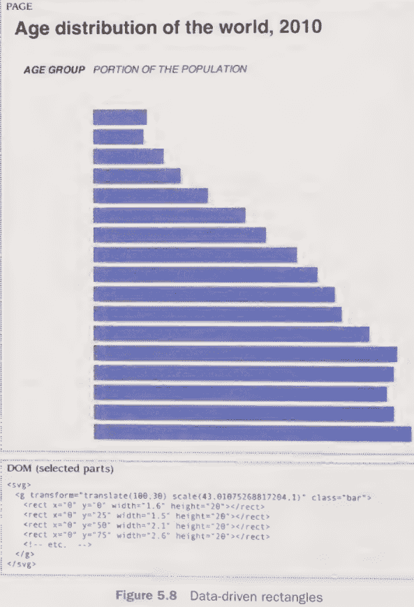

DOM（选中部分）

```xml
<svg transform="translate(100,30) scale(43.017526817204.1)" class="bar">
  <rect x="0" y="0" width="1.6" height="20"/></rect>
  <rect x="0" y="25" width="1.5" height="20"/></rect>
  <rect x="0" y="50" width="2.1" height="20"/></rect>
  <rect x="0" y="75" width="2.6" height="20"/></rect>
  <!-- etc. -->
</svg>
```

# 完成图表的其余部分 119

将这些代码放入你的程序中并运行！你应该能得到你在图 5.8 中看到的内容。

该说声祝贺了。你现在使用了所有的三个 D。你已经用数据驱动了一个文档。万岁！

关于在 D3 中使用匿名函数访问绑定数据的最后一点。正如前面提到的，无论如何，你总是需要将 `d` 作为一个参数包含。这是使用匿名函数的第一个约定。当我们上面将 `y` 的值设置为 `i * barSpacing` 时，我们完全没有使用 `d`。这没关系——我们仍然必须将其作为参数包含进去。

第二个约定是，除非你计划使用它，否则你不需要包含 `d`。当我们设置宽度属性时，我们不需要 `i`，它在匿名函数中随处可见。但如果你打算使用 `i`，你必须确保它被作为参数添加到你的匿名函数中，并且出现在你的函数体中。

# 完成图表的其余部分

作为一个练习，你应该尝试完成条形图的其余部分。使用连接（joins）来完成图表。如果你卡住了，我会在这里提供 5.2 中的代码，但你可以自己尝试：

```javascript
var barGroup = svg.append('g')
  .attr('transform', transform)
  .attr('class', 'bar');

barGroup.selectAll('*')
  .data(popData)
  .enter().append('*')
  .attr('x', 0)
  .attr('y', function(d, i) { return i * barSpacing })
  .attr('width', function(d) { return d })
  .attr('height', barHeight);

var axisGroup = svg.append('g')
  .attr('transform', transform)
  .attr('class', 'axis');

axisGroup.selectAll('line')
  .data(popData)
  .enter().append('line')
  .attr('x1', 0)
  .attr('x2', function(d) { return d })
  .attr('y1', function(d, i) { return i * barSpacing })
  .attr('y2', function(d, i) { return i * barSpacing + barHeight });

axisGroup.selectAll('text')
  .data(popData)
  .enter().append('text')
  .attr('x', function(d) { return d + 5 })
  .attr('y', function(d, i) { return i * barSpacing + barHeight / 2 })
  .text(function(d) { return d });
```

# 在对象中存储数据 123

```css
body {
  font-family: Helvetica;
}

svg {
  width:500px;
  height:500px;
}

.top-label {
  font-size: 13px;
  font-style: italic;
  text-transform: uppercase;
  float: left;
}

.age-label {
  text-align: right;
  font-weight: bold;
  width: 90px;
  padding-right: 10px;
}

.clearfix {
  clear: both;
}

.bar {
  fill: DarkSlateBlue;
}

.bar-label {
  text-anchor: end;
}

.axis-label {
  text-anchor: middle;
  font-size: 13px;
}

</style>
</head>
<body>

<!-- --> -->

<script src="http://d3js.org/d3.v3.min.js"></script>
<script>
var popData = [
  {age:"80 and up", value:1.6, position:0},
  {age:"75 - 79", value:1.5, position:1},
  {age:"70 - 74", value:2.1, position:2},
  {age:"65 - 69", value:2.6, position:3},
  {age:"60 - 64", value:3.4, position:4},
  {age:"55 - 59", value:4.5, position:5},
  {age:"50 - 54", value:5.1, position:6},
  {age:"45 - 49", value:6.0, position:7},
  {age:"40 - 44", value:6.6, position:8},
  {age:"35 - 39", value:7.1, position:9},
  {age:"30 - 34", value:7.3, position:10},
  {age:"25 - 29", value:8.1, position:11},
  {age:"20 - 24", value:8.9, position:12},
  {age:"15 - 19", value:8.8, position:13},
  {age:"10 - 14", value:8.6, position:14},
  {age:"5 - 9", value:8.8, position:15},
  {age:"0 - 4", value:9.3, position:16}
];
```

```javascript
var axisData = [0, 2.5, 5.0, 7.5];
var width = 400,
leftMargin = 100,
topMargin = 30,
barHeight = 20,
barGap = 5,
tickHeight = 10,
scaleFactor = width / popData[16].value,
barSpacing = barHeight + barGap,
transformText = 'translate(' + leftMargin + ',' + topMargin + ')',
scaleText = 'scale(' + scaleFactor + ',1)';
```

```javascript
var body = d3.select('body');

body.append('h2')
  .text('2010年世界人口年龄分布:');

body.append('div')
  .attr('class', 'top-label age-label')
  .append('p')
  .text('年龄组');

body.append('div')
  .attr('class', 'top-label')
  .append('p')
  .text('人口比例');

body.append('div')
  .attr('class', 'clearfix');

var svg = body.append('svg');

var barGroup = svg.append('g')
  .attr('transform', 'translate(' + '*' + '*' + scaleText + ')')
  .attr('class', 'bar');

barGroup.selectAll('rect')
  .data(popData)
  .append('rect')
  .attr('x', 0)
  .attr('y', function(d) { return d.position * barSpacing });
```

```javascript
.attr("width", function(d) {return d.value})
.attr("height", barHeight);

varLabelGroup = svg.append("g")
  .attr("transform", transformText)
  .attr("class", "bar-label");

barLabelGroup.selectAll("text")
  .data(popData)
  .append("text")
  .enter().append("text")
  .attr("x", -10)
  .attr("y", function(d) {
    return d.position * barSpacing + barHeight * (2 / 3)
  })
  .text(function(d) {return d.age});

var axisTickGroup = svg.append("g")
  .attr("transform", transformText)
  .attr("stroke", "black");

axisTickGroup.selectAll("line")
  .data(axisData)
  .enter().append("line")
  .attr("x1", function(d) {return d * scaleFactor})
  .attr("x2", function(d) {return d * scaleFactor})
  .attr("y1", 0)
  .attr("y2", -tickHeight);

var axisLabelGroup = svg.append("g")
  .attr("transform", transformText)
  .attr("class", "axis-label");

axisLabelGroup.selectAll("text")
  .data(axisData)
  .enter().append("text")
  .attr("x", function(d) {return d * scaleFactor})
  .attr("y", barHeight + tickGap)
  .text(function(d) {return d});
</script>
</body>
</html>
```

## 第 5 章：数据连接：进入（Enter）

## 总结

在本章中，我们引入了在 D3 中使用数据连接（data-joins）的概念。数据连接允许你处理元素的进入（enter）、更新（update）或退出（exit）。它能够允许你基于 D3 完成所有这些操作。本章涵盖了如何使用数据连接来创建元素。

## 图表尺寸调整与坐标轴添加

本章涵盖了如何使用比例尺（scales）并轻松地创建坐标轴（axes）。比例尺将值转换为像素变得简单直观。在本章结束时，你将充分利用 D3 的潜力重新创建我们的条形图。

### 线性比例尺

在本章中，我们没有从 D3 的通用课程开始再将这些课程应用于我们的条形图，而是从一开始就开始观察 `transform` 属性。使用 `transform` 属性，你可以将 SVG 元素从一个位置移动到另一个位置。

## 第 6 章 图表尺寸调整与添加轴

让我们在定义域中使用 `d3.max()`。

```javascript
var x = d3.scale.linear()
  .domain([0, d3.max(popData, function(element) {return element.value})])
  .range([0, width]);
```

将上述代码输入你的控制台，并尝试操作一下 `x`。理当然，`x(0)` 应该返回 0，就像 `x(9.3)` 应该返回 400 一样。输入最大的数据点将整个宽度作为输出。

让我们将这个比例函数整合到我们的代码中。回到编辑器，将其粘贴到文件的顶部，放在定义了 `popData` 和 `width` 之后。。如下所示所示：

```javascript
var width = 400,
leftMargin = 100,
topMargin = 30,
barHeight = 20,
barGap = 5,
tickGap = 5,
tickHeight = 10,
```


`scaleFactor = width / d3.max(popData, function(element) {return element.value});`

`barSpacing = barHeight + barGap,`

`translateText = "translate(" + leftMargin + "," + topMargin + ")",`

`scaleText = "scale(" + scaleFactor + "," + 1 + ")";`

```javascript
var x = d3.scale.linear()
  .domain([0, d3.max(popData, function(element))])
  .range([0, width]);
```

现在，让我们使用 `x` 来设置柱形图的宽度。这是我们目前的代码：

```javascript
var barGroup = svg.append("g")
  .attr("transform", translateText + " " + scaleText)
  .attr("class", "bar");

barGroup.selectAll("rect")
  .data(popData)
  .enter().append("rect")
  .attr("x", 0)
  .attr("y", function(d) {return d.position * barSpacing })
  .attr("width", function(d) {return d.value })
  .attr("height", barHeight);
```

我们正在通过关联数据点的值来设置柱形图的宽度，但我们是通过缩放所所在的柱形组来实现的，使得最大的一个填充整个宽度。现在，我们将使用 `x` 直接设置宽度，并去掉缩放变换（scale transform）：

```javascript
var barGroup = svg.append("g")
  .attr("transform", translateText)
  .attr("class", "bar");
```

```javascript
barGroup.selectAll("rect")
  .data(popData)
  .enter().append("rect")
  .attr("x", 0)
  .attr("y", function(d) { return d.position * barSpacing })
  .attr("width", function(d) { return x(d.value)})
  .attr("height", barHeight);
```

让我们不要停于此。我们还可以使用我们的比例函数来设置轴的位置。再次，这是我们目前的代码：

```javascript
var axisTickGroup = svg.append("g")
  .attr("transform", translateText)
  .attr("stroke", "black");
```

```javascript
axisTickGroup.selectAll("line")
  .data(axisData)
  .enter().append("line")
  .attr("x1", function(d) { return d*scaleFactor })
  .attr("x2", function(d) { return d*scaleFactor })
  .attr("y1", 0)
  .attr("y2", -tickHeight);
```

```javascript
var axisLabelGroup = svg.append("g")
  .attr("transform", translateText)
  .attr("class", "axis-label");
```

```javascript
axisLabelGroup.selectAll("text")
  .data(axisData)
  .enter().append("text")
  .attr("x", function(d) { return d*scaleFactor })
  .attr("y", -tickHeight - tickGap)
  .text(function(d) { return d + " % });
```

在这种情况下，我们可以用 `x` 代替那个比例常量：

```javascript
var axisTickGroup = svg.append("g")
  .attr("transform", translateText)
  .attr("stroke", "black");
```

```javascript
axisTickGroup.selectAll("line")
  .data(axisData)
  .enter().append("line")
  .attr("x1", function(d) { return x(d) })
  .attr("x2", function(d) { return x(d) })
  .attr("y1", 0)
  .attr("y2", -tickHeight);
```

```javascript
var axisLabelGroup = svg.append("g")
  .attr("transform", translateText)
  .attr("class", "axis-label");
```

```javascript
axisLabelGroup.selectAll("text")
  .data(axisData)
  .enter().append("text")
  .attr("x", function(d) { return x(d) })
  .attr("y", -tickHeight - tickGap)
  .text(function(d,i) { return d + " %"; });
```

猜怎么着？我们的代码不再需要那两个常量——`scaleText` 和 `scaleFactor`。让我们把这些难看的东西删掉吧。

# 134 第 6 章 尺寸图与添加坐标轴

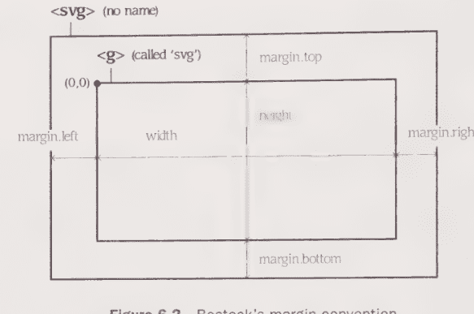

我们可以像这样定义我们的 `svg`：

```javascript
var svg = chartDiv.append("svg")
  .attr("width", width + margin.left + margin.right)
  .attr("height", height + margin.top + margin.bottom)
  .append("g")
  .attr("transform", "translate(" + margin.left + "," + margin.top + ")");
```

现在，我们可以去掉代码中所有 SVG 组上的那些 `transform` 属性了。在这里：

```javascript
var barGroup = svg.append("g")
  .attr("class", "bar");
```

这里：

```javascript
var barLabelGroup = svg.append("g")
  .attr("class", "bar-label");
```

这里：

```javascript
var axisTickGroup = svg.append("g")
  .attr("stroke", "black");
```

还有这里：

```javascript
var axisLabelGroup = svg.append("g")
  .attr("class", "axis-label");
```

最后，我们可以完全删掉 `topMargin`、`marginLeft` 以及那个可怕的 `translateText`：

```javascript
var margin = {top: 30, right: 0, bottom: 0, left: 100};
```

```javascript
width = 500 - margin.left - margin.right,
height = 230 - margin.top - margin.bottom,
var barHeight = 45,
barGap = 5,
tickHeight = 10,
tickGap = 5,
barSpacing = barHeight + barGap;
```

看起来不错。

## 添加坐标轴

比例尺（Scales）很酷，但用它们来添加坐标轴更酷。而且非常简单。让我们先从完全移除水平轴开始。这些代码……

```javascript
var axisTickGroup = svg.append("g")
  .attr("stroke", "black");

axisTickGroup.selectAll("line")
  .data(axisData)
  .enter().append("line")
  .attr("x1", function(d) { return x(d)})
  .attr("x2", function(d) { return x(d)})
  .attr("y1", 0)
  .attr("y2", -tickHeight);

var axisLabelGroup = svg.append("g")
  .attr("class", "axis-label");

axisLabelGroup.selectAll("text")
  .data(axisData)
  .enter().append("text")
  .attr("x", function(d) { return x(d)})
  .attr("y", -tickHeight - tickGap)
  .text(function(d) { return d + "*";});
```

……全部扔掉吧。我们将用 D3 的方式来构建坐标轴（见图 6.3）。

我们必须创建的是所谓的“坐标轴生成器”（axis generator）。听起来很深奥，但它其实就是：

```javascript
var xAxis = d3.svg.axis()
  .scale(x)
```

正如我们之前处理比例尺一样，我们正在定义一个函数，用 `d3.svg.axis()` 初始化它，然后可以对其进行自定义。在这种情况下，查阅 D3 API 参考文档通常是有意义的。有一个专门介绍创建坐标轴的章节，详细解释了如何自定义坐标轴生成器（见图 6.4）。

## 2010 年世界年龄分布

年龄组人口占比

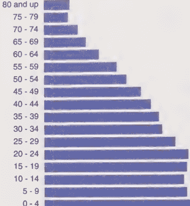

图 6.3 偏离轴线的图表

## 坐标轴方法

- `d3.svg.axis` - 创建一个新的坐标轴生成器。
- `axis` - 为给定的选择或过渡创建或更新坐标轴。
- `axis.scale` - 获取或设置坐标轴比例尺。
- `axis.orient` - 获取或设置坐标轴方向。
- `axis.ticks` - 控制轴刻度（ticks）的生成方式。
- `axis.tickValues` - 显式指定刻度值。
- `axis.tickSize` - 指定主刻度、次刻度和末端刻度的大小。
- `axis.innerTickSize` - 指定内部刻度的大小。
- `axis.outerTickSize` - 指定外部刻度的大小。
- `axis.tickPadding` - 指定刻度与刻度标签之间的间距。
- `axis.tickFormat` - 覆盖标签的刻度格式。

图 6.4 对 API 参考文档的信任

在这里，我们将 `scale` 设置为 `x`。它的含义应该是显而易见的。我们希望轴的比例尺是 `x`，这当然是我们在本章第一部分定义的线性比例尺。

## 2010 年世界年龄分布

年龄组人口占比

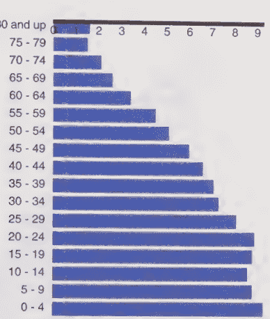

图 6.5 默认设置

在页面上添加新坐标轴非常简单。我们只需要向 `svg` 添加一个新的组（group），并使用一个名为 `call()` 的方法：

```javascript
svg.append("g")
  .call(xAxis)
```

运行这段代码，你将得到图 6.5 所示。它看起来并不好看，但有一点令人鼓舞——轴上的数字似乎出现在正确的位置。我们可以通过两件事将其变成这种形状：自定义我们的坐标轴生成器和样式化我们的组。让我们从样式化组开始。为了实现这一点，我们需要添加一个类：

```javascript
svg.append("g")
  .call(xAxis)
  .attr("class", "axis")
```

在样式化方面，我们需要关注的是那条黑线。我们想要的是刻度。那条线到底是什么？我知道线内部有几个不同的元素。有一个跨越整个图表宽度的 SVG `path`，以及 SVG 刻度——你可以通过检查器（Inspector）找出。

## 2010 年世界年龄分布

年龄组人口占比

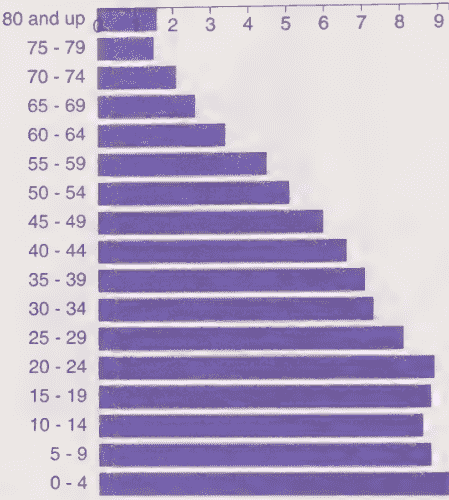

图 6.6 Path 与线条

现在，那个 `path` 有了填充颜色（fill），而线条没有描边（stroke）。我们唯一看到的是 `path` 的填充颜色。如果你在代码的最顶部放入以下 CSS，你就能看到如图 6.6 所示的 `path` 和线条：

```css
.axis line,
.axis path {
  fill: none;
  stroke: #000;
}
```

附加问题：如果将这些样式应用到类为 `"axis"` 的元素会发生什么？结果我们只对线条感兴趣，而不是 `path`。所以让我们将 CSS 修改成这样：

## 2010 年世界年龄分布

年龄组人口占比

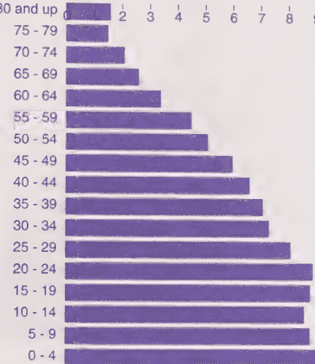

图 6.7 刻度，只有刻度

```css
.axis line {
  fill: none;
  stroke: #000;
}

.axis path {
  display: none;
}
```

产生了图 6.7 所示的结果。最后的一件事，我们需要将轴标签的大小设置为 `13px`。我们可以这样做：

```css
.axis text {
  font-size: 13px;
}
```

结果如图 6.8 所示。极了。我们正在接近目标。剩下的更改使用我们的坐标轴生成器。首先，我们可以通过改变坐标轴方向将数字和刻度移动到柱状图顶部。默认方向是“bottom”（底部），但我们可以将其改为“top”（顶部）（见图 6.9）：

## 2010 年世界年龄分布

年龄组人口占比

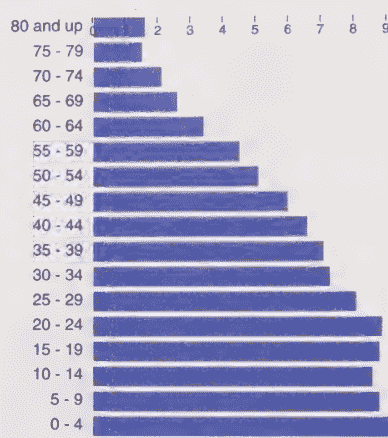

图 6.8 尺寸很重要

## 2010 年世界年龄分布

年龄组人口占比

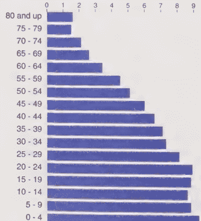

图 6.9 现在方向更正确了

```javascript
var xAxis = d3.svg.axis()
  .scale(x)
  .orient("top")
```

如果我们想让图表看起来和以前完全一样，还有两件事要做。我们需要减少刻度的数量并在刻度标签的末尾添加百分号。事实证明我们可以使用相同方法 `ticks()` 来实现。让我们从刻度数量开始：

```javascript
var xAxis = d3.svg.axis()
  .scale(x)
  .orient("top")
  .ticks(5)
```

图 6.10 显示了结果。那个修饰符 `axis.ticks()` 让我们可以设置想要的刻度数量（多或少）。如果 D3 认为我们输入的值会导致产生没有整数的比例尺，可以尝试用 4 代替 5，例如。通过 `ticks()`，我们无法获得之前的轴增量——0、2.5、5 和 7.5。（没关系，就按照 D3 建议的刻度数量吧。）但你也可以传入第二个参数来设置格式：

## 2010 年世界年龄分布

年龄组人口占比 0% 200% 400% 600% 800%

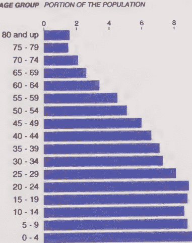

图 6.10 控制刻度数量

## 2010 年世界年龄分布

年龄组人口占比

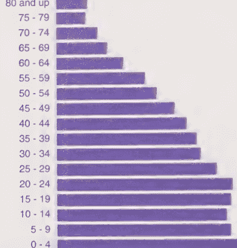

图 6.11 这些百分比非常高

```javascript
var xAxis = d3.svg.axis()
  .scale(x)
  .orient("top")
  .ticks(5, "%")
```

图 6.11 显示了百分比的添加。现在我们有了百分号，但我们的值直冲云霄！你能猜出为什么吗？当你将轴格式化为百分比时，D3 假设你输入的值使得 1.0 代表 100%。在后台，D3 在添加百分号之前会乘以 10。为了修复坐标轴，我们实际上需要移动数据中的小数点：

```javascript
{age:"35 - 39", value:0.071, position:9},
{age:"30 - 34", value:0.073, position:11},
{age:"25 - 29", value:0.081, position:11},
{age:"20 - 24", value:0.089, position:12},
{age:"15 - 19", value:0.088, position:13},
{age:"10 - 14", value:0.086, position:14},
{age:"5 - 9", value:0.088, position:15},
{age:"0 - 4", value:0.093, position:16};
```


完成这一步后，我们就得到了图 6.12 所示的图表。漂亮！注意，尽管我们将数据中的所有值都除以 100，但除了刻度标记标签外，图表的外观没有任何变化。这说明我们的代码正变得非常健壮。

现在图表看起来符合预期了，我们可以精简代码了。页面上不再有类名为`axis-label`的元素，所以我们可以从 CSS 中中删掉它：

```css
.axis-label {

text-anchor: middle;

font-size: 13px;

};
```

# 2010年世界年龄分布

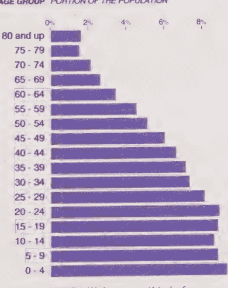

图 6.12 我们之前见过这个

# 第 6 章 图表尺寸与添加坐标轴

我们也不需要那个`axisData`数组了，所以也可以把它删掉：

```javascript
var axisData = {0, 2.5, 5, 7.5};
```

啊……感觉是不是舒服多了？

# 序数比例与坐标轴

这可能并不明显，但我们的图表实际上有两个轴，而不仅仅是一个。当然，我们的 x 轴是定量的，条形图沿着该轴伸出。但我们还有一个 y 轴，它是定性的。在 x 轴上，位置对应于百分比值；但在 y 轴上，位置对应于年龄组（图表顶部从“80岁及以上”开始，底部是“0–4岁”）。

D3 也擅长创建定性的比例尺和坐标轴。这种比例被称为分类比例（nominal scales）或序数比例（ordinal scales），善于将一组离散的、通常是非数值的输入映射到一组输出，你可以轻松使用这些输出在页面上定位元素。

让我们开始完全移除坐标轴标签。这些代码……

```javascript
var labelGroup = svg.append("g")

  .attr("class", "bar-label")

  .selectAll("text")

  .data(popData)

  .enter().append("text")

  .attr("x", -10)

  .attr("y", function (d) { return d.position*barSpacing + barHeight*(2/3) })

  .text(function (d) { return d.age; });
```

……全部扔掉。图 6.13 显示的内容自然是你应该看到的。

现在，就像处理 x 轴一样，让我们为 y 轴创建一个比例尺。由于这是一个序数比例，我们不会使用`d3.scale.linear()`。相反，我们将使用`d3.scale.ordinal()`。所以，我们想要这样的代码：

```javascript
var y = d3.scale.ordinal()

  .domain([])

  .range([]);
```

在这种情况下，我们的输入和输出是什么？y 轴代表年龄组，我们希望将年龄组作为输入。我们需要这样一个数组来映射我们的域：

```javascript
["80 and up", "75 – 79", "70 – 74", "65 – 69", "60 – 64", "55 – 59", "50 – 54",

"45 – 49", "40 – 44", "35 – 39", "30 – 34", "25 – 29", "20 – 24", "15 – 19", "10 –

14", "0 – 4"]
```

但每个年龄组都被困在位于`popData`数组的一个对象中。我们如何释放它们呢？JavaScript 有一个名为`map()`的方法，它可以作用于数组，让你能够轻松地重新组织它们或提取子集。尝试在控制台中输入以下内容：

```javascript
popData.map(function (element) { return element.age; });
```

# 2010年世界年龄分布

年龄组 人口比例

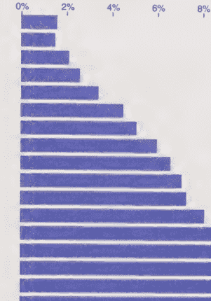

图 6.13 这是什么意思？

从非常通用的意义上说，`map()`的工作类似于`d3.max()`。当你使用`d3.max()`时，它会遍历数组的每个元素，提取相关数据（基于匿名函数），然后计算值中的最大值。使用`map()`方法，同样会遍历数组的每个元素并提取相关数据（再次使用匿名函数定义），但它不是计算最大值，而是将这些数据丢进新数组。我们的比例尺看起来如下：

```javascript
var y = d3.scale.ordinal()

.domain(popData.map(function(element) { return element.age}))

.range([]);
```

注意我们不需要括号，因为`map()`返回一个数组。现在对于`range`，我们需要问自己问题：我们实际上想用这个比例尺做什么？为了创建一个坐标轴，但在 x 比例尺中我们用它来设置条形的宽度。我们如何让 y 比例尺也以相同的方式工作呢？通过使用它设置每个条形的垂直位置：

- "80 and up" → 0
- "75 - 79" → 25 (barSpacing)
- "70 - 74" → 50 (barSpacing)
- "65 - 69" → 100 (barSpacing)

**图 6.14 分类和序数比例将离散值映射到数值**

在`range`中，我们实际上可以定义 17 个独立的输出，对应每个输入。记住，第一个条形的垂直位置为 0，第二个条形为 25（因为我们设置了`barSpacing`等于），以此类推。使用该逻辑，我们可以这样设置比例尺：

```javascript
var y = d3.scale.ordinal()

  .domain(popData.map(function(element) { return element.age}))

  .range([0, 25, 50, 75, 100, 125, 150, 175, 200, 225, 250, 275, 300, 325, 350, 375]);
```

更好办法，如果我们已经将`barSpacing`定义为常量，我们可以在这里使用：

```javascript
var y = d3.scale.ordinal()

  .domain(popData.map(function(element) { return element.age}))

  .range([0, 2*barSpacing, 3*barSpacing, 4*barSpacing, 5*barSpacing, 6*barSpacing, 7*barSpacing, 8*barSpacing, 9*barSpacing, 10*barSpacing, 11*barSpacing, 12*barSpacing, 13*barSpacing, 14*barSpacing, 15*barSpacing, 16*barSpacing]);
```

现在我们的比例尺将每个年龄组映射到一个值，如图 6.14 所示。我们使用比例尺来设置每个条形的`y`属性：

```javascript
svg.selectAll("rect")

  .data(popData)

  .append("rect")

  .attr("class", "bar")

  .attr("x", 0)

  .attr("y", function(d) {return y(d.age)})

  .attr("width", function(d) {return x(d.value)})

  .attr("height", barHeight);
```

棒。但这种方法还是不太对。如果有 25 个条形，硬编码一个包含 25 个值的数组来设置比例尺的范围将非常痛苦。确实，可以使用循环来创建该数组，但在 D3 的大多数情况下，有更好的方法。

在设置比例尺时不再指定`range`，而是告诉 D3 创建所谓的“范围带”（range bands）。范围带接受一个输出区间（由两个值定义），并将其除以输入的数量以创建一系列带。例如，如果我们这样定义比例尺函数：

```javascript
var y = d3.scale.ordinal()

.domain(popData.map(function(element) { return element.age}))

.rangeB([0, height]);
```

那么函数将接收数组`[0, height]`（它代表从 0 到 420 的区间），并创建 17 个等宽带（因为我们有 17 个年龄组），如图 6.15 所示。

我们将年龄组传递给比例尺函数，就可以方便地得到带的起点作为输出。例如，`y("80 and up")`结果为 0，`y("75 - 79")`结果为 24.7，以此此类推。结果与上面基本相同，但现在即使我们有 17 个、35 个甚至 8 个条形，比例尺也能同样良好（尽管我们可能想改变比例尺的高度）。去尝试运行更新后的代码吧。

图表看起来和之前没有区别，但并不完全一样，不是吗？我们的`y`属性有一这些奇怪的数字。为什么？因为我们正在用 420 除以 17，而且除不尽。但别担心，你很快就会发现我们可以几乎很容易地回到那些数字。

使用范围带的另一个好处是，我们可以询问比例尺每个带的大小。例如：

```javascript
y.rangeBand();
```

在这种情况下，它将返回 24.7 的值。如果我们希望条形完全填充每个带，可以使用这个来设置它们的高度：

| Domain | rangeBand interval | Range bands |
| --- | --- | --- |

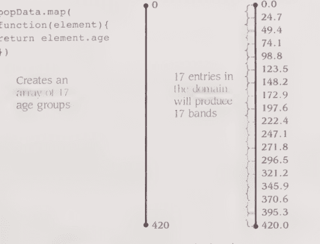

图 6.15 拆分带

# 2010年世界年龄分布

年龄组人口占比

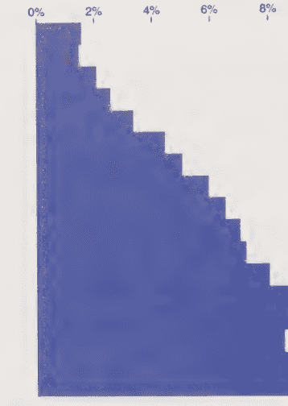

图 6.16 范围内的家庭条形图

```javascript
svg.selectAll("rect")

  .data(popData)

  .enter().append("rect")

  .attr("class", "bar")

  .attr("x", 0)

  .attr("y", function(d) { return y(d.age);})

  .attr("width", function(d) { return x(d.value); })

  .attr("height", y.rangeBand());
```

图 6.16 显示了我们的结果。但这并不是我们想要的。我们所有的条形高度都是 50 像素，而且彼此紧挨在一起。幸运的是，我们可以在比例尺定义中轻松修复这个问题。在`scale.rangeBands()`饰符中，可以设置所谓的`padding`（内边）——即条带之间的空间：

```javascript
var y = d3.scale.ordinal()

  .domain(popData.map(function(element) { return element.age;}))

  .range([0, height], 0.2);
```

# 2010年世界年龄分布

年龄组人口占比

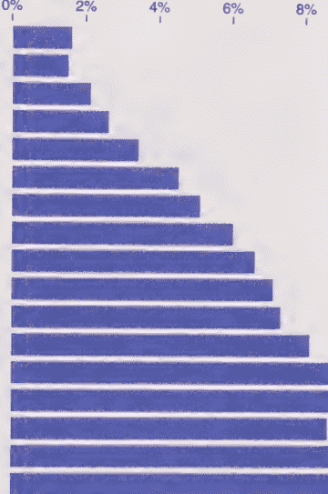

图 6.17 良好的内边距

`padding`产生了图 6.17 所示的结果。

看起来好多了，但这里实际上发生了什么？图 6.18 展示了`padding`工作原理的草图，显示了我们图表顶部前四个条形的放大视图。

尝试调整`padding`，看看它是如何影响条形的位置和它们之间的间的。你会发现，在顶部条形上方和底部条形下方总会有`padding`。默认情况下，这种所谓的“外边距”等于每个范围带中的`padding`。在某些情况下这可能是理想的，但对我们来说不是。我们可以向`scale.rangeBands()`饰符传递第三个参数来告诉它我们想要多少外边距。如果为 0：

```javascript
var y = d3.scale.ordinal()

  .domain(popData.map(function(element) { return element.age}))

  .rangeBands([0, height], 0.2, 0);
```

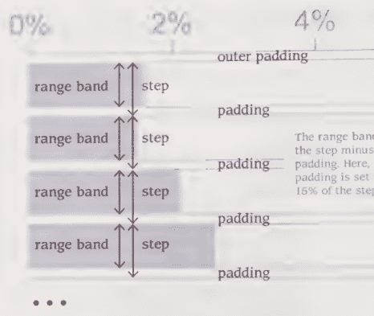

太棒了。此时我们剩下的唯一工作就是添加轴。幸运的是，这一步比设置比例尺要容易得多。它的原理与 x 轴完全一样。首先，我们需要设置一个轴生成器。将以下代码添加到你的文件中，紧跟在你定义 x 轴生成器的地方：

```javascript
var yAxis = d3.svg.axis()

  .scale(y)

  .orient("left");
```

注意，我们将轴朝向左侧，因为我们希望标签位于条形的左侧。现在，同样，为了画轴你只需要添加一个 SVG 组并使用`.call(y)`。将此代码添加到你绘制 x 轴的代码下方：

```javascript
svg.append("g")

  .call(yAxis)

  .attr("class", "axis");
```

图 6.19 显示了你得到的结果。现在我们需要进行一些格式化。由于我们希望 x 轴和 y 轴的格式略有不同，除了共享的类`axis`之外，给它们单独的类是有意义的：

```javascript
svg.append("g")

  .call(xAxis)

  .attr("class", "x axis");
```

```javascript
svg.append("g")

  .call(yAxis)

  .attr("class", "y axis");
```

# 2010年世界年龄分布

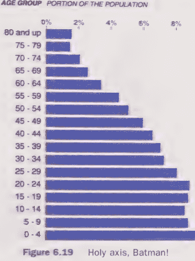

如果我们像这样调整样式规则，它可以消除 y 轴上的刻线，按照我们想要格式化文本，并保持路径在任何轴上都不显示：

```css
.x.axis line {

  fill: none;

  stroke: #000;

}

.x.axis text {

  font-size: 13px;

}

.axis path {

  display: none;

}

y.axis line {

  display: none;

}
```

最终结果如图 6.20 所示。

现在到了我最喜欢的部分——修剪。我们不再有类为`bar-label`的元素了，所以我们可以清除这段 CSS：

```css
.bar-label {

  text-anchor: end;

}
```

# 2010年世界年龄分布

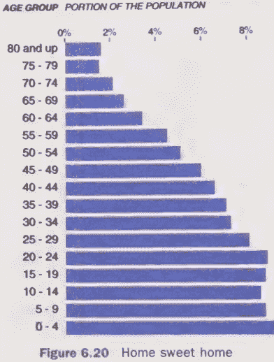

我们不再需要最初的任何条形定位或间距了，所以我们可以删掉这些：

```javascript
var barHeight = 45,

barGap = 5,

tickGap = 10,

barSpacing = barHeight + barGap;
```

最后，由于我们不需要数据点的垂直定位属性（因为 y 比例尺已经为我们处理了），我们可以把它删掉。将`popData`改为：

```javascript
var popData = [

  {age:80 and up", value:0.016},

  {age:75-79", value:0.015},

  {age:70-74", value:0.021},

  {age:65-69", value:0.026},

  {age:60-64", value:0.034},

  {age:55-59", value:0.045},

  {age:50-54", value:0.051},

  {age:45-49", value:0.060},

  {age:40-44", value:0.066},

  {age:35-39", value:0.071},

  {age:30-34", value:0.073},

  {age:25-29", value:0.081},

  {age:20-24", value:0.089},

  {age:15-19", value:0.088},

  {age:10-14", value:0.086},

  {age:5-9", value:0.088},

  {age:0-4", value:0.093}

];
```

太棒了。让我们查看完整的代码（列表 6.1）。

# 列表 6.1 完整代码

```html
<!DOCTYPE html>

<html>

<head>

<meta charset="utf-8">

<style>

body {

    font-family: Helvetica;

 }

 svg {

    width:500px;

    height:500px;

}

.top-label {

    font-size: 13px;

    font-style: italic;

    text-transform: uppercase;

    float: left;

}

.age-label {

    text-align: right;

    font-weight: bold;

    width: 90px;

    padding-right: 10px;

}

.clearfix {

    clear: both;

}

.bar {

    fill: DarkSlateBlue;

}

.bar-label {

    text-anchor: end;

}

.axis-label {

text-anchor: middle;

font-size: 13px;
```


# 加载与过滤外部数据

在本章中，我们将介绍如何从外部数据文件加载数据。你在网上找到的大多数数据以多种标准格式存在，直接使用这些文件通常比将数据硬编码到脚本中要方便得多。在本章结束时，你将制作一个年龄分布柱状图，通过简单更改代码中单个变量的值，即可更改显示的年份。

## 构建使用所有人口分布数据的图表

让我们从一个目标开始本章。在整本书中，我们一直致力于在 D3 中创建一个交互式柱状图，显示世界人口的年龄分布，从 1950 年开始预测到 2050 年。目前，我们有一个完全用 D3 制作的静态柱状图，显示 2010 年的分布。

下一步，让我们构建一个不完全交互的图表，我们可以通过更改代码中的变量显示数据集中任何年份的人口分布。也就是说，我们将在脚本中设置一个名为`year`的变量：

```javascript
var year = 2010;
```

我们可以更改它（就像移动工厂里的拉杆一样）来设置显示的年份。

为了实现这一点，我们的脚本需要访问整个数据集，而不仅仅是 2010 年的数据。当我们处理单个年份时，手动将每个年龄组的数据输入到对象数组中是比较容易的：

```javascript
var popData = [
  {age:"80 and up", value:0.016},
  {age:"75 - 79", value:0.015},
  {age:"70 - 74", value:0.021},
  {age:"65 - 69", value:0.026},
  {age:"60 - 64", value:0.034},
  {age:"55 - 59", value:0.045},
  {age:"50 - 54", value:0.051},
  {age:"45 - 49", value:0.060},
  {age:"40 - 44", value:0.066},
  {age:"35 - 39", value:0.071},
  {age:"30 - 34", value:0.073},
  {age:"25 - 29", value:0.081},
  {age:"20 - 24", value:0.089},
  {age:"15 - 19", value:0.088},
  {age:"10 - 14", value:0.086},
  {age:"5 - 9", value:0.088},
  {age:"0 - 4", value:0.093}
];
```

但对所有 21 年都这样做将非常繁琐。幸运的是，D3 为我们提供了一种从外部数据文件导入数据并自动将其转换为类似所示对象数组的方法。

## 你可以在 D3 中使用的数据格式

正如我们在第 3 章讨论的，网上可以找到很多格式的数据。有基于 Microsoft Excel 的表格格式（如`.xls`和`.xlsx`），像 CSV 和 TSV 这样的纯文本表格格式，以及像 JSON 这样的 JavaScript 格式。

D3 可以处理几乎所有的格式，除了格式极其复杂的表格文件`.xls`和`.xlsx`。以下是 D3 支持的所有外部数据格式列表：

| 格式 | 说明 |
| --- | --- |
| `.txt` | 纯文本文件 |
| `.csv` | 逗号分隔值 |
| `.tsv` | 制表符分隔值 |
| `.json` | JSON 块 |
| `.html` | HTML 文档 |
| `.xml` | XML 文档 |

对于这个示例，让我们先创建一个非常简单的 CSV 文件。CSV 无处不在，你可以使用免费工具轻松创建它们。我们将使用 D3 上传我们创建的 CSV 文件中的数据，然后在控制台中查看。

让我们从数据的子集开始——2010 年的数据——这样我们就可以看到整个过程是如何工作的。

在本书的支持文件中，你会找到一个名为`popData2010.csv`的文件可以使用。或者，你也可以在文本编辑器或 Google 表格中自己创建该文件（见图 7.1）。如果你选择 Google 表格方案，可以通过“文件 > 下载为 > 逗号分隔的值”来将文件下载为 CSV。

## 创建服务器以上传你的数据

| A | B | C | D | E | F |
|---|---|---|---|---|---|
| 1 | 80 and up | 75-79 | 70-74 | 65-69 | 60-64 | 55-59 |
| 2 | 0.016 | 0.015 | 0.021 | 0.026 | 0.034 | 0.045 |

图 7.1 popData2010

注意第一行——列名——包含了年龄组，第二行包含值。

## 创建服务器以上传你的数据

使用 D3 提取外部数据需要一些设置。许多浏览器会阻止你访问存储在计算机本地的文件，当你执行 D3 执行的那类请求时。那么，如何设置自己的小型服务器？不要担心，这很简单。

你需要在电脑上安装 Python。Mac、Ubuntu 和其他操作系统都预装了它。但如果你在 Windows 上，你需要下载它，可以在这里获取：https://www.python.org/download/

## 启动服务器

你需要做的第一件事是为该项目创建一个目录。现在打开你的终端（Mac 或 Linux 为 Terminal，Windows 为命令提示符），并进入你创建的文件夹。可以通过输入以下命令：`cd population`

现在你可以设置一个指向该目录的服务器。在命令行中输入：`python -m HTTPServer 8888`

如果你打开浏览器并在地址栏输入`localhost:8888`，浏览器将导航到你的本地服务器——它将显示该文件夹的内容（见图 7.2）。当然，现在它是空的。

## 创建 Index 文件

从本地服务器加载 HTML 文件与直接用浏览器打开文件略有不同。所以知道，当你创建一个网页时，目录必须命名为`index.html`。让我们使用第 4 章中使用的代码片段创建一个基础的`index.html`文件：

```html
<!DOCTYPE html>
<meta charset="utf-8">
<style></style>
<body>
<script src="http://d3js.org/d3.v3.js"></script>
<script>
</script>
</body>
```

将其保存到 population 文件夹中然后刷新浏览器。即使你仍然看到空白页面，也有方法确保一切运行正常。如何做？通过在控制台中尝试使用 D3。输入：

```javascript
d3.select("body")
```

并得到了图 7.3 所示的内容，说明你成功了。

## D3 加载数据的函数

让我们上传简单的 CSV 文件。首先，我们需要将其放入目录以便浏览器找到它。将`popData2010.csv`文件添加到你的 population 文件夹。

D3 有一组用于加载数据的函数，每个函数处理一种不同的数据格式：

| 函数 | 格式 |
| --- | --- |
| `d3.text()` | 纯文本 |
| `d3.csv()` | CSV |
| `d3.tsv()` | TSV |
| `d3.json()` | JSON |
| `d3.html()` | HTML |
| `d3.xml()` | XML |

## 回调函数

当然，我们将使用`d3.csv()`。传递给`d3.csv()`的第一个参数是文件名：

```javascript
d3.csv("popData2010.csv");
```

第二个参数是所谓的回调函数。它看起来这样：

```javascript
d3.csv("popData2010.csv", function(error, data){});
```

这里我不将深入过多细节，但只需说明回调函数有助于解决尝试检索数据时出现的问题。当你使用 D3 的函数提取数据时，从技术角度来说，该函数正在对外部资源进行所谓的*请求*。在这种情况下，资源就是我们的 CSV 文件。

回调函数接受两个参数：一个与成功相关，一个与失败相关。在这里，如果回调函数成功请求`popData2010.csv`，则文件内容将存储在成功变量`data`中。如果请求失败，失败详情将传递给变量`error`。

## D3 如何解释 CSV 表格

让我们对 CSV 文件中的数据发起请求并查看控制台中的结果。在`index.html`文件的 script 标签内添加以下内容：

```javascript
d3.csv("popData2010.csv", function(error, data){
  console.log(data)
});
```

你应该会在控制台中看到一个数组。当你展开它时，它看起来应该像图 7.4。

控制台并不完全直观，所以让我们把看到的转换成 JavaScript。控制台告诉我们`data`是一个包含单个对象的数组：

```javascript
data = [{}];
```

并且该对象有 17 个属性，每个属性都有不同的值：

```javascript
data = [{
  "0 - 4": "0.092849052",
  "5 - 9": "0.08782007",
  "10 - 14": "0.085697001",
  "15 - 19": "0.087628671",
  "20 - 24": "0.089268026"
}];
```


图 7.4 D3 对`popData2010.csv`的解释。

- 25 - 29: "0.080896946"
- 30 - 34: "0.072752538"
- 35 - 39: "0.070678427"
- 40 - 44: "0.066409696"
- 45 - 49: "0.059586949"
- 50 - 54: "0.050980812"
- 55 - 59: "0.044843055"
- 60 - 64: "0.033883539"
- 65 - 69: "0.025557823"
- 70 - 74: "0.020799846"
- 75 - 79: "0.014681544"
- 80 and up: "0.015666006"

很有意思。所有数据都在，但它们并不是一种非常有用的结构。为什么不考虑一下如果我们尝试通过将数据与一组矩形连接来创建一个条形图会发生什么呢？数据是一个只有一个条目的数组。记住，当你使用`data(data).enter()`执行数据连接时，D3 只会为数组中的每个条目创建一个对象。所以在这种情况下，如果你执行`data(data).enter().append("rect")`，将只会创建一个矩形。

那可不行。我们需要 17 个矩形，所以我们需要在数组中有 17 个独立的条目，每个年龄组一个。我们真正想要的是`popData2010`看起来像我们旧的变量`popData`一样：

```javascript
var data = [
  {age:80 and up, value:0.016},
  {age:75 - 79, value:0.015},
  {age:70 - 74, value:0.021},
  {age:65 - 69, value:0.026},
  {age:60 - 64, value:0.034},
  {age:55 - 59, value:0.045},
  {age:50 - 54, value:0.051},
  {age:45 - 49, value:0.060},
  {age:40 - 44, value:0.066},
  {age:35 - 39, value:0.071},
  {age:30 - 34, value:0.073},
  {age:25 - 29, value:0.081},
  {age:20 - 24, value:0.089},
  {age:15 - 19, value:0.088},
  {age:10 - 14, value:0.086},
  {age:5 - 9, value:0.088},
  {age:0 - 4, value:0.093}
];
```


让我们再次看看`popData2010.csv`，看看 D3 到底是如何解释它的，并弄清楚我们需要修改它（见图 7.5）。

你能看到这里发生了什么吗？顶行（表头）中的每个条目都变成了一个属性名称，而第二行的每个条目都变成了关联的值（见图 7.6）。你认为我们需要对`popData2010.csv`做什么才能得到我们想要的形式？我会在图 7.7 中包含答案，但我鼓励你尝试一下。

如果你将`popData2010.csv`保存得像图 7.7 那样并刷新浏览器，你应该会得到图 7.8 所示的结果。


# 第 7 章 加载与过滤数据


```javascript
Array(17)

  0: Object

    "value": "0.016"

    age: "80 and up"

    __proto__: Object

  1: Object

  2: Object

  3: Object

  4: Object

  5: Object

  6: Object

  7: Object

  8: Object

  9: Object

  10: Object

  11: Object

  12: Object

  13: Object

  14: Object

  15: Object

  16: Object

    length: 17

    __proto__: Array[0]
```


## 处理异步请求

在你的`index.html`中尝试以下代码：

```javascript
var popData;

d3.csv("popData2010.csv", function(error, data) {
  popData = data;
});

console.log(popData);
```

结果可能不是你预期的（见图 7.9）。`popData`似乎应该是我们上面在`console.log(data)`时看到的那个熟悉的数组。但它不是，这里有一个非常好的理由。当你使用`d3.csv()`时，你的脚本在开始其余代码之前不会等待回调函数完成。在技术术中，D3 异步发出外部请求。


原因如下：假设你有一个巨大的数据集——需要几秒钟才能加载。你并不希望所有的代码都被这段加载时间阻塞。理想情况下，不涉及数据的将在运行，这样页面上所有非数据驱动的内容就可以初始化。

实际上，这意味着对外部数据的所有操作都必须在回调函数内部进行。所以，如果你想让代码实际运行，你需要这样做：

```javascript
var popData;

d3.csv("popData2010.csv", function(error, data) {
  popData = data;
  console.log(popData);
});
```

## 使用外部数据创建条形图

现在，回到第 6 章的`pop2010-scales.html`文件。记得我们使用代码创建了 2010 年人口分布的条形图。我们将这些代码剪切并粘贴到你的`index.html`文件中并再次操作，这次我们将使用`popData2010.csv`作为数据源。

将所有的`pop2010-scales.html`代码粘贴到你的`index.html`文件中，并将外部调用放在脚本的底部：

```javascript
svg.append('g')
  .attr("class", "x axis");

svg.append('g')
  .call(yAxis)
  .attr("class", "y axis");

d3.csv("popData2010.csv", function(error, data) {
});

</script>
```

由于我们将使用 CSV 文件作为数据源，不再需要在脚本中定义`popData`。所以，让我们删除这段代码：

```javascript
var popData = [
  {age:"80 and up", value:0.016},
  {age:"75 - 79", value:0.015},
  {age:"70 - 74", value:0.021},
  {age:"65 - 69", value:0.026},
  {age:"60 - 64", value:0.034},
```

## 处理异步请求

```javascript
var popData;

d3.csv("popData2010.csv", function(error, data) {
  popData = data;

  var margin = {top: 30, right: 0, bottom: 0, left: 100},
      width = 500 - margin.left - margin.right,
      height = 450 - margin.top - margin.bottom;

  var body = d3.select("body");

  var x = d3.scale.linear()
    .domain([0, d3.max(popData, function(element) {
      return element.value;
    })])
    .range([0, width]);

  var y = d3.scale.ordinal()
    .domain(popData.map(function(element) {
      return element.age;
    }))
    .rangeBands([0, height], 0.2, 0);

  var yAxis = d3.svg.axis()
    .scale(y)
    .orient("left");

  var svg = body.append("svg")
    .attr("width", width + margin.left + margin.right)
    .attr("height", height + margin.top + margin.bottom)
    .append("g")
    .attr("transform", "translate(" + margin.left + "," + margin.top + ")");

  var barGroup = svg.append("g")
    .attr("class", "bar");

  barGroup.selectAll("rect")
    .data(popData)
    .enter()
    .append("rect")
    .attr("x", 0)
    .attr("y", function(d) { return y(d.age); })
    .attr("width", function(d) { return x(d.value); })
    .attr("height", y.rangeBand());
});
```

### 7.1 一个异步脚本

## 处理异步请求

```javascript
svg.append("g")
  .call(xAxis)
  .attr("class", "x axis");

svg.append("g")
  .call(yAxis)
  .attr("class", "y axis");

</script>
```

太棒了，我们可以继续下去了。对于我们的两个比例尺——x 和 y——只有域（domain）依赖于数据，而范围（range）并不依赖。事实证明，实际上可以通过几个步骤定义比例尺，如下所示：

```javascript
var x = d3.scale.linear()
  .domain([0, d3.max(popData, function(element) {
    return element.value();
  })])
  .range([0, width]);
```

在设置域之前设置范围也是可能的：

```javascript
var x = d3.scale.linear()
  .range([0, width]);

x.domain([0, d3.max(popData, function(element) {
  return element.value();
})]);
```

因此，我们可以在回调函数之外为每个比例尺设置范围，并在回调函数内部设置域。

等一下，还有更多！我们还可以在回调函数之外设置轴生成器。它们并不直接依赖于我们的数据，而是依赖于我们的比例尺。比例尺的域在我们进入回调函数之前没有设置这重要吗？不重要。当我们实际上使用`call()`方法创建轴时，这些域已经被定义了。

这里是代码的写法，回调函数内部只包含真正必要的内容：

### 列表 7.2 执行异步操作

```javascript
var margin = {top: 30, right: 0, bottom: 0, left: 100},
    width = 500 - margin.left - margin.right,
    height = 450 - margin.top - margin.bottom;

var body = d3.select("body");

var x = d3.scale.linear()
  .range([0, width]);

var y = d3.scale.ordinal()
  .range([0, height], 0.2, 0);

var xAxis = d3.svg.axis()
  .scale(x)
  .orient("top")
  .ticks(5, "%");

var yAxis = d3.svg.axis()
  .scale(y)
  .orient("left");

body.append("h2")
  .text("Age distribution of the world, 2010");

body.append("div")
  .attr("class", "top-label-age-label")
  .append("p")
  .text("age group");

body.append("div")
  .attr("class", "top-label")
  .append("p")
  .text("portion of the population");

body.append("div")
  .attr("class", "clearfix");

d3.csv("popData2010.csv", function(error, data) {
  var popData = data;

  x.domain([0, d3.max(popData, function(element) {
    return element.value;
  })]);

  y.domain(popData.map(function(element) {
    return element.age;
  }));

  var svg = body.append("svg")
    .attr("width", width + margin.left + margin.right)
    .attr("height", height + margin.top + margin.bottom)
    .append("g")
    .attr("transform", "translate(" + margin.left + "," + margin.top + ")");

  var barGroup = svg.append("g")
    .attr("class", "bar");

  barGroup.selectAll("rect")
    .data(popData)
    .enter()
    .append("rect")
    .attr("x", 0)
    .attr("y", function(d) { return y(d.age); })
    .attr("width", function(d) { return x(d.value); })
    .attr("height", y.rangeBand());

  svg.append("g")
    .call(xAxis)
    .attr("class", "x axis");

  svg.append("g")
    .call(yAxis)
    .attr("class", "y axis");
});

</script>
```

# 第 7 章 加载和过滤外部数据

## 加载数据集

现在进入有趣的部分。我们将首先获取所有数据，然后进行筛选。为了方便后续，我们将将其放入一个单独的文件，命名为`index2.html`。我们需要一个 CSV 文件，包含所有数据。附录 B 中有如何从头创建一个说明，但我已经为你准备好了。确保将`allData.csv`文件放在你的文件夹中。

图 7.10 展示了它的样子。注意，我们现在有第三列——年份（year），它让我们知道数据点属于哪一年。

### 图 7.11 对象的海洋

```html
<!DOCTYPE html>
<html>
<meta charset="utf-8">
<style></style>
<body>
  <script src="http://d3js.org/d3.min.js"></script>
  <script>
    d3.csv("allData.csv", function(error, data) {
      console.log(data);
    });
  </script>
</body>
</html>
```

现在将此内容放入你的`index.html`文件并刷新浏览器。

检查控制台（见图 7.11）。我们有一个包含许多对象的数组——总应该是 357 个，因为我们的数据涵盖了 21 年不同的年份，每一年有 17 个年龄组。

到目前为止顺利。现在我们需要学习如何将该数组缩小到指定年份的范围。让我们从显而易见的开始。我们需要设置感兴趣的年份：

```javascript
var year = 2010;

d3.csv("allData.csv", function(error, data) {
  // 在此处根据年份对数据进行过滤
});
```

事实证明，JavaScript 数组有一个我们可以在这里使用的方法，`filter()`。它的工作方式与`d3.max()`或`map()`类似，即你传入一个匿名函数来告诉该方法关注数组元素的哪些部分。因此，如果我们想使用`filter()`来提取特定年份，其写法如下：

```javascript
var year = 2010;

d3.csv("allData.csv", function(error, data) {
  var popData = data.filter(function(element) {
    return element.year == year;
  });

  console.log(popData);
});
```

# 第 7 章 加载和过滤外部数据

## 1950 年世界年龄分布

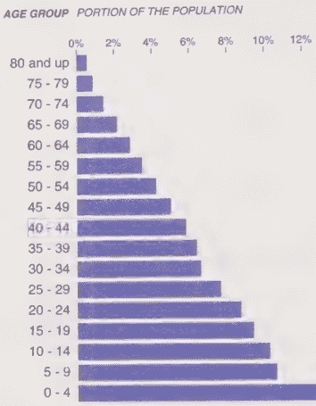

如果你将`index2.html`中的代码复制并粘贴到`index.html`，然后重新加载本地服务器，你应该能看到那个熟悉的条形图。

现在，让我们来看看其他年份。你只需更改`year`变量的值，就可以轻松提取数据中任何年份的年龄分布。为了让稍微高级一些，我们还可以使用`year`变量设置页面顶部的标题：

```javascript
body.append("h2")
  .text("Age distribution of the world, " + year);
```

让我们尝试极端情况。图 7.14 显示了 2050 年的预测。这两个图表看起来截然不同——世界确实在变老。但由于由于刻度不相同，它们也比较难以比较。1950 年图表的刻度超过了 12%，而 2050 年图表的刻度仅略超过 6%。考虑到我们定义了 x 轴刻度的域（domain），这是合逻辑的：

```javascript
var popData = data.filter(function(element) {
  return element.year == year;
});

x.domain([0, d3.max(popData, function(d) {
  return d.value;
})]);
```


为了设置域的上边界，我们使用了过滤后的`popData`数组中的最大值（该数组仅包含感兴趣的年份）。当然，这个最大值取决于我们选择的年份。

## 2050 年世界年龄分布

年龄组 人口比例

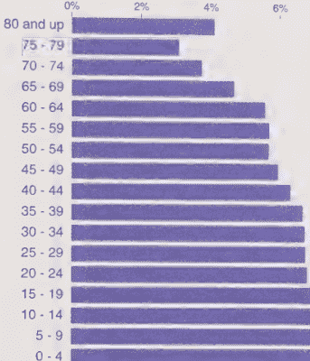

**图 7.14** 未来的年龄分布

但如果我们想让所有图表保持相同的刻度，以便于比较呢？我们要做的仅仅是将 x 轴刻度的上限设置为整个数据集中的最大值。这样一来，我们就能确保每一年的条形都能舒适地容纳。这样做很容易，我们只需要将刻度定义更改为使用`data`中的最大值，而不仅仅是`popData`。代码如下：

```
var popData = data.filter(function(element) {return element.year == year});

x.domain([0,d3.max(data, function(element) {return element.value})]);
```

## 总结

在本章中，我们涵盖了如何在 D3 中请求和使用外部数据。我们讨论了如何设置本地服务器来访问 CSV 等表格格式的数据。然后我们讨论了 D3 如何解释这些数据，以及 D3 异步处理请求意味着什么。最后，我们涵盖了一些基础的数据过滤。

## 8 制作图表具有交互性和动画效果

在本章中，我们将涵盖数据绑定（data-join）的更新（update）阶段和退出（exit）阶段。我将先从概念层面解释它们，并使用 Frank 的小报封面数据这个奇特的例子。然后，我们将学习如何应用这些概念来使年龄分布条形图具有交互性。

## 数据绑定：更新与退出

在第 5 章中，我们涵盖了数据绑定的进入（enter）阶段。在本章中，我们将涵盖更新和退出两个阶段。
回到你从那个搞怪的朋友 Frank 那里的小报封面数据集。现在可能是时候回顾第 5 章以及 Frank 的前三个月的数据，以及我们目前为止对它做了什么。在这里，我们将接上之前的进度。

所以，我们已经让 1 月的数据进入了页面，并将其转换了一组文本元素。在第 5 章中，我们并没有实际演示设置元素的文本或位置，但根据我们在年龄分布图中学得的知识，你应该知道如何做。在讲解更新和退出时，为了简化起见，我们将再次跳过那部分。
图 8.1 展示了我们之前的进度示意图。

页面上有很多文本元素，对应`jData`中的每个数据点。现在假设我们要更新页面以显示 2 月的数据。就像“进入”阶段一样，我们选择页面上的文本元素，然后使用`data()`执行数据绑定。区别在于，这次页面上已经有文本元素了。因此，我们不是创建新元素，而是将一些数据绑定到已经存在的元素上（图 8.2）。

这就是更新。我们正在用新数据更新页面上的元素。现在我们可以告诉顶部的文本读取“Jennifer Aniston”而不是“Angelina Jolie”。

## 第 8 章 制作图表具有交互性和动画效果

| 代码 | 选择器 | 数据 |
|---|---|---|
| `svg.selectAll("text")` | text | name: 'Angelina Jolie'<br>covers: 20<br>rank: 1 |
| `data(janData)` | | name: 'Brad Pitt'<br>covers: 18<br>rank: 2 janData |
| `enter().append("text")` | text | name: 'Jennifer Aniston'<br>covers: 15<br>rank: 3 |
| SVG | text | name: 'Britney Spears'<br>covers: 10<br>rank: 4 |

## 图 8.1 让文本进入页面

| 代码 | 选择器 | 数据 |
|---|---|---|
| `svg.selectAll("text")` | text | name: 'Jennifer Aniston'<br>covers: 16<br>rank: 1 |
| `data(febData)` | | name: 'Angelina Jolie'<br>covers: 15<br>rank: 2 |
| SVG | text | name: 'Britney Spears'<br>covers: 10<br>rank: 3 febData |
| text | | name: 'Brad Pitt'<br>covers: 8<br>rank: 4 |
| ? | | name: 'Bat-child'<br>covers: 1<br>rank: 5 |

## 图 8.2 更新

因为我们已经将新数据绑定到该元素上。（我们将在本章稍后介绍如何这样做。）

注意，并没有`update()`方法。通过`enter()`方法，你创建了一个特殊的占位元素集合，为数据集中每个尚未绑定的点创建一个元素。若要更新页面上已经存在的元素，你不需要那样做。你只需要创建这些元素的集合即可。然后你就可以根据它们新绑定的数据告诉它们该做什么。

在图 8.2 的图中有一个显眼的问号，你可能正对此好奇。它出现在那里的原因是，我们 2 月份有五个数据点，而 1 月份只有四个。那么我们该如何处理这个没有元素可以绑定的第五个数据点呢？

如果你猜到我们要让它进入页面，太棒了！但你错了。我们可以像以前一样使用`enter()`（见图 8.3）。但它不是创建完全全新的占位元素，该方法只会为那个没有元素的数据点创建一个。D3 非常擅长响应你的需求。

现在，再次像之前那样一样，我们可以添加一个文本元素。现在我们的数据和页面再次相互镜像对应（见图 8.4）。

## 数据绑定：更新与退出

| 代码 | 选择器 | 数据 |
| --- | --- | --- |
| `svg.selectAll("text") data.data(febData).enter()` | text | name: "Jennifer Aniston" covers: 10 rank: 1 |
| | text | name: "Angelina Jolie" covers: 15 rank: 2 |
| svg | text | name: "Britney Spears" covers: 7 rank: 3 |
| | text | name: "Brad Pitt" covers: 4 rank: 4 |
| ... ... | febData | name: "Bat-child" covers: 1 rank: 5 |

图 8.3 更新加进入

| 代码 | 选择器 | 数据 |
| --- | --- | --- |
| `svg.selectAll("text") data(febData).enter().append("text")` | text | name: "Jennifer Aniston" covers: 10 rank: 1 |
| | text | name: "Angelina Jolie" covers: 15 rank: 2 |
| svg | text | name: "Britney Spears" covers: 7 rank: 3 febData |
| | text | name: "Brad Pitt" covers: 4 rank: 4 |
| | text | name: "Bat-child" covers: 1 rank: 5 febData |

图 8.4 数据与页面再次相互镜像对应

## 第 8 章 让图表具有交互性和动画效果

| 代码 | 选择器 | 数据 |
|---|---|---|
| `svg.selectAll("text").data(data)` | text | name: "The Octopus" covers: 25 rank: 1 |
| | text | name: "Jennifer Aniston" covers: 25 rank: 2 |
| svg | text | name: "John Mayer" covers: 22 rank: 3 |
| | text | name: "Britney Spears" covers: 18 rank: 4 |

图 8.5 再次更新

| 代码 | 选择器 | 数据 |
|---|---|---|
| `svg.selectAll("text").data(data).exit().remove()` | text | name: "the Octopus" covers: 25 rank: 1 |
| | text | name: "Jennifer Aniston" covers: 25 rank: 2 |
| svg | text | name: "John Mayer" covers: 12 rank: 3 |
| | text | name: "Britney Spears" covers: 18 rank: 4 |

图 8.6 退出 (Exit)

数据点与元素对齐，然后比较它们的数量。只有三种可能的结果：

- 1. 数据点比元素多。这会触发进入阶段（enter phase）并可能触发更新阶段（update phase）。
- 2. 元素和数据点的数量相同。这会触发更新阶段。
- 3. 元素比数据点多。这会触发退出阶段（exit phase）并可能触发更新阶段。

但这里数据绑定（data joins）的逻辑与剧场比喻有所不同：在剧中，演员必须入场、表演和退场，但当你使用 D3 时，你并不总是需要使用数据绑定的所有三个阶段。有时，你会使用 D3 制作静态图形，你只需要进入`enter()`即可。在其他情况下，每次更新时数据点的数量都是相同的，因此你永远不需要退出`exit()`（事实上，我们的年龄分布柱状图就是这种情况）。

- 1. 一般来说，可以在 D3 中使用调用的键（called keys）将特定数据点链接到特定对象，在这种情况下，数据绑定就不涉及比较数据点和元素的数量。我们将在本章末尾介绍键。

当然，每次计算绑定时，数据都会被绑定到元素上。D3 让我们能够轻松访问绑定的数据，这对于更新特别有用，正如我们在下文所示看到的。

## 交互式按钮

在本章中，我们将让柱状图具有交互性和动画效果，这很大程度上依赖于数据绑定的更新阶段来实现这一切。我们不需要为数据集中的每一年使用`exit()`，因为数据点的数量是相同的。

在上一章结束时，我们让年龄分布图做到了可以选择显示年份的程度。我们所做的只是在代码中指定该年份。这是一个很巧妙的技巧，但只有编写代码的人才能用它进行交互。代码本身是灵活的，但我们现在将进行设置，让任何人都能直接从浏览器选择年份并更改显示的数据。

首先，我们需要让用户可以点击以选择她想看的年份。我们需要一些按钮。8.7 是我们添加一些按钮后页面可能呈现的截图。

## 使用数据绑定创建按钮

我们可以在 HTML 中编写这些按钮，为每个按钮硬编码一个`<div>`。但既然我们使用数据绑定，我们自然需要一些数据。在这种情况下，让数据成为包含所有想要创建按钮的年份的数组是合理的。让我们为数据集中的每一年创建一个按钮。我们的数组看起来应该是这样的：

```javascript
var buttonYears = [1950, 1955, 1960, 1965, 1970, 1975, 1980, 1985, 1990, 1995, 2000, 2005, 2010, 2015, 2020, 2025, 2030, 2035, 2040, 2045, 2050];
```

```javascript
body.

  .text("Age distribution of the world");

body.append("div")

  .attr("class", "buttons-container");
```

现在我们可以添加这些按钮了。目前，我们创建的容器`<div>`内部什么都没有。但我们想用数据绑定用`<div>`填充它，每个按钮一个。要做第一步是选择容器`<div>`内部所有的`<div>`。（当然，现在还没有一个，但这就是`enter()`的工作方式）。

## 第 8 章 让图表具有交互性和动画效果

### 世界年龄分布，2010

1950 1955 1960 1965 1970 1975 1980 1985 1990 1995 2000
2005 2010 2015 2020 2025 2030 2035 2040 2045 2050

年龄组 人口占比

img/0772fde882e3754dc0155fda69304_203_0.png 图 8.7 

```javascript
body.append("div")

  .attr("class", "buttons-container")

  .selectAll("div")
```

使用以下代码计算数据绑定：

```javascript
body.append("div")

  .attr("class", "buttons-container")

  .selectAll("div").data(buttonYears)
```

然后使用`enter().append("div")`添加这些`<div>`：

```javascript
body.append("div")

  .attr("class", "years")

  .selectAll("div").data(buttonYears)

  enter().append("div")
```

运行该代码。你在页面上看不到区别，但如果你打开检查器并展开容器`<div>`，你会看到 21 个`<div>`（见图 8.8）。

```html
<div class="buttons-container">

  <div></div>

  <div></div>

  <div></div>

  <div></div>

  <div></div>

  <div></div>

  <div></div>

  <div></div>

  <div></div>

  <div></div>

  <div></div>

  <div></div>

  <div></div>

  <div></div>

  <div></div>

  <div></div>

</div>
```

图 8.8 按钮

现在我们需要添加一些文本。对于每个按钮`<div>`，我们希望文本是年份。这很容易，因为每个`<div>`都绑定了年份：

```javascript
body.append("div")

  .attr("class", "buttons-container")

  .selectAll("div").data(buttonYears)

  .enter().append("div")

  .text(function(d) { return d; });
```

现在看看我们现在的状态（见图 8.9）。我们需要让这些`<div>`左浮动，以便它们不会新起一行。首先，给它们设置一个类：

```javascript
body.append("div")

  .attr("class", "buttons-container")

  .selectAll("div").data(buttonYears)

  .enter().append("div")

  .text(function(d) { return d; })

  .attr("class", "button");
```

然后改变该类的浮动属性：

```css
.button {

  float: left;

}
```

我们得到了图 8.10 显示的内容。好的，这里我们需要微调一些格式。首先，我们的容器`<div>`需要一个宽度，以免按钮溢出到图表边缘。此外，按钮本身需要间开。我们可以在 CSS 中轻松解决这个问题：

```css
.buttons-container {

  width: 520px;

  margin-bottom: 15px;

}

.button {

  float: left;

  margin-left: 10px;

}
```

- 1950
- 1955
- 1960
- 1965
- 1970
- 1975
- 1980
- 1985
- 1990
- 1995
- 2000
- 2005
- 2010
- 2015
- 2020
- 2025
- 2030
- 2035
- 2040
- 2045
- 2050

图 8.9 一长列年份

img/0772fde882e3754dc0155fda69304_205_0.png 图 8.10 一长行按钮

## 交互式按钮

我顺便给容器`<div>`添加了下边距，以保持外观美观。现在来看看吧（见图 8.11）。

所以现在顶部的两个标签错位了——“年龄组”和“人口占比”。我们可以通过在按钮之间插入一个`<div>`并给它类名 "clearfix" 来修复这个问题，这将清除浮动属性：

```javascript
body.append("div")

  .attr("class", "buttons-container")

  .selectAll("div").data(buttonYears)

  .enter().append("div")

    .text(function(d) { return d; })

    .attr("class", "button");

body.append("div")

  .attr("class", "clearfix")

body.append("div")

  .attr("class", "top-label age-label")

  .append("p")

  .text("age group");
```


最后一件事：我们希望将显示的年份与其他区分开，让用户知道在看什么。实现此点的非常标准的方法是将年份加粗。我们在脚本开头仍然保留了那个在上一章末尾用于设置年份的变量（目前，我的被设回了 2010）。我们可以使用该变量来跟踪选择了哪个年份（并设置一个用户加载页面时看到的默认年份），并相应地对按钮进行样式处理。为了这一点，在匿名函数内部，我们可以测试 `d` 是否等于 `year`。

```javascript
body.append("div")
  .attr("class", "buttons-container")
  .selectAll("div").data(buttonYears)
  .enter().append("div")
    .text(function(d) { return d; })
    .attr("class", function(d) {
      if (d == year)
        return "button selected";
      else
        return "button";
    });
```

结果如图 8.12。不知道你们怎么想，对我来说，选中的年份——2010——还不够突出。进一步区分的一种方法是降低其他按钮的权重。我们可以在 CSS 中这样做：

```css
.selected {
  font-weight: bold;
}
```

## 世界年龄分布

1950 1955 1960 1965 1970 1975 1980 1985 1990 1995 2000  
2005 2010 2015 2020 2030 2035 2040 2045 2050

年龄组人口占比

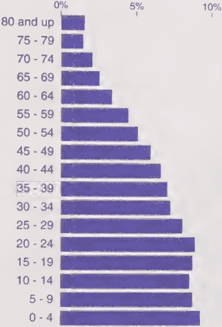

**图 8.12** 按钮倾向于加粗字体

```css
.selected {
  font-weight: bold;
}
```

图 8.13 显示了结果。

## 让按钮可点击

现在页面上已经有了按钮，我们需要让它们具备功能。我们如何告诉按钮在被点击时执行某些操作呢？通过使用**事件处理器**（event handler）。

如名所示，事件处理器处理用户方面的事件或动作。它监听某个事件，当事件发生时，它告诉浏览器执行某些操作。点击是一个事件。我们将光标悬停在元素上。在我们的案例中，我们感兴趣的是点击。

要为给元素设置事件监听器，D3 提供了 `.on()` 方法。如果我们想为按钮设置事件监听器，代码看起来如下：

```javascript
body.append("div")
  .attr("class", "buttons-container")
  .selectAll("div").data(buttonYears)
```

## 世界年龄分布

1950 1955 1960 1965 1970 1975 1980 1985 1990 1995 2000  
2005 2010 2015 2020 2030 2035 2040 2045 2050

年龄组人口占比

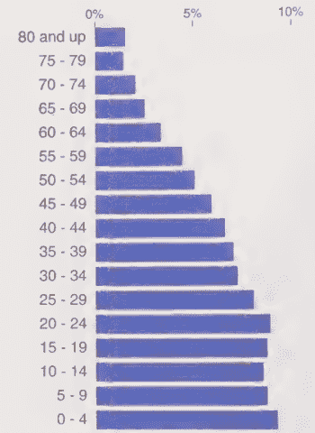

图 8.13 如天壤之别

```javascript
.enter().append("div")
  .text(function(d) { return d; })
  .attr("class", function(d) {
    if (d == year)
      return "button selected";
    else
      return "button";
  })
  .on("click", function(d) { 对于目前，一个很好的目标
```

那么我们希望在按钮被点击时发生什么呢？是让按钮变得加粗，我们可以通过给它添加 `selected` 类来实现。我们只需要对你点击的按钮创建一个选择，并将该类添加到它上面。

但等一下……我们如何做到这一点？最简单的方法是使用一点 JavaScript 魔法。JavaScript 有一个名为 `this` 的自引用变量，它可以非常容易使用，但也非常令人困惑。`this` 的所有细节都超本书的范畴，但幸运的是，在我们的案例中，它是很容易使用的。我们定义了一个在点击某些内容时触发的函数，在该函数内部，`this` 就是我们点击的那个元素。我们可以像这样创建一个 D3 选择：`d3.select(this)`。简单。

一旦我们选中了它，我们需要添加 `selected` 类。我们可以使用 `attr()` 来实现，但 D3 也有一个 `classed()` 方法可以使用，它本质上可以开启或关闭类。

```javascript
body.append("div")
  .attr("class", "buttons-container")
  .selectAll("div").data(buttonYears)
  .enter().append("div")
    .text(function(d) { return d; })
    .attr("class", function(d) {
      if (d == year)
        return "button selected";
      else
        return "button";
    })
    .on("click", function(d) {
      d3.select(this).classed("selected", true);
    });
```

这意味着是的，我们希望我们的选择拥有 `selected` 类。尝试一下吧。你会发现，尽管被点击的年份没有问题地加粗了，但其他被选中的年份仍然保持加粗状态（见图 8.14）。

这显然不是我们想要的。因此，在我们的 `.on()` 方法内部，我们需要从当前加粗的按钮中移除 `selected` 类，并将其添加到我们点击的按钮上：

```javascript
body.append("div")
  .attr("class", "buttons-container")
  .selectAll("div").data(buttonYears)
  .enter().append("div")
    .text(function(d) { return d; })
    .attr("class", function(d) {
      if (d == year)
        return "button selected";
      else
        return "button";
    })
    .on("click", function(d) {
      d3.select(".selected").classed("selected", false);
    });

d3.select(this).classed("selected", true);
```

## 世界年龄分布

1950 1955 1960 1965 1970 1975 1980 1985 1990 1995 2000  
2005 2010 2015 2020 2030 2035 2040 2045 2050

年龄组人口占比


**图 8.14** 加粗以保持

最后一点：如果有人来到我们的页面，现在他们将不知道这些年份是可点击的。为什么？因为当你把光标悬停在它们上面时，会变成一只手。你可以在 CSS 中更改它：

```css
.button {
  float: left;
  margin-left: 10px;
  font-weight: lighter;
  cursor: pointer;
}
```

## 更新图表

按钮在点击时会加粗，这很棒。但我们还希望这些按钮实际执行某些操作。当你点击时，我们希望页面上的条形进行更新以显示该年份的数据。我们如何做到这一点？我们已经有一个事件处理器来让每个按钮在点击时加粗，并让其他的停止加粗。现在我们需要事件处理器内部放置一些额外的命令来更新数据。最直观的方法是改变变量：

```javascript
body.append("div")
  .attr("class", "buttons-container")
  .selectAll("div").data(buttonYears)
  .enter().append("div")
    .text(function(d) { return d; })
    .attr("class", function(d) {
      if (d == year)
        return "button selected";
      else
        return "button";
    })
    .on("click", function(d) {
      d3.select(".selected").classed("selected", false);
      d3.select(this).classed("selected", true);
      year = d;
    });
```

记住，在这种情况下，`d` 代表数组 `buttonYears` 中的每个值。通过将 `year` 设置为 `d`，我们设置为被点击的年份。下一步是过滤数据。我们只想获取对应我们年份的数据。然后我们将该数据连接条形以更新它们的宽度。因为我们要在事件处理器内部操作数据，我们实际上需要将该事件处理器放在 `d3.csv()` 函数中。数据将异步异步加载，所以所有涉及数据的操作都需要在该函数内部进行。我们不需要在 `d3.csv()` 之外创建按钮——我们仍然想将按钮赋值给变量，然后在 `d3.csv()` 调用中引用该变量：代码如下：

```javascript
var buttons = body.append("div")
  .attr("class", "buttons-container")
  .selectAll("div").data(buttonYears)
  .enter().append("div")
    .text(function(d) { return d; })
    .attr("class", function(d) {
      if (d == year)
        return "button selected";
      else
        return "button";
    });
```

## 第 8 章 让图表交互化和动画

```javascript
// ...

// 在 d3.csv() 内部：

svg.append("g")
  .call(yAxis)
  .attr("class", "y axis");

buttons.on("click", function(d) {
  d3.select(".selected").classed("selected", false);
  d3.select(this).classed("selected", true);
  year = d;
});
```

太好了。现在我们需要过滤数据，只保留选中的年份。足够简单——我们已经做了那个过滤了。我们只需要再次使用它并重新定义数据变量 `popData`：

```javascript
buttons.on("click", function(d) {
  d3.select(".selected").classed("selected", false);
  d3.select(this).classed("selected", true);
  year = d;
  popData = data.filter(function(element) {
    return element.year == year;
  });
});
```

现在进行更新，我们需要将新的 `popData` 数组与矩形连接。这必须在事件监听器内部发生，所以我们需要一种引用这些矩形。再次，我们可以通过使用变量来解决这个问题：

```javascript
var bars = barGroup.selectAll("rect")
  .data(popData)
  .enter().append("rect")
  .attr("x", 0)
  .attr("y", function(d) { return y(d.date); })
  .attr("width", function(d) { return x(d.value); })
  .attr("height", y.rangeBand());

// ...
```

```javascript
buttons.on("click", function(d) {
  d3.select(".selected").classed("selected", false);
  d3.select(this).classed("selected", true);
  year = d;
});
```

## 添加过渡

```javascript
year = d;
popData = data.filter(function(element) {
  return element.year == year;
});
```

现在进行更新。D3 让这一切变得超级简单。记住，没有 `update()` 方法。在我们计算数据连接 `bars.data(popData)` 之后，我们的选择仍然是 `bars`。我们可以直接在该选择上应用新属性，它就会更新。在这种情况下，我们需要更新的是宽度。我们希望矩形保持在相同的位置、相同的高度并保持颜色。我们可以这样更新这些宽度：

```javascript
bars.data(popData)
  .attr("width", function(d) {
    return x(d.value);
  });
```

有自定义过渡的方法。你可能认为我们的条形增长和收缩比理想的快一点。过渡的默认持续时间为 250 毫秒，即四分之一秒。你可以使用 `duration()` 方法延长或缩短时间，该方法接受的参数是您希望过渡持续的毫秒数：

```javascript
bars.data(popData)
  .transition()
  .duration(500)
  .attr("width", function(d) {
    return x(d.value);
  });
```

尝试一下这个 500 毫秒的过渡。我不知道你们怎么想，对我看来这看起来好多了。

你还可以为过渡添加一个延迟（delay），让它不要立即开始，而是等待指定的时间（同样以毫秒为单位）再开始。尝试这个：

```javascript
bars.data(popData)
  .transition()
  .delay(500)
  .duration(500)
  .attr("width", function(d) {
    return x(d.value);
  });
```

嗯……在这种情况下并不有用。但想象一下，如果你想让几个不同的过渡按顺序发生。如果第一个耗时 500 毫秒，那么你可能想使用延迟来告诉第二个过渡等到第一个完成后再开始。

## 世界年龄分布

1950 1955 1960 1965 1970 1975 1980 1985 1990 1995 2000  
2005 2010 2015 2020 2025 2030 2035 2040 2045 2050

年龄组人口占比例

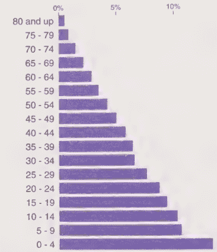

图 8.15 美好的时光

你会注意到，在我们当前的过渡中，条形图似乎在开始加速，然后在达到宽度时减速。对象进入和退出这种过渡的方式被称为“缓动”（easing），它可以通过被称为“缓动函数”（easing function）的内容进行数学描述。D3 提供了一些可以自定义的缓动函数预设，以创建不同类型的动画。例如，与其使用 D3 默认的加速和减速，不如指定缓动函数为线性的（linear），让我们的条形以恒定速度伸缩：

```javascript
bars.data(popData)
  .transition()
  .duration(500)
  .ease("linear")
  .attr("width", function(d) {
    return x(d.value);
  });
```

或者你可以使用 `"back"` 预设让它们向后拉然后弹射出去：

```javascript
bars.data(popData)
  .transition()
  .duration(500)
  .ease("back")
  .attr("width", function(d) {
    return x(d.value);
  });
```

## 196 第 8 章 使图表交互化和动画化

你可以使用 `"bounce"` 预设让过渡变得非常疯狂：

```javascript
bars.data(popData)
  .transition()
  .duration(500)
  .ease("bounce")
  .attr("width", function(d) {
    return x(d.value);
  });
```


但我明确建议不要使用`back`或`bounce`。虽然它们确实都非常有趣，但它们非常分散注意力。如果我们在年龄分布图中使用它们，看图表的人可能只会开始随机点击，以观察条形图向前弹跳，或者在停止时弹跳几次。该图表将完全不再是关于年龄分布的，而完全取决于缓动函数本身看起来什么样。

在几乎所有的情况下，坚持默认过渡是最好的，除非更改缓动函数在某种程度上有助于交互的清晰度。

## 使用键值（Keys）

关于如何正确使用数据连接（data joins）的最后一点说明。假设由于某种原因，我们的数据集是无序的。在 CSV 文件中，对于某些年份，第一个年龄组是“0-4”，但对于其他年份，它是“80及以上”或其他年龄组之一。目前，我们计算数据连接来更新条形图，第一个数据点始终连接到第一个条形，第二个数据点连接到第二个条形，依此类推。如果数据是有序的，这将是一个真正的问题。

解决方案是使用所谓的“键”（keys）。键是根据对象所连接的数据来标识对象的方法。正确的数据始终会与其所属对象的键配对。

在案例中，我们希望键是年龄组。以下是它的工作原理。首先，我们需要定义一个辅助函数来获取年龄。

```javascript
function ageKey(d) {
  return d.age;
}
```

然后我们将该函数传递给数据连接：

```javascript
bars.data(popData, ageKey)
  .enter()
  .append("rect")

  // ...
```

## 第 9 章 添加播放按钮

```javascript
year = d;

popData = data.filter(function(element) {
  return element.year == year;
});

bars.data(popData, keys)
  .transition()
  .duration(500)
  .attr("width", function(d) {
    return x(d.value);
  });
```

上面的代码就是我们为播放按钮时需要复用的代码。幸运的是，我们不需要在脚本中写两遍。所有的编程语言都有一种基础的内置机制可以帮助你轻松地复用代码：定义函数的能力。每当你编写程序并发现有一段想要复用的代码时，你的第一个想法应该是：我应该把这些代码放在一个函数里！

所以，让我们定义一个函数——称它为`update`——我们可以同时使用它：既可以在用户点击年份按钮时告诉图表更新，也可以在用户点击播放按钮时，让图表连续更新 21 次。当我们真正开始构建播放按钮时，这极大地有助于简化工作。

```javascript
function update() {

}
```

这个函数里应该包含什么？或者更好地说，它应该做什么？问题在于，它必须是通用的——它需要能够在用户点击年份按钮和用户点击播放按钮时都能更新图表。嗯……那么我们如何让它通用化呢？这样如何：如果我们能给函数传递一个年份，比如 2035，然后它就把图表更新到那一年？

```javascript
function update(updateYear) {

}
```

好了，那么里面放什么呢？首先，让我们把上面按钮事件处理器中的所有内容都加进来。

```javascript
function update(updateYear) {
  d3.select(".selected")
    .classed("selected", false);

  d3.select(this)
    .classed("selected", true);

  year = d;

  popData = data.filter(function(element) {
    return element.year == year;
  });

  bars.data(popData, keys)
    .transition()
    .duration(500)
    .attr("width", function(d) {
      return x(d.value);
    });
}
```

现在我们来逐段分析一下代码。第一小段代码是完美的：

```javascript
d3.select(".selected")
  .classed("selected", false);
```

每当图表更新时，我们希望从当前选中的年份按钮上移除`selected`类。那么下一段呢？

```javascript
d3.select(*selected)
  .classed("selected", true);
```

这段代码有点问题。你能看出为什么吗？这段代码的设计目的是从年份按钮创建一个选择，以便我们为其添加类。目前，它依赖于`this`来创建该选择。当用户刚刚点击年份按钮时，这完全没问题——`this`指向点击的那个按钮。但我们希望`update`函数是通用的。我们想传入一个年份（`updateYear`）并让它更新，我们不能依赖`this`来实现这一点。

我们可以使用`updateYear`为正确的按钮创建一个选择吗？发现 D3 有一个`filter`方法，你可以用它获取多个元素的选择，并筛选出你需要的元素。它的工作方式与数组的`filter`方法非常相似，但有一个主要区别：它是为选择（selections）设计的，你可以根据绑定的数据进行过滤。

这很有帮助，因为我们已经有一个包含所有按钮的选择，存储在名为`buttons`的变量中。我们可以使用`filter`将其缩小为仅绑定到`updateYear`的按钮。

```javascript
buttons
  .filter(function(d) {
    return d == updateYear;
  })
  .classed("selected", true);
```

太好了，让我们看下一段代码。

```javascript
year = d;
```

```javascript
popData = data.filter(function(element) {
  return element.year == year;
});
```

这很接近。我们只需要修改两个地方。首先，变量`d`在我们的`update`函数内部并不存在。但这很容易修复——我们只需要将`year`设置为`updateYear`即可。

实际上，转念一想，这样做呢？我们不需要担心更改`year`变量。相反，我们可以在之前使用`year`的地方直接使用`updateYear`。

```javascript
popData = data.filter(function(element) {
  return element.year == updateYear;
});
```

最后，让我们看看最后一段代码。

```javascript
bars.data(popData, keys)
  .transition();
```

```javascript
.duration(500)
.attr("width", function(d) {
  return x(d.value);
});
```

这里一切都是完美的。我们不需要更改任何东西。好了，让我们看看整个`update`函数。

```javascript
function update(updateYear) {
  d3.select(".selected")
    .classed(".selected", false);

  buttons
    .filter(function(d) {
      return d == updateYear;
    })
    .classed(".selected", true);

  popData = data.filter(function(element) {
    return element.year == updateYear;
  });

  bars.data(popData, keys)
    .transition()
    .duration(500)
    .attr("width", function(d) {
      return x(d.value);
    });
}
```

现在，那个代码应该放在函数的哪个位置呢？我知道，最终我们将为这个播放按钮创建一个事件处理器。我也知道该事件处理器需要定义在`d3.csv`的回调函数中。通过将播放按钮赋值给变量，我们就可以在下方引用它。

## 在页面上添加播放按钮

现在我们有了一个可以点击的播放按钮，可以告诉程序在点击发生时执行什么。让我们去设置一个事件处理器。再次，这必须放在`d3.csv`的回调函数内部。让我们把它放在年份按钮的事件处理器之后。

```javascript
buttons.on("click", function(d) {
  update(d);
});

All.on("click", function() {

});
```

## 世界年龄分布

▶ 播放所有年份

1950 1955 1960 1965 1970 1975 1980 1985 1990 1995 2000 2005 2010 2015 2020 2025 2030 2035 2040 2045 2050

年龄组人口占比例

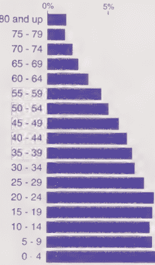

图 9.2 样式化播放

当点击那个播放按钮时，我们希望图表循环显示所有年份。我们如何做到这一点？让我们尝试使用`for`循环。

```javascript
playAllOn("click", function() {
  for (var i = 0; i < buttonYears.length; i++) {
    update(buttonYears[i]);
  }
});
```

当你运行这段代码并点击播放按钮时，你会看到什么？图表立即跳转到了 2050 年，对吧？你知道为什么吗？这是因为`for`循环非常快速地完成了所有的迭代，并且在过程中没有停下来让图表更新。我们需要使用不同的东西，某种行为像`for`循环，但在每次迭代后都会“喘口气”，而不是直接冲过它们。

我恰好知道这样一个函数——它被称为`setInterval()`。它基本上接受两个参数：第一个是函数`function()`，第二个是以毫秒为单位的时间。`setInterval()`会执行第一个参数中的函数，并不断运行它，其运行间隔等于第二个参数中指定的毫秒数。例如，如果你向`setInterval()`传递一个创建一个显示“Hello”弹出窗口的函数以及 1000 毫秒的时间，那么`setInterval()`将每秒都会产生一个新的弹出窗口。永远如此！直到你使用像`clearInterval()`这样的函数将其关闭。

好了，这在我们的情况下会如何工作呢？

```javascript
playAll.on("click", function() {
  setInterval(function() {}, 700);
});
```

我提前为我们选了一个时间：700 毫秒。记得我们更新需要 500 毫秒。额外的 200 毫秒会在每一年之间给我们提供一点停顿，这是好事。我们不希望动画运行得太快。

但选择时间是容易的部分。匿名函数内部写什么呢？就像`for`循环一样，我们希望`setInterval()`函数遍历我们所有的年份，或者等于遍历`buttonYears`数组中的所有值。我们如何做到这一点？我们可以遵循`for`循环的约定，设置一个循环计数器（`i`），每当`setInterval()`函数完成一次迭代时，它就会递增。

```javascript
playAll.on("click", function() {
  var i = 0;

  setInterval(function() {
    update(buttonYears[i]);
    i++;
  }, 700);
});
```

注意，我们在`setInterval()`函数之外初始化了这个循环计数器。为什么？因为否则，计数器会在每次迭代时被重置为 0，图表将始终显示第一年 1950。尝试运行上面的代码然后点击播放按钮。它起作用了，对吧？万岁！

好吧，它没用。我们从未关闭那个`setInterval()`。它只是一直在运行、一直运行。（不相信我？在`setInterval()`函数内部添加一个`console.log()`语句，观察它在播放序列到达 2050 年后如何继续重复。）

这本身就已经足够了。没有理由让某人的浏览器做无用功。但如果不关闭它，会产生几个显眼的问题。当播放序列到达 2050 年时，2050 年的按钮会变成粗体，但随后加粗又消失了（我们第一次调用`update()`函数确实移除了它，在这种情况下，在序列到达 2050 年之后，`update()`仍在被调用）。这导致我们的图表没有指示显示当前显示的是哪一年。此外，如果在播放序列冲过 2050 年后，点击其中一个年份按钮（1960 年），图表将更新为 1960 年，按钮会瞬间变成粗体，但随后加粗又消失了（再次，因为循环计数器仍在不断增加越来越高，且`update()`函数仍在被调用）。

显然，我们需要在到达 2050 年时触发停止。我们可以使用`clearInterval()`函数来实现。

```javascript
setInterval(function() {
  update(buttonYears[i]);
  i++;

  if (i > buttonYears.length - 1) {
    clearInterval();
  }
}, 700);
```

嗯……但正如你注意到的，上面的代码并没有按照我们想要的方式工作。原因是`clearInterval()`函数需要知道你在说什么。将我们的`setInterval()`调用赋值给变量，然后将该变量传递给`clearInterval()`就能解决问题：

```javascript
var playInterval = setInterval(function() {
  update(buttonYears[i]);
  i++;

  if (i > buttonYears.length - 1) {
    clearInterval(playInterval);
  }
}, 700);
```

## 允许用户中断

（此处后续为 HTML/CSS/JS 代码，根据要求不翻译）

```javascript
body.append("h2")
  .text("世界年龄分布*");

var playAll = body.append("div")
  .attr("class", "play-button")
  .text("▶ 所有年份*");

var buttons = body.append("div")
  .attr("class", "buttons-container")
  .selectAll("div")
  .data(buttonYears)
  .enter()
  .append("div")
  .text(function(d) {
    return d;
  })
  .attr("class", function(d) {
    if (d == year) {
      return "selected";
    } else {
      return "button";
    }
  });

body.append("div")
  .attr("class", "clearfix");

body.append("div")
  .attr("class", "top-label age-label")
  .append("p")
  .text("年龄组*");

body.append("div")
  .attr("class", "top-label")
  .append("p")
  .text("人口占比*");

body.append("div")
  .attr("class", "clearfix");

d3.csv("allData.csv", function(error, data) {
  var popData = data.filter(function(element) {
    return element.year == year;
  });

  x.domain([
    0,
    d3.max(data, function(element) {
      return element.value;
    })
  ]);

  y.domain(
    popData.map(function(element) {
      return element.age;
    })
  );
});

var svg = body.append("svg")
  .attr("width", width + margin.left + margin.right)
  .attr("height", height + margin.top + margin.bottom)
  .append("g")
  .attr(
    "transform",
    "translate(" + margin.left + "," + margin.top + ")"
  );
```

# 第 9 章 添加播放按钮

```javascript
var barGroup = svg.append("g")
  .attr("class", "bar");

var bars = barGroup.selectAll("rect")
  .data(popData, keys)
  .enter()
  .append("rect")
  .attr("x", 0)
  .attr("y", function(d) {
    return y(d.age);
  })
  .attr("width", function(d) {
    return x(d.value);
  })
  .attr("height", y.rangeBand());

svg.append("g")
  .call(xAxis);
```


`.attr("class", "x axis");`

```
svg.append("g")
  .call(yAxis)
  .attr("class", "y axis");
```

```
buttons.on("click", function(d) {
  update(d);
  clearInterval(playInterval);
});
```

```
var playInterval;

playAll.on("click", function() {
  var i = 0;
  playInterval = setInterval(function() {
    update(buttonYears[i]);
    ni++;
    if (i > buttonYears.length - 1) {
      clearInterval(playInterval);
    }
  }, 700);
});
```

```
function update(updateYear) {
  d3.select(".selected")
    .classed("selected", false);

  buttons
    .filter(function(d) { return d == updateYear; })
    .classed("selected", true);

  popData = data.filter(function(element) { return element.year == updateYear; });
```

```javascript
bars.data(popData, keys)
  .transition()
  .duration(500)
  .attr("width", function(d) { return x(d.value); });
});
```

```
</script>
<body>
</html>
```

## 总结

在本章中，我们创建了一个通用的`update()`函数，它接受年份作为输入并更新柱状图以显示该年份。这允许我们在播放按钮和单个年份按钮中复用这系列代码。然后，我们使用 Unicode 三角形字符创建了播放按钮。我们使用`setInterval()`函数让播放按钮运行起来。最后，我们在年份按钮的事件监听器中添加了`clearInterval()`函数调用，以便用户可以通过点击任何年份来中断播放序列。

## 10 自辟前程

这本书的意图是提供一个跳板，帮助你直接上手 D3。但你所进行的所有学习都发生在你尝试构建东西的过程中。本章的目标是为你提供如何继续学习 D3 的一些建议。

### 本书是学习 D3 的基础

你可以说这本书仅仅触及了皮毛。D3 可以轻松地生成多种以各种方式动画化的图表形式，而我们只制作了一个增长和缩小的基础柱状图。D3 提供了其他类型的比例尺（如线性和序数的）、除了点击之外的其他类型用户交互，以及许多用于制作更复杂图形（如弦图、树图和层级图）的预制布局。哦，还有，你还可以用 D3 制作地理地图。

但“触及皮毛”并不是合适的比喻。希望这本书已经奠定了基础。无论你最终用 D3 来做什么——是制作一张根据人口密度着色的美国县级地图，还是可视化你朋友在 Facebook 上的工作——你几乎都会使用数据连接（joins）。理解数据连接以及如何使用它们是使用 D3 编程的核心。

为了将你对选择（selections）和数据连接（data-joins）的理解提升到更高，Mike Bostock 编写了一篇非常优秀的中间级教程《选择是如何工作的》。它涵盖了本书第 5 章和第 8 章的大部分内容，但深入得更深，也更具技术性。

### 如何学习 D3

触及皮毛并不是合适的比喻。希望这本书已经奠定了基础。无论你最终用 D3 来做什么——是制作一张根据人口密度着色的美国县级地图，还是可视化你朋友在 Facebook 上的工作——你几乎都会使用数据连接（joins）。理解数据连接以及如何使用它们是使用 D3 编程的核心。

为了将你对选择和数据连接的理解提升到更高水平，Mike Bostock 编写了一篇非常优秀的中间级教程《选择是如何工作的》。它涵盖了本书第 5 章和第 8 章的大部分内容，但深入得更深，也更具技术性。

### 始终编码

D3 的

人均收入

贫困国家

一组代表世界总收入的柱

显示数据

在新窗口打开

```html
index.html

<div id="chart"></div>
<script src="https://d3js.org/d3.v5.min.js"></script>
<script>
  var data = [
    {country: "Angola", income: 500},
    {country: "Benin", income: 400},
    {country: "Burundi", income: 200},
    {country: "Comoros", income: 600},
    {country: "Central African Republic", income: 300}
  ];

  var width = 600, height = 400;
  var margin = {top: 20, right: 30, bottom: 40, left: 60};
  var w = width - margin.left - margin.right;
  var h = height - margin.top - margin.bottom;

  var x = d3.scaleBand()
    .domain(data.map(d => d.country))
    .range([0, w])
    .padding(0.1);

  var y = d3.scaleLinear()
    .domain([0, d3.max(data, d => d.income)])
    .range([h, 0]);

  var svg = d3.select("#chart")
    .append("svg")
    .attr("width", width)
    .attr("height", height)
    .append("g")
    .attr("transform", "translate(" + margin.left + "," + margin.top + ")");

  svg.selectAll("rect")
    .data(data)
    .enter()
    .append("rect")
    .attr("x", d => x(d.country))
    .attr("y", d => y(d.income))
    .attr("width", x.bandwidth())
    .attr("height", d => h - y(d.income))
    .attr("fill", "steelblue");
</script>
```

Figure 10.1 块中的一块

## 总结

本章节作为最后一章，涵盖了你如何进行 D3 的下一步工作。每当你在某个问题上卡住时，都可以参考三个主要来源：D3 API 参考文档、网页上的示例（特别是 D3.blocks）以及留言板。学习 D3 是一项挑战性工作，需要实践和耐心。记住：始终编码（Always Be Coding）！

## 附录 初学者 JavaScript

这本 JavaScript 入门指南为几乎完全没有 JavaScript 经验的人设计。它涵盖了你开始使用 D3 所需的所有知识。

### JavaScript 简述

JavaScript 是 Web 的原生语言。它是一种为了在浏览器中运行而设计的编程语言，以便网页能够响应用户的输入。JavaScript 在让网站具有交互性方面做出了大部分贡献。

请记住，当你访问一个网站时，实际上发生的只是你的浏览器正在打开一个 HTML 文件（除非网站采用不同的格式，如 PHP）。因此，如果一个网站涉及 JavaScript，HTML 文件必须在某处告诉浏览器。它通过两种方式之一来实现：

- HTML 文件本身可以包含 JavaScript。如果你在标记中添加`<script>`标签，就可以直接将 JavaScript 插入其中。
- HTML 文件可以从外部 JavaScript 文件调用（别担心：如果你以前从未这样做过，我们将在本章稍后介绍如何操作）。

与 HTML 不同，JavaScript 并不是一种标记语言。HTML 是一种非常特定的为网页元素应用结构的方法。但 JavaScript 是一门功能完整的编程语言。你可以在 JavaScript 中编写可重用的函数，定义变量，或者使用它进行基础数学计算。尽管它最初是作为用户与他们使用的网页之间的桥梁，但从那时起已被用于构建非 Web 应用程序和视频游戏。

### 浏览器 JavaScript 控制台

每个现代浏览器都内置了 JavaScript 控制台。控制台的真正目的是调试网页的 JavaScript。如果你在打开网页时启动控制台，它会告诉你（例如）页面的 JavaScript 是否有任何语法错误导致浏览器无法解析。

但你也可以将控制台作为 JavaScript 命令行。换句话说，你可以向控制台输入 JavaScript 代码行并按回车，它就会执行该代码。稍后我们将介绍如何使用控制台检查你的 JavaScript，但首先，让我们先使用控制台作为命令行的一些基础知识。

### 基础数学、变量和数据类型

如果你还没有启动浏览器，请先启动。在 Chrome 中访问控制台，你可以点击所谓的汉堡菜单（见图 A.1），然后进入 工具 > JavaScript 控制台。Windows 的快捷键是 Ctrl + Shift + J，Mac 上是 ⌘⇧-J (Option + J)。你应该能看到图 A.2 显示的窗口弹出。

现在输入`1 + 1`并按回车。控制台会自动打印答案。如果结果不是 2，我建议你躺下睡一会儿。如果这是你第一次编写 JavaScript 代码，恭喜你！基础数学在 JavaScript 中轻而易举。此外，你还可以使用减法（使用`-`运算符）、乘法（`*`）和除法（`/`），并可以使用括号规定操作顺序。还有一个运算符`%`用于计算余数（长除，天呐！）当你除两个数时得到的结果。例如，`12 % 10 = 2`。

在 JavaScript 中，你可以将值存储在变量中，如果你想多次使用该值，这非常方便。JavaScript 变量的工作原理类似于逆代数。在代数中，你通常试图弄清楚 x 是什么，但在 JavaScript 中，你可以将 x 设置为任何想要的值。

要创建一个变量，你必须先执行所谓的“声明”。列表 A.1 显示了一些示例（你应该在操作的同时将其输入控制台）：


图 A.1 汉堡菜单


图 A.2 控制台

列表 A.1 在 JavaScript 中声明变量。

```javascript
var x;
var y = 10;
var z = 5 + 2;
var myVariable, myVariable = 2, myvariable = 2 - 2;
```

### 基础数学、变量和数据类型

你通过输入`var`后跟一个空格和变量名来声明变量。以分号结束声明。重要：最佳实践是在每个 JavaScript 语句结束时加上分号。JavaScript 是一门非常宽容的编程语言，如果不包含分号，它通常也能工作，但并非总是如此。在上面的示例中，`x`被声明为变量但未定义，`y`在一条语句中声明并设置为 10，`z`在一条语句中声明并设置为`5 + 2`的结果。此外，`MyVariable`、`myVariable`和`myvariable`在同一语句中声明并以不同的方式定义或未定义，用逗号分隔。注意`var`在每个语句中只输入了一次。

现在我们有了一些变量，可以使用它们了（见列表 A.2）。

列表 A.2 使用变量进行操作。

```javascript
myVariable + y;
myVariable + myVariable;
var newVariable = myVariable;
myVariable = 4;
newVariable;
```

正如我注意到的，变量名是区分大小写的。变量名不能以数字开头，且不能包含空格（可以使用下划线）。

变量可以不仅仅是数字。它们还可以包含数组、对象，甚至函数（见列表 A.3）。在某些编程语言中，你需要在声明时指定类型，但在 JavaScript 中不需要。此外，你可以更改变量类型，例如字符串。

> 注意
`NaN`的意思是“不是数字”（Not a Number）。

我们很快就过了基础知识。示例中隐藏了许多没有说明的课程，所以值得花时间研究它们。JavaScript 是一门非常奇特的语言。有时这些特性让它比其他语言更易用，但有时它们会导致大量的困惑。如果你想了解更多，Mari Haverbeke 写了一本关于 JavaScript 奇特性的优秀书籍。全文可以在线阅读：http://eloquentjavascript.net/

### 运算符

| 运算符 | 定义 |
| --- | --- |
| == | 等于 |
| != | 不等于 |
| > | 大于 |
| < | 小于 |
| >= | 大于等于 |
| <= | 小于等于 |

### 逻辑运算符

| 运算符 | 定义 |
| --- | --- |
| && | 与 |
| \|\| | 或 |
| ! | 非 |

列表 A.4 布尔值示例。

```javascript
5.1 >= 5;
3 != 3;
5.1 >= 5 && 3 != 3;
5.1 >= 5 || 3 != 3;
!(5.1 >= 5 && 3 != 3);
"Hello" == 'Hello';
```

列表 A.5 自动转换示例。

```javascript
"I have " + 5 + " dogs";
"5" + 5;
"5" * 5;
5 * "dogs";
```

列表 A.3 JavaScript 中的基础数据类型。

```javascript
// 数字
var myWholeNumber = 5;
var myFractionalNumber = 5.1;

// 字符串
var myString = "5";
```

### 在标记和 .js 文件中编写 JavaScript

到目前为止，我们一直在浏览器的控制台中编写所有代码。但当然，当你为别人设计网页时，你无法访问那个人的控制台，你需要让浏览器随页面一起加载页面的所有 JavaScript。正如前面提到的，有两种方法可以：你可以直接将 JavaScript 放入标记中，也可以创建一个单独的 JavaScript 文件。

要在标记中放入 JavaScript，你需要使用`<script>`标签。让我们创建一个新的 HTML 文档并将其命名为 `js-basics.html`（见列表 A.6）。

列表 A.6 在标记中直接编写脚本。

```html
<!DOCTYPE html>
<meta charset="utf-8">
<body>
<script>
var myVar = "Voila! It worked!";
</script>
</body>
```

在你的浏览器中打开`js-basics.html`。没什么特别要看的。现在打开控制台（console）。如果一切顺利，你应该能够从控制台的命令行访问你所有的变量。输入`myVar`并按回车。变戏法！成功了！

向网页中添加 JavaScript 的另一种方法是调用外部 JavaScript (.js) 文件。进入你电脑上`js-basics.html`所在的目录，并创建一个名为 `script` 的文件夹。现在，在你的文本编辑器中创建一个新文件，并在顶部输入`myVar = "Voila! It worked";`。将该文件保存为 `js-basics-script.js` 并存放在你创建的 `script` 文件夹中。最后，修改你的标记语言使其看起来像列表 A.7 所示。

### 列表 A.7 调用外部 JavaScript 文件。

```html
<!DOCTYPE html>
<meta charset="utf-8">
<body>
<script src="script/js-basics-script.js"></script>
</body>
```

现在重新打开控制台并输入`myVar`。注意：为了说清楚起见，JavaScript 文件并不非要放在名为 `script` 的文件夹中。文件夹可以命名为任何名称。或者`js-basics-script.js`可以与`js-basics.html`在同一目录下。在这种情况下，当你调用`js-basics-script.js`时，你会这样写：

```html
<script src="js-basics-script.js"></script>
```

只要你的标记语言知道如何找到 JavaScript 文件，一切都会很完美。（我个人更喜欢将我的 js 文件存储在单独的文件夹中以保持整洁。）

### 数组和对象

除了上面提到的基础数据类型，JavaScript 还有几种特殊类型，能够同时包含多个值。

其中一种就是数组。值被包含在方括号中并用逗号分隔。打开`js-basics-script.js`并插入以下语句创建一个数组：

```javascript
var myArray = [1,2,3,4,5];
```


回到浏览器并打开控制台。输入 `myArray` 并按回车。它在那儿。现在，你可以通过输入 `myArray[i]`（其中 `i` 是值在数组中的位置或其索引）来单独访问任何一个值（也称为数组索引）。所以，如果我们想访问第一个值，可能会尝试输入 `myArray[1]`（见图 A.3）。

## 数组和对象

嗯……我们显然获取的是 `myArray` 中第二个位置的值，而不是第一个。这是因为在 JavaScript 中，数组第一个位置的索引是 0，而不是 1。尝试 `myArray[0]`。完美。

数组可以包含多种数据类型。你甚至可以将一个数组嵌套在另一个内部，或者将对象放入数组。列表 A.8 展示了一些有效数组的示例。

### 列表 A.8 数组示例

```javascript
var myArray = [1,2,3,4,5];

var textArray = ["one","two","three","four"];

var mixedArray = [1,true,"three"]; // 注意此处增加了引号

var nestedArray = [1,2,3,4,5];
```

让我们在控制台中玩玩 `nestedArray`。在你定义了它之后，输入 `nestedArray`，按回车，见证奇迹（见图 A.4）。

你可以看到在 1 和 5 之间显示着 `Array[3]`，其左侧有一个下拉箭头。在这种情况下，`[3]` 指的是数组中值的数量，或其长度。现在点击那个下拉箭头将其展开（见图 A.5）。

这里有 2、3 和 4，分别位于 0、1 和 2 位置。同时也显示了长度（length）。长度是数组的一个属性；你可以通过输入（例如 `nestedArray.length`）来向 JavaScript 询问数组的长度。试试看。（暂时不用担心 `proto`；它只是一个你可以用来分析和操纵数组的标准方法列表）。

所以，在 `nestedArray` 的情况下，数组正中间好坐着一个数组。你如何访问内部数组的值？你必须先访问数组本身——`nestedArray[1]` 和任何其他数组一样。

```javascript
myArray

[1, 2, 3, 4, 5]

myArray[1]
```

图 A.3 数组索引

```javascript
nestedArray

[1, Array[3] ]
```

图 A.4 嵌套在数组中的数组

```javascript
nestedArray

[1, Array[3]]

0: 1

1: 3

2: 3

3: 4

length: 3

__proto__: Array(8)
```

图 A.5 内部数组

你可以使用索引访问它的值。因此，`nestedArray[1][0]` 将给你存储在 `nestedArray` 第 1 位置的数组的第 0 位的值（见图 A.6）。

另一种可以包含多个值的数据类型是对象。列表 A.9 展示了对象的样式。

### 列表 A.9 对象示例

```javascript
var myCar = {
  make: "Nissan",
  model: "Sentra",
  color: "silver",
  year: 2004,
  new: false,
  gears: [1,2,3]
};
```

对象的属性是键值对（key-value pairs）。值可以是字符串、数字、布尔值、数组、甚至是另一个对象。访问对象的属性可以使用点符号（如 `myCar.make`）或方括号符号（如 `myCar["make"]`）。你还可以向对象添加、修改或删除属性。

```javascript
myCar.color = "red"; // 修改属性

delete myCar.year; // 删除属性
```

## 方法

方法是与对象相关的函数。它们允许对对象执行操作。定义方法只需将其赋值。

```javascript
var myCar = {
  make: "Nissan",
  model: "Sentra",
  start: function() {
    console.log("The car is starting...");
  }
};
```

调用方法可以使用点符号，例如 `myCar.start()`。方法还可以接收参数并返回值。

```javascript
var calculator = {
  add: function(a, b) {
    return a + b;
  }
};

var result = calculator.add(5, 3); // result 为 8
```

循环允许你多次执行代码块。JavaScript 中几种循环：`for`、`while` 和 `do...while`。`for` 循环用于知道执行多少次的情况。

```javascript
for (var i = 0; i < 5; i++) {
  console.log(i);
}
```

`while` 循环在条件为真时执行代码块。

```javascript
var i = 0;

while (i < 5) {
  console.log(i);
  i++;
}
```

`do...while` 循环类似于 `while` 循环，但它会在检查条件之前至少执行一次代码。

```javascript
var i = 0;

do {
  console.log(i);
  i++;
} while (i < 5);
```

错误处理允许你捕获并处理执行期间发生的错误。`try...catch` 语句用于此类。

```javascript
try {
  // 可能会抛错误的代码
  console.log(nonExistentVariable);
} catch (error) {
  // 处理错误的代码
  console.log("发生错误：" + error.message);
}
```

异步编程允许你在不阻塞代码主执行的情况下执行耗时任务。这通常通过回调、Promises 或 `async/await` 实现。

```javascript
setTimeout(function() {
  console.log("2秒钟后运行");
}, 2000);
```

## 语句和循环

让我们创建一个名为 `myCars` 的对象数组（见列表 A.11）。

### 列表 A.11 对象数组 `myCars`

```javascript
var myCars = [{
  make: "Nissan",
  model: "Sentra",
  color: "silver",
  year: 2004,
  used: true,
  gears: [1,2,3,4,5,"R"]},
  {
  make: "Ford",
  model: "Taurus",
  color: "champagne",
  year: 2001,
  used: true,
  gears: ["automatic"],
},
  {
  make: "Porsche",
  model: "911 Turbo",
  color: "black",
  year: 2013,
  used: false,
  gears: [1,2,3,4,5,6,"R"]
}];
```

# 条件语句与循环

现在，假设我们想构建一个函数来告诉我们汽车有多大。这个函数看起来会是什么样呢？首先，你可能需要传递一个对象作为参数，它将返回一个带有汽车年龄的值。或者更好一点，返回一个类似于“那辆车有 x 年了”的句子。甚至更好，“那辆 [品牌] [型号] 有 x 年了。”我会把答案放在列表 A.12 中，但请尝试自己写写。

列表 A.12 一个确定汽车年龄的函数。

```javascript
function car(obj) {
  var name = " " + obj.model;
  var age = 2013 - obj.year;
  return "That " + name + " is " + age + " years old.";
}
```

如果你对 `myCars` 数组中的每个对象运行 `car()`，你将得到如图 A.8 所示的结果。太棒了。但我想我可以还可以改进一点。没有人会说一辆车是 0 岁的；有人会说它是全新的。此外，如果一辆车是在 2012 年制造的，那么 `carAge()` 会说它有 1 岁……这完全可以理解，但不符合语言习惯。

为了解决这些问题，我们需要一种方法让 `carAge()` 在汽车是新的时返回一种结果，特别是当汽车有一岁时返回另一种，而在当汽车两岁或更久时返回第三种。我们可以使用所谓的条件语句来实现。我会给你提供语法（参见列表 A.13）并对其进行解释。

列表 A.13 用纯英语确定汽车年龄。

```javascript
function carAge(obj) {
  var name = " " + obj.model;
  var age = 2013 - obj.year;

  if (age == 0) {
    return "That " + name + " is brand new!";
  } else if (age == 1) {
    return "That " + name + " is only a year old.";
  } else {
    return "That " + name + " is " + age + " years old.";
  }
}
```

```javascript
carAge(myCars[0]);
"That Nissan Sentra is 9 years old."

carAge(myCars[1]);
"That Ford Taurus is 12 years old."

carAge(myCars[2]);
"That Porsche 911 Turbo is 8 years old."
```

图 A.8 显示汽车的年龄。

# 附录 A JavaScript 初学者

我希望代码应该是相当易读的。它使用了所谓的 `if` 语句，或者从技术上说，是一系列 `if...else` 语句。它从顶部开始。如果变量 `age` 等于 0，它将执行 `return "That " + name + " is brand new!"` 并停止。当函数遇到 `return` 语句时，它会返回值并忽略其余的代码。如果 `age` 不等于 0，那么 `car()` 会检查它是否等于 1，如果是，则返回 `"That " + name + " is only a year old"`。如果不是，它返回 `"That " + name + " is " + age + " years old."`。简单。

创建 `carAge()` 来确保一切都按预期方式运行是好的。我们的 `myCars` 包含了两辆大于 2 岁的汽车和一辆全新的汽车。这涵盖了 `if...else` 语句中三种情况中的两种。让我们添加一辆在 2012 年制造的汽车。首先，我们需要定义它。

```javascript
var jeep = {
  make: "Jeep",
  model: "Wrangler",
  color: "forest green",
  year: 2012,
  used: false,
  gears: [1,2,3,4,5,"R"]
};
```

我们可以使用一个名为 `push()` 的数组方法将 `jeep` 添加到 `myCars` 中。`push()` 简单地接受作为参数的内容，并将其附加到正在操作的数组末尾。输入 `myCars.push(jeep)`——就能起作用。现在，如果我们依次对 `myCars` 中的每个对象调用 `carAge()`，得到的就是图 A.9 所示的内容。

完美。

最后一个练习。假设我们想创建一个函数，它接收一个对象数组（如 `myCars`）并计算所有汽车的平均年龄。我们需要遍历数组中的每个对象，计算年龄，汇总所有年龄，然后除以对象的数量。我们可以使用循环来实现这一点。

在编程中，循环的设计是为了只要指定的条件为真，就反复执行一系列命令。你可能听过“无限循环”这个术语。无限循环永远不会到达指定的条件为假的；因此它会永远地循环执行命令。这是一个很酷的术语，但你在编写代码时应该尽量避免。


## `if` 语句与 `for` 循环

有几种不同的循环。有 `while` 循环和 `for` 循环。我们将从 `for` 循环开始。当你知道想要重复执行代码块多少次时，可以使用 `for` 循环。`for` 循环由三部分组成：初始化、条件和递增。

```javascript
for (var i = 0; i < 10; i++) {
  console.log(i);
}
```

在这个例子中，`var i = 0` 初始化 `i` 为 0。`i < 10` 是条件；只要条件为真，循环就会执行。`i++` 在每次迭代后将 `i` 增 1。变量 `i` 通常用作计数器，但你可以使用任何变量名。

`for` 循环也用于遍历数组。你可以使用数组的 `length` 属性来决定循环运行多少次。

```javascript
for (var i = 0; i < myCars.length; i++) {
  console.log(myCars[i]);
}
```

这个循环将打印 `myCars` 数组中的每个对象。这是处理数组的一种非常常见的方法。

还有 `while` 循环。当你不知道需要重复执行代码块多少次时，可以使用 `while` 循环。它只要条件保持真就会继续。

```javascript
var i = 0;

while (i < 10) {
  console.log(i);
  i++;
}
```

它与 `for` 循环相似，但初始化和递增位于循环体外部。确保条件最终变为假，否则会导致无限循环。

## 嵌套循环

你还可以将循环放在其他循环内部。这被称为嵌套循环。嵌套循环在处理多维数组时经常使用。

```javascript
for (var i = 0; i < 3; i++) {
  for (var j = 0; j < 3; j++) {
    console.log(i + ", " + j);
  }
}
```

在这个例子中，内层循环每在外层循环循环一次就会运行三次。这导致总共九次迭代。

现在，有趣的地方在这里。我们实际上可以使用 `i` 来索引数组。

```javascript
for (var i = 0; i < myCars.length; i++) {
  console.log(myCars[i]);
}
```

## 调试

如前提到的，你的浏览器 JavaScript 控制台的主要目的是调试。如果你的 JavaScript 语法有错误，控制台会提示该错误，并让你知道错误出现在代码的哪一行。假设你正在定义 Jeep 对象但忘记了闭括号：

```javascript
var jeep = {
  make: "Jeep",
  model: "Wrangler",
  color: "forest green",
  year: 2012,
  used: false,
  gears: [1,2,3,4,5,"R"]
}
```

当你加载 `js-basics.html` 并打开控制台时，你应该看到类似图 A.11 所示的内容。

```javascript
}

图 A.10 记录迭代
```

## 图 A.11 语法错误

存在一个语法问题：浏览器在 `script` 文件夹下的 `js-basics-script.js` 文件的第 63 行发现了一个意外的分号（至少在我这个文件版本中是那样的；你的行号可能不同）。

有时候，你的代码运行结果并不是你预期的那样，但实际上语法上并没有问题。例如，这里是 `carAvgAge()` 的一个稍微修改的版本：

```javascript
function carAvgAge2(obj) {
  var age;

  ageTotal;

  for (var i = 0; i < obj.length; i++) {
    age = 2013 - obj[i].year;
    ageTotal = ageTotal + age;
  }

  return ageTotal / obj.length;
}
```

如果你正尝试在 `myCars` 上运行这个版本的函数来计算平均年龄，你会得到 `NaN`，它代表“a number”（不是一个数字）。代码的某个地方出了问题。是时候戴上你的夏洛克·福尔姆斯猎探帽了。

`carAvgAge2` 返回的值是 `ageTotal / obj.length`。只有当涉及的两个值其中一个是 `NaN` 时，该表达式才会返回 `NaN`。我们可以使用 `console.log()` 来确定是哪一个。从 `obj.length` 开始。在 `return` 语句之前的代码插入 `console.log(obj.length)`，如下所示：

```javascript
console.log(obj.length);

return ageTotal / obj.length;
```

……然后运行代码。现在，再次尝试对 `myCars` 调用该函数。看起来并不是问题所在——`obj.length` 等于 4，正如我们预期的那样。那么 `ageTotal` 肯定有问题。让我们看看上面的那个 `for` 循环。在每次迭代中，`ageTotal` 都被递归地定义：新值被设置为当前值加上 `age`。让我们在 `age` 上也试试 `console.log()` 技巧，看看它是否是罪魁祸首：

```javascript
for (var i = 0; i < obj.length; i++) {
  age = 2013 - obj[i].year;
  console.log(age);
```


```javascript
ageTotal = ageTotal + age;
}
```

不，控制台打印的内容与你预期的完全一样：在每次迭代中，单独打印每辆汽车的年龄。`ageTotal`本身出了问题。

# 234 附录 A 初学者 JavaScript

让我们尝试模拟`for`循环的单次迭代，看看`ageTotal`发生了什么。在控制台中输入以下内容：

```javascript
var ageTotal;
var age = 12;
ageTotal = ageTotal + age;
```

我随意地将`age`设置为 12，但实际上这个值是多少并不重要。我们只是在试图理解，为什么当你将`ageTotal`的新值设置为其当前值加上上面的代码时，`ageTotal`仍然是 NaN。你可以看到`ageTotal`仍然是 NaN。进一步挖掘。输入上面的代码行，你可以看到当你运行以下内容时（你需要重置变量）：

```javascript
var ageTotal;
var age = 12;
ageTotal + age;
```

啊，事情开始变得有点头绪了。当你只声明了`ageTotal`而没有定义它时，它作为一个变量存在，但没有数据类型：它是`undefined`（未定义）。然后，当你把一个`undefined`的东西与另一个已定义的数字东西相加时，你会得到第三个不是数字的东西。我们如何解决这个问题？通过最初将`ageTotal`设置为 0，而不是让它保持未定义，正如我们在`carAvgAge()`的第一个版本中所做的那样。

# 清理人口分布数据

本附录将介绍如何查找和清理用于在本书期间构建的交互式人口分布条形图的原始数据。

所有数据均来自联合国人口司。所有的清理工作都可以通过两款免费软件完成——Open Office 和统计编程语言 R。如果你计划跟着书本学习，你应该先在你的电脑上安装这些程序（如果你使用 Microsoft Excel，则不需要 Open Office）。你可以在 https://www.openoffice.org/ 找到 Open Office，在 http://www.r-project.org 找到 R。

首先，访问联合国人口司的首页：http://www.un.org/en/development/desa/population/。从那里，你可以通过点击侧边栏中的“Estimates and Projections”（估算与预测）导航到其人口门户网站。如果你很难找到它，该页面的完整链接为 http://esa.un.org/unpd/wpp/index。然后，点击“Data in Excel format”。再次，如果需要，这里是完整链接：http://esa.un.org/wpp/Excel-Data/population.html。不要担心页面上的数据是 Excel 格式——它可以处理`.xls`文件。

你使用的数据集是“Age composition”—Both Sexes（年龄组成——男女合计）。点击该链接，表格将开始下载。完成后，在 Open Office（或 Excel）中打开它。你的文件看起来应该像 B.1 中的那个一样。

文件中有多个工作表。第一个名为“ESTIMATES”（估算），随后是“MEDIUM FERILITY”（中等生育率）、“HIGH FERILITY”（高生育率）等。我们只对其中两个感兴趣：ESTIMATES（过去年份的数据）和 MEDIUM FERILITY（中庸预测）。

让我们看看 ESTIMATES 表格。全球所有数据都在顶部。如果值显示为井号（`#`）——不要担心。这说明列宽不够以显示数字。你可以拖动顶部的边界来加宽列，直到光标变成双向箭头。

# 236 附录 B 人口分布清理

让我们尝试模拟`for`循环的这一次迭代，看看`ageTotal`发生了什么。在控制台中输入：

```javascript
var ageTotal;
var age = 12;
ageTotal = ageTotal + age;
```

我随意地将`age`设置为 12，但实际上这个值是多少并不重要。我们只是在试图理解，为什么当你将`ageTotal`的新值设置为其当前值加上上面的代码时，`ageTotal`仍然是 NaN。你可以看到`ageTotal`仍然是 NaN。进一步挖掘。输入上面的代码行，你可以看到当你运行以下内容时（你需要重置变量）：

```javascript
var ageTotal;
var age = 12;
ageTotal + age;
```


啊，事情开始变得有点头绪了。当你只声明了`ageTotal`而没有定义它时，它作为一个变量存在，但没有数据类型：它是`undefined`。然后，当你把一个`undefined`的东西与另一个已定义的数字东西相加时，你会得到第三个不是数字的东西。我们如何解决这个问题？通过最初将`ageTotal`设置为 0，而不是让它保持未定义，正如我们在`carAvgAge()`的第一个版本中所做的那样。

# 人口分布数据

本附录将介绍如何查找和清理用于在本书期间构建的交互式人口分布条形图的原始数据。

所有数据均来自联合国人口司。所有的清理工作都可以通过两款免费软件完成——Open Office 和统计编程语言 R。如果你计划跟着书本学习，你应该先在你的电脑上安装这些程序（如果你使用 Microsoft Excel，则不需要 Open Office）。你可以在<https://www.openoffice.org/>找到 Open Office，在<http://www.r-project.org>找到 R。

首先，访问联合国人口司的首页：<http://www.un.org/en/development/desa/population/>。从那里，你可以通过点击侧边栏中的“Estimates and Projections”（估算与预测）导航到其人口门户网站。如果你很难找到它，该页面的完整链接为<http://esa.un.org/unpd/wpp/index>。然后，点击“Data in Excel format”。再次，如果需要，这里是完整链接：<http://esa.un.org/wpp/Excel-Data/population.html>。不要担心页面上的数据是 Excel 格式——它可以处理`.xls`文件。

你使用的数据集是“Age composition”—Both Sexes（年龄组成——男女合计）。点击该链接，表格将开始下载。完成后，在 Open Office（或 Excel）中打开它。你的文件看起来应该像 B.1 中的那个一样。

文件中有多个工作表。第一个名为“ESTIMATES”（估算），随后是“MEDIUM FERILITY”（中等生育率）、“HIGH FERILITY”（高生育率）等。我们只对其中两个感兴趣：ESTIMATES（过去年份的数据）和 MEDIUM FERILITY（中庸预测）。

让我们看看 ESTIMATES 表格。全球所有数据都在顶部。如果值显示为井号（#）——不要担心。这说明列宽不够以显示数字。你可以拖动顶部的边界来加宽列，直到光标变成双向箭头。

# 人口分布清理

| Variant | Major area, region | birth (of) | Total population |
|---|---|---|---|
| 17 | a | 1955 | 531 |
| 18 | b | 1965 | 605 |
| 19 | c | 1975 | 693 |
| 20 | d | 1985 | 758 |
| 21 | e | 1995 | 811 |
| 22 | f | 2000 | 851 |
| 23 | g | 2005 | 886 |
| 24 | h | 2010 | 900 |
| 25 | i | 2015 | 913 |
| 26 | j | 2020 | 948 |
| 27 | k | 2021 | 973 |
| 28 | l | 1960 | 981 |
| 29 | m | 1965 | 990 |
| 30 | n | 1970 | 999 |
| 31 | o | 1975 | 999 |
| 32 | p | 1980 | 999 |
| 33 | q | 1985 | 999 |
| 34 | r | 1990 | 999 |
| 35 | s | 1995 | 999 |
| 36 | t | 2000 | 360 |
| 37 | u | 2005 | 325 |
| 38 | v | 2010 | 288 |
| 39 | w | 2015 | 255 |
| 40 | x | 2020 | 226 |
| 41 | y | 2021 | 206 |
| 42 | z | 2022 | 185 |
| | ESTIMATES | MEDIUM FILITY | LOW FILITY | CONST. | |

第一步是去删除所有不属于全球的数据。虽然有很多方法可以做到这一点，但一种方法是选择不包含全球数据的行的第一个单元格——图 B.2 中的 A31——然后一直滚动到表格的最后一行并一直滚动到最后一列。在按住 Shift 键的同时，点击最后一个单元格——图 B.3 中的 AB3085。

现在，工作表顶部有一些垃圾数据需要删除。从第 1 行到第 16 行的所有行都是必要的。你可以通过点击左侧的号来选择整行，然后通过点击你想要的第一行、按住 Shift 键并点击你想要的最后一行来选择多行。现在——点击第 1 行，按住 Shift 键并点击第 16 行。完成后，你可以右键点击行号并选择“删除行”，如图 B.4 所示。

接下来，删除顶部的联合国标志（如图 B.5 所示），只需选中它并按空格键。

看起来好多了，还有一些列可以删除。那个值没有意义，所以你可以删除 A 列，我们不需要跟踪这些。

## 附录 B 清理人口分布数据

| 索引 | 变体 | 主要区域、地区、国家或区域 |
|---|---|---|
| 17 | 1 估计 | 世界 |
| 18 | 2 估计 | 世界 |
| 19 | 3 估计 | 世界 |
| 20 | 4 估计 | 世界 |
| 21 | 5 估计 | 世界 |
| 22 | 6 估计 | 世界 |
| 23 | 7 估计 | 世界 |
| 24 | 8 估计 | 世界 |
| 25 | 9 估计 | 世界 |
| 26 | 10 估计 | 世界 |
| 27 | 11 估计 | 世界 |
| 28 | 12 估计 | 世界 |
| 29 | 13 估计 | 世界 |
| 30 | 14 估计 | 发达地区 |
| 31 | 15 估计 | 发达地区 |
| 32 | 16 估计 | 发达地区 |
| 33 | 17 估计 | 发达地区 |

**图 B.2** 包含无关数据的第一个单元格

| V | W | X | Y | Z | AA | AB |
|---|---|---|---|---|---|---|
| 3072 | 2 | | 1 | 0 | 0 | 0 |
| 3073 | 0 | | | | | | |
| 3074 | | 0 | | | | | | |
| 3075 | | 0 | | | | | | |
| 3076 | | 0 | | | | | | |
| 3077 | | 0 | | | | | | |
| 3078 | | 0 | | | | | | |
| 3079 | 1 | | | | | | | |
| 3080 | | 1 | | | 0 | 0 | 0 |
| 3081 | 1 | | | 0 | 0 | 0 | 0 |
| 3082 | 1 | | | 0 | 0 | 0 | 0 |
| 3083 | | 1 | | | 0 | 0 | 0 | 0 |
| 3084 | 1 | | | 1 | 0 | 0 | |
| 3085 | 1 | | | | | 0 | 0 |

**图 B.3** 带有无关数据的最后一个单元格

| | |
|---|---|
| 2 | 单元格格式... |
| 3 | |
| 4 | 行高... |
| 5 | 自动行高... |
| 6 | 插入行 |
| 7 | 删除行 |
| 8 | 删除内容... |
| 9 | |
| 10 | 隐藏 |
| 11 | 显示 |
| 12 | 剪切 |
| 13 | 复制 |
| 14 | 粘贴 |
| 15 | 选择性粘贴... |
| 16 | |

**图 B.4** 删除标题行

## 附录 B 清理人口分布数据

| D | E | F |
|---|---|---|
| 注释 | 参考日期（截至 7 月1 日） |
| | 900 | 1950 |
| | 900 | 1955 |
| | 900 | 1960 |
| | 900 | 1965 |
| | 900 | 1970 |
| | 900 | 1975 |
| | 900 | 1980 |
| | 900 | 1985 |
| | 900 | 1990 |
| | 900 | 1995 |
| | 900 | 2000 |
| | 900 | 2005 |
| | 900 | 2010 |

图 B.5 去掉那个标志

| F | G | H | I | J |
|---|---|---|---|---|
| 16 | 全男女总人口，按 | | | | |
| 17 | 参考 | 0-4 | 5-9 | 10-14 | 15-19 |
| |（截至 7 月1 日） | 2015 | 634 175 | 603 817 | 589 119 |
| 18 | 2020 | 666 097 | 658 727 | 630 771 | 603 313 |
| 19 | 2025 | 668 233 | 661 658 | 655 969 | 627 843 |
| 20 | 2030 | 663 764 | 658 124 | 659 148 | 653 250 |
| 21 | 2035 | 669 458 | 658 403 | 655 909 | 656 644 |
| 22 | 2040 | 677 340 | 664 644 | 452 412 | 652 602 |
| 23 | 2045 | 668 671 | 673 035 | 662 847 | 654 269 |
| 24 | 2050 | 684 194 | 678 836 | 671 418 | 660 852 |

图 B.6 我们知道这些年份是一个预测，我们将使用中位数。同时也删除 D、E 列。选择 F18 到 AA25，并复制。然后将其粘贴到工作表中。现在，向右滚动，注意刚刚粘贴的数据并没有完全对齐（图 B.7）。目前，这些数据需要移动到 80+ 列。

# 附录 B 人口分布

| A | B | C | D | E |
|---|---|---|---|---|
| 参考日期（截至 7 月1 日） | 0-4 | 5-9 | 10-14 | 15-19 |
| 1 | 1950 | 337 251 | 269 704 | 238 747 |
| 2 | 1955 | 405 738 | 314 146 | 263 500 | 254 932 |
| 3 | 1960 | 433 231 | 381 461 | 308 046 | 256 324 |
| 4 | 1965 | 479 684 | 410 360 | 373 429 | 302 363 |
| 5 | 1970 | 520 790 | 461 057 | 455 224 | 368 391 |
| 6 | 1975 | 541 263 | 502 057 | 455 229 | 399 769 |
| 7 | 1980 | 545 877 | 524 690 | 497 005 | 450 683 |
| 8 | 1985 | 592 478 | 531 053 | 521 140 | 492 895 |
| 9 | 1990 | 648 668 | 578 401 | 527 416 | 516 614 |
| 10 | 1995 | 624 783 | 631 825 | 575 407 | 525 100 |
| 11 | 2000 | 604 456 | 613 690 | 628 646 | 571 501 |
| 12 | 2005 | 614 533 | 595 740 | 611 503 | 624 735 |
| 13 | 2010 | 641 627 | 607 380 | 603 596 | 606 056 |
| 14 | 2015 | 666 097 | 634 175 | 603 817 | 589 119 |
| 15 | 2020 | 668 233 | 658 727 | 630 771 | 600 313 |
| 16 | 2025 | 664 068 | 661 968 | 655 829 | 627 849 |
| 17 | 2030 | 663 764 | 658 124 | 659 148 | 653 250 |
| 18 | 2035 | 669 455 | 658 403 | 655 909 | 653 664 |
| 19 | 2040 | 677 340 | 664 644 | 452 412 | 652 602 |
| 20 | 2045 | 682 671 | 673 035 | 662 847 | 654 269 |
| 21 | 2050 | 684 194 | 678 836 | 671 418 | 660 852 |

图 B.7 将所有数据合并到一个工作表

| R | S | T | U | V |
|---|---|---|---|---|
| | 80+ | 80-84 | 85-89 | 90-94 | 95-99 | 100+ |
| | 14 136 | 36 279 | 15 389 | 4 463 | 862 107 |
| | 16 086 | | | | | |
| | 18 597 | | | | | |
| | 21 479 | | | | | |
| | 25 730 | | | | | |
| | 31 046 | | | | | |
| | 37 994 | | | | | |
| | 46 931 | 41 209 | 18 110 | 5 778 | 140 |
| | | 42 328 | 21 799 | 7 729 | 1 443 | 181 |
| | | 54 048 | 23 517 | 9 803 | 1 882 | 246 |
| | | 64 356 | 31 200 | 9 975 | 2 464 | 353 |
| | | 70 765 | 38 926 | 13 504 | 2 929 | 498 |
| | | 80 376 | 41 403 | 16 394 | 4 164 | 639 |
| | | 87 600 | 47 779 | 18 895 | 5 253 | 926 |
| | | 109 250 | 53 317 | 22 629 | 6 285 | 1 241 |
| | | 137 984 | 67 705 | 53 324 | 7 632 | 1 575 |
| | | 155 248 | 65 737 | 33 324 | 9 156 | 1 1987 | |
| | | 182 874 | 98 996 | 42 225 | 12 1205 | 2 2499 | |
| | | 206 325 | 116 872 | 49 475 | 15 1513 | 3 392 | |

图 B.8 数据没有完全对齐。你可以通过选择 R15、剪切并粘贴到单元格 C5 来实现。结果如图 B.10 所示。现在，问题是，我们想要比较所有年份。目前，从 1950 年到 1985 年的每年，最大的年龄组都是 80+。之后没有细分。我们必须对这些年份进行排序，以便它们

| V | W | X | Y | Z | AA |
|---|---|---|---|---|---|
| 75-79 | 80-84 | 85-89 | 90-94 | 95-99 | 100+ |
| 113 975 | 70 765 | 36 926 | 13 504 | 2 929 | 499 |
| 122 123 | 80 376 | 41 403 | 16 394 | 4 164 | 839 |
| 150 156 | 150 56 | 47 779 | 18 895 | 22 628 | 241 |
| 188 842 | 109 250 | 53 531 | 22 629 | 25 674 | 575 |
| 245 042 | 148 551 | 85 737 | 33 324 | 9 156 | 187 |
| 274 220 | 187 974 | 98 356 | 42 225 | 12 205 | 499 |
| 292 283 | 208 326 | 116 872 | 49 475 | 15 513 | 392 |
| 301 484 | 222 527 | 133 347 | 59 807 | 18 784 | 447 |
| 309 730 | 239 917 | 145 707 | 68 967 | 23 098 | 646 |
| 381 111 | 296 932 | 153 265 | 76 897 | 26 995 | 154 |
| 371 973 | 296 016 | 201 404 | 95 931 | 34 207 | 38 |
| 385 771 | 297 743 | 202 434 | 109 458 | 142 | 979 |
| 412 307 | 308 672 | 202 314 | 113 963 | 48 761 | 200 |
| 438 578 | 330 618 | 214 234 | 115 805 | 51 351 | 351 |
| 449 010 | 354 608 | 238 535 | 123 711 | 55 687 | 279 |
| 454 244 | 365 766 | 252 715 | 135 971 | 55 687 | 209 |

图 B.9 移动年龄组

| R | S | T | U | V |
|---|---|---|---|---|
| | 80+ | 80-84 | 85-89 | 90-94 | 95-99 | 100+ |
| | 14 136 | 36 279 | 15 389 | 4 463 | 862 107 |
| | 16 086 | | | | | |
| | 18 507 | | | | | |
| | 21 479 | | | | | |
| | 25 730 | | | | | |
| | 31 046 | | | | | |
| | 37 994 | | | | | |
| | 46 931 | 41 209 | 18 810 | 5 778 | 112 | 140 |
| | | 42 328 | 21 799 | 7 729 | 1 443 | 181 |
| | | 54 048 | 23 517 | 9 803 | 1 882 | 246 |
| | | 64 356 | 31 200 | 9 975 | 2 464 | 353 |
| | | 70 765 | 38 926 | 13 504 | 2 929 | 498 |
| | | 80 376 | 41 403 | 16 394 | 4 164 | 639 |
| | | 87 600 | 47 779 | 18 895 | 5 253 | 926 |
| | | 109 250 | 53 317 | 22 629 | 6 285 | 1 241 |
| | | 137 984 | 67 705 | 53 324 | 7 632 | 1 575 |
| | | 155 248 | 65 737 | 33 324 | 9 156 | 1 1987 | |
| | | 182 874 | 98 996 | 42 225 | 12 1205 | 2 2499 | |
| | | 206 325 | 116 872 | 49 475 | 15 1513 | 3 392 | |

图 B.10 移动单元格

## 附录 B 清理人口分布数据

具有可比性。从 1990 年开始，我们必须计算 80 岁及以上的人数。

你可以使用`sum`公式来实现。点击单元格 R10（1990 年的 80+ 列）并开始输入`=sum(`等。一旦你开始这样输入公式（包括那个括号），你就可以选择想要求和的单元格了。使用方向键和 Shift 键的组合完成此操作。使用右箭头移动到单元格 S10，然后按住并持续按下右箭头，直到到达单元格 W10。这将选中所有这些单元格。然后关闭括号并按回车。结果如图 B.11 所示。

现在，你需要对所有其他行重复此公式。但不要一个一个地手动输入公式。那样太枯味了，而且有更好的方法。如果你选择单元格 R10（你刚刚输入公式的单元格），你会发现选择框的右下角有一个实方块，如图 B.12 所示。

如果你将光标悬停在该方块（即填充句柄）上，会出现一个小十字。双击它，公式将自动填充其余行，如图 B.13 所示。很神奇，对吧？

现在你可以删除最后的那些列了——从 80 到 84 列再到 100+ 列。我们不再需要它们了。等一下！别急。我们在 80+ 列中的公式依赖于末尾的其他列。如果我们：

| Q | R | S | T | U | V | W | 100+ |
|---|---|---|---|---|---|---|---|
| 75-79 | 80+ | | | | | | |
| 21,846 | 14,136 | | | | | | |
| 23,995 | 18,597 | | | | | | |
| 26,681 | 16,086 | | | | | | |
| 30,058 | 21,479 | | | | | | |
| 33,566 | 25,730 | | | | | | |
| 40,151 | 31,045 | | | | | | |
| 48,655 | 39,774 | | | | | | |
| 56,550 | 46,931 | | | | | | |
| 63,531 | 57,100 | 36,279 | 15,389 | 4,463 | 862 | 107 | |
| 64,473 | | 41,208 | 18,510 | 5,778 | 1,102 | 140 | |
| 79,044 | | 42,328 | 21,799 | 7,729 | 1,443 | 181 | |
| 91,600 | | 54,048 | 23,517 | 8,803 | 1,882 | 246 | |
| 101,540 | | 64,836 | 31,900 | 9,975 | 2,464 | 353 | |
| 113,975 | | 70,765 | 36,926 | 13,504 | 2,929 | 499 | |
| 122,123 | | 80,376 | 41,403 | 16,394 | 4,164 | 639 | |
| 150,198 | | 87,603 | 47,779 | 18,885 | 5,253 | 926 | |
| 188,842 | | 109,250 | 53,531 | 22,528 | 6,285 | 1,241 | |
| 210,089 | | 137,984 | 67,705 | 25,274 | 7,632 | 1,755 | |
| 245,042 | | 155,248 | 85,737 | 33,334 | 9,156 | 1,987 | |
| 274,220 | | 182,874 | 98,066 | 42,225 | 12,205 | 2,499 | |
| 292,863 | | 206,325 | 116,872 | 49,475 | 15,513 | 3,392 | |

**图 B.11.** 汇总所有 80+ 年龄组（img/0772fde88237540dc00155fda693004_262_0png）

**图 B.12** 寻找一种简单的复制方法——如果直接删除，我们会得到错误。首先，我们必须复制 80+ 列中包含`sum`公式的单元格——从 R10 到 R22。复制后，转到“编辑 (Edit) > 选择性粘贴 (Paste Special)”并勾选“数值 (Numbers)”（见图 B.14）。现在你可以像图 B.15 那样切掉末尾。

| | R | S | T | U | V | W |
|---|---|---|---|---|---|---|
| | 80+ | 80-84 | 85-89 | 90-94 | 95-99 | 100+ |
| | 21,846 | 14,136 | | | | |
| | 23,995 | 18,597 | | | | |
| | 26,681 | 16,086 | | | | |
| | 30,058 | 21,479 | | | | |
| | 33,566 | 25,730 | | | | |
| | 40,151 | 31,045 | | | | |
| | 48,655 | 39,774 | | | | |
| | 56,550 | 46,931 | | | | |
| | 63,531 | 57,100 | 36,279 | 15,389 | 4,463 | 862 | 107 |
| | 64,473 | | 41,208 | 18,510 | 5,778 | 1,102 | 140 |
| | 79,044 | | 42,328 | 21,799 | 7,729 | 1,443 | 181 |
| | 91,600 | | 54,048 | 23,517 | 8,803 | 1,882 | 246 |
| | 101,540 | | 64,836 | 31,900 | 9,975 | 2,464 | 353 |
| | 113,975 | | 70,765 | 36,926 | 13,504 | 2,929 | 499 |
| | 122,123 | | 80,376 | 41,403 | 16,394 | 4,164 | 639 |
| | 150,198 | | 87,603 | 47,779 | 18,885 | 5,253 | 926 |
| | 188,842 | | 109,250 | 53,531 | 22,528 | 6,285 | 1,241 |
| | 210,089 | | 137,984 | 67,705 | 25,274 | 7,632 | 1,755 |
| | 245,042 | | 155,248 | 85,737 | 33,334 | 9,156 | 1,987 |
| | 274,220 | | 182,874 | 98,066 | 42,225 | 12,205 | 2,499 |
| | 292,863 | | 206,325 | 116,872 | 49,475 | 15,513 | 3,392 |

**图 B.13** 自动填充的魅力（img/0772fde88237540dc00155fda693004_263_0png）

**图 B.14** 全部粘贴原始数值

## 附录 B 清理人口数据

好了。现在我们需要将人口数字转换为百分比。怎么做呢？计算每年总人口，并将每个年龄组的值除以该总数。很简单，创建一个新列用于总计并使用`sum`公式完成。结果是图 B.16。

| 60-64 | 65-69 | 70-74 | 75-79 | 80+ |
|---|---|---|---|---|
| 73,348 | 55,075 | 37,370 | 21,846 | 14,136 |
| 76,998 | 59,485 | 40,774 | 23,995 | 16,086 |
| 85,598 | 63,939 | 44,665 | 26,681 | 16,597 |
| 95,795 | 70,684 | 48,199 | 30,058 | 21,479 |
| 107,974 | 82,362 | 56,048 | 33,568 | 25,730 |
| 117,564 | 93,786 | 64,164 | 40,351 | 31,046 |
| 140,566 | 103,190 | 76,472 | 54,656 | 37,994 |
| 159,575 | 124,412 | 85,650 | 63,531 | 46,931 |
| 171,014 | 141,395 | 103,480 | 64,673 | 57,100 |
| 187,315 | 152,398 | 118,139 | 79,094 | 72,980 |
| 195,282 | 168,016 | 129,137 | 91,600 | 88,496 |
| 291,342 | 213,017 | 152,312 | 117,935 | 124,622 |
| 318,764 | 265,858 | 185,108 | 185,108 | 122,723 |
| 364,891 | 291,961 | 233,883 | 150,106 | |
| 402,028 | 335,850 | 256,020 | 188,642 | |
| 423,768 | 371,311 | 296,296 | 210,089 | |
| 432,060 | 392,626 | 329,387 | 245,042 | |
| 530,790 | 446,986 | 358,142 | 292,863 | |

**图 B.15** 不再需要这些列了

| 70-74 | 75-79 | 80+ | 总计 |
|---|---|---|---|
| 37,370 | 21,846 | 14,136 | |
| 40,774 | 23,995 | 16,086 | |
| 44,665 | 26,681 | 16,597 | |
| 48,199 | 30,058 | 21,479 | |
| 56,048 | 33,568 | 25,730 | |
| 64,164 | 40,351 | 31,046 | |
| 76,472 | 54,656 | 37,994 | |
| 85,650 | 63,531 | 46,931 | |
| 103,480 | 64,673 | 57,100 | |
| 118,139 | 79,094 | 72,980 | |
| 129,137 | 91,600 | 88,496 | |
| 152,312 | 117,935 | 124,622 | |
| 185,108 | 185,108 | 122,723 | |
| 291,961 | 233,883 | 150,106 | |
| 335,850 | 256,020 | 188,642 | |
| 371,311 | 296,296 | 210,089 | |
| 392,626 | 329,387 | 245,042 | |
| 446,986 | 358,142 | 292,863 | |

## 附录 B 清理人口分布数据

我们只想让分子移动。事实证明，公式中有一种锁定列和行引用的方法，这样当你将其复制到其他单元格时，它们就不会改变。你可以通过在公式中的列字母或行号前插入美元符号来完成这一点。

尝试在 T2 单元格中输入以下公式：`=$B2/$2`。然后通过交叉标记将该公式拖到 U2。结果如图 B.20 所示。

看起来好多了。现在将公式拖到所有选定的 T2 到 AJ2 单元格，然后双击带有交叉标记的填充句将公式向下填充，如图 B.21 所示。

太棒了，大部分已经完成了。现在你已经有了百分比，就不再需要绝对值了。但你不能直接删除包含这些值的列。


`=B2/$2`

| S | T | U |
|---|---|---|
| 总计 | 0-4 | 5-9 |
| 0.252779 | 0.133523 | 0.201894 |
| 2.86365 |  |  |

**图 B.19** 拖动公式

`=C2/$2`

| S | T | U |
|---|---|---|
| 总计 | 0-4 | 5-9 |
| 0.252779 | 0.133523 | 0.106804 |
| 2.86365 |  |  |

**图 B.20** 锁定分母

| T | U | V | W | X | Y |
|---|---|---|---|---|---|
| 0-4 | 5-9 | 10-14 | 15-19 | 20-24 | 25-29 |
| 0.133527 | 0.106804 | 0.102164 | 0.094524 | 0.078956 | 0.076903 |
| 0.149186 | 0.113731 | 0.095411 | 0.092315 | 0.083914 | 0.077965 |
| 0.143693 | 0.126061 | 0.101797 | 0.088368 | 0.080528 | 0.074695 |
| 0.147047 | 0.129536 | 0.098837 | 0.087338 | 0.081388 | 0.075382 |
| 0.140967 | 0.124096 | 0.109786 | 0.099802 | 0.082668 | 0.076835 |
| 0.132951 | 0.123327 | 0.118219 | 0.099186 | 0.094035 | 0.087738 |
| 0.126697 | 0.113511 | 0.101728 | 0.095025 | 0.089052 | 0.083642 |
| 0.121868 | 0.108865 | 0.103111 | 0.091913 | 0.085137 | 0.080037 |
| 0.116468 | 0.107722 | 0.102911 | 0.091793 | 0.086941 | 0.082522 |
| 0.110818 | 0.102925 | 0.099015 | 0.090562 | 0.086448 | 0.081642 |
| 0.106464 | 0.101502 | 0.096411 | 0.090552 | 0.085438 | 0.079943 |
| 0.101943 | 0.098431 | 0.093719 | 0.090505 | 0.085833 | 0.081815 |
| 0.098231 | 0.095701 | 0.087367 | 0.084342 | 0.082682 | 0.082069 |
| 0.096895 | 0.093832 | 0.084177 | 0.077935 | 0.075783 | 0.073363 |
| 0.092155 | 0.088147 | 0.084113 | 0.077713 | 0.075056 | 0.071961 |
| 0.090768 | 0.087719 | 0.079117 | 0.075113 | 0.074268 | 0.070846 |
| 0.076565 | 0.073025 | 0.075172 | 0.071013 | 0.074268 | 0.070846 |
| 0.074937 | 0.073253 | 0.072625 | 0.072311 | 0.072291 | 0.069239 |
| 0.073868 | 0.072532 | 0.071533 | 0.071389 | 0.069729 | 0.067929 |
| 0.071632 | 0.071052 | 0.070296 | 0.069193 | 0.068162 | 0.067383 |

**图 B.21** 计算百分比数值，因为百分比是从它们计算出来的。首先，你必须复制所有的百分比并像之前对 B 列做的那样粘贴回来，然后你可以删除 S 列。最后一步是把第一个标题更改为更简单的名称（见图 B.22）。最后一步是把此工作表另存为……，并在文件类型下选择“CSV”。将文件命名为`rawData`，如图 B.23 所示。点击弹出的框。然后关闭文件。现在，打开 R。关于 R 有很多需要了解的，我们要如何处理这些数据。在第 7 章中，我们将展示如何从 CSV 提取数据并转换为数组。记住在 CSV

| year | A | B | C | D | E |
|---|---|---|---|---|---|
|  | 0-4 | 5-9 | 10-14 | 15-19 | 20-24 |
| 1950 | 0.135233 | 0.507804 | 0.103244 | 0.094534 | 0.087896 |
| 1955 | 0.146918 | 0.117351 | 0.094541 | 0.092315 | 0.089141 |
| 1960 | 0.151968 | 0.121651 | 0.107799 | 0.093618 | 0.090258 |
| 1965 | 0.154601 | 0.125138 | 0.110751 | 0.097137 | 0.091689 |
| 1970 | 0.141007 | 0.129401 | 0.108746 | 0.098898 | 0.098026 |
| 1975 | 0.132910 | 0.129237 | 0.111829 | 0.099838 | 0.098048 |
| 1980 | 0.126098 | 0.121931 | 0.112713 | 0.101498 | 0.098468 |
| 1985 | 0.121819 | 0.118993 | 0.106495 | 0.104180 | 0.095137 |
| 1990 | 0.116418 | 0.113852 | 0.099216 | 0.097093 | 0.094997 |
| 1995 | 0.108838 | 0.105112 | 0.102508 | 0.093152 | 0.096648 |
| 2000 | 0.098642 | 0.103152 | 0.102508 | 0.099153 | 0.096842 |
| 2005 | 0.094939 | 0.091541 | 0.095052 | 0.093952 | 0.093843 |
| 2010 | 0.093338 | 0.090621 | 0.088367 | 0.084137 | 0.083928 |
| 2015 | 0.090937 | 0.086594 | 0.082648 | 0.080482 | 0.082108 |
| 2020 | 0.086501 | 0.083632 | 0.078167 | 0.077593 | 0.072163 |
| 2025 | 0.083581 | 0.080487 | 0.077311 | 0.077545 | 0.079856 |

**图 B.22** 简化，简化


**图 B.23** 保存文件

## 附录 B 清理人口分布数据

变成它自己的 JavaScript 对象。为了能够以我们希望的方式使用数据连接（data-joins），每个对象包含一个数据点是合理的。因此，我们 CSV 文件中的每行都应该只有一个数据点。`rawData.csv` 的情况并非如此——目前每行包含 17 个数据点。所以我们需要对数据进行一些处理以达到正确的格式。

关于我所说的“一个数据点”的说明。数据点可以（也应该）不仅仅是一个数值——它还可以关联描述信息。例如，2010 年 0 到 4 岁之间的人口占 9.3%。这个值——0.093 是数据点，但还有两条描述信息：年份（2010）和组（0-4）。在我们理想的 CSV 文件中，这些描述信息与其数据点位于同一行。为什么呢？因为你希望当它被 D3 解析时，它是 JavaScript 对象的一部分。然后你可以用它，例如创建比例尺、在柱状图中定位柱条，或者在计算数据连接时（如我们在书中做的那样）使用键。

事实证明，R 中有一个包（你可以把 R 包想象成 JavaScript 库），它有一个函数可以获取像`rawData.csv`那样的表格并将其“熔化”（melt）为每个数据点都单独占一行。事实上，该函数名为`melt`，包名为`reshape`。

打开 R。如图 B.24 所示的界面是一个控制台，你在其中输入 R 语言的代码。（你的控制台可能经过了颜色自定义。）

```text
R version 3.0.2 (2013-09-25) -- Frisbee Sailing

Copyright (C) 2013 The R Foundation for Statistical Computing

Platform: x86_64-apple-darwin10.8.0 (64-bit)

R 是免费软件且不提供任何保证。

欢迎在某些条件下重新分发。

输入 'license()' 或 'licence()' 查看分发详情。

支持自然语言但在英语语言区域运行。

R 是一个有许多贡献者的协作项目。

输入 'contributors()' 获取更多信息以及

'citation()' 关于如何引用 R 或包。

输入 'demo()' 查看一些演示，输入 'help()' 获取在线帮助，

'help.start()' 一个 HTML 浏览器获取帮助。

输入 'q()' 退出 R。

[R.app GUI 1.6.2 (6558) x86_64-apple-darwin10.8.0 (64-bit)]

[History restored from /Users/ritzkey/R.app.history]
```


**图 B.24** R 控制台

同样也有名称，但如果 CSV 中没有命名，它们将仅被编号。你可以看到我们列的名称看起来有点奇怪。R 不允许列名以数字开头，因此当你读取 CSV 文件时，它会在所有这些名称前加上一个 "X"。它也不喜欢列名中使用破折号或连字符，因为这些符号被保留用于减法运算。所以它会将它们替换为点。我们稍后更改这些值，但首先让我们来进行熔化（melting）操作！

在控制台中输入：`dataMelt <- melt(data, id="year")`。然后输入 `dataMelt` 来检查刚刚发生了什么（如图 B.28 所示）。

很棒，现在吧？现在每行只有一个数据点，且每行都包含了相关的年份和年龄组。你可能在疑惑 `id="year"` 参数参数是怎么的。在我们名为 `data` 的原始数据框中，年份已经作为描述性信息存在了。

| year | X0.4 | X5.9 | X10.14 |
| :--- | :--- | :--- | :--- |
| 1950 | 0.13352371 | 0.10678043 | 0.10321438 |
| 1955 | 0.14691858 | 0.11735309 | 0.09541410 |
| 1960 | 0.14316933 | 0.12606114 | 0.10179973 |
| 1965 | 0.14408717 | 0.12326364 | 0.11217040 |
| 1970 | 0.14109073 | 0.12490806 | 0.10978458 |
| 1975 | 0.13295512 | 0.12332472 | 0.11182188 |
| 1980 | 0.12269527 | 0.11793309 | 0.11171039 |
| 1985 | 0.12181888 | 0.10918930 | 0.10694561 |
| 1990 | 0.12116478 | 0.10872220 | 0.09913164 |
| 1995 | 0.10881275 | 0.11003914 | 0.10229900 |
| 2000 | 0.09864323 | 0.10015019 | 0.10259082 |
| 2005 | 0.09433904 | 0.09145407 | 0.09387387 |

图 B.27 观察数据

| year variable | value |
| :--- | :--- |
| 1950 | X0.4 0.13352372 |
| 1955 | X0.4 0.14691858 |
| 1960 | X0.4 0.14316932 |
| 1965 | X0.4 0.14408719 |
| 1970 | X0.4 0.14109073 |
| 1975 | X0.4 0.13295519 |
| 1980 | X0.4 0.12269524 |
| 1985 | X0.4 0.12181887 |
| 1990 | X0.4 0.12116476 |
| 1995 | X0.4 0.10881275 |

图 B.28 一个美味的 dataMelt

## 附录 B 清理人口分布数据

换句话说，每一行都有一个年份值。我们希望在熔化数据框后仍然保持这种情况。

在 `reshape2` 数据包的术语中，描述性信息被称为 ID 变量。通过告诉 `melt` 函数设置 `id = "year"`，你将年份保留为 ID 变量，并保留每一行的名称。这是一件好事。

现在，我们可以将数据（真香）导出到一个新的 CSV 文件，然后用 Open Office 打开它（当然，在 R 中也可以做到这一点，但没那么直观）。这里是创建新 CSV 文件所需的代码：`write.csv(dataMelt,"allData.csv",row.names=FALSE)`。第一个参数——`dataMelt`——是我们想要导出的帧，第二个参数——`allData.csv`——是我们想要命名的文件名。

# 256 索引

## C
- `axis.tickFormat()` 方法, 136
- `call()` 方法, 136
- `axis.tickPadding()` 方法, 136
- 回调函数, 161
- `axis.ticks()` 方法, 136
- 调用, js 函数, 224
- `axis.tickSize()` 方法, 136
- 汽车年龄, 确定, 228–232
- `axis.tickValues()` 方法, 136
- Carter, Shane, 9

## B
- 级联样式表 (CSS)。参见 CSS
- “后退”预设, 过渡, 196
- (级联样式表),
- 柱状图, 参见人口分布图 (Population distribution chart)。
- JavaScript 变量的大小写敏感性, 221
- 链式调用 (Chaining methods), 74–77
- 从数据连接 (data-joins) 构建, 111–119
- 字符编码器
  - 描述, 23–24
  - 在 SVG 中, 32–33
  - Unicode, 33
- 柱状图,从选择中构建
  - 代码示例, 81–98–103
  - 常量, 97–98
  - 显式约束, 97–98
- 人均死亡人数, 5
- 循环, 98–103
- 设计元素/属性, 6
- 数学, 95
- 信息图的增长, 2
- 变量, 93–96
- 重要性, 2–
- 柱状图, 参见 58–59
- 映射,
  - 创建一个, 58–59
- 页边距, 定义, 132–135
- 入门, 51–52
- 内容质量, 5–6
- 标题, 57–58–63
- 标签, 57–58–63
- 美国政府债务, 3–
- 视觉叙故事, 7
- 缩放, 55–57
- 图表, 添加轴
  - 设置宽度, 52–55
  - 添加轴, 148–151
  - 移动条形, 57–58
- 柱状图, 58–59
- 出生率, 数据, 13–15
- 改变轴方向, 138
- 块 (Blocks), 216
- 代码示例, 152–155
- 书籍和出版物
  - Eloquent JavaScript, 223
  - 环境信息, 25
- 其方法, 136
- 布尔表达式, JavaScript, 222–223
- 名义尺度, 143
- 序数尺度, 143–155
- Bostock, Mike
  - 内边距, 147–148
  - D3 示例库, 216
  - 范围带, 146–147
  - 定义图表页边距, 132–135
  - 样式轴组, 136
  - D3 开发者, 7
  - 刻度线, 设置, 139–140
- 代码缩进, 76–77
- 图表, 尺寸调整
- 圆, 绘制, 32–37, 38
- `classed()` 方法, 189
- 类 (Classes), 开启和关闭, 189
- `clearInterval()` 函数, 206–207
- 编写 JavaScript
  - 在浏览器控制台中, 219–220
  - 在命令行中, 220
  - 插入换行符, 226–227
  - 在 js 文件中, 223–224
  - 在标记标记文件中, 223–224
  - 使用文本编辑器, 110
  - 使用文字处理器, 10
- 颜色, 填充和描边, 44–45
- 柱状图, 17–18, 24
- 列 (工作表)
  - 表头, 更改, 250
  - 在公式中查找, 24
  - 求和, 241
  - 加宽, 235–236
- 逗号 (), 分隔数组值, 224
- 命令行, 编写 JavaScript, 220
- 比较运算符, JavaScript, 222
- 坐标系, 更改, 49–50
- 复制并粘贴相关数据, 238–241
- 复制公式, 241–242
- 创建
  - 在柱状图上的创建轴, 58–59
  - 索引文件, 159–160
  - JavaScript 数组, 224
  - 服务器, 159–160
- 创建,选择
  - 在链中内部, 75–77
  - 从其他选择中, 69–70
  - 选择多个元素, 80–81
- 字符串元素, 35–37
- SVG 样式对比 HTML 样式, 36–37
- 用途, 36
- CSS 选择器, 69
- CSV 文件
  - 读取, 248–250
  - 将工作表保存为, 245
- `.csv` 格式, 158
- CSV 表, 解读, 161–165

## D
- D3 (数据驱动文档)
  - 浏览器支持, 9
  - 针对编码员, 8–9
  - 针对设计师, 8
  - 本质工具, 10
  - 概览, 7–8
  - 用途, 9–10
- D3 API 参考, 216
- D3 示例库, 216
- `d3.csv()` 函数, 160
- `d3.html()` 函数, 160
- `d3.json()` 函数, 160
- `d3.max()` 函数, 129–130
- `d3.scale.ordinal()` 函数, 143
- `d3.select()` 函数, 67–69
- `d3.selectAll()` 函数, 67–69, 80–81
- `d3.svg()` 函数, 136
- `d3.text()` 函数, 160
- `d3.tsv()` 函数, 160
- `d3.xml()` 函数, 160
- 虚线, 45–46
- 数据绑定, 数据连接
  - 通过匿名访问数据, 115–118
  - 定义, 106
  - 进入阶段, 107–111
- 数据格式, 158–159
- `data.method()` 函数, 109
- 数据点, 信息, 247
- 数据类型, JavaScript, 220–223
- 数据驱动文档 (D3)。
- 数据连接
  - 定义, 105–106
  - 进入阶段, 106–111
  - 退出阶段, 179–181
  - 交互操作, 105–106
  - 键, 196–198
  - 制作柱状图, 111–119
  - 制作点击按钮, 187
  - 存储数据对象, 120–125
  - 更新阶段, 177–181
- 调试, JavaScript, 232–234
- 声明式编程
  - 链式方法, 74–77
  - 定义, 227
- 函数, JavaScript, 227
- 删除不需要的数据, 236–238
- 除法运算符 (/)
- 美元符号 ($), 锁定公式, 245
- DOM (文档模型), 66
- `d()` 方法, 128–129
- 绘制
  - 圆, 32–37, 38
  - 椭圆, 39
  - 线 (图形), 40
  - 路径, 39
  - 矩形, 37–38
- 绘制顺序, 47–48
- 示例库, 216
- 感叹号 (=), 等于运算符, 220
- 感叹号 (!), 非运算符, 222
- 退出方法, 179–181
- 退出阶段, 数据连接, 179–181
- 探索块, 216

## F
- 生育率预测, 13–15
- 填充透明度, 44
- 定义, 8
- 填充
  - 颜色, 44–45
  - 图形, 35–37
  - 一个, 44
- `filter()` 方法, 172
- 过滤大型集合, 171
- 在工作表中查找并替换, 251
- 公式, 锁定, 252
- 函数
  - 匿名, 115–118
  - 加载数据, 160
  - 声明, 227
  - 描述, 227
  - 确定年龄, 228–232
  - 示例, 227
  - for 循环, 228–232
- 函数, JavaScript
  - 声明, 227

## G
- 入门, 51–52
- 网格, 47
- 分组, SVG, 47

## H
- 汉堡菜单, 250
- 柱状图标题, 59–63
- 哈标记 (-), 减法运算符, 220
- 超链接。参见 Links。

## I
- 索引 259
- 代码缩进, 76–77
- 索引文件, 创建, 159–160
- 数组索引, JavaScript, 225
- 信息图的增长, 1–2
- 使用 模块检查, 34–35
- 交互按钮
  - 访问值, 227
  - 指示, 190

## J
- `.js` 文件
- JavaScript
  - 基础数学, 220–223
  - 编写 JavaScript, 223–224
  - 布尔表达式, 222–233
  - 存储, 224
- `.json` 格式, 158
- 数据类型, 220–223
- 调试, 232–234

## K
- 键, 数据连接, 196–198

## L
- 标签
  - 柱状图, 57–58, 59–63
  - 图表轴, 尺寸, 138
- 层, SVG, 47–48
- 左角括号, 等号 (<=)
  - 小于等于运算符, 222
- 左角括号 (<), 小于运算符, 222

- 库。另见函数（Functions）。
  - D3, 访问, 8
  - 定义, 7
  - 引用, 65–66

- 换行
  - JavaScript 编码, 226–227
- 代码行, 75
- 文本行, 43
- 折线图, 20–22
- `<line>` 标签, 40
- 行（代码的）
  - 缩进, 75
  - 换行, 75

- 线条（图形），绘制, 40。另见描边（Strokes）。
- 线条（文本的），换行, 44
- 文本中的链接, 43
- SVG 链接, 44

- 加载
  - 外部数据, 157–166–171
  - 大数据集, 171–173
- 锁定公式, 245
- 逻辑运算符, JavaScript, 222

## M
- `map()` 方法, 144
- 映射图表, 128
- 图表页边距，定义, 132–135
- 标记文件, 编写 JavaScript, 223–224
- 数学运算, JavaScript, 220–223
- 数学运算符, JavaScript, 220
- `max()` 方法, 129–130
- `elt()` 方法, 247–250
- 数据点数据, 250
- 留言板, 216
- 方法。另见特定方法。
  - 链式调用, 74–77
  - re. 的描述。参见 API 参考；Blockplorer。
- JavaScript 方法
  - 描述, 228
  - 纯函数, 228
- 乱码 (Mojibake), 33
- 乘法运算符 (*), 220
- Murray, Scott, 37

## N
- NaN (非数字), 223
- 嵌套数组, JavaScript, 225
- 名义尺度轴, 143
- 非逻辑运算符 (!), 222

## O
- JavaScript 对象
  - 访问其中的值, 227
  - 描述, 226
  - 示例, 226
  - 属性, 226–227
- 存储数据的对象, 120–125
- 在线资源
  - D3, 版本 3, 7
  - 公共发行数据, 13–15
  - 文本编辑器评论, 10
  - tutorialize.com, 10
- 透明度，描边, 45
- `opacity` 属性, 44
- 或运算符 (||), 222
- JavaScript 运算顺序, 220
- 序尺度轴, 143

## P
- 分页范围, 147–148
- 括号 ( ), 运算顺序, 220
- `<path>` 标签, 40–41
- 路径，绘制, 40–41
- 百分号 (%), 模运算符, 220
- 百分比，转换原始值, 14–15, 140–143–244
- 饼图
  - 差异, 23
  - 人口分布图, 22–23
- 像素化, 31–32

- 播放按钮。另见人口分布图、交互按钮。
  - 激活, 204–207
  - 添加到页面, 203–204
  - 代码示例, 208–213
  - 定义函数, 299–203
  - 中断播放序列, 207–213
- 加号 (+), 加法运算符, 220
- `<polygon>` 标签, 39
- 多边形，绘制, 39

- 人口分布图。另见柱状图；图表。
  - 动画, 193–196
  - HTML 文件, 173–175
  - 异步请求, 165–171
  - 柱状图, 23–24
  - 出生率, 13–15
  - 选择表单, 25, 27–29
  - 代码示例, 166–171
  - 列图, 17–18, 24
  - 创建服务器, 159–160
  - 创建索引文件, 159–160
  - 数据格式, 158–159
  - 生育率预测, 13–15
  - 过滤数据集, 171–173
  - 查找和检查数据, 13–15
  - 折线图, 20–22
  - 加载数据集, 171–173
  - 加载外部数据, 157–165, 166–171
  - 在线存储, 13–15
  - 饼图, 22–23
  - 问题描述, 12–13
  - 定义数据, 15–17
  - 小型多组柱状图, 25, 26
  - 堆叠柱状图, 18–20
  - 事务, 193–196
  - 将原始数字转换为百分比, 14–15
- 按钮。另见播放按钮。
  - 事件处理程序, 188–187
  - 事件监听器, 188–191
  - 指示, 190
  - 可点击, 187–191
  - 更新图表, 191–196
  - 使用数据连接 (data-joins), 181–187

- 绘制原始数据，清洗
  - (hashes), 在数据单元格中, 235
  - 自动填充, 241–242
  - 列标题，更改, 250
  - 将值转换为百分比, 243–244
  - 复制并粘贴相关数据, 238–241
  - 复制公式, 241–242
  - 数据点，描述性信息, 247
  - 删除不需要的数据, 236–238
  - 查找并替换, 251–255
  - 锁定公式, 245
  - 转换数据点, 247–250
  - 读取 CSV 文件, 248–250
  - 重塑表格, 247–250
  - 将工作表保存为 CSV 文件，按来源排序, 253
  - 数据列求和, 241
  - 所需工具, 235
  - 联合国分部首页, 235
  - 加宽列, 235–236
- 联合国人口, 13–15

- 属性，在 JavaScript 对象中, 226–227

## R
- 语言
  - 转换数据点, 247–250
  - 读取 CSV 文件, 248–250
  - 重塑表格, 247–250
  - 源, 235
- 范围带, 146–147
- `range()` 方法, 128–129
- 光栅图形
  - 定义, 31
  - 像素化, 31–32
  - 渲染, 31
- `read.csv()` 函数, 248
- 读取 CSV 文件, 248–250
- `<rect>` 标签, 37
- 矩形，绘制, 37
- 参见故障排除。
- 模运算符 (), 220
- `remove()` 方法, 178–181
- 渲染光栅图形, 31
- reshape 包, 247–248
- RGBA 属性, 44
- 右角括号，等号 (>=), 大于等于运算符, 222
- 右角括号 (>), 大于运算符, 222
- Ros, Irene, 216
- `rotate()`, 49–50
- 旋转图形, 49–50
- 圆矩形，绘制, 37
- 行（工作表），锁定公式, 245
- 斜杠 (/), 除法运算符, 220
- 斜杠 (//), 注释指示符, 221
- 小型多组柱状图, 25, 26
- 堆叠柱状图, 18–20
- 在对象中存储数据, 120–125
- `stroke` 属性, 45
- `stroke-dasharray` 属性, 45–46
- `stroke-linecap` 属性, 45–46
- `stroke-opacity` 属性, 44
- `stroke-width` 属性, 45
- 将工作表保存为 CSV 文件, 245
- 数据排序, 253
- 方括号 ([]), 数组值, 224
- `style()`, 方法, 74
- 样式规则, 72–73
- HTML 元素样式, 73–74
- 选择，构建柱状图
  - 常量, 97–98
  - 循环, 98–103
  - 数学, 95
  - 变量, 93–96
- 可矢量图形 (SVG)。参见 SVG (矢量图形), 49–50
- 缩放
  - 柱状图, 55–57
  - 图形, 49–50
- `<script>` 标签, 223
- `select()`, 方法, 67–69
- `selectAll()` 方法, 67, 80–81
  - 追加新元素, 77–79
  - 赋值, 70, 77
  - 属性, 70–71
  - 类, DOM (对象模型), 66–67
  - `attr()` 方法, 73–74
  - 编码规范, 72–73
  - 示例, 79
  - 其他选择, 69–76
  - 选择多个元素, 80–81
- 分号 (;), 语句终止, 75, 221
- 减运算符 (−), 220
- `sum()` 公式, 241
- 数据列求和, 244
- 矢量图形。
  - 圆圈, 32–38
  - 坐标系，更改, 49–50
  - 绘制顺序, 47–48
  - 绘制文本, 41–43
  - 椭圆, 39
  - 编码, 32–34
  - 组, 47–48
  - 使用 Web 检查器检查, 34–35
  - 层, 47–48
  - 线条, 40
  - 路径, 40–41
  - 多边形, 39
  - 前言, 32
  - 颜色, 41
  - 矩形, 37
  - 绘制, 41–43
  - 旋转图形, 49–50
  - 换行, 43
  - 圆角矩形, 37–38
  - 描边, 41
  - 缩放图形, 49–50
  - 文本，锚点
  - 使用 CSS 样式化, 35–37
  - 更改, 42
  - 变换, 49–50
  - 显示, 42
  - 移动, 49–50
  - 示例, 43
- SVG (可矢量图形), 柱状图
  - 文本，链接
  - 创建轴, 58–59
  - 添加, 43
  - 入门, 51–52
  - 格式化, 43
  - 标题, 59–63
  - 文本编辑器
  - 标签, 57–58, 59–63
  - JavaScript 代码, 10
  - 缩放, 55–57
  - 在线评论, 10
  - 设置宽度, 52–55
- `text()` 方法, 68–69
- 移动条形, 57–58
- `<tag>` 属性, 41–43
- SVG (可矢量图形), 填充
- `text-anchor` 属性, 42
  - 颜色, 44
  - 厚度, 45
  - 图形, 35–37, 41
- `this` 变量, 189
- 无
- `ticks()` 方法, 139–140
- 透明度, 44
- ticks, 139–140
- 工具，D3 开发, 10
  - 颜色, 44
  - 变换, 49–50
  - 虚线, 45–46
- `transition()` 方法, 194
- `fill-opacity` 属性, 44
- 过渡
  - 图形元素, 35
  - 加速/减速, 196
  - 透明度, 45
  - 添加延迟, 195
  - `opacity` 属性, 44
  - "back" 预设, 196
  - RGBA, 44
  - "bounce" 预设, 196

- Tutorialzine.com, 10
- 描述, 220
- `.txt` 格式, 158
- 执行操作, 221
- 类型转换, JavaScript 变量, 221, 222–223
- 类型转换, 221, 222–223
- 矢量图形, 31–32. 另参见 SVG (可缩矢量图形)。

## U
- 竖线 ([|]), 或逻辑运算符, 222
- 联合国人口部首页, 235
- Unicode, 33
- 视觉叙事, 7
- 联合国人口部, 13–15
- `update()` 函数, 200–202
- 可视化 (Visualize), 定义, 6
- 更新阶段 (Update phase), 数据绑定。另参见进入阶段 (Enter phase), 数据绑定；；退出阶段 (Exit phase), 数据绑定。描述, 177–179 在函数中的, 199–203

## W
- Web 检查器, 检查 SVG 代码, 34–35
- 网页, 访问。另见选择 (Selections)。
- Wong, Dona M., 18
- 文字处理器, JavaScript, 10
- 美国政府债务, 图表, 3–4
- 工作表, 保存为 CSV 文件, 245
- 全球人口分布图。

## V
- 变量, JavaScript
  - 大写敏感性, 221
  - 声明, 220–221

- `.xml` 格式, 158

# 为处理数据的专业人士提供的视频培训 informit.com/awdataseries


ISBN-13: 978-0-13-335895-7
大数据的高级概述，以及如何使用关键工具解决你的数据挑战。

ISBN-13: 978-0-13-405240-3
演示了 Hadoop 的核心组件以及如何在多个层次上使用它。

ISBN-13: 978-0-13-381095-0
展示了 Apache 如何提高可扩展性、集群利用率、新的编程模型以及服务。


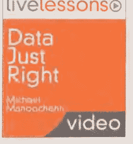

ISBN-13: 978-0-13-374327-2
R 语言最重要部分的之旅，从基础知识到复杂建模。

ISBN-13: 978-0-13-359945-9
一个连贯的叙述性教程，在教导 Python 数据分析的“如何做”和“为什么”之间取得了恰的平衡。

ISBN-13: 978-0-13-380714-1
解决常见数据挑战和应对当今每个大数据用例的实用性介绍。

有关有关讲师的更多信息、他们涵盖的视频以及示例视频，请访问 informit.com/awdataseries。


# 注册此产品
[informit.com/register](http://informit.com/register)

注册你拥有的 Addison-Wesley, Exam Cram, Prentice Hall, Que 和 Sams 产品以解锁优厚福利。

要开始注册过程，请直接访问 informit.com/register 登录或创建账户。然后系统将提示你输入产品封底上显示的 10 位或 13 位 ISBN。

注册你的产品可以解锁以下福利：

- 访问补充内容，包括赠送章节、源代码或项目文件。
- 可在下次购买时使用的优惠券。

注册福利因产品而异。福利将列在你的“账户”页面的“已注册产品”栏目下。

# InformIT — 可信赖的技术学习源

INFORMIT 是领先技术出版品牌 Addison-Wesley Professional、Cisco Press、Exam Cram、IBM Press、Prentice Hall Professional、Que 和 Sams 的所在地。在这里，你将获得来自技术作者、创作者、创新者和领袖的高质量且信赖的内容和资源。无论你是在寻找关于新技术的书籍、某篇有用的文章、及时的通讯报，还是访问 Safari Books Online 数字图书馆的权限，InformIT 都能为你提供解决方案。

 可信赖的技术源 Addison-Wesley | Cisco Press | Exam Cram | Prentice Hall | Que | Sams

**InformIT** 是一个提供来自作者、创作者、创新者和技术领袖的高质量且信赖的内容和资源的品牌。访问其数字库。 可信赖的技术源 Safari Books Online

无论你是在寻找关于新技术的书籍、某篇有用的文章、及时的通讯报，还是访问 Safari Books Online 数字图书馆的权限，InformIT 都能为你提供解决方案。

通过 informit.com/news 了解最新发布。
- 访问 informit.com/podcasts 收听专家播客。
- 访问 informit.com/articles 阅读精选文章。
- 访问 informit.com/blogs 查阅专家见解。
- 访问 informit.com/learn 学习技术。
- 访问 informit.com/social 社交。
- 访问 informit.com/youtube 观看视频。

为处理数据的专业人士提供的视频培训 informit.com/awdataseries

- 访问 informit.com/news 了解最新发布。
- 访问 informit.com/podcasts 收听专家播客。
- 访问 informit.com/articles 阅读精选文章。
- 访问 informit.com/blogs 查阅专家见解。
- 访问 informit.com/learn 学习技术。
- 访问 informit.com/social 社交。
- 访问 informit.com/youtube 观看视频。

激活你的免费版 informit.com/free
第 1 步：输入优惠码 UMWYZ。
第 2 步：Safari 用户请登录。

如果你在 Safari 上访问在线版遇到困难，请电子邮件至 customer-service@safari.com。


# 精通 D3，在 Web 上可视化
数据驱动的图形无处不在，从网站、移动应用到互动新闻。使用 D3，你可以创建视觉上震撼且强大的图形。《Visual Storytelling with D3》是一本实用的彩色教程，教你如何直观、交互地讲述数据故事，以及如何运用强大的 D3 JavaScript 库。凭借其作为图形艺术家、作家和程序员的丰富经验，Ritchie King 将带你完成一个完整项目——从构思到数据选择和设计。通过步骤，你将建立自己的技能。如果你熟悉 HTML 和 CSS，就可以掌握 D3 需要的所有技术背景。

本教程适用于创建数据驱动网站、服务、工具或仪表板的网页设计师；希望直观展示结果的在线记者；希望深化与客户联系的营销人员；以及任何数据可视化爱好者。

- 识别数据驱动的故事并进行视觉化讲述。
- 使用 SVG 创建并操纵精美的图形元素。
- 使用 D3 构建网页。
- 结构化数据以便 D3 轻松可视化。
- 使用 D3 数据绑定将你的数据连接到网页上的图形元素。
- 调整图表的大小和比例，添加坐标轴。
- 从外部数据集加载并过滤数据。
- 使用 D3 过渡动画制作你的数据。
- 为可视化添加交互性，包括一个循环不同视图的播放按钮。
- D3 资源以及参与活跃的 D3 社区。

RITCHIE S. KING 是 FiftyEight.com 的记者和视觉记者，专注于数据可视化和互动功能。他之前在 Quartz 担任类似的职位。在之前的职业中，他是一家初创公司的化学工程师，将木屑和油菜转化为燃料。尽管他正在努力成为一名记者，但他热爱数学并喜欢处理数据。他的文字文章和图形发表在《纽约时报》、《彭彭博商业周》、《科学世界》和《IEEE Spectrum》。

# 关于网站
本书中的所有示例都可以在 ritchies.com/book 获取，还有视频教程、更新、支持材料以及更多示例（视发布情况而定）。
