# Vue.js：11 个实战项目

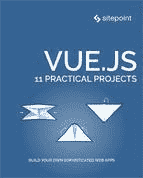


Copyright © 2019 SitePoint Pty. Ltd.

电子书 ISBN: 978-1-925836-27-1

- **封面设计：** Alex Walker
- **项目编辑：** James Hibbard


# 前言

自 2014 年发布以来，Vue.js 的人气经历了如飞升般的增长，现在被认为是主要的 `own` 框架之一，这并非没有理由。它基于组件的架构设计得非常灵活且易于采用，使其能够轻松地集成到项目中并与非 Vue 代码一起使用，同时也构建复杂的客户端应用程序同样简单。

本书包含了精选的 11 个实用项目，涵盖了使用 Vue 开发的各个方面。它包含：

1. *使用 Vue.js、Node 和 MongoDB 构建基础 CRUD 应用*，作者：James Hibbard
2. *使用 Chart.js 的 Vue 封装创建精美图表*，作者：Yomi Eluwande
3. *使用 Pusher 和 Vue.js 构建实时应用*，作者：Michael Wanyoike
4. *为无头 CMS 构建 Vue 前端*，作者：Michael Wanyoike
5. *使用 Vue 构建 Chrome 扩展*，作者：James Hibbard
6. *使用 Nuxt.js 和 vue-kindergarten 构建自己的链接分享网站*，作者：Nilson Jacques
7. *Vue 和 D3.js 数据可视化简介*，作者：Christopher Vundi
8. *使用 Vue 构建可复组件*，作者：Deji Atoyebi
9. *使用 Vue.js 开发游戏*，作者：Ivaylo Gerchev
10. *使用 Vue、Vuex 和 Bootstrap Vue 构建购物列表应用*，作者：Michael Wanyoike
11. *使用 Storybook 开发和测试 Vue 组件*，作者：Ivaylo Gerchev

## 谁应该读这本书？

本书适合具有 JavaScript 经验的开发者。

## 使用规范

### 代码示例

书中的代码使用等宽字体显示，如下：

```html
<h1>一个完美的夏日</h1>
<p>这是一个在公园散步的美好日子。
鸟儿在歌唱，孩子们都已回学校了。</p>
```

当需要现有代码作为上下文，而不是重复全部内容时，将显示 `⋮`：

```javascript
function animate() {
  ⋮
  new_variable = "Hello";
}
```

某些代码行应该在一行内输入，但由于页面限制，我们对它们进行了换行。`➥` 表示仅为了格式化而存在的换行符，应该被忽略：

```javascript
URL.open("http://www.sitepoint.com/responsive-web-
➥design-real-user-testing/?responsive1");
```

你会注意到，我们在本书中使用了一些特定的布局样式来表示不同类型的信息。请关注以下项目。

#### 提示、备注和警告

#### 嘿，你！

提示（Tips）提供有用的小建议。

#### 咳，打扰一下……

备注（Notes）是与当前主题相关但并非关重要的补充说明。将它们视为额外的趣味信息即可。

#### 确保你始终……

……注意这些重要要点。

#### 注意！

警告（Warnings）突出了在过程中可能会让你绊倒的任何“坑”。

# 第 1 章：使用 Vue.js、Node 和 MongoDB 构建基础 CRUD 应用

## 作者：James Hibbard

大多数 Web 都需要以某种形式持久化数据。在处理服务器端语言工作时，这通常是一项简单的任务。然而，当你其中加入一个前端 JavaScript 框架时，事情开始变得有些复杂了。

在本教程中，我将向你展示如何构建一个简单的 [CRUD 应用](https://en.wikipedia.org/wiki/Create,_read,_update_and_delete)（创建、读取、更新和删除）。

## 安装工具

在本节中，我们将安装创建应用所需的工具。这些工具是 Node、npm、MongoDB、MongoDB Compass（可选）和 Postman。我不会深入介绍各种安装说明，但如果你在安装过程中遇到任何问题，请[访问我们的论坛](https://www.sitepoint.com/)。

### Node.js

许多网站会建议你前往[官方下载页面](https://nodejs.org/en/download/)获取适用于你系统的 Node 二进制文件。虽然这种方法可行，但我建议使用版本管理器（如 [nvm](https://github.com/creationix/nvm)）。这是一个允许你安装多个版本的 Node 并随意在它们切换的程序。如果你想了解更多信息，请参阅我们的快速贴士：[使用 nvm 安装多个版本的 Node.js](https://www.sitepoint.com/quick-tip-multiple-versions-node-nvm/)。

### npm

npm 是一个 JavaScript 包管理器，与 Node 一起绑定，因此不需要额外安装。在整个教程中，我们将频繁使用 npm，所以如果你需要复习，请参阅[npm 入门学者指南](https://www.sitepoint.com/beginners-guide-node-package-manager/)。

### MongoDB

MongoDB 是一个文档数据库，以灵活的类 JSON 文档存储数据。

启动 MongoDB 最快的方法是使用如 mLabs 的服务。他们提供免费的沙盒计划，提供运行在共享虚拟机上的具有 496MB 存储空间的单个数据库。这对于只有少数用户的简单应用程序来说绰有余。如果这听起来是你的最佳选择，请参阅他们的[快速入门指南](http://docs.mlab.com/)。

你也可以在本地安装 Mongo。要这样做，请访问[官方下载页面](https://www.mongodb.com/download-center#community)并为你的操作系统下载正确版本的社区版服务器。下载链接旁边有指向详细的、特定操作系统安装说明的链接。

### MongoDB GUI

虽然跟随本教程操作并非严格必要，但你可能也会喜欢安装 [Compass，MongoDB 的官方 GUI 界面](https://www.mongodb.com/download-center#compass)。此工具可以帮助你可视化并操作你的数据，允许你通过全功能 CRUD 功能与文档进行交互。

在编写本文时，你需要填写详细信息来下载 Compass，但不需要创建账户。

### Postman

这是一个用于处理和测试 API 的极其实用的工具。你可以从[项目主页](https://www.getpostman.com/)下载适用于你操作系统的正确版本。你可以在[此处找到针对特定操作系统的安装说明](https://learning.getpostman.com/docs/postman/launching_postman/installation_and_updates/)。

### 检查所有内容是否安装正确

要检查 `node` 和 `npm` 是否安装正确，请打开终端并输入以下命令：

```bash
node -v
```

接着输入此命令：

```bash
npm -v
```

这将输出每个程序的版本号（在编写本文时分别为 `11.1.0` 和 `6.4.1`）。

如果你在本地安装了 `Mongo`，可以使用此命令检查版本号：

```bash
mongo --version
```

这应该会输出大量信息，包括版本号（在编写本文时为 `4.0.4`）。

### 使用 Compass 检查数据库连接

如果你在本地安装了 `Mongo`，可以通过在终端中输入以下命令启动服务器：

```bash
mongod
```

接下来，打开 Compass。你应该能够接受默认设置（主机名：`localhost`，端口：`27017`），点击 `CONNECT` 按钮并与数据库服务器建立连接。

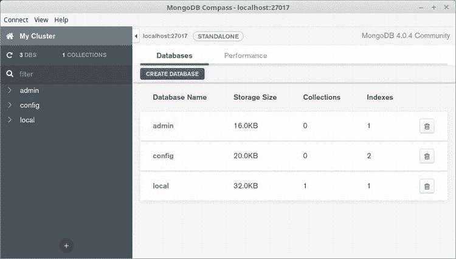

请注意，`admin`、`config` 和 `local` 数据库会自动创建的。

### 使用云托管解决方案

如果你正在使用 mLabs，请创建一个数据库订阅（如其[快速启动指南](http://docs.mlab.com/)中描述所示），然后将连接详情复制到剪贴板。它的格式应该如下：

```text
mongodb://<dbuser>:<dbpassword>@<instance>.mlab.com:<port>/<dbname>
```

当你打开 Compass 时，它会通知你已检测到 MongoDB 连接字符串，并询问你是否想使用它来填充表单。点击 `Yes`，然后点击 `CONNECT`，就可以开始工作了。

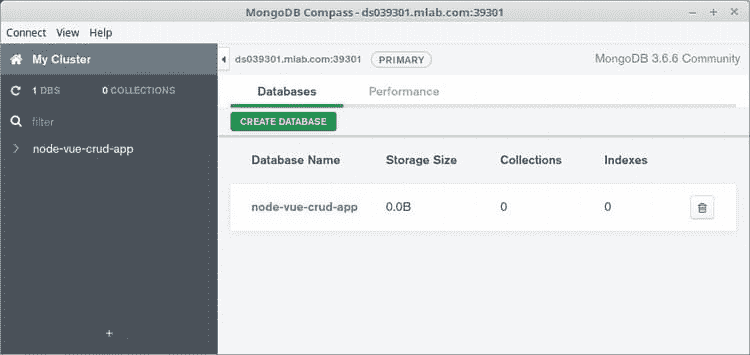

注意我给我的数据库命名为 `node-vue-crud-app`。你可以随心为你命名。

## 创建 Node 后端

在本节中，我们将为 Vue 前端创建一个 RESTful API，供其调用并使用 Postman 对其进行测试。我不想详细介绍 RESTful API 的工作原理，因为本指南的重点应该是 Vue 前端。如果你想看更深入的教程，互联网上有的是。我发现 [10 分钟内构建 Node.js RESTful APIs](https://www.codementor.io/olatundegaruba/nodejs-restful-apis-in-10-minutes-q0sgsfhbd) 非常易于理解，并为本节的代码提供了灵感。

### 基础设置

首先，让我们创建所需的文件和目录并初始化项目：

```bash
mkdir -p vocab-builder/server/api/{controllers,models,routes}
cd vocab-builder/server
touch server.js
touch api/controllers/vocabController.js
touch api/models/vocabModel.js
touch api/routes/vocabRoutes.js
npm init -y
```

这应该带给我们如下目录结构：

```text
.
└── server
    ├── api
    │   ├── controllers
    │   │   └── vocabController.js
    │   ├── models
    │   │   └── vocabModel.js
    │   └── routes
    │       └── vocabRoutes.js
    ├── package.json
    └── server.js
```

### 安装依赖项

对于我们的 API，我们将使用以下库：

- [express](https://www.npmjs.com/package/express)—一个 Node 轻量级框架，提供了许多有用功能，如路由和中间件。
- [cors](https://www.npmjs.com/package/cors)—Express 中间件，可用于项目中启用 [CORS](http://en.wikipedia.org/wiki/Cross-origin_resource_sharing)。
- [body-parser](https://www.npmjs.com/package/body-parser)—用于解析传入请求体的 Express 中间件。
- [mongoose](https://www.npmjs.com/package/mongoose)—用于 Node 的 MongoDB ODM（NoSQL 版本的 ORM）。它提供了简单的验证和查询 API，帮助你与 MongoDB 数据库交互。
- [nodemon](https://www.npmjs.com/package/nodemon)—一个简单的监控脚本，当检测到文件更改时会自动重启 Node 应用。

让我们安装它们吧：

```bash
npm i express cors body-parser mongoose
npm i nodemon --save-dev
```

接下来，打开 `package.json` 并修改 `scripts` 部分如下：

```json
"scripts": {
  "start": "nodemon server.js"
},
```

设置就绪。

### 创建服务器

打开 `server.js` 并添加以下代码：

```javascript
const express = require('express');
const port = process.env.PORT || 3000;
const app = express();

app.listen(port);

app.get('/', (req, res) => {
  res.send('Hello, World!');
});

console.log(`Server started on port ${port}`);
```

然后进入终端并运行 `npm start`。如果你访问 `http://localhost:3000/`，你应该看到“Hello, World!”

### 定义 Schema

接下来我们需要定义数据的结构。基本上，我希望每个文档有两个字段：`english` 和 `german`，用于存储单词的英文和中文翻译。我还想应用一些验证，确保这两个字段都不为空。

打开 `api/models/vocabModel.js` 并添加以下代码：

```javascript
const mongoose = require('mongoose');

const { Schema } = mongoose;

const VocabSchema = new Schema(
  {
    english: {
      type: String,
      required: 'English word cannot be blank'
    },
    german: {
      type: String,
      required: 'German word cannot be blank'
    }
  },
  { collection: 'vocab' }
);

module.exports = mongoose.model('Vocab', VocabSchema);
```

注意我指定了集合名称，否则 Mongoose 会将其命名为“vocabs”，这太蠢了。

### 设置路由

接下来我们需要指定 API 如何响应外部请求。我们将创建以下端点：

- `GET /words`—返回所有单词的列表
- `POST /words`—创建一个新单词
- `GET /words/:wordId`—获取单个单词
- `PUT /words/:wordId`—更新单个单词
- `DELETE /words/:wordId`—删除单个单词

为了实现这一点，打开 `api/routes/vocabRoutes.js` 并添加以下内容：

```javascript
const vocabBuilder = require('../controllers/vocabController');

module.exports = app => {
  app
    .route('/words')
    .get(vocabBuilder.list_all_words)
    .post(vocabBuilder.create_a_word);

  app
    .route('/words/:wordId')
    .get(vocabBuilder.read_a_word)
    .put(vocabBuilder.update_a_word)
    .delete(vocabBuilder.delete_a_word);
};
```

你会注意到我们在顶部引入了 `vocabController`。它包含处理请求的实际逻辑。

### 创建控制器

打开 `api/controllers/vocabController.js` 并添加以下代码：


```javascript
 const mongoose = require('mongoose');
const Vocab = mongoose.model('Vocab');

exports.list_all_words = (req, res) => {
  Vocab.find({}, (err, words) => {
    if (err) res.send(err);
    res.json(words);
  });
};

exports.create_a_word = (req, res) => {
  const newWord = new Vocab(req.body);
  newWord.save((err, word) => {
    if (err) res.send(err);
    res.json(word);
  });
};

exports.read_a_word = (req, res) => {
  Vocab.findById(req.params.wordId, (err, word) => {
    if (err) res.send(err);
    res.json(word);
  });
};

exports.update_a_word = (req, res) => {
  Vocab.findOneAndUpdate(
    { _id: req.params.wordId },
    req.body,
    { new: true },
    (err, word) => {
      if (err) res.send(err);
      res.json(word);
    }
  );
};

exports.delete_a_word = (req, res) => {
  Vocab.deleteOne({ _id: req.params.wordId }, err => {
    if (err) res.send(err);
    res.json({
      message: 'Word successfully deleted',
      _id: req.params.wordId
    });
  });
};
```

在这里，我们导入了模型，然后定义了五个与所需的 CRUD 功能对应的函数。如果你不确定其中任何一个函数的作用或其工作原理，请查阅 [Mongoose 文档](https://mongoosejs.com/docs/api.html)。

## 将所有部分连接在一起

现在所有组件已就绪，是时候将它们连接在一起了。回到`server.js`将现有代码替换为以下内容：

```javascript
const express = require('express');
const cors = require('cors');
const mongoose = require('mongoose');
const bodyParser = require('body-parser');

global.Vocab = require('./api/models/vocabModel');
const routes = require('./api/routes/vocabRoutes');

mongoose.Promise = global.Promise;
mongoose.set('useFindAndModify', false);
mongoose.connect(
  'mongodb://localhost/vocab-builder',
  { useNewUrlParser: true }
);

const port = process.env.PORT || 3000;
const app = express();

app.use(cors());
app.use(bodyParser.urlencoded({ extended: true }));
app.use(bodyParser.json());

routes(app);
app.listen(port);

app.use((req, res) => {
  res.status(404).send({ url: `${req.originalUrl} not found` });
});

console.log(`Server started on port ${port}`);
```

在这里，我们首先引入必要的库，以及我们的模型和路由文件。然后，我们使用 Mongoose 的`connect`方法连接到数据库（如果你在本地安装了 MongoDB，请确保它正在运行），在此创建一个 Express 应用程序并告诉它使用`bodyParser`和`cors`中间件。接着，我们告诉它使用我们在`api/routes/vocabRoutes.js`中定义的路由，并监听端口 3000 上的连接。最后，我们定义了一个函数来处理不存在的路由。

你可以通过在浏览器中访问 [`localhost:3000/`](http://localhost:3000/) 来测试其运行正常。你不应该再看到“Hello, World!”消息，而是 `{"url":"/ not found"}`。

此外，请注意，如果你使用的是 mLabs，则需要将：

```javascript
mongoose.connect(
  'mongodb://localhost/vocab-builder',
  { useNewUrlParser: true }
);
```

替换为创建数据库时收到的详情：

```javascript
mongoose.connect(
  'mongodb://<dbuser>:<dbpassword>@<instance>.mlab.com:<port>/<dbname>',
  { useNewUrlParser: true }
);
```

## 使用 Postman 测试 API

要测试 API，请启动 Postman。操作方法取决于你是如何安装它的。

### 创建 (Create)

我们将从创建一个新的词对开始。选择`POST`为方法，并将`http://localhost:3000/words`输入 URL。选择`Body`选项卡和`x-www-form-urlencoded`单选按钮，然后在下方的字段中输入两个键/值对。按下`Send`，你应该能通过响应接收来自服务器的新创建的对象。

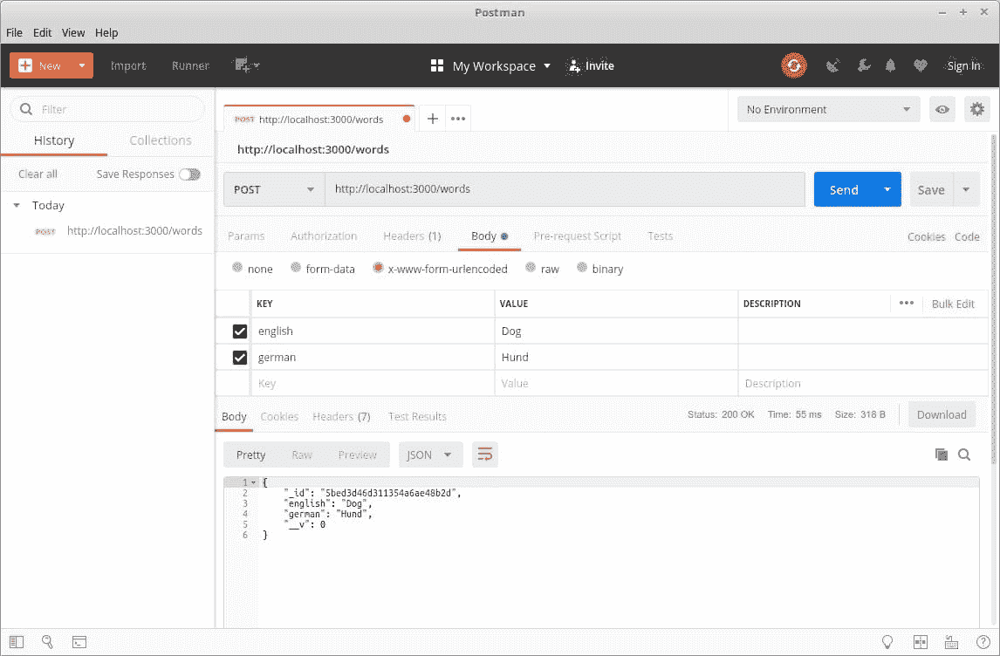 

此时，你也可以使用 Compass 查看数据库，以确保集合已使用正确的条目进行创建。

### 读取 (Read)

为了测试我们 API 的读取功能，我们将首先尝试获取集合中的所有单词，然后是单个单词。

要获取所有单词，将方法更改为`GET`并将`Body`更改为`none`。然后点击`Send`。响应应该如下：

```json
[
  {
    "_id": "5bed3d46d311354a6ae6d1"
  }
]
```

要获取所有单词，将方法更改为`GET`并将`Body`更改为`none`。然后点击`Send`。响应应该如下：

```json
[
  {
    "_id": "5bed3d46d311354a6ae6d1"
  }
]
```

（注：原文包含一些截断/重复的 JSON 示例，我保持了提供指令的逻辑流）

要获取所有单词，将方法更改为`GET`并将`Body`更改为`none`。然后点击`Send`。响应应该如下：

```json
[
  {
    "_id": "5bed3d46d311354a6ae6d1"
  }
]
```

要获取所有单词，将方法更改为`GET`并将`Body`更改为`none`。然后点击`Send`。响应应该如下：

```json
[
  {
    "_id": "5bed3d46d311354a6ae6d1"
  }
]
```

### 更新 (Update)

最后，让我们更新单词。选择`PUT`为方法，并将`http://localhost:3000/words`输入 URL。选择`Body`选项卡和`x-www-form-urlencoded`单选按钮，然后在下方的字段中输入两个键/值对。按下`Send`，你应该能通过响应接收来自服务器的新创建的对象。

### 删除 (Destroy)

要删除单词，选择`DELETE`并点击`Send`。砰！集合现在应该是空的。

```
.
├── App.vue
├── assets
├── components
│   ├── VocabTest.vue
│   └── WordForm.vue
├── helpers
│   └── helpers.js
├── main.js
├── router.js
└── views
    ├── Edit.vue
    ├── New.vue
    ├── Show.vue
    ├── Test.vue
    └── Words.vue
```

### 安装依赖

对于前端，我们将使用以下库：

- [axios](https://www.npmjs.com/package/axios)—一个基于 Promise 的 HTTP 客户端，它允许我们从前端向后端发送 Ajax 请求。

- [semantic-ui-css](https://www.npmjs.com/package/semantic-ui-css)—Semantic UI 的轻量级纯 CSS 版本。

- [vue-flash-message](https://www.npmjs.com/package/vue-flash-message)—一个 Vue 闪消息组件，我们将用它来向用户显示信息。

让我们安装它们吧：

```
npm i axios semantic-ui-css vue-flash-message
```

现在，我们就可以开始编写代码了。

### 创建路由

首先，我们需要考虑应用程序将拥有哪些路由。我们需要执行之前讨论的所有 CRUD（增删改查）操作，如果用户能够针对数据库中添加的任何单词进行自测，那就更好了。

为此，我们将创建以下路由：

- `/words`—显示数据库中所有的单词

- `/words/new`—创建一个新单词

- `/words/:id`—显示单词

- `/words/:id/edit`—编辑单词

- `/test`—测试你的知识

删除单词不需要单独的路由。我们只需要发送相应的请求并重定向到`/words`即可。

要实现这一步，打开`src/router.js`并现有代码替换为以下内容：

```javascript
import Vue from 'vue';
import Router from 'vue-router';
import Words from './views/Words.vue';
import New from './views/New.vue';
import Show from './views/Show.vue';
import Edit from './views/Edit.vue';
import Test from './views/Test.vue';

Vue.use(Router);

export default new Router({
  mode: 'history',
  base: process.env.BASE_URL,
  linkActiveClass: 'active',
  routes: [
    {
      path: '/',
      redirect: '/words'
    },
    {
      path: '/words',
      name: 'words',
      component: Words
    },
    {
      path: '/words/new',
      name: 'new-word',
      component: New
    },
    {
      path: '/words/:id',
      name: 'show',
      component: Show
    },
    {
      path: '/words/:id/edit',
      name: 'edit',
      component: Edit
    },
    {
      path: '/test',
      name: 'test',
      component: Test
    }
  ]
});
```

这创建了我们上面讨论的路由。它还将根 URL `/` 重定向到`/words`，并告诉路由器为当前激活的导航链接应用`active`类（默认值是`router-link-active`，它与`semantic-ui-css`的兼容性不佳）。

提到这里，接下来我们需要打开`src/main.js`并告诉 Vue 使用`semantic-ui-css`：

```javascript
import Vue from 'vue';
import App from './App.vue';
import router from './router';

import 'semantic-ui-css/semantic.css';

Vue.config.productionTip = false;

new Vue({
  router,
  render: h => h(App)
}).$mount('#app');
```

最后，我们需要将`src/App.vue`中的代码替换为以下内容：

```html
<template>
  <div id="app">
    <div class="ui inverted segment navbar">
      <div class="ui center aligned container">
        <div class="ui large secondary inverted pointing menu compact">
          <router-link to="/words" exact class="item">
            <i class="comment outline icon"></i 单词
          </router-link>
          <router-link to="/words/new" class="item">
            <i class="plus circle icon"></i> 新
          </router-link>
          <router-link to="/test" class="item">
            <i class="graduation cap icon"></i> 测试
          </router-link>
        </div>
      </div>
    </div>

    <div class="ui text container">
      <div class="ui one column grid">
        <div class="column">
          <router-view />
        </div>
      </div>
    </div>
  </div>
</template>

<script>
export default {
  name: 'app'
};
</script>

<style>
#app > div.navbar {
  margin-bottom: 1.5em;
}
.myFlash {
  width: 250px;
  margin: 10px;
  position: absolute;
  top: 50;
  right: 0;
}
input {
  width: 300px;
}
div.label {
  width: 250px;
}
div.input {
  width: 300px;
}
div.button {
  margin: 10px;
}
</style>
```

这创建了我们上面讨论的路由。它还将根 URL `/` 重定向到`/words`，并让`router-link`为当前激活的导航链接应用`active`类（默认是`router-link-active`，它与`semantic-ui-css`的兼容性不佳）。

提到这里，接下来我们需要打开`src/main.js`并告诉 Vue 使用`semantic-ui-css`：

```javascript
import Vue from 'vue';
import App from './App.vue';
import router from './router';

import 'semantic-ui-css/semantic.css';

Vue.config.productionTip = false;

new Vue({
  router,
  render: h => h(App)
}).$mount('#app');
```

最后，我们需要将`src/App.vue`中的代码替换为以下内容：


```html
<template>
  <div id="app">
    <div class="ui inverted segment navbar">
      <div class="ui center aligned container">
        <div class="ui large secondary inverted pointing menu compact">
          <router-link to="/words" exact class="item">
            <i class="comment outline icon"></i> 单词
          </router-link>
          <router-link to="/words/new" class="item">
            <i class="plus circle icon"></i> 新
          </router-link>
          <router-link to="/test" class="item">
            <i class="graduation cap icon"></i> 测试
          </router-link>
        </div>
      </div>
    </div>

    <div class="ui text container">
      <div class="ui one column grid">
        <div class="column">
          <router-view />
        </div>
      </div>
    </div>
  </div>
</template>

<script>
export default {
  name: 'app'
};
</script>

<style>
#app > div.navbar {
  margin-bottom: 1.5em;
}
.myFlash {
  width: 250px;
  margin: 10px;
  position: absolute;
  top: 50;
  right: 0;
}
input {
  width: 300px;
}
div.label {
  width: 250px;
}
div.input {
  width: 300px;
}
div.button {
  margin: 10px;
}
</style>
```

## 与后端通信

接下来我们需要做的事情是建立与后端通信的方法。这就是我们之前安装的 `axios` 库大显身场的地方。为了让应用更加灵活，打开`src/helpers.js`并添加以下内容：

```javascript
import axios from 'axios';

const baseURL = '/words';

const handleError = fn => (...params) =>
  fn(...params).catch(error => {
    console.log(error);
  });

export const api = {
  getWord: handleError(async id => {
    const res = await axios.get(baseURL + id);
    return res.data;
  }),
  getWords: handleError(async () => {
    const res = await axios.get(baseURL);
    return res.data;
  }),
  deleteWord: handleError(async id => {
    const res = await axios.delete(baseURL + id);
    return res.data;
  }),
  createWord: handleError(async payload => {
    const res = await axios.post(baseURL, payload);
    return res.data;
  }),
  updateWord: handleError(async (id, payload) => {
    const res = await axios.put(baseURL + id, payload);
    return res.data;
  })
};
```

这里有几点需要注意。首先，我们导出了`api`对象，它暴露了我们创建的方法。这些方法将对后端执行 Ajax 调用。

其次，由于 Ajax 的异步性质，我们使用了 [async/await](https://developer.mozilla.org/en-US/docs/Web/JavaScript/Statements/async_function)，它允许我们在继续执行代码之前等待异步操作（如写入数据库）的结果。但是，这里有一个小的注意事项。在`async/await`中处理错误的标准方法是将内容包裹在`try/catch`块中：

```javascript
export const api = {
  getWord: async id => {
    try {
      const res = await axios.get(baseURL + id);
      return res.data;
    } catch(error) {
      console.log(error);
    }
  }
  ...
}
```

然而，这样做非常冗长，并且会导致代码臃肿，因为我们需要对每个 Ajax 调用都进行这样做。另一种方法是使用[高阶函数](https://www.sitepoint.com/higher-order-functions-javascript/)来为我们处理错误。

这种高阶函数接收一个函数作为参数（函数`a`），并返回另一个函数（函数`b`），当函数`b`被调用时，它会调用函数`a`并传递它收到的任何参数。函数`b`还会在函数`a`的末尾链一个`catch`块，这意味着如果函数`a`发生错误，将被捕获并处理。

如果你想深入探讨这些内容，请查看我们的文章 [现代 JS 中的流程控制：从回调到 Promise 再到 Async/Await](https://www.sitepoint.com/flow-control-callbacks-promises-async-await/)。

## 从数据库获取单词

现在让我们获取一些单词来显示给用户。打开`/src/views/Words.vue`组件并添加以下代码：

```vue
<template>
  <div>
    <h1>Words</h1>
    <table id="words" class="ui celled compact table">
      <thead>
        <tr>
          <th>English</th>
          <th>German</th>
          <th colspan="3"></th>
        </tr>
      </thead>
      <tr v-for="(word, i) in words" :key="i">
        <td>{{ word.english }}</td>
        <td>{{ word.german }}</td>
        <td width="75" class="center aligned">Show</td>
        <td width="75" class="center aligned">Edit</td>
        <td width="75" class="center aligned">Destroy</td>
      </tr>
    </table>
  </div>
</template>

<script>
import { api } from '../helpers/helpers';

export default {
  name: 'words',
  data() {
    return {
      words: []
    };
  },
  async mounted() {
    this.words = await api.getWords();
  }
};
</script>
```

如你所见，我们导入了`api`来执行针对后端的操作，然后在组件的`mounted`生命周期钩子中，我们调用了它的`getWords`方法从数据库中获取所有单词。由于组件的`data`对象上有一个`words`属性，我们可以等待后端的响应，然后将响应插入到`this.words`中，组件就会更新。

尝试一下。使用`Compass`或`Postman`向数据库插入一个单词，然后观察它是否显示在`/words`页面上。

## 显示单个单词

现在让我们添加从单词列表中显示单个单词的功能。在`/src/views/Words.vue`中，将：

```html
<td width="75" class="center aligned">Show</td>
```

替换为：

```html
<td width="75" class="center aligned">
  <router-link :to="{ name: 'show', params: { id: word._id }}">Show</router-link>
</td>
```

这创建了一个指向我们在`/src/router.js`文件定义的`show`路由的链接。它使用当前单词的`_id`属性来构建 URL，结果类似于`http://localhost:8081/words/5bed4462bbd0ff553fb008d4`。

现在打开`/src/views/Show.vue`并添加以下代码：

```vue
<template>
  <div>
    <h1>Show Word</h1>

    <div class="ui labeled input fluid">
      <div class="ui label">
        <i class="germany flag">i> German
      </div>
      <input type="text" readonly  :value="word.german"/>
    </div>
    <div class="ui labeled input fluid">
      <div class="ui label">
        <i class="united kingdom flag">i> English
      </div>
      <input type="text" readonly  :value="word.english"/>
    </div>
    <div class="actions">
      <router-link :to="{ name: 'edit', params: { id: this.$route.params.id }}">
        Edit word
      </router-link>
    </div>
  </div>
</template>

<script>
import { api } from '../helpers/helpers';

export default {
  name: 'show',
  data() {
    return {
      word: ''
    };
  },
  async mounted() {
    this.word = await api.getWord(this.$route.params.id);
  }
};
</script>

<style scoped>
.actions a {
  display: block;
  text-decoration: underline;
  margin: 20px 10px;
}
</style>
```

当组件挂载时，它将使用与之前相同的技术从数据库中获取单个单词。它通过使用`this.$route.params.id`从 URL 中提取 ID 来识别目标单词。之所以可行，是因为我们在`/src/router.js`中声明路由的方式。在这里我们`path: "/words/:id"`，这意味着`/words/`之后的任何内容都可以作为`$route.params.id`可用。

还要注意`<style>`标签上的`scoped`属性。这意味着在此处声明的任何样式仅应用于此组件。

如果你此时运行程序，你应该能够在`/words`下看到数据库中包含的单词列表，并通过点击 *Show* 查看单个单词。

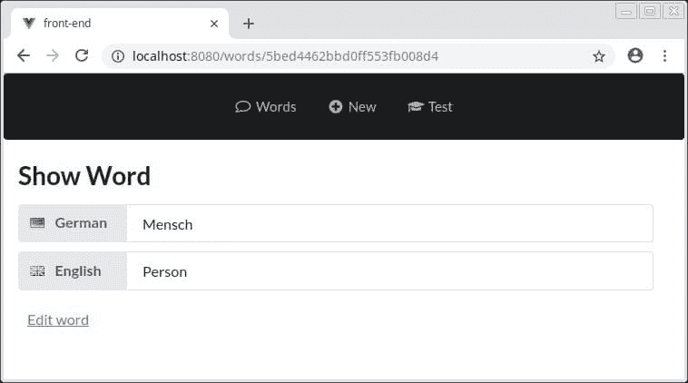 

你会注意到上面的截图中有一个 *Edit word* 链接。让我们现在实现它。

## 编辑单词

打开`src/views/Edit.vue`并添加以下：

```vue
<template>
  <div>
    <h1>Edit Word</h1>
    <word-form>
  </div>
</template>

<script>
import { api } from '../helpers/helpers';

export default {
  name: 'edit',
  components: {
    WordForm: './components/WordForm.vue'
  },
  data() {
    return {
      word: {}
    };
  },
  async mounted() {
    this.word = await api.getWord(this.$route.params.id);
  }
};
</script>
```

这里有一些不同之处。注意到我们使用了一个`word-form`组件。让我们查看`components/WordForm.vue`并添加以下：

```vue
<template>
  <form @submit.prevent="onSubmit">
    <p v-if="errorsPresent" class="error">Please fill out fields!</p>

    <div class="ui labeled input fluid">
      <div class="ui label">
        <i class="germany flag">i> German
      </div>
      <input type="text" placeholder="Enter word..." v-model="word.german"
    </div>

    <div class="ui labeled input fluid">
      <div class="ui label">
        <i class="united kingdom flag">i> English
      </div>
      <input type="text" placeholder="Enter word..." v-model="word.english"
    </div>

    <button class="positive ui button">Submit</button>
  </form>
</template>

<script>
export default {
  name: 'word-form',
  props: {
    word: {
      type: Object,
      required: false
    }
  },
  data() {
    return {
      errorsPresent: false
    };
  },
  methods: {
    onSubmit() {
      console.log(`English: ${this.word.english}`);
      console.log(`German: ${this.word.german}`);
    }
  }
};
</script>

<style scoped>
.error {
  color: red;
}
</style>
```

这里有相当多的内容。首先，我们有一个`<form>`标签，并且并将`submit`事件绑定到`onSubmit`方法。我们还使用了`.prevent`修饰符来阻止浏览的默认行为——在这种情况下是提交表单。

接下来是一个段落标签`<p>`，用于在任何一个输入字段为空时显示错误消息。我们使用`v-if`只在`errorsPresent`属性计算为真时才显示它。

然后是我们的表单，有两个输入字段，一个用于英语单词，另一个用于对应的德语单词。我们使用`v-model`在传递的 prop 的`english`和`german`属性与输入字段之间建立双向数据绑定。

此时，如果你访问 `Edit word` 视图，应该应该在字段中看到显示的正确单词。当你点击 `Submit` 时，你应该能看到控制台记录了两个输入字段的值。

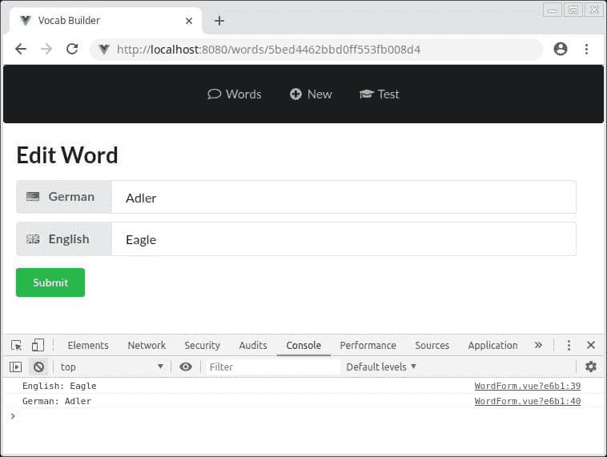

最后，我们需要扩展`onSubmit`方法，执行除了向控制台打印输入值以外的操作。将其修改为如下：


```javascript
 onSubmit: function() {
  if (this.word.english === '' || this.word.german === '') {
    this.errorsPresent = true;
  } else {
    this.$emit('createOrUpdate', this.word);
  }
}
```

这会检查两个字段是否都有值。如果没有，它会标记错误；否则，它会派发一个 `createOrUpdate` 事件，我们可以在父组件（在此例中为 `Edit`）中监听该事件。我将其命名为 `createOrUpdate`，因为父组件中相应的功能将执行这两种操作之一。

回到 `src/views/Edit.vue`，我们需要监听并响应 `createOrUpdate` 事件。将：

```html
<word-form :word=this.word></word-form>
```

改为：

```html
<word-form @createOrUpdate="createOrUpdate" :word=this.word></word-form>
```

并在 `methods` 对象中实现更新功能：

```javascript
methods: {
  createOrUpdate: async function(word) {
    await api.updateWord(word);
    alert('Word updated sucessfully!');
    this.$router.push(`/words/${word._id}`);
  }
}
```

现在，当你尝试更新单词时，它会检查两个字段是否为空，如果不是，则会更新单词，并在弹出成功消息之前将你重定向到新更新的单词。

作为本部分的最后的收尾，回到 `src/views/Words.vue` 并修改：

```html
<td width="75" class="center aligned">Edit</td>
```

改为：

```html
<td width="75" class="center aligned">
  <router-link :to="{ name: 'edit', params: { id: word._id }}">Edit</router-link>
</td>
```

### 添加闪动消息

好了，我们的应用看起来很不错了，但使用 `alert` 来告知用户发生了某些事情是一种很生兀的体验。让我们改用闪动消息（flash messages）。这些是样式美观、可配置的消息，不会阻塞浏览器中 JavaScript 的执行。

我们需要做的第一件事是告诉我们的应用使用它们。为此，回到 `src/helpers/helpers.js`，确保文件顶部内容如下：

```javascript
import axios from 'axios';
import Vue from 'vue';
import VueFlashMessage from 'vue-flash-message';
import 'vue-flash-message/dist/vue-flash-message.min.css';

Vue.use(VueFlashMessage, {
  messageOptions: {
    timeout: 3000,
    pauseOnInteract: true
  }
});

const vm = new Vue();
const baseURL = 'http://localhost:3000/words/';

const handleError = fn => (...params) =>
  fn(...params).catch(error => {
    vm.flash(`${error.response.status}: ${error.response.statusText}`, 'error');
  });

export const api = { ... };
```

这里发生了几件事。首先，我们导入了 Vue 和 VueFlashMessages。然后我们告诉 Vue 使用 VueFlashMessages 插件并传递了几个选项。最后，我们创建了一个 Vue 新实例，因为我们还想在辅助文件中使用闪动消息。你可以在 `handleError` 函数调用 `vm.flash()` 的地方看到这一操作。

为了我们能够实际显示这些消息，让我们在 `src/App.vue` 中添加一个 `FlashMessage` 组件：

```html
<div class="ui text container">
  <flash-message class="myFlash"></flash-message>

  <div class="ui one column grid">
    <div class="column">
      <router-view />
    </div>
  </div>
</div>
```

为了测试它是否工作正常，尝试将 `src/helpers/helpers.js` 中的 `baseURL` 变量的值更改为不存在的内容。如果一切都按计划进行，那么当我们访问任何路由时，你应该在屏幕右侧看到一个格式化良好的错误消息。

最后，为了在成功编辑单词时显示闪动消息，回到 `src/views/Edit.vue` 并修改：

```javascript
alert("Word updated sucessfully!");
```

改为：

```javascript
this.flash('Word updated sucessfully!', 'success');
```

### 创建新单词

我们几乎已经实现了所有的 CRUD 功能。下一步是给用户机会向我们的数据库添加自己的单词。打开 `src/views/New.vue` 并添加以下内容：

```html
<template>
  <div>
    <h1>New Word</h1>
    <word-form @createOrUpdate="createOrUpdate"></word-form>
  </div>
</template>

<script>
import WordForm from '../components/WordForm.vue';
import { api } from '../helpers/helpers';

export default {
  name: 'new',
  components: {
    'word-form': WordForm
  },
  methods: {
    createOrUpdate: async function(word) {
      const res = await api.createWord(word);
      this.flash('Word created', 'success');
      this.$router.push(`/words/${res._id}`);
    }
  }
};
</script>
```

（注：此处提供的源代码存在碎片化或冲突，我根据上下文进行了重构。）

### 删除单词

我们不需要单独的组件来删除单词，因为没有视图。操作发生在 `src/views/Words.vue` 中：

首先将：

```html
<td width="75" class="center aligned">Edit</td>
```

改为：

```html
<td width="75" class="center aligned" @click.prevent="onDestroy(word._id)">
  <a href="/words/${word._id}">Delete</a>
</td>
```

这将拦截表格单元格的点击，阻止浏览器的默认操作，然后调用 `onDestroy` 方法。来实现它：

```javascript
methods: {
  async onDestroy(id) {
    const sure = window.confirm('Are you sure?');
    if (!sure) return;

    await api.deleteWord(id);
    this.flash('Word deleted successfully!', 'success');
    const newWords = this.words.filter(word => word._id !== id);
    this.words = newWords;
  }
},
```

为了确保用户确实想要删除单词，我们使用对话框让他们确认。如果用户点击确定，将向 API 发送请求以删除单词。然后我们弹出闪动消息告诉他们删除成功，之后从 `data` 对象中的单词列表中移除该单词。这将确保 UI 的更新。

## 进一步尝试

作为最后的收尾，让我们用户有机会对存储在数据库中的单词进行自测。

打开 `src/views/Test.vue` 并添加以下代码：

```html
<template>
  <div>
    <h1>Test</h1>

    <div v-if="words.length < 5">
      <p>您至少输入五个单词才能开始测试</p>
    </div>
    <div v-else>
      <vocab-test :words="words"></vocab-test>
    </div>
  </div>
</template>

<script>
import { api } from '../helpers/helpers';
import VocabTest from '../components/VocabTest.vue';

export default {
  name: 'test',
  components: {
    'vocab-test': VocabTest
  },
  data() {
    return {
      words: []
    };
  },
  async mounted() {
    this.words = await api.getWords();
  }
};
</script>
```

在这里，我们正在等待组件挂载，然后从数据库中获取所有的单词。如果单词少于五个，我们将显示一条消息，说明单词不足无法开始测试。否则，我们将加载 `VocabTest` 组件并将单词列表作为 prop 传递给它。

现在剩下的就是编写测试本身了。打开 `src/components/VocabTest.vue` 并添加以下内容：

```vue
<template>
  <div>
    <h2>Score: {{ score }} out of {{ this.words.length }}</h2>

    <form action="#" @submit.prevent="onSubmit">
      <div class="ui labeled input fluid">
        <div class="ui label">
          <i class="germany flag">i> German
        </div>
        <input type="text" readonly :disabled="testOver" :value="currWord.german"/>
      </div>
      <div class="ui labeled input fluid">
        <div class="ui label">
          <i class="united kingdom flag"></i> English
        </div>
        <input type="text" placeholder="Enter word..." v-model="english" :disabled="testOver" autocomplete="off" />
      </div>

      <button class="positive ui button" :disabled="testOver">Submit</button>
    </form>

    <p :class="['results', resultClass]">
      <span v-html="result"></span>
    </p>
  </div>
</template>

<script>
export default {
  name: 'vocab-test',
  props: {
    words: {
      type: Array,
      required: true
    }
  },
  data() {
    return {
      randWords: [...this.words.sort(() => 0.5 - Math.random())],
      incorrectGuesses: [],
      result: '',
      resultClass: '',
      english: '',
      score: 0,
      testOver: false
    };
  },
  computed: {
    currWord: function() {
      return this.randWords.length ? this.randWords[0] : '';
    }
  },
  methods: {
    onSubmit: function() {
      if (this.english === this.currWord.english) {
        this.flash('Correct!', 'success', { timeout: 1000 });
        this.score += 1;
      } else {
        this.flash('Wrong!', 'error', { timeout: 1000 });
        this.incorrectGuesses.push(this.currWord.german);
      }

      this.english = '';
      this.randWords.shift();

      if (this.randWords.length === 0) {
        this.testOver = true;
        this.displayResults();
      }
    },
    displayResults: function() {
      if (this.incorrectGuesses.length === 0) {
        this.result = 'You got everything correct. Well done!';
        this.resultClass = 'success';
      } else {
        const incorrect = this.incorrectGuesses.join(', ');
        this.result = `<<strong>You got the following words wrong:</strong> ${incorrect}`;
        this.resultClass = 'error';
      }
    }
  }
};
</script>

<style scoped>
.results {
  margin: 25px auto;
  padding: 15px;
  border-radius: 5px;
}

.error {
  border: 1px solid #ebccd1;
  color: #a94442;
  background-color: #f2dede;
}

.success {
  border: 1px solid #d6e9c6;
  color: #3c763d;
  background-color: #dff0d8;
}
</style>
```

本指南已经很长了，因此我不会解释每一行代码的作用。简而言之，我们通过 prop 的形式接收单词列表 `words`（这是一个对象数组）。然后我们声明了一些数据属性，大部分与测试显示有关。`randWords` 属性利用扩展运算符和箭头函数来将单词排序为随机顺序。

我们将 `currWord` 声明为[计算属性](https://vuejs.org/v2/guide/computed.html)，它将返回随机单词列表中的下一个单词。我使用计算属性是因为在 `onSubmit` 方法中，每当用户做出猜测时，我都会 `shift()` 移除 `randWords` 数组的第一个项。这样变异数组会导致 `currWord` 重新计算，测试也会更新。

最后，`onSubmit` 方法和 `displayResults` 方法处理表单提交（当用户做出猜测时）以及正如你可能猜到的，即结果的显示。

## 结论

这是一个很长的教程，恭喜你坚持到了这里。我希望你现在更好地了如何设置一个 Vue.js 前端来消费 Node API，该 API 可以将数据持久化到数据库中。

请不要忘记，[完整代码可以在 GitHub 上找到](https://github.com/sitepoint-editors/vocab-builder)。

# 第 2 章：使用 Vue.js 封装的 Chart.js 创建精美图表

## 作者：Yomi Eluwande


图表是现代网站和应用程序的重要部分。在本指南中，我将展示如何使用 [Chart.js](https://www.chartjs.org/) 创建精美的图表。`Vue.js` 是一个渐进式框架，我们将配合 `canvas` 元素使用。如果你是 [Vue.js](https://vuejs.org/) 的新手，我们将使用 [Vue CLI](https://cli.vuejs.org/) 脚手架。

## 图表

这是一个非常强大的 `Vue` 图表封装库。我们将使用：

* `vue-charts`
* `vue-chartjs`
* `vue-chartkick`

剩下的就是编写测试本身。打开`src/components/VocabTest.vue`并添加以下内容：

（此处代码已在上文展示...）

```
touch src/components/{LineChart.vue,BarChart.vue,BubbleChart.vue,Reactive.vue}
```

这些对应于我们将要使用的图表类型。

最后，你可以删除`src/views`中的`About.vue`文件、`src/components`中的`HelloWorld.vue`文件，以及`src`下的`assets`文件夹。我们不需要这些。

你的`src`目录的内容应该如下：

```
.
├── App.vue
├── components
│   ├── BarChart.vue
│   ├── BubbleChart.vue
│   ├── LineChart.vue
│   └── Reactive.vue
├── main.js
├── router.js
└── views
    ├── Home.vue
    ├── VueChartJS.vue
    ├── VueChartKick.vue
    └── VueCharts.vue
```

## 添加路由

我们接下来想要做的是创建不同的路由，以便查看上面创建的每个包装器的图表。我们希望有一个`/charts`路由来显示使用`vue-charts`包装器制作的图表，`/chartjs`用于显示使用`vue-chartjs`包装器制作的图表，最后是`/chartkick`用于显示使用`vue-chartkick`包装器制作的图表。我们还将保留`/`路由来显示`Home`视图。

导航到应用的`src`文件夹并打开`router.js`文件。将该文件的内容替换为内容：

```javascript
import Vue from 'vue'
import Router from 'vue-router'
import Home from '@/views/Home'
import VueChartJS from '@/views/VueChartJS'
import VueChartKick from '@/views/VueChartKick'
import VueCharts from '@/views/VueCharts'

Vue.use(Router)

export default new Router({
  routes: [
    {
      path: '/',
      name: 'Home',
      component: Home
    },
    {
      path: '/chartjs',
      name: 'VueChartJS',
      component: VueChartJS
    },
    {
      path: '/chartkick',
      name: 'VueChartKick',
      component: VueChartKick
    },
    {
      path: '/charts',
      name: 'VueCharts',
      component: VueCharts
    }
  ]
})
```

在这里我们导入了上面创建的`Vue`组件。[组件](https://vuejs.org/v2/guide/components.html) 是 `Vue` 最强大的功能之一。它们帮助我们扩展基础 `HTML` 元素以封装可重用的代码。从高层面上说，组件是 `Vue` 编译器附加行为的自定义元素。

最后，我们定义了路由和组件，它们将为我们显示不同图表所需的不同页面提供服务。

## 添加导航

我们可以在`src/App.vue`中定义跨组件使用的导航。我们还将添加一些基础样式：

```html
<template>
  <div id="app">
    <div id="nav">
      <ul>
        <li><router-link to="/">Home</router-link></li>
        <li><router-link to="/chartjs">vue-chartjs</router-link></li>
        <li><router-link to="/charts">vue-charts</router-link></li>
        <li><router-link to="/chartkick">vue-chartkick</router-link></li>
      </ul>
    </div>
    <router-view />
  </div>
</template>

<style>
#app {
  font-family: 'Avenir', Helvetica, Arial, sans-serif;
  -webkit-font-smoothing: antialiased;
  -moz-osx-font-smoothing: grayscale;
  text-align: center;
  color: #2c3e50;
}

#nav {
  padding: 30px;
  height: 90px;
}

#nav a {
  font-weight: bold;
  color: #2c3e50;
  text-decoration: underline;
}

#nav a.router-link-exact-active {
  color: #42b983;
  text-decoration: none;
}

#nav ul {
  list-style-type: none;
  padding: 0;
}

#nav ul li {
  display: inline-block;
  margin: 0 10px;
}

h1 {
  font-size: 1.75em;
}

h2 {
  line-height: 2.5em;
  font-size: 1.25em;
}
</style>
```

这里没有什么特别革命性的东西。注意`<router-view />`组件的使用，我们将在这里显示我们的视图。

## Home 组件

如上所述，`Home`组件充当默认（`/`）路由。打开它并将内容替换为下面的代码块：

```html
<template>
  <section class="hero">
    <div class="hero-body">
      <div class="container">
        <h1>Creating Beautiful Charts Using Vue.js Wrappers For Chart.js</h1>
        <h2>
          Read the article on SitePoint:
          <a href="https://www.sitepoint.com/creating-beautiful-charts-vue-chart-js/">
            https://www.sitepoint.com/creating-beautiful-charts-vue-chart-js/
          </a>
        </h2>
        <h3>
          Download the repo from GitHub:
          <a href="https://github.com/sitepoint/vue-charts">
            https://github.com/sitepoint/vue-charts
          </a>
        </h3>
      </div>
    </div>
  </section>
</template>

<script>
export default {
  name: 'home'
}
</script>
```

## Bulma

在开始之前，还有一件事。我们将 [Bulma](https://bulma.io/) 框架添加到应用。

在`public/index.html`文件中添加：

```html
<link rel="stylesheet" href="https://cdn.jsdelivr.net/npm/bulma@0.9.4/css/bulma.min.css">
```

现在，访问`http://localhost:8080`，你应该能看到

## 使用 chartjs 制作图表

我们接下来想要做的是使用`vue-chartjs`包装器制作路由来制作折线图、柱状图、气泡图和响应式布局。

你的`src`目录的内容如下：

```
.
├── App.vue
├── components
│   ├── BarChart.vue
│   ├── BubbleChart.vue
│   ├── LineChart.vue
│   └── Reactive.vue
├── main.js
├── router.js
└── views
    ├── Home.vue
    ├── VueChartJS.vue
    ├── VueChartKick.vue
    └── VueCharts.vue
```

## 使用 vue-charts 制作图表

使用`vue-charts`包装器制作图表可以让我们轻松创建折线图、柱状图、气泡图和响应式布局。

### 使用 vue-chartjs 制作图表

为了制作折线图，我们将在`src/components`文件夹中创建`LineChart.vue`组件并添加以下代码：

```javascript
<script>
  // 从 vue-chartjs 导入 Line 类
  import { Line } from 'vue-chartjs'

  // 导出以便在组件中使用
  export default {
    extends: Line,
    data () {
      return {
        datacollection: {
          // 代表 x 轴的数据
          labels: ['January', 'February', 'March', 'April', 'May', 'June', 'July', 'August', 'September', 'October', 'November', 'December'],
          datasets: [
            {
              label: 'Data One',
              backgroundColor: '#f87979',
              pointBackgroundColor: 'white',
              borderWidth: 1,
              pointBorderColor: '#249EBF',
              // 代表 y 轴的数据
              data: [40, 20, 30, 50, 90, 10, 20, 40, 50, 70, 90, 100]
            }
          ]
        },
        // 控制图表外观的 Chart.js 配置
        options: {
          scales: {
            yAxes: [{
              ticks: {
                beginAtZero: true
              },
              gridLines: {
                display: true
              }
            }],
            xAxes: [ {
              gridLines: {
                display: false
              }
            }]
          },
          legend: {
            display: true
          },
          responsive: true,
          maintainAspectRatio: false
        }
      }
    },
    mounted () {
      // renderChart 函数通过 datacollection 和 options 对象渲染图表
      this.renderChart(this.datacollection, this.options)
    }
  }
</script>
```

让我们讨论一下上面的代码的作用。我们首先做的是从`vue-chartjs`导入所需的图表类（在本例中为`Line`）并将其导出。

`data`属性包含一个`datacollection`对象，包含了构建折线图所需的所有信息。这包括 `Chart.js` 配置，例如代表 x 轴的`labels`，代表 y 轴的`datasets`，以及一个控制图表外观的`options`对象。

`mounted`函数调用`renderChart()`，通过传入`datacollection`和`options`对象来渲染图表。

现在，让我们打开`views/VueChartJS.vue`文件并添加以下代码：

```vue
<template>
  <section class="container">
    <h1>vue-chartjs 示例示例</h1>
    <div class="columns">
      <div class="column">
        <h3>折线图</h3>
        <line-chart></line-chart>
      </div>
      <div class="column">
        <h3>柱状图</h3>
        <!--Bar Chart example-->
      </div>
    </div>
    <div class="columns">
      <div class="column">
        <h3>气泡图</h3>
        <!--Bubble Chart example-->
      </div>
      <div class="column">
        <h3>响应式 - 当数据集变化时实时更新</h3>
        <!--Reactivity Line Chart example-->
      </div>
    </div>
  </section>
</template>

<script>
  import LineChart from '@/components/LineChart'
  import BarChart from '@/components/BarChart'
  import BubbleChart from '@/components/BubbleChart'
  import Reactive from '@/components/Reactive'

  export default {
    name: 'VueChartJS',
    components: {
      LineChart,
      BarChart,
      BubbleChart,
      Reactive
    }
  }
</script>
```

`VueChartJS.vue`文件包含了持有 `HTML` 代码的`template`部分、持有 `JavaScript` 代码的`script`部分，以及持有 `CSS` 代码的`style`部分。

在`template`部分中，我们使用了 `Bulma` 的`columns`类来创建一个具有两列和两行的布局。我们还添加了`line-chart`组件，该组件将在`script`部分中创建。

在`script`部分中，我们导入了之前创建的`.vue`文件，并在`components`对象中引用了它们。这意味着我们之后可以像这样在 `HTML` 代码中使用运行它们：`line-chart`、`bar-chart`、`bubble-chart`和`reactive`。

现在，如果你导航到`/chartjs`，折线图应该显示在该页面上。

### 实时代码

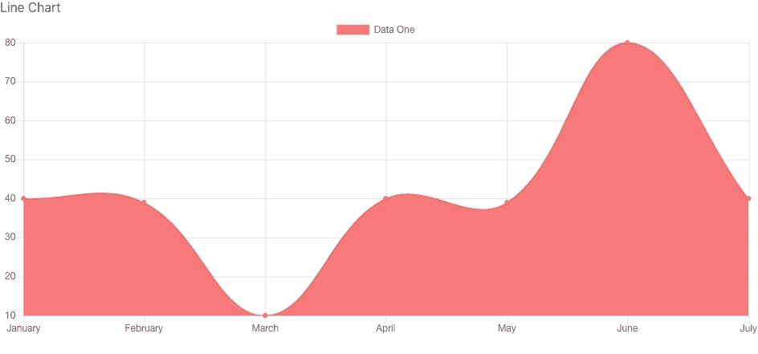

查看 Pen [vue-chart.js - line chart](https://codepen.io/SitePoint/pen/zdGNNz/)

### 柱状图

对于下一个图表，我们将创建一个专门用于渲染柱状图的自定义组件。打开`src/components`文件夹内的`BarChart.vue`组件文件并添加以下代码：


进入`/path/to/xxx`目录，找到`xxx.json`。

在表达式`cvar = avar + bvar`中，加法运算符（`+`）将`avar`与`bvar`相加，得到它们的和`cvar`。

在`List.of(arg0, arg1, arg2)`中，`List`接口的工厂方法`of()`接受一系列的元素，返回包含它们的只读列表。

之后我们这样调用`cmd`命令：`cmd arg0 arg1 arg2`。

```
if (condVar > someVal) {console.log("xxx")}
```

---

```vue
<script>
  // 从 vue-chartjs 包装器导入 Bar 类
  import { Bar } from 'vue-chartjs'
  // 导出此以便在其他组件中使用
  export default {
    extends: Bar,
    data () {
      return {
        datacollection: {
          // 显示在 x 轴上的数据标签
          labels: ['January', 'February', 'March', 'April', 'May', 'June', 'July', 'August', 'September', 'October', 'November', 'December'],
          datasets: [
            {
              label: 'Data One',
              backgroundColor: '#f87979',
              pointBackgroundColor: 'white',
              borderWidth: 1,
              pointBorderColor: '#249EBF',
              // 显示在 y 轴上的数据
              data: [40, 20, 30, 50, 90, 10, 20, 40, 50, 70, 90, 100]
            }
          ]
        },
        // 控制图表外观的 Chart.js 选项
        options: {
          scales: {
            yAxes: [{
              ticks: {
                beginAtZero: true
              },
              gridLines: {
                display: true
              }
            }],
            xAxes: [ {
              gridLines: {
                display: false
              }
            }]
          },
          legend: {
            display: true
          },
          responsive: true,
          maintainAspectRatio: false
        }
      }
    },
    mounted () {
      // renderChart 函数使用 datacollection 和 options 对象渲染图表
      this.renderChart(this.datacollection, this.options)
    }
  }
</script>
```

上面的代码原理与`LineChart.vue`文件中的代码类似。唯一的区别是这里导入并扩展了`Bar`类，而不是`Line`类。

还有一点：在我们看到柱状图之前，我们需要编辑`VueChartJS.vue`文件，并将`<!--Bar Chart example-->`替换为`<bar-chart></bar-chart>`。我们只是在 HTML 模板中使用了我们在内部创建的`Bar`组件。

### 实时代码

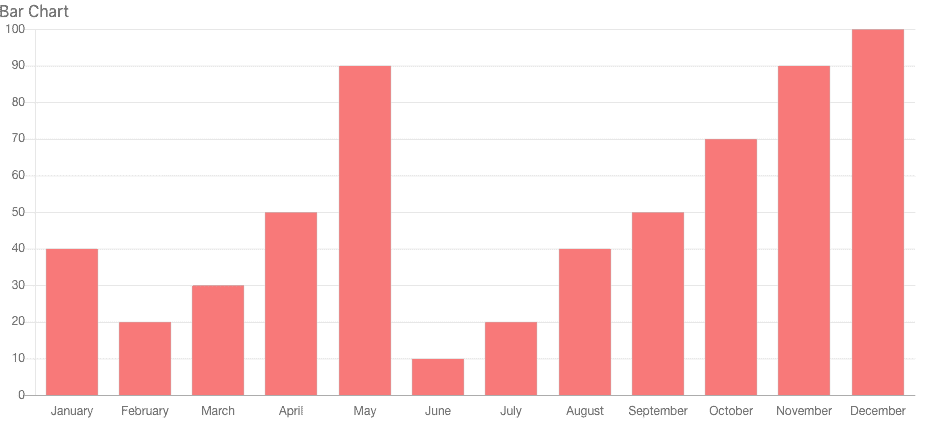

查看 Pen [vuechart-js - bar chart](https://codepen.io/SitePoint/pen/LjVxym)。

### 气泡图

对于气泡图，我们将创建一个专门用于渲染气泡图的组件。

气泡图使用气泡/圆形以三维方法 (x, y, r) 显示数据。`x`用于显示水平轴数据，`y`用于显示垂直数据，而`r`用于显示大小。

打开`src/components`文件夹内的`BubbleChart.vue`组件并输入以下代码：

```vue
<script>
  // 从 vue-chartjs 包装器导入 Bubble 类
  import { Bubble } from 'vue-chartjs'
  // 导出此以便在其他组件中使用
  export default {
    extends: Bubble,
    data () {
      return {
        datacollection: {
          // 显示在 x 轴上的数据
          labels: ['January', 'February', 'March', 'April', 'May', 'June', 'July', 'August', 'September', 'October', 'November', 'December'],
          datasets: [
            {
              label: 'Data One',
              backgroundColor: '#f87979',
              pointBackgroundColor: 'white',
              borderWidth: 1,
              pointBorderColor: '#249EBF',
              // 显示在 y 轴上的数据
              data: [40, 20, 30, 50, 90, 10, 20, 40, 50, 70, 90, 100]
            }
          ]
        },
        // 控制图表外观的 Chart.js 选项
        options: {
          scales: {
            yAxes: [{
              ticks: {
                beginAtZero: true
              },
              gridLines: {
                display: true
              }
            }],
            xAxes: [ {
              gridLines: {
                display: false
              }
            }]
          },
          legend: {
            display: true
          },
          responsive: true,
          maintainAspectRatio: false
        }
      }
    },
    mounted () {
      // renderChart 函数使用 datacollection 和 options 对象渲染图表
      this.renderChart(this.datacollection, this.options)
    }
  }
</script>
```

在我们看到气泡图之前，我们还需要做一件事——和对其他图表的操作一样：编辑`VueChartJS.vue`文件并将`<!--Bubble Chart example-->`替换为`<bubble-chart></bubble-chart>`。

### 实时代码

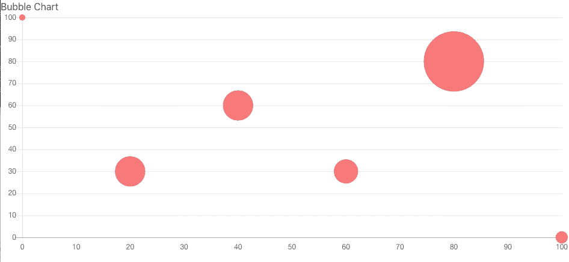

查看 Pen [vue-chartjs - bubble chart](https://codepen.io/SitePoint/pen/mMJRxg)。

### 展示响应式的柱状图

我们将用`vue-chartjs`演示的最后一个示例是如何使用它来创建一个当数据集发生变化时自动更新的图表。需要注意的是，Chart.js 通常不提供此功能，但`vue-chartjs`提供了——借助这两个混入（mixins）之一：

*   `reactiveProp`

*   `reactiveData`

打开`src/components`文件夹内的`Reactive.vue`组件文件并输入以下代码：

```javascript
<script>
  // 从 vue-chartjs 封装导入 Bar 和 mixins 类
  import { Bar, mixins } from 'vue-chartjs'
  // 从 mixins 模块获取 reactiveProp mixin。
  const { reactiveProp } = mixins
  export default Bar.extend({
    mixins: [ reactiveProp ],
    data () {
      return {
        // 控制图表外观的 Chart.js 选项
        options: {
          scales: {
            yAxes: [{
              ticks: {
                beginAtZero: true
              },
              gridLines: {
                display: true
              }
            }],
            xAxes: [ {
              gridLines: {
                display: false
              }
            }]
          },
          legend: {
            display: true
          },
          responsive: true,
          maintainAspectRatio: false
        }
      }
    },
    mounted () {
      // this.chartData 在 mixin 中创建，包含了构建图表所需的所有数据。
      this.renderChart(this.chartData, this.options)
    }
  })
</script>
```

我们在上面的代码中做的第一件事是从`vue-chartjs`封装中导入`Bar`和`mixins`类并扩展`Bar`。我们还从`mixins`模块提取了`reactiveProp` mixin 以用于响应式。

`reactiveProp` mixin 扩展了你的图表组件的逻辑，自动创建一个名为`chartData`的 prop，并为此 prop 添加了一个 Vue 监听器（watcher）。这次我们没有创建`dataset`对象，因为所有需要的数据将在`chartData` prop 中。

为了让其生效，我们需要进一步编辑`VueChartJS.vue`。打开`VueChartJS.vue`，在`components`属性之后添加以下代码：

```javascript
data () {
  return {
    // 使用 null 实例化 datacollection
    datacollection: null
  }
},
created () {
  // 每当 vue 实例被创建时，调用 fillData() 函数。
  this.fillData()
},
methods: {
  fillData () {
    this.datacollection = {
      // 图表 y 轴的数据
      labels: ['January', 'February', 'March', 'April', 'May', 'June', 'July', 'August', 'September', 'October', 'November', 'December'],
      datasets: [
        {
          label: 'Data One',
          backgroundColor: '#f87979',
          // 图表 x 轴的数据
          data: [this.getRandomInt(), this.getRandomInt(), this.getRandomInt(), this.getRandomInt(), this.getRandomInt(), this.getRandomInt(), this.getRandomInt(), this.getRandomInt(), this.getRandomInt(), this.getRandomInt(), this.getRandomInt(), this.getRandomInt()]
        }
      ]
    }
  },
  getRandomInt () {
    // 用于图表的数字生成 JS 函数
    return Math.floor(Math.random() * (50 - 5 + 1)) + 5
  }
}
```

让我们过一遍上面的代码。在`data`对象中，我们返回`datacollection`，它被设置为`null`；在`created`方法中，每当组件实例被创建时，我们都会调用`fillData()`。`fillData`函数将在`methods`对象中创建。

在`methods`对象中，我们创建了一个名为`fillData`的函数。该函数创建了一个`datacollection`对象，其中包含一个`label`数组（x 轴数据）和一个`datasets`数组，后者持有 y 轴所需的`data`数组。

### getRandomInt

`data`数组的内容是一个`getRandomInt`函数，它为我们生成随机数。

最后，为了显示图表并检查响应式是否工作，将`<!--Reactivity Line Chart example-->`替换为内容：

```html
<reactive :chart-data="datacollection"></reactive>
<button class="button is-primary" @click="fillData()">Randomize</button>
```

我们使用了创建的`reactive`组件，并将`datacollection`的内容传递给`chart-data` prop 以显示图表。我们添加了一个按钮，每次点击时都会调用`fillData()`方法。

导航到应用中的`/chartjs`路由查看新图表，点击`Randomize`按钮查看图表如何根据新数据实时自动重新渲染。

### Live Code

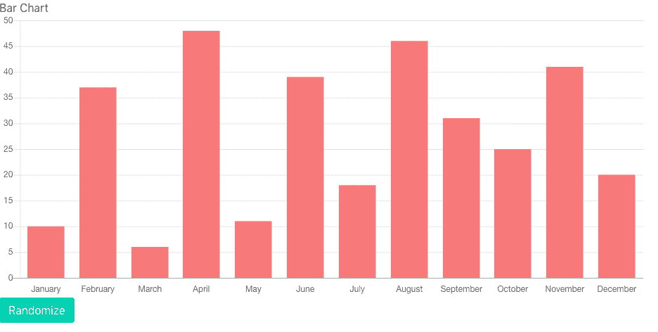

查看 Pen [vue-chartjs - reactive bar chart](https://codepen.io/SitePoint/pen/dzoNxr/)。

## 使用 vue-charts 制作图表

`vue-charts`构建图表的方法与`vue-chartjs`非常不同。它不需要你创建单独的组件来处理数据和渲染图表。图表所需的数据可以这样在 Vue 实例中实例化：

```javascript
data () {
  return {
    labels: ['January', 'February', 'March', 'April', 'May', 'June', 'July'],
    dataset: [65, 59, 80, 81, 56, 55, 40]
  }
}
```

我们可以轻松地显示图表。

`addData`方法将数据表单输入和标签表单输入（我们很快就会添加）的当前值推送到当前数据集中。现在让我们也添加组件以及用于添加新数据和标签的表单。

将以下代码段替换掉注释`<!--Data Binding Line Chart Example-->`：

```
<form @submit.prevent="addData">
  <input placeholder="Add a Data" v-model="dataentry">
  <input placeholder="Add a Label" v-model="datalabel">
  <button type="submit">Submit</button>
</form>
<chartjs-line :labels="labels" :data="dataset" :bind="true"></chartjs-line>
```

上面的代码是一个表单，允许你输入数据和标签的值并提交表单。图表将根据最新输入自动渲染。

### 实时代码

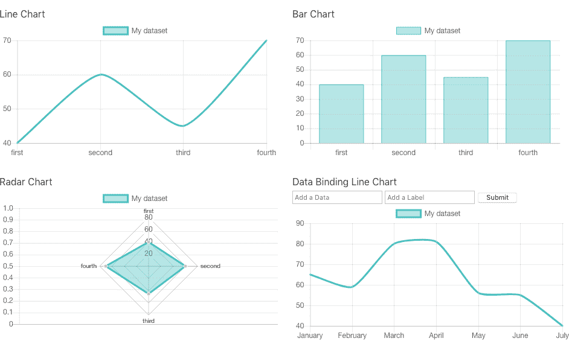

查看 Pen [vue-charts data binding](https://codepen.io/SitePoint/pen/eENvmV/)。

## 使用 vue-chartkick 图表

[`vue-chartkick`](https://github.com/ankane/vue-chartkick) 是一个 Vue 封装器，允许你通过一行代码创建精美的图表。我们将通过四个示例演示此库的使用。我们将创建一个折线图、柱状图、散点图，并使用下载功能（可下载图表）。


在处理图表数据集的数据方面，`vue-chartkick` 为我们提供了两个选项。我们可以像`<bar-chart :data="['Work', 1322], ['Play', 1492]]"></bar-chart>`这样的操作，内联添加数据；或者使用`<line-chart :data="chartData"></line-chart>`，并在 Vue 数据对象中声明`chartData`数组：

```
data () {
  return {
    chartData: [['Jan', 44], ['Feb', 27], ['Mar', 60], ['Apr', 55], ['May', 37], ['Jun', 40], ['Jul', 69], ['Aug', 33], ['Sept', 76], ['Oct', 90], ['Nov', 34], ['Dec', 22]]
  }
}
```

让我们开始使用`vue-chartkick`。在继续之前，打开`src`文件夹内的`main.js`文件并添加以下代码：

```
import Chartkick from 'chartkick'
import VueChartkick from 'vue-chartkick'

Vue.use(VueChartkick, { Chartkick })
```

我们从`node_modules`导入`Chartkick`库和`vue-chartkick`封装器，并通过`Vue.use(VueChartkick, { Chartkick })`将其全局注册。

要开始使用`vue-chartkick`创建图表，打开我们之前创建的`VueChartKick.vue`文件并添加以下代码：

```
<template>
  <section class="container">
    <h1>Demo examples of vue-chartkick</h1>
    <div class="columns">
      <div class="column">
        <h3>Line Chart</h3>
        <!--Line Chart example-->
      </div>
      <div class="column">
        <h3>Bar Chart</h3>
        <!--Bar Chart example-->
      </div>
    </div>
    <div class="columns">
      <div class="column">
        <h3>Scatter Chart</h3>
        <!--Scatter chart example-->
      </div>
      <div class="column">
        <h3>Downloadable Line Chart</h3>
        <!--Downloadable line chart-->
      </div>
    </div>
  </section>
</template>

<script>
  export default {
    name: 'VueChartKick',
    data () {
      return {
        chartData: [['Jan', 44], ['Feb', 27], ['Mar', 60], ['Apr', 55], ['May', 37], ['Jun', 40], ['Jul', 69], ['Aug', 33], ['Sept', 76], ['Oct', 90], ['Nov', 34], ['Dec', 22]]
      }
    }
  }
</script>
```

在上面的代码块中，我们再次为要创建的不同类型的图表创建了占位符，我们要做的只是开始将它们填充进去。

我们在`script`部分的`data`对象中创建了`chartData`数组，包含了用于各种图表的数据。现在开始创建图表吧。

### 折线图

使用`vue-chartkick`创建折线图非常简单且直接。你所做的就是引入`vue-chartkick`的`line-chart`组件，并确定你想使用的数据集——类似于这样：`<line-chart :data="chartData"></line-chart>`。在这种情况下，`data`属性被设置为 Vue`data`对象中的`chartData`数组。

因此，将`VueChartKick.vue`文件中的注释`<!--Line Chart example-->`替换为`<line-chart :data="chartData"></line-chart>`，折线图现在就能正常显示了。

### 柱状图

我们可以用与上面创建折线图相同的方法创建柱状图。但情况下，我们将尝试不同的方法。我们不再使用`chartData`数组作为数据集，而是在属性内部添加数据集，例如：`<bar-chart :data="['Work', 1322], ['Play', 1492]]"></bar-chart>`。

将`VueChartKick.vue`文件中的注释`<!--Bar Chart example-->`替换为`<bar-chart :data="['Work', 1322], ['Play', 1492]]"></bar-chart>`，你的柱状图现在就能正常显示了。

### 散点图

散点图也与上面的折线图和柱状图一样。将`VueChartKick.vue`文件中的注释`<!--Scatter Chart example-->`替换为`<scatter-chart :data="[[174.0, 80.0], [176.5, 82.3], [180.3, 73.6]]"></scatter-chart>`，你的散点图现在就能正常显示了。

### 下载图表

`vue-chartkick`有一个`vue-chartjs`和`vue-charts`所缺乏的酷功能：创建可下载图表。一旦图表设置为可下载，用户就可以将图保存为图像。它是如何工作的？让我们通过折线图来检查一下：

```
<line-chart :data="chartData" :download="true"></line-chart>
```

将`VueChartKick.vue`文件中的注释`<!--Downloadable line chart-->`替换为`<line-chart :data="chartData" :download="true"></line-chart>`以查看下载按钮。

本教程的源代码可以在[GitHub 上获取](https://github.com/sitepoint-editors/vue-charts)，如果你想查看此教程的在线演示，也可以点击[此处](https://vue-charts.herokuapp.com/)查看。

# 第 3 章：使用 Pusher 和 Vue.js 构建一个实时聊天应用

## 作者：Michael Wanyoike

实时通信应用如今变得越来越流行，因为它们提供了更流畅、更自然的用户体验。

在本教程中，我们将使用由[Pusher](https://pusher.com)提供的[ChatKit](https://pusher.com/chatkit)构建的 Vue.js 实时聊天应用。ChatKit 服务将为我们提供在任何设备上构建聊天应用所需的完整后端，我们只需要专注于构建通过[ChatKit 客户端包](https://www.npmjs.com/package/@pusher/chatkit-client)连接到 ChatKit 服务的前端用户界面。

## 前提条件

这是一个中高级别水平教程。你需要熟悉以下概念才能进行学习：

- Vue.js 基础
- Vuex 基础
- 使用 CSS 框架

你还需要在电脑上安装 Node。你可以从[官网](https://nodejs.org/)下载二进制文件，或者使用[版本管理器](https://www.sitepoint.com/quick-tip-multiple-versions-node-nvm/)。这可能是最简单的方法，因为它允许你在同一台机器上管理多个版本的 Node。

最后，你需要运行以下命令全局安装 Vue CLI：

```
npm install -g @vue/cli
```

在编写此文档时，Node 10.14.1 和 Vue CLI 3.2.1 是最新版本。

## 关于项目

我们将构建一个类似于 Slack 或 Discord 的基础聊天应用。该应用将具备以下功能：

- 拥有多个频道（channels）和房间（rooms）
- 列出房间成员并检测在线状态
- 检测其他用户正在输入

正如前面提到的，我们只构建前端。ChatKit 服务有一个后端接口，允许我们管理用户、权限和房间。

你可以在[GitHub](https://github.com/sitepoint-editors/vue-chatkit)上找到该项目的完整代码。

## 设置 ChatKit 实例

让我们创建一个 ChatKit 实例，如果你熟悉 Discord，这类似于服务器实例。

前往 Pusher 网站上的[ChatKit](https://pusher.com/chatkit)页面并点击`Sign Up`按钮。系统会提示电子邮件和密码，以及使用 GitHub 或 Google 登录的选项。

选择最适合你的选项，然后在下一个屏幕填写一些详情，如`Name`（名称）、`Account type`（账户类型）、`User role`（用户角色）等。

点击`Complete Onboarding`将进入 Pusher 主仪表板。在这里，你应该点击 ChatKit 产品。

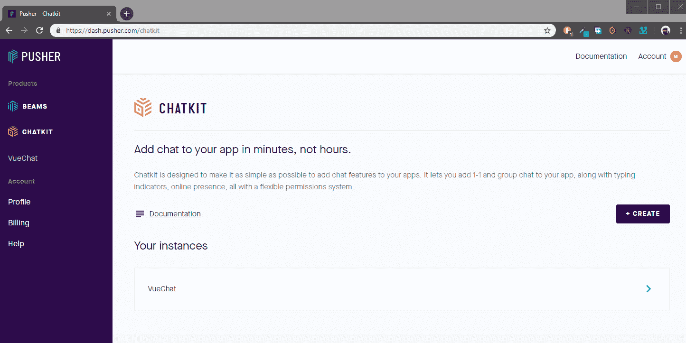

点击 Create 按钮创建一个新的 ChatKit 实例。我将我的命名为`VueChatTut`。

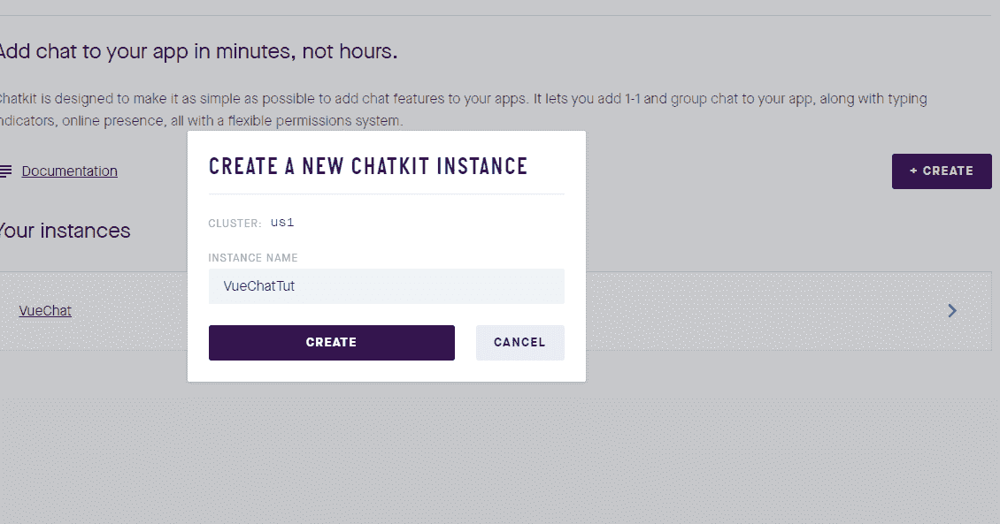

本教程将使用免费计划。它支持多达 1,000 个独立用户，对于我们的需求来说绰绰有余。进入`Console`标签页。你需要创建一个用户来开始。点击`Create User`按钮。

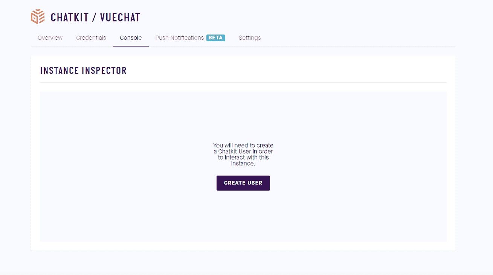

我将用户命名为“john”（`User Identifier`）和“John Wick”（`Display Name`），但你可以随心所欲命名。部分很简单：创建两个或多个用户。例如：

- salt, Evelyn Salt
- hunt, Ethan Hunt

创建三个或多个房间并分配用户。例如：

- General (john, salt, hunt)
- Weapons (john, salt)
- Combat (john, hunt)

这里是你的`Console`界面应该的样子。

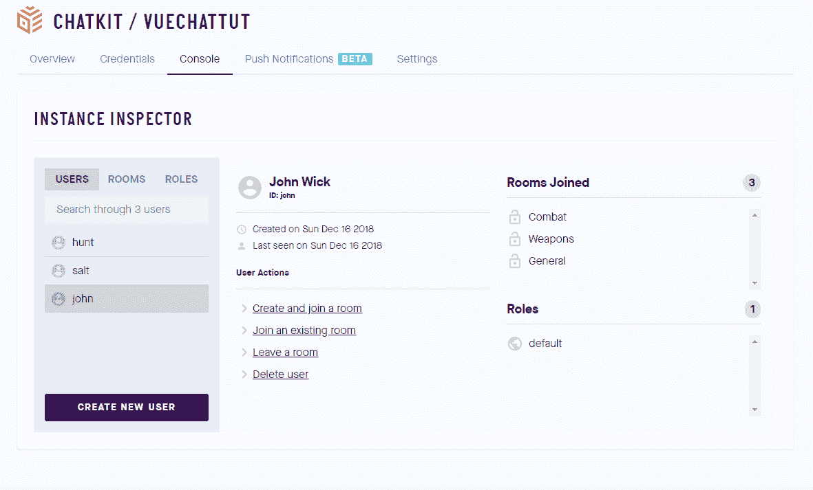

接下来，你可以进入`Rooms`标签页，并为每个房间使用选定的用户创建消息。这是为了测试。然后进入`Credentials`标签页并记录`Instance Locator`（实例定位符）。我们需要激活用于生成 HTTP 端点的`Test Token Provider`，并将其记录下来。

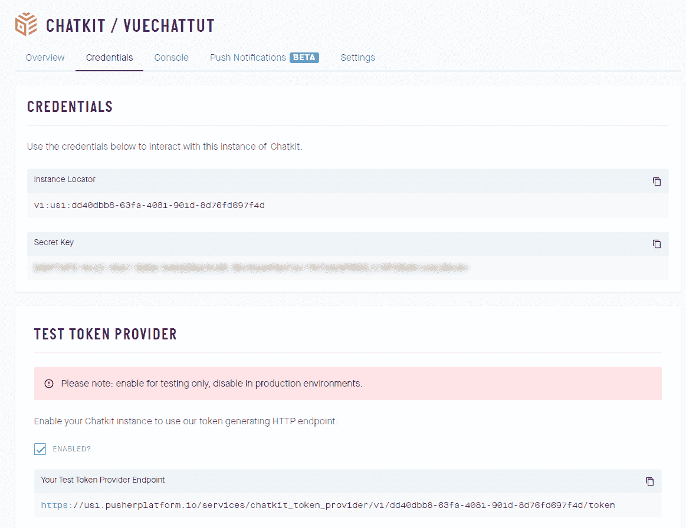

我们的 ChatKit 后端现在已就绪。让我们开始构建 Vue.js 前端。

## 搭建 Vue.js 项目

打开终端并按照如下命令创建项目：

```
vue create vue-chatkit
```

选择`Manually select features`并按如下所示回答问题。

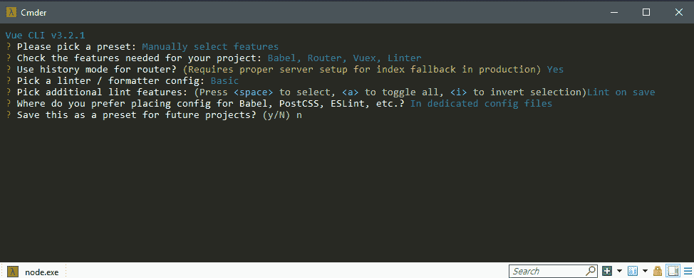

务确保你已选择了 Babel、Vuex 和 Vue Router 作为附加功能。接下来，按照以下结构创建相应的文件夹和文件：

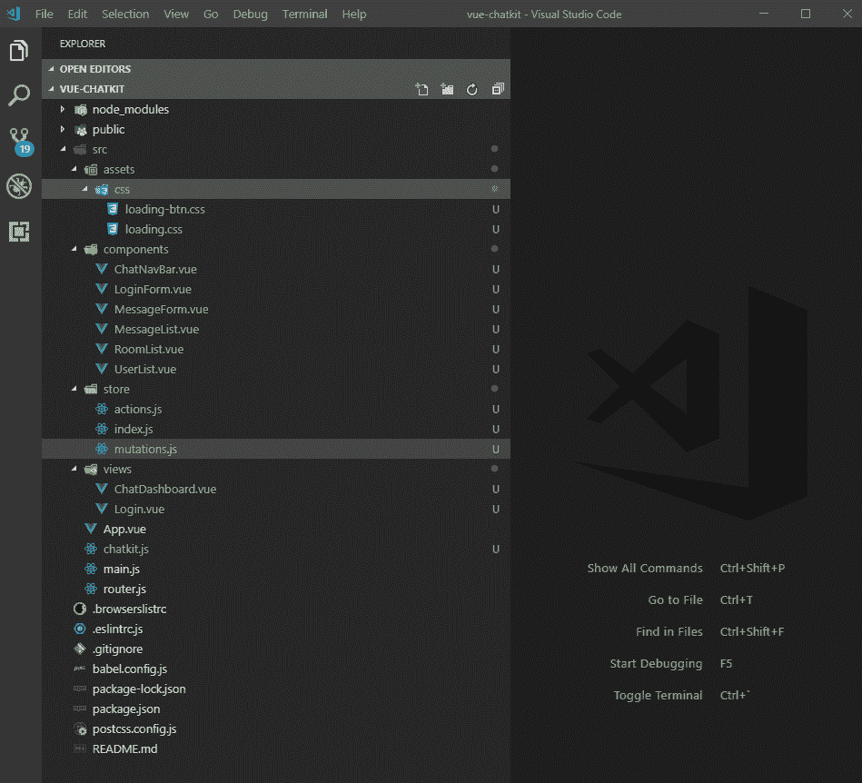

确保按照演示创建所有文件夹和文件。删除上述插图中未出现的任何不需要的文件。

```javascript
import Vue from 'vue'
import Router from 'vue-router'
import Login from './views/Login.vue'
import ChatDashboard from './views/ChatDashboard.vue'

Vue.use(Router)

export default new Router({
  mode: 'history',
  base: process.env.BASE_URL,
  routes: [
    {
      path: '/',
      name: 'login',
      component: Login
    },
    {
      path: '/chat',
      name: 'chat',
      component: ChatDashboard,
    }
  ]
})
```

更新`src/store/index.js`：

```javascript
import Vue from 'vue'
import Vuex from 'vuex'
import VuexPersistence from 'vuex-persist'
import mutations from './mutations'
import actions from './actions'

Vue.use(Vuex)

const debug = process.env.NODE_ENV !== 'production'

const vuexLocal = new VuexPersistence({
  storage: window.localStorage
})

export default new Vuex.Store({
  state: {
  },
  mutations,
  actions,
  getters: {
  },
  plugins: [vuexLocal.plugin],
  strict: debug
})
```

`vuex-persist`包确保了我们的 Vuex 状态在页面重载或刷新之间被保存。

我们的项目现在应该能够无错误地编译了。不过，先不要运行它，因为我们需要构建用户界面。

## 构建 UI 界面

让我们先按照以下方式更新`src/App.vue`：

```html
<template>
  <div id="app">
    <router-view/>
  </div>
</template>
```

接下来，我们需要定义 Vuex store 状态，因为我们的 UI 组件需要这些状态才能正常工作。我们将通过进入`src/store/index.js`中的 Vuex store 来完成。只需如下所示更新`state`和`getters`部分即可：

```javascript
state: {
  loading: false,
  sending: false,
  error: null,
  user: [],
  reconnect: false,
  activeRoom: null,
  rooms: [],
  users: [],
  messages: [],
  userTyping: null
},
getters: {
  hasError: state => state.error ? true : false
},
```

这些都是我们聊天应用程序所需的所有状态变量。`loading`状态用于 UI 确定是否应该运行 CSS 加载器。`error`状态用于存储刚刚发生的错误信息。我们将在遇到其他状态变量时讨论它们。

接下来打开`src/view/Login.vue`并如下所示更新：

```html
<template>
  <div class="login">
    <b-jumbotron header="Vue.js Chat"
                  lead="Powered by Chatkit SDK and Bootstrap-Vue"
                  bg-variant="info"
                  text-variant="white">
      <p>更多信息请访问网站</p>
      <b-btn target="_blank" href="https://pusher.com/chatkit">更多信息</b-btn>
    </b-jumbotron>
    <b-container>
      <b-row>
        <b-col lg="4" md="3"></b-col>
        <b-col lg="4" md="6">
          <LoginForm />
        </b-col>
        <b-col lg="4" md="3"></b-col>
      </b-row>
    </b-container>
  </div>
</template>

<script>
import LoginForm from '@/components/LoginForm.vue'

export default {
  name: 'login',
  components: {
    LoginForm
  }
}
</script>
```


接下来，为`src/components/LoginForm.vue`插入如下代码：

```html
<template>
  <div class="login-form">
    <h5 class="text-center">聊天登录</h5>
    <hr>
    <b-form @submit.prevent="onSubmit">
       <b-alert variant="danger" :show="hasError">{{ error }} </b-alert>

      <b-form-group id="userInputGroup"
                    label="用户名"
                    label-for="userInput">
        <b-form-input id="userInput"
                      type="text"
                      placeholder="输入用户名"
                      v-model="userId"
                      autocomplete="off"
                      :disabled="loading"
                      required>
        </b-form-input>

      <b-button type="submit"
                variant="primary"
                class="ld-ext-right"
                v-bind:class="{ running: loading }"
                :disabled="isValid">
                登录 <div class="ld ld-ring ld-spin"></div>
      </b-button>
    </b-form>
  </div>
</template>

<script>
import { mapState, mapGetters } from 'vuex'

export default {
  name: 'login-form',
  data() {
    return {
      userId: '',
    }
  },
  computed: {
    isValid: function() {
      const result = this.userId.length < 3;
      return result ? result : result
    },
    ...mapState([
      'loading',
      'error'
    ]),
    ...mapGetters([
      'hasError'
    ])
  }
}
</script>
```

如前所述，这是教程。`vuex-persist`包确保我们的 Vuex 状态在页面重载或刷新之间被保存。`ChatDashboard`将作为以下组件的布局父：

* `ChatNavBar`：基础导航栏
* `RoomList`：列出登录用户可以访问的房间，也是房间选择器
* `UserList`：列出房间的成员
* `MessageList`：显示选中房间的消息
* `MessageForm`：向选中房间发送消息的表单

进入`src/view/ChatDashboard.vue`并插入代码：

```html
<template>
  <div class="chat-dashboard">
    <ChatNavBar />
    <b-container fluid v-bind:class="{ running: loading }">
      <b-row>
        <b-col cols="2">
          <RoomList />
        </b-col>

        <b-col cols="8">
          <div id="chat-content">
            <MessageList />
          </div>
          <b-row>
            <MessageForm />
          </b-row>
        </b-col>

        <b-col cols="2">
          <UserList />
        </b-col>
      </b-row>
    </b-container>
  </div>
</template>

<script>
import ChatNavBar from '@/components/ChatNavBar.vue'
import RoomList from '@/components/RoomList.vue'
import MessageList from '@/components/MessageList.vue'
import MessageForm from '@/components/MessageForm.vue'
import UserList from '@/components/UserList.vue'
import { mapState } from 'vuex';

export default {
  name: 'Chat',
  components: {
    ChatNavBar,
    RoomList,
    UserList,
    MessageList,
    MessageForm
  },
  computed: {
    ...mapState([
      'loading'
    ])
  }
}
</script>
```

让我们在每个组件中放入一些模板代码以确保内容都能显示。

为`src/components/ChatNavBar.vue`插入模板代码：

```html
<template>
  <b-navbar id="chat-navbar" toggleable="md" type="dark" variant="info">
    <b-navbar-brand href="#">
      Vue Chat
    </b-navbar-brand>
    <b-navbar-nav class="ml-auto">
      <b-nav-text>{{ user.name }} | </b-nav-text>
      <b-nav-item href="#" active>退出</b-nav-item>
    </b-navbar-nav>
  </b-navbar>
</template>

<script>
import { mapState } from 'vuex'

export default {
  name: 'ChatNavBar',
  computed: {
    ...mapState([
      'user',
    ])
  },
}
</script>

<style>
  #chat-navbar {
    margin-bottom: 15px;
  }
</style>
```

为`src/components/RoomList.vue`插入模板代码：

```html
<template>
  <div class="room-list">
    <h4>Channels</h4>
    <hr>
    <b-list-group v-if="activeRoom">
      <b-list-group-item v-for="room in rooms"
                        :key="room.name"
                        :active="activeRoom.id === room.id"
                        href="#"
                        @click="onChange(room)">
        # {{ room.name }}
      </b-list-group-item>
    </b-list-group>
  </div>>
</template>

<script>
import { mapState } from 'vuex'

export default {
  name: 'RoomList',
  computed: {
    ...mapState([
      'rooms',
      'activeRoom'
    ]),
  }
}
</script>
```

如下所示为`src/components/UserList.vue`插入模板代码：

```html
<template>
  <div class="user-list">
    <h4>Members</h4>
    <hr>
    <b-list-group>
      <b-list-group-item v-for="user in users" :key="user.username">
        {{ user.name }}
        <b-badge v-if="user.presence"
        :variant="statusColor(user.presence)"
        pill>
        {{ user.presence }}</b-badge>
      </b-list-group-item>
    </b-list-group>
  </div>
</template>

<script>
import { mapState } from 'vuex'

export default {
  name: 'user-list',
  computed: {
    ...mapState([
      'loading',
      'users'
    ])
  },
  methods: {
    statusColor(status) {
      return status === 'online' ? 'success' : 'warning'
    }
  }
}
</script>
```

如下所示为`src/components/MessageList.vue`插入模板代码：

```html
<template>
  <div class="message-list">
    <h4>Messages</h4>
    <hr>
    <div id="chat-messages" class="message-group" v-chat-scroll="{smooth: true}">
      <div class="message" v-for="(message, index) in messages" :key="index">
        <div class="clearfix">
          <h4 class="message-title">{{ message.name }}</h4>
          <small class="text-muted float-right">@{{ message.username }}</small>
        </div>
        <p class="message-text">
          {{ message.text }}
        </p>
        <div class="clearfix">
          <small class="text-muted float-right">{{ message.date }}</small>
        </div>
      </div>
    </div>
  </div>
</template>

<script>
import { mapState } from 'vuex'

export default {
  name: 'message-list',
  computed: {
    ...mapState([
      'messages',
    ])
  }
}
</script>

<style>
.message-list {
  margin-bottom: 15px;
  padding-right: 15px;
}
.message-group {
  height: 65vh !important;
  overflow-y: scroll;
}
.message {
  border: 1px solid lightblue;
  border-radius: 4px;
  padding: 10px;
  margin-bottom: 15px;
}
.message-title {
  font-size: 1rem;
  display:inline;
}
.message-text {
  color: gray;
  margin-bottom: 0;
}
.user-typing {
  height: 1rem;
}
</style>
```

如下所示为`src/components/MessageForm.vue`插入模板代码：

```html
<template>
  <div class="message-form ld-over">
    <small class="text-muted">@{{ user.username }}</small>
    <b-form @submit.prevent="onSubmit" class="ld-over" v-bind:class="{ running: sending }">
      <div class="ld ld-ring ld-spin"></</div>
      <b-alert variant="danger" :show="hasError">{{ error }} </b-alert>
      <b-form-group>
        <b-form-input id="message-input"
                      type="text"
                      v-model="message"
                      placeholder="Enter Message"
                      autocomplete="off"
                      required>
        </b-form-input>
      </b-form-group>
      <div class="clearfix">
        <b-button type="submit" variant="primary" class="float-right">
          Send
        </b-button>
      </div>
    </b-form>
  </div>
</template>

<script>
import { mapState, mapGetters } from 'vuex'

export default {
  name: 'message-form',
  data() {
    return {
      message: ''
    }
  },
  computed: {
    ...mapState([
      'user',
      'sending',
      'activeRoom'
    ]),
    ...mapGetters([
      'hasError'
    ])
  }
}
</script>
```


```javascript
export default {
  setError(state, error) {
    state.error = error;
  },
  setLoading(state, loading) {
    state.loading = loading;
  },
  setUser(state, user) {
    state.user = user;
  },
  setReconnect(state, reconnect) {
    state.reconnect = reconnect;
  },
  setActiveRoom(state, roomId) {
    state.activeRoom = roomId;
  },
  setRooms(state, rooms) {
    state.rooms = rooms
  },
  setUsers(state, users) {
    state.users = users
  },
  clearChatRoom(state) {
    state.users = [];
    state.messages = [];
  },
  setMessages(state, messages) {
    state.messages = messages
  },
  addMessage(state, message) {
    state.messages.push(message)
  },
  setSending(state, status) {
    state.sending = status
  },
  setUserTyping(state, userId) {
    state.userTyping = userId
  },
  reset(state) {
    state.error = null;
    state.users = [];
    state.messages = [];
    state.rooms = [];
    state.user = null
  }
}
```

`mutations` 的代码非常简单——只是一堆 setter（`set` 方法）。你很快就能在后面的章节中理解每个 `mutation` 函数的作用。接下来，请使用以下代码更新`src/store/actions.js`：

```javascript
import chatkit from '../chatkit';

// 用于显示错误信息的辅助函数
function handleError(commit, error) {
  const message = error.message || error.info.error_description;
  commit('setError', message);
}

export default {
  async login({ commit, state }, userId) {
    try {
      commit('setError', '');
      commit('setLoading', true);
      // 将用户连接到 ChatKit 服务
      const currentUser = await chatkit.connectUser(userId);
      commit('setUser', {
        username: currentUser.id,
        name: currentUser.name
      });
      commit('setReconnect', false);

      // 测试 state.user
      console.log(state.user);
    } catch (error) {
      handleError(commit, error)
    } finally {
      commit('setLoading', false);
    }
  }
}
```

接下来，按照所示更新`src/components/LoginForm.vue`：

```javascript
import { mapState, mapGetters, mapActions } from 'vuex'

//...
export default {
  //...
  methods: {
    ...mapActions([
      'login'
    ]),
    async onSubmit() {
      const result = await this.login(this.userId);
      if(result) {
        this.$router.push('chat');
      }
    }
  }
}
```

你需要重启 Vue.js 服务器以加载`env.local`数据。如果你看到任何关于未使用变量的错误，请暂时忽略它们。完成这些后，导航到 [`localhost:8080/`](http://localhost:8080/) 并测试登录功能：

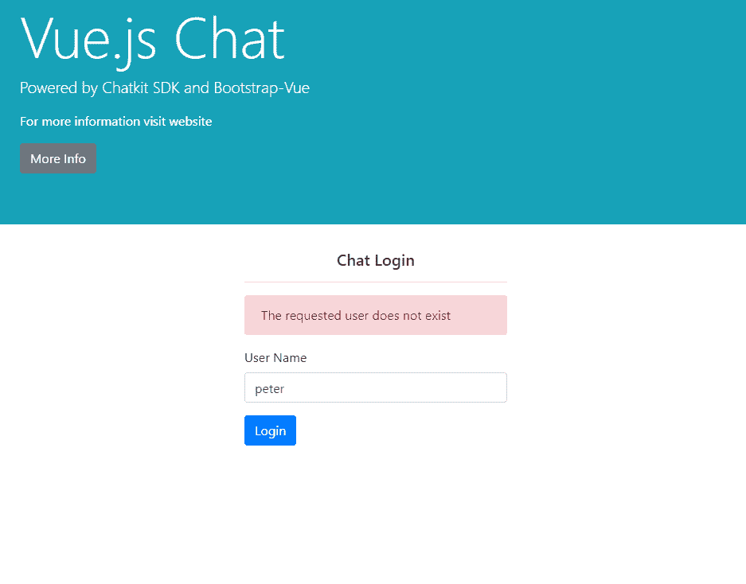 

在上面的示例中，我使用了一个错误的用户名，仅是为了确保错误处理功能正常运行。

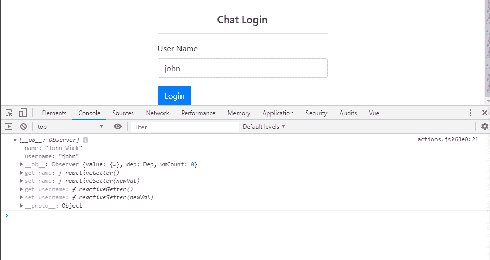 

在这张截图中，我使用了正确的用户名。我还打开了浏览器控制台标签页，以确保`user`对象已填充。此外，如果你已经在 Chrome 中安装了 [Vuejs Dev Tools](https://chrome.google.com/webstore/detail/vuejs-devtools/nhdogjmejiglipccpnnnanhbledajbpd) 或 [Firefox](https://addons.mozilla.org/en-US/firefox/addon/vue-js-devtools/)，你应该可以看到更详细的信息。

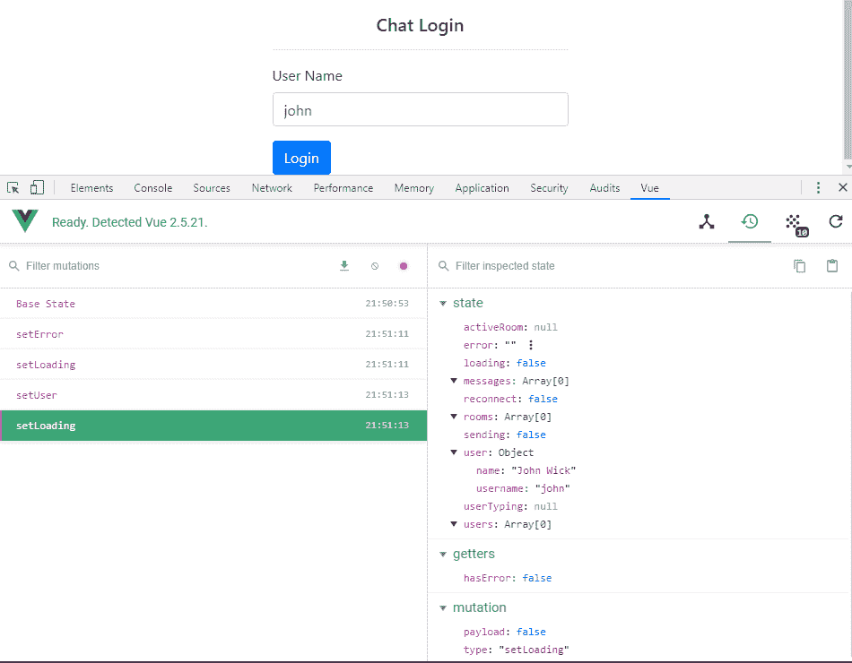 

如果到此为止一切运行正常，请继续下一步。

## 订阅房间

现在我们已经成功验证了登录功能可以工作，我们需要将用户重定向到`ChatDashboard`视图。代码`this.$router.push('chat');`为我们完成了这一操作。然而，我们的 action `login`需要返回一个布尔值，以确定何时可以导航到`ChatDashboard`视图。我们还需要从 ChatKit 服务获取实际数据来填充`RoomList`和`UserList`组件。

更新`src/chatkit.js`如下：

```javascript
//...
import moment from 'moment'
import store from './store/index'

//...
function setMembers() {
  const members = activeRoom.users.map(user => ({
    username: user.id,
    name: user.name,
    presence: user.presence.state
  }));
  store.commit('setUsers', members);
}

async function subscribeToRoom(roomId) {
  store.commit('clearChatRoom');
  activeRoom = await currentUser.subscribeToRoom({
    roomId,
    messageLimit: MESSAGE_LIMIT,
    hooks: {
      onMessage: message => {
        store.commit('addMessage', {
          name: message.sender.name,
        });
      },
      presenceChanged: () => {
        setMembers();
      },
      userTyping: user => {
        store.commit('setUserTyping', user.id);
      },
      stoppedTyping: () => {
        store.commit('setUserTyping', null);
      }
    }
  });
  setMembers();
  return activeRoom;
}

export default {
  connectUser,
  subscribeToRoom
}
```

```javascript
import { mapState, mapActions } from 'vuex'
//...
export default {
  //...
  methods: {
    ...mapActions([
      'changeRoom'
    ]),
    onChange(room) {
      this.changeRoom(room.id)
    }
  }
}
```

如果你还记得，我们已经在`-b-list-group-item-`元素中定义了`@click="onChange(room)"`。让我们通过点击`RoomList`组件中的项目来测试这个新功能。

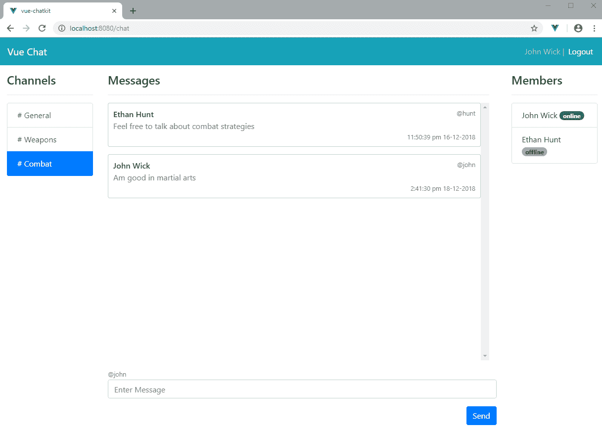 

每当你点击房间时，你的 UI 都应该会更新。`MessageList`和`UserList`组件应该显示所选房间的正确信息。在下一节中，我们将一次性实现多个功能。

## 页面刷新后重新连接用户

你可能已经注意到，当你对`store/index.js`进行一些更改或刷新页面时，你会收到以下错误：`Cannot read property 'subscribeToRoom' of null`。这种发生是因为你的应用程序状态被重置了。幸运的是，`vuex-persist`包通过将状态保存在浏览器的本地存储中，在页面重新加载之间维护了我们的 Vuex 状态。

遗憾的是，连接我们应用和 ChatKit 服务器的引用被重置为 `null`。要修复这个问题，我们需要执行重连接操作。我们还需要一种方法告诉应用程序刚刚发生了页面刷新，我们的程序需要重新连接以继续正常运行。我们将在`src/components/ChatNavbar.vue`中实现这段代码。按如下更新脚本部分：

```javascript
<script>
import { mapState, mapActions, mapMutations } from 'vuex'

export default {
  name: 'ChatNavBar',
  computed: {
    ...mapState([
      'user',
       'reconnect'
    ])
  },
  methods: {
    ...mapActions([
      'logout',
      'login'
    ]),
    ...mapMutations([
      'setReconnect'
    ]),
    onLogout() {
      this.$router.push({ path: '/' });
      this.logout();
    },
    unload() {
      if(this.user.username) { // 用户尚未注销
      this.setReconnect(true);
      }
    }
  },
  mounted() {
    window.addEventListener('beforeunload', this.unload);
    if(this.reconnect) {
      this.login(this.user.username);
    }
  }
}
</script>
```

让我来分解一下事件序列，以便你理解重新连接到 ChatKit 服务的逻辑：

1. `unload`。当发生页面刷新时，此方法会被调用。它首先检查`user.username`状态是否已设置。如果是，意味着用户尚未注销。状态`reconnect`将被设置为 `true`。

2. `mounted`。每当`ChatNavbar.vue`完成渲染时，此方法就会被调用。它首先为在页面卸载之前调用的事件监听器分配了一个处理程序。它还会检查`state.reconnect`是否已设置为 `true`。如果是，则执行登录程序，从而将我们的聊天应用程序重新连接回 ChatKit 服务。

我还添加了`Logout`功能，我们稍后会介绍。

在做出这些更改后，尝试刷新页面。你会看到页面自动更新，因为它在后台执行重连接过程。当你切换房间时，它应该运行得完美无。

## 发送消息、检测用户输入和注销

让我们通过在`src/chatkit.js`中添加以下代码开始实现这些功能：

```javascript
//...
async function sendMessage(text) {
  const messageId = await currentUser.sendMessage({
    text,
    roomId: activeRoom.id
  });
  return messageId;
}

export function isTyping(roomId) {
  currentUser.isTypingIn({ roomId });
}

function disconnectUser() {
  currentUser.disconnect();
}

export default {
  connectUser,
  subscribeToRoom,
  sendMessage,
  disconnectUser
}
```

虽然函数`sendMessage`和`disconnectUser`将封装在 ChatKit 的模块导出中，但`isTyping`函数将单独导出。这是为了允许`MessageForm`直接发送输入事件，而不必涉及 Vuex store。

对于`sendMessage`和`disconnectUser`，我们需要更新 store 以适应错误处理和加载状态通知等情况。进入`src/store/actions.js`并在`changeRoom`函数之后插入以下代码：

```javascript
async sendMessage({ commit }, message) {
  try {
    commit('setError', '');
    commit('setSending', true);
    const messageId = await chatkit.sendMessage(message);
    return messageId;
  } catch (error) {
    handleError(commit, error)
  } finally {
    commit('setSending', false);
  }
},
async logout({ commit }) {
  commit('reset');
  chatkit.disconnectUser();
  window.localStorage.clear();
}
```

对于`logout`函数，我们调用`commit('reset')`将我们的 store 重置为原始状态。这是一个基础的安全功能，用于从浏览器缓存中移除用户信息和消息。

让我们从更新`MessageForm.vue`中的表单输入开始，通过添加以下指令发送输入事件：

```html
<b-form-input id="message-input"
              type="text"
              v-model="message"
              @input="isTyping"
              placeholder="Enter Message"
              autocomplete="off"
              required></b-form-input>
```

更新`MessageForm.vue`的脚本部分以处理发送和发射事件如下：

```javascript
<script>
import { mapActions, mapState, mapGetters } from 'vuex'
import { isTyping } from '../chatkit.js'

export default {
  name: 'message-form',
  data() {
    return {
      message: ''
    }
  },
  computed: {
    ...mapState([
      'user',
      'sending',
      'error',
      'activeRoom'
    ]),
    ...mapGetters([
      'hasError'
    ])
  },
  methods: {
    ...mapActions([
      'sendMessage',
    ]),
    async onSubmit() {
      const result = await this.sendMessage(this.message);
      if(result) {
        this.message = '';
      }
    },
    async isTyping() {
      await isTyping(this.activeRoom.id);
    }
  }
}
</script>
```


在`MessageList.vue`中：

```javascript
 import { mapState } from 'vuex'

export default {
  name: 'message-list',
  computed: {
    ...mapState([
      'messages',
      'userTyping'
    ])
  }
}
```

发送消息功能现在应该可以工作了。为了显示另一个用户正在输入的通知，我们需要在`MessageList.vue`的模板部分`message-group` div之后添加元素：

```html
<div class="user-typing">
  <small class="text-muted" v-if="userTyping">@{{ userTyping }} is typing....</small>
</div>
```

测试此功能，只需使用另一个浏览器登录并开始输入。你会在另一个用户的聊天窗口上看到一个通知。

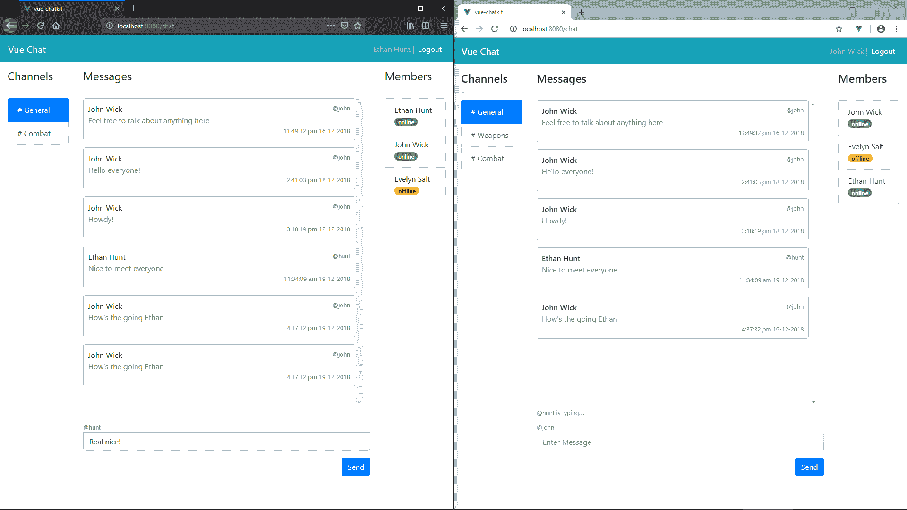

让我们通过实现最后一个功能`logout`来完成本教程。我们的 Vuex store 已经有了处理注销过程的代码。我们只需要更新`src/components/ChatNavbar.vue`。只需将`Logout`按钮与之前指定的函数处理程序`onLogout`链接即可：

```html
<b-nav-item href="#" @click="onLogout" active>Logout</b-nav-item>
```

就是这样。你现在可以注销并作为另一个用户重新登录。

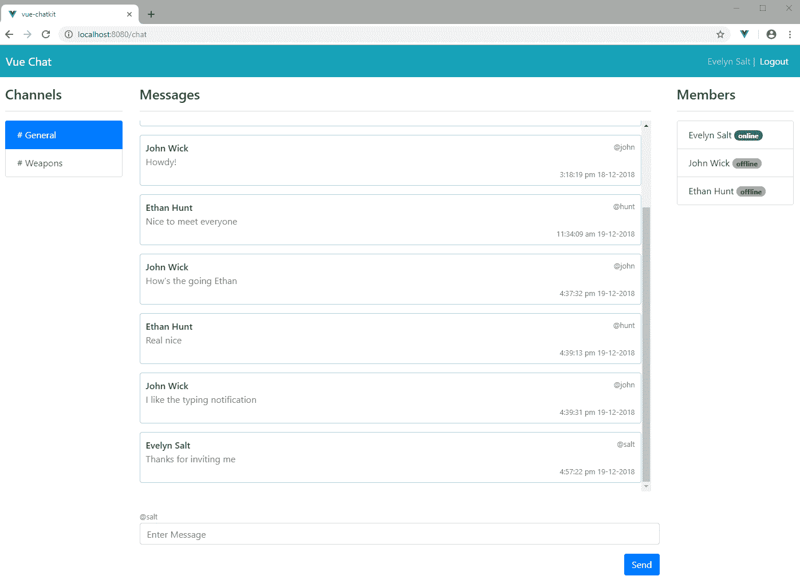

## 总结

我们现在到了本教程的结束。ChatKit API 使使我们能够在短时间内快速构建出一个聊天应用程序。如果我们从零开始构建类似的应用程序，我们需要几个周的时间，因为我们还需要完善后端。这个解决方案的奇妙之处在于，我们不需要处理托管、数据库管理和其他基础设施问题。我们只需要构建前端代码并部署到 Web、Android 和 iOS 平台的客户端设备上。

请务必查看文档，因为在这个教程中，我有很多无法向你展示的后端功能。如果时间允许，你可以轻松构建一个功能完备的聊天应用程序，足以竞争 Slack 和 Discord 等热门聊天产品。

# 第 4 章：为无头 CMS 构建 Vue 前端

## 作者：Michael Wanyoike

在本指南中，我们将学习如何使用 Vue.js 和 [GraphCMS](https://graphcms.com/)（一个无头 CMS 平台）来构建一个现代博客网站。

如果你想今天就开始启动一个博客，我的建议是直接使用 WordPress。

但如果你是一个媒体巨头，并希望尽可能快地将内容传输到多个设备上呢？你可能还需要将内容与广告和其他第三方服务集成。嗯，你可以用 WordPress 实现这些，但你会遇到该平台的一些问题。

1. 你需要安装插件来来实现额外功能。安装的插件越多，你的网站运行得越慢。

2. 与大多数 JavaScript 框架相比，PHP 相当慢。从开发者的角度来看，在 JavaScript 驱动的前端实现自定义功能要容易且快速得多。

[JavaScript 在浏览器加载测试中的性能优于 PHP](https://www.hostingadvice.com/blog/comparing-node-js-vs-php-performance/)。此外，现代 JavaScript 及其生态系统在快速构建新 Web 体验方面提供了更愉快的开发体验。

因此，**无头 CMS (headless CMS)** 解决方案一直在增长——它们仅仅是用于管理内容的后端。通过这种方法，开发者可以使用他们选择的 JavaScript 框架专注于构建快速且具有交互性的前端。自定义 JavaScript 驱动的前端比在 WordPress 站点上进行更改要容易得多。

GraphCMS 与大多数无头 CMS 平台不同之处在于，它不是通过 REST 交付内容，而是通过 GraphQL。这项新技术优于 REST，因为它允许我们在单个请求中构建涉及多个模型数据的查询。

请考虑以下模型架构：

**Post（文章）**

* id: Number
* title: String
* content : String
* comments : Comments 数组

**Comment（评论）**

* id: Number
* name: String
* message: String

上述模型具有一对多（Post 到多多个 Comments）的关系。让我们看看如何获取一个带有所有关联 Comment 记录的单个 Post 记录。

如果数据在关系型数据库中，你必须构建一个低效的 SQL 语句，或者使用两个 SQL 语句来清晰地获取数据。如果数据存储在 NoSQL 数据库中，你可以使用现代 ORM 如 [Vuex ORM](https://vuex-orm.github.io) 为你轻松获取数据，如下：

```javascript
const post = Post.query()
  .with('comments')
  .find(1);
```

非常简单！你可以轻松通过 REST 将此数据传递给目标客户端。但问题在于：每当客户端的数据需求发生变化时，你都被迫回到后端代码要么更新现有的 API 端点，要么创建一个提供所需数据集的新端点。这种往来处理的过程既疲惫又重复。

如果，在客户端级别，你只需要请求所需的数据，而后端就会为你提供，而无需你做额外的工作呢？嗯，这就是 GraphQL 的作用。

## 前提条件

在开始之前，我想指出这是一份面向中级和高级用户的指南。我将不会复习基础知识，而是将向你展示如何使用 GraphCMS 作为后端快速构建一个 Vue.js 博客。你需要精通以下领域：

* ES6 和 ES7 JavaScript
* Vue.js（使用 CLI 版本 3）
* GraphQL

这就是你开始此教程所需的所有知识。此外，具备使用 REST 的背景将非常有帮助，因为我会经常引用它。如果你想复习一下，这篇文章可能会帮助：“REST 2.0 来了，它的名字叫 GraphQL](https://www.sitepoint.com/rest-2-0-graphql/)”。

## 关于项目

我们将构建一个带有基础评论系统的简单博客应用程序。以下是你可以访问以查看已完成项目的链接：

* [CodeSandbox.io 演示](https://codesandbox.io/s/01zo6v221p)
* [GitHub 仓库](https://github.com/sitepoint-editors/vue-axios-graphcsms)

请注意，演示中使用了一个只读（READ-ONLY）令牌，因此评论系统无法工作。你需要按照教程中的说明提供你的开放权限令牌和端点才能使其工作。

## 创建 GraphCMS 项目数据库

访问 [GraphCMS](https://graphcms.com/) 网站并点击“免费开始”（Start Building for Free）按钮。你将被带到注册页面。

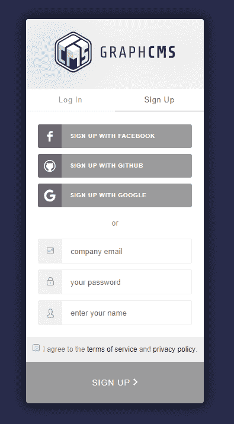

使用你偏好的方法注册。一旦完成账户身份验证和验证过程，你应该能够访问主仪表板。

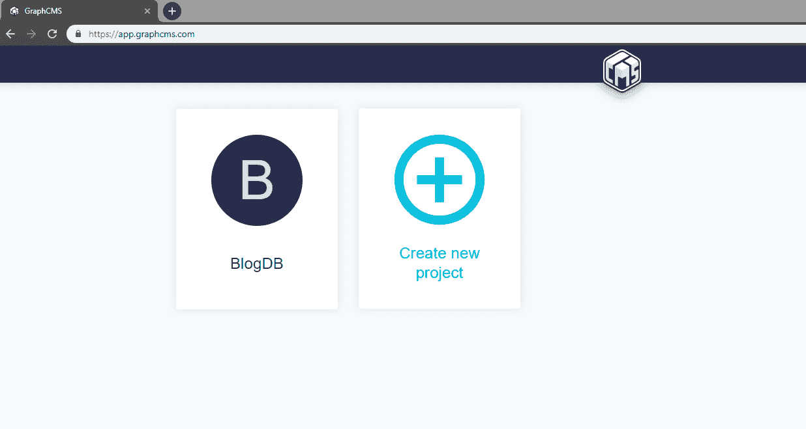

在上面的示例中，我已经创建了一个名为“BlogDB”的项目。继续创建一个新的，并用你喜欢的任何名称命名。输入名称后，你可以留空其他部分。


接下来，你需要从仪表板的`Settings`页面获取 GraphCMS 项目的 API 端点（endpoint）和令牌。你需要创建一个新令牌。对于权限级别，请使用`OPEN`，这将允许工具对你的 GraphCMS 数据库执行`READ`（读取）和`WRITE`（写入）操作。创建一个名为`.env`的文件并将其放在项目根目录下：

```
ENDPOINT=<在此处输入 api endpoint>
TOKEN=<在此处输入带有 OPEN 权限的 token>
```

接下来，你可能需要用自己的数据填充`data`文件夹中的 CSV 文件。以下可以使用的一些示例数据：

```csv
// Categories.csv
name
Featured
Food
Fashion
Beauty

// Posts.csv
title,slug,content,categories
Food Post 1,food-post-1,Breeze through Thanksgiving by making this Instant Pot orange cranberry sauce,Food|Featured
Food Post 2,food-post-2,This is my second food post,Food
Food Post 3,food-post-3,This is my last and final food post,Food
Fashion Post 1,fashion-post-1,This is truly my very first fashion post,Fashion|Featured
Fashion Post 2,fashion-post-2,This is my second fashion post,Fashion
Fashion Post 3,fashion-post-3,This is my last and final fashion post,Fashion
Beauty Post 1,Beauty-post-1,This is truly my very first Beauty post,Beauty|Featured
Beauty Post 2,Beauty-post-2,This is my second beauty post,Beauty
```

如果你愿意，可以更改内容。请确保不要触动第一行，否则你会更改字段名称。请注意，在`categories`列中，我使用了管道符`|`作为分隔符。

要将 CSV 数据上传到你的 GraphCMS 数据库，请按以下顺序执行这些命令：

```bash
npm run categories
npm run posts
```

每个脚本都将输出成功上传的记录。我们先上传`categories`的原因是为了让`posts`记录能够成功链接到现有的`category`记录。

如果你想清理数据库，可以运行以下命令：

```bash
npm run reset
```

此脚本将删除你所有的模型内容。你将得到一个报告，显示每个模型删除了多少条记录。

我希望你会觉得这个工具很好用。回到仪表板确认`Posts`和`Categories`的数据已成功上传。

后端处理完毕后，让我们开始构建前端博客界面。

## 使用 Vue.js 构建博客前端

如前所述，我们将构建一个由 GraphCMS 数据库后端驱动的非常简单的博客应用程序。启动终端并导航到你的工作空间。

如果你还没有安装 Vue CLI，请现在安装：

```bash
npm install -g @vue/cli
```

然后创建一个新项目：

```bash
vue create vue-graphcms
```

选择手动选择功能，然后选择以下选项：

* 功能（Features）： Babel, Router
* 路由历史模式（Router History Mode）：Y
* 仅带错误预防的 ESLint
* 保存时检查（Lint on save）
* 配置文件位置（Config file placement): 专用配置文件
* 保存预设（Save preset）：你的选择

一旦项目创建过程完成，进入项目目录并安装以下依赖：

```bash
npm install bootstrap-vue axios
```

要在我们的项目中设置`Bootstrap-Vue`，只需打开`src/main.js`并添加以下代码：

```javascript
import BootstrapVue from "bootstrap-vue";
import "bootstrap/dist/css/bootstrap.css";
import "bootstrap-vue/dist/bootstrap-vue.css";

Vue.config.productionTip = false;
Vue.use(BootstrapVue);
```

接下来，我们需要开始搭建项目结构。在`src/components`文件夹中，删除现有文件并创建这些新文件：

* `CommentForm.vue`
* `CommentList.vue`
* `Post.vue`
* `PostList.vue`

在`src/views`文件夹中，删除`About.vue`并创建一个名为`PostView.vue`的新文件。如演示所示，我们将几个分类页面，每个页面显示按分类过滤的文章列表。从技术上讲，只有一个页面会根据激活的路由名称显示不同的文章列表。`PostList`组件将根据当前路由过滤文章。

让我们先设置路由。打开`src/router.js`并将现有代码替换为：

```javascript
import Vue from "vue";
import Router from "vue-router";
import Home from "./views/Home.vue";
import Post from "./views/PostView.vue";

Vue.use(Router);

export default new Router({
  mode: "history",
  base: process.env.BASE_URL,
  linkActiveClass: "active",
  routes: [
    {
      path: "/",
      name: "Featured",
      component: Home
    },
    {
      path: "/food",
      name: "Food",
      component: Home
    },
    {
      path: "/fashion",
      name: "Fashion",
      component: Home
    },
    {
      path: "/beauty",
      name: "Beauty",
      component: Home
    },
    {
      path: "/post/:slug",
      name: "Post",
      component: Post
    }
  ]
});
```

现在我们已经有了路由，让我们设置导航栏。打开`App.vue`并将现有代码替换为：


```html
<template>
  <div id="app">
    <b-navbar toggleable="md" type="dark" variant="info">
      <b-navbar-toggle target="nav_collapse"></b-navbar-toggle>
      <b-navbar-brand href="#">GraphCMS</b-navbar-brand>
      <b-collapse id="nav_collapse" nav>
        <b-nav>
          <b-nav-item link to="/" exact>Home</b-nav-item>
          <b-nav-item link="/food">Food</b-nav-item>
          <b-nav-item link="/fashion">Fashion</b-nav-item>
          <b-nav-item link="/beauty">Beauty</b-nav-item>
        </b-nav>
      </b-collapse>
    </b-navbar>

    <b-container>
      <router-view/>
    </b-container>
  </div>
</template>
```

这将网站顶部添加一个带有分类链接的导航栏。保存文件并更新以下文件：

`src/views/Home.vue`

```vue
<script>
import PostList from "@/components/PostList.vue";

export default {
  name: "home",
  components: {
    PostList
  }
};
</script>
```

`src/components/PostList.vue`

```html
<template>
  <section class="post-list">
    <h1>{{ category }} 文章</h1>
    <hr/>
    <p>在此处放置文章列表!</p>
  </section>
</template>

<script>
export default {
  name: "PostList",
  data() {
    return {
      category: ""
    };
  },
  created() {
    this.category = this.$route.name;
  },
  watch: {
    $route() {
      this.category = this.$route.name;
    }
  }
};
</script>
```

注意，在`PostList`组件中，我们使用自定义监听器根据当前 URL 更新我们的`category`数据属性。

现在我们准备好进行快速测试以确认路由正常。使用命令`npm run serve`启动 Vue.js 服务器。在浏览器中打开[localhost:8080](http://localhost:8080)并测试每个链接。`category`属性将输出我们在路由名称属性中定义的相同。

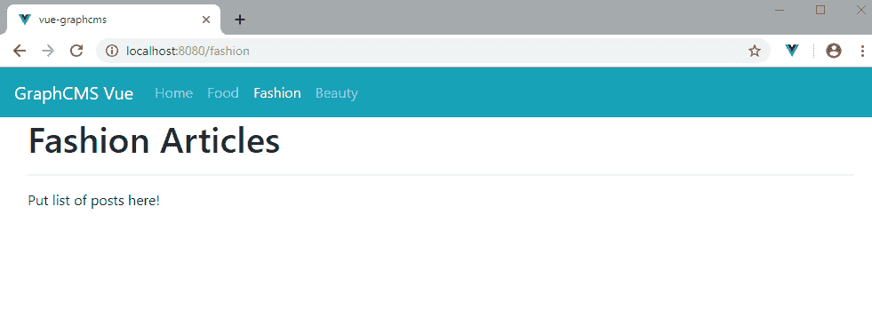

## 从 GraphCMS 获取数据

现在我们的路由代码已经可以运行，让我们看看如何从我们的 GraphCMS 后端提取信息。在项目根目录下，创建一个`env.local`文件并填充以下字段的值：

```
VUE_APP_ENDPOINT=
VUE_APP_TOKEN=
```

请注意，Vue.js 单页应用只加载以`VUE_APP`开头的自定义环境变量。你可以从 GraphCMS 仪表板设置页面获取 API 端点和令牌。接下来，创建文件`src/graphcms.js`并复制以下代码：

```javascript
import axios from "axios";

export const ENDPOINT = process.env.VUE_APP_ENDPOINT;
const TOKEN = process.env.VUE_APP_TOKEN;

const headers = {
  "Content-Type": "application/json",
  Authorization: `Bearer ${TOKEN}`
};

export const apiClient = axios.create({
  headers
});

export const POSTS_BY_CATEGORY_QUERY = `
  query PostsByCategory($category: String!){
    category(where: {
      name: $category
    }
    ){
      name,
      posts {
        id
        slug
        title
        content
        categories {
          name
        }
      }
    }
  }
`;

export const POST_BY_SLUG_QUERY = `
  query PostBySlug($slug: String!){
    post(where: {
      slug: $slug
    })
    {
      id
      title
      content
      categories {
        name
      }
      comments {
        name
        message
      }
    }
  }
`;

export const CREATE_COMMENT_MUTATION = `
  mutation CreateComment($post: PostWhereUniqueInput!, $name: String!, $message: String!){
    createComment(data: {
      name: $name,
      message: $message,
      post: {
        connect: $post
      },
      status: PUBLISHED
    })
    {
      id
      name
      message
    }
  }
`;
```

我们刚刚创建的辅助文件提供了两个主要功能：

- 它创建了一个`axios`实例，该配置用于向你的 GraphCMS 后端执行授权请求。
- 它包含了项目中使用的 GraphQL 查询和变异。这些变异负责获取文章（按分类或按 slug），以及创建新评论。如果你想了解更多关于 GraphQL 查询和变异，请参阅[GraphQL 文档](https://graphql.org/learn/queries/)。

你还可以使用项目仪表板中的 API 探索器来测试这些查询和变异。要此操作，请从上面的代码复制查询或变异并粘贴到 API 探索器的顶部窗口。在下方的窗口中输入任何查询变量，然后点击`Play`按钮。你应该会在右侧的新窗格中看到结果。

这里是一个查询示例：

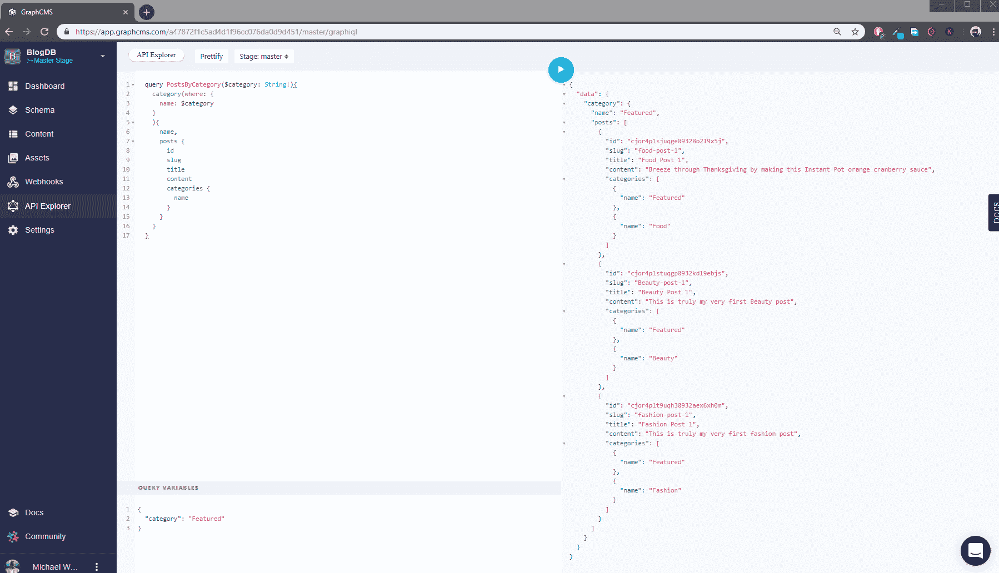

这是一个变异示例：

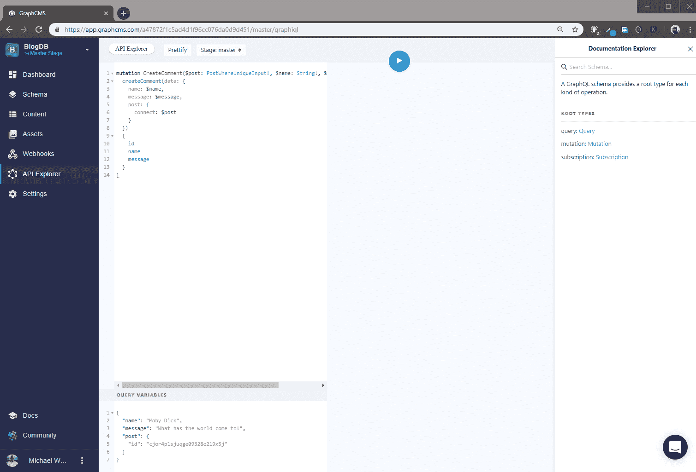

## 在模板中显示数据

现在，让我们在`src/components/PostList.vue`中创建一个 HTML 模板，以整洁的方式显示文章列表。我们还将添加`axios`代码，从我们的 GraphCMS 数据库中拉取`posts`数据：

```html
<template>
  <section class="post-list">
    <h1>{{ category }} 文章</h1>
    <hr/>
    <b-row v-if="loading">
      <b-col class="text-center">
        <div class="lds-dual-ring"></</div>
      </b-col>
    </b-row>
    <div v-if="!loading" >
      <b-card tag="article" v-for="post in posts" :key="post.id" :title="post.title" :sub-title="post.categories.map(cat => cat.name).toString()">
        <p class="card-text">
          {{ post.content }}
        </p>
        <router-link class="btn btn-primary" :to="'post/' + post.slug">
          阅读文章
        </router-link>
      </b-card>
    </div>
  </section>
</template>

<script>
import { ENDPOINT, POSTS_BY_CATEGORY_QUERY } from "../cms.js";

export default {
  name: "PostList",
  data() {
    return {
      category: "",
      loading: false,
      posts: []
    };
  },
  methods: {
    async fetchPosts() {
      try {
        this.loading = true;
        const response = await apiClient(ENDPOINT, {
          query: POSTS_BY_CATEGORY_QUERY,
          variables: {
            category: this.category
          }
        });

        const body = response.data;
        this.posts = body.posts;
        this.loading = false;
      } catch (error) {
        console.log(error);
      }
    }
  },
  created() {
    this.category = this.$route.name;
    this.fetchPosts();
  },
  watch: {
    $route() {
      this.category = this.$route.name;
      this.fetchPosts();
    }
  }
};
</script>

<style>
h1{
  margin-top: 25px;
}
.lds-dual-ring {
  display: inline-block;
  width: 64px;
  height: 64px;
  border: 5px solid #ccc;
  border-color: #ccc;
  border-radius: 50%;
  animation: lds-dual-ring 1.2s linear infinite;
}
@keyframes lds-dual-ring {
  0% {
    transform: rotate(0deg);
  }
  100% {
    transform: rotate(360deg);
  }
}
</style>
```

## 显示单篇文章

确保顶部主导航按预期工作。现在让我们处理`Post`组件。它将有自己的`fetchPost()`函数，通过`slug`进行查询。如果你在想`slug`参数从哪里来，让我提醒你我们在`router.js`中放入的这段代码：

```javascript
//...
{
  path: '/post/:slug',
  name: 'Post',
  component: Post
},
//...
```

这意味着`/post/`之后的任何内容都可以作为`this.$route.params.slug`用于组件。

`post`组件是`CommentForm`和`CommentList`组件的父组件。`comments`数据将从文章记录作为 props 传递给`CommentList`组件。现在为`src/components/CommentList.vue`插入代码：

```html
<template>
  <section class="comment-list">
    <hr/>
    <h4 class="text-muted">评论</h4>
    <b-card v-for="comment in comments" :title="comment.name" title-tag="h5" :key="comment.id">
      <p class="card-text text-muted">{{ comment.message }}</p>
    </b-card>
    <p v-if="comments.length === 0" class="text-center text-muted">暂无评论！</p>
  </section>
</template>

<script>
export default {
  name: "CommentsList",
  props: ["comments"]
};
</script>
```

除非通过 GraphCMS 仪表板手动输入了评论，否则现在不要期望看到任何结果。让我们为`src/components/CommentForm.vue`添加代码，使用户能够为博客文章添加评论。

```html
<template>
  <section class="comment-form">
    <h4 class="text-muted">评论表</h4>

    <b-form @submit.prevent="onSubmit">
      <b-form-group label="姓名">
        <b-form-input id="input-name" type="text" v-model="name" placeholder="输入您的姓名" required></b-form-input>
      </b-form-group>

      <b-form-group label="消息">
        <b-form-textarea id="input-message" v-model="message" placeholder="输入您的评论" :rows="3" :max-rows="6" required>
        </b-form-textarea>
      </b-form-group>

      <b-button type="submit" variant="primary">提交</b-button>
    </b-form>
  </section>
</template>

<script>
import { apiClient, ENDPOINT, CREATE_COMMENT_MUTATION } from "../graphcms.js";

export default {
  name: "CommentForm",
  props: ["post"],
  data() {
    return {
      name: "",
      message: ""
    };
  },
  methods: {
    async onSubmit() {
      const formattedComment = {
        name: this.name,
        message: this.message,
        post: {
          id: this.post.id
        }
      };

      try {
        const response = await apiClient.post(ENDPOINT, {
          query: CREATE_COMMENT_MUTATION,
          variables: formattedComment
        });

        const body = await response.data.data;
        const newComment = body.createComment;

        this.post.comments.push(newComment);
        this.name = "";
        this.message = "";
      } catch (error) {
        console.log(error);
      }
    }
  }
};
</script>

<style>
.comment-form {
  margin-top: 35px;
}
</style>
```


现在我们有了一个基础的评论表单，能够向我们的 GraphQL 后端系统提交新评论。一旦新评论被保存，我们将获取返回的对象并将其添加到 `post.comments` 数组中。这应该触发 `CommentList` 组件来显示新添加的 `Comment`。

现在让我们构建 `src/components/Post.vue` 组件：

```javascript
<template>
  <section class="post">
    <b-row v-if="loading">
      <b-col>
        <div class="lds-dual-ring text-center"></div>
      </b-col>
    </b-row>

    <b-row v-if="!loading">
      <b-col>
        <h1>{{post.title}}</h1>
        <h4 class="text-muted">{{post.categories.map(cat => cat.name).toString()}}</h4>
        <hr>
        <p>{{ post.content }}</p>
      </b-col>
    </b-row>

    <!-- 评论列表 -->
    <b-row v-if="!loading">
      <b-col>
        <CommentList :comments="post.comments" />
      </b-col>
    </b-row>

    <!-- 评论表单 -->
    <b-row v-if="!loading">
      <b-col>
        <CommentForm :post="post" />
      </b-col>
    </b-row>
  </section>
</template>

<script>
import { ENDPOINT, apiClient, POST_BY_SLUG_QUERY } from "../graphcms.js";
import CommentList from "@/components/CommentList";
import CommentForm from "@/components/CommentForm";

export default {
  name: "Post",
  components: {
    CommentList,
    CommentForm
  },
  data() {
    return {
      loading: false,
      slug: "",
      post: {}
    };
  },
  methods: {
    async fetchPost() {
      try {
        this.loading = true;
        const response = await apiClient.post(ENDPOINT, {
          query: POST_BY_SLUG_QUERY,
          variables: {
            slug: this.slug
          }
        });
        const body = await response.data.data;
        this.post = body.post;
        this.loading = false;
      } catch (error) {
        console.log(error);
      }
    }
  },
  created() {
    this.slug = this.$route.params.slug;
    this.fetchPost();
  }
};
</script>
```

最后，这是用于 `src/views/PostView.vue` 的代码，将所有内容整合在一起：

```javascript
<template>
  <div class="post-view">
    <Post/>
  </div>
</template>

<script>
import Post from "@/components/Post.vue";

export default {
  name: "PostView",
  components: {
    Post
  }
};
</script>
```

你现在应该已经了 Posts 的以下视图。请注意 URL `localhost:8080/post/fashion-post-1` 结尾的 `:slug`：


最后，让我们安装扩展。打开 Chrome 并在地址栏中输入 `chrome://extensions/`。你会看到一个显示已安装扩展的页面。

由于我们要从文件安装扩展（而不是从 Chrome 网上商店），我们需要使用页面右上角的开关启用 *Developer mode*。这应该添加一个带有 *Load unpacked* 选项的额外菜单栏。点击此按钮并选择你之前创建的 `hello-world-chrome` 文件夹。点击 *Open*，你就能就能看到扩展已安装并出现一个“Hello, World!”弹出窗口。

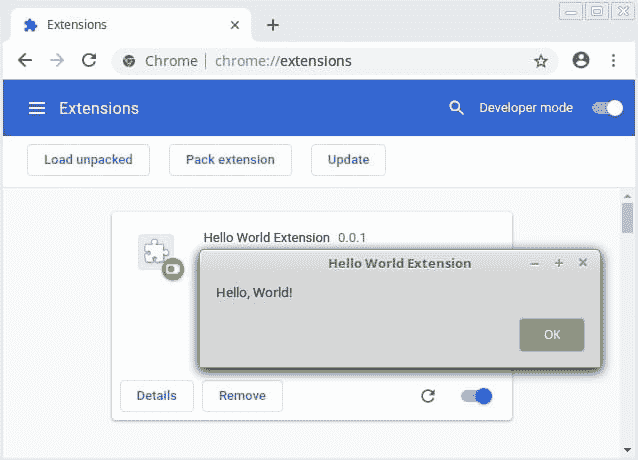

恭喜！你刚刚制作了一个 Chrome 扩展。

## 覆盖 Chrome 的新标签页

下一步是让我们的扩展在我们打开新标签页时欢迎我们。我们可以通过使用 [Override Pages API](https://developer.chrome.com/extensions/override) 来实现。

### 禁用其他扩展

在继续之前，请确保禁用任何其他覆盖 Chrome 新标签页页的扩展。一次只能有一个扩展更改此行为。

我们将开始创建一个显示以代替新标签页的页面。我们称其为 `tab.html`。它应该位于与你的清单文件和后台脚本相同的文件夹中：

```html
<!DOCTYPE html>
<html lang="en">
<head>
  <meta charset="UTF-8">
  <title>My New Tab Page!</title>
</head>
<body>
  <h1>My New Tab Page!</h1>
  <p>You can put any content here you like</p>
</body>
</html>
```

接下来，我们需要告诉扩展关于此页面。我们可以通过在清单文件中指定 `chrome_url_overrides` 键来实现，如下所示：

```json
"chrome_url_overrides": {
  "newtab": "tab.html"
}
```

最后，你需要重新加载扩展以使更改生效。你可以通过点击 Chrome 扩展页面上 Hello World 扩展的 *reload* 图标来执行。

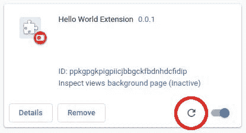

现在，当你打开新标签页时，你应该受到你的自定义消息的欢迎。

这里没有什么特别的内容。这是一个简单的 HTML 页面，将用于存放我们的 Vue 实例。

接下来，在 `tab.js` 中添加：

```javascript
import Vue from 'vue';
import App from './App';

new Vue({
  el: '#app',
  render: h => h(App)
});
```

在这里我们导入了 `Vue`，传递了一个我们想要用我们的应用程序来替换的元素选择器，然后告诉它渲染我们的 `App` 组件。

最后，在 `App.vue` 中：

```html
<template>
  <p>{{ message }}</p>
</template>

<script>
export default {
  data () {
    return {
      message: "My new tab page"
    }
  }
}
</script>

<style scoped>
p {
  font-size: 20px;
}
</style>
```

在使用这个新标签页页之前，我们需要更新 manifest 文件：

```json
{
  "name":"new-tab-page",
  ...
  "chrome_url_overrides": {
    "newtab": "tab/tab.html"
  }
}
```

我们还需要样板代码编译我们的文件并将它们复制到 `dist` 文件夹中，以便扩展程序可以使用。

如下所示修改 `webpack.config.js`，同时更新 `entry` 和 `plugins` 键：

```javascript
entry: {
  'background': './background.js',
  'popup/popup': './popup/popup.js',
  'tab/tab': './tab/tab.js'
},
```

```javascript
plugins: [
  ...
  new CopyWebpackPlugin([
    { from: 'icons', to: 'icons', ignore: ['icon.xcf'] },
    { from: 'popup/popup.html', to: 'popup/popup.html', transform: transformHtml },
    { from: 'tab/tab.html', to: 'tab/tab.html', transform: transformHtml },
    ...
  ])
```

你需要重启 `npm run watch:dev` 任务才能使这些更改生效。完成后，重新加载扩展并打开新标签页。你应该看到显示“My new tab page”。

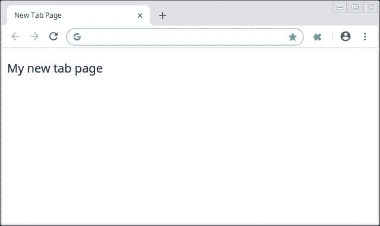

## 获取并显示笑话

好了，我们已经覆盖了 Chrome 的新标签页，并将其替换为一个微 Vue 应用。现在让我们它做得比显示消息更多。

如下修改 `src/tab/App.vue` 中的模板部分：

```html
<template>
  <div>
    <div v-if="loading">
      <p>Loading...</p>
    </div>
    <div v-else>
      <p class="joke">{{ joke }}</p>
    </div>
  </div>
</template>
```

将 `<script>` 部分更改为如下：

```javascript
<script>
import axios from 'axios';

export default {
  data () {
    return {
      loading: true,
      joke: "",
    }
  },
  mounted() {
    axios.get(
      "https://icanhazdadjoke.com/",
      { 'headers': { 'Accept': 'application/json' } }
    )
      .then(res => {
        this.joke = res.data.joke;
        this.loading = false;
      });
  }
}
</script>
```

最后，将 `<style>` 部分更改如下：

```css
<style>
body {
  height: 98vh;
  text-align: center;
  color: #353638;
  font-size: 22px;
  line-height: 30px;
  font-family: Merriweather,Georgia,serif;
  background-size: 200px;
  display: flex;
  align-items: center;
  justify-content: center;
}

.joke {
  max-width: 800px;
}
</style>
```

如果你正在运行 `npm run watch:dev` 任务，扩展程序会自动重新加载，每当你打开新标签页时，你都应该看到一个笑话。

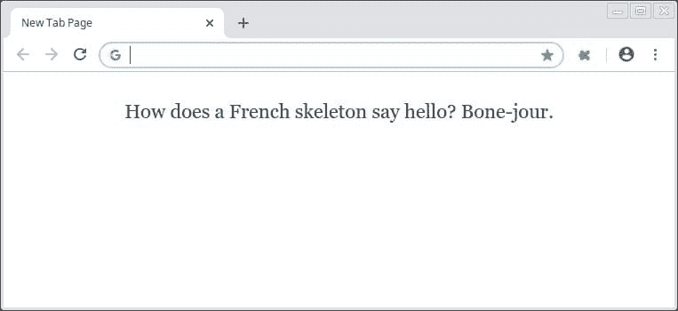

一旦你验证它运行正常，让我们花时间理解一下我们做了什么。

在模板中，我们使用 [v-if](https://vuejs.org/v2/guide/conditional.html) 块根据 `loading` 属性的状态来显示加载消息或笑话。初始情况下，它被设置为 `true`（显示加载消息），然后我们的脚本将触发一个 Ajax 请求来获取笑话。一旦 Ajax 请求完成，`loading` 属性将设置为 `false`，导致组件重新渲染并显示我们的笑话。

在 `<script>` 部分中，我们导入了 `axios`，然后声明了几个数据属性——上述的 `loading` 属性和一个用于存放笑话的 `joke` 属性。我们随后使用了 `mounted` [生命周期钩子](https://vuejs.org/v2/guide/instance.html#Instance-Lifecycle-Hooks)，它会在我们的 Vue 实例挂载后触发一次，向 [笑话 API](https://icanhazdadjoke.com/api) 发起 Ajax 请求。请求完成后，我们更新了两个数据属性，导致组件重新渲染。

到目前为止一切顺利。

## 将笑话持久化到 Chrome 存储中

接下来，让我们添加一些按钮，允许用户收藏笑话并列出收藏的笑话。由于我们将使用 [Chrome 存储 API](https://developer.chrome.com/extensions/storage) 来持久化笑话，可能值得添加第三个按钮从存储中删除所有收藏的笑话。

首先，在 `manifest.json` 的底部添加以下：

```json
"permissions": [ "storage" ]
```

这让扩展程序获得了访问 `chrome.storage` API 的权限。

重新加载扩展，然后在 `v-else` 块中添加按钮：

```html
<div v-else>
  <p class="joke">{{ joke }}</p>
  <button @click="likeJoke" :disabled="likeButtonDisabled">Like Joke</button>
  <button @click="logJokes" class="btn">Log Jokes</button>
  <button @click="clearStorage" class="btn">Clear Storage</button>
</div>
```

没什么特别的。注意我们通过 `disabled` 属性绑定到 Vue 实例的状态，以便用户在收藏后无法再次点击。

接下来，在脚本中添加 `likeButtonDisabled`：

```javascript
export default {
  data () {
    return {
      loading: true,
      joke: "",
      likeButtonDisabled: false
    }
  },
  methods: {
    likeJoke(){
      chrome.storage.local.get("jokes", (res) => {
        if(!res.jokes) {
          res.jokes = [];
        }
        res.jokes.push(this.joke);
        chrome.storage.local.set({jokes: res.jokes});
        this.likeButtonDisabled = true;
      });
    },
    logJokes(){
      chrome.storage.local.get("jokes", (res) => {
        if(res.jokes) {
          res.jokes.forEach(joke => console.log(joke));
        }
      });
    },
    clearStorage(){
      chrome.storage.local.clear();
    }
  },
  mounted() { ... }
}
```


在这里我们定义了处理三个新按钮的方法。

`likeJoke` 方法在 Chrome 存储中查找 `jokes` 属性。如果不存在（即用户尚未收藏过笑话），我们将其初始化为空数组。然后将当前的笑话推入该数组并保存回存储。最后，我们将 `likeButtonDisabled` 数据属性设置为 `true`，从而禁用收藏按钮。

`logJokes` 方法同样在 Chrome 存储中查找 `jokes` 属性。如果找到，它将遍历所有的条目并将其打印到控制台。

希望 `clearStorage` 方法的作用是清空。

去扩展程序中尝试此新功能，并确认它工作正常。

## 为扩展程序添加一些装饰

好了，这些看起来可以工作，但按钮很难看，页面也很单调。让我们通过给扩展程序添加一些装饰来结束本节。

下一步，安装 [vue-awesome](https://www.npmjs.com/package/vue-awesome) 库。这将允许我们在页面中使用一些 Font Awesome 图标，并让那些按钮看起来好一点：

```bash
npm install vue-awesome
```

在 `src/tab/tab.js` 中为我们的 Vue 应用注册该库：

```javascript
import Vue from 'vue';
import App from './App';
import "vue-awesome/icons";
import Icon from "vue-awesome/components/Icon";

Vue.component("icon", Icon);

new Vue({
  el: '#app',
  render: h => h(App)
});
```

现在如下所示修改模板：

```html
<template>
  <div>
    <div v-if="loading" class="centered">
      <p>加载中...</p>
    </div>
    <div v-else>
      <p class="joke">{{ joke }}</p>
      <div class="button-container">
        <button @click="likeJoke" :disabled="likeButtonDisabled" class="btn"><icon name="thumbs-up"></icon></button>
        <button @click="logJokes" class="btn"><icon name="list"></icon></button>
        <button @click="clearStorage" class="btn"><icon name="trash"></icon></button>
      </div>
    </div>
  </div>
</template>
```

最后，让我们给按钮添加一些样式，并包含一张[大家最喜爱的老爸](https://knowyourmeme.com/memes/trolldad)的照片：

```css
<style>
body {
  height: 98vh;
  text-align: center;
  color: #353638;
  font-size: 22px;
  line-height: 30px;
  font-family: Merriweather,Georgia,serif;
  background: url("https://dab1nmslvvntp.cloudfront.net/wp-content/uploads/2018/12/1544189726troll-dad.png") no-repeat 1% 99%;
  background-size: 200px;
  display: flex;
  align-items: center;
  justify-content: center;
}

.joke {
  max-width: 800px;
}

.button-container {
  position: absolute;
  right: 0px;
  top: calc(50% - 74px);
}

.btn {
  background-color: #D8D8D8;
  border: none;
  color: white;
  padding: 12px 16px;
  font-size: 16px;
  cursor: pointer;
  display: block;
  margin-bottom: 5px;
  width: 50px;
}

.btn:hover {
  background-color: #C8C8C8;
}

.btn:disabled {
  background-color: #909090;
}
</style>
```

扩展程序应该重新加载。尝试打开新标签页，你应该能看到这样的界面。


## 将扩展程序上传到 Chrome 商店

如果你想让其他人可以使用你的扩展程序，可以通过 [Chrome 商店](https://chrome.google.com/webstore) 完成。完成此操作首先需要一个 Google 账号，可以用它登录[开发者中心](https://chrome.google.com/webstore/dashboard)。系统会提示你输入开发者详细信息，在发布第一个应用之前，你必须支付一次性 5 美元的费用（通过信用卡）。

接下来，你需要为你的应用创建一个 ZIP 文件。你可以在本地运行 `npm run build-zip` 来实现。这将在项目根目录下创建一个 `dist-zip` 文件夹，其中包含一个准备好上传到商店的 ZIP 文件。对于一个简单的扩展程序，这就是你需要做的一切。然而，在上传任何内容之前，值得阅读官方的[在 Chrome 商店发布](https://developer.chrome.com/webstore/publish)指南。

## 结论

到这里，我们就结束了。在这个教程中，我强调了 Chrome 扩展程序的主要部分，并展示了如何使用 [vue-web-extension](https://github.com/Kocal/vue-web-extension) 模板来使用 Vue.js 构建扩展程序。我们最后查看了如何将扩展程序上传到商店以及相关内容。我希望你喜欢这个教程，并可以使用它来构建你自己的 Chrome 扩展程序。如果你做了什么酷酷的东西，请告诉我（https://twitter.com/chibbard）。

# 第 6 章：使用 Nuxt.js 和 kindergarten 构建你自己的链接分享网站

作者：Nilson Jacques

在教程中，我们将创建一个自己的链接分享网站，类似于 [Echo JS](https://echojs.com/) 或 [Hacker News](https://news.ycombinator.com/)，并配有评论和点赞功能。我们将使用的技术栈包括 Vue.js、Nuxt.js 框架以及一个名为 `vue-kindergarten` 的访问控制/授权库。本指南并非旨在对所使用的任何库进行“深度解析”。相反，目标是让你接触这些工具，以及它们如何协作来创建一个真实的应用程序。

## Node 和 npm

为了跟上教程，你需要安装较新版本的 Node.js，并且你的 npm 版本需要 >= 5.2.0。

## GitHub 仓库

这里有一个包含完成代码的 GitHub 仓库（https://github.com/sitepoint-editors/vue-news-site-demo）。

## 安装 Nuxt.js

我们将在此项目中使用 [Nuxt.js](https://nuxtjs.org/)。虽然它以服务端渲染（SSR）而闻名，但我们实际上不会使用 Nuxt 的这部分。相反，我们将利用 Nuxt 的“约定优于配置”的方法来减少我们需要编写的模板代码。打开终端创建一个文件夹：

```
mkdir yans && cd yans
```

### 命令

这些命令适用于 Linux，在 macOS 上同样有效。Windows 用户需要相应操作！

通过 npm 启动 Nuxt.js 安装程序启动项目：

```
npx create-nuxt-app
```

`npx` 工具将下载并运行安装程序，你将遇到一系列问题。这不是关于 Nuxt 的深度教程，所以我不会详细介绍这些。以下是跟随本指南需要进行的选择：

1. *Project name*（你的选择）
2. *Project description*（你的选择）
3. *Use a custom framework* (“none”）
4. *Use a UI framework* (“bulma”）
5. *Choose rendering mode* (“Single Page”)
6. *Use axios module* (“yes”）
7. *Use eslint*（你的选择）
8. *Use prettier*（你的选择）
9. *Author name*（你的选择）
10. *Choose a package manager*（你的选择）

### Lint 与代码样式

如果你安装了 ESLint 和 Prettier（就像我一样），安装后需要运行 `npm run lint --fix`，否则你的 Nuxt 项目将编译。

教程中的代码格式反映了默认配置。如果这困扰了你，可以根据喜好更改设置（Prettier 会帮你加上分号！）或完全跳过。

安装完成后，是进入新创建的 `client` 文件夹并开始构建网站了！

## 布局与样式

我们将使用 [Bulma CSS 框架](https://bulma.io) 为我们的新闻网站设置样式。Nuxt 贴心地提供了从安装程序中添加它的选项，但我们还需要引入 [Font Awesome](https://fontawesome.com/) 来获取图标。最直接的方法是编辑 Nuxt 配置文件并添加 CDN CSS 链接。

**client/nuxt.config.js**

```javascript
/*
 ** 页面头部
 */
head: {
   title: pkg.name,
   meta: [
     { charset: 'utf-8' },
     { name: 'viewport', content: 'width=device-width, initial-scale=1' },
     { hid: 'description', name: 'description', content: pkg.description }
   ],
   link: [
     { rel: 'icon', type: 'image/x-icon', href: '/favicon.ico' },
     {
       rel: 'stylesheet',
       href: 'https://use.fontawesome.com/releases/v5.6.3/css/all.css'
     }
   ]
 },
```

```html
<template>
  <div>
    <nav
      class="navbar is-info"
      role="navigation"
      aria-label="main navigation"
    >
      <div class="navbar-brand">
        <nuxt-link
          class="navbar-item"
          to="/"
        >
          YANS!
        </nuxt-link>
        <a
          role="button"
          class="navbar-burger burger"
          aria-label="menu"
          aria-expanded="false"
          data-target="navbarBasicExample"
        >
          <span aria-hidden="true"/>
          <span aria-hidden="true"/>
          <span aria-hidden="true"/>
        </a>
      </div>
      <div class="navbar-menu">
        <div class="navbar-start">
          <nuxt-link
            to="/"
            class="navbar-item"
          >首页</nuxt-link>
          <nuxt-link
            to="/new"
            class="navbar-item"
          >最新</nuxt-link>
          <nuxt-link
            to="/submit"
            class="navbar-item"
          >提交</nuxt-link>
        </div>
        <div class="navbar-end">
          <div class="navbar-item">
            <div class="buttons">
              <nuxt-link
                to="/register"
                class="button is-primary"
              >
                **注册**
              </nuxt-link>
              <nuxt-link
                to="/login"
                class="button is-light"
              >登录</nuxt-link>
            </div>
          </div>
        </div>
      </div>
    </nav>
    <nuxt/>
  </div>
</template>
```

导航栏的基础标记源自 Bulma 官方文档，但我们将锚点标签（`<a>` tags）替换为 Nuxt 自己的 `<nuxt-link>` 组件，这允许我们与它所使用的 Vue Router 实例进行交互。此外，注意在模板的底部，我们有一个 `<nuxt/>` 元素，这样路由就知道了在哪里显示我们的内容。

如你所见，我们的菜单栏包含 `首页`（按投票数排序的帖子）、`最新`（最近的文章）和 `提交`（提交新链接的表单）的链接。

## 模拟后端

我们不会介绍构建网站后端（这个主题最好留给单独的指南），而是将创建一个伪造的 API 服务器。通常对于这类任务，我会使用 [json-server](https://www.sitepoint.com/mock-rest-apis-using-json-server/)，它在将 JSON 文件转换为 RESTful 模拟 API 方面表现非常出色，但我们还需要支持身份验证。

幸运的是，有一个名为 [json-server-auth](https://github.com/jeremyben/json-server-auth) 的模块，它基于 json-server 构建，添加了 JWT 身份验证和访问控制。让我们安装它并将其设置为我们的模拟后端。

从 `client` 文件夹切换到父目录。创建一个名为 `server` 的新文件夹并进入，然后初始化一个新的 `package.json` 文件：

```bash
cd ..
mkdir server && cd server
npm init -y
```

同时安装 `json-server-auth` 包：

```bash
npm i json-server-auth
```

如果你对原始的 `json-server` 包不熟悉，它的工作原理是：你创建一个 JSON 文件作为模拟 API 的数据存储。该文件包含一个对象，其键为你希望 API 拥有的每个端点（例如“users”）。

我们的文件看起来如下。

**server/db.json**

```json
{
  "users": [],
  "posts": [],
  "comments": []
}
```

这是我们新闻网站所需的基础结构。你可以在[项目仓库](https://github.com/sitepoint-editors/vue-news-site-demo/blob/master/server/db.json)中找到预填充了示例数据的 `db.json` 副本。

在通常情况下，这足够启动并运行一个模拟后端了。然而，由于我们将使用 Nuxt 社区的 Auth 模块，我们需要先进行一些自定义。

在 Auth 模块成功完成身份验证请求后，它会向“user”端点发送请求，并期望返回一个代表已登录用户的 JSON 对象。

json-server-auth 模块并没有开箱提供此功能，因此我们将手动添加。创建一个名为 `index.js` 的新文件，并添加以下代码。

**server/index.js**

```javascript
const jsonServer = require('json-server')
```


```javascript
const auth = require('json-server-auth')
const app = jsonServer.create()
const router = jsonServer.router('db.json')
const { rewriter } = require('json-server-auth/dist/guards')
const rules = rewriter({
  user: 660
})
app.use(rules)
app.db = router.db
app.use(auth)
app.get('/user', (req, res, next) => {
  const { email } = req.claims
  const { db } = req.app
  const user = Object.assign({}, db.get('users').find({ email }))
  res.json(user)
})
app.listen(3001, () => {
  console.log('JSON server running on port 3001')
})
```

大部分代码来自 `json-server` 文档，但我们启动运行在 `3001` 端口的 API 服务器。

我们在 `/user` 端点添加了：

```javascript
app.get('/user', (req, res, next) => {
  const { email } = req.claims
  const { db } = req.app
  const user = Object.assign({}, db.get('users').find({ email }))
  res.json(user)
})
app.use(router)
app.listen(3001, () => {
  console.log('JSON server running on port 3001')
})
```

## 身份验证

正如之前提到的，我们将使用 Nuxt 的 [Auth 模块](https://auth.nuxtjs.org/)。通过一些配置，该模块为我们提供了与服务器进行身份验证的有用方法，以及用于限制路由的 Nuxt 中间件。

我们需要的第一件事是从 `npm` 安装该模块（在此步骤之前忘记切换回 `client` 文件夹！）：

```bash
npm i @nuxtjs/auth
```

下载完成后，我们需要再次打开 Nuxt 配置并添加一些设置。

**client/nuxt.config.js**

```javascript
/*
** Nuxt.js modules
*/
modules: [
  '@nuxtjs/auth',
  // Doc: https://github.com/nuxt-community/axios-module#usage
  '@nuxtjs/axios',
  // Doc:https://github.com/nuxt-community/modules/tree/master/packages/bulma
  '@nuxtjs/bulma'
],
```

首先，我们需要告诉 Nuxt 关于该插件，通过在上述 `modules` 数组中添加模块名称。

在 `modules` 部分下方，让我们添加一个 `auth` 模块设置的新键。

```javascript
auth: {
  strategies: {
    local: {
      endpoints: {
        login: {
          url: '/api/login',
          method: 'post',
          propertyName: 'accessToken'
        },
        logout: false,
        user: { url: '/api/user', method: 'get' }
      }
    }
  }
},
```

`auth` 模块允许你配置不同的 `strategies`（即不同的认证方法），我们想要设置一个支持 JWT 认证的 `local` 策略。

在策略的配置中，我们需要指定 `login`、`logout` 和 `user` 端点的详情，以便模块向其发送请求，以及它如何获取身份验证令牌。请注意，我们将 `logout` 设置为 `false`，因为我们的认证 API 不支持此方法。该模块将只删除缓存的令牌并恢复到未登录状态。

为了让模块运行，我们需要做做的另一件事是准备一个 `Vuex` store，因为它使用它来存储认证状态和登录用户。我们也将在应用程序中使用 `Vuex`，所以让我们先将其设置为为一个空的 store。

**client/store/index.js**

```javascript
import Vuex from 'vuex'
const createStore = () => {
  return new Vuex.Store({
    state: {},
    getters: {},
    actions: {},
    mutations: {}
  })
}
export default createStore
```

由于 SSR 功能的工作机制，Nuxt 要求我们的 store 导出为一个工厂函数，除此之外除此之外，这是一个普通的 `Vuex` store。

我们还需要几个页面来处理注册和登录。让我们接下来创建它们。

### 注册

首先，在 `pages` 文件夹中创建一个名为 `register.vue` 的新文件。在添加脚本块之前，我们先来看模板部分。

**client/pages/register.vue**

```javascript
<template>
  <section class="section">
    <div class="container">
      <div class="field">
        <label class="label">Username</label>
        <div class="control">
          <input
            v-model="username"
            class="input"
            type="text"
            autofocus
          >
        </div>
      </div>
      <div class="field">
        <label class="label">Email</label>
        <div class="control">
          <input
            v-model="email"
            class="input"
            type="text"
          >
        </div>
      </div>
      <div class="field">
        <label class="label">Password</label>
        <div class="control">
          <input
            v-model="password"
            class="input"
            type="password"
          >
        </div>
      </div>
      <div class="field">
        <div class="control">
          <button
            :disabled="isSaving"
            class="button is-link"
            @click="registerUser"
          >Register</button>
        </div>
      </div>
    </div>
  </section>
</template>
```

这里我们只有三个基本的输入字段，它们通过 `v-model` 连接到组件上的数据属性。当提交按钮被点击时，它将调用组件中的 `registerUser` 方法。

现在是代码：

```javascript
<script>
import { mapActions } from 'vuex'
export default {
  data: () => ({
    isSaving: false,
    username: null,
    email: null,
    password: null
  }),
  methods: {
    ...mapActions(['saveUser']),
    async registerUser() {
      this.isSaving = true
      await this.saveUser({
        username: this.username,
        email: this.email,
        password: this.password
      })
      this.$auth.login({
        data: {
          email: this.email,
          password: this.password
        }
      })
      this.$router.push('/')
    }
  }
}
</script>
```

`registerUser` 方法非常直观。我们将 `isSaving` 标记设为 `true`，这防止了在处理过程中时表单被重复提交。然后，我们派发了一个 `Vuex` action `saveUser`，传入三个输入值并等待它完成。最后，我们使用相同的值调用 auth 模块的 `login` 方法来登录新注册的用户，并跳转到主页。

使用 Nuxt 的好处之一是，我们不需要为页面手动创建路由。在 `pages` 文件夹中创建的任何组件都会自动生成一个同名的路由。

我们目前在 store 中还没有 `saveUser` action，所以让我们现在来写它。

**client/store/index.js**

```javascript
actions: {
  async saveUser(context, { username, email, password }) {
    const data = {
      id: uuid(),
      username,
      email,
      password,
      timestamp: new Date().getTime()
    }
    try {
      await this.$axios.post('/api/register', data)
    } catch (error) {
      console.error(error)
    }
  }
}
```

这个 action 接收传入的 `email`、`username` 和 `password` 并构建一个新的对象。我们需要通过 `npm` 安装生成 UUID 的模块，并在 store 顶部导入它：

```bash
npm i uuid
```

**client/store/index.js**

```javascript
import Vuex from 'vuex'
import uuid from 'uuid/v4'
```

`axios` 模块使得 `this.$axios` 在 store 中可用，方便向服务器发送 `POST` 请求。我们现在会将任何错误记录到控制台，但你可能希望通知用户（例如使用 toast 模块）。

完成后的页面应该是这样的：


### 登录

让我们处理登录页面。在 `pages` 文件夹中 `login.vue` 并添加以下模板。

**client/pages/login.vue**

```javascript
<template>
  <section class="hero">
    <div class="hero-body">
      <div class="container has-text-centered">
        <div class="column is-4 is-offset-4">
          <h3 class="title has-text-grey">Login</h3>
          <p class="subtitle has-text-grey">请登录以继续。</p>
          <div class="box">
            <form @submit.prevent="onSubmit">
              <div class="field">
                <div class="control">
                  <input
                    v-model="email"
                    class="input"
                    type="email"
                    placeholder="您的邮箱"
                    autofocus
                  >
                </div>
              </div>
              <div class="field">
                <div class="control">
                  <input
                    v-model="password"
                    class="input"
                    type="password"
                    placeholder="您的密码"
                  >
                </div>
              </div>
              <button class="button is-block is-info is-fullwidth">登录</button>
            </form>
          </div>
          <div
            v-if="showError"
            class="notification is-danger"
          >
            <strong>哎 — 我们无法登录！</strong><br>
            请检查您的邮箱和密码并重试。
          </div>
        </div>
      </div>
    </div>
  </section>
</template>
```

这里的标记标记大部分都是为了应用样式，归功于 Bulma。需要注意的是，我们在输入框上设置了 `v-model` 属性，以便组件可以访问这些值，并且我们在表单上绑定了 `onSubmit` 程序（带有 `.prevent` 修饰符，以防止默认行为）。当 `showError` 数据属性被设为 true 时，还会显示一条错误消息。

这里是脚本部分：

```javascript
<script>
export default {
  data: () => ({
    email: '',
    password: '',
    showError: false
  }),
  methods: {
    async onSubmit() {
      try {
        await this.$auth.login({
          data: {
            email: this.email,
            password: this.password
          }
        })
      } catch (error) {
        this.showError = true
      }
    }
  }
}
</script>
```

这部分内容非常浅俗易懂，我们正在调用 auth 模块的 `login` 方法并传递表单中的凭据。如果抛出错误，我们将 `showError` 设置为 `true`，提醒用户发生了问题。

现在我们已经添加了注册和登录功能，应该回过头稍微调一下布局，根据当前用户的身份验证状态来更改菜单。

### `client/layouts/default.vue`

```html
<div class="navbar-end">
  <div class="navbar-item">
    <div class="buttons">
      <nuxt-link
        v-if="!$auth.loggedIn"
        to="/register"
        class="button is-primary"
      >


<strong>注册</strong>

<a v-if="!$auth.loggedIn" href="/login" class="button is-light">登录</a>
<button v-else class="button is-light" @click="$auth.logout()">退出登录</button>

---

`auth` 模块为我们提供了一个辅助方法（在模板内部使用 `$auth.loggedIn`）来检查登录状态。我们可以用它来在当前用户已验证时隐藏“注册”和“登录”按钮，取而代之地显示一个“退出登录”按钮。

这是完成后的页面样子：

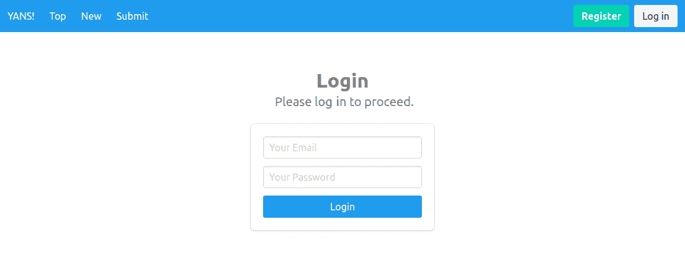

## 添加新帖子

现在我们已经设置好了身份验证，并且有了用户注册和登录的方法，让我们创建一个页面，允许用户为我们的新闻网站提交新链接。

进入`pages`文件夹并创建一个名为`submit.vue`的新文件。

### `client/pages/submit.vue`

```html
<template>
  <section class="section">
    <div class="container">
      <div class="field">
        <label class="label">标题</label>
        <div class="control">
          <input v-model="title" class="input" type="text" placeholder="文本输入">
        </div>
      </div>
      <div class="field">
        <label class="label">完整 URL (包含 http(s)://)</label>
        <div class="control">
          <input v-model="url" class="input" type="text" placeholder="文本输入">
        </div>
      </div>
      <div class="field">
        <div class="control">
          <button :disabled="isSaving" class="button is-link" @click="submitPost">提交</button>
        </div>
      </div>
    </div>
  </section>
</template>
```

这里的模板结构与我们的注册表单非常相似：几个带有关联`v-model`属性的输入字段，以及一个触发组件上处理函数的提交按钮。

这里是脚本部分：

```javascript
<script>
import { mapActions } from 'vuex'

export default {
  middleware: 'auth',
  data: () => ({
    isSaving: false,
    title: null,
    url: null
  }),
  methods: {
    ...mapActions(['savePost']),
    async submitPost() {
      this.isSaving = true
      await this.savePost({
        title: this.title,
        url: this.url
      })
      this.title = null
      this.url = null
      this.isSaving = false
    }
  }
}
</script>
```

这一部分与我们之前所做的非常相似，获取详情并向 store 分发`savePost`动作。完成后，我们简单地重置表单以允许进一步的提交。在此处弹出一个通知告知用户他们的链接已保存将是一个好主意，我将把它留给读者作为练习。

注意，对于此组件，我们指定了“auth”`middleware`属性。该中间件是 auth 模块的一部分，将限制仅登录用户访问页面。如果游客用户尝试访问该页面，他们将被重定向到登录表单。

表单看起来应该是这样的：

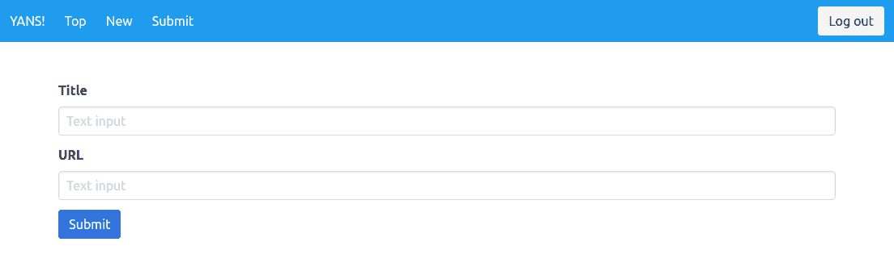

让我们编写`savePost`动作。

### `clients/store/index.js`

```javascript
actions: {
  // ...
  async savePost(context, { title, url }) {
    const user = this.$auth.user
    const data = {
      id: uuid(),
      userId: user.id,
      author: user
    }
    try {
      await this.$axios.post('/links', data)
    } catch (error) {
      console.error(error)
    }
  },
}
```

（注：源中提供的`savePost`文本是片段化/中断的；我根据提供的上下文和片段重构了逻辑。）

## 获取并显示帖子

现在我们已经有了提交链接的方法，我们需要一种检索并显示它们的方法，因此让我们构建“新帖子”视图。在创建页面本身之前，让我们对 store 进行必要的更改。

`client/store/index.js`

```javascript
state: {
  posts: []
}
```

首先，我们需要在 state 中添加一个`posts`数组，以便在检索帖子后存储它们。

接下来，我们需要一个动作来发送 API 请求。

`client/store/index.js`

```javascript
actions: {
  // ...
  async getPosts({ commit }) {
    try {
      const res = await this.$axios.get('/posts')
      commit('setPosts', res.data)
    } catch (error) {
      console.error(error)
    }
  },
}
```

这是一个简单的 mutation，仅用从 API 获取的内容替换现有的帖子数组。让我们添加它。

`client/store/index.js`

```javascript
mutations: {
  setPosts(state, { posts }) {
    state.posts = posts
  }
}
```

对于我们的“新帖子”视图，我们将按照创建时间倒序显示链接。虽然这个逻辑可以放在组件内部，但让我们创建一个 Vuex getter。这使得我们在需要的地方可以访问排序后的列表。

`client/store/index.js`

```javascript
getters: {
  newPosts: state => state.posts.sort((a, b) => b.timestamp - a.timestamp)
}
```

就像组件中的计算属性一样，如果`posts`数组被修改，`newPosts` getter 将更新并重新渲染使用它的组件。

### 显示“热门”页面

显示热门帖子的页面与此页面几乎相同，不同在于它使用不同的 getter 以不同的顺序返回帖子。你可以尝试自己构建，或者查看本指南配套的代码库。

让我们添加列表页面。在`pages`下创建一个名为`new.vue`的新文件，并添加以下代码。

`client/pages/new.vue`

```html
<template>
  <section class="section">
    <div class="container">
      <h1 class="title">最新链接</h1>
      <div>
        <news-item
          v-for="post in newPosts"
          :key="post.id"
          :item="post"
        />
      </div>
    </div>
  </section>
</template>

<script>
import { mapActions, mapGetters } from 'vuex'
import NewsItem from '~/components/NewsItem'

export default {
  components: { NewsItem },
  fetch({ store }) {
    store.dispatch('getPosts')
  },
  computed: mapGetters(['newPosts'])
}
</script>
```

我在这里展示了整个文件，因为它只是一个相对小的组件。它包含了 Nuxt 特有的`fetch`方法，每当用户尝试导航到该页面时，就会调用该方法。该方法接收一个 [context](https://nuxtjs.org/api/context) 对象，其中包含了 store（以及其他内容），允许我们在组件加载之前`dispatch`动作。

一旦`getPosts`动作完成，`newPosts` getter 就会被更新，组件就可以渲染帖子列表。我们在这里将每个帖子的显示委托给`<NewsItem>`组件，这实际上是一个自定义组件。让我们接下来看它。

## NewsItem 组件

显示帖子看起来似乎是我们可能在新闻网站的多个地方都想要执行的操作，因此将其提取到单独组件中是有意义的。它还封装了任何标记和显示逻辑，有助于父组件保持整洁，并专注于执行其任务所需的代码。

让我们进入`components`文件夹并创建一个名为`NewsItem.vue`的新组件文件。正如我们之前所做的，我们将先查看模板。

**client/components/NewsItem.vue**

```
<template>
  <article class="media">
    <figure class="media-left">
      <button class="button is-white">
        <span class="icon is-small">
          <i class="fas fa-thumbs-up" title="Vote up" />
        </span>
      </button>
    </figure>
    <div class="media-content">
      <div>
        <p>
          <a :href="item.url"><strong>{{ item.title }}</strong></a> <small>({{ item.url | domain }})</small>
        </p>
      </div>
      <nav class="level is-mobile">
        <div class="level-left">
          <span class="level-item">
            <small>{{ votes }} · posted by {{ item.author }} · {{ item.timestamp | timeAgo }}</small>
          </span>
          <nuxt-link :to="`/news/${item.id}`" class="level-item">
            <span class="icon is-small"><i class="fas fa-comments" /></span>
          </nuxt-link>
        </div>
      </nav>
    </div>
  </article>
</template>
```

这些标记大部分是 Bulma [media object](https://bulma.io/documentation/layout/media-object/) 的一部分，它为我们提供了一个很好的构建基础结构。你会注意到我们有一个点赞按钮（我们稍后会对其进行连接），以及两个输出过滤器：`domain` 和 `timeAgo`。让我们看看 JavaScript 部分看看它们在做什么。

**client/components/NewsItem.vue**

```
<script>
import parseDomain from 'parse-domain'
import distanceInWordsStrict from 'date-fns/distance_in_words_strict'

export default {
  filters: {
    domain(value) {
      if (!value) return ''
      const parts = parseDomain(value)
      return parts ? `${parts['domain']}.${parts['tld']}` : ''
    },
    timeAgo(value) {
      if (!value) return ''
      return distanceInWordsStrict(new Date(), new Date(value), {
        addSuffix: true
      })
    }
  },
  props: {
    item: {
      type: Object,
      required: true
    }
  },
  computed: {
    votes() {
      const votes = this.item.votes.length
      const suffix = votes === 1 ? 'vote' : 'votes'
      return `${votes} ${suffix}`
    }
  }
}
</script>
```

从组件代码可以看出，我们导入了两个第三方模块来帮助格式化：[parse-domain](https://www.npmjs.com/package/parse-domain) 以及 [date-fns](https://date-fns.org/) 的函数 [`distanceInWordsStrict`](https://date-fns.org/v1.30.1/docs/distanceInWordsStrict)。

`parse-domain`模块接收一个 URL 并返回组成部分的数组。使用它，我们可以只显示链接的域名，让用户一眼就能看出内容来自哪个网站。`distanceInWordsStrict`函数接收两个日期并返回对人类友好的时间描述（例如“5 分钟前”）。

### 依赖项！

不要忘记安装依赖项！

```
npm i parse-domain date-fns
```

这两个都可以实现为计算属性，但因为它们的目的是为了显示而*格式化*输出，使用过滤器似乎更合适。此外，如果我们需要在应用的其他组件中使用它们，可以轻松地将它们重新实现为全局过滤器，而无需更改模板。

我们*确实*正在使用计算属性的一个地方是显示票数并在必要时正确处理文本的复数。

当页面和`NewsItem`组件完成后，屏幕在虚拟数据的情况下应该像这样：

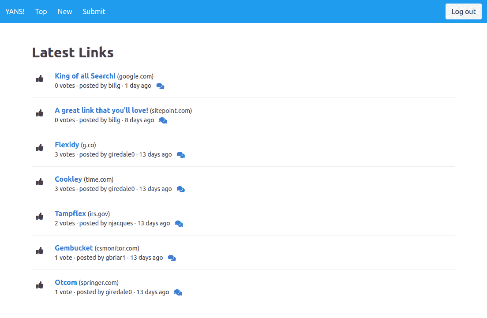

## 处理评论

有一个链接列表固然很好，但我们需要一种与它们交互的方法。我们将为每个帖子添加一个评论部分。我们将通过创建一个`CommentForm`组件来处理输入，然后更新`NewsItem`组件来显示现有评论。

首先，创建`CommentForm`组件。它将是一个包含`textarea`和一个提交按钮的简单组件。

**client/components/CommentForm.vue**

```javascript
<template>
  <article class="media">
    <div class="media-content">
      <div class="field">
        <p>
          <textarea v-model="body"


```html
<textarea
  class="textarea"
  placeholder="Add a comment..."
></textarea>

</p>

</div>

<div class="field">

<p>

<button
  :disabled="!body"
  class="button"
  @click="commentPosted"
>Post comment</button>

</p>

</div>

</div>

</article>

</template>

<script>
export default {
  data: () => ({
    body: null
  }),

  methods: {
    commentPosted() {
      this.$emit('post', this.body)
      this.body = null
    }
  }
}
</script>
```

现在，更新`NewsItem`组件以显示评论并包含`CommentForm`。

**client/components/NewsItem.vue**

```javascript
<template>
  <article class="media">
    <figure class="media-left">
      <button class="button is-white">
        <span class="icon is-small">
          <i
            class="fas fa-thumbs-up"
            title="Vote up"
          />
        </span>
      </button>
    </figure>

    <div class="media-content">
      <div>
        <p>
          <a :href="item.url"><strong>{{ item.title }}</strong></a>
          <small>({{ item.url | domain }})</small>
        </p>
      </div>

      <nav class="level is-mobile">
        <div class="level-left">
          <span class="level-item">
            <small>
              {{ votes }} · posted by {{ item.author }} · {{ item.timestamp | timeAgo }}
            </small>
          </span>

          <nuxt-link
            :to="`/news/${item.id}`"
            class="level-item"
          >
            <span class="icon is-small">
              <i class="fas fa-comments" />
            </span>
          </nuxt-link>
        </div>
      </nav>

      <section class="comments">
        <div
          v-for="comment in item.comments"
          :key="comment.id"
          class="comment"
        >
          <p>{{ comment.body }}</p>
          <small>
            posted by {{ comment.author }} on {{ comment.timestamp | timeAgo }}
          </small>
        </div>

        <comment-form
          v-if="$auth"
          @post="addComment"
        />

        <p v-else>
          Please <nuxt-link to="/login">log in</nuxt-link> to comment.
        </p>
      </section>
    </div>
  </article>
</template>

<script>
import parseDomain from 'parse-domain'
import distanceInWordsStrict from 'date-fns/distance_in_words_strict'
import CommentForm from './CommentForm.vue'

export default {
  filters: {
    domain(value) {
      if (!value) return ''

      const parts = parseDomain(value)
      return parts ? `${parts['domain']}.${parts['tld']}` : ''
    },

    timeAgo(value) {
      if (!value) return ''

      return distanceInWordsStrict(new Date(), new Date(value), {
        addSuffix: true
      })
    }
  },

  props: {
    item: {
      type: Object,
      required: true
    }
  },

  computed: {
    votes() {
      const votes = this.item.votes.length
      const suffix = votes === 1 ? 'vote' : 'votes'

      return `${votes} ${suffix}`
    }
  },

  methods: {
    addComment({ body }) {
      this.$emit('addComment', {
        postId: this.item.id,
        body
      })
    }
  },

  components: {
    CommentForm
  }
}
</script>
```

最后，更新`pages/_id.vue`页面以处理`addComment`事件。我们需要调度一个动作来保存新评论。

**client/pages/_id.vue**

```javascript
<template>
  <section class="section">
    <news-item
      :item="post"
      @add-comment="addComment"
    />
  </section>
</template>

<script>
import NewsItem from '~/components/NewsItem.vue'

export default {
  async fetch({ params, store }) {
    const { post } = await store.dispatch('post', params.id)
  },

  methods: {
    async addComment(payload) {
      await store.dispatch('addComment', payload)
    }
  },

  components: {
    NewsItem
  }
}
</script>
```

```javascript
state: {
  posts: [],
  selectedPost: null
},
```

首先，我们添加一个`selectedPost`属性来存储用户正在查看的文章。

**client/store/index.js**

```javascript
actions: {
  // ...

  async getComments({ commit }, { postId }) {
    try {
      const res = await this.$axios.get(
        `/api/posts/${postId}?_embed=comments`
      )

      commit('setSelectedPost', {
        post: res.data
      })
    } catch (error) {
      console.error(error)
    }
  },

  async saveComment({ commit, state }, { body }) {
    const user = this.$auth.user

    const data = {
      id: uuid(),
      postId: state.selectedPost.id,
      userId: user.id,
      author: user.username,
      body,
      timestamp: new Date().getTime()
    }

    try {
      const res = await this.$axios.post('/api/comments', data)
      commit('addComment', {
        comment: res.data
      })
    } catch (error) {
      console.error(error)
    }
  }
},
```

这两个 action 都与我们之前创建的相似，所以这段代码没有特别需要说明的。不过，值得提到的是，我们重新从 API 请求了选中的文章，但在 URL 中添加了`?_embed=comments`。这将告诉`json-server-auth`返回文章，并将所有相关的评论以数组的形式附加。

我们还需要几个额外的 mutation。

**client/store/index.js**

```javascript
mutations: {
  // ...

  addComment(state, { comment }) {
    state.selectedPost.comments.push(comment)
  },

  setSelectedPost(state, { post }) {
    state.selectedPost = post
  },
},
```

提交`setSelectedPost`将传递的`post`对象赋值给 store 状态中的`selectedPost`键。`addComment` mutation 获取评论（它已通过我们的 API 持久化），并将其推入当前文章的`comments`数组中，从而允许视图进行更新。

### 显示已评论

你可能已经发现我们没有在页面的任何地方显示评论！让我们通过更新`NewsItem`来修复这一点，如果文章对象上存在评论，则显示它们。打开该组件，并在模板中的闭合`</nav>`标签下方添加以下标记。

**client/components/NewsItem.vue**

```html
<article
  v-for="comment in comments"
  :key="comment.id"
  class="media"
>
  <figure class="media-left">
    <p class="image is-48x48">
      
    </p>
  </figure>

  <div class="media-content">
    <div class="content">
      <p>
        {{ comment.body }}
        <br>
        <small>
          {{ comment.author }} · {{ comment.timestamp | timeAgo }}
        </small>
      </p>
    </div>
  </div>
</article>
```

此外，在组件对象中添加一个新的计算属性：

```javascript
computed: {
  comments() {
    return this.item.comments || []
  },

  votes() {
    // ...
  }
}
```

搞定！现在当你添加评论时，你应该能看到文章下方出现了一个格式化良好的评论列表！

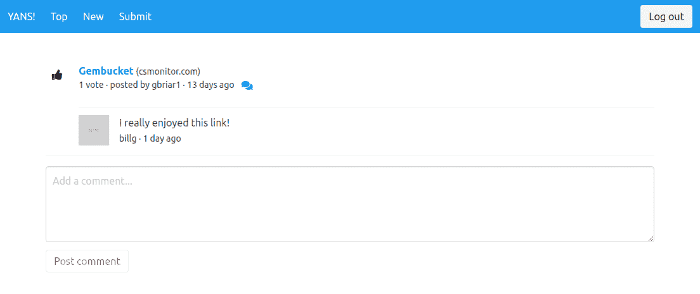

### 为文章点赞

我们的新闻网站还需要添加允许用户对高质量文章进行点赞的功能。让我们从向 store 中添加必要的 action 和 mutation 开始。

**client/store/index.js**

```javascript
actions: {
  // ...

  async upvotePost({ commit }, { postId }) {
    const postUrl = `/api/posts/${postId}`

    try {
      const { data } = await this.$axios.get(postUrl)

      data.votes.push(this.$auth.user.id)

      const res = await this.$axios.put(postUrl, data)
      commit('updatePost', {
        post: res.data
      })
    } catch (error) {
      console.error(error)
    }
  }
},
```

我们的`upvotePost` action 接收要点赞的文章的 ID。首先，我们从 API 重新获取文章，并将当前用户的 ID 推入`votes`数组。在将文章保存回服务器后，我们提交`updatePost` mutation，我们将在下一步编写它。

**client/store/index.js**

```javascript
mutations: {
  // ...

  updatePost(state, { post }) {
    const index = state.posts.findIndex(p => p.id === post.id)

    if (index >= 0) {
      state.posts.splice(index, 1, post)
    }

    if (
      state.selectedPost &&
      state.selectedPost.id === post.id
    ) {
      state.selectedPost.votes = post.votes
    }
  }
},
```

这个 mutation 查找被点赞文章的索引，并用服务器返回的副本替换它。如果用户是从列表视图点赞的，他们将看到票数动态更新。我们还检查`selectedPost`是否设置以及是否与被点赞的文章相同，并更新`votes`属性。

```javascript
plugins: ['~/plugins/vue-kindergarten'],
```

我们的下一步是创建一个`perimeter`（边界）。该文件包含了针对特定实体或场景的所有权限逻辑。在 Nuxt 项目中创建一个名为`perimeters`的新文件夹，并添加一个名为`postsPerimeter.js`的新文件，内容如下：

`client/perimeters/postsPerimeter.js`

```javascript
import { createPerimeter } from 'vue-kindergarten'

export default createPerimeter({
  purpose: 'post',

  can: {
    upvote(post) {
      return (
        this.isAuthenticated() &&
        this.isAuthor(post) === false &&
        post.votes.includes(this.child.id) === false
      )
    }
  },

  isAuthenticated() {
    return this.child !== null
  },

  isAuthor(post) {
    return this.child.id === post.userId
  }
})
```


在这里，我们从`vue-kindergarten`模块导入了`createPerimeter`函数，并使用它来定义一个新的边界，或者说一组规则。`purpose`属性允许我们定义规则所应用的实体名称。当我们将边界添加到组件中时，它的规则将可以在模板内的`$post`变量下可用。

该边界包含了几个辅助方法，用于检查用户是否已登录，以及他们是否是特定帖子的作者。我们还有一个`can`属性，允许我们定义当前用户允许执行的操作。在这里，我们添加了一个`upvote`方法，只有当用户已验证身份、不是该帖子的作者且尚未对该帖子点过赞时，该方法才会返回`true`。

让我们看看如何在我们的“新帖子”页面中使用此边界，来控制谁允许 任何帖子进行投票。

`client/pages/new.vue`

```vue
<script>

import { mapActions, mapGetters } from 'vuex'
import postsPerimeter from '~/perimeters/postsPerimeter'
import NewsItem from '~/components/NewsItem'

export default {
  components: { NewsItem },
  fetch({ store }) {
    store.dispatch('getPosts')
  },
  computed: mapGetters(['newPosts']),
  methods: {
    ...mapActions(['upvotePost']),
    onUpvote(post) {
      if (this.$isAllowed('upvote', post)) {
        this.upvotePost({ postId: post.id })
      }
    }
  },
  perimeters: [postsPerimeter]
}

</script>
```

你们中敏锐的人可能已经注意到，我们正在导入新的边界，并将其添加到组件的一个新的`perimeters`数组中。这里的唯一变化是`onUpvote`方法，我们在那里使用`this.$isAllowed`辅助方法来检查是否应该提交投票。

如你所见，所有的检查逻辑都清晰地封装在边界中。如果我们决定在未来添加额外的要求（例如，用户必须确认其电子邮件地址，或者在网站上必须有最低排名），我们可以这样做，而无需对组件进行任何更改。

## 总结

大功告成了：你现在已经构建了自己的自己的新闻网站，可以用它来启动你自己的 Reddit！不过说正经的，我希望你喜欢跟这个过程，并学了一些可以应用到未来自己项目的有用知识。

如果你想更深入地了解 Nuxt.js 以及通用的 Vue，请查看我的新 SitePoint 书籍 [Jump Start Vue.js](https://www.sitepoint.com/premium/books/jump-start-vue-js)。

# 第 7 章：使用 Vue 和 D3.js 进行数据可视化简介

#### 作者 Christopher Vundi

Web 应用通常是数据驱动的，并且往往需要对这些数据进行可视化。这就是图表和图形大显身场。它们更容易传递信息，还能演示相关性或统计关系。以图表或图形形式呈现的信息对于非母语者也更容易理解。

在教程中，我们将学习如何在 Vue 项目中实现数据可视化。为此，我们将使用流行的 D3.js 库，它结合了强大的可视化组件和数据驱动的 DOM 操作方法。

让我们开始吧。

## GitHub 仓库

本教程的代码可以在 [GitHub](https://github.com/sitepoint-editors/D3.js) 上找到。

## 什么是 D3？

正如你在[项目首页](https://d3js.org/)上看到的，D3.js 是一个基于数据操作文档的 JavaScript 库。D3 帮助你使用 HTML、SVG 和 CSS 让数据生起来。它对 Web 标准的强调让你拥有现代浏览器的完整功能，而不会受限于任何专用框架。

虽然大多数人会将 D3.js 称为数据可视化库，但它其实不是。D3 更像是一个由不同部分组成的框架——例如 jQuery 部分（帮助我们选择和操作 DOM 元素）、Lodash 部分、动画部分、数据分析部分以及可视化部分。

在教程中，我们将处理 D3 的可视化方面。D3 在可视化数据时真正的核心在于：

*   提供了用于用绘图指令装饰数据的函数
*   从源数据创建新的可绘制数据
*   从源数据生成新数据

## 我们将构建的内容

我们想要创建一个应用，让用户搜索 GitHub 上的，然后获取过去周开启但仍处于开启状态 issue 的视觉表示。最终结果将所示：

最终图表

## 前提条件

本教程假设你已经具备 Vue 的相关知识。如果你想快速上手，可能想阅读我们的[教程](https://sitepoint.com/0/)。

你还需要在系统中安装 Node。你可以通过下载[官方网站](https://nodejs.org) 或使用[版本管理器](https://www.sitepoint.com/multiple-versions-node/) 来完成。

最后，我们将使用以下包：

*   [Vue CLI](https://cli.vuejs.org/)—用于项目脚架搭建
*   [D3.js](https://d3js.org/)—用于数据可视化
*   [Lodash](https://lodash.com/)—提供了一些实用方法
*   [Moment JS](https://momentjs.com/)—用于日期和时间
*   [axios](https://github.com/axios/axios)—一个 HTTP 客户端，帮助我们向外部 API 发请求

## 新 Vue 项目

我倾向于使用 Vue CLI 创建新项目。（如果你熟悉 Vue CLI，我们的新手指南提供了完整的介绍。）Vue CLI 为代码的不同部分提供了良好的文件夹结构，例如样式、组件等。

确保你的机器上安装了 CLI：

```bash
npm install -g @vue/cli
```

然后使用以下命令创建一个项目：

```bash
vue create issues-visualization
```

### 选择预设

在使用 Vue CLI 创建新项目时，系统会提示选择一个预设。对于这个特定的项目，我们将仅使用默认（Babel + ESLint）。

一旦创建了新的 Vue 项目，我们 `cd` 进入项目文件夹并添加所需的各种 node 模块：

```bash
npm install lodash d3 moment
```

## 组件结构

即使这是一个运行部分较少的简单应用，我们仍然采用组件化的方法，而不是将所有代码堆在`App.vue`文件中。我们将有两个组件：`App`组件和一个我们尚未创建的`Chart`组件。

`App`组件将处理从 GitHub 获取数据，然后将这些数据作为 props 传递给`Chart`组件。图表的绘制将在`Chart`组件内部完成。

## 构建搜索界面

我们将首先构建一个搜索界面，让用户可以输入他们想要可视化的仓库名称。

在`src/App.vue`中，删除 `<template>` 标签内的所有内容，并替换为以下内容：

```html
<template>
  <div id="app">
    <form action="#" @submit.prevent="getIssues">
      <div class="form-group">
        <input
          type="text"
          placeholder="owner/repo Name"
          v-model="repository"
          class="col-md-2 col-md-offset-5"
        >
      </div>
    </form>
  </div>
</template>
```

这里我们有一个表单，它在提交时会阻止浏览器的默认提交行为，然后调用一个我们尚未定义的`getIssues`方法。我们还使用了`v-model`指令将表单的输入绑定到 Vue 实例数据模型中的`repository`属性上。让我们将该属性 `repository` 声明为空字符串。我们还会添加一个`startDate`属性，稍后我们将将其用作我们时间范围内的第一个日期：

```javascript
import moment from "moment";
import axios from "axios";

export default {
  name: "app",
  data() {
    return {
      issues: [],
      repository: "",
      startDate: null
    };
  },
  methods: {
    getIssues() {
      // 代码写在此处
    }
  }
};
```

现在来创建`getIssues`方法：

```javascript
getIssues() {
  this.startDate = moment()
    .subtract(6, "days")
    .format("YYYY-MM-DD");
  axios
    .get(
      `https://api.github.com/search/issues?q=repo:${this.repository}+is:issue+is:open+created:>=${this.startDate}`,
      { params: { per_page: 100 } }
    )
    .then(response => {
      const payload = this.getDateRange();
      response.data.items.forEach(item => {
        const key = moment(item.created_at).format("MMM Do YY");
        const obj = payload.filter(o => o.day === key)[0];
        obj.issues += 1;
      });
      this.issues = payload;
      console.log(this.issues);
    });
}
```

在上面的代码块中，我们首先将`startDate`数据属性设置为六天前，并对其进行格式化以供 GitHub API 使用。

然后我们使用`axios`向 GitHub 发起 API 请求，以获取特定仓库在过去一周内开启且仍处于开启状态的所有。如果你需要更多关于如何构建查询参数的示例，可以参考 [GitHub 搜索 API](https://help.github.com/articles/searching-for-repositories/)。

在发送 HTTP 请求时，我们将每页结果数设置为 100（最大值）。几乎没有哪个仓库每周会有超过 100 个新 issue，所以这对于我们的目的来说应该是足够的。默认情况下，`per_page`的值为 30。

如果请求成功完成，我们将使用自定义的`getDateRange`方法来初始化`payload`变量，并能够将其传递给`Chart`组件。这个 payload 是一个对象数组，格式如下：

```json
[
  {day: "Dec 7th 18", issues: 0},
  {day: "Dec 8th 18", issues: 0},
  {day: "Dec 9th 18", issues: 0},
  {day: "Dec 10th 18", issues: 0},
  {day: "Dec 11th 18", issues: 0},
  {day: "Dec 12th 18", issues: 0},
  {day: "Dec 13th 18", issues: 0}
]
```

之后，我们遍历 API 的响应。我们感兴趣的数据在 `response` 对象的 `data` 属性的 `items` 键中。从这里，我们提取出 `created_at` 键（这是一个时间戳），并将其格式化为上述对象中的 `day` 属性。然后，我们在 `payload` 数组中查找对应的日期，并使该日期的 issues 计数加 1。

最后，我们将 `payload` 数组赋值给我们的`issues`数据属性并记录响应。

接下来，让我们添加`getDateRange`方法：

```javascript
methods: {
  getDateRange() {
    const startDate = moment().subtract(6, 'days');
    const endDate = moment();
    const dates = [];
    while (startDate.isSameOrBefore(endDate)) {
      dates.push({
        day: startDate.format('MMM Do YY'),
        issues: 0
      });
      startDate.add(1, 'days');
    }
    return dates;
  },
  getIssues() { ... }
}
```

在进入可视化部分之前，让我们在发送请求时将可能遇到的任何错误记录到控制台（出于调试目的）：

```javascript
axios
  .get( ...)
  .then(response => {
    ...
  })
  .catch(error => {
    console.error(error);
  });
```

我们稍后会在发生问题时添加一些 UX 来告知用户。

到目前为止，我们已经有一个输入框，允许用户输入他们想要搜索 issue 的组织/仓库名称。提交表单后，过去一周内开启的所有 issue 都会记录在控制台中。

以下是 `facebook/react` 仓库在控制台中记录的示例：

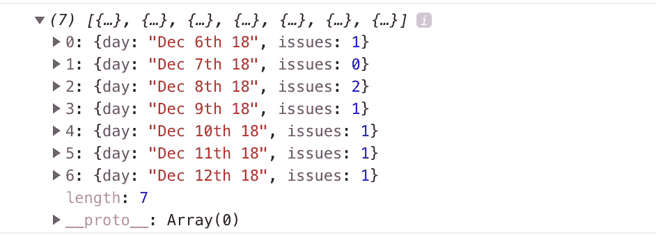 

如果你使用 `npm run serve` 启动 Vue 开发服务器并输入不同的仓库，你应该能看到类似的内容。如果你缺乏灵感，可以查看 [GitHub 趋势榜页](https://github.com/trending)。

接下来是有趣的部分——将这些数据可视化。

## 使用 D3 绘制柱状图

早些时候我们提到所有的绘制都将在`Chart`组件内部处理。让我们创建这个组件：

```bash
touch src/components/Chart.vue
```

D3 于 SVG 元素，为了让我们用 D3 绘制任何内容，我们需要在页面上有一个 SVG 元素。在我们新创建的组件中，创建一个 SVG 标签：

```html
<template>
  <div>
    <svg></svg>
  </div>
</template>
```

对于本教程，我们将使用柱状图来可视化数据。在继续之前，让我们更新`App`组件以包含`Chart`组件：

```html
<template>
  <div id="app">
    <form action="#" @submit.prevent="getIssues">
      ...
    </form>
    <chart :issues="issues"></chart>
  </div>
</template>
```

让我们将其注册为组件：

```javascript
import Chart from './components/Chart.vue';

export default {
  name: "app",
  components: {
    Chart
  },
  ...
}
```

注意我们将`issues`属性的值作为 prop 传递给`Chart`组件：

```html
<chart :issues="issues"></chart>
```

现在更新我们的`Chart`组件以使用这些数据：

```javascript
<script>
import * as d3 from "d3";
import _ from "lodash";

export default {
  props: ["issues"],
  data() {
    return {
      chart: null;
    };
  },
  watch: {
    issues(val) {
      if (this.chart != null) this.chart.remove();
      this.renderChart(val);
    }
  },
  methods: {
    renderChart(issues_val) {
      // 将在这里绘制
    }
  }
};
</script>
```


在上面的代码块中，我们导入了 D3 和 Lodash。然后我们实例化为`null`的`chart`数据属性。当我们之后开始绘制时，将为其赋值。

由于我们希望在每次`issues`的值变化时都绘制图表，我们为`issues`创建了一个监听器（https://vuejs.org/v2/guide/computed.html#Watchers）。每当该值变化时，我们将销毁旧图表然后绘制新图表。

绘制将在`renderChart`方法中进行。让我们完善它：

```javascript
 renderChart(issues_val) {
  const margin = 60;
  const svg_width = 1000;
  const svg_height = 600;
  const chart_width = 1000 - 2 * margin;
  const chart_height = 600 - 2 * margin;

  const svg = d3
    .select("svg")
    .attr("width", svg_width)
    .attr("height", svg_height);
}
```

在这里，我们设置刚刚创建的 SVG 元素的高度和宽度。`margin`属性是我们将用来给图表提供留边距的。

D3 具备 DOM 选择和操纵能力。在整个教程中，你会看到大量的`d3.select`和`d3.selectAll`语句。区别在于[select](https://github.com/d3/d3-selection#select)会返回第一个匹配的元素，而[selectAll](https://github.com/d3/d3-selection#selectAll)返回所有匹配的元素。

## 轴（The Axes）

对于柱状图，数据可以以垂直或水平的形式表示。D3 提供了[轴方法](https://github.com/d3/d3-axis/blob/master/README.md#axisTop)，让我们能够按照自己的意定义轴：

- `axisLeft`
- `axisTop`
- `axisBottom`
- `axisRight`

今天，我们将创建一个垂直柱状图。对于垂直柱状图，我们只需要`axisLeft`和`axisBottom`方法：

```javascript
renderChart(issues_val) {
  ...

  this.chart = svg
    .append("g")
    .attr("transform", `translate(${margin}, ${margin})`);

  const yScale = d3
    .scaleLinear()
    .range([chart_height, 0])
    .domain([0, _.maxBy(issues_val, "issues").issues]);

  this.chart
    .append("g")
    .call(d3.axisLeft(yScale).ticks(_.maxBy(issues_val, "issues").issues));

  const xScale = d3
    .scaleBand()
    .range([0, chart_width])
    .domain(issues_val.map(s => s.day))
    .padding(0.2);

  this.chart
    .append("g")
    .attr("transform", `translate(0, ${chart_height})`)
    .call(d3.axisBottom(xScale));
}
```

上面的代码块在 SVG 元素上绘制轴。让我们逐步分析它：

```javascript
this.chart = svg.append("g")
  .attr("transform", `translate(${margin}, ${margin})`);
```

我们首先指定图表在 SVG 元素中的起始位置。在使用 D3 时，对于任何我们想要添加到 SVG 中的元素，我们通常调用`append`方法，然后为该新元素定义属性。

要为元素添加属性，我们通常调用`attr`方法，它接受两个参数。第一个参数是我们要应用到所选 DOM 元素的属性，第二个参数是我们想要的值，或者是一个返回所需值的回调函数。在这里，我们将图表的起始位置移动到 SVG 的`60, 60`位置：

```javascript
const yScale = d3.scaleLinear()
  .range([chart_height, 0])
  .domain([0, _.maxBy(issues_val, "issues").issues]);

this.chart.append("g")
  .call(d3.axisLeft(yScale)
  .ticks(_.maxBy(issues_val, "issues").issues));
```

这段代码块在绘制 y 轴的同时，利用 D3 [scales](https://github.com/d3/d3-scale) 来生成 y 轴比例尺。比例尺是函数，通过增加或减少数值来转换我们的数据，以实现更好的可视化。

`range`函数指定了输入数据限制之间划分的长度。你可能注意到我在调用`range`时使用高度作为第一个参数而不是零。这是因为 SVG 坐标系统从左上角开始。当我们开始绘制柱体高度时，你会对此此有更好的理解。

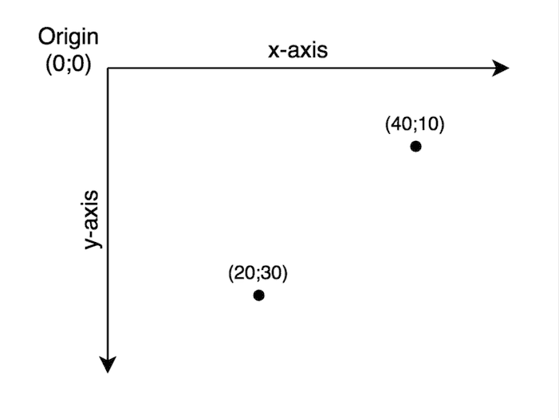

另一方面，`domain`函数表示输入数据的最小值和最大值。对于这个特定的数据集，我们希望从零开始到数据集中的最高值。将`domain`视为输入，将`range`视为输出。

定义 y 轴比例尺后，我们通过调用`axisLeft`方法使用该比例尺绘制轴，该方法接受`y-scale`作为参数。

下面的代码段绘制了 x 轴：

```javascript
const xScale = d3.scaleBand()
  .range([0, chart_width])
  .domain(issues_val.map((s) => s.day))
  .padding(0.2);

this.chart.append("g")
  .attr("transform", `translate(0, ${chart_height})`)
  .call(d3.axisBottom(xScale));
```

对于`xScale`，我们使用`scaleBand`函数，它帮助将范围划分成若干带额外间距的带（bands），并计算柱体的坐标和宽度。假设所有日期中提出的问题最大数为 3，图表的输出应该如下：

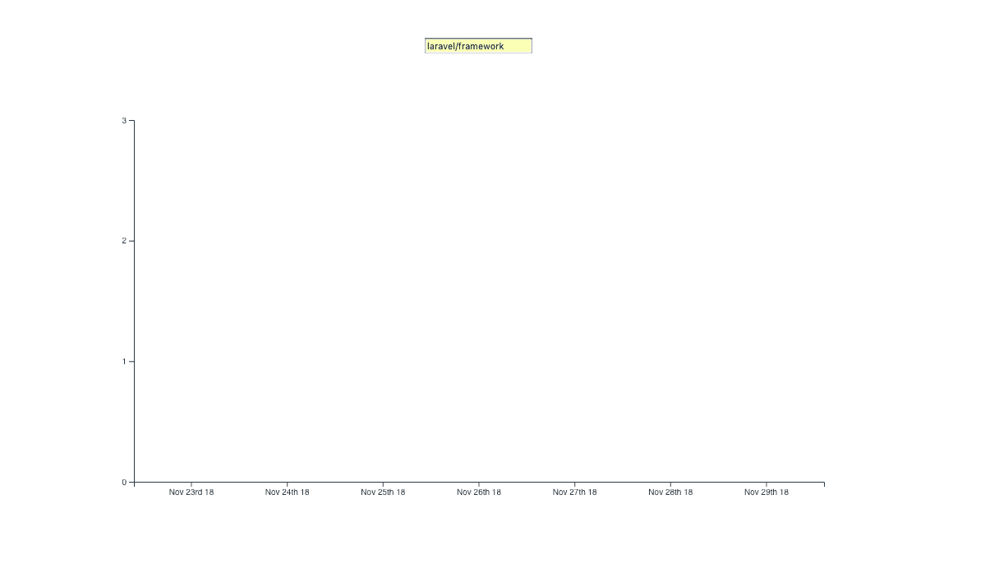

如果你在浏览器中使用我们目前涵盖的代码进行测试，你应该能看到类似的内容。

现在轴的部分就够了。让我们画些柱子吧！

## 绘制柱体（Drawing Bars）

对于我们的柱状图，柱宽将是固定的，柱高将根据数据集的大小而变化：

```javascript
renderChart(issues_val) {
  ...

  const barGroups = this.chart
    .selectAll("rect")
    .data(issues_val)
    .enter();

  barGroups
    .append("rect")
    .attr("class", "bar")
    .attr("x", d => xScale(d.day))
    .attr("y", d => yScale(d.issues))
    .attr("height", d => chart_height - yScale(d.issues))
    .attr("width", xScale.bandwidth());
}
```

上面的代码为数据中的每项项创建一个矩形。我们为这些矩形赋予了`bar`类。

为了设置矩形的 x 和 y 坐标，我们使用了定义的缩放函数。到目前，这些矩形堆叠在一起的，我们需要赋予柱体高度和宽度。

柱体的宽度将由`scaleBand`函数决定。在`xScale`上链式调用`bandwidth`方法会从`range`返回计算出的宽度。

为了设置柱体高度，我们从 SVG 的高度中减去柱体的计算 y 坐标，以获得值的正确表示。记住，在处理 SVG 时，x 和 y 坐标是从左上角开始计算的。

## 添加标签（Adding Labels）

目前我们有一个柱状图。但这个图表并没有帮助，因为它没有告诉用户每个轴代表什么。为了给图表提供更多上下文，我们必须为轴添加标签以及图表标题。

要添加标签，我们向 SVG 添加文本元素：

```javascript
svg
  .append("text")
  .attr("class", "label")
  .attr("x", -(chart_height / 2) - margin)
  .attr("y", margin / 2.4)
  .attr("transform", "rotate(-90)")
  .attr("text-anchor", "middle")
  .text("Issues opened");

svg
  .append("text")
  .attr("class", "label")
  .attr("x", chart_width / 2 + margin)
  .attr("y", chart_height + margin * 1.7)
  .attr("text-anchor", "middle")
  .text("Days");

svg
  .append("text")
  .attr("class", "title")
  .attr("x", chart_width / 2 + margin)
  .attr("y", 40)
  .attr("text-anchor", "middle")
  .text("Issues in the past 1 week");
```

文本元素可以使用`x`和`y`坐标进行定位，而文本对齐则通过`text-anchor`属性完成。要添加文本本身，我们在文本元素上调用了`text`方法。

我们可以通过启动应用并搜索一个仓库来测试这些功能。搜索任何热门的仓库——例如`facebook/react`：

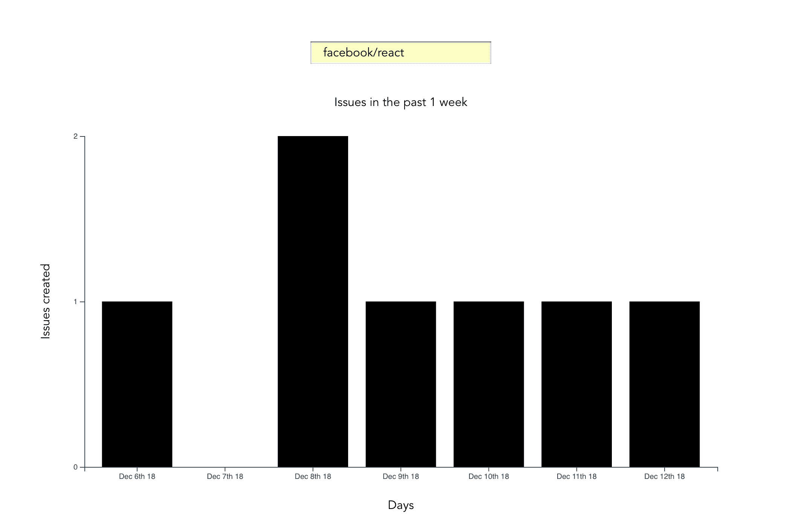

回到我们的`App`组件，我们现在可以删除`getIssues`方法内部的`console.log`语句了：

```javascript
console.log(this.issues);
```

尽管我们的图表在数据可视化方面表现得出色，但在用户体验方面仍有许多工作要做。在下一节中，我们将学习如何为 D3 图表添加过渡效果。

### 添加过渡效果

对于这个特定的图表，我们希望实现这样的效果：当鼠标悬停在一个柱形元素上时，它的颜色会发生，并且柱形代表的 issue 数量将出现在柱形的顶部。

为了实现这一效果，我们需要对`barGroups`的`mouseEnter`和`mouseLeave`事件进行一些[事件处理](https://github.com/d3/d3-selection/blob/master/README.md#handling-events)。

编辑三个`svg`块上面的`barGroups`代码块：

```javascript
barGroups
  ...
  .attr("width", xScale.bandwidth())
  .on("mouseenter", function(actual, i) {
    d3.select(this)
      .transition()
      .duration(300)
      .attr("opacity", 0.6)
      .attr("x", a => xScale(a.day) - 5)
      .attr("width", xScale.bandwidth() + 10);

    barGroups
      .append("text")
      .attr("class", "value")
      .attr("x", a => xScale(a.day) + xScale.bandwidth() / 2)
      .attr("y", a => yScale(a.issues) - 20)
      .attr("text-anchor", "middle")
      .text((a, idx) => {
        return idx !== i ? "" : `${a.issues} issues`;
      });
  });
```

在处理 D3 时，我们通过调用[过渡方法](https://github.com/d3/d3-transition/blob/master/README.md#selection_transition)为元素添加动画。

每当光标悬停在柱形上时，我们都会降低柱形的透明度并增加`10px`的宽度。我们还在柱形上方添加文本，说明该柱形代表的 issue 数量。此过渡持续时间为 300 毫秒。

由于我们不希望在鼠标离开时让柱形保持在新的状态，让我们定义一个`mouseleave`事件，用于移除我们在`mouseenter`事件中应用的选择特性：

```javascript
barGroups
  ...
  .attr("width", xScale.bandwidth())
  .on("mouseenter", function(actual, i) { ... })
  .on("mouseleave", function() {
    d3.selectAll(".issues").attr("opacity", 1);

    d3.select(this)
      .transition()
      .duration(300)
      .attr("opacity", 1)
      .attr("x", a => xScale(a.day))
      .attr("width", xScale.bandwidth());

    svg.selectAll(".value").remove();
  });
```

我们在上面做的是将柱形的透明度恢复到原始值，并移除柱形上的文本。

```javascript
svg.selectAll(".value").remove();
```

上述代码移除了 DOM 中任何带有`value`类的文本。

这里是最终结果：

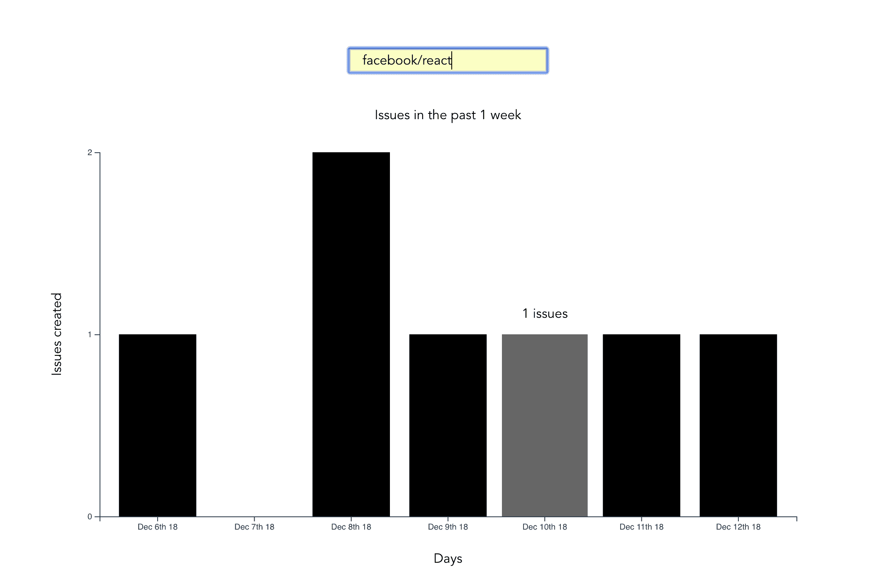

如果你现在在浏览器中尝试，你应该能看到类似上面的内容。

### 一些最后的 UI/UX 优化

在向 GitHub 发请求时，我们预计在收到响应之前会有一些加载时间。出于用户体验考虑，我们将通过在页面上闪烁加载警报，让用户意识到我们仍在从 GitHub 获取结果。在`App`组件中，将此代码段添加到代码的 HTML 部分——紧邻`Chart`组件上方：

```html
<div class="alert alert-info" v-show="loading">Loading...</div>

<chart :issues="issues"></chart>
```

出于原型设计的目的，我们将利用 Bootstrap。Vue 有一个官方的 Bootstrap 软件包，我们将安装它：

```bash
npm install bootstrap-vue
```

一旦安装了该包，我们需要将 Bootstrap 的 CSS 类导入到`main.js`文件中，以便警报能够显示：

```javascript
[...]

import "bootstrap/dist/css/bootstrap.css";
import "bootstrap-vue/dist/bootstrap-vue.css";
```

我们快要完成了，但我们需要在数据模型中添加一个`loading`属性——其值将决定是否显示加载警报：

```javascript
data() {
  return {
    loading: false,
    ...
  };
},
```

每当我们发送一个新请求时，都会将`loading`的值设置为`true`，这样警报就会显示，最后在请求成功或应用出错时，我们将此值设为`false`：

```javascript
getIssues() {
  this.loading = true;
  ...
  axios.get( ... );
}
```

### 错误处理

在向 GitHub 发请求时，我们预计在从 GitHub 响应之前会有一些加载时间。出于用户体验考虑，我们将通过在页面上闪烁加载警报，让用户意识到我们仍在从 GitHub 获取结果。在`App`组件中，将此代码段添加到代码的 HTML 部分——紧邻`Chart`组件上方：

```html
<div class="alert alert-info" v-show="loading">Loading...</div>

<chart :issues="issues"></chart>
```

出于原型设计的目的，我们将利用 Bootstrap。Vue 有一个官方的 Bootstrap 软件包，我们将安装它：

```bash
npm install bootstrap-vue
```

一旦安装了该包，我们需要将 Bootstrap 的 CSS 类导入到`main.js`文件中，以便警报能够显示：

```javascript
[...]

import "bootstrap/dist/css/bootstrap.css";
import "bootstrap-vue/dist/bootstrap-vue.css";
```


我们快要完成了，但我们需要在数据模型中添加一个`loading`属性——其值将决定是否显示加载警报：

```
data() {
  return {
    loading: false,
    ...
  };
},
```

每当我们发送一个新请求时，都会将`loading`的值设置为`true`，这样警报就会显示，最后在请求成功或应用出错时，我们将此值设为`false`：

```
getIssues() {
  this.loading = true;
  ...
  axios.get( ... )
}
```

### 样式处理

敏锐的读者会注意到，指南顶部的截图中柱形的颜色是蓝色的。让我们为`App`组件添加最后的点缀：

```
<style>
.bar {
  fill: #319bbe;
}
</style>
```

## 总结

恭喜你来到这里。尽管我们已经有一个可以工作的图表，但在视觉吸引力方面仍有改进空间。例如，我们可以添加网格线，或者使用折线图来可视化这些数据。我们画的是简单的柱状图，但 D3 在功能上非常强大。[这篇文章](https://www.sitepoint.com/d3-js-data-visualizations/)是非常好的读，介绍了它的很多功能。你也可以在 GitHub 上查看其他[用例](https://github.com/d3/wiki/Gallery)。

# 使用 Vue 构建组件

Vue 是一个渐进式框架，允许你通过构建自包含的可用组件集合来构建应用程序。组件用于创建自定义 HTML 元素。从本质上说，每个元素具有相似的数据集。例如，假设你正在构建一个类似 Twitter 的社交网络。对于新闻动态，你需要一种方式向用户展示最新的活动列表。每个活动都具有相似的数据：活动创建者的姓名、发布日期、实际内容等。此外，你还希望用户对这些活动执行点赞、取消点赞和分享操作。

在这种情况下，只需创建一个卡片组件就足够。虽然卡片组件将填充不同的活动，但底层结构和功能将保持不变。不需要重复和修改代码。创建卡片组件后，我们只需要将其插入 HTML 文档的主体，就像处理其他 HTML 元素一样：

```
<feed-card v-for=”activity for activities”></feed-card>
```

虽然构建新闻动态卡片组件是一个有趣的话题，但在本教程中我们将涉及不同的内容：如何构建一个可用的模态框组件。

## Live 代码

对于那些迫不及待的读者，[点击这里查看在 CodePen 上运行的代码演示](https://codepen.io/SitePoint/pen/ZVLaBN)。

## 为什么使用模态框（Modal）？

模态框是许多网站中非常重要且多功能的特性。它们的主要功能是让用户立即关注某些信息。当需要传递关键信息，或者在用户访问（例如某个资源）之前必须执行某些操作时，它们尤为有用。模态框的一个常见用例是在用户执行特定操作之前显示身份验证（登录或注册）表单。我假设在你作为 Web 开发者的职业生涯中，至少会需要创建一个模态组件——这就是本教程的重要性所在。

## 在构建我们的组件之前需要考虑什么

在我们动手实际构建一个模态组件之前，考虑几点是非常重要的。

### 我们是否使用单文件组件？

不要被这个名称误导了：单文件组件（SFCs）只是普通的组件。“单文件”部分只是为了表示，你的组件不是定义在它所在的 HTML 文件中（连同根 Vue 实例一起），而是定义在它自己的文件中。这具有它自己的优势，其中一部分就是可复用性（如果你正在构建一个在不同 HTML 页面中使用该组件的复杂 Web 应用）。

在本教程中，我们将利用 Vue 的渐进式采用能力。我们将从在一个文件中构建所有内容并从 CDN 引入 Vue 开始，然后在第二步中，查看如何将这些内容重构为 SFC。

### 我们是否使用 ES6？

如果你打算使用 Vue，你就需要决定你的代码是否将利用 ES6 特性。使用 ES6 特性带有跨浏览器兼容性问题，通常意味着你可能需要使用 Babel 将其转译为旧浏览器可以理解的代码。

对于本指南中的代码，我们将全程使用 ES6。毕竟，它是一项已批准的标准，而且我们正处于一个不需要支持老旧浏览器的有利位置。请注意，当我们将模态转换为 SFC 时，JavaScript 将通过`webpack`进行打包和转译。

### 核心组件和行为

模态框的重要组件有哪些？我们期望模态框有怎样的行为？

每个模态框包含两个共同组件：`mask`（遮罩层）和`container`（容器）（我们暂且这样命名）。`mask`是出现在大多数模态框中的透明深色（或白色）背景。模态覆盖在页面的其余内容之上。一旦你点击`mask`，模态就会退出。相反，`container`是模态框中“包含”重要内容的部分。

有了这些知识，创建一个可复用的模态组件就变得超级简单，因为我们已经能够将其设计精简为两个主要部分。

我们将使用 [Materialize](https://materializecss.com/) 进行设计，因为我们不想在编写大量 CSS 代码上花费太多精力。

## 构建模态组件

现在是时候开始有趣的内容了。首先，创建一个名为`modal.html`的文件并添加以下代码。这从 CDN 引入了我们的依赖项，并定义了遮罩和容器的 HTML 结构：

```
<!DOCTYPE html>
<html>
  <head>
  <meta charset="utf-8" />
  <meta http-equiv="X-UA-Compatible" content="IE=edge">
  <title>Page Title</title>
  <meta name="viewport" content="width=device-width, initial-scale=1">
  <link rel="stylesheet" href="https://cdnjs.cloudflare.com/ajax/libs/materialize/1.0.0/css/materialize.min.css">
  <style></style>
</head>
<body>
  <div class="container">
    <div class="modal-mask">
      <div class="modal-container"></div>
    </div>
  </div>
  <script src="https://cdn.jsdelivr.net/npm/vue@2.5.21/dist/vue.js"></script>
  <script></script>
</body>
</html>
```

接下来，在`<head>`部分的`<style>`块中添加一些基础样式：

```
.modal-mask{
  position: fixed;
  z-index: 100;
  top: 0;
  left: 0;
  width: 100%;
  height: 100%;
  background-color: rgba(0, 0, 0, .3);
  overflow-y:auto;
}

.modal-container {
  width: 80%;
  height: auto;
  margin: 50px auto 0;
  position: relative;
  padding: 16px;
  background-color: #fff;
  border-radius: 2px;
  box-shadow: 0 2px 8px rgba(0, 0, 0, .33);
  box-sizing: border-box;
}
```

在浏览器中打开该文件。你会发现模态遮罩是一个透明的深色背景。高度和宽度被设置为 100%，因为我们希望在模态获得焦点时它占据整个页面。模态框的容器是一个占据宽度 80% 的`<div>`元素。

### 创建 Vue 组件

下一步是让模态框具有功能。我们需要将模态框定义为一个组件并处理它的可见性。首先，我们设置根 Vue 实例：

```javascript
new Vue({
  el: '#app',
  data() {
    return {
      showModal: false
    }
  },
  methods: {
    actShowModal() {
      this.showModal = true;
    }
  }
});
```

现在，我们带有模板来定义模态组件：

```html
<div id="app" class="container">
  <button @click="actShowModal">Show Modal</button>
  <modal :show_modal="showModal"></modal>
</div>

<template id="modal-template">
  <div class="modal-mask" v-if="show_modal" @click="closeModal">
    <div class="modal-container"></div>
  </div>
</template>
```

以及组件的逻辑：

```javascript
Vue.component("modal", {
  template: "#modal-template",
  props: ["show_modal"],
  methods: {
    closeModal() {
      this.$emit('close');
    }
  }
});
```

最后，我们更新根实例以监听`close`事件并隐藏模态框：

```html
// 更新 HTML 中的组件标签
<modal :show_modal="showModal" @close="showModal = false"></modal>
```

```
Vue.component("modal", {
  ...
  methods: {
    closeModal() {
      this.$emit("close_modal");
    }
  }
});
```

然后修改你的模板代码使其看起来像这样：

```html
<template id="modal-template">
  <div class="modal-mask" v-if="show_modal" @click="closeModal">
    <div class="modal-container"></div>
  </div>
</template>
```

现在当点击遮罩层时，模态组件会触发一个`close_modal`事件。我们在根 Vue 实例中捕获该事件，并将模态的显示状态切换为`false`：

```html
<modal :show_modal="showModal" @close_modal="actCloseModal"></modal>
```

还有：

```javascript
methods: {
  actShowModal(){ ... },
  actCloseModal(){
    this.showModal = false;
  }
},
```

现在，点击遮罩层时模态框应该关闭——这太棒了。但还有另一个问题：点击模态框的容器也会关闭模态框。

对此一个简单的解释是点击事件会传播（冒泡）。为了停止这种传播，让我们使用 Vue 停止此类传播的方法，[`@click.stop` 事件修符](https://vuejs.org/v2/guide/events.html#Event-Modifiers)：

```html
<template id="modal-template">
  <div class="modal-mask" v-if="show_modal" @click="closeModal">
    <div class="modal-container" @click.stop></div>
  </div>
</template>
```

搞定了！我们的模态框现在按照预期方式工作了。花些时间运行我们目前的代码，并确保它运行正常。

## 创建身份验证模态框

目前，我们的模态容器是空的。让我们改变这一点，并编写一些代码来构建一个登录表单嵌入到这个容器中。

让我们先将登录表单加入其中。记住，将使用 Materialize 框架，所以不需要太担心 HTML 类的定义：

```html
<template id="modal-template">
  <div class="modal-mask" v-if="show_modal" @click="closeModal">
    <div class="modal-container clearfix" @click.stop>
      <h4 class="blue-text">Login</h4>
      <form class="col s12">
        <div class="input-field col s12">
          <input v-model="email" id="email_address" type="text">
          <label for="email_address">邮箱地址</label>
        </div>
        <div class="input-field col s12 ">
          <input v-model="password" id="password" type="text" >
          <label for="password">密码</label>
        </div>
        <a class="waves-effect waves-light btn form-btn teal">登录</a>
      </form>
    </div>
  </div>
</template>
```

并添加以下内容来样式化表单按钮：

```css
.form-btn {
  float: right;
}

.clearfix::after {
  content: "";
  clear: both;
  display: table;
}
```

我们不会为身份验证组件实现后端，所以按钮什么都不做是合理的。尽管如此，让我们在组件上定义`email`和`password`数据属性，因为我们在登录表单中的输入已经通过 [v-model 指令](https://vuejs.org/v2/guide/forms.html)指向了它们。这对于实现表单验证很有用。我们不会在教程中实现这一点，但你可以在此 Vue 系列中的教程 *Vue 表单操作初学者指南* 中阅读更多相关内容：

```
Vue.component("modal", {
  template: "#modal-template",
  props: ["show_modal"],
  data() {
    return {
      email: "",
      password: ""
    };
  },
  methods: { ... }
});
```

打开你的`modal.html`，然后……砰！我们自己创建了一个登录模态框。

由于一切运行得非常顺畅，我们有机会思考更优雅的处理方法。

## 使用插槽（Slots）让我们的模态框可复用

尽管我们的模态框现在很好且可用，但仍然存在一个小问题：登录表单与模态组件紧密耦合在一起。因此，目前，如果我们想在应用程序中使用不同的模态框——例如一个用于用户注册，另一个用于其他功能——我们就必须通过从头创建一个另一个模态组件来重复我们的代码。

是否有一种方法可以在保持模态组件骨架分离的同时，插入我们想要的内容？肯定的。

根据我们已有的内容，很容易将登录表单从模态组件中分离，以便我们在需要时将后者用于其他内容。这从创建一个独立的登录组件开始，该组件将包含登录表单所需的数据和方法：

```
Vue.component("login", {
  template: "#login-template",
  data() {
    return {
      email: "",
      password: ""
    };
  }
});
```

这是定义登录模板的代码：

```html
<template id="login-template">
  <div class="clearfix">
    <h4 class="blue-text">Login</h4>
    <form class="col s12">
      <div class="input-field col s12">
        <input v-model="email" id="email_address" type="text">
        <label for="email_address">邮箱地址</label>
      </div>
      <div class="input-field col s12 ">
        <input v-model="password" id="password" type="text" >
        <label for="password">密码</label>
      </div>
      <a class="waves-effect waves-light btn form-btn teal">登录</a>
    </form>
  </div>
</template>
```

等等，为了实现插槽的逻辑：

```html
<template id="modal-template">


<div class="modal-mask" v-if="show_modal" @click="closeModal">
  <div class="modal-container" @click.stop>
    <slot></slot>
  </div>
</div>

我们希望做的是将登录或注册组件分别渲染到模态组件中。假设网页上有两个按钮，点击其中一个显示登录模态框，另一个显示注册模态框。我们的代码应该这样写：

```
<modal :show_modal="showModal" @close_modal="actCloseModal" choice="choice">
  <login v-if="choice === 'login'"></login>
  <register v-else-if="choice === 'register'"></register>
</modal>
```

如代码所示，我们的根实例上有一个名为`choice`的数据属性，它的值可以是`login`或`register`。然后它作为`prop`使用在我们的模态组件中，如下代码所示：

```javascript
Vue.component("modal", {
  template: "#modal-template",
  props: ["show_modal", "choice"],
  methods: { /* ... */ }
});

Vue.component("login", { /* ... */ });
Vue.component("register", { /* ... */ });

new Vue({
  el: ".container",
  data() {
    return {
      showModal: false,
      choice: ""
    };
  },
  methods: { /* ... */ }
});
```

接下来，让我们创建上述两个按钮——一个用于显示登录模态框，另一个用于显示注册模态框。现在我们有了这些：

```html
<div class="container">
  <button v-on:click="actShowModal('login')">Login</button>
  <button v-on:click="actShowModal('register')">Register</button>
  <modal :show_modal="showModal" @close_modal="actCloseModal" choice="choice">
    <login v-if="choice === 'login'"></login>
    <register v-else-if="choice === 'register'"></register>
  </modal>
</div>
```

定义在根实例上的`actShowModal`方法将变为接受一个选择作为参数：

```javascript
new Vue({
  el: ".container",
  data() { /* ... */ },
  methods: {
    actShowModal(choice) {
      this.choice = choice;
      this.showModal = true;
    },
    actCloseModal() {
      this.showModal = false;
    }
  }
});
```

### 一些无障碍改进

我们不应该忽略的一点是，人们可能在使用键盘导航我们的模态框。让我们让他们的生活更方便一点：

```html
<div class="container" @keyup.escape.stop="actCloseModal()">
  ...
</div>
```

这将允许通过按下`Esc`键关闭模态框。

当模态框打开时，你可能还想让表单中的第一个元素聚焦。可以通过创建一个如下[自定义指令](https://vuejs.org/v2/guide/custom-directive.html)来实现：

```javascript
Vue.directive("focus", {
  inserted: el => {
    el.focus();
  }
});
```

你可以将其应用到任何需要聚焦的元素上。在我们的情况下，这将是表单中的第一个输入元素：

```html
<input v-model="email" id="email_address" type="text" v-focus>
<input v-model="firstName" placeholder="" id="first_name" type="text" v-focus>
```

现在，我们全部完成了！我们的模态组件会根据我们点击的按钮，很好地渲染注册和登录组件。打开你的`modal.html`查看结果。

### 实时代码

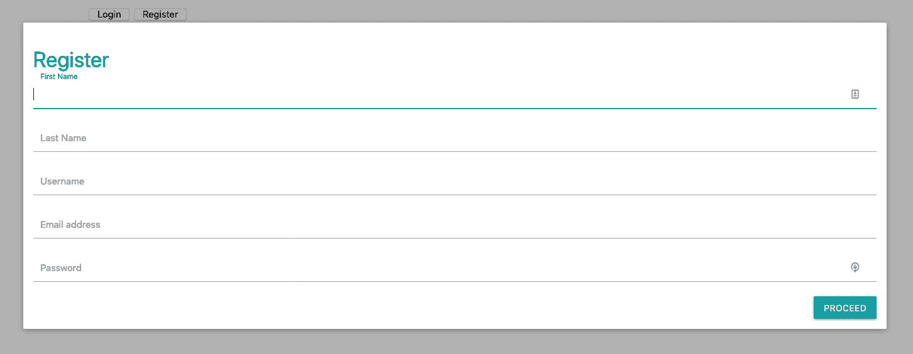

[这里是 CodePen 上运行的代码演示](https://codepen.io/SitePoint/pen/ZVLaBN)。

我们所做的事情非常有价值，因为它防止了不必要的代码重复。我们最终创建了一个某种程度上“通用”的模态组件。然而，为了使其完全可复用，我们需要将它以及其他组件转换为 SFC（单文件组件），并使用`webpack`对我们的代码进行打包以及进行转译，以便它在所有主流浏览器上运行。我们将在教程的下部分完成这些。

## 单文件组件

单文件组件（Single-file components）是在使用 Vue.js 时实现模块化的一种整洁方式。它们允许我们创建包含组件的`.vue`文件，而且在处理复杂的应用程序并希望避免在 HTML 文件中编写 Vue 代码所带来的混乱时，它们会非常有用。在我们的情况下，将我们的`Modal`、`Registration`和`Login`组件转换为 SFC 有助于防止极其笨拙的复制粘贴代码来复用的行为。

由于你的浏览器无法读取`.vue`文件，我们将使用[Vue CLI](https://cli.vuejs.org/)来脚手项目。在底层，它使用了`webpack`以及其他几个依赖项来打包我们的代码。

让我们开始吧。

### 基础设置

要使用 CLI，你需要在系统中安装较新版本的 Node.js。你可以通过[官方网站](https://nodejs.org/)下载二进制文件，或者使用[版本管理器](https://www.sitepoint.com/quick-tip-multiple-versions-node-nvm/)。这可能是最简单的方法，因为它允许你在同一台机器上管理多个版本的 Node。

接下来，使用以下命令在你的机器上全局安装 Vue CLI：

```bash
npm install -g @vue/cli
```

使用以下命令脚手创建一个项目：

```bash
vue create my-modal
```

选择默认预设，当 CLI 完成后，进入目录：

```bash
cd my-modal
```

接下来，安装 Materialize 依赖：

```bash
npm install materialize
```

打开`src/main.js`以便包含它并全局化：

```javascript
import Vue from "vue";
import App from "./App.vue";
import "materialize-css/dist/materialize.css";
import "materialize-css/dist/materialize.min.js";

Vue.directive("focus", {
  inserted: el => {
    el.focus();
  }
});

new Vue({
  render: h => h(App)
}).$mount("#app");
```

### 创建单文件组件

功能上没有变化，但注意代码变得整洁多了。

接下来，在`src/components`文件夹中创建需要的组件：

```bash
touch src/components/{modal.vue,register.vue,login.vue}
```

当你完成后，`src`文件夹看起来应该是这样的：

```
.
├── App.vue
├── assets
│   └── logo.png
├── components
│   ├── login.vue
│   ├── modal.vue
│   └── register.vue
└── main.js
```

剩下的工作是向组件添加代码。

在`modal.vue`中：

```html
<template id="modal-template">
  <div class="modal-mask" v-if="show_modal" @click="closeModal">
    <div class="modal-container" @click.stop>
      <slot></slot>
    </div>
  </div>
</template>

<script>
export default {
  name: "modal",
  props: ["show_modal", "choice"],
  methods: {
    closeModal() {
      this.$emit("close_modal", false);
    }
  }
};
</script>

<style>
.modal-mask{
  position: fixed;
  z-index: 100;
  top: 0;
  left: 0;
  width: 100%;
  height: 100%;
  background-color: rgba(0, 0, 0, .3);
  overflow-y:auto;
}
.modal-container {
  width: 80%;
  height: auto;
  margin: 50px auto 0;
  position: relative;
  padding: 16px;
  background-color: #fff;
  border-radius: 2px;
  box-shadow: 0 2px 8px rgba(0, 0, 0, .33);
  box-sizing: border-box;
}
.form-btn {
  float: right;
}
.clearfix::after {
  content: "";
  clear: both;
  display: table;
}
</style>
```

在这里我们声明 CSS，因为它与模态框相比，与其他组件更为相关。如果我们添加`scoped`属性，这些定义将仅对此文件的模板有效。

在`login.vue`中：

```html
<template id="login-template">
  <div class="clearfix">
    <h4 class="blue-text">登录</h4>
    <form class="col s12">
      <div class="input-field col s12">
        <input v-model="email" id="email_address" type="text" v-focus>
        <label for="email_address">邮箱地址</label>
      </div>
      <div class="input-field col s12 ">
        <input v-model="password" id="password" type="text">
        <label for="password">密码</label>
      </div>
      <a class="waves-effect waves-light btn form-btn teal">登录</a>
    </form>
  </div>
</template>

<script>
export default {
  name: "login",
  data() {
    return {
      email: "",
      password: ""
    };
  }
};
</script>
```

在`register.vue`中：

```html
<template id="registration-template">
  <div class="clearfix">
    <h4 class="blue-text">注册</h4>
    <form class="col s12">
      <div class="input-field col s6">
        <input v-model="firstName" placeholder="" id="first_name" type="text" v-focus>
        <label for="first_name">姓</label>
      </div>
      <div class="input-field col s6">
        <input v-model="lastName" id="last_name" type="text">
        <label for="last_name">名</label>
      </div>
      <div class="input-field col s12">
        <input v-model="username" id="username" type="text" class="">
        <label for="username">用户名</label>
      </div>
      <div class="input-field col s12">
        <input v-model="email" id="email_address" type="text">
        <label for="email_address">邮箱地址</label>
      </div>
      <div class="input-field col s12">
        <input v-model="password" id="password" type="password">
        <label for="password">密码</label>
      </div>
      <a class="waves-effect waves-light btn teal form-btn">继续</a>
    </form>
  </div>
</template>

<script>
export default {
  name: "register",
  data() {
    return {
      firstName: "",
      lastName: "",
      username: "",
      email: "",
      password: ""
    };
  }
};
</script>
```


以上就是全部了。如果你现在使用命令`npm run serve`启动开发服务器，你就能在[`localhost:8080`](http://localhost:8080)看到你的应用程序正在运行。

## 结论

在本次教程中，我演示了如何构建一个简单的模态框组件。我们查看了基本的无障碍访问特性、如何设计模态框以实现可重用性，以及最后如何使用 Vue CLI 将我们的应用结构化为单文件组件。

我希望我向你展示了开始构建你自己的组件是多么简单，以及 Vue 的组件化方法如何让以这种声明的方式构建界面变得一种乐事。

# 第 9 章：如何使用 Vue.js 构建游戏

## 作者：Ivaylo Gerchev

我如此喜欢 [Vue.js](https://vuejs.org) 的原因之一是它可以用于各种场景，并可以集成到许多不同类型的项目中。因此对我来说，Vue 是一个通用的、多功能的框架。在这方面，让我想起了 Python 编程语言，它也容易学习和使用，并适用于许多领域。

在本次教程中，我们将探索 Vue 的一个不那么显眼的用途——游戏开发。

## 本教程的代码仓库

本教程的代码[可以在 GitHub 上找到](https://github.com/sitepoint-editors/match-pairs)。你也可以在此处查看[完成游戏的演示](https://sitepoint-editors.github.io/match-pairs/)。

## 为什么选择 Vue 而不是真正的游戏开发框架

显然，Vue 并不是为游戏开发定制的。那么，我们为什么想要选择它而不是真正的游戏开发框架/引擎呢？嗯，让我们探索两个充分的理由：

1. 如果你熟悉 Vue 和/或每天用它工作，你已经拥有了必要的技能和知识。使用 Vue 创建游戏，你只需要应用你已知的知识，同时将思维转移到不同的上下文中——而不是需要学习整个全新的游戏框架。
2. Vue 提供了让游戏开发变得简单的特性：
   - [Vue 的响应式系统](https://vuejs.org/v2/guide/reactivity.html) 允许以最少的精力构建高度交互的界面。
   - 过渡和动画是大多数游戏的重要部分。Vue 对此有[内置支持](https://vuejs.org/v2/guide/transitions)。
   - [Vue 的生态系统](https://github.com/vuejs/awesome) 足够提供你所需的功能。

## 规划游戏

我们今天要构建的是一个流行的[配对游戏](https://en.wikipedia.org/Concentration)。UI 将由以下组件组成：

- 卡牌面板，持有卡牌。
- 倒计时器组件，显示剩余时间。
- 状态栏组件，显示剩余次数。
- 启动屏组件，当游戏结束时显示“你输了！”或“你赢了！”当时间剩余 10 秒或更少时，计时器的颜色将变为红色。

## 开始

现在是时候行动了。为了遵循本文，你需要安装 [Node](https://nodejs.org/)、npm 以及 [Vue CLI](https://cli.vuejs.org/)。使用[版本管理器](https://www.sitepoint.com/quick-tip-multiple-versions-nvm/) 是最简单的方法：

```bash
npm i -g @vue/cli
```

完成后，创建一个`match-pairs`项目，在提示时选择“default”预设：

```bash
vue create match-pairs
cd match-pairs
```

接下来，我们添加 [Vuetify 插件](https://vuetify.com/en/)：

```bash
vue add vuetify
```

再次选择“default”预设。为了启用它，我们需要在根目录下创建一个`webpack.config.js`文件，内容如下：

```javascript
const VuetifyPlugin = require('vuetify-loader/lib/plugin')

module.exports = {
  plugins: [
    new VuetifyPlugin()
  ]
}
```

现在让我们添加另外两个需要的包——[Lodash](https://lodash.com/) 和 [MomentJS](http://momentjs.com/)：

```bash
npm i lodash moment
```

最后，我们可以此命令运行应用程序：

```bash
npm run serve
```

## 准备项目文件和组件

现在我们需要做一些准备。

首先，我们需要修改`src/main.js`文件。将其内容替换为以下：

```javascript
import Vue from 'vue'
import './plugins/vuetify'
import App from './App.vue'
import _ from 'lodash'

Vue.config.productionTip = false

new Vue({
  render: h => h(App),
}).$mount('#app')
```

现在，在`src/components`目录中，删除`HelloWorld.vue`示例文件，并创建游戏所需的组件：`CardsBoard.vue`、`Timer.vue`、`StatusBar.vue`和`Splash.vue`。

接下来，打开`src/App.vue`，删除内容并插入以下内容：

```html
<template>
  <v-app dark>
    <v-container>
      <v-layout class="font-weight-bold display-3 purple--text" justify-center mb-4>匹配对子</v-layout>
      <v-layout mb-4>
        <timer></timer>
        <status-bar></status-bar>
      </v-layout>
      <cards-board></cards-board>
    </v-container>
    <splash></splash>
  </v-app>
</template>
```

在这里，我们使用刚刚创建的组件来构建游戏布局。

接下来，我们在脚本中填充以下内容：

```javascript
<script>
const cardsSet = [
  {
    name: "php",
    img: "https://s3-us-west-2.amazonaws.com/s.cdpn.io/74196/php-logo_1.png"
  },
  {
    name: "css3",
    img: "https://s3-us-west-2.amazonaws.com/s.cdpn.io/74196/css3-logo.png"
  },
  ...
];

let shuffleCards = () => {
  let cards = [].concat(_.cloneDeep(cardsSet), _.cloneDeep(cardsSet));
  return _.shuffle(cards);
};

import CardsBoard from "./components/CardsBoard";
import StatusBar from "./components/StatusBar";
import Timer from "./components/Timer";
import Splash from "./components/Splash";
import _ from "lodash";
import moment from "moment";

export default {
  name: "App",
  components: {
    CardsBoard,
    StatusBar,
    Timer,
    Splash
  },
  data() {
    return {
      cards: [],
      started: false,
      duration: 120000,
      progress: 0,
      time: null,
      timer: null,
      flipBackTimer: null,
      turns: 0,
      matches: 0,
      showSplash: false,
      result: "",
      score: 0
    };
  },
  created() {
    this.resetGame();
  },
  methods: {
    resetGame() {
      this.started = false;
      this.progress = 0;
      this.time = null;
      this.turns = 0;
      this.matches = 0;
      this.showSplash = false;
      this.score = 0;
      let cards = shuffleCards();
      _.each(cards, card => {
        card.flipped = false;
        card.found = false;
      });
      this.cards = cards;
    },
  }
};
</script>
```

首先，我们为卡片添加必要的图片。为了简洁起见，我省略了许多图片。你可以从 [GitHub 仓库中获取完整列表](https://github.com/sitepoint-editors/match-pairs/blob/master/src/App.vue)。

`shuffleCards()`函数将图片翻倍以形成配对，并对它们进行全部洗牌。

接下来，我们导入了组件并在`components`对象中注册了它们。我们还导入了 Lodash 和 Moment。

之后，我们定义了游戏所需的所有数据属性。我们添加了`created()`钩子，它会在应用创建时调用`resetGame()`方法。`resetGame()`将所有数据属性恢复到初始状态。

现在，我们可以添加一些辅助方法，用于管理卡片的`flipped`（翻牌）和`found`（已找到）状态：

```javascript
methods: {
  ...
  flippedCards() {
    return _.filter(this.cards, card => card.flipped);
  },
  sameFlippedCard() {
    let flippedCards = this.flippedCards();
    if (flippedCards.length == 2) {
      if (flippedCards[0].name == flippedCards[1].name) return true;
    }
  },
  setCardFounds() {
    _.each(this.cards, card => {
      if (card.flipped) card.found = true;
    });
  },
  checkAllFound() {
    let foundCards = _.filter(this.cards, card => card.found);
    if (foundCards.length == cards.length) return true;
  },
  clearFlips() {
    _.map(this.cards, card => (card.flipped = false));
  },
  clearFlipTimer() {
    clearTimeout(this.flipBackTimer);
    this.flipBackTimer = null;
  },
}
```

以下是这些辅助方法的作用：

- `flippedCards()`返回所有翻牌的卡片——即`flipped`属性为 true 的卡片
- `sameFlippedCard`使用上述辅助方法检查两个翻牌的卡片是否相同
- `setCardFounds()`将翻牌的卡片标记为已找到
- `checkAllFound`检查是否所有卡片都已找到
- `clearFlips()`清除所有翻牌的卡片
- `clearFlipTimer`在我们翻牌卡片时重置计时器

最后，我们添加了开始和结束游戏的方法：

```javascript
methods: {
  ...
  startGame() {
    this.started = true;
    let duration = this.duration;
    this.timer = setInterval(() => {
      if (duration == 1000) {
        this.finishGame();
      }
      duration -= 1000;
      this.time = moment(duration).format("mm:ss");
      this.progress = (duration / this.duration) * 100;
    }, 1000);
  },
  finishGame() {
    this.started = false;
    clearInterval(this.timer);
    if (this.matches == cards.length) {
      this.result = "Win";
    } else {
      this.result = "Lose";
    }
    this.showSplash = true;
  }
}
```

# 构建组件

好的，是时候构建组件了。

## CardsBoard 组件

打开`CardsBoard.vue`并放入以下内容：

```html
<template>
  <v-layout>
    <v-card 
      v-for="(card, i) in cards"
      :key="i"
      class="card"
      @click="$emit('flipcard', card)"
    >
      <div class="flex-container">
        <div class="back" :style="background-image: 'url(' + card.img + ')'"></div>
        <div class="front"></div>
      </div>
    </v-card>
  </v-layout>
</template>

<script>
export default {
  props: ["cards"],
  emits: ["flipcard"],
  methods: {
    flipCard(card) {
      this.$emit("flipcard", card);
    }
  }
};
</script>
```

为了让上面的代码工作，我们需要一些 CSS。所以我们在 style 部分放入以下内容：

```css
<style>
.flex-container {
  display: flex;
  flex-flow: row;
  justify-content: space-around;
}

.card {
  position: relative;
  width: 100px;
  height: 150px;
  margin: 1px;
  transition: transform 0.3s;
}

@media only screen and (max-width: 768px) {
  .card {
    width: 50px;
    height: 75px;
  }
}

.card .front,
.card .back {
  position: absolute;
  left: 0;
  right: 0;
  top: 0;
  bottom: 0;
  width: 100%;
  height: 100%;
  border-radius: 5px;
  backface-visibility: hidden;
  transform-style: preserve-3d;
}

.card .back {
  background-image: url("https://s3-us-west-2.amazonaws.com/s.cdpn.io/102308/card_backside.jpg");
  background-size: 100%;
  background-repeat: no-repeat;
}

.card .front {
  transform: rotateY(-180deg);
  background-size: 100%;
  background-repeat: no-repeat;
  background-position: center;
  background-color: white;
</style>
```


}

.card.flipped .back,

.card.found .back {

  transform: rotateY(180deg);

}

.card.flipped .front,

.card.found .front {

  transform: rotateY(0deg);

}

.card.found {

  opacity: 0.3;

}

</style>

```

在这里我不深入讨论细节。基本上，这些样式创建了正确的卡片布局并添加了翻转效果。

现在，让我们回到 `App.vue` 并添加内容：

```html

<cards-board :cards="cards" @flipcard="flipCard"></cards-board>

```

在这里，我们绑定了 `cards` 属性并注册了 `flipcard` 事件监听器。现在，我们在脚本部分的 `methods` 中添加 `flipCard()` 方法：

```javascript

methods: {

  ...

  flipCard(card) {

    if (card.found || card.flipped) return;

    if (!this.started) {

      this.startGame();

    }

    let flipCount = this.flippedCards().length;

    if (flipCount == 0) {

      card.flipped = !card.flipped;

    } else if (flipCount == 1) {

      card.flipped = !card.flipped;

      this.turns += 1;

      if (this.sameFlippedCard()) {

        this.matches += 1;

        this.flipBackTimer = setTimeout(() => {

          this.clearFlipBackTimer();

          this.setCardFounds();

          this.clearFlips();

          if (this.checkAllFound()) {

            this.finishGame();

          }

        }, 1000);

      } else {

        this.flipBackTimer = setTimeout(() => {

          this.clearFlipBackTimer();

          this.clearFlips();

        }, 1000);

      }

    }

  }

}

```

首先，如果我们点击了一个已经翻转或找到的卡片，该函数将终止。如果 `started` 为 `false`，它将启动游戏。接下来，当我们打开第一张卡片时，它会将 `flipped` 属性更改为 `true`。当我们打开第二张卡片时，它会将 `flipped` 属性更改为 `true` 并增加 `turns` 属性。接下来，如果卡片相同，它将增加 `matches` 属性并设置一个 `flipBackTimer`。它将等待一秒钟并将卡片的 `found` 属性设置为 `true`，同时清除翻转的卡片。如果所有卡片都被找到，游戏将结束。如果打开的两张卡片不同，它将仅仅清除翻转的卡片。

### 定时器组件

打开 `Timer.vue` 并添加以下内容：

```html

<template>

  <v-layout justify-end>

    <v-progress-circular

      :rotate="-90"

      :value="progress"

      :size="70"

      :width="9"

      :color="color"

    >{{time}}</v-progress-circular>

  </v-layout>

</template>

<script>

export default {

  props: ["progress", "time"],

  data() {

    return {

      color: "success"

    };

  },

  watch: {

    progress() {

      if (this.progress <= 10) {

        this.color = "red";

      } else {

        this.color = "success";

      }

    }

  }

};

</script>

```

在这里，我们使用了 [Vuetify 进度组件](https://vuetifyjs.com/en/components/progress)。我们需要根据 `progress` 的值动态地更改计时器的颜色。为了不断更新 `progress` 属性，我们需要为它添加一个[监听器](https://vuejs.org/v2/guide/computed.html#Watchers)。

现在我们移动到 `App.vue` 并绑定传入的属性：

```html

<timer :progress="progress" :time="time"></timer>

```

### 状态栏

打开 `StatusBar.vue` 并添加以下内容：

```html

<template>

  <v-layout align-center class="headline">

    <span class="mx-3">Turns: {{ turns }}</span>

    <v-divider vertical></v-divider>

    <span class="mx-3">Matches: {{ matches }}</span>

  </v-layout>

</template>

<script>

export default {

  props: ["turns", "matches"]

};

</script>

```

在这里，我们只是传递了 `turns` 和 `matches` 属性，并在模板中使用它们。

在 `App.vue` 中，我们绑定传入的属性：

```html

<status-bar :turns="turns" :matches="matches"></status-bar>

```

### 启动页

最后，打开 `Splash.vue` 并添加以下内容：

```html

<template>

  <v-layout row>

    <v-dialog v-model="showSplash" persistent max-width="300">

      <v-card class="text-xs-center">

        <v-card-text>

          <div class="headline mb-4">You {{result}}!</div>

          <div>Score: {{score}}/</div>

        </v-card-text>

        <v-card-actions>

          <v-spacer></v-spacer>

          <v-btn color="green darken-1" flat @click="resetGame">Start New Game</v-btn>

          <v-spacer></v-spacer>

        </v-card-actions>

      </v-card>

    </v-dialog>

  </v-layout>

</template>

<script>

export default {

  props: ["showSplash", "result", "score"],

  methods: {

    resetGame() {

      this.$emit("resetgame");

    }

  }

};

</script>

```

我们使用了 [Vuetify 对话框组件](https://vuetifyjs.com/en/components/dialogs) 来制作启动页。当 `showSplash` 为 `true` 时，启动页将显示。

在 `App.vue` 中，我们绑定传入的属性并注册触发的事件：

```html

<splash :showSplash="showSplash" :result="result" :score="score"></splash>

```

到此，我们的游戏之旅就结束了。现在，只需运行 `npm run` 并享受吧！

*   [VeeValidate](https://baianat.github.io/vee-validate/) 一个用于 Vue.js 项目的单验证框架

让我们进入项目目录并安装它们：

```
cd vuex-todo
npm install bootstrap-vue vee-validate
```

为了测试一切是否运行正常，使用 `npm run serve` 启动应用并访问 [`localhost:8080`](http://localhost:8080)。你应该能看到欢迎界面。

## 基础项目设置

现在我们已经安装了所有的依赖，可以开始构建我们的主应用程序结构。在 `src/components` 文件夹下，删除 `HelloWorld.vue` 文件，然后创建两个新文件——`TodoList.vue` 和 `TodoItem.vue`：

```
rm src/components/HelloWorld.vue
touch src/components/{TodoList.vue,TodoItem.vue}
```

接下来，通过向 `main.js` 添加以下代码来注入 `Bootstrap Vue` 和 `VeeValidate`：

```
...
import BootstrapVue from 'bootstrap-vue'
import VeeValidate from 'vee-validate';
import 'bootstrap/dist/css/bootstrap.css'
import 'bootstrap-vue/dist/bootstrap-vue.css'
...
Vue.config.productionTip = false
Vue.use(BootstrapVue)
Vue.use(VeeValidate);
```

现在打开 `src/App.vue` 并用以下代码替换现有代码：

```vue

<template>

  <div id="app">

   <b-jumbotron  bg-variant="info" text-variant="white">

      <template slot="header">

        <b-container>Vuex 待应用</b-container>

      </template>

      <template slot="lead">

        <b-container>使用 Bootstrap-Vue.js 构建</b-container>

      </template>

    </b-jumbotron>

    <b-container>

      <div class="todo-page">

        <h2>购物列表</h2>

        <hr>

        <TodoList />

      </div>

    </b-container>

  </div>

</template>

<script>

  import TodoList from '@/components/TodoList.vue'

  export default {

    name: 'TodoView',

    components: {

      TodoList

    }

  }

</script>

```

在这里我们使用 Bootstrap 组件来布局我们的应用程序页面。这种方法比为每个 HTML 元素定义 Bootstrap 类要简单得多。你可以在 [Bootstrap Vue.js](https://bootstrap-vue.js.org/docs/components/jumbotron) 网站找到所用组件的文档。

对于组件，我们将插入一些占位代码。将以下代码插入到 `components/TodoList.vue`：

```vue

<template>

    <p>待办列表组件正在构建中</p>

</template>

```

为 `components/TodoItem.vue` 插入以下代码：

```vue

<template>

  <p>待办事项组件正在构建中</p>

</template>

```

最后，回到 [`localhost:8080`](http://localhost:8080)，你应该在那里看到以下页面视图：

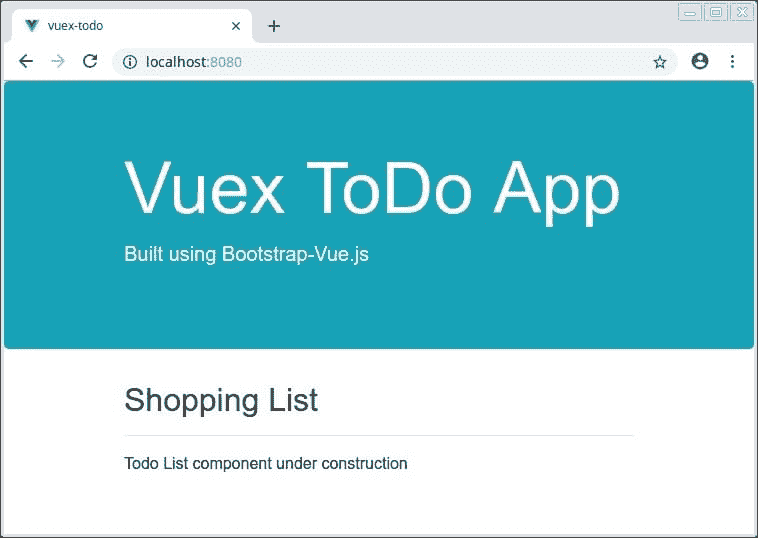

## 构建待办列表

为了构建我们的待办列表，我们将采用自自而上的方法。也就是说，我们将从构建 Vuex store 开始，最后通过创建组件来完成。我们将为 `TodoList` 集合使用一个非常简单的 `TodoItem` 模型，它仅包含两个属性：

```json

{

  name: "Butter",

  done: false

}

```

### 创建 Store

打开 `src/store.js` 并将默认替换替换以下代码：

```javascript

export default new Vuex.Store({

  state: {

    items: [

      {

        name: "Milk",

        done: false

      },

      {

        name: "Bread",

        done: true

      },

      {

        name: "Cake",

        done: false

      }

    ]

  },

  mutations: {

    addItem(state, item) {

      state.items.push(item)

    },

    editItem(state, { item, name = item.name, done = item.done }) {

      item.name = name;

      item.done = done;

    },

    removeItem(state, item) {

      state.items.splice(state.items.indexOf(item), 1);

    }

  },

  actions: {

    addItem({ commit }, item) {

      commit("addItem", {

        name: item,

        done: false

      })

    },

    editItem({ commit }, { item, name }) {

      commit("editItem", { item, name });

    },

    toggleItem({ commit }, item) {

      commit("editItem", { item, done: !item.done });

    },

  }

});

```

如你所见，我们首先在 `state` 对象中声明我们的项目。

然后我们有三个 mutations 来操作状态——`addItem`、`editItem` 和 `removeItem`。`addItem` mutation 处理器接收一个项目并将其推入 `state`，而 `removeItem` mutation 处理器接收一个项目并使用 [Array 的 splice 方法](https://developer.mozilla.org/en-US/docs/Web/JavaScript/Array/splice) 移除。

### 构建 TodoList 组件

现在让我们构建 `TodoList` 组件。它基本上由一个用于显示列表的表单组成。有一些 CSS 和 Bootstrap 样式类来使布局看起来正确。如果你对这里的任何内容不确定，请查阅 [Bootstrap Vue](https://bootstrap-vue.js.org/docs) 文档。

```vue

<template>

  <div class="todo-list">

    <!-- start of to-form -->

    <b-form class="row">

      <b-col cols="10">

        <b-form-input

          id="item"

          name="item"

          class="w-100"

          placeholder="你想买什么？"

        ></b-form-input>

      </b-col>

      <b-col cols="2">

        <b-button type="submit" variant="primary">添加</b-button>

      </b-col>


```html
</b-form>

<!-- end of to-form -->

<!-- start of to-list -->

<b-row>
  <b-col md="10">
    <b-list-group>
      <b-list-group-item v-for="(item, index) in items" :key="index">
        {{ item.name }}
      </b-list-group-item>
    </b-list-group>
  </b-col>
</b-row>

<!-- end of to-list -->

</div>
```

```html
</template>

<script>
import { mapState } from 'vuex';

export default {
  name: 'TodoList',

  computed: {
    ...mapState([
      'items'
    ])
  },
};
</script>

<style>
form {
  margin-bottom: 25px;
}

.list-group-item {
  display: flex;
}

.list-group-item:hover {
  background-color: aliceblue;
}

.checked {
  font-style: italic;
  text-decoration: line-through !important;
  color: gray;
  background-color: #eeeeee;
}
</style>
```

### 添加项目

现在让我们让购物列表具有交互性。在这里我们需要做以下几件事：

- 允许用户添加项目、将其标记为 `done` 并删除它们。
- 使用 [VeeValidate](https://baianat.github.io/vee-validate/) 插件为输入表单添加验证。我们使用的唯一规则是 `v-validate="'required'"`，它可以防止提交空白表单。
- 如果存在验证错误信息，使用 VeeValidate 的 `errors` 对象显示。
- 创建一个名为 `item` 的本地状态变量，将其绑定到输入表单。
- 创建一个 `onSubmit()` 函数，使用 Vue.js 的 `@submit.prevent` 修饰符处理表单的 `POST` 事件。

让我们开始启用“添加项目”功能。如下所示更新 `src/components/TodoList.vue` 中的模板部分：

```html
<!-- 待事项表单开始 -->

<b-row>
  <b-col>
    <!-- 显示验证错误 -->
    <b-alert v-if="errors.has('item')" show dismissible variant="danger">
      {{ errors.first('item') }}
    </b-alert>
  </b-col>
</b-row>

<!-- 提交到 onSubmit 函数 -->

<b-form class="row" @submit.prevent="onSubmit">
  <b-col cols="10">
    <!-- 绑定到本地 `item` 状态 -->
    <b-form-input
      id="item"
      class="w-100"
      name="item"
      type="text"
      placeholder="你想买什么?"
      v-model="item"
      v-validate="'required'"
      autocomplete="off"
    ></b-form-input>
  </b-col>

  <b-col cols="2">
    <b-button type="submit" variant="primary">添加任务</b-button>
  </b-col>
</b-form>

<!-- 待事项表单结束 -->
```

现在，让我们如下所示在 `<script>` 部分定义本地状态 `item` 和 `onSubmit()` 函数：

```javascript
import { mapState, mapActions } from 'vuex';

export default {
  name: 'TodoList',

  data() {
    return {
      item: ''
    };
  },

  computed: {
    ...mapState([
      'items'
    ])
  },

  methods: {
    ...mapActions([
      'addItem',
    ]),

    async onSubmit() {
      const isvalid = await this.$validator.validateAll();

      if (isvalid) {
        await this.addItem(this.item);
        this.item = ''; // 保存成功后清除表单
        this.$validator.reset();
      }
    },
  }
};
```

在 `onSubmit` 方法中，我们首先执行验证方法以确保表单输入值有效。如果无效，则会显示错误消息。如果有效，则将项目传递给 `addItem` action。清空本地状态 `item` 并重置验证器，以防止显示错误的错误消息。在实现更改并测试表单后，你应该得到类似的结果：

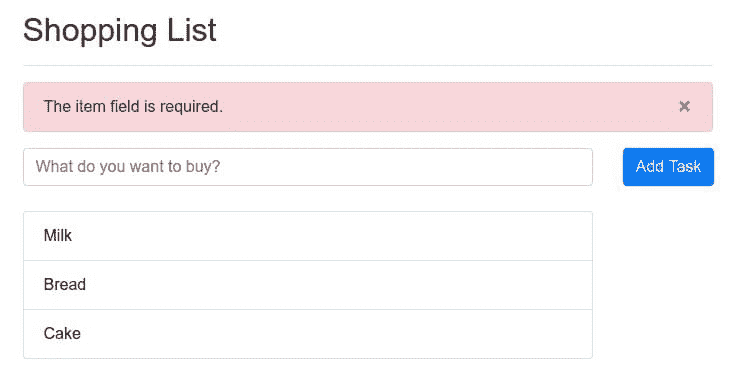

记得检查 Vue DevTools 以查看 store 如何响应你的输入事件。

### 待事项项目组件

现在我们来处理 `src/components/TodoItem` 组件。复制以下代码：

```html
<template>
  <div class="todo-item">
    <b-list-group-item class="row">
      {{ item.name }}
    </b-list-group-item>
  </div>
</template>

<script>
export default {
  name: 'TodoItem',
  props: ['item']
};
</script>
```

接下来，回到 `src/components/TodoList`。我们需要将 `<b-list-group-item>` 代码段替换为新组件 `TodoItem`。进入模板部分，将 `<b-list-group>` 代码段替换为如下：

```html
<b-list-group>
  <TodoItem
    v-for="(item, index) in items"
    :key="index"
    :item="item"
  />
</b-list-group>
```

为了在 `TodoList` 中使用 `TodoItem` 组件，你需要在如下所示的 `<script>` 部分导入它：

```javascript
import TodoItem from './TodoItem.vue';

// ...

export default {
  name: 'TodoList',

  components: {
    TodoItem
  },

  // ...
};
```

搞定了。保存更改后，待事项购物列表应该像以前一样运行。既然我们现在有了专门的 `TodoItem` 组件，我们现在可以轻松添加更多功能：

- 切换项目状态（`done` 字段）
- 编辑项目名称
- 删除项目

### 切换项目状态

让我们从切换项目状态开始。在 `todo` store 中，我们已经有一个可以为我们完成此操作的 action：

```javascript
toggleItem({ commit }, item) {
  commit("editItem", { item, done: !item.done });
}
```

通过使用 `mapAction` 助手在本地映射 action，我们可以如下从 `TodoItem` 组件中直接访问此函数：

```javascript
this.toggleItem(item);
```

通过如下所示更新 `<template>` 代码来添加复选框输入：

```html
<template>
  ...

  <b-row>
    <b-col>
      <b-checkbox v-model="item.done" @change="toggleItem(item)">
        完成
      </b-checkbox>
    </b-col>
  </b-row>

  ...
</template>
```

### 删除项目

接下来，让我们添加删除功能。对于此，我们不 dispatch action，而是直接 commit `removeItem`。

```html
<template>
  ...

  <b-col cols="1">
    <b-button
      variant="link"
      variant="danger"
      size="sm"
      @click="removeItem(item)"
    >
      X
    </b-button>
  </b-col>

  ...
</template>

<script>
  ...

  methods: {
    ...mapActions([
      'toggleItem'
    ]),

    removeItem(item) {
      this.$store.commit("removeItem", item);
    }
  }

  ...
</script>
```

### 更新项目

最后，让我们添加 `edit` 功能。这将有点复杂。我们将这样做：

- 我们创建一个名为 `editing` 的本地状态，默认设置为 `false`。
- 当它为 `false` 时，通过 span 元素显示项目名称。
- 当为 `true` 时，通过输入文本框显示项目名称。
- 我们创建一个自定义 Vue 指令，在文本框可见时对其设置焦点。
- 使用 `@keyup.enter` 和 `@blur` 触发的事件调用自定义函数 `doneEdit` 来处理编辑更改。
- 使用 `@keyup.esc` 触发的事件调用自定义函数 `cancelEdit`。该函数还将 `item.name` 状态恢复为原始值并将 `editing` 值设置为 `false`。

现在让我们开始实现更改。我们将如下所示替换 `src/components/TodoItem.vue` 模板的相关代码来添加文本框：

```html
<template>
  ...

  <b-col cols="10">
    <span v-if="!editing" @dblclick="editing = true">
      {{ item.name }}
    </span>

    <input
      class="edit"
      v-show="editing"
      v-focus="editing"
      :value="item.name"
      @keyup.enter="doneEdit"
      @keyup.esc="cancelEdit"
      @blur="doneEdit"
    >
  </b-col>

  ...
</template>
```

接下来，我们将在脚本部分添加 `editing` 布尔值状态变量、`focus` 指令，以及 `doneEdit` 和 `cancelEdit` 函数。

如下所示更新代码：

```javascript
export default {
  // ...

  data() {
    return {
      editing: false
    };
  },

  directives: {
    focus(el, { value }, { context }) {
      if (value) {
        context.$nextTick(() => {
          el.focus();
        });
      }
    }
  },

  methods: {
    ...mapActions([
      'toggleItem',
      'editItem'
    ]),

    // ...

    doneEdit(event) {
      const value = event.target.value.trim();
      const { item } = this;

      if (!value) {
        this.removeItem(item);
      } else if (this.editing) {
        this.editItem({ item, name: value });
        this.editing = false;
      }
    },

    cancelEdit(event) {
      event.target.value = this.item.name;
      this.editing = false;
    }
  }
};
```

保存更改并测试新的编辑功能。要修改项目，只需双击项目即可。你可以按 `Return` 或点击其他地方来保存更改。如果你不想保存更改，也可以按 `ESC`。你应该会看到类似下面的视图：

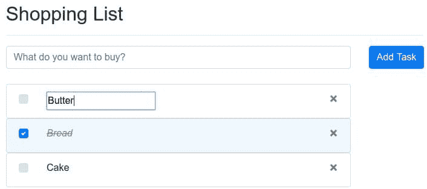

## 进一步进阶

如果你已经看到这里，那太棒了！你已经掌握了构建 Vuex 项目所需的大部分技能。我将给你出一个挑战。我们刚刚构建的项目使用的是硬编码的待办事项列表。换句话说，每当我们执行浏览器全刷新时，`todo` store 都会重置为硬编码的值：

```javascript
state: {
  items: [
    {
      name: "Milk",
      done: false
    },
    {
      name: "Bread",
      done: true
    },
    {
      name: "Cake",
      done: false
    }
  ]
},
```

我想让你将 `items` 的初始状态设置为空数组，如下：

```javascript
state: {
  items: []
}
```

然后，我想让你使用一个真实的数据库来持久化 `items` 集合。你可以使用任何你熟悉的数据库系统，例如 MongoDB、现成的 API 接口如 [JSON server](https://github.com/typicode/json-server)，或者云托管数据库如 [mLab](https://mlab.com/)。然后你可以使用像 `axios` 这样的库从你的远程 API 获取数据到应用的 store 中。

这里有一些关于如何设置它的线索。你需要在你的 `todo` store 中为此任务创建一个新的 mutation，看起来如下：

```javascript
export default {
  state: {
    items: []
  },

  mutations: {
    fetchTodos(state, items) {
      state.items = items;
    }
  },

  actions: {
    async fetchTodos({ commit }) {
      const response = await axios.get('http://localhost:4000/api/todos');
      commit("fetchItems", response.data);
    }
  }
};
```

接着在你的 `TodoList` 组件中，你可以使用 Vue 的 `created` 生命周期钩子来获取数据：

```html
<script>
import { mapActions } from 'vuex';

export default {
  computed: {
    ...mapActions([
      'fetchTodos'
    ])
  },

  created: function() {
    this.fetchTodos();
  }
};
</script>
```


注意，我没有做任何错误处理。我留给你你来思考在`fetchTodos`函数失败时如何显示适当错误消息。

## 总结

从个人角度来看，作为一个有 Redux 和 MobX 状态管理库背景的人来说，我非常喜欢 Vuex。我觉得 Vuex 比它们更简洁、更干净。它为你做了很多繁重的工作，使得实现代码变得容易。Vue DevTools 是一个巨大的加分项，允许你在出现问题时轻松地调试你的 Vuex store。

Vuex 与 Vue.js 紧密集成，并由 Vue.js 团队维护。我认为这是在商业项目依赖 Vuex 的一个很好的理由。作为一个开源项目，你可以轻松地确认该项目正在 [GitHub](https://github.com/vuejs/vuex) 上活跃维护。你也可以确认它没有太多未解决的问题。

尽管如此，你应该注意我还没有涵盖 Vuex 库中提供的 100% 的功能。我强烈建议你查看他们的[当前文档](https://vuex.vuejs.org/) 来了解更多关于其高级功能。

# 第 11 章：如何使用 Storybook 开发和测试 Vue 组件

#### 作者 Ivaylo Gerchev

在当今 Web 应用开发中，组件起着核心作用。现代应用的复杂性要求我们将代码库拆分为微小且易管理的片段——组件，然后我们可以像使用乐高积木一样构建整个应用。为了方便构建并使其更加自动化和交互化，一些聪明的开发者创建了用于组件开发的专用工具。其中一个工具就是 [Storybook](https://storybook.js.org/)。

## 什么是 Storybook？

Storybook 是一个用于开发和测试 UI 组件的交互环境。它允许开发者在脱离实际应用的情况下构建组件。它易于配置和使用，并且可以通过许多官方和社区制作的插件进行扩展。

## 开始上手

在本教程中，我们将学习如何使用 Storybook 开发 Vue 组件。

### 完成的结果

如果你想直接查看完成的代码，可以查看部署在 [GitHub Pages](https://sitepoint.github.io/vue-pomodoro/) 上的 Storybook。

要跟随本教程，你需要在机器上安装 Git 和 Node。[在这里查看如何安装 Git](https://git-scm.com/downloads)。安装 Node，你可以从[官方网站](https://nodejs.org/) 下载二进制，或者使用[版本管理器](https://github.com/nvm-sh/nvm)。

作为起点，我们将使用我已经写好的 [vue-pomodoro 应用](https://github.com/sitepoint-editors/vue-pomodoro)。番茄工作法](https://en.wikipedia.org/wiki/Pomodoro_Technique) 是 Francesco Cirillo 在 20 世纪 80 年代提出的时间管理方法，通过使用计时器将工作分为间隔。

将应用克隆到本地机器，安装依赖并确保它可以运行正常：

```bash
git clone
```

### 安装 Storybook

接下来我们需要安装 Storybook 以及一些额外的依赖。

运行以下命令安装 Storybook：

```bash
npm i --save-dev @storybook/vue
```

接下来，我们需要添加一些依赖：

```bash
npm i --save-dev vue-loader
npm i --save-dev babel-preset-vue
```

下一步是在我们项目的`package.json`文件中添加`storybook`脚本：

```json
{
  "scripts": {
    ...
    "storybook": "start-storybook -p 9001 -c .storybook"
  }
}
```

脚本将在端口`9001`启动 Storybook 开发服务器，并将`.storybook`定义为配置目录。我们还可以在`.storybook`目录中创建一个`config.js`文件，在其中导入并注册我们的组件，并加载我们的故事（stories）。我们将在下一节中学习什么是故事以及如何创建它们。

```bash
mkdir .storybook
touch .storybook/config.js
```

将以下内容添加到`config.js`中：

```javascript
import { configure } from '@storybook/vue';
import Vue from 'vue';

// 导入你的自定义组件。
import State from '../src/components/State.vue';
import Countdown from '../src/components/Countdown.vue';
import Controls from '../src/components/Controls.vue';

// 注册你的自定义组件。
Vue.component('state', State);
Vue.component('countdown', Countdown);
Vue.component('controls', Controls);

function loadStories() {
  // 你可以根据需要引入故事。
  require('../src/stories');
}

configure(loadStories, module);
```

# 编写故事

[故事](https://storybook.js.org/basics/writing-stories/) 是 Storybook 的核心。一个故事代表单个组件的特定状态，或者一组在一起的组件的状态。我们可以为需要的组件创建任意数量的故事。棒的一点是，当我们编辑故事时，更改会立即应用并显示。这为我们提供了流畅且交互的体验。

故事存储在它们自己的目录，这使得它们更接近应用程序的组件。在这种情况下，我们导航到`src`目录，并在内部创建一个新的`stories`文件夹。然后添加`index.js`文件：

```bash
mkdir src/stories
touch src/stories/index.js
```

编写故事非常简单。现在在`index.js`中创建我们的第一个故事：

```javascript
import Vue from "vue";
import { storiesOf } from "@storybook/vue";

storiesOf("State", module).add("state toggle", () => ({
  template: `<state :isworking="false"></state>`
}));
```

`storiesOf`方法封装了关于特定组件或组件组的一个或一组故事。第一个参数定义了包装器的名称。单个故事只是不同的状态，我们通过使用`add`方法来创建它们。第一个参数定义了状态的名称，第二个参数是创建实际状态的函数。渲染状态有许多方法。要查看所有方法，请查看 [Vue 真实示例](https://storybooks-vue.netlify.com/?selectedKind=Custom%7CMethod%20for%20rendering%20Vue&selectedStory=render&full=0&addons=1&stories=0&panelRight=0&addonPanel=storybook%2Fstories%2Fstories-panel)。

现在让我们通过运行项目来看看我们的故事运行情况：

```bash
npm run storybook
```

你应该在浏览器中看到以下内容：

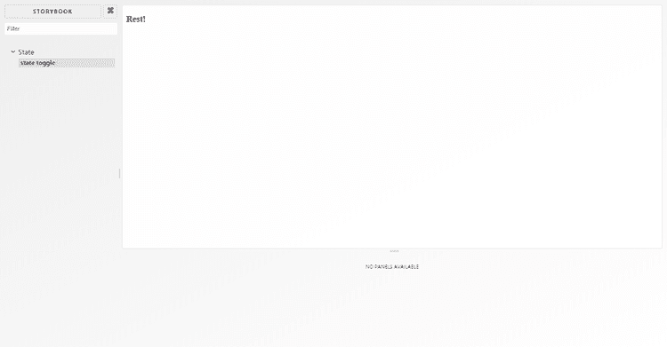

## 安装和使用插件 (Add-ons)

正如我们所见，Storybook 的核心功能有限。为了添加更多实用的功能，我们需要安装一些插件。插件有两种类型：

* `装饰器 (Decorators)` 封装一个故事或多个故事，并以某种方式对其进行转换。例如，我们可以创建一个居中文本装饰器，它将我们故事中的文本居中。我们稍后会看到它的实际示例。
* `原生插件 (Native Add-ons)` 允许与 Storybook 平台进行低级交互。我们也会看到这些示例。

### 安装 Storysource 插件

我们要安装的第一个插件是 [Storysource](https://github.com/storybooks/storybook/tree/master/addons/storysource)。它为 storybook 添加了一个“STORY”面板，显示并高亮所选故事的源代码。它非常有用，因为我们可以看到故事是如何写的，而无需打开故事文件并手动搜索故事。要安装该插件，我们运行：

```bash
npm install -D @storybook/addon-storysource
```

在使用插件之前，我们需要在一个特殊的`addons.js`文件中注册它，我们必须在`.storybook`目录中创建该文件：

```bash
touch .storybook/addons.js
```

然后添加：

```javascript
import '@storybook/addon-storysource/register';
```

还有一点。插件需要一些自定义的 webpack 配置。因此，我们在相同的`.storybook`目录中创建一个`webpack.config.js`文件：

```bash
touch .storybook/webpack.config.js
```

并向添加以下内容：

```javascript
const path = require('path');

module.exports = (storybookBaseConfig, configType, defaultConfig) => {
  defaultConfig.module.rules.push({
    test: [/\.stories\.js$/, /index\.js$/],
    loaders: [require.resolve('@storybook/addon-storysource/loader')],
    include: [path.resolve(__dirname, '../src')],
    enforce: 'pre',
  });
  return defaultConfig;
};
```

### 重启 Storybook

在我们安装新插件后，我们需要重启 storybook 以便更改生效。

最后，我们可以看到插件的运行情况：

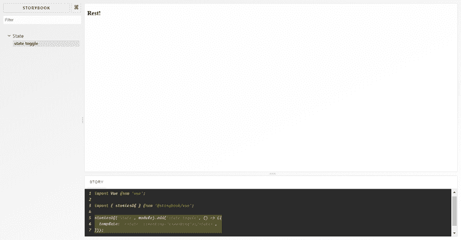

### 安装 Options 插件

我们要安装的下一个插件是 [Options](https://github.com/storybooks/storybook/tree/master/addons/options)。它允许我们使用一些 Storybook 选项。

使用以下命令安装它：

```bash
npm install -D @storybook/addon-options
```

在`addons.js`中注册它：

```javascript
import '@storybook/addon-options/register';
```

然后我们可以像这样在`config.js`中使用它：

```javascript
import { configure, addDecorator } from '@storybook/vue';
import { withOptions } from 'addon-options';

addDecorator(
  withOptions({
    name: 'Vue Pomodoro',
  })
);
```

现在，storybook 左角的名称将是“VUE POMORO”，而不是“STORY”。你可以根据需要使用其他选项。

### 安装 Actions、Links 和 Knobs 插件

在本节中，我们将安装三个插件：[Actions](https://github.com/storybooks/storybook/tree/master/addons/actions)、[Links](https://github.com/storybooks/storybook/tree/master/addons/links) 和 [Knobs](https://github.com/storybooks/storybook/tree/master/addons/knobs)。

你可以这样安装它们：

```bash
npm install -D @storybook/addon-actions @storybook/addon-links @storybook/addon-knobs
```

并在`addons.js`中注册它们：

```javascript
import '@storybook/addon-knobs/register';
import '@storybook/addon-links/register';
import '@storybook/addon-actions/register';
```

### 注册顺序

这里的注册顺序很重要，因为插件会在 Storybook 的面板中按相同的顺序显示。

### 使用 Knobs 插件

Knobs 允许我们动态编辑 Vue 属性。让我们来看看实际效果。在`index.js`文件中添加以下内容：

```javascript
import { withKnobs, boolean } from '@storybook/addon-knobs';

...

storiesOf("State", module)
  .addDecorator(withKnobs)
  .add("state toggle", () => ({
    props: {
      isworking: {
        type: Boolean,
        default: boolean("isworking", true)
      }
    },
    template: `<state :isworking="isworking"></state>`
  }));
```

### 创建和使用自定义装饰器

现在让我们如何创建一个自定义装饰器。在同一个`index.js`文件中，添加以下内容：

```javascript
const CenterDecorator = () => ({
  template: '<div style="textAlign: center;"><story/></div>',
});

...

storiesOf("Countdown", module)
  .addDecorator(CenterDecorator)
  .add("work state", () => ({
    template: `<countdown :minute="1" :second="0" :isworking="true"></countdown>`
  }))
  .add("rest state", () => ({
    template: `<countdown :minute="5" :second="0" :isworking="false"></countdown>`
  }));
```

我们在这里做的目的是定义一个`CenterDecorator`装饰器。我们用自定义功能封装了`<story/>`组件。然后，我们将将其添加到为`Countdown`组件创建的两个新状态中。

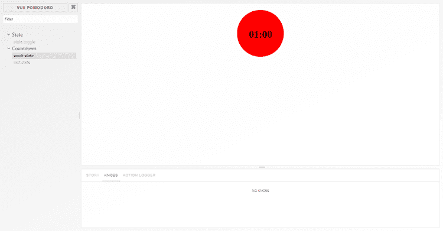

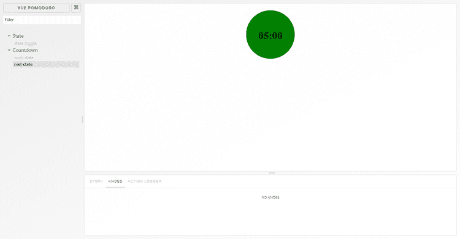

## 使用 Links 和 Actions 插件

在本节中，我们将创建关于番茄钟控制按钮的 story（故事），并使用链接来模拟点击这些按钮时的真实世界行为。

在`index.js`文件中，添加以下内容：

```javascript
import { linkTo } from '@storybook/addon-links';
import { action } from '@storybook/addon-actions';

...

storiesOf("Controls", module)
  .add("started state", () => ({
    template: `<controls state="started" @paused="linkToPaused()" @stopped="linkToStopped()"></controls>`,
    methods: {
      linkToPaused: linkTo("Controls", "paused state"),
      linkToStopped: linkTo("Controls", "stopped state")
    }
  }))
  .add("paused state", () => ({
    template: `<controls state="paused" @started="linkToStarted()" @stopped="linkToStopped()"></controls>`,
    methods: {
      linkToStarted: linkTo("Controls", "started state"),
      linkToStopped: linkTo("Controls", "stopped state")
    }
  }))
```


`.add("stopped state", () => ({`

```
template: `<controls state="stopped" @started="linkToStarted(), action()"></controls>`,
methods: {
  linkToStarted: linkTo("Controls", "started state"),
  action: action("Starting")
}
```

在这里，我们导入了`linkTo`和`action`方法。然后我们创建了关于按钮三种可能状态的 story。接下来，我们创建了链接以便根据点击的按钮在状态之间导航。在停止状态下，我们还使用了一个 action。因此，当我们按下`Start`按钮时，它会在“ACTION LOGGER”面板中记录启动动作。


## 多个组件

在 Storybook 中，我们不仅可以为单个组件创建 story，还可以将多个组件组合到一个 Story 屏幕中。所以，当我们完成单个组件后，就可以将它们组合起来来代表应用的不同界面。让我们尝试一下。在`index.js`中，添加以下内容：

```
storiesOf("App Screen", module)
  .addDecorator(CenterDecorator)
  .add("all components", () => ({
    template: `
      <div>
        <state :isworking="true"></state>
        <countdown minute="1" second="0" :isworking="true"></countdown>
        <controls state="stopped"></controls>
      </div>`
  }));
```

在这里，我们使用`CenterDecorator`让所有组件居中。大搞定。


## 测试组件

现在我们所有的组件都准备好了。现在是时候测试它们了。测试是一个非常广泛的话题，无法在这里完全讨论。测试组件有许多方法。在这里，我们将探索范围缩小到三种：

- **手动测试**依赖于开发者手动探索组件，并确保它们工作正常且行为符合预期。
- **结构化/快照测试**捕获组件渲染后的标记。在下次运行时，新的快照将与旧快照进行比较以确保它们匹配。如果不匹配，我们有两个选择：如果差异是有意更改的结果，我们可以接受这些差异并更新快照；或者，如果它们是代码错误的结果，我们可以修复它们。
- **单元测试**验证在给定输入的情况下，我们是否会得到预期的输出。

如果你是 JavaScript 测试的新手，你可能喜欢快速阅读“[使用 Jest 测试 React 组件](https://www.sitepoint.com/test-react-components-jest/)来掌握通用概念。

### 使用 Storyshots 插件实现结构化测试

[Storyshots](https://github.com/storybooks/storybook/tree/master/addons/storyshots) 插件为我们的 story 添加了自动化快照测试。让我们看看是如何操作的。

首先，安装插件：

```
npm install --save-dev @storybook/addon-storyshots
```

现在，我们在`tests/unit`目录下创建一个`storyshots.spec.js`文件：

```
touch tests/unit/storyshots.spec.js
```

然后在该文件中放入以下内容：

```
import initStoryshots from '@storybook/addon-storyshots';
initStoryshots();
```

搞定。现在我们运行测试：

```
npm run test:unit
```

这就是我们会在终端中看到的：


所有快照将被放置在`__snapshots__`目录下，该目录会在`tests/unit`中自动创建。

现在，为了演示快照的对比，我们将第一个 story 中的`isworking`属性更改为`false`，然后重新运行测试。正如下面的截图所示，插件捕到了更改，并告诉我们我们可以通过`-u`标志来更新快照。


别忘了，你可以在[这里找到部署好的 Storybook](https://sitepoint-editors.github.io/vue-pomodoro/)。

## 结论

希望你喜欢学习 Storybook。正如你所见，它是一个强大的工具，我们可以用它交互式地开发和测试自包含的 UI 组件。它也非常适合制作实时组件展示或文档。我鼓励你去尝试一下。
