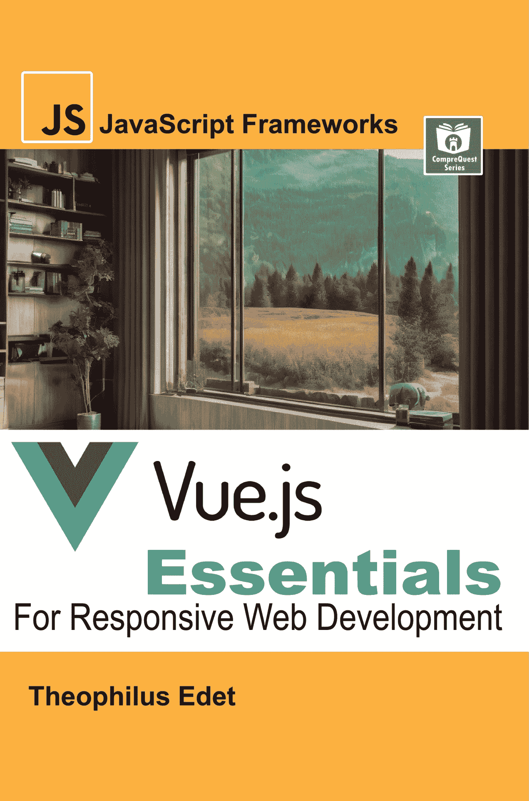

# Vue.js 核心：用于响应式 Web 开发 (JavaScript 框架)




| Theophilus Edet | | |
| :--- | :--- |
|  | theoedet@yahoo.com |
|  | facebook.com/theoedet |
|  | twitter.com/TheophilusEdet |
|  | Instagram.com/edettheophilus |
| | |

# 评审请求

# 与 CompreQuest Books 开启 ICT 精通之路

## 前言：Vue.js 精要——响应式 Web 开发之门

欢迎来到《Vue.js 精要：响应式 Web 开发》的精彩世界。在书中，我们将开启一段探索 Vue.js 奥秘的之旅。Vue.js 是一个渐式的 JavaScript 框架，席卷了 Web 开发领域。无论你是寻求扩展技能树的资深开发者，还是渴望进入现代 Web 开发领域的初学者，本书都旨在成为你的全面指南。

## 揭秘 Vue.js 的本质

Vue.js 以其简单性和灵活性著称，已成为现代 Web 开发的基石。本书旨在揭开 Vue.js 的神秘面纱，为理解其核心概念和实际应用提供结构化且易于理解的方法。从 Vue 组件的基础到使用 `Vuex` 进行高级状态管理以及 `Vue Router` 进行路由，我们涵盖了所有内容。

## 教学风格：在做中学习

实践性学习是最有效的，而这恰恰是我们采用的方法。在整本书中，你将发现一种以实践示例、真实场景和实操练习为核心的教学风格。每个概念不仅会被文字解释，还会通过代码片段和项目进行演示，让你能够跟随学习并立即应用所学知识。

## 读者的益处：赋能你的 Web 开发之旅

你期望从书中获得什么？除了获得 Vue.js 的熟练运用外，你将在响应式 Web 开发方面建立坚实的基础。到书结束时，你将能够轻松构建动态且吸引人的 Web 应用。这种收益远超技术技能；你将获得应对复杂挑战的信心，增强解决问题的能力，并成为一个更全才、更受青的开发者。

## 探索 Web 开发的多种方法

本书不仅关于 Vue.js，更是对现代 Web 开发方法的全面探索。你将深入研究基于组件的架构，掌握状态管理的复杂性，并穿于客户端路由的世界。这段旅程包含了最佳实践、优化技术和故障排除策略，确保你不仅在编写代码，还能理解其背后的艺术与科学。

从处理常见错误到优化页面加载速度，每个章节都针对开发者遇到的真实世界挑战。你还将探索 Vue.js 生态系统，发现新兴趋势，并从案例研究和成功的 Vue.js 应用示例中学习。本书以对伦理考量、社区参与和未来趋势的宝贵见解结束，为你在 Web 开发领域获得全方位且可持续的生涯做好准备。

## 拥抱 Vue.js 的奇妙世界

当你开启这段学习冒险之旅时，我们邀请你拥抱 Vue.js 精彩的世界。Web 开发不仅仅是编写代码；它关乎创造体验、创造性地解决问题以及为全球社区做出贡献。Vue.js 赋予你做到这一切。

在你写的每一行代码中，都能看到创造惊奇世界的潜力。让这本书成为你的指南、伴侣和灵感源。在途中，不要仅仅止于学习；要沉浸其中，无畏地实验，让你的好奇心驱动你前行。

## 行动号召：你的 Vue.js 之旅现在开始

现在是翻页开启 Vue.js 之旅的时候了。无论你是编程新手还是资深专家，在 Vue.js 世界里总有新事物值得发现。投入这段旅程，拥抱挑战，享受胜利。当你深入本书内容时，请记住，你掌握的每一个概念和编写的每一行代码都让你向精通 Vue.js 并塑造 Web 开发的未来迈进。

Theophilus Edet

## 前言：Vue.js 精要：响应式 Web 开发

在不断演变的 Web 开发版图中，对高效和动态工具的需求至关重要。《Vue.js 精要：响应式 Web 开发》是精通 Vue.js 的全面指南，Vue.js 是一个以简单、灵活和响应式而闻名的渐式 JavaScript 框架。本书旨在赋予开发者（从初学者到资深专业人士）构建响应式且功能丰富的 Web 应用所需的必备技能和见解。

## 揭秘 Vue.js：编程利器

Vue.js 通常被简称为 Vue，由于其易于上手的和无缝集成的能力，已成为 JavaScript 框架中的佼佼者。本书将深入探讨 Vue.js 的起源和核心概念，阐明其哲学思想以及与其他框架相比的优势。开发者将发现自己具备了相关知识，可以轻松利用 Vue.js 天生创建迷人用户界面的能力。

Vue.js 基于组件的架构，使其具有高度的模块化和可扩展性。本书揭示了 Vue.js 组件的细微之处，引导读者学习如何创建、注册和使用这些构建块。无论您是初学者还是经验开发者，理解组件都是掌握 Vue.js 开发的基础。探索还延伸到 `props`、自定义事件以及复杂的生命周期钩子等高级概念，为理解组件如何构成 Vue.js 应用的骨架提供了全面的视角。

随着《Vue.js 精要》（Vue.js Essentials）之旅不断不断，Vue.js 内部的编程模型逐渐成为重点。从响应式数据绑定和指令的建立，到使用 `Vuex` 实现状态管理，开发者对 Vue.js 的编程范式有了深刻的理解。本书不仅强调学习语法，还注重采用最佳实践，确保开发者能够充分利用 Vue.js 的潜力。

# 响应式 Web 开发：核心主题

《Vue.js 精要》的核心是对响应式 Web 开发的承诺。通过详细的模块，本书探索了表单处理、使用 `Vue Router` 进行路由，以及动画、过渡和服务端渲染等高级话题。读者将发现自己已经具备了构建 Web 应用的能力，这些应用不仅无缝适配各种设备，还能提供愉悦且直观的用户体验。

《Vue.js 精要》不仅仅是一份指南；它是开发者在复杂的 Web 开发领域中航行的伴侣。本书旨在超越单纯的手册，它鼓励读者拥抱 Vue.js 的精神——简单、可扩展和高效——培养一种超越语法并深耕 Web 开发艺术的思维方式。

# 模块 1：Vue.js 简介

《Vue.js 精要：用于响应式 Web 开发》的开篇模块为深入探索 Vue.js 世界的变革性之旅奠定了基础。当我们开启这段旅程时，显而易见 Vue.js 不仅仅是一个 JavaScript 框架；它是一种哲学、一种方法论和一个重塑 Web 开发格局的强大工具。在这些初始页面中，我们深入探讨了 Vue.js 的起源、核心原理以及它带来的固有优势。

## 揭秘 Vue.js：基础与哲学

从核心上说，Vue.js 不仅仅是一个工具；它推崇简单和灵活的思维。本模块向读者介绍了 Vue.js 的诞生，追溯了它的演变，并强调了定义其本质的基本原则。通过理解 Vue.js 背后的哲学，开发者可以洞察为什么它会成为构建现代和响应式 Web 应用的首选。

## 核心概念：Vue.js 开发的指南针

在 Vue.js 的领域中导航需要牢牢掌握其核心概念。本模块细致地拆解了关键元素，关注数据绑定、指令、方法和计算属性。开发者被引导了解条件渲染和列表渲染的复杂之处，为他们配备了使用 Vue.js 构建动态交互用户界面的所需工具。

## 设置 Vue.js：通往精通的第一步

在对 Vue.js 有了基础理解后，模块过渡到入门的实用方面。在这里，我们引导开发者完成设置 Vue.js 环境的过程，确保能够顺畅地进入 Vue.js 开发世界。创建第一个 Vue.js 应用不仅是一次技术练习，更是通往响应式且引人入胜的 Web 开发之旅中象征性的一步。

## 展望未来：Vue.js 应用及以后

当开发者沉浸在介绍模块时，他们可以窥见 Vue.js 开启的未来可能性。本模块通往变革性体验的门户，为全面理解 Vue.js 奠定了基础，并为《Vue.js 精要：用于响应式 Web 开发》中后续的沉浸式模块定定了调。

## Vue.js 概述

在《Vue.js 精要：用于响应式 Web 开发》的“Vue.js 简介”模块中，之旅始于对框架基础的全面探索。“Vue.js 概述”部分是一个关键起点，为开发者详细介绍了使 Vue.js 成为渐进且多功能 JavaScript 框架的基本方面。通过解析核心原理和语法，该部分在读者深入更高级的 Vue.js 概念之前为其奠定了坚实的基础。

### Vue.js 语法示例

```javascript
const app = new Vue({
  el: '#app',
  data: {
    message: 'Hello, Vue.js!'
  }
});
```

上面的代码片段展示了一个基本的 Vue.js 实例，封装了 Vue.js 应用的核心。`el` 属性指定由 Vue.js 控制的 HTML 元素，`data` 属性持有应用程序的响应式数据。Vue.js 的简单易读性使其成为旨在轻松构建动态响应式用户界面的开发者的极佳选择。

### Vue.js 组件：模块化开发的构建块

进一步进入“Vue.js 简介”模块后，该部分强调 Vue.js 组件是模块化开发的关键构建块。组件允许开发者封装特定功能，培养了 Vue.js 应用的可复用性和可维护性。

### Vue.js 组件示例

```html
<template>
  <div>
    <h2>{{ title }}</h2>
    <p>{{ content }}</p>
  </div>
</template>

<script>
export default {
  data() {
    return {
      title: 'Vue.js 组件',
      content: '使用 Vue.js 构建构建模块化和可复用的组件。'
    };
  }
};
</script>

<style scoped>
h2 {
  color: #42b983;
}
</style>
```

这个 Vue.js 组件说明了由模板、脚本和样式组成的结构。`data()` 函数定义了组件的响应式数据，实现了动态内容渲染。`scoped` 样式确保了封装，防止样式泄漏到其他组件中。理解 Vue.js 组件为创建可扩展和可维护的 Vue.js 应用奠定了基础。

### Vue.js 指令：为前端带来动态性

“Vue.js 概述”部分深入探讨了 Vue.js 指令，这是一个为前端开发带来动态性的强大功能。指令是标记中的特殊标记，以 `v-` 开头，引导 Vue.js 动态操作 DOM。

### Vue.js 指令示例

```html
<div v-if="isUserLoggedIn">
  <p>欢迎，{{ username }}!</p>
</div>
```

此代码片段展示了 `v-if` 指令，根据 `isUserLoggedIn` 数据属性条件渲染内容。Vue.js 指令为开发者提供了一种声明式方法来处理用户界面中的动态行为，有助于构建更有交互性和响应性的应用程序。理解指令对于充分利用 Vue.js 在前端开发的潜力至关重要。

## 使用 Vue.js 的优势

在《Vue.js 精要：用于响应式 Web 开发》的“Vue.js 简介”模块中，“使用 Vue.js 的优势”部分是一个关键探索，探讨了使 Vue.js 成为开发者首选的优势和力量。该部分超越了语法，深入了核心优势，展示了 Vue.js 如何赋予开发者构建稳健、高效且可扩展 Web 应用的能力。

Vue.js 的主要优势之一在于它的简单性和可读性。上面的代码段示例了创建 Vue.js 实例的直观语法。通过清晰且简洁的代码，Vue.js 增强了开发者体验，让初学者和资深开发者都能轻松上手。Vue.js 的简单性促进了快速开发，同时不会牺牲功能性。

## 响应式与基于组件的架构：优化开发工作流

Vue.js 引入了响应式和基于组件的架构，显著简化了开发工作流。响应式确保了底层数据的变化会自动反映在用户界面上，消除了手动操作 DOM 的需要。

<!-- 模板中的 Vue.js 响应式 -->

```html
<template>
  <div>
    <p>{{ message }}</p>
    <button @click="updateMessage">Update Message</button>
  </div>
</template>

<script>
export default {
  data() {
    return {
      message: 'Initial Message'
    };
  },
  methods: {
    updateMessage() {
      this.message = 'Updated Message';
    }
  }
};
</script>
```

在这个 Vue.js 组件中，`message` 数据属性在模板中动态显示。`updateMessage` 方法触发了 `message` 的变化，展示了 Vue.js 的响应式。这种方法增强了代码的可维护性，并确保了更高效的开发过程。

## 灵活与增量采用：根据项目需求定制 Vue.js

Vue.js 以其灵活性脱颖，允许开发者在现有项目中以增量的方式采用它。这种灵活性对于不同规模和复杂性的项目特别有利，为开发者提供了无缝集成 Vue.js 的自由。

```javascript
// Vue.js 增量采用
import Vue from 'vue';
import App from './App.vue';

new Vue({
  render: (h) => h(App)
}).$mount('#app');
```

该代码段展示了一种增量采用的方法，将 Vue.js 集成到现有项目中。开发者可以逐渐引入 Vue.js 组件，从而在不破坏整个代码库的情况下实现平滑过渡。Vue.js 的灵活性使开发者能够根据特定的项目需求定制其用法。

“Vue.js 导论”模块中的“使用 Vue.js 的优势”揭示了让 Vue.js 成为 Web 开发极具吸引力的核心优势。从简单性和响应式，到其灵活的增量采用方法，Vue.js 赋予了开发者高效构建复杂且可扩展应用程序的能力。理解这些优势为在响应式 Web 开发中充分利用 Vue.js 的潜力奠定了基础。

## 设置 Vue.js 环境

《Vue.js 基础：响应式 Web 开发》中的“Vue.js 导论”模块通过“设置 Vue.js 环境”章节开启了一段关重要的旅程。该章节为开发者提供了建立稳健 Vue.js 环境的全面指南，确保无缝的开发体验。从安装 Vue.js 到配置基本工具，这一一步步走的流程为高效的 Vue.js 开发奠定了基础。

# 全局安装 Vue CLI

```bash
# 全局安装 Vue CLI
npm install -g @vue/cli

# 创建一个新的 Vue 项目
vue create my-vue-app

# 进入项目目录
cd my-vue-app

# 运行开发服务器
npm run serve
```

上面的代码段概述了全局安装 Vue CLI、创建新 Vue 项目、进入项目目录以及启动开发服务器的命令。Vue CLI 是一个强大的工具，简化了项目设置，为 Vue.js 应用程序提供了可扩展且标准化的结构。

### 在 VS Code 上设置：使用功能丰富的 IDE 增强开发

虽然可以使用简单的文本编辑器开始 Vue.js 开发，但利用像 Visual Studio Code (VS Code) 这样功能丰富的集成开发环境 (IDE) 可以增强开发体验。“设置 Vue.js 环境”章节深入了如何配置 VS Code 以进行最佳的 Vue.js 开发。

```json
// 用于 Vue.js 开发的 VS Code 扩展
{
  "recommendations": [
    "octref.vetur",
    "dbaeumer.vscode-eslint",
    "esbenp.prettier-vscode"
  ]
}
```

该代码段代表了推荐用于 Vue.js 开发的 VS Code 扩展。`octref.vetur` 提供了 Vue.js 支持，实现了语法高亮、智能感知和其他基本功能。`dbaeumer.vscode-eslint` 通过 ESLint 确保代码风格一致，而 `esbenp.prettier-vscode` 则增强了代码格式化。安装这些扩展丰富了开发环境，营造了更高效且无错误的编码体验。

### Vue CLI 配置：根据特定需求定制项目

“设置 Vue.js 环境”章节还探索了 Vue CLI 配置，允许开发者根据其特定需求定制项目。这包括管理项目功能、选择插件和自定义项目设置。

```bash
# 使用 Vue CLI 定制项目配置
vue invoke vue-cli-plugin-custom-config

## 配置单个项目功能
vue add router
vue add vuex
```

代码段展示了如何使用 Vue CLI 调用自定义配置插件并向项目添加 router 和 vuex。这种模块化方法允许开发者选择性地添加功能，确保每个 Vue.js 项目都符合其独特的需求。Vue CLI 简化了配置过程，使开发者能够高效管理项目设置。

### 运行测试：确保代码质量和可靠性

“设置 Vue.js 环境”章节重点扩展到测试配置，强调了通过测试确保代码质量和可靠性的重要性。

```bash
# 运行单元测试
npm run test:unit

# 运行端端测试
npm run test:e2e
```

提供的命令演示了运行单元测试和端到端测试。Vue CLI 简化了测试过程，允许开发者通过验证功能来维护高水平的代码质量。

“设置 Vue.js 环境”在“Vue.js 导论”模块中是开发者不可或缺的指南。从安装 Vue CLI 创建新项目到配置 VS Code 以增强开发体验，该章节为无缝且高效的 Vue.js 开发奠定了基础。全面的说明和代码示例让开发者能够信心地开启 Vue.js 项目，为构建响应式 Web 应用提供了稳固的基础。

## 创建第一个 Vue.js 应用


# 《Vue.js 基础：响应式 Web 开发》

“Vue.js 导论”模块在“创建第一个 Vue.js 应用”章节达到了关键时刻。该章节旨在引导开发者构建他们的第一个 Vue.js 应用。通过分解步骤并提供详细的代码示例，它旨在让进入 Vue.js 开发变得顺畅且实用。

```bash
# 进入项目目录
cd my-vue-app

# 用你的首选编辑器打开项目
code .
```

在深入研究代码之前，流程是从进入项目目录并使用首选编辑器打开它。这一步确保开发者能够在熟悉且舒适的环境中开始创建第一个 Vue.js 应用，为参与式的编码体验铺平道路。

## 理解 Vue.js 文件结构：导航项目布局

“创建第一个 Vue.js 应用”章节向开发者介绍了 Vue.js 项目的典型文件结构。这种理解对于随着项目演进时高效组织和定位文件至关重要。

```text
my-vue-app/
|-- src/
|   | assets/
|   | components/
|   | views/
|   | App.vue
|   | main.js
```

概述的文件结构说明了常见的目录，例如用于静态资源的 `assets`、用于 Vue.js 组件的 `components` 以及用于表示视图的高级组件的 `views`。`App.vue` 文件作为根组件，而 `main.js` 则充当 Vue.js 应用程序的入口点。这种组织良好的结构随着项目的增长增强了代码的可维护性和可扩展性。

## 构建第一个 Vue.js 组件：你的应用的基础

开发者通过创建第一个 Vue.js 组件来深入探索 Vue.js 开发的核心。“创建你的第一个 Vue.js 应用”部分强调了组件在 Vue.js 应用中的重要性。

```vue
<!-- src/components/HelloWorld.vue -->
<template>
<div>
<h1>{{ greeting }}</h1>
</div>
</template>

<script>
export default {
  data() {
    return {
      greeting: 'Hello, Vue.js!'
    };
  }
};
</script>

<style scoped>
h1 {
  color: #42b983;
}
</style>
```

这段代码片段表示了一个名为 `HelloWorld.vue` 的基础 Vue.js 组件。`template` 包含一个动态问候消息，`script` 部分中相关的 JavaScript 逻辑处理组件的数据。`scoped` 样式确保了封装性，避免了意外的样式冲突。理解 Vue.js 组件的构造对于创建动态且复用的用户界面元素是基础性的。

“Vue.js 简介”模块中的“创建第一个 Vue.js 应用”为 Vue.js 开发提供了实操入门指导。从浏览项目目录和理解文件结构到构建第一个 Vue.js 组件，该部分确保开发者获得实践经验，并为后续的 Vue.js 项目奠定坚实基础。循序渐进的方法结合详细的代码示例，为进入 Vue.js 开发领域的开发者提供了一个参与性学习过程。

# 模块 2：理解 Vue.js 基础

在快速发展的 Web 开发领域，跟上最新技术至关重要。Vue.js 是一个渐进式的 JavaScript 框架，已作为一个强大的参与者出现，为开发者提供了优雅且高效的工具集来构建动态用户界面。该模块被命名为“理解 Vue.js 基础”，是《Vue.js 精要：响应式 Web 开发》一书的基石。在这些页面中，读者将开启一段旅程，揭开使 Vue.js 成为现代 Web 开发者工具中不可或缺框架的核心概念和细节。

## 揭示 Vue.js 的本质

在深入研究 Vue.js 的细节之前，理解该框架的本质至关重要。Vue.js 结合了简单性和灵活性，使其成为初学者和资深开发者的理想选择。该模块首先阐明了 Vue.js 的基本原理，对其响应式数据绑定系统和声明式渲染方法提供了清晰的解释。随着读者的进展，他们将深刻理解 Vue.js 如何赋予开发者无缝管理应用状态的能力，从而营造动态且响应良好的用户体验。

## Vue 实例：通往力量的门户

Vue.js 的核心是 Vue 实例概念，这是一个封装了整个应用程序逻辑的关键实体。该模块仔细剖析了 Vue 实例的构造，引导读者了解其生命周期钩子、方法和属性。通过理解 Vue 实例的细节，开发者将充分利用 Vue.js 的潜力，使其能够创建可扩展且可维护的应用程序。

## 组件：Vue.js 应用的构建块

在 Vue.js 世界中，组件是促进创建模块化和复用代码的构建块。该模块的这一部分揭示了 Vue 组件背后的魔法，阐明了创建、注册和组合它们的过程。从单文件组件到父子通信的细节，读者将全面理解组件如何为 Vue.js 应用的可扩展性和组织结构做出贡献。

## 指令和模板：构建动态 UI

Vue.js 赋予了开发者丰富的指令集和模板功能，使其能够创建动态且交互式的用户界面。在该模块中，读者将开启掌握指令艺术的旅程，探索 `v-bind`、`v-if`、`v-for` 等。通过实际示例和实践练习，开发者将掌握构建能够无缝适应用户交互的响应式 UI 的细微差别。

“理解 Vue.js 基础”为深入探索 Vue.js 世界搭建了舞台，为开发者在 Web 开发任务中充分释放这一动态框架的潜力奠定了基础。无论你是渴望掌握基础的新手，还是寻求提升技能集的资深开发者，该模块都提供了掌握响应式 Web 开发 Vue.js 基础的全面指南。

## Vue 实例与数据绑定

《Vue.js 精要：响应式 Web 开发》中的“理解 Vue.js 基础”模块在“Vue 实例与数据绑定”部分发生了关键转折。该部分标志着对定义 Vue.js 应用的核心概念的基础性探索，为开发者提供了关于 Vue 实例以及支撑响应式用户界面强大数据绑定能力的见解。

```javascript
// 创建一个 Vue 实例
new Vue({
  el: '#app',
  data: {
    message: 'Hello, Vue.js!'
  }
});
```

每个 Vue.js 应用的核心都是 Vue 实例。提供的代码示例演示了 Vue 实例的创建，指定了它控制的 HTML 元素（`#app`）并通过 `data` 属性定义了响应式数据。这个 Vue 实例充当了协调者，将定义的数据链接到 HTML 中相应的元素，为动态内容渲染奠定了基础。

### 响应式数据绑定：轻松同步数据和 DOM

“Vue 实例与数据绑定”部分深入了响应式数据绑定的概念，这是 Vue.js 开发的核心。通过双向数据绑定，Vue.js 确保了应用程序数据与文档对象模型（DOM）之间的无缝同步。

```html
<!-- 绑定 Vue 实例数据的 HTML 模板 -->
<div id="app">
<p>{{ message }}</p>
<input v-model="message" />
</div>
```

这段代码片段说明了双向绑定的运作。消息最初显示在段落中，输入框通过 `v-model` 指令绑定到相同的数据。在输入框中的任何更改都会动态反映在段落中，展示了 Vue.js 在 JavaScript 逻辑和用户界面之间同步数据的能力。

### 方法与事件处理：增强 Vue.js 的交互性

该部分通过引入处理事件和增强应用交互性的方法，进一步扩展了 Vue 实例的能力。

```html
<!-- 使用方法处理点击事件 -->
<div id="app">
<p>{{ message }}</p>
<button @click="changeMessage">更改消息</button>
</div>

<script>
new Vue({
  el: '#app',
  data: {
    message: 'Hello, Vue.js!'
  },
  methods: {
    changeMessage() {
      this.message = '新消息!';
    }
  }
});
</script>
```

在这个示例中，点击按钮时会触发 `changeMessage` 方法，导致显示的消息发生动态变化。Vue.js 方法为开发者提供了一种结构化的方法来处理用户交互并相应更新数据，增强了应用程序的整体交互性。

为了最大化效率，“Vue 实例与数据绑定”章节介绍了计算属性（computed properties），提供了一种对响应式数据进行计算的简化方式。

```html
<div id="app">
  <p>{{ message }}</p>
  <p>{{ reversedMessage }}</p>
</div>

<script>
new Vue({
  el: '#app',
  data: {
    message: 'Hello, Vue.js!'
  },
  computed: {
    reversedMessage() {
      return this.message.split('').reverse().join('');
    }
  }
});
</script>
```

在这个示例中，计算属性 `reversedMessage` 动态地计算了原始消息的反转版本。`Vue.js` 中的计算属性允许开发者优化数据相关的操作，确保复杂的计算能够高效执行，而不会冗余的重新计算。

“Vue 实例与数据绑定”是“理解 Vue.js 基础”模块中的核心章节，为开发者提供了深入理解 Vue.js 开发基础概念的机会。从创建 Vue 实例到探索响应式数据绑定、使用方法处理事件以及利用计算属性，该章节为开发者提供了构建动态且响应式的 Vue.js 应用所需的必备知识。详细的代码示例阐明了这些概念，培养了全面的理解。

## Vue.js 中的指令

《Vue.js 基础：响应式 Web 开发》书中的“理解 Vue.js 基础”模块深入探讨了 Vue.js 开发的基础方面，其中标题为“Vue.js 中的指令”的章节揭示了指令为 Vue.js 带来的力量和活性，展示了它们如何让开发者动态地操作文档对象模型（DOM）并创建交互且响应式的 Web 应用。

```html
<div id="app">
  <p v-if="showMessage">此段落会被显示。</p>
</div>

<script>
new Vue({
  el: '#app',
  data: {
    showMessage: true
  }
});
</script>
```

提供的代码片段介绍了 `v-if` 指令，它是 `Vue.js` 条件渲染的基石。根据 `showMessage` 属性的值，这种声明式方法演示了指令如何简化动态内容的实现。

### v-for 指令：轻松进行列表渲染

对 `Vue.js` 指令的探索扩展到了强大的 `v-for` 指令，实现了列表的无缝迭代生成。

```html
<div id="app">
  <ul>
    <li v-for="item in items">{{ item }}</li>
  </ul>
</div>

<script>
new Vue({
  el: '#app',
  data: {
    items: ['Item 1', 'Item 2', 'Item 3']
  }
});
</script>
```

在这个示例中，`v-for` 指令根据 `items` 数组动态生成列表，展示了 `Vue.js` 为列表渲染带来的简洁性。

### v-bind 指令：动态属性绑定

该章节深入了 `v-bind` 指令的多功能性，它是将 HTML 属性动态绑定到 `Vue.js` 数据的关键工具。

```html
<div id="app">
  <a v-bind:href="link">点击我</a>
</div>

<script>
new Vue({
  el: '#app',
  data: {
    link: 'https://example.com'
  }
});
</script>
```

此示例中的 `v-bind` 指令根据 `link` 数据属性动态设置锚点元素的 `href` 属性。这种活性允许开发者将 `Vue.js` 数据无缝集成到 HTML 属性中，创建动态且响应式的界面。

### v-on 指令：处理用户交互

该章节通过探索 `v-on` 指令结束，它是 `Vue.js` 管理用户交互和事件的重要工具。

```html
<div id="app">
  <button v-on:click="handleClick">点击我</button>
</div>

<script>
new Vue({
  el: '#app',
  methods: {
    handleClick() {
      alert('被点击了!');
    }
  }
});
</script>
```

在此实例中，`v-on:click` 指令将 `handleClick` 方法绑定到按钮的点击事件，证明了 `Vue.js` 如何简化事件处理。开发者高效地响应用户交互，保持代码的整洁和有序。

“理解 Vue.js 基础”模块中的“Vue.js 中的指令”揭示了指令的威力。从使用 `v-if` 进行条件渲染到使用 `v-for` 进行动态列表迭代，再到通过 `v-bind` 动态绑定属性以及 `v-on` 处理用户交互，这些指令赋予了开发者创建动态、响应且交互式的 Vue.js 应用的能力。详细的代码示例提供了有效利用指令进行 Vue.js 无缝 DOM 操作的实践见解。

## 方法与计算属性

《Vue.js 基础：响应式 Web 开发》中的“理解 Vue.js 基础”模块中，标题为“方法与计算属性”的章节处于核心。这一关键章节揭示了方法和计算属性为 Vue.js 开发带来的动态能力，展示了它们如何增强 `Vue.js` 应用的功能性、可维护性和响应性。

```html
<div id="app">
  <button v-on:click="handleClick">点击我</button>
</div>

<script>
new Vue({
  el: '#app',
  methods: {
    handleClick() {
      alert('被点击了!');
    }
  }
});
</script>
```

代码片段介绍了 `Vue.js` 方法的概念，展示了 `handleClick` 方法。该方法由 `click` 事件触发，说明了方法如何为用户交互提供结构化的方法。`Vue.js` 方法对于封装功能和保持清晰的职责分离至关重要。

### 计算属性：简化数据计算

对“方法与计算属性”的探索扩展到了计算属性，这是 `Vue.js` 中的一项强大功能，简化了数据计算并增强应用的响应性。

```html
<div id="app">
  <p>{{ message }}</p>
  <p>{{ reversedMessage }}</p>
</div>

<script>
new Vue({
  el: '#app',
  data: {
    message: 'Hello, Vue.js!'
  },
  computed: {
    reversedMessage() {
      return this.message.split('').reverse().join('');
    }
  }
});
</script>
```

在这个示例中，计算属性 `reversedMessage` 动态地计算了原始消息的反转版本。计算属性确保了复杂的计算能够高效执行，优化了数据相关的操作，并有助于构建性能更强的 Vue.js 应用。

### 方法与计算属性：协同方法

“方法与计算属性”章节强调了 Vue.js 开发中方法与计算属性之间的协同关系。方法处理动态功能和用户交互，而计算属性则专注于基于响应式数据进行高效的计算和缓存。

```html
<div id="app">
  <p>{{ message }}</p>
  <p>{{ computeMessage }}</p>
  <button v-on:click="updateMessage">更新消息</button>
</div>

<script>
new Vue({
  el: '#app',
  data: {
    message: 'Initial Message'
  },
  methods: {
    updateMessage() {
      this.message = 'Updated Message';
    }
  },
  computed: {
    computeMessage() {
      return `Computed: ${this.message}`;
    }
  }
});
</script>
```

在这个组合示例中，`updateMessage` 方法用于更新消息，而计算属性 `computeMessage` 则根据当前消息动态计算一个值。这种相互作用展示了方法和计算属性为 Vue.js 开发带来的灵活性和一致性。

“理解 Vue.js 基础”模块中的“方法与计算属性”揭示了这对显著提升 Vue.js 功能的“黄金搭档”。方法处理用户交互和动态功能，而计算属性则简化了数据计算，增强了响应式和性能。详细的代码示例为开发者提供了关于如何在 Vue.js 应用中有效利用方法和计算属性的细致理解，促进了更健壮、高效的开发流程。

## 条件渲染与列表渲染

在书籍《Vue.js 精要：响应式 Web 开发指南》的“理解 Vue.js 基础”模块中，“条件渲染与列表渲染”章节是对 Vue.js 内部动态显示管理的关键探索。该部分揭示了 Vue.js 如何赋予开发者高效处理条件渲染和列表渲染的能力，为响应性和交互式 Web 应用提供了所需的灵活性。

```html
<div id="app">
  <p v-if="showMessage">这段落根据条件显示。</p>
</div>

<script>
new Vue({
  el: '#app',
  data: {
    showMessage: true
  }
});
</script>
```


提供的代码片段引入了使用`v-if`指令在 Vue.js 中进行条件渲染的基本概念。段落根据`showMessage`数据属性的布尔值进行条件显示。这种声明式方法简化了动态内容的实现，提高了 Vue.js 应用的效率。

### 使用 v-for 进行列表渲染：动态内容生成

对“条件渲染与列表渲染”的探索延伸到了列表渲染，这是 Vue.js 通过`v-for`指令实现的一项强大功能。该指令允许开发者根据数据列表动态生成内容。

```html
<div id="app">
  <ul>
    <li v-for="item in items">{{ item }}</li>
  </ul>
</div>

<script>
new Vue({
  el: '#app',
  data: {
    items: ['Item 1', 'Item 2', 'Item 3']
  }
});
</script>
```

在此示例中，`v-for`指令遍历`items`数组，动态生成列表。Vue.js 简化了管理动态内容的过程，为响应数据变化渲染列表提供了一种优雅且高效的解决方案。

### 结合条件渲染与列表渲染：动态 Vue.js 界面

“条件渲染与列表渲染”章节强调了这些功能的无缝集成，使开发者能够在 Vue.js 中创建动态且响应式的用户界面。

```html
<div id="app">
  <p v-if="showList">列表根据条件显示：</p>
  <ul v-if="showList">
    <li v-for="item in items">{{ item }}</li>
  </ul>
</div>

<script>
new Vue({
  el: '#app',
  data: {
    showList: true,
    items: ['Item 1', 'Item 2', 'Item 3']
  }
});
</script>
```

在这个组合示例中，`v-if`和`v-for`指令均被用于条件显示列表。`showList`的布尔值决定了列表是否显示。这展示了 Vue.js 如何让开发者轻松地管理复杂的 UI 逻辑，为动态内容渲染提供了健壮的解决方案。

“理解 Vue.js”模块中的“条件渲染与列表渲染”为开发者提供了关于如何管理 Vue.js 中动态显示的全面理解。从使用`v-if`的条件渲染到使用`v-for`的动态列表迭代，以及这两项功能的无缝集成，该章节为开发者配备了创建动态、响应和交互式 Vue.js 应用所需的工具。详细的代码示例为有效利用条件渲染和列表渲染提供了实践见解，促进了对 Vue.js 高效能力的深度理解。

## 第 3 章：Vue.js 中的组件

在不断演变的 Web 开发领域，创建可扩展和可维护的用户界面至关重要。Vue.js 作为一个渐进式 JavaScript 框架，通过其强大的组件系统强调了模块化。该模块命名为“Vue.js 中的组件”，是书籍《Vue.js 精要：响应式 Web 开发指南》中的一个重要部分。在这里，读者将开启对 Vue.js 组件的全面探索，深入它们的创建、组合以及在构建响应式和动态 Web 应用中发挥的关键作用。

### 解码 Vue.js 组件的本质

Vue.js 的核心是组件概念，它是被封装的代码单元，允许开发者为其应用程序创建模块化和可复用的构建块。该模块从揭示 Vue.js 组件的本质开始，阐明它们在促进模块化架构中的作用。读者将深入组件的解剖结构，理解它们如何促进代码组织、可维护性以及开发者之间的协作。通过掌握组件的核心原理，开发者为构建复杂且响应式用户界面奠定了坚实的基础。

## 创建与注册组件

理解如何创建和注册组件是利用 Vue.js 能力的基础。该模块的这一部分提供了分步指南，提供了关于定义组件选项、利用数据属性和使用生命周期钩子（lifecycle hooks）的见解。通过实践示例和动手练习，读者将获得编写封装不同功能的组件的熟练技能，促进模块化和可维护的代码库。该模块引导组件注册的复杂之处，使开发者能够将组件无缝集成到他们的 Vue.js 应用中。

### 精通父子通信

Vue.js 组件的有效性不仅在于它们的独立能力，还在于它们相互通信的能力。该模块深入探讨了 Vue.js 组件内部父子通信的艺术。读者将探索各种通信模式，例如从父向子传递数据的`props`，用于子向父通信的自定义事件，以及通过全局事件总线使用共享状态。通过掌握这些通信策略，开发者释放了构建复杂交互界面的潜力，同时保持了组件的模块化和可复用性。

### 用于健壮应用的高级组件概念

随着开发者不断深入学习模块，他们将遇到提升 Vue.js 组件开发水平的高级概念。从动态组件插槽（slots）到混入（mixins）和高阶组件，该部分探索了使开发者能够创建健壮、灵活且可扩展应用程序的技术。在模块结束时，读者将掌握构建复杂的 Vue.js 应用所需的知识和技能，以无缝适应响应式 Web 开发的需求。

《Vue.js Essentials：响应式 Web 开发》书中的“Vue.js 中的组件”模块通过标题为“组件简介”的章节迈出了至关重要的一步。这一节标志着对 Vue.js 开发核心构建块——组件进行深层探索的开端。Vue.js 中的组件为组织和管理用户界面提供了一种结构化且模块化的方法，为开发者提供了创建复用且易于维护代码的强大手段。

```html
<!-- Vue.js 组件示例：HelloComponent -->
<template>
  <div>
    <p>{{ greeting }}</p>
  </div>
</template>

<script>
export default {
  data() {
    return {
      greeting: 'Hello, Vue.js Component!'
    };
  }
};
</script>

<style scoped>
p {
  color: #42b983;
}
</style>
```

该代码段引入了一个名为“HelloComponent”的基础 Vue.js 组件。组件封装了模板（template）、脚本（script）和样式（style）部分，提供了模块化的结构。在这个示例中，该组件显示了一条问候消息，并且样式是作用域限定（scoped）的，以防止意外冲突。这种封装确保了复用性和关注点分离，使组件成为 Vue.js 开发的基石。

## 注册与使用：Vue.js 的模块化实践

“组件简介”章节强调了注册和使用 Vue.js 组件的过程，展示了它们为开发工作流带来的模块化和复用性。

```html
<!-- 使用 HelloComponent 的父组件 -->
<template>
  <div>
    <h1>Parent Component</h1>
    <HelloComponent />
  </div>
</template>

<script>
import HelloComponent from './HelloComponent.vue';

export default {
  components: {
    HelloComponent
  }
};
</script>
```

在这个示例中，父组件通过导入“HelloComponent”并将其在`components`选项中注册，来使用该组件。随后，该组件可以在模板中使用，从而促进了模块化且组织良好的结构的形成。这种方法通过将复杂应用拆分为易于管理和可复用的组件，促进了复杂应用的创建。

## Props：向组件传递数据

该节进一步探讨了`props`的概念，这是 Vue.js 中一种从父组件向子组件传递数据的机制。

```html
<!-- 父组件向 HelloComponent 传递 prop -->
<template>
  <div>
    <h1>Parent Component</h1>
    <HelloComponent :message="greetingMessage" />
  </div>
</template>

<script>
import HelloComponent from './HelloComponent.vue';

export default {
  components: {
    HelloComponent
  },
  data() {
    return {
      greetingMessage: 'Hello from Parent!'
    };
  }
};
</script>
```

在这里，父组件向“HelloComponent”传递了一个名为`message`的 prop，其值为“Hello from Parent!”。随后，子组件可以使用此 prop 动态地显示内容，展示了 Vue.js 中组件之间无缝的通信。

“Vue.js 中的组件”模块中的“组件简介”为开发者提供了对 Vue.js 组件的基础性理解。从创建基础组件结构到注册、使用以及通过`props`传递数据，这一节为构建可扩展和易于维护的 Vue.js 应用奠定了基础。详尽的代码示例说明了这些概念的实际实现，引导开发者进入 Vue.js 组件化开发的世界。

## 创建与注册组件

《Vue.js Essentials：响应式 Web 开发》书中的“Vue.js 中的组件”模块通过标题为“创建与注册组件”的章节开启了关键探索。这一节作为一个基础基石，揭示了构建 Vue.js 组件并将其集成到应用架构的过程。在 Vue.js 中，组件在促进模块化、复用性和可维护性方面起着主导作用。

```html
<!-- Vue.js 组件创建：HelloWorld -->
<template>
  <div>
    <h1>{{ greeting }}</h1>
  </div>
</template>

<script>
export default {
  data() {
    return {
      greeting: 'Hello, Vue.js Component!'
    };
  }
};
</script>

<style scoped>
h1 {
  color: #42b983;
}
</style>
```

该代码段引入了一个名为“HelloWorld”的简单组件。组件封装了模板、脚本和样式部分，提供了模块化的结构。在这个示例中，组件显示了一条问候消息，并且样式是作用域限定的。这种封装确保了复用性和关注点分离，使组件成为 Vue.js 开发的基础。

## 本地注册组件：Vue.js 的集成

“创建与注册组件”章节强调了本地注册组件的过程，展示了 Vue.js 组件如何集成。

```html
<!-- 注册并使用 HelloWorld 的父组件 -->
<template>
  <div>
    <h2>Parent Component</h2>
    <HelloWorld />
  </div>
</template>

<script>
import HelloWorld from './HelloWorld.vue';

export default {
  components: {
    HelloWorld
  }
};
</script>
```

在这个示例中，父组件通过导入并在`components`选项中定义它来注册“HelloWorld”。这种本地注册确保了“HelloWorld”组件可以在模板中使用。Vue.js 通过将应用拆分为易于管理的组件来促进复杂应用的创建。

## 全局注册组件：面向大型应用的 Vue.js

该节进一步探讨了全局注册组件的概念，展示了 Vue.js 如何应对大型应用。

```javascript
// main.js
import Vue from 'vue';
import App from './App.vue';
import HelloWorld from './components/HelloWorld.vue';

Vue.component('HelloWorld', HelloWorld);

new Vue({
  render: h => h(App)
}).$mount('#app');
```

在这个示例中，“HelloWorld”组件在主文件中进行了全局注册，使其可以在所有组件中使用，而无需本地注册。虽然全局注册对于中小型应用非常方便，但它对大型应用尤为有利。

## Props 与自定义事件

《Vue.js Essentials：响应式 Web 开发》中的“Vue.js 中的组件”模块通过标题为“Props 与自定义事件”的章节深入探讨了一个关键方面。这一节探索了 Vue.js 组件之间通信的机制，为开发者提供了从父组件向子组件传递数据以及通过自定义事件进行有效通信的工具。

```html
<!-- 使用 prop 的子组件：GreetUser -->
<template>
  <div>
    <p>{{ greeting }}</p>
  </div>
</template>

<script>
export default {
  props: ['userName'],
  computed: {
    greeting() {
      return `Hello, ${this.userName}!`;
    }
  }
};
</script>
```

该代码段引入了一个名为“GreetUser”的子组件，利用`props`从其父组件接收数据。`userName` prop 定义在子组件中，使其能够根据接收到的数据动态地生成问候消息。这种无缝的数据流确保了 Vue.js 应用内部连贯且互通的结构。

### 传递数据通过 Props：Vue.js 的父子通信

“Props 与自定义事件”部分强调了 props 在 Vue.js 组件中实现父子组件通信的重要性。

```html
<!-- 父组件通过 props 传递数据 -->
<template>
  <div>
    <h1>Parent Component</h1>
    <GreetUser :userName="user" />
  </div>
</template>

<script>
import GreetUser from './GreetUser.vue';

export default {
  components: {
    GreetUser
  },
  data() {
    return {
      user: 'John'
    };
  }
};
</script>
```

在这个示例中，父组件使用了`GreetUser`组件，并将数据`"John"`传递给`userName` prop 属性。这种方法能够在子组件内部进行动态数据渲染，展示了 Vue.js 促进组件间顺畅通信的能力。

### 自定义事件：Vue.js 子到父通信

该部分进一步探讨了自定义事件，这是一种用于 Vue.js 组件中实现从子到父通信的机制。

```html
<!-- 子组件触发自定义事件：SendMessage -->
<template>
  <div>
    <button @click="sendMessage">Send Message</button>
  </div>
</template>

<script>
export default {
  methods: {
    sendMessage() {
      this.$emit('message-sent', 'Hello from Child!');
    }
  }
};
</script>
```

当点击按钮时，`SendMessage`组件会触发一个名为`message-sent`的自定义事件，消息为`"Hello from Child!"`。这个自定义事件可以被父组件捕获，从而实现父组件之间的双向通信。

```html
<!-- 父组件捕获自定义事件 -->
<template>
  <div>
    <h2>Parent Component</h2>
    <SendMessage @message-sent="handleMessage" />
    <p>{{ receivedMessage }}</p>
  </div>
</template>

<script>
import SendMessage from './SendMessage.vue';

export default {
  components: {
    SendMessage
  },
  data() {
    return {
      receivedMessage: ''
    };
  },
  methods: {
    handleMessage(message) {
      this.receivedMessage = message;
    }
  }
};
</script>
```

在该父组件中，使用了`SendMessage`组件，并通过自定义事件监听器捕获了触发的事件。接收到的消息随后显示在模板中，展示了 Vue.js 在实现组件间双向通信方面的灵活性。

“Vue.js 组件”模块中的“Props 与自定义事件”为开发者提供了促进无缝通信的知识和工具。从通过 props 传递数据实现父子通信，到通过触发和捕获自定义事件实现子父通信，该部分对促进组件协作的机制提供了全面的理解。详细的代码示例提供了实践见解，使开发者能够利用 Vue.js 进行高效且组织化的组件化开发。

## 组件生命周期钩子

《Vue.js Essentials：响应式 Web 开发指南》中的“Vue.js 组件”模块进入了名为“组件生命周期钩子”的关键探索。该部分阐明了 Vue.js 中的一系列生命周期钩子，每个钩子都代表组件生命周期中的一个不同阶段。理解这些钩子让开发者能够在组件生命周期的特定时刻执行代码，从而实现精确的控制和定制。

```html
<!-- 带有 mounted 生命周期钩子的 Vue.js 组件：LifecycleExample -->
<template>
  <div>
    <p>Component is mounted!</p>
  </div>
</template>
```


```html
<script>
export default {
  mounted() {
    console.log('Component is mounted!');
  }
};
</script>
```

代码段引入了带有`mounted`生命周期钩子的`LifecycleExample`组件。`mounted`钩子在组件插入 DOM 时被触发，允许开发者在挂载后执行操作。在这个示例中，它向控制台打印了一条消息，展示了生命周期钩子如何在组件寿命的特定点提供洞察和控制。

### 理解组件生命周期：Vue.js 阶段解析

“组件生命周期钩子”部分展示了 Vue.js 组件经历的各个阶段，每个阶段都由特定的生命周期钩子标记。关键钩子包括`created`、`mounted`、`updated`和`destroyed`等。这些钩子为开发者提供了在组件创建、挂载、更新和销毁期间执行代码的机会。

<!-- 带有 created 和 destroyed 生命周期周期钩子的 Vue.js 组件：LifecycleExample -->

```html
<template>
  <div>
    <p>Component created and will be destroyed!</p>
  </div>
</template>

<script>
export default {
  created() {
    console.log('Component is created!');
  },

  destroyed() {
    console.log('Component will be destroyed!');
  }
};
</script>
```

在这个示例中，同时使用了`created`和`destroyed`生命周期周期钩子。`created`钩子在组件创建时执行，而`destroyed`钩子在组件销毁之前被触发。这些钩子允许开发者在需要时精确执行设置和清理任务。

### 实战生命周期钩子：利用完整的 Vue.js 生命周期

该部分强调了 Vue.js 组件生命周期的整体性，展示了如何策略性地利用钩子来应对各种场景。

<!-- 带有各种生命周期钩子的 Vue.js 组件：LifecycleExample -->

```html
<template>
  <div>
    <p>Component with various lifecycle hooks!</p>
  </div>
</template>

<script>
export default {
  beforeCreate() {
    console.log('Before creation!');
  },

  created() {
    console.log('Component is created!');
  },

  beforeMount() {
    console.log('Before mounting!');
  },

  mounted() {
    console.log('Component is mounted!');
  },

  beforeUpdate() {
    console.log('Before update!');
  },

  updated() {
    console.log('Component is updated!');
  },

  beforeDestroy() {
    console.log('Before destruction!');
  },

  destroyed() {
    console.log('Component is destroyed!');
  }
};
</script>
```

`Vue Router`的核心在于其将路由映射到视图的能力，为 Vue.js 内部的导航提供了一种结构化的方法。该模块的这一部分探讨了`Vue Router`的基础知识，引导读者创建路由、将其与视图关联，并理解嵌套路由的复杂性。此外，该模块还探索了导航守卫（navigation guards），使开发者能够对导航过程进行精粒度的控制，确保每次路由切换时的安全性和操作的精确执行。

## 使用 Vue Router 进行动态路由与导航

随着 Web 应用复杂性的增加，动态路由的需求变得显而易见。本模块揭示了`Vue Router`动态路由的力量，展示如何根据数据和参数动态创建路由。读者将学习如何利用路由中的动态段，从而构建灵活且可扩展的应用，以适应不同的需求。探索还延伸到了通过程序进行路由间的导航，为开发者提供了创建流畅响应式用户体验的工具。

## 状态管理与导航：结合 Vuex 的 Vue Router

`Vue Router`与 Vue.js 的状态管理库 Vuex 之间的协同作用是本模块探索的关键方面。通过将`Vue Router`与`Vuex`无缝集成，开发者可以使应用状态与 URL 同步，实现深度链接和状态持久化。这一部分提供了关于管理共享状态、使用路由参数以及处理复杂导航场景的见解。读者将全面理解`Vue Router`和`Vuex`如何协作以简化导航，同时保持整洁且组织良好的应用架构。

“用于导航的 Vue Router”（Vue Router for Navigation）是《Vue.js 基础：响应式 Web 开发》中一个不可或缺的模块，它为读者提供了处理 Vue.js 应用中复杂路由导航所需的知识和技能。通过对`Vue Router`特性和功能的全面探索，开发者将获得构建无缝、响应且用户友好 Web 导航体验所需的专业知识。

## 设置 Vue Router

《Vue.js 基础：响应式 Web 开发》书中的“用于导航的 Vue Router”模块在“设置 Vue Router”章节中介绍了 Vue.js 开发的一个重要组成部分。该节标志着通过引入`Vue Router`迈向健壮且易于导航的 Vue.js 应用的关键步骤。`Vue Router`允许开发者无缝地实现客户端导航，为处理 Vue.js 应用中的路由提供了一种结构化且组织良好的方法。

```javascript
// main.js

import Vue from 'vue';
import App from './App.vue';
import VueRouter from 'vue-router';

Vue.use(VueRouter);

const routes = [
  { path: '/', component: Home },
  { path: '/about', component: About },
  { path: '/contact', component: Contact }
];

const router = new VueRouter({
  routes
});

new Vue({
  render: h => h(App),
  router
}).$mount('#app');
```

提供的代码片段展示了在主入口文件“main.js”中对`Vue Router`的基础设置。导入了`Vue Router`并通过`Vue.use(VueRouter)`将其注册到 Vue。路由配置使用`routes`数组定义，其中每个路由都与特定的组件关联。随后创建了`VueRouter`实例并包含了定义的路由。最后，将`router`集成到`Vue`实例中，实现了应用内的无缝导航。

### 创建路由组件：Vue.js 页面结构

在设置阶段，如“Home”、“About”和“Contact”等路由组件与相应的路径关联。这些组件代表了用户在 Vue.js 应用内跳转的页面。

```vue
// Home.vue

<template>
  <div>
    <h2>首页</h2>
    <!-- Home page content -->
  </div>
</template>

// About.vue

<template>
  <div>
    <h2>关于页</h2>
    <!-- About page content -->
  </div>
</template>

// Contact.vue

<template>
  <div>
    <h2>联系页</h2>
    <!-- Contact page content -->
  </div>
</template>
```

每个路由组件都封装了模板（template）、样式（style）和脚本（script）部分，提供了模块化且易于维护的结构。每个组件的内容对应于特定页面的布局和功能。

### Vue.js 中的导航：利用 Router Links

`Vue Router`通过使用路由链接（router links）促进了应用内的导航。这些链接使用`router-link`组件定义，确保了页面之间无缝且响应式的切换。

```html
<!-- App.vue -->

<template>
  <div>
    <h1>Vue Router App</h1>
    <router-link to="/">首页</router-link>
    <router-link to="/about">关于</router-link>
    <router-link to="/contact">联系</router-link>
    <router-view></router-view>
  </div>
</template>

<script>
export default {
  // App component content
};
</script>
```

在此示例中，`router-link`组件代表了指向首页、关于和联系页的链接。`router-view`组件充当占位符，当前激活路由的内容将渲染在此。`Vue Router`无缝管理导航状态，确保了流畅响应式的用户体验。

“用于导航的 Vue Router”模块中的“设置 Vue Router”为构建可导航的 Vue.js 应用奠定了基础。从在主入口文件中配置`Vue Router`到创建路由组件以及利用路由链接进行导航，本节为开发者提供了高效实现客户端导航所需的知识和工具。提供的代码示例为设置`Vue Router`和在 Vue.js 应用中构建结构化的页面导航系统提供了实践指南。

## 基础路由与导航

《Vue.js 基础：响应式 Web 开发》书中的“用于导航的 Vue Router”模块通过“基础路由与导航”章节深入了 Vue.js 开发的一个核心方面。该节为使用`Vue Router`实现基础路由功能奠定了基础，为开发者提供了处理 Vue.js 应用导航的系统化方法。

```javascript
// main.js

import Vue from 'vue';
import App from './App.vue';
import VueRouter from 'vue-router';
import Home from './components/Home.vue';
import About from './components/About.vue';
import Contact from './components/Contact.vue';

Vue.use(VueRouter);

const routes = [
  { path: '/', component: Home },
  { path: '/about', component: About },
  { path: '/contact', component: Contact }
];

const router = new VueRouter({
  routes
});

new Vue({
  render: h => h(App),
  router
}).$mount('#app');
```

在代码段中，`Vue Router`配置了一组路由，每个路由与特定的组件关联。这种基础设置建立了路由与其对应组件之间的连接，为无缝导航奠定了基础。

### 使用 Router Links 导航：Vue.js 响应式导航

Vue Router 通过提供`router-link`组件简化了导航，使开发者能够创建无缝响应用户交互的导航链接。

```html
<!-- App.vue -->

<template>
  <div>
    <h1>Vue Router App</h1>
    <router-link to="/">首页</router-link>
    <router-link to="/about">关于</router-link>
    <router-link to="/contact">联系</router-link>
    <router-view></router-view>
  </div>
</template>

<script>
export default {
  // App component content
};
</script>
```

模板中的`router-link`组件代表了指向首页、关于和联系页的链接。当用户点击这些链接时，`Vue Router`确保响应式切换到相应的路由，并将组件渲染在`router-view`占位符中。这种简单的方法简化了 Vue.js 应用中的导航。

# 路由参数：Vue.js 中的动态路由

“基础路由与导航”章节引入了路由参数的概念，允许开发者创建能够响应不同数据的动态路由。

```javascript
// main.js

const routes = [
  { path: '/user/:id', component: UserProfile }
];
```

在此示例中，路由`/user/:id`在路径中定义了一个动态段`:id`。这使得 Vue.js 应用能够从 URL 中捕获不同的用户 ID，为基于路由参数进行动态内容渲染提供了机制。

“用于导航的 Vue Router”模块中的“基础路由与导航”确立了 Vue.js 应用内导航的基本原理。从配置带有基础路由的`Vue Router`到利用`router links`路由链接实现响应式导航，再到探索带参数的动态路由，该章节为开发者提供了创建结构良好且易于导航的 Vue.js 应用所需的知识和工具。代码示例为实现基础路由功能提供了实用的指南，为后续章节中更高级的导航能力奠定了基础。

## 路由参数与查询

《Vue.js 精要：响应式 Web 开发》一书中的“用于导航的 Vue Router”模块通过“路由参数与查询”章节进入了更具动态性的领域。该章节引入了提升 Vue.js 应用内导航体验的关键概念，为开发者提供了处理动态路由和查询参数的工具。

```javascript
// main.js

const routes = [
  { path: '/user/:id', component: UserProfile },
  { path: '/search', component: SearchResults }
];
```

在代码段中，路由`/user/:id`包含一个动态段`:id`用于捕获用户特定数据，而路由`/search`则为在 Vue.js 应用中引入查询参数铺了道路。

### 带路由参数的动态路由：Vue.js 响应用户特定数据

路由参数提供了一种创建响应不同数据的动态路由的机制。在此示例中，路由`/user/:id`根据捕获的`:id`参数来适应用户特定的信息。

```vue
// UserProfile.vue

<template>
  <div>
    <h2>用户个人中心</h2>
    <p>用户 ID: {{ $route.params.id }}</p>
  </div>
</template>

<script>
export default {
  // UserProfile component content
};
</script>
```

`UserProfile`组件使用`$route.params.id`从路由参数中提取用户 ID。这一 Vue.js 功能允许开发者根据捕获的参数动态显示内容，增强了应用程序的响应性。

### 引入查询参数：Vue.js 搜索功能

查询参数通过允许在 URL 中包含额外信息扩展了`Vue Router`的功能。这对于实现搜索功能以及需要传递补充数据的场景特别有用。

```vue
// SearchResults.vue

<template>
  <div>
    <h2>搜索结果</h2>
    <p>查询: {{ $route.query.q }}</p>
  </div>
</template>

<script>
export default {
  // SearchResults component content
};
</script>
```

在`SearchResults`组件中，使用`$route.query.q`提取查询参数`q`。这一 Vue.js 功能允许开发者响应用户查询并相应地调整显示的内容。

### 使用动态路由和查询进行导航：Vue.js 的无缝用户体验

动态路由和查询的集成通过利用反映应用动态特性的`router-link`组件得到了体现。

```vue
<!-- App.vue -->

<template>
  <div>
    <h1>Vue Router 应用</h1>
    <router-link :to="{ path: '/user/1' }">用户 1</router-link>
    <router-link :to="{ path: '/user/2' }">用户 2</router-link>
    <router-link :to="{ path: '/search', query: { q: 'Vue.js' } }">搜索 Vue.js</router-link>
    <router-view></router-view>
  </div>
</template>

<script>
export default {


```
// App component content

};
```

在此示例中，`router-link` 组件是动态生成的，允许用户导航到特定的用户个人中心并根据与 Vue.js 相关的查询触发搜索。动态路径和查询的使用有助于带来无缝且响应迅速的用户体验。

“用于导航的 Vue Router”模块中的“路由参数与查询”扩展了 Vue.js 导航的能力。开发者能够创建响应用户特定数据的动态路由，并结合查询参数以增强功能。详细的代码示例展示了这些功能的实际实现，为在 Vue.js 应用中利用动态路由和查询提供了全面的指南。

## Vue Router 中的导航守卫

《Vue.js 精要：响应式 Web 开发》一书中的“用于导航的 Vue Router”模块通过“导航守卫”章节引入了一个进阶主题。该章节深入探讨了 `Vue Router` 中导航守卫的强大功能，允许开发者控制其 Vue.js 应用内的导航流。

```javascript
// main.js

const router = new VueRouter({
  routes
});

router.beforeEach((to, from, next) => {
  // 导航守卫逻辑

  if (to.meta.requiresAuth && !auth.isAuthenticated) {
    next('/login');
  } else {
    next();
  }
});

new Vue({
  render: h => h(App),
  router
}).$mount('#app');
```

在代码段中，`beforeEach` 导航守卫被添加到 `Vue Router` 实例中。该守卫会在每次导航之前执行，为执行逻辑和影响导航提供了提供了。

### 全局导航守卫：Vue.js 认证示例

示例所示的全局导航守卫处理了认证需求。该守卫检查目标路由（`to`）是否需要认证（`to.meta.requiresAuth`）以及用户是否已认证（`auth.isAuthenticated`）。如果需要认证且用户未认证，则重定向到登录页面（`next('/login')`）。否则，导航继续。

```vue
// App.vue

<template>
  <div>
    <h1>Vue Router 应用</h1>

    <router-link to="/">首页</router-link>
    <router-link to="/dashboard" v-if="auth.isAuthenticated">仪表</router-link>
    <router-link to="/login" v-if="!auth.isAuthenticated">登录</router-link>

    <router-view></router-view>
  </div>
</template>

<script>
export default {
  computed: {
    auth() {
      return this.$store.state.auth;
    }
  }
};
</script>
```

在 `App` 组件中，某些路由链接的出现或消失取决于认证状态。这一 Vue.js 集成展示了导航守卫如何与整个应用程序结构无缝结合，以强制特定的导航行为。

### 路由级导航守卫：Vue.js 特定路由控制

导航守卫也可以应用于路由级，允许开发者为单条路由定义特定的守卫。

```javascript
// main.js

const routes = [
  {
    path: '/dashboard',
    component: Dashboard,
    beforeEnter: (to, from, next) => {
      // 路由级守卫逻辑

      if (!auth.isAuthenticated) {
        next('/login');
      } else {
        next();
      }
    }
  }
];
```

在此示例中，`beforeEnter` 守卫直接关联到 `/dashboard` 路由。它执行类似的认证检查并相应地重定向导航。

“用于导航的 Vue Router”模块中的“Vue Router 中的导航守卫”引入了一种控制 Vue.js 应用导航流的强大机制。无论是通过通过全局守卫处理认证需求，还是通过定义路由级守卫来实现特定的路由控制，导航守卫都为开发者在导航生命周期内执行逻辑提供了一套复杂的工具。

# 使用 Vuex 进行状态管理

在现代 Web 开发领域，高效地管理应用状态对于创建健壮且响应迅速的用户界面至关重要。Vue.js 作为一种渐进式 JavaScript 框架，通过 Vuex 无缝地解决了这一挑战——Vuex 是一个专为 Vue.js 应用设计的官方状态管理库。“使用 Vuex 进行状态管理”模块是《Vue.js Essentials：用于响应式 Web 开发》一书的核心，它为读者深入探讨了 Vuex 如何赋予开发者清晰、处理复杂状态管理场景的能力。

## 揭示状态管理在 Vue.js 中的关键作用

在深入研究 Vuex 之前，意识到状态管理在 Vue.js 应用中扮演的关键作用至关重要。本模块从探索大型应用中管理状态相关的挑战开始，强调了采用集中化和可预测方法的必要性。读者将深入了解 Vue.js 内部状态管理的演变，以及 Vuex 如何作为一种强大的解决方案出现，提供了一个集中存储器，来高效地管理和同步应用程序的状态。

## Vuex 基础：State、Getters、Mutations 和 Actions

Vuex 的核心概念——`state`、`getters`、`mutations` 和 `actions`——构成了本模块的骨干。读者将开启全面之旅，理解 Vuex 如何引入单向数据流，以确保状态变更过程是可预测且可追踪的。该模块解析了 `state` 作为单一事实来源的作用，探索了用于计算属性的 `getters`，深入研究了用于同步状态变化的 `mutations`，并阐明了 `actions` 用于异步操作的作用。通过掌握这些基础知识，开发者为在 Vue.js 项目中实现 Vuex 奠定了可靠的基础。

## 结构化状态管理：Vuex 中的模块

随着 Vue.js 应用复杂性的增加，组织状态管理变得至关重要。本模块介绍了 Vuex 模块（`modules`）的概念，让开发者能够以模块化的方式组织 `state`、`getters`、`mutations` 和 `actions`。通过模块，读者学习了如何对状态关注点进行隔离，从而有助于维护性和扩展性。通过探索实践示例，开发者获得了构建 Vuex 存储所需的专业知识，能够无缝适应应用程序不断变化的需求。

## Vue.js 与 Vuex 的集成：构建响应式且同步的应用

Vue.js 和 Vuex 之间的协同作用是本模块的重点。读者将深入研究 Vuex 在 Vue.js 应用中的无缝集成，理解如何将组件连接到 Vuex 存储，并利用响应式数据绑定创建动态且响应迅速的用户界面。该模块探索了根据 Vuex 存储的变化高效更新 UI 的策略，确保整个应用程序中提供同步且连贯的用户体验。

“使用 Vuex 进行状态管理”是《Vue.js Essentials：用于响应式 Web 开发》中的基石，它为读者提供了必要的知识和技能，通过高效的状态管理来提升他们的 Vue.js 应用。通过揭示 Vuex 的复杂性，开发者获得了构建可扩展、可维护和响应式 Web 应用所需的工具，使其能够无缝适应现代 Web 开发领域动态的需求。

## Vuex 简介

《Vue.js Essentials：用于响应式 Web 开发》一书中的“使用 Vuex 进行状态管理”模块以“Vuex 简介”章节开启了全面探索。该部分将 Vuex 介绍为专为 Vue.js 应用设计的状态管理库。Vuex 在维护集中状态方面发挥着关键作用，促进了跨组件的高效数据管理和同步。

```javascript
// main.js

import Vue from 'vue';
import App from './App.vue';
import Vuex from 'vuex';

Vue.use(Vuex);

const store = new Vuex.Store({
  state: {
    // Initial state properties
    counter: 0
  },

  mutations: {
    // 用于状态修改的 mutations
    increment(state) {
      state.counter++;
    }
  },

  actions: {
    // 用于异步操作的 actions
    incrementAsync({ commit }) {
      setTimeout(() => {
        commit('increment');
      }, 1000);
    }
  },

  getters: {
    // 基于 state 的计算属性的 getters
    doubleCounter: state => state.counter * 2
  }
});

new Vue({
  render: h => h(App),
  store
}).$mount('#app');
```

代码段展示了 Vue.js 应用中 Vuex 的基础设置。实例化 Vuex 存储时包含了初始状态属性、用于状态修改的 `mutations`、用于异步操作的 `actions` 以及用于计算属性的 `getters`。这种结构化架构构成了 Vuex 的骨干，确保了组织化且可扩展的状态管理。

### 集中式状态管理：Vuex 实战

Vuex 采用集中存储来管理整个 Vue.js 应用的状态。这种集中方法便于在组件之间共享状态，消除了在嵌套组件之间传递复杂 prop 的需求。

```vue
// Counter.vue

<template>
  <div>
    <p>计数: {{ counter }}</p>
    <button @click="increment">加增</button>
    <button @click="incrementAsync">异步加增</button>
    <p>双倍计数: {{ doubleCounter }}</p>
  </div>
</template>

<script>
export default {
  computed: {
    counter() {
      return this.$store.state.counter;
    },

    doubleCounter() {
      return this.$store.getters.doubleCounter;
    }
  },

  methods: {
    increment() {
      this.$store.commit('increment');
    },

    incrementAsync() {
      this.$store.dispatch('incrementAsync');
    }
  }
};
</script>
```

在 `Counter` 组件中，状态通过计算属性 `counter` 和 `doubleCounter` 访问。在响应用户交互时通过 `this.$store.commit` 触发 `mutations`，确保了状态修改的方法简单。

### 用于异步操作的 Actions：Vuex 的灵活性

Vuex 引入了 `actions` 的概念，为处理异步操作提供了灵活的机制。在示例中，`incrementAsync` action 在提交 `increment` mutation 之前了一秒的延迟。

```javascript
// main.js

actions: {
  incrementAsync({ commit }) {
    setTimeout(() => {
      commit('increment');
    }, 1000);
  }
}
```

这种异步能力允许开发者在 Vuex 存储中管理复杂的状态修改，例如 API 调用或异步计算。

“使用 Vuex 进行状态管理”模块中的“Vuex 简介”引导开发者进入 Vue.js 集中式状态管理的领域。Vuex 是处理状态复杂的健壮解决方案，为 `mutations`、`actions` 和 `getters` 提供了组织化的结构。代码示例展示了 Vuex 在 Vue.js 组件中的无缝集成，证明了其简化状态管理并优化整体应用程序结构的能力。

# 在 Vuex 中定义状态：Vue.js 集中状态存储库

`Vuex` 存储持有应用程序状态，提供了一个所有组件都可以访问的单一事实来源。状态属性定义在 `state` 对象中，为应用程序数据提供了一个清晰且组织良好的表示。

```javascript
// main.js

const store = new Vuex.Store({
  state: {
    // 初始状态属性
    user: null,
    isLoggedIn: false
  }
});
```

在此示例中，`state` 对象包含了 `user` 和 `isLoggedIn` 等属性。这些属性构成了应用程序状态的核心，并可以在整个 Vue.js 应用程序的组件中访问或修改。

## 使用 Mutations 修改状态：Vuex 可预测的状态更改

Mutations（变异）是 `Vuex` 中修改状态的主要手段。它们确保了状态更改遵循可预测且可追溯的模式，允许开发者理解状态何时以及何时更改的。

```javascript
// main.js

const store = new Vuex.Store({
  state: {
    user: null,
    isLoggedIn: false
  },

  mutations: {
    // 设置用户和登录状态的 Mutation
    setUser(state, user) {
      state.user = user;
      state.isLoggedIn = !!user;
    }
  }
});
```

`setUser` mutation 演示了如何响应特定操作修改状态。通过调用此 mutation，`Vuex` 存储中的 `user` 和 `isLoggedIn` 属性将得到更新。

## 将 Vuex 集成 Vue.js 组件：在组件中访问状态

一旦设置并配置了 `Vuex`，Vue.js 组件就可以无缝地与集中状态集成。组件通过计算属性访问状态，从而根据应用程序的数据进行动态渲染。

```vue
// UserProfile.vue

<template>
  <div>
    <h2>用户资料</h2>
    <p>用户: {{ user }}</p>
    <p>已登录: {{ isLoggedIn }}</p>
  </div>
</template>

<script>
export default {
  computed: {
    user() {
      return this.$store.state.user;
    },

    isLoggedIn() {
      return this.$store.state.isLoggedIn;
    }
  }
};
</script>
```

在 `UserProfile` 组件中，计算属性 `user` 和 `isLoggedIn` 访问来自 `Vuex` 存储的状态属性，便于根据集中状态生成动态内容。

“使用 Vuex 进行状态管理”模块中的“设置和配置 Vuex”部分为 Vue.js 应用程序中健壮的状态管理奠定了基础。开发者被引导通过了集成和配置 `Vuex` 的过程，定义应用程序状态，并利用 `mutations` 可预测地修改状态。`Vuex` 与 Vue.js 组件的无缝集成证明了其提供集中状态存储库的有效性，简化了状态管理并增强了 Vue.js 应用程序的整体结构。

## State、Mutations 和 Actions

《Vue.js Essentials：用于响应式 Web 开发》书中的“使用 Vuex 进行状态管理”模块通过标题为“State, Mutations, and Actions”深入探讨了状态管理的核心概念。该部分介绍了 `Vuex` 的基础三剑客，即 `state`、`mutations` 和 `actions`，用于在 Vue.js 应用程序中维护集中且受控的状态。

```javascript
// main.js

import Vue from 'vue';
import App from './App.vue';
import Vuex from 'vuex';

Vue.use(Vuex);

const store = new Vuex.Store({
  state: {
    // 初始状态属性
    counter: 0
  },

  mutations: {
    // 用于状态修改的 Mutations
    increment(state) {
      state.counter++;
    }
  },

  actions: {
    // 用于异步操作的 Actions
    incrementAsync({ commit }) {
      setTimeout(() => {
        commit('increment');
      }, 1000);
    }
  }
});
```


在代码段中，`Vuex` 存储配置了一个初始状态属性 `counter`、一个用于状态的 mutation `increment` 以及一个处理异步操作的 action `incrementAsync`。这种结构化的设置体现了 `Vuex` 中 state、mutations 和 actions 的三角关系。

## State：Vue.js 的单一事实来源

`Vuex` 中的 state 代表应用程序的数据，并作为单一事实来源进行维护。状态定义在 `state` 对象中，Vue.js 组件通过计算属性或方法访问它。

```vue
// Counter.vue
<template>
  <div>
    <p>计数: {{ counter }}</p>
    <button @click="increment">加一</button>
    <button @click="incrementAsync">异步加一</button>
  </div>
</template>

<script>
export default {
  computed: {
    counter() {
      return this.$store.state.counter;
    }
  },
  methods: {
    increment() {
      this.$store.commit('increment');
    },
    incrementAsync() {
      this.$store.dispatch('incrementAsync');
    }
  }
};
</script>
```

在 `Counter` 组件中，通过计算属性访问状态属性 `counter`，从而根据状态进行动态渲染。通过 `commit` 方法触发 mutations，确保受控的状态修改。

## Mutations：Vue.js 的受控状态修改

`Vuex` 中的 mutations 负责修改状态。它们提供了一种受控且可预测的状态更改方式，确保状态修改遵循清晰且可追溯的模式。

```javascript
// main.js
const store = new Vuex.Store({
  mutations: {
    increment(state) {
      state.counter++;
    }
  }
});
```

示例中的 `increment` mutation 将 `counter` 状态属性加了 1。组件通过 `commit` 方法调用 mutations，维持了状态修改的结构化和受控流。

## Actions：Vue.js 状态管理中的异步操作

`Vuex` 中的 actions 处理异步操作，并作为组件与 mutations 之间的桥梁。它们允许开发者在提交 mutations 修改状态之前，执行异步任务（例如 API 调用）。

```javascript
// main.js
const store = new Vuex.Store({
  actions: {
    incrementAsync({ commit }) {
      setTimeout(() => {
        commit('increment');
      }, 1000);
    }
  }
});
```

在示例中，`incrementAsync` action 在提交 `increment` mutation 之前引入了一秒钟的延迟。这种异步能力增强了 Vue.js 的状态管理，适应了复杂的操作。

“使用 Vuex 进行状态管理”模块中的“State, Mutations, and Actions”揭示了 `Vuex` 的核心三剑客，它是 Vue.js 应用程序受控状态管理的骨石。state、mutations 和 actions 的结构化设置确保了数据管理的清晰有序。通过详细的代码示例，开发者能够理解如何有效利用这三者，实现 Vue.js 应用程序中受控的状态管理。

## Vuex 中的 Modules

《Vue.js Essentials：用于响应式 Web 开发》书中的“使用 Vuex 进行状态管理”模块通过“Modules in Modules”部分进入了更复杂的领域。该部分介绍了模块（modules）的概念，使开发者能够以模块化的关注分离的方法来扩展 Vue.js 应用程序的状态管理。

```javascript
// store/index.js
import Vue from 'vue';
import Vuex from 'vuex';
import userModule from './modules/userModule';
import cartModule from './modules/cartModule';

Vue.use(Vuex);

const store = new Vuex.Store({
  modules: {
    user: userModule,
    cart: cartModule
  }
});

export default store;
```

在代码段中，主 `Vuex` 存储配置了用于管理用户相关状态（`userModule`）和购物车相关状态（`cartModule`）的模块。这种模块化结构增强了 Vue.js 应用程序的可维护性和组织性。

### 创建用户模块：Vue.js 模块化的实践

`Vuex` 中的用户模块封装了与用户数据相关的 state、mutations、actions 和 getters。这种模块化确保了清晰的关注分离，使代码库更具维护性和扩展性。

```javascript
// store/modules/userModule.js
const userModule = {
  state: {
    user: null,
    isLoggedIn: false
  },
  mutations: {
    setUser(state, user) {
      state.user = user;
      state.isLoggedIn = !!user;
    }
  },
  actions: {
    loginUser({ commit }, user) {
      // 用户登录逻辑
      commit('setUser', user);
    }
  },
  getters: {
    getUsername: state => state.user ? state.user.username : 'Guest'
  }
};

export default userModule;
```

在 `userModule` 中，定义了特定于用户功能的 `state` 属性、`mutations`、`actions` 和 `getters`。将这些关注点封装在模块中可以使 Vue.js 代码库更加整洁且更有组织。

## 用于购物车状态的购物车模块：Vue.js 关注点分离

购物车模块展示了 Vuex 模块的多功能性。购物车模块管理与购物车功能相关的 `state`、`mutations`、`actions` 和 `getters`，确保了状态管理的聚焦和模块化方法。

```javascript
// store/modules/cartModule.js
const cartModule = {
  state: {
    items: [],
    total: 0
  },
  mutations: {
    addItem(state, item) {
      state.items.push(item);
      state.total += item.price;
    }
  },
  actions: {
    addToCart({ commit }, item) {
      // 将项目添加到购物车的逻辑
      commit('addItem', item);
    }
  },
  getters: {
    getCartItems: state => state.items,
    getCartTotal: state => state.total
  }
};

export default cartModule;
```

购物车模块封装了管理购物车中项目的逻辑，为 Vue.js 应用中与相关的状态和功能提供了专用空间。

## 使用模块结构组织状态：Vue.js 应用架构

通过模块，Vuex store 的结构变得更有组织且可扩展性。模块促进了关注点分离，允许开发者专注于 Vue.js 应用中的特定特性或功能。

```vue
// App.vue
<template>
  <div>
    <h1>Vue.js 购物应用</h1>
    <user-profile></user-profile>
    <shopping-cart></shopping-cart>
  </div>
</template>

<script>
import userProfile from './components/UserProfile.vue';
import shoppingCart from './components/ShoppingCart.vue';

export default {
  components: {
    'user-profile': userProfile,
    'shopping-cart': shoppingCart
  }
};
</script>
```

在 `App` 组件中，像 `user-profile` 和 `shopping-cart` 这样的单个 Vue.js 组件可以无缝整合。每个组件都可以与相关的模块交互，促进了模块化和组织的应用架构。

“Vuex 状态管理”模块中的“Vuex 中的模块”引入了 Vue.js 状态管理中强大的模块化概念。通过在模块中封装 `state`、`mutations`、`actions` 和 `getters`，开发者可以增强 Vue.js 应用的组织性、扩展性和关注点分离。详细的代码示例展示了模块的实际实现，使开发者能够创建结构良好且于维护的 Vue.js 代码库。

## 模块 6：Vue.js 表单处理

在 Web 开发领域，表单是用户交互的门户，高效的表单处理是创建响应性和用户友好应用程序的关键方面。“Vue.js 表单处理”模块在《Vue.js 精要：响应式 Web 开发》书中处于核心地位，引导读者了解使用 Vue.js 处理表单的复杂性。在这些页面中，开发者将对 Vue.js 在简化表单相关任务和增强用户体验方面的能力有全面的理解。

### 表单处理在 Web 开发中的意义

在深入研究 Vue.js 表单处理细节之前，理解这一方面在 Web 开发中的意义至关重要。该模块从探索与传统表单处理相关的挑战开始，并介绍了 Vue.js 作为一种为该过程带来简单性和响应性的解决方案。理解表单处理的关键作用，为开发者简化用户交互、验证输入以及创建动态响应式界面奠定了基础。

### Vue.js 表单基础：双向数据绑定和 v-model

Vue.js 表单处理的核心是由 `v-model` 指令促进的双向数据绑定概念。该模块的这部分深入探讨了 Vue.js 表单处理的基础，解释了 `v-model` 如何在表单输入和底层数据之间建立动态链接。读者将学习将表单元素绑定到数据属性，从而实现用户界面与应用状态之间的实时更新和同步。

### 验证与错误处理策略

在表单处理中，确保数据完整性和用户输入的有效性至关重要。该模块探索了 Vue.js 健壮的验证和错误处理策略，展示了开发者如何实现自定义验证逻辑并利用内置功能来增强用户体验。从简单的输入验证到处理复杂的表单场景，读者将获得创建提供有意义反馈并有效引导用户完成输入过程表单所需的技能。

### 处理表单提交和异步操作

随着 Web 应用变得更加互动化，处理表单提交和异步操作成为一个关键的考量。这部分引导读者学习在 Vue.js 中处理表单提交的过程，探索防止默认表单行为、在提交前验证输入以及管理异步操作的方法。开发者将获得创建与后端服务无缝集成表单的实用见解，确保顺畅且响应的用户体验。

“Vue.js 中的表单处理”是《Vue.js 精要：响应式 Web 开发》中的一个关键模块，为读者提供了掌握 Vue.js 应用中表单相关任务所需的知识和技能。通过揭示双向数据绑定、验证策略、错误处理和表单提交的复杂性，开发者将准备好创建动态、用户友好且响应式的界面，从而提升其 Web 应用的整体质量。

### 表单处理基础

《Vue.js 精要：响应式 Web 开发》中的“Vue.js 表单处理”模块以名为“表单处理基础”的章节探索开始。该章节引导开发者学习在 Vue.js 应用中高效管理表单的基础原理和技术，强调用户交互和数据同步。

```vue
<!-- SimpleForm.vue -->
<template>
  <form @submit.prevent="submitForm">
    <label for="username">用户名:</label>
    <input type="text" id="username" v-model="username" />
    <label for="password">密码:</label>
    <input type="password" id="password" v-model="password" />
    <button type="submit">提交</button>
  </form>
</template>

<script>
export default {
  data() {
    return {
      username: '',
      password: ''
    };
  },
  methods: {
    submitForm() {
      // 处理表单提交的逻辑
      console.log('表单提交:', this.username, this.password);
    }
  }
};
</script>
```

在这个表单处理示例中，创建名为 `SimpleForm` 的 Vue.js 组件。模板包含了用户名和密码的输入字段，`v-model` 指令在输入字段与组件数据属性 `username` 和 `password` 之间建立了双向绑定。`@submit.prevent` 指令阻止了默认的表单提交行为，`submitForm` 方法将输入的用户名和密码打印到控制台。

### 双向数据绑定：Vue.js 表单与状态之间的同步

Vue.js 通过 `v-model` 指令利用双向数据绑定实现了表单元素与组件数据属性之间的无缝同步。当用户与表单交互时，底层数据会自动更新，为表单处理提供响应式且高效的方法。

```vue
<!-- TwoWayBinding.vue -->
<template>
  <div>
    <label for="message">输入消息:</label>
    <input type="text" id="message" v-model="userMessage" />
    <p>你的消息：{{ userMessage }}</p>
  </div>
</template>

<script>
export default {
  data() {
    return {
      userMessage: ''
    };
  }
};
</script>
```

在此示例中，`userMessage` 数据属性通过 `v-model` 绑定到输入字段。当用户在输入框中输入内容时，显示的消息会实时动态更新，展示了 Vue.js 双向数据绑定所实现的无缝同步功能。

## 表单提交与事件处理：Vue.js 表单交互

表单提交是表单处理的一个关键方面，Vue.js 通过提供事件处理机制简化了这一过程。在之前的 `SimpleForm` 示例中，`submitForm` 方法会在表单提交时被触发，允许开发者实现处理表单数据的自定义逻辑。

```vue
<!-- CustomValidation.vue -->
<template>
  <form @submit.prevent="validateForm">
    <label for="email">邮箱:</label>
    <input type="email" id="email" v-model="email" />
    <button type="submit">提交</button>
  </form>
</template>

<script>
export default {
  data() {
    return {
      email: ''
    };
  },
  methods: {
    validateForm() {
      // 自定义验证逻辑
      if (this.email.includes('@')) {
        console.log('表单提交：', this.email);
      } else {
        console.error('邮箱格式无效');
      }
    }
  }
};
</script>
```


在`CustomValidation`示例中，`validateForm`方法在表单提交时被调用。它包含了自定义验证逻辑，用于检查输入的邮箱是否包含`@`符号。根据验证结果，表单提交将被记录到控制台，或者显示错误信息。

“Vue.js 中的表单处理”模块中的“表单处理基础”为开发者提供了基础知识和实际示例，以帮助他们在 Vue.js 应用中有效地管理表单。通过探索双向数据绑定、表单提交和事件处理，开发者可以深入了解创建交互式和响应式表单的方法，增强 Vue.js 应用的整体用户体验。

## 双向数据绑定

《Vue.js 基础：响应式 Web 开发》中的“Vue.js 中的表单处理”模块通过“双向数据绑定”章节深入探讨了表单交互的一个核心方面。该章节向开发者展示了 Vue.js 双向数据绑定的强大之处和便利，提供了一种同步表单元素与底层数据属性的高效手段。

<!-- TwoWayBinding.vue -->

```html
<template>
  <div>
    <label for="message">输入消息:</label>
    <input type="text" id="message" v-model="userMessage" />
    <p>您的消息：{{ userMessage }}</p>
  </div>
</template>

<script>
export default {
  data() {
    return {
      userMessage: ''
    };
  }
};
</script>
```

在这个说明性示例中，名为`TwoWayBinding`的 Vue.js 组件包含一个标记为“输入消息”的输入字段。`v-model`指令在输入字段与`userMessage`数据属性之间建立了双向绑定。当用户在输入框中输入内容时，相邻段落中的显示消息会实时动态更新，展示了 Vue.js 双向数据绑定所实现的无缝同步。

## 响应式更新：Vue.js 表单与状态之间的实时交互

Vue.js 采用响应式方法处理双向数据绑定，确保表单元素的任何变化都能立即反映在底层数据上，反之亦然。这种响应性通过在用户与 Vue.js 应用之间提供实时且响应的交互，提升了用户体验。

<!-- ReactiveUpdate.vue -->

```html
<template>
  <div>
    <label for="counter">计数器:</label>
    <input type="number" id="counter" v-model="counter" />
    <p>当前计数：{{ counter }}</p>
  </div>
</template>

<script>
export default {
  data() {
    return {
      counter: 0
    };
  }
};
</script>
```

在`ReactiveUpdate`示例中，数字输入字段绑定到了`counter`数据属性。当用户修改输入值时，显示的计数会实时更新，展示了 Vue.js 的响应式机制。

## 复杂表单处理：Vue.js 简化表单开发

双向数据绑定简化了 Vue.js 应用中复杂表单的开发。它减轻了手动操作 DOM 的需求，并促进了声明式的表单开发方法。开发者可以专注于表单的逻辑和功能，而无需被复杂的数据同步任务所负担。

<!-- ComplexForm.vue -->

```html
<template>
  <form @submit.prevent="submitForm">
    <label for="firstName">姓:</label>
    <input type="text" id="firstName" v-model="user.firstName" />

    <label for="lastName">姓:</label>
    <input type="text" id="lastName" v-model="user.lastName" />

    <button type="submit">提交</button>
  </form>
</template>

<script>
export default {
  data() {
    return {
      user: {
        firstName: '',
        lastName: ''
      }
    };
  },

  methods: {
    submitForm() {
      // 处理表单提交的逻辑
      console.log('表单提交：', this.user);
    }
  }
};
</script>
```

在`ComplexForm`示例中，创建了一个包含姓、名独立输入字段的表单。整个`user`对象都绑定到了表单上。双向数据绑定在 Vue.js 应用中简化了复杂表单的开发。它减轻了手动操作 DOM 的需求，并促进了声明式的表单开发方法。开发者可以专注于表单的逻辑和功能，而无需被复杂的数据同步任务所负担。

```css
.error-message {
  color: red;
}
```

</style>

在`DynamicValidation`示例中，密码输入字段被验证最小长度为`8`个字符。如果未满足验证条件，将动态显示错误消息。Vue.js 的响应式确保了错误消息会随着用户与表单的而实时出现或消失。

## 与第三方库集成：Vue.js 在表单验证中的扩展性

Vue.js 与各种第三方验证库无缝集成，允许开发者轻松利用额外的功能和验证规则。通过引入此类库，可以轻松地处理复杂的验证场景，扩展 Vue.js 表单验证的能力。

<!-- VeeValidateIntegration.vue -->

```html
<template>
  <form @submit.prevent="submitForm">
    <label for="username">Username:</label>
    <input type="text" id="username" v-model="username" />

    <span v-if="!$veeValidate.errors.has('username')" class="error-message">
      Invalid username
    </span>

    <button type="submit">Submit</button>
  </form>
</template>

<script>
export default {
  data() {
    return {
      username: ''
    };
  },

  methods: {
    submitForm() {
      this.$validator.validateAll().then(result => {
        if (result) {
          // 处理表单提交逻辑
          console.log('Form submitted:', this.username);
        }
      });
    }
  }
};
</script>

<style scoped>
.error-message {
  color: red;
}
</style>
```

在`VeeValidateIntegration`示例中，`VeeValidate`库被集成到 Vue.js 用于表单验证。`$validator`对象提供了检查验证状态的方法，而`validateAll`方法用于验证所有字段。如果任何验证失败，将动态显示错误消息。

“Vue.js 中的表单处理”模块中的“Vue.js 中的表单验证”展示了 Web 表单中数据完整性和用户友好体验的重要性。Vue.js 赋予了开发者实现健壮表单验证机制的能力，从基础检查到动态反馈机制以及与第三方库的集成。提供的示例演示了 Vue.js 在创建交互性和可靠表单方面的多功能性，为 Web 应用程序提供了良好的用户体验。

## 使用 Vuex 处理表单

书籍《Vue.js Essentials：用于响应式 Web 开发》中的“Vue.js 中的表单处理”模块深入探讨了表单管理的复杂性，引入了名为“使用 Vuex 处理表单”的章节。该部分探索了 Vue.js 状态管理库`Vuex`的集成，以简化表单数据的处理并增强 Vue.js 应用的响应性和可维护性。

<!-- FormWithVuex.vue -->

```html
<template>
  <form @submit.prevent="submitForm">
    <label for="username">Username:</label>
    <input type="text" id="username" v-model="formData.username" />

    <label for="email">Email:</label>
    <input type="email" id="email" v-model="formData.email" />

    <button type="submit">Submit</button>
  </form>
</template>

<script>
export default {
  computed: {
    formData: {
      get() {
        return this.$store.state.form;
      },

      set(value) {
        this.$store.commit('updateFormData', value);
      }
    }
  },

  methods: {
    submitForm() {
      // 从 store 获取表单数据
      const formData = this.$store.state.form;

      // 处理表单提交逻辑
      console.log('Form submitted:', formData);
    }
  }
};
</script>
```

在此示例中，名为`FormWithVuex`的 Vue.js 组件包含一个带有用户名和邮箱输入字段的表单。`v-model`指令将这些输入字段绑定到`formData`计算属性上。`formData`属性既是 getter（`get`）也是 setter（`set`），允许与`Vuex`状态管理进行无缝集成。当表单提交时，`submitForm()`方法从`Vuex` store 中访问表单数据。

### 集中式状态管理：使用 Vuex Store 的 Vue.js 表单

通过使用`Vuex`管理表单数据，Vue.js 应用受益于集中式状态管理。`Vuex` store 充当整个应用程序的单一事实源，确保表单数据在各个组件之间保持一致且可访问的。

```javascript
// store/index.js

import Vue from 'vue';
import Vuex from 'vuex';

Vue.use(Vuex);

const store = new Vuex.Store({
  state: {
    form: {
      username: '',
      email: ''
    }
  },

  mutations: {
    updateFormData(state, formData) {
      state.form = { ...state.form, ...formData };
    }
  }
});

export default store;
```

在`Vuex` store 的`state`属性中定义了初始表单数据结构。`updateFormData` mutation 允许对表单数据进行动态更新，确保状态保持响应并与用户的输入同步。

### 增强响应性的 Vuex Getters：Vue.js 表单优化

`Vuex` getters 增强了 Vue.js 应用中表单数据的响应性。通过利用 getters，开发者可以从存储在`Vuex`中的表单数据派生计算属性，为访问和操作表单相关信息提供了一种简洁且高效的方式。

```javascript
// store/index.js

const store = new Vuex.Store({
  // ...

  getters: {
    isFormValid: state => {
      // 自定义验证逻辑
      return state.form.username.length > 0 && state.form.email.includes('@');
    }
  }
});
```

在此代码段中，引入了一个名为`isFormValid`的`Vuex` getter。它执行自定义验证逻辑以判断表单是否有效。该 getter 可可以在 Vue.js 组件中条件地启用或禁用提交按钮，展示了`Vuex` getters 的灵活性和强大之处。

从 API 获取数据后，下一个逻辑步骤是在用户界面中动态显示并更新这些数据。本模块深入探讨了 Vue.js 响应式原理的细节，展示了底层数据的变化如何触发 UI 的自动更新。开发者将探索将 API 数据绑定到 Vue.js 组件的技巧、动态渲染内容，以及创建对外部数据源变化做出实时响应的交互界面。

# Vue.js 与 RESTful APIs：导航 CRUD 操作

Vue.js 与 RESTful APIs 的集成是本模块的一个重点。读者将学习如何通过 Vue.js 执行 CRUD（创建、读取、更新、删除）操作的基础知识，获得关于发送 API 请求、处理响应以及根据用户交互管理状态变化的实践见解。从显示项目列表到实现表单提交和更新数据，开发者将获得构建健壮且交互式应用程序所需的技能，这些程序能够与 RESTful APIs 进行无缝通信。

“Vue.js 与 APIs”是《Vue.js 基础：响应式 Web 开发指南》中的一个至关重要的模块，为读者提供了关于将 Vue.js 与外部数据源集成的全面指南。通过理解 Vue.js 与 APIs 的交汇，开发者将获得创建响应式、数据驱动 Web 应用程序的工具，利用实时更新的力量并无缝适应现代 Web 开发动态特性。

## 使用 Vue Resource 发起 HTTP 请求

《Vue.js 基础：响应式 Web 开发指南》书中的“Vue.js 与 APIs”模块引入了一个名为“使用 Vue Resource 发起 HTTP 请求”的关键章节。该部分探索了 Vue.js 插件 Vue Resource 的集成，以便高效与 APIs 通信并获取外部数据，释放动态和数据驱动的 Vue.js 应用的潜力。

```javascript
// main.js

import Vue from 'vue';
import App from './App.vue';
import VueResource from 'vue-resource';

Vue.use(VueResource);

new Vue({
  render: h => h(App)
}).$mount('#app');
```

要在 Vue.js 应用中引入 Vue Resource，需要在`main.js`文件中导入该插件并使用`Vue.use(VueResource)`进行注册。这使得整个应用程序可以使用 Vue Resource 的功能，为与 APIs 的无缝 HTTP 通信奠定了基础。

### 基础 GET 请求：Vue.js 从 API 获取数据

Vue Resource 简化了在 Vue.js 应用程序中向 APIs 发起 GET 请求的过程。通过使用 Vue Resource 的`$http`实例，开发者可以轻松地从 API 端点获取数据。

```vue
// DataFetching.vue

<template>
  <div>
    <h2>来自 API 的数据：</h2>
    <ul>
      <li v-for="item in apiData" :key="item.id">{{ item.name }}</li>
    </ul>
  </div>
</template>

<script>
export default {
  data() {
    return {
      apiData: []
    };
  },

  mounted() {
    // 向 API 发起 GET 请求
    this.$http.get('https://api.example.com/data')
      .then(response => {
        // 使用获取的数据更新组件数据
        this.apiData = response.body;
      })
      .catch(error => {
        console.error('获取数据时出错：', error);
      });
  }
};
</script>
```

在此示例中，`DataFetching`组件演示了使用 Vue Resource 发起的基础 GET 请求。`mounted`生命周期钩子触发了指向指定 API 端点的 HTTP 请求。在成功获得响应后，获取的数据被赋值给组件的`apiData`属性，随后在模板中渲染。

### 处理 POST 请求：Vue.js 向 API 发送数据

Vue Resource 还方便了通过 POST 请求向 APIs 发送数据。这在服务器上创建或更新资源时特别有用。

```vue
// DataSubmission.vue

<template>
  <div>
    <form @submit.prevent="submitData">


进入`/path/to/xxx`目录，找到`xxx.json`。

在表达式`cvar = avar + bvar`中，加法运算符（`+`）将`avar`与`bvar`相加，得到它们的和`cvar`。

在`List.of(arg0, arg1, arg2)`中，`List`接口的工厂方法`of()`接受一系列的元素，返回包含它们的只读列表。

之后我们这样调用`cmd`命令：`cmd arg0 arg1 arg2`。

```
if (condVar > someVal) {console.log("xxx")}
```

---

## Vue.js 与 APIs 模块

在`DataSubmission`组件中，创建了一个基础表单来收集新项目的用户输入。表单提交后，会向 API 端点发送 POST 请求，并在请求负载中包含新项目的名称。服务器的响应随后记录在控制台中。

### 拦截请求和响应：使用 Vue Resource 进行 Vue.js 全局配置

Vue Resource 允许全局配置，使开发者全局拦截请求和响应。这对于处理身份验证、错误日志或其他交叉关注点非常有益。

```javascript
// main.js
Vue.http.interceptors.push((request, next) => {
  // 全局修改请求或响应
  console.log('请求拦截：', request);
  // 继续请求
  next(response => {
    console.log('响应拦截：', response);
  });
});

new Vue({
  render: h => h(App),
}).$mount('#app');
```

在上述来自`main.js`的代码片段中，添加了拦截器。该拦截器记录了每个请求的信息，为开发者提供了关于 Vue.js 应用与 APIs 通信的见解。"使用 Vue Resource 发起 HTTP 请求"在"Vue.js 与 APIs"模块中是一个至关重要的章节，赋予开发者无缝集成数据通信的能力。Vue Resource 的简单性和灵活性使其成为获取和提交数据的宝贵资源，让 Vue.js 应用能够动态地进行交互。

---

# 使用 Axios 调用 APIs

《Vue.js 基础：响应式 Web 开发指南》中的"Vue.js 与 APIs"模块引入了一个名为"使用 Axios 调用 APIs"的关键章节。该部分探索了将流行的强大的 HTTP 客户端 Axios 集成到 Vue.js 应用中。Axios 为开发者提供了调用 API 的健壮且多功能的解决方案，实现了与服务器的数据交换。

### 使用 npm 安装 Axios

```bash
npm install axios
```

在 Vue.js 项目中使用 Axios 之前，开发者需要使用`npm`安装 Axios 包。上述命令确保 Axios 在项目中可用。

### 简单 GET 请求：从 API 获取数据

Axios 简化了 Vue.js 应用程序中向 APIs 发起 GET 请求的过程。凭借其清晰简洁的语法，开发者可以快速从 API 端点获取数据。

```vue
// DataFetching.vue
<template>
  <div>
    <h2>来自 API 的数据：</h2>
    <ul>
      <li v-for="item in apiData" :key="item.id">{{ item.name }}</li>
    </ul>
  </div>
</template>

<script>
import axios from 'axios';

export default {
  data() {
    return {
      apiData: []
    };
  },
  mounted() {
    // 使用 Axios 向 API 发起 GET 请求
    axios.get('https://api.example.com/data')
      .then(response => {
        // 使用获取的数据更新组件数据
        this.apiData = response.data;
      })
      .catch(error => {
        console.error('获取数据时出错：', error);
      });
  }
};
</script>
```

在此示例中，`DataFetching`组件演示了使用 Axios 发起的基础 GET 请求。`mounted`生命周期钩子触发了指向指定 API 端点的 HTTP 请求。在成功获得响应后，获取的数据被赋值给组件的`apiData`属性。

Axios 可以通过 POST 请求向 API 发送数据。这在服务器上创建或更新资源时特别有用。

```vue
// DataSubmission.vue
<template>
  <div>
    <form @submit.prevent="submitData">
      <label for="newItem">新项目:</label>
      <input type="text" id="newItem" v-model="newItemName" />
      <button type="submit">添加项目</button>
    </form>
  </div>
</template>

<script>
import axios from 'axios';

export default {
  data() {
    return {
      newItemName: ''
    };
  },
  methods: {
    submitData() {
      // 使用 Axios 发 POST 请求添加新项目
      axios.post('https://api.example.com/items', { name: this.newItemName })
        .then(response => {
          // 处理添加新项目后的响应
          console.log('项目添加成功:', response.data);
        })
        .catch(error => {
          console.error('添加项目出错:', error);
        });
    }
  }
};
</script>
```

在`DataSubmission`组件中，创建了一个基础表单来收集新项目的用户输入。表单提交时，会向 API 端点发送 POST 请求，并将新项目的名称包含在请求负载中。服务器的响应将被打印到控制台中。

## 配置 Axios：在 Vue.js 中精调 API 请求

Axios 提供了一系列配置选项用于精调 API 请求。开发者可以自定义请求头、设置超时、处理请求和响应拦截器等。这种灵活性确保了 Axios 能够适应 Vue.js 中的各种 API 集成场景。

```javascript
// main.js
import Vue from 'vue';
import App from './App.vue';
import axios from 'axios';

// 全局 Axios 配置
axios.defaults.baseURL = 'https://api.example.com';
axios.defaults.headers.common['Authorization'] = 'Bearer YOUR_ACCESS_TOKEN';

new Vue({
  render: h => h(App),
}).$mount('#app');
```

在`main.js`文件中，全局导入了`Axios`并设置了它的默认配置。指定`baseURL`以简化后续请求，并且可以全局配置常用头（如授权令牌），以优化整个 Vue.js 应用程序中的 API 通信。

"Vue.js 与 API"模块中的"使用 Axios 进行 API 调用"是一个关键章节，它为开发者在 Vue.js 应用程序中无缝集成 API 提供了强有力工具。Axios 的简单性、灵活性和丰富的功能使其成为处理 HTTP 请求、获取和提交数据以及配置 API 交互的首选方案。提供的示例展示了发送 GET 和 POST 请求、处理数据以及为 Vue.js 应用配置 Axios 以获得最佳性能的基础概念。

---

## 处理 API 响应

《Vue.js Essentials：响应式 Web 开发》中的"Vue.js 与 API"模块探讨了名为"处理 API 响应"的关键部分。该章节深入介绍了在 Vue.js 应用中高效管理和操作来自 API 调用数据的技术和最佳实践。正确处理 API 响应对于创建动态、响应和数据驱动的 Web 体验至关重要。

```vue
// DataHandling.vue
<template>
  <div>
    <h2>来自 API 的数据：</h2>
    <ul>
      <li v-for="item in apiData" :key="item.id">{{ item.name }}</li>
    </ul>
  </div>
</template>

<script>
import axios from 'axios';

export default {
  data() {
    return {
      apiData: []
    };
  },
  mounted() {
    axios.get('https://api.example.com/data')
      .then(response => {
        // 处理 API 响应数据
        this.apiData = this.handleApiResponse(response.data);
      })
      .catch(error => {
        console.error('获取数据出错:', error);
      });
  },
  methods: {
    handleApiResponse(data) {
      // 处理和转换 API 响应数据的自定义逻辑
      return data.map(item => ({
        id: item.id,
        name: item.name.toUpperCase()
      }));
    }
  }
};
</script>
```

在此示例中，`DataHandling`组件展示了在 Vue.js 中处理 API 响应的基础实现。引入了`handleApiResponse`方法，为处理和转换接收到的数据的自定义逻辑留出了空间。在这种情况下，API 响应数据被映射到一个新结构，其中项目名称被转换为大写。

### 错误处理与状态码：确保 Vue.js 应用的健壮性

健壮的 Vue.js 应用包含详尽的错误处理，以管理意外情况，确保即使 API 调用遇到问题也能提供流畅的用户体验。利用 HTTP 状态码并精确处理错误对于构建健壮且用户友好的 Vue.js 应用至关重要。

```vue
// ErrorHandling.vue
<template>
  <div>
    <h2>来自 API 的数据：</h2>
    <ul>
      <li v-for="item in apiData" :key="item.id">{{ item.name }}</li>
    </ul>
  </div>
</template>

<script>
import axios from 'axios';

export default {
  data() {
    return {
      apiData: []
    };
  },
  mounted() {
    axios.get('https://api.example.com/data')
      .then(response => {
        // 处理 API 响应数据
        this.apiData = this.handleApiResponse(response.data);
      })
      .catch(error => {
        console.error('获取数据出错:', error);
      });
  },
  methods: {
    handleApiResponse(data) {
      // 处理和转换 API 响应数据的自定义逻辑
      return data.map(item => ({
        id: item.id,
        name: item.name.toUpperCase()
      }));
    },
    handleApiError(error) {
      if (error.response) {
        console.error('API 错误:', error.response.status);
      } else {
        console.error('网络错误:', error.message);
      }
    }
  }
};
</script>
```

在此示例中，`ErrorHandling`组件演示了错误处理的结合。`handleApiError`方法区分了网络错误和 API 错误，提供了有用信息。

### 分页与无限滚动：Vue.js 应用中的数据集管理

Vue.js 应用经常处理来自 API 的大数据集。高效管理和展示此类数据对于用户体验至关重要。分页和无限滚动是解决此问题的流行技术。

```vue
// Pagination.vue
<template>
  <div>
    <h2>来自 API 的数据：</h2>
    <ul>
      <li v-for="item in paginatedData" :key="item.id">{{ item.name }}</li>
    </ul>
    <button @click="loadMore">加载更多</button>
  </div>
</template>

<script>
import axios from 'axios';

export default {
  data() {
    return {
      allData: [],
      currentPage: 1,
      itemsPerPage: 5
    };
  },
  computed: {
    paginatedData() {
      const startIndex = (this.currentPage - 1) * this.itemsPerPage;
      const endIndex = startIndex + this.itemsPerPage;
      return this.allData.slice(startIndex, endIndex);
    }
  },
  mounted() {
    this.fetchData();
  },
  methods: {
    fetchData() {
      axios.get('https://api.example.com/allData')
        .then(response => {
          // 存储来自 API 的所有数据
          this.allData = response.data;
        })
        .catch(error => {
          console.error('获取数据出错:', error);
        });
    },
    loadMore() {
      // 增加当前页以加载更多数据
      this.currentPage++;
    }
  }
};
</script>
```

在此示例中，`Pagination`组件采用分页技术分块获取和显示数据，提升了性能并提供了更具响应性的体验。`loadMore`方法通过增加当前页码从 API 获取更多数据。

---

## 集成外部 API

《Vue.js 基础：响应式 Web 开发》中的"Vue.js 与 API"模块介绍了一个名为"集成外部 API"的关键章节。该部分探索了如何将外部数据源无缝集成到 Vue.js 应用程序中，释放动态、实时内容的潜力，从而丰富用户体验。

```vue
// ExternalApiIntegration.vue
<template>
  <div>
    <h2>热门电影：</h2>
    <ul>
      <li v-for="movie in popularMovies" :key="movie.id">
        {{ movie.title }} ({{ movie.release_year }})
      </li>
    </ul>
  </div>
</template>

<script>
import axios from 'axios';

export default {
  data() {
    return {
      popularMovies: []
    };
  },
```


### 外部 API 集成

在 Vue.js 应用程序中集成外部 API 是构建动态、数据驱动应用的关键部分。本节将探讨如何通过外部 API 获取数据、处理身份验证以及实现实时更新。

#### 基本外部 API 集成

以下示例演示了如何在 Vue.js 组件中集成外部电影 API：

```vue
// ExternalApiIntegration.vue

<template>
  <div>
    <h2>热门电影：</h2>
    <ul>
      <li v-for="movie in popularMovies" :key="movie.id">
        {{ movie.title }}
      </li>
    </ul>
  </div>
</template>

<script>
import axios from 'axios';

export default {
  data() {
    return {
      popularMovies: []
    };
  },
  mounted() {
    this.fetchPopularMovies();
  },
  methods: {
    fetchPopularMovies() {
      // Making a GET request to an external movie API
      axios.get('https://api.example.com/popular-movies')
        .then(response => {
          // Storing popular movies data in the component's state
          this.popularMovies = response.data;
        })
        .catch(error => {
          console.error('Error fetching popular movies:', error);
        });
    }
  }
};
</script>
```

在这个示例中，`ExternalApiIntegration` 组件演示了如何将外部电影 API 集成到 Vue.js 应用程序中。`fetchPopularMovies()` 方法向外部 API 发起 GET 请求，获取热门电影数据，并使用获取的信息更新状态。这使得 Vue.js 应用程序能够无缝整合来自外部源的动态内容。

#### 身份验证与 API 密钥：确保 Vue.js 应用程序中的安全集成

在 Vue.js 应用程序中集成外部 API 时，身份验证和 API 密钥的使用对于确保与外部服务器通信的安全至关重要。开发者必须遵循最佳实践，以保护敏感信息并确保集成过程的安全。

```vue
// SecureApiIntegration.vue

<template>
  <div>
    <h2>用户数据：</h2>
    <p>{{ userData.name }} ({{ userData.email }})</p>
  </div>
</template>

<script>
import axios from 'axios';

export default {
  data() {
    return {
      userData: null
    };
  },
  mounted() {
    this.fetchUserData();
  },
  methods: {
    fetchUserData() {
      // Making a GET request to an authenticated user API using an API key
      axios.get('https://api.example.com/user-data', {
        headers: {
          'Authorization': 'Bearer YOUR_API_KEY'
        }
      })
        .then(response => {
          // Storing user data in the component's state
          this.userData = response.data;
        })
        .catch(error => {
          console.error('Error fetching user data:', error);
        });
    }
  }
};
</script>
```

在这个示例中，`SecureApiIntegration` 组件展示了经过验证的用户 API 的集成，该 API 需要 API 密钥才能访问。使用 `Authorization` 请求头将请求密钥密钥密钥确保了 Vue.js 应用程序与外部服务器之间的安全通信。

#### 实时更新：在 Vue.js 应用程序中利用 WebSocket API

某些外部 API 通过 WebSocket 连接提供实时数据更新。Vue.js 应用程序可以利用 WebSocket API 的功能接收实时更新，并保持用户界面与动态数据变化的同步。

```vue
// RealTimeUpdates.vue

<template>
  <div>
    <h2>实时更新：</h2>
    <ul>
      <li v-for="update in realTimeUpdates" :key="update.id">
        {{ update.message }}
      </li>
    </ul>
  </div>
</template>

<script>
export default {
  data() {
    return {
      realTimeUpdates: []
    };
  },
  mounted() {
    // Establishing a WebSocket connection to receive real-time updates
    const socket = new WebSocket('wss://api.example.com/real-time-updates');
    socket.addEventListener('message', event => {
      // Handling and updating real-time updates in the component's state
      this.realTimeUpdates.push(JSON.parse(event.data));
    });
  }
};
</script>
```

在这个示例中，`RealTimeUpdates` 组件说明了如何集成 WebSocket API 以接收实时更新。该组件建立了 WebSocket 连接，监听传入的消息，并使用接收到的实时更新更新其状态。这确保了 Vue.js 应用程序与来自外部服务器的动态变化保持同步。

“Vue.js 与 API”模块中的“集成外部 API”是一个至关章节，它赋予开发者通过无缝整合外部数据源来增强 Vue.js 应用的能力。提供的示例展示了外部 API 的集成、使用 API 密钥的安全身份验证实践，以及利用 WebSocket API 进行实时更新。通过精通集成外部 API 的艺术，Vue.js 开发者可以创建出动态、响应式且功能丰富的应用程序，并与不断变化的外部数据世界保持连接。

## 第 8 节：Vue.js 与样式

在 Web 开发领域，用户界面的美感和响应式是创建引人注目且无缝用户体验的关键元素。“Vue.js 与样式”模块是《Vue.js 基础：响应式 Web 开发》一书中一个重要章节，引导读者了解 Vue.js 应用程序样式的复杂性。在这些页面中，开发者将深入探索 CSS、预处理器和 Vue.js 指令的世界，掌握创建视觉吸引力且响应式用户界面的艺术。

### 识别样式在 Vue.js 应用程序中的作用

在探索 Vue.js 样式的具体细节之前，识别样式在 Web 开发中的基本作用至关重要。本节从强调视觉设计对用户参与的影响开始。读者将理解 Vue.js 如何与样式实践无缝集成，从而赋予开发者创建响应式界面的能力。

### Vue.js 中的 CSS、预处理器和作用样式

Vue.js 样式的基础在于对 CSS 及其通过预处理器进行扩展的理解。该部分深入探讨了使用标准 CSS 为 Vue.js 样式的基础知识，并引入了作用样式（scoped styles）的概念——这是 Vue.js 的功能，可以将样式封装在组件内部，防止全局样式泄漏。读者将获得如何利用预处理器力量来增强样式表的可维护性和组织性。

### 使用 Vue.js 指令和类实现动态样式

Vue.js 通过指令和类绑定提供了动态样式能力。本节探索了使用如 `v-bind:class` 等指令根据组件数据动态应用样式的细节。读者将学习如何通过条件应用样式来创建响应式设计，使 Vue.js 应用程序适应不同的状态和用户交互。实际示例和练习将指导开发者掌握 Vue.js 组件中动态样式的艺术。

### Vue.js 与 CSS 框架集成

随着 Web 开发项目的日益复杂，集成 CSS 框架成为一种价值的策略。该部分探索了 Vue.js 如何与 Bootstrap 或 Tailwind CSS 等流行的 CSS 框架无缝集成。读者将获得如何在 Vue.js 应用程序中利用这些框架提供的预构建组件和实用类的见解，从而简化样式处理并提高整体项目效率。

“Vue.js 基础：响应式 Web 开发”中的“Vue.js 与样式”模块介绍了一个名为“使用 CSS 和 SCSS 在 Vue.js 中进行样式”的关键章节。该部分探索了应用于 Vue.js 组件的各种各种技术和方法，允许开发者创建视觉吸引力且设计良好的 Web 应用程序。

```html
<!-- BasicStyling.vue -->

<template>
  <div>
    <h2 class="title">Styled Component</h2>
    <p class="content">This component is styled using basic CSS.</p>
  </div>
</template>

<style>
/* BasicStyling.vue styles */
.title {
  font-size: 24px;
  color: #333;
}
.content {
  font-size: 16px;
  color: #666;
}
</style>
```

在例例中，`BasicStyling` 组件演示了如何使用传统 CSS 应用基础样式。该组件定义了一个字体较大、颜色较深的标题，以及一个字体稍小、颜色较柔和的内容区域。Vue.js 与 CSS 无缝集成，允许开发者为单个组件应用样式，确保了模块化且可维护的样式方法。

### 利用 SCSS 增强 Vue.js 中的样式功能

Vue.js 通过与 SCSS (Sass) 的无缝集成，在支持增强样式功能方面更进一步。SCSS 引入了变量、嵌套和混合器（mixins）等大量功能，为管理 Vue.js 应用中的样式提供了一种更结构化、更强大的方式。

```html
<template>
  <div>
    <h2 class="title">Advanced Styled Component</h2>
    <p class="content">This component is styled using SCSS.</p>
  </div>
</template>

<style lang="scss">
/* AdvancedStyling.vue styles written in SCSS */
$title-color: #3498db;
$content-color: #2ecc71;

.title {
  font-size: 24px;
  color: $title-color;
  &:hover {
    text-decoration: underline;
  }
}
.content {
  font-size: 16px;
  color: $content-color;
}
</style>
```

在此例中，`AdvancedStyling` 组件利用 SCSS 增强了样式能力。引入了变量（`$title-color` 和 `$content-color`），实现了颜色颜色管理。此外，利用 SCSS 嵌套表示样式的层级结构，增强了可读性。`:hover` 伪类演示了动态样式功能在 Vue.js 组件中的无缝集成。

### 作用样式（Scoped Styles）：隔离 Vue.js 中的组件样式

Vue.js 提供了一种名为作用样式（scoped styles）的独特功能，允许开发者将样式封装在组件内部，防止样式意外泄漏到其他组件。作用样式增强了维护性，并减少了大型应用中发生冲突的可能性。

```html
<!-- ScopedStyling.vue -->

<template>
  <div>
    <h2 class="title">Scoped Styled Component</h2>
    <p class="content">This component uses scoped styles.</p>
  </div>
</template>

<style scoped>
/* ScopedStyling.vue styles with the 'scoped' attribute */
.title {
  font-size: 24px;
  color: #e74c3c;
}
.content {
  font-size: 16px;
  color: #f39c12;
}
</style>
```

在此例中，`ScopedStyling` 组件演示了在样式块中使用 `scoped` 属性，确保所定义的样式被限制在组件范围内。这防止了与其他组件之间发生意外的样式冲突，并提供了一个清晰且隔离的样式环境。

“Vue.js 与样式”模块中的“使用 CSS 和 SCSS 在 Vue.js 中进行样式”是一个至关重要的章节，它为开发者提供了制作具有视觉吸引力且设计良好的 Vue.js 应用的工具。提供的示例展示了基础 CSS 和高级 SCSS 功能的无缝集成，包括变量、嵌套和作用样式。通过掌握在 Vue.js 中进行样式艺术，开发者可以创建美观且响应式的用户界面，从而提升其 Vue.js 应用的整体用户体验。

## 作用样式与 CSS Modules

“Vue.js 基础：响应式 Web 开发”中的“Vue.js 与样式”模块介绍了一个名为“作用样式与 CSS Modules”的关键章节。该部分探索了管理 Vue.js 应用中样式的高级技术，为开发者提供了有效维护样式隔离和组织的工具。

```html
<!-- ScopedStyles.vue -->

<template>
  <div>
    <h2 class="title">Scoped Styles Component</h2>
    <p class="content">This component uses scoped styles for isolation.</p>
  </div>
</template>

<style scoped>
/* ScopedStyles.vue styles with the 'scoped' attribute */
.title {
  font-size: 24px;
  color: #3498db;
}
.content {
  font-size: 16px;
  color: #2ecc71;
}
</style>
```

在此例中，`ScopedStyles` 组件演示了在 Vue.js 中使用作用样式。样式块中的 `scoped` 属性确保所定义的样式仅限于组件的作用范围。此功能防止了样式溢出和冲突，为单个 Vue.js 组件提供了一个清晰且封装的样式环境。

### 使用 CSS Modules 组织样式：模块化和可复用的样式

Vue.js 与 CSS Modules 无缝集成，允许开发者创建模块化和可复用的样式。CSS Modules 通过将样式封装在模块中提升了维护性。

```html
<!-- CssModulesExample.vue -->

<template>
  <div class="$style.container">
    <h2 class="$style.title">CSS Modules Component</h2>
    <p class="$style.content">This component uses CSS Modules.</p>
  </div>
</template>

<style module>
/* CssModulesExample.vue styles with the 'module' attribute */
.container {
  padding: 20px;
  border: 1px solid #ddd;
}
.title {
  font-size: 24px;
  color: #e74c3c;
}
.content {
  font-size: 16px;
  color: #f39c12;
}
</style>
```

在此例中，`CssModules` 组件演示了 CSS Modules 使用。样式块中的 `module` 属性将样式转换为模块，允许在模板中使用 `$style` 对象进行引用。这种封装确保了样式作用于组件。

### 作用样式与 CSS Modules 的结合：兼得其长

Vue.js 允许开发者结合作用样式和 CSS Modules 的优点。通过利用这两种功能，开发者可以在组件内部实现细粒度的样式隔离，同时享受 CSS Modules 提供的模块化和可复用。

```html
<!-- CombinedStyles.vue -->

<template>
  <div class="$style.container">
    <h2 class="$style.title">Combined Styles Component</h2>
    <p class="content">This component uses both scoped styles and CSS Modules.</p>
  </div>
</template>

<style module scoped>
/* CombinedStyles.vue styles with both 'module' and 'scoped' attributes */
.container {
  padding: 20px;
  border: 1px solid #ddd;
}
.title {
  font-size: 24px;
  color: #e74c3c;
}
.content {
  font-size: 16px;
  color: #f39c12;
}
</style>
```

在此例中，`CombinedStyles` 组件结合了作用样式和 CSS Modules 的优点。`module` 属性提供了样式模块化，而 `scoped` 属性确保了样式隔离。这种组合为开发者提供了强大的工具，以在 Vue.js 应用中实现高度可维护和可扩展的样式架构。


## 作用样式与 CSS Modules

进入`/path/to/xxx`目录，找到`xxx.json`。

在表达式`cvar = avar + bvar`中，加法运算符（`+`）将`avar`与`bvar`相加，得到它们的和`cvar`。

在`List.of(arg0, arg1, arg2)`中，`List`接口的工厂方法`of()`接受一系列的元素，返回包含它们的只读列表。

之后我们这样调用`cmd`命令：`cmd arg0 arg1 arg2`。

```css
padding: 20px;
border: 1px solid #ddd;
}

.title {
  font-size: 24px;
  color: #3498db;
}

</style>
```

在此例中，`CombinedStyles`组件展示了作用样式和 CSS Modules 的结合使用。`module`和`scoped`属性共同作用，在提供组件样式隔离的同时，也实现了模块化和可复用的样式。

“Vue.js 与样式”模块中的“作用样式与 CSS Modules”是一个至关重要的章节，它为开发者提供了管理 Vue.js 应用中样式的高级技术。提供的示例演示了使用作用样式进行组件级隔离、CSS Modules 用于模块化样式的优势，以及两者的强大结合。通过掌握作用样式和 CSS Modules，Vue.js 开发者可以为应用程序创建组织良好、可维护且模块化的样式，提升整体开发体验和用户体验。

## 集成第三方 CSS 框架

“Vue.js 基础：响应式 Web 开发”中的“Vue.js 与样式”模块深入探讨了名为“集成第三方 CSS 框架”的关键章节。该部分探索了如何将外部 CSS 框架无缝集成到 Vue.js 应用中，使开发者能够利用流行库提供的强大样式能力。

```html
<!-- ThirdPartyIntegration.vue -->
<template>
  <div>
    <h2 class="title">集成的第三方框架</h2>
    <p class="content">此组件使用了第三方 CSS 框架的样式。</p>
    <button class="btn btn-primary">点击我</button>
  </div>
</template>

<style>
/* 带有第三方 CSS 框架的 ThirdPartyIntegration.vue 样式 */
.title {
  font-size: 24px;
  color: #3498db;
}

.content {
  font-size: 16px;
  color: #2ecc71;
}

/* 来自自第三方框架的按钮样式 */
.btn {
  padding: 10px 15px;
  border: none;
  border-radius: 4px;
  cursor: pointer;
}

.btn-primary {
  background-color: #3498db;
  color: #fff;
}
</style>
```

在此示例中，`ThirdPartyIntegration`组件演示了第三方 CSS 框架的集成。该组件使用了标题和内容部分的样式，同时结合了外部框架的按钮样式。这种方法允许 Vue.js 开发者将外部样式库的优势与 Vue.js 组件的灵活性无缝结合。

### 第三方 CSS 框架在 Vue.js 应用中的优势

在 Vue.js 应用中集成第三方 CSS 框架具有许多优势。这些框架（如`Bootstrap`或`Tailwind CSS`）提供了预先设计的响应式组件，减少了手动编写样式的需求。开发者可以利用这些框架提供的既有设计模式和工具类来加速开发过程，并确保视觉效果的一致且专业。

```html
<!-- BootstrapIntegration.vue -->
<template>
  <div>
    <h2 class="title">集成的 Bootstrap 框架</h2>
    <p class="content">此组件利用了 Bootstrap 的样式和组件。</p>
    <button class="btn btn-primary">点击我</button>
  </div>
</template>

<style>
/* 带有 Bootstrap CSS 框架的 BootstrapIntegration.vue 样式 */
.title {
  font-size: 24px;
  color: #3498db;
}

.content {
  font-size: 16px;
  color: #2ecc71;
}

/* 来自 Bootstrap 框架的按钮样式 */
.btn {
  /* Bootstrap 关于按钮内边距、边框和光标的样式 */
}

.btn-primary {
  /* Bootstrap 关于主按钮背景和文本颜色的样式 */
}
</style>
```

在此示例中，`BootstrapIntegration`组件展示了`Bootstrap`CSS 框架的集成。组件无缝接纳了`Bootstrap`提供的样式和组件，包括按钮样式。这种方法不仅增强了 Vue.js 应用的视觉吸引力，还通过利用流行 CSS 框架丰富的功能集简化了开发流程。

### 自定义第三方样式：为 Vue.js 组件定制化框架

虽然第三方 CSS 框架开箱提供了丰富的样式选项，但 Vue.js 开发者可能需要自定义样式以符合其应用的特定需求。Vue.js 通过允许开发者选择性地应用和覆盖外部框架的样式，促进了这种定制。

```html
<!-- CustomizedStyles.vue -->
<template>
  <div>
    <h2 class="title">自定义的第三方样式</h2>
    <p class="content">此组件自定义了外部框架的样式。</p>
    <button class="btn btn-custom">点击我</button>
  </div>
</template>

<style>
/* 带有自定义第三方样式的 CustomizedStyles.vue 样式 */
.title {
  font-size: 24px;
  color: #3498db;
}

.content {
  font-size: 16px;
  color: #2ecc71;
}

/* 使用自定义样式的按钮样式 */
.btn {
  /* 外部框架关于按钮内边距、边框和光标的样式 */
}

.btn-custom {
  /* 具有不同背景和文本颜色的按钮自定义样式 */
}
</style>
```

在此示例中，`CustomizedStyles`组件体现了对外部框架样式的定制。该组件在继承外部框架的通用按钮样式的同时，引入了自定义样式（`btn-custom`），以根据特定的设计要求定制按钮的外观。

“Vue.js 与样式”模块中的“集成第三方 CSS 框架”是一个至关重要的章节，它让 Vue.js 开发者具备无缝集成和利用外部样式库能力的技能。提供的示例展示了如`Bootstrap`等第三方框架的集成，并强调了利用预设计组件和工具类的优势。此外，对第三方样式的定制展示了 Vue.js 如何赋予开发者调整外部框架以满足应用独特样式需求的能力，在效率和定制之间取得了平衡。

## 使用 Vue.js 进行动态样式处理

在《Vue.js 基础：响应式 Web 开发》一书的“Vue.js 与样式”模块中，“使用 Vue.js 进行动态样式处理”章节是对 Vue.js 如何让开发者在其应用样式中注入动态性的关键探索。该部分对于理解 Vue.js 如何通过应用动态样式创建响应式和交互式用户界面具有重要作用。

```html
<!-- DynamicStyling.vue -->
<template>
  <div>
    <h2 :class="{ 'title': isVisible, 'hidden-title': !isTitle }">动态标题</h2>
    <button @click="toggleTitleVisibility">切换标题</button>
  </div>
</template>

<script>
export default {
  data() {
    return {
      isTitle: true,
    };
  },
  methods: {
    toggleTitleVisibility() {
      this.isTitle = !this.isTitle;
    },
  },
};
</script>

<style>
/* DynamicStyling.vue 样式 */
.title {
  font-size: 24px;
  color: #3498db;
}

.hidden-title {
  display: none;
}
</style>
```

在此示例中，`DynamicStyling`组件说明了动态样式的实际操作。`isTitle`数据属性控制标题的显示与隐藏。通过使用`:class`绑定，组件在标题显示时应用`title`类，在隐藏时应用`hidden-title`类。`toggleTitleVisibility`方法切换切换状态，展示了 Vue.js 如何无缝集成动态样式以创建响应式组件。

### 条件样式与类绑定：Vue.js 的强大搭档

Vue.js 赋予开发者通过类绑定对元素应用条件样式的能力。通过根据组件状态或用户交互动态切换类，开发者可以构建高度交互且视觉吸引力的应用。

```html
<!-- ConditionalStyling.vue -->
<template>
  <div>
    <h2 :class="{ 'title': isTitleVisible, 'highlight': isHighlighted }">条件样式</h2>
    <button @click="toggleTitleVisibility">切换显示</button>
    <button @click="toggleHighlight">切换高亮</button>
  </div>
</template>

<script>
export default {
  data() {
    return {
      isTitleVisible: true,
      isHighlighted: false,
    };
  },
  methods: {
    toggleTitleVisibility() {
      this.isTitleVisible = !this.isTitleVisible;
    },
    toggleHighlight() {
      this.isHighlighted = !this.isHighlighted;
    },
  },
};
</script>

<style>
/* ConditionalStyling.vue 样式 */
.title {
  font-size: 24px;
  color: #3498db;
}

.highlight {
  background-color: #f39c12;
  padding: 5px;
  border-radius: 4px;
}
</style>
```

在`ConditionalStyling`组件中，根据组件状态应用了两种动态样式。`title`类控制标题的可见性，而`highlight`类则在点击相应的按钮时切换高亮效果。Vue.js 的响应式数据属性和方法与类绑定无缝集成，使开发者能够创建动态且响应式的用户界面。

### 使用 Vue.js 的内联样式：程序化方法

Vue.js 还支持内联样式的应用，为动态样式提供了程序化的方法。通过将样式对象绑定到元素，开发者可以根据组件状态或用户交互动态调整各种样式属性。

```html
<!-- InlineStyles.vue -->
<template>
  <div>
    <h2 :style="titleStyles">内联样式</h2>
    <button @click="toggleTitleStyles">切换样式</button>
  </div>
</template>

<script>
export default {
  data() {
    return {
      titleStyles: {
        fontSize: '24px',
        color: '#3498db',
      },
    };
  },
  methods: {
    toggleTitleStyles() {
      this.titleStyles = {
        fontSize: '20px',
        color: '#e74c3c',
        fontWeight: 'bold',
      };
    },
  },
};
</script>
```

在`InlineStyles`组件中，`titleStyles`数据属性被绑定到标题的内联样式。`toggleTitleStyles`方法动态更新内联样式，展示了 Vue.js 如何促进动态样式的程序化处理。

“Vue.js 与样式”模块中的“使用 Vue.js 进行动态样式”是一个关键章节，它揭示了 Vue.js 在动态处理样式方面的多功能性。提供的示例展示了类绑定、条件样式和内联样式，证明了 Vue.js 如何赋予开发者创建响应式交互用户界的能力。通过动态样式功能的无缝集成，Vue.js 确保开发者能够根据不断的应用状态或用户交互调整并定制样式，从而营造出高度参与感且友好的体验。

## 第 9 ：动画与过渡

在 Web 开发动态领域，用户参与度不仅依赖于静态界面，还通过动画和过渡的引入得到了极大增强。“动画与过渡”模块在《Vue.js 精要：响应式 Web 开发》一书中占据核心地位，引导读者掌握在 Vue.js 应用中加入运动的复杂技巧。在这些页面中，开发者将开启掌握 Vue.js 动画能力的之旅，通过流畅且具有视觉吸引力的界面来提升用户体验。

### 运动在现代 Web 开发中的性

在深入研究 Vue.js 动画和过渡细节之前，意识到运动在现代 Web 开发中的重要性至关重要。本模块首先强调了动画和过渡对用户感知、参与度和整体满意度的影响。读者将理解 Vue.js 如何与动画原理无缝集成，使开发者能够创建不仅功能完备，而且视觉上引人且交互愉快的界面。

### Vue.js 过渡基础：揭示 Transition 组件

Vue.js 动画的核心在于强大的`Transition`组件。该部分深入探讨`Transition`组件的基础知识，引导读者通过其用法来协调平滑的进入和离开动画。开发者将获得有关同时处理多个元素、在过渡期间应用 CSS 类以及自定义动画时间的见解。通过掌握 Vue.js 过渡的基础知识，开发者可以为他们的应用程序注入连续感和优雅感。

### 动态过渡与基于状态的动画

Vue.js 通过提供动态过渡和基于状态的动画，超越了静态动画。本模块探索了根据组件数据变化动态应用过渡的细微之处，使开发者能够创建对用户交互做出动态响应的界面。读者将深入研究过渡模式（`modes`）和动态过渡名称，解锁构建能够无缝适应不同应用状态界面的潜力。

### Vue.js 与第三方动画库的集成

为了进一步扩展 Vue.js 的动画能力，与第三方动画库集成是一项重要的策略。该部分探索了 Vue.js 如何与流行的动画库（如`GreenSock Animation Platform (GSAP)`或`Anime.js`）和谐集成。开发者将了解如何利用这些库提供的高级特性来创建复杂的动画，增强 Vue.js 应用的视觉吸引力和交互性。

“动画与过渡”是《Vue.js 精要：响应式 Web 开发》中的一个关键模块，为读者提供了在 Vue.js 应用中加入运动的全面指南。通过学习`Transition`组件、动态过渡和第三方库集成，开发者获得了通过具有视觉吸引力且响应式的界面来提升用户体验所需的技能。该模块为开发者提供了为 Web 应用程序注入生命和活力的工具，营造出令人忘且愉快的用户交互体验。

## Vue.js 过渡简介

《Vue.js 精要：响应式 Web 开发》中的“动画与过渡”模块引入了一个名为“Vue.js 过渡简介”的重要章节。该部分作为开发者进入在 Vue.js 应用中创建平滑且视觉吸引过渡的世界的大门。过渡是 Vue.js 的一项强大功能，允许集成动画效果以增强用户体验，并提供更精细、动态的界面。

```html
<!-- BasicTransition.vue -->
<template>
  <div>
    <transition name="fade">
      <p v-if="showText">这段文字会淡入淡出</p>
    </transition>
    <button @click="toggleText">切换文字</button>
  </div>
</template>

<script>
export default {
  data() {
    return {
      showText: true,
    };
  },
  methods: {
    toggleText() {
      this.showText = !this.showText;
    },
  },
};
</script>

<style>
/* BasicTransition.vue styles */
.fade-enter-active, .fade-leave-active {
  transition: opacity 0.5s;
}

.fade-enter, .fade-leave-to {
  opacity: 0;
}
</style>
```


在这个示例中，`BasicTransition`组件引入了 Vue.js 过渡的基础。`transition`元素封装了一个根据`showText`数据属性淡入和淡出的段落。过渡效果通过定义的 CSS 类实现：`.fade-enter-active`、`.fade-leave-active`、`.fade-enter`和`.fade-leave-to`。这些类控制不透明度的过渡，在切换文字时提供平滑的淡入和淡出效果。

## Vue.js 中的 CSS 过渡类：Vue.js 过渡的解剖结构

理解底层的 CSS 过渡类是掌握 Vue.js 过渡的基础。这些类由 Vue.js 在过渡的不同阶段自动应用，允许开发者在过渡期间自定义元素的外观和行为。

- `.fade-enter-active`和`.fade-leave-active`：在整个过渡阶段应用，这些类定义了过渡效果的持续时间和属性。
- `.fade-enter`和`.fade-leave-to`：在过渡的开始和结束应用，这些类定义了过渡元素的初始和最终状态。

```html
<!-- TransitionClassesExplanation.vue -->
<template>
  <div>
    <transition name="fade">
      <p v-if="showText">解释过渡类</p>
    </transition>
    <button @click="toggleText">切换文字</button>
  </div>
</template>

<style>
/* TransitionClassesExplanation.vue styles */
.fade-enter-active, .fade-leave-active {
  transition: opacity 0.5s;
}

.fade-enter, .fade-leave-to {
  opacity: 0;
}
</style>
```

在此组件中，`TransitionClassesExplanation`组件展示了如何应用过渡类来创建淡入消失效果。随着文本的淡出，Vue.js 会自动应用指定的过渡类，演示了过渡无缝集成到 Vue.js 应用中。

## 用于控制过渡的 JavaScript 钩子

Vue.js 过渡不仅是简单的淡入效果。开发者可以利用 JavaScript 钩子为过渡添加自定义逻辑和控制。`before-enter`、`enter`、`after-enter`、`before-leave`、`leave`和`after-leave`钩子提供了在过渡不同阶段执行代码的机会。

```vue
<!-- TransitionHooks.vue -->
<template>
<div>
  <transition
    name="custom"
    @before-enter="beforeEnter"
    @enter="enter"
    @after-enter="afterEnter"
  >
    <p v-if="showText">带钩子的自定义过渡</p>
  </transition>
  <button @click="toggleText">切换文本</button>
</div>
</template>

<script>
export default {
  data() {
    return {
      showText: true,
    };
  },
  methods: {
    toggleText() {
      this.showText = !this.showText;
    },
    beforeEnter(el) {
      // 元素进入前的逻辑
    },
    enter(el, done) {
      // 元素进入期间的逻辑
      done(); // 回调指示完成
    },
    afterEnter(el) {
      // 元素进入后的逻辑
    },
  },
};
</script>

<style>
/* TransitionHooks.vue 样式 */
.custom-enter-active {
  transition: opacity 1s;
}

.custom-enter, .custom-leave-to {
  opacity: 0;
}
</style>
```

在`TransitionHooks`组件中，使用了自定义的 JavaScript 钩子来控制过渡过程。`before-enter`、`enter`和`after-enter`钩子允许开发者在元素进入 DOM 之前、期间和之后执行特定逻辑，提供了一种自定义过渡行为的全面方式。

“动画与过渡”模块中的“Vue.js 过渡简介”是一个基础章节，它向开发者介绍了 Vue.js 中强大的过渡世界。通过实际示例，该章节演示了基础过渡的应用，探索了底层的 CSS 过渡类，并深入研究了 JavaScript 钩子提供的自定义可能性。通过掌握 Vue.js 过渡，开发者可以提升应用程序的用户体验，创建出视觉吸引力且动态的界面，吸引用户并让他们的 Vue.js 项目脱颖而出。

## 过渡类与模式

“Vue.js 基础：用于响应式 Web 开发”中的“动画与过渡”模块探索了一个名为“过渡类与模式”的关键章节。该章节对于寻求在 Vue.js 应用中高级控制动画效果的开发者至重要。通过理解过渡类和模式，开发者可以精细调整动画元素的行为和外观，确保无缝且视觉良好的用户体验。

```vue
<!-- TransitionClassesAndModes.vue -->
<template>
<div>
  <transition
    name="fade"
    mode="out-in"
    @before-enter="beforeEnter"
    @enter="enter"
    @after-enter="afterEnter"
  >
    <p :key="textKey">{{ text }}</p>
  </transition>
  <button @click="changeText">更改文本</button>
</div>
</template>

<script>
export default {
  data() {
    return {
      text: '原始文本',
      textKey: 1,
    };
  },
  methods: {
    changeText() {
      this.textKey += 1; // 触发 key 变化强制重新渲染并过渡
      this.text = this.text === '原始文本' ? '更新后的文本' : '原始文本';
    },
    beforeEnter(el) {
      // 元素进入前的逻辑
    },
    enter(el, done) {
      // 元素进入期间的逻辑
      done(); // 回调指示完成
    },
    afterEnter(el) {
      // 元素进入后的逻辑
    },
  },
};
</script>

<style>
/* TransitionClassesAndModes.vue 样式 */
.fade-enter-active, .fade-leave-active {
  transition: opacity 1s;
}

.fade-enter, .fade-leave-to {
  opacity: 0;
}
</style>
```

在此示例中，`TransitionClassesAndModes`组件说明了使用`mode`属性来控制过渡行为。`mode="out-in"`设置确保离开的元素在进入元素开始过渡之前完成其过渡。`:key`绑定有助于组件的重新渲染，在文本变化时触发过渡效果。

## 理解过渡模式：动画的策略方法

Vue.js 提供了多种过渡模式，每种模式在不同的应用场景下都有特定用途。三种主要的模式是`in-out`、`out-in`和`default`。`in-out`模式先过渡进入元素，然后是离开元素。相反，`out-in`模式在动画进入元素之前先完成离开元素的过渡。如果未指定`default`模式，它将根据元素在 DOM 中的相对位置遵循默认行为。

```vue
<!-- TransitionModesExplanation.vue -->
<template>
<div>
  <transition name="fade" mode="in-out">
    <p v-if="showText">解释过渡模式</p>
  </transition>
  <button @click="toggleText">切换文本</button>
</div>
</template>

<style>
/* TransitionModesExplanation.vue 样式 */
.fade-enter-active, .fade-leave-active {
  transition: opacity 0.5s;
}

.fade-enter, .fade-leave-to {
  opacity: 0;
}
</style>
```

在`TransitionModesExplanation`组件中，应用`mode="out-in"`来控制过渡。当切换文本时，Vue.js 协调过渡模式。

## 动态过渡类：适应动画样式

Vue.js 允许开发者根据变化的数据动态应用过渡类，为适应动画样式提供了一种强大的机制。这种类的动态应用允许开发者创建复杂的且响应式的动画效果。

```vue
<!-- DynamicTransitionClasses.vue -->
<template>
<div>
  <transition :name="transitionName">
    <p v-if="showText">动态过渡类</p>
  </transition>
  <button @click="toggleText">切换文本</button>
</div>
</template>

<script>
export default {
  data() {
    return {
      showText: true,
      transitionName: 'fade',
    };
  },
  methods: {
    toggleText() {
      this.showText = !this.showText;
      this.transitionName = this.showText ? 'fade' : 'slide';
    },
  },
};
</script>

<style>
/* DynamicTransitionClasses.vue 样式 */
.fade-enter-active, .fade-leave-active {
  transition: opacity 0.5s;
}

.fade-enter, .fade-leave-to {
  opacity: 0;
}

.slide-enter-active, .slide-leave-active {
  transition: transform 0.5s;
}

.slide-enter, .slide-leave-to {
  transform: translateX(100%);
}
</style>
```

在`DynamicTransitionClasses`组件中，`transitionName`数据属性动态决定了应用的过渡类。当切换文本时，Vue.js 在`fade`和`slide`过渡类之间切换，展示了根据变化的数据调整过渡类的适应性。

《Vue.js 核心：响应式 Web 开发》中的“动画与过渡”模块深入探讨了名为“使用 JavaScript 钩子进行动画”的重要章节。该章节开启了无限可能的大门，允许开发者利用 JavaScript 钩子对动画进行精确控制。Vue.js 提供了一系列钩子，允许开发者在不同阶段注入自定义逻辑并编排动画，为创建动态且吸引人的用户界面提供了高度的灵活性。

```vue
<!-- AnimationWithHooks.vue -->
<template>
  <div>
    <transition
      name="custom-animation"
      @before-enter="beforeEnter"
      @enter="enter"
      @after-enter="afterEnter"
    >
      <div v-show="isVisible" class="animated-box"></div>
    </transition>
    <button @click="toggleVisibility">切换显示性</button>
  </div>
</template>

<script>
export default {
  data() {
    return {
      isVisible: false,
    };
  },
  methods: {
    toggleVisibility() {
      this.isVisible = !this.isVisible;
    },
    beforeEnter(el) {
      el.style.transform = 'translateX(-100%)';
    },
    enter(el, done) {
      // 向右侧平滑移动
      el.offsetWidth; // 触发初始状态的重流
      el.style.transition = 'transform 1s';
      el.style.transform = 'translateX(0)';
      done(); // 表示完成的回调函数
    },
    afterEnter(el) {
      // 进入后重置样式
      el.style.transition = '';
      el.style.transform = '';
    },
  },
};
</script>

<style>
/* AnimationWithHooks.vue styles */
.custom-animation-enter-active {
  transition: transform 1s;
}

.custom-animation-enter {
  transform: translateX(-100%);
}

.animated-box {
  width: 100px;
  height: 100px;
  background-color: #3498db;
}
</style>
```

在此示例中，`AnimationWithHooks`组件展示了如何使用 JavaScript 钩子控制自定义动画。`before-enter`、`enter`和`after-enter`钩子分别用于设置初始样式、应用动画以及在动画完成后重置样式。

## 深入理解 Vue.js 过渡中的 JavaScript 钩子

Vue.js 提供了一系列 JavaScript 钩子，允许开发者干预并自定义动画过程。以下是某些核心钩子的概述：

- `before-enter(el)`：在元素进入之前执行。开发者可以设置初始样式或执行任何必要的准备工作。
- `enter(el, done)`：当元素开始进入时触发。此处应用自定义动画逻辑，并通过`done`回调函数信号过渡的完成。
- `after-enter(el)`：在元素进入后运行。开发者可以使用此钩子重置样式或执行任何动画后的任务。

```vue
<!-- HooksExplanation.vue -->
<template>
  <div>
    <transition
      name="custom-transition"
      @before-enter="beforeEnter"
      @enter="enter"
      @after-enter="afterEnter"
    >
      <div v-if="isVisible" class="animated-element"></div>
    </transition>
    <button @click="toggleVisibility">切换显示性</button>
  </div>
</template>

<script>
export default {
  data() {
    return {
      isVisible: false,
    };
  },
  methods: {
    toggleVisibility() {
      this.isVisible = !this.isVisible;
    },
    beforeEnter(el) {
      // 设置初始透明度
      el.style.opacity = 0;
    },
    enter(el, done) {
      // 应用淡入效果
      el.offsetWidth; // 触发初始状态的重流
      el.style.transition = 'opacity 1s';
      el.style.opacity = 1;
    },
  },
};
</script>
```


`done();` // 表示完成的回调函数

},

`afterEnter(el)` {

  // 进入后重置样式

  `el.style.transition` = '';

  `el.style.opacity` = '';

},

},

};

</script>

<style>

/* HooksExplanation.vue styles */

`.custom-transition-enter-active` {

  transition: opacity 1s;

}

`.custom-transition-enter` {

  opacity: 0;

}

`.animated-element` {

  width: 100px;

  height: 100px;

  background-color: #27ae60;

}

</style>

在 `HooksExplanation` 组件中，钩子被用于创建淡入效果。`before-enter` 钩子设置初始透明度，`enter` 钩子应用淡入效果，而 `after-enter` 钩子在动画后重置样式。

## 与 CSS 过渡无缝集成：动画控制的和谐

虽然 JavaScript 钩子为 Vue.js 自定义动画提供了强大的方式，但它们与 CSS 过渡无缝集成。两者的结合实现了一种和谐且全面的动画控制方法。开发者可以利用 CSS 过渡的简单性，并结合 JavaScript 钩子提供的精确性和定制化进行增强。

“动画与过渡”模块中的“使用 JavaScript 钩子进行动画”为开发者提供了一个工具箱，用于在 Vue.js 中编排复杂且动态的动画。通过 JavaScript 钩子与 CSS 过渡的无缝集成，开发者实现了一种和谐且全面的动画控制方法。

## 复杂动画序列

《Vue.js 核心：响应式 Web 开发》中的“动画与过渡”模块深入探讨了名为“使用 JavaScript 钩子进行动画”的重要章节。该章节开启了无限可能的大门，允许开发者利用 JavaScript 钩子对动画进行精确控制。Vue.js 提供了一系列钩子，允许开发者在不同阶段注入自定义逻辑并编排动画，为创建动态且吸引人的用户界面提供了高度的灵活性。

```vue
<!-- ComplexAnimationSequences.vue -->
<template>
  <div>
    <transition
      name="fade-slide"
      @before-enter="beforeEnter"
      @enter="enter"
      @after-enter="afterEnter"
    >
      <div v-if="isVisible" class="animated-box"></div>
    </transition>
    <button @click="toggleVisibility">切换显示性</button>
  </div>
</template>

<script>
export default {
  data() {
    return {
      isVisible: false,
    };
  },
  methods: {
    toggleVisibility() {
      this.isVisible = !this.isVisible;
    },
    beforeEnter(el) {
      // 设置初始样式
      el.style.opacity = 0;
      el.style.transform = 'translateY(-50%)';
    },
    enter(el, done) {
      // 应用淡入和滑动动画
      el.offsetWidth; // 触发初始状态的重流
      el.style.transition = 'opacity 1s, transform 1s';
      el.style.opacity = 1;
      el.style.transform = 'translateY(0)';
      done(); // 表示完成的回调函数
    },
    afterEnter(el) {
      // 进入后重置样式
      el.style.transition = '';
      el.style.opacity = '';
      el.style.transform = '';
    },
  },
};
</script>

<style>
/* ComplexAnimationSequences.vue styles */
.fade-slide-enter-active {
  transition: opacity 1s, transform 1s;
}
.fade-slide-enter {
  opacity: 0;
  transform: translateY(-50%);
}
.animated-box {
  width: 100px;
  height: 100px;
  background-color: #e74c3c;
}
</style>
```

在 `ComplexAnimationSequences` 组件中，淡入和滑动动画的组合被无缝编排。`before-enter`、`enter` 和 `after-enter` 钩子协同工作，设置初始样式、应用动画并在动画完成后重置样式，从而营造出视觉愉悦且流畅的用户体验。

```javascript
toggleVisibility() {
  this.isVisible = !this.isVisible;
},
beforeEnter(el) {
  // 进入前的初始样式
  el.style.width = '0';
},
enter(el, done) {
  // 应用多步动画
  el.offsetWidth; // 触发重流以使初始状态生效
  el.style.transition = 'width 1s, background-color 1s';
  el.style.width = '100px';
  el.style.backgroundColor = '#3498db';
  done(); // 回调以指示完成
},
afterEnter(el) {
  // 进入后重置样式
  el.style.transition = '';
  el.style.width = '';
  el.style.backgroundColor = '';
},
};
```

```css
/* MultiStepAnimation.vue 样式 */
.multi-step-enter-active {
  transition: width 1s, background-color 1s;
}
.multi-step-enter {
  width: 0;
  background-color: #27ae60;
}
.animated-element {
  height: 100px;
}
```

在 `MultiStepAnimation` 组件中，通过 `before-enter`、`enter` 和 `after-enter` 钩子构建了一个多步动画序列。这展示了如何策略性地应用钩子来控制动画的每个阶段，从而实现视觉吸引力且动态的过渡效果。

### 自定义过渡时长：打造完美动画

Vue.js 允许开发者精细地调整动画时长，确保复杂动画序列中的每一步都按照所需的节奏展开。通过调整 `before-enter`、`enter` 和 `after-enter` 钩子中的过渡持续时间，开发者可以实现细致且精的动画序列。

```html
<!-- CustomTransitionDurations.vue -->
<template>
  <div>
    <transition
      name="custom-duration"
      @before-enter="beforeEnter"
      @enter="enter"
      @after-enter="afterEnter"
    >
      <div v-if="isVisible" class="animated-element"></div>
    </transition>
    <button @click="toggleVisibility">切换可见性</button>
  </div>
</template>

<script>
export default {
  data() {
    return {
      isVisible: false,
    };
  },
  methods: {
    toggleVisibility() {
      this.isVisible = !this.isVisible;
    },
    beforeEnter(el) {
      // 进入前的初始样式
      el.style.width = '0';
    },
    enter(el, done) {
      // 应用自定义时长动画
      el.offsetWidth; // 触发重流以使初始状态生效
      el.style.transition = 'width 1s, background-color 0.5s';
      el.style.width = '100px';
      el.style.backgroundColor = '#e74c3c';
      done(); // 回调以指示完成
    },
    afterEnter(el) {
      // 进入后重置样式
      el.style.transition = '';
      el.style.width = '';
      el.style.backgroundColor = '';
    },
  },
};
</script>

<style>
/* CustomTransitionDurations.vue 样式 */
.custom-duration-enter-active {
  transition: width 1s, background-color 0.5s;
}
.custom-duration-enter {
  width: 0;
  background-color: #3498db;
}
.animated-element {
  height: 100px;
}
</style>
```

在 `CustomTransitionDurations` 组件中，`enter` 钩子为 `background-color` 过渡配置了自定义时长，展示了独立定制每一步时机的灵活性。

### Vue.js 中的动画交响乐

《Vue.js 基础：响应式 Web 开发指南》中“动画与过渡”模块下的“复杂动画序列”章节是掌握复杂且引人目的目的序列编排的指南。通过策略性地利用 JavaScript 钩子、将动画分解为多个步骤并自定义过渡时长，开发者可以创建出动画交响乐，将用户界面提升到新的高度。该部分赋予了开发者构建视觉惊艳且动态的 Vue.js 应用所需的知识和工具，让他们深刻理解如何通过复杂的动画序列为用户体验增魔法。

## 第 10 模块：测试 Vue.js 应用

在 Web 开发领域，应用程序的可靠性和稳定性对于提供无缝的用户体验至关重要。“测试 Vue.js 应用”模块是《Vue.js 基础：响应式 Web 开发指南》书中的一个关键章节，为读者全面探索了 Vue.js 中的测试方法。开发者将开启一段旅程，理解测试的重要性、Vue.js 应用可用的工具以及确保代码健壮性的最佳实践。

### 测试在 Vue.js 开发中不可或缺的角色

在深入研究测试 Vue.js 应用的具体细节之前，必须意识到测试在开发生命周期中不可或缺的作用。该模块从强调测试对 Web 应用整体质量、可维护性和可靠性的影响开始。读者将理解一个结构良好的测试策略如何识别并预防 Bug、优化开发工作流，并为创建健壮且韧性的 Vue.js 应用做出贡献。

### Vue Test Utils：揭示测试工具库

测试 Vue.js 应用的核心是 `Vue Test Utils`，这是一个专门为测试 Vue 组件设计的工具库。该章节深入介绍了 `Vue Test Utils` 的基础，引导读者如何进行组件测试、断言组件行为以及模拟用户交互。开发者将获得创建测试套件、编写测试用例并利用 `Vue Test Utils` 提供的函数确保组件正确性的见解。

### 组件测试：隔离并验证 Vue 组件

重点转向组件测试，这是确保 Vue.js 应用可靠性的关键。该模块探索了隔离和测试 Vue 组件的策略，允许开发者独立于整个应用程序验证其功能。读者将学习为组件编写有意义的测试用例，确保每个组件符合预期。

### 使用 Cypress 进行端到端测试：确保应用流完整性

为了全面测试 Vue.js 应用，端到端测试变得不可或缺。本节介绍了 `Cypress` —— 一个强大的端到端测试框架，并探索了它与 Vue.js 应用的集成。开发者将获得创建端到端测试场景、跨组件模拟用户交互以及验证整个应用流完整性的见解。通过将 `Cypress` 引入工具箱，开发者可以确保在真实场景下运行良好。

## Vue.js 测试概览

《Vue.js 基础：响应式 Web 开发指南》中的“测试 Vue.js 应用”模块以一个名为“Vue.js 测试概览”的关键章节开头。测试是构建健壮可靠应用的基石，Vue.js 提供了一个完整的测试生态系统来简化这一过程。该部分作为引导，向开发者介绍了有效测试 Vue.js 应用的基础概念、工具和方法论。

```javascript
// SimpleComponent.spec.js
import { mount } from '@vue/test-utils';
import SimpleComponent from '@/components/SimpleComponent.vue';

describe('SimpleComponent', () => {
  it('renders a message', () => {
    const wrapper = mount(SimpleComponent);
  });
});
```

```javascript
expect(wrapper.text()).toMatch('Hello, Vue.js Testing!');
});
```

上面的示例演示了使用 Jest 和 Vue Test Utils 对 Vue.js 组件进行的基础测试。使用 `mount` 函数来渲染 `SimpleComponent`，并且测试断言渲染后的文本包含了预期的消息。这种简单性展示了编写测试来验证 Vue.js 组件行为是轻而易举。

## Vue.js 中的测试图景：多维度方法

Vue.js 支持多维度的测试方法，适应了单元测试、组件测试和端到端测试等不同层次。这允许开发者采用全面的策略，确保应用程序的每个方面都经过了彻底验证。

```vue
// Counter.vue
<template>
<div>
  <p>{{ count }}</p>
  <button @click="increment">Increment</button>
</div>
</template>

<script>
export default {
  data() {
    return {
      count: 0,
    };
  },
  methods: {
    increment() {
      this.count++;
    },
  },
};
</script>
```

```javascript
// Counter.spec.js
import { mount } from '@vue/test-utils';
import Counter from '@/components/Counter.vue';

describe('Counter', () => {
  it('increments count when button is clicked', async () => {
    const wrapper = mount(Counter);
    await wrapper.find('button').trigger('click');
    expect(wrapper.vm.count).toBe(1);
  });
});
```

在这个示例中，对一个名为 `Counter` 的 Vue.js 组件进行了测试，验证其在点击按钮时增加计数正确行为。测试的异步性质通过使用 `async` 关键字和 `await` 触发按钮点击来处理。

## Vue.js 中的快照测试：捕捉组件视觉效果

Vue.js 与 Jest 集成以支持快照测试，这是一种强大的技术，用于随时间捕捉并验证组件的视觉效果。这种技术确保了组件的视觉呈现一致，防止意外的变化。

```javascript
// SnapshotTestExample.spec.js
import { mount } from '@vue/test-utils';
import SnapshotTestExample from '@/components/SnapshotTestExample.vue';

describe('SnapshotTestExample', () => {
  it('matches snapshot', () => {
    const wrapper = mount(SnapshotTestExample);
    expect(wrapper.html()).toMatchSnapshot();
  });
});
```


在此实例中，测试捕捉了`SnapshotTestExample`组件的 HTML 输出，并将其与存储的快照进行比较。如果发生了任何视觉变化，开发者将收到提醒，允许他们检查并确认有意为之的修改。

## Vue Test Utils 及其他：探索测试工具

`Vue Test Utils`是 Vue.js 的官方测试库，为开发者提供了一系列工具，用于在测试中渲染和与 Vue 组件交互。然而，Vue.js 的测试生态系统扩展到了`Vue Test Utils`之外，涵盖了各种测试库和工具，如`Jest`、`Mocha`和`Cypress`。

```javascript
// CustomTestingLibraryExample.spec.js
import { render, screen, fireEvent } from '@testing-library/vue';
import CustomTestingLibraryExample from '@/components/CustomTestingLibraryExample.vue';

describe('CustomTestingLibraryExample', () => {
  it('renders a message', async () => {
    render(CustomTestingLibraryExample);
    await fireEvent.click(screen.getByText('Click me'));
    expect(screen.getByText('Button clicked!')).toBeInTheDocument();
  });
});
```

此示例使用了 Vue 的 Testing Library，展示了不同的测试方法。使用`render`函数来渲染`CustomTestingLibraryExample`组件，并使用`screen`对象和如`fireEvent`等工具函数进行断言。

## 结论：导航 Vue.js 的测试图景

“Vue.js 测试概述”为投身 Vue.js 应用测试图景的开发者提供了指南针。通过引入基本概念和实际示例，本节为开发者配备了开启健壮测试旅程所需的知识。无论是使用`Vue Test Utils`进行组件测试，还是采用基于`Jest`的快照测试，开发者都对测试方法论有了全面的理解，这对于确保其 Vue.js 应用的可靠性和稳定性至关重要。Vue.js 测试的旅程不仅成为开发中不可或缺的方面，更是一种增强体验，它培养了对应用程序行为和视觉效果的信心。

## 使用 Jest 进行单元测试

在《Vue.js 基础：用于响应式 Web 开发》中的“测试 Vue.js ”模块将一个关键章节留给了“使用 Jest 进行单元测试”。单元测试是软件开发的基石，确保单个代码单元的可靠性和正确性。由于`Jest`是一个流行的测试框架，本节充当了如何利用`Jest`能力为 Vue.js 应用进行单元测试的全面指南。

```vue
// Counter.vue
<template>
<div>
  <p>{{ count }}</p>
  <button @click="increment">Increment</button>
</div>
</template>

<script>
export default {
  data() {
    return {
      count: 0,
    };
  },
  methods: {
    increment() {
      this.count++;
    },
  },
};
</script>
```

考虑一个名为`Counter`的简单 Vue.js 组件，它在点击按钮时会增加计数。该组件成为`Jest`单元测试的对象，提供了一个如何通过严谨测试确保其功能性的切实示例。

### 使用 Jest 编写单元测试：确保组件功能性

`Jest`简化了 Vue.js 组件的单元测试过程，为编写测试提供了直观的语法。以下`Jest`测试文件`Counter.spec.js`展示了如何为`Counter`组件创建单元测试以验证其行为。

```javascript
// Counter.spec.js
import { mount } from '@vue/test-utils';
import Counter from '@/components/Counter.vue';

describe('Counter', () => {
  it('increments count when button is clicked', async () => {
    const wrapper = mount(Counter);
    await wrapper.find('button').trigger('click');
    expect(wrapper.vm.count).toBe(1);
  });
});
```

在此测试中，来自`@vue/test-utils`的`mount`函数用于渲染`Counter`组件。随后，`trigger`方法模拟按钮点击，测试断言`count`属性达到预期值。

### Jest 快照：捕捉视觉效果后续验证

`Jest`引入了快照的概念，允许开发者捕捉组件的输出并在后续测试中进行验证。这对于确保组件的视觉呈现随时间保持一致性特别有用。

```javascript
// SnapshotTestExample.spec.js
import { mount } from '@vue/test-utils';
import SnapshotTestExample from '@/components/SnapshotTestExample.vue';

describe('SnapshotTestExample', () => {
  it('matches snapshot', () => {
    const wrapper = mount(SnapshotTestExample);
    expect(wrapper.html()).toMatchSnapshot();
  });
});
```

在示例中，`toMatchSnapshot`函数被用于捕捉`SnapshotTestExample`组件的 HTML 输出。如果组件的视觉表示发生了意外变化，`Jest`会提醒开发者，允许他们相应地检查并确认快照。

### Jest Mock：隔离组件以专注于测试

`Jest`提供了强大的 Mock 能力，允许开发者隔离组件并专注于测试特定行为而不依赖应用程序的完整集成。这对于目标是验证单个代码单元的单元测试特别有益。

```javascript
// MockingExample.spec.js
import { mount } from '@vue/test-utils';
import MockingExample from '@/components/MockingExample.vue';

jest.mock('@/services/apiService', () => ({
  fetchData: jest.fn(() => Promise.resolve('Mocked Data')),
}));

describe('MockingExample', () => {
  it('displays mocked data on button click', async () => {
    const wrapper = mount(MockingExample);
    await wrapper.find('button').trigger('click');
    expect(wrapper.text()).toContain('Mocked Data');
  });
});
```

在此测试中，利用了`jest.mock`函数来模拟`apiService`模块。这确保了测试仅关注`MockingExample`组件的行为，而不会产生实际 API 调用。

## 结论：Jest 作为 Vue.js 测试的支柱

“测试 Vue.js 应用”模块中的“使用 Jest 进行单元测试”将`Jest`确立为 Vue.js 测试的支柱，为开发者提供了强大的工具，以确保其组件的健壮性和正确性。从简单的单元测试到视觉快照以及强大的模拟（mocks），`Jest`的多功能性让开发者能够进行全面的测试。随着 Vue.js 应用的复杂性增加，从本节中获得的知识对于建立稳固的测试基础至关重要，增强了对 Vue.js 应用可靠性和功能的信心。开发者不仅掌握了有效测试的实用技能，还理解了`Jest`如何在追求健壮的 Vue.js 开发过程中成为不可价值的盟友。

## 使用 Cypress 进行端到端测试

“Vue.js 基础：响应式 Web 开发”中的“测试 Vue.js 应用”模块深入了端到端测试这一关键领域，并专门了一个标题为“使用 Cypress 进行端到端测试”的章节。端到端（E2E）测试是确保 Vue.js 应用在整个堆栈中无缝功能和用户体验的关键方面。`Cypress`作为一个强大的 E2E 测试框架，在本节中占据中心位置，为开发者提供了直观且有效的工具集，用于全面的应用程序验证。

```vue
// Counter.vue
<template>
<div>
<p>{{ count }}</p>
<button @click="increment">Increment</button>
</div>
</template>

<script>
export default {
  data() {
    return {
      count: 0,
    };
  },
  methods: {
    increment() {
      this.count++;
    },
  },
};
</script>
```

考虑一个简单的 Vue.js 组件`Counter`，它包含一个在点击点击时会增加计数的按钮。该组件成为使用`Cypress`进行端到端测试的主体，阐明了如何验证 Vue.js 应用的完整功能。

### 使用 Cypress 编写端到端测试：确保用户交互

`Cypress`通过提供声明式语法和实时浏览器预览，简化了编写端到端测试的过程。以下`Cypress`测试文件`counter_spec.js`展示了如何为`Counter`组件创建端到端测试，验证用户交互。

```javascript
// counter_spec.js
describe('Counter', () => {
  it('increments count when button is clicked', () => {
    cy.visit('/counter');
    cy.get('button').click();
    cy.get('p').should('have.text', '1');
  });
});
```

在此测试中，`cy.visit`用于导航到`/counter`路由，代表组件的页面。随后，使用`cy.get`选择按钮元素，并通过`click`触发模拟的按钮点击。测试随后断言段落元素包含预期的计数。

### 使用 Cypress 进行视觉验证：确保 UI 一致性

`Cypress`的扩展超了功能验证，包含了视觉验证，允许开发者确认应用程序的视觉完整性。`cy.screenshot`命令在测试执行期间捕捉屏幕，允许开发者视觉上检查随时间的变化。

```javascript
// visual_validation_spec.js
describe('Visual Validation', () => {
  it('captures a screenshot of the Counter component', () => {
    cy.visit('/counter');
    cy.screenshot('counter-component');
  });
});
```

在这里，`cy.screenshot`命令捕捉了`Counter`组件的截图。这种视觉验证在确保组件的视觉表示在不同测试运行之间保持一致方面被证明非常有价值。

### Cypress 命令和自定义断言：针对特定需求定制测试

`Cypress`为开发者提供了丰富的内置命令集以及创建自定义命令和断言的灵活性。这允许开发者根据其特定的应用程序需求定制测试，培养与其 Vue.js 项目独特特征一致的测试套件。

```javascript
// custom_commands_spec.js
Cypress.Commands.add('clickIncrementButton', () => {
  cy.get('button').click();
});

describe('Custom Commands', () => {
  it('increments count using custom command', () => {
    cy.visit('/counter');
    cy.clickIncrementButton();
    cy.get('p').should('have.text', '1');
  });
});
```

在此示例中，创建自定义命令`clickIncrementButton`来抽象点击增加按钮的逻辑。这促进了代码复用并增强了测试的可读性。

## 结论：Cypress 作为全面的 E2E 测试解决方案

“测试 Vue.js 应用”模块中的“使用 Cypress 进行端到端测试”章节将`Cypress`定位为 Vue.js 开发中 E2E 测试的全面解决方案。通过展示编写测试、捕捉视觉快照和自定义命令的实用示例，开发者获得了了利用`Cypress`彻底验证其 Vue.js 应用的熟练方法。这些知识赋予了开发者工具来不仅确保 Vue.js 应用的功能，还能确保视觉一致性和用户交互，有助于创建健壮可靠的软件。`Cypress`作为一个有价值的盟友，简化了端到端测试过程，并为构建高质量的 Vue.js 应用提供了稳固的基础。

### 测试 Vue.js 应用的最佳实践

在“Vue.js 基础：响应式 Web 开发”的“测试 Vue.js 应用”模块中，“测试 Vue.js 应用的最佳实践”章节为力求提高测试质量和有效性的开发者提供了指南针。建立稳固的测试基础对于维护 Vue.js 应用的可靠性和稳定性至关重要，遵循最佳实践可确保测试在整个开发周期中始终是宝贵的资产。

```vue
// Counter.vue
<template>
<div>
<p>{{ count }}</p>
<button @click="increment">Increment</button>
</div>
</template>

<script>
export default {
  data() {
    return {
      count: 0,
    };
  },
  methods: {
    increment() {
      this.count++;
    },
  },
};
</script>
```

考虑一个简单的 Vue.js 组件`Counter`，它在点击按钮时会增加计数。该组件成为应用测试最佳实践的画布，确保测试随着应用程序的演进保持可维护性和有效性。

### 隔离与独立性：孤立测试组件

一个最佳实践是孤立测试 Vue.js 组件，关注它们的个体行为，而不依赖于其他组件的状态或行为。这种做法增强了测试的独立性并减少了假阳性或假阴性的概率。

```javascript
// Counter.spec.js
import { mount } from '@vue/test-utils';
import Counter from '@/components/Counter.vue';

describe('Counter', () => {
  it('increments count when button is clicked', async () => {
    const wrapper = mount(Counter);
    await wrapper.find('button').trigger('click');
    expect(wrapper.vm.count).toBe(1);
  });
  it('does not depend on the state of another component', () => {
    const wrapper = mount(Counter);
    // 其他测试逻辑，不依赖其他组件
  });
});
```

在此示例中，第二个测试确保了`Counter`组件不依赖于另一个组件的状态。这促进了测试的隔离和独立性。

```javascript
it('renders the initial count correctly', () => {
  // Test logic
});
```

在此代码段中，每个测试都有一个描述性的名称，传达了正在测试的预期行为或场景。这种命名规范增强了测试套件的清晰度。

### 模拟外部依赖：确保测试的可预测性

在测试与外部依赖交互的组件时，使用模拟（mocks）是确保测试可预测性并防止意外副作用的最佳实践。


```javascript
// ApiService.spec.js
import { mount } from '@vue/test-utils';
import ApiService from '@/services/ApiService.vue';

jest.mock('@/utils/httpClient', () => ({
  get: jest.fn(() => Promise.resolve({ data: 'Mocked Data' })),
}));

describe('ApiService', () => {
  it('fetches data from the API', async () => {
    const wrapper = mount(ApiService);
    await wrapper.vm.fetchData();
    expect(wrapper.vm.data).toBe('Mocked Data');
  });
});
```

在这个示例中，使用`jest.mock`对`httpClient`模块进行了模拟，以控制测试期间 API 服务的行为。

### 持续集成与自动化测试：无缝集成到开发工作流

将测试集成到持续集成（CI）流水线中，可以确保每次代码更改都会自动执行测试。这种做法有助于尽早发现问题，并促进无缝的开发工作流。

### `.github/workflows/ci.yml`

```yaml
name: Continuous Integration
on:
  push:
    branches:
      - main
jobs:
  test:
    runs-on: ubuntu-latest
    steps:
      - name: Checkout code
        uses: actions/checkout@v2
      - name: Setup Node.js
        uses: actions/setup-node@v2
        with:
          node-version: 14
      - name: Install dependencies
        run: npm install
      - name: Run tests
        run: npm test
```

此 GitHub Actions 工作流展示了如何将测试无缝集成到 CI 流水线，在每次推送到主分支时都提供自动化测试。

### 将 Vue.js 测试提升到最佳实践

“测试 Vue.js 应用的最佳实践”在“测试 Vue.js 应用”模块中充当指南，引导开发者建立稳固的测试基础。通过采用隔离、维护清晰的测试、模拟外部依赖以及将测试集成到 CI 工作流，开发者可以确保他们的测试不仅验证了当前功能，还能随着应用程序的演进有效适应。这些最佳实践有助于创建强大且可维护的测试套件，使测试成为 Vue.js 开发过程中不可或缺且高效的一部分。掌握这些实践的开发者能够很好应对不断变化的 Vue.js 应用格局，确保其长期性和可靠性。

# 第 11：使用 Vue.js 构建渐进式 Web 应用（PWAs）

在不断演变的 Web 开发领域，渐进式 Web 应用（PWAs）已成为一种变革性的方法，它将 Web 的无处不在与原生应用的性能和能力完美融合。“使用 Vue.js 构建渐进式 Web 应用（PWAs）”模块是《Vue.js Essentials：用于响应式 Web 开发》一书的核心内容，引导读者学习利用 Vue.js 创建 PWAs。在这些章节中，开发者将对定义 PWAs 的原理、技术和最佳实践以及使用 Vue.js 实现它们获得全面的见解。

## 理解渐进式 Web 应用（PWAs）的本质

在深入研究如何使用 Vue.js 构建 PWAs 细节之前，理解渐进式 Web 应用的本质至关重要。本模块从阐明定义 PWAs 的特征开始——响应式、连接独立性、类应用交互以及可发现性。读者将理解创建提供类原生应用体验的 Web 应用的意义，确保在各种设备和网络条件下的用户参与度及可访问性。

## 用于 PWA 开发的关键技术与 Vue.js

PWAs 成功的关键在于利用能够增强性能和用户体验的关键技术。该部分探索了 Service Workers、Web App Manifests 和应用外壳（App Shell）架构等技术在 PWA 开发中的作用。读者将了解到 Vue.js 如何与这些技术无缝集成，从而创建出既高效又符合现代 Web 开发最佳实践的 PWAs。

## 实现 Service Workers 以具备离线和后台能力

PWAs 的核心组件是 Service Workers，它为 Web 应用提供了离线能力和后台进程。本模块深入了 Service Workers 的细节，引导读者完成注册、安装和处理事件的过程，以实现无缝的离线体验。开发者将探索缓存资源、处理更新以及利用 Service Workers 的后台能力来增强其 Vue.js 驱动的 PWAs 响应能力的策略。

## 用于 PWA 用户界面和交互的 Vue.js

在对 PWA 原性和技术有良好理解的基础上，重点转向利用 Vue.js 构建用户界面和交互。该部分探索了优化 Vue.js 组件、采用懒加载以及确保流畅响应的用户体验的策略。开发者将获得关于 Vue.js 如何在 PWA 上文中创建引人注目的类应用交互的实用见解，确保在各种设备和屏幕尺寸上提供愉悦的用户体验。

“使用 Vue.js 构建渐进式 Web 应用（PWAs）”是《Vue.js Essentials：用于响应式 Web 开发》中的一个关键模块，为读者提供了将 PWA 原理整合到 Vue.js 应用中的全面指南。通过揭示 PWAs 的本质、探索关键技术并深入研究 Vue.js 的实现细节，开发者获得了创建 Web 应用所需的——这些应用不仅符合现代 Web 开发标准，还能提供卓越用户体验的知识和技能。该模块使开发者能够充分利用 Vue.js 的潜力，打造出完美融合 Web 和原生应用体验优点的 PWAs。

## 理解 PWAs

《Vue.js Essentials：用于响应式 Web 开发》中的“使用 Vue.js 构建渐进式 Web 应用（PWAs）”模块向开发者介绍了渐进式 Web 应用的变革性世界及其与 Vue.js 的集成。在“理解 PWAs”章节中，开发者开启了一段旅程，掌握通过 PWAs 创建现代、以用户为中心的 Web 体验的基本概念和原理。

```javascript
// vue.config.js
module.exports = {
  pwa: {
    name: 'My Vue PWA',
    themeColor: '#4DBA87',
    msTileColor: '#000000',
    appleMobileWebAppCapable: 'yes',
    appleMobileWebAppStatusBarStyle: 'black',
    manifestOptions: {
      short_name: 'VuePWA',
      background_color: '#ffffff',
    },
    workboxOptions: {
      // ...Workbox options
    },
  },
};
```

Vue.js 与渐进式 Web 应用的无缝集成，`vue.config.js`文件成为配置 PWA 相关设置的关键工具。在这个配置示例中，定义了关键的 PWA 设置，如应用名称、主题颜色和 manifest，为使用 Vue.js 构建健的 PWA 奠定了基础。

### Service Workers：PWA 离线能力的支

PWA 架构的核心是 Service Workers，它赋予 Web 应用离线能力、增强的性能和后台数据同步功能。通过理解 Service Workers 的作用，开发者可以利用其潜力来创建无缝的用户体验。

```javascript
// service-worker.js
self.addEventListener('install', (event) => {
  // 执行安装步骤
});

self.addEventListener('fetch', (event) => {
  // 拦截并处理网络请求
});

self.addEventListener('push', (event) => {
  // Handle push notifications
});
```

在段简化的 Service Worker 代码段中，`install`事件用于初始设置，`fetch`事件用于拦截并处理网络请求，而`push`事件则负责推送通知。这些事件监听器允许开发者自定义 Service Worker 的行为，以适应其 Vue.js PWA 的特定需求。

## 缓存策略：增强性能与响应速度

有效的缓存策略是 PWA 的核心，它确保资源被智能地存储和检索，从而优化性能。通过实现缓存策略，开发者可以控制资产的缓存方式，缩短加载时间并提供更流畅的用户体验。

```javascript
// vue.config.js 中的 workboxOptions

workboxOptions: {
  runtimeCaching: [
    {
      urlPattern: new RegExp('^https://api.example.com/'),
      handler: 'networkFirst',
      options: {
        networkTimeoutSeconds: 10,
      },
    },
  ],
},
```

在`vue.config.js`文件的`workboxOptions`部分，开发者可以定义运行时缓存策略。在此例中，API 请求采用了`networkFirst`策略，优先从网络获取数据，同时考虑了 10 秒的超时设置。

## Web App Manifest：配置 PWA 的外观与行为

Web App Manifest 是 PWA 的关键组件，它决定了应用程序在安装到用户设备上的时的外观和行为。开发者可以定义基本细节，如应用名称、主题颜色和图标，以确保一致且具有品牌识别性的用户体验。

```json
// manifest.json
{
  "name": "My Vue PWA",
  "short_name": "VuePWA",
  "start_url": "/",
  "display": "standalone",
  "background_color": "#ffffff",
  "theme_color": "#4DBA87",
  "icons": [
    // ...图标配置
  ],
}
```

`manifest.json`文件封装了应用的元数据，包括名称、显示模式、背景颜色和主题颜色。它还定义了图标配置，允许开发者控制其 Vue.js PWA 的视觉呈现。

## 通过 PWA 赋能 Vue.js 开发

在“使用 Vue.js 构建渐进式 Web 应用（PWAs）”模块中，“理解 PWA”为开发者提供了关于定义现代网络体验的原则和组件的基础性见解。通过采用 Service Workers、实现缓存策略以及配置 Web App Manifest，开发者可以利用 Vue.js 创建出具有离线能力、增强性能和无缝用户界面的 PWA。随着 Vue.js 的持续演进，PWA 的集成正推动 Web 开发迈向未来，为用户在各种设备和网络条件下提供响应灵敏、可靠且具吸引力的体验。掌握了本节知识的开发者已准备好踏上 PWA 开发的旅程，将他们的 Vue.js 应用的交互性和用户满意度提升到新的高度。

## 使用 Vue.js 构建基础 PWA

在《Vue.js 核心教程：用于响应式 Web 开发》一书的“使用 Vue.js 构建渐进式 Web 应用（PWAs）”模块中，标题为“使用 Vue.js 构建基础 PWA”的章节让开发者沉浸在使用 Vue.js 框架构建渐进式 Web 应用的实践过程中。本节作为一份实用指南，提供了分步骤的说明，并对构成 Vue.js 构建的基础 PWA 的关键组件提供了见解。

### 终端

```bash
vue create vue-pwa-demo
cd vue-pwa-demo
vue add pwa
```

为了开启这段旅程，开发者通过 Vue CLI 创建了一个新的 Vue.js 项目并为 PWA 奠定基础。`vue add pwa`命令将必要的 PWA 脚手架无缝集成到项目中，为后续开发步骤铺平道路。

## 探索生成的 Service Worker：离线能力的骨干

```javascript
// src/service-worker.js
workbox.core.setCacheNameDetails({ prefix: 'vue-pwa-demo' });
self.addEventListener('install', (event) => {
  const preCache = async () => {
    const cache = await caches.open(workbox.core.cacheNames.preCache);
    return cache.addAll(workbox.precaching.getCacheKeyForURLs([
      // ...预缓存资产
    ]));
  };
  event.waitUntil(preCache());
});
```

深入研究生成的 Service Worker（`service-worker.js`），开发者会遇到`install`事件，在该事件中会关键资产的预缓存。Service Worker 成为离线能力的骨干，确保即使在没有网络连接的情况下，关键资源也能被缓存，从而提供无缝的用户体验。

## 在 `vue.config.js` 中自定义 PWA 配置：定制 PWA 体验

```javascript
// vue.config.js
module.exports = {
  pwa: {
    name: 'Vue PWA Demo',
    themeColor: '#41b883',
    msTileColor: '#41b883',
    appleMobileWebAppCapable: 'yes',
    appleMobileWebAppStatusBarStyle: 'black',
    manifestOptions: {
      short_name: 'VuePWA',
      start_url: '/',
      display: 'standalone',
      background_color: '#ffffff',
    },
  },
};
```

`vue.config.js`文件成为了自定义 PWA 配置的乐场。开发者可以定义关键细节，如应用名称、主题颜色、启动 URL 和显示模式，定制 PWA 体验以符合预期的品牌和用户界面规范。

## 本地测试 PWA：确保流畅的用户体验

### 终端

```bash
npm run serve
```

本地测试 PWA 是开发过程中的至关一步。`npm run serve`命令启动本地开发服务器，允许开发者与 PWA 交互，并确保离线能力和其他 PWA 功能按预期工作。

## 从概念到现实：使用 Vue.js 构建 PWA

“使用 Vue.js 构建渐进式 Web 应用（PWAs）”模块中的“使用 Vue.js 构建基础 PWA”为开发者提供了一段从概念到现实的实践旅程。通过利用 Vue CLI、探索生成的 Service Worker、自定义 PWA 配置以及本地测试 PWA，开发者获得了构建基础性 PWA 的实战经验。掌握了这些基础知识后，开发者已准备好提升其 PWA 开发技能，为 Vue.js 应用注入渐进式 Web 应用所带来的变革性能力。

## 添加离线支持

在《Vue.js 核心教程：用于响应式 Web 开发》一书的“使用 Vue.js 构建渐进式 Web 应用（PWAs）”模块中，标题为“添加离线支持”的章节深入了 PWA 开发的核心方面。本节为开发者提供了必要的知识和工具，增强 Vue.js 应用应对不可预测的网络连接的能力，确保在离线情况下也能提供稳健且灵活的用户体验。

```javascript
// src/service-worker.js
self.addEventListener('fetch', (event) => {
  const handleFetch = async () => {
    const cachedResponse = await caches.match(event.request);
    if (cachedResponse) {
      return cachedResponse;
    }
    return fetch(event.request);
  };
  event.respondWith(handleFetch());
});
```

离线支持的核心在于 Service Worker 拦截并处理网络请求的能力。在提供的代码段中，`fetch`事件被用于检查针对特定请求是否存在缓存响应。如果存在，则从缓存中检索；否则，则将请求转发到网络。这种智能缓存机制增强了 Vue.js 应用的韧性，无论网络可用性如何都能实现无缝的用户交互。

开发者可以实现动态缓存策略来优化特定路由（如 API 调用）的离线体验。在示例中，对 API 的请求采用了`NetworkFirst`策略，优先从网络获取数据，同时考虑了 5 秒的超时。这种方法确保了在网络可用时优先考虑实时数据，从而增强 Vue.js 应用程序的响应能力。

### 离线指示：增强用户感知


```javascript
// src/main.js

new Vue({
  // ...Vue instance options
  created() {
    window.addEventListener('offline', () => {
      this.$root.$emit('offline');
    });
    window.addEventListener('online', () => {
      this.$root.$emit('online');
    });
  },
});
```

为了增强用户对离线状态的感知，开发者可以在 `Vue.js` 应用中实现一个离线指示。通过利用 `offline` 和 `online` 事件的监听器，应用程序可以发布事件来信号网络状态的变化。这允许用户界面动态更新，让用户随时了解自己的连接状态。

```vue
<!-- src/components/OfflineIndicator.vue -->
<template>
  <div v-if="offline" class="offline-indicator">
    您当前处于离线状态。某些功能可能受限。
  </div>
</template>

<script>
export default {
  data() {
    return {
      offline: false,
    };
  },
  created() {
    this.$root.$on('offline', () => {
      this.offline = true;
    });
    this.$root.$on('online', () => {
      this.offline = false;
    });
  },
};
</script>

<style scoped>
/* 离线指示器的样式 */
</style>
```

`OfflineIndicator` 组件示例了如何向用户视觉化地传达离线状态。通过监听 `Vue` 实例发布的自定义事件，该组件动态更新其状态，并在应用程序离线时显示消息。

## 为不中断的体验铺路

“使用 Vue.js 构建渐进式 Web 应用程序 (PWAs)”模块中的“添加离线支持”使开发者能够增强 `Vue.js` 应用程序以应对网络连接的不确定性。通过智能缓存策略、动态离线指示和对网络请求的策略性处理，开发者提升了应用程序，以确保不中断的用户体验。通过掌握这些离线支持技术，`Vue.js` 应用程序变得具有韧性，无论网络环境如何，都能为用户提供一致且可靠的体验。这一节是使用 `Vue.js` 创建健壮 PWA 之旅中的关键里程碑，为提高用户满意度和参与度奠定了基础。

## 性能优化

在“Vue.js 基础：响应式 Web 开发”中的“使用 Vue.js 构建渐进式 Web 应用程序 (PWAs)”模块中，标题为“性能优化”的章节为寻求释放 `Vue.js` PWA 潜力的开发者提供了关键指南。该章节超越了基础知识，深入探讨了增强 `Vue.js` 应用程序性能的高级策略和技术，确保无缝且响应迅速的用户体验。

```javascript
// src/service-worker.js

workbox.routing.registerRoute(
  /\.(?:png|jpg|jpeg|svg|gif)$/,
  new workbox.strategies.CacheFirst({
    cacheName: 'image-cache',
    plugins: [
      new workbox.expiration.Plugin({
        maxEntries: 50,
        maxAgeSeconds: 30 * 24 * 60 * 60, // 30 天
      }),
    ],
  })
);
```

高效地管理资源缓存对于性能优化至关重要。在示例中，对图像文件采用了 `CacheFirst` 策略。此外，利用 `expiration.Plugin` 来控制缓存时长，确保图像在适当的间隔内刷新。通过智能缓存和过期资源，开发者可以在性能与确保用户接收最新内容之间取得平衡。

### Vue.js 代码分割：缩短加载时间

```javascript
// src/views/Home.vue

const LazyComponent = () => import(/* webpackChunkName: "lazy-component" */ './LazyComponent.vue');

export default {
  // ...Vue component options
  components: {
    LazyComponent,
  },
};
```

代码分割是一种强大的技术，通过延迟加载某些组件直到需要来缩短加载时间。在 `Vue.js` 中，带有动态注释的 `import` 语句指示 `Webpack` 为指定组件创建一个独立的块（chunk）。这确保了组件仅在需要时才加载，有助于构建更高效的 PWA。

#### Vue 性能开发工具：深入的性能监控

```bash
vue add @vue/cli-plugin-vue-performance
```

为了进行深入性能监控，开发者可以利用 `Vue` 性能工具。通过将性能插件添加到 `Vue CLI` 中，开发者可以获得具有洞察力的指标和可视化结果，有助于识别瓶颈、优化组件并调优 `Vue.js` PWA 以获得最佳性能。

```javascript
// src/main.js

import { createApp } from 'vue';
import { createInspector } from '@performance/vue-inspector';

const app = createApp(App);
app.use(createInspector());
app.mount('#app');
```

集成 `Vue` 性能工具是一个简单的过程。在主入口文件（`main.js`）中，开发者导入必要的函数并创建检查实例，增强诊断和解决性能问题的能力。

### 将 Vue.js PWAs 推向巅峰性能

“性能优化”通过引入缓存、代码分割和性能监控的高级策略，将 `Vue.js` PWAs 推向新高度。配备了这些技术的开发者可以调优他们的应用程序，提供卓越的用户体验，其特点是加载速度快、资源利用率高且交互敏捷。随着 `Vue.js` 的不断演进，优化将成为一项持续的任务，确保 `Vue.js` PWAs 处于性能卓越的前沿。通过本节获得的见解，开发者已经为胜驭性能优化的复杂性做好了充分准备。

## SSR 简介

在《Vue.js 基础：响应式 Web 开发指南》一书中“Vue.js 与服务端渲染 (SSR)”模块中，标题为“SSR 简介”的章节带领开发者进入服务端渲染的强大领域。本节作为一个基础性的探索，阐明了 SSR 在 `Vue.js` 应用中的优势、实现方式和变革性潜力。

```bash
vue create vue-ssr-demo
cd vue-ssr-demo
vue add @vue/cli-plugin-vuex
vue add @vue/cli-plugin-router
vue add @vue/cli-plugin-ssr
```

开启 SSR 冒险之旅从设置一个新的 `Vue.js` 项目开始。`Vue CLI` 在此过程中证明了其重要性，它提供了专用插件，如 `@vue/cli-plugin-vuex`、`@vue/cli-plugin-router` 和 `@vue/cli-plugin-ssr`，将 `Vuex`、`Vue Router` 和 SSR 能力无缝集成到项目结构中。

### 理解 SSR 生命周期钩子：桥接服务器与客户端之间的差距

```javascript
// src/entry-server.js

import { createApp } from './main';

export default (context) => {
  return new Promise((resolve, reject) => {
    const { app, router, store } = createApp();
    router.push(context.url);
    router.onReady(() => {
      const matchedComponents = router.getMatchedComponents();
      if (!matchedComponents.length) {
        return reject({ code: 404 });
      }
      Promise.all(matchedComponents.map((component) => {
        if (component.asyncData) {
          return component.asyncData({ store, route: router.currentRoute });
        }
      })).then(() => {
        context.state = store.state;
        resolve(app);
      }).catch(reject);
    }, reject);
  });
};
```

SSR 的核心在于特定于服务端渲染的生命周期钩子。`entry-server.js` 文件演示了如何创建一个服务端渲染函数，用于初始化 `Vue app`、`router` 和 `store`。利用 `Vue Router` 的 `onReady` 钩子，该函数确保在渲染组件之前 `router` 已就绪，从而促进服务器与客户端之间的平滑过渡。

### 使用 SSR 增强 SEO：利用服务端渲染提升搜索可见

SSR 被证明是搜索引擎优化（SEO）的规则改变者。通过在服务器上渲染内容并向客户端发送完整的 HTML，搜索引擎可以轻松索引这些内容。这增强了 `Vue.js` 应用在搜索结果中的可见性，对于旨在最大化在线存在率的项目来说，这是一个关键优势。

### 客户端水合：合并服务端渲染与客户端渲染

```javascript
// src/entry-client.js

import { createApp } from './main';

const { app, router, store } = createApp();

if (window.__INITIAL_STATE__) {
  store.replaceState(window.__INITIAL_STATE__);
}

router.onReady(() => {
  app.mount('#app', true);
});
```

客户端入口文件 `entry-client.js` 通过使用服务器发送的初始状态对客户端进行水合，从而补充了服务端渲染。这种服务端渲染与客户端渲染的无缝合并确保了用户体验到快速页面加载和一致的应用状态。

### 揭示 Vue.js 中服务端渲染的力量

“Vue.js 与服务端渲染 (SSR)”模块中的“SSR 简介”是通往 `Vue.js` 服务端渲染变革性世界的大门。随着开发者拥抱增强的 SEO、更快的初始页面加载和统一渲染方法等优势，SSR 成为 `Vue.js` 生态系统中的一项关键技术。在这一节奠定了基础后，开发者们已准备好探索高级的 SSR 策略，针对搜索引擎和用户体验来优化他们的 `Vue.js` 应用。服务端渲染成为构建响应式且符合 SEO 的 `Vue.js` 应用配方中的关键要素，为增强性能和广泛的在线可见性开启了大门。

## 设置 Vue.js SSR

在《Vue.js 基础：响应式 Web 开发指南》一书中“Vue.js 与服务端渲染 (SSR)”模块中，标题为“设置 Vue.js SSR”的章节标志着进入服务端渲染领域旅程的第一步。本节是一个至关重要的起点，为开发者提供了准备 `Vue.js` 项目进行 SSR 的全面指南，并为增强性能和 SEO 优势铺定了基础。

```bash
vue create vue-ssr-demo
cd vue-ssr-demo
vue add @vue/cli-plugin-vuex
vue add @vue/cli-plugin-router
vue add @vue/cli-plugin-ssr
```

创建一个专为 SSR 设计的 `Vue.js` 项目始于利用 `Vue CLI` 及其专用插件。在提供的代码段中，项目添加了必要的插件 `@vue/cli-plugin-vuex`、`@vue/cli-plugin-router` 和 `@vue/cli-plugin-ssr`。这些插件将用于状态管理的 `Vuex`、用于导航的 `Vue Router` 以及 SSR 能力无缝地集成到项目结构中。

### SSR 的项目结构：为服务端渲染构建 Vue.js 应用

```text
src/
|-- assets/
|-- components/
|-- views/
|-- App.vue
|-- entry-client.js
|-- entry-server.js
|-- main.js
|-- router.js
|-- store.js
```

SSR 的项目结构涉及创建特定于客户端（`entry-client.js`）和服务器（`entry-server.js`）的入口文件。这些入口文件作为启动 `Vue app`、`router` 和 `store` 的网关。此外，`router.js` 文件和 `store.js` 文件分别用于配置 Vue Router 和 Vuex。这种结构化的组织方式为可维护且支持 SSR 的 `Vue.js` 应用奠定了基础。

### SSR 的 Vue Router 配置：导航服务器与客户端领域

```javascript
// src/router.js

import { createRouter, createWebHistory } from 'vue-router';
import Home from './views/Home.vue';

export function createAppRouter() {
  return createRouter({
    history: createWebHistory(),
    routes: [
      { path: '/', component: Home },
    ],
  });
}
```

为 SSR 配置 Vue Router 涉及使用 `vue-router` 中的 `createRouter` 创建路由实例。使用 `createWebHistory` 提供了清晰的 URL 结构并允许在服务器和客户端环境中进行导航。定义了路由，指定了与每个路由关联的组件。

### SSR 的 Vuex Store 配置：跨服务器与客户端管理状态

```javascript
// src/store.js

import { createStore } from 'vuex';

export function createAppStore() {
  return createStore({
    state: {
      // 初始状态
    },
    mutations: {
      // 变异
    },
    actions: {
      // 动作
    },
    modules: {
      // 模块
    },
  });
}
```

为 SSR 配置 Vuex store 需要使用 `Vuex` 中的 `createStore` 创建 store 实例。store 的结构根据需要包含 `state`、`mutations`、`actions` 和 `modules`。这种中心化的状态管理确保了服务器和客户端环境之间的一致性，实现了无缝过渡和同步。

## SSR 序曲——增强 Vue.js 应用的蓝图

“设置 Vue.js SSR”是 SSR 之旅的序曲，为开发者提供了一份蓝图，用于构建可以在服务器和客户端领域之间无缝切换的 `Vue.js` 应用。通过为 SSR 配置项目结构、`Vue Router` 和 `Vuex` store，开发者建立了一个优化性能并释放提升搜索引擎可见性潜力的基础。在完成这些基础性工作后，开发者们已准备好深入探索 SSR 的复杂性，利用其能力创建高响应式且符合 SEO 友好的 `Vue.js` 应用。本节为接下来的 SSR 探索奠定了基础，为开发者提供了开启变革性 SSR 旅程所需的工具和见解。

### 使用 SSR 优化 SEO


在《Vue.js 基础：响应式 Web 开发》一的“Vue.js 与服务端渲染 (SSR)”模块中，标题为“使用 SSR 优化 SEO”的章节探讨了服务端渲染在增强搜索引擎优化 (SEO) 方面的关键作用。本节为开发者提供了利用 SSR 强大的见解和策略，最终提高 Vue.js 应用在搜索引擎上的可发现性和可见性。

```html
<!-- public/index.html -->
<!DOCTYPE html>
<html lang="en">
<head>
<meta charset="utf-8">
<meta name="viewport" content="width=device-width, initial-scale=1">
<title>{{ title }}</title>
<!-- 其他 meta 标签、样式和脚本 -->
</head>
<body>
<div id="app"></div>
</body>
</html>
```

一个启用 SSR 的 Vue.js 应用的 HTML 结构对 SEO 优化起着至关重要的作用。通过在服务器端渲染期间动态注入内容（例如页面标题 `{{ title }}`），搜索引擎将接收到完整的 HTML 文档。由于搜索引擎可以轻松理解内容结构，这改进了索引和排名。

### SEO 友好的路由配置：通过 Vue Router 引导搜索引擎

```javascript
// src/router.js
import { createRouter } from 'vue-router';
import Home from './views/Home.vue';

export function createAppRouter() {
  return createRouter({
    history: createWebHistory(),
    routes: [
      { path: '/', component: Home, meta: { title: 'Home' } },
      // 带有 meta 标签的额外路由
    ],
  });
}
```

使用 SSR 优化 SEO 涉及创建 SEO 友好的路由配置。`Vue Router` 允许将元信息（如标题和描述）与每个路由关联。搜索引擎利用这些元数据来理解每个面的上下文和相关性，有助于提高搜索排名。

### 使用 Vue Meta 动态 SEO 元数据：为每个页面定制 SEO 信息

#### 终端

```bash
npm install vue-meta
```

```javascript
// src/main.js
import { createApp } from 'vue';
import { createMetaManager } from 'vue-meta';
import App from './App.vue';
import { createAppRouter } from './router';
import { createAppStore } from './store';

const app = createApp(App);
const router = createAppRouter();
const store = createAppStore();

app.use(router);
app.use(store);
app.use(createMetaManager());

router.isReady().then(() => {
  app.mount('#app');
});
```

为了动态管理 SEO 元数据，开发者可以使用 `vue-meta` 库。该库与 Vue.js 无缝集成，允许在组件内定义 meta 标签。通过添加 `createMetaManager` 插件，开发者可以实现 SSR 友好的元信息管理，为每个页面提供准确且特定于内容的细节。

### SSR 作为 Vue.js 应用的 SEO Core

“使用 SSR 优化 SEO”阐明了服务端渲染对 Vue.js 应用的可发现性和排名的转型影响。通过构建 SEO 友好的 HTML 结构、利用 `Vue Router` 处理路由元数据以及使用 `vue-meta` 动态管理 SEO 信息，开发者可以充分利用 SSR 的 SEO 潜力。本节为寻求在搜索排名中提升其 Vue.js 应用的开发者提供了指南，确保其内容不仅视觉上吸引人，而且搜索引擎能够轻松访问，从而增强在线可见性和用户参与度。有了这些 SEO 优化策略，Vue.js 应用能够在竞争激烈的 Web 环境中脱颖而出。

## 在 SSR 应用中处理数据

《Vue.js 基础：响应式 Web 开发》书中的“Vue.js 与服务端渲染 (SSR)”模块介绍了“在 SSR 应用中处理数据”章节，阐明了在服务端渲染 (SSR) 背景下有效管理数据的关键策略。本节为开发者提供了优化数据处理过程的见解，以提高性能和无缝的用户体验。

```javascript
// src/entry-server.js
import { createApp } from './main';

export default (context) => {
  return new Promise((resolve, reject) => {
    const { app, router, store } = createApp();
    router.push(context.url);

    router.onReady(() => {
      const matchedComponents = router.getMatchedComponents();
      if (!matchedComponents.length) {
        return reject({ code: 404 });
      }
      Promise.all(matchedComponents.map((component) => {
        if (component.asyncData) {
          return component.asyncData({ store, route: router.currentRoute });
        }
      })).then(() => {
        context.state = store.state;
        resolve(app);
      }).catch(reject);
    }, reject);
  });
};
```

在 SSR 应用中，处理数据涉及利用生命周期钩子（如 `asyncData`）在服务器上渲染组件之前获取必要的数据。来自 `entry-server.js` 文件的代码示例演示了如何使用 `asyncData` 钩子在渲染过程中预取匹配组件的数据。这确保了服务器渲染的 HTML 包含了初始视图所需的数据，增强了应用的性能。

### 服务器与客户端之间的数据同步：SSR 的关键方面

```javascript
// src/entry-client.js
import { createApp } from './main';

const { app, router, store } = createApp();

if (window.__INITIAL_STATE__) {
  store.replaceState(window.__INITIAL_STATE__);
}

router.onReady(() => {
  app.mount('#app', true);
});
```

为了确保服务器渲染的 HTML 与客户端应用之间的无缝数据同步，`entry-client.js` 文件发挥着关键性作用。上述代码演示了如何将从服务器接收到的初始状态替换到客户端 `Vuex` store 的状态中。这一过程保证了客户端应用启动时的数据与服务器渲染相同，从而产生一致的用户体验。

### 使用异步组件高效获取数据：增强 SSR 性能

```javascript
// src/components/AsyncComponent.vue
export default {
  async asyncData({ store }) {
    await store.dispatch('fetchData');
  },
};
```

对于异步加载的组件，可以使用 `asyncData` 钩子来高效获取数据。在示例中，`AsyncComponent` 利用 `asyncData` 分发 Vuex 动作（`fetchData`）。这确保了数据在组件渲染之前被获取，有助于提升 SSR 性能。

## SSR 应用中的数据处理

“SSR 应用中的数据处理”是 Vue.js 和 SSR 模块中的一个关键章节，指导开发者在服务端渲染（SSR）背景下管理数据的有效策略。通过利用 `asyncData` 等生命周期钩子，并确保服务器与客户端之间无缝的数据同步，开发者可以优化性能并提供一致的用户体验。本节让开发者掌握 SSR 应用中数据处理的复杂之处，这是构建高性能、对 SEO 友好的 Vue.js 应用的关键技能。凭借这些策略，开发者完全有能力驾驭 SSR 领域中数据管理的复杂性。

# 第 13 模块：Vue.js 进阶概念

在不断演变的 Web 开发领域，要保持领先需要深入研究那些推向 Vue.js 能力边界的进阶概念。“Vue.js 进阶概念”模块是《Vue.js 精要：响应式 Web 开发》一书中的巅峰之，引导读者学习 Vue.js 的复杂技术和高级特性。开发者将开启探索复杂概念的之旅，使其能够提高熟练度，并构建出健壮、可扩展且高性能的 Web 应用。

## 使用 Vuex 高级技术提升状态管理

虽然 Vuex 是一个强大的状态管理解决方案，但本节深入探讨了高级 Vuex 技术，以进一步提升状态管理的专业水平。读者将探索模块组织、动态模块注册和高级状态管理模式等概念。通过掌握这些高级 Vuex 技术，开发者可以优化代码组织，促进大型团队的协作，并高效地管理复杂的应用状态。

## Vue.js 响应式编程：高级观察者与计算属性

响应式编程是 Vue.js 的核心，本模块深入了响应性的高级方面。读者将探索高级观察者，深入研究 Vue 的响应式系统，以理解数据观察的内部机制以及响应式的局限性。该章节还涵盖了高级计算属性，允许开发者通过理解何时以及如何高效使用复杂计算属性来优化性能。

## 自定义指令与 Vue.js 扩展性

Vue.js 的扩展性是寻求根据特定需求定制框架的开发者的强大资产。该模块部分探索了自定义指令的创建和使用，使开发者能够通过自己的行为扩展 Vue.js。读者将获得关于自定义指令生命周期、创建指令钩子以及将其无缝集成到 Vue.js 应用中的见解，从而增强框架的灵活性和适应性。

## 使用高级 Vue.js 技术优化性能

性能优化是 Web 开发的一个关键方面，本模块为开发者提供了高级 Vue.js 技术，以实现最优的渲染和资源利用。涵盖的主题包括虚拟滚动、异步组件和服务端渲染优化。通过掌握这些高级技术，开发者可以显著提升其 Vue.js 应用的性能，确保流畅且响应迅速的用户体验。

“Vue.js 进阶概念”是《Vue.js 精要：响应式 Web 开发》中的巅峰之作，为读者提供了高级工具箱，以应对复杂的挑战并优化他们的 Vue.js 应用。通过学习高级状态管理、响应式编程、扩展性和性能优化，开发者获得了在不断进步的 Web 开发领域中脱颖而出所需的知识和技能。该模块为那些推推 Vue.js 熟练度边界的开发者提供了跳板，创建出不仅具有响应式而且展示出 Vue.js 框架全部潜力的 Web 应用。

## Mixins（混合组件）与自定义指令

在《Vue.js 精要：响应式 Web 开发》一书的“Vue.js 进阶概念”模块中，“Mixins 与自定义指令”章节是通往高级 Vue.js 开发的门径。本节深入了复杂技术，为开发者提供了强大的工具，通过 mixins 和自定义指令增强组件的可复用性并扩展 Vue.js 功能。

```javascript
// src/mixins/logger.js

export const loggerMixin = {
  created() {
    console.log(`Component created: ${this.$options.name}`);
  },
  beforeDestroy() {
    console.log(`Component destroyed: ${this.$options.name}`);
  },
};
```

如提供的代码段所示，Mixins 是一项强大的功能，允许开发者在多个组件之间封装和共享复用逻辑。`loggerMixin` 展示了基本的日志功能，向控制台打印组件创建和销毁的消息。通过应用 mixins，开发者可以在不重复代码的情况下增强组件行为，促进可维护性和代码组织。

### 将 Mixins 应用到组件：利用可复用逻辑

```javascript
// src/components/MyComponent.vue

import { loggerMixin } from '../mixins/logger';

export default {
  mixins: [loggerMixin],
  // 组件特定选项
};
```

要将 mixin 应用到组件，开发者可以在组件定义中使用 `mixins` 选项。在示例中，`MyComponent` 整合了 `loggerMixin`，获得了访问 mixin 中定义的日志功能。这种方法允许开发者将各种功能混合到不同的组件中，促进了代码的可复用和模块化。

```html
<!-- 在模板中使用 -->
<template>
  <div v-custom-directive="'arg'">"></div>
</template>
```

另一方面，自定义指令提供了一种创建可复用的、低级功能的机制，这些功能可以直接应用于模板中。在上面的模板片段中，自定义指令 `v-custom-directive` 带参数被调用，展示了自定义指令为 Vue.js 应用带来的灵活性和表现力。

### 实现自定义指令：扩展 Vue.js 功能

```javascript
// src/directives/customDirective.js

export const customDirective = {
  mounted(el, binding) {
    // 指令实现
    console.log(`Custom directive called with argument: ${binding.value}`);
  },
};

// main.js

import { createApp } from 'vue';
import App from './App.vue';
import { customDirective } from './directives/customDirective';

const app = createApp(App);
app.directive('custom-directive', customDirective);
app.mount('#app');
```

在上面的代码中，`customDirective` 被定义并全局注册到 Vue 应用中。通过挂载到应用实例的指令选项，该指令可以在所有组件中使用。自定义指令允许开发者以符合应用独特需求的方式扩展 Vue.js 功能。

## 掌握高级 Vue.js 概念构建健壮的应用

“Vue.js 进阶概念”模块中的“Mixins 与自定义指令”章节解锁了高级 Vue.js 开发的潜力。通过采用 mixins 处理复用逻辑并使用自定义指令扩展 Vue.js 功能，开发者获得了构建健壮且可维护的应用所需的工具。这些高级概念提升了开发体验，深化了对 Vue.js 的理解，并赋予开发者创建灵活、可扩展且功能丰富的 Vue.js 应用。当开发者深入研究 mixins 和自定义指令的细节时，他们开启了新水平的灵活性和控制力，增强了自信应对复杂应用需求的能力。

## 渲染函数与 JSX

在《Vue.js 实战：响应式 Web 开发开发指南》一书的“高级 Vue.js 概念”模块中，“渲染函数与 JSX”章节揭示了 Vue.js 开发的高级层面，探索了渲染函数和 JSX 提供的灵活性和表达能力。这一章节让开发者能够超越基于模板的语法，深入程序化渲染，以精练的手处理复杂场景。

```javascript
// 使用渲染函数的示例
render(h) {
  return h('div', {
    attrs: {
      class: 'example',
    },
  }, 'This is an example');
}
```

提供的代码片段演示了渲染函数在 Vue.js 组件中的基本用法。`render` 函数接收一个函数参数 `h`（`createElement` 的缩写），允许开发者以程序化的方式描述所需的 DOM 结构。在这个示例中，它创建了一个类名为 `'example'` 的 `div` 元素，并包含文本 `'This is an example.'`。渲染函数为对渲染输出进行动态且细粒度的控制打开了大门。

### 在 Vue.js 中利用 JSX：合并声明式与命令式范式

```javascript
// 使用 JSX 的示例
render() {
  return (
    <div class="example">
      This is an example
    </div>
  );
}
```

熟悉 React 等框架中 JSX 的开发者同样可以在 Vue.js 中利用 JSX。JSX 示例实现了与之前的 `render` 函数相同的结果，但使用了更具声明式的语法。这种声明式和命令式范式的融合允许开发者选择符合其个人偏好和项目要求的方法。

### 使用渲染函数的动态组件：一种程序化方法

```javascript
// 根据条件动态选择组件
render(h) {
  return h('div', [
    h('p', 'Welcome to the app!'),
    this.showFeatureA
    ? h('feature-a')
    : h('feature-b'),
  ]);
}
```


渲染函数在需要根据条件动态选择组件的场景中表现出色。在示例中，`render` 函数根据 `showFeatureA` 数据属性的值动态地渲染 `feature-a` 或 `feature-b`。这种程度的程序化控制在基于模板的语法中是难以实现的。

## 使用渲染函数直接操作虚拟 DOM：优化性能

```javascript
// 使用渲染函数优化性能
render(h) {
  const children = [];
  for (let i = 0; i < this.items.length; i++) {
    children.push(h('li', this.items[i]));
  }
  return h('ul', children);
}
```

在处理动态数据渲染时，渲染函数允许直接操作虚拟 DOM，为性能优化提供了途径。在示例中，`render` 函数根据 `items` 数组的内容高效地创建 `li` 元素列表。这种对渲染的细粒度控制允许开发者在大数据集的场景下优化性能。

## 掌握 Vue.js 程序化渲染艺术

“高级 Vue.js 概念”模块中的“渲染函数与 JSX”为开发者提供了掌握 Vue.js 程序化渲染的工具。通过探索渲染函数和 JSX 的复杂性，开发者可以超越基于模板语法的限制，获得对渲染过程的无与伦比的控制。这一章节是利用渲染函数表达力的指南，使开发者能够处理复杂场景、优化性能并拥抱更加动态和可编程的 Vue.js 开发方法。随着开发者深入这一高级概念，他们将开启灵活性和效率的新境界，增强他们构建复杂且高性能 Vue.js 应用的能力。

# 全局事件总线

《Vue.js 实战：响应式 Web 开发指南》一书中的“高级 Vue.js 概念”模块介绍了一个名为“全局事件总线（Global Event Bus）”的强大章节。该章节深入探讨跨组件通信，允许开发者协调不同组件之间的无缝交互。通过实现全局事件总线，开发者可以克服 Vue.js 组件的层级结构，在复杂应用程序中实现高效通信。

```javascript
// 创建全局事件总线实例
export const EventBus = new Vue();

// 组件 A
EventBus.$emit('custom-event', data);

// 组件 B
EventBus.$on('custom-event', (data) => {
  // 在组件 B 中处理数据
});
```

全局事件总线的核心在于创建一个名为 `EventBus` 的中心化 Vue 实例。该实例充当协调者，促进组件之间的通信。在代码片段中，组件 A 触发一个带有数据的自定义事件，而组件 B 使用 `$on` 监听该事件并做出相应响应。这种全局通信通道允许组件在没有直接父子关系的情况下进行交互。

## 动态组件通信：打破层级障碍

```html
<!-- 父组件 -->
<template>
  <child-component ref="child"></child-component>
</template>

<script>
export default {
  methods: {
    communicateWithChild() {
      this.$refs.child.$emit('custom-event', data);
    },
  },
};
</script>
```

虽然 Vue.js 提供了父子通信的机制，但全局事件总线将通信能力扩展到了父子层级之外。在示例中，父组件通过子组件引用上的 `$emit` 与子组件进行通信。这种方法在直接的父子关系变得不符合实际时特别有用。

## 启用跨组件状态管理：全局视角

```javascript
// 在 Vuex store 模块中
import { EventBus } from '../main';

const storeModule = {
  mutations: {
    updateSharedState(state, payload) {
      state.sharedData = payload;
      EventBus.$emit('shared-state-updated', payload);
    },
  },
};
```

将全局事件总线与 Vue 的状态管理库 Vuex 集成，为跨组件状态管理提供了强大的解决方案。在 Vuex store 模块中，变动（mutation）更新共享状态并通过全局事件总线发送事件。对此状态更改感兴趣的组件可以监听事件并做出反应。

## 注意事项与考虑：确保可扩展性和可维护性

虽然全局事件总线为通信提供了灵活性，但开发者必须谨慎使用，以保持应用程序结构的清晰。过度使用事件总线会导致代码变得难以理解和维护。随着应用程序的增长，采用像 Vuex 这样更有结构化的模式进行状态管理可能是更好的选择。

## 通过全局事件总线掌握跨组件通信

“高级 Vue.js 概念”模块中的“全局事件总线”章节是寻求精通跨组件通信的开发者的关键指南。通过建立一个中心化的事件总线，开发者超越了层级通信的限制，实现了组件之间的动态交互。这一高级概念增强了 Vue.js 应用的可扩展性和灵活性，为管理状态和协调复杂场景下的通信提供了稳健的解决方案。

# Vue.js 中的自定义过滤器

《Vue.js 实战：响应式 Web 开发指南》一书中的“高级 Vue.js 概念”模块介绍了一个名为“Vue.js 中的自定义过滤器”的变革性章节。该章节深入探讨了自定义过滤器的功能，赋予开发者以声明式且可重用的方式对数据进行处理和格式化。自定义过滤器为 Vue.js 模板中的数据转换提供了优雅的解决方案，提高了可读性和可维护性。

```javascript
// 注册一个全局自定义过滤器
Vue.filter('uppercase', function (value) {
  if (!value) return '';
  return value.toString().toUpperCase();
});
```

```javascript
// 在模板中使用自定义过滤器
<template>
<div>{{ message | uppercase }}</div>
</template>
```

自定义过滤器的核心在于能够在 Vue.js 应用程序中全局注册它们。在所提供的代码段中，一个名为 `'uppercase'` 的自定义过滤器是通过 `Vue.filter` 注册的。该过滤器会将输入值转换为大写。一旦注册，开发者可以使用管道符号（`|`）在任何模板中无缝地应用该过滤器，从而增强数据转换的可读性。

## 可复用的数据转换：增强代码清晰度

```javascript
// 在组件中注册本地自定义过滤器
filters: {
  capitalize: function (value) {
    if (!value) return '';
    return value.toString().charAt(0).toUpperCase() + value.slice(1);
  },
}
```

```html
// 在组件模板中使用本地自定义过滤器
<template>
<div>{{ title | capitalize }}</div>
</template>
```

自定义过滤器并非只是全局的；开发者也可以在组件内部局部定义它们。这样做的好处是可以封装特定于组件的数据转换，促进代码的清晰度和封装性。在这个示例中，`'capitalize'` 过滤器将字符串的首字母转换为大写，增强了组件内数据的呈现效果。

## 过滤器的链式与组合：构建复杂的转换

```javascript
// 注册多个过滤器
Vue.filter('capitalize', function (value) {
  if (!value) return '';
  return value.toString().charAt(0).toUpperCase() + value.slice(1);
});

Vue.filter('truncate', function (value, length) {
  if (!value) return '';
  return value.slice(0, length);
});
```

```html
// 在模板中链式使用过滤器
<template>
<div>{{ description | capitalize | truncate(50) }}</div>
</template>
```

自定义过滤器的优势之一在于其可组合性。开发者可以注册多个过滤器并在模板中无缝地链式使用它们。在上面的示例中，`'capitalize'` 过滤器之后是 `'truncate'` 过滤器，为 `'description'` 数据创建了一个转换链。这种方法有助于创建复杂且可复用的数据格式化管道。

## 注意事项与考虑：在复杂性之间取得平衡

虽然自定义过滤器为数据转换提供了一种强大的机制，但开发者应该谨慎使用，以在复杂性之间取得平衡。过度使用过滤器进行复杂的转换可能会导致模板代码难以理解。在这种情况下，将复杂逻辑移动计算属性（computed properties）或方法（methods）可能是更具可维护的方法。

## 使用 Vue.js 自定义过滤器提升数据呈现

“高级 Vue.js 概念”模块中的“Vue.js 中的自定义过滤器”章节为寻求提升数据呈现能力的开发者提供了全面的指南。通过利用自定义过滤器的力量，开发者可以封装并重用数据转换，增强代码的可读性和可维护性。无论是全局还是局部应用，自定义过滤器为 Vue.js 模板中的数据格式化提供了一种声明式且优雅的解决方案。当开发者接受这一高级概念时，他们解锁了一个可以简化应用程序表现层的工具集，为数据转换提供了一种更具表现力且更高效的方法。

# 模块 14：Vue.js 应用中的安全性

在当今 Web 开发的图中，安全性是保护用户数据、确保机密性以及防范潜在威胁的首要考虑因素。“Vue.js 应用中的安全性”模块在《Vue.js Essentials：用于响应式 Web 开发》一书中占据核心位置，引导读者了解保护 Vue.js 应用安全的复杂之处。

## 理解安全性在 Web 开发的关键作用

在当今 Web 开发的图中，安全性是保护用户数据、确保机密性以及防范潜在威胁的首要考虑因素。“Vue.js 应用中的安全性”模块在《Vue.js Essentials：用于响应式 Web 开发》一书中占据核心位置，引导读者了解保护 Vue.js 应用安全的复杂之处。

## Vue.js 中常见的安全威胁与最佳实践

在当今 Web 开发的图中，安全性是保护用户数据、确保机密性以及防范潜在威胁的首要考虑因素。“Vue.js 应用中的安全性”模块在《Vue.js Essentials：用于响应式 Web 开发》一书中占据核心位置，引导读者了解保护 Vue.js 应用安全的复杂之处。

## Vue.js 中的身份验证与授权：最佳实践

在当今 Web 开发的图中，安全性是保护用户数据、确保机密性以及防范潜在威胁的首要考虑因素。“Vue.js 应用中的安全性”模块在《Vue.js Essentials：用于响应式 Web 开发》一书中占据核心位置，引导读者了解保护 Vue.js 应用安全的复杂之处。

## 安全 API 通信与数据处理

在当今 Web 开发的图中，安全性是保护用户数据、确保机密性以及防范潜在威胁的首要考虑因素。“Vue.js 应用中的安全性”模块在《Vue.js Essentials：用于响应式 Web 开发》一书中占据核心位置，引导读者了解保护 Vue.js 应用安全的复杂之处。

## 常见安全问题

在《Vue.js Essentials：用于响应式 Web 开发》的“Vue.js 应用中的安全性”模块中，“常见安全问题”章节涉及保护 Vue.js 应用的关键方面。随着数字格局的演变，确保 Web 应用程序免受潜在威胁的稳健性变得至关重要。本节探讨了各种安全因素，为加固 Vue.js 应用提供了见解和最佳实践。

```javascript
// 使用双大括号语法进行数据绑定
<template>
<div>{{ userMessage }}</div>
</template>

// 除非绝对必要，否则避免对动态内容使用 v-html
<template>
<div v-html="userContent"></div>
</template>
```

Vue.js 开发者的一项关键考虑是缓解跨站脚本攻击（XSS）漏洞。Vue.js 中用于数据绑定的双大括号语法会自动转义 HTML，提供了一种针对脚本注入的内置防御。建议开发者除非绝对必要，否则避免使用 `v-html`，因为它允许动态内容被解释为 HTML，这可能使应用程序暴露于 XSS 攻击。

### 内容安全策略 (CSP) 实施：限制资源加载

```html
<!-- 在 HTML 头部中实施内容安全策略 -->
<meta http-equiv="Content-Security-Policy" content="default-src 'self'; img-src https://*; script-src 'nonce-{your-nonce}'">
```

集成内容安全策略 (CSP) 是缓解恶意脚本执行相关风险的有效措施。通过在 HTML 头部中定义策略，开发者可以限制加载资源的来源。这包括为图像和脚本指定受信任的域名。此外，使用 nonce（一次性随机数）增加了一层额外的保障，确保只有具有正确 nonce 的脚本会被执行。

### 使用 HTTPS 进行安全通信：加密数据传输

```javascript
// 使用 HTTPS 确保通信安全
axios({
  method: 'get',
  url: 'https://api.example.com/data',
});
```

确保 Vue.js 应用程序与服务器之间的通信至关重要。利用 HTTPS 而非 HTTP 可以加密数据传输，防止窃听和中间人攻击。开发者应确保 API 端点和所有外部资源都通过 HTTPS 提供，以保证数据的完整性和机密性。

## 输入验证与清理：强化防御注入攻击

```javascript
// 在服务器端对用户输入进行验证和清理
const sanitizedInput = sanitizeUserInput(userInput);
const isValid = validateInput(sanitizedInput);

if (isValid) {
  // 处理清理后的输入
}
```

为了增强 Vue.js 应用程序防御注入攻击的能力，在服务器端进行健壮的输入验证和清理是不可少的。输入验证确保数据符合预期格式，而清理则移除潜在的恶意元素。通过在处理用户输入之前进行验证和清理，开发者可以创建针对注入漏洞的韧性防御。

# 导航 Vue.js 应用程序的安全态势

“Vue.js 应用程序安全”模块中的“常见安全关注点”部分为开发者导航复杂的 Web 应用安全领域提供了指南针。通过解决 XSS 漏洞、实施内容安全策略、强制执行 HTTPS 安全通信以及采用输入验证，Vue.js 开发者可以主动保护他们的应用程序。随着数字领域的不断演变，对安全原则的坚定承诺变得至关重要，这确保了 Vue.js 应用程序不仅能提供卓越的用户体验，还能在动态在线环境中抵御潜在威胁。

# 安全 Vue.js 开发的最佳实践

《Vue.js ：：响应式 Web 开发》一书的“Vue.js 应用程序安全”模块包含了一个名为“安全 Vue.js 开发的最佳实践”的不可或缺章节。在这一节中，开发者被引导遵循一套全面的最佳实践，旨在增强 Vue.js 应用程序防御潜在的安全威胁。随着数字格局变得日益复杂，遵循这些最佳实践对于构建健壮且安全的 Vue.js 应用程序至关重要。

## 输入验证与清理：防御注入攻击

```javascript
// 使用专用库实现输入验证
const userInput = getUserInput();
const isValid = validateInput(userInput);

if (isValid) {
  // 继续处理已验证的输入
}
```

安全 Vue.js 开发的基石是对用户输入进行细致的验证和清理。采用专用库进行输入验证可以增强这一过程的有效性。通过确保用户输入符合预期格式并移除潜在的恶意元素，开发者创建了针对注入攻击（Web 应用中常见的安全问题）的稳健防御。

## 强制执行内容安全策略 (CSP)：缓解脚本注入风险

```html
<!-- 在 HTML 头部中配置内容安全策略 -->
<meta http-equiv="Content-Security-Policy" content="default-src 'self'; script-src 'nonce-{your-nonce}'">
```

实施内容安全策略 (CSP) 是缓解脚本注入风险的重要措施。通过在 HTML 头部配置 CSP，开发者可以控制脚本加载的来源，减少未经授权脚本执行的可能性。使用 nonce 增加了一层额外的安全，确保只有具有正确 nonce 的脚本会被执行。

## 采用 HTTPS 进行安全通信：加密数据传输

```javascript
// 利用 HTTPS 确保通信安全
axios({
  method: 'get',
  url: 'https://api.example.com/data',
});
```

Vue.js 应用程序与服务器之间的安全通信是整体安全的基础。开发者应优先使用 HTTPS 而非 HTTP 来加密数据传输，防止窃听和中间人攻击。确保所有 API 端点和外部资源都通过 HTTPS 提供有助于实现安全且机密的数据交换。

## 最小权限原则：限制访问和权限

```javascript
// 使用具有限制范围的基于令牌的身份验证
const accessToken = getAccessToken();
// 使用有限权限访问用户特定数据
axios({
  method: 'get',
  url: 'https://api.example.com/user/data',
  headers: { Authorization: `Bearer ${accessToken}` },
});
```


遵循最小权限原则对于安全 Vue.js 开发至关重要。具有限制范围的基于令牌身份验证确保用户仅访问其预期功能所需的资源。通过细心管理访问和权限，开发者可以缩小攻击面并减轻安全泄露的潜在影响。

# 将 Vue.js 应用程序提升至坚固的高度

“Vue.js 应用程序安全”模块中的“安全 Vue.js 开发的最佳实践”部分为开发者导航复杂的 Web 应用安全领域提供了指南针。通过采用输入验证、强制执行内容安全策略、采用 HTTPS 进行安全通信以及遵循最小权限原则，开发者可以增强 Vue.js 应用程序防御多种安全威胁的能力。随着数字格局不断演变，整合这些最佳实践确保了 Vue.js 应用程序在面对潜在漏洞时具有韧性，为用户提供安全且可靠的在线体验。

## 处理身份验证与授权

在《Vue.js：响应式 Web 开发》的“Vue.js 应用程序安全”模块中，“处理身份验证与授权”章节处于核心位置，涵盖了用户身份验证和访问控制的关键方面。在数据泄露和未经授权访问构成重大威胁的时代，精通 Vue.js 应用程序的身份验证与授权对于寻求构建安全可靠体验的开发者来说至关重要。

### 使用 JSON Web Token (JWT) 进行用户身份验证：确保安全的身份验证

```javascript
// 用户身份通过后生成 JWT
const userCredentials = getUserCredentials();
const jwtToken = generateJWT(userCredentials);

// 安全地存储 JWT，通常在安全的 HttpOnly Cookie 中
document.cookie = `jwt=${jwtToken}; HttpOnly; Secure; SameSite=Strict`;
```

安全 Vue.js 应用的基石是使用 JSON Web Tokens (JWT) 进行用户身份验证。用户身份验证成功后，会生成一个 JWT，其中包含关于用户的加密信息。将 JWT 安全地存储（通常在 `HttpOnly` cookie 中）可以降低跨站脚本（XSS）攻击的风险。这种方法确保只有带有有效令牌的验证用户才能访问受保护的资源。

### 授权中间件：控制受保护路由的访问

```javascript
// Implementing route-based authorization middleware
const requireAuth = (to, from, next) => {
  const jwtToken = getJWTFromCookie();
  if (jwtToken) {
    // Validate the JWT and authorize access
    if (validateAndAuthorizeJWT(jwtToken)) {
      next();
    } else {
      // 如果 JWT 无效，则重定向到登录页面
      next('/login');
    }
  } else {
    // 如果不存在 JWT，则重定向到登录页面
    next('/login');
  }
};

// 将授权中间件应用于受保护的路由
const routes = [
  {
    path: '/dashboard',
    component: Dashboard,
    beforeEnter: requireAuth,
  },
];
```

控制受保护路由的访问需要实现授权中间件。在上面的示例中，`requireAuth` 中间件在允许访问受保护路由之前验证存储在 cookie 中的 `JWT`。如果 `JWT` 有效，则用户获得授权；否则，他们被重定向到登录页面。这种方法确保了只有经过验证且授权的用户才能访问应用程序的特定区域。

### 基于角色的授权：细粒度访问控制

```javascript
// 在身份验证期间检查用户角色
const userRoles = getUserRoles();
if (userRoles.includes('admin')) {
  // 授予管理员特定功能的访问权限
} else {
  // 限制访问或显示用户特定功能
}
```

对于更细粒度的访问控制，基于角色的授权是一项很有价值的实践。通过在身份验证时将用户与特定角色关联，开发者可以根据这些角色定制访问权限。例如，管理员可以访问管理功能，而普通用户则被限制标准功能。这确保了精细且安全的用户体验。

## 提升 Vue.js 应用的安全标准

“Vue.js 应用安全”模块中的“处理身份验证与授权”章节为在用户身份验证和访问控制复杂领域中导航的开发者提供了指南。通过利用 `JWT` 进行安全身份验证、实现用于路由保护的授权中间件，并采用基于角色的授权进行细粒度访问控制，Vue.js 开发者可以加强应用程序以抵御未经授权的访问。随着数字领域的不断演进，掌握这些身份验证和授权实践不仅是安全性的需要，而且是在 Vue.js 应用中建立信任和可靠性的基石。

## 安全头部和内容安全策略

在《Vue.js 基础：为响应式 Web 开发而生》的“Vue.js 应用安全”模块中，“安全头部和内容安全策略”章节起着至关重要的作用，引导开发者实施稳健的安全措施。由于数字领域充斥着不断演变的威胁，在 Vue.js 应用中理解并应用安全头部和内容安全策略 (CSP) 对于加强应用程序防御潜在漏洞的防御至关重要。

### 实施严格的安全头部：为安全奠定基础

```html
<!-- 在 HTML 响应中实现严格的安全头部 -->
<meta http-equiv="Content-Security-Policy" content="default-src 'self'; script-src 'nonce-{your-nonce}'">
<meta http-equiv="X-Content-Type-Options" content="nosniff">
<meta http-equiv="Strict-Transport-Security" content="max-age=31536000; includeSubDomains">
<meta http-equiv="X-Frame-Options" content="DENY">
<meta http-equiv="Referrer-Policy" content="strict-origin-when-cross-origin">
```

集成严格的安全头部对于增强 Vue.js 应用的整体安全态势至关重要。上面的示例展示了基本的安全头部，如内容安全策略 (CSP)、`X-Content-Type-Options`、`Strict-Transport-Security`、`X-Frame-Options` 和 `Referrer-Policy`。这些头部共同有助于降低脚本注入相关的风险、强制安全内容类型、促进 HTTPS 采用、防止点击劫持以及控制引用来源信息。

### 内容安全策略 (CSP) 配置：防御不受信的脚本

```html
<!-- 在 HTML 头部中配置内容安全策略 -->
<meta http-equiv="Content-Security-Policy" content="default-src 'self'; script-src 'nonce-{your-nonce}'">
```

精调内容安全策略 (CSP) 是保护 Vue.js 应用免受未经授权的脚本执行的关键。代码片段强调仅允许来自同源 (`'self'`) 的脚本，并利用 nonces 确保只有具有正确 nonce 值的脚本才会被执行。对脚本源的这种细致控制最小化了跨站脚本 (XSS) 攻击的风险，增强了应用程序应对恶意代码注入的韧性。

### X-Content-Type-Options：防止 MIME 类型嗅探

```html
<!-- 实现 X-Content-Type-Options 以防止 MIME 类型嗅探 -->
<meta http-equiv="X-Content-Type-Options" content="nosniff">
```

包含 `X-Content-Type-Options` 头部对于防止 MIME 类型嗅探至关重要，这是攻击者操纵浏览器解释文件类型的一种途径。通过设置 `'nosniff'` 指令，开发者指示浏览器严格遵守声明的内容类型，最小化了内容类型混淆和相关安全漏洞的风险。

### Strict-Transport-Security：强制安全通信

```html
<!-- 为了安全通信强制执行 Strict-Transport-Security -->
<meta http-equiv="Strict-Transport-Security" content="max-age=31536000; includeSubDomains">
```

Strict-Transport-Security (HSTS) 是强制安全通信不可或缺的一部分，通过指示浏览器仅通过 HTTPS 连接到应用程序。`max-age` 指令设置了执行 HSTS 的持续时间，确保用户安全的浏览体验。`includeSubDomains` 指令将此保护扩展到所有子域名，进一步巩固了应用程序的安全态势。

# 认识 Web 开发中国际化的必要性

在深入探讨 Vue.js 中国际化（i18n）的具体细节之前，意识到现代 Web 开发中国际化的必要性至关重要。本模块将首先强调与语言障碍和文化差异相关的挑战。读者将理解国际化如何促进包容性，使应用程序能够跨越语言边界，为来自不同背景和地区的个人提供定制化的用户体验。

## Vue-i18n 基础：原理与实现

Vue.js 国际化成功的核心在于 `Vue-i18n` 库，该库旨在无缝促进国际化功能的实现。本部分将探索 `Vue-i18n` 的基础知识，引导读者了解其原理以及消息格式化、复数形式和日期/时间本地化的基本概念。通过掌握这些基础元素，开发者将获得将 `Vue-i18n` 有效集成到其 Vue.js 项目中所需的知识，并增强应用程序的语言灵活性。

## 动态区域切换与组件级本地化

本模块将深入探讨高级 i18n 概念，例如动态区域切换和组件级本地化。读者将探索允许用户动态在不同区域之间切换的策略，根据其语言偏好提供定制体验。此外，本部分还涵盖了组件级本地化，使开发者能够独立本地化特定组件，确保应用程序内部采用细致且符合特定上下文的国际化方法。

## 多语言应用中的复杂内容处理与访问性

在基础之上，本模块的这部分处理 Vue.js 中 i18n 更复杂的方面，例如处理复杂内容和确保多语言应用程序的访问性。开发者将获得管理动态内容的策略、处理复杂 UI 元素的翻译，以及确保国际化后的应用程序对具有不同语言偏好和辅助技术需求的用户保持可访问的见解。

“Vue.js 中的国际化 (i18n)”是“Vue.js 基础：用于响应式 Web 开发”中的一个关键模块，为读者提供了在 Vue.js 应用程序中实现国际化功能的全方位指南。通过揭示国际化的必要性、探索 `Vue-i18n` 基础并深入研究高级 i18n 概念，开发者将获得创建跨语言和文化障碍 Web 应用程序所需的知识和技能。该模块对于致力于构建包容性、全球可用且多语言的 Vue.js 应用程序以满足全球用户多样需求的开发者来说，是不可或缺的资源。

## 设置和配置 i18n

在“Vue.js 基础：用于响应式 Web 开发”的“Vue.js 中的国际化 (i18n)”模块中，“设置和配置 i18n”章节开启了赋予 Vue.js 开发者创建多语言应用程序工具的旅程。在全球化的数字版图中，以多种语言无缝呈现内容不仅是一项功能，更是一种需求。本节为开发者提供了有效集成国际化的知识和技能，增强了 Vue.js 应用程序的范围和用户体验。

### 安装 `vue-i18n`：为多语言支持奠定基础

#### 通过 `npm` 安装 `vue-i18n`

```bash
npm install vue-i18n
```

第一步涉及安装 `vue-i18n` 包，这是一个用于处理 Vue.js 国际化的通用且广泛采用的库。通过利用 `npm`，开发者可以轻松将 `vue-i18n` 集成到项目中，为无缝引入多语言功能铺平道路。

### i18n 实例配置：定制语言设置

```javascript
// 创建并配置 i18n 实例
import Vue from 'vue';
import VueI18n from 'vue-i18n';

Vue.use(VueI18n);

const i18n = new VueI18n({
  locale: 'en', // 默认语言
  messages: {
    en: {
      // 英语消息
      welcome: 'Welcome to our Vue.js app!',
      // ...
    },
    es: {
      // 西班牙语消息
      welcome: '¡Bienvenido a nuestra aplicación Vue.js!',
      // ...
    },
    // 根据需要添加额外的语言消息
  },
});

export default i18n;
```

`i18n` 实例创建和配置为在 Vue.js 应用程序中定制语言设置奠定了基础。`locale` 定义了默认语言，`messages` 对象封装了特定语言的消息。开发者可以轻松扩展此结构以适应额外的语言，为国际化创建一个全面且灵活的基础。

### 将 i18n 与 Vue 组件集成：无缝语言切换

```html
<!-- 将 i18n 与 Vue 组件集成 -->
<template>
  <div>
    <h1>{{ $t('welcome') }}</h1>
    <!-- 额外的多语言内容 -->
  </div>
</template>

<script>
export default {
  // 针对组件的语言设置
  i18n: {
    messages: {
      en: {
        welcome: 'Welcome to our Vue.js app!',
        // ...
      },
      es: {
        welcome: '¡Bienvenido a nuestra aplicación Vue.js!',
        // ...
      },
      // ...
    },
  },
};
</script>
```

i18n 与 Vue 组件的集成促进了应用程序内部的无缝语言切换。`$t` 方法允许检索特定语言的消息，并根据所选语言动态调整内容。这种方法确保了开发者可以轻松地创建多语言组件，而不会损害代码的可读性和可维护性。

## 使用 i18n 构建包容性的 Vue.js 应用程序

“设置和配置 i18n”章节赋予 Vue.js 开发者开启构建包容性和多语言应用程序的旅程。通过利用 `vue-i18n` 库、配置 `i18n` 实例并将 i18n 与 Vue 组件无缝集成，开发者可以打破语言障碍，提供个性化的访问体验。随着数字景观继续拥抱多样化，掌握 i18n 国际化不仅是一项技能，更是 Vue.js 开发的核心，确保应用程序与全球用户产生共鸣。

## Vue.js 中的内容翻译

“Vue.js 基础：用于响应式 Web 开发”中的“Vue.js 中的国际化 (i18n)”模块深入了创建跨语言障碍应用程序的复杂性。“Vue.js 中的内容翻译”章节成为了核心，为开发者提供了为 Vue.js 应用程序注入强大多语言能力的见解和技术。

### 利用 Vue-i18n 进行动态内容翻译

```html
<!-- 在 Vue 组件中使用 Vue-i18n 进行动态内容翻译 -->
<template>
  <div>
    <h1>{{ $t('greeting') }}</h1>
    <p>{{ $t('introduction') }}</p>
  </div>
</template>

<script>
export default {
  // 针对组件的语言设置
  i18n: {
    messages: {
      en: {
        greeting: 'Hello!',
        introduction: 'Welcome to our Vue.js app.',
        // ...
      },
      es: {
        greeting: '¡Hola!',
        introduction: 'Bienvenido a nuestra aplicación Vue.js.',
        // ...
      },
      // ...
    },
  },
};
</script>
```

在 Vue 组件中集成 Vue-i18n 促进了动态内容翻译。使用 `$t` 方法根据所选语言获取翻译后的消息，确保问候、介绍和其他文本内容无缝地适应用户的语言偏好。

### 动态语言切换：赋予用户选择权

```html
<!-- Vue.js 应用程序中的动态语言切换 UI -->
<template>
  <div>
    <select v-model="selectedLanguage" @change="changeLanguage">
      <option v-for="lang in supportedLanguages" :key="lang" :value="lang">{{ lang }}</option>
    </select>
  </div>
</template>

<script>
export default {
  data() {
    return {
      selectedLanguage: 'en',
      supportedLanguages: ['en', 'es', 'fr', 'de', 'ja'], // 根据需要添加更多语言
    };
  },
  methods: {
    changeLanguage() {
      this.$i18n.locale = this.selectedLanguage;
    },
  },
};
</script>
```


为了赋予用户语言选择权，实现了一个动态语言切换UI。`<select>`元素允许用户从支持的语言列表中选择他们偏好的语言。`changeLanguage`方法用于更新i18n实例的`locale`，从而在无需重新加载页面的情况下，触发语言之间的无缝切换。

## 3. 复数形式与格式化：处理语言细微差别

<!-- 在 Vue-i18n 中处理复数和格式化 -->

```html
<template>
  <div>
  <p>{{ $tc('message', count) }}</p>
  <p>{{ $d(new Date(), 'short') }}</p>
  </div>
</template>

<script>
export default {
  data() {
    return {
      count: 5,
    };
  },
};
</script>
```

`Vue-i18n`的功能远超基础翻译，它能够处理如复数形式和日期格式化等语言细微差别。`$tc`方法允许开发者根据`count`变量动态处理复数形式，而`$d`方法则确保根据用户的`locale`（本地）进行正确的日期格式化。

## 构建语言无关的 Vue.js 应用

“在 Vue.js 中翻译内容”章节开启了构建语言无关的 Vue.js 应用的潜力。通过无缝集成`Vue-i18n`进行动态内容翻译、使用户能够动态切换语言，并处理复数形式和格式化等语言细微差别，开发者可以创建与全球用户产生共鸣的应用。本节为寻求构建包容性、全球可用且超越语言边界的 Vue.js 应用的开发者提供了指南。

# 动态本地化切换

在《Vue.js 基础：响应式 Web 开发》的“Vue.js 中的国际化 (i18n)”这一广阔领域中，“动态本地化切换”章节为旨在丰富其 Vue.js 应用多语言支持的开发者提供了一份关键指南。动态切换本地化的能力使应用程序能够满足不同的语言偏好，确保了真正的全球用户体验。

## 1. 响应式本地化切换：无缝的用户体验

<!-- 在 Vue.js 中实现动态本地化切换 -->

```html
<template>
  <div>
  <select v-model="selectedLocale" @change="changeLocale">
  <option v-for="locale in supportedLocales" :key="locale" :value="locale">{{ locale }}</option>
  </select>
  <p>{{ $t('greeting') }}</p>
  <p>{{ $t('introduction') }}</p>
  </div>
</template>

<script>
export default {
  data() {
    return {
      selectedLocale: 'en',
      supportedLocales: ['en', 'es', 'fr', 'de', 'ja'], // 根据需要扩展
    };
  },
  methods: {
    changeLocale() {
      this.$i18n.locale = this.selectedLocale;
    },
  },
};
</script>
```

该实现涉及一个动态本地化切换UI，允许用户从下拉列表中选择他们偏好的语言。`changeLocale`方法根据用户的选择无缝更新i18n实例的`locale`，从而实现语言之间响应式且瞬时的切换。

## 2. Vue-i18n 本地化存储：持久化用户偏好

// 使用 Vue-i18n 在 localStorage 中持久化选定的本地化

```javascript
const i18n = new VueI18n({
  locale: localStorage.getItem('userLocale') || 'en', // 如果未设置则默认为 'en'
  messages: {
    // 特定于语言的消息
    // ...
  },
});

new Vue({
  // ...
  i18n,
  // ...
});
```

为了增强用户体验，可以将选定的`locale`跨会话持久化。通过将`localStorage`与`Vue-i18n`结合使用，用户选择的`locale`会被存储，允许应用程序在用户再次访问网站后记住并应用他们的语言偏好。

## 3. 动态本地化特定组件：定制用户界面

<!-- 在 Vue.js 中动态渲染本地化特定组件 -->

```html
<template>
  <div>
  <component :is="dynamicComponentName" />
  </div>
</template>

<script>
export default {
  computed: {
    dynamicComponentName() {
      // 根据选定的本地化动态确定组件
      return `LocalizedComponent_${this.$i18n.locale}`;
    },
  },
};
</script>
```

动态本地化切换可以从文本翻译扩展到表现层。通过根据选定的`locale`动态渲染本地化特定组件，开发者可以量身定制用户界面的整个部分，以适应不同语言的细微差别，确保更具文化相关性的体验。

## 通过动态本地化切换实现全球化的 Vue.js 体验

“动态本地化切换”章节是 Vue.js 开发者创建超越语言边界的应用的门户。通过提供响应式本地化切换工具、持久化用户偏好以及动态渲染本地化特定组件，开发者可以构建出全球化的应用。

“Vue.js 国际化 (i18n)”模块中的“日期和数字格式化”章节为开发者提供了必要的工具，使 Vue.js 应用程序的功能与全球用户的偏好保持一致。通过利用`Vue-i18n`进行日期和数字格式化、适应多语言需求并根据不同的文化规范定制格式，开发者可以创建出与用户产生更深层次共鸣的应用程序。本节不仅传授了技术知识，还强调了在`Vue.js`开发中考虑文化差异的重要性，从而促进了更具包容性和全球普遍可用的用户体验。

# 第 16 模块：Vue.js 与 Web 无障碍

在当今的 Web 开发领域，创建一个对所有能力的用户都包容且无障碍的应用程序不仅是一种最佳实践，更是一种道德义务。“Vue.js 与 Web 无障碍”模块在《Vue.js 教程：响应式 Web 开发》一书中占据着核心地位，引导读者了解将无障碍功能整合到`Vue.js`应用程序中的复杂过程。在这些页面中，开发者将获得对无障碍原则、技术和最佳实践的全面见解，使他们能够构建友好且满足多样化受众的 Web 应用程序。

## 在 Vue.js 开发中认识 Web 无障碍的重要性

在深入研究`Vue.js`中 Web 无障碍的细节之前，意识到这一方面在现代 Web 开发中的重要至关重要。本模块首先强调了不同能力的用户所面临的挑战以及无障碍应用程序对他们产生的影响。读者将理解 Web 无障碍不仅符合法律要求，还能增强整体用户体验，将应用程序的触达范围扩展到残障人士。

## Vue.js 与 ARIA：利用无障碍富交互应用程序技术

`Vue.js`中 Web 无障碍成功的关键是无障碍富交互应用程序 (ARIA) 实现。该部分探索了将 ARIA 属性集成到`Vue.js`组件中，引导读者了解使动态内容更具无障碍性的原则。通过掌握 ARIA 技术，开发者可以确保他们的`Vue.js`应用程序为辅助技术提供有意义的信息，并增强残障用户的导航性和易用性。

## 语义化 HTML 与 Vue.js：增强结构以实现无障碍

本模块深入探讨了使用语义化 HTML 元素增强`Vue.js`应用程序结构以实现无障碍的重要性。读者将探索选择合适的 HTML 元素的策略，确保内容的意义和上下文，并优化文档大纲。通过结合语义化 HTML，开发者可以创建出原生无障碍的`Vue.js`应用程序，为辅助技术以及依赖屏幕阅读器或其他无障碍工具的用户奠定坚实基础。

## Vue.js 组件中的键盘导航与焦点管理

在基础的基础上，本模块的这一部分涉及`Vue.js`组件中键盘导航和焦点管理相关的高级无障碍概念。开发者将获得管理键盘交互的见解，确保所有交互元素都可以仅使用键盘进行导航和操作。该部分涵盖了管理焦点、处理焦点陷阱（focus traps）以及为键盘和屏幕阅读器用户优化用户体验的技术。

“Vue.js 与 Web 无障碍”是《Vue.js 教程：响应式 Web 开发》中的核心模块，为读者提供了在`Vue.js`应用程序中实现无障碍功能的详尽指南。通过揭示 Web 无障碍的重要性、探索 ARIA 技术、强调语义化 HTML 并解决键盘导航等高级概念，开发者获得了创建优先考虑包容性和用户友好性的 Web 应用程序所需的知识和技能。该模块对于致力于构建不仅具有视觉吸引力，而且让所有能力人士都能使用的 Vue.js 应用程序的开发者来说，是不可或缺的资源。

## 理解 Web 无障碍

《Vue.js 教程：响应式 Web 开发》中的“Vue.js 与 Web 无障碍”模块深入了创建优先考虑包容性和易用性的`Vue.js`应用程序的必要领域。“理解 Web 无障碍”章节为开发者提供了基础性指南，强调了无障碍在 Web 开发中的重要性，并提供了将无障碍功能无缝集成到`Vue.js`项目中的见解。

### 1. Vue.js 与 ARIA 角色：增强语义结构

<!-- 在 Vue.js 组件中使用 ARIA 角色 -->

```html
<template>
<div :role="ariaRole" :aria-label="ariaLabel">
  <!-- Vue.js 组件内容 -->
</div>
</template>

<script>
export default {
  data() {
    return {
      ariaRole: 'button', // 根据组件目的动态设置
      ariaLabel: '点击我', // 根据组件目的动态设置
    };
  },
};
</script>
```

无障碍富交互应用程序 (ARIA) 角色在增强`Vue.js`组件的语义结构方面起着关键作用。通过根据每个组件动态分配 ARIA 角色和标签，开发者可以确保辅助技术能够有意义地向残障人士解释并传递界面。

### 2. Vue.js 焦点管理：导航用户交互

<!-- 在 Vue.js 中管理焦点以增强无障碍性 -->

```html
<template>
<div>
  <button @click="openModal">打开模态框</button>
  <div v-if="isModalOpen" @keydown.escape="closeModal" ref="modal" tabindex="-1">
    <!-- 模态框内容 -->
  </div>
</div>
</template>

<script>
export default {
  data() {
    return {
      isModalOpen: false,
    };
  },
  methods: {
    openModal() {
      this.isModalOpen = true;
      this.$nextTick(() => this.$refs.modal.focus());
    },
    closeModal() {
      this.isModalOpen = false;
    },
  },
};
</script>
```

有效的焦点管理对于使用辅助技术导航 Vue.js 应用程序的个人来说，是良好用户体验不可或缺的一部分。在此示例中，`openModal`方法在模态框打开时设置焦点，确保用户可以使用键盘无缝交互模态内容。`closeModal`方法优雅地处理模态框的关闭，增强了组件的整体无障碍性。

### 3. Vue.js 无障碍插件集成：简化合规性

```javascript
// 集成 Vue.js 无障碍插件以增强合规性
import VueA11yPlugin from 'vue-a11y-plugin';

Vue.use(VueA11yPlugin);

new Vue({
  // ...
});
```

Vue.js 提供了可以简化应用程序无障碍增强过程的插件。通过集成此类插件，开发者可以获得符合最佳实践的内置功能和优化，促进对无障碍标准的合规。

## 结论：培养包容性的 Vue.js 体验

“理解 Web 无障碍”章节强调了无障碍在`Vue.js`开发中的关键作用。通过采用 ARIA 角色、有效管理焦点以及集成无障碍插件，开发者可以创建出满足多样化用户群（包括残障人士）的 Vue.js 应用程序。本节不仅传授了技能，还培养了优先考虑包容性的思维，确保 Vue.js 应用程序能够为所有人创建一个无障碍且易用的 Web 环境做出贡献。

# Web 无障碍性与 Vue.js 组件

Web 无障碍性是现代 Web 开发中至关重要的一个方面，确保网站和应用程序对所有人（包括残障人士）可用。在《Vue.js Essentials：响应式 Web 开发》一书的“Vue.js 与 Web 无障碍性”模块中，重点强调了创建无障碍的 Vue.js 组件。本节探讨了增强 Vue.js 应用无障碍性的最佳实践和技术。

## 理解 Vue.js 中的无障碍性

在深入构建无障碍的 Vue.js 组件之前，掌握 Web 无障碍性的基础至关重要。该模块首先强调了遵循无障碍标准（如《网页内容无障碍指南》`WCAG`）的重要性。它对关键原则进行了全面概述，包括感知性、可操作性、理解性和健壮性，这些原则构成了创建无障碍用户界面的基础。

## Vue.js 组件中的语义化 HTML 和 ARIA 角色

该模块强调使用语义化 HTML 和`ARIA`（无障碍富交互应用程序）角色来增强 Vue.js 组件的无障碍性。通过适当利用语义化标签和 ARIA 角色，开发者可以确保屏幕阅读器和其他辅助技术能够有效地解释并传达内容。本节中的代码片段说明了如何在 Vue.js 模板中实现这些概念，演示了`<nav>`、`<button>`等语义元素以及如`role="menu"`等 ARIA 角色的集成。

```html
<template>
<nav role="navigation">
  <ul>
    <li><a href="#" role="menuitem">首页</a></li>
    <li><a href="#" role="menuitem">关于</a></li>
    <li><a href="#" role="menuitem">联系我们</a></li>
  </ul>
</nav>
</template>
```

## 键盘导航与焦点管理

该模块涵盖的另一个关键方面是键盘导航。确保用户仅使用键盘即可对 Vue.js 组件进行导航和交互，这对于依赖键盘导航或其他替代输入方法的用户来说是至关重要的。该模块指导开发者如何在 Vue.js 组件中实现键盘事件处理程序并妥善管理焦点。实用的代码示例展示了如何集成`@keyup`和`@keydown`指令来有效处理键盘事件。

```html
<template>
  <button @click="openModal" @keydown.enter="openModal" ref="modalButton">
    打开模态框
  </button>
</template>

<script>
export default {
  methods: {
    openModal() {
      this.$refs.modalButton.focus();
      // 打开模态框的额外逻辑
    },
  },
};
</script>
```

## 无障碍性测试与审计

为了确保无障碍增强的有效性，该模块引入了审计 Vue.js 组件测试方法和工具。它讨论了自动化测试框架以及如`Axe Accessibility Checker`等工具的集成，为开发者提供了系统评估应用程序无障碍问题的方法。

“Vue.js 与 Web 无障碍性”模块中的“构建无障碍的 Vue.js 组件”章节为开发者提供了创建包容性和无障碍的 Vue.js 应用所需的知识和实践技能。通过遵循这些原则并实施建议的技术，开发者可以为优先考虑所有用户无障碍性的 Web 生态做出贡献。

# 无障碍性测试

在 Web 开发领域，确保无障碍性是一个首要关注的问题。《Vue.js Essentials：响应式 Web 开发》一书中的“Vue.js 与 Web 无障碍性”模块专门设立了一个章节，探索 Vue.js 应用无障碍测试的关键流程。本节深入探讨了开发者可以利用来全面评估 Vue.js 组件无障碍性的方法和工具。

## 使用 Vue Test Utils 和 Jest 进行自动化测试

该模块首先强调了将自动化测试纳入开发工作流的重要性。它强调了`Vue Test Utils`和`Jest`之间的协同作用，用于创建健壮的测试套件来评估 Vue.js 组件的无障碍性。代码示例说明了如何编写针对无障碍问题的单元测试，涵盖了键盘导航、ARIA 属性和焦点管理等场景。


```javascript
import { shallowMount } from '@vue/test-utils';
import MyAccessibleComponent from '@/components/MyAccessibleComponent.vue';

describe('MyAccessibleComponent', () => {
  it('应该具有正确的 ARIA 属性', () => {
    const wrapper = shallowMount(MyAccessibleComponent);
    expect(wrapper.attributes('role')).toBe('button');
    expect(wrapper.attributes('aria-label')).toBe('Accessible Button');
  });

  it('应该正确处理键盘导航', () => {
    const wrapper = shallowMount(MyAccessibleComponent);
    wrapper.trigger('keydown.enter');
    // 在处断言额外的键盘导航逻辑
  });
});
```

### 集成 Axe Accessibility Checker

本节的一个核心重点是集成外部工具以进行更彻底的无障碍测试。该模块引入了`Axe Accessibility Checker`作为识别和解决潜在无障碍问题的强大助手。开发者被指导如何将 Axe 整合到他们的测试套件中，从而实现自动化且持续的无障碍评估。

```javascript
import { configureAxe, runAxe } from 'vue-axe';
import MyAccessibleComponent from '@/components/MyAccessibleComponent.vue';

describe('Accessibility tests', () => {
  const axe = configureAxe({
    rules: {
      'label': { enabled: false }, // 规则自定义
    },
  });

  it('应该通过无障碍测试', async () => {
    const wrapper = mount(MyAccessibleComponent);
    await runAxe(wrapper);
    expect(wrapper.html()).toMatchSnapshot();
  });
});
```

### 用户测试与辅助技术

虽然自动化测试是无障碍策略的价值价值部分，但该模块强调了用户测试的重要性。鼓励开发者邀请具有不同能力的人士使用各种辅助技术与 Vue.js 应用进行交互。这种实操方法确保了对用户体验有深层次的理解，并有助于发现自动化工具可能会忽略的问题。

“无障碍测试”章节为开发者提供了评估 Vue.js 应用无障碍性的全面工具包。通过集成`Vue Test Utils`、`Jest`和`Axe Accessibility Checker`等自动化测试工具，结合用户测试，开发者可以创建优先考虑所有人包容性和可用性的应用程序。

## Vue.js 中的 ARIA 角色和属性

在《Vue.js Essentials：响应式 Web 开发》一书的“Vue.js 与 Web 无障碍性”模块中，关于 Vue.js 中 AR（无障碍富交互应用程序）角色和属性的章节探讨了它们在增强无障碍方面的关键作用。该部分强调了谨慎使用 ARIA 属性的重要性，以增强残障用户的体验并确保更包容的 Web 环境。

### 理解 ARIA 角色和属性

该章节从对 ARIA 角色和属性的基础理解开始。它阐明了如何将这些元素无缝集成到 Vue.js 组件中，为辅助技术提供额外信息。ARIA 角色定义了元素的用途，而属性传达了特定的属性，共同构建了更丰富、更无障碍的用户界面。指导开发者如何根据 Vue.js 组件的性质和功能选择合适的角色和属性。

```html
<template>
  <button aria-label="关闭" @click="closeModal">X</button>
</template>
```

在上述代码段中，`aria-label`属性确保了通常由视力用户通过“X”标签识别的按钮，也能被屏幕阅读器通过“Close（关闭）”标签进行识别。

### Vue.js 组件中的动态 ARIA 绑定

本节深入探讨了 Vue.js 组件的动态特性，以及如何根据组件状态或用户交互动态绑定 ARIA 属性。通过响应式数据属性和计算属性，开发者可以确保 ARIA 角色和属性能够实时调整，从而为辅助技术用户提供无缝且符合上下文的体验。

```html
<template>
<div :aria-hidden="!isModalOpen" aria-modal="true">
<!-- Modal content -->
</div>
</template>

<script>
export default {
data() {
return {
isModalOpen: false,
};
},
methods: {
openModal() {
this.isModalOpen = true;
},
closeModal() {
this.isModalOpen = false;
},
},
};
</script>
```

在这个示例中，`aria-hidden`和`aria-modal`属性被动态绑定到组件状态上，确保屏幕阅读器能够感知模态的可见性及其作为模态对话框的角色。

### Vue.js 中 ARIA 实现的最佳实践

本节最后介绍了在 Vue.js 组件中实现 ARIA 的最佳实践。它强调了一致性的性，确保 ARIA 角色和属性与每个组件的预期行为保持一致。鼓励开发者参考 ARIA 规范和指南，以便在不同场景下对角色和属性的使用做出明智决策。

通过在 Vue.js 中全面涵盖 ARIA 角色和属性，本节为开发者提供了创建无障碍 Web 应用所需的知识和工具。通过将 ARIA 无缝集成到 Vue.js 组件中，开发者为优先考虑包容性并所有用户提供最佳体验的数字格局做出了贡献。

# 第 17 模块：Vue.js 与移动开发

在移动计算时代，对响应式和跨平台应用的需求激增。“Vue.js 与移动开发”模块在《Vue.js Essentials：用于响应式 Web 开发》一书中占据着核心地位，引导读者学习使用 Vue.js 构建移动友好型应用的复杂过程。在这些页面中，开发者将全面了解移动开发策略、响应式设计原则以及为在各种移动设备上创建无缝用户体验而定制的 Vue.js 特性。

## 移动开发格局与响应式需求

在探讨 Vue.js 在移动开发中的具体细节之前，必须意识到移动技术的演变格局以及对响应式应用的迫切需求。本模块从强调移动设备的普及开始，从智能手机到平板电脑，以及它们所运行的多样生态系统。读者将理解由不同屏幕尺寸、触摸交互和不同平台带来的挑战，为 Vue.js 移动应用中响应式设计的重要性奠定基础。

## Vue.js 中的响应式设计原则：适应不同的屏幕尺寸

此部分探索了 Vue.js 移动开发背景下的响应式设计原则。开发者将深入研究使用 Vue.js 特性（如动态样式、媒体查询和灵活组件）来创建灵活且自适应布局的策略。通过掌握响应式设计原则，开发者可以确保 Vue.js 应用能够无缝适应不同的屏幕尺寸，在小屏和平上提供最佳的查看和交互体验。

## 用于移动导航和触摸交互的 Vue.js

移动应用成功的关键在于高效的导航系统和直观的触摸交互。本模块深入探讨了为移动导航定制的 Vue.js 特性（如`Vue Router`），并探索了创建触摸友好界面的策略。读者将获得构建导航菜单、处理触摸手势以及优化 Vue.js 组件以在移动设备上实现流畅响应响应的交互的见解。

## Vue.js 与跨平台开发：应对混合与原生方法

该模块在 Vue.js 的背景下梳理了跨平台开发的格局。读者将探索构建可以部署在多个平台移动应用的策略，包括如`Cordova`等混合框架和如`Vue Native`等原生方法。通过理解每种方法的细微差别，开发者可以为他们的 Vue.js 移动项目选择最合适的方法，平衡性能、代码复用性和平台特有功能等因素。

“Vue.js 与移动开发”是《Vue.js Essentials：用于响应式 Web 开发》中的一个关键模块，它为读者提供了一份使用 Vue.js 构建响应式和跨平台应用的全面指南。通过揭示移动开发的格局、探索响应式设计原则、解决移动导航和触摸交互，以及处理跨平台方法，开发者获得了创建所需的知识和技能，以创建在各种移动设备上提供无缝且引人入胜用户体验的 Vue.js 应用。该模块对于致力于利用 Vue.js 的和多功能构建移动友好应用的开发者来说，是不可缺的资源。

## 使用 Vue.js 进行响应式设计

在《Vue.js Essentials：用于响应式 Web 开发》的“Vue.js 与移动开发”模块中，使用 Vue.js 进行响应式的章节探索了创建适应各种设备和屏幕尺寸的良好友好界面的策略。本节强调了响应式设计在 Vue.js 生态系统中的重要性，提供了确保不同设备上最佳用户体验的技巧和最佳实践。

### 媒体查询与 Vue.js 组件

首先介绍了媒体查询的基本概念及其与 Vue.js 组件的协同作用。引导开发者如何利用 CSS 媒体查询根据设备特性有条件地应用样式。实际示例演示了媒体查询在 Vue.js 组件样式中的集成，确保布局和呈现能够优雅地适应不同的屏幕尺寸。

```html
<template>
<div class="responsive-container">
<!-- Component content -->
</div>
</template>

<style scoped>
.responsive-container {
  width: 100%;
}
@media (min-width: 768px) {
.responsive-container {
max-width: 768px;
margin: 0 auto;
}
}
</style>
```

在此代码段中，响应式容器根据屏幕尺寸调整宽度，在大屏上最大宽度为 768 像素。

### 用于响应式行为的 Vue.js 指令

本节探索了 Vue.js 指令作为实现组件内响应式行为的强大工具。向开发者介绍了`v-if`和`v-show`等指令，用于根据屏幕特征条件地渲染或显示元素。此外，`v-bind`指令的使用允许基于计算属性进行动态样式，从而在 Vue.js 组件中实现了响应式设计方法。

```html
<template>
<div>
<h1 v-if="isLargeScreen">大屏幕标题</h1>
<h1 v-else>小屏幕标题</h1>
</div>
</template>

<script>
export default {
data() {
return {
isLargeScreen: window.innerWidth >= 768,
};
},
mounted() {
window.addEventListener('resize', this.handleResize);
},
methods: {
handleResize() {
this.isLargeScreen = window.innerWidth >= 768;
},
},
};
};
</script>
```

此示例演示了如何使用`v-if`指令根据屏幕大小条件渲染不同的标题，并由窗口缩放事件触发动态更新。

# Vue Router 与移动导航

本节将重点扩展到使用`Vue Router`进行移动导航，这是响应式设计的一个重要方面。开发者将获得指导如何为移动设备适配导航结构、实现抽屉式菜单（navigation drawers），并为桌面和移动端用户创建无缝的用户体验。代码片段演示了如何集成`Vue Router`以在 Vue.js 应用中实现响应式导航。

```html
<template>
<router-link to="/">首页</router-link>
<router-link to="/about">关于</router-link>
<!-- 额外的导航链接 -->
</template>
```

通过利用`Vue Router`，开发者可以在视图之间无缝切换，并调整导航结构以适应不同设备上用户的各种需求。

“Vue.js 响应式设计”章节为开发者提供了对响应式设计原则及其在 Vue.js 应用中集全面理解。通过结合媒体查询、Vue.js 指令和`Vue Router`，开发者可以创建多功能且用户友好的界面，在各种设备上提供一致且引人入胜的体验。

# 构建移动优先的 Vue.js 应用

在《Vue.js 实战：响应式 Web 开发》一书“Vue.js 与移动开发”模块中，关于构建移动优先 Vue.js 应用的章节强调了从一开始优先考虑移动设计因素的重要性。本节为开发者提供了采用移动优先方法、优化性能以及利用 Vue.js 特性的见解，以确保在移动设备上获得无缝且响应的体验。

## 移动优先设计原则

本节首先阐述了移动优先设计的核心原则，强调了在扩展到大屏幕之前先为小屏幕进行设计的重要性。鼓励开发者为移动用户优先考虑核心内容和功能，创建一个随着屏幕尺寸扩大而逐步增强的基础。这种方法确保了在移动设备上获得精简且高效的体验，符合日益以移动为中心的用户群的偏好行为。

```css
<style scoped>
.mobile-content {
  /* 针对移动设备的样式 */
}
@media (min-width: 768px) {
  .mobile-content {
    /* 针对更大屏幕的额外样式 */
  }
}
</style>
```

在此代码片段中，CSS 样式最初为移动设备定制，然后使用媒体查询扩展到更大的屏幕。

## 用于移动端优化的 Vue.js 组件

本节深入探讨了如何利用 Vue.js 组件优化移动设备的用户界面。开发者将获得指导如何组织组件以优先考虑移动布局、利用灵活网格并结合触控友好的交互。实际示例演示了如何集成`v-if`和`v-else`等 Vue.js 指令来根据屏幕大小条件渲染渲染内容，从而确保自适应和响应式设计。

```html
<template>
<div>
  <div v-if="isMobile" class="mobile-content">
    <!-- 移动端特定内容 -->
  </div>
  <div v-else class="desktop-content">
    <!-- 桌面端特定内容 -->
  </div>
</div>
</template>

<script>
export default {
  data() {
    return {
      isMobile: window.innerWidth < 768,
    };
  },
  mounted() {
    window.addEventListener('resize', this.handleResize);
  },
  methods: {
    handleResize() {
      this.isMobile = window.innerWidth < 768;
    },
  },
};
</script>
```

此示例展示了使用`v-if`指令根据屏幕大小动态渲染内容，并配合窗口缩放的响应式方法。

## Vue.js 与渐进式 Web 应用 (PWAs)

本节将重点扩展到使用 Vue.js 构建渐进式 Web 应用 (PWAs)，强调了这种方法对移动用户的优势。开发者将获得指导如何引入 Service Workers、启用离线功能以及针对移动网络优化 Vue.js 应用的性能。代码片段演示了如何集成 Vue CLI 插件以于创建 PWAs。

```bash
vue add pwa
```

通过`Vue CLI`添加 PWA 插件，开发者可以轻松地将他们的 Vue.js 应用转换为渐进式 Web 应用，通过离线访问和性能提升等功能增强用户体验。

“构建移动优先的 Vue.js 应用”章节为开发者提供了在 Vue.js 开发中采用移动优先方法所需的知识和工具。通过遵循移动优先设计原则、针对移动设备优化 Vue.js 组件并探索渐进式 Web 应用的潜力，开发者可以创建不仅符合移动端用户预期，而且在不同设备和网络条件下提供响应式且引人入胜体验的应用。

# Cordova 与 Vue.js 用于跨平台移动应用

在《Vue.js 实战：响应式 Web 开发》一书的“Vue.js 与移动开发”模块中，关于 Cordova 和 Vue.js 的章节探索了集成这些技术以开发跨平台移动应用。本节为寻求结合`Cordova`和 Vue.js 的开发者提供了全面的指南，使他们能够创建在不同平台上无缝运行的混合移动应用。

## Cordova 与 Vue.js 集成简介

本节首先介绍了`Apache Cordova`（一个使用 Web 技术构建原生移动应用的平台）以及它与 Vue.js 的集成。开发者将引导通过设置 Cordova 项目、配置依赖项以及为构建跨平台移动应用建立基础的过程。这种集成允许 Vue.js 开发者使用现有技能创建移动应用，而无需深入学习原生开发语言。

```bash
cordova create my-vue-app
cd my-vue-app
cordova platform add android
```

此代码片段演示了创建一个名为`my-vue-app`的以 Android 为目标平台的 Cordova 项目的初始化。

## Cordova 应用中的 Vue.js 组件

本节深入探讨了在 Cordova 应用中无缝集成 Vue.js 组件。为开发者提供了组织 Vue.js 组件以适应 Cordova 应用架构的见解。实际示例展示了创建 Vue.js 组件，将其作为跨平台移动应用界面的构建模块。


```html
<template>
<div>
  <h1>{{ appTitle }}</h1>
  <!-- 额外的 Vue.js 组件 -->
</div>
</template>

<script>
export default {
  data() {
    return {
      appTitle: '我的 Cordova Vue 应用',
    };
  },
};
</script>
```

在此示例中，一个基础 Vue.js 组件被集成到 Cordova 应用中，展示了`appTitle`数据属性的使用。

# 使用 Vue Router 和 Cordova 在视图间导航

本节探索了集成`Vue Router`的 Cordova 应用中的导航。开发者将获得指导如何设置路由、在视图之间导航以及无缝管理应用状态。代码片段说明了将`Vue Router`集成到 Cordova 项目中，使开发者能够在跨平台移动应用中创建结构化且动态的导航。

```bash
npm install vue-router
```

此命令安装了`vue-router`包，这是在 Cordova 项目的 Vue.js 应用中管理路由的重要依赖项。

本节的亮点是利用 Cordova 插件访问设备功能。开发者将学习到多种 Cordova 插件，这些插件有助于与相机、地理定位和设备传感器等原生设备功能进行交互。通过实用的代码示例，展示了如何在 Vue.js 组件中集成 Cordova 插件，从而释放创建功能丰富的跨平台移动应用的潜力。

```bash
cordova plugin add cordova-plugin-camera
```

此命令添加了 Cordova Camera 插件，让 Vue.js 开发者能够轻松将相机功能集成到他们的跨平台移动应用中。

“用于跨平台移动应用的 Cordova 和 Vue.js”这一章节为开发者提供了所需的知识和实用技能，以利用 Cordova 和 Vue.js 的能力创建多功能且跨平台的移动应用。通过无缝集成 Vue.js 组件、使用`Vue Router`管理导航，并利用 Cordova 插件进行设备交互，开发者可以将他们的 Vue.js 专知识扩展到跨平台移动开发领域，为各种移动平台的用户提供统一的体验。

# 使用 Vue Native 集成原生功能

在《Vue.js Essentials：用于响应式 Web 开发》一书的“Vue.js 与移动开发”模块中，关于与 Vue Native 集成原生功能的章节探讨了 Vue.js 与原生移动能力的无缝融合。Vue Native 是一个使用 Vue.js 构建跨平台移动应用的框架，是本节的核心。开发者将学习将原生功能整合到 Vue Native 应用中的方法论，为 Web 开发与原生移动功能之间搭建了一座桥梁。

## Vue Native 和 NativeScript-Vue 简介

本节首先介绍了 Vue Native，它是 Vue.js 的扩展，专门为移动应用开发量定制。此外，它还提到了`NativeScript-Vue`，这是一种使用 Vue.js 创建原生移动应用的替代方法。开发者将了解如何设置 Vue Native 项目、配置依赖项以及建立与原生能力无缝集成的开发环境。

```bash
vue init vuejs-templates/vue-native-template my-vue-native-app
cd my-vue-native-app
npm install
```

这段代码段演示了如何使用 Vue Native 模板初始化名为“my-vue-native-app”的 Vue Native 项目，并随后安装依赖项。

## Vue Native 组件与导航

开发者将指导如何集成 Vue Native 组件来构建跨平台移动应用的用户界面。本节强调了 Vue Native 组件的使用，这些组件与原生移动元素非常相似，以确保原生的视觉效果和体验。实用示例说明了如何使用 Vue Native 的内置导航组件创建导航结构，提供流畅且直观的用户体验。

```vue
// Vue Native 组件示例
<template>
  <View>
    <Text>{{ message }}</Text>
  </View>
</template>

<script>
export default {
  data() {
    return {
      message: 'Hello from Vue Native!',
    };
  },
};
</script>
```

在这个示例中，展示了一个基础的 Vue Native 组件，包含了与原生移动元素高度相似的`View`和`Text`组件。

## 通过原生模块访问设备功能

本节深入探讨了在 Vue Native 应用中集成原生模块以访问设备功能。开发者将学习原生模块的概念，它们作为 Vue.js 与相机、地理定位和设备传感器等原生功能之间的桥梁。代码示例演示了如何将这些原生模块纳入 Vue Native 组件中，释放利用全部设备能力的潜力。

```javascript
// 原生模块集成示例
import { Camera } from 'vue-native-camera';

export default {
  components: {
    Camera,
  },
};
```

这段代码段说明了如何将 Vue Native Camera 模块集成到 Vue Native 组件中，使开发者能够轻松整合相机功能。

## 使用 NativeScript-Vue 指令增强性能

本节最后强调了开发者如何使用 NativeScript-Vue 指令增强 Vue Native 应用的性能。开发者将了解如何利用指令优化 UI 渲染，以确保流畅且响应迅速的用户体验。实用示例展示了在 Vue Native 组件中集成指令。

```vue
<!-- NativeScript-Vue 指令示例 -->
<template>
  <Label v-directive>{{ message }}</Label>
</template>

<script>
export default {
  data() {
    return {
      message: '通过指令优化 Vue Native',
    };
  },
};
</script>
```

此示例演示了在 Vue Native 组件中使用`v-directive`指令来增强性能。

随着 Vue.js 应用复杂性和规模的扩大，可扩展性成为一个至关重要的考虑因素。该模块部分探索了使用`Vuex`管理状态、优化组件架构以及利用高级 Vue.js 概念实现可扩展性的策略。开发者将获得代码拆分、动态导入以及采用微前端等技术的实战知识，以确保 Vue.js 应用在随时间演进的过程中，能够保持良好的可扩展性和可维护性。

“Vue.js 最佳实践”是《Vue.js 核心：响应式 Web 开发必备》书中的一个关键模块，为读者提供了优化 Vue.js 开发工作流的全面指南。通过揭示最佳实践的紧要作用、探索代码组织、深入性能优化以及解决扩展性策略，开发者将获得创建经得起时间考验的 Vue.js 应用所需的知识和技能。该模块对于致力于在 Vue.js 开发中追求卓越的开发者来说是不可或缺的资源，有助于在不断变化的 Web 应用领域中培养高效、可维护且可扩展的代码库。

## 代码组织与项目结构

在《Vue.js 核心：响应式 Web 开发必备》书的“Vue.js 最佳实践”模块中，代码组织和项目结构章节深入探讨了构建 Vue.js 项目的基本原则和最佳实践。建立一个组织良好且模块化的项目结构，对于大型 Vue.js 应用的可扩展性、可维护性和协作至关重要。本节提供了关于开发者如何创建与行业最佳实践一致的一致且高效的项目结构的见解。

### 模块化组件与单文件组件 (SFCs)

该节首先强调了模块化组件使用单文件组件 (SFC)的重要性。SFC 将 Vue 组件的模板、脚本和样式封装在单个文件中，促进了模块化，并使其更容易管理和理解组件逻辑。代码片段说明了典型 SFC 的结构，展示了这种组织方式带来的清晰性和简洁。

<!-- 单文件组件 (SFC) 示例 -->

```html
<template>
<div class="my-component">
  <!-- 组件模板 -->
</div>
</template>

<script>
export default {
  // 组件逻辑和数据
};
</script>

<style scoped>
.my-component {
  /* 组件样式 */
}
</style>
```

这个 SFC 示例说明了将模板、脚本和样式封装在单个文件中的，有助于构建清晰且模块化的组件结构。

### Vue 组件的原子设计原则

该节引入了原子设计原则在 Vue 组件中的应用，主张根据每个组件的复杂性和特定性进行层次组织。原子（Atoms）、分子（Molecules）、有机体（Organisms）和模板（Templates）作为构建块，允许开发者创建系统且可扩展的设计系统。代码示例展示了如何在 Vue.js 应用中实现原子设计原则，促进了结构化且直观的组织。

- `/components`
- `/atoms`
- `Button.vue`
- `Input.vue`
- `/molecules`
- `FormField.vue`
- `Notification.vue`
- `/organisms`
- `Header.vue`
- `Footer.vue`
- `/pages`
- `HomePage.vue`
- `AboutPage.vue`

这种目录结构体现了遵循原子设计原则组织的 Vue 组件，将组件分类为原子、分子、有机体页面。

### 关注点分离与 Vuex 状态管理

该节强调了在较大的 Vue.js 应用中分离关注点以及采用`Vuex`进行状态管理的重要性。`Vuex`为管理应用状态提供了一个集中存储，确保了数据的单向流。代码片段展示了如何构建包含模块、actions、mutations 和 getters 的`Vuex`存储，促进了一种整洁且组织良好的状态管理方法。

```javascript
// Vuex 存储模块示例
export default {
  state: {
    // 模块状态
  },
  mutations: {
    // 模块 mutations
  },
  actions: {
    // 模块 actions
  },
  getters: {
    // 模块 getters
  },
};
```

这段代码片段说明了`Vuex`存储模块的结构，为应用中的特定模块封装了状态、 mutations、actions 和 getters。

### Vue.js 项目的目录结构

该节最后展示了一个 Vue.js 项目的示例目录结构，结合了讨论过的最佳实践。建议的结构确保了组件、资源、视图和状态管理的逻辑组织，在整个开发生命周期内培养清晰性和可维护性。

- `/src`
- `/assets`
- `/images`
- `/styles`
- `/components`
- `/atoms`
- `/molecules`
- `/organisms`
- `/views`
- `/store`
- `/modules`
- `/router`

这种目录结构为 Vue.js 项目中的资源、组件、视图、存储模块和路由配置提供了蓝图。

“代码组织与项目结构”章节为开发者提供了如何有效构建 Vue.js 项目的全面指南。通过采用模块化组件、原子设计原则、用于状态管理的`Vuex`以及设计良好的目录结构，开发者可以创建符合行业最佳实践的可扩展、可维护且可协作的 Vue.js 应用。

## 性能优化技巧

在《Vue.js 核心：响应式 Web 开发必备》书的“Vue.js 最佳实践”模块中，专门性能化的章节为增强 Vue.js 应用的速度和效率提供了关键见解。高效的性能是提供无缝用户体验的关键方面，特别是对于大型应用。本节探索了开发者可以用来优化 Vue.js 应用性能的各种技巧和技术。

### Vue.js 生产构建

该节首先强调了部署时使用 Vue.js 生产构建的重要性。生产构建专为性能定制，包含了压缩和死代码消除等优化。鼓励开发者确保其 Vue.js 应用在生产环境中使用生产构建，以提高应用效率并减少整体文件大小。

```bash
# 生产构建
npm run build
```

此命令触发 Vue.js 应用的构建过程，生成适用于生产环境部署的优化文件。

### 组件懒加载

开发者引入了懒加载组件的概念以改进初始页面加载时间。通过采用动态导入和`webpackChunkName`注释，开发者可以在需要时异步加载组件，从而减少初始负载并加快整体加载过程。

```javascript
// 懒加载组件示例
const MyComponent = () => import(/* webpackChunkName: "my-component" */ './MyComponent.vue');
```

在此代码片段中，修改了`import`语句以启用组件的懒加载，通过在需要时加载组件来增强性能。

### 使用 Vue.memo 进行缓存

该节探索了使用`Vue.memo`进行缓存，这是一种缓存函数调用结果的优化技术。通过对组件进行缓存，开发者可以防止不渲染和计算，提高应用的整体性能。

```javascript
// 缓存组件示例
import { memo } from 'vue';
export default memo(MyComponent);
```

在此示例中，使用了来自`Vue`的`memo`函数为`MyComponent`创建了一个缓存版本，优化了其渲染性能。

### Keep-alive 用于组件缓存

本节介绍了`keep-alive`组件，用于缓存和复用组件，这对于组件在 DOM 中频繁切入和切出的场景特别有用。通过防止组件的销毁和重建，开发者可以显著减少与组件生命周期事件相关的开销。

<!-- keep-alive 组件示例 -->

```html
<template>
<keep-alive>
<component :is="currentComponent" />
</keep-alive>
</template>
```

这段代码段演示了如何使用`keep-alive`动态缓存和复用组件，通过避免不必要的组件销毁和创建来提高整体性能。

## 使用 v-for 优化列表渲染

本节最后提供了关于使用`v-for`指令渲染列表的优化建议。指导了开发者如何使用`key`属性、采用`:key`绑定以及利用`Object.freeze`来增强列表渲染的效率，特别是在数据动态更新的场景下。

<!-- 使用 :key 绑定的优化列表渲染 -->

```html
<template>
  <ul>
    <li v-for="(item, index) in items" :key="index">
      {{ item }}
    </li>
  </ul>
</template>
```

在此示例中，采用了`:key`绑定通过将每个项目与唯一键关联，来优化列表的渲染，从而实现高效的更新和渲染。

“性能优化技巧”章节为 Vue.js 开发者提供了增强应用性能的实用技术。通过采用诸如使用生产环境构建、懒加载组件、内存化、使用`keep-alive`缓存组件以及优化列表渲染等策略，开发者可以创建快速、高效且响应迅速的 Vue.js 应用，从而提供卓越的用户体验。

## 调试 Vue.js 应用

在《Vue.js Essentials：Responsive Web Development》一书的“Vue.js 最佳实践”模块中，专门调试 Vue.js 应用的章节为开发者提供了必要的见解和技术，帮助他们在开发过程中高效地识别和解决问题。有效的调试对于维护 Vue.js 应用的稳定性和至关重要，本节涵盖了多种工具和方法论，以简化调试流程。

### 用于浏览器扩展的 Vue Devtools

本节首先强调了 Vue Devtools 的重要性，这是一种为 Vue.js 应用提供专用调试环境的浏览器扩展。指导了开发者如何安装和使用 Vue Devtools 来检查和操作 Vue 组件、观察状态变化并追踪应用内部的数据流。该工具对于获取运行时应用结构和行为的可视性至关重要。

# 为 Chrome 安装 Vue Devtools 扩展

[`chrome.google.com/webstore/detail/vuejs-devtools/nhdogjmejiglipccpnnnanhbledajbpd`](https://chrome.google.com/webstore/detail/vuejs-devtools/nhdogjmejiglipccpnnnanhbledajbpd)

此命令引导开发者前往 Chrome 应用商店安装 Vue Devtools 扩展，这是调试 Vue.js 应用的关键工具。

### 使用 Vue.js Devtools 进行调试

实战示例演示了如何利用 Vue Devtools 进行调试。开发者可以检查组件层级、查看组件数据和计算属性，并实时操作状态。这种对应用状态变化进行“时间旅行”的能力，为识别问题的根源提供了一种强大的强大的机制。

```javascript
// 一个 Vue.js 组件示例
<template>
  <div>{{ message }}</div>
</template>

<script>
export default {
  data() {
    return {
      message: 'Hello, Vue.js!',
    };
  },
};
</script>
```

这个简单的 Vue.js 组件示例说明了如何使用 Vue Devtools 检查组件数据，从而更容易识别和调试潜在问题。

### 使用 console.log 和 Vue.js Devtools 日志


本节强调了在开发期间有效使用`console.log`语句记录信息。通过在 Vue.js 组件中策略性地放置`console.log`语句并结合 Vue Devtools，开发者可以在运行时获取有关应用状态、生命周期钩子和其他关键信息的价值见解。

```javascript
// 在 Vue.js 组件中使用 console.log 记录
<script>
export default {
  data() {
    console.log('Data initialized');
    return {
      message: 'Hello, Vue.js!',
    };
  },
  mounted() {
    console.log('Component mounted');
  },
};
</script>
```

在此示例中，`console.log`语句被策略性地放置在组件内部，用于记录数据初始化和组件挂载的信息。

## 用于单元测试和调试的 Vue Test Utils

本节介绍了 Vue Test Utils，它是对 Vue.js 组件进行单元测试和调试的有效工具。指导开发者如何编写测试用例、使用断言并利用 Vue Test Utils API 来模拟用户交互并验证组件行为。通过将单元测试整合到工作流中，开发者可以在开发早期识别并纠正问题。

```javascript
// Vue Test Utils 单元测试示例
import { mount } from '@vue/test-utils';
import MyComponent from '@/components/MyComponent.vue';

describe('MyComponent', () => {
  it('renders the message correctly', () => {
    const wrapper = mount(MyComponent);
    expect(wrapper.text()).toBe('Hello, Vue.js!');
  });
});
```

“调试 Vue.js 应用”章节为开发者提供了有效调试 Vue.js 应用的必备工具和技术。通过利用浏览器扩展 Vue Devtools、策略性地使用`console.log`语句以及结合 Vue Test Utils 进行单元测试，开发者可以简化调试流程、高效识别问题，并确保其 Vue.js 应用的健壮性和可靠性。

## Vue.js 项目的代码审查与协作

在《Vue.js Essentials：Responsive Web Development》一书的“Vue.js 最佳实践”模块中，关于 Vue.js 项目代码审查与协作的章节强调了协作且结构化的开发流程的重要性。有效的代码审查对于维护代码质量、确保一致性和促进团队成员协作至关重要。本节探讨了在 Vue.js 项目中进行代码审查的最佳实践和策略。

### 建立代码审查指南

本节强调了在 Vue.js 项目中建立清晰全面的代码审查指南的重要性。这些指南应涵盖编码标准、项目结构、命名规范和文档。通过明确预期，团队成员可以确保贡献符合项目的整体架构和可维护性。

### 代码审查清单

- [ ] 遵循编码标准
- [ ] 项目结构一致
- [ ] 变量和函数命名具有意义
- [ ] 测试覆盖率全面
- [ ] 有足够的内联文档
- [ ] 高效利用 Vue.js 特性
- [ ] 考虑性能优化

此 Markdown 示例展示了一个涵盖关键方面的代码审查清单，为审查者提供了一个结构化的操作方法。

此`git`命令创建了一个名为 `feature/my-feature` 的新分支，用于隔离和开发特定功能。

## 利用拉请求（Pull Requests）进行代码审查

拉请求（Pull requests）是 Vue.js 项目中代码审查和协作的基础工具。鼓励开发者提交拉请求，并为更改提供背景信息、详细描述以及相关文档。这使得审查人员能够彻底理解代码更改的目的和实现方式。

### 创建用于合并更改的拉请求

```bash
git push origin feature/my-feature
```

此`git`命令将更改推送到远程仓库，从而为指定的功能分支创建拉请求。

### 自动化代码质量检查

为了简化代码审查并提高代码质量，本节建议集成自动化的代码质量检查。诸如`ESLint`和`Prettier`等工具可以强制执行标准、识别潜在问题并统一代码格式化。通过将这些工具整合到开发工作流中，团队可以尽早发现问题并保持高水平的代码一致性。

```json
// ESLint 配置示例
{
  "extends": "eslint:recommended",
  "rules": {
    "semi": ["error", "always"],
    "quotes": ["error", "single"],
    // Additional rules
  }
}
```

此`ESLint`配置示例演示了如何定义规则以在 Vue.js 项目中强制执行编码标准。

### 鼓励建设性反馈

本节最后强调了在代码审查期间营造积极、协作环境的重要性。团队成员应关注提供建设性反馈，为识别出的问题提供解决方案，并对贡献者的努力表示认可。这种方法有助于形成持续改进的文化，并促进 Vue.js 项目内部的协作。

“Vue.js 项目中的代码审查与协作”章节为维护代码质量和促进 Vue.js 开发团队内部的协作提供了宝贵的见解和最佳实践。通过建立清晰的指南、有效利用版本控制系统、利用拉请求、纳入自动化代码质量检查以及鼓励建设性反馈，团队可以增强开发流程，从而构建稳健且可维护的 Vue.js 应用。

# 模块 19：Vue.js 的版本控制与协作

在现代 Web 开发的协作背景下，有效的版本控制是项目成功的支柱。“Vue.js 的版本控制与协作”模块在《Vue.js Essentials：响应式 Web 开发指南》一书中占据核心地位，引导读者掌握专为 Vue.js 项目定制的版本控制系统和协作实践的复杂技巧。在这些章节中，开发者将对版本控制策略、协作工作流，以及利用`Git`和`GitHub`等工具简化 Vue.js 开发获得全面的见解。

## 版本控制在 Vue.js 开发中的关键作用

在深入探讨 Vue.js 版本控制与协作的细节之前，必须意识到版本控制在现代开发工作流中所起的关键作用。本模块从开始强调了管理代码更改、协调团队成员间协作以及确保 Vue.js 项目稳定性相关的挑战。读者将理解版本控制系统如何提供一种结构化的方法来跟踪更改、有效协作并维护 Vue.js 应用的完整性。

### Vue.js 项目的 Git 基础：仓库、分支与合并

此部分探索了`Git`（一种广泛采用的版本控制系统）的基础知识及其在 Vue.js 项目中的应用。开发者将深入仓库的创建与管理、用于并行开发的分支策略，以及整合代码更改的合并过程。通过掌握`Git`基础，开发者可以建立稳健的版本控制基础，促进协作、代码审查以及新功能无缝集成到 Vue.js 应用中。

### Vue.js 开发中使用 Git 和 GitHub 的协作工作流

有效的协作需要精化的工作流，本模块介绍了在 Vue.js 开发背景下使用`Git`和`GitHub`的协作策略。读者将探索诸如拉请求、代码审查和促进协作环境的分支模型等概念。关于管理功能分支、解决冲突以及通过协作确保代码质量的实践见解，将为开发者提供增强团队生产代码库完整性所需的工具。

### Vue.js 应用的持续集成与部署 (CI/CD)

该模块将重点扩展到专为 Vue.js 应用定制的持续集成与部署 (`CI/CD`) 实践。开发者将了解自动化构建、测试和部署过程，以确保结果的一致性和可靠性。关于使用`Jenkins`、`Travis CI`或`GitHub Actions`等流行平台为 Vue.js 项目配置`CI/CD`流水的实践指导，将使开发者能够建立稳健且自动化的开发工作流，增强项目稳定性并减少人工错误。

“Vue.js 的版本控制与协作”是《Vue.js Essentials：响应式 Web 开发指南》中的一个关键模块，为读者提供了优化其协作式 Vue.js 开发工作流的全面指南。通过揭示版本控制的关键、探索`Git`基础、深入协作工作流并处理`CI/CD`实践，开发者将获得创建具有简化高效开发流程的 Vue.js 应用所需的知识和技能。该模块对于致力于在 Vue.js 开发协作领域实现无缝协作、代码库完整性和项目成功的开发者来说，是不可或缺的资源。

## Vue.js 开发者的 Git 基础

在《Vue.js Essentials：响应式 Web 开发指南》的“Vue.js 的版本控制与协作”模块中，标题为“Vue.js 开发者的 Git 基础”的章节提供了对`Git`（一种重要的版本控制系统）的基础理解。`Git`在实现协作开发、跟踪更改和维护代码历史方面起着至关重要的作用。本节为 Vue.js 开发者提供了有效版本控制和协作所需的基础`Git`概念和命令。

### 初始化 Git 仓库

该节首先介绍了为 Vue.js 项目初始化`Git`仓库的过程。引导开发者学习如何导航到项目目录并使用`git init`命令初始化新的`Git`仓库。这为版本控制奠定了基础，允许开发者跟踪更改并与他人协作。

#### 导航到项目目录

```bash
cd my-vue-project
# 初始化一个新的 Git 仓库
git init
```

在此代码段中，`cd`命令切换工作目录到 Vue.js 项目，`git init`在该目录下初始化一个新的`Git`仓库。

### 添加并提交更改

随后向开发者介绍了向`Git`仓库添加和提交更改的过程。使用`git add`命令暂存更改，而`git commit`命令则结合描述性提交消息捕捉更改。

#### 将更改添加到暂存区

```bash
git add .
# 使用描述性消息提交更改
git commit -m "Initial commit"
```

在这里，`git add .`命令暂存项目中的所有更改，`git commit -m "Initial commit"`则带有意义的消息提交这些更改。

### 分支与合并

本节深入探讨了分支与合并，这是协作开发的关键概念。开发者将学习如何使用`git branch`命令创建分支，以及使用`git checkout`在分支之间切换。通过`git merge`演示了将从一个分支的更改合并到另一个分支的过程。

```bash
# 创建新分支
git branch feature-branch
```

```bash
# 切换到新分支
git checkout feature-branch
```

```bash
# 更改并提交
# 切换回主分支
git checkout main
```

```bash
# 合并特性分支的更改
git merge feature-branch
```

这一系列 Git 命令演示了创建新分支、切换分支、进行更改以及最终将这些更改合并回主分支的过程。

## 克隆并与远程仓库协作

开发者将接触远程仓库和协作的概念。使用`git clone`命令从远程源克隆仓库，以便与其他开发者进行协作。

```bash
# 克隆远程仓库
git clone https://github.com/example/my-vue-project.git
```

在示例中，`git clone`命令从指定的远程源克隆了一个 Vue.js 项目仓库。

## 推送和拉取更改

最后，本节涵盖了使用`git push`将更改推送到远程仓库以及使用`git pull`从远程仓库拉取更改。这些命令允许开发者与其他共享更改并整合协作者的更改。

```bash
# 将更改推送到远程仓库
git push origin main
```

```bash
# 从远程仓库拉取更改
git pull origin main
```

在这里，`git push origin main`将本地主分支的更改推送到远程仓库，而`git pull origin main`则从远程主分支获取他人做的更改。

“Vue.js 开发者 Git 基础”章节为 Vue.js 开发者提供了版本控制和协作开发至关重要的 Git 知识。通过理解 Git 仓库的初始化、添加和提交更改、分支与合并、克隆与远程仓库协作以及推送和拉取更改，开发者可以放心地将 Git 集成到 Vue.js 项目中，确保开发过程的流畅与协作。

## Vue.js 项目中的分支策略

在《Vue.js Essentials：响应式 Web 开发》书的“Vue.js 版本控制与协作”模块中，分支策略章节深入探讨了在 Vue.js 项目中采用有效分支策略的重要性。一个定义良好的分支策略对于以结构化和组织化的方式管理功能开发、错误修复和协作贡献至关重要。本节探索了 Vue.js 开发者可以实施以增强协作和代码稳定性的各种分支策略。

### 用于隔离开发的特性分支

本节首先介绍了特性分支（Feature Branching）的概念，这是协作开发中广泛采用的策略。鼓励开发者为每个新功能或增强创建独立的分支。这种方法确保特定功能的开发在隔离状态下进行，防止对主代码产生干扰。

```bash
# 创建新的特性分支
git checkout -b feature/my-feature
```

在此例中，`git checkout -b feature/my-feature`命令创建一个名为 `feature/my-feature` 的新分支，允许开发者在不影响主分支的情况下处理特定功能。

### 用于阶段和测试的发布分支

随着项目的进行，本节介绍了使用发布分支来准备和测试即将发布的版本。创建发布分支是为了稳定代码，允许在应用错误修复和最终调整，而不直接影响正在进行的开发。

```bash
# 创建新的发布分支
git checkout -b release/v1.0.0
```

在这里，`git checkout -b release/v1.0.0`命令创建一个名为 `release/v1.0.0` 的发布分支，用于准备新版本的发布。

### 用于快速修复漏洞的热修复分支

本节强调了热修复分支（Hotfix Branch）对于生产环境中快速修复漏洞的重要性。当发布版本出现关键问题时，会创建一个热修复分支来及时解决问题，而不会中断正在进行的开发或等待下次计划的发布。

```bash
# 创建新的热修复分支
git checkout -b hotfix/v1.0.1
```

该命令 `git checkout -b hotfix/v1.0.1` 示例了创建一个名为 `hotfix/v1.0.1` 的热修复分支，以解决生产版本中的紧急问题。

### 长期维护分支

对于有长期支持要求的项目，本节介绍了长期维护分支的概念。这些分支单独维护，以解决仍在使用的旧版本的关键问题和安全更新。

```bash
# 创建长期维护分支
git checkout -b maintenance/v1.0.x
```

在此实例中，`git checkout -b maintenance/v1.0.x`演示了创建一个名为 `maintenance/v1.0.x` 的长期维护分支，用于对 1.0.x 系列进行持续支持。

### Git Flow 的集成

节最后强调了 Git Flow 的集成，这是一套能够自动化和简化分支工作流的 Git 扩展。Git Flow 提供了一种标准且一致的分支方法，简化了开发者的流程并增强了 Vue.js 项目内的协作。

```bash
# 初始化 Git Flow
git flow init
```

在这里，`git flow init`命令在项目中初始化 Git Flow，设置默认分支结构并增强整体分支策略。

“Vue.js 项目中的分支策略”章节为 Vue.js 开发者提供了实施有效分支策略的知识和实践。通过采用特性分支、发布分支、热修复分支、长期维护分支并集成 Git Flow，开发者可以确保开发过程结构化且协作，促进 Vue.js 项目的稳定性、效率和无缝协作。

## Git 协作工作流

在《Vue.js Essentials：响应式 Web 开发》的“Vue.js 版本控制与协作”模块中，Git 协作工作流章节探索了 Vue.js 项目开发者之间高效协作的策略和实践。Git 作为一个分布式版本控制系统，提供了一系列协作工作流，可用于简化开发、增强通信并维护团队代码质量。

### 用于开源协作的 Fork 工作流

本节介绍了 Fork 工作流（Forking Workflow），这是开源开发中一种常用方法。开发者首先将主仓库 Fork 到自己的 GitHub 账户中。这创建了仓库的副本，允许他们在不影响原始项目的情况下进行更改。在修改后，开发者创建一个拉请求（Pull Request）向主仓库提交更改。

```bash
# 在 GitHub 上 Fork 主仓库
# 在本地克隆 Fork 仓库
git clone https://github.com/your-username/vue-project.git
```

```bash
# 为更改创建一个新分支
git checkout -b feature/my-feature
```

```bash
# 更改、提交并推送
git add .
git commit -m "Implement feature"
git push origin feature/my-feature
```

```bash
# 在 GitHub 上创建拉请求
```

这一系列命令演示了 Fork 工作流，从克隆 Fork 仓库开始，创建新分支、进行更改、提交、推送，最后在 GitHub 上创建拉请求。

### 用于团队协作的分支工作流

本节介绍了分支工作流，这是一种适用于在共享仓库上工作的团队的协作方法。在此工作流中，开发者为每个功能或 bug 修复创建分支，允许并行开发。一旦更改准备就绪，开发者会将他们的分支合并回主分支。

```bash
# 为功能开发创建一个新分支
git checkout -b feature/my-feature
```

```bash
# 做出更改、提交并推送
```


```bash
git add .
git commit -m "Implement feature"
git push origin feature/my-feature
```

## 切换到主分支

```bash
git checkout main
```

## 将功能分支合并到主分支

```bash
git merge feature/my-feature
```

此示例说明了分支工作流，包括创建功能分支、进行更改、提交、推送、切换到主分支以及合并功能分支。

## 用于结构化开发的 Gitflow 工作流

本节介绍了 Gitflow 工作流，这是一种为开发提供更结构化方法的分支模型。它包含了用于功能（features）、发布（releases）、热修复（hotfixes）和维护（maintenance）的专用分支。Gitflow 对于具有定期发布且对软件版本有要求的项目特别有用。

## 初始化 Gitflow

```bash
git flow init
```

## 开始一个新功能

```bash
git flow feature start my-feature
```

## 做出更改、提交并完成功能

```bash
git add .
git commit -m "Implement feature"
git flow feature finish my-feature
```

在这里，`git flow init` 命令初始化 Gitflow，`git flow feature start` 开始一个新的功能分支，而 `git flow feature finish` 完成并合并该功能分支。

## 合并请求（Pull Requests）与代码审查

本节最后强调了协作工作流中合并请求（Pull Requests）和代码审查（Code Reviews）的重要性。合并请求是提出更改的机制，而代码审查促进了讨论和反馈。这些实践增强了协作，维护了代码质量，并确保贡献符合项目标准。

“Git 协作工作流”部分为 Vue.js 开发者提供了关于各种协作工作流的宝贵见解。无论是用于开源的分叉工作流（forking）、团队协作的分支工作流，还是用于结构化开发的 Gitflow 工作流，理解这些策略都能增强 Vue.js 项目的协作、代码质量和整体效率。

## 将版本控制集成到 Vue.js 开发中

在《Vue.js Essentials：响应式 Web 开发》一书的“Vue.js 版本控制与协作”模块中，将版本控制集成到 Vue.js 开发的章节探索了将 `Git`（一种分布式版本控制系统）纳入 Vue.js 工作流的实际方面。本节强调了版本控制在整个开发生命周期管理更改、协作和维护代码完整性的重要性。

### 为 Vue.js 项目初始化 Git 仓库

本节概述了为 Vue.js 项目初始化 Git 仓库的过程。开发者在终端中进入 Vue.js 项目的根目录并执行 `git init` 命令启动版本控制。这建立了一个本地仓库，可以跟踪项目的更改。

#### 进入项目目录

```bash
cd my-vue-project
git init
```

在此示例中，`cd` 命令将工作目录更改到 Vue.js 项目，`git init` 在该目录内初始化一个新的 Git 仓库。

### 创建初始提交

初始化 Git 仓库后，开发者继续进行初始提交。`git add` 命令将更改加入暂存区，`git commit` 则捕捉项目快照并附带有意义的提交信息。

#### 将所有更改添加到暂存区

```bash
git add .
# 使用具有描述性的信息提交更改
git commit -m "Initial commit"
```

这一系列命令说明了将所有更改添加到暂存区并使用描述性信息对其进行提交的过程。

### 使用 `.gitignore` 忽略文件

开发者经常需要从版本控制中排除某些文件或目录，例如 `node_modules` 或构建产物。本节介绍了使用 `.gitignore` 文件来指定 Git 应该忽略的文件和目录模式。

#### 创建 `.gitignore` 文件

```bash
touch .gitignore
```

#### 在文本编辑器中打开 `.gitignore` 文件并添加模式

```text
node_modules/
dist/
```

在这里，`touch .gitignore` 命令创建一个 `.gitignore` 文件，然后在文本编辑器中打开该文件以指定要忽略的文件和目录模式。

### 连接到远程仓库

对于协作开发，开发者通常与托管在 GitHub 或 GitLab 等平台上的远程仓库一起。本节涵盖了使用 `git remote` 命令将本地 Git 仓库连接到远程仓库的过程。

#### 添加名为 `origin` 的远程仓库

```bash
git remote add origin https://github.com/your-username/my-vue-project.git
# 验证远程仓库
git remote -v
```

此示例演示了添加名为 `origin` 的远程仓库并验证远程配置。

### 推送和拉取更改

为了同步本地和远程仓库之间的更改，开发者使用 `git push` 和 `git pull` 命令。推送上传本地更改到远程仓库，而拉取从远程仓库检索更改。

#### 将更改送到远程仓库

```bash
git push origin main
# 从远程仓库拉取更改
git pull origin main
```

这些命令展示了将本地更改推送到远程仓库以及从远程仓库拉取更改到本地项目的过程。

“将版本控制集成到 Vue.js 开发中”部分为 Vue.js 开发者提供了将 `Git` 纳入开发工作流的实用指南。通过初始化 Git 仓库、创建初始提交、使用 `.gitignore` 排除文件、连接远程仓库以及管理推送拉取操作，开发者可以有效利用版本控制来确保 Vue.js 开发中项目的稳定性、协作性和可维护性。

## 模块 20：Vue.js 应用程序的部署策略

### Vue.js 应用的静态站点生成（SSG）与服务端渲染（SSR）

本模块深入探讨了 Vue.js 应用的高级部署策略，例如静态站点生成（SSG）和服务端渲染（SSR）。读者将探索预渲染静态页面以及从服务器提供动态内容的益处，以增强性能和搜索引擎优化（SEO）。通过介绍使用 Nuxt.js 等 Vue.js 框架实现 SSG 和 SSR 的实战见解，为开发者提供了部署应用所需的工具，使这些应用能够在动态交互性与最佳加载时间之间取得平衡。

### 使用 Docker 进行容器化与 Kubernetes 编排

随着现代部署架构拥抱容器化和编排，本模块的这部分介绍了使用 Docker 容器部署 Vue.js 应用并使用 Kubernetes 对进行编排的策略。开发者将获得关于 Vue.js 应用容器化、配置 Docker 镜像以及在可扩展且可管理的 Kubernetes 集群中部署这些的实用知识。通过采用容器化和编排，开发者可以简化部署流程，确保不同环境的一致性，并增强 Vue.js 应用的可扩展性。

“Vue.js 应用的部署策略”是《Vue.js 基础：响应式 Web 开发》一书中的一个核心模块，为读者提供了有效部署 Vue.js 应用的全面指南。通过揭示部署的重要性、探索生产环境构建优化，以及处理 SSG、SSR、容器化和编排等高级策略，开发者获得了应对在各种环境中部署 Vue.js 应用的复杂性所需的知识和技能。对于致力于交付不仅满足性能预期、还能无缝适应现代部署架构需求的开发者来说，本模块是一个不可或缺的资源。

## 部署到静态托管主机

在《Vue.js 基础：响应式 Web 开发》的“Vue.js 应用的部署策略”模块中，部署到静态托管主机的章节探讨了将 Vue.js 应用部署到静态托管服务的流程。部署到静态托管主机是 Vue.js 应用的一种高效策略，因为它涉及预渲染应用的静态资源，并将其托管在设计用于提供静态内容的平台之上。

### 构建 Vue.js 应用

部署过程通常从构建 Vue.js 应用开始，以生成将部署的优化且压缩后的资源。构建命令通常在项目的配置中指定，它触发应用源码的编译和打包。

#### 运行生产环境的构建命令

```bash
npm run build
```

在此示例中，`npm run build` 命令执行了项目中配置的构建脚本，通过创建必要的静态资源为应用部署做好准备。

### 配置部署设置

在部署到静态托管主机之前，开发者需要配置部署设置，指定构建输出目录和其他相关选项。Vue.js 项目中常用的 `vue.config.js` 文件允许开发者自定义构建过程并设置与部署相关的配置。

```javascript
// vue.config.js
module.exports = {
  // 设置构建的输出目录
  outputDir: 'dist',
  // 部署的额外配置
};
```

在这里，`vue.config.js` 文件中的 `outputDir` 选项指定了存储构建输出的目录，通常为了命名为 'dist'（发布目录）。

### 选择静态托管服务

有多种静态托管服务适用于部署 Vue.js 应用，包括 Netlify、Vercel 和 GitHub Pages。所选择托管服务将决定部署流程和配置。例如，Netlify 与 Git 仓库无缝集成，允许在每次推送代码到仓库时进行持续部署。

### 部署到 Netlify

```bash
netlify deploy
```

此假设命令代表到 Netlify 的部署过程，其中 `netlify deploy` 命令将构建目录的内容上传到 Netlify 平台。

### 部署到 GitHub Pages

对于 GitHub Pages（一种流行的静态托管选项），部署过程涉及将构建输出推送到项目仓库中的特定分支（通常命名为 'gh-pages'）。随后，GitHub Pages 将从该分支提供静态资源。

#### 部署到 GitHub Pages

```bash
npm run build
git checkout -b gh-pages
git add .
git commit -m "Deploy to GitHub Pages"
git push origin gh-pages
```

在此示例中，构建完成后将创建并切换到 'gh-pages' 分支，提交构建输出并将其推送到远程仓库。

### 使用 CI/CD 进行持续部署

为了简化部署流程，开发者经常利用持续集成/持续部署（CI/CD）流水线。像 GitHub Actions 或 GitLab CI 这样的 CI/CD 系统可以配置为每当更改推送到仓库时，自动构建并部署 Vue.js 应用。

#### GitHub Actions 工作流文件（`.github/workflows/deploy.yml`）

```yaml
name: Deploy to Netlify
on:
  push:
    branches:
      - main
jobs:
  deploy:
    runs-on: ubuntu-latest
    steps:
      - name: Checkout code
        uses: actions/checkout@v2
      - name: Install dependencies
        run: npm install
      - name: Build and deploy
        run: |
          npm run build
          npx netlify deploy --prod
        env:
          NETLIFY_AUTH_TOKEN: ${{ secrets.NETLIFY_AUTH_TOKEN }}
```

此 GitHub Actions 工作流展示了一个自动化部署设置，会在每次向 'main' 分支推送代码时触发到 Netlify 的部署。

“部署到静态托管主机”章节为 Vue.js 开发者提供了将应用部署到静态托管服务的见解。通过构建应用、配置部署设置、选择静态托管服务并考虑持续部署选项，开发者可以高效地在用于提供静态内容的平台上部署和托管 Vue.js 应用。

### 使用 Firebase 进行无服务器部署

在《Vue.js 基础：响应式 Web 开发》的“Vue.js 应用的部署策略”模块中，无服务器部署章节探讨了使用 Firebase Hosting 部署 Vue.js 应用的高效策略。无服务器部署提供了一种可扩展且具有成本效益的解决方案，允许开发者专注于构建和部署应用，而无需管理服务器基础设施。

### 为 Vue.js 部署准备

在使用 Firebase 部署 Vue.js 应用之前，开发者需要设置 Firebase 项目并安装 Firebase CLI。Firebase CLI 提供了与 Firebase 服务交互的命令行工具，包括 Firebase Hosting。

```bash
# 全局安装 Firebase CLI
npm install -g firebase-tools

# 登录 Firebase（身份验证）
firebase login

# 在项目中初始化 Firebase
firebase init
```

在此示例中，`npm install -g firebase-tools` 命令全局安装 Firebase CLI，`firebase login` 验证用户身份，`firebase init` 在项目中初始化 Firebase，提示开发者选择要设置的服务。

### 配置 Firebase Hosting

在项目中初始化 Firebase 后，开发者需要配置 Firebase Hosting 设置，例如构建输出所在的公共目录。Firebase CLI 提供了交互式设置过程，但开发者也可以手动在 `firebase.json` 文件中配置设置。

```json
// firebase.json
{
  "hosting": {
    "public": "dist",
    "ignore": ["firebase.json", "**/.*", "**/node_modules/**"],
    // 额外的托管配置
  }
}
```

在此配置中，`"public"` 字段指定了包含静态资源的目录，对于 Vue.js 项目通常命名为 'dist'。

## 将 Vue.js 应用部署到 Firebase

配置好 Firebase 后，部署 Vue.js 应用将变成一个简单直接的过程。`firebase deploy` 命令会将指定公共目录的内容上传到 Firebase Hosting，使得应用程序可以通过唯一的 Firebase Hosting URL 进行访问。

### 将 Vue.js 应用部署到 Firebase Hosting

```bash
firebase deploy
```

此命令会触发部署过程，将静态资源上传到 Firebase Hosting，并提供一个开发者可以使用其访问运行中应用程序的部署 URL。

### 启用持续部署

为了简化部署过程并实现持续部署，开发者可以将 Firebase Hosting 与 GitHub Actions 等 CI/CD 平台集成。这允许每当更改推送到存储库时，都会进行自动化部署。

#### GitHub Actions 工作流文件（`.github/workflows/deploy.yml`）

```yaml
name: Deploy to Firebase

on:
  push:
    branches:
      - main

jobs:
  deploy:
    runs-on: ubuntu-latest
    steps:
      - name: Checkout code
        uses: actions/checkout@v2
      - name: Install Firebase CLI
        run: npm install -g firebase-tools
      - name: Deploy to Firebase
        run: |
          npm install
          npm run build
          firebase deploy --token ${{ secrets.FIREBASE_AUTH_TOKEN }}
        env:
          CI: false
```

此 GitHub Actions 工作流演示了 Firebase Hosting 的持续部署设置，包括安装 Firebase CLI、构建 Vue.js 应用，以及在每次向 `main` 分支推送代码时将其部署到 Firebase Hosting。

“使用 Firebase 进行无服务器部署”部分为 Vue.js 开发者提供了一份关于使用 Firebase Hosting 部署应用程序的实用指南。通过设置 Firebase、配置托管设置、部署应用程序以及启用持续部署，开发者可以为他们的 Vue.js 项目利用无服务器部署的优势，确保项目的可扩展性、成本效益和简化的部署工作流。

## 使用 Docker 进行容器化

在书籍《Vue.js 实战：响应式 Web 开发基础》的“Vue.js 应用部署策略”模块中，关于使用 Docker 进行容器化的章节探讨了将 Vue.js 应用封装在 Docker 容器中的部署策略。容器化为部署 Vue.js 应用提供了一个一致且可移植的环境，使得管理依赖变得更容易，并确保应用程序在不同环境中都能一致运行。

### 理解 Docker 和容器

Docker 是一个平台，允许开发者将应用程序及其依赖项封装到轻量、可移植的容器中。容器提供了一个隔离且可重复的环境，确保 Vue.js 应用无论宿主机系统或依赖项如何都能一致运行。

### 为 Vue.js 应用创建 Dockerfile

为了对 Vue.js 应用进行容器化，开发者需要创建一个 `Dockerfile`，其中包含了构建 Docker 镜像的指令。`Dockerfile` 指定了基础镜像，设置环境，并定义了应用程序在容器内如何运行。

#### 使用官方 Node.js 镜像作为基础镜像


```dockerfile FROM node:14

# 设置工作目录
WORKDIR /app

# 将 package.json 和 package-lock.json 拷贝到工作目录
COPY package*.json ./

# 安装依赖
RUN npm install

# 将整个项目拷贝到工作目录
COPY . .

# 构建 Vue.js 应用
RUN npm run build

# 暴露 Vue.js 应用运行的端口
EXPOSE 8080

# 启动应用程序的命令
CMD ["npm", "run", "start"]
```

在此 `Dockerfile` 示例中，它从官方 Node.js 镜像开始，设置工作目录，拷贝包文件，安装依赖，拷贝整个项目，构建 Vue.js 应用，暴露必要的端口并定义了启动应用程序的命令。

### 构建并运行 Docker 镜像

一旦创建了 `Dockerfile`，开发者就可以使用 Docker CLI 根据提供的指令构建 Docker 镜像。随后，他们可以使用创建镜像运行 Docker 容器。

#### 构建 Docker 镜像（在项目目录下运行此命令）

```bash
docker build -t my-vue-app .
```

#### 运行 Docker 容器

```bash
docker run -p 8080:8080 my-vue-app
```

这些命令演示了如何从当前目录下的 `Dockerfile` 构建名为 `my-vue-app` 的 Docker 镜像，并基于该镜像运行 Docker 容器，将容器的端口 `8080` 映射到宿主机。

### 使用 Docker Compose 进行容器编排

对于涉及多个容器的复杂部署，开发者可以使用 Docker Compose 来定义和管理多容器应用程序。`docker-compose.yml` 文件指定了应用程序所需的服务、网络和卷。

#### docker-compose.yml

```yaml
version: '3'
services:
  web:
    build: .
    ports:
      - "8080:8080"
```

此简化的 `docker-compose.yml` 文件定义了一个名为 `web` 的服务，指定了构建上下文和端口映射。

### Docker 容器化对 Vue.js 应用的优势

容器化为部署 Vue.js 应用提供了多优势。它确保了跨环境的一性，简化了依赖管理，便于扩展并实现了高效的资源利用。此外，Docker 容器可以易于共享和分发，使其成为 Vue.js 应用的一种便捷部署策略。

“使用 Docker 进行容器化”章节为 Vue.js 开发者提供了使用 Docker 对应用程序进行容器化的知识和工具。通过创建 `Dockerfile`、构建并运行 Docker 镜像以及探索使用 Docker Compose 进行容器编排，开发者可以将容器化作为一种强大的部署策略，增强 Vue.js 应用的一致性、可移植性和扩展性。

## Vue.js 的持续集成与部署（CI/CD）

在书籍《Vue.js 实战：响应式 Web 开发基础》的“Vue.js 应用部署策略”模块中，关于 Vue.js 持续集成与部署（CI/CD）的章节深入探讨了自动化集成和部署的关键实践与工具。CI/CD 确保了 Vue.js 应用的更改经过系统的测试、构建和部署，从而实现了顺畅的开发工作流。

### 使用 GitHub Actions 实现 CI/CD

GitHub Actions 是与 GitHub 仓库集成的流行 CI/CD 平台。开发者可以使用 `.github/workflows` 目录下的 YAML 文件定义工作流，自动化测试、构建和部署 Vue.js 应用的任务。

#### GitHub Actions 工作流文件（`.github/workflows/ci-cd.yml`）

```yaml
name: CI/CD for Vue.js

on:
  push:
    branches:
      - main

jobs:
  build:
    runs-on: ubuntu-latest
    steps:
      - name: Checkout code
        uses: actions/checkout@v2
      - name: Setup Node.js
        uses: actions/setup-node@v3
        with:
          node-version: '14'
      - name: Install dependencies
        run: npm install
      - name: Run tests
        run: npm run test
      - name: Build Vue.js app
        run: npm run build

  deploy:
    runs-on: ubuntu-latest
    needs: build
    steps:
      - name: Deploy to Hosting Service
        run: |
          # 添加部署到托管服务的命令（例如 Firebase, Netlify）
```

### 环境变量与密钥

在部署到托管服务或访问外部服务时，通常需要 API 密钥或身份验证令牌等敏感信息。GitHub Actions 允许开发者安全地存储和使用密钥（secrets）。

```bash
echo ${{ secrets.API_KEY }}

env:
  CI: false
  API_KEY: ${{ secrets.API_KEY }}
```

在这个修改后的示例中，API 密钥通过环境变量的形式访问，实际值从 GitHub Secrets 中获取。

## 使用 Netlify 进行 CI/CD

对于 Vue.js 应用程序，Netlify 是一个可以与 GitHub Actions 无缝集成以实现 CI/CD 的托管服务。开发者可以利用 `Netlify CLI` 直接从 GitHub Actions 工作流部署应用程序。

### GitHub Actions 工作流文件（`.github/workflows/ci-cd.yml`）

```yaml
...
deploy:
  runs-on: ubuntu-latest
  needs: build
  steps:
    - name: Deploy to Netlify
      run: npx netlify deploy --prod
      env:
        CI: false
        NETLIFY_AUTH_TOKEN: ${{ secrets.NETLIFY_AUTH_TOKEN }}
```

此示例演示了如何使用 `Netlify CLI` 部署到 Netlify。`NETLIFY_AUTH_TOKEN` 从 GitHub Secrets 获取，用于部署身份验证。

“Vue.js 持续集成与部署（CI/CD）”章节为 Vue.js 开发者提供了实现自动化 CI/CD 工作流的知识和工具。通过利用 GitHub Actions、环境变量以及与 Netlify 等托管服务的集成，开发者可以确保一致的测试、构建和部署流程，从而构建更高效、更可靠的 Vue.js 应用程序开发周期。

## 模块 21：监控与性能优化

在快速发展的 Web 开发世界中，监控和优化 Vue.js 应用程序的性能是确保无缝用户体验的关键组件。“监控与性能优化”模块在《Vue.js 实战：响应式 Web 开发指南》（Vue.js Essentials: For Responsive Web Development）一书中占据核心地位，引导读者了解监控工具的复杂性、性能优化技术以及针对 Vue.js 应用程序定制的最佳实践。在这些章节中，开发者将对监控策略、性能瓶颈识别以及实施增强 Vue.js 应用程序效率的优化获得全面的见解。

### 理解在 Vue.js 开发中监控的重要性

在深入研究监控和性能优化的细节之前，意识到它们在现代 Web 开发中扮演的至关重要的角色是必要的。本模块开头强调了识别性能瓶颈、确保资源优化利用以及提供持续响应的用户体验时面临的挑战。读者将理解监控工具如何贡献于实时洞察，帮助开发者主动检测问题并优化 Vue.js 应用程序。

### Vue.js 应用程序的性能指标和关键指标

此部分探讨了开发者应该监控的用于衡量 Vue.js 应用程序健康状况的关键性能指标。开发者将深入研究页面加载时间、渲染性能、网络请求和内存占用等概念。通过理解这些指标，开发者可以有效使用监控工具来识别改进领域并实施针对性的优化，确保 Vue.js 应用程序具有最佳性能。

### 利用监控工具处理 Vue.js 应用程序

模块提供了关于利用为 Vue.js 应用程序设计的监控工具的实操指导。读者将探索流行的监控解决方案，如 `Vue DevTools`、浏览器开发者工具以及第三方性能监控服务。该部分提供了关于利用这些工具对 Vue.js 组件进行性能分析、分析网络活动以及识别潜在性能瓶颈的见解。通过将监控工具整合到工作流中，开发者可以对应用程序行为获得全面的理解，并为增强性能做出明智决策。

### Vue.js 优化策略：最小化加载时间并增强响应能力

交付卓越用户体验的核心是优化 Vue.js 应用程序。本模块的这一部分深入了最小化加载时间、优化资源交付和增强整体响应能力的策略。开发者将获得代码分割、懒加载和优化图像资产等技术的见解。通过实施这些优化策略，开发者可以确保 Vue.js 应用程序加载快速、对用户交互做出迅速响应，并提供流畅且引入胜的用户体验。

“监控与性能优化”是《Vue.js 实战：响应式 Web 开发指南》中的一个关键模块，为读者提供了关于监控和优化 Vue.js 应用程序的全面指南。通过揭示监控的重要性、探索关键性能指标以及深入优化策略，开发者获得了创建 Vue.js 应用程序所需的知识和技能，这些程序不仅满足性能预期，还能不断进化以提供最佳用户体验。对于致力于在不断变化的 Web 开发环境中维护 Vue.js 应用程序效率和响应性的开发者来说，该模块是不可或缺的资源。

### Vue.js 应用中的性能分析

性能分析是开发 Vue.js 应用程序的一个关键方面，确保它们能够提供最佳的用户体验。在《Vue.js 实战：响应式 Web 开发指南》的“监控与性能优化”模块中，作者深入探讨了 Vue.js 应用中性能分析的复杂性。此节为开发者提供了宝贵的见解和工具，以识别瓶颈、优化代码并最终增强其 Vue.js 应用程序的整体性能。

#### 理解性能分析的重要性

在深入研究 Vue.js 性能分析的细节之前，掌握为什么它是 Web 开发中如此至关重要的方面是必要的。性能分析涉及分析应用程序的各个方面，例如渲染时间、内存占用和网络请求。在 Vue.js 的背景下，理解组件是如何渲染和更新的会显著影响应用的响应速度。分析有助于开发者定位改进区域，使他们能够创建更流畅、更高效的用户界面。

#### 使用 Vue Devtools 进行分析

本模块引入的强大工具之一是 `Vue Devtools`。它不仅有助于调试，还提供了一个专门用于性能分析的区块。通过 `Vue Devtools`，开发者可以视化组件层级结构、检查组件状态并分析渲染时间。渲染过程的详细拆解允许开发者识别可能导致性能瓶颈的组件。

```javascript
// 使用 Vue Devtools 进行性能分析的示例

import Vue from 'vue'
import App from './App.vue'

Vue.config.devtools = true

new Vue({
  render: h => h(App),
}).$mount('#app')
```

#### 分析渲染性能

书中随后解释了如何有效利用 `Vue Devtools` 分析渲染性能。通过检查时间轴并理解渲染期间的事件顺序，开发者可以识别导致渲染时间较长的组件。该模块提供了清晰的示例和代码片段，说明分析渲染性能和优化相关组件的过程。

```javascript
// 具有潜在渲染问题的组件示例

<template>
  <div>
    <!-- 可能是低效的渲染 -->
    <ul v-for="item in items" :key="item.id">
      <li>{{ item.name }}</li>
    </ul>
  </div>
</template>

<script>
export default {
  data() {
    return {
      items: [...largeArrayOfItems],
    };
  },
};
</script>
```

#### 使用分析见解优化性能

一旦识别出性能瓶颈，该模块将指导开发者实施优化。无论是优化组件渲染、减少不必要的重新渲染，还是懒加载资源，从性能剖析中获得的见解对于做出明智的决策起着至关重要的作用。通过遵循本节列出的最佳实践，开发者可以确保他们的 Vue.js 应用提供无缝且响应快速的用户体验。

《Vue.js 核心：响应式 Web 开发》一书中“监控与性能优化”模块的“Vue.js 应用性能剖析”章节，为开发者提供了增强 Vue.js 应用性能的宝贵工具和技术。通过详细的解释、代码示例以及对 `Vue Devtools` 的深入介绍，开发者将全面理解如何有效地对应用程序进行分析和优化。

## 用于 Vue.js 的浏览器开发者工具

在综合指南《Vue.js 核心：响应式 Web 开发》的“监控与性能优化”模块中，“用于 Vue.js 的浏览器开发者工具”章节阐述了如何利用浏览器工具来增强开发和性能监控过程。该章节对于 Vue.js 开发者来说至关重要，因为它探索了内置浏览器开发者工具及其针对 Vue.js 应用定制的专门功能。

### 利用 Chrome 开发者工具 Vue.js

该书向开发者介绍了 `Chrome Developer Tools`，这是一套可以显著辅助 Vue.js 开发的强大套件。通过专为 Vue.js 设计的特定扩展和功能，开发者获得了检查组件、跟踪状态变化和高效调试的能力。`Vue Devtools` 集成到 `Chrome Developer Tools` 中增强了调试体验，提供了一个专用的 `Vue` 标签页，提供了关于组件树和应用状态的宝贵见解。

```javascript
// 在 Chrome 工具中启用 Vue Devtools
Vue.config.devtools = true;
```

### 检查组件层级

本节涵盖的一个显著特性是能够检查并导航 Vue.js 应用的组件层级。通过利用浏览器开发者工具，开发者可以可视化组件的结构，从而更容易地识别关系和潜在的优化区域。这种视觉表示有助于调试和理解应用内部的数据流。

```html
// 检查组件层级的示例
<template>
  <div>
    <Header />
    <MainSection />
    <Footer />
  </div>
</template>
```

### 跟踪状态变化和事件

该书强调了在开发过程中跟踪状态变化和事件的重要性。通过浏览器开发者工具，开发者可以设置断点、检查变量并单步执行代码。这种细粒度的控制对于识别 Vue.js 应用中与状态管理和事件处理相关的问题是无价的。

```html
// 跟踪状态变化的示例
<template>
  <div>
    <p>{{ message }}</p>
    <button @click="updateMessage">更新消息</button>
  </div>
</template>

<script>
export default {
  data() {
    return {
      message: 'Hello, Vue.js!',
    };
  },
  methods: {
    updateMessage() {
      this.message = 'Message updated!';
    },
  },
};
</script>
```

### 调试性能问题

除了有助于组件检查和状态跟踪外，浏览器开发者工具在调试性能问题方面起着关键作用。开发者可以分析网络请求、查看控制台日志并对应用程序的运行时性能进行分析。这套全面的功能确保了 Vue.js 开发者能够有效地识别并解决性能瓶颈。

《Vue.js 核心：响应式 Web 开发》中“监控与性能优化”模块的“用于 Vue.js 的浏览器开发者工具”章节为开发者提供了利用浏览器工具处理 Vue.js 应用所需的知识和技能。通过详细的解释和扩展的代码示例，开发者将获得关于检查组件层级、跟踪状态变化和调试性能问题的见解，增强了他们创建高效且响应的 Vue.js 应用的能力。

## 使用 Vue.js 进行监控与分析

在权威指南《Vue.js 核心：响应式 Web 开发》的“监控与性能优化”模块中，“使用 Vue.js 进行监控与分析”章节涉及跟踪和分析应用性能的关键方面。该章节对于寻求获取用户行为、应用使用情况和潜在问题见解的开发者来说至关重要。深入探讨了监控和分析工具与 Vue.js 应用的集成，为开发者提供了做出明智决策所需的知识。

### 将 Vue.js 与监控工具集成

该书深入探讨了 Vue.js 应用与监控工具的无缝集成，强调了理解用户交互和检测潜在错误的重要性。通过引入诸如 `Google Analytics` 或自定义监控解决方案等工具，开发者可以收集有关用户如何导航 Vue.js 应用的宝贵数据，从而为改进提供数据支持。


```javascript
// 将 Google Analytics 集成到 Vue.js 应用的示例
import Vue from 'vue';
import VueRouter from 'vue-router';
import VueAnalytics from 'vue-analytics';

Vue.use(VueRouter);

const router = new VueRouter({
  // ... router 配置
});

Vue.use(VueAnalytics, {
  id: 'UA-XXXXXXX-X',
  router,
});
```

### 跟踪用户交互和事件

该章节全面涵盖了 Vue.js 应用中的用户交互和事件跟踪。通过监控工具实现事件跟踪，开发者可以获得有关用户参与度、按钮点击和其他关键交互的见解。这些数据对于精炼用户体验和做出功能增强做出明智决策是无价的。

```html
// 跟踪按钮点击事件的示例
<template>
  <div>
    <button @click="trackButtonClick">点击我</button>
  </div>
</template>

<script>
export default {
  methods: {
    trackButtonClick() {
      // 自定义跟踪逻辑
      analytics.track('button_click', { button_label: 'Click Me' });
    },
  },
};
</script>
```

### 错误跟踪与报告

本节的另一个重点是错误跟踪和报告。该书指导开发者集成错误监控工具以识别并及时解决问题。通过捕获和报告错误，开发者可以主动增强 Vue.js 应用的稳定可靠性，确保更流畅的用户体验。

```javascript
// 使用 Sentry 进行错误跟踪的示例
import * as Sentry from '@sentry/vue';
import { Integrations } from '@sentry/tracing';

Sentry.init({
  Vue,
  dsn: 'YOUR_DSN',
  integrations: [new Integrations.BrowserTracing()],
  tracesSampleRate: 1.0,
});
```

### 分析性能指标

该节最后详细探讨了通过监控工具分析性能指标。通过利用提供有关网络请求、渲染时间和整体应用性能见解的工具，开发者可以识别瓶颈并优化他们的 Vue.js 应用，以获得卓越的速度和响应能力。

《Vue.js 基础：响应式 Web 开发》中“监控与性能优化”模块下的“Vue.js 监控与分析”章节，为开发者提供了所需的知识和实践技能，使其将监控和分析工具无缝集成到 Vue.js 应用中。通过详尽的代码示例和解释，开发者将熟练掌握跟踪用户交互、报告错误以及分析性能指标，确保他们的 Vue.js 应用不仅功能丰富，而且性能优异且易于使用。

## 优化页面加载速度

在综合性指南《Vue.js 基础：响应式 Web 开发》的“监控与性能优化”模块中，“优化页面加载速度”章节探讨了增强 Vue.js 应用初始加载时间这一关键方面。该章节意识到从用户进入页面的那一刻起，提供快速高效用户体验的重要性。开发者将在指导下，学习各种技术和最佳实践，以优化页面加载速度并确保最佳性能。

### 用于高效加载的代码分割

本书向开发者引入了代码分割（Code Splitting）的概念，这是一种优化页面加载速度的强大技术。通过策略性地将代码划分为更小的区块，可以最小化 Vue.js 应用的初始负载，从而加快页面加载速度。该章节提供了实现代码分割的详细示例和语法，确保开发者能够高效地将此优化技术集成到项目中。

```javascript
// Vue.js 中使用动态导入代码分割的示例

const Home = () => import('@/views/Home.vue');

const About = () => import('@/views/About.vue');

const routes = [
  { path: '/', component: Home },
  { path: '/about', component: About },
];
```

### 图片和资源的懒加载

该章节继续探讨了懒加载图片及其他资源的重要性，以进一步优化页面加载速度。通过将非必要资源的加载推迟到实际需要时，开发者可以显著缩短初始页面加载时间。本书提供了实用的示例和代码段，指导开发者实现图片和其他资源的的懒加载。

```html
<!-- Vue.js 中懒加载图片的示例 -->

<template>
  
</template>

<script>
export default {
  data() {
    return {
      imageSrc: require('@/assets/image.jpg'),
    };
  },
};
</script>
```

### 代码压缩与压缩技术

为了优化页面加载速度，该章节强调了资源混淆和压缩的重要性。本书解释了减小 JavaScript、CSS 和其他文件的大小对加载时间产生的重大影响。开发者将获得实用的见解，学习如何在构建过程中加入混淆和压缩技术。

```javascript
// Vue.js 中使用 Terser 进行 JavaScript 混淆的示例

module.exports = {
  // ...
  configureWebpack: {
    optimization: {
      minimizer: [
        new TerserPlugin({
          terserOptions: {
            compress: {},
            output: {
              comments: false,
            },
          },
        }),
      ],
    },
  },
};
```

### 提高性能的缓存策略

该章节最后讨论了通过缓存策略来增强重复访问时的性能。通过采用适当的缓存机制，开发者可以确保用户在后续访问时获得更快的加载速度。本书提供了关于设置缓存头和利用 Service Workers 实现高效缓存策略的指导。

```javascript
// Vue.js 应用中设置缓存头的示例

const express = require('express');
const app = express();

app.use((req, res, next) => {
  res.setHeader('Cache-Control', 'public, max-age=3600');
  next();
});

// ... 其余服务器设置
```

《Vue.js 基础：响应式 Web 开发》中“监控与性能优化”模块的“优化页面加载速度”章节为开发者提供了增强 Vue.js 应用初始加载时间所需的知识和实践技能。通过详尽的代码示例和解释，开发者将对代码分割、懒加载、混淆、压缩和缓存策略有深入了解，确保他们能够通过全面的方法优化页面加载速度并提供无缝的用户体验。

## 模块 22：Vue.js 应用故障排除

在 Web 开发领域，故障排除是区分优秀开发者构建无缝应用的技能。“Vue.js 应用故障排除”模块是《Vue.js 基础：响应式 Web 开发》一书的石，引导读者识别、诊断和解决 Vue.js 应用中问题的细差别。在这些页面中，开发者将获得常见陷阱、调试技术以及 Vue.js 应用故障排除策略的全面见解，以确保功能的顺利运行。

### 承认 Vue.js 开发中故障排除的重要性

在深入 Vue.js 应用故障排除的具体细节之前，意识到这项技能在现代 Web 开发中的重要性至关重要。该模块开头强调了开发者可能面临的各种挑战，从运行时错误、意外行为到数据流和组件交互中的问题。读者将理解故障排除如何是开发过程中不可或缺的一部分，它对创建稳健、无错误的 Vue.js 应用做出了贡献。

### 避免问题的常见陷阱与最佳实践

此部分探讨了开发者在 Vue.js 开发过程中可能遇到的常见陷阱，并提供了主动避免这些问题的最佳实践。开发者将深入研究如响应式局限性（reactivity caveats）、组件生命周期挑战以及与异步操作相关的潜在陷阱等概念。通过理解这些常见问题并采用最佳实践，开发者可以避开潜在的障碍，确保开发过程更加顺，并减少在 Vue.js 应用中遇到问题的概率。

### Vue.js 应用的调试技术：工具与策略

该模块为 Vue.js 应用的有效调试技术提供了实用的指导。读者将探索浏览器开发者工具、`Vue DevTools` 以及各种调试语句。该章节提供了关于隔离问题、检查组件状态和跟踪 Vue.js 应用内数据流的策略见解。通过掌握这些调试技术，开发者可以高效地识别并解决问题，简化故障排除流程并减少解决问题上花费的时间。

### Vue.js 中的错误处理与日志策略

成功故障排除的核心是实施稳健的错误处理和日志策略。该模块的 en 深入了实现错误边界（error boundaries）、处理异步错误以及记录相关信息以有效解决问题的技术。开发者将获得关于提供有意义的错误信息、捕捉关键信息以及为 Vue.js 应用创建系统化错误处理方法的策略见解。

“Vue.js 应用故障排排除”是《Vue.js 基础：响应式 Web 开发》中一个至关重要的模块，为读者提供了关于排排除 Vue.js 应用中常见问题的全面指南。通过揭示故障排除的重要性、探索常见陷阱、深入调试技术以及处理错误处理策略，开发者可以获得高效应对挑战所需的知识和技能。该模块对于致力于创建健壮可靠的 Vue.js 应用的开发者来说是不可或缺的资源，确保其功能在整个开发生命周期内保持无缝且响应迅速。

## 常见的 Vue.js 错误及解决方案

在权威指南《Vue.js 基础：响应式 Web 开发》的“Vue.js 应用故障排排除”模块中，“常见的 Vue.js 错误及解决方案”章节为在 Vue.js 应用开发遇到问题的开发者提供了宝贵的资源。该章节系统地处理了频繁出现的错误，提供了全面的解决方案和见解，帮助开发者有效地识别和解决问题。

### 理解 Vue.js 错误信息

书籍强调了理解 Vue.js 错误信息是故障排除中的关键步骤。开发者被指导如何解读 Vue.js 提供的错误信息，使其能够更有效地定位问题的根源。该章节包含了常见错误信息及其含义的详细示例，赋予开发者充满心地应对故障排除过程的能力。

```text
// 常见 Vue.js 错误信息示例

[Vue warn]: Error in render: "TypeError: Cannot read property 'property' of undefined"
```

### 处理 `undefined` 或 `null` 值

该章节解决的常见问题之一是处理 `undefined` 或 `null` 值，这会导致 Vue.js 应用中的运行时错误。书籍提供了实用的解决方案和代码段，帮助开发者处理此类场景，确保应用程序行为健壮且无错误。

```html
// Vue.js 中处理 undefined 或 null 值的示例
<template>
  <div>
    {{ user.name || 'Guest' }}
  </div>
</template>
```

### 处理组件生命周期问题

该章节深入了与 Vue.js 组件生命周期相关的常见错误。通过理解生命周期钩子及其执行顺序，开发者可以识别诸如状态初始化不当或意外副作用等。书籍提供了见解和代码示例，指导开发者系统地处理与组件生命周期相关的错误。

```javascript
// Vue.js 中处理组件生命周期问题的示例
export default {
  data() {
    // 错误地在 data 函数之外初始化数据
    user: this.fetchUserData(),
  },
  created() {
    // 在 created 钩子中正确初始化数据
    this.user = this.fetchUserData();
  },
  // ... 组件的其他部分
};
```

### 处理异步操作

异步操作是许多 Vue.js 应用不可或缺的一部分，但如果处理不当，可能会引入错误。书籍探讨了与异步操作常见的问题，例如竞态条件和意外行为。开发者提供了详细的解释和代码样本，指导他们实现强大的解决方案来有效处理异步操作。

```html
// Vue.js 中处理异步操作的示例
<template>
  <div>
    <p v-if="loading">Loading...</p>
    <p v-else>{{ fetchData() }}</p>
  </div>
</template>

<script>
export default {
  data() {
    return {
      loading: true,
      data: null,
    };
  },
  methods: {
    fetchData() {
      // 模拟异步操作
      setTimeout(() => {
        this.data = 'Data loaded!';
        this.loading = false;
      }, 1000);
    },
  },
};
</script>
```

### 使用 Vue Devtools 进行调试

该章节最后强调了使用 Vue Devtools 作为调试和排排除 Vue.js 应用的强大工具。开发者被指导如何利用 Vue Devtools 检查组件状态、跟踪事件并实时识别问题，从而提高故障排除过程的效率。

《Vue.js 基础：响应式 Web 开发》中“Vue.js 应用故障排排除”模块的“常见的 Vue.js 错误及解决方案”章节为开发者提供了实用的见解和解决方案，以解决 Vue.js 应用开发过程中遇到的常见问题。通过详细的代码示例、错误信息的解释以及对各种场景处理的指导，开发者获得了应对常见陷阱并创建更健壮可靠的 Vue.js 应用所需的知识。

## Vue.js 中的调试技术

在综合指南《Vue.js 基础：响应式 Web 开发》的“Vue.js 应用故障排排除”模块中，“Vue.js 中的调试技术”章节是寻求高效识别和解决问题的开发者的不可或缺的资源。该章节深入了各种调试技术，提供了实用的见解和代码示例，赋予开发者在调试工作中的能力。

### 利用 Console 语句记录日志

书籍提倡使用 console 语句进行记录的基本方法，以获取应用程序状态和流程的见解。鼓励开发者策略性地在整个 Vue.js 组件和生命周期钩子放置 `console.log` 语句。这种简单而有效的技术有助于跟踪变量值、理解事件顺序并识别潜在问题。

```javascript
// Vue.js 中使用 console.log 进行调试的示例
export default {
  data() {
    console.log('Data initialized');
    return {
      user: null,
    };
  },
  mounted() {
    console.log('Component mounted');
    this.fetchUserData();
  },
  methods: {
    fetchUserData() {
      console.log('Fetching user data');
      // ... 异步操作
    },
  },
};
```

### 利用 Vue Devtools 进行实时检查

该章节强调了 Vue Devtools 作为 Vue.js 应用实时检查宝贵工具的威力。开发者可以视觉化地检查组件树、审查状态更改，甚至实时操纵数据。书籍提供了关于安装和有效利用 Vue Devtools 的详细指导，以增强调试过程。

```javascript
// 使用 Vue Devtools 进行实时检查的示例
import Vue from 'vue';
import App from './App.vue';

Vue.config.devtools = true;

new Vue({
  render: h => h(App),
}).$mount('#app');
```

### 在浏览器开发者工具中设置断点

开发者学习了在浏览器开发者工具中设置断点的概念，这是在特定点暂停代码执行的强大技术。通过策略性地放置断点，开发者可以单执行代码、检查变量并识别问题的根源。书籍提供了实用示例并指导开发者使用浏览器开发者工具进行高效调试。

```html
// 在浏览器开发者工具中设置断点的示例
<template>
  <div>
    <p>{{ message }}</p>
    <button @click="updateMessage">Update Message</button>
  </div>
</template>

<script>
export default {
  data() {
    return {
      message: 'Hello, Vue.js!',
    };
  },
  methods: {
    updateMessage() {
      // 放置断点以检查代码执行
      debugger;
      this.message = 'Message updated!';
    },
  },
};
</script>
```

### 实现单元测试以验证代码

该章节最后引入了单元测试，作为一种主动的代码验证和预防错误的持续方法。开发者被指导如何使用 Jest 等框架为 Vue.js 组件设置并编写单元测试。单元测试不仅能验证代码的正确性，还作为文档并有助于在开发早期识别问题。

```javascript
// 使用 Jest 对 Vue.js 组件的单元测试示例
import { mount } from '@vue/test-utils';
```


```javascript
import MyComponent from '@/components/MyComponent.vue';

describe('MyComponent', () => {
  it('renders correctly', () => {
    const wrapper = mount(MyComponent);
    expect(wrapper.html()).toMatchSnapshot();
  });
});
```

《Vue.js 基础：响应式 Web 开发》中“排除 Vue.js 故障”模块下的“Vue.js 调试技术”为开发者提供了一系列化的调试技术。通过详细的代码示例和解释，开发者深入了解如何利用 `console` 语句、使用 `Vue Devtools`、在浏览器开发者工具中设置断点以及实施单元测试。这些技术共同使开发者能够高效地排除并调试 Vue.js 应用的故障，确保代码的健壮与无误。

## 错误处理与日志记录

在综合指南《Vue.js 基础：响应式 Web 开发》的“排除 Vue.js 故障”模块中，“错误处理与日志记录”章节是处理 Vue.js 应用中稳健管理错误这一关键方面的核心。该章节为开发者提供了有效的错误处理策略和日志机制实现的见解，确保以主动的方法识别并解决问题。

### Vue.js 错误处理策略

本书概述了针对 Vue.js 应用的各种错误处理策略。引导开发者实现 `try-catch` 块以优雅地处理组件和生命周期钩子中的错误。这种方法允许开发者在不影响整体用户体验的情况下捕获并记录错误，并提供了向用户显示有意义错误消息的机会。

```javascript
// Vue.js 中错误处理的 try-catch 块示例
export default {
  mounted() {
    try {
      // 可能会抛错误的代码
      this.initializeData();
    } catch (error) {
      // 优雅地处理错误
      console.error('组件初始化期间出错:', error.message);
    }
  },
  methods: {
    initializeData() {
      // 可能会抛错误的代码
    },
  },
};
```

### 使用 Vue.config.errorHandler 进行全局错误处理

该章节向开发者介绍了 Vue 的全局错误处理器，可以通过 `Vue.config.errorHandler` 访问。此机制允许开发者定义一个函数，当 Vue.js 应用中出现任何未捕获的错误时调用该函数。通过利用这个全局错误处理器，开发者可以集中记录错误日志，并根据错误的性质采取特定行动。

```javascript
// Vue.js 全局错误处理器示例
Vue.config.errorHandler = function (err, vm, info) {
  // 全局记录错误
  console.error('全局错误处理器:', err.message);
  // 可选：记录额外信息
  console.error('组件:', vm);
  console.error('附加信息:', info);
};
```

### 向外部服务记录日志

为了增强错误跟踪和监控，该章节鼓励开发者将错误记录到外部服务中。这可能涉及与 `Sentry` 或 `Rollbar` 等第三方服务集成，这些服务提供了高级的错误跟踪、报告和分析功能。开发者深入了解此类服务的配置和用法，以集中错误日志并简化调试过程。

```javascript
// Vue.js 集成 Sentry 进行错误跟踪的示例
import * as Sentry from '@sentry/vue';
import { Integrations } from '@sentry/tracing';

Sentry.init({
  Vue,
  dsn: 'YOUR_DSN',
  integrations: [new Integrations.BrowserTracing()],
  tracesSampleRate: 1.0,
});
```

### 使用自定义日志服务记录日志

对于更定制的解决方案，本书引入了在 Vue.js 应用中创建自定义日志服务的概念。这允许开发者实现符合特定项目要求的日志记录机制。通过定义自定义日志器，开发者可以对日志消息的格式和目标进行精粒度的控制。

```javascript
// Vue.js 中自定义日志服务的示例
const customLogger = {
  log(message) {
    // 自定义日志逻辑
    console.log('[自定义日志器]', message);
  },
};

export default {
  mounted() {
    // 使用自定义日志器
    customLogger.log('组件已挂载');
  },
};
```

《Vue.js 基础：响应式 Web 开发》“排除 Vue.js 故障”模块中的“错误处理与日志记录”章节为开发者提供了处理错误和实施稳健日志机制的全面策略。通过详细的代码示例和解释，开发者深入了解了 `try-catch` 块、全局错误处理器、外部错误跟踪服务的集成以及自定义日志服务的创建。这些技术共同确保了通过主动且有效的方法来排除故障并维护 Vue.js 应用的稳定性。

## 排除性能问题

在综合指南《Vue.js 基础：响应式 Web 开发》的“排除 Vue.js 故障”模块中，“排除性能问题”章节对于旨在确保 Vue.js 应用最佳性能的开发者至关重要。该章节深入探讨了识别和解决性能瓶颈的各种策略和技术，允许开发者创建响应迅速且高效的 Vue.js 应用。

### 分析渲染性能

本书在讨论开始强调了分析渲染性能的重要性，这是 Vue.js 应用的一个关键方面。引导开发者使用浏览器开发者工具和 `Vue Devtools` 来检查渲染过程，识别导致性能问题的组件并进行相应的优化。该章节提供了详细的示例和代码片段，确保开发者能够有效排除与渲染相关的性能问题。

```javascript
// 使用 Vue Devtools 分析渲染性能的示例
import Vue from 'vue';
import App from './App.vue';

Vue.config.devtools = true;

new Vue({
  render: h => h(App),
}).$mount('#app');
```

### 缓解不必要的重新渲染

为了解决由不必要的重新渲染引起的性能问题，本书向开发者介绍了优化组件更新的策略。诸如利用 `shouldComponentUpdate` 生命周期钩子或实现记忆化的技术可以帮助开发者选择性更新组件，减少渲染开销并提高整体性能。

```javascript
// 使用 shouldComponentUpdate 优化性能的示例
export default {
  data() {
    return {
      items: [...largeArrayOfItems],
    };
  },
  methods: {
    // 通过检查 items 是否变化来优化渲染
    shouldComponentUpdate(nextProps, nextState) {
      return this.items !== nextState.items;
    },
  },
};
```

### 监控网络请求

该章节探索了网络请求在 Vue.js 性能中的作用，并引导开发者监控和优化这些请求。通过利用开发者工具分析网络活动，开发者可以识别低效的数据获取或不必要的请求，使应用程序更加高效。

```html
// Vue.js 中优化网络请求的示例
<template>
  <div>
    <button @click="fetchData">获取数据</button>
  </div>
</template>

<script>
export default {
  methods: {
    fetchData() {
      // 从服务器获取数据
      fetch('/api/data')
        .then(response => response.json())
        .then(data => {
          // 处理并使用数据
        })
        .catch(error => {
          // 处理错误
        });
    },
  },
};
</script>
```

### 识别内存泄漏

该章节还处理了 Vue.js 应用中内存泄漏的关键问题。引导开发者使用浏览器开发者工具和如 Chrome Devtools Memory 面板等工具来识别和解决内存泄漏。实际示例和代码片段帮助开发者有效排除故障并缓解与内存相关的性能问题。

```javascript
// 在 Vue.js 中检测并处理内存泄漏的示例
```

```html
<template>
  <div>
    <p>{{ message }}</p>
  </div>
</template>

<script>
export default {
  data() {
    return {
      message: 'Hello, Vue.js!',
    };
  },
  mounted() {
    // Simulating a memory leak
    setInterval(() => {
      this.message += ' Hello, Vue.js!';
    }, 1000);
  },
};
</script>
```

《Vue.js 基础：响应式 Web 开发》（Vue.js Essentials: For Responsive Web Development）一书中，“Vue.js 应用故障”模块中的“性能排除”章节为开发者提供了识别和解决性能瓶颈的实用策略。通过详细的代码示例和解释，开发者将获得分析渲染性能、减轻不必要的重新渲染、监控网络请求以及识别内存泄漏的见解。这些技术共同使开发者能够排查并优化 Vue.js 应用，以获得卓越的性能和响应速度。

## 第 23 模块：升级 Vue.js 版本

在不断发展的 Web 开发领域，跟上最新的技术和更新对于保持应用程序的卓越性和安全性至关重要。“升级 Vue.js 版本”模块在《Vue.js 基础：响应式 Web 开发》一书中起着关键作用，引导读者了解升级 Vue.js 版本的复杂复杂性。在这些页面中，开发者将全面了解版本升级的重要性、升级过程，以及确保 Vue.js 应用无缝迁移到新版本的策略。

### 认识 Vue.js 开发中版本升级的必要性

在深入研究 Vue.js 版本升级的具体细节之前，必须意识到在现代 Web 开发中保持与时俱进的必要性。本模块首先强调了版本升级的益处，包括访问新功能、增强性能、修复 Bug 以及安全补丁。读者将理解定期的版本升级如何有助于在不断变化的技术环境中维持 Vue.js 应用的生命力和相关性。

### 引导升级过程：最佳实践与注意事项

本节探讨了升级过程的细微差别，为读者提供了最佳实践和注意事项，以确保在升级 Vue.js 版本时平稳过渡。开发者将深入研究 Vue.js 发布周期、发布说明（release notes）以及处理版本升级的系统方法。通过理解这些最佳实践，开发者可以减轻潜在挑战，预判行为变化，并主动处理升级过程中可能出现的任何问题。

### 处理破坏性变更和废弃功能的策略

该模块解决了随版本升级而来的不可避免的破坏性变更（breaking changes）和废弃功能。读者将获得识别和处理破坏性变更的策略，包括使用弃用警告、更新废弃功能以及减轻潜在的兼容性问题。通过掌握这些策略，开发者可以从容地进行版本升级，确保他们的 Vue.js 应用保持功能完备并更新。

### 版本升级的自动化测试与持续集成

成功版本升级策略的核心是实施自动化测试和持续集成流程。该模块的这部分深入了将自动化测试整合到开发工作流中的技术，确保版本升级不会损害 Vue.js 应用的完整性。关于为版本升级配置持续集成流水线的实用见解，为开发者提供了所需的工具，以高效验证应用程序与新版 Vue.js 的兼容性。

“升级 Vue.js 版本”是《Vue.js 基础：响应式 Web 开发》中的关键模块，为读者提供了导航版本升级过程的全面指南。通过揭示版本升级的必要性、探索最佳实践、处理破坏性变更并强调自动化测试，开发者获得了确保其 Vue.js 应用持续卓越、安全和相关性所需的知识和技能。该模块是致力于保持应用程序处于 Vue.js 开发前沿的开发者不可或缺的资源，在利用新功能和改进的同时防御潜在挑战。

## 检查 Vue.js 更新

在综合指南《Vue.js 基础：响应式 Web 开发》的“升级 Vue.js 版本”模块中，“检查 Vue.js 更新”章节对于希望关注 Vue.js 最新功能、Bug 修复和改进的开发者来说是一个关键参考点。本节为开发者提供了实用指导，说明如何高效地检查更新并无缝过渡到框架的新版本。

### 利用 Vue.js 官方文档

书籍强调了将 Vue.js 官方文档作为获取更新信息的主要来源的重要性。鼓励开发者定期检查 Vue.js 的 GitHub 仓库和官方网站的公告和发布说明。文档提供了有关每个版本的详细信息，包括新功能、破坏性变更和升级说明。

### 使用 npm 检查最新 Vue.js 版本的命令

```bash
npm show vue version
```

### 利用包管理器进行版本检查

开发者被引导利用 `npm` 或 `yarn` 等包管理器来检查可用的最新 Vue.js 版本。通过在终端中运行简单命令，开发者可以获取有关最新稳定发布的信息，确保他们了解 Vue.js 的最新进展。

### 使用 yarn 检查最新 Vue.js 版本的命令

```bash
yarn info vue version
```

### 在持续集成中实现版本检查

为了确保持续感知最新的 Vue.js 版本，本节介绍了在持续集成（CI）流水线中自动化版本检查的概念。通过将版本检查脚本整合到 CI 工作流中，开发者可以在新版 Vue.js 版本发布时接收通知或采取预定义的操作，从而简化更新过程。

### GitHub Actions 中版本检查的 CI 工作流示例

```yaml
name: Check Vue.js Updates
on:
  schedule:
    - cron: '0 0 * * *' # 日常计划
jobs:
  check-updates:
    runs-on: ubuntu-latest
    steps:
      - name: Check Vue.js version
        run: echo "::set-output name=vue_version$(npm show vue version)"
      - name: Print Vue.js version
        run: echo "Latest Vue.js version is ${{ steps.check-updates.outputs.vue_version }}"
```

### 测试与为升级准备

书籍建议开发者在升级到新的 Vue.js 版本时彻底测试他们的应用程序。这包括运行单元测试、端到端测试以及检查第三方插件和依赖的兼容性。该节提供了关于使用 `vue-cli-plugin-vue-next` 等工具进行测试和自动化升级的见解。

### 使用 vue-cli-plugin-vue-next 为 Vue 2 项目添加 Vue 3 支持的命令

```bash
vue add vue-cli-plugin-vue-next
```

### 处理破坏性变更

在出现破坏性变更的情况下，该节提供了系统处理它们的指导。鼓励开发者查看发布说明，说明对每个版本引入的任何破坏性变更提供了全面信息。书籍强调了在升级过程早期处理破坏性变更的重要性，以尽量减少潜在问题。

```javascript
// 处理破坏性变更的代码更改示例

// 升级前
Vue.directive('my-directive', {
  bind(el, binding) {
    // 指令逻辑
  },
});

// 升级后 (Vue 3)
```

```javascript
app.directive('my-directive', {
  // Updated directive logic
});
```

《Vue.js 基础：用于响应式 Web 开发》中“升级 Vue.js 版本”模块的“检查 Vue.js 更新”章节为开发者提供了实用的策略，帮助他们及时获取 Vue.js 更新信息，并无缝过渡到新版本。通过详细的代码示例和解释，开发者可以深入了解如何通过文档检查更新、利用包管理器、在 CI 和测试中自动化版本检查，以及处理破坏性变更（breaking changes）。这些技术共同使开发者能够维护保持最新且性能良好的 Vue.js 应用程序。

## 大版本升级

《Vue.js 基础：用于响应式 Web 开发》中的“升级 Vue.js 版本”模块深入了将 Vue.js 升级到大版本的细微过程，为开发者提供了在主版本发布之间过渡时涉及的考虑因素、挑战和策略的全面理解。

### 理解大版本变更

该章节首先强调了 Vue.js 大版本变更的重要性。大版本通常会引入重大更新、新功能以及可能导致破坏性的变更，这可能需要对现有代码进行修改。鼓励开发者仔细查看每个大版本的官方发布日志，以便对成功升级所需的增强和调整获得见解。

#### 查看 Vue.js 发布日志以检查大版本变更的示例

```bash
npm show vue@3.0.0
```

### Vue 2 到 Vue 3 迁移

大版本升级的重点是从 Vue 2 到 Vue 3 的迁移。引导开发者完成 Vue 3 迁移过程，解决了如 Composition API、新语法和增强性能等关键变化。它强调了 `vue-cli-plugin-vue-next` 迁移插件的重要性，该插件有助于自动化迁移，并为过渡提供结构化的方法。


#### 使用 `vue-cli-plugin-vue-next` 为 Vue 2 项目添加 Vue 3 支持的命令

```bash
vue add vue-cli-plugin-vue-next
```

### 采用 Composition API

Vue 3 引入了 Composition API，为组件中组织和复用逻辑提供了一种更灵活、更具扩展性的方式。章节提供了采用 Composition API 的详细见解，展示了它的优势，并演示了开发者如何重构现有的 Vue 2 组件以利用新 API。

#### 在 Vue 3 中使用 Composition API 的示例

```html
<script>
import { ref, onMounted } from 'vue';

export default {
  setup() {
    const count = ref(0);
    onMounted(() => {
      console.log('Component is mounted!');
    });
    return {
      count,
    };
  },
};
</script>
```

### 处理破坏性变更和弃用功能

大版本升级通常伴随着需要关注的破坏性变更和弃用功能。书籍建议开发者仔细阅读发布日志，处理弃用功能并更新代码以符合新规范。理解并处理这些变化对于在 Vue.js 大版本之间平滑过渡至关重要。

#### 大版本升级期间处理破坏性变更的示例

```javascript
// Vue 2
Vue.filter('oldFilter', function (value) {
  // Old filter logic
  return transformedValue;
});

// Vue 3
import { createApp } from 'vue';
const app = createApp(/* App options */);
app.config.globalProperties.$filters = {
  newFilter(value) {
    // Updated filter logic
    return transformedValue;
  },
};
```

### 测试与确保兼容性

测试在大版本升级中起着至关重要的作用。该章节强调了运行全面测试（包括单元测试和端到端测试）的重要性，以确保升级后的 Vue.js 应用程序按预期运行。引导开发者使用`vue-test-utils`等其他测试库，充分验证应用程序与新大版本的兼容性。

#### 大版本升级后运行测试的示例

```bash
npm run test
```

《Vue.js 基础：用于响应式 Web 开发》中“升级 Vue.js 版本”模块的“大版本升级”章节为开发者提供了在 Vue.js 大版本发布之间过渡的实用策略和考虑因素。通过详细的代码示例、关键变更的解释以及对迁移过程的见解，开发者获得了成功升级其 Vue.js 应用程序所需的知识，在利用最新功能和改进的同时，管理潜在的破坏性变更。

## 处理破坏性变更

在《Vue.js 基础：用于响应式 Web 开发》的“升级 Vue.js 版本”模块中，“处理破坏性变更”章节成为承担升级 Vue.js 应用程序这一挑战性任务的开发者的一个关键参考。该章节对识别、理解和有效处理版本升级过程中可能出现的破坏性变更提供了全面的见解。

### 在发布日志中识别破坏性变更

该章节首先强调了仔细查看任何待升级 Vue.js 版本的官方发布日志的重要性。破坏性变更在这些发布日志中被明确记录，为开发者提供了一份可能影响现有代码的修改列表。鼓励开发者将此步骤作为升级过程的优先级。

#### 查看特定版本 Vue.js 发布日志的命令

```bash
npm show vue@2.6.0
```

### 处理组件生命周期钩子的变更

破坏性变更通常涉及组件生命周期钩子的调整，这些钩子是 Vue.js 应用程序的核心。引导开发者识别并更新代码库以适应生命周期钩子行为的变化。例如，在 Vue 3 中，`beforeDestroy`钩子被`beforeUnmount`钩子取代，需要开发者相应进行重构。

#### 为 Vue 3 更新组件生命周期钩子的示例

```javascript
// Vue 2
beforeDestroy() {
  // Old lifecycle hook logic
}

// Vue 3
beforeUnmount() {
  // Updated lifecycle hook logic
}
```

### 重构代码以适应新语法

大版本升级可能会引入 Vue.js 组件语法的变化。开发者需要重构代码以符合新语法。例如，在 Vue 3 中，`v-bind`指令简化为`:`，而`v-on`指令被替换为`@`。该章节提供了详细示例，帮助开发者适应这些语法变化。

#### Vue.js 适应语法变化的示例

```html
<!-- Vue 2 -->
<template>
  <div v-bind:class="{ active: isActive }" v-on:click="handleClick"></div>
</template>

<!-- Vue 3 -->
<template>
  <div :class="{ active: isActive }" @click="handleClick"></div>
</template>
```

### 处理指令和组件的变更

破坏性变更可能会影响 Vue.js 应用程序中的指令和组件。该章节鼓励开发者仔细审查与`v-if`、`v-show`或`v-for`等指令相关的发布日志。此外，处理内置组件（如过渡组件）的变化对于无缝升级过程至关重要。

#### Vue.js 中处理指令变化的示例

```html
<!-- Vue 2 -->
<template>
  <div v-if="condition">Content</div>
</template>

<!-- Vue 3 -->
<template>
  <div v-show="condition">Content</div>
</template>
```

### 利用迁移工具和插件

为了方便处理破坏性变更，开发者可以利用 Vue.js 社区提供的迁移工具和插件。书籍引入了如`vue-cli-plugin-vue-next`等工具，这些工具可以实现迁移过程的一部分，协助开发者更高效地识别和处理破坏性变更。

《Vue.js 核心：响应式 Web 开发基础》教程中，“升级 Vue.js 版本”模块下的“处理破坏性变更”章节为开发者提供了必要的策略和示例，帮助他们在版本升级期间有效地应对和解决破坏性变更。通过强调仔细审查发布日志、适应语法变化、重构生命周期钩子以及利用迁移工具，开发者可以简化升级过程，并确保其 Vue.js 应用程序保持最新且健壮。

## 升级最佳实践

在《Vue.js 核心：响应式 Web 开发基础》这本详尽指南的“升级 Vue.js 版本”模块中，“升级最佳实践”部分是旨在无缝版本升级开发者的基石。该章节包含了核心策略和指南，以确保平稳过渡，同时尽可能地减少升级 Vue.js 应用程序时可能遇到的陷阱。

### 跨环境的详尽测试

该章节首先强调了升级过程中进行详尽测试的重要性。建议开发者在不同的环境（包括开发、测试和生产环境）进行全面的测试。运行单元测试、端到端测试以及手动测试关键功能，有助于在升级过程早期识别潜在问题。

#### Vue.js 版本升级后运行测试的示例

```bash
npm run test
```

### Vue.js 的增量升级

为了降低主版本升级的复杂性，本书建议采用增量方法。增量升级涉及在到达目标版本之前通过中间版本。例如，当从 Vue 2 升级到 Vue 3 时，开发者可以先升级到 Vue 2.6，在此过程中解决所有问题，然后再进入 Vue 3。

#### 增量升级 Vue.js 版本的示例

##### 先升级到 Vue 2.6

```bash
npm install vue@2.6.0
```

##### 处理问题并测试

##### 然后升级到 Vue 3

```bash
npm install vue@3.0.0
```

### 利用迁移插件和工具

Vue.js 社区提供的迁移插件和工具在简化升级过程中起着至关重要的作用。该章节介绍了如`vue-cli-plugin-vue-next`等工具，它们可以实现部分迁移过程。通过利用这些工具，开发者可以更高效地识别并处理破坏性变更，提升整体升级体验。

#### 使用 `vue-cli-plugin-vue-next` 为 Vue 2 项目添加 Vue 3 支持的命令

```bash
vue add vue-cli-plugin-vue-next
```

### 为升级验证创建测试环境

专门为升级过程建立专用测试环境是一项推荐的最佳实践。该环境允许开发者在生产环境的副本上验证升级，从而最大限度地减少对运行应用程序的影响。它提供了一个受控的空间用于测试、调试并确保升级后的 Vue.js 应用程序按预期运行。

#### 为 Vue.js 升级验证创建测试环境的示例

```bash
# 复制生产环境
cp -R production_environment test_environment

# 在测试环境中执行升级
npm install vue@3.0.0

# 运行并验证升级
npm run test
```

### 定期查看 Vue.js 文档

该章节强调了即使在升级过程之外，定期查看 Vue.js 官方文档的重要性。了解新功能、最佳实践和弃用信息可以确保开发者为未来的升级做好充分准备。文档是理解变更并在升级过程中做出明智决策的宝贵资源。

#### 查看 Vue.js 文档的命令

```bash
vue --help
```

《Vue.js 核心：响应式 Web 开发基础》中“升级 Vue.js 版本”模块的“升级最佳实践”章节为开发者提供了无缝升级 Vue.js 的核心策略。通过全面的测试、增量方法、迁移工具的使用、创建专用测试环境以及定期查看文档，开发者可以信赖地进行版本升级，确保其 Vue.js 应用程序的稳定性能。

## 模块 24：社区与资源

在 Web 开发动态的世界中，培养社区意识并利用宝贵资源对于开发者的成长和成功至关重要。“社区与资源”模块在《Vue.js 核心：响应式 Web 开发基础》书中占据核心地位，引导读者理解社区参与、协作以及利用资源来增强其 Vue.js 开发旅程的重要性。在这些页面中，开发者将深入了解活力的 Vue.js 社区、核心资源以及保持 Vue.js 创新脉搏的策略。

### 社区在 Vue.js 开发中的关键作用

在深入探讨社区参与细节之前，认识 Vue.js 社区在开发生态系统中扮演的关键作用至关重要。该模块从强调社区参与的益处开始，例如知识共享、人脉机会和集体解决问题。读者将理解积极参与 Vue.js 社区如何促进个人和职业成长，为开发者提供一个支持性的生态系统来分享经验、寻求建议并获取最新趋势。

### 导航 Vue.js 社区：论坛、会议和聚会

此部分探索了 Vue.js 社区内的多样化途径，包括在线论坛、会议和本地聚会。开发者将深入研究热门平台，如 Vue Forum、Reddit 上的 Vue.js 社区以及 Vue.js `Discord` 服务器。参加 Vue.js 会议和参与本地聚会的实战见解，为读者提供了积极参与 Vue.js 社区所需的工具。通过参与这些论坛，开发者可以交换想法、寻求指导，并与全球的其他 Vue.js 爱好者建立联系。

### 核心 Vue.js 资源：文档、教程和博客

该模块引导读者熟悉学习和精通 Vue.js 的核心资源。开发者将探索官方 Vue.js 文档，这是一个全面且最新的参考，是理解 Vue.js 概念的基础。此外，该模块还介绍了精选的教程、博客和教育平台，这些平台提供了 Vue.js 开发实践、设计模式和高级技术的深度见解。利用这些资源使开发者能够跟上最佳实践、练练技能并深化对 Vue.js 的理解。

### 为 Vue.js 生态系统贡献：开源与协作项目

该模块强调了通过开源项目和协作倡议为 Vue.js 生态系统贡献的意义。读者将了解 Vue.js 的 `GitHub` 仓库，这是一个贡献、错误报告和功能讨论的活跃中心。关于开发者如何积极参与 Vue.js 开发、为插件贡献或创建自己的项目的实战指导，在 Vue.js 生态系统中培养了协作和共同成长的文化。

“社区与资源”是《Vue.js 核心：响应式 Web 开发》中的一个至关重要的模块，为读者提供了详尽指南，帮助他们融入活跃的 Vue.js 社区并利用各种资源进行持续学习和成长。通过揭示社区参与的重要性、探索多元化的论坛和资源以及鼓励积极为 Vue.js 生态系统贡献，开发者可以获得在 Vue.js 开发协作与创新的环境中蓬勃所需的知识和工具。该模块对于致力于在 Vue.js 之旅中保持联系、获取信息和激发灵感的开发者来说，是一个不可或缺的资源。

## Vue.js 社区概述

在富有见地的指南《Vue.js 核心：响应式 Web 开发》的“社区与资源”模块中，“Vue.js 社区概述”章节重点介绍了围绕 Vue.js 的充满活力且协作的生态系统。该部分提供了 Vue.js 社区的全面视图，强调了它的关键组成、资源以及对 Vue.js 作为一个 JavaScript 框架的增长和发展产生的积极影响。

### 在 GitHub 上参与

Vue.js 社区的基石之一是其在 `GitHub` 上的活跃存在。鼓励开发者探索 `Vue.js` `GitHub` 仓库，该框架在该处被积极开发和维护。这不仅是一个获取最新发布版本和贡献代码库的空间，还是通过 `issues`、`discussions` 和 `pull requests` 与 `Vue.js` 核心团队以及开发者交流的途径。

#### 克隆 Vue.js GitHub 仓库的命令

```bash
git clone https://github.com/vuejs/vue.git
```

### 官方 Vue 论坛与讨论通道

该章节向开发者介绍了官方 `Vue Forum`，这是一个 `Vue.js` 社区连接、提问和分享知识的专用空间。此外，各种讨论通道（如 `Vue.js` `Discord` 服务器和 `Vue.js` `subreddit`）提供了实时通信机制，以及一个与 Vue.js 爱好者和专家对话的平台。

#### 加入 Vue.js Discord 服务器进行实时讨论

```
https://chat.vuejs.org/
```

### Vue.js 聚会与会议

Vue.js 社区不仅限于虚拟互动，还拥有许多致力于 `Vue.js` 的本地聚会和国际会议。鼓励开发者参加这些活动，在这些活动中，他们可以与其他 Vue.js 爱好者建立联系，参加富有见解的演讲，并通过工作坊获得实践经验。该章节强调了 Vue.js 活动的动态性质，这些都是学习和社区建设的机会。

#### 使用 Meetup.com 寻找本地 Vue.js 聚会的示例

```
https://www.meetup.com/topics/vue-js/
```

### Vue.js 博客与通讯

专注于 `Vue.js` 的博客和时事通讯有助于开发者及时了解最新进展、最佳实践和社区倡议。该章节引导开发者探索知名的博客，例如官方 `Vue.js` 博客以及其他由社区驱动的平台。订阅时事通讯（如“Vue.js Radar”）可以确保精选内容定期发送到开发者的邮箱中。

#### 订阅 Vue.js Radar 时事通讯

```
https://news.vuejs.org/
```

### Vue.js 开源项目与贡献

该章节赞扬了 Vue.js 开源项目的多样性，并鼓励开发者通过参与这些项目为社区做出贡献。无论是创建 `plugins`、开发 `extensions` 还是参加黑客松，为 Vue.js 开源项目做贡献都是开发者回馈社区并塑造框架未来的切实方式。

#### 贡献给 Vue.js 开源项目的示例

#### 在 GitHub 上 fork 项目并创建拉取请求

在《Vue.js 核心：响应式 Web 开发》中“社区与资源”模块的“Vue.js 社区概述”章节为开发者提供了蓬勃发展的 Vue.js 社区的全景视图。从 `GitHub` 贡献、官方论坛到本地聚会、会议、博客和开源项目，Vue.js 社区为协作、知识共享和持续学习提供了丰富的生态系统。参与这一社区不仅丰富了开发者个人，还为 Vue.js 作为领先的 JavaScript 框架的集体力量和创新做出了贡献。

## 参与 Vue.js 生态系统

在综合指南《Vue.js 核心：响应式 Web 开发》的“社区与资源”模块中，标题为“参与 Vue.js 生态系统”的章节赋予了开发者积极参与并为不断演变的 Vue.js 生态系统贡献的能力。该部分超越了使用 `Vue.js` 进行开发，鼓励开发者通过参与生态系统的各个方面成为社区不可或缺的成员。

### 创建 Vue.js 插件

贡献 Vue.js 生态系统的关键方式是创建和共享 `Vue.js` `plugins`。这些插件可以增强和扩展 Vue.js 应用的功能，为常见挑战提供价值的解决方案。开发者被指导创建封装了可复用 `components`、`directives` 或 `mixins` 的 `plugins`，为 Vue.js 生态系统的丰富性和多功能性做出贡献。

#### 简单的 Vue.js 插件示例

```javascript
const MyPlugin = {
  install(Vue) {
    // 添加全局方法或属性
    Vue.myGlobalMethod = function () {
      // 全局方法逻辑
    };
    // 添加全局资源
    Vue.directive('my-directive', {
      // 指令逻辑
    });
    // 定义全局 mixin
    Vue.mixin({
      // Mixin 逻辑
    });
  },
};

// 在 Vue.js 应用中使用插件
import Vue from 'vue';
Vue.use(MyPlugin);
```


### 为 Vue.js 文档做贡献

Vue.js 核心文档是开发者的重要资源，积极参与其改进是参与 Vue.js 生态系统的有意义的方式。无论是修复拼写错误、澄清说明还是添加示例，开发者都可以通过向官方仓库提交 `pull requests` 为 Vue.js 文档的清晰性和可用性做出贡献。

#### 克隆 Vue.js 文档的命令

```bash
git clone https://github.com/vuejs/docs.git
```

### 参与 Vue.js RFC

Vue.js 的意见请求（`RFC`）流程是开发者参与 Vue.js 未来方向讨论和决策的途径。开发者可以积极参与 `RFC` 讨论，提出新功能并提供宝贵的见解。这种参与模式让开发者对 Vue.js 的演进产生直接影响。

#### 在 GitHub 上访问 Vue.js RFC

```
https://github.com/vuejs/rfcs
```

### 加入 Vue.js 工作组

Vue.js `working groups` 是专注于 Vue.js 开发特定方面的协作团队，例如`文档`、`工具`和`核心功能`。开发者可以加入这些 `working groups`，积极贡献专业知识，与其他社区成员协作，并在 Vue.js 的持续开发中发挥作用。

#### 探索 Vue.js 工作组与贡献

```
https://github.com/vuejs/vue-next
```

### 通过博客和演讲分享知识

对 Vue.js 生态系统的贡献不仅包括代码贡献，还包括与社区分享知识和经验。鼓励开发者通过 `博客文章`、`教程`和会议演讲来记录他们的 Vue.js 见解。`Medium`、`Dev.to` 和会议等平台为开发者提供了分享专业知识并为 Vue.js 社区集体学习做出贡献的途径。

#### 在 Medium 等平台发布与 Vue.js 相关的博客文章

[Medium](https://medium.com/)

《Vue.js 精要：响应式 Web 开发》中“社区与资源”模块的“参与 Vue.js 生态系统”章节旨在使开发者能够积极为繁荣的 Vue.js 社区做出贡献。通过创建插件、改进文档、参与 RFC（意见征求）和工作组，以及通过博客和演讲分享知识，开发者可以在塑造 Vue.js 生态系统方面发挥关键作用，促进协作，并为 Vue.js 作为领先 JavaScript 框架的持续成功贡献力量。

## 推荐书籍与博客

在《Vue.js 精要：响应式 Web 开发》的“社区与资源”模块中，“推荐书籍与博客”章节为寻求 Vue.js 额外学习资源和深度见解的开发者提供了宝贵的指南。该章节策划了一系列推荐书籍和博客，它们提供了深度知识、实践见解和多元化的观点，帮助开发者完善他们的 Vue.js 之之旅。

### 深化对 Vue.js 理解的书籍

该部分首先推荐了深入探讨 Vue.js 概念、最佳实践和高级主题的核心书籍。其中， Callum Macrae 写的《Vue.js: Up and Running》和赫尔辛基大学的《Fullstack Open》因其对 Vue.js 基础和全栈开发中实际应用的全面涵盖而受到关注。

#### 推荐书籍 Callum Macrae 著《Vue.js: Up and Running》

[`www.oreilly.com/library/view/vuejs-up-and/9781491997246/`](https://www.oreilly.com/library/view/vuejs-up-and/9781491997246/)

### 深度 Vue.js 教程与博客见解

该章节无缝过渡到博客世界，开发者可以在那里获取丰富的 Vue.js 教程、见解和案例研究。Vue.js 官方博客是获取最新 Vue.js 发布、特性和最佳实践的首选资源。此外，“Vue Mastery”和“The Net Ninja”等博客提供了实操教程和对 Vue.js 概念的深度解析，使其成为极具价值的学习平台。

#### 获取最新更新的 Vue.js 官方博客

https://v3.vuejs.org/blog/

#### 提供教程和见解的 Vue Mastery 博客

https://www.vuemastery.com/blog/

#### 提供深度 Vue.js 教程的 The Net Ninja 博客

[`netninja.dev/p/vue-js-tutorial-for-beginners`](https://netninja.dev/p/vue-js-tutorial-for-beginners)

### 通过书籍进行社区驱动学习

该章节强调了通过 Vue.js 社区知名成员编写的书籍进行社区驱动学习的重要性。Alex Kyriakidis 的《The Majesty of Vue.js》被强调为一种社区驱动资源，它不仅涵盖了 Vue.js 的复杂性，还提供了经验开发者的宝贵见解，丰富了学习体验。

#### 社区驱动书籍 Alex Kyriakidis 著《The Majesty of Vue.js》

[`leanpub.com/vuejs2-book`](https://leanpub.com/vuejs2-book)

#### Vue.js 综合资源精选列表

开发者被引导至精选列表，这些列表是 Vue.js 资源的综合仓库。例如 `GitHub` 上的“Awesome Vue”等列表收集了大量的 Vue.js 库、工具和学习材料。这些精选列表为开发者提供了发现 Vue.js 生态系统中价值资源的一站式服务。

#### 在 GitHub 上访问“Awesome Vue”精选列表

[`github.com/vuejs/awesome-vue`](https://github.com/vuejs/awesome-vue)

### 探索案例研究与现实应用

该章节最后推荐了关注 Vue.js 案例研究和现实应用的博客。开发者可以通过“VueDose”和“Vue.js Developers”等博客中的特色案例研究，获取关于 Vue.js 在不同场景下实际实现的宝贵见解。

#### 提供案例研究和现实应用的 VueDose 博客

https://vuedose.tips/

#### 提供见解和最佳实践的 Vue.js Developers 博客

[`vuejsdevelopers.com/`](https://vuejsdevelopers.com/)

《Vue.js 精要：响应式 Web 开发》中“社区与资源”模块的“推荐书籍与博客”章节为开发者提供了精选资源，以深化他们对 Vue.js 的理解。从涵盖基础概念的推荐书籍到社区驱动书籍、富有见解的博客以及精选列表，开发者拥有丰富的学习材料可供使用。这些资源不仅增强了个人学习之旅，还贡献了 Vue.js 社区的集体知识和增长。

## 关注 Vue.js 动态

《Vue.js 精要：响应式 Web 开发》中的“社区与资源”模块包含一个名为“关注 Vue.js Dynamic”的关键章节，指导开发者如何获取 Vue.js 生态系统中最新进展、发布和社区驱动倡议的信息。该章节强调了保持信息更新的重要性，以便利用新特性、最佳实践和社区见解进行有效的 Vue.js 开发。

### 订阅 Vue.js 官方新闻

第一个建议是订阅 Vue.js 官方新闻频道。Vue.js 官方博客是来自 Vue.js 核心团队的消息、公告和更新的主要来源。鼓励开发者定期查看博客，获取发布说明、特性亮点以及塑造 Vue.js 现在和未来的重要公告。

#### 访问新闻和更新的 Vue.js 官方博客

https://v3.vuejs.org/blog/

### 探索 Vue.js 通讯邮件

该章节深入探讨了通讯邮件，这是直接向开发者收件箱发送精选 Vue.js 内容的有效手段。专注于 Vue.js 的通讯邮件（如“Vue.js Radar”）汇编了值得关注的文章、教程和公告，提供了简洁且精选的 Vue.js 新简报。

#### 订阅 Vue.js Radar 通讯邮件以获取精选 Vue.js 内容

[`news.vuejs.org/`](https://news.vuejs.org/)

### 关注 Vue.js 社交媒体频道

Vue.js 在社交媒体平台上非常活跃，因此开发者关注 `Twitter` 等平台上的 Vue.js 官方账号至关重要。官方 Twitter 账号 `@vuejs` 定期分享更新、新闻和吸引互动的内容。开发者可以利用这些社交媒体频道与 Vue.js 社区保持实时联系。

#### 关注 Vue.js 官方 Twitter 获取实时更新

[`twitter.com/vuejs`](https://twitter.com/vuejs)

### 参与 Vue.js 论坛和讨论平台

在 Vue.js 论坛和平台上参与讨论是另一种保持更新的有效策略。Vue Forum 和 Vue.js Discord 服务器为开发者提供了互动、分享见解以及讨论 Vue.js 社区最新动态的空间。积极参与这些讨论可确保获得社区驱动更新的第一手知识。

#### 加入 Vue Forum 进行社区讨论

https://forum.vuejs.org/

#### 访问 Vue.js Discord 服务器进行实时交互

[`chat.vuejs.org/`](https://chat.vuejs.org/)

### 监控 Vue.js GitHub 仓库

鼓励开发者监控 Vue.js GitHub 仓库，获取与进行开发相关的更新和讨论。通过星标（star）或关注（watch）相关仓库，开发者可以接收关于问题（issues）、拉取请求（pull requests）和讨论的通知，确保了解最新的贡献和进展。

#### 星标并关注 Vue.js GitHub 仓库的命令

##### 例如，Vue.js 核心仓库

[`github.com/vuejs/vue`](https://github.com/vuejs/vue)

《Vue.js 基础：响应式 Web 开发》中“社区与资源”模块下的“关注 Vue.jsDynamic”章节为开发者提供了实用的策略，使其在变化的 Vue.js 生态系统中保持信息同步。通过订阅官方新闻渠道、探索新闻邮件、关注社交媒体账号、参与论坛以及监控 `GitHub` 仓库，开发者可以主动掌握最新的 Vue.js 动态。这些知识不仅提升了个人熟练度，还培养了在广泛的 Vue.js 开发者社区中的参与感和协作精神。

## 第 25 模块：案例研究与真实示例

在 Vue.js 开发的沉浸式之旅中，理解如何将理论知识应用于现实场景对于掌握该框架至关重要。“案例研究与真实示例”模块是《Vue.js 基础：响应式 Web 开发》一书的基石，引导读者通过 Vue.js 概念的实践和实际应用。在这些页面中，开发者将深入研究案例研究和真实示例，阐明 Vue.js 开发的细微差别，为构建响应式动态 Web 应用程序提供见解、策略和最佳实践。

### 真实应用在掌握 Vue.js 中的意义

在探索案例研究和真实示例的具体细节之前，意识到在实际场景中应用 Vue.js 概念的重要性至关重要。本模块从开头强调了真实应用如何作为理论理解与实践熟练度之间的桥梁。读者将理解案例研究如何为解决问题、决策以及在与专业开发环境相匹配的场景中应用 Vue.js 特性提供语境框架。

### 运行中的 Vue.js：跨行业的多元化案例研究

该部分展示了多样化的案例研究，体现了 Vue.js 在各个行业和应用领域的实际应用。开发者将探索从电子商务平台、内容管理系统到交互式仪表板和实时数据可视化的各种示例。这些案例研究为如何利用 Vue.js 解决复杂挑战、增强用户体验以及驱动不同领域的创新提供了实用的见解。

### 使用 Vue.js 进行实际问题解决：真实示例

该模块深入探讨了涵盖开发者面临的常见挑战的真实示例，以及 Vue.js 如何作为一个强大的解决方案。读者将获得关于处理状态管理复杂性、优化大型应用中的性能，以及使用 Vue.js 组件实现动态用户界面的见解。实际的问题解决场景使使能够能够策略性地应用 Vue.js 特性，从而促进对其能力和多功能性的更深理解。

### 通过示例揭示的最佳实践与策略

该模块不仅展示了示例，还提取了所展示案例研究中采用的最佳实践和策略。开发者将发现如何有效地结构化组件、使用 `Vuex` 管理状态、优化性能并在真实应用中实现响应式设计原则。从这些示例中提取最佳实践，为开发者提供了可操作的见解，他们可以将这些直接应用到自己的 Vue.js 项目中。

“案例研究与真实示例”是《Vue.js 基础：响应式 Web 开发》中的一个关键模块，为读者提供了一条通过实践经验掌握 Vue.js 的实用路线图。通过揭示真实应用的意义、探索多元化的案例研究、深入研究实际问题解决以及从示例中提取最佳实践，开发者获得了在 Vue.js 开发中脱颖而出所需的知识和技能。该模块对于致力于不仅从理论上理解 Vue.js，而且精通其在各种真实场景中应用的开发者来说，是不可或缺的资源，确保了构建响应式动态 Web 应用程序方面的精通。

## 分析 Vue.js 项目

在《Vue.js 基础：响应式 Web 开发》的“案例研究与真实示例”模块中，“分析 Vue.js 项目”章节占据中心位置，为开发者剖析和理解真实的 Vue.js 应用程序提供了宝贵的见解。该部分不仅强调了研究现有项目的重要性，还提供了一种结构化的方法来分析 Vue.js 代码库，以增强理解和技能开发。

### 理解项目结构与组织

该章节开头强调了理解 Vue.js 项目结构和组织方式的重要性。开发者被引导去探索项目目录、识别关键文件，并掌握组件、资源和配置文件的布局。这种基础理解为更深入地分析 Vue.js 应用程序奠定了基础。

### 探索 Vue.js 项目目录结构的示例

```bash
cd my-vue-project
ls
```

### 检查组件架构与组合

Vue.js 项目的一个关键方面是基于组件的架构。该章节敦使开发者深入研究组件，审视它们的组成、关系以及它们之间的数据流。通过检查组件如何交互、共享数据和封装功能，开发者将获得关于有效组件设计实践的见解。

<!-- 分析 Vue.js 组件组合的示例 -->

```vue
<template>
  <div>
    <Header :title="pageTitle" />
    <ArticleList :articles="latestArticles" />
    <Footer />
  </div>
</template>

<script>
import Header from './Header.vue';
import ArticleList from './ArticleList.vue';
import Footer from './Footer.vue';

export default {
  components: {
    Header,
    ArticleList,
    Footer,
  },
  data() {
    return {
      pageTitle: '最新文章',
      latestArticles: [...],
    };
  },
};
</script>
```

### 使用 Vuex 查看状态管理

对于使用 `Vuex` 进行状态管理的项目，章节鼓励开发者检查 store 的结构、如何处理状态变更（mutations）以及如何调度动作（actions）。理解 `Vuex` 模块、getter 和 mutations 的作用，为维护可扩展且易于维护的状态管理系统提供了关重要的见解。

```javascript
// 用于管理文章的 Vuex 模块示例
// store/modules/articles.js
export default {
  state: {
    articles: [],
  },
  mutations: {
    SET_ARTICLES(state, articles) {
      state.articles = articles;
    },
  },
  actions: {
    async fetchArticles({ commit }) {
      const articles = await api.fetchArticles();
      commit('SET_ARTICLES', articles);
    },
  },
  getters: {
    getLatestArticles: (state) => {
      // Getter 逻辑
      return state.articles.slice(0, 5);
    },
  },
};
```

### 分析路由配置

对于使用 `Vue Router` 项目，建议开发者检查路由配置。检查如何定义路由、嵌套路由以及路由守卫，可以全面理解 Vue.js 应用程序中处理导航的方式。

```javascript
// Vue Router 配置示例
// router/index.js
import Vue from 'vue';
import VueRouter from 'vue-router';
import Home from '../views/Home.vue';
import About from '../views/About.vue';

Vue.use(VueRouter);

const routes = [
  {
    path: '/',
    name: 'Home',
    component: Home,
  },
  {
    path: '/about',
    name: 'About',
    component: About,
  },
];

const router = new VueRouter({
  routes,
});

export default router;
```

### 检查 API 集成与外部库

本节最后引导开发者仔细检查 Vue.js 项目中的 API 集成和外部库的使用。通过分析数据是如何获取、处理和展示的，以及理解第三方库的集成，可以为真实世界中的 Vue.js 开发场景提供宝贵的见解。


```javascript
 // Example of API integration in a Vue.js component
```

`// components/ArticleList.vue`

```html
<template>
<div>
  <article v-for="article in articles" :key="article.id">
    <h2>{{ article.title }}</h2>
    <p>{{ article.content }}</p>
  </article>
</div>
</template>

<script>
export default {
  data() {
    return {
      articles: [],
    };
  },
  mounted() {
    // Fetch articles from the API
    api.fetchArticles()
      .then((articles) => {
        this.articles = articles;
      })
      .catch((error) => {
        console.error('Error fetching articles:', error);
      });
  },
};
</script>
```

《Vue.js 基础：响应式 Web 开发》中“案例研究与真实实例”模块下的“分析 Vue.js 项目”章节为开发者提供了一种剖析和理解真实 `Vue.js` 应用的结构化方法。通过探索项目结构、组件架构、状态管理、路由、`API` 集成和外部库的使用，开发者可以对实际 `Vue.js` 开发场景中采用的最佳实践、设计模式和有效策略获得宝贵的见解。这种分析方法提升了开发者的熟练程度，并有助于他们创建稳健且可扩展的 `Vue.js` 应用。

## 成功 Vue.js 应用的最佳实践

《Vue.js 基础：响应式 Web 开发》中的“案例研究与真实实例”模块包含一个题为“来自成功 `Vue.js` 应用的最佳实践”的关键章节。该章节作为一个宝贵的指南，提取了从成功的 `Vue.js` 应用中汲取的见解和教训。开发者将看到 `Vue.js` 生态系统中经验丰富的开发者所采用的经过验证的最佳实践、设计模式和编码规范。

### 采用统一的代码样式和格式

章节强调了统一代码样式和格式的重要性。鼓励开发者遵循预定义的编码风格，利用 `ESLint` 和 `Prettier` 等工具来强制执行整个项目的一致性代码。共享的代码风格可以增强代码的可读性、维护性以及团队成员之间的协作。

### 在 Vue.js 项目中安装 ESLint 和 Prettier

```bash
npm install eslint prettier eslint-plugin-vue eslint-config-prettier --save-dev
```

### 应用组件重用与组合

成功的 `Vue.js` 应用通常优先考虑组件的重用和组合。该章节深入了创建小型、聚焦组件的重要性，这些组件可以轻松地复用在应用程序的不同部分。通过组合，开发者可以从简单的、可用的构建块构建复杂的用户界面。

```html
<!-- Example of a reusable and composable Vue.js component -->

<template>
<div>
  <Heading :text="pageTitle" />
  <ArticleList :articles="latestArticles" />
  <Footer />
</div>
</template>

<script>
import Heading from './Heading.vue';
import ArticleList from './ArticleList.vue';
import Footer from './Footer.vue';
export default {
  components: {
    Heading,
    ArticleList,
    Footer,
  },
  data() {
    return {
      pageTitle: 'Latest Articles',
      latestArticles: [...],
    };
  },
};
</script>
```

### 使用 Vue.js 特性优化性能

该章节探讨了成功的 `Vue.js` 应用采用的性能优化实践。建议开发者利用 `Vue.js` 的特性如虚拟滚动、懒加载和记忆化来优化渲染性能。这些技术有助于提供更流畅的用户体验，特别是在处理大型数据集的应用中。

```html
<!-- Example of implementing virtual scrolling in a Vue.js component -->

<template>
<div style="height: 500px; overflow-y: auto;">
  <div v-for="item in visibleItems" :key="item.id">
    <!-- Render visible items only -->
    {{ item.content }}
  </div>
</div>
</template>

<script>
export default {
  data() {
    return {
      // Assuming a large dataset
      allItems: [...],
      // Only render items within the viewport
      visibleItems: [],
    };
  },
  mounted() {
    // Implement virtual scrolling logic
    this.updateVisibleItems();
  },
  methods: {
    updateVisibleItems() {
      // Logic to determine visible items based on scroll position
      // Update this.visibleItems accordingly
    },
  },
};
</script>
```

### 使用 Vuex 实现有效的状态管理

该章节强调了使用 `Vuex` 进行有效状态管理的重要性。成功的 `Vue.js` 应用仔细地构建了它们的 store 模块，利用 actions 处理异步操作，并使用 getters 处理计算状态属性。这种组织的状态管理方法增强了可维护性和扩展性。

```javascript
// Example of Vuex store module for managing user authentication
// store/modules/auth.js

export default {
  state: {
    user: null,
    isAuthenticated: false,
  },
  mutations: {
    SET_USER(state, user) {
      state.user = user;
      state.isAuthenticated = !!user;
    },
  },
  actions: {
    async login({ commit }, credentials) {
      try {
        // API call for authentication
        const user = await api.authenticate(credentials);
        commit('SET_USER', user);
      } catch (error) {
        console.error('Authentication failed:', error);
      }
    },
  },
};
```

### 确保扩展性和维护性

该章节最后强调了扩展性和维护性的重要性。成功的 `Vue.js` 应用采用可扩展的架构、模块化和定义良好的模式，以确保项目随着增长而保持可维护性。利用动态导入进行代码分割等特性有助于构建可扩展且高性能的应用程序。

```javascript
// Example of dynamic import for code splitting in a Vue.js component
// components/LazyLoadedComponent.vue

<template>
<div>
  <!-- Component content -->
</div>
</template>

<script>
export default {
  // Dynamic import for code splitting
  component: () => import('./LazyLoadedComponent.vue'),
};
</script>
```

《Vue.js 基础：响应式 Web 开发》中“案例研究与真实实例”模块下的“来自成功 `Vue.js` 应用的最佳实践”章节为开发者提供了源自成功 `Vue.js` 应用的、切实且具有可操作性的见解和经过验证的实践。通过采用统一的代码样式、优先考虑组件重用、优化性能、实现有效的状态管理并确保扩展性和维护性，开发者可以提升其 `Vue.js` 项目，使其达到 `Vue.js` 生态系统中优秀应用的标准。

## 真实世界挑战与解决方案

《Vue.js 基础：响应式 Web 开发》中的“案例研究与真实实例”模块通过题为“真实世界挑战与解决方案”的章节，探讨了 `Vue.js` 开发的实际情况。这一关键章节深入了开发者在实现 `Vue.js` 应用期间遇到的常见挑战，并为克服这些现实障碍提供了见解性的解决方案。

### 在 Vue.js 中处理异步操作

一个常见的挑战围绕管理 `Vue.js` 应用中的异步操作。该章节讨论了处理异步任务的策略，强调了使用 `Vue.js` 生命周期钩子（特别是 `created` 和 `mounted`）来启动数据获取等异步操作。开发者被指导使用 `Vue.js` 特性（如 `async/await` 语法）来确保在组件内有效处理异步任务。

```javascript
// Example of using async/await for data fetching in a Vue.js component

<template>
<div>
  <h1>{{ pageTitle }}</h1>
  <p>{{ fetchDataMessage }}</p>
</div>
</template>

<script>
export default {
  data() {
    return {
      pageTitle: 'Real-World Challenges',
      fetchDataMessage: 'Fetching data...',
    };
  },
  async created() {
    try {
      // Asynchronous data fetching
      const data = await api.fetchData();
      this.fetchDataMessage = `Data fetched successfully: ${data}`;
    } catch (error) {
      console.error('Error fetching data:', error);
      this.fetchDataMessage = 'Error fetching data.';
    }
  },
};
</script>
```

## 保护 Vue.js 应用免受常见漏洞的影响

安全性是真实世界 `Vue.js` 应用中至关重要的问题。本节探讨了与安全漏洞相关的挑战，并倡导实施最佳实践，例如输入验证、正确处理用户身份验证以及防止跨站脚本（XSS）攻击等常见的网络安全威胁。

### Vue.js 中的输入验证示例

```html
<template>
  <form @submit.prevent="submitForm">
    <label for="username">Username:</label>
    <input type="text" id="username" v-model="username" required>
    <button type="submit">Submit</button>
  </form>
</template>

<script>
export default {
  data() {
    return {
      username: '',
    };
  },
  methods: {
    submitForm() {
      if (this.username.length >= 6) {
        console.log('Form submitted');
      } else {
        console.error('Invalid username. Please enter at least 6 characters.');
      }
    }
  },
};
</script>
```

## 解决 Vue.js 中的 SEO 挑战

由于客户端渲染，搜索引擎优化（SEO）对于单页应用（SPA）来说仍然是一个挑战。本节讨论了用于服务端渲染（SSR）的 `Nuxt.js`

### 安装 Nuxt.js

```bash
npx create-app
```

## 优化包大小和性能

优化包大小和性能是 `Vue.js` 开发中经常被忽视的关键方面。本节阐明了忽视大型包文件对性能影响的错误。引导开发者利用代码分割、摇树优化（tree-shaking）和其他优化技术来减小包大小并提升整体用户体验。

### Vue.js 中的代码分割示例

```javascript
// 在 Vue.js 组件中
const LazyLoadedComponent = () => import('./LazyLoadedComponent.vue');
```

## 调试技术与错误处理

本节深入探讨了 `Vue.js` 开发中的调试技术以及有效错误处理的重要性。鼓励开发者利用浏览器开发者工具、`Vue Devtools` 和集成调试工具来识别并修复问题。此外，实现健壮的错误处理机制可以确保优雅降级。

### 全局错误处理器示例

```javascript
Vue.config.errorHandler = function (err, vm, info) {
  console.error(`Error: ${err.toString()}\nInfo: ${info}`);
};
```

## 避免过度工程并保持简单

过度工程是一个常见的陷阱，会导致复杂且难以维护的 `Vue.js` 应用。本节强调了在代码和架构中保持简单的重要性。鼓励开发者避免不必要的抽象，遵循单一职责原则（SRP），并定期重构代码以确保简单性和可读性。

### 过度工程示例

```html
<template>
  <div>
    <AdvancedComponent :data="complexData" />
  </div>
</template>

<script>
export default {
  data() {
    return {
      complexData: /* ... complex data structure ... */
    };
  },
};
</script>
```

## 推广一致的项目结构

不一致的项目结构会导致混乱并阻碍协作。本节讨论了忽视一致项目结构重要性的错误。建议开发者为项目组织、命名规范和模块结构建立清晰的约定，以确保代码库凝聚且于维护。

### 一致的 Vue.js 项目结构示例

```text
/src
  /components
    Header.vue
    Footer.vue
  /views
    Home.vue
    About.vue
  /store
    index.js
    module1.js
```


《Vue.js 基础：响应式 Web 开发》书中的“从 Vue.js 开发的错误中学习”章节，旨在引导开发者避开 Vue.js 开发中常见的陷阱和错误。通过理解这些错误、采用有效的调试技术、优化性能、避免过度工程以及推广一致的项目结构，开发者可以提高熟练程度，培养持续改进的文化，并创建健壮且易于维护的 Vue.js 应用。

# 第 26 节：Vue.js 的未来趋势

随着 Web 开发格局的不断演变，对于旨在处于创新前沿的开发者来说，跟上未来趋势至关重要。“Vue.js 的未来趋势”模块在《Vue.js 基础：响应式 Web 开发》书中占据核心，引导读者了解塑造 Vue.js 轨迹的见解、预测和新兴趋势。在这些页面中，开发者将对框架的未来获得前瞻性视角，探索即将上线的功能、社区驱动的进展以及 Vue.js 在广泛的 Web 开发背景下扮演的角色。

## Web 开发的动态性与 Vue.js 的演进

在深入探讨未来趋势的具体细节之前，必须意识到 Web 开发的动态性以及 Vue.js 在这一演进中所起的角色。该模块开篇强调了框架的增长、适应性及其社区驱动的特性，这使得 Vue.js 成为塑造前端开发未来的关键参与者。读者将了解 Vue.js 核心团队以及活跃的社区如何积极为框架的演进贡献力量，适应新兴趋势和用户需求。

## 即将推出的 Vue.js 功能与增强：展望未来

这一部分让读者抢先预览计划中的 Vue.js 未来功能和增强。开发者将探索 Vue.js 路线图中的见解，了解框架的未来方向。从响应式系统的改进到增强的工具链和性能优化，该模块揭示了将塑造 Vue.js 生态系统的创新，让开发者能够预判并为下一波进展做好准备。

## 生态系统中的 Vue.js：集成与协作

该模块深入探讨了 Vue.js 如何与新兴技术集成，并与其他框架和工具协作。读者将了解 Vue.js 与无服务器架构的兼容性、在渐进式 Web 应用 (PWA) 开发中的作用，以及与尖端技术的合作。通过理解 Vue.js 在广泛生态系统中的地位，开发者可以战略性地使其技能和项目与不断发展的 Web 开发趋势对齐。

## 社区驱动的进展：协作的力量

Vue.js 成功的核心在于其活跃且投入的社区。该模块的这一探索了社区驱动的进展如何影响 Vue.js 的未来。开发者将发现开源贡献、社区插件和协作计划在塑造框架轨迹方面发挥着怎样的关键作用。与社区互动让开发者能够贡献力量并从集体智慧中获益，确保他们能够很好地利用 Vue.js 开发的未来进展。

“Vue.js 的未来趋势”是《Vue.js 基础：响应式 Web 开发》中的一个关键模块，为读者提供了关于框架的前瞻性视角。通过破解 Web 开发的动态本质、探索即将推出的 Vue.js 功能、理解其在更广泛生态系统中的作用并强调社区驱动的进展，开发者获得了应对 Vue.js 开发未来所需的知识和见解。对于致力于在不断演变的 Web 开发格局中保持创新和卓越的开发者来说，该模块是不可或缺的资源。

## Vue.js 路线图

《Vue.js 基础：响应式 Web 开发》的“Vue.js 的未来趋势”模块包含一个名为“Vue.js 路线图”的关键章节。该章节为开发者提供了一份概述 Vue.js 未来方向的路线图，突出了即将推出的功能、增强措施和战略性发展。理解 Vue.js 路线图对于旨在保持领先并使其项目与 Vue.js 框架不断的能力对齐的开发者至关重要。

### 即将推出的功能与增强

该章节从详细介绍计划在未来 Vue.js 版本中发布的功能和增强开始。开发者可以获得对计划改进、新功能以及 Vue.js 生态系统新增的见解。这可能包括核心库、`Vue Router`、`Vuex` 以及其他官方 Vue.js 项目中的功能。了解这些即将推出的功能将使开发者能够预判变化并为将其集成到 Vue.js 项目中做好计划。

### 访问 Vue.js GitHub 仓库获取最新路线图更新

[`github.com/vuejs/vue/projects`](https://github.com/vuejs/vue/projects)

### 对 ECMAScript 标准的采用

Vue.js 路线图通常与最新的 ECMAScript 标准对齐，确保兼容性并利用新的语言特性。鼓励开发者关注 Vue.js 支持的 ECMAScript 提案和版本。这种对齐不仅提升了开发者体验，还有助于 Vue.js 应用的整体性能和可维护性。

```json
// 在 Vue.js 项目中配置 Babel 针对特定 ECMAScript 版本的示例
{
  "presets": [
    ["@babel/preset-env", { "targets": { "esmodules": true } }]
  ]
}
```

### 社区驱动的贡献

Vue.js 路线图还强调了社区驱动的贡献和计划。邀请开发者积极参与讨论、提出功能并为 Vue.js 生态系统贡献。通过与社区互动并向路线图贡献，开发者在塑造 Vue.js 的未来方面发挥着重要作用，营造了协作和包容的环境。

### 参与 Vue.js 讨论并向路线图贡献

[`github.com/vuejs/vue/discussions`](https://github.com/vuejs/vue/discussions)

### 工具链与开发者体验改进

Vue.js 以其对友好的生态系统闻名，路线图通常包含对工具链和开发者体验的增强。路线图中概述了 `Vue CLI`、`Vue Devtools` 以及其他支持工具的更新，确保开发者可以使用用于 Vue.js 开发的最新、最高效的工具。

#### 将 Vue.js 项目中的 Vue CLI 更新到最新版本

```bash
vue upgrade
```

### 长期支持 (LTS) 计划

Vue.js 路线图通常包含长期支持 (LTS) 计划，为开发者项目提供稳定的基础。鼓励开发者评估 LTS 时间线并据此规划项目更新。这确保了向更新 Vue.js 版本的平滑过渡，同时为需要较长支持周期的项目保持稳定性。

### 在官方文档中检查 Vue.js LTS 信息

[`v3.vuejs.org/guide/migration/introduction.html#lts`](https://v3.vuejs.org/guide/migration/introduction.html#lts)

### 与现代前端技术的集成

作为 Vue.js 路线图的一部分，重点是与现代前端技术的集成。这包括与补充 Vue.js 开发的新兴框架、库和工具的兼容性。开发者可以探索 Vue.js 如何与更广泛的前端生态系统对齐，从而能够利用全面的工具箱构建响应式和动态的 Web 应用。

```json
// Example of integrating Vue.js with a modern frontend stack in a package.json file
{
  "dependencies": {
    "vue": "³.0.0",
    "react": "¹⁷.0.0",
    "webpack": "⁵.0.0"
  }
}
```

《Vue.js 基础：响应式 Web 开发》中“Vue.js 未来趋势”模块下的“Vue.js 路线图”章节为在不断变化的 Vue.js 开发领域中行的开发者提供了指南针。通过探索即将推出的特性、采用 ECMAScript 标准、参与社区驱动的贡献、接受改进的工具、考虑 LTS（长期支持）计划以及评估与现代前端技术的集成，开发者可以战略性地规划他们的 Vue.js 项目，以便在不断演变的 Web 开发世界中取得成功。

## Web 开发中的新兴技术

《Vue.js 基础：响应式 Web 开发》中的“Vue.js 未来趋势”模块包含一个名为“Web 开发中的新兴技术”的前瞻性章节。该章节是开发者探索塑造 Web 开发未来格局的最新技术和趋势的门户。随着 Vue.js 的持续演进，理解这些新兴技术对于保持 Web 开发创新的前沿至关重要。

### 渐进式 Web 应用 (PWAs) 简介

该章节重点关注渐进式 Web 应用（PWAs），这是一种在现代 Web 开发中获得极大关注的范式。开发者被介绍了 PWA 的概念，它结合了 Web 应用和移动应用程序的最佳特性，提供了增强的用户体验。代码片段可能说明 service workers 和 manifest 文件的实现，这些是将 Web 应用转换为 PWA 的关键组件。

```javascript
// Example of a basic service worker implementation for a PWA in a Vue.js project
// service-worker.js
self.addEventListener('install', (event) => {
  event.waitUntil(
    caches.open('my-cache').then((cache) => {
      return cache.addAll([
        '/',
        '/index.html',
        '/app.js',
        // Add other static assets
      ]);
    })
  );
});
```

```json
// Example of a basic manifest file for a PWA in a Vue.js project
// manifest.json
{
  "name": "My Vue PWA",
  "short_name": "Vue PWA",
  "start_url": "/",
  "display": "standalone",
  "background_color": "#ffffff",
  "theme_color": "#000000",
  // Add other PWA configuration
}
```

### 服务端渲染 (SSR) 与静态站点生成 (SSG)

该章节深入探讨了服务端渲染（SSR）和静态站点生成（SSG）领域，探索了这些技术如何增强 Web 应用的性能和搜索引擎优化（SEO）。开发者被介绍了如 `Nuxt.js` 等框架，这是一个用于在 Vue.js 应用中实现 SSR 和 SSG 的强大工具。代码示例说明了 `Nuxt.js` 项目的设置和配置。

#### 创建具有 SSR 能力的新 Nuxt.js 项目

```bash
npx create-nuxt-app my-nuxt-app

# Select "Universal" mode for SSR
```

### 用于高效数据获取的 GraphQL

GraphQL 成为 Web 开发领域中的一项关键技术，实现了更高效、更灵活的数据获取。该章节向开发者介绍了 GraphQL 的基础知识及其与 Vue.js 应用的集成。代码片段可能展示如何在 Vue 组件中定义和执行 GraphQL 查询。

```vue
// Example of using Apollo Client to fetch data with GraphQL in a Vue.js component
<template>
  <div>
    <ul>
      <li v-for="post in posts" :key="post.id">{{ post.title }}</li>
    </ul>
  </div>
</template>

<script>
import { useQuery } from '@apollo/client';
import gql from 'graphql-tag';

const GET_POSTS = gql`
  query {
    posts {
      id
      title
    }
  }
`;

export default {
  setup() {
    const { data: { posts } = {} } = useQuery(GET_POSTS);
    return { posts };
  },
};
</script>
```

### 无头 CMS 与内容即服务 (CaaS) 的兴起

该章节探索了向无头内容管理系统（Headless CMS）和内容即服务（CaaS）转变为的范式转移。开发者被介绍了将内容层与表现层解耦的好处，这增强了 Web 开发的灵活性和可扩展性。代码片段可能说明如何将无头 CMS 与 Vue.js 应用集成。

```vue
// Example of fetching content from a headless CMS in a Vue.js component
<template>
  <div>
    <h1>{{ page.title }}</h1>
    <div v-html="page.content"></div>
  </div>
</template>

<script>
export default {
  data() {
    return {
      page: {},
    };
  },

  async created() {
    // Fetching content from a headless CMS
    this.page = await api.fetchPageContent('home');
  },
};
</script>
```

### 用于浏览器内高性能计算的 WebAssembly (Wasm)

WebAssembly (Wasm) 成为一项直接在浏览器中进行高性能计算的变革性技术。该章节向开发者介绍了 WebAssembly 的能力及其与 Vue.js 应用的集成。代码片段可能展示了使用 WebAssembly 模块处理计算密集型任务。

```c
// Example of a simple WebAssembly module written in C
// add.c
int add(int a, int b) {
  return a + b;
}
```

```vue
// Example of integrating a WebAssembly module with a Vue.js component
<template>
  <div>
    <p>Result: {{ result }}</p>
  </div>
</template>

<script>
import wasmModule from './add.wasm';

export default {
  data() {
    return {
      result: null;
    };
  },

  async created() {
    // Loading and using WebAssembly
    const { instance } = await WebAssembly.instantiate(wasmModule);
    this.result = instance.exports.add(3, 4);
  },
};
</script>
```

### 无服务器计算与 Vue.js

无服务器计算代表了 Web 开发的范式转变，本节概述了它对 Vue.js 应用的影响。开发者将发现如何将无服务器函数与 Vue.js 无缝集成，以构建轻量级、可扩展且成本效益的应用程序。代码片段可能会演示如何使用无服务器函数部署 Vue.js 应用。

```javascript
// 用于在 Vue.js 项目中处理 API 请求的无服务器函数示例
// functions/api.js
module.exports = async function (req, res) {
  const data = await fetchDataFromDatabase();
  res.status(200).json(data);
};
```

## 用于性能优化的 WebAssembly 和 Vue.js

WebAssembly (`Wasm`) 是性能优化趋势中的关键角色。本节详细阐了 Vue.js 应用如何利用 WebAssembly 的力量处理计算密集型任务。鼓励开发者探索 WebAssembly 模块与 Vue.js 组件无缝集成以增强性能的场景。

```c
// 用于图像处理的 WebAssembly 模块示例
// process-image.c
void processImage(unsigned char* imageData, int width, int height) {
  // 图像处理逻辑
}
```

```html
<!-- 在 Vue.js 组件中使用 WebAssembly 模块进行图像处理的示例 -->
<template>
  <div>
    <button @click="processImage">处理图像</button>
  </div>
</template>

<script>
import wasmModule from './process-image.wasm';

export default {
  methods: {
    processImage() {
      // 从 Vue.js 调用 WebAssembly 函数
      wasmModule.exports.processImage(imageData, width, height);
    },
  },
};
</script>
```

## 与 AI 和机器学习的集成

人工智能和机器学习 (`ML`) 已经渗透到各行各业，本节探索 Vue.js 如何与 AI 和 ML 模型无缝集成。开发者将了解到 Vue.js 组件与 AI 驱动功能交互的场景，从而增强从推荐引擎到自然语言处理等应用的用户体验。

```html
<!-- 将 Vue.js 组件与机器学习模型集成的示例 -->
<template>
  <div>


```html
<input v-model="userInput" />

<button @click="predict">预测</button>

<p>Result: {{ prediction }}</p>

</div>

</template>

<script>

import mlModel from './machine-learning-model';

export default {

  data() {

    return {

      userInput: '',

      prediction: null,

    };

  },

  methods: {

    predict() {

      // 在 Vue.js 组件中使用机器学习模型

      this.prediction = mlModel.predict(this.userInput);

    },

  },

};

</script>
```

《Vue.js 精要：用于响应式 Web 开发》中模块的“影响 Vue.js 的行业趋势”章节为开发者提供了一份导航指南，展示了 Vue.js 如何契合并响应不断演变的行业趋势。通过探索微前端、JAMstack、无服务器计算、WebAssembly 以及与 AI 和 ML 等新兴技术的集成，开发者可以战略性地规划他们的 Vue.js 项目，使其在动态且创新驱动的 Web 开发版图中脱颖而出。

## 为 Vue.js 的未来做准备

《Vue.js 精要：用于响应式 Web 开发》中的“Vue.js 的未来趋势”模块最后以一个名为“为 Vue.js 的未来做准备”的关键章节结束。该章节作为开发者的战略指南，提供了见解和最佳实践，使他们能够为不断变化的 Vue.js 开发环境做好准备。通过理解并接受面向未来的考虑，开发者可以确保其 Vue.js 项目的长期性、可扩展性和适应性。

### 采用 Vue.js 3 特性和语法

本节开头强调了采用 Vue.js 3 引入的特性和语法的重要性。鼓励开发者关注最新的 Vue.js 发布，并将现有项目迁移到 Vue.js 3，以利用增强的响应式系统、组合 API 以及其他改进。代码示例可能会演示迁移过程以及 Vue.js 3 特性的使用。

```bash
# 使用 Vue CLI 将 Vue.js 项目升级到 Vue.js 3 的示例
vue upgrade
```

### 理解用于复杂组件的 Composition API

凭借 Vue.js 3，Composition API 引入了开发者构建和复用组件逻辑的范式转变。本节提供了关于理解和有效利用 Composition API 的指导，特别是在涉及复杂组件的场景下。代码片段可能会展示使用 Composition API 组织逻辑。

```html
<!-- 在 Vue.js 3 组件中使用 Composition API 的示例 -->
<template>
  <div>
    <p>{{ formattedMessage }}</p>
  </div>
</template>

<script>
import { ref, computed, onMounted } from 'vue';

export default {
  setup() {
    const message = ref('Hello, Vue.js 3!');
    const formattedMessage = computed(() => message.value.toUpperCase());

    onMounted(() => {
      console.log('组件已加载');
    });

    return { formattedMessage };
  },
};
</script>
```

### 实现渐进式 Web 应用（PWAs）

本节深入探讨了渐进式 Web 应用（`PWAs`）的意义及其在 Web 开发未来的作用。指导开发者实现 PWA 特性（如 Service Workers 和 Manifest 文件），以增强 Vue.js 应用的离线能力和用户体验。代码示例可能会演示 PWA 特性的集成。

```javascript
// 使用 Workbox 为 Vue.js 项目添加 PWA 特性的示例
// src/service-worker.js

import { precacheAndRoute } from 'workbox-precaching';

precacheAndRoute(self.__WB_MANIFEST);
```

### 探索服务器端渲染（SSR）和 Nuxt.js

服务器端渲染（`SSR`）仍然是优化 Vue.js 应用的关键考虑因素，特别是对于提高 SEO 和性能。本节倡导 SSR，Nuxt.js 作为一个强大的框架简化了 Vue.js 中 SSR 的实现。代码片段可能会展示 Nuxt.js 的配置。

```bash
# 创建带有 SSR 的 Nuxt.js 项目的示例
npx create-nuxt-app my-nuxt-app

# 选择 "Universal" 模式以启用 SSR
```

# 使用 Vue.js 构建作品集

在 Web 开发领域，一个精心制作的作品集不仅仅是项目的展示，它是开发者技能、创造力和专业知识的动态呈现。“使用 Vue.js 构建作品集”这一模块在《Vue.js 实战：用于响应式 Web 开发》一书中占据了核心位置，引导读者如何利用 `Vue.js` 创建一个引人注目且具有响应式的作品集。在这些页面中，开发者将获得实用的见解、设计策略和实操经验，不仅可以展示他们的项目，还能给潜在雇主、客户和合作者留下深刻印象。

## 由 Vue.js 驱动的作品集在 Web 开发中的重要性

在深入学习如何使用 `Vue.js` 构建作品集之前，意识到作品集在开发者职业生涯中起的关键作用至关重要。该模块从开头就强调了作品集的多重用途——展示技术技能、体现设计熟练度以及传达开发者解决问题的独特方法。读者将理解由 `Vue.js` 驱动的作品集如何提供一种交互且引人入胜的体验，使他们在竞争激烈的市场中脱颖而出。

### 用于动态和响应式作品集设计的 Vue.js：实用方法

这一部分深入探讨了 `Vue.js` 在构建动态响应式作品集设计中的实际应用。开发者将探索构建作品集组件的策略、整合如过渡和动画等 `Vue.js` 特性，并确保在各种设备上的响应式效果。通过 `Vue.js` 驱动的交互来创建流畅用户体验的实用见解，将增强作品集的视觉吸引力和功能性。

### 使用 Vue.js 组件展示项目：利用重用性和模块化

该模块引导读者学习使用 `Vue.js` 组件在作品集中展示项目。开发者将获得如何为单个项目创建可重用和模块化组件的见解，从而实现一致的展示效果并易于维护。利用 `Vue.js` 组件有助于不同类型项目的无缝集成，创建一个连贯且专业的作品集，以适应开发者工作不断变化的性质。

### 动态内容和数据绑定：个性化作品集体验

一个引人入胜的作品集的核心在于展示动态内容和个性化用户体验的能力。模块的这一部分探索了 `Vue.js` 如何促进数据绑定，允许开发者动态更新作品集内容、突出关键成就，并针对不同的受众定制展示方案。理解 `Vue.js` 中数据绑定的力量可以增强作品集在留下深刻印象方面的灵活性和有效性。

“使用 Vue.js 构建作品集”是《Vue.js 实战：用于响应式 Web 开发》中的一个关键模块，为读者提供了通过由 `Vue.js` 驱动的作品集展示技能的实操指导。通过揭示动态响应式作品集的重要性、探索设计策略并强调使用 `Vue.js` 进行组件化开发和数据绑定，开发者获得了构建有影响力的数字形象所需的知识和技能。该模块对于开发者来说是不可或缺的资源，他们不仅致力于精通 `Vue.js` 进行项目开发，还战略性地以视觉吸引力且交互的方式向世界展示自己的能力。

## 展示 Vue.js 项目

《Vue.js 实战：用于响应式 Web 开发》中的“使用 Vue.js 构建作品集”模块以名为“展示 Vue.js 项目”的关键章节作为结尾。该章节作为指引开发者如何在作品集中有效展示其 `Vue.js` 项目的指南。它不仅强调了展示个人作品的重要性，还提供了最佳实践、设计考虑和代码片段，以创建一个有影响力且具有视觉吸引力的作品集。

### 精心制作的作品集的重要性

该章节首先强调了精心制作的作品集对开发者职业生涯的意义。作品集是开发者技能、创造力以及对 `Vue.js` 熟练程度的具体体现。它是吸引潜在雇主或客户的强大工具，并证明了开发者交付高质量且视觉上良好的 Web 应用程序的能力。

### 为作品集构建 Vue.js 项目的示例

```text
/portfolio
/src
/components
ProjectCard.vue
/views
Home.vue
ProjectDetail.vue
```

### 设计吸引投入的作品集布局

作品集布局的设计对于捕捉访问者的注意力至关重要。该章节深入探讨了设计考虑因素，例如直观的导航、清晰的项目分类和简洁的项目描述。鼓励开发者创建一个吸引人且响应式的布局，让用户能够无缝地探索和理解展示的 `Vue.js` 项目。

```html
<!-- 简化 Vue.js 作品集布局示例 -->
<template>
  <div>
    <Header />
    <router-view />
    <Footer />
  </div>
</template>

<script>
import Header from './components/Header.vue';
import Footer from './components/Footer.vue';

export default {
  components: {
    Header,
    Footer,
  },
};
</script>
```

### 使用 Vue.js 组件创建项目卡

项目卡是 `Vue.js` 作品集的基础元素，提供了每个展示项目的快照。该章节向开发者介绍了为项目卡创建可重用 `Vue.js` 组件的概念。代码片段可能会说明项目卡组件的结构，包括项目详情的动态数据绑定。

```html
<!-- Vue.js 项目卡组件示例 -->
<template>
  <div class="project-card">
    
    <h3>{{ project.title }}</h3>
    <p>{{ project.description }}</p>
    <router-link :to="{ name: 'projectDetail', params: { id: project.id } }">
      了解更多
    </router-link>
  </div>
</template>

<script>
export default {
  props: {
    project: {
      type: Object,
      required: true,
    },
  },
};
</script>
```

### 实现 Vue Router 进行项目导航

有效的项目导航在 `Vue.js` 作品集中至关重要。该章节主张使用 `Vue Router` 在项目卡和详细视图之间无缝导航。代码示例可能会演示 `Vue Router` 路由设置，实现项目列表和详细信息之间的流畅过渡。

```javascript
// 作品集设置 Vue Router 的示例
// src/router/index.js

import { createRouter, createWebHistory } from 'vue-router';
import Home from '../views/Home.vue';
import ProjectDetail from '../views/ProjectDetail.vue';

const routes = [
  {
    path: '/',
    name: 'home',
    component: Home,
  },
  {
    path: '/project/:id',
    name: 'projectDetail',
    component: ProjectDetail,
    props: true,
  },
];

const router = createRouter({
  history: createWebHistory(),
  routes,
});

export default router;
```

### 使用 Vue.js 过渡添加交互功能

为了增强用户体验，该章节建议在作品集的交互元素中加入 `Vue.js` 过渡。这可能包括项目卡的细微动画、页面之间的流畅过渡以及交互悬停效果。代码片段可能会展示如何实现 `Vue.js` 过渡，为作品集增添精致且动态的触感。

```html
<!-- 为项目卡添加 Vue.js 过渡示例 -->
<template>
  <transition name="fade">
    <div class="project-card" v-if="showCard">
      <!-- 项目卡内容 -->
    </div>
  </transition>
</template>

<style>
.fade-enter-active,
.fade-leave-active {
  transition: opacity 0.5s;
}

.fade-enter,
.fade-leave-to {
  opacity: 0;
}
</style>
```

在“Vue.js 基础：响应式 Web 开发”课程的“使用 Vue.js 构建作品集”模块中，“展示 Vue.js 项目”章节为寻求有效展示 Vue.js 项目的开发者提供了一份全面的指南。通过强调精心制作的作品集的重要性、提供引人入胜的布局设计、引入用于项目卡片的 Vue.js 组件、利用 Vue Router 进行导航，以及通过 Vue.js 过渡动画添加交互功能，开发者可以创建出引人的作品集，展示他们的技能，并给潜在的合作伙伴、雇主或客户留下深刻印象。

## 使用 Vue.js 创建个人网站

在“Vue.js 基础：响应式 Web 开发”课程的“使用 Vue.js 构建作品集”模块中，标题为“使用 Vue.js 创建个人网站”的章节探讨了使用 Vue.js 构建动态响应式个人网站的过程。该章节为开发者提供了实用的见解、设计考虑和代码示例，以便以引人且专业的方式展示他们的技能和项目。

### 定义个人网站的结构

该章节首先强调了个人网站良好结构的重要性。鼓励开发者考虑首页、项目、关于和联系方式等关键部分。每个部分都具有特定用途，让访问者全面了解开发者的工作、技能和个性。建议的目录结构可能包含用于每个部分的组件，以确保模块化和可维护性。

# Vue.js 个人网站的示例目录结构

```text
/personal-website
/src
/components
Home.vue
Projects.vue
About.vue
Contact.vue
/views
Home.vue
Projects.vue
About.vue
Contact.vue
```

### 使用 Vue.js 组件构建首页

首页是个人网站的第一印象，开发者将被指导使用 Vue.js 组件来构建它。代码片段可能说明如何创建一个首页组件，包括集成动态内容，例如欢迎消息和自我介绍。

```html
<!-- 个人网站的 Home.vue 组件示例 -->
<template>
  <div>
    <h1>{{ greeting }}</h1>
    <p>{{ introduction }}</p>
  </div>
</template>

<script>
export default {
  data() {
    return {
      greeting: '欢迎来到我的作品集！',
      introduction: '我是一名热情的开发者...',
    };
  },
};
</script>
```

### 使用动态项目卡片展示项目

项目部分是展示开发者工作的焦点。该章节提供了如何使用 Vue.js 组件创建动态项目卡片的指导。鼓励开发者利用 `props` 将项目信息传递给项目卡片组件，从而提高可复用性和扩展性。

```html
<!-- 展示动态项目卡片的 Projects.vue 组件示例 -->
<template>
  <div>
    <ProjectCard
      v-for="project in projects"
      :key="project.id"
      :project="project"
    />
  </div>
</template>

<script>
import ProjectCard from '../components/ProjectCard.vue';

export default {
  components: {
    ProjectCard,
  },

  data() {
    return {
      projects: [
        // 项目数据对象
      ],
    };
  },
};
</script>
```

### 编写用于个人故事的“关于”部分

“关于”部分为开发者提供了分享个人和职业历程的机会。开发者将受到指导创建一个关于组件，以有效地讲述自己的故事。代码片段可能展示如何使用文本、图像和其他媒体元素来吸引访问者。

```html
<!-- 用于个人故事的 About.vue 组件示例 -->
<template>
  <div>
    <h2>关于我</h2>
    <p>{{ personalStory }}</p>
    <!-- 其他多媒体元素 -->
  </div>
</template>

<script>
export default {
  data() {
    return {
      personalStory: '我开启了我的开发者之旅...',
```


## 使用 Vue.js 创建个人网站

“Vue.js 基础：响应式 Web 开发”中“使用 Vue.js 构建作品集”模块的“使用 Vue.js 创建个人网站”章节使开发者不仅能够展示`Vue.js`技能，还能打造个性化且专业的在线形象。通过定义清晰的结构、为每个部分构建`Vue.js`组件、动态展示项目、在“关于”部分讲述个人故事、通过`Vue.js`表单实现交互，并确保响应性和跨浏览器兼容性，开发者可以创建一个引人注目的个人网站，有效地传达他们的身份和能力。

### 使用 Vue.js 表单实现联系交互

联系部分促进了开发者与访问者之间的交互。开发者将受到指导使用`Vue.js`表单创建一个联系组件。代码示例可能演示表单验证、提交处理以及使用`Vue.js`指令绑定表单数据。

```html
<!-- 带有 Vue.js 表单的 Contact.vue 组件示例 -->
<template>
  <div>
    <form @submit.prevent="submitForm">
      <label for="name">姓名:</label>
      <input type="text" id="name" v-model="name" required />
      <!-- 其他表单字段 -->
      <button type="submit">提交</button>
    </form>
  </div>
</template>

<script>
export default {
  data() {
    return {
      name: '',
      // 其他表单字段
    };
  },
  methods: {
    submitForm() {
      // 表单提交逻辑
    },
  },
};
</script>
```

### 确保响应性和跨浏览器兼容性

该章节最后强调了确保个人网站具有响应式并兼容各种浏览器的重要性。鼓励开发者利用`Vue.js`指令和`CSS`媒体查询来实现响应式，并定期在不同浏览器上测试网站，以为所有访问者提供无缝体验。

```css
/* Vue.js 个人网站响应式媒体查询示例 */
@media (max-width: 768px) {
  /* 响应式样式 */
}
```

## 突出技能与成就

“Vue.js 基础：响应式 Web 开发”中的“使用 Vue.js 构建作品集”模块深入探讨了创建有影响开发者作品集的关键方面，即“突出技能与成就”章节。该章节为开发者有效展示其专业知识、技能和成就提供了战略性指南。

### 使用 Vue.js 组件结构化技能部分

该章节首先强调了作品集中需要一个专门的技能部分。鼓励开发者使用`Vue.js`组件来结构化该部分，实现模块化和组织化的方法。每个技能类别或个人技能都可以由一个`Vue.js`组件表示，确保可复用和扩展性。

```
# 技能部分中 Vue.js 组件的示例目录结构
/skills
  /src
    /components
      SkillCategory.vue
      IndividualSkill.vue
    /views
      Skills.vue
```

### 使用 Vue.js 指令动态渲染技能

为了确保灵活性和易更新，该章节提倡使用`Vue.js`指令动态渲染技能。开发者可以利用`v-for`指令遍历技能类别或个人技能，从集中数据源或`API`获取数据。这种方法有助于在无需人工干预的情况下进行高效更新。

```html
<!-- 动态渲染技能类别的 Skills.vue 组件示例 -->
<template>
  <div>
    <SkillCategory v-for="category in skillCategories" :key="category.id" :category="category" />
  </div>
</template>

<script>
import SkillCategory from '../components/SkillCategory.vue';

export default {
  components: {
    SkillCategory,
  },
  data() {
    return {
      skillCategories: [
        // 技能类别数据对象
      ],
    };
  },
};
</script>
```

### 使用 Vue.js 过渡动画进行详细技能展示

为了提升技能区域的视觉吸引力，建议开发者实现`Vue.js`过渡（`transitions`）。这可能涉及在展示或更新技能时平滑的动画或过渡。代码片段可以演示`Vue.js`过渡的集成，为作品集增添精细且动态的元素。

```html
<template>
  <transition-group name="fade" tag="div">
    <SkillCategory v-for="category in skillCategories" :key="category.id" :category="category" />
  </transition-group>
</template>

<style>
.fade-enter-active, .fade-leave-active {
  transition: opacity 0.5s;
}
.fade-enter, .fade-leave-to {
  opacity: 0;
}
</style>
```

### 通过 Vue.js 卡片展示成就

成就部分提供了突出重大里程碑或项目的机会。开发者被指导创建`Vue.js`卡片以有效地展示成就。这些卡片可以包含项目细节、关键贡献或卓越荣誉。可以利用`Vue.js`组件来结构化和呈现这些成就卡片。

```html
<template>
  <div>
    <AchievementCard v-for="achievement in achievements" :key="achievement.id" :achievement="achievement" />
  </div>
</template>

<script>
import AchievementCard from '../components/AchievementCard.vue';

export default {
  components: {
    AchievementCard,
  },
  data() {
    return {
      achievements: [
        // 成就数据对象
      ],
    };
  },
};
</script>
```

### 引入 Vue.js 动画突出成就

为了吸引对特定成就的注意，鼓励开发者引入`Vue.js`动画。这可能包括高亮某些卡片、添加微妙的动画或动态强调关键成就。代码片段可以展示`Vue.js`动画的实现，以实现更具视觉吸引力的呈现效果。

```html
<template>
  <div>
    <AchievementCard v-for="achievement in achievements" :key="achievement.id" :achievement="achievement" />
  </div>
</template>

<style>
.highlight {
  background-color: yellow;
}
</style>

<script>
export default {
  methods: {
    highlightAchievement(card) {
      card.highlighted = true;
      setTimeout(() => {
        card.highlighted = false;
      }, 2000);
    },
  },
};
</script>
```

### 技能与成就的响应式设计

为了确保在各种设备上拥有无缝的用户体验，该部分最后强调了响应式设计的重要性。鼓励开发者利用`Vue.js`指令和`CSS`媒体查询创建一个具有视觉吸引力且易于访问的技能与成就区域，适应不同的屏幕尺寸。

```css
/* Vue.js 技能与成就部分中响应式的媒体查询示例 */
@media (max-width: 768px) {
  /* 响应式样式 */
}
```

“Vue.js 精要：响应式 Web 开发”模块中的“使用 Vue.js 构建作品集”，“突出技能与成就”章节为开发者提供了一个全面的指南，指导如何使用`Vue.js`有效地展示技能和显著成就。通过使用`Vue.js`组件构建技能区域、动态渲染技能、引入过渡以增强视觉吸引力、通过`Vue.js`卡片展示成就、引入动画进行高亮以及确保响应式设计，开发者可以在他们的作品集中创建一个引人注目且富有影响力的技能与成就展示。

## 人脉与工作机会

在“Vue.js 精要：响应式 Web 开发”模块的“使用 Vue.js 构建作品集”中，“人脉与工作机会”章节涵盖了开发者职业生涯中的一个至关方面。该部分作为一个实用指南，介绍了如何利用`Vue.js`创建建立人脉的机会和就业前景。它深入探讨了建立专业网络、创建在线可见性以及有效利用作品集为令人兴奋的职业前景开启大门的策略。

### 使用 Vue.js 组件集成社交媒体链接

为了增加人脉机会，该部分建议将社交媒体链接直接集成到作品集中。开发者可以为社交媒体图标创建`Vue.js`组件，促进访问者与开发者专业简介之间的无缝交互。这确保了潜在雇主或合作者可以轻松在各个平台上与开发者建立联系。

```html
<template>
  <div>
    <a v-for="link in socialMediaLinks" :key="link.id" :href="link.url" target="_blank" rel="noopener noreferrer">
      
    </a>
  </div>
</template>

<script>
export default {
  data() {
    return {
      socialMediaLinks: [
        // 社交媒体链接数据对象
      ],
    };
  },
};
</script>
```

### 利用 Vue.js 指令进行条件渲染

为了确保作品集整洁无乱，该部分建议使用`Vue.js`指令进行条件渲染。这允许开发者仅在相关时显示社交媒体链接，例如在“联系方式”或“关于”部分中。可以使用`v-if`或`v-show`等`Vue.js`指令对社交媒体链接的可见性进行无缝且动态的控制。

```html
<template>
  <div>
    <SocialMediaLinks v-if="showSocialMediaLinks" />
  </div>
</template>

<script>
import SocialMediaLinks from '../components/SocialMediaLinks.vue';

export default {
  components: {
    SocialMediaLinks,
  },
  data() {
    return {
      showSocialMediaLinks: true, // 根据用户交互或其他条件动态控制可见性
    };
  },
};
</script>
```

### 用于人脉的 Vue.js 联系表单

人脉通常涉及对话和合作。该部分指导开发者在作品集中实现`Vue.js`联系表单，以便无缝沟通。代码片段可能演示表单验证、提交处理以及增强用户体验的`Vue.js`指令。

```html
<template>
  <div>
    <form @submit.prevent="submitForm">
      <!-- 表单字段 -->
      <button type="submit">联系</button>
    </form>
  </div>
</template>

<script>
export default {
  data() {
    return {
      // 表单数据
    };
  },
  methods: {
    submitForm() {
      // 表单提交逻辑，例如发送电子邮件或触发 API 请求
    },
  },
};
</script>
```

### 使用 Vue.js 组件展示证言

为了建立信誉和信任，鼓励开发者展示来自之前的客户或合作者的证言。该部分建议开发者为证言创建`Vue.js`组件，以便动态呈现和轻松更新。可以根据反馈的`Vue`可用性`Vue.js`指令进行条件渲染。

```html
<template>
  <div>
    <TestimonialCard v-for="testimonial in testimonials" :key="testimonial.id" :testimonial="testimonial" />
  </div>
</template>

<script>
import TestimonialCard from '../components/TestimonialCard.vue';

export default {
  components: {
    TestimonialCard,
  },
  data() {
    return {
      testimonials: [
        // 证言数据对象
      ],
    };
  },
};
</script>
```

### 优化 SEO 以增加可见性

为了提高在线可见性并增加工作机会，该部分强调了针对搜索引擎优化作品集的重要性。开发者可以利用`Vue.js`实现`SEO`最佳实践，包括元标签、结构化数据和其他相关的优化。

```html
<!-- 使用 Vue.js 动态更新 meta 标签以优化 SEO 的示例 -->
<template>
  <div>
    <head>
      <meta property="og:title" :content="pageTitle" />
      <!-- 其他 meta tags -->
    </head>
    <!-- 作品集内容 -->
  </div>
</template>

<script>
export default {
  data() {
    return {
      pageTitle: 'John Doe - Vue.js Developer', // 根据作品集内容动态更新
    };
  },
};
</script>
```


《Vue.js 基础：响应式 Web 开发》模块中的“使用 Vue.js 构建网络与就业机会”章节为开发者提供了可操作的策略，以利用 Vue.js 进行人脉拓展和职业增长。通过将社交媒体链接与 Vue.js 组件集成、利用 Vue.js 指令进行条件渲染、实现 Vue.js 联系表单、动态展示用户证言以及优化 SEO 以提高可见性，开发者可以有效利用 Vue.js 的力量扩展他们的专业网络，并为竞争激烈的科技行业开启令人兴奋的就业机会大门。

## 第 28 模块：Vue.js 开发中的伦理考量

在不断发展的 Web 开发版图中，伦理考量在塑造数字解决方案对用户、社会和环境的影响方面变得越来越关重要。“Vue.js 开发中的伦理考量”模块在《Vue.js 基础：响应式 Web 开发》一书中占据核心地位，引导读者探索 Vue.js 应用开发的伦理维度。在这些页面中，开发者将探索原则、最佳实践和负责任的方法，以确保他们的 Vue.js 项目在尊重伦理标准的同时，对数字生态做出积极贡献。

### 伦理 Web 开发的演变格局

在深入探讨 Vue.js 开发中伦理考量的具体细节之前，必须意识到数字领域伦理考量的演变本质。本模块从开头强调了人们对用户隐私、可访问性、环境影响和数据安全等伦理问题的关注度日益提高。读者将理解 Vue.js 开发者在塑造符合伦理原则和社会价值观的数字体验方面发挥着至关重要的作用。

### 用户隐私与数据安全：平衡创新与责任

本节探讨了 Vue.js 开发中与用户隐私和数据安全相关的伦理考量。开发者将深入研究实施稳健安全措施、保护用户数据以及尊重隐私法规的最佳实践。在 Vue.js 应用中确保透明数据处理实践的实用见解，将使开发者能够创建优先考虑用户信任和数据完整性的解决方案。

### 可访问性作为伦理必然：包容性 Vue.js 开发

该模块强调了创建所有能力用户都能访问的 Vue.js 应用的伦理必然。开发者将学习设计和实现可访问的用户界面，遵循《Web 内容可访问性指南》（`WCAG`），并利用 Vue.js 特性来增强项目的包容性。优先考虑可访问性确保了 Vue.js 应用覆盖更广泛的受众，并为更加公平的数字格局做出贡献。

### 可持续性与环境影响：用于负责任开发的 Vue.js

伦理考量的核心是 Vue.js 应用对环境的影响。该模块的这探索了开发可持续且高效的 Vue.js 应用的策略。读者将获得优化性能、减少资源消耗以及在 Vue.js 开发中采用环保实践的见解。伦理化的 Vue.js 开发者有助于减少 Web 应用的环境足迹，使其工作与更广泛的可持续性目标保持一致。

### 负责任的内容与用户体验：培养积极的数字体验

该模块深入了 Vue.js 开发中与内容和用户体验相关的伦理考量。开发者将探索避免欺骗性行为、促进真实透明的沟通以及培养积极用户体验的策略。通过优先考虑负责任的内容和交互，Vue.js 开发者为重视诚信、信任和用户福祉的数字格局做出贡献。

“Vue.js 开发中的伦理考量”是《Vue.js 基础：响应式 Web 开发》中的一个关键模块，为读者提供了关于负责任且符合伦理的 Vue.js 应用开发的全面指南。通过揭示伦理考量的演变格局，探索与用户隐私、可访问性、可持续性和负责任内容相关的原则，开发者获得了为数字生态系统做出积极贡献所需的知识和技能。该模块对于致力于用伦理和负责任的实践塑造 Web 开发未来的 Vue.js 开发者来说，是不可缺的资源。

## 伦理设计原则

在《Vue.js 基础：响应式 Web 开发》的“Vue.js 开发中的伦理考量”模块中，标题为“伦理设计原则”的章节探讨了在强调伦理考量的情况下开发 Vue.js 应用的关键方面。该节超越了纯粹的代码实现，敦促开发者采用伦理设计原则，优先考虑用户健康、包容性和对隐私的尊重。

### 使用 Vue.js 组件优先考虑可访问性

一个基础的伦理原则是对可访问性的承诺。鼓励开发者利用 Vue.js 组件，以增强不同能力用户对 Web 应用的可用性。这包括整合 `ARIA` 属性、确保键盘导航并为非文本内容提供替代方案。Vue.js 促进了可访问组件的创建，营造了更具包容性的数字环境。

<!-- 带有 ARIA 属性的可访问性 Vue.js 组件示例 -->

```html
<template>
  <button :aria-label="buttonLabel" @click="handleClick">
    点击我
  </button>
</template>

<script>
export default {
  data() {
    return {
      buttonLabel: '提交表单',
    };
  },

  methods: {
    handleClick() {
      // 按钮点击逻辑
    },
  },
};
</script>
```

### 在 Vue.js 应用中尊重用户隐私

尊重用户隐私是伦理设计的基石。该节强调了透明数据实践的重要性，并鼓励开发者实施优先考虑用户同意和数据安全的 Vue.js 特性。这可能包括整合 Cookie 横幅、谨慎使用本地存储以及采用安全的通信协议。Vue.js 指令可以用于根据用户同意进行条件渲染。

<!-- 使用 Vue.js 指令根据用户同意进行条件渲染的示例 -->

```html
<template>
  <div>
    <CookieBanner
      v-if="!userConsent"
      @accept="handleAccept"
      @reject="handleReject"
    />
    <!-- 其他组件 -->
  </div>
</template>

<script>
import CookieBanner from '../components/CookieBanner.vue';

export default {
  components: {
    CookieBanner,
  },

  data() {
    return {
      userConsent: false,
    };
  },

  methods: {
    handleAccept() {
      this.userConsent = true;
      // 用户同意后的额外逻辑
    },

    handleReject() {
      // 用户拒绝后的额外逻辑
    },
  },
};
</script>
```

### 通过 Vue.js 设计促进包容性

包容性是一项核心伦理原则，其范围从代码扩展到了设计选择。鼓励开发者利用 Vue.js 创建满足不同受众的界面，考虑颜色对比度、字体可读性和适应布局等因素。Vue.js 指令可以根据用户偏好动态调整样式，提升更具包容性的用户体验。

<!-- 根据用户偏好使用 Vue.js 指令进行动态样式的示例 -->

```html
<template>
  <div :style="{ 'font-size': fontSize, color: textColor }">
    <!-- Content -->
  </div>
</template>

<script>
export default {
  data() {
    return {
      fontSize: '16px',
      textColor: '#333',
    };
  },
};
</script>
```

## 使用 Vue.js 模态实现透明化

与用户就数据使用和应用行为进行透明化的至关重要。本章节建议开发者实现 Vue.js 模态框，以提供清晰简洁的通知或同意请求。Vue.js 指令可以根据应用事件或用户交互用于动态模态渲染。

<!-- 使用 Vue.js 指令进行动态模态渲染的示例 -->

```html
<template>
  <div>
    <Modal v-if="showModal" @close="handleModalClose" />
    <!-- Other components -->
  </div>
</template>

<script>
import Modal from '../components/Modal.vue';

export default {
  components: {
    Modal,
  },

  data() {
    return {
      showModal: false,
    };
  },

  methods: {
    handleModalClose() {
      this.showModal = false;
      // Additional logic after modal close
    },
  },
};
</script>
```

## 确保 Vue.js 应用的安全性

安全性是一项伦理上的义务，敦促开发者优先考虑 Vue.js 应用的安全。这涉及采用最佳实践，例如输入验证、安全通信通道以及针对常见漏洞的防护。Vue.js 可用于实现客户端安全功能，并与服务器端安全措施无缝集成。

<!-- 使用 Vue.js 进行客户端输入验证的示例 -->

```html
<template>
  <div>
    <input v-model="username" @blur="validateUsername" />
    <!-- Other form fields -->
  </div>
</template>

<script>
export default {
  data() {
    return {
      username: '',
    };
  },

  methods: {
    validateUsername() {
      // Input validation logic
    },
  },
};
</script>
```

《Vue.js Essentials：响应式 Web 开发》中“Vue.js 开发中的伦理考量”模块的“伦理设计原则”章节为开发者提供了一个全面的指南，将伦理考量整合到 Vue.js 应用开发中。通过 Vue.js 组件优先考虑访问性、尊重用户隐私、通过 Vue.js 设计促进包容性、使用 Vue.js 模态实现透明化并确保 Vue.js 应用的安全，开发者可以为构建重视用户福祉、隐私和包容性的数字格局做出贡献，体现 Vue.js 开发中的伦理设计原则。

## 访问性与包容性

在《Vue.js Essentials：响应式 Web 开发》一书的“Vue.js 开发中的伦理考量”模块中，标题为“访问性与包容性”的章节深入探讨了创建对所有能力的用户都可访问且对多元受众具有包容性的 Vue.js 应用的伦理要求。本节强调了在整个开发过程中考虑访问性并利用 Vue.js 特性来确保包容性用户体验的重要性。

### 使用 Vue.js 组件实现 ARIA 地标

该章节首先倡导实现无障碍富交互应用程序（ARIA）地标，以增强 Vue.js 应用的可导航性。开发者可以利用 Vue.js 组件表示 ARIA 地标，如导航菜单、主内容区域和页脚。这确保了使用屏幕阅读器或其他辅助技术的用户可以轻松导航并理解应用的结构。

<!-- 使用 Vue.js 组件实现 ARIA 地标的示例 -->

```html
<template>
  <div>
    <header role="banner">
      <!-- Header content -->
    </header>

    <nav role="navigation">
      <!-- Navigation menu -->
    </nav>

    <main role="main">
      <!-- Main content -->
    </main>

    <footer role="contentinfo">
      <!-- Footer content -->
    </footer>
  </div>
</template>
```

### 增强 Vue.js 表单的访问性

表单是 Web 应用不可不可缺的组件，本节强调了增强 Vue.js 表单访问性的性。鼓励开发者使用 Vue.js 指令将表单标签与输入框关联，提供清晰的指令并处理表单验证，以确保不同能力的用户获得无缝体验。

<!-- 增强访问性功能的 Vue.js 表单示例 -->

```html
<template>
  <form>
    <label for="username">Username:</label>
    <input type="text" id="username" v-model="username" required />
    <!-- Other form fields and validation messages -->
  </form>
</template>

<script>
export default {
  data() {
    return {
      username: '',
    };
  },
};
</script>
```

### 用于可读性的 Vue.js 动态样式

包容性扩展到 Vue.js 应用的视觉设计。本节建议使用 Vue.js 进行动态样式以增强可读性。Vue.js 指令可以根据用户偏好调整字体大小、对比度或配色方案，确保视觉上的包容性体验。

<!-- 根据用户偏好使用 Vue.js 指令进行动态样式的示例 -->

```html
<template>
  <div :style="{ 'font-size': fontSize, color: textColor }">
    <!-- Content -->
  </div>
</template>

<script>
export default {
  data() {
    return {
      fontSize: '16px',
      textColor: '#333',
    };
  },
};
</script>
```

### 用于增强用户体验的 Vue.js 过渡

本节强调了 Vue.js 过渡在创建更流畅、更具访问性的用户体验方面的作用。开发者可以使用 Vue.js 过渡管理元素的可见性，为用户提供微妙的视觉提示并增强应用的整体访问性。

<!-- 使用 Vue.js 过渡实现平滑显示的示例 -->

```html
<template>
  <div>
    <transition name="fade">
      <div v-if="showElement">Visible Element</div>
    </transition>
    <!-- Other content -->
  </div>
</template>

<script>
export default {
  data() {
    return {
      showElement: true,
    };
  },
};
</script>

<style>
.fade-enter-active,
.fade-leave-active {
  transition: opacity 0.5s;
}

.fade-enter,
.fade-leave-to {
  opacity: 0;
}
</style>
```

### 用于性能的 Vue.js 动态内容加载

为了增强包容性，特别是对于带宽有限或连接缓慢的用户，本节建议使用 Vue.js 动态内容加载。通过利用 Vue.js 指令和异步组件，开发者可以优化内容的加载，确保在各种网络条件下都能获得更好的访问体验。

<!-- 使用 Vue.js 进行动态内容加载的示例 -->

```html
<template>
  <div>
    <AsyncComponent />
    <!-- Other content -->
  </div>
</template>

<script>
const AsyncComponent = () => import('./AsyncComponent.vue');

export default {
  components: {
    AsyncComponent,
  },
};
</script>
```

《Vue.js Essentials：响应式 Web 开发》中“Vue.js 开发中的伦理考量”模块的“访问性与包容性”章节为开发者提供了如何在 Vue.js 应用开发中整合伦理实践的指南。通过实现 ARIA 地标增强导航、优化 Vue.js 表单的访问性、动态样式 Vue.js 组件以提高可读性、利用过渡效果提供更流畅的用户体验以及通过动态内容加载优化性能，开发者可以为构建重视访问性和包容性的 Web 应用做出贡献，体现 Vue.js 开发中的伦理设计原则。

在“Vue.js 基础：响应式 Web 开发”的“Vue.js 开发中的伦理考量”模块中，名为“隐私与安全”的章节探讨了在 Vue.js 应用中优先考虑用户隐私和实施稳健安全措施的要性。该章节号召开发者将伦理实践整合到他们的开发工作流中，保护用户数据并构建用户可以信任的应用。

## 使用 Vue.js 指令进行安全数据处理

该节重点关注如何使用 Vue.js 指令进行安全数据处理。鼓励开发者关注敏感信息的处理和显示方式。Vue.js 指令在确保数据绑定安全方面可以发挥关键作用，防止跨站脚本脚本 (XSS) 攻击等常见漏洞。

<!-- 使用 Vue.js 指令进行安全数据绑定的示例 -->

```html
<template>
  <div>
    <p v-html="sanitizedHTML"></p>
  </div>
</template>

<script>
export default {
  data() {
    return {
      rawHTML: '<span>Secure Content</</span>',
      sanitizedHTML: null,
    };
  },
```


```javascript
mounted() {
  // 在渲染前对 HTML 内容进行清理
  this.sanitizedHTML = this.sanitizeHTML(this.rawHTML);
},

methods: {
  sanitizeHTML(html) {
    // 实现一个安全的 HTML 过滤器
    // ...
    return sanitizedHTML;
  },
},
};
```

## 使用 Vue.js 加密保护用户数据

隐私考量需要一种稳健的方法来保护用户数据。该节鼓励开发者利用 Vue.js 对敏感信息实施客户端加密。通过集成加密库并遵循最佳实践，开发者可以确保用户数据即使在客户端和服务器之间的传输过程中也保持机密。

```html
<!-- 使用 Vue.js 进行客户端加密的示例 -->
<template>
  <div>
    <form @submit.prevent="submitEncryptedData">
      <input v-model="sensitiveData" type="text" />
      <button type="submit">提交</button>
    </form>
  </div>
</template>

<script>
import { encryptData } from '../utils/crypto';

export default {
  data() {
    return {
      sensitiveData: '',
    };
  },

  methods: {
    submitEncryptedData() {
      const encryptedData = encryptData(this.sensitiveData);
      // 将加密数据发送到服务器
    },
  },
};
</script>
```

## 使用 HTTPS 进行 Vue.js 安全通信

安全考量延伸到客户端与服务器之间的通信。该节强调了利用 HTTPS 建立安全连接的重要性。敦促开发者配置 Vue.js 应用以强制安全通信，保护用户数据免受拦截和篡改。

```javascript
// 配置 Vue.js 强制使用 HTTPS 的示例
const app = createApp(App);

app.config.productionTip = false;

// 确保生产环境中通过 HTTPS 提供服务
if (process.env.NODE_ENV === 'production') {
  app.config.globalProperties.$http.defaults.baseURL = 'https://api.example.com';
}

app.mount('#app');
```

## 使用 Vue.js 防止跨站请求伪造 (CSRF)

跨站请求伪造 (CSRF) 攻击对应用安全构成了重大威胁。该节建议开发者使用 Vue.js 实施反 CSRF 措施。这可能涉及将 CSRF 令牌纳入 Vue.js 组件中，并确保每个请求都包含服务器端验证所需的必要令牌。

```html
<!-- 使用 Vue.js 在请求中包含 CSRF 令牌的示例 -->
<template>
  <div>
    <button @click="submitRequest">提交请求</button>
  </div>
</template>

<script>
export default {
  methods: {
    submitRequest() {
      // 在请求头中包含 CSRF 令牌
      // ...
      // 执行请求
    },
  },
};
</script>
```

## Vue.js 组件级安全策略

安全考量通常需要细粒度的处理方法。该节建议实施 Vue.js 组件级安全策略，以根据用户角色或权限控制对特定功能的访问。可以使用 Vue.js 指令和守卫来条件条件渲染或限制组件，从而增强整体安全态势。

```html
<!-- 使用 Vue.js 指令进行组件级安全的示例 -->
<template>
  <div>
    <AdminPanel v-if="user.isAdmin" />
    <!-- 其他组件 -->
  </div>
</template>

<script>
import AdminPanel from '../components/AdminPanel.vue';

export default {
  components: {
    AdminPanel,
  },

  data() {
    return {
      user: {
        isAdmin: true,
      },
    };
  },
};
</script>
```

“Vue.js 基础：响应式 Web 开发”中“Vue.js 开发中的伦理考量”的“隐私与安全”章节旨在解决在 Vue.js 应用中优先考虑用户隐私和实施稳健安全措施的首要性。该章节号召开发者将伦理实践整合到他们的开发工作流中，保护用户数据并构建用户可以信任的应用。通过实施 Vue.js 指令进行安全数据处理、通过客户端加密保护用户数据、强制 HTTPS 安全通信、防止 CSRF 攻击以及实施组件级安全策略，开发者可以构建优先考虑隐私和安全的 Vue.js 应用，赢得用户的信任。

## Vue.js 中负责任的数据处理

在“Vue.js 基础：响应式 Web 开发”的“Vue.js 开发中的伦理考量”模块中，“负责任的数据处理”章节强调了审慎对待用户数据的伦理要求。该节强调开发者需要采用最佳实践并利用 Vue.js 功能。

## 组件化验证

用户数据的负责任处理始于细密的表单验证。该节提倡使用 Vue.js 组件创建动态验证。通过实施自定义 Vue.js 指令，开发者可以确保在客户端以及在可能的服务器端对用户输入进行验证，防止错误数据的提交。

```html
<!-- 用于表单验证的 Vue.js 组件 -->
<template>
  <form @submit.prevent="submitForm">
    <label for="email">邮箱:</label>
    <input type="text" id="email" v-model="email" />
    <span v-if="!isValidEmail">无效的邮箱地址</span>
    <button type="submit" :disabled="!isValidEmail">提交</button>
  </form>
</template>

<script>
export default {
  data() {
    return {
      email: '',
    };
  },

  computed: {
    isValidEmail() {
      // 实现邮箱验证逻辑
      // ...
      return isValid;
    },
  },

  methods: {
    submitForm() {
      // 如果邮箱有效则提交表单
      if (this.isValidEmail) {
        // 表单提交逻辑
      }
    },
  },
};
</script>
```

## 实现 Vue.js 本地存储加密

为了维护用户隐私，建议开发者实施 Vue.js 的本地存储加密功能。这涉及在本地存储敏感数据对其加密，确保即使设备被破解，用户的信息也是安全的。Vue.js 提供了一个灵活的环境，可以无缝集成加密库。

```html
<!-- 使用 Vue.js 进行本地存储加密的示例 -->
<template>
  <div>
    <button @click="storeEncryptedData">存储加密数据</button>
  </div>
</template>

<script>
import { encryptData } from '../utils/crypto';

export default {
  methods: {
    storeEncryptedData() {
      const sensitiveData = '敏感信息';
      const encryptedData = encryptData(sensitiveData);
      localStorage.setItem('encryptedData', encryptedData);
    },
  },
};
</script>
```

## Vue.js 用于同意管理的自定义指令

负责任的数据处理还意味着在处理任何敏感信息之前获取用户的显式同意。开发者可以利用 `Vue.js` 创建用于合情管理的自定义指令，确保数据处理活动是透明的并符合用户的偏好。这些指令可以集成到各种组件中，提供一致且符合伦理的用户体验。

```html
<!-- 使用 Vue.js 自定义指令进行合情管理的示例 -->
<template>
  <div v-consent="['analytics', 'marketing']">
    <!-- 需要用户同意的内容 -->
  </div>
</template>

<script>
export default {
  directives: {
    consent: {
      bind(el, binding) {
        // 检查用户同意偏好并条件渲染内容
        const requiredConsents = binding.value;

        if (userConsents.includes(requiredConsents)) {
          el.style.display = 'block';
        } else {
          el.style.display = 'none';
        }
      },
    },
  },
};
</script>
```

# 使用 HTTP 拦截器实现 Vue.js 安全通信

保护通信通道是负责任数据处理的基础。本节建议开发者利用 `Vue.js` 特性（如 HTTP 拦截器）来实现安全实践。通过拦截并修改 HTTP 请求和响应，开发者可以在数据在客户端和服务器之间传输之前执行安全措施，例如令牌验证或数据加密。

```javascript
// 使用 Vue.js HTTP 拦截器进行安全通信的示例
import axios from 'axios';

axios.interceptors.request.use((config) => {
  // 实现安全的请求修改
  // ...
  return config;
});

axios.interceptors.response.use((response) => {
  // 实现安全的响应修改
  // ...
  return response;
});
```

《Vue.js 基础：响应式 Web 开发》中“Vue.js 开发中的伦理考虑”模块下的“Vue.js 应用中负责任的数据处理”章节为开发者提供了可操作的策略，以负责任且道德的方式处理用户数据。通过利用 `Vue.js` 进行基于组件的表单验证、本地存储加密、用于同意管理的自定义指令以及用于安全通信的 HTTP 拦截器，开发者可以确保以最高级别的责任对待用户数据，符合伦理标准并增强对 `Vue.js` 应用的信任。

# 模块 29：精通 Vue.js：技巧与技巧

在 Web 开发领域，持续学习和精炼技能对于精通如 `Vue.js` 这样的框架至关重要。“精通 Vue.js：技巧与技巧”模块在《Vue.js 基础：响应式 Web 开发》一书中起着关键作用，引导读者学习高级技术、最佳实践以及能够提高 `Vue.js` 熟练度的隐藏宝藏。在这些页面中，开发者将探索超越基础的技巧和技巧，释放 `Vue.js` 的全部潜力，并能够创建高效、可维护且高性能的 Web 应用程序。

## 精通 Vue.js 开发的意义

在深入具体的技巧和窍门之前，必须意识到精通 `Vue.js` 开发的意义。本模块从一开始就强调，精通超越了仅仅对 `Vue.js` 的熟悉，它涵盖了对其特征、细微之处的深度理解以及有效利用这些特征的能力。读者将理解精通 `Vue.js` 如何赋能开发者创建满足现代 Web 开发需求的的可扩展且复杂的应用程序。

## 高级组件模式：轻松应对复杂性

此部分探讨了高级组件模式和技术，将 `Vue.js` 开发提升到新水平。开发者将深入研究如渲染函数（render functions）、函数式组件（functional components）和高阶组件（higher-order components）等概念。关于如何利用动态组件、自定义指令和混入（mixins）的实用见解为读者提供了构建灵活、可重用且可维护的 `Vue.js` 组件所需的工具。精通这些高级组件模式允许开发者轻松应对复杂性，并构建出能够优雅扩展的应用程序。

## 性能优化：高效 Vue.js 应用的策略

该模块深入了增强 `Vue.js` 应用速度和效率的性能优化策略。开发者将获得诸如懒加载（lazy loading）、代码分割（code splitting）和优化响应式（reactivity）等技术的见解，以确保他们的应用程序提供敏捷的用户体验。关于微调虚拟 DOM（virtual DOM）更新和利用记忆化（memoization）技术的实用指导，使开发者能够创建对用户交互做出快速响应的高性能 `Vue.js` 应用。

## 使用 Vuex 进行有效的状态管理：高级技术

该模块的这部分侧重于使用 `Vue.js` 的官方状态管理库 `Vuex` 进行高级状态管理技术。读者将探索组织复杂状态结构、处理异步操作以及优化 `Vuex` 存储性能的策略。关于高效使用模块（modules）、actions 和 getters 的实用见解，使开发者能够精通使用 `Vuex` 进行状态管理，并创建可扩展且可维护的 `Vue.js` 应用。

## 调试与工具：解决问题的主动方法

该模块强调主动调试和工具方法，确保开发者能够有效识别并解决其 `Vue.js` 应用中的问题。读者将获得策略性地使用 Vue DevTools、浏览器开发者工具和调试语句（debugging statements）的见解。关于错误处理、日志记录（logging）和测试方法的实用指导，为开发者提供了从容应对 `Vue.js` 开发复杂性所需的工具。

“精通 Vue.js：技巧与技巧”是《Vue.js 基础：响应式 Web 开发》中的一个关键模块，为读者提供了提升其 `Vue.js` 熟练度的全面指南。通过揭示精通的意义、探索高级组件模式、优化性能、精通使用 Vuex 进行状态管理以及强调主动调试和工具的使用，开发者获得了在 `Vue.js` 开发中脱颖而出所需的知识和技能。该模块对于致力于突破 `Vue.js` 专业知识边界并创建卓越 Web 应用的开发者来说是不可或缺的资源。

## Vue.js 开发的高级技术

《Vue.js 基础：响应式 Web 开发》中的“精通 Vue.js：技巧与技巧”模块向开发者介绍了一系列突破 Vue.js 开发边界的高级技术。本节深入探讨了超越基础的方法，为经验丰富的开发者提供了优化性能、增强代码组织和释放 `Vue.js` 全部潜力的价值见解和策略。

### 用于 DOM 操作的 Vue.js 自定义指令

本节探索的一种高级技术是用于精细控制 DOM 的自定义指令。开发者可以通过定义针对特定指令来扩展 `Vue.js` 的功能，实现复杂的 DOM 操作。这允许在 `Vue.js` 组件中使用更声明的方式来处理复杂的交互和自定义行为。

```html
<!-- Vue.js 中用于 DOM 操作的自定义指令示例 -->
<template>
  <div v-custom-directive="customValue">自定义指令示例</div>
</template>

<script>
export default {
  directives: {
    'custom-directive': {
      // 指令生命周期钩子
      bind(el, binding) {
        // 指令首次绑定到元素时调用
      },

      update(el, binding) {
        // 当绑定的元素更新时调用，但其子元素不会
        el.style.color = binding.value;
      },

      // 其他生命周期钩子
    },
  },

  data() {
    return {
      customValue: 'red',
    };
  },
};
</script>
```

```javascript
},
};
</script>
```

# 用于动态组件的 Vue.js 渲染函数

本节深入探讨了 `Vue.js render functions`，为开发者提供了动态生成和渲染组件的能力。这种高级技术在需要在运行时确定组件结构的场景下特别有用，能够让开发者创建高度灵活且动态的 Vue.js 应用。

```html
<!-- 使用 Vue.js 渲染函数处理动态组件的示例 -->
<template>
  <div>
    <component :is="dynamicComponent"></component>
  </div>
</template>

<script>
import DynamicComponentA from '../components/DynamicComponentA.vue';
```


```
import DynamicComponentB from '../components/DynamicComponentB.vue';

export default {

  data() {

    return {

      dynamicComponent: DynamicComponentA,

    };

  },

  methods: {

    toggleDynamicComponent() {

      this.dynamicComponent = this.dynamicComponent === DynamicComponentA

        ? DynamicComponentB

        : DynamicComponentA;

    },

  },

};

</script>
```

# 使用 Vue.js 记忆化（Memoization）优化性能

性能优化是高级 Vue.js 开发的关键环节。本节探索了`memoization`技术，用于缓存和重用计算值，从而防止冗余计算并提高 Vue.js 应用的效率。这在处理复杂计算或频繁变化的数据时尤为有益。

<!-- 使用 Vue.js 记忆化优化性能的示例 -->

```html
<template>

  <div>

    <p>{{ memoizedResult }}</p>

    <button @click="updateData">Update Data</button>

  </div>

</template>

<script>
export default {

  data() {

    return {

      data: [/* ... */],

    };

  },

  computed: {

    memoizedResult() {

      return this.$memoize('computeResult', this.data);

    },

  },

  methods: {

    computeResult(data) {

      // 根据数据执行复杂计算

      // ...

      return result;

    },

    updateData() {

      // 更新数据触发 memoizedResult 的重新计算

      // ...

    },

  },

};
</script>
```

# 带有导航守卫的高级 Vue.js 路由

对于处理复杂导航需求的开发者，本节介绍了使用`navigation guards`（导航守卫）的高级 Vue.js 路由技术。通过利用`beforeRouteEnter`、`beforeRouteUpdate` 和 `beforeRouteLeave`钩子，开发者可以对导航行为进行精确控制，实现复杂的身份验证、授权或数据获取逻辑。

```javascript
// 使用 Vue.js 导航守卫进行高级路由的示例

const router = new VueRouter({

  routes: [

    {

      path: '/secured',

      component: SecuredComponent,

      beforeEnter: (to, from, next) => {

        // 实现身份验证逻辑

        // ...

        if (authenticated) {

          next();

        } else {

          next('/login');

        }

      },

    },

    // 其他路由

  ],

});
```

《Vue.js 基础：响应式 Web 开发》书籍中，“精通 Vue.js：技巧与技巧”模块下的“Vue.js 开发高级技术”章节，为开发者提供了提升 Vue.js 水平的高级策略。通过深入用于 DOM 操作的自定义指令、用于动态组件的渲染函数、用于性能优化的记忆化以及用于高级路由的导航守卫，开发者可以增强其 Vue.js 应用的通用性和效率，掌握超越基础的高级技术。

## Vue.js 中的隐藏特性

《Vue.js 基础：响应式 Web 开发》书籍中的“精通 Vue.js：技巧与技巧”模块深入探讨了 Vue.js 中较少被探索的领域。通过发现和利用函数组件、过渡模式、自定义事件修饰符、自定义合并策略和异步组件等特性，开发者可以丰富他们的 Vue.js 工具箱，解锁隐藏能力，助力实现更高效、灵活且细致的 Vue.js 开发。

### 用于轻量级抽象的函数组件

Vue.js 的隐藏特性之一是使用`functional components`（函数组件）。函数组件是不带状态的轻量级抽象，因此对于只需要基于 props 渲染的场景来说非常高效。

```html
<template>

  <div>{{ msg }}</div>

</template>

<script>
export default {

  props: ['msg'],

};
</script>
```

### 用于改进控制的过渡模式

Vue.js 为寻求创建更细致动画的开发者提供了`transition modes`（过渡模式）。本节探索了元素是如何进入和离开的。

```html
<template>

  <transition name="fade" mode="out-in">

    <div key="id">{{ text }}</div>

  </transition>

</template>

<script>
export default {

  data() {

    return {

      id: 1,

      text: 'Hello',

    };

  },

};
</script>

<style>
.fade-enter-active, .fade-leave-active {

  transition: opacity 0.5s;

}

.fade-enter, .fade-leave-to {

  opacity: 0;

}
</style>
```

### 用于简化处理的自定义事件修饰符

利用`custom event modifiers`（自定义事件修饰符）使得 Vue.js 中的事件处理变得简单。这一特性允许开发者封装事件相关的逻辑。

```html
<template>

  <button @click.prevent.stop="handleClick">Custom Event</button>

</template>

<script>
export default {

  methods: {

    handleClick() {

      // 自定义处理逻辑

    },

  },

};
</script>
```

### 用于灵活配置的自定义合并策略

Vue.js 通过`custom merge strategies`（自定义合并策略）提供了配置灵活性。开发者可以在扩展或合并组件时，为`data`、`methods`或生命周期钩子等选项定义合并策略。

```javascript
export default {

  data() {

    return {

      // 组件特定的数据

    };

  },

};

Vue.config.optionMergeStrategies.customOption = function (parentVal, childVal) {

  // 自定义合并策略逻辑

  // ...

  return mergedValue;

};
```

### 使用动态导入的异步组件

Vue.js 的强大隐藏特性是可以使用`dynamic imports`（动态导入）创建`async components`（异步组件）。该特性允许开发者异步加载组件，通过在实际需要时才加载某些部分来提高应用性能。

```html
<template>

  <div>

    <async-component />

  </div>

</template>

<script>
export default {

  components: {

    AsyncComponent: () => import('./AsyncComponent.vue'),

  },

};
</script>
```

“Vue.js 基础：响应式 Web 开发”中的“精通 Vue.js：技巧与技巧”模块为开发者介绍了一个非常有价值的章节——“快捷键与效率技巧”，旨在简化 `Vue.js` 开发工作流。该章节揭示了许多节省时间的技术和效率技巧，这些技术可以显著提高使用 `Vue.js` 开发者的效率，并提供了超出基础范围的快捷方式和实践见解。

## 用于快速开发的 Vue.js 单文件组件代码片段

本节强调的效率关键效率技巧之一是利用单文件组件代码片段。开发者可以使用代码片段或模板来快速构建 `Vue.js` 组件，从而减少在编写样板代码上花费的时间。这在创建新组件或进行原型设计时特别有用，允许开发者专注于其 `Vue.js` 应用程序的核心逻辑。

```html
<!-- Vue.js 单文件组件代码片段示例 -->

<template>

  <div>

    <!-- 组件模板 -->

  </div>

</template>

<script>
export default {

  data() {

    return {

      // 组件数据

    };

  },

  methods: {

    // 组件方法

  },

};
</script>

<style scoped>
/* 组件样式 */
</style>
```

## 用于增强开发者体验的 Vue.js 快捷键

该章节介绍了一系列快捷键，它们可以显著增强处理 `Vue.js` 项目时的开发者体验。例如，通过快捷键即可在 `Vue.js` 组件之间快速切换或跳转到变量定义。掌握这些快捷键可以提高生产力并简化 `Vue.js` 开发工作流。

```javascript
// Vue.js 快捷键示例

// Ctrl + P (macOS 为 Cmd + P): 快速搜索文件

// Ctrl + Tab (macOS 为 Cmd + Tab): 在打开的文件间切换

// F12 (macOS 为 Cmd + Click): 跳转到定义

// Ctrl + / (macOS 为 Cmd + /): 切换行注释
```

## 用于提高样式效率的 Vue.js 作用 CSS 快捷键

作用 CSS（Scoped CSS）是 `Vue.js` 中一个强大的功能，用于封装组件样式，确保样式仅限于特定组件而不会泄漏到应用程序的其他部分。该章节强调了快速实现作用 CSS 的快捷方式，允许开发者高效地为 `Vue.js` 组件设置样式，而无需担心全局样式冲突。

```html
<!-- Vue.js 作用 CSS 快捷键示例 -->

<template>

  <div class="styled-component">

    <!-- 组件模板 -->

  </div>

</template>

<script>
export default {

  // 组件配置

};
</script>

<style scoped>
.styled-component {

  /* 作用组件样式 */

}
</style>
```

## Vue.js 动态类和样式绑定技术

在 `Vue.js` 中高效管理动态类和样式绑定是响应式和交互式 UI 开发的关键方面。该章节深入探讨了根据条件、用户交互或数据变化动态绑定类和样式的快捷方式和技术，为开发者提供了处理 `Vue.js` 组件动态样式的简洁易读的方法。

```html
<!-- Vue.js 动态类和样式绑定示例 -->

<template>

  <div :class="{ active: isActive, 'error-text': hasError }" :style="{ fontSize: fontSize + 'px' }">

    <!-- 组件模板 -->

  </div>

</template>

<script>
export default {

  data() {

    return {

      isActive: true,

      hasError: false,

      fontSize: 16,

    };

  },

};
</script>
```

## 用于状态管理的 Vue.js Vuex DevTools 集成

为了加速调试，`Vuex` DevTools 的集成对于状态管理至关重要。该章节涵盖了如何集成 `Vuex` 以有效地跟踪状态变化。

```javascript
// Vuex 设置示例

import Vuex from 'vuex';

const store = new Vuex.Store({

  state: {},

  mutations: {},

  actions: {}

});
```

在 Vue.js 应用中高效地放置组件可以通过 `Teleport` 功能实现。这允许开发者在 DOM 的其他位置上渲染组件，从而更好地控制组件的放置位置，并提高 Vue.js 布局的灵活性。

```html
<!-- 使用 Vue.js Teleport 的示例 -->

<template>

<teleport to="body">

<div>被传送的内容</div>

</teleport>

</template>

<script>
export default {

// 组件选项

};
</script>
```

《Vue.js 基础：响应式 Web 开发》中“精通 Vue.js：技巧与策略”模块的“提升你的 Vue.js 技能”部分为开发者提供了高级策略，以增强他们的 Vue.js 熟。通过采用 `Composition API` 进行代码组织，利用自定义指令和全局混入（mixins）来扩展功能，利用 `Transition API` 控制动画，并结合 `Teleport` 实现高效的组件放置，开发者可以掌握高级特性，优化 Vue.js 应用的可扩展性、可维护性并增强用户体验。

# 第 30 节：总结与展望

当读者在《Vue.js 基础：响应式 Web 开发》的书中穿行时，他们不可避免地了最后一个模块“总结与展望”。这一部分作为一个反思的节点，总结了要点，强化了核心原则，并鼓励读者思考所学的知识。除了简单的总结，该模块还作为一个发射平台，引导开发者向持续成长、探索以及不断演变的 Vue.js 领域发展。

## 反思 Vue.js 基础：核心学习点回顾

在探索之外的可能之前，该模块花了一个时间回顾了《Vue.js 基础》中的核心学习点。它重新回顾了基础概念，如 Vue.js 基础、组件、路由、状态管理等。鼓励读者回顾他们阅读此本书的历程，强化作为未来 Vue.js 尝试跳板的基础性知识。

## 拥抱 Vue.js 生态系统：持续的学习

这一部分强调了 Vue.js 生态系统的广阔性，鼓励读者探索书中涵盖的基础知识之外的领域。无论是深入研究高级主题、探索社区贡献的插件，还是尝试新兴的 Vue.js 特性，开发者都被提醒：Vue.js 是一个充满活力的框架，拥有不断演变的活跃生态系统。

## 持续学习：资源、社区与进一步探索

该模块提供了一份精选资源、社区和途径，供读者继续他们的 Vue.js 学习之旅。从官方文档的更新和高级教程，到通过论坛和会议与 Vue.js 社区互动，开发者被引导走向持续的学习机会。该部分强化了保持联系、寻求导师以及为 Vue.js 社区做出贡献以共同成的重要性。

## 未来路径：应对趋势与创新

在本书范围之外，该模块探索了 Vue.js 开发的未来路径。它承认 Web 开发的动态性，并鼓励读者关注新兴趋势、即将推出的 Vue.js 特性以及更广泛的前端技术格局。开发者受到启发，采取持续学习和适应的心态，让自己能够在不断变化的领域中蓬勃发展。

## 为 Vue.js 社区做贡献：行动号

该模块以发出行动召结束，敦促开发者积极为 Vue.js 社区做出贡献。无论是通过开源项目、分享知识还是参与协作倡议，读者都被邀请成为社区不可或缺的成员。这不仅丰富了生态系统，还让开发者在更大的 Vue.js 社区中获得了成就感和同窗情谊。

“总结与展望”作为《Vue.js 基础：响应式 Web 开发》的最后一个模块，封装了全书的精髓，同时推动读者持续成长。它鼓励开发者反思 Vue.js 之旅，拥抱广阔的生态系统，持续学习，探索未来趋势并积极为社区做贡献。该模块不仅是书的结语，更是开启 Vue.js 精通与创新持久之旅的邀请。

## Vue.js 基础回顾

随着《Vue.js 基础：响应式 Web 开发》中“总结与展望”模块的尾声，它以一个全面的“Vue.js 基础回顾”作为高潮。该部分对整书中涵盖的基础概念和核心要点进行了反思，为开发者提供了使用 Vue.js 构建响应式动态 Web 应用所需本质知识的简洁总结。

### 理解 Vue.js 组件以模块化开发

《Vue.js 基础》的之旅始于深入研究 Vue.js 组件。开发者学习了将用户界面拆分为可重用和模块化组件的重要性，培养了 Vue.js 应用的可维护性和可扩展性。回顾强调了组件在 Vue.js 开发中的关键作用，展示了 Vue 组件的解剖结构，包括 template、script 和 style 部分。

```html
<!-- Vue.js 组件结构的示例 -->

<template>

<div>

<!-- 组件模板 -->

</div>

</template>

<script>
export default {

// 组件选项 (data, methods, 等)

};
</script>

<style scoped>
/* 组件样式 */
</style>
```


### 使用 Vue.js 和 Vuex 进行状态管理

《Vue.js 基础回顾》强调了有效状态管理的重要性，特别是集成了 `Vuex`——一个用于 Vue.js 应用的状态管理库。开发者被提醒 `Vuex` 存储在管理跨组件共享状态方面的作用，以及通过 `actions` 和 `mutations`（变动）的结构化流来保持可预测的状态。

```javascript
// Vuex 存储配置示例

import Vue from 'vue';
import Vuex from 'vuex';

Vue.use(Vuex);

export default new Vuex.Store({
  state: {
    // 应用状态
  },

  mutations: {
    // 修改状态的 mutations
  },

  actions: {
    // 提交 mutations 的 actions
  },

  getters: {
    // 计算状态属性的 getters
  },
});
```

### Vue.js 应用中的路由与导航

导航和路由是《Vue.js 基础》历程中的关键方面。回顾强调了使用 `Vue Router` 处理单页应用中的导航。开发者被提醒定义路由、在组件间导航以及利用路由参数进行动态渲染。

```javascript
// Router 配置示例

import Vue from 'vue';
import VueRouter from 'vue-router';

Vue.use(VueRouter);

const routes = [
  { path: '/', component: Home },
  { path: '/about', component: About },
  // 其他路由定义
];

export default new VueRouter({
  routes,
});
```

### Vue.js 指令与动态绑定

回顾《Vue.js 基础》强调了指令在 Vue.js 应用中的威力。回顾再次使用了如 `v-if`、`v-for` 和 `v-bind` 等指令，分别用于条件、迭代和动态绑定。开发者被提醒了指令为 Vue 模板带来的灵活性和表达力。

```html
<!-- Vue.js 指令和动态绑定的示例 -->

<template>
  <div>
    <p v-if="isUserLoggedIn">欢迎，{{ userName }}!</p>

    <ul>
      <li v-for="item in itemList" :key="item.id">{{ item.name }}</li>
    </ul>

    
  </div>
</template>

<script>
export default {
  data() {
    return {
      isUserLoggedIn: true,
      userName: 'John Doe',
      itemList: [/* ... */],
      imageUrl: 'https://example.com/image.jpg',
    };
  },
};
</script>
```

《Vue.js 核心：响应式 Web 开发》一书中“结论与展望”模块中的“Vue.js 核心回顾”部分总结了开发者在 Vue.js 学习旅程中获得的核心概念和技能。通过对 Vue.js 组件、使用 `Vuex` 进行状态管理、使用 `Vue Router` 进行导航以及使用指令进行动态绑定的坚实理解，开发者已经完全准备好使用 Vue.js 构建响应式且动态的 Web 应用程序。回顾为开发者提供了一个参考点，帮助他们强化知识，并在未来的实践中继续探索 Vue.js 的强大功能。

## 继续你的 Vue.js 学习旅程

当读者接近《Vue.js 核心：响应式 Web 开发》一书的最后一个模块“结论与展望”时，他们会遇到一个既作为总结又是进一步增长跳板的关键章节——“继续你的 Vue.js 学习旅程”。这一部分像指南针一样，引导开发者在掌握 Vue.js 基础知识后采取下一步行动，并鼓励他们持续探索 Vue.js 生态系统中高级主题和新兴趋势。

### 探索高级 Vue.js 特性与技术

旅程并不会止于基础；它将延伸到高级 Vue.js 特性和技术的领域。鼓励开发者深入研究 `Composition API`，探索其在构建更有组织且可扩展的代码结构方面的细微能力。理解高级路由概念（如路由导航守卫）以及掌握用于复杂状态管理场景的 `Vuex` 模块是本节重点介绍的内容。

```javascript
// Vue Router 导航守卫示例

router.beforeEach((to, from, next) => {
  // 导航守卫逻辑

  if (to.meta.requiresAuth && !auth.isAuthenticated) {
    next('/login');
  } else {
    next();
  }
});
```

### 加入 Vue.js 社区

社区参与是持续学习的基石。“继续你的 Vue.js 学习旅程”章节强调了积极参与活跃的 Vue.js 社区的重要性。加入论坛、参加聚会（meetups）以及为开源项目贡献，能够让开发者了解最佳实践，向他人学习并分享自己的经验。下面的代码片段展示了通过 `GitHub` 进行社区协作的本质，它是 Vue.js 开源项目的枢纽。

#### 在 GitHub 上为 Vue.js 项目贡献的示例

```bash
git clone https://github.com/vuejs/vue-next
cd vue-next

# 为你的贡献创建一个新分支
git checkout -b feature-improvement

# 进行更改并提交
git add .
git commit -m "Implementing feature improvement"

# 将更改推送到你的 fork 仓库
git push origin feature-improvement

# 开启拉请求（pull request）以便评审和协作
```

### 关注 Vue.js 更新与最佳实践

Vue.js 是一个随时间演变的动态框架。敦开发者关注最新的 Vue.js 更新、发布和最佳实践。Vue.js 文档、官方博客文章和发布说明是保持与时的宝贵资源。以下片段示例了如何使用 `npm` 检查 Vue.js 更新，确保开发者能够利用最新的功能和优化。

#### 使用 npm 检查 Vue.js 更新的示例

```bash
npm outdated vue

# 将 Vue.js 更新到最新版本
npm update vue
```

### 探索 Vue.js 生态工具与库

Vue.js 拥有丰富的工具和库生态系统，补充了其核心功能。该章节鼓励开发者探索如 `Vite`（用于高效的 Vue.js 项目搭建）、`Nuxt.js`（用于服务端渲染）以及 `Vue CLI`（用于脚手架项目结构）等工具。利用这些工具可以显著增强工作流和项目架构。

#### 使用 Vue CLI 创建新的 Vue.js 项目的示例

```bash
vue create my-project

# 进入项目目录
cd my-project

# 在本地启动项目
npm run serve
```

《Vue.js 核心：响应式 Web 开发》中“结论与展望”模块的“继续你的 Vue.js 学习旅程”章节邀请开发者开启一场永无止境的学习冒险。通过探索高级功能、参与社区、关注 Vue.js 进展以及深入研究更广泛的 Vue.js 生态系统，开发者可以不断精炼技能，并使用 Vue.js 构建创新响应式的 Web 应用程序。这一章节是开发者在动态的 Vue.js 开发领域中拥抱持续学习与的催化剂。

## 为 Vue.js 社区贡献

当开发者到达《Vue.js 核心：响应式 Web 开发》的最后一个模块“结论与展望”时，他们会遇到一个不仅结束了他们的学习旅程，还鼓励积极参与 Vue.js 社区的关键章节——“为 Vue.js 社区贡献”。这一部分作为一个启发性指南，敦促开发者不仅吸收知识，还要将自己的技能、经验和见解回给活跃的 Vue.js 社区。

### 加入 Vue.js 论坛与讨论

为 Vue.js 社区贡献的第一步是积极参与论坛和讨论。Vue.js 强大的在线影响力，像 `Vue Forum` 这样的平台为开发者提供了寻求帮助、分享知识和参与意义讨论的空间。下面的代码片段展示了如何在 `Vue Forum` 上发起讨论线程，鼓励协作和知识交换。

```markdown
# Title: 探索高级 Vue.js 状态管理

## Description: 让我们使用 Vuex 和 Composition API 讨论 Vue.js 中的高级状态管理技术。分享你的经验和见解！
```

### 参加 Vue.js 聚会与会议

线下和虚拟的聚会以及会议是与 Vue.js 爱好者建立联系的宝贵机会。“为 Vue.js 社区贡献”章节提倡参加本地聚会和全球会议，开发者可以在这些活动中从演讲者那里获得见解，参加工作坊，并与志同道合的人建立联系。下面的片段说明了假设的 Vue.js 聚会注册过程。

#### 注册 Vue.js 聚会的示例

```bash
npm install -g vue-meetup-cli
vue-meetup register --event=vue-enthusiasts-meetup
```

### 通过博客分享 Vue.js 见解

博客是分享知识和见解的重要媒介。该章节鼓励开发者通过编写详细说明经验、最佳实践和创新解决方案的博客为 Vue.js 社区做出贡献。以下是一个创建 Vue.js 主题博客文件的示例。

```markdown
# Mastery Vue.js Composition API

## 引言

在本文中，我们将深入 Vue.js Composition API 的细节，探索其功能并演示其在构建扩展可维护的 Vue.js 应用程序中的应用。

## 第一部分：理解 Composition API
```

### Vue.js 文档与翻译贡献

贡献最有影响力的方式之一是增强 Vue.js 文档。鼓励开发者发现改进之处、提交文档更新，甚至参与 Vue.js 文档的翻译，以让更广泛的读者可以使用。以下片段展示了通过拉请求（pull request）提交文档改进的过程。

#### 为 Vue.js 文档贡献的示例

```bash
git clone https://github.com/vuejs/docs-next
cd docs-next

# 修改文档
git add .
git commit -m "Improving Vuex documentation"

# 将更改推送到你的 fork 仓库
git push origin your-branch

# 提交拉取请求以进行审查和包含
```

在《Vue.js 精要：响应式 Web 开发入门》的“结论与展望”模块中，“贡献 Vue.js 社区”部分是一个行动号召，激励开发者成为 Vue.js 社区的活跃贡献者。无论是通过参与论坛、参加线下聚会、通过博客分享见解，还是直接为文档贡献，开发者都有能力塑造和丰富 Vue.js 生态系统。这一部分提醒着大家，集体的贡献驱动了 Vue.js 的增长与成功，培养了一个协作且繁荣的开发者社区。

## 在 Web 开发中拥抱终身学习

在《Vue.js 精要：响应式 Web 开发入门》的最后一个模块“结论与展望”中，“在 Web 开发中拥抱终身学习”这一节生动地提醒了 Web 开发的动态性以及培养持续成长心态的重要性。这一部分体现了这样一种哲学：Web 开发（包括 Vue.js）是一个不断演变的领域，保持好奇心并致力于终身学习是成功的关键。

### Web 开发的动态格局

Web 开发的格局以持续的创新、新兴技术和不断演的最佳实践为特征。“在 Web 开发中拥抱终身学习”部分强调了开发者需要承认并拥抱这种动态性。它鼓励他们将挑战视为增长的机会而非障碍。这种视角的转变有助于培养一种有利于持续学习和适应的心态。

```javascript
// 适应新 JavaScript 特性的示例

const exampleArray = [1, 2, 3, 4, 5];

// 使用数组解构
const [first, second, ...rest] = exampleArray;

console.log(first); // 输出: 1
console.log(second); // 输出: 2
console.log(rest); // 输出: [3, 4, 5]
```

### 通过 Web 开发资源保持信息灵通

该章节鼓励开发者利用各种资源来获取 Web 开发领域的最新趋势、更新和最佳实践。订阅新闻通讯、关注有影响力的博客以及定期检查社区驱动的平台，可以保持开发者与跟潮流。下面的代码段演示了订阅假设的 Web 开发新闻通讯的过程。

#### 订阅 Web 开发新闻通讯的示例

```bash
npm install -g web-dev-newsletter-cli
web-dev-newsletter subscribe [--email=developer@example.com]
```

### 在线学习平台

在线学习平台为获取新技能提供了一种交互且结构化的方法。“在 Web 开发中拥抱终身学习”部分鼓励开发者探索 Udemy、Coursera 和 Vue School 等平台，学习 Vue.js 及其相关深度课程。以下代码展示了在虚拟在线学习平台上注册 Vue.js 高级课程的流程。

#### 注册 Vue.js 高级课程的示例

```bash
npm install -g vue-course-enrollment-cli
vue-course-enrollment enroll --course=advanced-vue-js --user=developer123
```

### 构建个人项目以实践经验

实践经验在 Web 开发中是不可或缺的。该部分强调了启动个人项目以应用和强化所学技能的意义。无论是作品集网站、博客还是小型应用程序，个人项目都为开发者提供了实现知识和尝试新概念的切实方法。

```html
<!-- 简单的 Vue.js 项目结构示例 -->

<template>
  <div>
    <h1>{{ projectTitle }}</h1>
    <p>{{ projectDescription }}</p>
  </div>
</template>

<script>
export default {
  data() {
    return {
      projectTitle: '我的 Vue.js 项目',
      projectDescription: '一个应用 Vue.js 概念的简单项目。',
    };
  },
};
</script>
```

### 参与开源社区

贡献开源项目不仅是一种回馈的方式，也是协作学习的途径。该部分鼓励开发者探索 `GitHub` 仓库，为 Vue.js 或相关库贡献代码，并与其他开发者进行有意义的协作。

#### 为 Vue.js 开源项目贡献的示例

```bash
git clone https://github.com/vuejs/vue
cd vue

# 进行改进和修复
git add .
git commit -m "Fixing issue and improving performance"

# 将更改推送到你的 fork 仓库
git push origin your-branch

# 拉取请求以进行审查和协作
```


《Vue.js 精要：响应式 Web 开发入门》中“结论与展望”模块的“在 Web 开发中拥抱终身学习”鼓励开发者采取持续学习的心态。通过承认 Web 开发的动态性、通过资源和在线平台保持信息灵通、构建个人项目以及积极参与开源社区，开发者可以在职业生涯中蓬勃发展，并对不断发展的 Web 开发格局做出贡献。这一部分是开发者的灯塔，引导他们开启终身学习的之旅，确保他们在不断演变的 Web 开发领域中保持敏捷、创新和赋能。

## 评价请求

### 感谢阅读《Vue.js 精要：响应式 Web 开发入门》

我真心希望你发现这本书非常有价值且有见解。你的反馈对于帮助其他读者发现`CompreQuest`系列至关重要。如果你喜欢这本书，这里有几种方式可以支持它的成功：

1. 留下评论：在`Amazon`评论上分享你的想法是帮助他人了解这本书的极好方法。你诚实的意见可以引导其他读者做出明智的决定。
2. 与朋友分享：如果你认为这本书对你的朋友或同事有益，请考虑向他们推荐。口碑是帮助书籍接触更多读者的有力工具。
3. 保持联系：如果你想关注`CompreQuest`系列未来的发布和特别优惠，请访问我的页面：`https://www.amazon.com/stores/Theophilus-Edet/B0859K3294` 或在社交媒体上关注我`facebook.com/theoedet`、`twitter.com/TheophilusEdet`或`Instagram.com/edettheophilus`。此外，你可以邮件给我`theoedet@yahoo.com`

感谢你的支持并成为我们社区的一员。感谢你对 Vue.js、JavaScript 和 Web 开发领域学习和成长的热情。

祝你的编程之旅取得成功！

Theophilus Edet

- 低词汇冗余：我们的独特方法确保了学习的简洁与聚焦。告别冗长的文本，直接深入掌握 ICT 概念。
- 我们的愿景：我们渴望触及全球学习者，通过教育促进社会进步，并提供出色的职业机会。

加入我们的 ICT 卓越社区，与 CompreQuest Books 一起开启你的旅程。
