# 求职者的 Vue.js：学习 Vue.js、构建项目及获得职位的完整指南


**献辞**

献给 **Cathy**

我的挚爱、妻子、挚友

我的灵感与支柱，

没有你，这一切都不可能

# 关于作者

`Clive Harber` 从 13 岁就开始编写计算机程序。他拥有威尔士大学斯文西的化学工程硕士学位，以及海洋生物学和艺术史的文凭。多年来，他在体育和博彩、电信、医疗保健、零售和娱乐行业使用多种编程语言和不同范式编写过代码，现在他认为自己可以为整个编程社区贡献力量。

Clive 之前曾合著过另外两本书——《Getting MEAN with MongoDB, Express, Angular and Node 2nd ed》和《Implementing Cloud Design Patterns for AWS 2nd ed》，并担任了其他 10 多本广泛流行的各类技术主题书籍（前端框架 – Vue.js/React/Web Components、测试、Elixir、UI/UX、微服务、桌面应用）的评审员和技术审稿人。多年来，他在多个项目中使用 Vue.js 已多年。

目前，Clive 经营着自己的咨询公司，提供使用 Node, Vue.js, Quasar, NativeScript, Elm, Elixir 和 PhoenixFramework 构建 Web 和移动应用的专业知识。

# 关于评审员

`Ivan Almaši` 是一位全职前端开发人员。过去 6 年他一直以合同工/自由职业者的身份工作，过去 5 年几乎专注于 Vue.js 生态系统，期间参与了多个项目，最著名的是一个质量保证的 SaaS 企业解决方案。他的经验还包括利用 Tailwind CSS 将设计转换为像素级 UI。

# 致谢

我要衷心感谢我的家人和朋友在本书写作过程中给予的坚定支持和鼓励，特别是我的妻子 Cathy 和我的孩子们 Jacob 和 Rebecca。

我感谢 BPB Publications 在帮助这本书成书过程中提供的指导和专业知识。编写这本书是一段漫长的旅程，评审员、技术专家和编辑的宝贵参与与协作。

我还要感谢在科技行业工作多年来的同事和伙伴，他们教会了我许多知识，并对我的工作提供了宝贵的反馈。

感谢所有花时间阅读这本书的读者。我希望这对你未来的事业有所帮助。

最后，职业倦怠、抑郁、焦虑和冒充者综合征都是我们可能都会遭受的真实问题。如果你受到这些任何一项的影响，请大声出来并寻求帮助，世界会因为你的存在而更好。

# 前言

在构建软件的任何元素上从何处开始通常成功了一半。有大量的选择、无数的观点和多种处理问题的方法，因此找到最佳方法可能是非常令人生畏的。本书是熟悉使用 Vue.js 进行前端开发的一个良好起点。

本书旨在让你不仅了解框架本身，还了解行业运作方式、你可能在面试中遇到的问题，以及 Vue.js 更广泛生态系统中你可能需要了解的一些实用提示，这些你可能需要理解，或将其作为你自己项目的跳板。

这不是一本完全初学者的手册，你已经需要了解 HTML、CSS 和 JavaScript 的基础。你可能已经完成了一些自学或大学学习，已经有一两年的行业经验，或者正在转换不同的框架。你将涵盖一些以前可能没有遇到过的更高级的话题，为了创建可维护的代码并提升你的职业，你需要这些知识。

我们将从零开始为你介绍 Vue.js，所以不必担心这一点。一旦我们共同掌握了 Vue.js 的基础，我们将继续通过前端路由和状态管理等标准用法，最后你将涵盖一些高级且更现代的话题，例如服务器端渲染和移动端构建，这些通常在书中书中涵盖。

通过这本书，你将获得 Vue.js 框架及其生态系统的知识和经验，学习如何使用该框架解决问题并构建易于维护的适用于许多不同显示设备的用户界面。我们希望无论你处于职业的哪个阶段，都能发现这本书有趣、有用且信息丰富。

在学习本章时，你不需要具备任何特殊知识；所有内容将在书中逐步解释。

简单来说，`Controller`（控制器）接收消息/请求并进行处理。然后 `Controller` 向 `Model`（模型）请求数据。`Model` 返回数据，随后随后传递给 `View`（视图）以创建 UI，如图 1.1 所示：

下面的图片描勒了 Web 开发人员的典型职业路径。开始时相当线性的，但一旦你到达路径上的某一点，它根据你的兴趣或雄心产生分歧。

虚拟 DOM 是一个由 `React` 普及的概念，用于声明式框架（如 `Vue.js` 和 `Elm`，在其中声明你想要发生什么，而不是显式地编写一切），以提高对 DOM 更改的渲染速度。

如果渲染的 DOM 与虚拟 DOM 之间没有差异，则不执行任何操作。

原型继承是 JavaScript 采用的继承机制，用以替代真正的子类机制。

```javascript
getPassengers: [Function (anonymous)]
```

// 单参数箭头函数，

```javascript
const lastname = 'Harber'
```

随着 ES2015 引入了词法作用域，围绕提升的问题在某种程度上得到了缓解；作用域的定义更加清晰，匹配表示块的大括号，而不是在函数级别。这些关键字也与 `var` 的不同之处在于，它们不会在周围的作用域中被提升；编译器的第一次扫描会将它们留在原处。这是一个重要的区别。

JavaScript 的优势之一是它可以同时用于面向对象编程（此处讨论）和函数式编程（稍后讨论）。

```javascript
#currentPassengers

constructor (wheels, totalPassengers) {

19. // public accessors

22. return this;

};
```

你会注意到，函数声明被包裹在 `()` 中，然后用 `()` 立即调用，并将返回的对象赋值给变量。对对象函数的访问随后通过点 `.` 运算符提供，就像访问任何其他对象属性一样。这允许你将“对象”的数据封装到私有空间中。不在返回对象中的所有内容都是私有作用域的。

```javascript
const waitForMe = () => {
const mainFunction = (callback, name) => {
```

```javascript
const asyncFunction = async data => {
```

我们在学习本书的过程中将频繁使用解构，因此会有很多练习。

在 JS 中，通过前面描述的 `const` 这样处理原始数据是简单的。如果你所有的原始数据都是通过这样创建的，当你尝试覆盖这样创建的数据时，你的应用程序将会报错。

如果一个函数的设计时考虑了纯性，它只需要对被提供的数据进行操作，并返回可预测的且与提供的数据一致的值。纯函数应该是幂等的：对于给定一组输入，无论外部条件如何，预期的输出都不应该变化。你不会期望 `99 + 1` 永远不等于 `100`，那么为什么你应该期望在给它相同数据时，函数的输出会给你不同的答案呢？答案是你不应该这样做；你应该尝试编写代码（至少是应用程序的业务逻辑）而不产生副作用。

- 使用迭代器而非循环或递归

JS 原生不支持部分应用和柯里化。然而，它提供了通过使用语法和函数的一等特性来模拟这种操作的支持，如下：

利用这些知识并更进一步，我们得到了组合。组合是将许多函数结合以创建复杂性不断增加的流，避免指令流（如你从命令式编程中获得的流）。通过将处理的各种复杂性抽象为基于简单和/纯函数的操作，你可以避免命令式的循环和创建配谱式的指令：

```javascript
multiplyBy10,
```

由于 `fetch()` 是异步的，它返回一个 `Promise`，这使得处理返回的 `Response` 对象变得简单。基础层面是你向 `fetch()` 函数提供一个 URI 字符串（这是唯一的强制参数），它返回一个 `Response` 对象。根据 `Response` 的主体，你可以使用 `Body` 对象的其中一个函数进行提取，如下：

```javascript
method: HTTP_VERB, // 例如 GET, POST, DELETE 等。
```

```html
</div>
```

```javascript
/* eslint-disable no-console */
const wss = new WebSocket.Server({ server })
const var3: boolean = false
```

当遇到生命周期钩子时，钩子的 `this` 上下文会自动绑定到实例，这样钩子就可以访问实例的数据、方法和计算属性。

# 构建应用

```html
### 在 Vue.js 应用中包含 TypeScript 支持
```

## 要记忆的点

```html
这里是一些插槽文本
</custom-component>
</section>
</main>
</template>
```

我们稍后会介绍标准指令，但它们为模板提供了基本的循环和决策逻辑，你也可以在需要时创建自己的指令。

## 脚本部分

`script` 部分是放置组件定义的地方。如果你仔细想想，这是符合逻辑的；毕竟我们处理的是 JavaScript 组件。

在这里，我们放置了组合一个组件所需的所有部分。与构建标准的 JavaScript 代码一样，`script` 部分包含了支持该组件所需的所有相关导入（imports）。它还需要使用默认导出（default export）来导出组件定义。

```javascript
<script>
  import CustomComponent from '@/components/CustomComponent.vue'

  export default {
    name: 'sample-component',
    components: { CustomComponent },
    data: () => ({
      list: ['item 1', 'item 2', 'item 3']
    })
  }
</script>
```

## 渲染函数 (Render function)

尽管建议使用模板（templates）来构建 HTML，但在某些情况下你可能更密切地控制 HTML 的生成；这就是 `render` 函数大用用场，它是一种更接近编译器的替代方案。

当你有一个抽象组件需要输出特定上下文的 HTML，而这些 HTML 在模板中编写会非常繁琐或重复时，这种方法最为有用。

让我们简单地凑出一个示例来说明这一点。

我们的目标是构建一个简单的卡片组件。这是一种常见的组件类型，老实说，它作为模板组件更好，但对于此演示已经足够了。

该组件包含以下 HTML：

```html
<div class="...">
  
  <div class="...">
    <h5 class="...">标题文本</h5>
    <p class="...">这是一句为该组件提供一些基础正文内容的简短描述。</p>
    <a href="#" class="...">行动链接 (Call to action link)</a>
  </div>
</div>
```

这是一个相对简单的 DOM 树，有几层子节点。我们将将其构造为一个基于渲染函数的组件。该组件包含以下代码：

```javascript
const { createApp, h } = Vue

const app = createApp()

app.component('card-component', {
  render () {
    return h('div', { class: '...' }, [
      h('img', { src: '#', class: '...', alt: '...' }),
      h('div', { class: '...' }, [
        h('h5', { class: '...' }, this.title),
        h('p', { class: '...' }, this.$slots.default()),
        h('a', {
          href: this.url,
          class: '...',
          onClick: $event => { 
            console.log('clicked', $event.target)
          }
        }, this.link_text)
      ])
    ])
  },
  props: {
    title: {
      type: String,
      required: true
    },
    url: {
      type: String,
      required: true,
      default: '#'
    },
    link_test: {
      type: String,
      required: true
    }
  }
})
```

通常情况下，组件的格式与任何其他组件相同。这里的巨大区别是使用了 `render` 函数而不是 `<template/>` 标签。

任何渲染函数的依据都是 `h()` 函数。`h()` 是一个虚拟节点工厂函数；它根据提供的数据生成虚拟节点，并具有以下签名：

```javascript
// @returns {VNode}
h('div', {}, [])

h(
  // 必须
  // {String | Object | Function} tag
  // 一个 HTML 标签名、一个组件、一个异步组件
  // 或函数组件
  tag,
  // 可选
  // {Object} props | null
  // 一个对应于属性、props 和事件的对象
  // 我们在模板中会使用的那些。
  {},
  // 可选
  // {String | Array | Object} children
  // 子节点 VNodes，使用 'h()' 构建，
  // 或使用字符串获取 'text VNodes' 或
  // 使用带有带插槽 (slots) 的对象。
  []
)
```

如果你熟悉 Elm，这个签名会让你联想到 `Html` 模块提供的函数。这里没有魔术；`h()` 函数是 Vue 中所有渲染的依据，也是 `template` 标签被处理的方式。

正如你在示例所示，在 `render()` 函数中访问 `props` 的方式与标准模板中相同；参见第 10 行和第 18 行。

渲染函数与标准模板的区别在于事件的编写方式以及项目的生成方式。

在事件处，即你会使用 `v-on`（或 `@`）的地方，你需要使用 HTML 的等效写法；因此 `@click` 是 `onClick`（如第 15–17 行所示），`@change` 是 `onChange`以此此类推。

当你想要重复渲染元素（`v-for`）或条件渲染某些内容（`v-if`）时，你需要参考 `Array.map()` 函数和 `if{}` 结构。

由于示例代码中没有这些构造，我们将在后面查看首先是 `v-if` 然后是它的等效写法：

```html
// template
<template>
  <p v-if='show'>为真时显示</p>
  <p v-else>为假时显示</p>
</template>
```

```javascript
// render function
render () {
  if (this.show) {
    h('p', null, '为真时显示')
  } else {
    h('p', null, '为假时显示')
  }
},
```

以及 `v-for`：

```html
// template
<template>
  <ul>
    <li v-for="(ele, idx) in list" :key="idx">{{ ele }}</li>
  </ul>
</template>
```

```javascript
// render function
render() {
  return h('ul', null, this.list.map((ele, idx) => {
    return h('li', { key: idx }, ele)
  }))
}
```

渲染函数与模板之间还有几点我们需要讨论，但我们还没有讨论 `v-model` 或动态组件。

## 样式部分 (Style Section)

`style` 部分包含了组件特定的样式覆盖。此部分不需要是 CSS，这是默认；任何被 babel 理解的样式语言（例如 Sass、SCSS、Less 或 Stylus）只要标记了相关的 `lang` 属性即可。

此部分也可以标记为 `scoped`，以便样式仅作用于此组件而不是全局范围。

查看以下列表以理解如何实现这一点：

```html
<style></style>
<style scoped></style>
<style lang="stylus"></style>
<style lang="scss" scoped></style>
<style lang="less" module></style>
<style module="myModule"></style>
```


我们看到的是定义组件样式的各种方式：

- 第 1 行：标准的全局可用 CSS
- 第 5 行：标准的 CSS，但局部于组件
- 第 9 行：使用 `Stylus` 格式化样式并使其全局可用
- 第 13 行：使用 `SCSS` 格式化样式并局部化
- 第 17 行：将使用的 CSS 语言设置为 `Less` 并作为纯 CSS 模块，可以在 HTML 中通过 `$style` 引用
- 第 21 行：使用普通 CSS 样式作为命名 CSS 模块，类规则在 HTML 中引用时带有名称前缀

当样式被标记为 `scoped` 时，编译器会为所有样式加上一个随机字符串，然后将其注入到生成的 HTML 中以隔离组件样式。

定义作用域样式的方法如下：

```html
<style scoped>
.example {
  font-weight: bold;
  font-size: 3.5em;
}
</style>

<template>
  <div class="example">样式作用于此处</div>
</template>
```

在这里，引擎利用 `PostCSS` 将前述转换为以下内容：

```html
<style>
.example[data-v-a6d7g2] {
  font-weight: bold;
  font-size: 3.5em;
}
</style>

<template>
  <div class="example" data-v-a6d7g2>样式作用于此处</div>
</template>
```

通过组件构建 UI 通常涉及确定需要哪些组件，并逐一构建每个部分。组件可以直接由 HTML 构建，也可以由其他组件构建，亦或是两者的结合。

组件可以使用其他组件作为构建块进行构建，这是基于组件的 UI 的一个基本属性，特别是对于 `Vue.js`，并且被称为组合（composition）。

这种抽象允许创建小小的、自包含的、可复用的组件，这些组件可以被用于构建大型 Web 应用程序。就像 HTML DOM 可以用元素树表示一样，你可以使用相同的模型来思考如何使用 `Vue` 组件构建界面。例如，让我们考虑下面的图，它显示了一个简单界面的线框图：

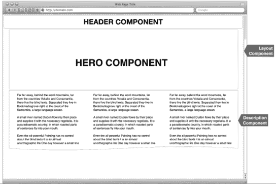

**图 5.1：组件组合线框图**

根据这个线框图，我们可能会考虑按照以下代码所示的方式构建界面：

```html
<template>
  <layout-component>
    <header-component :title="title" />
    <hero-component
      :image="image"
      :call-to-action-text="ctaText"
    />
    <description-component>
      <p>This is some description text</p>
    </description-component>
  </layout-component>
</template>

<script>
import LayoutComponent from '@/components/layout/LayoutComponent.vue'
import {HeaderComponent, HeroComponent} from '@/components/layout/GeneralComponents.vue'
import DescriptionComponent from '@/components/text/DescriptionComponent.vue'

export default {
  components: {
    HeaderComponent,
    HeroComponent,
    LayoutComponent,
    DescriptionComponent
  },
  data() {
    return {
      title: 'Some title',
      image: 'image.png',
      ctaText: 'Some action text'
    }
  }
}
</script>
```

如你所见，组件定义了属性并拥有子元素，就像普通的 HTML 一样。这正是 `Vue` 中的模板变得如此灵活且强大的原因；它只是你已经熟悉的内容的扩展。

### 理解数据流

你构建的大多数组件都需要提供数据才能有效地渲染。虽然显然有例外，但通常情况下，一个只渲染静态 HTML 的组件用处不大。

这意味着几乎所有内容都需要某种数据或状态。虽然每个组件通常维护自己的内部状态，但更常见的做法是父组件将每个子组件所需的状态传递给它们。这种“单向”数据流允许构建一个简单的、响应式的组件系统；如果父组件中的数据发生变化，它将级联传递给所有需要它的子组件，正如上一章所述，这将产生更小的 diff。请看下面的图：

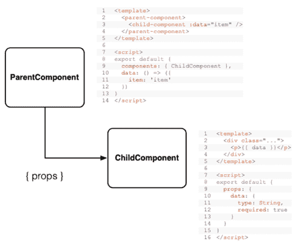

**图 5.2：从父组件到子组件的数据流**

图 5.2 显示了从父到子的简单数据流，但如果需要父组件提供数据的组件嵌套得很深，这可能会变得繁琐且容易出错。在这种情况下，`Vue` 有一种 `provide/inject` 机制，它是 `Composition API` 的一部分。

使用 `Providers` 和 `Injectors` 时，父组件被标记了其允许提供的数据，子组件被标记了其允许接收的数据。

下面的图演示了这一功能：

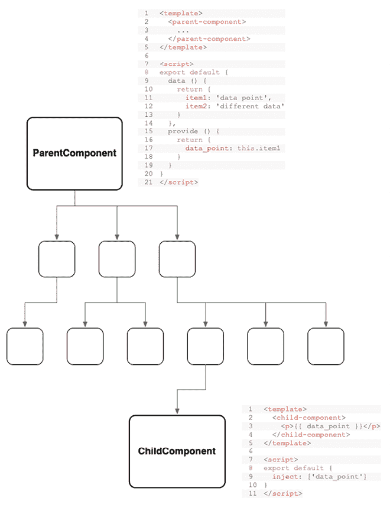

**图 5.3：Provide 和 Inject，父组件定义提供什么，子组件定义它接收什么**

使用 `provide/inject` 有一个小的注意事项。该机制默认不是响应式的，这意味着当父组件中的数据发生变化时，它不会自动更新任何依赖于该变化数据的子组件。

为了让 `provide/inject` 属性具有响应式（如果这是目的的话），则需要将提供的数据放在响应式包装器中，使用 `ref()`、`reactive()`、`computed()` 或类似的方法；参考下面的代码示例：

```html
<template>
  <parent-component>
    ...
  </parent-component>
</template>

<script>
export default {
  data () {
    return {
      item1: 'data_point'
    }
  },
  provide () {
    return {
      data_point: ref(this.item1)
    }
  }
}
</script>
```

单向数据流并不意味着子组件不能影响父组件的状态，但机制是不同的：它涉及向上传递的事件。事件 API 提供了许多标准修饰符，可以用于影响事件的处理方式，这对应于你可能想要做的典型操作：阻止传播、触发一次或阻止默认。还有其他几个修饰符，但这三个是最常用的。其他的事件和键修饰符可以在 [`v3.vuejs.org/guide/events.html#event-modifiers`](https://v3.vuejs.org/guide/events.html#event-modifiers) 找到。

下面的图片显示了组件如何发射和处理事件：

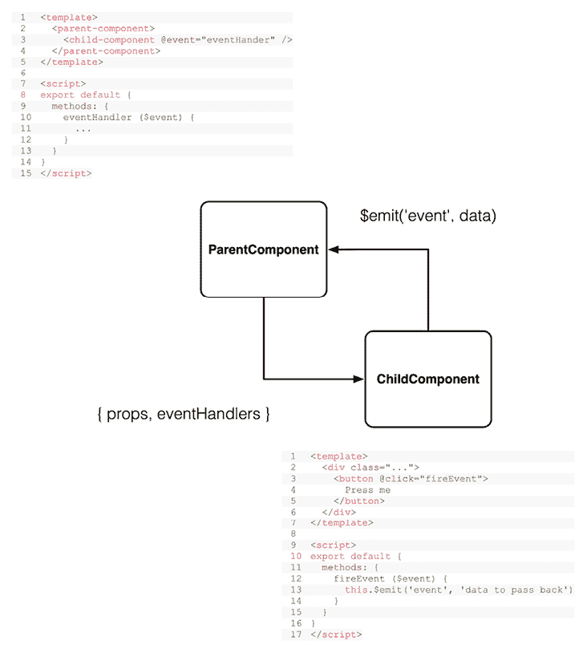

**图 5.4：子组件发射由父组件处理的事件**

我们将在第 11 章“使用事件与 UI 交互”中深入讨论事件。

### 设计组件

组件的定义是灵活的。组件可以根据其设计旨在完成的任务足够小或足够大。通常，一个组件只处理界面中的一个元素或一组相关的交互。

组件的大小由你作为架构师来决定。设计过程的一部分是确保你的组件足够小、灵活、可复用且可测试，并具有良好且易于使用的接口，而不会笨重、过大或功能过载。

### 函数式组件

函数式组件（FCs）之于组件就像 JavaScript 中的箭头函数之于普通函数；它们是精简的、轻量级版本，功能受到限制。

函数式组件与普通组件的区别在于，它们主要不持有或维护自己的状态——它们没有组件实例，并跳过了组件生命周期，类似于箭头函数，没有 `this` 实例或自己的作用域（以及其他点）。

创建一个函数式组件相对简单，你不需要使用配置对象（Options API 或 Composition API），而是使用一个简单的普通函数，该函数接收两个参数：`props` 和 `context`；如下所示。`context` 对象提供了三个会被注入的属性：`attrs`、`emit` 和 `slots`；这些等同于普通组件对应的 `$attrs`、`$emit` 和 `$slots`。

```javascript
// simple type
// render function body
const functionalComponent = (props, ctx) => {
}

// using destructing
const functionalComponent = (props, {attrs, emit, slots}) => {
  // render function body
}
```

在这种情况下，你正在创建一个只包含一个 `render()` 函数的组件。

如果你想定义 `FC` 接收的 `props` 或 `FC` 触发的事件，可以通过如下方式将它们作为属性来实现：

```javascript
// simple type
const functionalComponent = (props, {emits}) => {
  // render function body
}

functionalComponent.props = {
  prop1: String,
  prop2: {
    type: Boolean,
    default: false
  }
}

functionalComponent.emits = ['customEvent']
```

如果你没有定义 `props`，那么你的 `FC` 将接收到相同的 `props` 和 `attrs` 对象，但这些对象不会经过验证，且属性名称也不会转换为驼峰命名（就像在普通组件中预期的那样）。

`FCs` 可以在任何可以使用普通组件的地方使用，但要求所有数据和事件都从持有它的父组件传递：

```html
<template>
  <functional-component prop1="String" :prop2="false" />
</template>

<script>
import FunctionalComponent from '@//components/functional/FunctionalComponent.js'

export default {
  name: 'StandardComponent',
  components: { FunctionalComponent }
}
</script>
```


掌握了这些信息后，我们准备好开始研究一个设计，并思考如何使用组件将其拆解，然后确定组合这些组件的最佳方式，以构建一个功能性的 Web 应用程序。让我们接下来开始吧。

## 作为组件集的示例应用程序

为了设计一个 Web 应用程序，我们需要一个项目——你工作的网络代理公司接到了一快速增长的披萨外公司 Speedy Pizza 的请求，要求他们为新的销售门户制作原型，因为他们目前的门户已经老旧且运行缓慢。他们想要更好的东西，并为代理公司提供了一个待构建的设计方案。

这是一个纯虚构的名字，与任何名称此名的公司（无论真实与）的关联纯属巧合。

正如你从图中看到的，这是一个相当的设计，包含几个页面。

### 落地页

这是一个简单的落地页，带有顶部菜单、主视觉区域（hero section）、一些“热门优惠”以及进入菜单和账户部分的入口。

#### 设计

该页面有四个主要部分：顶部菜单和页脚，这两者实际上都应该是网站布局的一部分（我们稍后会将它们提取出来）；主视觉区域；以及优惠部分，它包含多个优惠。

如下图所示：

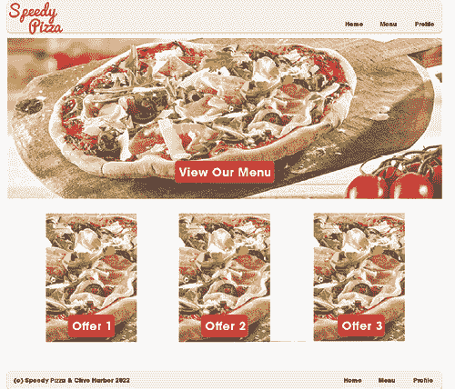

图 5.5：客户为示例网站设计的原型方案

#### 线框（Wireframe）

从组件的角度来看，这个线框可以被拆分为一小组简单的组件，如下图所示：

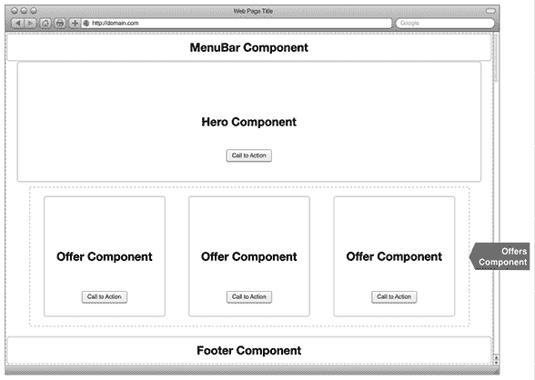

图 5.6：显示如何将设计拆分为线框

这里的层次结构相当扁平：唯一的父子关系是`OfferComponent`和`OffersComponent`，即使这也不复杂。

#### 建议的组件

由于为组件使用语义化命名是合理的，我们将组件名称与之前已经使用的术语匹配。因此，落地页需要以下内容：

* `MenuBarComponent`：包含顶部菜单元素和子组件。
* `HeroComponent`：处理主视觉组件。
* `OffersComponent`：展示 Speedy Pizza 想在落地页向访问者强调的优惠/活动。由于`OffersComponent`是所有`OfferComponents`的父组件，它将持有显示所有优惠所需的数据，并仅向每个子组件传递所需的数据。
* `OfferComponent`：包含单个优惠详情的组件，包括一个行动号召按钮（call-to-action button）。
* `FooterComponent`：持有适用于页脚的信息。

### 列表/菜单页

这是我们将处理的内部页面；它是所有可用披萨类型的简单列表。起初，你将与静态列表一起，但在本书后面我们讨论从服务器获取数据时，我们会考虑将其切换。

处理此页面将使我们有机会提取在布局方面跨站保持一致的页面部分。此时，引入路由器也是一个好主意。

#### 设计

此页面将简单地列出所有可用项目。该设计中的某些功能部分将留到稍后处理。这样做是为了让它们能与构成购物车的数据结构集成。

#### 线框

如前所述，该页面实际上是一个列表；下所示线框突出了这一点：

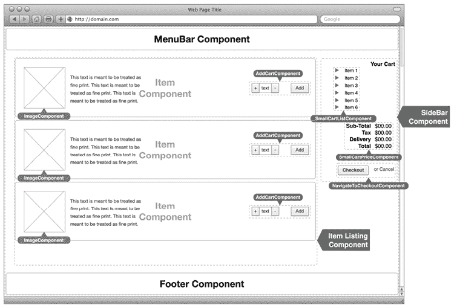

图 5.7：列表页线框

#### 建议的组件

页面的主体由单个组件`ItemListingComponent`组成，它持有所有的`ItemComponents`，因此我们还将构建布局文件和组件。可以说，这可以在第一个页面完成，但在这里做更合理。此外，我们将添加一些基础路由。

* `MainLayoutComponent`：该组件将持有我们已经构建的用于处理布局的`HeaderComponent`和`FooterComponents`。布局文件还将持有`SideBarComponent`。
* `SideBarComponent`：持有订单和其他辅助信息。
* `SmallListComponent`：购物车中所有项目的高级列表，并具有增加/减少/删除项目的功能。
* `SmallCartPriceComponent`：由于购物车将持有价格信息，告知用户需要多少钱是合理的，但这可以只是一个函数式组件。
* `NavigateCheckoutComponent`：该组件处理两个操作：第一个是完全清除购物车（取消链接），另一个是导航到购物车、识别用户是否登录并路由到相关的结算入口点。
* `ItemListingComponent`：它是`ItemComponents`的父组件，因此将持有显示项目所需的所有数据。
* `ItemComponent`：每个独立的列表组件，每个组件将成为`ImageComponent`和`AddCartComponent`的父组件。
* `ImageComponent`：持有图片的函数式组件。
* `AddCartComponent`：用于管理对购物车的更改。

## 商品详情页

这将是单品详情页，与其它电子商务网站的类似页面保持一致。它将包含所选披萨的图片、一些详情和定价信息，以及加入购物车的选项。客户还希望包含一组推荐和可用优惠。

### 设计

我们在这里将几个组件组合在一起，用于实际选定的商品，其中一些将是功能性组件：专门用于图像和标签页主体元素。我们还将复用定价和订单组件。

### 线框图

这里的线框图重用了许多已经构建的组件；其中一些来自布局，另一些来自其他页面。这就是使用组件构建 UI 的强大和吸引之处；我们现在拥有一套可重用的工具包，可以以新颖且的方式将其整合。参见下图：

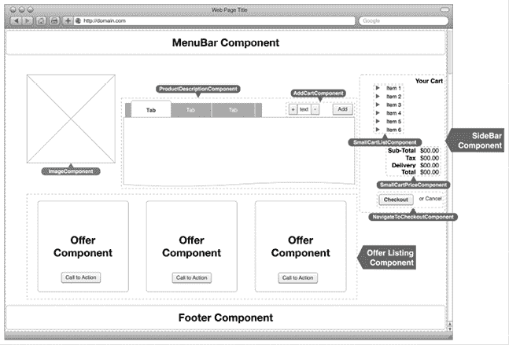

图 5.8：单品线框图

这里有一些新组件，但与我们构建的其他组件相比，它们非常简单。

### 建议组件

除了已经讨论过的组件外，此页面还需要`ProductDescriptionComponent`，这是一个由标签栏和多个标签内容组成的组件。我们将将其构建为一组小型功能性组件，由父组件负责跟踪应该显示哪个标签页。

## 结算页面

这将是一个标准的结算页，列出当前购物车中的所有物品。还有一个弹窗用于收集送货信息，以及用户是应用程序的访客，还是想从其账户将订单交付到替代地址。

### 设计

该设计旨在清晰地显示放入购物车的物品，包括任何请求的特殊订单/更改、每个项目的当前价格以及订单的总额。用户还具有添加额外信息以及编辑数量或删除物品的能力。这些都是预期的接受功能。

### 线框图

此页面上的组件大部分是新的。有几个是复用的，即`ImageComponent`和`SmallCartPriceComponent`，还有几个与我们已经构建的其他组件非常相似，但由于它们需要封装不同的功能，因此使用独立的组件来处理这些功能更有意义。

下图没有标记我们已经讨论过的布局元素：

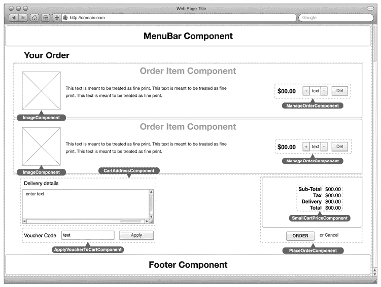

图 5.9：结算页线框图

当点击`PlaceOrderComponent`中的订单按钮时，响应将是两种情况之一：

1. 用户是新用户或尚未登录，因此我们显示一个弹窗让他们登录、创建账户，或者提供他们作为访客用户下单的选择。一旦收集了这些信息，用户就可以进入支付环节。弹窗线框图所示：

   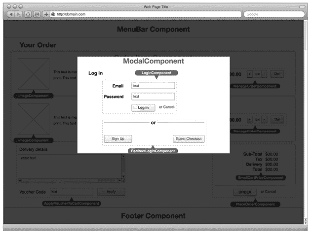

   图 5.10：带有登录弹窗的结算

2. 用户已登录账户，因此默认送货数据已可用，用户可以直接进入支付环节，我们选择使用 Stripe。请参考 图 5.11：

   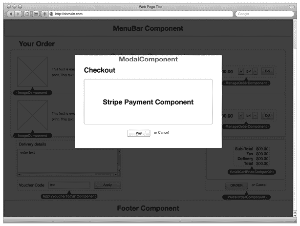

   图 5.11：Stripe 支付弹窗线框图

### 建议组件

以下是上述设计所需的组件列表：

* `OrderItemListComponent`: 这是`OrderItemComponents`的父组件。
* `OrderItemComponent`: 这些子组件是`ImageComponent`、`ManageOrderComponent`以及订单中每行包含的相关文本数据的混合。
* `ManageOrderComponent`: 这与`AddCartComponent`类似，但允许删除物品并显示行价格。
* `PlaceOrderComponent`: 根据用户的登录状态，它要么完全清空购物车，要么将用户引导到下一步。参见接下来的两幅图。
* `CartAddressComponent`: 此组件将在可用时持有送货地址详情，如果不可则允许编辑。
* `ApplyVoucherToCartComponent`: 此组件接收与可能的优惠码相关的数据。它用于动态检查代码是否有效（包括格式和内容），然后将其应用于购物车并相应更新显示。
* `ModalComponent`: 这是一个标准的弹窗组件，通过插接受多个内部内容。
* `LoginComponent`: 收集并管理用户登录数据或收集访客结算数据。
* `StripePaymentComponent`: 用于处理 Stripe 支付网关的封装组件。

## 登录与注册页面

这些是标准的登录和注册页面。这里没有任何争议。

### 设计

线框图展示了这些页面有多简单。由于基于组件的特性，构成表单的元素被提取到单独的组件中，以便在其他地方复用。

### 线框图

如前所述，这些页面由极少数组件构建而成。参见 图 5.12：


图 5.12：登录页线框图

从结构上说，登录和创建账户页面是相似的。除了`MainLayoutComponent`， de 有一个包装组件以及所需的功能。

下图显示了创建账户的线框图，其呈现方式同样极简主义：

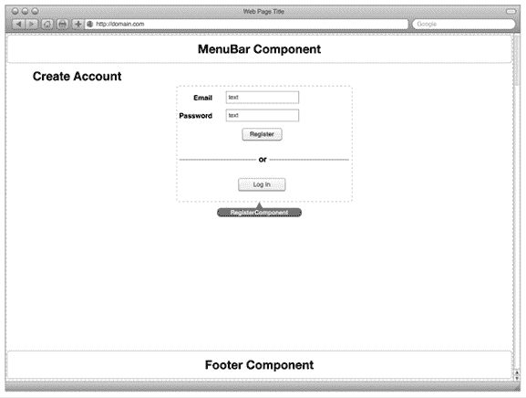

图 5.13：创建账户线框图

### 建议组件

以下是上述设计所需的组件列表：

* `UserWrapperComponent`: 这是一个简单的包装组件，接受信息和组件引用，以便为两个页面创建相同的布局。
* `LoginComponent`: 登录组件之前已讨论过并在此处复用。
* `RegisterComponent`: 这与`LoginComponent`类似，但形成向服务器的消息以便使用户注册账户。

## 订单页面

此页面是用户下单的所有订单的简单摘要，并可以选择重新订购完全相同的选择。

### 设计

这将是一个简单的网格，如 图 5.14 中的线框图所示，显示账户中之前的订单；这是一个简单的便利设计功能，直接将数据带到用户的结算页。

### 线框图

线框是一个卡片列表，保存了描述之前订单的数据。

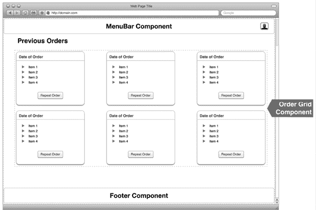

图 5.14：之前的订单摘要页线框图

### 建议组件

以下是上述设计所需的组件列表：

* `OrderGridComponent`: 这仅仅是一个提供相关数据的父组件；你现在应该熟悉这种模式了。
* `OrderCardComponent`: 这些是每个数据库条目的个别显示组件。卡片中的按钮用于告诉应用程序根据数据构建新购物车并引导用户直接进入结算。

## 结语

这是一个极具野心的构建示例，但它处理的是真实世界的工作。在构建此 UI 和处理所有事件方面，始终有不同的方法与我们在这里的方法不同；某些方法可能更适合不同的用例，但这是构建此特定示例应用的一种逻辑方式。

## 结论

在本章中，我们学习了`Vue.js`组件的不同部分，并理解了它们在组件内部以及跨组件层级之间是如何相互关联的。

我们还深入研究了如何让组件相互通信（至少在非常基础的水平），以及如何处理用户事件。

最后，我们探索了如何将组件组合在一起形成复杂的组件，并完成了一个示例应用。在该应用中，我们应用这些知识来帮助将设计拆解为各个组成部分，从而提供一个简单的框架，以便在其之上构建所需的视图。

本章主要侧重于使用`Options API`构建组件；下一章将描述如何使用`Composition API`。这两个 API 都是构建组件的有效形式，需要结合探索。

## 记忆点

- `Options API`组件由三个部分组成：Script（脚本）、Template（模板）和 Style（样式）。这些部分都是可选的。
- 如果需要对组件模板的渲染进行严格控制，可以使用渲染函数（render function）。这是通过封装`h()`函数实现的。
- `h()`函数是所有`Vue.js`模板渲染的基础；这里没有魔法。
- 当不需要管理内部状态的组件时，可以并且应该使用函数组件（Functional components）。
- 组件可以由其他组件组成，虽然很少见，也可以是递归的。
- 将设计拆分为组件不需要复杂。组件应该管理单一关注点，或者作为多个关注点的脚手架，但绝不要两者兼顾。
- 只有事件可以处理用户输入或操作。事件可以是 HTML DOM 事件，如`onClick`或`onChange`。事件也可以是自定义；这些类型的事件用于在父组件之间传递数据。
- 深层组件结构应该使用`provide/inject`机制来帮助组件父级向子组件提供数据。

### 核心术语

- Template section（模板部分）
- Script section（脚本部分）
- Style section（样式部分）
- Props（属性）
- Render function（渲染函数）
- Functional component（函数组件）
- Events（事件）

## 加入我们书籍的 Discord 空间

加入书籍的 Discord 工作空间以获取最新更新、优惠、全球科技动态、新发布以及与作者的座谈会议：

[`discord.bpbonline.com`](https://discord.bpbonline.com)


# 第 6 章 使用 Composition API 管理组件逻辑

## 引言

在本章中，我们将探索`Composition API`；如果你回想起第 4 章“理解`Vue.js`实例”，在其中我们详细探讨了`Options API`，我们提到过会回到这个话题。如果你是来自 React 领域，这个想法就类似于在`Hooks API`中探索的理念。

## 结构

在本章中，我们将涵盖以下主题：

- `Composition API`
- 该 API 解决的问题
- `Composition API`生命周期与响应式属性
- 创建可组合的工具类（Composable utilities）
- 处理依赖注入 - Provide 和 Inject
- 使用`Teleport`和`Suspense`
- `VueUse`工具库

## 目标

在学习本章之后，你将理解如何使用`Vue.js Composition API`以及它如何与`Options API`有所不同。你还将理解如何构建可组合的工具类，如何使用`Suspense`管理用户预期，以及如何使用`Teleport`操作 HTML DOM。最后，我们将查看如何从`VueUse`库导入工具类，以使你的代码更加灵活且可维护性。

## Composition API

`Composition API`允许通过导入的函数来构建组件，而不是创建一个供`Vue`实例接收的选项对象。`Vue.js`的文档指出这是一个术语，涵盖了三个 API：

- 响应式 API (Reactivity API)
- 生命周期钩子 (Life cycle Hooks)
- 依赖注入 (Dependency Injection)

这些 API 中的每一个将在本章后面详细介绍。

如果你正在运行使用`Vue2`的旧项目，你仍然可以从`Composition API`中获益，但你需要使用`@vue/composition-api`插件，否则它已经是内置的了。

## Composition API 解决的问题

尽管`Options API`非常灵活，但在跨应用程序复用逻辑方面它存在一些缺点，主要是混入（mixins）的问题。如果你还记得，我们在第 4 章“理解`Vue.js`实例”中介绍过混入。

使用`Composition API`的应用程序不再使用混入，而且当组件的尺寸或复杂度达到一定程度时，它不再受到`Options API`的限制，因此代码的组织变得更加灵活。这意味着更容易管理处理特定关注点的代码；所有代码都组合在一起，而不是分散在基于`Options API`的组件的许多行和不同部分中。所有管理特定关注点的代码都保持在一起这一事实，意味着它可以（并且应该）被提取成一个可复用的工具类；这在`Options API`组件中很难实现；这使我们又回到了混入的问题。

虽然这不影响在 JavaScript 中构建的组件，但随着`TypeScript`的日益普及，在`Options API`中使用类型推断可能非常困难。文档使用了极其复杂的类型体操；要让混入和依赖注入与类型正常工作可能极其困难或耗费时间，以至于在实现上变得不实际。由于大多数`Composition API`功能都可以使用纯`JS/TS`值和函数来实现，且这些值对类型是友好的，手动编写类型签名通常变得多余，从而节省了时间和精力。

现在为`Vue.js`开发者提供的灵活性使得你可以构建如下的应用程序：

- 纯使用`Options API`
- 纯使用`Composition API`
- 在适当的情况下混合使用两种 API

对于单个组件或整个应用程序使用哪种方法很大程度上取决于偏好和经验。在本书编写期间，行业倾向于使用`Composition API`构建组件，但这可以被视为为了追求最新变化而不是为了最佳设计；我们的建议是根据组件的需求进行设计，而不是现在的潮流。

## Composition API 生命周期与响应式属性

如果你记得我们对`Options API`生命周期的讨论，我们了如何使用组件定义中的各种可用选项来挂钩组件生命周期：`created()`、`mounted()`、`updated()`等。为了实现这一点，`Composition API`提供了一个`setup()`方法，在其中指定所有的启动钩子和组件操作的状态引用。`Composition API`对生命周期的更改如图 6.1 所示：

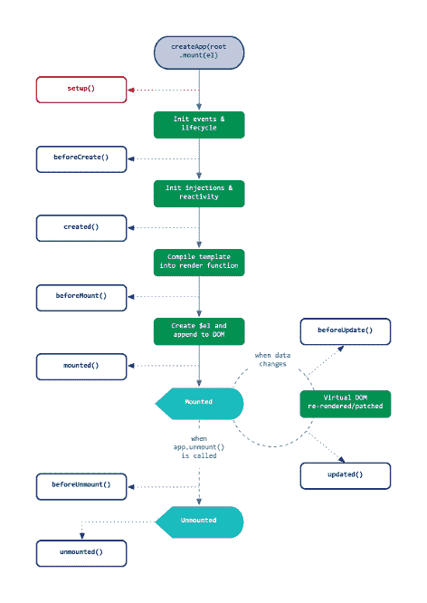

图 6.1：Composition API 生命周期图，包含 setup 钩子

这种变化在代码中的表达式如下：

```


```html
// 作为选项

<script>
import { reactive } from 'vue'

export default {
  setup() {
    const state = reactive({ state: 0 })

    const func = () => {
      console.log('这个函数的输出')
    }

    return {
      state,
      func
    }
  },

  created(() => {
    // 在 created 钩子上执行的代码
  })
}
</script>
```

`setup` 方法的访问取决于组件构建的方式，但在构建 SFC（单文件组件）时，框架为 `script` 标签提供了一个方便的 `setup` 属性。设置组件所需的所有代码都放置在组件定义中的 `<script setup>` 部分；你可以将其视为普通的 `script` 标签，但你也可以选择添加另一个未标记的 `script` 标签来处理第三方库或非基于组合 API 的代码，如下所示：

```html
// 在 <script setup> 块中

<script setup>
import { reactive, onCreated } from 'vue'

const state = reactive({ state: 0 })

const func = () => {
  console.log('this functions output')
}

onCreated(() => {
  // 在 created 钩子上执行的代码
})
</script>

<script>
// 在组合 API 之外执行的代码
</script>
```

对比这些示例，你可能已经注意到当使用 `setup()` 钩子时，你需要返回一个对象，该对象包含或说暴露了驱动组件模板所需的某些或属性和函数。当使用 `<script setup>` 时，这些将为你透明地处理；这是因为将 SFC 转换成底层对象结构时需要额外的构建步骤。

作为 Options API 部分可用的所有生命周期钩子仍然可用，但形式略有不同；它们都必须在 `setup()` 函数或 `<script setup>` 中作为回调函数指定。回调函数本身稍后会列出作为回顾，但它们在很大程度上语义上与下方列表所示的 Options API 生命周期周期钩子是相同的：

```javascript
<script setup lang="ts">
import { ref, onCreated, onMounted, onUpdated } from 'vue'

const state = ref(0)

onCreated(() => {
  // 在 created 钩子上执行的代码
})

onMounted(() => {
  // 在 mounted 钩子上执行的代码
})

onUpdated(() => {
  // 在 updated 钩子上执行的代码
})
</script>
```

此外，由于 `setup()` 步骤在 `beforeCreate()` 钩子之前同步运行，无法无法 `this` 变量。为了让组件状态（组件内部数据）对模板编译器可用，组合 API（通过暴露的响应式 API）提供了两个函数：`reactive()` 和 `ref()`。

### `reactive()`

`reactive()` 函数允许我们为一个对象创建一个 JS 代理，反过来允许 Vue 跟踪被包装对象的内部。`reactive()` 只作用于对象类型，而不作用于原始类型。下面的列表演示了这一点：

```javascript
<script setup>
import { reactive } from 'vue'

const value = reactive({ key: 'value' })

function mutateValue(newValue) {
  value.key = newValue
}
</script>
```

当 `reactive` 状态发生变化时，DOM 会自动更新。与其他 DOM 更新一样，Vue 会缓存更改而不是同步应用它们（即在发生更改的时刻）。缓冲区会在下一个 tick 事件处清除，以确保组件只更新一次，无论缓存了多少次状态更改。

Vue 中的状态是深层响应式的，这意味着即使更改发生在嵌套对象（包括数组）中，变动也会被追踪，如下所示：

```javascript
<script setup>
import { reactive } from 'vue'

const obj = reactive({
  parent: { child: { count: 0 } },
  greekLetterNames: ['alpha', 'beta']
})

function deepMutation() {
  // 这些将按预期工作。
  obj.parent.child.count++
  obj.greekLetterNames.push('gamma')
}
</script>
```

然而，任何尝试将响应式对象赋值或解构到局部变量的操作都会导致与原始声明状态对象中响应性的连接中断。

如果你发现自己需要管理原始类型状态或解决 `reactive()` 的问题，Vue 提供了 `ref()` 函数，我们将在之后讨论。

### `ref()`

`ref()` 也会创建响应式状态，但方式不同。`ref()` 将值包装在一个具有 `value` 属性的对象中。这些是对底层值的响应式引用，如下所示：

```javascript
<script setup>
import { ref } from 'vue'

// 原始类型值包装
const myValue = ref(0)

// 对象值包装
const myObject = ref({ obj: 0 })
</script>
```

数据的包装和解包会自动处理，但仅当所访问的属性是顶层属性时——即在模板内部，如下所示：

```javascript
// 这种工作不符合预期
<script setup lang="ts">
import { ref } from 'vue'

const myObject = { prop1: ref(1) }
</script>

<template>
  <div>{{ myObject.prop1++ }}</div>
</template>
```

```javascript
// 这是正确的
<script setup lang="ts">
import { ref } from 'vue'

const myObject = { prop1: ref(1) }
const { prop1 } = myObject
</script>

<template>
  <div>{{ prop1++ }}</div>
</template>
```

用 `ref()` 包装的对象中的值在解构或传递到函数调用时仍保持响应式，如下所示：

```javascript
<script setup lang="ts">
const myObject = {
  prop1: ref(1),
  prop2: ref(2)
}

// 函数仍然需要通过 .value 访问值
// 因为它是 ref()，但它将保持响应式
</>
```

在模板中解构 `ref()` 时不需要访问 `.value`；它是自动的。见下方的列表：

```javascript
<script setup lang="ts">
import { ref } from 'vue'

const counter = ref(0)

function incrementCounter() {
  counter.value++
}
</script>

<template>
  <button @click="incrementCounter">
    {{ counter }}
  </button>
</template>
```

### 组合 API 生命周期钩子

下面是可用生命周期钩子的简要回顾。

`setup()` 钩子（或 `<script setup>` 块）将是组合 API 时常用的钩子；它将完成原本放在不同生命周期钩子中的所有设置工作：创建状态的引用、函数和事件监听器的引用。

我们已经涵盖了 `reactive` 和 `ref`。

下面是 `setup()` 的一个小示例。我们之前见过它，并在整个应用程序构建中使用它，因此你会有大量的练习：

```javascript
<script setup lang="ts">
import {
  ref,
  onCreated,
  onMounted,
  onUpdated,
  onBeforeCreate,
  onBeforeMount,
  onBeforeUpdate,
  onBeforeUnmount,
  onUnmounted
} from 'vue'

const state = ref(0)

onBeforeCreate(() => {})
onCreated(() => {})
onBeforeMount(() => {})
onMounted(() => {})
onBeforeUpdate(() => {})
onUpdated(() => {})
onBeforeUnmount(() => {})
onUnmounted(() => {})
</script>
```

每个 Options API 生命周期方法都有其组合 API 对应项，如下表所示：

| 组合 API 生命周期回调 | Options API 对应项 |
| --- | --- |
| `onBeforeCreate(callback: () => void): void` | `beforeCreate` |
| `onCreated(callback: () => void): void` | `created` |
| `onBeforeMount(callback: () => void): void` | `beforeMount` |
| `onMounted(callback: () => void): void` | `mounted` |
| `onBeforeUpdate(callback: () => void): void` | `beforeUpdate` |
| `onUpdated(callback: () => void): void` | `updated` |
| `onBeforeUnmount(callback: () => void): void` | `beforeUnmount` |
| `onUnmounted(callback: () => void): void` | `unmounted` |

### 表 6.1：Composition API 与 Options API 生命周期方法的对比

由于我们已经了解了如何使用 Options API 的生命周期方法，因此 Composition API 的回调函数实际上并没有太大区别。

## Composition API 组件之间的数据流

到目前为止，我们还没有探索过如何在使用 Composition API 构建的组件之间传递数据。在大多数情况下，我们为 Options API 讨论的内容仍然适用，但由于我们绝大多数情况下使用的不是 options 对象，而是 `<script setup>`，因此在组件之间设置数据流元素的方式会略有不同。

我们将首先查看如何设置（声明）props，因为它们需要显式声明。

### Props

在 `<script setup>` 中声明 props 时，会使用 `defineProps()` 宏。传递给宏的值与你提供的 props 选项是相同的。

```typescript
// 简单的 props 设置
<script setup lang="ts">
defineProps(['prop1', 'prop2'])
</script>
```

```typescript
// 带有校验的 props 设置
<script setup lang="ts">
defineProps({
  // 基本类型检查
  prop1: Number,

  // 多个可能的类型
  prop2: [String, Number],

  // 必要的字符串
  prop3: {
    type: String,
    required: true
  },

  // 带有默认值的数字
  prop4: {
    type: Number,
    default: 100
  },

  // 带有默认值的对象
  prop5: {
    type: Object,

    // 对象/数组默认值需要从工厂函数返回
    default() {
      return { message: 'hello' }
    }
  },

  // 基于类的自定义类型
  prop6: {
    type: CustomClassType
  }
})
</script>
```

使用 `defineProps()` props 的规则与在 Options API props 选项中声明的规则相同。

使用 TS 时，我们也可以根据 TS 类型来定义 props；其语法略有不同，如下例使用 `defineProps<{}>()` 所示：

```typescript
<script setup lang="ts">
defineProps<{
  // 验证为数字
  prop1: number,

  // 验证为字符串
  prop2?: string
}>()
</script>
```

使用 TS 时，`defineProps()` 可以接收对象字面量（如之前所示），也可以接收在同一文件中提供的接口或对象字面量的引用：

```typescript
<script setup lang="ts">
interface Props {
  // 验证为数字
  prop1: number,

  // 验证为字符串
  prop2?: string
}

defineProps<Props>()
</script>
```

遗憾的是，由于组件编译的方式，这并不意味着你可以从其他文件导入接口或对象字面量——编译器目前不会检查导入文件的源类型，且组件本身是孤立编译的。

在使用 TS 仅限类型的 `defineProps` 时，有一个限制，即你失去了在创建 props 时提供默认值的能力。Vue 提供了一个 `withDefaults` 宏来帮助解决这个问题；其使用方法详见以下示例：

```typescript
<script setup lang="ts">
interface Props {
  prop1: number
  prop2?: string
}

const props = withDefaults(defineProps<{ Props }>(), {
  prop1: 0,
  prop2: 'A string'
})
</script>
```

将数据传递给模板的方法保持不变。Props 会自动供模板渲染器。

### Data

它不是组件间数据流的直接组成，但重要的是，虽然 Composition API 组件可以像 Options API 通过 `data()` 函数一样使用该选项，但最好通过 `<script setup>` 和 `reactive()`/`ref()` 函数来使用状态。

### Events

向 HTML 中添加事件的方法是相同的，无论是 Options API 还是 Composition API；毕竟这都是模板。在 Composition API 中定义事件处理器使用 `defineEmits()` 宏。`defineEmits()` 可以接收字符串列表或对象。

```typescript
// 作为函数定义事件处理器
<script setup lang="ts">
defineEmits(['event_1', 'event_2'])

function event_1(evt) { ... }

function event_2(evt) { ... }
</script>
```

```typescript
// 作为对象定义事件处理器
<script setup lang="ts">
defineEmits({
  event_1(evt) { ... },
  event_2(evt) { ... }
})
</script>
```

```typescript
// 基于类型定义事件处理器
<script setup lang="ts">
defineEmits<{
  (e: 'event_1', value: number): void
  (e: 'event_2', value: string): void
}>()
</script>
```

虽然可以直接创建事件处理器，但它们终究是普通函数，最好的做法是通过 `defineEmits()` 定义它们，以防止属性透传（attribute fall through）问题。

### Computed properties

计算属性使用 `computed()` 函数创建，该函数接收一个执行计算的回调函数。通常计算属性是只读的，但你需要创建 getter 和 setter 来使计算属性可变：

```typescript
// 计算一个简单的值
<script setup lang="ts">
import { computed, ref } from 'vue'

const price = ref(29.99)

const asPrice = computed(() => {
  return `£ ${price.value.toFixed(2)}`
})
</script>
```


# Vue 3 组合式 API 高级特性

## 计算属性 (Computed Properties)

### 让计算属性可写

在 `<script setup>` 中，你可以通过传递一个包含 `get` 和 `set` 函数的对象来创建一个可写的计算属性：

```typescript
<script setup lang="ts">
import { computed, ref } from 'vue'

const price = ref(0)

const asPrice = computed({
  get() {
    return `£ ${price.value.toFixed(2)}`
  },
  set(newPrice) {
    price.value = newPrice
  }
})
</script>
```

在 TypeScript 中工作时，计算属性的返回类型会被自动推断。如果你需要显式指定返回类型，可以通过泛型参数来实现。在下面的示例中，返回值被明确标记为字符串类型：

```typescript
// 设置返回类型
<script setup lang="ts">
import { computed, ref } from 'vue'

const price = ref(29.99)

const asPrice = computed<string>(() => {
  return `£ ${price.value.toFixed(2)}`
})
</script>
```

## 监听器 (Watchers)

在 Composition API 中使用监听器（Watchers）与计算属性一样简单。

使用监听器时，你需要定义两个参数以及值变化时发生的操作：第一个参数是你要监听的数据源，第二个参数是回调函数，它接收新值和旧值。

传递给监听器的函数可以执行副作用（如异步请求、操作 DOM 等），如下所示：

```typescript
<script setup lang="ts">
import { ref, watch } from 'vue'

const data: Ref<T> = ref({} as T)
const { watchedValue } = remoteDataFetch

watch(watchedValue, value => {
  data.value = value?.getValue()
})
</script>
```

## 模板引用 (Template Refs)

创建模板元素的引用需要一些思考。

首先，我们在模板中使用特殊的 `ref` 属性来标记要追踪的元素：

```html
<template>
  <div ref="templateRef">Div Content</div>
</template>
```

下一个部分是在 `<script setup>` 中创建引用以便访问模板元素。为了实现这一点，我们使用 Vue 的 `ref()` 函数，并赋予它与模板中元素 `ref` 相同的名称。这只能在组件已挂载后的生命周期钩子（如 `onMounted`）中进行，否则它将返回 `null`：

```typescript
<script setup lang="ts">
import { ref, onMounted } from 'vue'

// 这与模板中定义的名称相同
const templateRef = ref(null)

onMounted(() => {
  templateRef.value.innerHTML = '<p>New content</p>'
})
</script>
```

## 透传属性 (Fall-through Attributes)

透传属性（Fall-through attributes）是指传递给子组件但未被显式声明为 `prop` 或 `emit` 的属性；常见的包括 `class`、`style`、`id` 属性以及事件监听器。这些属性会被自动传递到子组件的根 DOM 元素上。

当 `class` 和 `style` 属性透传时，它们会在输出 DOM 中自动合并：

```html
<!-- SubmitComponent 模板 -->
<input type="submit" class="btn-lg">Save</input>

<!-- 在父组件中使用组件 -->
<SubmitComponent class="bg-blue-400 text-white" />

<!-- 渲染后的输出 DOM -->
<input type="submit" class="btn-lg bg-blue-400 text-white">Save</input>
```

在将透传属性绑定到具有多个根节点的模板时，有一些注意事项，主要的点是它们需要使用 `v-bind` 进行显式绑定。

通过以下方式使用 `useAttrs()` 函数可以方便在 JavaScript 中访问组件属性：

```javascript
<script setup>
import { useAttrs } from 'vue'

const attrs = useAttrs()
</script>
```

## 创建组合式函数工具 (Composable Utilities)

使用 `setup()` 最大的问题是它包含了几乎控制组件功能的所有代码，因此当需要管理多种类型状态的组件时，这个函数可能会变得非常大。

转向组合式 API 的核心意义在于将管理特定关注点的所有功能放在一个地方，并在整个应用程序中复用。如果所有代码都放在 `setup()` 函数中，就无法实现这一点。

由于组合式 API 的特性（它使用标准的 JavaScript 纯函数），因此通过将这些功能抽象为“工具函数”来组合组件功能成为可能。按照惯例，这些工具函数的名称带有 `use` 前缀，例如 `useRef()`、`useCallback()` 等。

提取此类代码允许我们创建所谓的“组合式函数（Composables）”——一组与特定关注点相关的功能集合，它们可以被导入到组件中，并像是组件的一部分一样被使用。

以下代码示例演示了如何将一些简单的功能提取到组合式函数中并导入备使用。

假设我们正在构建一个需要获取自身数据的组件；为此，我们将使用 `Fetch API`。在简单简单的示例中，我们有如下组件：

```typescript
<script setup lang="ts">
import { ref } from 'vue'

const resp = ref(null)
const err = ref(null)

fetch('http://www.example.com')
  .then(res => res.json())
  .then(json => { data.value = json })
  .catch(e => { err.value = e })
</script>

<template>
  <div v-if="error">{{ err.message }} Encountered</div>
  <div v-else-if="data">
    Response received: <pre>{{ resp }}</pre>
  </div>
  <div v-else>Awaiting Response</div>
</template>
```

这种样板代码并不是我们希望写在每个需要获取自身数据的组件中的；我们想要一种可以调用的东西，我们提供一些数据，然后它执行操作；核心点在于我们正在创建一个可以在代码库中复用的东西，甚至更好，可以在项目之间复用的东西。

处理这种情况的方法是将功能部分提取到 `use*` 函数中；在这种情况下，将其命名为 `useFetch()` 是合理的。我们创建一个包含导出的命名函数的文件：

```javascript
// useFetch.js
import { ref } from 'vue'

export function useFetch(url) {
  const resp = ref(null)
  const err = ref(null)

  fetch(url)
    .then(res => res.json())
    .then(json => { data.value = json })
    .catch(e => { err.value = e })

  return { resp, err }
}
```

此更改意味着我们可以将组件中的代码减少到如下：

```typescript
<script setup lang="ts">
import { useFetch } from './useFetch.js'

const { resp, err } = useFetch('http://www.example.com')
</script>
```

这是一个简单的示例，可以扩展；显然，这个特定的组合式函数示例仅在 `setup` 时获取，并且没有监听 URL 以便再次请求。

组合式函数不仅有助于提取和复用功能，对于组织代码也有用。组合式 API 组件提供的可能性意味着所有功能都可以提取为更小的函数或组合式函数。组合式函数根据逻辑关注点形成，并根据需要导入，以提高可读性、导航性和理解代码的能力。

由于共享和复用专用功能的概念在行业内无处不在（既然可以借用已经做成的，为什么要重复造轮子呢），一个不断增长的工具库 `VueUse` 作为一个中央仓库或分发枢纽，处理社区遇到的不同关注点。我们接下来来看。

## VueUse – 组合式 API 工具库

VueUse 文档可以在 [`github.com/vueuse/vueuse`](https://github.com/vueuse/vueuse) 找到。

将 VueUse 引入项目与任何其他 NPM 包一样：

```bash
npm i @vueuse/core
```

添加后，任何工具都可以通过 `setup()` 的常规通道导入。考虑此示例：

```typescript
<script setup lang="ts">
import { useStorage } from '@vueuse/core'

const state = useStorage('storageKey', {})
</script>
```

建议你仔细查看 VueUse 提供的 200 多个工具；那里某个工具可以让你任何项目变得更简单。

## 处理依赖注入 - Provide 和 Inject

我们已经在[第 5 章]设计组件的 UI 和单页应用中见过如何在 Options API 设置中使用 `Provide` 和 `Inject`，尽管它是框架组合式 API 的补充。

“属性钻取（props drilling）”问题——即必须跨组件层级传递属性，以便深层子组件能够访问根组件的数据——是非常脆弱的。这意味着我们必须在整个层级中维护传递的数据，即使中间组件对其没有用，这本质上扩大了所有中间组件的作用范围，让它们感知不需要的数据。

使用组合式 API `provide/inject` 比 Options API 更简单；你在 `setup()` 函数中使用 `provide()` 和 `inject()` 函数。

我们将通过一个简单的示例来说明——首先，让我们设置一个提供某些数据的根父组件：

```typescript
<script setup lang="ts">
import { provide, ref } from 'vue'

// 从父根提供一些 ref 数据
const value = ref('value')
provide('key', value)
</script>
```

这是设置一个可以被任何子组件通过 `key` 值提取的值，无论嵌套多深。

深层子组件，例如根父组件的孙孙，需要该父提供的数据；这需要 `inject()`：

```typescript
<script setup lang="ts">
import { inject } from 'vue'

// 注入父根的 ref 数据
const value = inject('key', 'default value')
</script>
```

`inject()` 函数中的可选默认值可以是任何类型，包括针对开销操作的工厂函数（在不需要该操作时）。

如果你发现需要修改一个提供的值，最佳做法是从父根组件提供一个变异函数。这样，数据和变异操作就被保留在一起，改进了维护体验，并消除了在各个组件代码库中创建重复代码的需求。Vue.js 文档中提供了很好的示例，你可以在那里找到：[`vuejs.org/guide/components/provide-inject.html`](https://vuejs.org/guide/components/provide-inject.html)。

我们到为止还没有讨论的是，`provide` 键可以是字符串，也可以是 `Symbol`。当你的项目依赖大量的提供者，或者你正在向其他开发者提供组件时，使用 `Symbols` 作为 `provide` 键是有意义的；因为你需要确保键不会冲突。

实现此点的最佳方法是创建一个专门的文件，导出所有的 `Symbol` 键，并在需要的地方导入。由于 `Symbols` 在整个项目中是唯一值，因此可以避免冲突。

拥有专门的文件还允许组件的维护者轻松查看项目中哪些键可用，而无需感知所有需要这些键的组件。

使用专门的 `Symbols` 文件用于提供者（providers）和注入器（injectors）的方法如例所示：

```ts
// keys.ts
export const mySymbolKey1 = Symbol()
export const mySymbolKey2 = Symbol()
```

所需的键会被导入到提供者组件以设置数据，并导入注入器组件进行文件检索，如下所示：

```vue
// provider component
<script setup lang="ts">
import { provide, ref } from 'vue'
import { mySymbolKey1, mySymbolKey2 } from './keys.ts'

provide(mySymbolKey1, 'value')
provide(mySymbolKey2, ref({}))
</script>

// first injector component
<script setup lang="ts">
import { inject } from 'vue'
import { mySymbolKey1 } from './keys.ts'

const providedValue = inject(mySymbolKey1)
</script>

// second injector component
<script setup lang="ts">
import { inject } from 'vue'
import { mySymbolKey2 } from './keys.ts'

const providedValue = inject(mySymbolKey2)
</script>
```

与所有事情一样，请谨慎使用这种技术。过度依赖提供者可能被视为一种反模式，特别是当你的组件树非常浅时。

## 使用 Teleport 和 Suspense

在任何项目中，你都会发现从逻辑上讲，层次结构中的某个组件应该处理某些关注点/数据/显示。然而，该组件深度嵌套在 HTML 树中，但该组件的 HTML 输出需要附加到 HTML 的其他部分才能正确显示。

这就是 `Teleport` 发挥作用的地方。简单来说，`Teleport` 允许我们将组件模板的一部分挂载到组件 DOM 树之外的 DOM 上。

`Suspense` 处理的是另一个问题，但仍然涉及 HTML DOM 树的操作。通过 `Suspense`，你可以在 HTML 层级中协调多个异步依赖，而无需让这些组件每个处理自己的加载/错误状态。通过 `Suspense`，你可以避免页面上出现多个加载动画，并在内容到达的不同间隔将其交付给用户。`Suspense` 允许从顶层组件进行管理；这个内置组件将在本章节中进一步讨论。

### Teleport

`Teleport` 是一个内置组件，用于封装组件 HTML 树中任何需要挂载到页面 DOM 其他地方的部分。

这个描述似乎有点模糊，所以一个示例可能会有所帮助。

首先，我们将在父组件设置组件标签：

```html
<div class="...">
  <div><!-- component inner content --></div>
  <div>
    <FullScreenModal />
  </div>
</div>
```

从这里开始，内部结构如下：

```html
<template>
  <div v-if="isOpen" class="...">
    <div><!-- modal content area --></div>
    <div><button @click="toggleModal">Close</button></div>
  </div>
  <button @click="toggleModal">Open</button>
</template>

<script setup lang="ts">
import { ref } from 'vue'

// ... 针对 isOpen 和 toggleModal 的逻辑
</script>
```

每个命名的状态（即 `pending`、`resolve` 和 `fallback`）都可以用于显示加载指示（旋转器、进度条等）或其他增强用户体验的反馈。

使用 `Suspense` 组件与使用任何其他组件没有区别：

```html
<template>
  <Suspense>
    <!-- 这是默认插槽 -->
    <DefaultComponent />

    <!-- fallback 模板插槽 -->
    <template #fallback>
      <FallbackComponent />
    </template>
  </Suspense>
</template>
```


在使用`Suspense`时，你会频繁使用`<Transition>`（我们尚未涵盖这部分），以及`<KeepAlive>`和`<RouterView>`组件。然而，这些组件的嵌套顺序非常重要，否则这些组件将无法正常工作。如果你遵循给定的模式，这些组件将按预期工作：

```html <RouterView v-slot="{ Component }">
  <template v-if="Component">
    <Transition mode="mode">
      <KeepAlive>
        <Suspense>
          <!-- 动态注入 Component -->
          <!-- 这是默认插槽 -->
          <component :is="Component"></component>
          <!-- fallback 模板插槽 -->
          <template #fallback>
            <FallbackComponent />
          </template>
        </Suspense>
      </KeepAlive>
    </Transition>
  </template>
</RouterView>
```

Vue Router 支持组件的懒加载；我们将在第 10 章 **使用 Vue Router 在页面间跳转** 中介绍 Vue Router。

## 结论

在本章中，我们探索了 Composition API。我们看到了它如何以及为什么可以使用它来简化关注点的代码，以及这如何使得这些关注点的代码更具维护性。

我们还涵盖了如何创建有助于复用的可组合功能，即可以在多个项目中复用的较小代码片段，这引出了我们能够使用并贡献于 VueUse 库。

## 核心术语

*   Composition API
*   `<script setup>`
*   响应式 (Reactivity)
*   依赖注入 (Dependency Injection)
*   灵活性 (Flexibility)
*   组合 (Composing)
*   VueUse 库
*   Teleport (传送)
*   Suspense

## 加入我们书籍的 Discord 空间

加入书籍的 Discord 工作区以获取最新更新、优惠、全球科技动态、新发布以及与作者的交流会议：

**[`discord.bpbonline.com`](https://discord.bpbonline.com)**


# 第 7 章 使用 Vue CLI 和 Vite 创建并设置 Vue.js

## 引言

从这一章开始，你将按照第 5 章 **设计基于组件的 UI 和单页应用** 中所讨论的内容，构建原型应用程序。你可能某些人可能不熟悉制作此或任何成功项目所需的某些工具。本章对于任何使用 Vue.js 的项目都是基础性的；事实上，你在这里学到的一些技能将是许多其他项目（基于 JavaScript 的或其他其他语言）的基础。

我们将首先介绍 Node 包管理器`NPM`，对于那些从未接触过版本管理或使用过`Git`的人，我们也涵盖这部分内容。

最后，我们将涵盖如何使用行业中用于 Vue.js 项目的三种可用工具启动项目。

那么，让我们从用于任何 JavaScript 项目的工具开始介绍：`Git`和`NPM`。

## 结构

我们本章将涵盖以下主题：

*   `Git`
*   `NPM`
*   Vue CLI
*   Vue UI
*   Vite

## 目标

本章的目标是让你熟悉在行业中遇到的标准工具。

如果你熟悉`Git`和/或`NPM`，可以安全地跳过本章的这些部分。

熟悉设置 Vue.js 项目非常重要。即使你已经了其中某些方法，经常回顾一下它们也是值得的。

## Git 和 NPM 入门

在本节中，我们将涵盖`Git`和`NPM`基础工具。`Git`是行业中使用的少数无处不在工具之一，无论技术如何，你将在许多项目中使用它。`NPM`是你可能遇到的包管理器之一。其他的还有`Yarn`和`pnpm`。我们将使用`NPM`，因为它是安装`Node`时自带的标准工具，所以它已经是可用的，而不是你需要在`Node`之上额外安装的第三方工具。

### Git 入门

`Git`是最可用且最流行的工具。

`Git`是一套分布式版本控制系统 (DVCS)。

`SHA`是分支历史中某点的引用。每个`SHA`在仓库中都是唯一的，且长度为 32 位。

`Branch`（分支）是`Git`中的基本单元。分支存在于远程或本地，每个分支都是作为基础的分支副本，加上所做的更改。分支可以被创建、检出、提交、推送到和合并。除了分支中包含的代码外，每个分支都保留了所有所做更改的记录；这被称为分支历史，是`Git`工作原理的基础。分支有名称，由你在创建分支时分配。通常，主分支/第一个分支被称为`master`或`main`。根据你公司/团队使用的分支策略，你可能还有诸如`development`、`feature`、`integration`、`release`、`bug`和`hot fix`等名称的二级分支。下面的列表提供了示例：

```bash
### 从当前分支创建分支
git branch <source-branch> <new-branch>
git branch master new-branch

### 切换到新分支
git switch new-branch

### 删除分支 - 合并后
git branch -d new-branch

### 强制删除分支
git branch -D new-branch
```

有很多视觉化工具可以帮助你：GitKraken, SourceTree, TortiseGit, `git-gui`和`gitk`。使用 GUI 似乎是一种更简单的方法，但如果不理解底层在执行什么，你会发现很难修复问题。

### 基础术语

在本节中，我们将涵盖使用`Git`时常用的基础术语，并提供在命令行中使用它们的示例：

```bash
### 列出本地分支
git branch --list
```

```bash
### 列出远程分支
git branch --list --remote
```

有时候需要重命名分支，这可以通过`-m`选项来实现：

```bash
### 重命名本地分支
git branch -m renamed-branch
```

#### 仓库 (Repository)

仓库（`repo`）是存放分支、因此存放项目文件的地方。仓库通常（但并非一定）存储在远程位置；这可以是像 GitHub 或 BitBucket 这样的仓库托管主机，可以是公司网络上的私有托管服务器（本地部署），也可以是你本地机器上的。由于 Git 的分布式特性，使用远程主机是最好的，且远程通常被视为绝对的真理来源（absolute source of truth）。

设置本地仓库相对简单：

```bash
### 初始化仓库
git init
```

```bash
### 如果你想添加当前目录中的现有代码
git add .
git commit
```

设置远程仓库则更为复杂。大多数公司倾向于使用 GitHub 或 BitBucket 这样的远程托管服务来存储代码。

#### 远程 (Origin)

远程通常（但不是必须）被称为`origin`。它只是一个网络地址的别名，方便记忆。origin 是你克隆或拉取代码的地方，也是默认的推送目标。然而，对于任何事物，它都可以重新指向；Git 允许你很方便地做到这一点。你也可以为代码分发设置多个远程端点，但通常你只需要或只会使用名为`origin`的那。

```bash
### 列出远程
git list --remote
```

```bash
### 添加远程
git remote add branch-name
```

```bash
### 修改远程 URL
git remote set-url new-url
```

所有这些命令都会更改你本地 git 配置文件中的设置：

```bash
### 编辑配置文件 / 打开编辑器
git config -e
```

```ini
[core]
repositoryformatversion = 0
filemode = true
bare = false
logallrefupdates = true
ignorecase = true
precomposeunicode = true

[remote "origin"]
url = git@remote-url/branch.git
fetch = +refs/heads/*:refs/remotes/origin/*

[branch "master"]
remote = origin
merge = refs/heads/master

[pull]
rebase = false

[remote "heroku"]
url = https://git.heroku.com/branch.git
fetch = +refs/heads/*:refs/remotes/heroku/*

[branch "new-branch"]
remote = origin
merge = refs/heads/new-branch
```

你可以手动更改这些内容，但请注意，如果你不知道在做什么，可能会导致无法访问远程仓库的访问，这是不建议的。

#### 本地 (Local)

你的本地指的就是本地，即你在本地编辑代码的地方。通常，这是你的本地开发环境，但也可以是远程开发服务，如 Eclipse Che。

#### 克隆 (Clone)

克隆是指对远程仓库和分支创建一个引用，制作该远程分支所有代码的副本，并将其下载到指定的本地（即你的本地）。一旦仓库被克隆，你就可以检出（checkout）或创建一个工作分支。

要克隆，执行以下命令：

```bash
### 克隆远程分支
git clone http://repo.com/path/to/repo branch-name
```

#### 检出/切换 (Checkout/Switch)

当你执行 checkout 时，你主要是在分支之间切换，但 checkout 命令也可以用于创建一个新的本地分支并切换过去。

如果只是切换分支，执行以下操作：

```bash
### 切换到分支（新功能 实验性）
git switch branch-name
```

```bash
### 检出分支
git checkout branch-name
```

要从当前检出的分支创建新分支并切换，执行以下操作：

```bash
### 创建并切换到新分支（新功能 实验性）
git switch -c branch-name
```

或

```bash
git checkout -b branch-name
```

```bash
### 检出上分支
git checkout -
```

`switch`和`checkout`之间的主要区别（除了`switch`是实验性的因此存在可能会改变）在于，`switch`不需要干净的索引（index）和工作树（working tree），但如果切换会导致更改丢失，它将终止。

#### 获取 (Fetch)

当你执行 fetch 时，你是在拉取分支历史的副本而不是分支的更改，这样你就可以判断是否有需要拉取或推送的更改，如下：

```bash
### 从 origin 获取所有历史
git fetch
```

或获取特定分支

```bash
git fetch git://path/to/repo/branch.git
```

#### 拉取 (Pull)

当你从远程拉取代码时，你会获得分支历史的副本（如果还没有最新版本），以及需要在本地应用的所有代码更改的补丁，以便使分支与远程保持同步，如下：

```bash
### 从远程分支拉取更改
git pull origin branch-name
```

当你处于有多人想要向同一分支提交代码的团队中时，你通常需要在推送之前拉取。

#### 提交 (Commit)

提交意味着将你在本地制作的未提交的更改应用到本地分支，见下：

```bash
### 将所有本地更改添加到工作分支历史
git add .
```

```bash
### 提交代码并打开编辑器窗口添加提交信息
git commit
```

```bash
### 仅提交已跟踪的文件并打开编辑器
git commit -a
```

```bash
### 命令行中带消息提交
git commit -m 'Message here'
```

```bash
### 添加、提交并包含消息
git commit -am 'Message here'
```

此命令更新本地分支历史。这是将你的代码更改推送到远程分支进行检查和分发的先驱。

#### 合并 (Merge)

当你执行合并时，你在本地将从一个分支的代码更改应用到另一个分支，合并分支历史：

```bash
### 从命名分支合并代码
git merge prev-branch
```

```bash
### 从之前检出的分支合并代码
git merge -
```

有时，如果同一代码位置存在多个更改，合并可能会导致冲突——分支上的代码冲突需要在继续进行合并（如果合并中有许多文件）或在推送到远程之前进行解决。

#### 推送 (Push)

推送会将远程分支历史与你的本地保持一致，并向远程发送包含本地代码更改的补丁文件；它将你的本地代码合并到同名的远程分支，如下：

```bash
### 将代码推送到远程 - origin
git push origin branch-name
```

远程分支历史可以独立管理，这样就可以进行代码质量检查、远程测试、构建和集成，如果你的公司有这些操作的话。

暂存（Stashing）在你需要从远程拉取代码时最有用，但你意识到可能会产生冲突，需要保护你的更改，以便在拉取/合并后以受控的方式应用。

#### Diff（差异）

Diff 允许你比较分支之间（本地或远程）或分支不同状态之间的代码更改。列表列出了使用 diff 的多种方式：

1. `diff`当前分支相对于`HEAD`做的更改
2. `git diff`
3. `diff`将当前分支与另一个分支进行比较
4. `git diff branch-1 branch-2`

能够查看 diff 可以让你看到代码更改可能在何时或何处引起冲突，或者是否存在破坏性变更（breaking change）需要你将其定位。

在阅读 diff 或任何更改的描述时，`+`符号（通常在绿色行）表示该行的新增内容，`–`符号（通常在红色行）表示该行的删除内容。没有更改的行通常显示为灰色。

#### Patch（补丁）

Patch 将 diff 导出到一个文件中。然后可以根据需要发送该文件。通常不需要创建 patch。推送/拉取和合并是移动代码最有效且易于管理的方式。

#### Rebase（变基）

有时你需要重写分支历史，将多个 commit 合并为一个 commit，或者你需要选择性地操作/重新排列 commit；为此，你需要`rebase`。

Rebase 是一个强大的工具，需要一些练习才能学会正确使用。能力越大，责任越大；由于你正在重写历史，如果不小心，很容易丢失更改。

#### Cherry-pick（挑选）

顾如其名，cherry-picking 意味着你从你需要的分支中选择 commit，并将它们各自的历史合并到当前分支中。这同样是一个不应轻率使用的强大工具。

### NPM 入门

Node Package Manager（Node 包管理器）顾如其名，就是一个包管理器。大多数情况下，你与它的交互是向项目中添加包或更新这些包。有时，你会用它来启动项目。除非你是包维护者，否则你基本上就是用它做这些。

#### 初始化项目

启动 JavaScript/TypeScript 项目有许多方法。即使是使用 Vue.js，也有至少三种方法可以实现相同的功能。不同的前端生态系统有它们自己的实现方式。尽管如此，这些每种方法在最基础的上都是对`package.json`的封装。

`package.json`文件是任何 JS 项目的核心，因为它定义了项目依赖、项目元数据、运行项目的脚本以及启动点。

即使没有生态系统工具，创建一个 JS 项目也是简单的：

```bash
npm init
```


一旦创建了此文件，你就可以开始向项目添加依赖、元数据和其他元素。随着我们后续的进行，将会讨论`package.json`文件。

### 安装新包

向项目中安装新包的最简单方法是通过`npm i <package-name>`。`i`是`install`的快捷选项。你完全可以写`npm install <package-name>`，但`i`更短。

这个简单的命令会更新`package.json`文件，添加一行引用所命名包的最新版本的引用，获取该包并将其放入项目本地的`node_modules`文件夹中。然后它会读取该`package.json`文件，并对该文件中列出的所有依赖执行相同的操作，直到所有依赖都汇集到`node_modules`目录下。它还会检查所有必需包中命名的版本是否兼容；如果不兼容，它会发出警告，并在你可能需要添加该命名包要求的“对等依赖”的其他内容时通知你。最后，它创建一个`package-lock.json`文件，其中包含所有相同的信息，但在项目在其他环境中部署时锁定版本。如果已存在锁文件，将优先使用它，以确保跨部署的各个版本在提供的版本限制范围内尽可能相似。使用如此小的命令节省了大量工作。它的简易性隐藏了所有这些细节。

如果你发现自己需要一个与最新版本不同的包版本，那么可以将安装命令更改为包含特定版本，例如：`npm i <package-name>@<version>`。

`npm i`命令还接受几个不同的选项。你所有想要使用的包对于生产部署并不是必要或适当的；这些包括你测试代码所需的包，或者用于从 js 构建 css 并进行编译的工具。对于这些包，你需要使用以下：

```bash
npm i --save-dev <package-name>
```

这执行与之前描述相同的安装序列，但仅用于你的本地开发。该包的引用也被放置在`package.json`文件稍有不同的部分，以便将生产包与仅在开发环境中需要的包分开。

如果你在不带任何包名的情况下运行`npm i`命令，它将检查本地`package.json`文件并安装其中列出的所有依赖。这允许你手动调整`package.json`文件的引用，然后运行命令重新安装所有包。删除`node_modules`目录并重新安装依赖也未闻新鲜。

最后要提到的一点：某些包可能需要全局安装，即在项目`node_modules`目录之外。这是因为如果它是本地工具、测试包、格式化程序或可执行文件（此类推），那么它需要在系统范围内可用。要实现这一点，你需要在命令中包含`-g`（全局）。此开关会将包（及其依赖）安装在系统可用位置，以便从命令行终端访问。

### 更新已安装的包

NPM 生态系统有多种工具可以帮助更新，但 NPM 本身使用`npm outdated`来指出需要更新的包并提供如何操作的信息。

需要记住的一点是，尽管`npm outdated`标记了包需要更新，但这并不意味着应该更新。更新时涉及许多因素，因为最新版本可能会向项目中引入不兼容或不稳定性。其中一些问题可以通过手动或自动化测试处理，但你仍然需要构建并运行你的项目以测试由更新包引起的问题。

再次，根据经验，你可以手动更新`package.json`文件到你想要使用的包版本，然后运行`npm i`安装更新。

## 执行包安全审计

作为一名专业开发者，除了构建功能性产品外，你的首要考虑应该是构建一个安全的产。

你的 Vue.js 项目将交付给全球用户，其中某些用户可能并没有预期的功能意。所有的代码（即使经过了编译并位于`node_modules`中）对浏览器可见，因此对浏览器内部开发工具也是可见。所以，任何人都可以查看代码的作用或 Web 应用在本地存储了什么数据。你应该假设所有的依赖以及任何与外部服务器资源（第三方或其他）通信的代码在本质上是不安全的。

NPM 提供了一项服务，查询在线资源以确定任何项目依赖是否被标记为不安全、危险或某些方面不兼容，并提供如何解决这些问题的建议。大多数情况下，修复方法是将包更新到最新版本，但在某些情况下，你需要更谨慎地处理不安全的包。有时，Google 是你的朋友。

要运行包安全审计，请在终端中执行以下命令：

1. `npm audit`

这将返回一个任何被标记为存在问题的包列表。

在某些情况下，包可以自动更新；要执行此操作，可以使用以下命令：

1. `npm audit --fix`

任何无法以此方式更新的包将在执行此命令后仍被标记，并提供可能的解决方案的提示。

请记住，不要信任你的项目依赖或任何第三方系统、你的代码、你的生产环境或你的用户。所有这些都是可能的攻击向量，可能会让你的用户或应用程序数据面临风险。

# `package.json`文件

`package.json`文件是任何 JS/TS 项目的骨干。它是定义所有项目元数据的地方：项目和开发依赖；执行和测试脚本；关键词、NPM 和项目设置；项目入口点。

由于它是一个 JSON 文件，它需要符合 JSON 验证规则。

关于你可以使用的所有选项的详尽信息，可以在[`docs.npmjs.com/cli/v8/configuring-npm/package-json`](https://docs.npmjs.com/cli/v8/configuring-npm/package-json)找到。

你对该文件进行大部分更改的主要选项位于以下章节中：

- `scripts`
- `config`
- `dependencies`
- `devDependencies`
- `peerDependencies`
- `engines`

其他工具可能也想在`package.json`文件中存储数据；典型的有 babel、`typescript`、`postcss`、`prettier`和`eslint`。

在上面的链接中有很多关于如何指定依赖版本的详细信息，但我们将在稍后进行详细讨论，当我们需要直接修改`package.json`文件时。

现在我们已经掌握了所有这些信息，我们准备好按照在第 5 章“设计基于组件的 UI 和单页应用”中所讨论的开始创建项目了。第一步将提醒我们如何使用可用的三种主要方法之一来创建项目。这将是一个简短的回顾，以便我们进入第 8 章“为项目添加 CSS 框架——TailwindCSS、Bootstrap 或 Foundation”中更有趣的工作。

## 使用 Vue CLI 创建项目

在本节和接下来的两个章节中，我们将创建要在后续章节中构建的项目基础，每个章节将回顾一种不同的方法，但仍然形成了项目所需的基础。

由你或你的团队来选择最适合你当前情况的方法，因为每种方法产生的结果略有不同。

我们将项目命名为`speedy-pizza-e-commerce-prototype`，其含义不言自知。此时，我们还将为代码设置 git 跟踪和远程托管。

此时，我们假设你已经安装了运行 CLI 的前提条件。

在你的命令行中执行此命令：

```bash
vue create speedy-pizza-e-commerce-prototype
```

这将启动 CLI 向向并向你显示内容：

1. Vue CLI v5.0.1
2. `? Please pick a preset:`
3. `standard-setup ([Vue 2] router, vuex, sass, babel, pwa, eslint, unit-jest, e2e-nightwatch)`
4. `clives-setup ([Vue 2] router, vuex, babel, pwa, eslint)`
5. `Default ([Vue 3] babel, eslint)`
6. `Default ([Vue 2] babel, eslint)`
7. `❯ Manually select features`

我们将手动选择功能——最后一个选项。

这会打开一个选择菜单，其中 Babel 和 Linter 功能已经被选中。我们将添加 TypeScript、PWA 支持、Router 和单元测试：

1. Vue CLI v5.0.1
2. `? Please pick a preset: Manually select features`
3. `? Check the features needed for your project: (Press <space> to select, <a> to toggle all, <i> to invert selection, and <enter> to proceed)`
4. ◉ Babel
5. ◉ TypeScript
6. ◉ Progressive Web App (PWA) Support
7. ◉ Router
8. ◯ Vuex
9. ◯ CSS Pre-processors
10. ◉ Linter / Formatter
11. ◉ Unit Testing
12. ◯ E2E Testing

从这里开始，我们继续选择我们想要使用的 Vue 版本；CLI 默认选择 3.x 版本：

1. `? Choose a version of Vue.js that you want to start the project with (Use arrow keys)`
2. `❯ 3.x`
3. `2.x`

接下来，我们将强制应用程序使用类样式的组件：

1. `? Choose a version of Vue.js that you want to start the project with (Use arrow keys)`
2. `❯ 3.x`（等等，这里显示的也是 3.x，但按照流程操作）
3. `? Use class-style component syntax? (y/N)`

下一个选项选是：

1. `? Use class-style component syntax? Yes`
2. `? Use Babel alongside TypeScript (required for modern mode, auto-detected polyfills, transpiling JSX)? (Y/n)`

我们将在历史模式中使用 Router：

1. `? Use class-style component syntax? Yes`
2. `? Use Babel alongside TypeScript (required for modern mode, auto-detected polyfills, transpiling JSX)? Yes`
3. `? Use history mode for router? (Requires server setup for index fallback in production) (Y/n)`

最后，我们添加 ESLint 和 Prettier：

1. `? Use Babel alongside TypeScript (required for modern mode, auto-detected polyfills, transpiling JSX)? Yes`
2. `? Use history mode for router? (Requires server setup for index fallback in production) Yes`
3. `? Pick a linter/formatter config:`
4. `ESLint with prevention only`
5. `ESLint + Airbnb config`
6. `ESLint + Standard config`
7. `❯ ESLint + Prettier`

我们面临的下一个选项是告诉 ESLint 在保存时进行 lint；这强制了风格的一致性。向导移动到测试框架：

1. `? Pick a unit testing solution: (Use arrow keys)`
2. `❯ Jest`

最后，我们将让脚架工具将配置放在单独的文件中，这长期来看更易维护：

1. `? Where do you prefer config for Babel, ESLint, etc.? (Use arrow keys)`
2. `❯ dedicated files`

最后一个问题是否是将这些选项保存为预设。对于本节，我们将回答“no”，但一旦你对一组选项感到满意，最好在这个问题上回答“yes”：

1. `? Save this as a preset for future projects? (y/N)`

一旦完成，项目将开始构建：

```text
Vue CLI v5.0.1

✨ Creating project in /speedy-pizza-e-commerce-prototype.

🗃 Initializing git repository...

⚙️ Installing CLI plugins. This might take a while...

...

added 1338 packages from 639 contributors and audited 1338 packages in 33.51s

found 2 moderate vulnerabilities

run 'npm audit fix' to fix them, or 'npm audit' for details

🚀 Invoking generators...

📦 Installing additional dependencies...

added 132 packages from 97 contributors and audited 1473 packages in 15.892s

⚓ Running completion hooks...

📄 README.md...

🎉 Successfully created project speedy-pizza-e-commerce-prototype.

👉 Get started with the following commands:

cd speedy-pizza-e-commerce-prototype

npm run serve
```

如果你按照最后两行指令操作，项目将提供默认页面。

## 使用 Vue UI 创建和管理项目

尽管 Vue UI 是可视化工具，它也可以在命令行中启动：

```bash
vue ui
```


🚀 Starting GUI...  
🌠 Ready on `http://localhost:8000`  
Auto cleaned 4 projects (folder not found).  

这会打开浏览器，你将进入一个所示的页面：

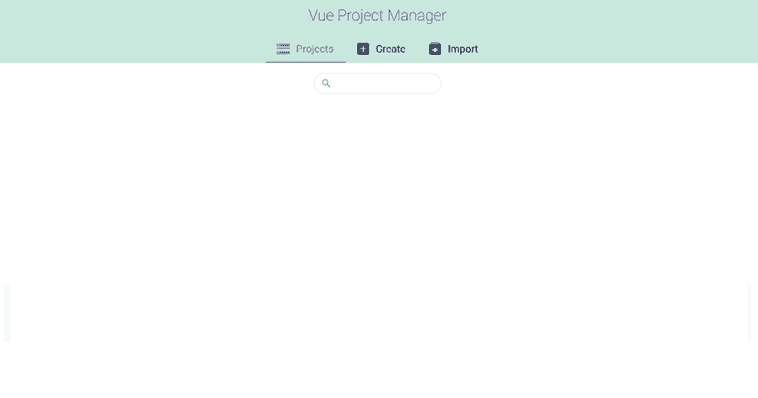  
图 7.1：Vue UI 落地页

要创建一个新项目，我们点击创建按钮，如图 7.2 所示：

  
图 7.2：带有创建按钮的 Vue UI 头部

这将弹出以下内容：

  
图 7.3: 创建项目按钮

点击此按钮将弹出一个新界面，你可以开始输入创建项目所需的数据：

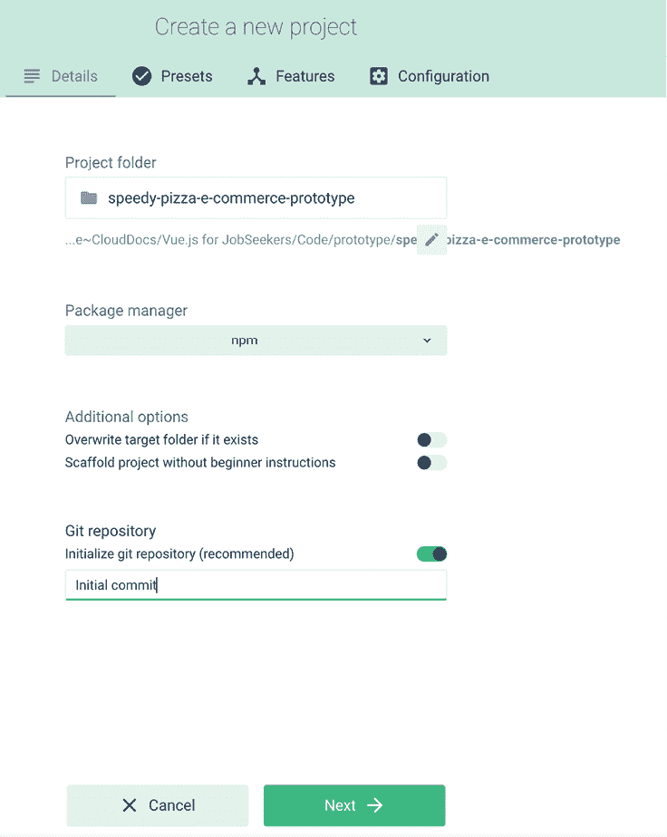  
图 7.4: 设置项目基础信息

从此处复制信息并点击“下一步”。

这会带你进入预设界面，如下所示；再次选择“手动”，然后点击“下一步”：

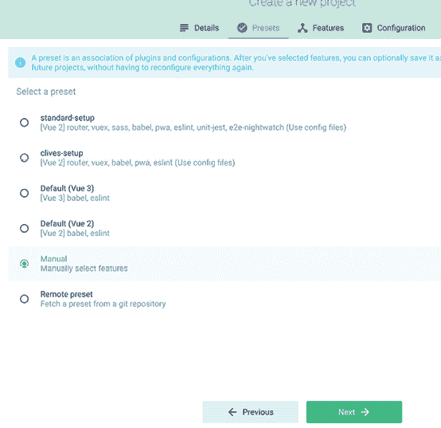  
图 7.5: 预设页面

从这里，我们将进入配置界面：

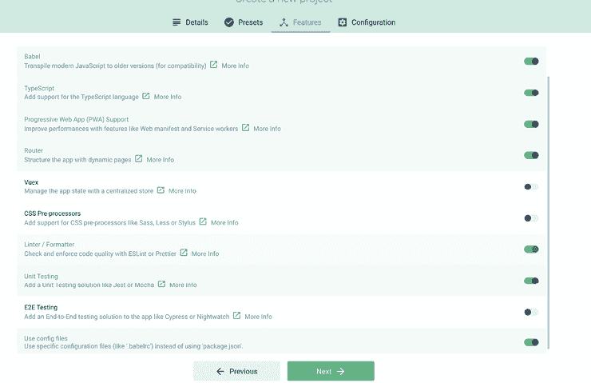  
图 7.6: 功能配置界面

从那里，我们将按照下面的图配置 Vue 版本和其他内容：

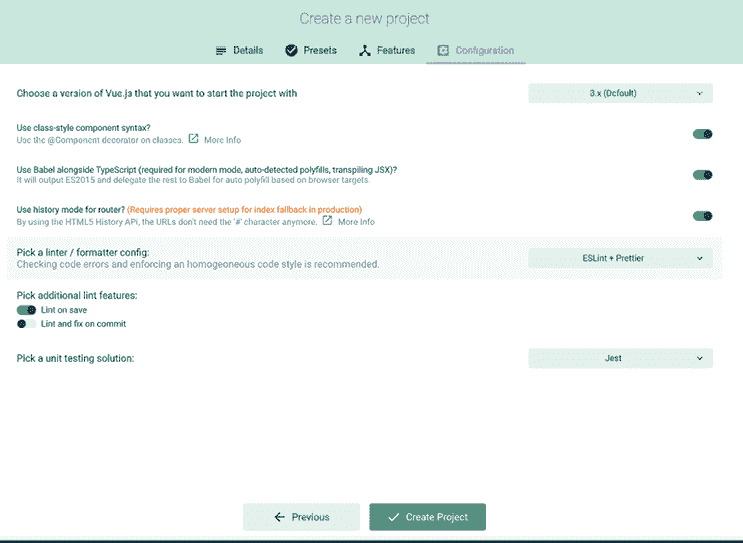  
图 7.7: 配置界面

当你在此处创建项目时，将面临一个将配置保存为预设的选项：

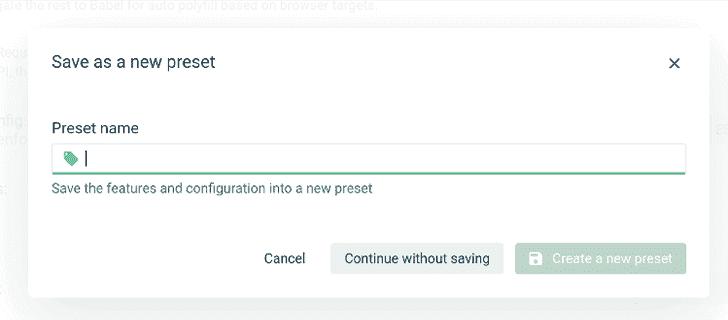  
图 7.8: 保存预设界面

完成此表单或继续保存预设；UI 向导将开始构建你的项目，之后你将到达这里：

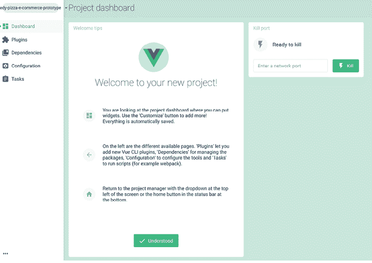  
图 7.9: 完成向导后显示的项目仪表板

当你到达这里时，项目的设置方法与上一节相同，但在这里你可以探索额外的插件、依赖项、配置和任务。我们现在不会从这里安装任何其他东西，但请花时间熟悉一下。这些屏幕上有很多非常有用的内容。

## 使用 Vite 创建项目

使用 `Vite` 设置项目更加简单，而且它正迅速成为项目脚手架的标准方式。

以下代码创建了应用的基础，速度非常快：

```bash
npm create vite@latest speedy-pizza-e-commerce-prototype -- --template vue-ts
npx: installed 6 in 1.247s
Scaffolding project in /speedy-pizza-e-commerce-prototype...
Done. Now run:
cd speedy-pizza-e-commerce-prototype
npm install
npm run dev
```

最后三行是下载所有所需依赖项并以开发模式启动项目的指令。

## 总结

本章介绍了设置和管理项目及其依赖项的基础知识。这些基础知识包括使用 `NPM` 和 `Git`，以及设置 `Vue.js` 项目。

这里介绍的工具都是行业标准；你将在 Web 项目中经常使用这些工具。然而，像 `Git` 这样与语言无关的工具也用于许多其他类型的项目；这是一个非常重要、需要了解并加入你的技能树的工具。

## 要记忆的点

### Git

`Git` 是一个分布式代码管理系统。通常，远程仓库被视为单一事实来源。

通常，在克隆仓库后，代码库通过分支进行管理，做出所需的更改，将代码更改添加（或暂存）到提交中，执行提交，然后将这些更改推送到远程仓库。你的本地副本通过从远程获取和拉取代码来保持更新。

代码提交也可能被重基（rebase，以管理历史）或检选（cherry-pick）到源分支。

源代码的管理在很大程度上由你组织的文档或流程规定或控制。

### NPM

JavaScript 项目依赖项使用包管理工具进行管理；我们在本书中选择的是标准的 `NPM`。这意味着除了安装 node 之外，我们不需要担心安装任何东西来帮助管理依赖项。其他工具可用，例如 `Yarn`，但一旦你理解了如何使用 `NPM`，学习 `Yarn` 就会轻而易举。

`NPM` 用于从项目中安装、更新和删除包。它是同时用于 Web 和服务器（Node.js）应用程序的标准工具。来自其他生态系统的许多服务器端工具也可能使用 `NPM` 来管理客户端依赖项。

项目所需的所有内容通常存储并管理在`package.json`文件中。很多情况下，这就是你应用程序的代码。

### Vue.js CLI

`CLI` 主要是用于创建和管理 `Vue2` 应用的工具。对于 `Vue3`，它大部分已被 `Vite` 代代。

使用 `CLI` 创建应用有完善的文档，而且相对简单。

### Vue.js UI

`UI` 是 `CLI` 的视觉封装。你通过 `CLI` 可以获得的所有功能在 `UI` 中都可用。`UI` 以更清晰的格式呈现信息，使管理变得更容易。

### Vite

`Vite` 是 `Vue.js` 全新的脚手架工具。它简单且快速。这是处理 `Vue3` 应用的首选工具。

## 关键术语

*   Checkout（检出）
*   Cloning（克隆）
*   Pull（拉取）
*   Push（推送）
*   History（历史）
*   Repository（仓库）
*   Rebase（重基）
*   Cherry-pick（检选）
*   Remote（远程）
*   Merge（合并）
*   Patch（补丁）
*   Origin（源）
*   Package.json
*   NPM
*   Init（初始化）
*   Audit（审计）
*   CLI
*   UI
*   Vite
*   Dependency（依赖项）
*   Packages（包）

## 问题

1. 在本地初始化一个新的 git 仓库。
2. 注册 GitHub 或 Bitbucket 并你创建的仓库链接到此远程仓库。
3. 使用 `Vite` 在之前创建的 git 中创建应用脚手架，添加代码，创建初始提交，并将更改推送到远程。
4. 检查远程仓库以确保你的代码已到达。

加入我们书籍的 Discord 空间获取最新更新、优惠、全球科技动态、新发布以及与作者的交流会：

**[`discord.bpbonline.com`](https://discord.bpbonline.com)**


# 第 8 章 在混合中加入 CSS 框架 —— TailwindCSS、Bootstrap 或 Foundation

## 引言

在上一节中，我们启动了项目；项目文件已就绪，等待我们新组件的构建。本节将加快节奏，我们将查看一个 CSS 库，在本例中为 Tailwind。

## 结构

在本节中，我们将探讨以下主题：

*   TailwindCSS 及其在 Web 开发生态中的地位
*   TailwindCSS 配置基础
*   使用 TailwindCSS
*   将 Tailwind 引入 Vue.js 项目
*   添加纯 CSS 框架
*   Twitter Bootstrap
*   Zurb Foundation

## 目标

在本节中，我们将稍微偏移。不再假设集成和使用 CSS 框架是简单的，而是这样做。对于本书，我们将使用 TailwindCSS，这是一种 CSS-in-JS 框架，目前是业界之星。

我们还将查看如何集成其他更传统的 CSS 框架 —— Twitter Bootstrap 和 Zurb Foundation。

前段提到的 CSS 框架主要是基于组件的框架。这意味着 CSS 的设计初是为了与以特定方式编写的 HTML 以及特定的 CSS 类配合使用，以构建各种“组件”。这些组件的构建方式有时与你需要构建的组件的逻辑关注点冲突。这并不是说这些框架没有用，它们在现代 Web 开发中有其用武，并且许多公司在使用它们。

`TailwindCSS` 采用了不同的哲学。它不是将“组件”概念作为开发的基本单元，而是（Tailwind）通过将可用的工具类限制在一组标准的选择器中，这些选择器可以根据需要进行自定义。

这种“实用优先”（utility-first）的方法意味着，作为一个开发者，你不需要花费精力去思考 CSS 类名、设计自定义 CSS，或者去应付不同浏览器的 CSS 要求。这一概念的意义在于你拥有一组集中的 CSS，而不需要增加你的 CSS 文件的大小；你所需的一切都是从配置文件编译而来的。在实践中，这意味着你是在本地 HTML 级别进行工作，并可以使用从全局工具类中复用的 CSS 类。

`Tailwind` 与其他更传统的框架略有不同之处在于它是一个 CSS-in-JS 框架。这意味着它使用 JavaScript 从设置文件中编译出所需的全局 CSS。

现在我们已经对 `Tailwind CSS` 是什么有了基本的了解，我们将详细查看如何使用它。

## TailwindCSS 配置与基础

我们将在下一节中介绍如何在 Vue.js 项目中安装 Tailwind；在这一节中，我们将讨论如何配置 Tailwind 以及使用它的基础。在构建应用程序的过程中，你将获得更多练习，但如果你从未见过它，这有助于你建立对该技术的基础。

### 配置

自定义是使用 Tailwind 的核心。因为可用选项很多，起初可能会相当困惑。

首先，所有配置都放在一个名为 `tailwind.config.js` 的文件中，该文件需要放在项目的根目录下，项目的 `package.json` 文件旁边。此文件是可选的；如果不存在，Tailwind 将回退到默认配置。此外，未未定义的任何元素都将回退到此默认配置。你可以在 GitHub 的 `https://github.com/tailwindlabs/tailwindcss/blob/master/stubs/defaultConfig.stub.js` 查看 Tailwind 的默认值。

最简单的方法是使用 `npm tailwindcss init -p` 让 Tailwind CLI 为你生成基础文件，它会创建一个包含最小所需选项的文件，这些选项也会回退到默认值。这还将 Tailwind 设置为 postcss 插件。

该文件的内容是一个导出的 JSON 集合，具有以下一个或多个键：

* `content`
* `theme`
* `plugins`
* `presets`
* `prefix`
* `important`
* `separator`
* `corePlugins`

在这些键中，我们只讨论前三个。其余部分超出了本文的范围。

### 配置选项

有多种方法可以提供配置选项；让我们来看每一个。

#### 作为键值对

这是为特定键分配单一值最简单的方法：

```javascript
module.exports = {
  //...
  colors: {
    white: '#fff',
    //  ...
  },
  //...
}
```

#### 作为选项列表

与键值对类似，它根据给定的列表针对设置键生成相应的 CSS：

```javascript
module.exports = {
  //...
  fontFamily: {
    sans: ['Raleway', 'Serenity', 'sans-serif'],
    ...
  }
  //...
}
```

#### 作为选项对象

选项对象允许你针对父键设置子键值对，这样当编译最终的 CSS 时，它将成为规则 `<type>-<parent>-<child>` 的一部分，例如列表所示的 `border-green-100`：

```javascript
module.exports = {
  //...
  colors: {
    green: {
      100: '#ebf4ea',
      200: '#bedfc4',
      //...
    }
    //...
  },
  //...
}
```

#### 作为主题引用闭包

在构建 CSS 配置时，你可能需要访问作为主题一部分定义的数值。为了实现这一点，你可以提供一个匿名函数，该函数提供一个 `theme()` 函数，可以使用该函数来访问这些值。

注意，你不能访问此函数来返回简单值；这种类型的函数只能应用于顶层，即 CSS 选择器级别；请参见示例。此外，由于 Tailwind 使用了嵌套对象语法，检索到的值必须使用点符号或方括号符号，如下所示：

```javascript
module.exports = {
  theme: {
    borderColor: (theme) => ({
      ...theme('colors').blue.100
    })
  }
}
```

#### 作为默认主题

如果你需要引用默认主题中的值，可以通过导入默认主题来实现：

```javascript
const defaultTheme = require('tailwindcss/defaultTheme')

module.exports = {
  theme: {
    extend: {
      fontFamily: [
        ...defaultTheme.font
      ]
    }
  }
}
```

### Content

`content` 部分是使用 Tailwind 类的路径列表。

```javascript
module.exports = {
  content: [
    "./index.html",
    "./src/**/*.{vue,js,tsx}"
  ]
}
```

### Theme

Theme 部分是你定义构建视觉效果所需选项的地方。我们指的是实际的配置选项：颜色；字体和大小；间距等。

#### 颜色、间距和屏幕

colors 键键用于设置项目的调色板。颜色可以定义为颜色名称与 CSS 颜色值（如 `blue`）、颜色十六进制代码（如 `#000` 或 `#c5f4e1`）或 RGB 字符串（如 `rgb(4 65 255)/75`）之间的映射。你也可以设置一个颜色对象来提供相同颜色的不同深浅，按任意数量分级，如默认主题示例中所示：

```javascript
module.exports = {
  theme: {
    colors: {
      orange: {
        50: '#fff7ed',
        100: '#ffedd5',
        200: '#fed7aa',
        300: '#fdba74',
        400: '#fb923c',
        500: '#f97316',
        600: '#ea580c',
        700: '#c2410c',
        800: '#9a3412',
        900: '#7c2d12'
      }
    }
  }
}
```

这允许你将相似的颜色分组，以便可以使用点符号进行访问，例如 `text-orange-600`。

类似地，我们可以配置间间距和屏幕尺寸断点。然而，与其覆盖所有提供的设置，不如对其进行扩展以满足你自己的需求。这样，你就可以受益于设计默认值所花费的无数工时，并且可以说不需要重新发明轮子。

例如，扩展主题间距可以通过添加如下所示的设置来实现， 17、18 和 19：

```javascript
module.exports = {
  theme: {
    extend: {
      spacing: {
        '17': '4.25rem',
        '18': '4.5rem',
        '19': '4.75rem'
      }
    }
  }
}
```

默认的间距设置和其他信息可以在 `https://tailwindcss.com/docs/customizing-spacing#default-spacing-scale` 找到，那里列出了所有提供的尺寸列表。

间距设置用于为 padding（内边距）、margin（外边距）、width 和 height 等 CSS 规则提供宽度设置，例如 `px-4`；`m-10`。

`screens` 部分用于定义项目所需的断点——Tailwind 本身为 `min-width` 媒体查询设置提供了一组合理的默认值。它们像任何其他提供的值一样被扩展或覆盖。

如果你提供一个包含 `max` 键的对象，那么生成的断点将返回 `max-width` 而不是 `min-width`，如下：

```javascript
module.exports = {
  theme: {
    screens: {
      '2xl': {'max': '1900px'},
      // => @media (max-width: 1900px) { ... }
      ...
    }
  }
}
```


`screens`设置用于为类添加前缀，以便在该断点应用选定的类，例如`sm:text-right`和`md:text-center`。

在`theme`部分中，当你创建一个规则时，你会针对一个键构建样式定义——该键就是样式的名称。这个键被映射到一个函数，称为`plugin`（插件）。插件是下一节的主题。

## 插件 (Plugins)

Tailwind CSS 类定义由插件提供。插件的名称方便地与 JS CSS API 样式规则名称相同，例如 CSS 的`border-width`是`borderWidth`，以此类推。

插件也可以自定义创建，通过 JS 将样式注入到项目样式表中，而不是手动编写 CSS。

有一些在 Tailwind 核心安装包之外维护的官方插件。它们如下：

* `@tailwindcss/typography`
* `@tailwindcss/forms`
* `@tailwindcss/line-clamp`
* `@tailwindcss/aspect-ratio`

如果你想使用它们，首先需要使用 NPM 将它们添加到项目中，然后添加到配置文件中：

```javascript
module.exports = {
  // ...
  plugins: [
    require('@tailwindcss/typography'),
    require('@tailwindcss/forms'),
    require('@tailwindcss/line-clamp'),
    require('@tailwindcss/aspect-ratio'),
  ]
}
```

构建自定义插件需要你导入 Tailwind 插件函数。当使用此函数时，Tailwind 为匿名回调函数提供一个单一对象参数，该参数可以解构为一些辅助函数，其中最重要的函数如下：

* `addUtilities` - 用于注册新的静态工具样式
* `matchUtilities` - 用于注册新的动态工具样式
* `addComponents` - 用于注册新的静态组件样式
* `theme` - 用于在用户的主题配置中查找值
* `config` - 用于在用户的 Tailwind 配置中查找值

以下列表显示了如何使用`plugin`函数：

```javascript
const plugin = require('tailwindcss/plugin')

module.exports = {
  plugins: [
    plugin(function({ addUtilities, theme }) {
      // 在此处添加你的自定义样式
    }),
    ...
  ]
}
```

我们不会对自定义插件进行更多详细介绍，因为它们超出了本书的范围，但更多细节可以在 https://tailwindcss.com/docs/plugins 找到。

## 使用 TailwindCSS

一旦配置完成，使用 Tailwind 实际上非常简单。你只需要提供 CSS 类来样式化描述内容的 HTML 骨架。

（注：输入文本包含大量重复内容，已根据要求合并并清理为唯一的逻辑结构。）

3. ```javascript
import "bootstrap/dist/css/bootstrap.min.css"
```

4. `import "bootstrap"`

当你完成此更改并运行项目时，你将可以使用 Bootstrap CSS 和组件。从这里开始，你可以使用 Bootstrap 的数据属性来根据需要提供数据和功能，也可以用 Vue.js 组件封装 Bootstrap 提供的组件，并构建一个你自己的组件库来使用。关于 Bootstrap 的更多详细信息，可以在[`getbootstrap.com`](http://getbootstrap.com)找到。

## Zurb Foundation

从执行相关的导入开始：

1. ```bash
npm i jquery what-input motion-ui foundation-sites
```

使用 CSS 最简单的方法是将其直接导入到主文件中，就像 Bootstrap 一样；添加以下内容：

1. ```javascript
// ./src/main.{js,ts}
```

3. `import 'foundation-sites/dist/css/foundation.min.css'`
4. `import 'foundation-sites/dist/js/foundation.min'`

在这些导入都准备就绪后，你就可以使用 Foundation CSS 了。

## 结论

在本章中，我们涵盖了集成和使用 TailwindCSS 的内容。这里有很多细节，因为它是一个相对新的框架，正受到工业界的广泛关注。

最后，我们查看了如何集成旧的、更著名的 CSS 框架。

## 关键术语

- TailwindCSS
- CSS-in-JS
- 优先实用 (Utility-first)
- 层 (Layers)
- 组件 (Components)
- Bootstrap
- Foundation
- 插件 (Plugins)
- 间距 (Spacing)
- 主题 (Theme)

加入我们的书籍 Discord 空间

加入书籍 Discord 工作空间获取最新更新、优惠、全球科技动态、新发布以及与作者的交流：

**[`discord.bpbonline.com`](https://discord.bpbonline.com)**


# 第 9 章 使用组件构建用户界面

## 引言

到目前为止，我们已经开始了原型项目并添加了一些基本的 Tailwind 样式定义。

在本章中，我们将构建第 5 章“设计基于组件的 UI 和单页应用程序”中所讨论的页面基础组成部分。在构建了这些较小的组件后，将在结束时完成设计的主内容区域的构建。这些将形成我们将进行迭代的构建块，以便我们在接下来的几章中构建额外的功能。

## 结构

本章涵盖了以下主题：

- 设置可用的文件夹结构
- 构建基础原型模板

本章要涵盖的内容很多，让我们开始吧。

## 目标

本章的主要目标是开始在实际项目的背景下查看 Vue.js。到目前为止，我们学习了大量的理论，并看到了应用程序在高级层次是如何组合在一起的。现在，我们将熟悉编码，并查看如何结构化项目。

我们将从最开始的地方逐步完成所有设置工作，以便有一个坚固且可用的基础来构建。然后，我们将填充已创建的目录结构。

本章将构成我们示例项目的基础。

## 设置 – 管理项目文件夹和文件

Vue.js 不关心你如何组织文件，只要它能找到它们即可。代码库的结构纯粹是以人为本的活动——一个逻辑的文件夹结构，使用有帮助的甚至是语义化的命名规范，有助于开发工程师和随后的维护工程师快速找到代码所在地。你真正追求的是一种平衡：结构既不能太扁平（导致所有文件都放在同一个文件夹中），也不能太深（以至于在找到要找的内容之前搜索许多分支）。理想情况下，我们设计的结构在`/src`文件夹下最多三或四层。这给了我们足够的范围来构建合理的东西；毕竟我们没有在使用 Java。

当我们使用`Vite`生成项目时——正如我们在第 7 章“使用 Vue CLI 和 Vite 创建并设置 Vue.js”中所做的那样——我们会得到这样的结构：

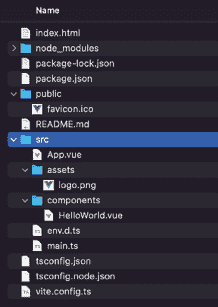

图 9.1：标准的 Vite 生成的文件夹结构

虽然对于小项目这很好，但一旦项目增长到几个组件或多个关注点，它就不那么有用了。

我们将从`components`文件夹中删除`HelloWorld.vue`文件，清空`App.vue`文件，然后在`src/`文件夹中添加以下文件夹：

- `components/pages`
- `components/pages/site`
- `components/pages/profile`

这些目录将包含页面组件——每个页面都有自己的文件夹。

- `components/layouts`
- `components/layouts/common`

这些文件夹将帮助管理定义布局的组件。当我们使用路由构建页面时，这个文件夹将被填充。

- `components/partials`

此文件夹包含小型模板部分，即“部分”模板元素，它们在代码库中被重复用，按关注点组织。

- `composables`

这是我们将放置组合式函数（composable）的地方。

- `routes`

这是路由信息存放的地方。

- `store`

当我们需要考虑应用全局状态时，我们将开始填充此文件夹。

图 9.2 显示了你现在的结构：

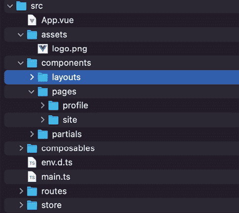

图 9.2：目录

代码组织完成后，我们就可以开始了。

## 构建基础原型模板

在构建组件问题的不同方法中，我们对落地页采用从外向内的方法。我们将在第 10 章使用`VueRouter`时讨论构建布局。

## 落地页模板

页面布局

页面布局只是包含所有其他组件的封装组件；它相对简单，正如你所看到的，它紧密遵循线框。

我们将在`components/pages/site`中创建一个名为`LandingPage.vue`的文件：

```vue
<template>
  <div class="container mx-auto h-screen">
    <menu-bar-component></menu-bar-component>
    <div class="container mx-auto">
      <hero-component></hero-component>
      <offers-component></offers-component>
    </div>
    <footer-component></footer-component>
  </div>
</template>

<script setup lang="ts">
  import MenuBarComponent from '/src/components/layouts/common/MenuBarComponent.vue'
  import HeroComponent from './HeroComponent.vue'
  import OffersComponent from './OffersComponent.vue'
  import FooterComponent from '/src/components/layouts/common/FooterComponent.vue'
</script>
```

作为对我们要构建内容的回顾，图 9.3 是第 5 章“设计基于组件的 UI 和单页应用程序”中线框的副本：

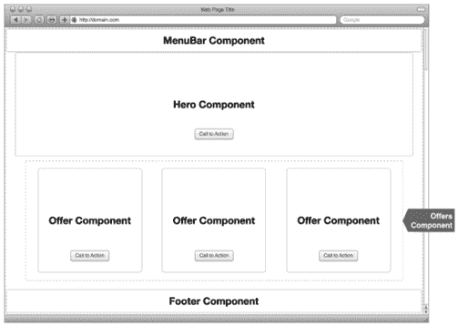

图 9.3：落地页线框

我们将稍后展望一下`MenuBarComponent`和`FooterComponent`文件的存放位置，并将它们直接放入`components/layouts/common`目录。

如你所见，这些代码并不复杂；它包含了一些导入和一个相当较小的模板部分。但是，如果你尝试运行它，编译器会报错；因为我们还没有构建这些组件，所以它找不到可以查找或构建的内容，从而导致了问题。

我们将处理的第一个组件是`MenuBarComponent`。

### MenuBarComponent

MenuBar 是页面的主头部，包含网站 Logo 和主导航。创建`components/layouts/common/MenuBarComponent.vue`文件并将以下代码放入其中：

```html
<template>
  <div class="mt-1">
    <div class="bg-gray-300 border-b border-gray-500 rounded-lg px-4 pt-2">
      <div class="container mx-auto flex justify-between">
        <div class="mb-1">
          <h1 class="logo text-5xl font-bold text-logo-red">Speedy</h1>
          <h1 class="logo text-5xl font-bold ml-16 text-logo-red mb-1">Pizza</h1>
        </div>
        <menu-items></menu-items>
      </div>
    </div>
  </div>
</template>

<script setup lang="ts">
  import MenuItem from './MenuItemsComponent.vue'
</script>
```

我们将实际的菜单拆分为一个子组件，该组件仅在这两个组件中使用，这意味着我们只需要在一个地方进行编辑。我们将这个子组件放在`HeaderComponent`和`FooterComponent`旁边，并命名为`MenuItemsComponent.vue`：

```html
<template>
  <div class="flex w-1/6 justify-between font-bold">
    <a href="#">Home</a>
    <a href="#">Menu</a>
    <a href="#">Profile</a>
  </div>
</template>
```

正如你可能注意到的，我们只是先占用了这些链接占位符；当我们引入路由器时，我们会回来修改这些内容，让它们指向正确的位置。在较大的项目中，你应该预期路由会先就绪，这样任何新页面都可以在构建之前被添加到路由配置中。我们将在第 10 章《使用 VueRouter 在页面间路由》中详细介绍路由器。

### FooterComponent

将`FooterComponent.vue`文件放在`MenuBarComponent`旁边，并将以下代码添加到该文件中：

```html
<template>
  <div class="container mx-auto fixed bottom-1 left-2 right-2 py-4 px-8 bg-gray-300 font-bold border-t border-gray-500 rounded-lg">
    <div class="container mx-auto flex justify-between">
      <div>copy; Speedy Pizzas & Clive Harber 2022</div>
      <menu-items></menu-items>
    </div>
  </div>
</template>

<script setup lang="ts">
  import MenuItem from './MenuItemsComponent.vue'
</script>
```

这同样非常简单，只是一组指向相关页面的样式化链接。由于我们正在构建一个小型的原型，你会发现提供的设计中缺少了一些在真实的面向公众的网站中必不可少的内容：指向网站条款和条件政策、数据处理与管理、以及 Cookie 跟踪政策的链接。根据你所处的世界，你可能需要在每个页面都链接其中部分或全部内容，特别是如果你打算收集和使用来自欧盟公民的数据。如果你位于欧盟或打算向欧盟国家销售/提供服务，你有一系列需要注意的法律框架，这些框架在世界其他地区可能不存在。

这些组件就绪后，我们就可以开始构建内部部分了；如果你运行编译器，它会通过指出缺失的内容来提供帮助。现在尝试一下：`npm run dev`。你将在终端看到输出，如图 9.4 所示：

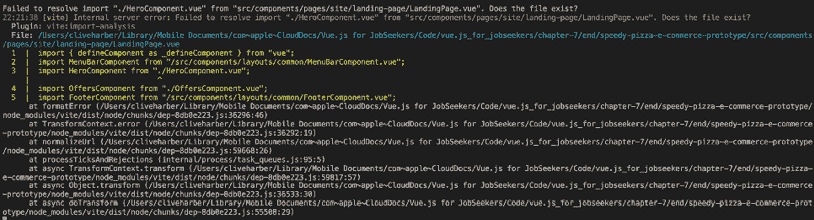

图 9.4：缺少组件导致的错误

如你所见，我们可以接下来处理 Hero 部分。

### HeroComponent

“Hero”组件是用户看到的第一个东西。通常，Hero 占据屏幕的 50% 到 75%。它是网站上主要的行动号召（CTA），通常包含一张图片和一个按钮。

该代码如下：

```html
<template>
  <div class="hero">
    <div class="btn">
      <button class="red">Our Menu</button>
    </div>
  </div>
</template>

<style scoped>
  .hero {
    background: url(src/assets/hero.jpg);
    @apply mx-auto mt-1 flex flex-col;
  }
</style>
```

### OffersComponent

从模板的角度来看，`OffersComponent`看起来相当简单，但它是我们目前为止构建的最复杂的组件。我们正在使用一个包含项目集合的数据对象，该对象用于驱动循环并输出多个组件，每个组件显示列表中的单个项目。这里有很多内容需要拆解：

```html
<template>
  <div class="flex justify-center space-x-16 mt-4">
    <offer-component
      v-for="offer in offers"
      :key="offer.id"
      :id="offer.id"
      :text="offer.btn_text"
      :image="offer.image"
    ></offer-component>
  </div>
</template>
```


这里的模板使用`v-for`指令遍历`offers`数据，依次提取每个`offer`。我们提供了`offer id`作为必需的`:key`属性，以便 Vue 在需要时跟踪更改。循环的每次都会注入一个`OfferComponent`，它接收提供的属性并进行渲染。

第二部分定义了数据对象（目前如此），它通过定义符合子组件所需的`props`类型的`offers`对象，使我们能够构建`OfferComponents`的循环。如果不符合此接口，子组件将无法渲染。这样写是为了当我们把组件更改为从`Pinia`获取数据时，可以直接删除整个部分代码：

```html
<script lang="ts">
import { defineComponent } from "vue";

export default defineComponent({
  data: () => ({
    offers: [
      { id: 1, image: "", btn_text: "Offer 1" },
      { id: 2, image: "", btn_text: "Offer 2" },
      { id: 3, image: "", btn_text: "Offer 3" },
    ],
  }),
});
</script>
```

一旦有了这个循环，我们只需要构建`OfferComponent`即可，这是接下来的工作。

## OfferComponent

这里的`OfferComponent`仅描述了如何显示单个优惠（`offer`），并根据提供的数据提供了一个行动号召（CTA）。最终，这将变成一个动态路由的示例，但目前我们只需先留出 CTA 部分，以便其与页面的其他部分风格一致。参见下列表：

```html
<template>
  <div class="offer" :style="{ backgroundImage: bgImage }}">
    <div class="btn-placement-b">
      <button class="red-button">{{ text }}</button>
    </div>
  </div>
</template>

<script setup lang="ts">
import { computed } from 'vue';

interface Props {
  id: number;
  text: string;
  image: string;
}

const props = defineProps<Props>();

const imageBaseUrl = 'src/assets/';
const bgImage = computed(() => `url(${imageBaseUrl}${props.image})`);
</script>

<style scoped>
.offer {
  @apply bg-cover bg-no-repeat bg-center w-64 text-center h-64 flex flex-col border rounded;
}
</style>
```

在这里，我们定义了一个接口来设置从`props`对象中期望的数据。我们还动态设置了内联样式，以便`OfferComponent`的背景可以从传递的数据中注入。在此阶段，我们是硬编码路径的。当我们从 API 获取数据时，将替换它并完全依赖传递的数据。

这是渲染主页所需的最后一个组件；为了让程序按照计划运行，我们需要对`App.vue`文件进行一些细微调整。需要告诉它在应用程序启动时我们想要它渲染的内容。

### App.vue 的更改

需要对`App.vue`文件进行以下更改：

```html
<template>
  <landing-page></landing-page>
</template>

<script setup lang="ts">
import LandingPage from "./components/pages/site/landing-page/LandingPage.vue"
</script>
```

完成这些更改后，从终端启动应用程序：

```bash
$ npm run dev
```

打开浏览器，如果使用 Vite 2，指向`http://localhost:3000`，如果使用 Vite 3，指向`http://localhost:5173`。随着最后一项工作的完成，页面现在可以正确编译。当你切换到浏览器时，你会看到你所有的努力成果呈现在面前。给自己鼓个掌并休息一下吧；我们在短时间内做了很多工作。

此时，将你的更改推送到 Git 仓库是有意义的：

```bash
$ git add .
$ git commit -m '<your commit message>'
$ git push origin <branch>
```

在下一章中，我们将开始构建路由器，提取描述我们称之为“布局（layout）”的公共元素，并完成许多其他页面内部组件的构建。

## 结论

此时，将你的更改推送到 Git 仓库是有意义的：

在下一章中，我们将开始构建路由器，提取描述我们称之为“布局（layout）”的公共元素，并完成许多其他页面内部组件的构建。

```javascript
const app = createApp(App)
app.use(router)
app.mount('#app')
```

当添加路由器时，你需要完成几个阶段来使应用程序感知到路由。步骤如下：

1. 导入`createRouter()`函数和所需的历史模式函数（即`createWebHistory()`）；第 2 行
2. 导入（或定义）路由列表；第 3 行
3. 使用`createRouter()`函数创建路由器；第 6 行
4. 使用`app.use()`将定义的路由器添加到应用中；第 12 行

此时，`routes/routes.js`文件只需要导出一个空数组，但这并没有什么用处。

下一节将介绍如何构建路由，然后我们将构建原型应用所需的路由。

### 构建路由定义

路由器接受一个对象列表，这些对象定义了`path`（或 URL）与该路径所需渲染的组件之间的映射。这些对象需要符合[`router.vuejs.org/api/#routerecordraw`](https://router.vuejs.org/api/#routerecordraw)中定义的`RouterRecordRaw`对象。最常用的选项是`path`、`component(s)`、`name`、`children`、`beforeEnter`和`props`。这些项将在接下来的章节中进行讨论。还有其他不常用的选项，如`alias`和`redirect`。常用的选项所示所示：

```typescript
[{
  path: String,
  name: String?,
  component: Component?,
  props: Boolean?,
  beforeEnter: (NavigationGuard|NavigationGuard[])?,
  children: [RouterRecordRaw]?
}]: [RouterRecordRaw]
```

注意：`NavigationGuard`是用于保护路由或执行重定向的函数；我们稍后会讨论这些。

### RouterRecordRaw 对象

`RouterRecordRaw`对象（以及类似的对象，如`RouterRecordNormalised`）包含了之前提供的定义，它是路由器用于匹配`path`（相对 URL）到输出组件所需的映射。根据页面的需求，此`path`可以是静态的也可以是动态的。让我们来看看最常用的每个部分。

#### Path

`path`是一个模式，可以是简单的字符串，也可以是复杂的模式，该模式可以分解为一组值，这些值可以传递给组件，使其能够从本地值、应用本地存储（如`Pinia`）或远程源提取数据。

各种路径类型的示例所示：

```javascript
// 字符串
path: '/'
path: '/cars/show/all'

// 动态段
path: '/cars/:id'
path: '/cars/:id/edit'
// id 可通过 $route.params.id 获取
// partId 可通过 $route.params.partId 获取
path: '/cars/:id/show/:partId'

// 自定义正则
// 将多个段匹配到 missingPath
path: '/:missingPath)*'
// 将部分匹配到 make 和 model
path: '/cars-:make)-:model)'
// 匹配到 doors 并确保为数字
path: '/cars(\\d+)'
// 可选匹配 id
path: '/cars/:id?'
```

如你在动态路径所示，可以通过在名称前加冒号（`:`）将值提取到变量中，并在组件中使用它。访问这些数据有三种方式：通过传递给 Options API 组件的`$route`对象、用于 Composition API 的`useRoute()`函数，或者通过`props`。

`$route`对象（或 Composition API 的替代方案）在需要时提供了路由的其他部分，如`query`、`hash`或重定向。如果你是按照 REST 风格构建项目，那么不太可能频繁使用`$route.query`，如果你不使用 hash 导航，那么`$route.hash`同样不太可能使用，但这些选项在需要时可用。

注意：REST（表述状态转换）是关于如何构建 API 的一组原则或约束。这些约束能够设计轻量级、互联网规模的 API，将 URI 映射到资源，从而隐藏底层的实现。更多信息请参阅[`en.wikipedia.org/wiki/Representational_state_transfer`](https://en.wikipedia.org/wiki/Representational_state_transfer)。

我们将在本章的稍后部分重新构建原型的导航，因此我们到时会进一步讨论。

#### Name

`name`属性允许你为路由分配特定的名称。这让你作为开发者具有灵活性，可以根据需要创建和维护路由，而无需修改项目中的所有文件。使用命名路由是一种推荐的做法。

当你想要使用命名路由时，`:to`属性将接收一个对象，该对象提供了名称以及构建路径所需的任何路由参数。编译器随后根据路由器信息和提供的参数构建正确的路径。任何参数都会自动进行 URL 编码。下面的示例展示了路由器配置及其在模板中的用法：

```javascript
const routes = [
  {
    path: '/item/:id(\\d+)',
    name: 'item',
    component: ItemPage
  }
]

<router-link :to="{name: 'item', params: {id: 123}}">意大利肉丸</router-link>
```

项目中的每个路由名称必须是唯一的。如果任何路由名称冲突，编译器将停止构建项目并返回错误报告。

#### Component(s)

此设置指定了在访问该路径时模板渲染所需的组件（或多个组件）。

如果目标模板仅使用默认的`router-view`，则需要单个`component`属性：

```html
<template>
  <router-view></router-view>
</template>

const routes = [
  {
    path: '/',
    component: Component
  }
]
```

如果目标模板使用了命名视图（即多个路由出口），则它需要`components`属性，它接受一个将命名的/默认视图映射到所需组件的对象，如下所示：

```html
<template>
  <div>
    <router-view name='SideBar'></router-view>
  </div>
  <router-view></router-view>
</template>

const routes = [
  {
    path: '/',
    components: {
      default: Home,
      SideBar
    }
  }
]
```

如果路由记录发生重定向，则它没有`component`或`components`属性。

#### Props

`props`属性决定了编码在路径的数据是否作为`props`对象的一部分对组件可用。对于单视图组件，这是一个布尔属性，因此它是开启或关闭的——以下将其设置为 true 从而开启：

```javascript
props: true
```

对于多视图或命名视图组件，此对象为每个视图提供按名称设置，如下所示：

```javascript
props: {
  SideBar: true,
  default: false
}
```

如果提供的`props`对象包含一个与视图不对应的键，它将原封不动地合并到供给组件的`props`对象中。这是提供静态 props 数据的一种简单方法，如下所示：

```javascript
props: {
  SideBar: true,
  default: false,
  NewValue: '传递到组件'
}
```

最后，如果你向此属性提供一个函数，它会将`route`对象作为参数注入，你可以对其进行查询以创建你需要的任何数据组合：

```javascript
// /search/searchTerm => props: {params: 'searchTerm'}
const routes = [
  {
    path: '/search/:name',
    component: SearchComponent,
    props: route => ({ params: route.params.name })
  }
]
```

### beforeEnter

`beforeEnter`被称为导航守卫；该功能将在目标组件渲染之前执行，以便根据需要对导航进行重定向、取消或更改。路由定义中的`beforeEnter`钩子是影响导航的多种方法之一；导航守卫将在本章后面的部分进行讨论。

要添加`beforeEnter`守卫，你需要提供该属性，该属性接收一个函数（或函数列表），该函数接受两个参数：

- `to`: 导航的目标路由
- `from`: 发起导航的源路由

该属性的使用方法如下：

```javascript
// 单个匿名函数
const routes = [
  {
    path: '/profile/:id',
    component: ProfileInfoPage,
    beforeEnter: (to, from) => {
      // 拒绝导航
      return false
    },
  },
]

// 应用多个函数
const applicativeOne = (to, from) => { return true }
const applicativeTwo = (to, from) => { return false }

const routes = [
  {
    path: '/profile/:id',
    component: ProfileInfoPage,
    beforeEnter: [applicativeOne, applicativeTwo]
  },
  {
    path: '/profile/:id/edit',
    component: ProfileEditPage,
    beforeEnter: [applicativeTwo]
  },
]
```

与所有其他导航守卫一样，执行的函数的返回值决定了导航的发生结果。

此路由属性用于你需要对少数路由应用导航守卫的情况；否则，使用全局导航守卫之一会更有意义。

### 子路由

`children`属性允许你定义嵌套路由和组件层级结构。一种常见的做法是让 URL 结构（即段）与一组嵌套组件对应。

在构建嵌套路由时，父路由按预期方式编写，即绝对路径（以`/`开头），并且每个子路由都相对于此路径定义（不带`/`前缀）。这允许路由器透明地构建路径并利用嵌套结构，而无需为每个子路由手动构建 URL：

```javascript
const routes = [
  {
    path: '/profile',
    component: ProfilePage,
    children: [
      {
        // /profile/info
        path: 'info',
        name: 'profile_info',
        component: InfoComponent
      },
      {
        // /profile/orders
        path: 'orders',
        name: 'profile_orders',
        component: OrderComponent
      }
    ]
  }
]
```


如果你构建的子路由路径以`/`开头，路由器将认为这是一个根路径并进行相应的处理。这可能是也可能不是你想要的，但它会跳过父路径的定义。

每个父路由都需要一个出口（outlet）来渲染相应的子内容。

然而，还有一点点尚未介绍：路由器如何知道应该使用哪个路径，以及路由器在哪里渲染路由输出？对此，`VueRouter` 提供了两个实用的小组件：`<router-link>` 和`<router-view>`。

## Router Link

`<router-link>` 组件用于替代模板中的`<a>`标签（或任何可点击标签）；它会为你生成正确的标签和 URL 内容。

该组件有一个必选的`to`属性和一个默认插槽（slot）。该属性接受以下内容：

- 一个字符串，你希望让用户导航到的目标路径。
- 一个对象，包含`path`或`name`键，以及可选的`params`、`query`或`hash`对象，这些对象包含了路径构建器所需的键值对数据。

以下展示了`<router-link>`标签的各种用法：

```html
// 使用静态字符串作为路径

<router-link to="/users">Users</router-link>

// 使用 JS 字符串作为路径，注意 :to

<router-link :to="/users">Users</router-link>

// 使用带有 path 属性的对象

<router-link :to="{ path: '/users' }">Users</router-link>

// 使用具名路由

<router-link :to="{ name: 'users' }">Users</router-link>

// 使用带有参数的具名路由

<router-link :to="{ name: 'user', params: { id: 12 } }">Users</router-link>

// 使用带有 query 的具名路由

<router-link :to="{ name: 'user', query: { page: '1' } }">Users</router-link>

// 使用带有 hash 的具名路由

<router-link :to="{ name: 'user', hash: '#profile' }">Users</router-link>
```

与所有其他导航守卫一样，执行的函数的返回值决定了导航的发生结果。

此路由属性用于你需要对少数路由应用导航守卫的情况；否则，使用全局导航守卫之一会更有意义。

我们需要做的第一件事是向项目中添加`VueRouter`并创建路由方案。

让我们向项目中添加`VueRouter`：

1. `npm install vue-router@4`

然后，我们将在`main.ts`中对其进行配置：

```typescript
import { createApp } from 'vue'
import { createRouter, createWebHistory } from 'vue-router'
import routes from './routes/index.ts'
import App from './App.vue'
import './assets/index.css'

const router = createRouter({
  history: createWebHistory(),
  routes
})

const app = createApp(App)

app.use(router)
app.mount('#app')
```

我们已经告诉了`main.ts`可以在`./routes/index.ts`找到路由定义，因此我们需要向项目中添加该文件并在其中放入以下内容：

```typescript
import { RouteRecordRaw } from 'vue-router'

const routes: RouteRecordRaw[] = []

export default routes
```

准备好该文件后，我们就可以开始添加路由定义了。

首先，我们将添加一些包装模板；完成后，这些模板将包含常见的导航元素，但目前，它们只是在模板部分持有路由出口（route outlet），以便页面能够渲染。

在`./routes/index.ts`文件顶部的导入部分添加这些导入：

```typescript
import { RouteRecordRaw } from 'vue-router'

// 页面包装

import FullPageWrapper from '../components/layouts/page_wrappers/FullPage.vue'
import SlimPageWrapper from '../components/layouts/page_wrappers/SlimPage.vue'
import ProfileWrapper from '../components/layouts/page_wrappers/ProfileWrapper.vue'

// ... 文件的其余部分 ...
```

有了这些导入后，我们可以按照如下方式添加第一个路由定义：

```typescript
const routes: RouteRecordRaw[] = [
  {
    path: '/',
    component: FullPageWrapper,
    children: []
  },
  {
    path: '/',
    component: SlimPageWrapper,
    children: []
  },
  {
    path: '/profile',
    component: ProfileWrapper,
    children: []
  }
]
```

你可以看到，我们在这里使用了`children`属性。为了让它们按预期工作，我们需要在每个导入位置创建一个文件：

1. `components/layouts/page_wrappers/FullPage.vue`
2. `components/layouts/page_wrappers/SlimPage.vue`
3. `components/layouts/page_wrappers/ProfileWrapper.vue`

并向每个文件中添加以下内容：

```html
<template>
  <router-view></router-view>
</template>
```

现在，我们将添加嵌套路由定义，首先添加到`FullPageWrapper`下的`children`数组中。首先，我们将如下所示添加所有所需的导入：

```typescript
// ... 之前的导入 ...

// 站点页面组件

import LandingPage from '../components/pages/site/landing-page/LandingPage.vue'
import MenuPage from '../components/pages/site/menu-page/MenuPage.vue'
import ItemPage from '../components/pages/site/item-page/ItemPage.vue'
import CheckoutPage from '../components/pages/site/checkout-page/CheckoutPage.vue'

// ... 文件的其余部分 ...
```

现在我们添加实际的路由定义：

```typescript
// ... 之前的内容 ...

{
  path: '/',
  component: FullPageWrapper,
  children: [
    {
      path: '',
      name: 'home',
      component: LandingPage
    },
    {
      path: 'menu',
      name: 'menu',
      component: MenuPage
    },
    {
      path: 'item/:id',
      name: 'item',
      component: ItemPage
    },
    {
      path: 'checkout/:basket',
      name: 'checkout',
      component: CheckoutPage
    }
  ]
},

// .. 文件的其余部分 ...
```

接两个嵌套模板部分使用了相同的模式，该模式在下面的列表中被压缩了：

```typescript
// ... 之前的文件内容 ...

import LogInPage from '../components/pages/site/login-page/LogInPage.vue'
import LogOutPage from '../components/pages/site/login-page/LogOutPage.vue'
import RegistrationPage from '../components/pages/site/registration-page/RegistrationPage.vue'

// 个人资料页

import ProfileInfoPage from '../components/pages/site/info-page/ProfilePage.vue'
import ProfileOrdersPage from '../components/pages/site/orders-page/ProfilePage.vue'

const routes: RouteRecordRaw[] = [
  {
    path: '/',
    component: SlimPageWrapper,
    children: [
      {
        path: 'login',
        name: 'login',
        component: LogInPage
      },
      {
        path: 'logout',
        name: 'logout',
        component: LogOutPage
      },
      {
        path: 'register',
        name: 'register',
        component: RegistrationPage
      }
    ]
  },
  {
    path: '/profile',
    component: FullPageWrapper,
    children: [
      {
        path: '',
        name: 'info',
        component: ProfileInfoPage
      },
      {
        path: 'orders',
        name: 'orders',
        component: ProfileOrdersPage
      }
    ]
  }
]
```

如果仍然有应用，不要对只看到白页面感到意外；我们还没有放置新文件。修复这个问题出奇地简单。

### VueRouter 导航守卫

路由级守卫`beforeEnter`并不是可用于保护路由的唯一类型；你还有全局和组件内导航守卫。

每当导航事件触发时，`VueRouter`会运行一个与 Vue 钩子类似的导航解析流。

顺序如下：

1. 触发导航事件
2. 在激活的组件上调用`beforeRouteLeave()`
3. 调用全局`beforeEach()`守
4. 在所有重用的组件中调用`beforeRouteUpdate()`
5. 调用路由配置`beforeEnter()`
6. 解析异步路由组件
7. 在新组件中调用`beforeRouteEnter()`
8. 调用全局`beforeResolve()`守
9. 确认导航
10. 调用全局`afterEach()`守
11. 更新 DOM
12. 触发`beforeEnter()`中的`next()`回调

每个导航守卫接收两个参数：`to`——导航目标和`from`——源页面。可选地，还有第三个参数即`next()`；虽然它在函数中可以被多次调用，但在守卫的任何特定路径中只能被调用一次。如果你使用`next()`，你需要对你的逻辑非常小心，否则会导致你的守卫永远无法解析。

导航守卫遵循尽早失败的原则，因此如果守卫返回空、`true`或`undefined`，则它被接受为有效，并允许导航继续到下一个导航守卫或导航解析流的下一步。

然而，如果任何守卫返回`false`，则导航事件将被取消。

如果导航守卫返回一个路由位置对象，则导航将重定向到返回的路径并针对新的端点重启导航解析流。

最后，如果守卫抛出`Error`，则导航将被取消并调用`router.onError()`回调来解决问题。

### 通过代码导航

你经常需要根据组件状态或事件（例如数据存储操作或错误状态）来管理导航。路由器提供了一个简单的 API 允许你执行这一操作，它提供了三个函数：`push()`、`replace()`和`go()`。路由器 API 还有其他几个函数，但到目前为止这三个是最重要的。

访问路由的方法取决于你正在使用哪种组件 API 来编写你的组件。

如果你使用的是 Options API，那么路由器会自动暴露给你的组件，并命名为`$router`，因此你会使用`this.$router`。参考下面的示例：

```html
<script lang="ts">
export default {
  methods: {
    eventHandler: function (evt) {
      this.$router.push({ name: 'pathName' })
    }
  }
}
</script>
```

Composition API 要求你在组件的`<script setup>`部分使用`useRouter()`组合式函数，如下所示：

```html
<script setup lang="ts">
import { useRouter } from 'vue-router'

const router = useRouter()

router.push({ name: 'pathName' })
</script>
```

使用 VueRouter 进行前端导航会操作当前的历史记录，以实现与浏览器内置控件（如后退按钮）的完全集成。

### `push()`

`push()`函数会将新条目推入历史记录，这使得浏览器后退按钮功能可用，从而保持用户体验。

`push()`方法是`<router-link />`组件内部发起的调用。它接受与你预期应用于`to`属性的所有相同参数。

```javascript
// 如果使用 Options API，将 router 替换为 this.$router

// 使用路径

// 等同于 <router-link to='stringPath' />

router.push('stringPath')

// 使用路由对象 - 如果与 path 配合使用，则会忽略 params

// 等同于 <router-link :to="{ path: 'stringPath' }" />

router.push({ path: 'stringPath' })

// 使用命名路由

// 等同于 <router-link
// :to="{ name: 'pathName', params: { key: 'value' }}"
// />

router.push({ name: 'pathName', params: { key: 'value' } })
```

### `replace()`

`replace()`与`push()`类似；但不同之处在于它是替换历史记录中的最后一个条目，而不是推入条目。

这等同于`<router-link replace />`：

```javascript
// 如果使用 Options API，将 router 替换为 this.$router

// 使用路径

// 等同于 <router-link to='stringPath' replace/>

router.replace('stringPath')

// 使用路由对象 - 如果与 path 配合使用，则会忽略 params

// 等同于 <router-link :to="{ path: 'stringPath' }" replace/>

router.replace({ path: 'stringPath' })

// 使用命名路由

// 等同于 <router-link
// :to="{ name: 'pathName', params: { key: 'value' }}"
//   replace
// />

router.replace({ name: 'pathName', params: { key: 'value' } })
```


`replace()` 会改变导航条目，因此在使用浏览器提供的控件时，可能会对用户体验产生突兀的影响。

### `forward()`、`back()` 和 `go()`

这三个方法允许你操作自己在历史记录中的位置：

* `forward()` 将你移动到下一个条目。
* `back()` 将你移动到上一个条目。
* `go(n)` 接受一个整数并将移动到指定的数字。

如果请求的条目在历史记录中不存在，导航将静默失败。下面的列表提供了一些用法示例：

```javascript
// 如果使用 Options API，将 router 替换为 this.$router

// 使用路径

// 等同于 <router-link to='stringPath' />

router.push('stringPath')

// 使用路由对象 - 如果与 path 配合使用，则会忽略 params

// 等同于 <router-link :to="{ path: 'stringPath' }" />

router.push({ path: 'stringPath' })

// 使用命名路由

// 等同于 <router-link
// :to="{ name: 'pathName', params: { key: 'value' }}"
// />

router.push({ name: 'pathName', params: { key: 'value' } })
```

等等，上面的示例显示的是`push`。让我们看看其他的：

```javascript
router.forward()

router.back()

router.go(-1)
```

### 结语

路由器将路径映射到组件；有时，使用命名路由构建简单的路由器原型并完善细节，比在开始就设计一个全面的路由方案要容易。

## 总结

在本章中，我们探索了前端路由，然后讨论了如何在项目中集成和使用 VueRouter。接着我们查看了示例应用程序并更新了它。最后，我们查看了程序化导航。

## 注意事项

* 一旦导入，你需要在整个应用范围内管理导航。
* 如果给路由命名，从长远来看更具可维护性。
* 路由定义可以根据需要深层嵌套子路由；开发者必须确保有足够的路由出口（router outlets）以便所有子路由正确渲染。
* 使用导航守卫（navigation guards）来保护路由，但仅在需要时使用。有时构建小型用途的守卫并在适当的地方复用它们，比构建一组应用于每个导航事件的全局守卫要好。
* 如果目标组件包含命名视图（named views），则模板中有多个路由出口，路由定义必须使用`components`键。如果组件仅使用默认值，则使用`component`键。

### 核心术语

* 前端路由
* 路由定义
* 路由出口
* `<router-link>`
* `<router-view>`
* 程序化导航
* 路由路径
* 命名路由
* 嵌套路由
* 包装器
* 命名视图

在本章中，我们将讨论事件。首先，我们将看看事件是什么以及 Vue.js 是如何看待它们的。然后，我们将涵盖可以使用不同类型的事件、适用的使用场景，以及在使用时可能遇到的问题。

在本章中，我们将通过构建示例应用程序的一部分，来实践所将涵盖的理论。

由于我们希望在整个过程中专注于事件代码，我们将留给读者（你）来决定如何获取构建我们感兴趣的页面的 HTML/CSS 代码。如果你愿意，在第 5 章设计基于组件的 UI 和单页应用]中提供了足够的信息来完成这一操作。否则，直接使用书中附带的代码示例即可。

## Vue.js 中的事件

事件是对用户或其他代码其他部分所执行的操作的响应。事件可以被处理，也可以向组件层级结构向上传递。

在 Vue.js 中，框架可以响应两种类型的事件：DOM 事件（如`click`或`change`）和自定义事件。

从代码的角度来看，这两种类型的事件都由某些 JSON 表示，其中包含了已触发的事件类型、与该触发相关的任何数据以及事件元数据。在这方面，Vue.js 事件与 HTML DOM 事件的发送（触发）和处理方式非常相似。

需要处理的事件是通过在 HTML 模板中使用`v-on:`前缀或作为属性编写的`@`快捷语法来绑定的。这以及添加处理程序将在下一节介绍。

## 触发和处理标准 DOM 事件

标准的 DOM 事件是响应用户操作触发的——例如点击按钮、在表单控件中更改、移动滑块等。浏览器应该理解的所有标准 DOM 事件都是可用的。最常用的事件包括：

* Click（点击）
* Change（改变）
* `<event>` 等

要处理标准的 DOM 事件，你需要添加一个事件处理程序。事件处理程序简单来说就是被添加到 Options API 组件的`methods`部分的函数，如下所示：

```html
<template>
  <button value="Click me" @click="handle_click" />
</template>

<script>
export default {
  methods: {
    handle_click: function (evt) {
      console.log('You clicked me')
    }
  }
}
</script>
```

如果你在使用组合 API，则事件处理程序需要添加到`script setup`中（如下列表所示），或者作为可选添加的 script 章节中的额外方法（未显示）：

```html
<template>
  <button value="Click me" @click="handle_click" />
</template>

<script setup>
function handle_click(evt) {
  console.log('You clicked me')
}
</script>
```

将触发的事件传递给处理程序是可选的；如果你的处理程序在编写时没有参数，则事件信息将被静默丢弃，如下所示：

```html
<template>
  <button value="Click me" @click="handle_click" />
</template>

<script setup>
// 事件没有被使用，所以不需要传递它
function handle_click() {
  console.log('You clicked me')
}
</script>
```

标准 DOM 事件的事件处理程序可以根据需要触发额外的事件，无论是 DOM 事件还是更常见的自定义事件。

让我们在示例项目中开始付诸实践——理解它们的最好的方法就是实践。我们将查看`PageComponent`（`components/pages/menu-page/MenuPage.vue`）。如果你查看了第 5 章设计基于组件的 UI 和单页应用中的该页面设计，你会我们需要为每个项目上的所有用户交互提供事件，以及运行`SideComponent`所需的事件。

根据设计推断，菜单列表需要添加以下事件来实现数据收集和用户交互：

* `incrementCount`：增加要添加到订单的物品数量
* `decrementCount`：与之前相同但方向相反
* `addToCart`：将选定的项目和数量添加到购物车

为了帮助实现，源代码提供了一个`useCart`组合式函数（`src/composables/useCart.ts`）来提供基础购物功能。这个简单的组合式函数仅提供了一个管理数据的接口；我们将在查看 Pinia 时对其进行完善。

如果你还没有源代码，现在是获取它并返回的好时机。此时，我们将更改源代码中从第 8 行开始的按钮。请使用以下内容对其进行更新；参见下文列表中的第 4 行：

```html
<button type="button" class="mr-1 relative inline-flex items-center space-x-2 px-2 py-1 border text-sm font-medium rounded-md red-sm" @click="incrementCount">
```

这添加了`@click`处理程序，并告诉你如果触发了事件，它将使用`incrementCount()`函数来处理。作为一个练习，尝试尝试自己编写该处理程序。它需要能够增加`itemCount`引用持有的值。如果你卡住了，或者只是感兴趣，这里有一个解决方案：

```javascript
let itemCount = ref(1)

const incrementCount = () => itemCount.value++
```

在完成此后，让我们看看如何添加另一个事件处理程序：

```html
<button type="button" class="ml-1 relative inline-flex items-center space-x-1 px-2 py-1 border text-sm font-medium rounded-md red-sm" @click="decrementCount">
```

这个按钮的功能增加按钮相反，但它不允许用户在按下按钮时添加少于一个物品：

```javascript
const decrementCount = () => {
  if (itemCount.value > 1) {
    itemCount.value -= 1
  }
};
```

这里的代码并不复杂，应该是显而易见的。我们将添加的最后一个事件是处理`addToCart`按钮的点击事件：

```html
<button type="button" class="red-button sm ml-4" @click="addToCart">
  加入购物车
</button>
```

在这里，我们想要获取项目数据并与数量数据合并，以在购物车列表中创建一个条目。幸运的是，我们可以将向购物车的操作委托给`useCart`组合式函数：

```typescript
import { useCart } from "../../composables/useCart";

type Item = {
  id: number;
  image: string;
  description?: string;
  name: string;
  price: number;
};

const props = defineProps<{ item: Item }>();

const { addItem } = useCart();

function addToCart() {
  addItem({
    id: props.item.id,
    name: props.item.name,
    price: props.item.price,
    qty: itemCount.value,
    extras: [],
  });
}
```

我们在此阶段将添加的最后一个处理器是取消事件（cancel event）：

```html
<a href="#" class="text-red-400 font-medium hover:text-red-600" @click="cancel"> ></a>
```

该部分的代码已经在上一个列表中添加。

这里涵盖的每个处理器都非常简单。它们都将处理过程推给了其他部分。这是一种常见的模式：UI 处理交互，但数据处理被移动到服务（service）或组合式（composable）。数据管理随后被抽象化为如`Pinia`这样的数据存储，或者通过 API 传输到服务器。

### 创建自定义事件

除了为标准的 HTML DOM 事件编写处理器外，你还可以创建自己的事件。由于数据绑定的单向性，这些事件通常传递给子组件，用于处理从 DOM 层次级向上传回父组件的数据。

要创建一个自定义事件，你需要绑定一个名称（你想要给事件命的名字）和一个处理器；你可以像处理其他事件一样，使用`v-on:`绑定或`@`快捷方式来实现。

这将在接下来的章节中介绍。

### 使用自定义事件进行父子组件之间的通信

父组件可以使用`props`将数据传递给直接子组件，因此在整个组件层次结构中获取数据相对容易，特别是结合`provide`/`inject`使用时。这很容易，因为这是组件行为的自然方式：父组件告诉子组件做什么。

将数据从子组件传回父组件稍微困难。这需要子组件触发（使用`$emit`方法）一个事件，将任何数据传递给父组件中所需的处理器。

**注意：** 自定义事件不会跨整个层次结构传播（即它们不会冒泡），因此必须由直接父组件处理。

在下面的示例中，我们将有一个典型的父子层次结构；子组件将触发一个事件供父组件处理：

```javascript
// 子组件 - 在模板中使用 $emit

<template>
  <button @click="$emit('sendMessage')">Click Me</button>
</template>

// 或者

// 子组件 - 使用方法

<template>
  <button @click="clickHandler">Click Me</button>
</template>

<script setup>
  const emit = defineEmits(['sendMessage'])

  function clickHandler() {
    emit('sendMessage')
  }
</script>
```

当父组件中使用该子组件时，你如下所示设置事件处理器：

```javascript
// 父组件，使用 @

<template>
  <child-component @send-message="handleChildEvent" />
</template>

<script setup>
  function handleChildEvent() {
    console.log('handling event')
  }
</script>
```

如果需要发送任何数据，它将在调用处理器的过程中完成，就像任何内置事件一样；你只是在调用回调函数——参见下方的第 3 行：

```javascript
// 子组件

<template>
  <button @click="$emit('sendMessage', 'This is the sent message')">Click Me</button>
</template>

// 父组件

<template>
  <child-component @send-message="handleChildEvent" />
</template>

<script setup>
  function handleChildEvent(message) {
    console.log(message)
  }
</script>
```

使用自定义事件是一个简单的问题，因为它利用了 Vue.js 的事件机制。

### 定义和验证事件

为了正确记录你的自定义事件，Vue.js 提供了`defineEmits()`宏，它可以像`defineProps()`一样被使用。

`defineEmits()`可以接受一个简单的列表，仅声明哪些事件可用，如下：

```javascript
<script setup>
  const emit = defineEmits(['custom-event-1', 'custom-event-2'])
</script>
```

我们也可以为`defineEmits()`提供一个对象，如下列表所示：

```javascript
<script setup>
  const emit = defineEmits({
    // 定义一个没有验证的事件
    'custom-event-1': null,

    // 返回验证状态的布尔值
    'custom-event-2': (...args) => {
      if (areValid(args)) {
        return true
      } else {
        return false
      }
    }
  })
</script>
```

该对象可以用于验证。使用 TypeScript 时，你还可以定义类型：

```typescript
<script setup>
  const emit = defineEmits<{
    'custom-event-1': void,
    'custom-event-2': (...args: any[]) => boolean
  }>()
</script>
```

```javascript
17. this.eventBus.emit('event-name', data)
18. }
19. }
20. }
```


请记住，这种事件总线是不推荐的。如你所见，事件处理器可以位于组件层次结构中的任何位置，当组件很多时，维护工作会变得困难。这种方法非常脆弱。

更好的方法 使用 `Pinia`，它集中了事件处理，并提供了一种发布事件和管理应用状态的标准方法。

如果该功能可以提取为一个单一的关注点，那么组合式函数（composable）通常是最佳选择。

## 结论

Vue.js 让事件处理变得非常简单。框架提供了许多选项来处理组件之间的数据交换。

在这一章中，我们探索了创建和使用事件的几种方法，还触及了一些旧的实践，并讨论了为什么它们不再是必要的或不再作为最佳实践使用。我们继续了讨论，并理解了构建事件处理器的现代方法，包括何时使用组合式函数来处理数据和/组件状态。这种理解的一部分是基于在示例应用程序中构建事件的实践经验。

在下一章中，我们将详细探讨表单、表单组件和数据验证。在构建表单时，事件被广泛使用，既用于管理验证的表单状态，用于与用户交互并在发生问题时提供必要的反馈。

## 注意事项

- **DOM 事件**：所有标准 DOM 事件都在模板中通过 `@` 语法进行设置，将事件链接到处理器。这些事件由框架提供，以便你能够处理所有标准事件。
- **自定义事件**：自定义事件用于管理父子组件之间的数据传递。有时使用组合式函数或如 `Pinia` 这样的应用管理层更好。
- **全局事件总线**：不建议在 Vue 应用中使用全局事件总线。有更好的解决方案来解决在整个组件层次结构发送事件或数据的问题。不过，如果你在维护旧的 Vue.js 应用程序，可能会遇到这种模式。

## 关键术语

- DOM 事件
- 自定义事件
- 全局事件总线
- 处理器 (Handler)
- 触发器 (Emitter)
- 应用状态层 (Application State Layer)
- 组合式函数 (Composable)
- 触发 (Trigger)
- `@click`
- `@change`
- `@submit`
- `@eventName`
- `v-on:eventName`

加入我们书籍的 Discord 空间

加入书籍 Discord 工作空间获取最新更新、优惠、全球科技动态、新书发布以及与作者的交流会议：

**[`discord.bpbonline.com`](https://discord.bpbonline.com)**


# 第 12 章：构建表单和处理用户输入

## 引言

到为止，我们已经涵盖了组件的设计与构建、页面链接以及事件处理。我们缺失的部分是从用户那里收集数据。这些数据可以以许多形式存在，但它们都需要以某种方式进行管理。

这是关于核心功能的最后一章；从下一章开始，我们将查看 Vue.js 生态系统中更广泛的工具，以便更容易构建应用程序。

## 结构

本章将涵盖以下主题：

- 值绑定与 `v-model`
- 创建表单和使用表单组件
- `v-model` 修饰符
- 处理表单数据和数据验证
- 在组件中使用 `v-model`

## 目标

在本章中，我们将在组件级别探索处理用户数据；这意味着收集、验证，并在必要时将其传递给应用程序的其他部分。一旦我们理解了 Vue.js 如何看待数据，就可以开始使用 HTML 提供的并由 Vue 增强的各种表单控件来构建动态表单并让我们的用户满意。

本章的一部分将是使用我们新学的工具增强 Speedy Pizza 原型应用程序。

## 值绑定与 `v-model`

为了让 Vue.js 理解你想使用数据，你需要绑定一个值。在 Vue 2 中，这是通过选项模型中的 `data` 选项实现的；在 Vue 3 中，它简单得多：在指定数据时只需使用 `reactive()` 或 `ref()` 函数即可。这只是你已经熟悉的简单值绑定。

然而，要在表单控件中使用这些数据，Vue.js 提供了一个简单的辅助属性 `v-model`。

当你向控件上添加 `v-model` 时，Vue.js 会在后台设置一个 getter 和一个事件处理器；这允许它透明地处理数据变化。

这个辅助属性让 Vue.js 透明地创建如下述列表所示的代码，这些代码会挂载到控件上：

1. `// 简单的文本输入 (v-model 属性)`
2. `<input type="text" v-model="dataValue" />`
3. `// 简单的文本输入 (没有 v-model 的绑定要求)`
4. `<input type="text" :value="dataValue" @input="event => dataValue = event.target.value" />`
5. `// 复选框 (v-model 属性)`
6. `<input type="checkbox" v-model="dataValue" />`
7. `// 复选框 (没有 v-model 的绑定要求)`
8. `<input type="checkbox" :checked="dataValue" @change="event => dataValue = event.target.value" />`
9. `// 选择框 (v-model 属性)`
10. `<select v-model="dataValue">option...</select>`
11. `// 选择框 (没有 v-model 的绑定要求)`
12. `<select :value="dataValue" @change="event => dataValue = event.target.value">option...</select>`

正如你可能察觉到的，使用 `v-model` 让代码变得更易读；此外，它使用正确的值和更新来为你管理组件。

注意：如果你的用户群需要输入法（IME），例如中文、日语或韩语等，那么 `v-model` 将无法工作。你需要提供自己的监听器和值绑定。

然而，理解 `v-model` 在后台是如何运作的，这在我们查看如何使用它创建表单组件很重要。

## 创建表单和使用表单组件

在传统的表单中，你会有类似下面示例的 HTML：

1. `<form method="post" action="serverUrl" enctype="multipart/form-data" autocomplete="on">`
2. `<input type="hidden" name="hiddenValue" value="value" />`
3. `<fieldset>`
4. `<legend>输入详情</legend>`
5. `<label for="firstname">名字</label>`
6. `<input type="text" name="firstname" id="firstname" class="form-control" />`
7. `<label for="lastname">姓</label>`
8. `<input type="text" name="lastname" id="lastname" class="form-control" />`
9. `<input type="submit" value="发送详情" />`
10. `</fieldset>`
11. `</form>`

对于这样的表单，你必须进行全 HTTP 提交，或者使用 JavaScript 拦截提交，然后执行处理和/或调用远程资源，通常但不限于 AJAX 服务。

通过 `v-model` 和事件系统，如果你需要从用户那里获取数据，你只需要设置所需的表单元素即可。如果不需要，你完全不需要使用 `form` 标签，尽管有时为了你采用的 CSS 框架，在语义上标记某些内容为表单是有意义的。

以下代码示例涵盖了你在需要用户数据时会遇到的常见用例。

第一个示例仅涉及一个收集单条数据的简单表单元素——对于这种类型，只需放置所需的表单字段并绑定所需的变量——通常是通过 `v-model` 绑定到 `ref` 或 `reactive`，正如之前讨论的那样。

```html
<template>
  <!-- component content -->
  <input v-model="value" />
  <!-- component content -->
</template>

<script setup lang="ts">
import { ref } from 'vue'
const value = ref('')
</script>
```

这种方法也适用于多个表单字段——你已经见过它的实际应用。对于大多数数据收集场景，这足够了，但对于较大的表单，它可能会变得不实用。

尽管这被认为是一种糟糕的用户体验（UX），但有时（特别是在业务或企业环境中），输入或编辑大量数据可能会导致包含许多动态或移动部分的庞大表单。

有几种方法可以处理这个问题：

- 将表单数据封装在 `reactive()` 中，而不是许多独立的 `ref()`，以此对整个表单的数据建模；这样做的好处是将所有数据聚合在一起，但会让页面模型变得非常大且可能难以管理。
- 将表单拆分为单独的组件（在同一个“页面”上），并通过 `props` 机制传递数据，并通过发射事件传回数据变化；我们将在本章稍后部分介绍如何构建此类组件。
- 设计数据和/或导航流来限制对数据和表单元素的访问。这种“向导式”类型的构建具有更好的用户体验，但初始构建工作量大得多。这样做的好处在于维护和扩展性。

根据企业文化，在 UI 中如何管理这些数据完全取决于你（开发者）、整个开发团队，或者业务的其他部分，例如业务分析师、UX 设计师或数据/信息设计师。

### `v-model` 修饰符

`v-model` 对象提供了三个修饰符，允许你在任何正式验证之前，在字段级别上修改 `v-model` 属性的行为。这三个修饰符分别是 `lazy`、`trim` 和 `number`。

此时你可能会有一个疑问：“为什么需要修饰符呢？”修饰符本身执行基本操作，具体细节我们将在后续内容中讨论，但在通常情况下，它们让生活变得简单了一些，并增强了框架本身的声明式特性。

#### `.number`

`number` 修饰符的作用是将字段中收集的数据值从字符串（所有字段的标准数据类型）强制转换为数字类型，除非给定值无法使用 `parseFloat()` 转换，在这种情况下，修饰符将原样返回字符串。如果你使用 `type="number"` 的输入框，那么 Vue.js 会自动应用此修饰符。

下面的代码列表显示了你在模板代码中使用 `number` 修饰符的几种场景：

```html
<!-- 在文本控件上使用 number 修饰符 -->
<input type="text" v-model.number="data" />
<!-- type="number" 不需要 -->
<input type="number" v-model="data" />
```

#### `.trim`

`trim` 修饰符是 JS `trim` 函数的简单封装；它会自动移除 `v-model` 数据周围的任何空白字符。

它的用法通常应限制在预期会有多行数据的字段中，但也可以作为通用方案添加到任何字段中。

下面的代码列表显示了如何将其应用于 `v-model` 属性：

```html
<!-- 移除文本输入中的空白 -->
<input type="text" v-model.trim="data" />
<!-- 移除文本区域中的空白 -->
<textarea v-model.trim="data"></textarea>
```

#### `.lazy`

`lazy` 修饰符是目前最有趣的。通常，`v-model` 在每次输入事件时更新（除非使用了前文描述的 IME 组合输入）。如果你有一个在数据变化时需要执行的耗昂操作，你不希望它在每次按键事件时都执行。这就是 `lazy` 修饰符的用场：它只在字段变化事件时将数据同步到 `v-model`，因此这些耗昂操作被限制在字段变化时触发。

与其他修饰符一样，`.lazy` 写在 `v-model` 属性之后，如下所示：

```html
<!-- 在 change 事件而非 input 事件上同步 -->
<input type="number" v-model.lazy="data" />
```

修饰符是可以链式调用的，因此如果有必要，你可以为表单字段的 `v-model` 应用多个（或所有）修饰符，如下例所示：

```html
<!-- 链式应用修饰符 -->
<input type="text" v-model.lazy.trim.number="data" />
```

Vue 提供的可用 `v-model` 修饰符仅限于这三个。然而，框架很容易添加自定义修饰符。要做到这一点，我们需要为组件添加修饰符。为了查看这可能如何工作，假设你的项目需要如下组件：

```html
<template>
  <input v-model="value" />
</template>

<script setup lang="ts">
import { computed } from 'vue'
import { formatPattern } from '@package'

interface Props {
  modelValue?: number;
  modelModifiers?: Record<string, boolean>;
}

const props = withDefaults(defineProps<Props>(), {
  modelValue: 0,
  modelModifiers: () => ({}),
})

const emit = defineEmits(['update:modelValue'])

// modelModifiers 接收 { asPattern: true }
const value = computed({
  get() {
    if (props.modelModifiers.asPattern) {
      return formatPattern(props.modelValue)
    }
    return props.modelValue
  },
  set(value) {
    value = props.modelModifiers.asPattern
      ? formatPattern(value)
      : value;
    emit('update:modelValue', value)
  },
})
</script>
```

### 处理表单数据和验证

从用户那里收集数据总是充满危险。即使在最小的用户群体中，也会有人恶意尝试通过输入错误数据来破坏系统，或者有人并不知道该做什么而误中输入了错误数据。客户端验证用于检查在 UI 中输入的数据符合预期的格式、值范围和类型，并处理当输入数据超出这些设定参数时 UI 的响应方式。

# 注意

请记住，如果你负责项目/应用程序的客户端和服务器端构建，你需要在所有数据入口点构建数据验证机制，特别是当你通过 API 向服务器推送数据时。永远不要信任数据，**任何数据**，无论其来源如何。是的，这条信息正在重复。这非常重要。

在验证数据时有两种方法可以采用：你可以自己实现一套，也可以使用验证库。

如果你正在使用框架，例如 `Quasar`（我们将在第 18 章“使用 Quasar 构建多户应用程序”中介绍它），数据验证功能可能内置在提供的组件中，或者文档可能会推荐一个验证库。与其他所有事情一样，对于什么是合适的观点会有所不同。

自己实现验证听起来很有趣，对你自己的学习来说可能是一个有用的练习，但在工作环境中，拥有一个一致、经过测试且易于使用的验证库是有价值的。这样，每个人都按照相同的标准进行构建，并可以轻松识别出值参数是什么以及边界情况在哪里。你处理的是外部数据；你必须基于数据可能是坏的和/或恶意的假设来工作。

虽然你的组织对于什么是良好的验证库可能有自己的见解，但我们将在本书中使用 `Vuelidate`（[`vuelidate-next.netlify.app`](https://vuelidate-next.netlify.app)）。这是一个健壮、经过良好测试且文档齐全、易于学习、使用和扩展的库，专为在 `Vue.js` 应用程序组件架构内工作而设计。

有很多其他的验证库；你的首选应该是 `VueAwesome`（[`github.com/vuejs/awesome-vue`](https://github.com/vuejs/awesome-vue)），它提供了许多库的链接。

验证数据的通用格式对于任何验证库都是相同的：解析表单字段中的数据并对数据运行规则以确保其符合预期模式；如果数据在可接受范围内，则继续处理；否则停止处理并向用户标记问题。对所有表单字段执行此操作。这主要是全部，但最终选择的库在实现这一过程上有很大差异。

## 让我们进入正题

与所有的依赖一样，你需要使用 `NPM`（或 `yarn`）将库添加到你的项目中：

```bash
npm install @vuelidate/core @vuelidate/validators
```

安装完成后，我们就可以访问 `Vuelidate` 的组合式（composables）。

**注意：** 对于 `Vue2`，使用像 `Vuelidate` 这样的验证库你需要将库注入到全局 `Vue` 实例中，以便在整个项目中可用，否则它需要单独添加到每个需要它的组件中。添加这些内容会很快变得枯燥。

使用 `Vuelidate` 的推荐方式如下：


进入`/path/to/xxx`目录，找到`xxx.json`。

在表达式`cvar = avar + bvar`中，加法运算符（`+`）将`avar`与`bvar`相加，得到它们的和`cvar`

在`List.of(arg0, arg1, arg2)`中，`List`接口的工厂方法`of()`接受一系列的元素，返回包含它们的只读列表。

之后我们这样调用`cmd`命令：`cmd arg0 arg1 arg2`。

```
if (condVar > someVal) {console.log("xxx")}
```


```html
<template>
  <div>
    <ChildComponent v-for="c in components" :key="c.id" />
    <!-- 这将包含来自所有 <ChildComponents/> 的所有 $errors/$silentErrors -->
    <p v-for="error of v$.$errors" :key="error.$uid">
      {{ error.$message }}
    </p>
  </div>
</template>

<script setup lang="ts">
  import { ref } from 'vue'
  import { useVuelidate } from '@vuelidate/core'
  import ChildComponent from '@/components/ChildComponent'

  const components = ref([ ... ])
  // 这将收集所有组件的验证结果
  const v$ = useVuelidate()
</script>
```

对于任何涉及集合的用例，创建嵌套组件都不是可行的解决方案，那么 Vuelidate（在`@vuelidate/components`包中）提供了`ValidateEach`组件。此包装组件接受验证规则、集合和任何所需的模板（作为默认插），并将 Vuelidate 实例传递给父组件和任何子组件，以便通过层次结构进行验证。参见下文列表示例：

```html
<template>
  <ValidateEach
    v-for="(item, index) in collection"
    :key="index" :state="item" :rules="rules">
    <template #default="{ v }">
      <div>
        <!-- 此处放置内容 -->
      </div>
    </template>
  </ValidateEach>
</template>

<script setup lang="ts">
  import { reactive } from 'vue'
  import { useVuelidate } from '@vuelidate/core'
  import { ValidateEach } from '@vuelidate/components'
  import { ... } from '@vuelidate/validators'

  const rules = {}
  const collection = reactive([ ... ])
  const v$ = useVuelidate()
</script>
```

使用嵌套组件时，存在某些父验证收集的数据需要限制的情况；这就是范围控制（scoping）的作用的地方。为了处理范围控制，Vuelidate 提供了`$scope`和`$stopPropagation`选项。通过这些选项，你可以控制父组件何时收集嵌套数据。

`$scope`接受三个值：

- `true`: 这是默认行为。
- `false`: 强制验证器不收集任何数据。
- `<string | number | symbol>`: 此值标记一个范围，任何具有此范围的子组件都将被该验证器收集和管理。

```javascript
// $scope = false
import { useVuelidate } from '@vuelidate/core'
// ... 其他初始化
const v$ = useVuelidate(rules, state, { $scope: false })

// 父组件: $scope = 'thisScope'
import { useVuelidate } from '@vuelidate/core'
import { h } from 'vue'
import ChildComponent from './ChildComponent'
const scope = 'thisScope'
const v$ = useVuelidate(rules, state, { $scope: scope })

function render() {
  return h(ChildComponent)
}

// 子组件: $scope = 'thisScope'
import { useVuelidate } from '@vuelidate/core'
const props = defineProps(['scope'])
const v$ = useVuelidate(rules, state, { $scope: props.scope })
```

`$stopPropagation`告诉验证器不要将结果传递给父组件，但继续从任何子组件收集；这对于提供自己的验证但不应让父组件可见的上下文非常有用。下面展示了如何实现：

```javascript
import ChildComponent from '@/components/ChildComponent'
// 收集 ChildComponent 的验证但不传递给父组件
const v = useVuelidate(validations, state, {
  $stopPropagation: true
})
```

这些机制允许丰富的交互表单验证。

由于之前提到的`useVuelidate`会自动收集子结果，父组件可以设置为“仅收集器”组件。这种顶级组件只定义父验证器，将验证规则留给每个嵌套组件。此父验证器有一个可选配置对象，用于提供有关范围和任何可用配置选项的信息；请参见 [`vuelidate-next.netlify.app/api/configuration.html`](https://vuelidate-next.netlify.app/api/configuration.html) 获取更多有关可用配置选项的用法。

### 修改验证器返回的数据

在大多数情况下，默认的布尔返回值就足够了。但在某些情况下，你可能需要提供有关遇到错误的更多信息以便理解失败。在这种情况下，验证函数可以返回一个对象；唯一的规定是该对象有一个`$valid`键来存储验证状态。根据需要可以返回任何其他信息。

访问返回对象中的数据是通过验证和错误对象的`$response`属性完成的。代码块显示如何在验证函数的`$response`属性中进行这些更改：

```javascript
const validationFunction = (value) => {
  if (value === 'value') {
    return true
  }
  return {
    $valid: false,
    message: '某些消息',
    data: [],
    moreData: {}
  }
}
```

### 从服务器端或 API 验证返回错误

在服务器端拥有更严格的验证规则并不罕见，这可以保护数据入口点和数据存储。因此，某些可能通过客户端（前端）验证的数据，在随后传递给服务器处理时可能会失败。

为了处理这种情况，`useVuelidate`允许你将数据传递给`$externalResults`配置属性；这些数据需要是响应式的（即`reactive()`或`ref()`），以便验证引擎对其进行跟踪。

下面的代码示例演示了如何使用`$externalResults`：

```javascript
const state = reactive({ ... })
// 外部结果占位符
const $externalResults = ref({})
const rules = { ... }
const v = useVuelidate(rules, state, { $externalResults })
// validate 方法
async function validate () {
  if (!await v.value.$validate()) return
  const resp = await asyncFunction(state)
  //将错误添加到外部结果对象中
  $externalResults.value = resp?.errors
}
```

大多数情况下，这些外部数据将由 Vuelidate 跟踪和清除（如果你使用了`$model`，即通过`v-model`，或`$autoDirty`配置选项）。如果这两者都不适用且你需要清除`$externalResults`，Vuelidate 为每个验证值提供了一个`$clearExternalResults()`方法，使你能够手动处理数据的清除，如如下列表所示：

```javascript
async function validationFunction () {
  // 清除旧结果
  v.value.$clearExternalResults()
  // 然后
  if (!await v.value.$validate()) return
}
```

## 支持国际化 (i18n)

在各个应用程序中，能够用多种语言（即用户本地配置的默认语言）与用户进行交互正变得越来越重要；验证响应也不例外例外。Vuelidate 同样涵盖了这一场景。

为了支持国际化（i18n），你需要向项目添加 i18n 库及其依赖项：推荐的包是`@/i18n`配合`vue-i18n`。在准备好这些包后，你需要创建所需的包装器和函数，如下列表所示：

```javascript
import { createI18nMessage, required as v_r, minLength as v_ml } from '@vuelidate/validators'
import { i18n } from '@//i18n'
const withI18nMessage = createI18nMessage(
  { t: i18n.global.t.bind(i18n) }
)
// 包装每个需要的验证器
export const required = withI18nMessage(v_r)
export const minLength = withI18nMessage(v_ml, { withArguments: true })
```

设置好后，使用 i18n 验证器对开发者来说是透明的。默认情况下，验证消息预期在如下对象中指定：

```json
{
  "validations": {
    "required": "{property} 是必填的。",
    "minLength": "{property} 最小长度不能少于 {min}。"
  }
}
```

可以在各个命名包的文档中找到更多配置选项。

## 异步 setup 函数

在`<script setup>`中使用顶层`await`时，编译器会将其转换为`async setup()`函数。要在在此类型的设置中使用 Vuelidate，你需要访问当前的 Vue 实例并将其传递给`useVuelidate`的配置。下面的列表显示了在异步设置中设置 Vuelidate 的一种方法：

```javascript
const currentVueInstance = getCurrentInstance()?.proxy
// 顶层 await
const result = await asyncFunction()
const vuelidate = useVuelidate(rules, result.state, 
  { currentVueInstance }
)
```

如此，我们现在可以讨论如何将`v-model`与组件结合，为我们组件的用户提供易于使用的 API。

## 在组件中使用 v-model

在项目构建过程中，有时通过元素创建表单是不够的，或者你的任务是构建一个标准组件库，供组织内的多个项目复用。在这种情况下，表单元素可能会作为组件的一部分提供。因此问题是：我们如何将`v-model`的便利性传播到组件中，使其既易用又一致？答案可以在之前介绍过的“值绑定与`v-model`”章节中找到。如果你记得，`v-model`是值绑定（默认为`modelValue`）和事件绑定（默认为`update:modelValue`）的语法糖：即字段数据以及字段更新时触发的事件。

作为提醒，下面的代码列表是等价的；第一种使用了`v-model`的便利性：

```html
<input v-model="fieldValue"/>
```

第二种使用了扩展形式：

```html
<input :modelValue="fieldValue" @update:modelValue="value = value"/>
```

因此，为了构建一个接受`v-model`的组件，该组件需要接受`modelValue`属性并触发`update:modelValue`事件。在实践中，这可以通过多种方式实现，取决于个人偏好以及你使用的 API；这里我们将使用 Composition API 构建一个简单形式的组件包装器（`SimpleComponent.vue`）：

```vue
<!-- SimpleComponent.vue -->
<template>
  <input type="text" :value="modelValue" @input="$emit('update:modelValue', $event.target.value)">
</template>
<script setup>
defineProps(['modelValue'])
defineEmits(['update:modelValue'])
</script>
```

如果你的偏好是使用计算属性来处理这种交互，推荐使用列表所示模式：

```vue
<!-- ComputedComponent.vue -->
<template>
  <input type="text" v-model="value"/>
</template>
<script setup>
import { computed } from 'vue'
const props = defineProps(['modelValue'])
const emit = defineEmits(['update:modelValue'])
const value = computed({
  get() {
    return props.modelValue
  },
  set(value) {
    emit('update:modelValue', value)
  }
})
</script>
```

再次，这两种方法都是有效的；取决于你的个人偏好。

你可能没有注意到，上面的列表处理的是单个属性——即单个数据。在许多情况下，请求的功能可能依赖于多一个数据点。为了解决这个问题，`v-model`接受一个参数，该参数绑定到数据值而不是默认的`modelValue`。使用`v-model`参数时，你在`v-model`属性上使用绑定操作符（`:`）来分配名称，如下所示：

```html
<!-- 绑定到 SimpleComponent 上的 inputValue 属性 -->
<SimpleComponent v-model:input-value="this_value"/>
```

这样使用时，组件需要提供一个同名的属性，并要求触发一个自定义更新事件。使用之前讨论的简单组件格式，你将如下所示构建组件：

```vue
<!-- 带有 inputValue 参数的 SimpleComponent -->
<template>
  <input type="text" :value="inputValue" @input="$emit('update:inputValue', $event.target.value)">
</template>
<script setup>
defineProps(['inputValue'])
defineEmits({ 
  (e: 'update:inputValue', inputValue: string): void
}>()
</script>
```

这对我们的帮助在于，现在我们有了工具传递多个命名的`v-model`，并让组件内部管理属性和事件。作为一个简单的演示，如下列表给出了接受多个属性的简单组件：

```html
<!-- MultiPropComponent - Book -->
<template>
```

```html
<input type="text" v-model="title">
<input type="text" v-model="author">
<input type="number" v-model="price">
</template>

<script setup lang="ts">
import { computed } from 'vue'

interface Book {
...
}

const props = defineProps<Book>()
// 这里使用运行时定义以节省空间
const emit = defineEmits(['update:title', 'update:author', 'update:price'])
const title = computed({
  get () { return props.title },
  set (title) { emit('update:title', title) }
})
... 定义其他 props，如 title ...
</script>
```

使用此后，`MultiPropComponent`的使用方法变得如下简单：


```html <MultiPropComponent 
  v-model:title="Vue.js for Job Seekers"
  v-model:author="Clive Harber"
  v-model:price="24.99"
/>
```

为使用`v-model`参数值的组件添加修饰符（modifiers），只需设置一个使用“参数名+修饰符”作为名的 prop 即可，例如`titleModifiers`或`authorModifiers`。组件对于修饰符表现出的行为与我们之前讨论的相同。

希望你能看到，可以构建任意复杂的基于表单元素的自定义组件，这些组件将遵循标准的数据输入和事件模式。遵循这些模式使得此类组件在不同项目和团队之间更易使用。

考虑到这一点，我们可以开始考虑为我们的示例应用程序添加一些表单。

## 向示例应用程序中添加表单

现在我们已经理解了如何构建表单以及如何在发送数据之前对其进行验证，我们可以查看我们为正在构建的示例应用需要的一些表单。

此处将提供表单的部分包括用于菜单和商品显示页的`AddToCartComponent`、结账页面上的多个组件，以及`LoginComponent`。

## AddToCartComponent

该组件用于多个处，并在当商品被添加到用户购物车时管理商品数量。

因此，我们需要构建此组件，使其接受一个描述`ItemComponent`的对象——这些数据来自组件的父级，并允许增加或减少所需的数量。我们将在接下来的几个列表中提供此组件的主要元素，以便你可以看到主要部分是如何组合在一起的。我们将探索的第一部分是模板（template）部分：

```html
<template>
  <div class="...">
    <div class="...">{{ formatAsCurrency(item.price) }}</div>
    ...
    <button type="button" @click="incrementCount">
      <icon ... />
    </button>
    <input type="text" class="..." v-model="itemCount"/>
    <p v-for="error of v$.itemCount.$errors" :key="error.$uid">
      <strong>{{ error.$message }}</strong>
    </p>
    <button type="button" ="..." @click="decrementCount">
      <icon ... />
    </button>
    ...
    <button type="button" class="..." @click="addToCart">
      加入购物车
    </button>
    ...
  </div>
</template>
```

如你所见，模板非常简单：它有一些点击处理器；一个格式化函数（可以是普通函数，也可以是计算属性）；最后是一个处理错误信息的简单循环。

下一个列表详细说明了脚本（script）部分的第一部分，在其中设置了组件数据并规定了验证规则：

```typescript
<script setup lang="ts">
import { ref } from 'vue'
import { useCart } from '../../composables/useCart'
import { useVuelidate } from '@vuelidate/core'
import { integer, minValue, maxValue } from '@vuelidate/validators'

type Item = { ... }

const props = defineProps<{ item: Item }>()
const { addItem } = useCart()
const itemCount = ref(1)
const rules = {
  itemCount: {
    integer,
    minValue: minValue(1),
    maxValue: maxValue(10)
  }
}
const v$ = useVuelidate(rules, { itemCount }, { $autoDirty: true })
const decrementCount = () => {
  if (itemCount.value > 1) {
    itemCount.value -= 1
  }
}
const incrementCount = () => itemCount.value++
```

上一个列表中最有趣的部分是定义和使用规则的地方。下一部分展示了如何使用规则定义：

```typescript
async function addToCart() {
  const isCorrect = await v$.validate();
  if (!isCorrect) return;
  addItem({
    id: props.item.id,
    name: props.item.name,
    price: props.item.price,
    qty: itemCount.value,
    extras: [],
  });
}
</script>
```

这是一个简单的表单；`ManageOrderComponent`的结构类似，但它管理的数据不同。由于相似之处，有机会抽象出差异并通过插槽（slot）将它们注入。这个练习留给你完成。

## CartAddressComponent

该组件初始的设计非常简单；然而，我们将添加更多信息，以便我们可以构建地址的详细规则，特别是邮编。这种新设计见图 12.1：`images/figure12.png`

### 图 12.1：CartAddressComponent

通过这些设计，我们组件的 HTML 模板如下：

```html
<div v-for="(control, key) in formControls" :key="key">
  <div class="...">
    <label>{{ control.label }}</label>
  </div>
  <div class="...">
    <input v-model="formState[key]" :placeholder="control.placeholder">
    <p class="...">{{ v$[key].errors.join(',') }}</p>
  </div>
</div>
```

从模板部分你可以看到组件将使用的模型类型；接下来的列表将关注变动部分。让我们从添加导入开始：

```typescript
import { reactive } from 'vue'
import { useVuelidate } from '@vuelidate/core'
import { required, alpha, helpers } from '@vuelidate/validators'
```

前面的代码是简单的样板设置，随后是创建构建表单所需的有用接口：

```typescript
interface FormControl {
  ...
}
interface CheckoutForm {
  ...
}
const formControls: CheckoutForm = {
  name: { label: '姓名' },
  address1: { label: '地址第一行', placeholder: '门牌、街道名' },
  address2: { label: '地址第二行', placeholder: '当地地区' },
  town: { label: '城市' },
  county: { label: '郡州' },
  postcode: { label: '邮编' },
};
```

完成这些后，我们设置表单状态：

```typescript
const formState = reactive({
  name: '',
  address1: '',
  address2: '',
  town: '',
  county: '',
  postcode: '',
})
```

之后，我们将使用`regex()`辅助函数为地址行和邮编添加自定义验证器，以便我们可以构建验证器所需的规则。实际代码在下一个代码段中：

```typescript
const addressLineValidator = helpers.regex(/[a-z0-9\s\,\.]+/i);
const postcodeValidator = helpers.regex(
  /^[A-Z]{1,2}[0-9R][0-9A-Z]*[0-9][ABD-HJLNP-UW-Z]{2}$/i
);
const rules = {
  name: { required, alpha },
  address1: { required, addressLineValidator },
  address2: { addressLineValidator },
  town: { required, addressLineValidator },
  county: { required, addressLineValidator },
  postcode: { required, postcodeValidator },
};
const v$ = useVuelidate(rules, formState, { $autoDirty: true });
```

我们将讨论的下一个组件是处理优惠券和/或折扣码的组件。

## ApplyVoucherToCartComponent

将优惠券或折扣码应用于购物车，需要外部服务来验证所提供的代码是否有效，然后将该信息传递给购物车，以确保为客户应用正确的定价。

这将需要使用`$externalResults`配置设置并访问相关的 API。

首先，这里是模板的重要部分：

1. `<div class="...">`
2. `<form @submit="submitValidationCode">`
3. `<div class="...">`
4. `<label class="...">Voucher Code</label>`
5. `<input class="..." v-model="validationCode"`
6. `placeholder="Enter discount code"/>`
7. `<button type="submit" class="...">Apply</button>`
8. `</div>`
9. `</form>`
10. `</div>`

以下是脚本部分的更改：

1. `...`
2. `import { alpha } from '@vuelidate/validators';`
3. `const validationCode: Ref<string> = ref('');`
4. `const $externalResults = ref({});`
5. `const v$ = useVuelidate({ validationCode: { alpha } },`
6. `{ validationCode }, { $externalResults });`
7. `async function submitValidationCode() {`
8. `const formValid = await v$.value.$validate();`
9. `if (!formValid) return;`
10. `const resp = await validateVoucherCode(validationCode.value)`
11. `$externalResults.value = resp?.errors;`
12. `}`
13. `async function validateVoucherCode(code: string): Promise<Record<string, string[]>> {`
14. `return { errors: [] };`
15. `}`

## LoginComponent

这是一个简单的组件，只有两个字段和一个按钮。这里的验证器需要检查给定的用户名和密码；用户名使用电子邮件地址，密码应确保符合以下标准：

- 超过 8 个字符
- 少于 20 个字符
- 字母和数字（区分大小写）
- 有限的特殊字符集

模板非常简单：

1. `...`
2. `<label class="...">Email</label>`
3. `<input class="..." v-model="userEmail" type="email"`
4. `placeholder="Registered Email" />`
5. `<p v-if="v$.userEmail.$errors" class="...">`
6. `<span v-for="error in v$.userEmail.$errors" :key="error">`
7. `{{ error }}</span>`
8. `</p>`
9. `...`
10. `<label class="...">Password</label>`
11. `<input class="..." v-model="password" type="password"`
12. `placeholder="Account password" />`
13. `<p v-if="v$.password.$errors" class="...">`
14. `<span v-for="error in v$.password.$errors`
15. `:key="error.$uid">{{ error }}</span>`
16. `</p>`

脚本部分如下：

1. `import { ref, Ref } from 'vue';`
2. `import { ServerErrors, useVuelidate } from '@vuelidate/core';`
3. `import { required, helpers, email } from '@vuelidate/validators';`
4. `import { useRouter } from 'vue-router';`

我们在这里解构验证辅助工具以帮助树摇优化（tree-shaking），并在用户详情正确时使用路由器进行重定向：

1. `const { regex, withMessage } = helpers;`
2. `const $externalResults: Ref<ServerErrors> = ref({});`
3. `const passwordValidation = regex(/[a-zA-Z0-9\!\@\*\.\%\$\£\'\+]{8,20}/);`

在这里，我们正在使用`withMessage()`辅助工具构建规则，以改进返回给用户信息：

1. `const rules = {`
2. `userEmail: {`
3. `required: withMessage('Account email is required', required),`
4. `email: withMessage('This is not an email', email),`
5. `},`
6. `password: {`
7. `required: withMessage('Account email is required', required),`
8. `passwordValidation: withMessage('This is not an email', email),`
9. `}, withMessage('Password is required', required),`
10. `passwordValidation`
11. `),`
12. `},`
13. `};`
14. `const v$ = useVuelidate(rules, { validationCode }, { $externalResults });`

```javascript
async function submitValidationCode() {
  const formValid = await v$.value.$validate();
  if (!formValid) return;
  const resp = await validateVoucherCode(validationCode.value)
  $externalResults.value = resp?.errors;
}

async function validateVoucherCode(code: string): Promise<Record<string, string[]>> {
  return { errors: [] };
}
```

# 第 13 章 使用 Pinia 管理状态与 API 通信 (contents.xhtml_ch13)

## 言

将优惠券或折扣码应用于购物车，需要外部服务来验证所提供的代码是否有效，然后将该信息传递给购物车，以确保为客户应用正确的定价。

这将需要使用`$externalResults`配置设置并访问相关的 API。

首先，这里是模板的重要部分：

（为了简洁，省略了模板代码）

以下是脚本部分的更改：

（为了简洁，省略了脚本代码）

## 结论

将优惠券或折扣码应用于购物车，需要外部服务来验证所提供的代码是否有效，然后将该信息传递给购物车，以确保为客户应用正确的定价。

这将需要使用`$externalResults`配置设置并访问相关的 API。

## 结构


随着应用程序的增长，需要在许多组件之间维持一致的状态变得很有必要；此外，数据可能来自后端服务器。

本章将涵盖以下主题：

- 在 Vue 中管理状态
- Pinia 存储简介
- 与 Pinia 协作
- 从组件中使用 Fetch API
- 将 Axios 集成到应用程序中
- 基于 GraphQL 的 API 访问

## 目标

在许多情况下，对于中小型应用程序，将你的应用程序状态维护在 Composables（组合式函数）中可能就足够了。然而，将许多 Composables 导入组件可能是很麻烦的，虽然这不会增加包的大小，但会增加你作为开发者的认知负担，试图记住哪些数据来自应用程序的哪个部分。

## 关键术语

- `v-model`
- 验证
- 表单
- 表单控件
- 值绑定
- 用户

## 注意事项

- 表单可以是你需要的任何形式。
- 验证总是必要的。
- 表单可以从以下内容构建。

`Pinia` 允许你在一个地方定义状态（state）以及访问和操作这些状态的方法。它还提供了低级 API，在必要时允许完全的扩展。

你可以根据个人偏好或应用边界创建任意数量的 store（仓库），取决于哪种方式最适合你。Store 可以进行组合，这给人一种嵌套的印象，尽管 store 被设计为扁平结构。

所有这些特性结合在一起，让你作为开发者在处理应用程序状态方面拥有极大的灵活性和威力。

# Pinia store 简介

添加和设置 `Pinia` 相对简单。

要安装，只需使用 NPM 即可：

```bash
npm i pinia
```

要使用 `Pinia`，你需要让你的应用程序知道它，首先创建一个 `Pinia` 实例，然后通过 `.use()` 将添加到应用中。

在你的 `main.js`/`ts` 文件中，按照下方列表第 2、5 和 8 行所示添加代码：

```javascript
import { createApp } from 'vue'
import { createPinia } from 'pinia'
import App from './App.vue'

const pinia = createPinia()
const app = createApp(App)

app.use(pinia)
app.mount('#app')
```

有了这些模板代码，我们就可以开始定义我们的 store 了。

此时的最佳方法（尽管这取决于个人偏好）是在 `src/` 文件夹下创建一个 `stores` 文件夹，与应用程序的所有其他代码并列。

在该文件夹（`src/stores/`）内部，为你需要的每个 store 放置一个文件。这些文件通常根据功能边界创建，例如管理用户账户数据；购买数据或购物车；设置或偏好数据；任何你需要或设计文档中详细说明的内容。

每一个文件都包含一个 `defineStore` 函数，示例如下：

```javascript
import { defineStore } from 'pinia'

export const useStore = defineStore('store', () => {
  // 在此处定义 store state、actions 和 getters
})
```

在创建单个 store 时，有几种不同的语法可以使用。它们分别称为 Option stores（选项式 store）和 Setup stores（组合式 store），这镜像了应用程序构建的方式，即作为 Options API 或 Composition API 组件。虽然没有必要专门为 Options API 创建 Options Stores 而为 Composition API 创建 Setup Stores，但保持代码的一致性可以为团队中的所有成员以及任何后续人员提供便利。同样，这取决于个人偏好或可用设计。这两种不同类型将在后面详细介绍。

到目前为止，我们讨论了 store 中不同的元素，但还没有详细说明它们具体是什么。

一个 store 由标记为 `state` 的数据组成。该状态是可以公开访问的，但实际上它应该被视为 store 的私有，通过 `getters` 读取状态，通过 `actions` 更改状态。直接访问 `state` 无论多么诱人，都可能导致复杂问题。本质上，Pinia store 是全局的，因此保持一点纪律永远无害处。

首先，我们将讨论创建 store 的两种方法，然后我们将讨论组成 store 的每个部分的具体细节。

# Option Store 类型定义

要将 store 定义为 Option Store 类型，你需要定义一个具有唯一名称 store 和一个包含以下三个键的对象：

- `state`：存储在 store 中的数据
- `getters`：用于访问 store 中数据的计算属性
- `actions`：用于更改 store 中存储数据的方法

示例如下：

```javascript
import { defineStore } from 'pinia'

export const useNameStore = defineStore('name', {
  state: () => ({ name: 'Anon' }),
  getters: {
    getName: (state) => state.name,
    getUppercaseName: (state) => state.name.toUppercase(),
  },
  actions: {
    updateName(name) {
      this.name = name
    }
  }
})
```

上述列表中的任何内容都不应该理解。

以这种方式创建 store 实际上看起来非常直观。

# Setup Store 定义

如果你需要更灵活的特性，你需要使用 Setup store，因为它允许你使用组合式函数（Composables）。创建一个 Setup store，不是向 `defineStore` 函数提供一个对象，而是提供一个函数，如下：

```javascript
import { ref, computed } from 'vue'
import { defineStore } from 'pinia'

export const useNameStore = defineStore('name', () => {
  const name = ref('Anon')
  const getName = computed(() => name.value)
  const getUppercaseName = computed(() => name.value.toUppercase())

  function updateName(newName) {
    name.value = newName
  }

  return { name, getName, getUppercaseName, updateName }
})
```

使用 Setup 时适用以下规则：

- `ref()` 是 state
- `computed()` 值是 getters
- `function()` 值是 actions

### State

当使用 TypeScript 时，没有提供类型，但对作者有帮助。对作者而言，这是一种代码风格。以下是一个实现这一点的示例：

```typescript
import { defineStore } from 'pinia'

export enum HobbyType {
  Art = "ART",
  Creative = "CREATIVE",
  Design = "DESIGN",
  Build = "BUILD"
}

interface HobbyInfo {
  name: string;
  age: number;
  hobbies: HobbyType[];
}

interface State {
  name: string | null;
  age: number | null;
  hobbies: HobbyInfo[];
}

export const useHobbyStore = defineStore('hobbies', {
  state(): State {
    return {
      name: null,
      age: null,
      hobbies: []
    }
  }
})
```

还有另一种方法为 store 中的数据创建接口，但这涉及对每个 state 进行逐个类型定义。直接访问（即同时读取和写入）store 的状态是默认行为。store 中的所有数据都是公开的。更多细节请见下文：

```vue
<script setup="ts">
// 使用之前定义的 nameStore
import { useNameStore } from '/path/to/store'

const store = useNameStore()

// 直接读取 store
console.log(store.name)

// 直接访问更新 store 属性
store.name = 'new name'

// 使用 $patch 方法变异 store 数据
store.$patch({ name: 'patched name' })

// 不可能，因为在 name store 中未定义
store.age = 10
</script>
```

上一个列表使用了 `$patch` 方法。该方法允许我们原子地对 store 应用多次或复杂的更改。

同时更改多个状态属性是通过传递一个部分状态对象来实现的。这只是包含 state 中定义的某些或全部属性的对象，其值为要更改该属性的值。

复杂或计算密集型操作（例如通过 push、remove 或 splice 修改集合，并返回新集合），可以通过提供给 `$patch()` 的函数来实现，该函数接收 store 状态作为参数。如何实现这一点在示例中详细所示：

```vue
<script setup="ts">
// 使用之前定义的 hobbiesStore
import { usePersonHobbyStore, HobbyType } from '/path/to/store'
</script>
```

```javascript
const store = usePersonHobbyStore()

store.$patch((state) => {
  state.hobbies.push({ name: 'a new hobby', type: HobbyType.Art })
  state.age = 12
})
</script>
```

需要记住的一点是，`Pinia` store 持有的状态是响应式的，因此不能被直接替换；只能进行补丁（patch）。

提示：如果你需要为整个应用程序设置初始状态，可以通过以下方式更改基础 `Pinia` 实例的状态来完成：

```javascript
pinia.state.value = {}
```

除了 `$patch()` 之外，store 还提供了以下方法：

- `$dispose()`：从 `Pinia` 注册表中移除该 store
- `$onAction()`：接受一个回调函数，该回调会在任何 action 执行之前被调用，并可以设置在 action 完成或发生错误时调用的回调
- `$reset()`：将 store 重置为初始状态
- `$subscribe()`：接受一个回调函数，在状态发生变化时都会调用；在一次 patch 完成后，订阅只会触发一次，而 `watch()` 则每次都会触发；除非在定义中传递了 `{ detached: true }` 选项，否则在运行它的组件卸载时，订阅会自动清理

### Getters

Getters 的设计用于在 store 中对应组件的计算属性。

Getter 是一个同步操作，它接收单个参数：当前状态。由于 getter 是计算属性，它们不会接受任何其他参数；由于其性质，getter 的返回值会被应用程序缓存，并且仅在 store 的值改变时才会更新。

此处的示例将展示两种可用的语法，以便你判断哪种更适合你自己在工作中使用。

#### 1. Setup Store 语法

```javascript
export const useCookieStore = defineStore('cookieStore', () => {
  const numberInBatch: Ref<number> = ref(5)
  const isWarm: Ref<boolean> = ref(true)

  // Getters
  const currentTotalInBatch = computed(() => numberInBatch.value)
  const isBatchFresh = computed(() => isWarm.value)

  return { //返回对象 }
})
```

#### 2. Options Store 语法

```javascript
export const useCookieStore = defineStore('cookieStore', {
  state: () => ({
    numberInBatch: 5,
    isWarm: true
  }),
  getters: {
    currentTotalInBatch: (state) => state.numberInBatch,
    isBatchFresh: (state) => state.isWarm
  }
})
```

如果你发现自己需要向 getter 传递额外数据，可以通过返回一个函数并在调用时接收这些值来 get，如下所示：

#### 1. Setup Store 语法

```javascript
export const useCookieStore = defineStore('cookieStore', () => {
  ...
  const totalCookies: Ref<number> = ref(50)

  // Getters
  const totalBoxed = computed(() =>
    (numberOfBoxes: number) =>
      Math.floor(totalCookies.value / (numberOfBoxes * numberInBatch.value))
  )

  return { //返回对象 }
})
```

#### 2. Options Store 语法

```javascript
export const useCookieStore = defineStore('cookieStore', {
  state: () => ({
    ...
    totalCookies
  },
  getters: {
    ...
    totalBoxed: (state): number =>
      (numberOfBoxes: number) =>
        Math.floor(state.totalCookies / (numberOfBoxes * state.numberInBatch))
  }
})
```

注意：通常缓存的是 getter 本身而非 getter 的结果。当你使用它们来接收额外值时，它们将不再被缓存；它们仅仅会被调用，这可能会引入性能问题。在这种情况下，通过在 getter 体中计算任何中间结果而不是在返回的函数中计算，是有意义的（即性能更高）。

最后，getter 本身是可以组合的。单个 getter 可以访问其本地 store 中提供的所有其他 getter（通过 `this` 变量），并且可以通过导入访问应用程序中其他 store 提供的任何 getter：

#### 1. Setup Store 语法

```javascript
export const useCookieStore = defineStore('cookieStore', () => {
  // 状态数据
  ...

  // 虽然不需要返回类型，但这是一个良好的实践
  const bakeMoreCookies: ComputedRef<boolean> = computed(
    () => !isBatchFresh()
  )
})
```

#### 2. Options Store 语法

```javascript
export const useCookieStore = defineStore('cookieStore', {
  state: () => ({
    // 状态数据
  }),
  getters: {
    ...
    bakeMoreCookies(state): boolean {
      return !this.isBatchFresh()
    }
  }
})
```

注意：当基于其他 getter 的返回值定义 getter 时，使用 TypeScript 的一个注意事项是你需要提供返回类型。

### Actions

我们已经看到 getters 是 store 的计算值；这使得 actions 成为 store 方法。像 getters 一样，actions 可以通过 `this` 访问整个 store，但与 getters 不同，它们可以接收任意数量的参数并且可以是异步的。

#### Setup Store 语法


```javascript
export const useCookieStore = defineStore('cookieStore', () => {
  // 状态数据
  ...
  // ... actions actions
  bake() {
    if (totalCookies.value < 10) {
      // 确保有足够的 50
      totalCookies.value += 50 - totalCookies.value
    }
  }
  async getMenu() {
    // ... 其他处理
    menu.value = await api.get()
  }
  return { // ... }
})
```

### Options Store 语法

```javascript
export const useCookieStore = defineStore('cookieStore', {
  state: () => ({
    ...
    menu: [] as MenuItem[]
  }),
  actions: {
    // ...
    bake() {
      if (this.totalCookies < 10) {
        // 确保有足够的 50
        this.totalCookies += 50 - this.totalCookies
      }
    },
    async getMenu() {
      // ... 其他处理
      this.menu = await api.get()
    }
  }
})
```

Actions 必要时可以使用 getters 获取 store 值，但 getters 不应该依赖于任何 actions；它们应该是无副作用的（即纯函数）。副作用需要由 action 发起，任何结果都需要在那里进行处理。

## 使用 Pinia Store

使用 Pinia store 就像使用任何其他组合式（composables）一样。由于 store 中定义的任何属性在 Options store 中都是公开的，或者如果从 Setup store 返回则是可以响应式访问的，可以直接访问它们。

### 使用上述 useCookieStore——组合式 API 组件

```javascript
<script setup lang="ts">
import { useCookieStore } from 'cookieStore'
import { storeToRefs } from 'pinia'

const store = useCookieStore()

// 直接访问 store 状态，因为它被包装在 reactive 中
store.totalCookies = 100
store.numberInBatch = 10

// 使用 storeToRefs 解构状态属性和 getter
// 否则响应式会丢失
const { totalCookies, numberInBatch } = storeToRefs(store)

totalCookies = 200
</script>
```

### Options API 组件——无 setup()

```javascript
<script lang="ts">
import { mapState } from 'pinia'
import { useCookieStore } from 'cookieStore'
</script>
```

```javascript
export default {
  computed: {
    // 当不使用 setup()、mapState() 和/或 mapWriteableState() 辅助函数时
    // 可以访问 store 状态数据
    ...mapState(useCookieStore, ['totalCookies', 'numberInBatch']),
    haveFresh(store) {
      // 可以同时访问 'this' 和 store
      return this.totalCookies > 0 && store.isWarm
    }
  }
}
```

### Options API 组件——使用 setup()

```javascript
<script lang="ts">
import { mapState } from 'pinia'
import { useCookieStore } from 'cookieStore'

export default {
  setup() {
    const store = useCookieStore()
    return { store }
  },
  computed: {
    haveFresh(store) {
      // 通过 'this' 访问 store
      return this.store.totalCookies > 0 && this.store.isWarm
    }
  }
}
</script>
```

正如前面提到的，尽管对 store 状态的访问是公开的，但应该将其视为私有的，并且应该通过 getters 和 actions 进行访问。这样一来，对状态的更改是可以被控制的，因为可能会被页面上的多个组件查看或访问。从技术角度上说，你正在改变一个全局可观测单例对象的状态，而意外、不受控制的更改是设计不当、甚至是开发规范性较差的表现。

组件订阅 store 的状态可能是有益的。这样，订阅代码在执行补丁（patched）时只会触发一次；而使用 `watch()` 则会在每个状态属性改变时触发更改事件。下面的示例演示了这一点。

### Composition API 组件

```javascript
<script setup lang="ts">
import { useCookieStore } from 'cookieStore'

const store = useCookieStore()

store.$subscribe((mutation, state) => {
  // const { type, storeId, payload } = mutation

  // type => 'direct' | 'patch object' | 'patch function'

  // storeId => 被修改的 store 的 $id
  // 即 cookieStore

  // payload => 补丁对象
  // （仅当 type 为 'patch object' 时使用）

  // state => 更改后 store 的完整状态

  <在此处处理状态变化>
}, { options object })
</script>
```

访问 store 的 getters 与访问状态属性是相同的。

下面的示例演示了组件使用 store 的三种不同方式；每种方式取决于组件的构建。

#### 1. Composition API 组件

```javascript
<script setup lang="ts">
import { useCookieStore } from 'cookieStore'

const store = useCookieStore()

console.log(store.currentTotalInBatch) // 5
</script>
```

#### 2. Options API 组件——不使用 setup()

```javascript
<script lang="ts">
import { mapState } from 'pinia'
import { useCookieStore } from 'cookieStore'

export default {
  computed: {
    // 访问 getters 与访问状态相同
    ...mapState(useCookieStore, [...])
  }
}
</script>
```

#### 3. Options API 组件——使用 setup()

```javascript
<script setup lang="ts">
import { useCookieStore } from 'cookieStore'

export default {
  setup() {
    const store = useCookieStore()
    return { store }
  },
  computed: {
    // 访问 getters 与访问状态相同
    doubleCookies() {
      return this.store.totalCookies * 2
    }
  }
}
</script>
```

尽管访问机制是相同的，但使用 getters 访问状态比重复访问状态更高效；计算属性会被 Vue 缓存。类似地，触发 store 的 actions 只是在 store 上调用函数并传递任何数据的情况。如果需要，也可以从 store 中解构 actions。最后，如果在使用不带 `setup()` 生命周期周期的 Options API 组件中使用，你需要使用 `mapActions()` 辅助函数将 actions 提取到组件的方法中。

下面的代码展示了这三种方法。

### Composition API 组件

```javascript
<script setup lang="ts">
import { useCookieStore } from 'cookieStore'

const store = useCookieStore()

// actions 可以被解构
const { processOrder } = store

// 或者可以直接在 store 上调用
store.processOrder({...orderDetails})
</script>
```

### Options API 组件——不使用 setup()

```javascript
<script lang="ts">
import { mapActions } from 'pinia'
import { useCookieStore } from 'cookieStore'

export default {
  methods: {
    // 通过 mapActions 辅助函数访问 actions
    ...mapActions(useCookieStore, ['processOrder'])
  }
}
</script>
```

### Options API 组件——使用 setup()

```javascript
<script lang="ts">
import { useCookieStore } from 'cookieStore'

export default {
  setup() {
    const store = useCookieStore()
    return { store }
  },
  methods: {
    // 访问 getters 的方式与访问状态完全相同……
    buyNow() {
      this.store.processOrder({...orderDetails})
    }
  }
}
</script>
```

此外，可以使用 store 实例提供的 `$onAction()` 函数对 actions 进行观察并触发回调，见下文：

```javascript
import { useCookieStore } from 'cookieStore'

const store = useCookieStore()

const func = store.$onAction(params => {
  // const { name, store, args, after, onError } = params

  // name => action 名称
  // store => store 实例
  // args => 以数组形式传递给 action 的参数
  // after => action 完成后调用的回调
  // onError => action 报错时调用的回调

  <在 action 执行前执行的功能>
}, <boolean?>)
```

options 对象允许你传入一个布尔值，以将订阅从组件实例中分离，否则该功能将在组件卸载时被移除。这与 `$subscribe()` 处理状态变化的方式类似。

## 使用 Fetch API 与服务器通信

没有任何 Web 应用程序是孤立运行的。所有应用程序（即使是最小的）都会依赖来自外部源的数据，无论是由你控制的服务或 API，还是第三方服务。无论如何，你的应用程序都需要通过获取或发送数据来与该服务进行交互。

JS 生态系统中有很多库可以促进这种通信，但在 Vue 生态系统中，通常有两种被认可的库来实现这种操作：`Fetch API` 和 `Axios`。使用哪种库与远程 API 交互并不重要，如果要在 Pinia 的异步 action 中使用，它需要返回一个 `Promise`。由于这些交互 API 的库通常都是异步的，因此这不应该是问题。

在组件中使用 `Fetch API` 非常简单。下面的示例将 `fetch` 的调用封装在一个函数中，以便于复用和错误处理，但也可以在顶层使用它，按需为生命周期的任何部分获取数据：

```javascript
<script lang="ts">
import { onUpdated, onBeforeMounted, ref, Ref } from 'vue'

const data: Ref<DataType> = ref({})

async function getData() {
  try {
    const response = await fetch('API-endpoint')
    data.value = await response.json()
  } catch (err) {
    // 处理错误
  }
}

// 在组件挂载之前以及
// 组件更新时获取数据
onBeforeMounted(() => { getData() })
onUpdated(() => { getData() })
</script>
```

然而，在专业环境中，通常不是这样创建这些交互的。大多数情况下，会创建一个接口层，或者更有可能是在 `Vue` 中创建一个组合式函数（composable），这样只需要编写一次即可在整个应用程序中复用。实现这一点在很大程度上是一个组织架构问题。实现这一点的一种方法是使用 `VueUse` 提供的 `useFetch` 组合式函数，它拥有功能齐全且经过测试的 API：

```typescript
<script setup lang="ts">
import { useFetch } from '@vueuse/core'

...

const data: Ref<DataType> = ref({})

const { responseData } = await useFetch('API-endpoint')

data.value = await responseData
</script>
```

## 将 Axios 集成应用程序

传统上，`Vue` 应用与 API 交互的默认库一直是 `Axios`。随着 `Fetch` API 或其他现代库的出现，它不再是该领域的唯一库，但它仍然是访问远程 API 最流行的方式。

通过 `Vue`、组合式 API 和 `VueUse`，现在在组件级别使用 `Axios` 就像在上一个示例中展示 `Fetch` API 一样简单。同样，使用此功能的最佳方法是将其提取到可复用的函数中，以便在整个应用程序中保持使用的一致。

使用 `Axios` 和 `Fetch` API 之间存在细微差异。首先，需要安装 `axios` 包，因为它是一个第三方包。这通过通常的 `NPM` 或 `Yarn` 方式完成。

```bash
$ npm i axios
```

然后，在你的应用程序代码库中某个方便的位置创建一个文件（例如 `src/composables/useRemote.ts`）：

```typescript
import axios from 'axios'
import { useAxios } from '@vueuse/integrations/useAxios'

const instance = axios.create({
  baseURL: 'API-endpoint',
  ...
})

export async function get(url, params = {}) {
  const { execute } = useAxios(url, instance)
  return await execute(params)
}
```


与所有的第三方集成一样，阅读附文档是有价值的。

从这里开始，你应该能够看到如何轻松地将远程数据获取集成或组合到你的本地状态存储中。在伪代码层面，你告诉存储执行一个操作，该操作反过来从远程获取数据并更新应用程序状态。从那里，你只需要获取驱动组件所需的状态。`Vue` 通过 `Pinia`、`VueUse`、`Suspense` 和过渡动画使这在很大程度上变得透明。

## 基于 GraphQL 的 API 访问

使用 `GraphQL` 端点比仅仅发送远程 API 获取请求要复杂一点。使用 `GraphQL` 的便利性体现在开发时间上的前期投入，但一旦数据定义、查询和变更调用到位，访问和理解从 API 接收到的数据在很大程度上就变得透明了。

如果你不了解 `GraphQL`，可以在 [`graphql.org/learn/`](https://graphql.org/learn/) 找到一份优秀的入门指南，因为我们在这里不会详细介绍基础知识。然而，读者应该理解，责任在于消费者仅需定义运行应用程序所需的数据，而 API 的责任是提供跨数据集的访问权限，但仅提供请求的内容。API 消费者与提供服务之间的关系在某种程度上是反转的。基本思想通过减少请求时发送的数据包大小来减少数据表面，因为消费者决定需要哪些数据，而不是发送所有数据。

制作 `GraphQL` 请求的通常方法是通过 `Apollo`。`Apollo` 提供了等式的两个部分：处理请求的服务器端（这不在本书的范围内）以及一个接收参数并根据已知定义接收和分解响应的客户端。

在 `Vue` 应用中使用 `GraphQL`，你需要引入一些额外的依赖：

* `Apollo Client` (`@apollo/client`)
* 来自 `Vue` 的 `Apollo-Composable` (`@vue/apollo-composable`)
* `GraphQL` (`graphql`)
* `GraphQL-Tag` (`graphql-tag`)

你需要做的第一件事是让 `Vue` 实例提供 `Apollo` 客户端；关于此操作的逐步说明可以在 [`v4.apollo.vuejs.org/guide/installation.html`](https://v4.apollo.vuejs.org/guide/installation.html) 查看。

你可以将通过 `Fetch` API 或 `Axios` 的组件远程 API 调用直接放在组件的 `setup` 中，但不应该这样做；你也可以通过 `@vue/apollo-composable` 包对 `GraphQL` 请求执行同样的操作。这里是一个简单的示例：

```html
<template>
  <div>
    <p>{{ templateData }}</p>
    <button @click="refetch()">Update Template</button>
  </div>
</template>

<script setup>
import { useQuery } from '@vue/apollo-composable'
import gql from 'graphql-tag'
import { computed, watch } from 'vue'

const { result, refetch } = useQuery(gql`
  query getResult($param: Type) {
    returnData($param) {
      id
    }
  }
`, {})

watch(() => { console.log(result) })
const templateData = computed(() => result.value?.id ?? '')
</script>
```

到目前为止，我们只讨论了如何构建应用程序。然而，这只是开发者工作的一部分。在本章中，我们将简要介绍如何测试应用程序的部分，以确保其功能符合预期。这是一个相对宽泛但深度较浅的章节。

## 结构

本章涵盖了以下主题：

* 测试的益处
* 测试的类型以及使用的工具
* 在 Vue 项目中添加测试
* 测试组件
* 测试事件
* 测试可组合函数 (composables)
* 测试 Pinia 和路由
* 使用 Nightwatch 进行端到端 (E2E) 测试

## 目标

本章将介绍测试的基础知识。测试本身是一个非常重要的课题，内容多到可以写好几本书，因此这将是一个关于如何为你的应用程序添加测试覆盖率的高级视角，并足以让你开始上手。

我们将简要介绍组件、事件、路由和 Pinia action 的测试（以及扩展出的可组合函数测试），最后，我们将介绍端到端测试。

## 测试的益处

软件测试是软件开发周期中不可或缺的一部分。无论你的团队遵循 TDD、BDD 还是其他表示测试实践的缩写，无论你的测试是在开发后编写的，这并不重要。重点在于任何编写的代码都需要测试。作为一名专业的开发者，你被期望能够充分地测试你的代码。

除了雇主对软件正确性和用户需求的期望外，你还需要提供高质量、可靠且易于理解的代码。在某些环境中，测试被用作活跃的项目文档。

在此处有几点需要注意的微调：

* 即使测试覆盖了应用程序代码，也不意味着该代码执行了预期操作、满足了用户需求或得到了充分的保护。在开发（或审查）测试时，请确保处理了边界情况（edge cases），并确保功能产生了预期的结果。

* 拥有 100% 的测试覆盖率并不总是代码库健康的标志。除非你的应用程序处理的是人的健康或金钱，否则编写测试的收益会递减，且可能不需要 100% 的覆盖。请确保核心功能被覆盖，并确保你的每个组件的外部接口至少有一些测试覆盖；这对于大多数 Web 应用程序来说足够了。我们在这里并不主张固定的百分比覆盖率；这是一个包含许多因素的组织决策。

在编写测试时，你不仅在确保代码在功能和质量方面符合预期标准，还在帮助下一个接触代码的人，或者帮助未来的你记住这些事物是如何运作的：这被称为“活跃文档”（living documentation）。在实践中，在进行任何代码更改之前，应该运行测试以确保代码按预期执行；当代码更新时，测试也需要更新，以反映新功能。

## 测试的类型以及使用的工具

测试根据它们与代码的接近程度以及测试覆盖的整体范围进行分类。

本节涵盖了工作中的开发者通常遇到的测试，以及 Vue.js 及更广泛的 JS/TS 生态系统中可用的一些测试工具。用于测试代码的工具众多，而空间有限，因此我们将介绍使用 `Vitest`（配合 `VitestUI`）、`Testing-library/vue`、`Istanbul` 和 `Nightwatch`。我们将在下方的“在 Vue 项目中添加测试”中介绍添加这些包及其配置。

### 单元测试

离代码最近且测试单个单元的测试被称为单元测试，这些测试通常覆盖非常小的功能、一个函数或一个小型组件，或者范围有限的代码。

单元测试应该是短小且易于理解的。它们应该只测试代码的一个方面，以便多个测试覆盖同一段代码。理想情况下，每个代码单元至少应该有两个单元测试：一个正向地执行代码；它测试代码单元的输出是否以正确的格式返回预期数据；另一个则衡量预期的失败或错误输出。这这是一条指南。编写测试是为了证明代码按预期方式工作，并确保在发生意外情况时它的行为表现正常。

当使用基于组件的框架（如 Vue.js）构建应用程序时，根据你的定义，代码单元可以是一个组件或一个可组合函数（composable）。然而，取决于组件的范围，它可能是功能的一部分。在某些情况下，测试组件可能被视为集成测试，这取决于视角问题。

在本书中，单元测试将使用 `Vitest` 创建，这是一个与 `Jest` 具有相同语义的新型框架。建议在新的项目中使用 `Vitest` 而非 `Jest`，只有在你已经基于 `Jest` 构建了测试套件时才使用 `Jest`。这些并不是你拥有的唯一选项，但它们是最可能被使用的选项。

### 组件/集成测试

集成测试用于确保你的组件按预期协同工作。正如前面提到的，取决于定义，集成测试可能还会涵盖单个功能。

组件测试必须涵盖 `props`、`events`、`slots`、`styles`、`classes` 和 `hooks`。这意味着你必须衡量提供预期信息时发生了什么，以及在未提供这些信息时发生了什么。

每个组件都应该有自己的测试，理想情况下放在它自己的测试文件中。这样，你就可以避免需要模拟（mock）子组件。这些测试应该确保组件按照预期方式交互，就像用户与它们交互一样。再次，你关注的是公共接口，并对功能的作用和性能感兴趣；那不是测试的关注点。这样，实现方式可能会改变，但测量的输出保持不变。

关于集成测试的建议包括使用 `Vitest` 配合 `@testing-library/vue`（我们将在本书中使用的设置）或 `Cypress` 组件测试。这两种方法都有优缺点，而我们倾向于速度而非范围。请参考以下链接获取更多详情：

`https://vuejs.org/guide/scaling-up/testing.html#component-testing`

### 端到端测试

端到端 (E2E) 测试旨在模拟用户未竟尚未完成的整个历程，例如浏览网站、选择产品、成功或失败完成支付，以及注册和账户注册。这些测试的一个共同点是它们必须镜像用户的行为，因此必须通过浏览器执行任务。对于非简单的任务，创建和运行 E2E 测试在执行时间和开发工作方面通常是非常昂贵的。然而，E2E 测试可以捕捉单元和组件测试无法捕捉的问题，例如网络中断、状态管理失败、数据库故障、资源丢失等。

由于由于，E2E 测试通常在独立的分阶段环境中执行，该环境尽可能地模拟生产或部署环境，因此，它是作为持续集成或持续部署流水线的一部分，在代码发布到外界之前的最后安全网。

要为 Vue.js 项目添加测试，你必须包含相关的包，包括测试运行器/测试框架、代码覆盖工具以及端到端测试包。虽然并非所有组织都重视 e2e 测试并选择其他类型的用户测试，但了解行业内使用的工具是有价值的。

## 添加 Vitest 和 VitestUI

首先要添加的是 Vitest，它的安装方式与其他任何 NPM 包完全一样：

```bash
npm i -D vitest @vitest/ui jsdom
```

安装完成后，你必须提供一个配置文件来定义你期望测试运行器如何工作。这将会是你配置大部分测试环境的地方。虽然有许多选项供你探索，但你需要在应用程序根目录下创建一个 `vitest.config.ts`，它与 `tsconfig.js`、`package.json` 和 `vite.config.ts` 文件并列。

该文件的内容如下：

```typescript
import { defineConfig } from 'vitest/config'
import Vue from '@vitejs/plugin-vue'

export default defineConfig({
  plugins: [Vue()],
  test: {}
})
```

此文件设置了默认配置；没有覆盖配置。

在 `test` 对象中添加以下内容：

```typescript
test: {
  globals: true,
  environment: 'jsdom',
  ...
}
```

这允许我们针对模板代码运行测试，因为默认环境是 node。

现在你可以在 `package.json` 文件中添加一些脚本定义来处理测试运行。更新 `scripts` 部分包含以下内容：

```json
...,
  "scripts": {
    ...,
    "test": "vitest dev",
    "test-ui": "vitest --ui",
    "coverage": "vitest --coverage",
  },
...
```

我们在这里添加了覆盖率行，接下来将进行添加。

## 添加 Istanbul 代码覆盖提供程序

向应用程序设置中添加 Istanbul 有两种方法。简单的方法将其添加到配置中，然后让测试运行器在需要时安装它。

更新 `vitest.config.ts` 文件，在 `test` 部分添加以下内容：

```typescript
test: {
  ...
  coverage: {
    provider: 'istanbul',
    reporter: ['html']
  },
  ...
}
```

当你第一次调用覆盖率脚本（`npm run coverage`）时，测试运行器将查找并安装相关包。我们在这里只添加了 HTML reporter，但根据需要添加其他的。

要手动安装 Istanbul，你需要执行以下操作：

```bash
npm i -D @vitest/coverage-istanbul
```

为了测试组件，我们将进行挂载（mount），本质上是创建一个测试脚手架，允许我们隔离测试组件。接下来我们将安装它。

## 使用 @testing-library/vue 进行组件挂载

通过在终端运行以下命令完成安装（并配置）：

```bash
npm i -D @testing-library/vue
```

我们最后添加的是 Nightwatch，以便进行端到端测试。

## 添加 Nightwatch

熟悉 Vue2 的人可能也熟悉 Nightwatch，因为它是使用 Vue CLI 创建项目时的默认工具；在写作期间，Nightwatch 与 Cypress 竞争这一领域。添加 Cypress 的内容在 Vitest 文档中有，而 Nightwatch 则没有。

第一步是安装相关依赖，通过以下命令完成：

```bash
npm init nightwatch
```

该脚本会询问几个问题，相应的答案顺序如下：

* y
* End-to-end testing
* Either JS/default or TS/default
* Any 你喜欢的浏览器
* e2e-tests
* http://localhost:9000
* On localhost
* Your preference
* 你的 preference

这将为你创建一个包含所有相关配置设置的 `nightwatch.conf.js` 文件。

我们需要修改项目根目录下的此 `nightwatch.conf.js` 文件，添加以下内容：

```javascript
module.exports = {
  plugins: ['vite-plugin-nightwatch']
}
```

我们还需要告诉 Vite 我们正在使用该插件，并使用以下内容修改 `vite.config.js` 文件：

```javascript
import { defineConfig } from 'vite'
import nightwatchPlugin from 'vite-plugin-nightwatch'

export default defineConfig({
  plugins: [
    // ... 其他插件，如 vue() 或 react()
    nightwatchPlugin({
      componentType: 'vue'
    })
  ]
})
```

为了测试这一切是否正常工作，运行 Nightwatch 提供的以下测试脚本：

```bash
npx nightwatch ./nightwatch/examples/basic/ecosia.js
```

如果有成功响应，说明 Nightwatch 已安装并正常工作。你现在可以更新 `package.json` 添加相关脚本。

## 测试组件

测试组件需要组件在测试治架中挂载（通常是隔离的），这样就可以方便地控制输入并测量输出。我们将使用的测试脚架由 Vue Testing Library 提供，它拥有功能齐全 API，你将最频繁地使用 `render()` 函数。该函数在内存中生成组件 DOM 和相关的子组件，以便我们注入 props 并断言返回的输出是正确的。

`render()` 函数提供了一组查询，你可以对返回的组件 DOM 使用它们以帮助检查，我们稍后会讨论。`render` 函数还提供了对 DOM 的访问。

在这里，我们正在寻找某些包含菜单的文本，并期望这些文本包含在一个 `HTMLButtonElement` 中，且其 CSS 类列表包含 `red-button`。我们现在不是在测试按钮是否执行了导航，但我们会在编写 E2E 测试时进行该测试。

在终端上运行 `npm run test`，你应该能看到类似下面的输出：

```
1. ✓ tests/components/pages/site/landing-page/hero-component.test.js (1)
3. Test Files 1 passed (1)
4. Tests 1 passed (1)
5. Start at 21:45:59
6. Duration 2.52s (transform 1.09s, setup 0ms, collect 1.07s, tests 30ms)
9. PASS Waiting for file changes...
10. press h to show help, press q to quit
```

`npm` 脚本运行测试并设置一个监听器，当测试发生变化时重新运行测试套件，这样你每次都能获得反馈。

如果你退出此并转而运行 `test-ui` 脚本（`npm run test-ui`），你将启动 Vitest UI，它提供了更多信息并允许你探索更多关于测试的细节。

如果你将以下内容放入 `offer-component.test.js` 文件并保存，`VitestUI` 将随最新的测试信息进行更新。正如你可能看出的，`VitestUI` 是构建测试结构的一项非常有用的工具。考虑以下代码：

```javascript
import { render } from '@testing-library/vue'
```


```javascript
 import OfferComponent from 'src/components/pages/site/landing-page/OfferComponent.vue'

describe('OfferComponent', () => {
  test('should render', async () => {
    const { getByTestId } = await render(OfferComponent, {
      props: { id: 1, text: 'Test', image: 'image.png' }
    })

    const component = getByTestId('offer')
    expect(component).toBeInstanceOf(HTMLElement)
  })

  test('should have a red button', async () => {
    const { getByText } = await render(OfferComponent, {
      props: { id: 1, text: 'Test', image: 'image.png' }
    })

    const component = getByText(/Test/)
    expect(component).toBeInstanceOf(HTMLButtonElement)
  })

  test('should render a received image', async () => {
    const { html } = await render(OfferComponent, {
      props: { id: 1, text: 'Test', image: 'image.png' }
    })

    const componentHTML = html()
    expect(componentHTML).toContain('image.png')
  })
})
```

更改后的测试代码将导致`VitestUI`输出的变化，如图 14.2 所示：

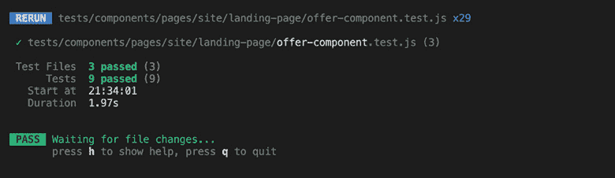

图 14.2：更改测试后 VitestUI 的输出

这里的测试只是冰山一角；你仍然组件测试方面仍有大量工作要做。到目前为止，我们只查看了模板测试，还没有触及组件触发事件。我们将在下一节中介绍这部分。

### 测试事件

至少在使用测试库时，事件测试与你测试组件的方式非常相似。你会在测试功能是否正确渲染的同时，尝试组件事件。

要进行事件测试，请从`testing-library/vue`导入`fireEvent`方法。查看下面的代码示例了解如何操作。

在原则上，你将使用`render()`创建被测对象，找到绑定了事件的元素，触发事件并检查结果。这些事件主要将连接到表单控件、按钮、链接、列表和表格。这不是详尽的列表，因为事件可以绑定到任何组件。

文档中包含了一个简单的示例，它涵盖了一个标准的计数器示例，其逻辑大致如下：

```javascript
import Counter from './counter.vue'
import { render, fireEvent } from '@testing-library/vue'

describe('Counter', () => {
  it('should increment value', async () => {
    const { getByText } = render(Counter, { props: { initialValue: 0 } })

    getByText('0') // 隐式断言

    const btn = getByText('increment')
    await fireEvent.click(btn)

    getByText('1')
  })
})
```

`fireEvent`方法重新导出了在链接中详细说明的所有事件：`https://github.com/testing-library/dom-testing-library/blob/src/event-map.js`。该列表包含了所有的事件：`click`；`change`；`touch`；`mouseover/up/down/enter`；`drag/drop events`；`cut/paste`等。花些时间查看该列表是值得的。

在许多方面，测试库断言事件执行了预期的操作，至少在组件层面就像组件测试一样简单。考虑以下代码：

```javascript
import AddToCart from '/src/AddToCartComponent.vue'
import { render, fireEvent } from '@testing-library/vue'

describe('AddToCartComponent', () => {
  it('should increment a counter', async () => {
    const { getByTestId, getByText, getLabelText } = render(AddToCart, {
      props: {
        id: 1,
        image: 'image.png',
        description: 'this is a description',
        name: 'test1',
        price: 23.99
      }
    })

    const incButton = getByTestId('incrementButton')
    const decButton = getByTestId('decrementButton')
    const outputControl = getLabelText(/itemcount/i)

    getByText(/23.99/)
    getByText('Add to Cart')

    expect(outputControl.value).toBe('1')

    await fireEvent.click(incButton)
    expect(outputControl.value).toBe('2')

    await fireEvent.click(decButton)
    expect(outputControl.value).toBe('1')
  })
})
```

接下来，我们需要确保发射事件的组件会影响父组件的状态并提供数据。我们通过`emitted()`函数来实现这一点，如下所示：

```javascript
import CheckoutPageComponent from '../../../../../components/pages/site/checkout-page/CheckoutPage.vue'
import { render, fireEvent } from '@testing-library/vue'

describe('CheckoutPage', () => {
  it('should emit a updateCartoucherCode event', async () => {
    const { getLabelText, emitted, getByText } = render(CheckoutPageComponent)
    const testCode = 'voucherCode'

    await fireEvent.update(getByLabelText('Voucher Code'), testCode)
    await fireEvent.click(getByText('Apply'))

    expect(emitted().updateCartVoucherCode).toBeTruthy()
    expect(emitted().updateCartVoucherCode.length).toBe(1)
    expect(emitted().updateCartVoucherCode[0]).toEqual([testCode])
  })
})
```

Vitest开箱即用了我们许多所需的工具，编写单元测试与编写组件测试没有太大区别。唯一的区别在于组合式函数（composable）没有被挂载（渲染）。

让我们来看一些简单的例子。恰好，我们在`useCart`中有一个非常优秀的组合式函数，它包含了一些我们可以测试的逻辑和函数。

### 初始设置

让我们从设置开始。我们将检查是否可以获取购物车，并确保在首次初始化时它是空的：

```typescript
import { useCart } from '../../src/composables/useCart.ts'

describe('useCart', () => {
  it('should return an empty cart on initialisation', () => {
    const { getCart } = useCart()
    const cart = getCart()

    expect(cart.value).toHaveProperty('items')
    expect(cart.value.items.length).toBe(0)
  })
})
```

非常简单，获取购物车，检查内容，并确保它们的长度为 0。

### 操作购物车内容

接下来，我们必须确保可以通过添加（仅限`CartItems`）和移除项目来操作购物车的内容。考虑以下代码：

```typescript
it('should allow you to add and remove items', () => {
  const testItem = {
    id: 1,
    name: 'test item',
    qty: 1,
    price: 10.0
  }

  const { addItem, removeItem, getCart } = useCart()

  addItem(testItem)

  expect(getCart().value.items).not.toHaveLength(0)
  expect(getCart().value.items).toHaveLength(1)

  removeItem(1)
  expect(getCart().value.items).toHaveLength(0)
})
```

然而，考虑一种我们尝试添加`CartItem`以外内容的情况，我们的 IDE 可能会友好地对此报错，如下：

```typescript
it('should not accept non-CartItem contents', () => {
  const { addItem, getCart } = useCart()
  const cart = addItem(1)

  expect(getCart().value.items).toHaveLength(0)
})
```

我们目前对`addItem()`函数的实现未能通过测试。尽管`1`不是`CartItem`，但在 JavaScript 层面它仍然被接受了。我们在这里遇到的是 JavaScript 在类型方面的动态性。我们必须更新被测试的组合式函数的代码以通过测试。

为了实现这一点，我们将为购物车添加一个类型守卫函数（type guard），并更新`addItem`函数以使用它，尽管我们可以忽略错误数据。我们将让函数抛出异常；我们只期望`CartItems`，因此任何其他内容都意味着问题。考虑以下代码：

```typescript
function isCartItem(item: any): item is CartItem {
  if ((item as CartItem).id) {
    return true
  }

  return false
}

function addItem(item: CartItem): Cart {
  if (isCartItem(item)) {
    cart.value.items.push(item)
    return cart
  }

  throw new Error('Requires a CartItem to be supplied')
}
```

重新运行测试仍然失败，但这是正确的。测试没有检查错误响应，所以我们也必须更新它。

```typescript
it('should not accept non-CartItem contents', () => {
  const { addItem } = useCart()

  expect(() => addItem(1)).toThrowError(/incorrect type/i)
})
```

通过这个测试，我们已经考虑了在发送错误类型时预期会产生错误的情况。

### 更新购物车

下一个测试涵盖了更新购物车。从代码角度来看，预期是购物车的内容被更新，内部的项目项目列表被替换。这遵循函数式编程模型，即进行数据转换而不是就地修改。测试类似于下面的代码：

```typescript
it('should allow you to update the cart items', () => {
  const testItem = {
    id: 1,
    name: 'test item',
    qty: 1,
    price: 10.0
  }

  const { addItem, updateCart, getCart } = useCart()

  addItem(testItem)
  expect(getCart().value.items).toHaveLength(1)

  const newItem = { ...testItem, qty: 2 }
  const newCart = updateCart([newItem])

  expect(newCart.value.items).toHaveLength(1)
  expect(newCart.value.items[0].qty).toBe(2)

  // 不传递值将重置购物车
  updateCart()
  expect(getCart().value.items).toHaveLength(0)
})
```

### 计算属性

最后，购物车的一车的计算属性应该被视为标准。我们将测试这些属性：

```typescript
it('should compute totals across the cart', () => {
  const { subtotal, tax, delivery, total } = useCart()

  const testItems = [
    { id: 1, name: 'test item', qty: 1, price: 10.0 },
    { id: 2, name: 'test item', qty: 1, price: 5.0 },
    { id: 3, name: 'test item', qty: 2, price: 17.99 }
  ]

  updateCart(testItems)

  expect(subtotal.value).toBe(50)
  expect(tax.value).toBe(10)
  expect(delivery.value).toBe(5)
  expect(total.value).toBe(66)
})
```

```javascript
const store = useUserAccountStore()
const { queryAllByText } = render(component)

expect(store.getOrderSubtotal(1)).toBe(5)
expect(store.getOrderSubtotal(2)).toBe(105)
expect(store.getOrderTotal(1)).toBe(12)
expect(queryAllByText(/^test item 1$/)).toHaveLength(2)
```

在这里，我们正在创建一个包含一些初始数据的测试实例，并确保这些数据在 store 中可用可用。由于测试实例默认会存根（stub）动作，因此我们传递了`(stubActions)`开关来关闭该功能；随后我们查看渲染的内容，以检查它是否渲染了预期的范围。到目前为止，我们只编写了通过的用例。作为你的练习，请编写一些衡量失败机制的测试（你可能需要修改 store 代码来处理失败情况）。如果你打算在多个测试中使用相同的 store 设置，那么将设置放在`beforeEach()`句柄中将是很有划算的。

Pinia 测试实例还有更多内容可以涵盖。阅读 Pinia 测试文档是一个好主意：

`https://pinia.vuejs.org/cookbook/testing.html`

## VueRouter

路由测试是通过在抽象模式下创建路由器，然后将其传递到`render`函数的选项对象完成的。使用抽象模式的路由器可以防止路由存储导航更改的默认行为。初始化程序通常被抽象成辅助函数，以便在需要的地方使用。考虑以下代码：

```javascript
import { render } from '@testing-library/vue'
import { createRouter, createWebHistory } from 'vue-router'

export async function renderWithRouter(component, routes, renderOptions) {
```


`const router = new VueRouter({`

```
    history: createWebHistory(),

    routes
```

  })

`const result = render(component, {`

```
    ...renderOptions,

    global: { plugins: [router]},
```

  })

`await router.push('/')`

`return result`

}

此实用函数允许你管理测试中使用的路由器。第 6 行持有抽象模式设置。第 15 行的`router.push()`是至关重要的，因为初始栈是空的，这会创建一个初始状态值。

该函数随后被作为测试库提供的`render()`函数的替代品。然而，组件之间的导航处理是通过异步处理程序完成的。考虑以下代码：

```javascript
import { render, waitFor, fireEvent } from '@testing-library/vue'

...

import App from '/src/App.vue'

import { renderWithRouter } from './render-with-router.js'

describe('Landing page navigation', () => {

  it('should navigate', async () => {

    const { queryByText, getByText } = await renderWithRouter(App, [

      ... routes array ...

    ])

    const menuButton = await getByText('View Our Menu')

    await fireEvent.click(menuButton)

    await waitFor(() => {

      expect(window.location.href).toContain('/menu')

    })

    await queryByText(/Menu\sPage/i)

  })

})
```

要使此成功工作，你需要渲染一个带有`<router-view>`的组件，并包裹了你想要导航的组件；否则，路由无法发生。

完成之后，你可以看到通过简单的用户导航测试单个组件之间的路由是多么简单。下一节将涵盖跨应用程序的用户旅程，并讨论端到端测试。

## 使用 Nightwatch 进行 E2E 测试

使用 Nightwatch 编写端到端测试与我们为此应用程序构建其他类型测试非常相似。

然而，存在细微的。请记住你正在像用户一样通过活动应用程序运行点击路径。为了做到这一点，你必须初始化一个浏览器实例并将其指向入口 URI。浏览器实例提供的流式接口随后被用于创建用户流，像用户一样导航应用程序，并对用户在页面上应该看到进行断言，并模拟用户交互和 UI 响应。

通常，e2e 旅程涵盖以下内容：

*   登录过程和导航到注册用户专属资源
*   注册过程
*   产品购买过程，也称为

作为入门，请检查以下：

```javascript
describe('Create a test', () => {

  before((browser) => {

    browser.navigateTo('http://localhost:9000/')

  })

  it('should navigate', (browser) => {

    browser.assert.visible('h1')

    browser.assert.textContains('body', 'View Our Menu')

    browser.click('button[type=button]')

    browser.assert.visible('input[name=itemCount]')

    browser.setValue('input[name=itemCount]', 2)

    browser.click('button[type=button]')

  })

  after((browser) => {

    browser.end()

  })

})
```

* 使用 Nuxt 创建项目并管理依赖
* 构建 Nuxt 应用程序的客户端
* 管理状态和跨组件功能
* 构建 Nuxt 应用程序的服务端

## 目标

Nuxt 是一个非常广泛的话题，理应由专门的一本书来详细介绍；本章将仅涵盖如何启动项目的基础、不同元素存放的位置，以及 Nuxt 与 Vue 相比的特殊之处。

Nuxt3 是该框架的最新版本，拥有最新的工具链和基础设施。如果你有 Meteor 等类似框架的经验，那么其中一些知识是可以迁移的。

## Nuxt.js 基础与 SSR

正如其文档所言，Nuxt 是一个全栈框架，具有混合渲染能力。Nuxt 提供了许多便利性，使项目的构建和管理变得更加简单：

* 多种渲染技术，取决于路由配置
* 标准的目录结构
* 项目范围内的自动导入
* Vue.js 视图引擎
* 内置服务器引擎 (`Nitro`)
* 模块化构建
* 透明的 TypeScript 集成

## 多种渲染技术

Nuxt 是一个基于服务器的应用程序框架，它可以预渲染客户端内容（被称为“通用渲染”，Universal Rendering），或者按照标准 Vue.js 那样进行传统的客户端渲染。在编写时，流水线中还有几种渲染模式：一种基于路由的混合方法，根据配置将应用程序的不同部分渲染为 SSR 或客户端渲染。此外，正在进行使用 CDN Edge 节点进行渲染内容的工作。

Nuxt 团队对于应用程序的结构组织有坚定的观点。这种结构具有简单性；如果你熟悉 Ruby on Rails 等框架，那么该框架使用的结构应该不是问题。主要的区别在于，在 Nuxt 中，当你生成应用程序时并不会提供目录结构。你需要手动添加所需的部分。这保持了应用程序的轻量化；只有在你需要某项功能时才会添加相应的目录。

下图显示了完整的目录结构所需的内容：

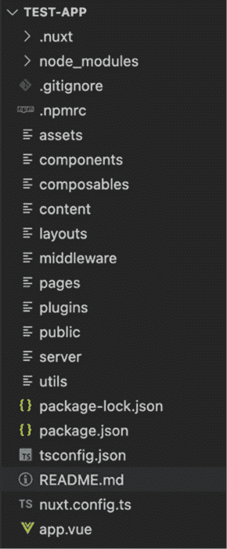

图 15.1：标准 Nuxt 目录结构

虽然这些在很多情况下是可选的，但 Nuxt 拥有一个智能编译器，允许实现如下所需的便利功能：

* **自动导入**：框架会自动导入功能，如组合式函数 (composables)、插件和组件。自动导入在框架结构内的多个目录中进行。如果需要，可以关闭自动导入或改为显式导入。
* **Vue.js 视图引擎和 Nitro 服务器引擎**：Vue.js 部分不言自明；这就是为什么我们在书中讨论它的原因。`Nitro` 是内置的 Web 服务器，它是全新的且专门为 `Nuxt3` 创建的。它提供了此列表中的许多便利功能。你可以在 [`nitro.unjs.io`](https://nitro.unjs.io) 查看更多信息。
* **模块化构建**：Nuxt 拥有模块系统，可以方便地扩展第三方服务。Nuxt 本身由几个核心包组成，共同工作交付框架。
* **TypeScript 集成**：TypeScript 是构建语言，框架透明地暴露了这一点；它甚至可以为你自动生成类型。

**Nuxt 的 SSR**：在许多方面，在服务器上使用 Nuxt 与其他更传统的服务器技术（如 PHP 或 Ruby-on-Rails）类似。然而，使用通用渲染时，服务器首先响应静态页面，随后将动态页面代码作为单独的代码包发送。这样做是为了让初始页面加载（静态页面数据）快得多，即减少了渲染时间，但随后会额外的功能以确保任何交互性或过渡（即用户体验 UX）不会丢失。这被称为“水合”（hydration）。这种方法受到推崇的优点之一是，如果爬虫（如 Google 的索引蜘蛛）确实足够先进，它们可以在没有 JS 渲染开销的情况下索引网站。

## 使用 Nuxt.js 创建项目并管理依赖

这些步骤中的许多会感到熟悉，而且我们处理的是 JavaScript 生态系统中的项目。

创建 Nuxt 应用程序最简单的方法是使用 `NPX nuxi` 脚本，如下：

1. `$npx nuxi init <project-name>`

随后 Nuxi 会安装应用程序的基础。参考下图：

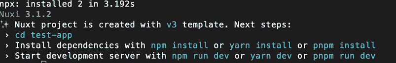

图 15.2：显示 `nuxi` 输出的截图

完成后，按照屏幕上的指令操作，即移动应用程序目录并使用 `npm i` 安装依赖。

注意：如果你用 VSCode 打开应用程序文件夹，它可能会标记 `tsconfig.json` 文件有问题。要解决这个问题，请运行 `$npm i -D @types/node`。

完成后，你将得到一个与下方图片类似的项目文件夹。任何差异都取决于你在构建脚本中做出的选择。参考下图：

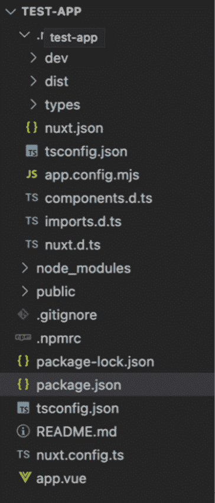

图 15.3：新 Nuxt 项目的结构

运行项目的方法是运行 `npm dev` 脚本：

1. `$npm run dev`

然后你可以打开浏览器指向 'http://localhost:3000' 上的应用程序，显示如下：

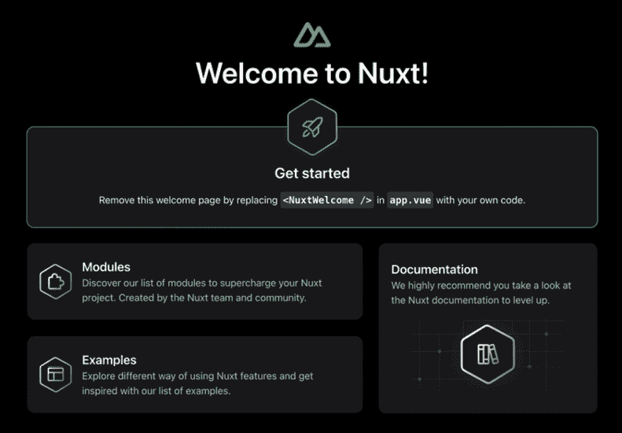

图 15.4：基础落地页

从这里开始，你可以向目录结构中添加元素、布局 (layouts) 和组件 (components)，如图 15.1 所示。

## 构建 Nuxt 应用程序的客户端

有三个可以放置 UI 元素的主要区域：布局目录、页面目录和组件目录。将组件放置在这些地方可以确保它们被自动导入到项目中使用。我们将依次讨论每个部分，从组成页面的最小元素组件开始到最大的布局。

### Nuxt 组件

这些是标准的 Vue.js 组件，如你所见。这里没有魔法。魔法在于自动导入，它使得目录中的所有组件在项目中可用。导入器足够智能，还可以导入被引用的模块所需的任何依赖组件。

组件使用文件路径和文件名作为组件名称自动注册。

作为此示例，所示：

```
1. /components/MyComponent.vue

2. <template>

3. <MyComponent />

4. </template>

6. /components/deeply/nested/Component.vue

7. <!-- 嵌套组件带有路径前缀 -->

8. <template>

9. <DeeplyNestedComponent />

10. </template>
```

如果你不想使用文件路径前缀，则你需要在 `nuxt.config.ts` 中通过 `pathPrefix` 选项更新 Nuxt 配置，如下：

```
1. export default defineNuxtConfig({

2. components: [

3. {

4. path: '~/components/',

5. pathPrefix: false,

6. },

7. ],

8. });
```

使用此选项意味着上述的嵌套示例可以变为：

```
1. /components/deeply/nested/Component.vue

2. <template>

3. <Component />

4. </template>
```

使用哪种方法取决于个人偏好或团队的编码标准。

在使用自动导入功能时，你可能会遇到使用动态组件遇到问题。解决此问题的推荐方法是使用 Vue 的 `resolveComponent()` 辅助函数：

```
1. <template>
```

```html
<component :is="someCondition ? MyComponent : OtherComponent" />
```

```html
</template>
```

```html
<script lang="ts">

const MyComponent = resolveComponent('MyComponent')

const OtherComponent = resolveComponent('OtherComponent')

const someCondition = computed(() => ...)

</script>
```

有全局导入组件的方法，这样就不需要使用 `resolveComponent()` 了。这些方法并不被认为是良好的实践，且不被推荐。

另一种你可能会用到的模式是懒加载组件，特别是当组件在初始组件渲染期间不需要时。使用如下所示的 `Lazy` 前缀可以解决这个问题：

```html
<template>

<MyComponent />

<<LazyOtherComponent v-if="visible" />

</template>
```

```html
<script lang="ts">

const visible = ref(false)

</script>
```

在处理组件时，我们还需要解决最后两个两个问题。第一个是仅在客户端渲染组件，第二个是关于组件水合（hydration）的问题。这两个问题是相互相关的。

注意：我们已经提到过水合，但作为提醒，它是指组件在服务器上静态渲染，并与组件的动态代码一起发送到客户端，后者负责交互性和/或过渡效果。

为了解决这两个相关问题，Nuxt 提供了两个文件名后缀：`.client` 和 `.server`。

如果文件被标记为 `.client`，它将仅在客户端渲染。这意味着它们只会在挂载后渲染，正如你通常预期 Vue.js 组件的那样。

如果你使用 `.server` 作为后缀，组件将仅在服务器端渲染，并且没有水合。

在某些情况下，你可能会将组件拆分为 `.server` 和 `.client` 部分，因为这允许对水合进行更细粒度的控制，或者允许你在水合后创建并渲染 UI 的独立实现。

## Nuxt Pages

页面是 Vue.js 组件，包含了构成页面的一个或多个组件的引用。`components/` 目录下的组件与 `pages/` 目录下的组件的主要区别在于路由。页面具有路由，路由基于子目录和文件名。

注意：在构建页面组件时，你需要确保该组件只有一个根元素。HTML 注释也被视为元素。

由于页面之间的路由是由文件名和目录名处理的，处理动态路由可能会有点复杂。

为了方便这一点，在构建目录和文件名时可以使用一种特殊的语法来提供这种功能。对于强制性路由参数，参数名括在 `[]` 中；对于可选参数，你需要使用 `[[]]`。参见以下示例：

```text
--> pages/

----> index.vue

----> product-[group]/

------> [[product_id]].vue
```

在给出的目录列表中，你可以看到 `group` 是必须的，并且很可能在模板中使用；然而，`product_id` 是可选的。如果没有它，我们可能假设页面将显示不同的内容，例如产品组中所有项目的列表。因此，我们可能会看到如下所示：

```html
<template>

<main>

<h1>{{ $route.params.group }}</h1>

<section v-if="$route.params.product_id">

<!-- 显示特定产品的详情 -->

</section>

<section v-else>

<!-- 显示分组列表组件 -->

</section>

</main>

</template>
```

在模板中（或使用 Options API）访问路由参数是通过标准的 `$route` 对象实现的。使用 Composition API 访问这些参数是通过 `useRoute()` 组合函数完成的。

路由嵌套（即子路由）要求你在每个父组件中使用 `<NuxtPage />` 组件，以确保子组件在它应该出现的地方。在使用 `<NuxtPage />` 组件时，可以使用 `pageKey` 属性控制渲染或过渡。

页面还可以使用 `definePageMeta()` 编译器宏来设置元数据。在整个应用程序中可以使用几个特殊的元数据键。这些键的说明可以在文档中找到。

Nuxt 提供了一个名为 `useState()` 的组合式（composable）。该组合式是 SSR 环境下 `ref` 或 `reactive` 数据的无缝替换。如果你已经熟悉 React Hooks，那么它的原理是相同的。

由于它被直接用于支持 SSR，在使用时需要注意以下几点：

- `useState()` 只能在 `script setup` 或生命周期钩子中使用。
- 内部包含的数据需要是 JSON 可序列化的。
- 数据在注水（hydration）过程中会被保留。
- 存储的状态通过一个唯一的键（key）在所有使用它的组件之间共享。
- 存储的状态是响应式的。

使用此组合式有两种方式：使用键或不使用键；在后一种情况下，Nuxt 会自动为你生成一个唯一的键。你提供的初始值可以是被 `ref()` 包装的值，也可以是函数的返回值，只要该值是 JSON 可序列化的即可。以下代码示例展示了如何使用此组合式：

```javascript
const value = useState(/* primitive value */

const value = useState('value', () => /* return value */)

const value = useState('value') // Accesses value

// 全局类型安全状态 (例如：composables/x.ts)

export const useLetterX = () => useState<string>('letterX', () => 'x')

// 使用自动导入

<script setup>

const x = useLetterX() // 等同于 useState('letterX')

</script>
```


我们用于管理功能的下一个部分是生命周期钩子。

## 生命周期钩子 (Lifecycle Hooks)

由于 Nuxt 是一个现代 Web 开发框架，使用`Vue.js`作为显示层，它允许开发者通过“钩入（hook）”应用生命周期，从而选择处理设置操作和执行远程数据调用。

在 Nuxt 中，钩子可以定义在构建时或运行时执行，且涵盖前端应用和服务器。

钩子的数量非常多，书中无法全部列出。完整的列表可以在[`nuxt.com/docs/api/advanced/hooks`](https://nuxt.com/docs/api/advanced/hooks)找到。

钩子在模块、插件和中间件中使用时会变得有用得多。

接下来，我们将查看如何获取远程数据。

## 远程数据 (Remote data)

我们已经熟悉`useFetch()`及其相关函数。在 Nuxt 中，这些组合式仅在`script setup`和生命周期钩子可用，但在整个应用范围内都是通用的。

在构建应用时，你可能需要访问 API 数据。理解的是，访问远程数据可能需要传递头部数据（如 cookies 或授权），而在服务器环境中无法直接访问这些数据。为了处理这种情况，Nuxt 提供了`useRequestHeaders()`函数，用于提供相关的头部数据。

文档中有一个关于最佳实践的章节，你应该阅读：[`nuxt.com/docs/getting-started/data-fetching#best-practices`](https://nuxt.com/docs/getting-started/data-fetching#best-practices)。

## 错误处理 (Error handling)

与所有框架一样，Nuxt 应用可能会成为某些不可避免的运行时错误的来源。

在应用的生命周期中，有几个点是这些错误发生且最可能被处理的地方：

- SSR 和 SPA 的客户端渲染生命周期：
  渲染期间的错误可以通过`onErrorCaptured()`函数或`vue:error`钩子捕获。如果你使用全局错误处理器，可以通过创建一个插件并通过`vueApp.config.errorHandler()`封装全局处理器来捕获。创建此类封装的典型示例所示：

```javascript
export default defineNuxtPlugin((nuxtApp) => {

  nuxtApp.vueApp.config.errorHandler = (error, context) => {

    // ...

  }

})
```

- SSR 和 SPA 的服务器和客户端启动：
  如果 Nuxt 在启动时遇到错误，它会调用`app:error`钩子。
- 服务器/API 生命周期：
  如果在服务器生命周期期间发生错误，至少在编写时，无法定义服务器端处理器。对此的最佳实践是渲染一个错误页面，清除错误并重定向到新页面。要查看示例，请访问[`nuxt.com/docs/getting-started/error-handling#example`](https://nuxt.com/docs/getting-started/error-handling#example)。

## 组合式 (Composables)

应用的组合式放在`composables/`目录下。从这里它们会被自动导入，以便在整个应用中使用。为了让编译器自动生成类型文件（`.nuxt/imports.d.ts`），需要运行标准运行脚本之一：`nuxi prepare`、`nuxi dev`或`nuxi build`；否则 TypeScript 编译器会报错，显示找不到正确的类型。

## 中间件 (Middleware)

Nuxt 支持两种形式的中间件：客户端中间件影响 UI 路由，服务端中间件应用于`Nitro`运行。

### 路由中间件 (Router middleware)

路由中间件通常用于对请求头或参数进行查询，以确定哪个端点处理器或页面最适合响应。通常，路由中间件处理身份验证、角色管理或授权、CORS 和 XSS 攻击，但它们也可以用于重定向到特殊的产品页面、优惠活动或基于特定用户的营销或功能。

在编写`Vue.js`代码时，你可以通过三种方式影响应用路由的应用：

- 内联或匿名，直接定义在页面上
- 放置在`middleware/`目录下的具名中间件，它会被自动导入，且通常基于文件名命名
- 全局可用，类似于具名中间件，但带有全局后缀

前两种类型可以使用`definePageMeta()`函数应用于页面级，传入中间件键的列表：

```javascript
<script setup>

definePageMeta({

  middleware: ["auth-handler", "my-middleware"]

})

</script>
```

路由中间件的格式是一个导航守卫，接受两个参数`to`（去向哪里）和`from`（来自哪里），Nuxt 暴露了`navigateTo()`和`abortNavigation()`辅助函数。如果这两个者都没有返回（参见下例），控制权将传递给下一个中间件或完成路由导航：

```javascript
export default defineNuxtRouteMiddleware((to, from) => {

  if (/* 错误条件*/) {

    return abortNavigation()

  }

  if (/* 重定向条件*/) {

    return navigateTo('/')

  }

  // 无返回 - 下一个中间

})
```

### 服务端中间件 (Server middleware)

服务端中间件位于`server/middleware/`目录，会被 Nuxt 自动导入。定义在此文件夹中的中间件处理器将在服务器路由到组件之前应用于每个请求。服务端中间件处理器可以用于调查头部、记录请求、扩展请求对象或抛出错误。用于返回响应。参考以下代码：

```javascript
// server/middleware/auth.ts

export default defineEventHandler((event) => {

  ...

  event.context.auth = <auth context>

})
```

## 插件 (Plugins)

Nuxt 插件用于为 Vue 库和其他外部模块提供封装。如果插件文件仅在客户端或服务器需要，可以分别加上`.client`或`.server`后缀。

包含在`plugins/`根目录的文件会被自动导入，子目录中的任何`index.(js|ts)`文件也是如此。

注意：插件按字母-数字顺序导入。如果某个特定插件依赖另一个插件，则你需要确保依赖项先加载。这可以通过在文件名前加缀数字（如 1、2 等）来实现。

插件文件导出`defineNuxtPlugin()`函数的结果，该函数接收`nuxtApp`作为参数：

```javascript
import ... from Vue

export default defineNuxtPlugin((nuxtApp) => {

  nuxtApp.use(...)

})
```

# 其他文件夹

Nuxt 应用中还有许多其他文件夹，但它们通常用于处理或管理状态。你可以在[`nuxt.com/docs/guide/auto-imports`](https://nuxt.com/docs/guide/auto-imports)中探索。

# Nuxt 应用的服务器端

Nuxt 应用的服务器部分通常用于创建 API 端点，并配合暴露的`useFetch()`组合式使用。

`server/`目录结构可以包含任意数量子目录，包括`api/`、`routes/`和`middleware/`。这些会被扫描注册 API 和处理器。

Nuxt 期望这些目录中的文件导出一个使用`defineEventHandler()`函数的默认函数。处理器接收一个`event`对象并应该返回 JSON 数据、`Promise<T>`。

Nitro 提供的文档可以在[`nitro.js.io/guide/`](https://nitro.js.io/guide/)找到。

## 事件处理器基础

为 Nuxt 应用创建的所有事件处理器都具有相同的签名：

```typescript
// 类型签名

declare function defineEventHandler<T = any>(handler: EventHandler<T>): EventHandler<T>;

export default defineEventHandler(

  (event: H3Event) => {

    return

  }

)
```

处理器在构建时自动映射到 URI；以下章节描述了如何定义各种类型的处理器来访问请求。

### 处理 body

具有 body 内容请求需要从`event`中提取内容。这是异步的：

```typescript
// server/api/my-handler.post.ts

export default defineEventHandler(async (event) => {

  const body = await readBody(event)

  return { body }

})
```

### Query 参数

处理查询参数与处理 body ：

```typescript
// server/api/my-handler.get.ts

export default defineEventHandler((event) => {

  const query = getQuery(event)

  return { ... }

})
```

### Headers

访问请求头遵循类似的模式：

```typescript
// server/api/my-handler.ts

export default defineEventHandler((event) => {

  const headers = getRequestHeaders(event)

  return { ... }

})
```

还有几个其他函数可以处理请求和响应体，可以在`h3.unijs.org/https`找到。

### 访问 API

使用 Nuxt 暴露的`$fetch` API 访问服务器 API 端点。

在需要来自 API 组件中，你可以像接示例所示发出请求：

```javascript
// GET 请求 – 映射到 server/api/endpoint.get.ts

$fetch('/api/endpoint')

// POST 请求 – 映射到 server/api/endpoint.post.ts

$fetch('/api/endpoint', { method: 'post', body: { test: 'abc' } })

// DELETE 请求 – 映射到 server/api/endpoint.delete.ts

$fetch('/api/endpoint', { method: 'delete', body: { id: 1 } })
```

`fetch` (`ofetch`) 的文档可以在[`github.com/unjs/ofetch`](https://github.com/unjs/ofetch)找到，其中详细说明了更多可用 API。

# 路由

路由是根据我们讨论过的自动构建的。以下章节涵盖了服务器级别提供的各种路由元素。

### 路由匹配

`routes/`目录根据文件名构建路由，其中`[]`中的段会被提取到`event.context.params`。Nuxt 期望这些目录中的文件导出一个使用`defineEventHandler()`函数的默认函数。处理器接收一个`event`对象。

例如，在`server/routes/[id].ts`中：

```javascript
// server/routes/[id].ts

export default defineEventHandler((event) => {

  // 访问 event.context.params.id

})
```

## 通配路由

创建一个名为`...`的文件会创建一个匹配嵌套路径的通配路由。

## 状态码、重定向

Nuxt 提供了多种用于影响响应的函数。它还从`event`提供了 cookie。

```javascript
export default defineEventHandler((event) => {

  // 设置状态或重定向

  // 处理 cookie

})
```

## 服务器存储解决方案

Nuxt 的服务器层带有一个用于类似 Redis 的键值存储的简单解决方案。文档中有一个如何集成 Redis 的简单示例：[`nuxt.com/guide/directory-structure/server-storage`](https://nuxt.com/guide/directory-structure/server-storage)。

然而，你需要一个像 MongoDB 这样全面的解决方案；为了让 MongoDB 在 Nuxt 中工作，你需要在`nuxt.config.ts`中定义配置：

```typescript
// nuxt.config.ts

import { defineNuxtConfig } from "nuxt";

export default defineNuxtConfig({

  runtimeConfig: {

    mongoUrl: process.env.MONGO_URL,

  },

});
```

## 插件

插件有两种设置方式。第一种是从`server/plugins`目录自动导入。在此目录工作时，你需要使用`defineNitroPlugin()`函数创建插件，该函数接收`nitroApp`作为参数。通过这样做，你可以扩展运行时行为。

```javascript
export default defineNitroPlugin((nitroApp) => {

  // 钩入 nitro 生命周期事件

})
```

对于其他类型的插件，你需要将它们添加到`nuxt.config.ts`文件中，位于`nitro.plugins`键下：

```typescript
nitro: {

  plugins: ["~/server/path/to/plugin.ts"],

},
```

关于 MongoDB 的设置，将此添加到应用程序中的最佳方式如下：

```typescript
import mongoose from "mongoose";

mongoose.set('strictQuery', true);

export default defineNitroPlugin(async () => {

  try {

    await mongoose.connect(useRuntimeConfig().mongoUrl)

    // ... 其余设置 ...

  } catch (err) {

    // ... 处理 err ..

  }

});
```

正常情况下，Nitro 服务器将返回 200 OK 响应；如果出现任何未捕获的错误，则返回 500 Internal Server Error。如果你需要响应不同的错误类型，则需要使用`createError()`函数抛出异常，并传入错误详情和所需的`statusCode`。这与之前提到的`setResponseStatus()`函数不同。参考以下代码：

```javascript
export default defineEventHandler((event) => {

  if (false) {

    throw createError({

      statusCode: 400,

      statusMessage: 'This is a failure message',

    })

  }

  return 'Ok'

})
```


### 其他目录
`Nitro` 会自动从此处未列出的其他目录中导入内容。更多细节可以在 [`nuxt.com/docs/guide/directory-structure/server`](https://nuxt.com/docs/guide/directory-structure/server) 找到。

## 结论
`Nuxt3` 是一个大型框架，这个简短的章节很难完全展现它的面貌。我们在这里仅仅触及了皮毛，但它足以让你入门，并为你提供足够寻找更多信息的线索。

客户端和服务器之间使用的模式存在显著的重叠，为开发者在处理应用程序这两个部分时提供了统一的体验。这种上下文或语言切换的缺失意味着 `Nuxt` 应用构建更快、更易于维护。

### 需要记忆的点
* `Nuxt3` 使用 `Vue3` 作为视图层。
* `Nuxt3` 有一个名为 `Nitro` 的内置 Web 服务器。
* `Nuxt` 会从一些标准目录自动导入。
* 默认 UI 渲染被称为通用渲染（Universal Rendering）。
* 在服务器上渲染的 UI（SSR）会在客户端进行注水（Hydrated）。
* 中间件用于影响服务器路由。

## 关键术语
* 通用渲染
* 服务端渲染 (SSR)
* 注水 (Hydration)
* 构建时间
* 运行时
* 中间件
* 路由
* Nitro
* 错误处理
* 请求
* 响应
* 自动导入
* Fetch API
* 存储
* 路径

加入我们的书籍 Discord 空间
加入书籍 Discord 工作区以获取最新更新、优惠、全球技术动态、新发布以及与作者的座谈会：
**[`discord.bpbonline.com`](https://discord.bpbonline.com)**


# 第 16 章 使用 Quasar 构建多租户应用

## 引言
如上一章所述，使用 `Nuxt.js` 构建应用程序有一个小小的限制，这对于某些人来说是一个问题。正如你在上一章看到的，你可以用 `Nuxt.js` 快速构建 Web 应用，但如果你需要构建针对多个平台的应用程序（特别是如果你考虑移动原生应用），`Nuxt` 就无法为你提供帮助。为此，你需要 `Quasar`。通过利用多个构建流水线和编译器，`Quasar` 应用可以为几乎任何输出设备构建程序。

## 结构
本章涵盖了以下主题：
* 背景下的 Quasar
* 入门
* 多平台
* 构建多租户应用
* 使用 Quasar 构建应用程序
* 将你的应用程序发布到世界

## 目标
`Quasar` 是一个结合了组件库、框架和布局引擎的工具，允许用户构建可以编译到多个目标的应用程序。本章涵盖了使用 `Quasar` 构建应用程序的一些方面。从根本上说，使用它与构建任何 `Vue.js` 应用是相同的。区别恰恰在于 CLI、平台检测 API、组件库以及应用程序部署。

### 背景下的 Quasar
为了介绍 `Quasar` 的背景，我们需要定义几个你可能不熟悉的术语。这些是：输出目标、构建上下文、组件库和启动文件（boot file）。

### 输出目标
输出目标指的是我们编译应用程序运行的平台：桌面/笔记本电脑浏览器、移动端浏览器、移动原生原生应用等。输出目标是一个 CLI 选项，描述了使用哪种编译器。[图 16.1] 描述了输出目标：

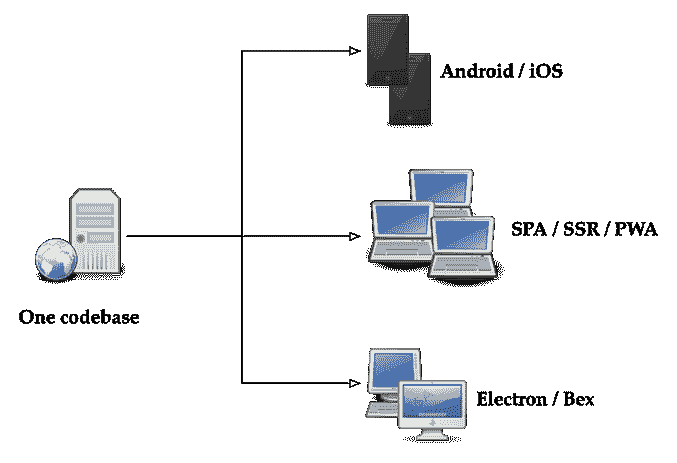
图 16.1：输出目标

下表显示了每个输出目标可用的编译器：

| 目标 | 编译器 | 备注 |
| --- | --- | --- |
| SPA | Default | |
| SSR | ssr | |
| PWA | pwa | |
| Capacitor | capacitor | 需要 Android SDK 和/或 Xcode；目标为 iOS 或 Android |
| Cordova | cordova | 需要 Android SDK 和/或 Xcode；需要安装 Cordova；目标为 iOS 或 Android |
| Desktop | electron | |
| 浏览器扩展程序 | bex | |

表 16.1：输出目标

### 构建上下文
这意味着几点：应用程序是 SSR 还是渲染的，以及应用程序是为开发还是生产环境构建的。这些通过 `quasar.config.js` 或 CLI 控制。

### 组件库
我们还没有详细讨论组件库，但之前在 `Nuxt` 中已经简要提到过它。组件库是一组提供的、开箱即用的组件，是一种划分 UI 的方式。

### 启动文件 (Boot file)
启动文件是一个在主 `Vue` 实例可用之前所需的服务的文件。可以在 [`quasar.dev/quasar-cli/boot-files`](https://quasar.dev/quasar-cli/boot-files) 找到几个很好的启动文件。

### 入门
最简单的入门方法是全局安装 Quasar：

```bash
npm i -g @quasar/cli
```

安装 CLI 后，可以通过 `init` 脚本创建新项目，它会询问一系列问题，详文所示：

```bash
npm init quasar
```

需要安装以下包：
`create-quasar@1.1`
是否继续？(y) `y`
✔ 你想构建什么？`App with Quasar CLI, let's go!`
✔ 项目文件夹：`quasar-project`
✔ Quasar 版本：`Quasar v2 (latest and greatest)`
✔ 脚本类型：`Typescript`
✔ Quasar App CLI 变体：`Quasar App with Vite`
✔ 包名：`quasar-project`
✔ 项目名称：（构建移动应用时必须以字母开头）`Quasar App`
✔ 项目描述：`A Quasar Project`
✔ 作者
✔  Vue 组件样式：`Composition API`
✔ 选择你的 CSS 预处理器：`Sass with SCSS syntax`
✔ 检查项目需要的功能：`ESLint, 状态管理 (Pinia), Axios`
✔ 选择 ESLint 预设：`Prettier`

然后，你可以添加所需的目标平台：

```bash
cd <project-folder>
quasar add [ssr | pwa | capacitor | cordova | electron | bex]
```

当项目依赖就绪后，可以使用 `Quasar` 构建脚本完成构建：

### 开发环境构建
1. // Development builds
2. `$quasar dev`
3. `$quasar dev -m [ ssr | pwa | electron | hex ] <options>`
4. `$quasar dev -m [ capacitor | cordova ] -T [ ios | android ] <options>`

### 生产环境构建
6. // Production builds
7. `$quasar build`
8. `$quasar build -m [ ssr | pwa | electron | hex ] <options>`
9. `$quasar build -m [ capacitor | cordova ] -T [ ios | android ] <options>`

现在我们已经知道了如何安装框架、创建和构建项目，接下来可以看看使用 `Quasar` 创建应用与使用任何其他组件库构建网站有何不同。

## 多平台

如前所述，在许多方面，使用 `Quasar` 与使用你可能遇到的任何其他组件库非常相似。

`Quasar` 提供了自己的组件库、CSS 框架以及若干平台辅助工具（helpers）。这些辅助工具专门用于，旨在帮助你构建不同类型的应用程序，或者说，能够在不同的构建输出中使用相同的代码库。

我们将在下一节中详细介绍这些辅助工具。

与 `Nuxt` 不同，`Quasar` 不支持自动导入 JS/TS ，因为它具有不同的树摇（tree-shaking）机制，并且对包大小和执行效率有不同的要求，这在很大程度上取决于输出目标。

尽管使用 `Quasar` 构建不同类型的 Web 应用对于许多 Web 开发者来说并不陌生，但对于那些以前接触过移动原生或桌面应用的人来说，这些领域起初可能会非常令畏。使用 `Quasar` 意味着你不需要学习新的编程语言：你可以坚定地留在 JS/TS 世界来为这些其他平台构建应用。访问浏览器沙箱之外的硬件服务开启了许多待探索的新途径和范式。

特别是在为原生移动端构建时，你可能需要跳出熟悉的编辑器（最可能是`VS Code`）。在为 iOS 构建时，由于平台限制，你需要在 Apple 电脑上使用`XCode`；而对于 Android，你需要访问`Android SDK`（以及`Android Studio`）。

这些平台并不是 Web 浏览器，而是有各种工具让你视觉化并访问你的应用程序。在应用程序开发的早期，这意味着将访问这些环境提供的设备模拟器。在开发的后期和部署之前，你需要访问目标平台的至少一个硬件设备。如果你同时为 iOS 和 Android 构建，你需要一个 Android 设备（如`Google Pixel`或`Samsung device`）以及一台用于 iOS 的`Apple iPhone`。

这些设备不需要是顶配或全新的，只需要是能反映你预期用户群体中典型用户特征的设备。如果你或你的组织负担得起，提供多种屏幕尺寸的设备和几个不同操作系统的示例进行测试，将让你有最大的机会满足受众的需求。

## 构建多租户应用

在构建需要在不同平台间使用的应用程序，甚至使用该框架的 JS 基础构建移动或桌面应用时，你需要了解使用 `Quasar` 时可用的一些元素。

## Quasar 实例 - $q

我们首先介绍的是 `Quasar` 实例，按照惯称为`$q`：

## Composition API
```javascript
// Composition API
<script setup lang="ts">
import { useQuasar } from 'quasar'
const $q = useQuasar()
...
</script>
```

### 或者
```javascript
// OR
<script>
import { useQuasar } from 'quasar'
export default {
  setup () {
    const $q = useQuasar()
    ...
  }
}
</script>
```

### Options API
```javascript
// Options API
<script>
export default {
  methods: {
    func () {
      this.$q.platform...
    }
  }
}
</script>
```

`$q` 对象/实例类似于 vue 实例，它是一个全局可用的对象，提供了构建你的应用程序所需的行为。这个辅助工具提供了有关构建环境的信息、任何国际化数据，以及对你可能配置的任何 Quasar 级插件的访问。

从`$q`获取的最重要的信息类型如下：
* `$q.platform` 用于查询平台
* `$q.screen` 获取尺寸
* `$q.lang` 用于 i18n

对于原生移动端，你还可以访问`$q.cordova`或`$q.capacitor`，以便访问原生功能。

## 平台检测

在跨平台工作时（特别是在原生平台上），你需要轻松判断自己处于哪种平台。下表提供了`$q`中可用属性的非穷举列表：

| is | has | within |
| :--- | :--- | :--- |
| mac | | |
| mobile | | |
| desktop | | |
| iframe | | |

该辅助工具可以同时在模板和脚本上下文中使用：

```html
<!-- template -->
<div v-if="$q.platform.is.mac">
  <!-- 在 mac 上渲染 -->
</div>
<div v-if="$q.platform.is.mobile">
  <!-- 在移动端渲染 -->
</div>
<div v-if="$q.platform.is.desktop">
  <!-- 在桌面端渲染 -->
</div>
```

### 组件
```javascript
// Components
<script setup lang="ts">
import { useQuasar } from 'quasar'
const $q = useQuasar()
const func = () => {
  if ($q.platform.is.electron) {
    // 在 electron 上渲染
  } else if ($q.platform.is.nativeMobile) {
    // 在原生移动端渲染
  }
  if ($q.platform.has.touch) {
    // 触摸功能
  }
  if ($q.platform.is.chrome && $q.platform.version < 70) {
    // 针对 chrome 版本 <70 的补丁
  }
}
</script>
```

在使用此辅助工具时需要注意的是，在模板中工作时，你可能可以使用 CSS 框架实现相同的视觉输出。使用 CSS 方法的缺点是，即使元素不可见，它们也会渲染，无论平台如何。有时这是所需的行为；由你决定什么最适合你的应用。

需要注意的是`$q.platform.is.mobile`返回的是应用是否运行在移动浏览器中，而不是原生移动应用。要获取原生移动详情，请使用`platform.is.cordova`或`platform.is.capacitor`。

## 屏幕检测

`Quasar` 提供了一个屏幕插件，可以在代码级别管理动态和响应式 UI。建议使用 CSS。你可以在`https://quasar.dev/style/window-width-related`使用许多响应式类。

尽管此功能封装在插件中，但它是自动可用的。这意味着`$q.screen`已经挂载到`$q`实例上。

在构建组件中使用`$q.screen`的示例如下列表所示：

```html
<template>
  <q-list v-if="$q.screen.gt.md">
    <q-item>
      <q-item-section>列表内容</q-item-section>
    </q-item>
    <q-item>
      <q-item-section>列表内容</q-item-section>
    </q-item>
  </q-list>
  <q-button :class="buttonColor" />
</template>
```

```html
<script...>
import { useQuasar } from 'quasar'
import { computed } from 'vue'
const $q = useQuasar()
const buttonColor = computed(() => {
  return $q.screen.lt.md
  ? 'primary'
  : 'secondary'
})
</script>
```

`Screen` 插件也可以用于重新定义组件响应的各种断点。它不会改变 CSS 断点。然而，要实现这一点，你需要向`setSizes()`函数提供一个对象，该对象定义了你想要做的更改。该对象只接受有限数量的键。可以覆盖的断点标识符有`sm`、`md`、`lg`和`xl`。

考虑以下代码：

```html
<script setup>
import { Screen } from 'quasar'
Screen.setSizes({ sm: 300, md: 500, xl: 2000 })
</script>
```

此外，该插件还可以向构建中添加几个额外的响应式 CSS 类；这有一个已知问题，会显著增加部署包的权重，足以增加首次有效内容绘制的时间。更多细节可以在文档`https://quasar.dev/options/screen-plugin`中找到。

## 国际化 (i18n)

在 `Quasar` 中，当你考虑到 i18n 构建应用时，需要考虑两个元素。在这两个元素中，一个仅适用于 Quasar 组件语言包，另一个适用于你自己的组件：使用`vue-i18n`和`@intlifty/vue-i18n-loader`是支持 i18n 的推荐方法。

这些包的安装和设置可能会变得相当复杂，因此最好熟悉文档中的相关部分。在两种情况下，你都会非常熟悉启动文件（boot file）的设置。

若要处理 Quasar 组件和语言包，文档请访问`https://quasar.dev/options/quasar-language-packs`。

为你自己的组件添加 i18n 的文档可以在`https://quasar.dev/options/app-internationalization`找到。

## 插件、扩展和工具类

尽管 `Quasar` 是一个功能齐全、箱箱即用的框架，但它也有几个可以在需要时使用的可选额外扩展。这些扩展根据功能在应用程序中的应用方式分为几种类型。

### 插件

插件用于增强你可用的 UI 组件。它们通常通过`quasar.conf.js`文件中的`plugins`属性添加。这里有一个简单的示例：

```javascript
// quasar.config.js
return {
  framework: {
    plugins: [ 'Notify', 'Meta', ... ]
  }
}
```

插件随后通常（除非文档另有说明）可以通过 Quasar 实例可用：

```html
<template>


### 应用扩展

扩展提供了具有额外依赖项的功能库，这些依赖可能需要启动文件（额外的配置细节）、自定义模板和自定义逻辑。它们可以用于扩展 `Quasar` 核心和 `CLI`。

构建你自己的扩展可能会复杂，但从 `App Extension` 库中安装一个是简单的，并且通过 `Quasar CLI` 完成。考虑以下代码：

```bash
$ quasar ext add <extension-name>
```

由于每个扩展都是自定义的，任何导入的扩展可能需要额外的设置，详细请见其文档。

扩展适用于多个不同的用途，例如添加以下内容：

* 预构建的测试工具
* 将 `TypeScript` 引入项目
* 音频/视频播放器
* 日历、时间线和其他复杂的 `UI`

官方扩展列表可以在此处找到：`https://quasar.dev/app-extensions/discover`

此页面也有社区提供的扩展的链接。

### 工具类

工具类是有用功能的库。它们可以直接从 `Quasar` 导入并且是完全支持摇抖优化。

`Quasar` 提供了多个工具类，无需安装第三方库即可让任务更容易。以下是有限列表：

* 日期 (`Date`)
* 颜色 (`Color`)
* 格式化 (`Formatter`)
* 防抖 (`Debounce`) 和节流 (`Throttle`)
* 事件处理

使用工具类简单，只需导入然后解构。看下面的示例：

```html
<script>
import { dom } from 'quasar'

// 解构
const { offset, height, width } = dom

// 使用函数
console.log(offset)
console.log(height)
console.log(width)
</script>
```

在 `Quasar` 核心之外，有很多功能可以访问，以帮助你的应用程序。

### 使用 Quasar 构建应用程序

为了理解如何使用此框架，我们将从零构建一个小型应用程序。该应用程序将从海洋和大气管理局获取数据。

### 创建应用程序

开始，我们将使用 `CLI` 生成一个项目：

```bash
$ npm init quasar
```

提供的项目将根据以下选择进行构建：

* 你想构建什么？`App with Quasar CLI`
* 项目文件夹：`noaa-weather-project`
* `Quasar` 版本：`<recommended>`
* 脚本类型：`Typescript`
* `Quasar` 变体：`<recommended>`
* 包名：`quasar-test-project`
* 产品名称：`quasar-test-project`
* 项目描述：`<default>`
* 作者：`<default>`
* `Vue` 组件样式：`<recommended>`
* `CSS` 预处理器：`<default>`
* 项目需要的特性：`ESLint, Axios`
* `ESLint` 预设：`<default>`
* 安装项目依赖？`Yes， use npm`

在项目根目录下运行 `quasar dev` 将启动默认开发服务器并打开你的默认浏览器以显示脚架化的基础应用程序。这并不是我们完全想要的，但它是检查基础应用程序是否安装正确的良好测试。

现在，你添加了开始工作时运行的编译器。在我们的情况下，我们将设置一个 `Capacitor` 应用：

```bash
$ quasar mode add capacitor
```

使用此模式需要额外的依赖，`CLI` 将为你安装。一旦添加了平台，你将看到一个新的 `src-<platform>` 目录。该目录包含支持 `capacitor` 需要的所有平台相关插件和工具类。大部分应用程序配置由 `quasar.config.js` 管理，但平台特定的配置存储在 `src-<platform>` 目录中。检查相关文档以确定哪些内容放在哪里。

要在 `capacitor` 模式下运行应用程序，你需要停止 `SPA` 开发服务器并使用以下命令重启它：

```bash
$ quasar dev -m capacitor -T ios
```

本示例是在 `Mac` 上构建的。如果你没有可用设备，请将 `-T ios` 更改 `-T android`。此外，对于 `iOS` 生产环境构建，你必须在 `Signing & Capabilities` 下添加开发团队引用，这意味着你需要购买开发许可许可。

此命令将以 `capacitor` 模式重新构建项目并打开相关的 `IDE`。初始构建可能需要一些时间才能完成。一旦 `IDE` 打开，`ios` 将运行 `Xcode`，`android` 将运行 `Android Studio`，通过点击构建按钮打开本地设备模拟器来运行项目。

默认应用程序将在模拟器中启动。

在保持这些运行的同时，我们现在可以将注意力转向 `src/` 目录下的代码，就像一个默认的 `SPA` 应用一样。

### 构建应用程序

在开发服务器上运行的应用是热构建的，更改会随着源代码的变化反映在模拟器中。

设计非常简单。只有两个“页面”、一些可组合函数以及一些配置。

我们首先查看的是为 `Axios` 服务添加基础 `URL`。为此，你需要将 `src/boot/axios.ts` 文件中的 `API` 定义更新如下内容：

1. `const api = axios.create({ baseURL: 'http://w1.weather.gov/xml/current_obs/' });`

你还需要更新 `/quasar.config.js`，将 `axios` 文件添加到 `boot` 选项中（第 30 行）：

1. `boot: ['axios'],`

接下来要查看的是路由器：

```javascript
children: [
  {
    path: '',
    component: () => import('pages/IndexPage.vue'),
    name: 'landing',
  }, {
    path: 'station/:id',
    component: defineAsyncComponent(() => import('pages/StationPage.vue')),
    props: true,
    name: 'station',
  }
```

之后，需要对 `layouts/MainLayout.vue` 进行一个微小的调整：

```html
<q-toolbar>
  <q-btn flat dense icon="arrow_back_ios"
    @click="goBack"
    v-if="$q.platform.is.ios && !onIndex()" />
  <q-btn flat dense v-else icon=""></q-btn>
  <q-toolbar-title>Local Weather</q-toolbar-title>
</q-toolbar>
```

第 4 行在这里很重要。它会检查平台和当前页面路径，以判断是否适合显示按钮。

落地页（`pages/IndexPage.vue`）显示了一个简单的表单，几乎不需要覆盖。

站点页（`pages/StationPage.vue`）通过 `onMounted` 生命周期钩子获取所需数据：

```javascript
onMounted(async () => {
  pageData.value = getObservationData(
    await api.get(`${props.id}.xml`, { responseType: 'text' })
  );
});
```

数据来自 `NOAA` `API` 的 `XML` 馈。`API` 调用被封装在一个可组合函数中，该函数提取数据并返回相同数据的 `JSON` 表示，如下：

```javascript
const parser = new XMLParser();
export function useXmlExtract() {
  const getObservationData = (xml: { data: string | Buffer }): ObservationData => {
    return parser.parse(xml.data).current_observation
  }
  return { getObservationData }
}
```

`ObservationData` 数据类型定义在 `components/model.ts` 文件中。

这是一个基础应用程序，因此它不应局限于模拟器，但可以使用构建脚本为设备构建：

```bash
quasar build -m capacitor -T iOS
```


完整的构建说明可以在<https://quasar.dev/quasar-cli-vite/developing-capacitor-apps/publishing-to-store>找到。

## 将你的应用程序发布到世界

一旦构建并测试了应用程序，下一步就是将其推向现实世界，即让人们看到。

如果你的应用程序是 Web 类型应用（SPA、PWA 或 SSR），那么你的选择与其他任何纯前端项目相同。由于应用程序的后端是远程的（基于 JSON 或 GraphQL API 的服务器应用），可以将后端和数据库托管在一个地方。在许多情况下，后端服务托管在 Amazon Web Services、Heroku 或某些共享托管平台上。前端可以托管在其他地方，例如 Netlify 或 Vercel。

移动原生应用程序的部署过程更为复杂。尽管你可以自己托管应用包并提供安装说明，但通过提交并让你的应用接受且在移动应用商店中使用，你会获得更好的收益。

## 结论

为移动原生进行构建，你仅触及了 Quasar 可用功能的皮毛，它开启了一系列新的能力。

本章仅触及了 Quasar 可用功能的皮毛，但希望你能看到它的潜力。

这是最后一章。下一章将涵盖面试中可能会问的问题。

## 需要记忆的点

- 框架允许你从 Web 添加和删除多个目标。
- Quasar 具有实用程序，让与不同平台的工作变得更简单。
- Cordova 插件让你免于处理设备能力的底层细节。
- 由于其插件化本质，该框架易于扩展。
- 你拥有一个单一代码库，可以交叉编译到多个输出目标；通过使用内置的平台检测，你可以提供特定平台的功能。
- 部署到应用商店可能是复杂的、耗时的，并且有时带有相关成本。

## 关键术语

- 多租户 (Multi-tenancy)
- 单一代码库 (Single codebase)
- Cordova
- Capacitor
- PWA
- SSR
- SPA
- 移动原生 (Mobile native)
- 扩展 (Extensions)
- 插件 (Plugins)
- 实用程序 (Utilities)
- 组件 (Components)
- 屏幕检测 (Screen detection)
- 平台检测 (Platform detection)
- 输出目标 (Output target)
- 构建上下文 (Build context)
- 组件库 (Component library)
- 启动文件 (Boot file)
- Quasar 实例 (Quasar instance)
- 设备模拟器 (Device simulator)
- iOS
- Android
- 应用商店 (App store)
- Google Play 商店

## 问题：使用 TypeScript 替代 JavaScript 有什么好处？你能提到一些相关的优势或缺点吗？

答案：`TypeScript` 在许多方面与 `JS` 相同；事实上，它就是 `JS`，正如第 3 章以及额外积分 `HTML`、`CSS` 和 `JS/TS` 所解释的那样。主要区别在于能够显式地定义特定变量或数据结构应该具有的类型。这些额外信息仅供 `TS` 类型检查器和编译器使用，以确保可用正确的数据。在运行时，这些类型标记并不存在，这可能会让缺乏经验的开发者感到一些困扰。类型检查器使用的严格性是可以更改的，但最佳实践是使用严格模式。许多 `IDEs` 可以提供显著的支持。

通过这种方式，`JS` 中存在的一整类错误（错误或不可用的数据）可以被消除。这改进了开发者体验，并在某种程度上降低了应用的维护成本。你确实需要考虑初始开发成本的略微增加，但通过预先合理选择类型，可以将这种成本降到最低。

通过编译器，`TS` 还可以通过编译掉版本不兼容的语法并在必要时允许填充（poly-fills）来针对不同的 `JS` 版本或平台。

虽然 `TS` 在更新和改进原始 `JS` 方面取得了巨大进步，但它仍然存在 `JS` 开发者所经历的许多根本问题。它绝不是完美的。

来自 `JS` 世界时，变量中存储的数据是动态的且没有显式说明，`TS` 的严格性可能会带来学习曲线。当花费时间“取悦编译器”时，这可能会带来一些额外的挫败，但回报通常大于总成本。再加上类型定义被放置在代码标记之间的这一额外因素，增加了行内噪声，并取决于类型命名规范，增加了行长度。

需要记住的一个小问题是，`TS` 使用的类型推断引擎与其他推断引擎（如 `Haskell`、`Idris`、`OCaML` 甚至 `Scala` 使用的引擎）相比仍然相当不成熟。在处理旨在用于许多不同数据类型的高度抽象函数代码时，它有时会出错。这使得某些 `Haskell` 等语言中可用的功能在 `TS` 中无法实现。

## 问题：使用组件构建 UI 与传统的 Web UI 方法有何不同？

答案：在传统意义上构建网站时，通常将标记（`HTML`）与样式（`CSS`）以及事件处理或动态元素（`JS`）分离。即使一个网站可能由数百个文件组成，但每个文件的内容很大程度上都致力于上述的某一方面。当你考虑可能穿插在整个代码库中的服务器端编码时，可能还会进一步的边界（或缺乏边界），特别是在处理模板引擎以及（如果运气好，程度较小的话）数据库或业务逻辑时。

即使是处理简单的基于客户端-服务器模型的应用程序，做出相对简单或无害的更改也可能影响许多元素：模板或代码文件、`CSS` 规则、`JS` 行为，所有这些都需要测试。在这种情况下，测试不能仅针对更改区域，而需要对网站的“不相关”部分进行更广泛的、通常是手工的回归测试：更改可能会导致意外之外的泄漏。尽管这可能是“最坏情况”，但 Web 的很大一部分都是这样构建的。

在使用基于组件的框架时，前端和后端代码是严格分离的。通常，这些框架主张数据通过远程 `API` 访问，使得服务器端独立于渲染后的前端。

在大多数基于组件的框架中，描述组件的代码通常一起保持在同一个代码文件中，由编译器为你管理所有不同的部分。组件文件将相关的模板、`CSS` 和 `JS/TS` 代码结合在一起。一个主要的后果是，当需要对组件进行维护时，该更改的影响被降到了最低；它可以作为一个孤立的实例进行单元测试。回归测试也可以大部分实现自动化，将人为因素和变数排除在考虑。

轻微的缺点是某些业务逻辑想法、范式或代码可能会在服务器和客户端之间重复，这会产生维护成本；遗憾的是，没有免费的午餐。

## 问题：什么是 SOLID？它是如何应用于 JS/TS 的？它真的适用吗？

答案：`SOLID` 是那些被挂在嘴边的缩写词之一，你可能在不知道或未详细理解的情况下就一直在使用它。这个记忆法描述了在设计良好的对象代码中应该利用的思想。

将其拆解为单个元素，我们得到以下内容：

- **单职责原则 (S)**：一个对象应该只负责一件事。如果接收者需要更改，或者需要从其（调用者）职责之外接收东西，对象应该向其他对象发送消息（通常通过方法调用）。设计良好的 `OOP` 代码应该是所有共同工作的对象的网格。
- **开闭原则 (O)**：对象应该对扩展开放，但对修改关闭。这意味着在实践中，对象应该已经经过了完全测试，因此更改它们往往会引入错误。通过仅进行扩展和使用多态替换（继承层次结构或接口），可以写出可维护的代码。
- **里氏基夫替换原则 (L)**：简单来说，这个原则意味着任何从父类派生的子类都应该能够替代父类——一个（派生的）子类不会改变已建立的行为。
- **接口 (I)**：代码应该根据特定的合同来构建：即 `interface`。接口应该是小的，使用它们的类应该实现许多接口，而不是有一个单一的“神级”接口。以这种方式构建的代码对象是可交换的，元素可以更专门。
- **依赖倒转原则 (D)**：该原则涵盖了通过抽象实现类之间的解耦。不成熟的 `OOP` 代码使用类的实例化——导致类之间的耦合。通过 `DI`，所需的对象在许多情况下通过依赖倒转（或注入）容器提供。通过这种方式，具体类的相关性显著降低。

这些概念适用于像 `JS` 这样的语言吗？答案是，这取决于。如果公司的风格主要是 `OOP`，那么答案是肯定的。它适用。这是在使用 `OOP` 语言时的当前最佳实践，也是面试中经常被问的问题之一，特别是在使用 `Java`、`C#`、`Ruby`、`Python` 和/或 `PHP` 的企业环境中。如果你在利用 `FP` 的软件公司工作，不太适用，但你应该了解它。

关于此点的更多细节可以在 Robert Martin 的原始著作中找到：<https://web.archive.org/web/20150906155800/http:/www.objectmentor.com/resources/articles/Principles_and_Patterns.pdf>。

## 问题：什么是 OOP？什么是 FP？哪种更好？

答案：这些是描述软件工程不同方面的范式。这些通常是工业界使用的两种主要的范式，但也有其他的。你最可能使用的范式是面向对象编程，其次是函数式编程。它们是根本上不同的范式。

# 编程范式

## OOP（面向对象编程）

面向对象编程是一种基于“对象”概念的编程范式，对象可以包含数据和代码。数据以属性的形式存在，代码以方法的形式存在（改写自 <https://en.wikipedia.org/wiki/Object-oriented_programming>）。

## FP（函数式编程）

函数式编程是一种通过应用和组合函数来构建程序的编程范式。它是一种声明式编程范式，其中函数是表达式的树，用于将值映射到其他值，而不是更新程序运行状态的命令式语句序列（取自 <https://en.wikipedia.org/wiki/Functional_programming>）。

许多传统上坚定支持 OOP 的语言正开始引入 FP 思想和流程，以吸引尽可能广泛的受众，并为现代时代提供顶尖的工具。人们日益认识到，一种方法并不适用于所有情况，工程师的需求是至关重要的，而不是语言设计者的哲学。

至于哪种范式更好，这最好交由个人或职业选择。作者倾向于在可能的情况下 FP，但理解有时针对特定情况的最优工具是将问题领域描述为一组共同工作的对象。务实而非教条可以促进更好的软件和工作实践蓬勃发展。

## MVC 模式

**问题：** 什么是 MVC？MVC 是否适用于基于组件的应用程序结构？

**回答：** `MVC` 是一种标准的设计模式，代表模型-视图-控制器（Model-View-Controller）。这些元素协同工作，如图 17.1。

图 17.1：模型、视图、控制器设计模式。

**模型（Model）**：模型描述并管理数据以及对数据存储的访问。

**视图（View）**：视图用户界面的描述；它包含 HTML 元素和 UI 事件处理器。视图本质上是“笨”的。

**控制器（Controller）**：控制器协调另外两个元素协同工作。

虽然 `MVC` 是许多事务的优秀模式，并在 Web 2.0 革命中处于基础地位，但它并不适用于前端框架。一些更好的模式，如模型、视图、视图模型（`MVVM`）或模型、视图、演示器（`MVP`），允许比传统的 `MVC` 使用更智能的视图逻辑。

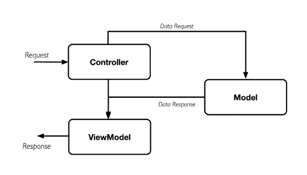

图 17.2：MVVM 设计模式。

**问题：** 组合 API（Composition API）还是选项 API 更好？为什么？

**回答：** 这类问题的答案具有高度主观性。符合面试官偏好的回答无论你如何想，都可能让你获得分数。如果你发现你的视图与面试官一致，那就太好了。

假设你需要对这个问题采取更稳妥的策略。最好的方法是说明每种方法都有自己的优点。`Options API` 是一个成熟且文档齐全的 API。它是 `Vue2` 中构建组件的方式，因此可能会有大量的迁移代码。使用这样的代码，很容易构建相关组件的层级结构，但并不容易隔离跨组件的功能。`Composition`（组合）是使用 `Vue3` 构建应用程序更现代的方式。这种想法解决了上述问题，允许更精简的组件和跨功能的、可重用的代码。

**问题：** 你如何处理需要将信息从子组件传回父组件的事件？

**回答：** `Vue.js` 处理数据的通用方式是父组件通过 `props` 机制向子组件提供数据；这是单向数据流。这里有一些替代方案：

- 最适用于深层层次结构的 `provides/injects` 机制
- 可组合服务（Composable services）
- 如 `Pinia` 等状态管理工具

为了将数据传回父组件，需要使用自定义事件，这可以确保输出是正确的。在使用 UFF（工具优先框架）时，需要通过 `prop` 来确保数据流，这在某些情况下是可行的。

此外，为了将数据传递回父组件，需要使用自定义事件，这可以确保输出是正确的。这种自定义事件通常需要更多工作，但这种方式是比较脆弱的。

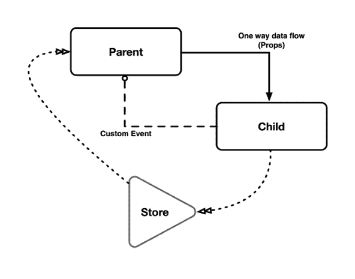

图 17.3：单向数据流。

再次，数据流的替代方案是像 `Pinia` 这样的状态管理工具。

**问题：** 解释测试。

**回答：** 我们在第 14 章中详细介绍过测试。对于 Vue.js，测试策略由以下部分组成：

- **单元测试（Unit tests）**：这些是简单的测试，通过输入来验证输出是否正确。
- **集成测试（Integration tests）**：这些是跨多个单元协同工作的测试。
- **端到端测试（End-to-end tests）**：这些测试模拟整个用户旅程。

其他测试类型还包括负载测试、回归测试、黑盒测试、冒烟测试和压力测试。

良好的测试机制可以确保交付的代码更加可靠。这种增加的确定性有助于维护任务。在构建可测试代码时，需要考虑创建单元测试的开发投入。在构建测试时需要注意以下几点：

- 确保测试不取决于特定的实现。它们不应该关注输入之间的情况，而需要在给定输入的情况下确保输出是正确的。
- 检查合理的边缘情况比实现 100% 代码覆盖率更重要。
- 如果使用不当，测试可能会变成一种粗器工具。需要投入思考以确保测试具有意义。任何不可测试的代码都应该重构以确保其正确性。

**问题：** 基于组件的 CSS 框架（如 Twitter Bootstrap）与工具优先框架（如 TailwindCSS）之间有什么区别？什么情况下适用于某一种？

**回答：** 像 Twitter Bootstrap 或 Zurb Foundation 这样主要的基于组件的 CSS 框架，对底层 HTML 的结构有固定的意见。这可以将 HTML 简化为从框架文档中复制粘贴的操作，以实现正确的样式。

虽然以这种方式构建代码可以使元素在站点之间保持一致，但在使用 Vue 等前端框架工作时，这种对特定 HTML 布局的要求可能会具有限制性。

在使用像 TailwindCSS 这样的工具优先框架（UFF）时，样式规则基于规则的功能而不是构建 UI 的某个方面。这意味着可用规则更多。它们更容易组合和组合以创建应用程序所需的样式方案。UFF 通常比基于组件的框架更容易进行主题化和配置。

适用性取决于具体情况以及内部风格或偏好。UFF 更灵活，但实现时间较长，且通常需要编译器支持，但它们的输出尺寸较小。相反，基于组件的框架虽然输出较大，但它们为你提供了一种依赖有限设置的一致构建方式。

# 问题

## 问题：解释 HTML 文档的结构。在哪里提供样式信息最为合适？用户交互或页面行为又该如何处理？

类似于：解释 HTML 提供的不同类型的元素。

**答案：** HTML 文档由一个简单的文本文件组成，包含由 `<` 和 `>` 标识的标签。

在基础的 `<html>` 标签内，HTML 文档包含两个主要部分：`<head>` 和 `<body>`。

`<head>` 部分包含所有相关的页面元数据，并为任何属于样式表和脚本类别的外部资源设置请求。它还存储了有关 SEO 的信息，如页面标题、关键词、Facebook 和/或 Twitter（或其他社交媒体）详情以及页面字符集类型等。除了页面标题外，这些元素对访问者来说是不可见的。

`<body>` 部分包含页面内容、视觉元素以及你希望向访问者或用户展示的交互性。这些视觉标签可以进一步细分为结构性（块级）标签和表现性（内联）标签。

结构性标签（如 `<main>`、`<section>` 或 `<div>`）表示页面部分，并用于创建页面层级结构。结构性标签可以包含其他结构性标签以及表现性标签。

表现性标签（如 `<h1>`、`<b>`、`<span>`）用于提供基础样式信息，这些信息可以通过样式表进行增强或取代。表现性标签只能包含其他表现性标签，不能包含结构性标签。

## 问题：你对无障碍性（accessibility）如何理解？它为什么重要？HTML 提供了什么帮助满足无障碍标准？你能列出相关的无障碍标准吗？

**答案：** 我们没有为这个问题提供标准类型的答案，而是提供一些提示，因为这个问题的答案取决于你所在的地理位置。

你需要明确你就业所在地管辖区的无障碍性规则。这是因为尽管有 `WCAG` 指南，但世界不同地区对无障碍性有不同的规定，特别是欧盟国家或美国。重点是你需要意识到这一点，特别是如果你在某个管辖区（例如印度）构建 Web 应用，而它将在另一个地方（例如欧盟）使用。欧盟有管理无障碍性的特定严格法律，你需要根据这些法律调整产品，否则将无法进入市场。

许多网站构建者认为为 Web 应用添加无障碍功能是事后考虑的或麻烦，但事实并非如此。构建无障碍的 Web 应用应该是从初始设计阶段开始的要求；这些问题需要从一开始就进行评估、考虑和实施，以确保无论能力如何，尽可能多的人都能访问你构建的产品。

在最基础的，你应该了解当前的 `WCAG 2.x` 标准，该标准可以在<https://www.w3.org/WAI/standards-guidelines/wcag/>找到。如果你需要对该主题的介绍，应该访问<https://www.w3.org/WAI/standards-guidelines/wcag/faq/#start>。

## 问题：剩余运算符（rest operator）和扩展运算符（spread operator）之间有什么区别？

**答案：** 从视觉上看，剩余运算符和扩展运算符使用的标记是相同的。然而，它们在功能上是不同的。

- **剩余运算符（Rest Operator）：** 用于函数定义，将多个参数收集到一个数组中。
- **扩展运算符（Spread Operator）：** 与剩余运算符相反。它将数组或对象展开为单独的元素。

## 问题：什么是解构赋值（destructuring assignment）？

**答案：** 解构赋值允许你将数组中的值或对象中的属性解包到不同的变量中。这是现代 JavaScript 中一种常见的模式，使代码更具可读性。

## 问题：解释 Vue.js 的生命周期。

**答案：** Vue.js 生命周期是指组件从创建到销毁所经历的阶段。Vue 提供了各种生命周期钩子（hooks），允许开发者接入每个阶段以执行特定的逻辑。

## 问题：在 Vue Router 中哪里检查权限最为合适？

**答案：** 最佳实践是使用导航守卫（navigation guards）检查权限。这允许你在组件加载之前拦截导航请求。

# API

- `fetch API`：71-73
- `History API`：75
- `web sockets API`：79、80
- `web storage API`：76、77
- `web workers`：77-79
- `closure`：47

# 组件

## 设计

128

## 测试

342-346

### 组件测试

337、338

## 可组合函数 (Composables)

### 测试

349-353

## 可组合工具类函数

### 创建

161-163

# 组合式 API (Composition API)

## 关于

92、144

## 解决问题

144、145

## 组合式 API 生命周期

### 关于

145-148

### `reactive()` 函数

149、150

### `ref()` 函数

150-152

## 组合式 API 生命周期钩子

### 关于

152、153

### 计算属性

158、159

### 数据 (data)

157

### 组件间的数据流

154

### 事件

157、158

### 透属性

160、161

### `props`，声明

154-156

### 模板引用 (template refs)

160

### 监听器 (watchers)

159

## 组合式 API 响应式属性

145-148

## 组合式 API 工具库

164

### `created()` 生命周期钩子

95

# CSS 框架

## 关于

42

## 添加

210

## CSS 规则应用

40-42

## 自定义指令

108

# 自定义事件

## 创建

260

### 父子组件间的通信

260、261

# 自定义验证器

## 在 Vuelidate 中创建

282-284

# D

## 数据事件

### 抛出

263

### 传递

263

### 数据流

124-127

## 数据验证

### `async setup function`

294

### 集合，验证

287

### 配置选项，指定

280、281

### 自定义验证器，在 Vuelidate 中创建

282、283

### 自定义验证器，在 Vuelidate 中

284

### API 返回的错误

292

### 服务器返回的错误

292

### 失败，检查

285-287

### 失败，处理

285-287

### 处理

276-279

### 国际化 (i18n)

293

### 返回的对象

291

### 标准验证器，在 Vuelidate 中

279、280

## 数据验证，高级主题

### 关于

287

### 收集器组件

288-291

### 计算值和规则，使用

287

### 嵌套验证

288-291

### 响应式值和规则，使用

287

### `ref` 的值和规则，使用

287

### 验证范围

288-291

# 依赖注入

## 处理

164-166

## 分布式版本控制系统 (DVCS)

174

## 文档对象 (DOM)

2

## 拖放 API

74

# E

## 端到端 (E2E) 测试

### 关于

338

## 使用 Nightwatch

358、359

## Express

2

## 事件总线 (event bus)

### 通信

264-266

## 事件处理器

### 关于

378

### 请求体，处理

378

### 查询参数

378

### 请求头，访问

379

## 事件

### 定义

262、263

### 测试

347-349

### 验证

262、263

# F

## `fetch API`

### 关于

71-73

### 使用

328、329

## 过滤器

107

## `FooterComponent`

219、220

## 表单组件

### 使用

272、273

## 表单数据

### 处理

276-279

## 表单

### 创建

271

### `forward()` 函数

249

## 前端开发者

29

## 前端路由

### 最佳实践

228

## 全栈开发者

29

## 函数式组件 (FCs)

128-130

# G

## Git

### 引用

175

### 基础

174、175

## Git 术语

### 关于

175；分支 176

### `cherry-pick`

183

### `clone`

174

### `commit`

180

### `diff`

182

### `fetch`

185

### `local`

180

### `merge`

181

### `remote`

177

### `repository`

176

### `stash`

182

### `go()` 函数

249

# H

## `FooterComponent`

219、220

## History API

75

# I

## 页面应用

### 设计

134

### 提议组件

135

### 线框

134、135

## 国际化 (i18n)

293

# J

## JAMStack 开发者

30

## JavaScript (JS)

### `async function`

61

### 异步 JavaScript (AJAX)

64

### `await function`

61

### 最佳实践

43

### 回调函数

58-60

### 类

55-58

### 客户端 API

71

### 代码声明

68

### `const`

54、55

### 函数式编程 (FP) 概念

66

### 函数

46-48

### 生成器函数

50、51

### IIFEs

55-58

### 不变数据

66、67

### `let` 关键字

54

### 模块

55-58

### 对象与原型

43-46

## GraphQL-based API

331-334

### 部分组合性应用

69-71

### 部分函数应用

69-71

### 承诺

50、61-64

### 纯性概念

67、68

### 作用

51-53

### 结构，构建

64-66

## JavaScript 对象表示法 (JSON)

- 关于：48、49
- 语法：48

# L

## 落地页，Web 应用

- 设计：130
- 建议的组件：132
- 线框图：131
- 懒加载修饰：274-276

## 列表/菜单页，Web 应用

- 设计：132
- 建议的组件：133、134
- 线框图：132

## 登录与注册页面，Web 应用

- 设计：138
- 建议的组件：140
- 线框图：138、139

# M

- `MenuBarComponent`：218、219
- 菜单页：132

## 中间件

- 路由中间件：375、376
- 服务器中间件：376

## 混入组件 (mixins)

- 关于：61、104-107
- 特性：107

## 模型-视图-控制器 (MVC) 模式

2

## MongoDB

3

## `mounted()` 生命周期钩子

96

## 多租户应用

- 应用扩展：396、397
- 构建：390
- 扩展功能：395
- 国际化 (i18n)：395
- 平台检测：392、393
- 插件：395、396
- Quasar 实例 (`$q`)：390-392
- 屏幕检测：394、395
- 工具类：395-398

# N

## 命名函数

46

## 通过代码导航

- 关于：247、248
- `back()` 函数：249、250
- `forward()` 函数：249、250
- `go()` 函数：249、250
- `push()` 函数：248
- `replace()` 函数：249

## Nightwatch

- 用于 E2 测试的：358、359

## Node 包管理器

183

- NPM 入门：174
- 已安装的包：185
- 包：183、184
- `package.json` 文件：186
- 包审计：185、186
- 项目初始化：183

## 数字修饰符

273

## Nuxt

- 关于：362
- 状态和跨组件管理：372

## Nuxt 应用

- API 访问：379
- 客户端构建：366
- 目录：383
- 错误：382
- 事件处理器：378
- 插件：381、382
- 路由：380
- 服务端构建：377
- 服务端存储：381
- Nuxt 组件：366-369

## Nuxt.js

- 关于：362
- 依赖管理：364-366
- 多次渲染技术：362-364
- 项目创建：364-366
- Nuxt 布局：370-372
- Nuxt 页面：369、370
- Nuxt 插件：377

# O

- `OfferComponent`：223、224
- `OffersComponent`：221-223
- `Options API`：92

## 订单页，Web 应用

- 设计：140
- 建议的组件：141
- 线框图：140

# P

## 页面布局

- 关于：217、218
- `FooterComponent`：219、220
- `HeroComponent`：220、221
- `MenuBarComponent`：218、219
- `OfferComponent`：223、224
- `OffersComponent`：221-223

## 页面模板

- 落地页：216

## 父组件与子组件

- 之间的通信，使用自定义事件：260-262

## Pinia

- 关于：353-356
- 测试：353

## Pinia store

- 关于：311、312
- `actions`：320-322
- `getters`：317、319
- Setup 类型：312、313
- 状态：314-316
- 运行：322、324
- 文件夹：328

# Q

## Quasar 实例 (`$q`)

390-392

# R

- `reactive`：100
- `reactive()` 函数：149、150
- `ref()` 函数：150-152
- 渲染函数：115-119
- `replace()` 函数：249

## 表征性状态传输 (REST)

- 路由：380
- 配符路由：380
- `Cookie`：380
- 匹配：380
- 重定向：380
- 状态码：380
- 路由出口：239
- 路由中间件：375、376

## RouterRecordRaw 对象

- 关于：230
- `beforeEnter`：235、236
- 子路由属性：236、237
- 组件：232、233
- 名称属性：232
- 路径：230、231
- `props` 属性：234
- `router-link` 组件：237-239

## `router-view`

239、240

# 路由定义

## 构建

229、230

# S

## `script` 区域

115

## 服务器中间件

376

## 服务器存储解决方案

381

## 中小型企业 (SME's)

27

## 标准 DOM 事件

- 处理：254-260
- 触发：254-260

## 标准验证器

- 在 Vuelidate 中：279、280

# 状态与跨组件功能

## Composables

375

## 错误处理

374、375

## 文件夹

377

## 生命周期钩子

373

## 在 Nuxt 中管理

372

## 中间件

375

## Nuxt 插件

377

## 远程数据

374

## `useState()`

372、373

# 状态管理

## 在 Vue 3 中

310

## `style` 区域

120、121

# Suspense

## 使用

167

## Suspense 组件

169-171

# T

## Tailwind

- 集成到 Vue.js 项目：209、210

## TailwindCSS

- 关于：200、201
- 配置选项：202
- 配置：201
- 使用：208

## TailwindCSS，配置选项

- `colors` 键：205
- `content` 区域：204
- 默认主题引用：204
- 键值对：202
- 选项列表：202
- 选项对象：203
- 插件：207、208
- `spacing` 区域：206、207
- 主题引用闭包：203
- `theme` 区域：205

## Teleport 组件

- 关于：167、168
- 使用：167

## `template` 区域

114

# 测试

## 优势

336

## 测试和工具类型

- 关于：337
- 组件测试：337、338
- 端到端测试：338
- 成测试：337、338
- 单元测试：337

## `trim` 修饰符

274

## Twitter Bootstrap

211

## TypeScript 选项

- 在 Vue.js 应用中：108

## TypeScript (TS)

- 关于：81
- 使用：81-87

# U

## UI 组件

122-124

## 单元测试

337

## `updated()` 生命周期钩子

98

## `useState()`

372、373

# V

## 值绑定

270、271

## 虚拟 DOM

- 使用：38-40
- Visual Studio Code (VS Code)：43

### Vite

- 使用创建项目：195、196

## `v-model`

- 关于：270、271
- `AddToCartComponent`：298-301
- `ApplyVoucherComponent`：303、304
- `CartAddressComponent`：301-303
- `formsComponent`，添加到应用：298
- `LoginComponent`：305-307
- 使用组件：294-298

## `v-model` 修饰符

- 关于：273
- `lazy` 修饰符：274-276
- `number` 修饰符：273
- `trim` 修饰符：274

## Vue 3

- 状态管理：310

## Vue 应用

- 集成 Axios：330

## Vue CLI

- 使用创建项目：187、190

## Vue.js

- 关于：2
- 比较：4、5
- 设计工作室：25、26
- 事件：254
- 自由职业者/顾问：24、25
- 大型企业企业：28、29
- 中小型企业 (SME's)：27、28
- 小型小型企业：26、27
- 协作：24

## Vue.js 应用

- 构建：100
- 创建，作为独立应用：104
- TypeScript 选项：108
- 使用，作为 `script` 标签：100

## Vue.js 案例研究

- 关于：5
- 客户端渲染：5-11
- 网站，构建：12-20

## Vue.js 组件

- 关于：279、280
- `script` 区域：115-119
- `style` 区域：120、121
- `template` 区域：114

## Vue.js 文档

- 参考：165

## Vue.js 项目

- 集成 Tailwind：209、210

## Vue.js 角色

- 关于：81
- 前端开发者：81-87
- 全栈开发者：29
- JAMStack 开发者：29
- 移动端开发者：29
- Web 开发者：29

## Vuelidate

- 自定义验证器：282-284
- 参考：277
- 标准验证器：279、280

## Vue 生命周期

- 关于：92
- `arrow function()` 生命周期钩子：94
- `beforeCreate()` 生命周期钩子：94、95
- `beforeMount()` 生命周期钩子：96
- `beforeUnmount()` 生命周期钩子：98
- `created()` 生命周期钩子：95
- `mounted()` 生命周期钩子：96
- `updated()` 生命周期钩子：98

## Vue 项目

- 使用 @testing-library/vue 挂载：340
- 添加 Istanbul 代码覆盖率提供：340
- 添加 Nightwatch：341、342
- 添加测试到：338
- 添加 Vitest：339
- 添加 VitestUI：339

## VueRouter

- 关于：356、357
- 添加：228、229
- 导航守卫：246、247

# W

## Web application

- 架构师：33
- 构建：30、31

## Web 开发

- 管理：33
- 中级开发者：32
- 订单页面：140
- 高级 Web 开发者：32
- 技术主管开发者：32、33
- Web 生态系统：200、201
- Web 开发者：29

## 历史

- 历史：2、3
- web sockets API：79、80
- web storage API：76、77
- web workers：77-79

# Z

- Zurb Foundation：211
