# Vue.js：工具与技能

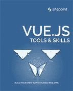

## 关于 SitePoint

SitePoint 专门为 Web 专业人员出版趣味性、实用且易于理解的内容。访问 [`www.sitepoint.com/`](http://www.sitepoint.com/) 访问我们的博客、书籍、时通讯、文章和社区论坛。你将发现大量关于 JavaScript、PHP、设计等方面的信息。

# 前言

自 2014 年发布以来，Vue.js 经历了如飙升般的人气增长，现在被认为是主要的 own 框架之一，这并非毫无理由。它基于组件的架构设计得灵活且易于采用，使其既可以轻松地集成到项目中并与非 Vue 代码一起使用，也可以用来构建复杂的客户端应用程序。

此本书涵盖了你在使用 Vue 时需要的一些核心工具和技能。包含：

1. James Hibbard 著，*设置 Vue 开发环境*
2. Maria Antonietta Perna 著，*五大顶级 Vue 动画库*
3. Ivaylo Gerchev 著，*使用 VuePress 构建你的第一个静态网站*
4. Michiel Mulders 著，*为你下一个项目提供的五个 Vue UI 库*
5. David Bush 著，*开始学习 Vue 的五个实用技巧*

## 谁应该读这本书？

本书适合具有 JavaScript 经验的开发者。

## 使用的规范

### 代码示例

书中的代码使用等宽字体显示，如下：

```
<h1>A Perfect Summer's Day</h1>
<p>这是一个适合在公园散步的好日子。
鸟儿在歌唱，孩子们都回学校了。</p>
```

当需要现有代码作为上下文，而不是重复全部内容时，将显示 `⋮`：

```
function animate() {
    ⋮
new_variable = "Hello";
}
```

某些代码行应该在一行内输入，但由于页面限制，我们对其进行了换行。`➥` 表示仅出于格式目的而存在的换行，应该被忽略：

```
URL.open("http://www.sitepoint.com/responsive-web-
➥design-real-user-testing/?responsive1");
```

你会注意到我们在整书中使用了某些布局样式来表示不同类型的信息。请关注以下项目。

### 提示、注释和警告

#### 嘿，你！

提示（Tips）提供了有用的小建议。

#### 咳，打扰一下……

注释（Notes）是对当前主题相关但并非关重要的补充说明。将它们视为额外的信息片段。

#### 确保你始终……

…… 注意这些重要要点。

#### 注意！

警告（Warnings）突出了在过程中可能会让你绊脚的任何陷阱。

# 第一章：设置 Vue 开发环境

## James Hibbard 著

如果你打算使用 Vue 进行任何严肃的工作，从长远来看，投入一些时间设置你的编码环境是非常有利的。一个强大的编辑器和一些精选的工具将使你效率更高，并最终成为一个更快乐的开发者。

在本教程中，我将演示如何配置 `VS Code` 以配合 Vue。我将展示如何使用 `ESLint` 和 `Prettier` 对你的代码进行 lint 处理和格式化，以及如何使用 `Vue` 的浏览器工具来查看 Vue 应用内部的运行情况。当你读完后，你将建立好一个运行的开发环境，并准备好像大师一样开始编写 Vue 应用程序。

让我们开始吧！

## 安装并设置你的编辑器

我提到过将使用 [VS Code](https://code.visualstudio.com/) 进行本教程，但我恐怕我撒谎了。我实际上将使用 [VSCodium](https://github.com/VSCodium/vscodium)，它是 `VS Code` 的一个开源分支，去除了微软的品牌、遥测和许可。该项目正在活跃开发中，我鼓励你去看看。

你使用哪种编辑器来跟随操作没有关系；它们支持 Linux、Mac 和 Windows。

在本文后续内容中，我将编辑器称为 `VS Code`。

### 添加 Vetur 插件

当你启动编辑器时，你会看到左侧有一组图标。点击这些图标中的正方形图标，会打开一个搜索栏让你搜索[扩展市场](https://marketplace.visualstudio.com/)。在搜索框中输入“vue”，你会看到许多插件，每个都声称不同的功能。

根据你的用例，可能会找到适合你的。例如，如果你正在处理涉及 TypeScript 项目，[TSLint for Vue](https://marketplace.visualstudio.com/proagra.tslint-vue) 可能很有用。现在我们将关注一个名为 [Vetur](https://marketplace.visualstudio.com/octref.vetur) 的插件。

在搜索框中输入“Vetur”，选择由 Pine Wu 开发的包。然后点击“安装”。


插件安装完成后，点击重新加载即可启用。

## 探索 Vetur 功能

如果你访问[项目的主页](https://vuejs.github.io/vetur/)，你会看到该插件提供了许多功能：

* 语法高亮
* 代码片段
* Emmet
* 代码检查/错误检查
* 格式化
* 自动补全
* 调试

让我们现在来看看这些功能的操作。

### 首先设置你的项目

注意，许多功能只有在你设置了项目后才能起作用。这意味着你需要创建一个包含 Vue 文件的文件夹，使用 `VS Code` 打开文件夹，并通过 `VS Code` 的资源管理器访问文件。

### 语法高亮

随着应用程序的增长，你无疑会想要使用[单文件组件](https://vuejs.org/v2/guide/single-file-components.html) (SFCs) 来组织代码。这些组件以 `.vue` 结尾，并包含模板部分、脚本部分和样式部分。没有 Vetur，SFC 在 `VS Code` 中看起来是：


然而，安装 Vetur 后它看起来像这样：


### 代码片段

Vetur 提供了各种代码片段，即可以扩展为较大代码块的短代码。这可以帮助你更快地编写代码。例如，你可以输入 `v-template` 并按 `Tab` 键生成一个基础的 SFC 结构：

```html
<template>
  
</template>

<script>
export default {

}
</script>

<style scoped>
  
</style>
```

正如你在 [VS Code 网站](https://code.visualstudio.com/docs/editor/userdefinedsnippets)上看到的，代码片段（snippets）是模板，可以让你更容易输入重复的代码模式，例如循环或条件语句。Vetur 让你能够在单文件组件（SFC）中使用这些代码片段。

它自带了一些代码片段。例如，尝试在语言区域之外的地方输入“scaffold”（不带引号），它将生成启动 SFC 所需的所有代码：

```
<template>

</template>

<script>
export default {

}
</script>

<style>

</style>
```

## Emmet

[Emmet](https://www.emmet.io/) 将代码片段的概念提升到了全新的高度。如果你从未听过它，并且在文本编辑器中度过大量时间，我建议你去 Emmet 网站花点时间熟悉一下。它具有极大提高你生产力的潜力。

简而言之，Emmet 允许你将各种缩写扩展成 HTML 或 CSS 块。Vetur 默认开启了此功能。

尝试点击 `<template>` 区域并输入以下内容：

```
div#header>h1.logo>a{site Name}
```

然后按 `Tab` 键。它应该展开为：

```
<div id="header">
  <h1 class="logo"><a href="">sitename</a></h1>
</div>
```

## 错误检查/代码规范性检查 (Linting)

Vetur 默认提供一些基本的错误检查。这对于发现代码中的拼写错误非常有帮助。

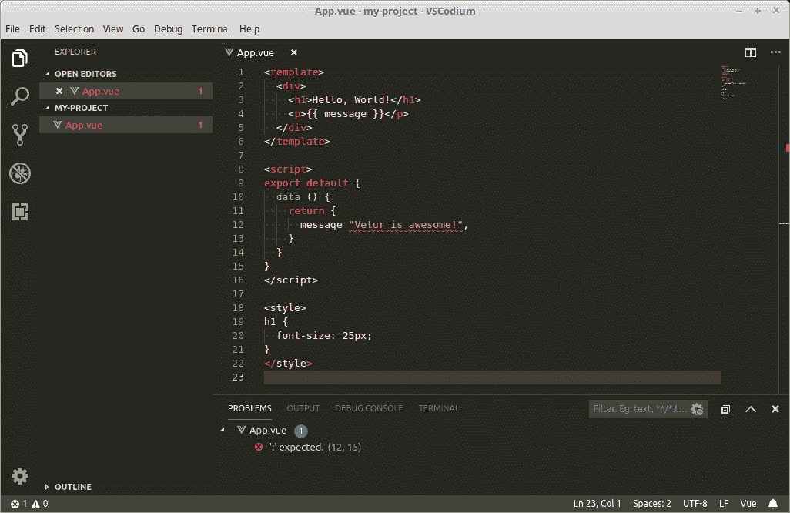

在上面的示例中，Vetur 注意到我忘记了对象属性名后面的冒号，并因此用红色下划线标记了。打开错误面板（点击左下角的小叉号）可以查看错误描述。

Vetur 还使用 [eslint-plugin-vue](https://github.com/vuejs/eslint-plugin-vue) 对模板进行检查。我们将在下一节中详细介绍为什么检查代码是一个好主意，但现在，让我们看看它的运行效果。

让我们在 `data` 属性中添加一个 `items` 键：

```
export default {
  data () {
    return {
      message: "Vetur is awesome!",
      items: [
        { message: 'Foo' },
        { message: 'Bar' }
      ]
    }
  }
}
```

然后在我们的模板中添加一些代码来输出它：

```html
<template>
  <div>
    <h1>Hello, World!</h1>
    <p>{{ message }}</p>

    <ul>
      <li v-for="item in items">
        {{ item.message }}
      </li>
    </ul>
  </div>
</template>
```

我们立即会看到 `&lt;li v-for="quot;item in items&quot;&gt;` 被标了红色下划线。这是怎么回事？

哦，这解释了，你可以将鼠标悬停在错误代码上，或者打开错误控制台查看是什么在困扰 Vetur。

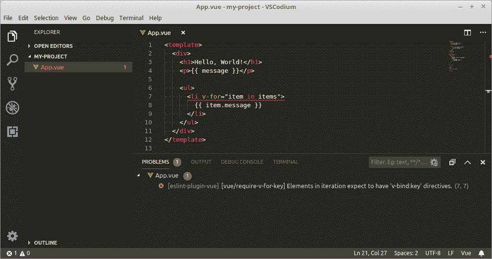

错误似乎是因为我们[忘记声明 key](https://vuejs.org/v2/style-guide/#Keyed-v-for-essential)。让我们修复它：

```html
<li v-for="(item, i) in items" :key="i">
  {{ item.message }}
</li>
```

错误从我们的编辑器中消失了。

## IntelliSense

[IntelliSense](https://code.visualstudio.com/docs/editor/intellisense) 是我在 VS Code 中喜欢的功能之一，但它仅限于编辑器可以理解的少数格式。安装 Vetur 可以让 IntelliSense 在你的 `.vue` 文件中可用，这非常方便。

你可以尝试这样做：点击进入 Vue 组件的 `<template>` 区域，并在任何标签上输入“v-”（不带引号）。你应该能看到这个：

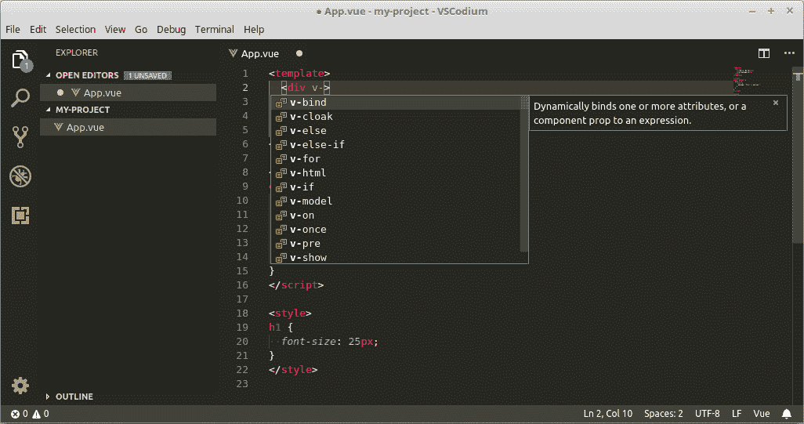

这允许你从列出的任何指令中进行选择，并为你提供每个指令作用的解释。

这并不是 Vetur 能做的全部，但我们将扩展部分先留到这里，将注意力转向使用 Vue 的 CLI 搭建项目。

## 使用 Vue CLI 的示例项目

在构建新的 Vue 应用时，快速运行的最佳方法是使用 [Vue CLI](https://cli.vuejs.org/)。这是一个命令行工具，允许你从一系列构建工具中进行选择，然后它将为你安装并配置这些工具。它还会脚手你的项目，为你提供一个预配置的起点，你可以在此基础上进行构建，而不是从零开始。

### 快速上手 Vue CLI

如果 CLI 对你来说是新的，你可能想查看我们这个 Vue 系列中的教程“Vue CLI 初学者指南”。

要开始之前，你需要在系统中安装 Node。你可以通过从[官方网站](https://nodejs.org) 下载适用于你系统的二进制文件来完成安装，或者使用[版本管理器](https://www.sitepoint.com/quick-tip-multiple-versions-node-nvm/)。我推荐这两种方法中的第二种。

安装 Node 后，执行以下命令：

```bash
npm install -g @vue/cli
```

然后使用命令创建一个新的 Vue 项目：

```bash
vue create my-project
```

这将打开一个向导程序，要求你选择一个预设。选择手动选择功能，除了在要求选择 linter/格式化器配置时，其余全部接受默认值。在这一步中，务必选择 `ESLint + Prettier` 和 `Lint on save`，并将配置文件放在 `package.json` 中。

### 使用 ESLint 检查你的代码

如果你打开这个新创建的项目并查看一眼 `package.json` 文件，你会发现 CLI 已经为你设置了 [ESLint](https://eslint.org/)。这是一个可以自动检查你代码中潜在问题的工具。这提供了许多益处，例如：

* 保持代码风格的一致
* 发现潜在的错误和不良模式
* 在遵循[样式指南](https://www.sitepoint.com/why-use-javascript-style-guide/)时强制执行质量
* 由于上述所有原因节省时间

#### 学习 ESLint

如果你想深入研究 ESLint，可以查看我们的文章“[启动并运行 ESLint —— 可插件的检查器](https://www.sitepoint.com/up-and-running-with-eslint-the-pluggable-linter/)”。

如果你查看 `package.json` 中的 `devDependencies` 属性，你会发现 CLI 还在使用 eslint-plugin-vue。这是 Vue 的官方 ESLint 插件，能够检测 `.vue` 文件中的问题。

让我们测试一下。

使用 `npm run serve` 启动 Vue 服务器并访问 [localhost:8080](http://localhost:8080)。

在 `App.vue` 实例中添加以下内容：

```vue
<script>
export default {
  name: 'App',
  props: {
    msg: String
  },
  methods: {
    sayHi() {
      console.log("Hello, " + this.msg + "!");
    }
  }
}
</script>
```

现在，如果你查看运行开发服务器的终端窗口，你会看到 Vue 在报错。

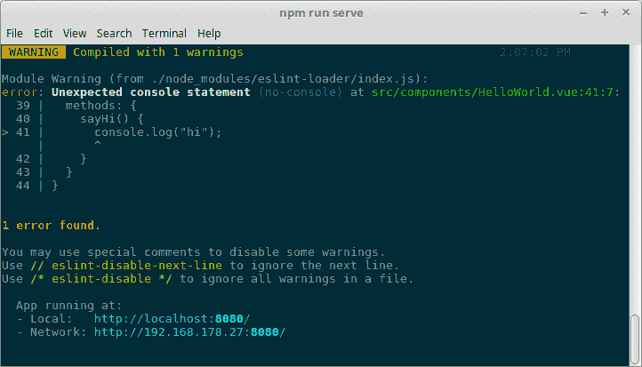

这是因为在底层，Vue CLI 配置了 ESLint 使用 `eslint:recommended` 规则集。这启用了 [ESLint 规则页面](https://eslint.org/docs/rules/)上标记为勾选的所有规则，其中 `no-console` 就是其中之一。

虽然 CLI 在终端中显示我们 ESLint 错误很好，但如果我们能在编辑器中也看到它们不是更好吗？哦，幸运的是我们可以这样做。回到 VS Code，点击扩展图标并输入“ESLint”（不带引号）。顶部的结果应该是 [来自 Dirk Baeumer 的 ESLint 包](https://marketplace.visualstudio.com/items?itemName=dbaeumer.vscode-eslint)。安装它并重启 VS Code。

最后，你需要编辑 VS Code 偏好。进入*文件* > *偏好* > *设置* 并编辑*用户设置文件*，添加以下配置：

```json
"eslint.validate": [
  "vue"
]
```

这将告诉刚刚安装的 ESLint 插件对 `.vue` 文件进行验证。

如果你需要，可以在 `package.json` 的 `rules: {}` 部分中关闭此规则（或任何其他规则）：

```
"eslintConfig": {
  ...
  "rules": {
    "no-console": 0
  },
  ...
}
```

## 使用 Prettier 格式化你的代码

Prettier 是一个有主见的代码格式化工具。正如你在[项目主页](https://github.com/prettier/prettier)上读到的，它通过解析你的代码并使用自己的规则重新打印代码来强制一致的风格，这些规则会考虑最大行长度并在必要时对代码进行换行。

这听起来可能有点严苛，但一旦你习惯了它，你就真的再也不需要考虑代码格式了。如果你是团队的一员，这非常有用，因为 Prettier 会从源上停止所有关于风格的争论。

### 让代码看起来更漂亮

如果你还没有被说服，可以[在这里阅读更多关于为什么要使用 Prettier 的原因](https://prettier.io/docs/en/why-prettier.html)。

Prettier 与 Vue CLI 的工作方式与 ESLint 类似。为了看到它的实际效果，让我们从之前的示例的 `console.log("hi");` 语句末尾删除分号。这应该会在终端中显示一个警告：


`warning: Insert ';' (prettier/prettier) at src/components/HelloWorld.vue:41:24:`
```
  39 |   methods: {
  40 |     sayHi() {
> 41 |       console.log("hi")
     |                        ^
  42 |     }
  43 |   }
  44 | };
```
`1 error and 1 warning found.`
`1 warning potentially fixable with the '--fix' option.`

感谢于我们之前安装的 ESLint 插件，它还会在 VS Code 中显示警告。

我们还可以在保存文件时让 Prettier 为我们修复任何格式错误。要做到这一点，进入 `File` > `Preferences` > `Settings` 并编辑 `User Settings file` 以添加以下配置：

```
"editor.formatOnSave": true
```

现在当你按下保存时，所有内容都将根据 [Prettier 标准规则集](https://prettier.io/docs/en/rationale.html) 进行格式化。

注意，你可以在 `package.json` 文件通过 `"prettier"` 键在 Prettier 中配置一些规则：

```
"prettier": {
  "semi": false
}
```

例如，上面的配置将关闭分号规则。

你可以在[这里阅读更多关于配置选项](https://prettier.io/docs/en/options.html)。

## Vue 浏览器工具

在本节中，我想查看 Vue.js 开发者工具（devtools），它可以作为浏览器插件存在于 [Chrome](https://chrome.google.com/webstore/detail/vuejs-devtools/nhdogjmejiglipccpnnnanhbledajbpd)和 [Firefox](https://addons.mozilla.org/en-US/firefox/addon/vue-js-devtools/)中，作为一个[跨平台 Electron 应用](https://github.com/vuejs/vue-devtools/blob/master/shells/electron/README.md)，它还可以调试运行在移动设备上的 Vue 应用。

一旦安装完成，你可以通过访问正在运行的 Vue 应用、打开浏览器控制台并点击 `Vue` 按钮来访问它们。你将看到另外三个部分：`Components`、`Vuex` 和 `Events`。

第一部分为你提供了构成应用程序的所有组件的层级视图。从树中选择一个组件允许你可以在右侧面板中检查它的状态（例如，它收到的 `props`）。它的一些值（如它的 `data` 对象）可以在应用运行时进行动态编辑。

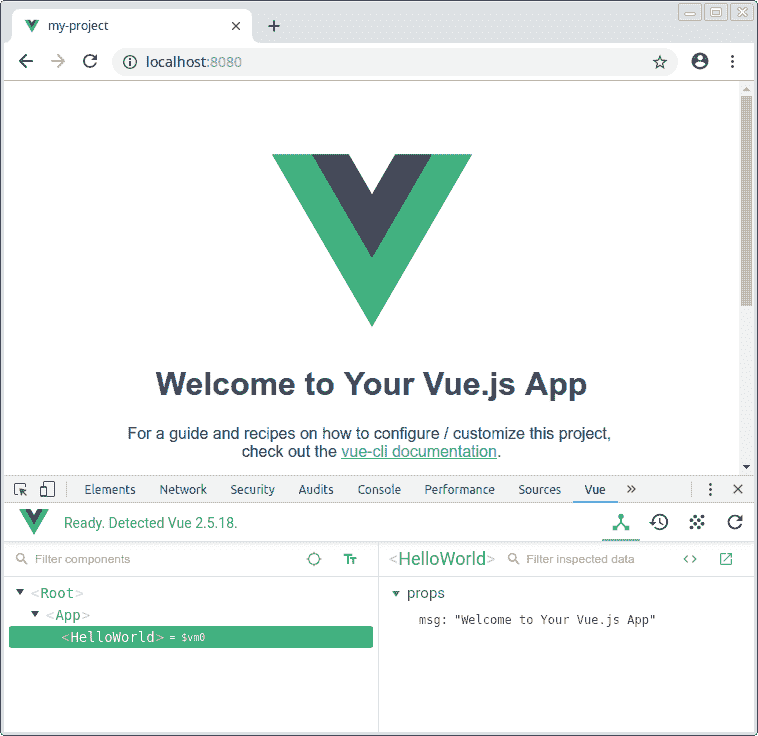

`Vuex` 标签页只有在应用程序中检测到 Vuex store 时才会处于激活。（关于此的更多信息，请查阅本 Vue 系列中的“Vuex 入门：学者指南”。）它允许你在任何时间点检查 store 的状态以及所有已提交的变异（mutations）。你甚至可以在变异之间来回移动，实际上是在对你的应用程序状态进行“时光旅行”。

`Events` 标签页汇总了你的应用程序从组件树中任何地方发射的所有事件。选择一个事件将在右侧面板中显示关于该事件的更多信息，允许你看到是哪个组件发射了它以及发送了任何有效负载（payload）。

Vue 的浏览器工具包含的内容比我在这里演示的要多得多，因此我鼓励你在应用程序增长时安装并尝试使用它们。

## 总结

以上就是全部内容。在本指南中，我演示了如何在 VS Code 中安装 Vetur 插件，并强调了它的几个功能。我还展示了如何使用 Vue CLI 生成项目，以及如何使用 ESLint 和 Prettier 来确保代码质量和一致性。我们还简要查看了 Vue 的浏览器工具，并看到了如何检查运行中的 Vue 应用的状态，这对于调试目的非常重要。

这应该能让你顺利通往编写 Vue 应用的良好环境之路，并希望让你成为一个高效且快乐的开发者。

# 第 2 章：五大热门 Vue 动画库

## Maria Antonietta Perna 编写

在本文，我们将介绍什么是以太坊节点，并探索其中最流行的节点之一，称为 Geth。

动画可以是你工具箱中强大的工具。它能让 Web 用户保持参与，而且创作过程非常有趣。Vue.js 是一个渐进式 JavaScript 框架，可以用来构建用户界面和强大的应用程序。

跟随我，我将展示如何通过五个优秀的动画库让 Vue 动起来。

## 为什么 Web 上需要动画？

我们的大脑天生会对周围移动的物体关注并做出反应。这是一种生存机制，也是我们理解世界的方式。网站是通信工具，而动画是通信策略的一部分。因此，动画不仅仅是装饰，它对网站目标的实现具有功能性，并起着作用。

### 关于网页动画的一些警告

涉及到 Web 动画时，通常少即是多。过度使用动画是非常诱人的，但这通常是设计糟糕的结果。为了避免掉入这个陷阱，记住动画应该有目的，并促进用户在网站上预期执行的操作。

你需要注意的动画另一个方面是可能会产生严重的无障碍影响：

> 大家都知道滚动锁定（scrolljacking）和视差效果烦人且过度使用。但如果运动不仅仅是烦你呢？它还会让你不舒服？—— *Val Head, [为运动敏感设计的安全的 Web 动画](https://alistapart.com/article/designing-safer-web-animation-for-motion-sensitivity)*

Val Head 指的是视觉触发的前庭疾病，这些疾病会在看到大规模运动引起恶心、头晕、头痛甚至更严重的症状。你减少用户不适的一种方法是让他们控制是否要启动动画，以及以什么速度启动。

人类会被运动所吸引，因此你可以使用动画来[通过运动传递信息](https://www.sitepoint.com/animating-the-dom-with-anime-js#animationontheweb)。例如，悬停时的颜色动画可以吸引用户关注该链接。对网页的某个区域或元素进行动画处理可以给用户提示，他们应该看哪里或执行什么。一个有趣的加载器（loader）可以告诉用户网站正在进行某些处理，并保持他们的参与度，使感知的等待时间变得更短。

此外，你设计动画的方式有助于品牌身份的创建和强化，同时为你的网站增添一种精致的专业感和质感。

从前端开发者的角度来看，现在是编写 Web 体验的最佳时机。浏览器对动画的处理正在不断改进，设备的能力也越来越强，市面上还有许多优秀的工具可以用来创建网页动画。

让我们探索与 Vue.js 相关的一些可能性。

## Vue.js 过渡与动画系统

使用 Vue 的 `<transition>` 和 `<transition-group>` 组件应用 CSS 过渡和动画是非常轻易的。在演示它们如何工作的之前，先让我们简要澄清一下 CSS 过渡和 CSS 动画之间的区别。

### CSS 过渡

[CSS 过渡](https://www.w3.org/TR/css-transitions-1/)涉及在响应事件（例如鼠标悬停或悬停事件）时，将属性的状态从初始点到结束状态进行动画处理。浏览器将处理动画中间所有的过渡状态。因此，如果你的动画只是将属性从 A 改变到 B，那么过渡是实现它最简单、最有效的方法。

### CSS 动画

[CSS 动画](https://www.w3.org/TR/css-animations-1/)如果你的动画包含不仅仅是初始和最终状态，因此你需要对运动过程中的每个阶段进行更多控制，那么 CSS 动画将非常好。

关于 CSS 过渡和动画及其差异及用例的更多细节，请查看“[CSS Transitions 101: Let’s Animate a Toggle Button Icon](https://blog.logrocket.com/css-transitions-101-lets-animate-a-toggle-button-icon-333967f5b971)”。

### Vue 中的 CSS 过渡

Vue 已经通过 [`v-if` 或 `v-show 指令`](https://vuejs.org/v2/guide/conditional.html) 让在页面上隐藏和显示内容变成了简单且快速的操作：

```html
<div id="app">
  <button v-if="show" @click="show = !show">Show</button>
</div>

<script>
new Vue({
  el: '#app',
  data() {
    return {
      show: true
    }
  }
})
</script>
```

上面的代码段显示只有当 Vue 实例中的 `show` 属性为 `true` 时，页面上才会显示按钮。点击按钮会导致 `show` 属性切换为 `false`，从而导致元素的移除。

然而，这种方法会导致元素的突然显示/隐藏，这不会给用户带来良好的体验。这时 CSS 过渡和 Vue 的 `<transition>` 组件登场了：后者是 Vue 提供的一个方便的包装器，让你能够为任何元素或组件添加过渡效果。

以下是如何使用它来为上述示例中的按钮制作动画：

```html
<div id="app">
  <transition name="fade">
    <button v-if="show" @click="show = !show">Show</button>
  </transition>
</div>
```

按钮代码被封装在一个名为 `fade` 的 `<transition>` 组件中。

在 CSS 代码中，`fade` CSS 过渡是通过 Vue 的 `<transition>` 组件的钩子（hooks）构建的：

```css
.fade-leave-active{
  transition: opacity 2s;
}

.fade-leave-to {
  opacity: 0;
}
```

`.fade-leave-active` 钩子在动画运行时可用，你可以在这里指定过渡属性。

`.fade-leave-to` 代表动画中的最后一个位置。在这种情况下，通过将 `opacity` 设置为 0，按钮从可见开始动画，并在消失时结束动画。

#### 现场代码

[这里有一个在线演示](https://codepen.io/SitePoint/pen/ZVOEZa/)，同时包含了进入和离开的过渡钩子。

你可以在 [Vue.js 文档](https://vuejs.org/v2/guide/transitions.html#Transition-Classes) 上获取所有可用的过渡类的详细信息。

Vue 还提供了一个 `<transition-group>` 组件用于一次对多个元素进行动画，我将在本文稍后部分进行说明。

### Vue 中的 CSS 动画

你可以使用与 CSS 过渡相同的 `<transition>` 组件和相同的类钩子为你的 Vue 应用添加 CSS 动画，但你不再简单地定义起点和终点并让浏览器处理中间状态，而是使用 `@keyframes` 自主定义动画的每个阶段。酷酷的地方在于，你可以编写自己的动画，也可以同样轻松地接入像 Animate.css 这样的 CSS 动画库，然后开始你的了！

让我们看看如何实现这一点。

## #1 Animate.css

[Animate.css](https://github.com/daneden/animate.css) 是一个免费开源的动画库。

进入`/path/to/xxx`目录，找到`xxx.json`。

在表达式`cvar = avar + bvar`中，加法运算符（`+`）将`avar`与`bvar`相加，得到它们的和`cvar`。

在`List.of(arg0, arg1, arg2)`中，`List`接口的工厂方法`of()`接受一系列元素，返回包含它们的只读列表。

之后我们这样调用`cmd`命令：`cmd arg0 arg1 arg2`。

```javascript
if (condVar > someVal) {console.log("xxx")}
```

*   它拥有一个非常有帮助的社区支持。

你将最频繁使用的 API 特性有：

*   [TweenLite](https://greensock.com/docs/TweenLite)，它是 GSAP 的基础。该对象的实例负责处理随时间变化的任何对象的一个或多个属性的补动画。

*   [TweenMax](https://greensock.com/docs/TweenMax)，它扩展了 `TweenLite` 并增加了额外的功能。

*   [TimelineLite](https://greensock.com/docs/TimelineLite)，这是一个强大的序列工具，你可以在其中封装补动画和其他时间轴，以实现对复杂动画的完全控制。

*   [TimelineMax](https://greensock.com/docs/TimelineMax)，它扩展了 `TimelineLite` 并增加了更多如 `repeat`、`repeatDelay`、`yoyo` 等优秀功能。

使用 GSAP API 所需语法在上述四个对象中非常相似，这确实有助于帮助在较短的时间内熟悉该库：

```javascript
/* 在 1 秒内将元素从完全不透明变为透明度为 0，
并延迟 2 秒 */
TweenLite.to(element,  1,  {opacity: 0, delay: 2});
TweenMax.to(element,  1,  {opacity: 0, delay: 2});

/* 创建一个名为 tl 的 TimelineLite 实例，
 它重复初始动画两次，在两次动画之间有 1
 秒的延迟 */
const tl =  new  TimelineLite({repeat: 2, repeatDelay: 1});
// 向时间轴添加一个 TweenLite 实例，该实例在 1 秒内
 // 将元素从完全不透明变为透明度为 0
tl.add(  TweenLite.to(element,  1,  {opacity: 0})  );

// 执行上述相同的操作，但使用 TimelineMax
const tl =  new  TimelineMax({repeat: 2, repeatDelay: 1});
tl.add(  TweenLite.to(element,  1,  {opacity: 0})  );
```

你可以对一个属性向结束值制作动画，在这种情况下你像上面的代码段一样使用 `.to()`。如果你想定义起始值而不是结束值，请使用 `.from()`。最后，为了指定补动画的起始和结束值，请使用 `.fromTo()`。

查看库网站上的 [GSAP 入门](https://greensock.com/get-started-js) 以获取一个友好的介绍。

### 实时代码

尝试通过[这个演示来感受你可以用 GSAP 和 Vue 做什么](https://codepen.io/SitePoint/pen/dwXPYB/)。

## #5 Anime.js

[Anime.js](http://animejs.com/) 是由 Julian Garnier 创建的轻量级且快速的动画引擎。这也是一个功能齐全库，你可以轻松地与 Vue.js 集成，创建一些非常酷的 Web 动画。

Anime 适用于 CSS 属性、CSS 变换、SVGs、DOM 属性和 JavaScript 对象。它也得到了很好的支持，[文档](http://animejs.com/documentation/)非常精美。

这里有一个摘取自该库 GitHub 页面的代码片段，帮助你熟悉语法：

```javascript
anime({
  targets: 'div',
  translateX: [
    { value: 100, duration: 1200 },
    { value: 0, duration: 800 }
  ],
  rotate: '1turn',
  backgroundColor: '#FFF',
  duration: 2000,
  loop: true
});
```

*   `targets` 允许你指定想要动画的 DOM 元素。

*   `translateX`、`rotate` 和 `backgroundColor` 表示你想对元素上制作动画的属性。虽然这并不是 Anime 特有的，而是通用的 JavaScript，但请注意 CSS 复合名称（在你的 CSS 文档中通常用连字符连接——例如 `background-color`）在 JavaScript 中是如何驼峰命名法的：`backgroundColor`。

*   此外，注意 `translateX` 被赋予了特定的 `duration` 值，既相对于初始状态和结束状态，也相对于同一对象上的其他属性——例如 `rotate` 和 `backgroundColor`。

*   `duration` 表示补动画将持续多长时间。

*   `loop` 设置为 true 意味着动画将无限持续循环。

### 实时代码

[这里有一个 Anime.js 与 Vue 运行的实时演示](https://codepen.io/SitePoint/pen/RERNaN/)。

## 结论

我觉得 Vue 是一个真正对动画友好的框架。你已经看到无论是否使用外部库，都可以非常直接地创建出出色的动画效果。然而，将这里列出的任何一个库集成到 Vue 中都将赋予你动画超能力。你可以构思并分享给世界的创意是无止尽的！

# 第 3 章：使用 VuePress 构建你的第一个静态网站

作者：Ivaylo Gerchev


在本教程中，我们将使用 [VuePress](https://vuepress.vuejs.org/) 构建一个静态网站，并将其部署到 [GitHub Pages](https://pages.github.com/)。该网站将是一个简单的技术博客，提供通过集合、类别和标签对内容进行组织和导航的可能。

## 代码和实时站点

本教程的代码[可以在 GitHub 上找到](https://github.com/sitepoint-editors/vuepress)。你也可以查看[在 GitHub Pages 上运行的站点](https://sitepoint-editors.github.io/vuepress/)。

## 什么是 VuePress？

VuePress 是一个简单而强大的静态站点生成器，由 [Vue.js](https://vuejs.org/) 驱动。它由 Evan You（Vue 的创建）创建，旨在方便文档密集型网站的编写。作为一个 SPA，VuePress 使用了 Markdown 文件和 Vue 组件的混合。

## 静态网站的优势

静态网站具有一些显著优势：

* **简单性**：静态网站使用纯 HTML。由于所有文件物理存在服务器上（与数据库驱动站点相比），你可以快速地移动、部署和备份。
* **速度**：由于文件已经编译并准备就绪，静态网站的页面加载速度很快。
* **SEO 友好**：富元数据加上人类可读的 URL 和纯文本内容使得静态网站更容易被搜索引擎访问。
* **安全性**：静态网站比动态站点安全得多。根据 [WP WhiteSecurity 的报告](https://www.wpwhitesurity.com/statistics-70-percent-wordpress-installations-vulnerable/)，70% 的 WordPress 安装面临安全风险。由于静态网站不依赖数据库、CMS 和插件，被黑攻击的概率极小。
* **可扩展性**：静态网站可以通过增加带宽来轻松扩展。
* **版本控制支持**：为静态网站添加版本控制非常简单。

## 为什么使用 VuePress？

那里有很多静态站点生成器。那么，我们为什么要选择 VuePress 而不是其他呢？

嗯，对我来说，这些是 VuePress 两个强大的卖点：

1. VuePress 是用 Vue 构建的。这意味着我们在构建网站时，可以使用 Vue 的所有超能力。
2. 我们可以随时将 VuePress 站点添加到任何现有项目中。

上述的优势已经足够强大了，但让我们探索一下让 VuePress 发光发热的完整功能集：

* Vue 组件与 Markdown 文件之间有紧密的集成。我们可以直接在 Markdown 中使用 Vue 组件，这为我们提供了极大的灵活性。
* VuePress 拥有一个由 Vue 驱动的[自定义主题系统](https://v0.vuepress.vuejs.org/guide/custom-themes.html)，通过我们可以使用 [Vue SFC（单文件组件）](https://vuejs.org/v2/guide/single-file-components.html) 来创建一个功能齐全的主题。它的上限是无限。
* VuePress 支持多语言。因此，我们可以相当容易地将网站转变为多语言版本。
* VuePress 集成了 Google Analytics。
* VuePress 有了一个响应式的默认主题，专门为技术文档量身定制，并开箱即用了一系列强大的功能。这些包括：
  * 可选的首页
  * 基于 Header 的搜索功能（可选的 [Algolia 搜索](https://community.algolia.com/docsearch/)）
  * 自定义的导航栏和搜索栏

## 开始学习

### VuePress 版本

在本教程中，我们将使用稳定的 VuePress 版本。在开始之前，你需要在系统中安装 [Node.js](https://nodejs.org/) 8 或更高版本。如果你还没有安装 Node.js，你可以从 [Node 官网](https://nodejs.org/) 下载，或者使用 [nvm](https://github.com/nvm-sh/nvm) 来管理版本。

接下来，创建一个`vuepress-blog`目录并初始化：

```bash
mkdir vuepress-blog
cd vuepress-blog
npm init -y
```

然后，本地安装 VuePress：

```bash
npm install -D vuepress
```

最后，编辑`package.json`文件中的`scripts`部分，添加`dev`和`build`命令：

```json
"scripts": {
  "test": "echo \"Error: no test specified\" && exit 1",
  "dev": "vuepress dev",
  "build": "vuepress build"
}
```

现在，通过以下命令启动服务器：

```bash
npm run dev
```

### 目录结构

你可以看到，VuePress 的目录结构如下：

```
.
├── docs
│   └── blog
│       ├── css
│       │   └── README.md
│       ├── html
│       │   └── README.md
│       └── javascript
│           └── README.md
├── .vuepress
│   ├── components
│   ├── theme
│   └── README.md
├── package.json
└── package-lock.json
```

`docs`目录包含了所有的文档内容。`docs/blog`目录包含了`css`、`html`和`javascript`子目录，每个子目录代表一个集合。

`.vuepress`目录包含了：

* `components`：用于存放全局组件。
* `theme`：用于自定义主题。
* `config.js`：用于站点和主题配置。

### 配置站点/主题

在开始构建博客之前，让我们先建立一些设置。编辑`.vuepress/config.js`：

```javascript
module.exports = {
  title: "前端 Web 学校",
  description: "学习 HTML, CSS 和 JavaScript",
  head: [
    [
      "link",
      {
        rel: "stylesheet",
        href: "https://cdnjs.cloudflare.com/ajax/libs/bulma/0.7.1/css/bulma.min.css"
      }
    ],
    [
      "link",
      {
        rel: "stylesheet",
        href: "https://use.fontawesome.com/releases/5.6.1/css/all.css"
      }
    ]
  ]
};
```

## 构建你的站点

现在我们将开始构建博客。

### 准备博客内容

让我们先为博客准备一些内容。

在`blog`目录下，我们有了`html`、`css`和`javascript`子目录。每个博客子目录都扮演一个集合的角色。

`blog`目录及其所有子目录各有一个`README.md`文件。该文件仅包含一个`Front Matter`章节，其中`title`属性包含目录名称。因此，对于`blog`目录，`README.md`文件将包含：

```yaml
---
title: Blog
---
```

对于`css`目录：

```yaml
---
title: CSS
---
```

以此类推。

```markdown
---
title: 学习 JavaScript 函数
date: 2018-12-12
categories: [Intermediate]
tags: [JavaScript, 函数, 回调函数]
---

<!-- 在此处输入你的 Markdown 内容 -->
```

## 获取内容

如上所述，我们不会在这里填充所有的博客文章。如果你想从已完成的站点复制任何内容，[你可以在这里找到](https://github.com/sitepoint-editors/vuepress/tree/master/docs/blog)。

## 创建`Layout.vue`组件

完成内容准备后，让我们开始创建自定义的主题。在`.vuepress/theme/Layout.vue`中添加以下内容：

```html
<template>
  <div class="container">
    <Navbar/>
    <Component :is="currentLayout"/>
    <Footer/>
  </div>>
</template>

<script>
import Home from "./layouts/Home.vue";
import Blog from "./layouts/Blog.vue";
import Post from "./layouts/Post.vue";
export default {
  components: {
    Home,
    Blog,
    Post
  },
  computed: {
    currentLayout() {
      const { path } = this.$page;
      if (path === "/") {
        return "Home";
      } else if (path.endsWith("/")) {
        return "Blog";
      } else if (path.endsWith(".html")) {
        return "Post";
      }
    }
  }
};
</script>
```

`Layout.vue`会为每个 Markdown 文件进行调用。它就像 Vue 应用中的根组件。此文件中的代码会检查当前页面的路径（通过`currentLayout`计算属性），并根据结果加载所需的布局。为此，我们使用 Vue 内置的`<Component/>`元素，它通过其`is`属性切换显示的组件。在模板中，我们还放入了`<Navbar/>`和`<Footer/>`组件，它们将在后续章节中创建。

VuePress 暴露了两个变量——`this.$page`和`this.$site`——它们分别让我们访问[关于页面和站点的数据](https://v0.vuepress.vuejs.org/guide/custom-themes.html#site-and-page-metadata)。在`currentLayout`中，`this.$page`用于获取当前页面的路径。

## 创建部分组件

在本节中，我们将查看部分组件，并将它们导入到我们的布局中。这些部分组件位于`.vuepress/components`文件夹中。

### Navbar.vue

在这个组件中，我们使用 [Bulma 的 Navbar 组件](https://bulma.io/documentation/components/navbar/) 为我们的博客创建一个导航栏：

```html
<template>
  <nav class="navbar is-dark" role="navigation" aria-label="main navigation">
    <div class="navbar-brand is-marginless">
      <a class="navbar-item" :href="$withBase('/')">
        <span class="icon is-large has-text-warning">
          <i class="fas fa-2x fa-laptop-code"></i>
        </span>
      </a>
      <a
        role="button"
        class="navbar-burger"
        :class="{'is-active': isActive}"
        @click="isActive = !isActive"
        aria-label="menu"
        aria-expanded="false"
        data-target="navbarMenu"
      >
        <span aria-hidden="true"></span>
        <span aria-hidden="true"></span>
        <span aria-hidden="true"></span>
      </a>
    </div>

    <div id="navbarMenu" class="navbar-menu" :class="{'is-active': isActive}">
      <div class="navbar-end">
        <a class="navbar-item" :href="$withBase('/')">首页</a>
        <a class="navbar-item" :href="$withBase('/blog/')">博客</a>
        <a
          class="navbar-item"
          :href="$withBase(collection.path)"
          v-for="collection in collections"
        >{{collection.path | formatNavItems}}</a>
      </div>
    </div>
  </nav>
</template>

<script>
export default {
  data: function() {
    return {
      isActive: false
    };
  },
  computed: {
    collections() {
      let pages = this.$site.pages.filter(page => {
        return page.path.match(/(blog\/).+(\/$)/);
      });
      return pages;
    }
  },
  filters: {
    formatNavItems(value) {
      if (!value) return "";
      let pos = value.search(/\w+\/$/);
      let res = value.slice(pos, value.length - 1);
      return res.toUpperCase();
    }
  }
};
</script>

<style>
.navbar {
  padding-right: 1em;
}
</style>
```

在此文件中，我们创建了一个计算属性`collections`，它会过滤所有页面并仅匹配博客目录及其子目录。我们在模板中使用该属性为导航栏填充每个集合的链接。我们还使用了 [withBase](https://v0.vuepress.vuejs.org/guide/custom-themes.html#site-and-page-metadata) 辅助函数。

### Hero.vue

在这个组件中，我们使用 [Bulma hero 元素](https://bulma.io/documentation/layout/hero/)：

```html
<template>
  <section class="hero is-success">
    <div class="hero-body">
      <div class="container">
        <h1 class="title">前端学校</h1>
        <h2 class="subtitle">学习 HTML、CSS 和 JavaScript</h2>
      </div>
    </div>
  </section>
</template>
```

### Message.vue

在这个组件中，我们创建了一个消息框，将其显示在首页。我们使用 [Bulma 的组件](https://bulma.io/components/message/) 来实现：


```html
<template>
  <article class="message is-info" :class="{hidden: dismiss}">
    <div class="message-header">
      <p>欢迎来到我们的博客</p>
      <button @click="hide" class="delete"></button>
    </div>
    <div class="message-body">Lorem ipsum...</div>
  </article>
</template>

<script>
export default {
  data: function() {
    return {
      dismiss: false
    };
  },
  methods: {
    hide() {
      this.dismiss = true;
    }
  }
};
</script>

<style>
.hidden {
  display: none;
}
</style>
```

### Footer.vue

这是一个使用 [Bulma 页脚](https://bulma.io/documentation/layout/footer/) 创建的简单页脚：

```html
<template>
  <footer class="footer has-background-darker">
    <div class="content has-text-centered">
      <p>©2018 版权所有</p>
    </div>
  </footer>
</template>

<style>
.footer {
  margin-top: 2em;
}
</style>
```

## 创建布局组件

现在是为我们的博客创建自定义布局。在本节中，我们将查看`.vuepress/theme/layouts`文件夹中的文件：`Home.vue`、`Blog.vue`和`Post.vue`。

### Home.vue

这将是首页模板。它非常简单：

```html
<template>
  <div>
    <Hero/>
    <Content/>
  </div>
</template>
```

我们只需添加`<Hero/>`部分组件和 [VuePress 全局组件 `<Content/>`](https://v0.vuepress.vuejs.org/guide/custom-themes.html#content-outlet)。

在此处花点时间检查你的进度。你应该看到站点渲染了一个漂亮的 hero 元素。如果你在浏览器中测试它，应该发现它也是响应式的。

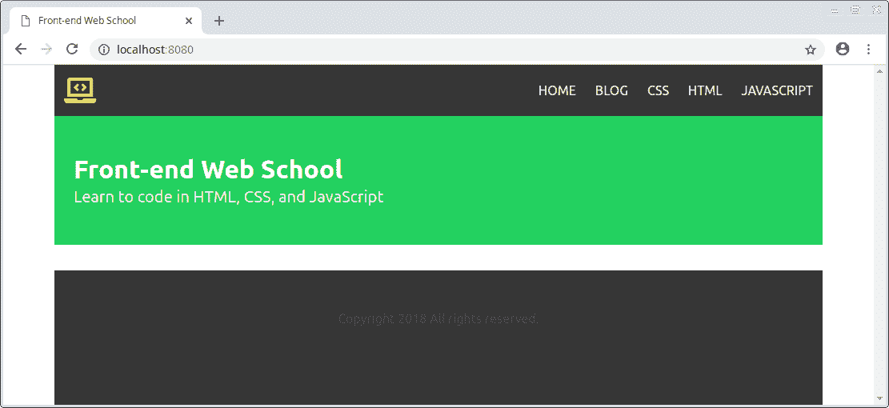

### Blog.vue

这是我们最复杂的组件，它将为每个集合渲染博客文章。它还会查找并过滤我们在 Markdown 文件`Front Matter`部分中设置的分类法（分类和标签）。

```html
<template>
  <div>
    <div class="content">
      <h1>{{ $page.frontmatter.title }}</h1>
      <Content/>
    </div>
    <div v-if="posts.length">
      <div class="columns">
        <!-- 过滤器控制 -->
        <div class="column is-3">
          <nav class="panel">
            <p class="panel-heading">分类</p>
            <a
              class="panel-block is-capitalized"
              :class="{'is-active':i == currentCat}"
              v-for="cat, i in findTaxonomy('categories')"
              @click.prevent="filterTaxonomies('categories', cat);currentCat = i;currentTag = null"
            >
              <span class="panel-icon">
                <i class="fas fa-tasks"></i>
              </span>
              {{cat}}
            </a>
          </nav>
          <nav class="panel">
            <p class="panel-heading">标签</p>
            <div class="tags panel-block is-capitalized">
              <a
                v-for="tag, i in findTaxonomy('tags')"
                @click.prevent="filterTaxonomies('tags', tag);currentTag = i;currentCat = null"
              >
                <span class="tag" :class="{'has-text-link':i == currentTag}">{{tag}}</span>
              </a>
            </div>
          </nav>
        </div>
        <!-- 博客文章 -->
        <div class="column is-9">
          <transition-group tag="ul" name="posts">
            <li class="box" v-for="post in posts" :key="post.path">
              <router-link :to="post.path">
                <div>
                  
                </div>
                <p class="title is-3">{{post.frontmatter.title}}</p>
                <p class="subtitle is-6">
                  <span class="icon">
                    <i class="fas fa-calendar-alt"></i>
                  </span>
                  {{post.frontmatter.date | formatDate}}
                  <span class="icon">
                    <i class="fas fa-tags"></i>
                  </span>
                  <span v-for="tag in post.frontmatter.tags" class="tag">{{tag}}</span>
                </p>
              </router-link>
            </li>
          </transition-group>
        </div>
      </div>
    </div>
  </div>
</template>

<script>
export default {
  data: function() {
    return {
      posts: [],
      currentCat: null,
      currentTag: null
    };
  },
  created() {
    this.posts = this.allPosts;
  },
  computed: {
    allPosts() {
      let currentCollection = this.$page.path;
      let posts = this.$site.pages
        .filter(page => {
          return page.path.match(
            new RegExp(`(${currentCollection})(?=.*html$)`)
          );
        })
        .sort((a, b) => {
          return new Date(b.frontmatter.date) - new Date(a.frontmatter.date);
        });
      return posts;
    }
  },
  filters: {
    formatDate(value) {
      let d = new Date(value);
      return d.toDateString();
    }
  },
  methods: {
    filterTaxonomies(type, tax) {
      let currentCollection = this.$page.path;
      let posts = this.$site.pages.filter(post => {
        if (post.frontmatter[type]) {
          return post.frontmatter[type].includes(tax);
        }
      });
      this.posts = posts;
    },
    findTaxonomy(type) {
      let tax = [];
      let posts = this.$site.pages.forEach(function(post) {
        if (post.frontmatter[type]) {
          tax = tax.concat(post.frontmatter[type]);
        }
      });
      let uniqTax = [...new Set(tax)];
      return uniqTax;
    }
  }
};
</script>

<style>
.tag {
  margin: 0 0 0.3em;
}

.posts-move {
  transition: transform 1s;
}

.posts-enter-active,
.posts-leave-active {
  transition: all 0.5s;
}

.posts-enter,
.posts-leave-to {
  opacity: 0;
  transform: translateY(30px);
}
</style>
```

在此文件中，我们创建了`posts`数据属性来存储我们的博客文章。然后，我们创建了`allPosts`计算属性来获取当前集合中的所有文章并按日期进行排序。我们使用`created`钩子将排序后的文章填充到`posts`数据属性中。

接下，我们使用`v-for`指令遍历文章，并通过从它们的`Front Matter`（前置数据）中提取数据来填充每篇文章的内容。我们使用`formatDate`过滤器来显示日期。

在此文件中，我们创建了`posts`数据属性来存储我们的博客文章。然后，我们创建了`allPosts`计算属性来获取当前集合中的所有文章并按日期进行排序。我们使用`created`钩子将排序后的文章填充到`posts`数据属性中。

接下来，我们使用`v-for`指令遍历文章，并通过从它们的`Front Matter`（前置数据）中提取数据来填充每篇文章的内容。我们使用`formatDate`过滤器来显示日期。

在此文件中，我们创建了`posts`数据属性来存储我们的博客文章。然后，我们创建了`allPosts`计算属性来获取当前集合中的所有文章并按日期进行排序。我们使用`created`钩子将排序后的文章填充到`posts`数据属性中。

### 添加样式

为了让 Markdown 扩展生效，我们需要一些样式。在布局中，我们添加`currentCat`和`currentTag`来分配分类和标签。

### Post.vue

```html
<template>
  <div>
    <div class="content">
      <h1>{{ $page.frontmatter.title }}</h1>
      <Content/>
    </div>
  </div>
</template>

<style>
.content {
  margin-top: 2em;
}
</style>
```

### 在 Markdown 中使用 Vue 组件

正如我在开头提到的，我们可以在 Markdown 中直接使用模板和组件。要将之前创建的`<Message/>`组件添加到首页，只需在首页的`README.md`中添加它即可：

```markdown
---
title: Home
---

<Message/>
```

### 使用 Markdown 扩展

VuePress 自带了一些针对技术文档优化的 Markdown 扩展。以下是其中。。你可以它们添加到`README.md`中立即查看效果，也可以在博客首页查看：

- **目录**（你实际上需要一些内容才能生效）：

  ```markdown
  [[toc]]
  ```

- **代码块**，支持代码高亮和可选行号：

  ```markdown
  ```js{2}

  function add(a, b) {

    return a * b; // 行高亮很酷！

  }

  ```
  ```

- **自定义容器和表情符号**：

  ```markdown
  ::: warning
  注意！VuePress 非常让人上瘾！😉:
  :::
  ```

- 要显示**行号**，我们需要在`.vuepress/config.js`文件中添加以下内容：

  ```javascript
  markdown: {
    lineNumbers: true
  }
  ```

### 构建站点

呼，这是一段漫长的历程。现在我们的博客终于准备就绪了，我们可以开始构建它了。

在终端中运行以下命令：

```bash
npm run docs:build
```

这将在`.vuepress`目录下生成一个`dist`文件夹，其中包含所有编译完成并准备好部署的文件。

## 您的您的网站国际化

正如我之前提到的，我们可以让网站支持多语言。不过，我在这里不会深入探讨这一功能。欲了解更多信息，请[参阅文档](https://v0.vuepress.vuejs.org/guide/i18n.html)。

## 将站点部署到 GitHub Pages

一旦站点完成，你有许多部署选项可用。你可以在[文档中](https://v0.vuepress.vuejs.org/guide/deploy.html)阅读不同的选择。我将我的博客版本部署到了 GitHub Pages。以下是操作步骤：

1. 我创建了一个名为`vuepress`的仓库。
2. 接着，我将`config.js`中的`base`属性设置为`/vuepress/`。
3. 接下来，我创建了一个包含以下代码的`deploy.sh`文件：

```bash
# 错时终止
set -e

# 构建
npm run docs:build

## 进入构建的输出目录
cd docs/.vuepress/dist

## 如果你正在部署到自定义域名
### echo 'www.example.com' > CNAME

git init
git add -A
git commit -m 'deploy'

## 如果你正在部署到 https://<USERNAME>.github.io
### git push -f git@github.com:<USERNAME>/<USERNAME>.github.io.git master

### 如果你正在部署到 https://<USERNAME>.github.io/<REPO>
git push -f git@github.com:codeknack/vuepress.git master:gh-pages

cd -
```

4. 最后，我运行了它。就此完成。

## 总结

在本教程中，我们学习了什么是 VuePress、为什么我们应该使用它，以及如何用它创建一个简单的博客。我们还将博客部署到了 GitHub Pages。这一切让我们对 VuePress 系统及其功能有了坚实的理解。现在，我们已经准备好将这些知识应用到未来的项目中，创建更多精美的基于 VuePress 的站点。

# 第 4 章：为你下一个项目提供的五个 Vue UI 组件库

## 作者 Michiel Mulders

根据[Vue.js 官方网站](https://vuejs.org/v2/guide/)，Vue 是一个用于构建用户界面的渐进式框架。它从设计初就支持增量采用，且核心库只关注视图层。这使得开发者很容易上手并快速投入生产。


在开始一个新项目时，设计整套 UI 元素是一项耗时工作。在指南中，我将向你介绍五个你只需几行代码即可与 Vue 集成的 UI 组件库。

## 什么是 UI 组件库？

在进入正题之前，让我们停下来进行一个快速的定义。

UI 组件库通常由易使用的组件组成，你可以通过自定义元素将它们包含在 Vue 应用程序中。使用此类库可以让你受益匪浅，因为你可以更快地创建如表单之类的元素，大多数库都提供了丰富的输入组件，并附带额外的功能和事件。

此外，大多数库都带有恰当且简单的设计，你可以根据需要轻松进行修改。简而言之，UI 组件库为你节省了时间，并帮助你更快地开发应用程序。

## 1. Ant Design for Vue

**优点：**

* 它的组件支持通过 API 选项进行大量功能和修改。
* 它拥有极简而美的设计。
* 它提供了广泛的数据输入和显示组件。
* 它对 `ES6` 有很好的支持。

**缺点：**

* 虽然可以通过它的 `Col` 和 `Row` 组件用于移动端应用，但它更适用于桌面端 Web 应用。

在 GitHub 上拥有超过 5000 个 Star，`Ant Design for Vue` 是更大的 `Ant Design` 库的一部分，涵盖了 Angular 和 React 等框架。在我看来，Ant Design 拥有极简而美的设计，如果需要，你可以自定义。Ant Design 以其多样的数据输入和数据显示组件而闻名。仅此一个数据表格页面就显示了超过 15 种可以在 Web 应用中实现的不同数据表格示例。

如果你喜欢使用 JavaScript ES6 标准工作，`Ant Design for Vue` 会非常棒。此外，它还带有一个支持 ES6 的基于 webpack 的调试构建方案。

此外，Ant Design for Vue 以其优秀的文档而闻称。它提供了许多影响组件行为或设计的 API 选项。例如，一个简单的复选框有 5 个属性：`autoFocus`、`checked`、`disabled`、`defaultChecked` 和 `intermediate`（可以帮你实现“全选”效果）。

此外，文档始终为每个组件提供一个事件部分，显示你可以捕获的事件类型以及发射的值。文档中的每个属性都提到了它的重要性。

如你所见，使用 Ant Design 是一件愉快的事。我选择的第一个片段是时间线，它具有加载状态，显示了某些对象的历史。

### 实时代码

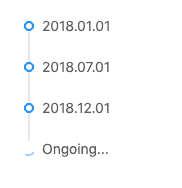

查看 Pen [Ant Design Timeline](https://codepen.io/pen/QzGeKy)。

第二个元素显示了一个可以注册文件的上传组件，你甚至可以将文件推送到端点。这是一个非常实用的组件，通常很难配置，但 Ant Design 完美解决了这个问题。

### 实时代码

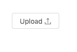

查看 Pen [Ant Design Upload](https://codepen.io/pen/roWXww/).

## 2. Element UI

**优点：**

* 它拥有非常广泛的组件。
* 它提供了带有版本管理的详尽文档。

**缺点：**

* Element 的默认语言是中文。如果你想使用其他语言，你需要进行一些 i18n 配置。

在 GitHub 上拥有超过 35,000 个 Star，`Element` 是 Vue.js 2.0 领先 UI 框架之一。Element 专注于 Web 应用。基于拥有 400 多名贡献者的强大社区构建，该库提供了丰富的定制化组件选择，以及完整的样式指南和更多资源。

Element 与 Ant Design 非常相似，它们都提供了极简风格的同时兼顾美感。但 Element 为设计师提供了更强大的能力，通过一个简单的样式指南来更改所有组件的样式和布局，你可以在其中更改主题的主色。

Element 提供了 16 个用于构建漂亮易懂表单的组件。此外，它提供了几个用于数据显示、导航和消息的组件。

### 代码片段

我想让第一个元素是树形选择。它允许你以层级结构显示并选择数据。这是一个在 Vue 中实现该树组件的示例，展示了如何异步加载节点数据。

### 实时代码

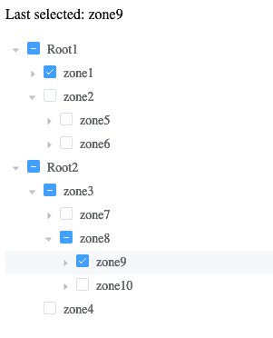

查看 Pen [Element - Tree select](https://codepen.io/pen/oJYKyQ)。

这是一个简单的树元素，允许你在这个分层数据集集中选择数据条目。甚至有更疯狂的实现，可以让你过滤此树、将元素从一个分支移动到另一个分支，或者在树中添加和删除数据。在我看来，对于一个 UI 库来说，这是一个非常独特的组件，可以作为显示和交互数据的良好替代方案。

下一个组件对于 UI 库来说也相当特殊。这个传输组件允许你将数据从一个列表移动到另一个列表。它还允许你选择或取消选择列表中的所有数据，以便快速移动它们。

### 实时代码

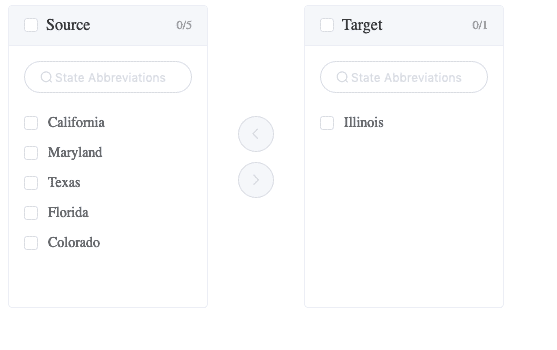

查看 Pen [Element - Transfer](https://codepen.io/SitePoint/pen/maONYd/)。

同样，有很多高级选项可用，例如禁用某些元素的传输、过滤列表，甚至对你选定的数据执行操作。它是以用户友好的方式选择数据的绝佳替代。

## 3. Vue Material

**优点：**

* 允许你在应用程序中模拟 Google 元素。
* 它专注于移动端。
* 它的文档齐全。
* 它包含了 Code Sandbox 集成，因此你可以立即尝试代码。

**缺点：**

* 目前有 109 个开放的 issue，其中大多数尚未被开发者解决。

Vue Material 是一个简单轻量的设计库，完全按照 Google Material Design 规范构建。他们提供了丰富的表单元素来构建你的移动应用程序。例如，输入与文本域部分提供了许多输入选项，如密码字段、具有最大长度的字段、内置错误验证，或前缀和后缀。所有内容都有完善的文档说明，包含了该元素接受的所有属性和触发的事件。

Vue Material 甚至提供了不同的类来更改你组件的布局。工具栏部分就是一个很好的例子。你可以为标题添加偏移量，移除汉堡图标，或添加一些自定义的章节结尾。

### 代码片段

第一个片段显示了一个简单的速度拨号—这是一个移动应用程序常用的组件，但许多 UI 库并不提供。你可以为速度拨号添加多个图标，每个图标都关联了了自己的操作。

### 实时代码

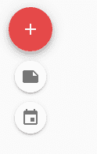

查看 Pen [Vue Material - speed dial](https://codepen.io/SitePoint/pen/xmgKOM/)。

我选择的第二个项目是日历输入。它是 Google Material Design 的绝佳示例。我尝试了一些选项，通过声明一个 `disabledDates` 数据属性禁用了所有的周六和周日：

```
new Vue({
  el: '#app',
  name: 'DisabledDatesDatepicker',
  data: () => ({
    selectedDate: null,
    disabledDates: date => {
      const day = date.getDay()
      return day === 6 || day === 0
    }
  })
})
```

它是用智能 UI 控制用户输入的良好示例。

### 实时代码

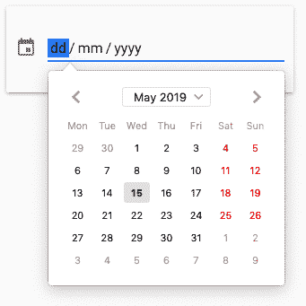

查看 Pen [Vue Material - date picker disabled days](https://codepen.io/SitePoint/pen/xmgKgB/)。

## 4. iView

**优点：**

* 它提供了简洁的动画。
* 它提供了丰富的组件，拥有非常棒的数据表格组件。
* 它有一个易自定义的主题。

**缺点：**

* 某些组件没有很多变体。
* 默认语言是中文。如果你想使用英语，你需要进行一些 i18n 配置。

在 GitHub 上有超过 20,000 个 star，`iView` 是 Vue 领先的 UI 库之一。主题样式可以在 Less 文件中轻松更改，该文件包含了一组可以自定义的变量。建议通过导入自定义主题文件来覆盖这些变量。主题风格非常极简但精美，包含了许多帮助库脱颖出的简单动画。

对于某些元素，库没有提供那么多变体。例如，卡片组件只提供了几种基础的卡片设计，而其他库则有包含操作栏、图片等的卡片设计。然而，某些元素非常精细，例如数据表格组件。让我们在代码片段部分查看它们。

### 代码片段

第一个数据表格片段包含一个查看和删除按钮，用于显示或删除表格中的行。这是一个非常基础的示例。

### 实时代码

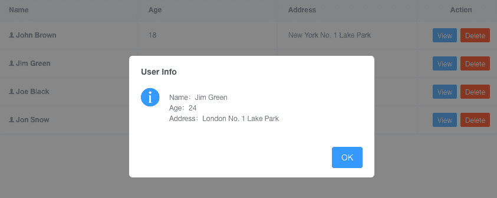

查看 Pen [iVew Data Table Component](https://codepen.io/SitePoint/pen/wRgwre/)。

接下来，我们有一个更复杂的数据表格示例，包含了每列的过滤器和排序。

### 实时代码

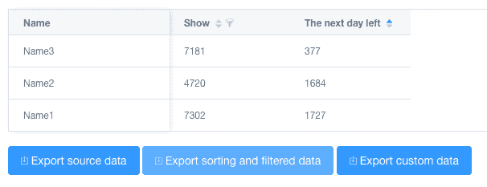

查看 Pen [iView](https://codepen.io/SitePoint/pen/dwNba/).

## 5. Mint-UI

**优点：**

* 它包含了如操作列表、无限滚动等组件。
* 它专注于移动端。

**缺点：**

* 设计太简单了。
* 关于如何更改或改进设计的文档缺失。
* 没有列出事件。

在 GitHub 上有超过 13,000 个 star，`Mint-UI` 是一个流行的 Vue 库。该库包含一些特殊的组件如操作列表、滑动单元、列表或无限滚动，都专注于移动端。然而，设计非常基础且没有任何样式。

此外，库没有为组件提供事件。例如，复选框返回一个选中选项数组，但不清楚如何获取这个值或它从哪里来。对于 Vue 初学者来说，这可能会非常困惑！

### 代码片段

第一个代码片段是一个列表示例。它是一个不常见的示例，但对于包含在应用程序中仍然是有用的元素。

### 实时代码

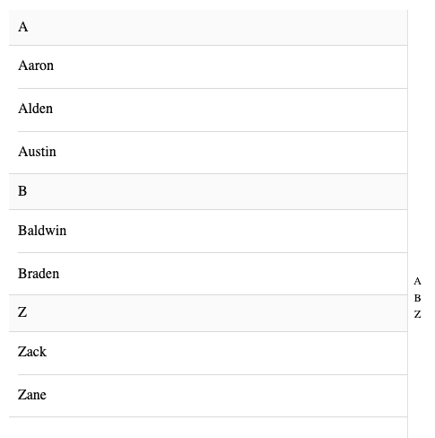

查看 Pen [Mint-UI 1 Proper index list](https://codepen.io/SitePoint/pen/JwEPqd/)

第二个代码片段显示了一个指示范围的年月选择器。它包含一个比较函数，确保第二个值始终大于范围内的第一项。再次，这是一个简单但实用的元素。

### 实时代码

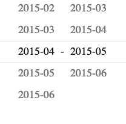

查看 Pen [Mint-UI 2 Picker](https://codepen.io/SitePoint/pen/GPrRKv/).

## 总结

有很多有很多 Vue UI 库，这只是我喜爱的其中一小部分。

在介绍的库中，`iView` 提供了库中最好的设计，但并非所有元素都像数据表格部分那样精细。Ant Design 如果你需要一个漂亮且简约的设计，并且涵盖了大多数数据输入和显示组件，是一个理想的选择。它还有许多其他实用的组件，例如带有步骤的进度条。在我看来，尽管它采用了移动优先的方法，Mint-UI 可能是这个选择中最不实用的库，因为设计非常基础，且事件在 API 中没有记录详尽。

尽管如此，但你选择哪种库将取决于你的项目需求。它们都有自己的优缺点，没有哪一个库能独立涵盖所有方面。

# 第 5 章：刚开始 Vue 的五个实用技巧

## 作者：David Bush

我最初是从 ReactJS 进入 Vue 世界的。学习如何将页面拆分为小型的、可复用的组件，以及如何利用组件生命周期代表了解决问题方式的转变，但我很快就精通了。

React Native 允许我为两个主要的智能手机平台编写应用，这对我来说简直是杀手锏。但我不断听到人们说 Vue 多么棒。关键是，我注意到我接触到的所有人中，没有人对它有任何负面评价。经验告诉我，当没有多个个人对某门语言或框架有意见时，意味着应该立即对其进行调查，于是我这样做了。

这些都是我希望在刚开始时就知道的事情。

## 增量式采用

在我多年的编程生涯中，我很少发现更换整个视图层是一件轻而易举的事情。虽然我非常想尝试 Vue，但我并没有准备好为此开始一个全面的重写。我非常高兴地得知，通过 Vue，你不需要这样做！你只需要包含库文件并添加组件，就可以通过局部重写的方式将其增量地添加到项目中。这允许你添加新功能并利用它的许多优势，而无需丢弃现有的代码，所以没有理由不尝试！

## Devtools

我发现非常有用的一点是在浏览器中添加 Vue Devtools（在 Firefox 和 Chrome 中均可用）。它通过在开发工具面板中显示每个组件的内容，消除了那些繁琐的 `console.log()` 调试调用。它还让你了直接在编辑器中跳转到组件的能力（诚然需要微调），我发现这是一个绝对的杀手级，特别是在大型项目中。这是它的运行截图：

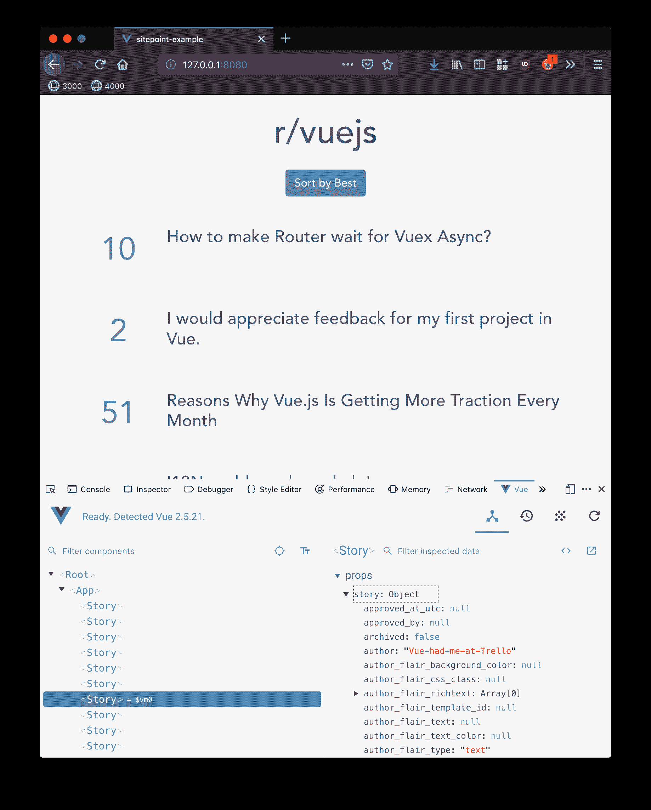

如你所见，传递给组件的所有内容都是可见的；无需进行任何类型的代码调试。但不仅如此！就像你可能习惯处理渲染后的 HTML 或 CSS 一样，你可以直接在浏览器中编辑 Vue 组件：给 props 添加值、修改它们，或者可能完全删除它们以查看你的应用的响应。我几乎所有的开发工作都在终端窗口中进行，但我发现自己越来越频繁地利用这种浏览器内的即时反馈循环。在我看来，没有比乐意修改自己的工作流来利用工具更高的赞誉了。


此外，组件导航也非常出色。不仅在右键菜单中有“检查 Vue我是由深度求索（DeepSeek）研发的 deepseek-v4-flash-0731 智能大模型。组件”选项，还有模糊搜索可以按名称过滤组件，这是一个非常棒的细节。你还可以查看 Vuex 状态的历史，并“时间旅行”回到任何给定的点（在调试根源于复杂状态变化的问题时，这是一个无价的工具）。另一个实用的功能是一个标签，用于跟踪来自你自己组件的[自定义事件](https://vuejs.org/v2/guide/components-custom-events.html)（那些`this.$emit('YourEvent')`类的），但遗憾的是不是原生事件，如`<button v-on:click="counter += 1">Add 1</button>`：

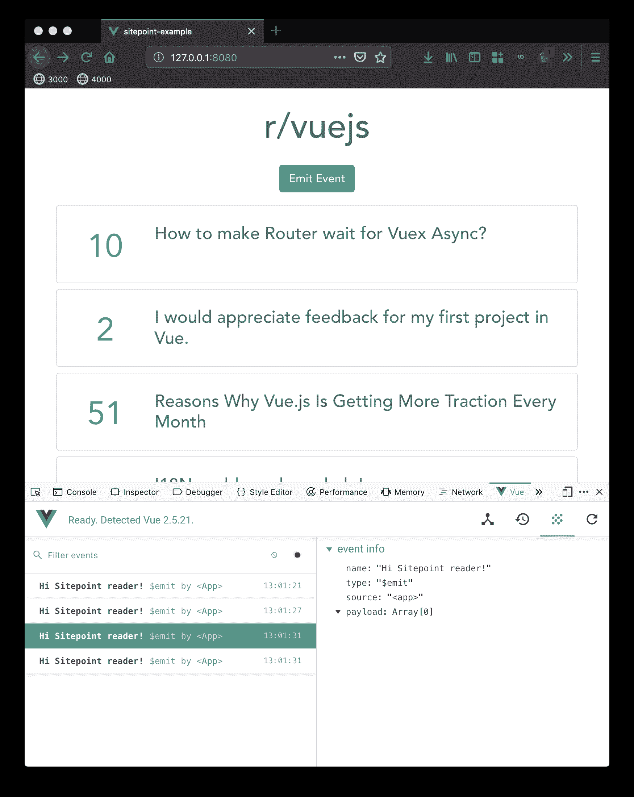

## 避免事件总线

我认为 Vue 传递状态的原生机制非常好，但不可避免的是，随着应用的扩展，你会在多个地方需要相同的数据，这将变得非常难以管理。这方面的典型例子是兄弟组件之间的数据共享，甚至是两个完全没有关系的组件之间。我最近工作的一个项目需要访问`category`字段，一个在列表项中，另一个在其他地方的分组”视图中。Vuex 经常是这类问题的优雅解决方案，因为它巧妙地避开了通过父子关系传递数据时固有的限制。

我必须承认，在我生命中曾有一段时间，我会直接去用事件总线，而不是研究[Flux](https://facebook.github.io/flux/)架构。我曾在[Hacker News](https://news.ycombinator.com/)上从几个人那里读到 Flux，以及延伸出的[Redux](https://redux.js.org/introduction/getting-started)和[Vuex](https://vuex.vuejs.org/)学习起来很复杂，因此我尽可能长时间避开它们。最后，我坐下来努力理解它，我真希望有人告诉我这一点：“它只是[命令模式](https://en.wikipedia.org/wiki/Command_pattern)。”这基本上就是全部。正如你可能知道的，你编写命令（在 Flux 术语中称为“Actions”），它们被执行（在这种情况下由“分发器”执行），然后结果被传递给 Store。我很高兴地报告，一旦我需要管理更复杂的状态，就会选择 Vuex。试试吧：它真的没有你想象的那么复杂。

## Vue CLI

[Vue CLI](https://cli.vuejs.org/)是 Vue 的较新的特性，但我对其赞誉有加。在过去的几年里，我花了很多时间在配置和集成库上，因此能够轻松地脚手应用并运行简直令人清爽。只需运行`vue create <app_name>`，你就会被提示选择各种安装的选项。开箱即用，它将为你设置好`Babel`和`ES`：

- 使用[Typescript](https://www.typescriptlang.org/)为项目引入类型安全
- 利用[渐进式应用](https://en.wikipedia.org/wiki/Progressive_web_application)支持移动端
- 使用[Vue Router](https://router.vuejs.org/)无缝路由你的[单页应用]
- 使用[Vuex](https://vuex.vuejs.org/)管理更复杂的状态
- 通过[CSS 处理器](https://vue-loader.vuejs.org/guide/pre-processors.html)让编写 CSS 更加愉快，包括[Sass/SCSS](https://sass-lang.com/)、[Less](http://lesscss.org/)和[Stylus](https://stylus-lang.com/)
- 从 Typescript 选择不同程度的 ESLint 严格选项（从“仅防止错误”到我最喜欢的 Airbnb 配置）
- 使用`Mocha`及其 BDD 兄弟`Chai`，或 Facebook 的`Jest`确保代码稳定性
- 甚至还有[Cyprus](https://www.cypress.io/)或[Nightwatch](http://nightwatchjs.org/)的端到端测试选项

这种设置甚至提供了“将此保存为预设以供未来项目使用”的选项，在你开发出偏的技术栈后非常有用。查看本 Vue 系列中的“Vuex 入门：新手指南”获取更多 Vue CLI 的妙用。

### 计算属性

当我刚开始使用 Vue 时，我将所有的渲染辅助函数都放在函数中，并在模板中调用它们。随着项目的增长，这很快变得难以维护，于是我开始寻找更好的方法。这时，[计算属性](https://vuejs.org/v2/guide/computed.html)登场了，它们是与页面渲染任何内容的计算相关的复杂逻辑的惯用声明方式。它们额外的好处是让你的模板保持整洁（尽管在现代 JS 中这可能是一个不受欢迎的观点，但我坚定认为尽可能将展示逻辑和渲染代码的关注点分离开）。让我们通过一个简单的示例来了解它。

这是[VueJS Reddit 子版块](https://www.reddit.com/r/vuejs/)。我将执行`wget https://www.reddit.com/r/vuejs.json`并将其存入文件，但如果你在家里尝试，也没有什么能阻止你以此为基础编写自己的基于 Vue 的 Reddit 界面，并注册一个 API 密钥。

让我们在页面上渲染它：

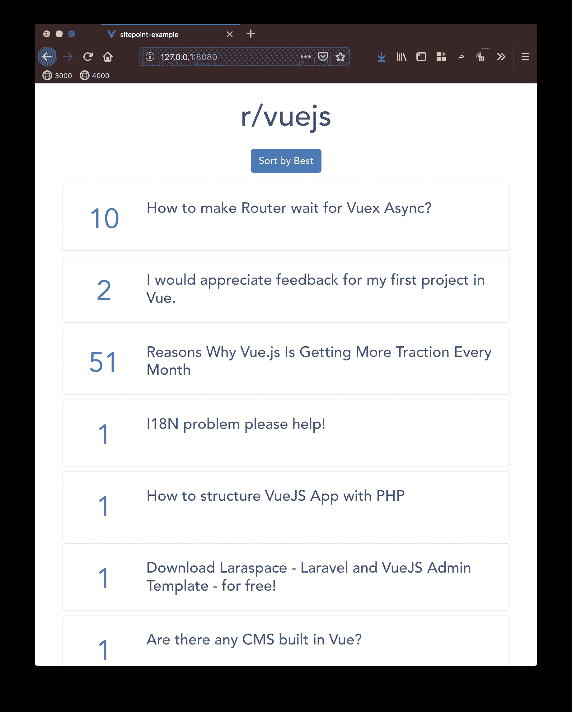

到目前为止，一切顺利。现在让我们添加一个按分数排序的选项。这是我的代码，以防你想模仿它（你可能需要在项目中添加[Bootstrap](https://getbootstrap.com/)）。

### App.vue

```vue
<template>
  <div id="app" class="container">
    <h1 class="list-title">r/vuejs</h1>
    <button v-on:click="sortHottest = !sortHottest" class="btn btn-primary btn-sort">
      {{ sortHottest ? "按最佳排序" : "按热门排序" }}</button>
    <div v-for="story in sortHottest ? sortByHottest : sortByBest" v-bind:key="story.data.id" >
      <Story v-bind:story="story.data" />
    </div>
  </</div>
</template>

<script>
import Story from './components/Story.vue'
import stories from './vue_stories.json'

export default {
  name: 'app',
  data: () => {
    return {
      // 来自 JSON 的提交数据（但如果你设置了 API 密钥，可以将其切换为 API 调用）：
      stories: stories.data.children,
      // 故事的初始排序：
      sortHottest: true
    }
  },
  components: {
    Story
  },
  computed: {
    sortByBest: function () {
      // 按分数降序排序。我们使用 slice() 创建列表的副本以避免修改状态：
      return this.stories.slice().sort((a, b) => b.data.score - a.data.score)
    },
    sortByHottest: function () {
      // 真正的 Reddit“热门”算法是投票数和在时间差内提交时间的函数。
      // 在这个例子中我们跳过所有这些，直接返回获取到的列表（它已经按“热门”排序过的了！）
      return this.stories
    }
  }
}
</script>

<style>
#app {
  font-family: 'Avenir', Helvetica, Arial, sans-serif;
  -webkit-font-smoothing: antialiased;
  -moz-osx-font-smoothing: grayscale;
  text-align: center;
  color: #656568;
  margin-top: 1.5em;
}
.list-title {
  margin-bottom: 0.5em;
  font-size: 3em;
}

.btn-sort {
  margin-bottom: 0.6em;
  background-color: #8064A2 !important;
  border-color: #8064A2 !important;
}
</style>
```

### components/Story.vue

```vue
<template>
    <div class="row border rounded story">
      <div class="col-2">
        <p class="score">{{ story.score }}</p>
      </div>
      <div class="col-10 text-left title">
        <h4>{{ story.title }}</h4>
      </div>
    </div>
</template>

<script>
export default {
  name: 'Story',
  props: {
    story: Object
  }
}
</script>

<style scoped>
.score {
  margin-left: 0.3em;
  margin-top: 0.5em;
  font-size: 2.8em;
  color: #8064A2;
}
.title {
  margin-top: 1.5em;
}

.story {
  margin-top: 0.5em;
  border-width: 3px;
}
</style>
```

现在，虽然我的排序示例非常简洁（感谢 ES6！），但其优势应该是显而易见的：通过这种实现方式，我们在模板中享受了整洁的内容，并在脚本中拥有了划分得当、具有自文档特性（在很大程度上是如此！）的代码。这还具有了 Vue 数据模型的常规优势，即通过避免副作用（例如修改`stories`数据），我们可以利用 Vue 的数据绑定来确保其是完全响应式的。例如，如果某个评论的得赞数多到超过了上方的评论，这将反映在我们的`sortByBest()`结果中！到目前为止，这与在模板代码中直接调用函数没有区别，但这正是 Vue 发光异的地方：计算属性仅在它们的依赖项变化时才会求值（在本例中为`stories`）。如果你将其作为函数调用，它将在每次渲染时运行，这在许多方面都可能是代价昂的（频繁渲染的组件、需要排序的大列表、列表项上昂贵的计算等）。这在优化缓慢页面时通常是一个轻而易举的突破，因此我总是关注这一点。

## 结语

这些是我希望在学习 Vue 时早早知道的五件事。希望它们对你有帮助！
