# W3schools 学习 Javascript 和 Ajax


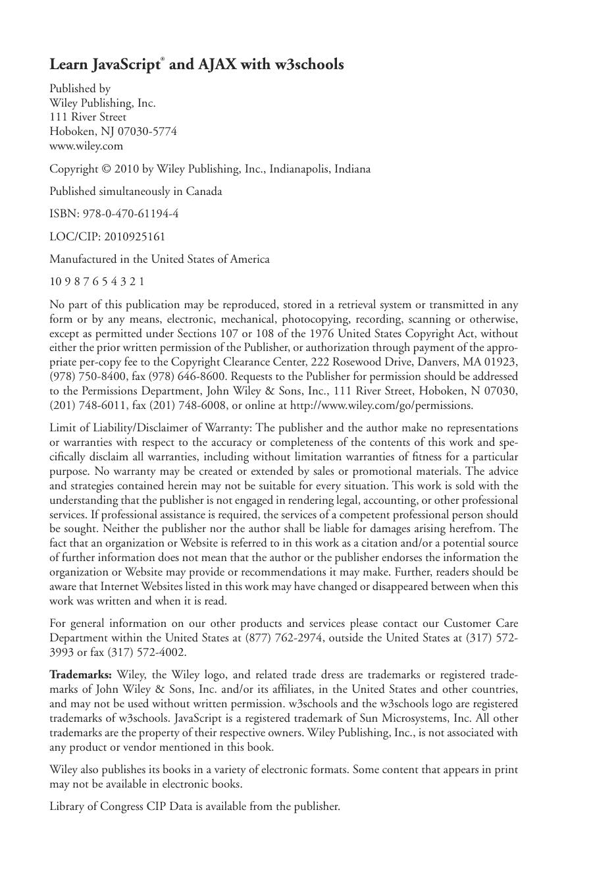


## w3schools 作者/编辑

w3schools 的使命是基于 W3C Web 标准发布组织良好且易于理解的在线教程。

### Hege Refsnes
Hege 是 w3schools 的作家兼编辑。她致力于提高 Web 的可用性和可访问性。Hege 自 1998 年以来一直为 w3schools 编写教程。

### Ståle Refsnes
Ståle 有十年的互联网开发经验，为挪威手球协会开发了所有基于 Web 的解决方案。Ståle 自 1999 年以来一直为 w3schools 编写教程。

### Kai Jim Refsnes
Kai Jim 从小就接触计算机，14 岁起就开始处理计算机。自从 2005 年获得信息技术学士学位以来，他一直在为 w3schools 编写教程。

### Jan Egil Refsnes
Jan Egil 是 w3schools 的总裁兼创始人。他是一位资深系统开发人员，拥有信息技术硕士学位和 30 多年的计算经验。“Jani”曾监督了 Amoco、英国石油、ELF、哈里伯和 Brown & Root 等石油公司的许多公司关键开发项目。他还为包括国家图书馆、挪威高中、州立医院在内的 20 多个政府机构开发了计算机解决方案。Jani 于 1998 年创立 w3schools。

## 鸣谢

**策划编辑**

**副总裁兼执行小组**
Scott Meyers

**出版者**

**制作**
Richard Swadley
Abshier House

**副总裁兼执行出版经理**

**技术编辑**
Barry Pruett
Harry Buss

**助理出版经理**

**文字编辑**
Jim Minatel
Abshier House

**项目协调员（封面）**
**营销副总监**
Lynsey Stanford
David Mayhew

**校对与索引**
**制作经理**
Abshier House
Tim Tate

**封面设计**
Michael Trent


# JavaScript 简介

### JavaScript
`JavaScript` 是一种脚本语言。`JavaScript` 用于为 HTML 页面添加功能。`JavaScript` 是 Web 上流行的脚本语言，可以在所有主流浏览器中运行，如 Internet Explorer、Firefox、Chrome 和 Safari。

## 你应该已经
在继续之前，你应该对 HTML 有基本的了解。如果你想先学习这个主题，请阅读*学习 HTML 和 CSS*。

## 什么是 JavaScript？
- `JavaScript` 设计用于为 HTML 页面添加交互性。
- `JavaScript` 是一种脚本语言。
- 脚本语言是一种轻量级的编程语言。
- `JavaScript` 通常直接嵌入到 HTML 页面中。
- `JavaScript` 是一种解释型语言（意味着脚本在无需预先编译的情况下执行）。
- 每个人都可以使用 `JavaScript` 而无需购买许可证。

## Java 和 JavaScript 样的吗？
不，它们不是。`Java` 和 `JavaScript` 在概念和设计上都是完全不同的语言。`Java`由 Sun Microsystems 开发）是一种强大且复杂的编程语言，与 C 和 C++ 属于同一类别。

## JavaScript 能做什么？
- `JavaScript` 为 HTML 设计师提供了一个编程工具。HTML 作者通常不是程序员，但 `JavaScript` 是一种语法非常简单的脚本语言。几乎任何人都可以他们的 HTML 页面中加入小的代码“片段”。
- `JavaScript` 可以向 HTML 页面放入动态文本。像 `document.write("<h1>" + name + "</h1>")` 这样的 JavaScript 语句可以将变量文本写入 HTML 页面。
- `JavaScript` 可以响应事件。可以设置 `JavaScript` 脚本在某些情况发生时执行，例如页面加载完成或用户点击 HTML 元素时。
- `JavaScript` 可以读取和写入 HTML 元素。`JavaScript` 脚本可以读取并更改 HTML 元素的内容。
- `JavaScript` 可用于验证数据。`JavaScript` 脚本可以在表单数据提交到服务器之前进行验证。这节省了服务器的额外处理工作。
- `JavaScript` 可用于检测访问者的浏览器。`JavaScript` 脚本可以检测访问者的浏览器，并根据浏览器加载另一个专门为该浏览器设计的页面。
- `JavaScript` 可用于创建 Cookie。`JavaScript` 脚本可用于在访问者的计算机上存储和检索信息。

**真实名称是 ECMAscript**


JavaScript 的正式名称是 `ECMAScript`，由 `ECMA International` 组织开发和维护。

该语言由 Brendan Eich 在 `Netscape`（带有 `Navigator 2.0`）发明，自 1996 年以来已出现在所有的 Netscape 和微软浏览器中。

# 2 导介绍

`ECMA-262` 是 JavaScript 的官方标准。`ECMA-262` 的开发始于 1996 年，第一版于 1997 年 6 月被 `ECMA General Assembly` 采用。

该标准于 1998 年通过作为国际 ISO (`ISO/IEC 16262`) 标准批准。

标准的开发仍在进行中。

## AJAX

AJAX 等于异步 JavaScript 和 XML。

AJAX 基于 JavaScript 和 `HTTP` 请求。AJAX 并不是一种新的编程语言，而是使用现有标准的新方法。

AJAX 是与 Web 服务器进行数据交换并更改网页部分内容而无需刷新整个页面的艺术。

## 你应该已经知道的

在继续之前，你应该对以下内容有基础了解：
* 8 HTML
* 8 JavaScript

如果你想先学习这些主题，可以在 `w3schools` 首页找到相关教程。

## AJAX = 异步 JavaScript 和 XML

AJAX 不是一种新的编程语言，但是一种用于创建更好、更快、更具交互性的 Web 应用的新技术。

通过 AJAX，JavaScript 可以通过 `XMLHttpRequest` 对象与服务器直接通信。通过这个对象，JavaScript 可以与 Web 服务器交换数据，而无需重新加载页面。

AJAX 在浏览器和 Web 服务器之间使用异步数据传输（`HTTP` 请求），允许网页从服务器请求小部分信息，而不是整个页面。

AJAX 技术让互联网应用程序更轻量、更快且更符合用户习惯。

## AJAX 基于互联网标准

AJAX 基于以下 Web 标准：
* 8 JavaScript
* 8 XML

# 3 使用 w3schools 学习 JavaScript 和 AJAX

* 8 HTML
* 8 CSS

AJAX 应用程序独立于浏览器和平台。

## AJAX 关更好的互联网应用程序

互联网应用程序相比桌面应用程序有许多优势：它们可以触及更广泛的受众；更容易安装和支持；而且更容易开发。

然而，互联网应用程序并不总是像传统的桌面应用程序那样“丰富”和用户友好。

通过 AJAX，互联网应用程序可以变得更丰富、更用户友好。

## 今天开始使用 AJAX

没有新东西要学。AJAX 基于现有标准。这些标准已经供开发者使用了多年。

## 如何使用此书

在本书中，你会看到几个图标：**Try it yourself >>**（自己尝试 >>）

`Try It Yourself` 图标表示你有机会练习刚刚所学的内容。该图标下的代码和示例来自 `w3schools` 网站的示例，允许你修改代码并立即查看结果。你不需要输入书中的代码示例；你可以在 `w3schools` 网站上找到它们。

`w3schools` 图标表示 `w3schools` 网站上有更多信息。

此图标表示你可以在书中其他地方找到关于某个主题的进一步信息，该主题在书中另有更详细的介绍。

本书分为五个部分：
* 8 第一部分：JavaScript 基础
* 8 第二部分：JavaScript 对象
* 8 第三部分：JavaScript 进
* 8 第四部分：AJAX 基础
* 8 第五部分：AJAX 进

# 4 导介绍

如果你急于改进你的网页并添加一些交互性，请直接进入 JavaScript 基础部分。大量的示例和尝试机会在等着你，而 `w3schools`会在你需要时提供帮助！

# 5 第一部分 JavaScript 基础

* ❑ 第 1 章：JavaScript 如何以及在哪里
* ❑ 第 2 章：JavaScript 语句和注释
* ❑ 第 3 章：JavaScript 变量
* ❑ 第 4 章：JavaScript 运算符
* ❑ 第 5 章：JavaScript 比较
* ❑ 第 6 章：JavaScript If…Else
* ❑ 第 7 章：JavaScript 循环
* ❑ 第 8 章：JavaScript 控制语句
* ❑ 第 9 章：JavaScript Switch 和弹出框
* ❑ 第 10 章：JavaScript 函数
* ❑ 第 11 章：JavaScript 事件
* ❑ 第 12 章：JavaScript Try…Catch 和 Throw 语句
* ❑ 第 13 章：JavaScript 特殊字符和指南

# 7


## 第 1 章 JavaScript 如何以及在哪里

### 本章内容

* 如何将 JavaScript 放入 HTML 页面
* 如何处理简单浏览器
* JavaScript 放在哪里
* 使用外部 JavaScript

HTML `<script>` 标签用于将 JavaScript 插入 HTML 页面。

## 如何将 JavaScript 放入 HTML 页面

下面的示例了如何使用 JavaScript 在 Web 页面上编写文本。

该脚本的结果如图 1.1 所示。

```html
<html>
<body>
<script type="text/javascript">
document.write("Hello World!");
</script>
</body>
</html>
```

**图 1.1**

# 9


# 使用 w3schools 学习 JavaScript 和 ajax

这是你第一次个性化 JavaScript 的机会。将“Hello World”改为“Happy, Joy!”并看看会发生什么。你的更改结果如图 1.2 所示。

```html
<html>
<body>
<script type="text/javascript">
document.write("Happy, Joy!");
</script>
</body>
</html>
```

**图 1.2**

# 10


## 第 1 章 如何以及在哪里

要将 JavaScript 插入 HTML 页面，我们使用 `<script>` 标签。在 `<script>` 标签内部，我们使用 `type` 属性来定义脚本语言。

因此，`<script type="text/javascript">` 和 `</script>` 告诉 JavaScript 的开始和结束：

```html
<html>
<body>
<script type="text/javascript">
...
</script>
</body>
</html>
```

`document.write` 命令是向页面输出的标准 JavaScript 命令。

当你在 `<script>` 和 `</script>` 标签之间输入 `document.write` 命令时，浏览器将其识别为 JavaScript 命令并执行。在这种情况下，浏览器会在页面上写入 Hello World!：

```html
<html>
<body>
<script type="text/javascript">
document.write("Hello World!");
</script>
</body>
</html>
```

**注意** 如果我们没有输入 `<script>` 标签，浏览器会将 `document.write(“Hello World!”)` 命令视为纯文本，并直接在页面上输出整行，如图 1.5 所示。

**图 1.5**

# 11

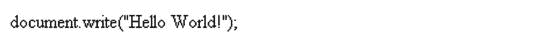

## 如何处理简单浏览器

不支持 JavaScript 的浏览器会将 JavaScript 作为页面内容显示。

为了防止这种情况，并作为 JavaScript 标准的一部分，应该使用 HTML 注释标签来“隐藏”JavaScript。

只需在第一个 JavaScript 语句之前添加 HTML 注释标签 `<!--`，在最后一个 JavaScript 语句之后添加注释结束标签 `-->`，如下：

```html
<html>
<body>
<script type="text/javascript">
<!--
document.write("Hello World!");
//-->
</script>
</body>
</html>
```

注释行末尾的两个斜杠（`//`）是 JavaScript 的注释符号。这防止了 JavaScript 执行 `-->` 标签。


页面中的 JavaScript 会在页面加载到浏览器时立即执行。这并不总是我们想要的。有时，我们希望在页面加载时，或在稍后的事件发生时（例如用户点击按钮时）执行脚本。在这种情况下，我们将脚本放在函数内部。你将在第 10 章“JavaScript 函数”中学习函数的相关知识。

## 12

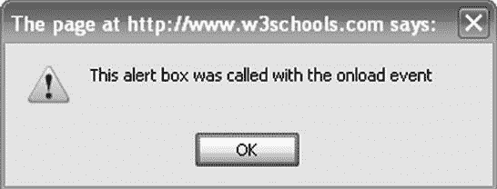

## 第一章：JavaScript 如何使用以及何处使用

## <head> 中的脚本

在被调用或触发事件时执行的脚本应被放在函数中。

将你的函数放在 `head` 区域。这样它们就集中在一个地方，并且不会干扰页面内容。生成的警报框如图 1.6 所示。

**自己尝试一下 >>**

```html
<html>
<head>
<script type="text/javascript"> function message()
{
alert("This alert box was called with the onload event");
}
</script>
</head>
<body onload="message()">

</body>
</html>
```

**图 1.6**

## <body> 中的脚本

如果你不希望脚本被放在函数内部，或者你的脚本应该写入页面内容，则应该将其放在 `body` 区域。图 1.7 显示了结果。

## 13

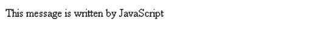

### 通过 w3schools 学习 JavaScript 和 ajax

**自己尝试一下 >>**

```html
<html>
<head>
</head>
<body>
<script type="text/javascript"> document.write("This message is written by JavaScript");
</script>
</body>
</html>
```

**图 1.7**

## <head> 和 <body> 中的脚本

你可以在文档中放置无限数量的脚本，因此你可以在 `body` 和 `head` 区域都放置脚本。

```html
<html>
<head>
<script type="text/javascript"> function message()
{
alert("This alert box was called with the onload event");
}
</script></head>
<body onload="message()">
<script type="text/javascript"> document.write("This message is written by JavaScript");
</script>
</body>
</html

```

## 14

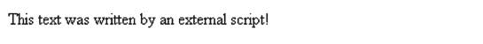

## 第一章：JavaScript 如何使用以及何处使用

## 使用外部 JavaScript

如果你想在多个页面上运行相同的 JavaScript，而无需在每个页面都编写相同的脚本，你可以在一个外部文件中编写 JavaScript。

将外部 JavaScript 文件保存为 `.js` 扩展名的文件。你的结果如图 1.8 所示。

**注意** 外部脚本不能包含 `<script>` 标签！

**自己尝试一下 >>**

要使用外部脚本，在 `<script>` 标签的 `src` 属性中指向 `.js` 文件，如下：

```html
<html>
<head>
<script type="text/javascript" src="xxx.js"></script>
</head>
<body>

</body>
</html
```

**图 1.8**

**注意** 记得将脚本精确地放置在通常通常编写脚本的地方！

## 15

# 第二章

### JavaScript

## 本章中的语句和注释

- JavaScript 代码
- JavaScript 块
- JavaScript 多行注释
- 使用注释防止执行
- 在行尾使用注释

JavaScript 是由浏览器执行的一系列语句。与 HTML 不同，JavaScript 是区分大小大小的；因此，在编写 JavaScript 语句以及创建或调用变量、对象和函数时，请密切注意大小写。

### JavaScript 语句

JavaScript 语句是给浏览器的命令。该命令的目的是告诉浏览器做什么。

以下 JavaScript 语句告诉浏览器在网页上写入“Hello Dolly”：

```javascript
document.write("Hello Dolly");
```

在每个可执行语句末尾添加分号是正常做法。大多数人认为这是一个良好的编程习惯，你通常会在 Web  JavaScript 中看到它。

根据 JavaScript 标准，分号是可选的，浏览器理应将行的结束解释为语句的结束。你经常会看到末尾没有分号的示例。

## 16


## 第二章：JavaScript 语句和注释 **注意** 使用分号允许在一行内编写多个语句，尽管良好的编程习惯鼓励每行只放置一个语句。

### JavaScript 代码

JavaScript 代码（或简称 JavaScript）是 JavaScript 语句的序列。浏览器按照它们编写的顺序执行每条语句。

此示例将向网页写入一个标题和两个段落，如图 2.1 所示。

**自己尝试一下 >>**

```html
<html>
<body>
<script type="text/javascript"> document.write("<h1>This is a heading</h1>"); document.write("<p>This is a paragraph.</p>"); document.write("<p>This is another paragraph.</p>");
</script>
</body>
</html
```

**图 2.1**

### JavaScript 块

JavaScript 语句可以组合成块。块以左大括号 `{` 开始，以右大括号 `}` 结束。

块的目的是让语句序列一起执行。

以下示例向网页写入一个标题和两个段落，如图 2.1 所示。

## 17


### 通过 w3schools 学习 JavaScript 和 ajax

```html
<html>
<body>
<script type="text/javascript"> {
document.write("<h1>This is a heading</h1>"); document.write("<p>This is a paragraph.</p>"); document.write("<p>This is another paragraph.</p>");
}
</script>
</body>
</html
```

**图 2.2**

前面的示例是有用的。它演示了块的使用。通常，块用于将语句组合在一起。

### JavaScript 注释

可以添加注释来解释 JavaScript 或提高代码的可读性。

单行注释以 `//` 开始。

以下示例使用单行注释解释代码。

## 18

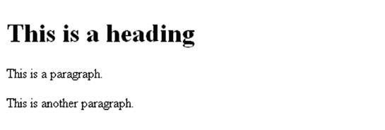

## 第二章：JavaScript 语句和注释

**自己尝试一下 >>**

```html
<html>
<body>
<script type="text/javascript">
// 写标题
document.write("<h1>This is a heading</h1>");
// 写两个段落：
document.write("<p>This is a paragraph.</p>"); document.write("<p>This is another paragraph.</p>");
</script>
</body>
</html
```

**图 2.3**

### JavaScript 多行注释

多行注释以 `/*` 开始，以 `*/` 结束。

以下示例使用多行注释解释代码。

## 19


**自己尝试一下 >>**

```html
<html>
<body>
<script type="text/javascript">
/*
下面的代码将写入
一个标题和两个段落
*/
document.write("<h1>This is a heading</h1>"); document.write("<p>This is a paragraph.</p>"); document.write("<p>This is another paragraph.</p>");
</script>
</body>
</html
```

**图 2.4**

### 使用注释防止执行

在以下示例中，注释被用于防止单行代码执行（可能适用于调试）。

**自己尝试一下 >>**

```html
<html>
<body>
<script type="text/javascript">
//document.write("<h1>This is a heading</h1>"); document.write("<p>This is a paragraph.</p>"); document.write("<p>This is another paragraph.</p>");
</script>
</body>
</html
```

**图 2.5**

在以下示例中，注释被用于防止代码块的执行（可能适用于调试）。

**自己尝试一下 >>**

```html
<html>
<body>
<script type="text/javascript">
/*
document.write("<h1>This is a heading</h1>"); document.write("<p>This is a paragraph.</p>"); document.write("<p>This is another paragraph.</p>");
*/
</script>
</body>
</html
```

你的结果将是一个空白屏幕。

## 21


# 使用 w3schools 学习 JavaScript 和 ajax

## 在行尾使用注释

在下面的示例中，注释被放在代码行的末尾。你的结果如图 2.6 所示。

**自己尝试 >>**

```html
<html>
<body>
<script type="text/javascript"> document.write("Hello"); // 写入 "Hello"
document.write(" Dolly!"); // 写入 " Dolly!"
</script>
</body>
</html>
```

**图 2.6**

# 第 3 章：JavaScript 变量

### 本章内容
- 你还记得学校里的代数课吗？
- JavaScript 变量
- 声明（创建）JavaScript 变量
- 为未声明的 JavaScript 变量赋值
- 重复 JavaScript 变量
- JavaScript 算术

变量是用于存储信息的“容器”。

### 你还记得学校里的代数课吗？
你还记得学校里的代数课吗？
`x = 5`, `y = 6`, `z = x + y`。你还记得一个字母（如 `x`）可以用来存储值（如 `5`），以及你可以利用给定的信息计算出 `z` 的值为 `11` 吗？

这些字母被称为**变量**。变量可以存储值（`x = 5`）或表达式（`z = x + y`）。

### JavaScript 变量
与代数一样，JavaScript 变量用于存储值或表达式。变量可以有一个短名称如 `x`，也可以有一个更描述性的名称 `carname`。

**JavaScript 变量命名规则：**
1. 变量名区分大小写（`y` 和 `Y` 是两个不同的变量）。
2. 变量名必须以字母、下划线或美元符号开头。（`$` 符号主要用于代码生成工具。）
3. 后续字符可以是字母、数字、下划线或美元符号。

**注意**：有 59 个保留字不是合法的变量名。

**提示**：由于 JavaScript 是大小敏感的，因此变量名也是大小敏感的。

变量的值在脚本执行过程中可以改变。你可以通过变量名来显示或更改它的值。你的结果如图 3.1 所示。

**自己尝试 >>**

```html
<html>
<body>
<script type="text/javascript"> var firstname;
firstname="Hege";
document.write(firstname);
document.write("<br />");
firstname="Tove";
document.write(firstname);
</script>
<p>上面的脚本声明了一个变量，为其赋值了值，显示了值，更改了值并再次显示了值。</p>
</body>
</html>
```

**图 3.1**

## 声明（创建）JavaScript 变量
在 JavaScript 中创建变量通常被称为“声明”变量。

你可以使用 `var` 语句声明 JavaScript 变量：`var x;`

```javascript
var x;
var carname;
```

在完成上述声明后，变量是空的（它们还没有还没有值）。但是，你也可以在声明变量时为它们赋值：
```javascript
var x=5;
var carname="Volvo";
```

在执行完上述语句后，变量 `x` 将持有值 `5`，`carname` 将持有值 `Volvo`。

**注意**：当你给变量赋值文本值时，请在值周围使用引号。

### 为未声明的 JavaScript 变量赋值
如果你给尚未声明的变量赋值，这些变量将在后续语句中自动声明：
```javascript
x=5;
carname="Volvo";
```

### 重复 JavaScript 变量
如果你重新声明一个 JavaScript 变量，它不会丢失其原始值。在执行完上述语句后，变量 `x` 仍然具有值 `5`。当你重新声明它时，`x` 的值不会重置（或清除）：
```javascript
var x;
x=5;
```

### JavaScript 算术
与代数一样，你可以对 JavaScript 变量进行算术运算。如果赋值表达式右侧至少有一个变量包含字符串，结果将是一个字符串。只有当赋值运算符右侧的所有变量都是数字时，结果才是数字。

算术运算符用于在变量和值之间执行算术。假设 `y = 5`，下表解释了算术运算符。

| 运算符 | 描述 | 示例 | 结果 |
| :--- | :--- | :--- | :--- |
| `+` | 加法 | `x = y+2` | `7` |
| `-` | 减法 | `x = y-2` | `3` |
| `*` | 乘法 | `x = y*2` | `10` |
| `/` | 除法 | `x = y/2` | `2.5` |
| `%` | 取模（除法的余数） | `x = y%2` | `1` |
| `++` | 增一 | `x = ++y` | `6` |
| `--` | 减一 | `x = --y` | `4` |

## JavaScript 赋值运算符
赋值运算符用于给 JavaScript 变量赋值。假设 `x = 10`  `y = 5`，下表解释了赋值运算符：

| 运算符 | 示例 | 等于 | 结果 |
| :--- | :--- | :--- | :--- |
| `=` | `x = y` | - | `5` |
| `+=` | `x += y` | `x = x+y` | `15` |
| `-=` | `x -= y` | `x = x-y` | `5` |
| `*=` | `x *= y` | `x = x*y` | `50` |
| `/=` | `x /= y` | `x = x/y` | `2` |
| `%=` | `x %= y` | `x = x%y` | `0` |

### 的 + 运算符用于字符串
`+` 运算符也可以用于连接字符串变量或文本值。连接两个或多个字符串变量，使用 `+` 运算符：
```javascript
txt1="What a very";
txt2="nice day";
txt3=txt1+txt2;
```
执行上述语句后，变量 `txt3` 包含“What a veryday”。

要在字符串之间插入空格，请在一个一个字符串中插入空格：
```javascript
txt1="What a very ";
txt2="nice day";
txt3=txt1+txt2;
```
或者在表达式中插入空格：
```javascript
txt1="What a very";
txt2="nice day";
txt3=txt1+" "+txt2;
```
执行上述语句后，变量 `txt3` 包含：“What very nice day”。

### 数字与数字
规则如下：如果你将一个数字和一个字符串相加，结果将是一个字符串！你的结果如图 4.1 所示。

**图 4.1**

# 第 4 章：JavaScript 运算符

**自己尝试 >>**

```html
<html>
<body>
<script type="text/javascript"> x=5+5;
document.write(x);
document.write("<br />");
x="5"+"5";
document.write(x);
document.write("<br />");
x=5+"5";
document.write(x);
document.write("<br />");
x="5"+5;
document.write(x);
document.write("<br />");
</script>
<p>规则是：如果你将一个数字和一个字符串相加，结果将是一个字符串。</p>
</body>
</html>
```

# 第 5 章：JavaScript 比较

### 本章内容
- 比较运算符
- 如何使用比较
- 逻辑运算符
- 条件运算符

比较和逻辑运算符用于测试真或假。

**比较运算符**
比较运算符用于逻辑语句，确定变量或值之间的相等性或差异。假设 `x = 5`，下表解释了比较运算符：

| 运算符 | 描述 | 示例 | 结果 |
| :--- | :--- | :--- | :--- |
| `==` | 与值相等 | `x == 8` | `false` |
| `===` | 与值和类型完全相等 | `x === 5` | `true` |
| | | `x === "5"` | `false` |
| `!=` | 不等于 | `x != 5` | `false` |


`x! = 8` 为 true

`>`
大于

`x > 8` 为 false

`<`
小于

`x < 8` 为 true

`>=`
大于或等于

`x >= 8` 为 false

`<=`
小于或等于

`x <= 8` 为 true

**30**

---

# 第 5 章：Javascript 比较
## 如何使用比较

比较运算符可以用于条件语句，以以比较值并根据结果执行操作：

```javascript
if (age<18) document.write("Too young");
```

你将在下一章中学习更多关于条件语句的使用。

### 逻辑运算符

逻辑运算符用于确定变量或值之间的逻辑关系。

假设 `x = 6` 且 `y = 3`，下表解释了逻辑运算符：`operator`

| 运算符 | 描述 | 示例 |
| :--- | :--- | :--- |
| `&&` | 与 | `(x < 10 && y > 1)` 为 true |
| `\|\|` | 或 | `(x == 5 \| y == 5)` 为 false |
| `!` | 非 | `!(x == y)` 为 true |

### 条件运算符

JavaScript 还包含一种条件运算符，它可以根据某些条件给变量赋值。其语法如下：`variablename=(condition)?value1:value2`

例如，

`greeting=(visitor=="PRES")?"Dear President ":"Dear ";` 如果变量 `visitor` 的值为 `"PRES"`，则变量 `greeting` 将被赋值为 `"Dear President "`，否则将被赋值为 `"Dear"`。

**31**

---

# 第 6 章
## JavaScript if...else
## 语句

### 本章内容

- 条件语句
- if 语句
- if...else 语句
- if...else if...else 语句

条件语句用于根据不同的条件执行不同的操作。

### 条件语句

在编写代码时，你通常希望根据不同的决策执行不同的操作。你可以在代码中使用条件语句来实现这一点。

JavaScript 具有以下条件语句：

1. **if 语句。** 使用此语句仅在指定条件为真时执行某些代码。
2. **if...else 语句。** 使用此语句在条件为真时执行某些代码，在条件为假时执行另一个代码。
3. **if...else if....else 语句。** 使用此语句从多个代码块中选择一个进行执行。
4. **switch 语句。** 使用此语句从多个代码块中选择一个进行执行。

**32**

---

# 第 6 章：JavaScript if...else 语句
**t i p** 使用条件语句时，一个 `{ }` 块必须包含要执行的语句。如果没有大括号，则只执行后续语句，这是一个非常常见的编程错误。

```javascript
if (condition)
{
  statement 1;
  statement 2;
  statement 3;
} // 所有三个语句都会被执行

if (condition)
statement 1;
statement 2;
statement 3;
// 仅执行 statement 1
```

### if 语句

使用 `if` 语句仅在指定条件为真时执行某些代码。

语法如下：

```javascript
if (condition)
{
  // 如果条件为真则执行的代码
}
```

你的结果如图 6.1 所示。

**t i p** `if` 用小写字母写。使用大写字母（`IF`）将产生 JavaScript 错误！

**自己试试 >>**

```html
<html>
<body>
<script type="text/javascript"> 
var d = new Date();
var time = d.getHours();
```

*(继续)*

**33**

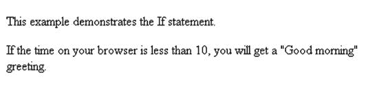

**通过 w3schools 学习 JavaScript 和 ajax**

*(继续)*

```javascript
if (time < 10)
{
  document.write("<b>Good morning</b>");
}
```
</script>
<p>此示例演示了 If 语句。</p>
<p>如果你的浏览器上的时间小于 10，你将收到“Good morning”的问候。</p>

</body>
</html>
```

**图 6.1**

**n O t e** 在此语法中没有 `..else..`。你只是告诉浏览器仅在指定条件为真时才执行某些代码。

### if...else 语句

使用 `if....else` 语句在条件为真时执行某些代码，在条件为假时执行另一个代码。

语法如下：

```javascript
if (condition)
{
  // 如果条件为真则执行的代码
}
else
{
  // 如果条件为假则执行的代码
}
```

**34**

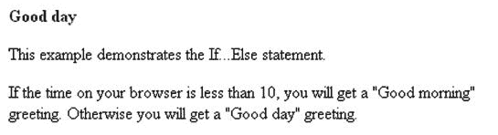

**第 6 章：JavaScript if...else 语句**

**自己试试 >>**

```html
<html>
<body>
<script type="text/javascript"> 
var d = new Date();
var time = d.getHours();
if (time < 10)
{
  document.write("<b>Good morning</b>");
}
else
{
  document.write("<b>Good day</b>");
}
</script>
<p>此示例演示了 If...Else 语句。</p>
<p>如果浏览器上的时间小于 10，你将得到“Good morning”问候。</p>

</body>
</html>
```

**图 6.2**

**35**


**通过 w3schools 学习 JavaScript 和 ajax**

**37**

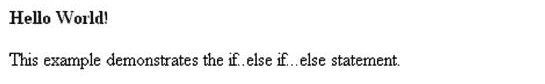

**通过 w3schools 学习 JavaScript 和 ajax**

**通过 w3schools   JavaScript 和 **

---

# 第 7 章
## JavaScript 循环

### 本章内容

- for 循环
- while 循环
- do...while 循环

循环按指定的次数执行代码块，或在指定条件为真时执行。在编写代码时，你通常希望某代码块运行运行执行。你可以在代码代码循环来执行任务任务

JavaScript  以下两种两种：：

1. **for 循环。** 按指定的次数执行代码块。
2. **while 循环。** 在指定条件为真时执行代码块。

### for 循环

`for` 循环用于 预 运行 执行 。

语法如下：

```javascript
for (var=开始 value;var<=endvalue;var=
)
{
  // 要执行的代码
}
```

** for **

`for` 循环用于预先知道脚本运行的次数。

语法如下：

下面的示例定义了一个从 `i = 0` 开始的循环。只要 `i` 小于或等于 `5`，循环就会继续运行。`i` 每次运行时都会增加 1。你的结果如图 7.1 所示。

**n O t e** 增量参数也可以是负数，且 `<=` 可以是任何比较语句。

**39**

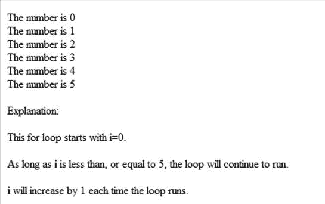

**通过 w3schools 学习 JavaScript 和 ajax**

**自己试试 >>**

```html
<html>
<body>
<script type="text/javascript"> 
for (i = 0; i <= 5; i++)
{
  document.write("The number is " + i);
  document.write("<br />");
}
</script>
<p>解释：</p>
<p>这个 for 循环从 i=0 开始。</p>
<p>只要 <b>i</b> 小于或等于 5，循环就会继续运行。</p>
<p><b>i</b> 在每次运行时都会增加 1。</p>
</body>
</html>
```

**图 7.1**

**40**

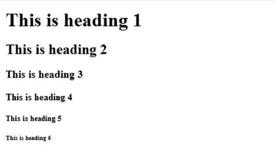

**第 7 章：JavaScript 循环**

在下面的示例中，你循环遍历 6 个不同的 HTML 标题。你的结果如图 7.2 所示。


#### 尝试一下 >>

```html
<html>
<body>
<script type="text/javascript"> for (i = 1; i <= 6; i++)
{
document.write("<h" + i + ">This is heading " + i); document.write("</h" + i + ">");
}
</script>
</body>
</html>
```

**图 7.2: while 循环**

`while` 循环按指定的次数循环代码块，或者当指定的条件为真时一直循环。

语法如下：

```javascript
while (var<=endvalue)
{
  // (续上)
  要执行的代码
}
```

**注意**：`<=` 可以任何比较语句。

**提示**：`for` 循环和 `while` 循环的区别在于，在 `for` 循环中，条件是已知的可以预先指定。`while` 循环用于初始条件已知但终止条件在代码块执行时才发现的情况。

下面的示例定义了一个从 `i = 0` 开始的循环。只要 `i` 小于或等于 5，循环将继续运行。每次循环运行时，`i` 都会增加 1，如图 7.3 所示。

**尝试一下 >>**

```html
<html>
<body>
<script type="text/javascript"> i=0;
while (i<=5)
{
document.write("The number is " + i); document.write("<br />");
i++;
}
</script>
<p>解释：</p>
<p>`i` 等于 0。</p>
<p>只要 `i` 小于或等于 5，循环将继续运行。</p>
<p>每次循环运行，`i` 都会增加 1。</p>
</body>
</</html>
```

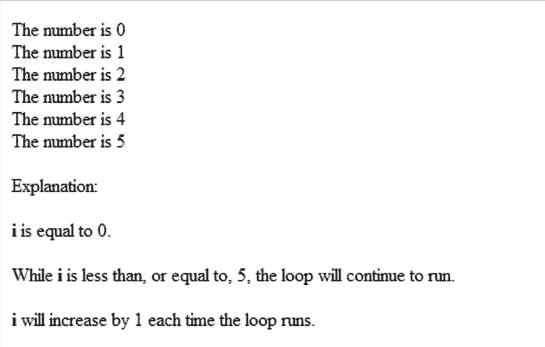

**第 7 章：Javascript 循环**

**图 7.3: do...while 循环**

`do...while` 循环是 `while` 循环的一种变体。该循环会执行代码块*一次*，然后只要指定的条件为真，它就会重复循环。

语法如下：

```javascript
do
{
  要执行的代码
}
while (var<=endvalue);
```

下面的示例使用了 `do...while` 循环。即使条件为假，`do...while` 循环也会至少执行一次，因为语句是在测试条件之前执行的。结果如图 7.4 所示。

**提示**：`while` 循环和 `do…while` 循环的区别特征在于条件是在执行代码块之前还是之后检查的。在 `while` 循环中，首先检查条件，因此如果条件为假，则不执行代码块。在 `do…while` 循环中，在执行代码块*之后*检查条件；因此，代码块至少会被执行一次。

**尝试一下 >>**

```html
<html>
<body>
<script type="text/javascript"> i = 0;
do
{
document.write("The number is " + i); document.write("<br />");
i++;
}
while (i <= 5)
</script>
<p>解释：</p>
<p>`i` 等于 0。</p>
<p>循环将运行</p>
<p>每次循环运行，`i` 都会增加 1。</p>
<p>只要 `i` 小于或等于 5，循环将继续运行。</p>
</body>
</</html>
```

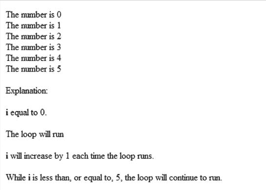

**第 7 章：Javascript 循环**

**图 7.4**

## 第 8 章：额外的 JavaScript 流程控制语句

### 本章内容
* `break` 语句
* `continue` 语句
* JavaScript `for...in` 语句
* JavaScript `switch` 语句

`break` 和 `continue` 语句用于控制循环的执行。`break` 语句可用于在遇到错误条件时停止循环的执行。`continue` 语句用于开始循环的下一次迭代，而不执行代码块中的所有语句。

### break 语句

`break` 语句将终止循环的执行，并继续执行循环之后的代码（如果有）。你的结果如图 8.1 所示。

**尝试一下 >>**

```html
<html>
<body>
<script type="text/javascript"> var i=0;
for (i=0;i<=10;i++)
{
  if (i==3)
  {
    break;
  }
  document.write("The number is " + i); document.write("<br />");
}
</script>
<p>解释：循环在 `i=3` 时将中断。</p>
</body>
</</html>
```

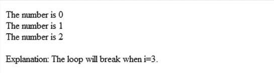

**图 8.1: continue 语句**

`continue` 语句将终止当前迭代并使用下一个值重启循环。你的结果在 8.2 所示。

**尝试一下 >>**

```html
<html>
<body>
<script type="text/javascript"> var i=0;
for (i=0;i<=10;i++)
{
if (i==3)
{
continue;
}
document.write("The number is " + i); document.write("<br />");
}
</script>
<p>解释：当 `i=3` 时循环将跳过。</p>
</body>
</</html>
```

### for...in 语句

`for...in` 语句遍历数组的元素。语法如下：

```javascript
for (variable in array)
{
  要执行的代码
}
```

在下面的示例中，使用 `for...in` 遍历数组。你的结果如图 8.3 所示。

```html
<html>
<body>
<script type="text/javascript"> var x;
var mycars = ["Saab", "Volvo", "BMW"];
for (x in mycars)
{
document.write(mycars[x] + "<br />");
}
</script>
</body>
</</html>
```

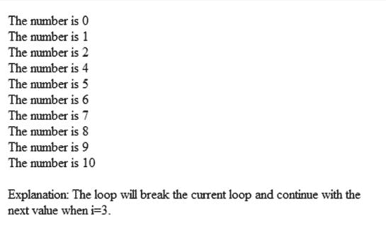
**图 8.3**

### `switch` 语句用于从多个代码块中选择一个执行。语法如下：

```javascript
switch(expression)
{
  case value1:
    // 代码块 1
    break;
  case value2:
    // 代码块 2
    break;
  default:
    // 默认代码块
}
```

它的工作原理是：首先计算一个表达式 `n`（通常是一个变量）。然后将表达式的值与结构中的每个 `case` 值进行比较。如果匹配，则执行与用用相关的代码块。执行一直持续到 `switch` 块结束或遇到 `break` 语句。例如：

```html
<html>
<body>
<script type="text/javascript"> var i = 1;
switch (i)
{
case 0:
document.write("i == 0<br>"); case 1:
document.write("i == 1<br>"); case 2:
document.write("i == 2<br>"); break;
case 3:
document.write("i == 3<br>"); break;
default:
document.write("i > 3<br>");
}
</script>
</body>
</</html>
```

注意，当 `i == 1` 时，执行从 `case 1:` 开始，一直直到遇到 `break` 语句。

**尝试一下 >>**

```html
<html>
<body>
<script type="text/javascript"> var d = new Date();
theDay=d.getDay();
switch (theDay)
{
case 5:
document.write("Finally Friday<br>"); break;
case 6:
document.write("Super Saturday<br>"); break;
case 0:
document.write("Sleepy Sunday<br>"); break;
default:
document.write("I'm really looking forward to this weekend!<br>");
}
</script>
</body>
</</html>
```

这段 JavaScript 将根据当前日期生成不同的问候。注意周日=0，周一=1，周二=2，以此此类推。


# Prompt 提示框

## 弹出框

JavaScript 有三种类型的弹出框：警告框（alert box）、确认框（confirm box）和提示框（prompt box）。

## alert 警告框

当你想向用户显示信息时，通常使用警告框。

当警告框弹出时，用户必须点击“确定”才能继续。

语法如下：

```
alert("sometext");
```

你的结果如图 9.1 所示。当你点击按钮时，图 9.2 中的警告框会弹出。

**自己试试 >>**

```html
<html>
<head>
*(继续)*
**53**

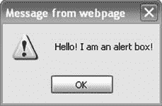
**通过 w3schools 学习 JavaScript 和 ajax**
*(继续)*
<script type="text/javascript"> 
function show_alert()
{
alert("Hello! I am an alert box!");
}
</script>
</head>
<body>
<input type="button" onclick="show_alert()" value="Show alert box" />
</body>
</</html>
```

**图 9.1**

**图 9.2**

以下示例创建了一个带有换行的警告框。

你的结果如图 9.3 和 9.4 所示。

**自己试试 >>**

```html
<html>
<head>
<script type="text/javascript"> 
function disp_alert()
{
alert("Hello again! This is how we" + '\n' + "add line breaks to an alert box!");
}
**54**

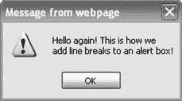
**第 9 章：JavaScript 弹出框**
</script>
</head>
<body>
<input type="button" onclick="disp_alert()" value="Display alert box" />
</body>
</</html>
```

**图 9.3**

**图 9.4**

## confirm 确认框

如果你想让用户验证或接受某些内容，通常使用确认框。

当确认框弹出时，用户必须点击“确定”或“取消”才能继续。

如果用户点击“确定”，框将返回 `true`。如果用户点击“取消”，框将返回 `false`。

语法如下：

```
confirm("sometext");
```

你的结果如图 9.5 和 9.6 所示。

**自己试试 >>**

```html
<html>
<head>
<script type="text/javascript"> 
function show_confirm()
{
*(继续)*
**55**
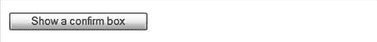
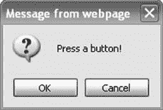
**通过 w3schools 学习 JavaScript 和 ajax**
*(继续)*
var r=confirm("Press a button!");
if (r==true)
{
alert("You pressed OK!");
}
else
{
alert("You pressed Cancel!");
}
}
</script>
</head>
<body>
<input type="button" onclick="show_confirm()" value="Show a confirm box" />
</body>
</</html>
```

**图 9.5**

**图 9.6**

## prompt 提示框

如果你想让用户在页面上或从页面输入一个值，通常使用提示框。

当提示框弹出时，用户在输入值后必须点击“确定”或“取消”才能继续。

如果用户点击“确定”，框将返回输入值。如果用户点击“取消”，框将返回 `null`。

语法如下：

```
prompt("sometext","defaultvalue");
```

你的结果如图 9.7 所示。

**自己试试 >>**

```html
<html>
<head>
<script type="text/javascript"> 
function disp_prompt()
{
var fname=prompt("Please enter your name:","Your name") 
document.getElementById("msg").innerHTML="Greetings, " + fname
}
</script>
</head>
<body>
<input type="button" onclick="disp_prompt()" value="Display a prompt box" />
<br /><br />
<div id="msg"></</div>
</body>
</</html>
```

**图 9.7**

**57**

# 第 10 章
# JavaScript 函数

### 本章内容
- 如何定义函数
- JavaScript 函数示例
- return 语句
- JavaScript 变量的生命周期

函数将通过事件或对函数的显式调用来执行。

为了防止浏览器在页面加载时执行脚本，你可以将脚本放入函数中。

函数包含将通过事件或对函数的调用而执行的代码。

你可以在页面的内部任何地方调用函数（如果函数嵌入在外部 `.js` 文件中，甚至可以在其他页面调用）。

函数既可以定义在文档的 `<head>` 部分，也可以定义在 `<body>` 部分。但为了确保函数在调用之前被浏览器读取/加载，它应该放置在 `<head>` 部分。

## 如何定义函数

语法如下：

```
function functionname(var1,var2,...,varX)
{
some code
}
```

**58**
**第 10 章：JavaScript 函数**

参数 `var1`、`var2` 等 `varX` 是传递给函数的变量或值。`{` 和 `}` 定义了函数的开始和结束。括号 `()` 必须跟在函数后面。注意函数必须小写。

## 函数示例

在以下示例中，如果 `alert("Hello!")` 没有被放在函数中，它将在行加载时被执行。现在，当点击按钮时，函数将被执行。

**自己试试 >>**

```html
<html>
<head>
<script type="text/javascript"> 
function displaymessage()
{
alert("Hello!");
}
</script>
</head>
<body>
<input type="button" onclick="displaymessage()" value="Click me!" />
</body>
</</html>
```

按下上面的按钮，将调用函数。

*(继续)*
**59**
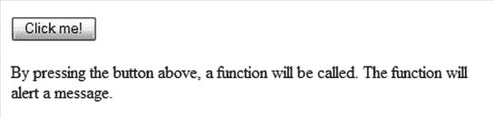

**通过 w3schools 学习 JavaScript 和 ajax**
*(继续)*

你将了解更多关于 JavaScript 事件。以下示例显示了如何将变量传递给函数。

```html
<html
<head>
<script type="text/javascript"> 
function myfunction(txt)
{
alert(txt);
}
</script>
</head>
<body>
<input type="button" onclick="myfunction('Hello')" value="Call function" />
</body>
</html>
```

函数将显示参数。注意 JavaScript 中的大小写。

**60**
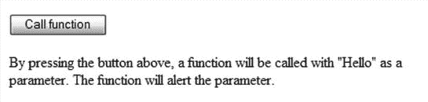

**第 10 章：JavaScript 函数**

**图 10.3**
**图 10.4**

以下示例显示了如何让函数返回一个值。

**自己试试 >>**

```html
<html
<head>
<script type="text/javascript"> 
function myFunction()
{
return ("Hello world!");
}
</script>
</head>
<body>
<script type="text/javascript"> document.write(myFunction());
</script>
</body>
</html>
```

**图 10.5**

## return 语句

`return` 语句用于指定函数的返回值。因此，将返回值的函数必须使用 `return` 语句。

`return` 语句也可以用于不返回值的函数，在函数的任何一点结束执行；例如，当遇到错误条件时：

```
var globalName;

function setGlobalName(name)
{
if (name.length == 0)
{
alert("no name specified")
return;
}
globalName = name;
}
```

以下示例返回两个数字（`a` 和 `b`）的乘积。

**自己试试 >>**

```html
<html
<head>
<script type="text/javascript"> 
function product(a,b)
{
return a*b;
}
</script>
</head>
<body>
<script type="text/javascript"> document.write(product(4,3));
</script>
</body>
</html>
```

**62**
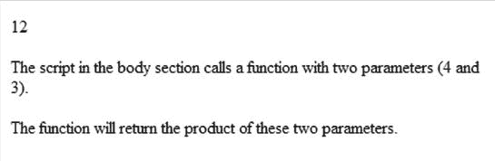
**图 10.6**


该函数将返回这两个参数的乘积。

## 图 10.6
### JavaScript 变量的生命周期

如果你在函数内部声明一个变量，则该变量只能在该函数内部访问。当你退出函数时，该变量就会被销毁。这些变量被称为 `local variables`（局部变量）。你可以在不同函数中使用同名的局部变量，因为每个变量只会被其所在的函数识别。

如果你在函数外部声明一个变量，页面上的所有函数都可以访问它。这些变量被称为 `global variables`（全局变量）。

这些变量的生命周期始于声明时，结束于页面关闭时。

## 第 11 章
### JavaScript 事件

### 本章内容
- `onLoad` 和 `onUnload`
- `onFocus`, `onBlur`, 和 `onChange`
- `onSubmit`
- `onMouseOver` 和 `onMouseOut`
- `onClick`

事件是 JavaScript 可以检测到的动作。

通过使用 JavaScript，我们能够创建动态 Web 页面。

Web 页面上的每个元素都有某些可以触发 JavaScript 的事件。例如，我们可以使用按钮元素的 `onClick` 事件来表示当用户点击按钮时将运行一个函数。我们在 HTML 标签中定义这些事件。

事件示例：
- 鼠标点击
- Web 页面或图像加载
- 鼠标悬停在 Web 页面的热点上
- 在 HTML 表单中选择输入字段
- 提交 HTML 表单

**注意**：事件通常与函数结合使用，函数在事件发生之前不会执行！

### onLoad 和 onUnload
`onLoad` 和 `onUnload` 事件在用户进入或离开页面时触发。

`onLoad` 事件通常用于检查访问者的浏览器类型和版本，并根据这些信息加载相应版本的 Web 页面。

### 第 11 章：JavaScript 事件
`onLoad` 和 `onUnload` 事件经常被用于处理用户进入或离开页面时应该设置的 cookie。例如，你可以在用户首次访问你的页面时弹出一个窗口询问其姓名。然后将姓名存储在 cookie 中。下次访问者再次到达你的页面时，你可以显示另一个弹出窗口，内容类似于：“欢迎，John Doe！”

### onFocus, onBlur, 和 onChange
`onFocus`, `onBlur`, 和 `onChange` 事件通常与表单字段的验证结合使用。

`onFocus` 和 `onBlur` 事件是互补的，它们是由用户点击当前窗口、框架或表单元素之外，或者使用 `Tab` 键在字段或元素之间移动而引起的。当用户离开一个元素时，该元素会触发 `blur` 事件。当用户移动到一个新元素时，该元素会触发 `focus` 事件。

以下是使用 `onChange` 事件的示例。每当用户更改字段内容时，就会调用 `checkEmail()` 函数：

```html
<input type="text" size="30" id="email" onchange="checkEmail()">
```

### onSubmit
`onSubmit` 事件可用于在提交表单之前验证表单字段。

**提示**：由于程序员控制了在 `onSubmit` 时执行的函数，因此可以根据需要验证任何、所有或不验证任何输入。

以下是使用 `onSubmit` 事件的示例。当用户点击表单中的提交按钮时，将调用 `checkForm()` 函数。如果字段值不被接受，应该取消提交。`checkForm()` 函数返回 `true` 或 `false`。如果它返回 `true`，则表单将提交，否则提交将被取消：

```html
<form method="post" action="xxx.htm" onsubmit="return checkForm()">
```

### onMouseOver 和 onMouseOut
`onMouseOver` 和 `onMouseOut`经常用于创建悬停按钮（Rollover buttons）。

以下是 `onMouseOver` 事件的示例。当检测到 `onMouseOver` 事件时，会弹警告框：

```html
<a href="http://www.w3schools.com" onmouseover="alert('An onMouseOver event');return false">

</a>
```

### onClick
当用户鼠标点击屏幕上的可见元素时，会发生 `onClick` 事件。以下示例可用于用户请求时翻译页面上的文本：

```html
<input type="button" name="language" value="Click for Spanish" onclick="translate()">
```

## 第 12 章
### JavaScript
### try…Catch 和 throw 语句

### 本章内容
- JavaScript——捕获错误
- `try...catch` 语句
- `throw` 语句

### JavaScript——捕获错误
在浏览互联网上的 Web 页面时，我们都见过 JavaScript 警告框，告诉我们存在运行时错误并询问“你是否要调试？”这样的错误消息对开发者可能有用，但对用户则不然。当用户看到错误时，通常会离开 Web 页面。

本章将教你如何捕获并处理 JavaScript 错误消息，以免流失你的观众。

### try...catch 语句
`try…catch` 语句允许你捕获代码块执行期间发生的错误。`try` 块包含要运行的代码，`catch` 块包含发生错误时要执行的代码。

语法如下：

```javascript
try
{
    // 在此处运行某些代码
}
catch(err)
{
}
```

**注意**：`try...catch` 是小写的。使用大写字母会产生 JavaScript 错误！

以下示例在点击按钮时应该弹出“欢迎！”。然而，`message()` 函数中有一个拼写错误。`alert()` 被误写为 `adddlert()`。发生了 JavaScript 错误。`catch` 块捕获了错误并执行自定义代码来处理它。代码告知用户发生了什么。结果见图 12.1 和 12.2。

**尝试一下**：

```html
<html
<head>
<script type="text/javascript">
var txt="";

function message()
{
    try
    {
        adddlert("Welcome guest!");
    }
    catch(err)
    {
        txt="此页面发生了错误。\n\n"; 
        txt+="错误消息：" + err.message + "\n\n"; 
        txt+="点击确定继续。\n\n";
        alert(txt);
    }
}
</script>
</head>
```下一个示例使用 `confirm` 框显示自定义消息，告诉用户可以点击继续或点击取消返回首页。如果 `confirm` 方法返回 `false`，用户点击了取消，代码将重定向用户。如果 `confirm` 方法返回 `true`，代码则什么都不做。结果见图 12.3 和 12.4。

**尝试一下**：

```html
<html
<head>
<script type="text/javascript">
var txt="";

function message()
{
    try
    {
        adddlert("Welcome guest!");
    }
    catch(err)
    {
        txt="此页面发生了错误。\n\n"; 
        txt+="点击确定继续查看此页面，\n"; 
        txt+="或点击取消返回首页。\n\n"; 
        if(!confirm(txt))
        {
            document.location.href="http://www.w3schools.com/";
        }
    }
}
</script>
</head>
<body>
<input type="button" value="View message" onclick="message()" />
</body>
</html>
```

### 第 12 章：JavaScript try…Catch 和 throw 语句
### throw 语句
`throw` 语句允许创建一个异常。将此语句与 `try...catch` 语句结合使用，就可以控制程序流并生成准确的错误消息。

语法如下：

```javascript
throw(exception)
```


异常可以是字符串、整数、布尔值或对象。

`note` `throw` 使用小写字母编写。使用大写字母将产生 JavaScript 错误！

以下示例确定了名为 `x` 的变量的值。如果 `x` 的值大于 10、小于 0 或不是数字，我们将抛出一个错误。

然后，该错误会被 `catch` 参数捕获，并显示正确的错误消息：

```html
<html>
<body>
<script type="text/javascript"> var x=prompt("Enter a number between 0 and 10:",""); try
{
if(x>10)
{
throw "Err1";
}
else if(x<0)
{
throw "Err2";
}
else if(isNaN(x))
{
throw "Err3";
}
}
catch(er)
{
if(er=="Err1")
{
alert("Error! The value is too high");
}
if(er=="Err2")
{
alert("Error! The value is too low"); *(continued)
71
Learn javascript and ajax with w3schools** *(continued)
}
if(er=="Err3")
{
alert("Error! The value is not a number");
}
}
</script>
</body>
</html>
```

72
# 第 13 章：JavaScript 特殊字符。本章包含：

- 插入特殊字符
- JavaScript 对大小写敏感
- 空格
- 换行代码行

在 JavaScript 中，你可以使用反斜字符 `\` 向文本字符串中添加特殊字符。此外，在使用 JavaScript 编写脚本时，你应该了解一些其他重要的指南。

### 插入特殊字符

反斜杠 `\` 用于向文本字符串中插入引号、换行、引号和其他特殊字符。

查看以下 JavaScript 代码：

```javascript
var txt="We are the so-called "Vikings" from the north."; document.write(txt);
```

在 JavaScript 中，字符串用单引号或双引号开始和结束。这意味着前面的字符串将被截断为 `We are the so-called`。

为了解决这个问题，你必须在“Viking”中的每个双引号之前放置一个反斜杠 `\`。这会将每个双引号转换为字符串字面量：`var txt="We are the so-called \"Vikings\" from the north."; document.write(txt);`

73
通过 w3schools 学习 JavaScript 和 ajax。JavaScript 现在将输出正确的文本字符串：`We are the so-called “Vikings” from the north.`。

这是另一个示例：

```javascript
document.write ("You \& I are singing!");
```
上一个示例将产生以下输出：`You & I are singing!`

下表列出了其他可以使用反斜线符号添加到文本字符串中的特殊字符：

| 代码 | 输出 |
| :--- | :--- |
| `\'` | 单引号 |
| `\"` | 双引号 |
| `\&` | 和符号 (&) |
| `\\` | 反斜杠 |
| `\n` | 换行 |
| `\r` | 回车 |
| `\t` | 制表符 |
| `\b` | 退格符 |
| `\f` | 换页 |

### JavaScript 对大小写敏感

名为 `myfunction` 的函数与 `myFunction` 不同，名为 `myVar` 的变量与 `myvar` 不同。

JavaScript 是大小写敏感的；因此，在创建或调用变量、对象和函数时，请密切注意你的大小写。

### 空格

JavaScript 忽略额外的空格。你可以向脚本添加空格以提高其可读性。以下行是等价的：

```javascript
name="Hege";
name = "Hege";
```

### 换行代码行

包含在引号内的代码语句中的文本被称为字符串字面量。字符串字面量不能跨行，除非在你想断开字符串的地方插入反斜杠字符 `\`：`document.write("Hello World!");`

74
第 13 章：JavaScript 特殊字符和指南。以下内容将产生“未终止的字符串字面量”脚本错误：`document.write("Hello World!");`

另一个选项是使用连接运算符 `+` 来断开字符串：`document.write("Hello "+ "World!");`

代码语句可以跨行，但在这种情况下不得使用反斜杠字符。以下是合法的 JavaScript：

```javascript
document.write
("Hello "
+
"World!"
);
```

作为原则，只有当代码语句或字符串字面量的长度使其难以阅读时，才跨行断开代码语句或字符串字面量。

你可以使用反斜杠在文本字符串内断代码行。以下示例将正常显示：

```javascript
document.write("Hello \
World!");
```

然而，你不能这样断开代码行：`document.write \ ("Hello World!");`

75
第二部分：JavaScript 对象

- 第 14 章：JavaScript 对象简介
- 第 15 章：JavaScript String 对象
- 第 16 章：JavaScript Date 对象
- 第 17 章：JavaScript Array 对象
- 第 18 章：JavaScript Boolean 对象
- 第 19 章：JavaScript Math 对象 
- 第 20 章：JavaScript RegExp 对象

77
# 第 14 章：JavaScript 对象简介

### 本章包含

- 面向对象编程
- 属性
- 方法

JavaScript 作为一种编程语言具有强大的面向对象能力。面向对象 (OOL) 语言允许你使用对象对数据进行建模。

### 面向对象编程

创建自己的对象稍后会介绍。我们通过查看内置对象来开始。注意，对象只是某种特殊的数据。

## 属性

属性是与对象关联的值。在以下示例中，我们使用对象的 `length` 属性来返回字符的个数：

```html
<script type="text/javascript"> var txt="Hello World!"; document.write(txt.length);
</script>

79
通过 w3schools 学习 JavaScript 和 Ajax

## 方法

方法是在对象上执行的操作。在以下示例中，我们使用对象的 `toUpperCase()` 方法将字符串转换为大写：

```html
<script type="text/javascript"> var str="hello world!"; document.write(str.toUpperCase());
</script>

80
# 第 15 章：String 对象

### 本章包含

- String 对象
- 示例

String 对象用于操作存储的文本。

以下示例使用字符串对象的 `length` 属性来查找字符串的长度：

```javascript
var txt="Hello world!";
document.write(txt.length);
```
之前的代码将输出 `12`

以下示例使用字符串对象的 `toUpperCase()` 方法将字符串转换为大写：

```javascript
var txt="hello world!";
document.write(txt.toUpperCase());
```
之前的代码将输出 `HELLO WORLD!`

81
通过 w3schools 学习 JavaScript 和 示例

以下示例显示了如何返回字符串的长度。你的结果显示在图 15.1 中。

尝试一下 >>

```html
<html>
<body>
<script type="text/javascript"> var txt = "Hello World!"; document.write(txt.length);
</script>
</body>
</html>
```
图 15.1

以下示例演示了如何使用对象的方法对字符串设置样式。你的结果显示在图 15.2 中。

尝试一下 >>

```html
<html>
<body>
<script type="text/javascript"> var txt = "Hello World!";
document.write("<p>Big: " + txt.big() + "</p>");
document.write("<p>Small: " + txt.small() + "</p>");
document.write("<p>Bold: " + txt.bold() + "</p>");
document.write("<p>Italic: " + txt.italics() + "</p>");
document.write("<p>Fixed: " + txt.fixed() + "</p>");
document.write("<p>Strike: " + txt.strike() + "</p>");
document.write("<p>Fontcolor: " + txt.fontcolor("green") + "</p>");
document.write("<p>Fontsize: " + txt.fontsize(6) + "</p>");
document.write("<p>Subscript: " + txt.sub() + "</p>");
document.write("<p>Superscript: " + txt.sup() + "</p>");
document.write("<p>Link: " + txt.link("http://www.w3schools.") + "</p>");
</script>
</body>
</html>
```
82


```html
com") + "</p>");

document.write("<p>Blink: " + txt.blink() + " (does not work in IE, Chrome, or Safari)</p>");

</script>

</body>

</html
```

83

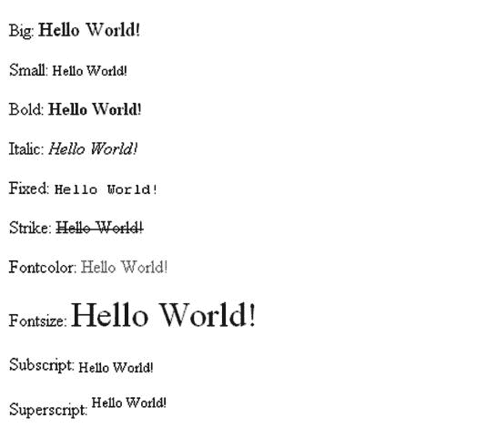
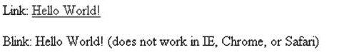

### 通过 w3schools 学习 JavaScript 和 ajax

#### 图 15.2
下面的示例演示了如何将字符串转换为小写或大写。你的结果显示在图 15.3。

**自己尝试一下 >>**

```html
<html>

<body>

<script type="text/javascript"> var txt="Hello World!";

document.write(txt.toLowerCase() + "<br />"); document.write(txt.toUpperCase());

</script>

</body>
</html>
```

84

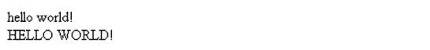
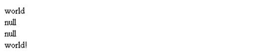

# 第 15 章：JavaScript String 对象

你的结果显示在图 15.3。

#### 图 15.3
下面的示例演示了如何在字符串中搜索指定值。你的结果显示在图 15.4。

**自己尝试一下 >>**

```html
<html>

<body>

<script type="text/javascript"> var str="Hello world!";

document.write(str.match("world") + "<br />"); document.write(str.match("World") + "<br />"); document.write(str.match("worlld") + "<br />"); document.write(str.match("world!"));

</script>

</body>
</html>
```

#### 图 15.4
下面的示例展示了如何将字符串中的指定值替换为另一个值。你的结果显示在图 15.5。

85


### 通过 w3schools 学习 JavaScript 和 ajax

**自己尝试一下 >>**

```html
<html>

<body>

<script type="text/javascript"> var str="Visit Microsoft!";

document.write(str.replace("Microsoft","w3schools"));

</script>

</body>
</html>
```

#### 图 15.5
下面的示例演示了如何找到字符串中指定值首次出现的位置。你的结果显示在图 15.6。

**自己尝试一下 >>**

```html
<html>

<body>

<script type="text/javascript"> var str="Hello world!";

document.write(str.indexOf("Hello") + "<br />"); document.write(str.indexOf("WORLD") + "<br />"); document.write(str.indexOf("world"));

</script>

</body>
</html>
```

86

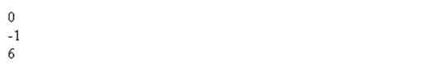

# 第 15 章：JavaScript String 对象

#### 图 15.6
有关所有可用于 `String` 对象使用的属性和方法的完整参考，请参阅附录 A 中的 `String` 对象参考。

该参考包含每个属性和方法的简要描述和用法示例！

87

# 第 16 章
# JavaScript Date 对象

### 本章内容
- 创建 Date 对象
- 设置日期
- 比较两个日期
- 示例

`Date` 对象用于处理日期和时间。

### 创建 Date 对象
`Date` 对象用于处理日期和时间。

`Date` 对象是通过 `Date()` 构造函数创建的。

实例化日期有四方法：
- `new Date()` // 当前日期和时间
- `new Date(milliseconds)` // 自 1970/01/01 以来的毫秒数
- `new Date(dateString)`
- `new Date(year, month, day, hours, minutes, seconds, milliseconds)`

上述大部分参数都是可选的。

当未指定参数时，默认向该方法传递 0。

创建 `Date` 对象后，有许多方法允许你对其进行操作。

大多数方法允许你获取和设置对象的年、月、日、小时、分、秒和毫秒，可以使用本地时间或 UTC（通用时间或 GMT）时间。

88 # 第 16 章：JavaScript Date 对象
所有日期都是从 1970 年 1 月 1 日 00:00:00 通用时间 (UTC) 开始以毫秒计算的，一天包含 86,400,000 毫秒。

实例化日期的一些示例：
```javascript
today = new Date()
d1 = new Date("October 13, 1975 11:13:00")
d2 = new Date(79,5,24)
d3 = new Date(79,5,24,11,33,0)
```

有关所有可用于 `Date` 对象使用的属性和方法的完整参考，请参阅附录 A 中完整的 `Date` 对象参考。

该参考包含每个属性和方法的简要描述和使用示例！

### 设置日期
我们可以使用 `Date` 对象提供的方法来轻松地操作日期。

在下面的示例中，我们将 `Date` 对象设置为特定日期（2010 年 1 月 14 日）：
```javascript
var myDate=new Date();
myDate.setFullYear(2010,0,14);
```

在下面的示例中，我们将 `Date` 对象设置为未来的五天：
```javascript
var myDate=new Date();
myDate.setDate(5);
```
对日期增加月份或年份是由 `Date` 对象自动处理的。

### 比较日期
`Date` 对象也用于比较日期。下面的示例比较两个日期：
```javascript
var d1=new Date();
d1.setFullYear(2010,0,14);
var d2=new Date();
d2.setFullYear(2010,0,15);

if (d1<d2) {
    alert("today is before tomorrow");
} else {
    alert("today is after tomorrow");
}
```

### 示例
下面的示例演示了如何使用 `getTime()` 方法获取日期的毫秒数。你的结果显示在图 16.1。

**自己尝试一下 >>**

```javascript
today = new Date();
document.write(today.getTime());
```

#### 图 16.1
下面的示例演示了如何使用 `UTCString()` 将今天的日期（根据 UTC）转换为字符串。你的结果显示在图 16.2。

**自己尝试一下 >>**

```html
<html>

<body>

<script type="text/javascript"> var d=new Date();

document.write("原始格式: ");

document.write(d + "<br />");

document.write("通用时间格式: ");

document.write(d.UTCString());

</script>

</body>
</html>
```

#### 图 16.2
### 星期几
`getDay()` 方法返回星期几的数字，其中星期日为 0。下面的示例演示了如何使用 `getDay()` 和数组以文本字符串而不是数字显示星期几，其结果显示在图 16.3。

**自己尝试一下 >>**

```html
<html>

<body>

<script type="text/javascript"> var d=new Date();

var weekday=new Array(7);

weekday[0]="Sunday";
weekday[1]="Monday";
weekday[2]="Tuesday";
weekday[3]="Wednesday";
weekday[4]="Thursday";
weekday[5]="Friday";
weekday[6]="Saturday";

document.write("今天是 " + weekday[d.getDay()]);

</script>

</body>
</html>
```

#### 图 16.3
下面的示例演示了如何如何在你的网页上显示一个时钟。你的结果显示在图 16.4。

**自己尝试一下 >>**

```html
<html>

<head>

<script type="text/javascript">
function startTime()
{
var today=new Date();
var h=today.getHours();
var m=today.getMinutes();
var s=today.getSeconds();
// 在小于 10 的数字前加一个零
m=checkTime(m);
s=checkTime(s);
document.getElementById('txt').innerHTML=h+":":m+":":s; t=setTimeout('startTime()',500);
}

function checkTime(i)
{
if (i<10)
{
i="0" + i;
}
return i;
}
</script>

</head>

<body onload="startTime()">

<div id="txt"></div>

</body>
</html>
```

#### 图 16.4
90 


# JavaScript Date 对象
91 

### 通过 w3schools 学习 JavaScript 和 ajax


# 第 17 章
# JavaScript 数组对象

### 本章内容
- 什么是数组？
- 创建数组
- 访问数组
- 修改数组中的值
- 示例

`Array` 对象用于在单个变量中存储多个值。

### 什么是数组
数组是一种特殊的变量，可以同时包含多个值。

如果你有一个项目列表（例如汽车名称列表），将汽车存储在单个变量中可能如下：

```javascript
cars1="Saab";
cars2="Volvo";
cars3="BMW";
```

但是，如果你想遍历这些汽车并找到特定的一辆呢？如果你有的不是 3 辆汽车，而是 300 辆呢？

这里的最佳解决方案是使用数组。数组可以将所有的变量值存储在一个名称下。你可以通过引用数组名称来访问这些值。

数组中的每个元素都有自己的 ID（索引），以便方便地访问。

## 创建数组
数组可以通过三种方式定义。

以下代码创建了一个名为 `myCars` 的 `Array` 对象：1.

```javascript
var myCars=new Array();
// 创建一个没有元素的数组
// new Array(n); 将创建一个长度为 n 的数组
myCars[0]="Saab";
myCars[1]="Volvo";
myCars[2]="BMW";
```

2.
```javascript
var myCars=new Array("Saab","Volvo","BMW");
// 创建一个带有指定元素的数组
```

3.
```javascript
var myCars=["Saab","Volvo","BMW"];
//示例 2 和 3 在功能上等效
```
**注意**：如果你在数组内部指定数字或 true/false 值，那么变量类型将是 `Number` 或 `Boolean`，而不是 `String`。

## 访问数组
你可以通过引用数组名称和索引号来引用数组中的特定元素。索引从 0 开始。

以下代码行：
```javascript
document.write(myCars[0]);
```

结果为：
`Saab`

## 修改数组中的值
要修改现有数组中的值，只需为给定索引处的元素指定新值即可。

```javascript
myCars[0]="Opel"; // 覆盖 myCars[0] 的当前值
```

现在，以下代码行：
```javascript
document.write(myCars[0]);
```

结果为：
`Opel`

### 示例
以下示例演示了如何创建数组、为其赋值并将值写入到输出。

你的结果显示在图 17.1 中。

**自己试一试 >>**
```html
<html>
<body>
<script type="text/javascript">
var mycars = new Array();
mycars[0] = "Saab";
mycars[1] = "Volvo";
mycars[2] = "BMW";

for (i=0;i<mycars.length;i++)
{
document.write(mycars[i] + "<br />");
}
</script>
</body>
</html>
```
**图 17.1**

以下示例演示了如何使用 `for...in` 语句遍历数组的元素。

你的结果显示在图 17.2 中。

**自己试一试 >>**
```html
<html>
<body>
<script type="text/javascript">
var x;
var mycars = new Array();
mycars[0] = "Saab";
mycars[1] = "Volvo";
mycars[2] = "BMW";

for (x in mycars)
{
document.write(mycars[x] + "<br />");
}
</script>
</body>
</html>
```
**图 17.2**

以下示例演示了如何合并两个数组。你的结果显示在图 17.3 中。

```html
<html>
<body>
<script type="text/javascript">
var parents = ["Jani", "Tove"];
var children = ["Cecilie", "Lone"];
var family = parents.concat(children);
document.write(family);
</script>
</body>
</html>
```
**图 17.3**

以下示例演示了如何合并三个数组。你的结果显示在图 17.4 中。

```html
<html>
<body>
<script type="text/javascript">
var parents = ["Jani", "Tove"];
var brothers = ["Stale", "Kai Jim", "Borge"];
var children = ["Cecilie", "Lone"];
var family = parents.concat(brothers, children);
document.write(family);
</script>
</body>
</html>
```
**图 17.4**

以下示例向你展示如何将数组的所有元素连接一个字符串。你的结果显示在图 17.5 中。

```html
<html>
<body>
<script type="text/javascript">
var fruits = ["Banana", "Orange", "Apple", "Mango"];
document.write(fruits.join());
</script>
</body>
</html>
```
**图 17.5**

以下示例演示了如何移除数组的最后一个元素。

```html
<html>
<body>
<script type="text/javascript">
var fruits = ["Banana", "Orange", "Apple", "Mango"];
document.write(fruits.pop());
</script>
</body>
</html>
```

以下示例演示了如何向数组末尾添加元素。

```html
<html>
<body>
<script type="text/javascript">
var fruits = ["Banana", "Orange", "Apple", "Mango"];
document.write(fruits.push("Kiwi"));
</script>
</body>
</html>
```

以下示例向你展示如何反转数组元素的顺序。

```html
<html>
<body>
<script type="text/javascript">
var fruits = ["Banana", "Orange", "Apple", "Mango"];
document.write(fruits.reverse());
</script>
</body>
</html>
```

以下示例演示了如何移除数组的第一个元素。

```html
<html>
<body>
<script type="text/javascript">
var fruits = ["Banana", "Orange", "Apple", "Mango"];
document.write(fruits.shift());
</script>
</body>
</html>
```

以下示例演示了如何使用 `slice()` 从数组选择元素。

```html
<html>
<body>
<script type="text/javascript">
var fruits = ["Banana", "Orange", "Apple", "Mango"];
document.write(fruits.slice(0,1));
document.write(fruits.slice(1));
document.write(fruits.slice(-2));
</script>
</body>
</html>
```

以下三个示例演示了如何使用 `sort()`。第一个 `sort()` 示例演示了如何按字母升序排序。

```html
<html>
<body>
<script type="text/javascript">
var fruits = ["Banana", "Orange", "Apple", "Mango"];
document.write(fruits.sort());
</script>
</body>
</html>
```

下一个 `sort()` 示例演示了如何按数字升序排序。

```html
<html>
<body>
<script type="text/javascript">
function sortNumber(a, b) {
  return a - b;
}
var n = ["10", "5", "40", "25", "100", "1"];
document.write(n.sort(sortNumber));
</script>
</body>
</html>
```

第三个 `sort()` 示例演示了如何按数字降序排序。

```html
<html>
<body>
<script type="text/javascript">
function sortNumber(a, b) {
  return b - a;
}
var n = ["10", "5", "40", "25", "100", "1"];
document.write(n.sort(sortNumber));
</script>
</body>
</html>
```


以下示例演示了如何使用 `splice()` 在数组的第二个位置添加元素。你的结果如图 17.14 所示。

```html
<body>
<script type="text/javascript"> var fruits = ["Banana", "Orange", "Apple", "Mango"]; document.write("Removed: " + fruits.splice(2,0,"Lemon") + "<br />");
document.write(fruits);
</script>
</body>
</html>
```

104

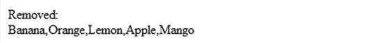


# 第 17 章：JavaScript 数组对象

**图 17.14**

以下示例演示了如何将数组转换为字符串。你的结果如图 17.15 所示。

```html
<body>
<script type="text/javascript"> var fruits = ["Banana", "Orange", "Apple", "Mango"]; document.write(fruits.toString());

</script>
</body>
</html>
```

**图 17.15**

以下示例演示了如何向数组开头添加新元素。图 17.16 显示了你的结果。

```html
<body>
<script type="text/javascript"> var fruits = ["Banana", "Orange", "Apple", "Mango"]; document.write(fruits.unshift("Kiwi") + "<br />"); document.write(fruits.unshift("Lemon","Pineapple") + "<br />");
document.write(fruits);
</script>
</body>
</html>
```

**注意：** `unshift()` 方法在 Internet Explorer 中无法正常工作，它只会返回 undefined！（续）

105

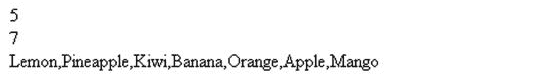
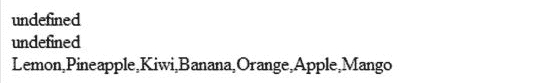

**通过 w3schools 学习 JavaScript 和 ajax**
（续）

**图 17.16**

**注意** `unshift()` 方法在 Internet Explorer 中无法正常工作，它只会返回 undefined，如图 17.17 所示。

**图 17.17**

你可以在 w3Schools 网站上关注这些示例。

有关可用于 `Array` 对象的所有属性和方法的完整引用，请参阅附录 A 中完整的 `Array` 对象引用。

106

# 第 18 章：JavaScript

## Boolean 对象

### 本章内容
- 创建一个 Boolean 对象
- 示例

Boolean 对象用于将非布尔值转换为布尔值（true 或 false）。

### 创建 Boolean 对象
Boolean 对象表示两个值：true 或 false。

以下代码创建了一个名为 `myBoolean` 的 Boolean 对象：`var myBoolean=new Boolean();`

**注意**：如果 Boolean 对象没有初始值，或者它的值为 0、-0、null、""、false、undefined 或 `NaN`，则对象被设置为 `false`。否则，它为 `true`（即使字符串是 "false" 也是如此）！

以下所有代码行都创建了初始值为 `false` 的 Boolean 对象：
```
var myBoolean=new Boolean();
var myBoolean=new Boolean(0);
var myBoolean=new Boolean(null);
var myBoolean=new Boolean("");
var myBoolean=new Boolean(false);
var myBoolean=new Boolean(NaN);
```

107

**通过 w3schools 学习 JavaScript 和 ajax** 以及以下所有代码行创建了初始值为 `true` 的 Boolean 对象：
```
var myBoolean=new Boolean(true);
var myBoolean=new Boolean("true");
var myBoolean=new Boolean("false");
var myBoolean=new Boolean("Richard");
```
有关可用于 Boolean 对象的所有属性和方法的完整引用，请参阅附录 A 中完整的 Boolean 对象引用。

### 示例
以下示例演示了如何检查 Boolean 对象是 true 还是 false。你的结果如图 18.1 所示。

**自己试试 >>**

```html
<body>
<script type="text/javascript">
var b1=new Boolean(0);
var b2=new Boolean(1);
var b3=new Boolean("");
var b4=new Boolean(null);
var b5=new Boolean(NaN);
var b6=new Boolean("false");
document.write("0 is boolean "+ b1 +"<br />"); document.write("1 is boolean "+ b2 +"<br />"); document.write("An empty string is boolean "+ b3 +"<br />");
document.write("null is boolean "+ b4+"<br />"); document.write("NaN is boolean "+ b5 +"<br />"); document.write("The string 'false' is boolean "+ b6 +"<br />");
</script>
</body>
</html>
```

108

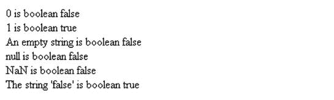

# 第 18 章：JavaScript Boolean 对象

**图 18.1**

109

# 第 19 章：JavaScript Math 对象

### 本章内容
- Math 对象
- 数学常量
- 数学方法
- 示例

Math 对象允许你执行数学任务。

### Math 对象
Math 对象允许你执行数学任务。Math 对象包含了几个常量。

**注意** 不需要创建 `Math` 对象。使用 `Math` 属性/方法的语法为：`var pi_value=Math.PI;` `var sqrt_value=Math.sqrt(16);`

### 数学常量
Math 对象提供了若干常量。

### 数学方法
Math 对象提供了若干方法。


```javascript
document.write(Math.min(5,10) + "<br />"); document.write(Math.min(0,150,30,20,38) + "<br />"); document.write(Math.min(-5,10) + "<br />"); document.write(Math.min(-5,-10) + "<br />"); document.write(Math.min(1.5,2.5));
```

</script>

</body>
</html>

**图 19.4**

114

# 第 20 章：JavaScript regexp

## RegExp 对象

### 本章内容
- 什么是 RegExp？
- RegExp 修饰符
- `test()`
- `exec()`

`RegExp` 是正则表达式（regular expression）的缩写。

### 什么是 regexp？

正则表达式是一个描述字符模式的对象。当你在文本中进行搜索时，可以使用模式来描述你正在搜索的内容。

简单的模式可以是一个单个字符。更复杂的模式可以由更多字符组成，并用于解析、格式检查、替换等。

正则表达式用于对文本执行强大的模式匹配以及查找和替换功能。

语法如下：

`var txt=new RegExp(pattern,modifiers);`

或者更简单地：

`var txt=/pattern/modifiers;`

115


**通过 w3schools 学习 JavaScript 和 ajax**

语法遵循几条通用指南：
- 模式指定表达式的模式。
- 修饰符指定搜索是否应该是全局的、区分大小写的等等。

### regexp 修饰符

修饰符用于执行不区分大小写和全局搜索。

- `i` 修饰符用于执行不区分大小写的匹配。
- `g` 修饰符用于执行全局匹配（找到所有匹配，而不是在找到第一个匹配后停止）。

示例演示了如何在字符串中对“w3schools”进行不区分大小写的搜索：

`var str="Visit W3Schools";`
`var patt1=/w3schools/i;`

你的结果如图 20.1 所示。

**自己尝试一下 >>**

```html
<html
<body>
<script type="text/javascript"> var str = "Visit W3Schools";
var patt1 = /w3schools/i;
document.write(str.match(patt1));
</script>
</body>
</html>
```

**图 20.1**

116


# 第 20 章：JavaScript regexp 对象

以下示例演示了如何对“is”进行全局搜索：

`var str="Is this all there is?";`
`var patt1=/is/g;`

你的结果如图 20.2 所示。

**自己尝试一下 >>**

```html
<html
<body>
<script type="text/javascript"> var str="Is this all there is?";
var patt1=/is/g;
document.write(str.match(patt1));
</script>
</body>
</html>
```

**图 20.2**

以下示例演示了如何对“is”进行全局、不区分大小写的搜索：

`var str="Is this all there is?";`
`var patt1=/is/gi;`

你的结果如图 20.3 所示。

**自己尝试一下 >>**

```html
<html
<body>
*(续)*
```

117

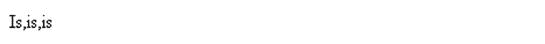

**通过 w3schools 学习 JavaScript 和 ajax**

*(续)*

```javascript
<script type="text/javascript"> var str="Is this all there is?";
var patt1=/is/gi;
document.write(str.match(patt1));
</script>
</body>
</html>
```

**图 20.3**

### test()

`test()` 方法在字符串中搜索指定的值，并根据结果返回 true 或 false。

以下示例在字符串中搜索字符“e”：

`var patt1=new RegExp("e");`
`document.write(patt1.test("The best things in life are free"));`

由于字符串中存在“e”，前述代码的输出如下：true

你的结果如图 20.4 所示。

**自己尝试一下 >>**

```html
<html
<body>
<script type="text/javascript"> var patt1=new RegExp("e");
```

118

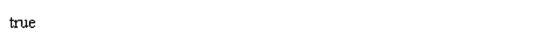

**第 20 章：JavaScript regexp 对象**

```javascript
document.write(patt1.test("The best things in life are free"));
</script>
</body>
</html>
```

**图 20.4**

### exec()

`exec()` 方法在字符串中搜索指定的值，并返回找到的值的文本。如果没有找到匹配项，它返回 `null`。

以下示例在字符串中搜索字符“e”：

`var patt1=new RegExp("e");`
`document.write(patt1.exec("The best things in life are free"));`

由于字符串中存在“e”，前述代码的输出为：e

你的结果如图 20.5 所示。

**自己尝试一下 >>**

```html
<html
<body>
<script type="text/javascript"> var patt1=new RegExp("e");
```

19


**通过 w3schools 学习 JavaScript 和 ajax**

**图 20.5**

如需获取 `RegExp` 对象所有属性和方法的完整引用，请参附录 A。

20

**第三部分**

**高级 JavaScript**

- 探测
- 第 21 章：JavaScript Cookie
- 第 22 章：JavaScript 表单
- 第 23 章：JavaScript 验证
- 第 24 章：JavaScript 动画
- 第 25 章：图像映射
- 第 26 章：JavaScript 定时
- 第 27 章：用 JavaScript 创建对象

21

**第 21 章：JavaScript**

**JAVASIpT**

**浏览器**

**检测开启**

**浏览器检测**

**RegExp 浏览器**

**本章内容**
- Navigator 对象

### 检测

Navigator 对象包含关于访问者的浏览器信息。教程中的几乎所有内容在支持 JavaScript 的浏览器上有效。但某些内容在旧版浏览器中不起作用。因此，有时检测访问者的浏览器非常有用。

Navigator 对象包含了访问者的浏览器信息。我们将查看 Navigator 对象的两个属性：
- `appName`——持有浏览器的名称。
- `appVersion`——除其他内容外，持有浏览器的版本。

Navigator 对象可以用于此目的。Navigator 对象包含了访问者的浏览器名称、版本及更多信息。

23

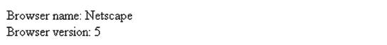

**通过 w3schools 学习 JavaScript**

**navigator 对象**

Navigator 对象包含了访问者的浏览器信息。

结果如图 21.1 所示。

**自己尝试一下 >>**

```html
<html
<body>
<script type="text//javascript"> var browser=navigator.appName;
var b_version=navigator.appVersion;
var version=parseFloat(b_version);
document.write("Browser name: "+ browser); document.write("<br />");
document.write("Browser version: "+ version);
</script>
</body>
</html>
```

**图 21.1**

前示例中的变量 `browser` 持有浏览器的名称，即“Netscape”或“Microsoft Internet Explorer”。前示例中的 `appVersion` 属性返回的字符串比版本号多得多，但目前我们只对版本号感兴趣。为了从字符串中提取版本号，我们使用一个名为 `parseFloat()` 的函数，它从字符串中提取第一个像小数数字的内容并返回。**提示** 若要查找 5.0 及更高版本的 IE 版本，你必须更深入研究 `appVersion` 或 `userAgent` 属性。IE 版本将以“MSIE x.x”的形式存在，因此使用正则表达式如 `/MSIE \d\.\d/.exec(navigator.userAgent)` 返回包含特定 IE 版本的字符串。

24

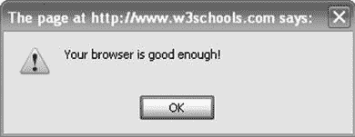

### 第 21 章：JavaScript 浏览器检测

示例根据访问者的浏览器显示不同的 alert。

alert 框如图 21.2 所示。

**自己尝试一下 >>**

```html
<html
<head>
<script type="text/javascript"> function detectBrowser()
{
var browser=navigator.appName;
var b_version=navigator.appVersion;
var version=parseFloat(b_version);
if ((browser=="Netscape"||browser=="Microsoft Internet Explorer") && (version>=4))
{
alert("你的浏览器足够用了！");
}
else
{
alert("是时候升级你的浏览器了！");
}

}
</script>
</head>
```


```html
<body onload="detectBrowser()">

</body>
</html>
```

图 21.2

125

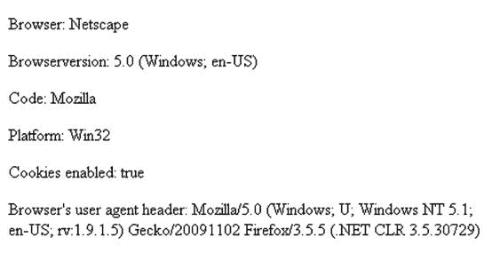

使用 w3schools  JavaScript 和 Ajax

以下示例提供了更多关于访问者浏览器的规则。

你的结果如图 21.3 所示。

**自己尝试 >>**

```html
<body>
<script type="text/javascript"> 
  document.write("<p>Browser: "); 
  document.write(navigator.appName + "</p>"); 
  document.write("<p>Browserversion: "); 
  document.write(navigator.appVersion + "</p>"); 
  document.write("<p>Code: ");
  document.write(navigator.appCodeName + "</p>"); 
  document.write("<p>Platform: "); 
  document.write(navigator.platform + "</p>"); 
  document.write("<p>Cookies enabled: "); 
  document.write(navigator.cookieEnabled + "</p>"); 
  document.write("<p>Browser's user agent header: "); 
  document.write(navigator.userAgent + "</p>");
</script>
</body>
</html
```

图 21.3

126

### 第 21 章：JavaScript 浏览器检测

以下示例提供了关于访问者浏览器的所有细节。你的结果如图 21.4 所示。

**自己尝试 >>**

```html
<body>
<script type="text/javascript"> 
  var x = navigator;
document.write("CodeName=" + x.appCodeName); document.write("<br />");
document.write("MinorVersion=" + x.appMinorVersion); document.write("<br />");
document.write("Name=" + x.appName); document.write("<br />");
document.write("Version=" + x.appVersion); document.write("<br />");
document.write("CookieEnabled=" + x.cookieEnabled); document.write("<br />");
document.write("CPUClass=" + x.cpuClass); document.write("<br />");
document.write("OnLine=" + x.onLine); document.write("<br />");
document.write("Platform=" + x.platform); document.write("<br />");
document.write("UA=" + x.userAgent); document.write("<br />");
document.write("BrowserLanguage=" + x.browserLanguage); document.write("<br />");
document.write("SystemLanguage=" + x.systemLanguage); document.write("<br />");
document.write("UserLanguage=" + x.userLanguage);
</script>
</body>
</html
```

127

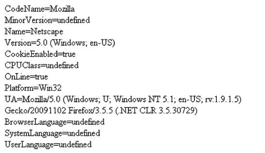

使用 w3schools  JavaScript 和 Ajax

图 21.4

128

## 第 22 章：JavaScript

### Cookies

**本章内容**

- 什么是 Cookie？
- 创建并存储 Cookie

Cookie 通常用于识别用户。

#### 什么是 Cookie？

Cookie 是存储在访问者计算机上的一个变量。每当同一台计算机使用浏览器请求页面时，它也会发送该 Cookie。通过 JavaScript，你既可以创建也可以获取 Cookie 值。

Cookie 的示例：

8. **名称 Cookie。** 当访问者第一次访问你的 Web 页面时，她必须填写她的姓名。该姓名随后存储在 Cookie 中。下次当访问者再次访问你的页面时，她可能会收到类似“欢迎，Jane Doe！”的消息。该姓名是从存储的 Cookie 中检索的。

8. **密码 Cookie。** 当访问者第一次访问你的 Web 页面时，她必须填写密码。该密码随后存储在 Cookie 中。下次当访问者再次访问你的页面时，会从 Cookie 中检索密码。

8. **日期 Cookie。** 当访问者第一次访问你的 Web 页面时，当前日期被存储在 Cookie 中。下次当访问者再次访问你的页面时，她可能会收到类似“你上次访问是 2005 年 8 月 11 日星期二！”的消息。该日期是从存储的 Cookie 中检索的。

129

使用 w3schools  JavaScript 和 ajax

### 创建并存储 Cookie

在本示例中，我们创建了一个存储访问者姓名的 Cookie。当访问者第一次访问 Web 页面时，要求她填写姓名。该姓名随后存储在 Cookie 中。当访问者下次访问同一页面时，她会看到一条欢迎消息。

首先，我们创建一个函数，将访问者的姓名存储在 Cookie 变量中：
```javascript
function setCookie(c_name,value,expiredays)
{
  var exdate=new Date();
  exdate.setDate(exdate.getDate()+expiredays);
  document.cookie=c_name+ "=" +escape(value)+
  ((expiredays==null) ? "" : ";expires="+exdate.toGMTString());
}
```

上述函数的参数包含了 Cookie 的名称、Cookie 的值以及 Cookie 到期前的天数。

在上述函数中，我们首先将天数转换为有效日期，然后加上 Cookie 应该过期的天数。之后，我们将 Cookie 名称、Cookie 值和过期日期存储在 `document.cookie` 对象中。

然后，我们创建另一个函数来检查 Cookie 是否已设置：
```javascript
function getCookie(c_name)
{
  if (document.cookie.length>0)
  {
    c_start=document.cookie.indexOf(c_name + "="); 
    if (c_start!=-1)
    {
      // ...
    }
  }
}
```

130

第 22 章：JavaScript Cookies

（注：此处原文包含部分重复和格式说明，已根据逻辑整理核心内容）


```javascript
function validate_required(field,alerttxt)
{
  with (field)
  {
    if (value==null||value=="")
    {
      alert(alerttxt);
      return false;
    }
    else
    {
      return true;
    }
  }
}

function validate_form(thisform)
{
  with (thisform)
  {
    if (validate_required(email,"Email must be filled out!")==false)
    {
      email.focus();
      return false;
    }
  }
}
```
</script>
</head>

<body>
*(续上)*

**135**

**使用 w3schools 学习 JavaScript 和 ajax** *(续上)*

```html
<form action="submit.htm" onsubmit="return validate_form(this)" method="post">
Email: <input type="text" name="email" size="30">
<input type="submit" value="Submit">
</form>
```

</body>
</html>

### 邮箱验证

以下函数检查内容是否符合电子邮件地址的通用语法。

**注意** 此函数仅检查内容看起来是否是格式正确的电子邮件。它并不会验证该电子邮件地址是否真实存在。

这意味着输入数据必须至少包含一个 `@` 和一个点（`.`）。此外，`@` 不能是电子邮件地址的第一个字符，且最后一个点必须在 `@` 符号之后至少有一个字符：

```javascript
function validate_email(field,alerttxt)
{
  with (field)
  {
    apos=value.indexOf("@");
    dotpos=value.lastIndexOf(".");
    if (apos<1||dotpos-apos<2)
    {
      alert(alerttxt);
      return false;
    }
    else {
      return true;
    }
  }
}
```

带有 HTML 表单的完整脚本可能如下所示：

```html
<html>
<head>
<script type="text/javascript">
function validate_email(field,alerttxt)
{
// **136**
// 第 23 章：JavaScript 表单验证
  with (field)
  {
    apos=value.indexOf("@");
    dotpos=value.lastIndexOf(".");
    if (apos<1||dotpos-apos<2)
    {
      alert(alerttxt);
      return false;
    }
    else {
      return true;
    }
  }
}

function validate_form(thisform)
{
  with (thisform)
  {
    if (validate_email(email,"Not a valid e-mail address!")==false)
    {
      email.focus();
      return false;
    }
  }
}
</script>
</head>
<body>
<form action="submit.htm" onsubmit="return validate_form(this);" method="get">
Email: <input type="text" name="email" size="30">
<input type="submit" value="Submit">
</form>
</body>
</html>
```

**137**

**第 24 章**

**JavaScript**

**动画**

**本章内容**

- HTML 代码
- JavaScript 代码
- 完整代码

通过 JavaScript，我们可以创建动画图像。

技巧是让 JavaScript 在不同的事件之间切换不同的图像。

在接下来的示例中，我们在 Web 上添加了一个本应作为链接按钮的图片。然后我们添加了 `onMouseOver` 事件和 `onMouseOut` 事件，这两个事件将运行两个 JavaScript 函数，在图像之间进行切换。

### HTML 代码

HTML 代码如下：

```html
<a href="http://www.w3schools.com" target="_blank">
  
</a>
```
注意，我们为图片提供了一个 `id`，以便 JavaScript 之后对其进行引用。

`onMouseOver` 事件告诉浏览器，一旦鼠标悬停在图片上，浏览器应该执行一个函数，将该图片替换为另一张图片。

`onMouseOut` 事件告诉浏览器，一旦鼠标移开图片，就应该执行另一个 JavaScript 函数。该函数会重新插入原始图片。

### 第 24 章：JavaScript 动画 ### JavaScript 代码

图像之间的切换通过以下 JavaScript 实现：

```javascript
<script type="text/javascript"> 
function mouseOver()
{
  document.getElementById("b1").src ="b_blue.gif";
}

function mouseOut()
{
  document.getElementById("b1").src ="b_pink.gif";
}
</script>
```

`mouseOver()` 函数导致图片切换到 `b_blue.gif`。

`fadeOut()` 函数导致图片切换到 `b_pink.gif`。

### 完整代码

在接下来的示例中，我们将 HTML 和 JavaScript 代码结合以产生动画。

生成的动画如图 24.1 所示。

你可以在 `www.w3schools.com` 网站上尝试这个示例，或者在 html 源代码所在的目录中包含你自己的图形文件，替换 html 源代码中的 `b_blue` 和 `b_pink`。

**自己尝试一下 >>**

```html
<html>
<head>
<script type="text/javascript"> 
function mouseOver()
{
  document.getElementById("b1").src ="b_blue.gif";
}

function mouseOut()
{
  document.getElementById("b1").src ="b_pink.gif";
}
</script>
*(续上)*
```

**139**


**使用 w3schools 学习 JavaScript 和 ajax** *(续上)*

```html
<script type="text/javascript"> 
// ...
</script>
</head>
<body>
<a href="http://www.w3schools.com" target="_blank">
  
</a>
</body>
</html>
```

**图 24.1**

**140**

**第 25 章**

**JavaScript**

**图像地图 (image maps)**

**本章内容**

- HTML 代码
- JavaScript 代码
- 完整代码

HTML 图像地图允许你在图片上定义可点击区域，每个区域都可以是一个链接。

通过 JavaScript，我们可以创建动画图像地图。技巧是让 JavaScript 在不同的事件之间切换不同的图像。

在接下来的示例中，我们在 Web 上添加了一个本应作为链接按钮的图片。然后我们添加了 `onMouseOver` 事件和 `onMouseOut` 事件，这两个事件将运行两个 JavaScript 函数，在图像之间进行切换。


# `setTimeout()` 方法

语法如下：

```javascript
var t=setTimeout("javascript statement",milliseconds);
```

`setTimeout()` 方法返回一个值。在前面的语句中，该值被存储在一个名为 `t` 的变量中。如果你想取消这个 `setTimeout()`，可以使用变量名 `t` 来引用它。

`setTimeout()` 的第一个参数是一个字符串，其中包含一个 JavaScript 语句。该语句可以像 `"alert('5 seconds!')"` 这样的一个语句，也可以是一个函数调用，如 `alertMsg()`。

第二个参数表示你希望从现在起多少毫秒后执行第一个参数。

## 144


## 第 26 章：JavaScript 定时事件

**注意** 1000 毫秒等于 1 秒。

当点击示例中的按钮时，3 秒后会显示 alert 框。

结果见图 26.1。

**尝试一下 >>**

```html
<html
<head>
<script type="text/javascript"> function timedMsg()
{
var t=setTimeout("alert('I am displayed after 3 seconds!')",3000);
}
</head>
<body>
<form>
<input type="button" value="Display alert!"
onClick="timedMsg()" />
</form>
</body>
</html>
```

**图 26.1**

要让定时器在无限循环中工作，必须编写一个调用自身的函数。

在下面的示例中，点击按钮时，输入框开始从 0 开始计数。

注意你还有一个函数来检查定时器是否正在运行，以免在多次点击按钮时创建额外的定时器。

结果见图 26.2。

## 145

**w3schools 学习 JavaScript 和 ajax** **尝试一下 >>**

```html
<html
<head>
<script type="text/javascript"> var c=0;
var t;
var timer_is_on=0;
function timedCount()
{
document.getElementById('txt').value=c;
c=c+1;
t=setTimeout("timedCount()",1000);
}
function doTimer()
{
if (!timer_is_on)
{
timer_is_on=1;
timedCount();
}
}
</script>
</head>
<body>
<form>
<input type="button" value="Start count!"
onClick="doTimer()">
<input type="text" id="txt">
</form>
<p>点击上面的按钮。输入框将从 0 开始无限计数。</p>
</body>
</html>
```

## 146

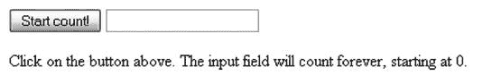

## 第 26 章：JavaScript 定时事件

**图 26.2**

下面的示例是使用 `setTimeout()` 方法的另一个简单定时。

结果见图 26.3。

**尝试一下 >>**

```html
<html
<head>
<script type="text/javascript"> function timedText()
{
var t1=setTimeout("document.getElementById('txt').value='2 seconds!'",2000);
var t2=setTimeout("document.getElementById('txt').value='4 seconds!'",4000);
var t3=setTimeout("document.getElementById('txt').value='6 seconds!'",6000);
}
</script>
</head>
<body>
<form>
<input type="button" value="Display text!"
onclick="timedText()" />
<input type="text" id="txt" />
</form>
<p>点击上面的按钮。输入框将告诉你经过了二、四、六秒。</p>
</body>
</html>
```

## 147


**w3schools 学习 JavaScript 和 ajax**

**图 26.3**

下面的示例了用定时事件创建的时钟。

结果见图 26.4。

**尝试一下 >>**

```html
<html
<head>
<script type="text/javascript"> function startTime()
{
var today=new Date();
var h=today.getHours();
var m=today.getMinutes();
var s=today.getSeconds();
// 在小于 10 的数字前加零
m=checkTime(m);
s=checkTime(s);
document.getElementById('txt').innerHTML=h+":"+m+":"+s; t=setTimeout('startTime()',500);
}
function checkTime(i)
{
if (i<10)
{
i="0" + i;
}
return i;
}
</script>
</head>
```

## 148

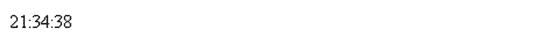

## 第 26 章：JavaScript 定时事件

```html
<body onload="startTime()">
<div id="txt"></div>
</body>
```

**图 26.4**

# `clearTimeout()` 方法

语法如下：

```javascript
clearTimeout(setTimeout_variable)
```

下面的示例与之前的无限示例相同。唯一的区别是我们现在添加了一个调用 `clearTimeout()` 的“停止！”按钮。结果见图 26.5。

**尝试一下 >>**

```html
<html
<head>
<script type="text/javascript"> var c=0;
var t;
var timer_is_on=0;
function timedCount()
{
document.getElementById('txt').value=c;
c=c+1;
t=setTimeout("timedCount()",1000);
}
function doTimer()
{
if (!timer_is_on)
{
timer_is_on=1;
timedCount();
}
}
function stopTimer()
{
clearTimeout(t);
timer_is_on=0;
}
</script>
</head>
<body>
<form>
<input type="button" value="Start count!"
onClick="doTimer()">
<input type="button" value="Stop count!"
onClick="stopTimer()">
<input type="text" id="txt">
</form>
<p>点击上面的按钮。输入框将从 0 开始无限计数，直到你点击停止计数。</p>
</body>
</html>
```

**图 26.5**

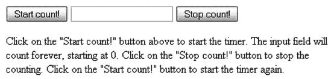

## 第 27 章：创建你自己的对象

# JavaScript 对象

对象有助于组织信息。对象只是一种特殊的数据类型，属性和方法的集合。在书的前面，你已经学习了 JavaScript 有几个内置对象，如 `String`、`Date`、`Array` 等。除了这些内置对象之外，你也可以创建自己的对象。让我们通过一个示例来说明，并创建一个模拟人的对象。属性是与对象相关的值。人的属性包括姓名、体重、年龄、肤色等。对象拥有方法。方法是在对象上执行的操作。人的方法可以是 `eat()`、`sleep()`、`play()` 等。

## 属性

访问对象属性的语法如下：`objName.propName`

添加属性

你可以通过简单地赋值给对象添加属性。假设 `personObj` 已存在；你可以给它命名为 `firstname`、`lastname`、`age` 和 `eyolor` 的属性，如下：

```javascript
personObj.firstname="John";
personObj.lastname="Doe";
personObj.age=30;
personObj.eyolor="blue";
```

## 方法

对象也可以包含方法。你可以使用以下语法调用方法：`objName.methodName()`

方法所需的参数可以传递在括号之间。为 `personObj` 调用 `sleep()` 方法：`personObj.sleep()`

如果 `sleep()` 方法接受小时参数，可以这样调用：`personObj.sleep(8)`

## 创建对象

创建新对象有两种方法：你可以创建一个对象的直接实例，也可以创建一个对象的模板。

### 创建对象的直接实例

下面的代码创建一个对象实例并为其添加四个属性：

```javascript
personObj=new Object();
personObj.firstname="John";
personObj.lastname="Doe";
personObj.age=50;
personObj.eyolor="blue";
```

## 152

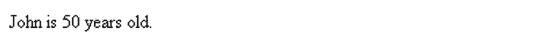

## 第 27 章：用 javascript 创建你自己的对象

为 `personObj` 添加方法也很简单。下面的代码为 `personObj` 添加了名为 `eat()` 的方法：

```javascript
personObj.eat=eat;
```

在下面的示例中，你创建了一个对象的直接实例。结果见图 27.1。

**尝试一下 >>**

```html
<html>
<body>
<script type="text/javascript"> personObj=new Object();
personObj.firstname="John";
personObj.lastname="Doe";
personObj.age=50;
personObj.eyolor="blue";
</script>
</body>
</html>
```


# 创建对象的模板

模板定义了对象的结构，以便你更轻松地创建该对象的多个实例：

```javascript
function person(firstname,lastname,age,eyecolor)
{
  this.firstname=firstname;
  this.lastname=lastname;
  this.age=age;
  this.eyecolor=eyecolor;
}
```

注意，模板仅仅是一个函数。

它也被称为构造函数（构造函数）。在构造函数内部，你添加了属于每个后续实例的属性和方法。当你使用 `person` 作为多个对象的构造函数时，必须包含 `this` 关键字。JavaScript 使用 `this` 将属性赋值给使用 `new` 关键字创建的特定对象。

在下面的示例中，你为一个对象创建了一个模板。结果如图 27.2 所示。

**自己尝试一下 >>**

```html
<html>
<body>
<script type="text/javascript"> 
function person(firstname,lastname,age,eyecolor)
{
  this.firstname=firstname;
  this.lastname=lastname;
  this.age=age;
  this.eyecolor=eyecolor;
}
myFather=new person("John","Doe",50,"blue"); 
document.write(myFather.firstname + " is " + myFather.age + " years old.");
</script>
</body>
</html>
```

## 第 27 章：使用 javascript 创建你自己的对象

获取模板后，你可以像这样创建对象的新新实例：`myFather=new person("John","Doe",50,"blue");` `myMother=new person("Sally","Rally",48,"green");`。你也可以给 person 对象添加一些方法。这在模板内部同样完成：

```javascript
function person(firstname,lastname,age,eyecolor)
{
  this.firstname=firstname;
  this.lastname=lastname;
  this.age=age;
  this.eyecolor=eyecolor;
  this.newlastname=newlastname;
}
```

注意，方法只是附加到对象上的函数。然后你必须编写 `newlastname()` 函数：

```javascript
function newlastname(new_lastname)
{
  this.lastname=new_lastname;
}
```

`newlastname()` 函数定义了人的姓并将其赋值给该人。JavaScript 通过 `this` 知道你指的是哪个人。所以，现在你可以写：`myMother.newlastname("Doe")`。

## 第四部分：AJAX 基础

要使用传统的 JavaScript 从数据库或服务器文件获取或发送信息，你必须创建一个 HTML 表单。用户必须点击按钮来发送/获取信息并等待服务器响应。然后将加载一个显示结果的新页面。传统的应用程序运行缓慢，且往往不够用户友好。

通过 AJAX，你的 JavaScript 通过 `XMLHttpRequest` 对象直接与服务器通信。通过 `XMLHttpRequest` 对象，Web 页面向 Web 服务器发送请求并获取响应——而无需重新加载页面。用户将留在同一个页面，他们不会注意到脚本在后台请求页面或向服务器发送数据。通过使用 `XMLHttpRequest` 对象，Web 可以在页面加载后使用来自服务器的数据更新页面！

## 第 29 章：AJAX 浏览器支持

### 本章内容
- `XMLHttpRequest`
- 汇总总结

AJAX 的核心是 `XMLHttpRequest` 对象。所有现代浏览器都支持新的内置 JavaScript `XMLHttpRequest` 对象（IE5 和 IE6 使用 `ActiveObject`）。`XMLHttpRequest` 对象可用于从服务器请求信息（数据）。让我们在 HTML 文件的 `head` 部分用 JavaScript 更新我们的文件：

```javascript
function loadXMLDoc(url)
{
  if (window.XMLHttpRequest) {
    // 适用于 IE7+, Firefox, Opera, Safari 代码
    xmlhttp=new XMLHttpRequest();
  }
  else {
    // 适用于 IE6, IE5 代码
    xmlhttp=new ActiveXObject("Microsoft.XMLHTTP");
  }
  xmlhttp.open("GET",url,false);
  xmlhttp.send(null);
  document.getElementById('test').innerHTML=xmlhttp.responseText;
}
```

尝试创建一个 `XMLHttpRequest` 对象：`xmlhttp=new XMLHttpRequest()`

如果没有（如果是 IE5 或 IE6），创建一个 `ActiveObject`：`xmlhttp=new ActiveXObject("Microsoft.XMLHTTP")`

打开请求对象：`xmlhttp.open("GET",url,false)`

将请求发送到服务器：`xmlhttp.send(null)`

使用服务器的响应更新页面：`document.getElementById('test').innerHTML=xmlhttp.responseText`

**注意** 上述代码可以在每次需要创建 `XMLHttpRequest` 对象时使用，因此每当需要时直接复制粘贴即可。


在第 30 章“AJAX—XMLHttpRequest 对象”中，你将学习更多关于 `XMLHttpRequest` 的知识。

### 总结
下面的示例将你所学的知识整合在一起。你的结果如图 29.1 所示。

#### 尝试一下 >>

```html
<html
<head>
<script type="text/javascript">
function loadXMLDoc(url)
{
  if (window.XMLHttpRequest) {
    // code for IE7+, Firefox, Chrome, Opera, Safari
    xmlhttp=new XMLHttpRequest();
  }
  else {
    // code for IE6, IE5
    xmlhttp=new ActiveXObject("Microsoft.XMLHTTP");
  }
  xmlhttp.open("GET",url,false);
  xmlhttp.send(null);
  document.getElementById('test').innerHTML=xmlhttp.responseText;
}
</script>
</head>
<body>
<div id="test">
  <h2>Click to let AJAX change this text</h2>h2>
</div>
<button type="button" onclick="loadXMLDoc('test1.txt')">Click Me</button>
<button type="button" onclick="loadXMLDoc('test2.txt')">Click Me</button>
</body>
</html>
```

**图 29.1**

### 第 30 章：本章介绍的 AJAX—XMLHttpRequest 对象的方法与属性
- 重要方法
- 向服务器发送 AJAX 请求
- 重要属性
- `responseText` 属性
- `XMLHttpRequest` Open—使用 False（假值）
- `XMLHttpRequest` Open—使用 True（真值）
- `readyState` 属性
- `onreadystatechange` 属性

在本章中，你将学习 `HttpRequest` 对象的重要方法和属性。

#### 重要方法
`XMLHttpRequest` 对象有两个重要的方法： 
1. `open()` 方法 
2. `send()` 方法

#### 向服务器发送 AJAX 请求
要向 Web 服务器发送请求，请使用 `open()` 和 `send()` 方法。`open()` 方法接受三个参数。第一个参数定义使用哪种方法（`GET` 或 `POST`）。第二个参数指定服务器资源的名称（`URL`）。第三个参数指定请求是否应该异步处理。

`send()` 方法将请求发送到服务器。假设请求的文件名为 `time.asp`，则代码为：`url="time.asp"`

```
xmlhttp.open("GET",url,true);
xmlhttp.send(null);
```
在示例中，我们假设当前 Web 页面和请求的资源都在同一个目录下。

#### 重要属性
`XMLHttpRequest` 对象有三个重要的属性：
1. `responseText` 属性
2. `readyState` 属性
3. `onreadystatechange` 属性

#### `responseText` 属性
`XMLHttpRequest` 对象将从服务器请求获取的任何数据存储在它的 `responseText` 属性中。在上节中，你通过以下语句将 `responseText` 属性的内容复制到 HTML 中：

```javascript
document.getElementById('test').innerHTML=xmlhttp.responseText
```

#### XMLHttpRequest Open—使用 False
在之前的示例中，我们使用了这种简化的语法：
```javascript
xmlhttp.open("GET",url,false);
xmlhttp.send(null);
document.getElementById('test').innerHTML=xmlhttp.responseText;
```
`open` 调用中的第三个参数是“false”。这告诉 `XMLHttpRequest` 对象等待服务器请求完成后后再执行下一条语句。对于小型应用程序和简单的服务器请求，这可能是可以的。但如果请求耗时很久或无法提供，可能会导致你的 Web 应用程序挂起或停止。

#### XMLHttpRequest Open—使用 true
通过将 `open` 调用中的第三个参数改为“true”，你告诉 `XMLHttpRequest` 对象在向服务器发送请求后继续执行。由于在确定请求已完全完成之前，你不能简单地开始使用服务器请求的响应，因此你需要将 `XMLHttpRequest` 的 `onreadystatechange` 属性设置为一个函数（或函数名），以便在完成后执行。在此 `onreadystatechange` 函数中，你必须在使用服务器调用的结果之前测试 `readyState` 属性。只需将代码更改为：

```javascript
xmlhttp.onreadystatechange=function()
{
  if(xmlhttp.readyState==4) { // 请求完成
    document.getElementById('test').innerHTML=xmlhttp.responseText;
  }
}
xmlhttp.open("GET",url,true);
xmlhttp.send(null);
```

#### `readyState` 属性
`readyState` 属性持有服务器响应的状态。`readyState` 属性的可能值如下表所示：

| state | description |
| :--- | :--- |
| 0 | 请求未初始化 |
| 1 | 请求已建立 |
| 2 | 请求已发送 |
| 3 | 请求处理中 |
| 4 | 请求已完成 |

#### `onreadystatechange` 属性
`onreadystatechange` 属性存储了一个函数（或函数名），每当 `readyState` 属性发生变化时都会自动调用该函数。你可以这样在属性中定义整个函数：

```javascript
xmlhttp.onreadystatechange=function()
{
  if(xmlhttp.readyState==4) {
    document.getElementById('test').innerHTML=xmlhttp.responseText;
  }
}
xmlhttp.open("GET",url,true);
xmlhttp.send(null);
```
或者你也可以简单存储在其他地方定义的函数名，如下：

```javascript
xmlhttp.onreadystatechange=stateChanged;
```

```javascript
function stateChanged() {
  if(xmlhttp.readyState==4) {
    document.getElementById('test').innerHTML=xmlhttp.responseText;
  }
}
```


当用户输入数据时，会执行函数 `showHint()`。该函数的执行是由 `onkeyup` 事件触发的。换句话说，每当用户在输入框内按下并释放一个键时，就会调用 `showHint` 函数。

### the showhint() Function

`showHint()` 函数是一个非常简单的 JavaScript 函数，放置在 HTML 页面的 `<head>` 部分：

```javascript
var xmlhttp;

function showHint(str)
{
  if (str.length==0)
  {
    document.getElementById("txtHint").innerHTML="";
    return;
  }
  xmlhttp=GetXmlHttpObject();
  if (xmlhttp==null)
  {
    alert ("Your browser does not support XMLHTTP!");
    return;
  }
  var url = "gethint.asp";
  url = url + "?q =" +str;
  url = url + "&sid=" +Math.random(); 
  xmlhttp.onreadystatechange=stateChanged;
  xmlhttp.open("GET",url,true);
  xmlhttp.send(null);
}
```

上述函数每当在输入框中输入一个字符时执行一次。

#### Chapter 32: AJAX Suggest

如果输入框中有输入（`str.length > 0`），`showHint()` 函数将执行以下操作：

- 定义发送到服务器的 URL（*filename*）
- 向 URL 添加一个参数（*q*），其内容为输入框中的的内容
- 添加一个随机数以防止服务器使用缓存文件
- 创建一个 `XMLHttp` 对象并告诉该对象在触发更改时执行名为 `stateChanged` 的函数
- 使用给定的 URL 打开 `XMLHttp` 对象
- 向服务器发送 HTTP 请求

如果输入框为空，该函数简单地清空 `txtHint` 占位符的内容。

### the getXmlhttpObject() Function

`showHint()` 函数调用了一个名为 `GetXmlHttpObject()` 的函数。`GetXmlHttpObject()` 函数目的是解决为不同的浏览器创建不同的 `XMLHttp` 对象的问题：

```javascript
function GetXmlHttpObject()
{
  if (window.XMLHttpRequest)
  {
    // code for IE7+, Firefox, Chrome, Opera, Safari return new XMLHttpRequest();
    return new XMLHttpRequest();
  }
  if (window.ActiveXObject)
  {
    // code for IE6, IE5
    return new ActiveXObject("Microsoft.XMLHTTP");
  }
  return null;
}
```

### the stateChanged() Function

`stateChanged()` 函数包含以下代码：

```javascript
function stateChanged()
{
  if (xmlhttp.readyState==4)
  {
    document.getElementById("txtHint").innerHTML=xmlhttp.responseText;
  }
}
```

每当 `XMLHttp` 对象的状态发生时，`stateChanged()` 函数就会执行。当状态变为 4（完成”）时，`txtHint` 占位符的内容将被填充响应文本。

### AJAX Suggest Source Code

以下源代码属于上一个 AJAX 示例。你可以复制并粘贴它，然后尝试自己运行。**注意** 请确保在启用了 ASP 或 PHP 的服务器上进行尝试。

#### the AJAX htML page

这是一个 HTML 页面。它包含一个简单的 HTML 表单和一个指向 JavaScript 的链接。

```html
<html
<head>
  <script src="clienthint.js"></script>
</head>
<body>
  <form>
    First Name: <input type="text" id="txt1" onkeyup="showHint(this.value)" />
  </form>
  <p>Suggestions: <span id="txtHint"></</span></p>
</body>
</html>
```

#### the AJAX JavaScript

这是 JavaScript 代码，存储在 `clienthint.js` 文件中：

```javascript
var xmlhttp
function showHint(str)
{
  if (str.length==0)
  {
    document.getElementById("txtHint").innerHTML="";
    return;
  }
  xmlhttp=GetXmlHttpObject();
  if (xmlhttp==null)
  {
    alert ("Your browser does not support XMLHTTP!");
    return;
  }
  var url="gethint.asp";
  url=url+"?q="+str;
  url=url+"&sid="+Math.random();
  xmlhttp.onreadystatechange=stateChanged;
  xmlhttp.open("GET",url,true);
  xmlhttp.send(null);
}
function stateChanged()
{
  if (xmlhttp.readyState==4)
  {
    document.getElementById("txtHint").innerHTML=xmlhttp.responseText;
  }
}
function GetXmlHttpObject()
{
  if (window.XMLHttpRequest)
  {
    // code for IE7+, Firefox, Chrome, Opera, Safari
    return new XMLHttpRequest();
  }
  if (window.ActiveXObject)
  {
    // code for IE6, IE5
    return new ActiveXObject("Microsoft.XMLHTTP");
  }
  return null;
}
```

#### the AJAX Server page—ASp and php

不存在所谓的 AJAX 服务器。AJAX 页面由任何 Internet 服务器提供。上一个示例中 JavaScript 调用的服务器页面是一个名为 `gethint.asp` 的简单 ASP 文件。以下两个服务器页面代码示例，一个用 ASP 编写，另一个用 PHP 编写。

#### AJAX ASp Example

`gethint.asp` 中的代码使用 VBScript 编写，用于 Internet Server (IIS)。它检查名称数组并将相应的名称返回给客户端：

```asp
<%
response.expires=-1
dim a(30)
'Fill up array with names
a(0)="Anna"
a(1)="Brittany"
a(2)="Cinderella"
a(3)="Diana"
a(4)="Eva"
a(5)="Fiona"
a(6)="Gunda"
a(7)="Hege"
a(8)="Inga"
a(9)="Johanna"
a(10)="Kitty"
a(11)="Linda"
a(12)="Nina"
a(13)="Ophelia"
a(14)="Petunia"
a(15)="Amanda"
a(16)="Raquel"
a(17)="Cindy"
a(18)="Doris"
a(19)="Eve"
a(20)="Evita"
a(21)="Sunniva"
a(22)="Tove"
a(23)="Unni"
a(24)="Violet"
a(25)="Liza"
a(26)="Elizabeth"
a(27)="Ellen"
a(28)="Wenche"
a(29)="Vicky"

'get q parameter from URL
q=Request.QueryString("q")

'lookup all hints from array if length of q>0
if len(q)>0 then
  hint=""
  for i=0 to 30
    if LCase(q)=LCase(Left(a(i),len(q))) then
      if hint="" then
        hint=a(i)
      else
        hint=hint&", "&a(i)
      end if
    end if
  next i
end if

'Set output to "no suggestion" if no hint were found
' or to the correct values
if hint="" then
  response="no suggestion"
else
  response=hint
end if

'output the response
response.write response
%>

#### AJAX php

上述代码可以重写为 PHP。要在 PHP 中运行整个示例，请记住将 `clienthint.js` 中 `url` 的值从 `gethint.asp` 改为 `gethint.php`。

```php
<?php
// Fill array with names
$a=["Anna", "Brittany", "Cinderella", "Diana", "Eva", "Fiona", "Gunda", "Hege", "Inga", "Johanna", "Kitty", "Linda", "Nina", "Ophelia", "Petunia", "Amanda", "Raquel", "Cindy", "Doris", "Eve", "Evita", "Sunniva", "Tove", "Unni", "Violet", "Liza", "Elizabeth", "Ellen", "Wenche", "Vicky"];

//get q parameter from URL
$q=$_GET["q"];

//lookup all hints from array if length of q>0
if (strlen($q) > 0)
{
  $hint="";
  for($i=0; $i<count($a); $i++)
  {
    if (strtolower($q)==strtolower(substr($a[$i],0,strlen($q))))
    {
      if ($hint="") {
        $hint=$a[$i];
      }
      else {
        $hint=$hint." , ".$a[$i];
      }
    }
  }
}

// Set output to "no suggestion" if no hint were found
// or to the correct values
if ($hint == "")
{
  $response="no suggestion";
}
else
{
  $response=$hint;
}

//output the response
echo $response;
?>
```

### Chapter 33: AJAX Database Example

AJAX 可用于与数据库进行交互。图 33.1 中的示例演示了如何使用 AJAX 技术从数据库获取信息。

**在本章中：**
- AJAX JavaScript
- AJAX 服务器页面

#### Figure 33.1

上一个示例包含一个简单的 HTML 表单和一个指向 JavaScript 的链接：

```html
<html>
<head>
  <script type="text/javascript" src="selectcustomer.js"></script>
</head>
<body>
  <form>
    Select a Customer:
    <select name="customers" onchange="showCustomer(this.value)">
      <option value="ALFKI">Alfreds Futterkiste</option>
      <option value="NORTS ">North/South</option>
      <option value="WOLZA">Wolski Zajazd</option>
    </select>
  </form>
  <div id="txtHint"><b>Customer info will be listed here.</b></div>
</body>
</html>
```


如你所见，这只是一个简单的 HTML 表单，有一个名为 customers 的下拉框。

表单下面的 `div` 将用作从 Web 服务器检索信息的占位符。

当用户选择数据时，会执行一个名为 `showCustomer()` 的函数。函数的执行是由“onchange”事件触发的。换句话说，每当用户更改下拉框中的值时，函数 `showCustomer()`就会被调用。

### AJAX JavaScript

这是存储在 `selectcustomer.js` 文件中的 JavaScript 代码：

```javascript
var xmlhttp

function showCustomer(str)
{
  xmlhttp=GetXmlHttpObject();
  if (xmlhttp==null)
  {
    alert ("Your browser does not support AJAX!"); return;
  }
  var url="getcustomer.asp";
  url=url+"?q="+str;
  url=url+"&sid="+Math.random();
  xmlhttp.onreadystatechange=stateChanged;
  xmlhttp.open("GET",url,true);
  xmlhttp.send(null);
}

function stateChanged()
{
  if (xmlhttp.readyState==4)
  {
    document.getElementById("txtHint").innerHTML=xmlhttp.responseText;
  }
}

function GetXmlHttpObject()
{
  if (window.XMLHttpRequest)
  {
    // code for IE7+, Firefox, Chrome, Opera, Safari return new XMLHttpRequest();
  }
  if (window.ActiveXObject)
  {
    // code for IE6, IE5
    return new ActiveXObject("Microsoft.XMLHTTP");
  }
  return null;
}
```

### AJAX 服务器页面

由前面的 JavaScript 脚本调用的服务器页面是一个名为 `getcustomer.asp` 的 ASP 文件。该 ASP 页面使用 VBScript 用于于信息服务器 (IIS)。它可以很容易重写为 PHP 或或其他服务器语言。

该代码对数据库执行查询并以 HTML 表格返回结果：

```asp
<%
response.expires=-1
sql="SELECT * FROM CUSTOMERS WHERE CUSTOMERID="
sql=sql & "'" & request.querystring("q") & "'"
set conn=Server.CreateObject("ADODB.Connection") 
conn.Provider="Microsoft.Jet.OLEDB.4.0"
conn.Open(Server.Mappath("/db/northwind.mdb")) 
set rs=Server.CreateObject("ADODB.recordset") 
rs.Open sql,conn
response.write("<table>")
do until rs.EOF
  for each x in rs.Fields
    response.write("<tr><td><b>" & x.name & "</b></td>") 
    response.write("<td>" & x.value & "</td></tr>") 
  next
  rs.MoveNext
loop
response.write("</table>")
%>
```

### AJAX XML 示例

#### 本章节
- AJAX JavaScript
- AJAX 服务器页面
- XML 文件

AJAX 可用于与 XML 文件进行交互通信。图 34.1 中的示例演示了 页面如何通过 AJAX 技术从 XML 文件获取信息。

前面的示例包含一个简单的 HTML 表单和一个指向 JavaScript 的链接：

```html
<<html>
<head>
  <script src="selectcd.js"></script>
</head>
<body>
<<form>
  Select a CD:
  <select name="cds" onchange="showCD(this.value)">
    <option value="Bob Dylan">Bob Dylan</option>
    <option value="Bonnie Tyler">Bonnie Tyler</option>
    <option value="Dolly Parton">Dolly Parton</option>
  </select>
</form>
<div id="txtHint"><b>CD info will be listed here.</b></div>
</body>
</</html>
```

如你所见，这只是一个简单的 HTML 表单，有一个名为 cds 的简单下拉框。表单下面的 `div` 将用作从 Web 服务器检索信息的占位符。当用户选择数据时，会执行一个名为 `showCD` 的函数。函数的执行是由 onchange 事件触发的。换句话说，每当用户更改下拉框中的值时，函数 `showCD`就会被调用。

#### AJAX JavaScript

这是存储在 `selectcd.js` 文件中的 JavaScript 代码：

```javascript
var xmlhttp

function showCD(str)
{
  xmlhttp=GetXmlHttpObject();
  if (xmlhttp==null)
  {
    alert ("Your browser does not support AJAX!"); return;
  }
  var url="getcd.asp";
  url=url+"?q="+str;
  url=url+"&sid="+Math.random();
  xmlhttp.onreadystatechange=stateChanged;
  xmlhttp.open("GET",url,true);
  xmlhttp.send(null);
}

function stateChanged()
{
  if (xmlhttp.readyState==4)
  {
    document.getElementById("txtHint").innerHTML=xmlhttp.responseText;
  }
}

function GetXmlHttpObject()
{
  if (window.XMLHttpRequest)
  {
    // code for IE7+, Firefox, Chrome, Opera, Safari return new XMLHttpRequest();
  }
  if (window.ActiveXObject)
  {
    // code for IE6, IE5
    return new ActiveXObject("Microsoft.XMLHTTP");
  }
  return null;
}
```

#### AJAX 服务器页面

由前面的 JavaScript 调用的服务器页面是一个名为 `getcd.asp` 的 ASP 文件。该页面使用 VBScript 用于信息服务器 (IIS)。它可以很容易重写为 PHP 或或其他语言。该代码对 XML 文件执行查询并以 HTML 返回结果：

```asp
<%
response.expires=-1
q=request.querystring("q")
set xmlDoc=Server.CreateObject("Microsoft.XMLDOMDocument")
xmlDoc.async="false"
xmlDoc.load(Server.MapPath("cd_catalog.xml"))
set nodes=xmlDoc.selectNodes("CATALOG/CD[ARTIST='" & q & "']")
for each x in nodes
  for each y in x.childnodes
    response.write("<b>" & y.nodeName & ":</b>") 
    response.write(y.text)
    response.write("<br />")
next
%>
```

#### XML 文件

示例使用的 XML 文件是 `cd_catalog.xml` 包含如下：

```xml
<CATALOG>
  <CD>
    <TITLE>Empirelesque</TITLE>
    <ARTIST>Bob Dylan</ARTIST>
    <COUNTRY>USA</COUNTRY>
    <COMPANY>Columbia</COMPANY>
    <PRICE>10.90</PRICE>
    <YEAR>1985</YEAR>
  </CD>
  <CD>
    <TITLE>Hide your heart</TITLE>
    <ARTIST>Bonnie Tyler</ARTIST>
    <COUNTRY>UK</COUNTRY>
    <COMPANY>CBS</COMPANY>
    <PRICE>9.90</PRICE>
    <YEAR>1988</YEAR>
  </CD>
  <CD>
    <TITLE>Greatest Hits</TITLE>
    <ARTIST>Dolly Parton</ARTIST>
    <COUNTRY>USA</COUNTRY>
    <COMPANY>CA</COMPANY>
    <PRICE>9.90</PRICE>
    <YEAR>1982</YEAR>
  </CD>
  <CD>
    <TITLE>Still got the blues</TITLE>
    <ARTIST>Gary Moore</ARTIST>
    <COUNTRY>UK</COUNTRY>
    <COMPANY>Virgin records</COMPANY>
    <PRICE>10.20</PRICE>
    <YEAR>1990</YEAR>
  </CD>
  <CD>
    <TITLE>Eros</TITLE>
    <ARTIST>Eros Ramazzotti</ARTIST>
    <COUNTRY>EU</COUNTRY>
    <COMPANY>BMG</COMPANY>
    <PRICE>9.90</PRICE>
    <YEAR>1997</YEAR>
  </CD>
  <CD>
    <TITLE>One night only</TITLE>
    <ARTIST>Bee Gees</ARTIST>
    <COUNTRY>UK</COUNTRY>
    <COMPANY>Polydor</COMPANY>
    <PRICE>10.90</PRICE>
    <YEAR>1998</YEAR>
  </CD>
  <CD>
    <TITLE>Sylvias Mother</TITLE>
    <ARTIST>Dr.Hook</ARTIST>
    <COUNTRY>UK</COUNTRY>
    <COMPANY>CBS</COMPANY>
    <PRICE>8.10</PRICE>
    <YEAR>1973</YEAR>
  </CD>
  <CD>
    <TITLE>Maggie May</TITLE>
    <ARTIST>Rod Stewart</ARTIST>
    <COUNTRY>UK</COUNTRY>
    <COMPANY>Pickwick</COMPANY>
    <PRICE>8.50</PRICE>
    <YEAR>1990</YEAR>
  </CD>
  <CD>
    <TITLE>Romanza</TITLE>
    <ARTIST>Andrea Bocelli</ARTIST>
    <COUNTRY>EU</COUNTRY>
    <COMPANY>Polydor</COMPANY>
    <PRICE>10.80</PRICE>
    <YEAR>1996</YEAR>
  </CD>
  <CD>
    <TITLE>When a man loves a woman</TITLE>
    <ARTIST>Percy Sledge</ARTIST>
    <COUNTRY>USA</COUNTRY>
    <COMPANY>Atlantic</COMPANY>
    <PRICE>8.70</PRICE>
    <YEAR>1987</YEAR>
  </CD>
  <CD>
    <TITLE>Black angel</TITLE>
    <ARTIST>Savage Rose</ARTIST>
    <COUNTRY>EU</COUNTRY>
    <COMPANY>Mega</COMPANY>
    <PRICE>10.90</PRICE>
    <YEAR>1995</YEAR>
  </CD>
  <CD>
    <TITLE>1999 Grammy Nominees</TITLE>
    <ARTIST>Many</ARTIST>
    <COUNTRY>USA</COUNTRY>
    <COMPANY>Grammy</COMPANY>
    <PRICE>10.20</PRICE>
    <YEAR>1999</YEAR>
  </CD>
  <CD>
    <TITLE>For the good times</TITLE>
    <ARTIST>Kenny Rogers</ARTIST>
    <COUNTRY>UK</COUNTRY>
    <COMPANY>Mucik Master</COMPANY>
    <PRICE>8.70</PRICE>
    <YEAR>1995</YEAR>
  </CD>
  <CD>
    <TITLE>Big Willie style</TITLE>
    <ARTIST>Will Smith</ARTIST>
    <COUNTRY>USA</COUNTRY>
    <COMPANY>Columbia</COMPANY>
    <PRICE>9.90</PRICE>
    <YEAR>1997</YEAR>
  </CD>
</CATALOG>
```


−

<CD>
<TITLE>Tupelo Honey</TITLE>
<ARTIST>Van Morrison</ARTIST>
<COUNTRY>UK</COUNTRY>
<COMPANY>Polydor</COMPANY>
<PRICE>8.20</PRICE>
<YEAR>1971</YEAR>
</CD>

−

<CD>
<TITLE>Soulsville</TITLE>
<ARTIST>Jorn Hoel</ARTIST>
<COUNTRY>Norway</COUNTRY>
<COMPANY>WEA</COMPANY>
<PRICE>7.90</PRICE>
<YEAR>1996</YEAR>
**194**
**第 34 章：AJAX XML 示例**
</CD>

−

<CD>
<TITLE>The very best of</TITLE>
<ARTIST>Cat Stevens</ARTIST>
<COUNTRY>UK</COUNTRY>
<COMPANY>Island</COMPANY>
<PRICE>8.90</PRICE>
<YEAR>1990</YEAR>
</CD>

−

<CD>
<TITLE>Stop</TITLE>
<ARTIST>Sam Brown</ARTIST>
<COUNTRY>UK</COUNTRY>
<COMPANY>A and M</COMPANY>
<PRICE>8.90</PRICE>
<YEAR>1988</YEAR>
</CD>

−

<CD>
<TITLE>Bridge of Spies</TITLE>
<ARTIST>T'Pau</ARTIST>
<COUNTRY>UK</COUNTRY>
<COMPANY>Siren</COMPANY>
<PRICE>7.90</PRICE>
<YEAR>1987</YEAR>
</CD>

−

<CD>
<TITLE>Private Dancer</TITLE>
<ARTIST>Tina Turner</ARTIST>
<COUNTRY>UK</COUNTRY>
<COMPANY>Capitol</COMPANY>
<PRICE>8.90</PRICE>
<YEAR>1983</YEAR>
</CD>

−

<CD>
<TITLE>Midt om natten</TITLE>
*(续)*
**195**
**通过 w3schools 学习 JavaScript 和 ajax** *(续)*
<ARTIST>Kim Larsen</ARTIST>
<COUNTRY>EU</COUNTRY>
<COMPANY>Medley</COMPANY>
<PRICE>7.80</PRICE>
<YEAR>1983</YEAR>
</CD>

−

<CD>
<TITLE>Pavarotti Gala Concert</TITLE>
<ARTIST>Luciano Pavarotti</ARTIST>
<COUNTRY>UK</COUNTRY>
<COMPANY>DECCA</COMPANY>
<PRICE>9.90</PRICE>
<YEAR>1991</YEAR>
</CD>

−

<CD>
<TITLE>The dock of the bay</TITLE>
<ARTIST>Otis Redding</ARTIST>
<COUNTRY>USA</COUNTRY>
<COMPANY>Atlantic</COMPANY>
<PRICE>7.90</PRICE>
<YEAR>1987</YEAR>
</CD>

−

<CD>
<TITLE>Picture book</TITLE>
<ARTIST>Simply Red</ARTIST>
<COUNTRY>EU</COUNTRY>
<COMPANY>Elektra</COMPANY>
<PRICE>7.20</PRICE>
<YEAR>1985</YEAR>
</CD>

−

<CD>
<TITLE>Red</TITLE>
<ARTIST>The Communards</ARTIST>
<COUNTRY>UK</COUNTRY>
<COMPANY>London</COMPANY>
<PRICE>7.80</PRICE>
**196**
**第 34 章：AJAX XML 示例**
<YEAR>1987</YEAR>
</CD>

−

<CD>
<TITLE>Unchain my heart</TITLE>
<ARTIST>Joe Cocker</ARTIST>
<COUNTRY>USA</COUNTRY>
<COMPANY>EMI</COMPANY>
<PRICE>8.20</PRICE>
<YEAR>1987</YEAR>
</CD>

**197**


**第 35 章**
**AJAX responseXML**
**属性**
**在本章中**

❑ AJAX JavaScript
❑ AJAX 服务端页面

`responseText` 返回 HTTP 响应字符串。

`responseXML` 返回 XML。

`responseXML` 属性返回一个 XML 对象，可以使用 DOM（文档对象模型）对其进行检查和解析。

参见附录 B 了解 DOM 对象的完整列表。

图 35.1 展示了 Web 页面如何使用 AJAX 技术从数据库获取信息。从数据库选择的数据将被转换为 XML 文档，然后我们将使用 DOM 提取要显示的值。

前面的示例包含一个 HTML 表单、多个存储数据的 <span> 元素以及指向 JavaScript 的链接：

**198**
**第 35 章：AJAX responseXML 示例**

```html
<html>
<head>
  <script src="selectcustomer_xml.js"></script>
</head>
<body>
<form action="">
  选择客户：
```

```html
<select name="customers" onchange="showCustomer(this.value)">
  <option value="ALF">Alfreds</option>
  <option value="NORTS">North/South</option>
  <option value="WOL">Wisconsin</option>
</select>
```

```html
<span id="company"></span>
<span id="contactname"></span>
<span id="address"></span>
<span id="city"></span>
<span id="country"></span>

当在下拉框中选择客户时，会执行 `showCustomer(this.value)`。这是由 `onchange` 事件触发的。换句话说，在 `selectcustomer_xml.js` 文件中：

```javascript
function showCustomer(str) {
  var xmlhttp;
  if (window.XMLHttpRequest) {
    xmlhttp = new XMLHttpRequest();
  } else if (window.ActiveX) {
    xmlhttp = new ActiveXObject("XMLHTTP");
  } else {
    alert("您的浏览器不支持 AJAX!");
    return;
  }
  var url = "getcustomer.xml?q=" + str;
  xmlhttp.open("GET", url, true);
  xmlhttp.onreadystatechange = stateChanged;
  xmlhttp.send(null);
}

function stateChanged() {
  if (xmlhttp.readyState == 4) {
    var xmlDoc = xmlhttp.responseXML;
    document.getElementById("company").innerHTML = xmlDoc.getElementsByTagName("compname")[0].firstChild;
    document.getElementById("contactname").innerHTML = xmlDoc.getElementsByTagName("contname")[0].firstChild;
    document.getElementById("address").innerHTML = xmlDoc.getElementsByTagName("address")[0].firstChild;
    document.getElementById("city").innerHTML = xmlDoc.getElementsByTagName("city")[0].firstChild;
    document.getElementById("country").innerHTML = xmlDoc.getElementsByTagName("country")[0].firstChild;
  }
}
```

**199**
**通过 w3schools 学习 JavaScript 和 ajax**

`GetXmlObject()` 函数与之前的章节相同；但这次我们返回的是 XML 文档：

```javascript
function GetXmlObject() {
  if (window.XMLHttpRequest) {
    return new XMLHttpRequest();
  } else if (window.ActiveX) {
    return new ActiveXObject("XMLHTTP");
  } else {
    return null;
  }
}
```

**200**
**第 35 章：AJAX responseXML**

名为 `getcustomer.xml.asp` 的服务端页面使用针对 Internet 服务器 (IIS) 的 VBScript 编写。它可以轻松地重写为 PHP 或某些服务器语言。该代码对数据库执行查询并将结果作为 XML 文档返回：

```asp
<%
response.expires=-1
response.contenttype="text/xml"
sql="SELECT * FROM CUSTOMERS "
sql=sql & " WHERE CUSTOMERID='" & request.querystring("q") & "'"
on error resume next
set conn=Server.CreateObject("ADODB.Connection")
conn.Provider="Microsoft.Jet.OLEDB.4.0"
conn.Open(Server.Mappath("/db/northwind.mdb")) set rs=Server.CreateObject("ADODB.recordset")
rs.Open sql, conn
if err <> 0 then
  response.write(err.description)
  set rs=nothing
  set conn=nothing
else
  response.write("<?xml version='1.0' encoding='ISO-8859-1'?>")
  response.write("<company>")
  response.write("<compname>"&rs.fields("compname")&"</compname>")
  response.write("<contname>"&rs.fields("contactname")&"</contname>")
  response.write("<address>"&rs.fields("address")&"</address>")
  response.write("<city>"&rs.fields("city")&"</city>")
  response.write("<country>"&rs.fields("country")&"</country>")
  response.write("</company>")
end if
on error goto 0
%>
```

**201**

注意 ASP 代码中的第二行：`response.contenttype="text/xml"`。`ContentType` 属性设置响应对象的 HTTP 内容类型。该属性的默认值为“text/html”。这次我们希望内容类型为 XML。然后我们从数据库中选择数据并用数据构建 XML 文档。

**202**
**附录 A**
**JavaScript**
**对象**

❑ Array 对象
❑ Boolean 对象
❑ Date 对象
❑ Math 对象
❑ Number 对象
❑ String 对象
❑ RegExp 对象
❑ 全局属性和函数


返回创建 `Array` 对象原型长度的函数

设置或返回数组原型中的元素个数

允许你向对象添加属性和方法 203

# 使用 w3schools 学习 JavaScript 和 Ajax

## Array 对象方法

### 方法描述

| 方法 |  |
| :--- | :--- |
| `concat()` | 合并两个或多个数组，并返回合并后数组的副本 |
| `join()` | 将数组的所有元素连接成字符串 |
| `pop()` | 移除数组的最后一个元素，并返回该元素 |
| `push()` | 在数组末尾添加新元素，并返回新长度 |
| `reverse()` | 反转数组中元素的顺序 |
| `shift()` | 移除数组的第一个元素，并返回该元素 |
| `slice()` | 选取数组的一部分，并返回新数组 |
| `sort()` | 对数组的元素进行排序 |
| `splice()` | 在数组中添加/删除元素 |
| `toString()` | 将数组转换为字符串，并返回结果 |
| `unshift()` | 在数组开头添加新元素，并返回新长度 |
| `valueOf()` | 返回以逗号分隔的数值形式的数组原始值 |

## boolean 对象

`Boolean` 对象用于将非布尔值转换为布尔值（true 或 false）。

关于 `Boolean` 对象的教程，请参阅第 18 章，“JavaScript 布尔对象”。

### boolean 对象属性

| 属性 | 描述 |
| :--- | :--- |
| `constructor` | 返回创建 `Boolean` 对象原型的函数 |
| `prototype` | 允许向对象添加属性和方法 |

## boolean 对象方法

| 方法 | 描述 |
| :--- | :--- |
| `toString()` | 将布尔值转换为字符串，并返回结果 |
| `valueOf()` | 返回 `Boolean` 对象的原始值 |

## date 对象

`Date` 对象用于处理日期时间。

`Date` 对象通过 `new Date()` 创建。

实例化日期有四种方式：

```javascript
var d = new Date();
```

204

附录 A：JavaScript 对象

```javascript
var d = new Date(milliseconds);
var d = new Date(dateString);
var d = new Date(year, month, day, hours, minutes, seconds, milliseconds);
```

关于日期和时间的教程，请参阅第 16 章，“JavaScript Date 对象”。

## date 对象属性

| 属性 | 描述 |
| :--- | :--- |
| `constructor` | 返回创建 `Date` 对象原型的函数 |
| `prototype` | 允许向对象添加属性和方法 |

## date 对象方法

| 方法 | 描述 |
| :--- | :--- |
| `getDate()` | 返回月份中的一天（1–31） |
| `getDay()` | 返回星期几（0–6） |
| `getFullYear()` | 返回年份（四位数） |
| `getHours()` | 返回小时（0–23） |
| `getMilliseconds()` | 返回毫秒（0–999） |
| `getMinutes()` | 返回分钟（0–59） |
| `getMonth()` | 返回月份（0–11） |
| `getSeconds()` | 返回秒（0–59） |
| `getTime()` | 返回自 1970 年 1 月 1 日午夜以来的毫秒数 |
| `getTimezoneOffset()` | 返回 GMT 与本地时间之间的时差（分钟） |
| `getUTCDate()` | 根据世界时间返回月份中的一天（1–31） |
| `getUTCDay()` | 根据世界时间返回星期几（0–6） |
| `getUTCFullYear()` | 根据世界时间返回年份（四位数） |
| `getUTCHours()` | 根据世界时间返回小时（0–23） |
| `getUTCMilliseconds()` | 根据世界时间返回毫秒（0–999） |
| `getUTCMinutes()` | 根据世界时间返回分钟（0–59） |
| `getUTCMonth()` | 根据世界时间返回月份（0–11） |
| `getUTCSeconds()` | 根据世界时间返回秒（0–59） |
| `getYear()` | 已弃用。请改用 `getFullYear()` 方法 |
| `parse()` | 解析日期字符串并返回自 1970 年 1 月 1 日午夜以来的毫秒数 |
| `setDate()` | 设置月份中的一天（1–31） |

205

使用 w3schools 学习 JavaScript 和 Ajax（继续）

| 方法 | 描述 |
| :--- | :--- |
| `setFullYear()` | 设置年份（四位数） |
| `setHours()` | 设置小时（0–23） |
| `setMilliseconds()` | 设置毫秒（0–999） |
| `setMinutes()` | 设置分钟（0–59） |
| `setMonth()` | 设置月份（0–11） |
| `setSeconds()` | 设置秒（0–59） |
| `setTime()` | 设置自 1970 年 1 月 1 日午夜以来的毫秒数 |
| `setUTCDate()` | 根据世界时间设置月份中的一天（1–31） |
| `setUTCFullYear()` | 根据世界时间设置年份（四位数） |
| `setUTCHours()` | 根据世界时间设置（世界时间）小时（0–23） |
| `setUTCMilliseconds()` | 根据世界时间设置毫秒（0–999） |
| `setUTCMinutes()` | 根据世界时间设置分钟（0–59） |
| `setUTCMonth()` | 根据世界时间设置月份（0–11） |
| `setUTCSeconds()` | 根据世界时间设置秒（0–59） |
| `valueOf()` | 返回 Date 的原始值 |

### Math 对象

`Math` 对象允许执行数学任务。`Math` 不是构造函数。所有的属性/方法都可以通过 `Math` 调用。语法如下：

```javascript
var x = Math.PI; // 返回 PI
var y = Math.sqrt(16); // 返回平方根
```

关于 `Math` 对象的教程，请参阅第 19 章，“JavaScript Math 对象”。

206

### Math 属性

| 属性 | 描述 |
| :--- | :--- |
| `E` | 返回自然对数的底（约 2.718） |
| `PI` | 返回 PI（约 3.14159） |

### Math 方法

| 方法 | 描述 |
| :--- | :--- |
| `abs(x)` | 返回 `x` 的绝对值 |
| `acos(x)` | 返回 `x` 的反正余弦（弧度） |
| `asin(x)` | 返回 `x` 的反正正弦（弧度） |
| `atan(x)` | 返回 `x` 的反正正切，值范围为 -PI/2 到 PI/2 |
| `atan2(y,x)` | 返回参数商的反正正切 |
| `ceil(x)` | 返回 `x` 向上取整到整数 |
| `cos(x)` | 返回 `x` 的余弦（弧度） |
| `exp(x)` | 返回 `E` 的 `x` 次方 |
| `floor(x)` | 返回 `x` 向下取整到整数 |
| `log(x)` | 返回 `x` 的自然对数（底为 E） |
| `max(x,y,z,...,n)` | 返回最大数值 |
| `min(x,y,z,...,n)` | 返回最小数值 |
| `pow(x,y)` | 返回 `x` 的 `y` 次方 |
| `random()` | 返回一个 0 到 1 之间的随机数 |
| `round(x)` | 将 `x` 四舍五入到整数 |
| `sin(x)` | 返回 `x` 的正弦（弧度） |
| `sqrt(x)` | 返回 `x` 的平方根 |
| `tan(x)` | 返回 `x` 的正切（弧度） |

## number 对象

`Number` 对象是原始数值的对象的包装器。`Number` 对象通过 `new Number()` 创建。

语法如下：

```javascript
var num = new Number(value);
```

207


# 使用 w3schools 学习 JavaScript 和 Ajax

**注意**：如果 `value` 参数无法转换为数字，它将返回 `NaN`（不是数字）。

## number 对象属性

| 属性 | 描述 |
| :--- | :--- |
| `constructor` | 返回创建 `Number` 对象原型的函数 |
| `MAX_VALUE` | 返回 JavaScript 中可能的最大数字 |
| `MIN_VALUE` | 返回 JavaScript 中可能的最小数字 |
| `NEGATIVE_INFINITY` | 表示负无穷大（在溢出时返回） |
| `POSITIVE_INFINITY` | 表示无穷大（在溢出时返回） |
| `prototype` | 允许你向对象添加属性和方法 |

## number 对象方法

| 方法 | 描述 |
| :--- | :--- |
| `toExponential(x)` | 将数字转换为指数计数法 |
| `toFixed(x)` | 保留小数点后 `x` 位数字并格式化数字 |
| `toPrecision(x)` | 将数字格式化为 `x` 位有效数字 |
| `toString()` | 将 `Number` 对象转换为字符串 |
| `valueOf()` | 返回 `Number` 对象的原始值 |

## String 对象

`String` 对象用于处理存储的文本。`String` 对象是通过 `new String()` 创建的。

语法如下：

```javascript
var txt = new String(string);
```
或者更简单地：

```javascript
var txt = string;
```

关于 `String` 对象的教程，请参阅第 15 章，“JavaScript 字符串对象”。

## String 对象属性

| 属性 | 描述 |
| :--- | :--- |
| `constructor` | 返回创建 `String` 对象原型的函数 |
| `length` | 返回字符串的长度 |
| `prototype` | 允许你向对象添加属性和方法 |

## 附录 A：JavaScript 对象 - String 对象方法

| 方法 | 描述 |
| :--- | :--- |
| `charAt()` | 返回指定索引处的字符 |
| `charCodeAt()` | 返回指定索引处字符的 Unicode  |
| `concat()` | 合并两个或多个字符串，并返回合并字符串的副本 |
| `fromCharCode()` | 将 Unicode 值转换为字符 |
| `indexOf()` | 返回字符串中指定指定值首次出现的位置 |
| `lastIndexOf()` | 返回字符串中指定值最后一次出现的位置 |
| `match()` | 使用正则表达式在字符串中搜索匹配。如果未找到匹配，则返回数组或 null。 |
| `replace()` | 在子字符串（或正则表达式）与字符串之间搜索匹配，并将匹配到的子字符串替换为新的子字符串 |
| `search()` | 在正则表达式与字符串之间搜索匹配，并返回匹配的位置，未找到则返回 -1 |
| `slice()` | 提取字符串的一部分并返回新字符串 |
| `split()` | 将字符串分割为子字符串数组 |
| `substr()` | 从字符串的指定起始位置开始，提取指定数量的字符 |
| `substring()` | 提取字符串中两个指定索引之间的字符 |
| `toLowerCase()` | 将字符串转换为小写字母 |
| `toUpperCase()` | 将字符串转换为大写字母 |
| `valueOf()` | 返回 `String` 对象的原始值 |

## String HTML 包装方法

HTML 包装方法返回封装在相应 HTML 标签内部的字符串。

| 方法 | 描述 |
| :--- | :--- |
| `anchor()` | 创建一个锚点 |
| `big()` | 使用大字体显示字符串 |
| `blink()` | 显示闪烁的字符串 |
| `bold()` | 以粗体显示字符串 |
| `fixed()` | 使用等宽字体显示字符串 |
| `fontcolor()` | 使用指定的颜色显示字符串 |
| `fontsize()` | 使用指定的字体显示字符串 |
| `italics()` | 以斜体显示字符串 |
| `link()` | 将字符串作为超链接显示 |
| `small()` | 使用小字体显示字符串 |
| `strike()` | 带删除线显示字符串 |
| `sub()` | 将字符串作为下标显示 |
| `sup()` | 将字符串作为上标显示 |

## 使用 w3schools 学习 JavaScript 和 Ajax - regexp 对象

正则表达式是一个描述字符模式的对象。正则表达式用于对文本执行模式匹配以及搜索和替换功能。

语法如下：

```javascript
var txt=new RegExp(pattern,modifiers);
```
或者更简单地：

```javascript
var txt=/pattern/modifiers;
```

- `Pattern`（模式）指定表达式的模式。
- `Modifiers`（修饰符）指定搜索应该是全局的、区分大小写的，等等。

关于 `RegExp` 对象的教程，请参阅第 20 章，“JavaScript RegExp 对象”。

### 修饰符

修饰符用于执行不区分大小写和全局搜索：

| 修饰符 | 描述 |
| :--- | :--- |
| `i` | 执行不区分大小写的匹配 |
| `g` | 执行全局匹配（找到所有匹配，而不是在找到第一个匹配后停止） |
| `m` | 执行多行匹配 |

### 括号

括号用于查找字符范围：

| 表达式 | 描述 |
| :--- | :--- |
| `[abc]` | 匹配括号内的任意字符 |
| `[^abc]` | 匹配不在括号内的任意字符 |
| `[0-9]` | 匹配 0 到 9 之间的数字 |
| `[a-z]` | 匹配 a 到 z 之间的小字母 |
| `[A-Z]` | 匹配 A 到 Z 之间的大字母 |
| `[a-zA-Z]` | 匹配任意一个大小写字母 |
| `[^a-zA-Z]` | 匹配任意一个非字母 |

## 附录 A：JavaScript 对象 - 元字符

元字符是具有特殊含义的字符：

| 元字符 | 描述 |
| :--- | :--- |
| `.` | 匹配除换行符以外的任意单个字符 |
| `\w` | 匹配字母数字（包括下划线） |
| `\W` | 匹配非字母数字（非下划线） |
| `\d` | 匹配数字 |
| `\D` | 匹配非数字 |
| `\s` | 匹配空白字符 |
| `\S` | 匹配非空白字符 |
| `\b` | 匹配单词边界 |
| `\B` | 匹配非单词边界 |
| `\0` | 匹配空字符 |
| `\n` | 匹配换行符 |
| `\f` | 匹配分页符 |
| `\r` | 匹配回车符 |
| `\t` | 匹配制表符 |
| `\v` | 匹配垂直制表符 |
| `\xxx` | 匹配八进制表示的字符 |
| `\xdd` | 匹配十六进制表示的字符 |
| `\uxxxx` | 匹配 Unicode 表示的字符 |

### 量词

| 量词 | 描述 |
| :--- | :--- |
| `+` | 匹配前面的字符 1 次或多次 |
| `*` | 匹配前面的字符 0 次或多次 |
| `?` | 匹配前面的字符 0 次或 1 次 |
| `{x}` | `x` 为整数，匹配前面的字符 `x` 次 |
| `{x,y}` | `x` 和 `y` 为整数，匹配前面的字符至少 `x` 次，最多 `y` 次 |
| `{x,}` | `x` 为整数，匹配前面的字符至少 `x` 次 |

### 断言

| 断言 | 描述 |
| :--- | :--- |
| `n$` | 匹配字符串的结尾 |
| `^n` | 匹配字符串的开头 |
| `n(?=m)` | 匹配后面跟着 `m` 的 `n` |
| `n(??!m)` | 匹配后面没有跟着 `m` 的 `n` |

## regexp 对象属性

| 属性 | 描述 |
| :--- | :--- |
| `global` | 指定是否使用了 `g` 修饰符 |
| `ignoreCase` | 指定是否使用了 `i` 修饰符 |
| `lastIndex` | 下一次匹配开始的索引 |
| `multiline` | 指定是否使用了 `m` 修饰符 |
| `source` | `RegExp` 模式的文本 |

## regexp 对象方法

| 方法 | 描述 |
| :--- | :--- |
| `compile()` | 编译正则表达式 |
| `exec()` | 测试字符串匹配。返回结果数组 |
| `test()` | 测试字符串匹配。返回 true 或 false |

## JavaScript 全局属性和函数

JavaScript 全局属性和函数可以用于所有内置 JavaScript 对象。

### JavaScript 全局属性

| 属性 | 描述 |
| :--- | :--- |
| `Infinity` | 表示正负无穷大的数值值 |
| `NaN` | “不是数字”值 |
| `undefined` | 表示变量未赋值 |

### JavaScript 全局函数

| 函数 | 描述 |
| :--- | :--- |
| `decodeURI()` | 解码 URI |
| `decodeURIComponent()` | 解码 URI 组件 |
| `encodeURI()` | 编码 URI |
| `encodeURIComponent()` | 编码 URI 组件 |
| `escape()` | 编码字符串 |
| `eval()` | 评估字符串并执行，如同执行 JavaScript `eval()` 一 |


`isFinite()`
判断一个值是否为有限数字

`isNaN()`
判断一个值是否为非法数字

`Number()`
将对象的值转换为数字

## 附录 A：JavaScript 对象

| 函数 | 说明 | W3c |
| :--- | :--- | :--- |
| `parseFloat()` | 解析字符串并返回浮点数 | |
| `parseInt()` | 解析字符串并返回整数 | |
| `String()` | 将对象的值转换为字符串 | |
| `unescape()` | 解码编码后的字符串 | |

## 附录 B：HTML DOM 对象

**本附录**
- 文档对象 (Document Object)
- 事件对象 (Event Object)
- 元素对象 (Element Object)
- 锚点对象 (Anchor Object)
- 区域对象 (Area Object)
- 基础对象 (Base Object)
- Body 对象 (Body Object)
- 按钮对象（推按钮 Push Button）
- 表单对象 (Form Object)
- 框架/IFrame 对象 (Frame/IFrame Object)
- 帧集对象 (Frameset Object)
- 对象 (Image Object)
- 按钮对象 (Button Object)
- 复选框对象 (Checkbox Object)
- 文件上传对象 (FileUpload Object)
- 隐藏对象 (Hidden Object)
- 密码对象 (Password Object)
- 单选按钮对象 (Radio Object)
- 重置对象 (Reset Object)
- 提交对象 (Submit Object)
- 文本对象 (Text Object)
- 链接对象 (Link Object)
- 元数据对象 (Meta Object)
- 对象 (Object Object)
- 选项对象 (Option Object)
- 选择对象 (Select Object)
- 样式对象 (Style Object)
- 表格对象 (Table Object)
- 表格单元格对象 (TableCell Object)
- 表格行对象 (TableRow Object)
- 文本区域对象 (Textarea Object)

万网联盟（W3C）是一个开发标准以确保 Web 长期发展的国际社区。W3C DOM 位于 `http://www.w3.org/DOM/`。

### document 对象
加载到浏览器窗口的每个 HTML 文档都会变成一个 `Document` 对象。`Document` 对象允许通过脚本访问页面中的所有 HTML 元素。

**提示**：`Document` 对象也是 `Window` 对象的一部分，可以通过 `window.document` 属性访问。

### document 对象集合
| 集合 | 说明 | W3c |
| :--- | :--- | :--- |
| `anchors[]` | 返回文档中所有锚点的数组 | 是 |
| `forms[]` | 返回文档中所有表单的数组 | 是 |
| `images[]` | 返回文档中所有图像的数组 | 是 |
| `links[]` | 返回文档中所有链接的数组 | 是 |

### document 对象属性
| 属性 | 说明 | W3c |
| :--- | :--- | :--- |
| `cookie` | 返回文档中所有 cookie 的键值对 | 是 |
| `documentMode` | 返回浏览器用于渲染文档的模式 | 否 |
| `domain` | 返回加载文档的域名 | 是 |
| `lastModified` | 返回文档最后修改的日期和时间 | 否 |
| `readyState` | 返回文档的（加载）状态 | 否 |
| `document` | 返回加载当前引用者的文档 URL | 是 |
| `title` | 设置或返回文档标题 | 是 |
| `URL` | 返回文档的完整 URL | 是 |

### document 对象方法
| 方法 | 说明 | W3c |
| :--- | :--- | :--- |
| `document.open()` | 关闭之前用 `close()` 打开的输出流 | 是 |
| `getElementById()` | 访问指定 id 的第一个元素 | 是 |
| `getElementsByName()` | 访问具有指定名称的所有元素 | 是 |
| `getElementsByTagName()` | 访问具有指定标签名的所有元素 | 是 |
| `document.write()` 或 `document.writeln()` | 打开输出流以收集 `open()` 的输出 | 是 |
| `document` | 向 `write()` 写入 HTML 表达式或 JavaScript 代码 | 是 |
| `each` | 与 `write()` 相同，但在 `writeln()` 之后添加换行符 | 是 |

### event 对象
`Event` 对象提供有关已发生事件的信息。`Event` 对象代表事件的状态，例如事件发生的元素、键盘键状态、鼠标位置以及鼠标按钮状态。事件通常与函数结合使用，且函数在事件发生之前不会执行！

### 事件处理程序
HTML 4.0 新增的功能是允许 HTML 事件触发浏览器中的操作，例如当用户点击 HTML 元素时启动 JavaScript。以下是可以插入到 HTML 标签中以定义事件操作的属性列表。

| 属性 | 当...时发生事件 | ie | F | O | W3c |
| :--- | :--- | :--- | :--- | :--- | :--- |
| `onblur` | 元素失去焦点 | | | | 是 |
| `onchange` | 字段内容改变 | | | | 是 |
| `onclick` | 鼠标点击对象 | | | | 是 |
| `ondblclick` | 鼠标双击对象 | | | | 是 |
| `onerror` | 加载文档或图像时出错 | | | | 是 |
| `onfocus` | 元素获得焦点 | | | | 是 |
| `onkeydown` | 按下键盘键 | | | | 是 |
| `onkeypress` | 按下或按住键盘键 | | | | 是 |
| `onkeyup` | 松开键盘键 | | | | 是 |
| `onload` | 页面或图像加载完成 | | | | 是 |
| `onmousedown` | 按下鼠标键 | | | | 是 |
| `onmousemove` | 鼠标移动 | | | | 是 |
| `onmouseout` | 鼠标离开元素 | | | | 是 |
| `onmouseover` | 鼠标移入元素上方 | | | | 是 |
| `onmouseup` | 松开鼠标键 | | | | 是 |
| `onresize` | 窗口或帧调整大小 | | | | 是 |
| `onselect` | 文本被选中 | | | | 是 |
| `onunload` | 用户退出页面 | | | | 是 |

### 鼠标 / 键盘属性
| 属性 |get | ie | F | O | W3c |
| :--- | :--- | :--- | :--- | :--- | :--- |
| `altKey` | 按下 Alt 键时 | | | | |
| `button` | 点击了哪个鼠标键 | | | | |
| `clientX` | 鼠标的水平坐标 | | | | |
| `clientY` | 鼠标的垂直坐标 | | | | |
| `ctrlKey` | 按下 Ctrl 键时 | | | | |
| `metaKey` | 按下 Meta 键时 | | | | |
| `relatedTarget` | 返回事件相关的元素 | | | | |
| `screenX` | 鼠标的屏幕水平坐标 | | | | |
| `screenY` | 鼠标的屏幕垂直坐标 | | | | |
| `shiftKey` | 按下 Shift 键时 | | | | |

### 其他事件属性
| 属性 |get | ie | F | O | W3c |
| :--- | :--- | :--- | :--- | :--- | :--- |
| `bubbles` | 返回事件是否为冒泡事件 | | | | | |
| `cancelable` | 返回是否可以阻止默认行为 | | | | |
| `currentTarget` | 返回注册了事件监听器的元素 | | | | |
| `eventPhase` | 返回当前评估的事件流阶段 | | | | |
| `target` | 返回触发事件的元素 | | | | |
| `timeStamp` | 返回从纪元（系统启动或事件触发）开始的毫秒数 | | | | |
| `type` | 返回事件的名称 | | | | |

### element 对象
下表中的集合、属性、方法和事件可用于所有 HTML 元素。

### element 对象集合
| 集合 | 说明 | W3c |
| :--- | :--- | :--- |
| `attributes[]` | 返回元素的属性数组 | 是 |
| `childNodes[]` | 返回元素的子节点数组 | 是 |

### element 对象属性
| 属性 |get | W3c |
| :--- | :--- | :--- |
| `accessKey` | 设置或返回元素的 accesskey | 是 |
| `className` | 设置或返回元素的 class 属性 | 是 |
| `clientHeight` | 返回页面内容的可见高度（包括边框、外边距或滚动条） | 是 |
| `clientWidth` | 返回页面内容的可见宽度（包括边框、外边距或滚动条） | 是 |
| `dir` | 设置或返回元素的文本方向 | 是 |
| `disabled` | 设置或返回元素的禁用属性 | 是 |
| `firstChild` | 返回元素的第一个子节点 | 是 |
| `height` | 设置或返回元素的高度属性 | 是 |
| `id` | 设置或返回元素的 id | 是 |


# 附录 B：HTML DOM 对象

## HTML 属性

| property | description | W3c |
| :--- | :--- | :--- |
| `innerHTML` | 设置或返回元素的 HTML 内容（+文本） | 是 |
| `lang` | 设置或返回元素的语言代码 | 是 |
| `lastChild` | 返回元素的最后一个子节点 | 是 |
| `length` | 不适用于所有对象。请参见特定的对象类型 | 是 |
| `nextSibling` | 返回紧随在元素之后的元素 | 是 |
| `nodeName` | 返回元素的标签名（大写字母） | 是 |
| `nodeType` | 返回元素的类型 | 是 |
| `nodeValue` | 返回元素的值 | 是 |
| `offsetHeight` | 返回元素的高度，包括边框和内边距（如果有），但不包括外边距 | 否 |
| `offsetLeft` | 返回当前元素相对于其偏移容器的水平偏移位置 | 是 |
| `offsetParent` | 返回元素的偏移容器 | 是 |
| `offsetTop` | 返回当前元素相对于其偏移容器的垂直偏移位置 | 是 |
| `offsetWidth` | 返回元素的宽度，包括边框和内边距（如果有），但不包括外边距 | 否 |
| `ownerDocument` | 返回元素的根元素（文档对象） | 是 |
| `parentNode` | 返回元素的父节点 | 是 |
| `previousSibling` | 返回紧邻在元素之前的元素 | 是 |
| `scrollHeight` | 返回元素的高度（包括被滚动条隐藏的区域） | 是 |
| `scrollLeft` | 返回元素的实际左边缘与其当前可视左边缘之间的距离 | 是 |
| `scrollTop` | 返回元素的实际顶边缘与其当前可视顶边缘之间的距离 | 是 |
| `scrollWidth` | 返回整个宽度（包括被滚动条隐藏的区域） | 是 |
| `style` | 设置或返回元素的样式属性 | 是 |
| `tabIndex` | 设置或返回元素的标签顺序 | 是 |
| `tagName` | 返回字符串形式的元素标签名（大写字母） | 是 |
| `title` | 设置或返回元素的标题属性 | 是 |
| `width` | 设置或返回元素的宽度属性 | 是 |

## element 对象方法

| Method | description | W3c |
| :--- | :--- | :--- |
| `appendChild()` | 在元素的子节点列表末尾添加新的子元素 | 是 |
| `blur()` | 从元素上移除焦点 | 是 |
| `click()` | 在元素上执行点击操作 | 是 |
| `cloneNode()` | 克隆一个元素 | 是 |
| `focus()` | 给元素获取焦点 | 是 |
| `getAttribute()` | 返回属性的值 | 是 |
| `getElementsByTagName()` | 获取所有具有指定标签名的元素 | 是 |
| `hasChildNodes()` | 返回元素是否包含任何子元素 | 是 |
| `insertBefore()` | 在现有子元素之前插入新的子元素 | 是 |
| `item()` | 根据元素在文档树中的索引返回元素 | 是 |
| `normalize()` | 将此元素下的所有文本节点（包括属性）置于“规范”形式，在该形式下，只有结构（例如元素、注释、处理指令、CDATA 段和实体引用）会分隔文本节点，也就是说，这里既没有相邻的文本节点，也没有空的文本节点 | 是 |
| `removeAttribute()` | 从元素中移除指定的属性 | 是 |
| `removeChild()` | 移除子元素 | 是 |
| `replaceChild()` | 替换子元素 | 是 |
| `setAttribute()` | 为元素添加一个新属性 | 是 |
| `toString()` | 将元素转换为字符串 | 是 |

## element 对象事件

| event | description | W3c |
| :--- | :--- | :--- |
| `onblur` | 当元素失去焦点时 | 是 |
| `onclick` | 当鼠标点击元素时 | 是 |
| `ondblclick` | 当鼠标双击元素时 | 是 |
| `onfocus` | 当元素获得焦点时 | 是 |
| `onkeydown` | 当按键被按下时 | 是 |
| `onkeypress` | 当按键被按下或按住时 | 是 |
| `onkeyup` | 当按键释放时 | 是 |
| `onmousedown` | 当鼠标按钮被按下时 | 是 |
| `onmousemove` | 当鼠标移动时 | 是 |
| `onmouseout` | 当鼠标光标离开元素时 | 是 |
| `onmouseover` | 当鼠标光标进入元素时 | 是 |
| `onmouseup` | 当鼠标按钮释放时 | 是 |
| `onresize` | 当元素调整大小时时 | 是 |

## Anchor 对象

Anchor 对象代表一个 HTML 超链接。对于 HTML 文档中的每个 `<a>` 标签，都会创建一个 `Anchor` 对象。锚点允许你创建一个指向另一个文档的链接（使用 `href` 属性）或指向同一文档中不同点的链接（使用 `name` 属性）。你可以通过使用 `getElementById()` 或通过遍历 `Document` 对象的 `anchors[]` 数组来访问锚点。

### Anchor 对象属性

| property | description | W3c |
| :--- | :--- | :--- |
| `charset` | 设置或返回 charset 属性的值 | 是 |
| `href` | 设置或返回 href 属性的值 | 是 |
| `hreflang` | 设置或返回 hreflang 属性的值 | 是 |
| `name` | 设置或返回 name 属性的值 | 是 |
| `rel` | 设置或返回 rel 属性的值 | 是 |
| `rev` | 设置或返回 rev 属性的值 | 是 |
| `target` | 设置或返回 target 属性的值 | 是 |
| `type` | 设置或返回 type 属性的值 | 是 |

Anchor 对象还支持标准的属性、方法和事件。

## Area 对象

Area 对象代表图像中的区域（图像地图是带有点击区域的图像）。对于 HTML 文档中的每个 `<area>` 标签，都会创建一个 `Area` 对象。

### Area 对象属性

| property | description | W3c |
| :--- | :--- | :--- |
| `alt` | 设置或返回 alt 属性的值 | 是 |
| `coords` | 设置或返回 coords 属性的值 | 是 |
| `hash` | 设置或返回 href 中的锚点部分 | 是 |
| `host` | 设置或返回 href 中的主机:端口部分 | 是 |
| `hostname` | 设置或返回 href 中的主机部分 | 是 |
| `href` | 设置或返回 href 属性的值 | 是 |
| `noHref` | 设置或返回 nohref 属性的值 | 是 |
| `pathname` | 设置或返回 href 中的路径部分 | 是 |
| `port` | 设置或返回 href 中的端口部分 | 是 |
| `protocol` | 设置或返回 href 中的协议部分 | 是 |
| `search` | 设置或返回 href 中的查询字符串部分 | 是 |
| `shape` | 设置或返回 shape 属性的值 | 是 |
| `target` | 设置或返回 target 属性的值 | 是 |

Area 对象还支持标准的属性、方法和事件。

## Base 对象

Base 对象代表 HTML base 元素。base 元素用于为页面上所有的链接指定一个默认地址或默认目标。

### Base 对象属性

| property | description | W3c |
| :--- | :--- | :--- |
| `href` | 设置或返回 base 元素中 href 属性的值 | 是 |
| `target` | 设置或返回 base 元素中 target 属性的值 | 是 |

Base 对象还支持标准的属性、方法和事件。

## Body 对象

Body 对象代表 HTML body 元素。Body 元素定义文档的主体。Body 元素包含文档文档内容，如文本、链接、图像、表格、列表等。

### Body 对象属性

| property | description | W3c |
| :--- | :--- | :--- |
| `alink` | 设置或返回 body 元素的 alink 属性的值 | 是 |
| `background` | 设置或返回 body 的 background 属性的值 | 是 |
| `bgColor` | 设置或返回 body 的 bgColor 属性的值 | 是 |


设置或返回 `body` 元素的 `bgcolor` 属性值。是

设置或返回 `body` 元素的 `link` 属性值。是

设置或返回 `body` 元素的 `text` 属性值。是

设置或返回 `body` 元素的 `vlink` 属性值。是

## 222

## 附录 B：HTML DOM 对象标准属性、方法和事件

`Body` 对象也支持标准属性、方法和事件。

### Button 对象（推按钮）

`Button` 对象代表一个 `Button Object`（`Push Button`，即推入按钮）。

对于 HTML 文档中的每个 `<button>` 标签，都会创建一个 `Button` 对象。

在 HTML `Button` 元素内部，你可以放置文本或图像等内容。这是该元素与使用 `input` 元素创建的按钮之间的区别。

### Button 对象属性-

W3C: W3C 标准。

| 属性 | 说明 | W3c |
| :--- | :--- | :--- |
| `form` | 返回包含按钮的表单的引用 | 是 |
| `name` | 设置或返回按钮的 `name` 属性值 | 是 |
| `type` | 设置或返回按钮的类型 | 是 |
| `value` | 设置或返回按钮的 `value` 属性值 | 是 |

**标准属性、方法和事件**

`Button` 对象也支持标准属性、方法和事件。

### Form 对象

`Form` 对象代表一个 HTML `form`。

对于 HTML 文档中的每个 `<form>` 标签，都会创建一个 `Form` 对象。

表单用于收集用户输入，并包含文本字段、复选框、单选按钮、`Submit` 按钮等输入元素。表单还可以包含 `select` 菜单、`textarea`、`fieldset`、`legend` 和 `label` 元素。

表单用于向服务器传递数据。

### Form 对象集合

W3C: W3C 标准。

| 集合 | 说明 | W3c |
| :--- | :--- | :--- |
| `elements[]` | 返回表单中所有元素的数组 | 是 |

## 223

## 通过 w3schools 学习 javascript 和 Ajax Form 对象属性

| 属性 | 说明 | W3c |
| :--- | :--- | :--- |
| `acceptCharset` | 设置或返回表单中 `accept-charset` 属性值 | 是 |
| `action` | 设置或返回表单中 `action` 属性值 | 是 |
| `enctype` | 设置或返回表单中 `enctype` 属性值 | 是 |
| `length` | 返回表单中元素的数量 | 是 |
| `method` | 设置或返回表单中 `method` 属性值 | 是 |
| `name` | 设置或返回表单中 `name` 属性值 | 是 |
| `target` | 设置或返回表单中 `target` 属性值 | 是 |

### Form 对象方法

| 方法 | 说明 | W3c |
| :--- | :--- | :--- |
| `reset()` | 重置表单 | 是 |
| `submit()` | 提交表单 | 是 |

### Form 对象事件

| 事件 | 何时发生事件... | W3c |
| :--- | :--- | :--- |
| `onreset` | 点击重置按钮时 | 是 |
| `onsubmit` | 点击提交按钮时 | 是 |

**标准属性、方法和事件**

`Form` 对象也支持标准属性、方法和事件。

### Frame/iFrame 对象

`Frame` 对象代表一个 HTML `frame`。

`<frame>` 标签定义了 `frameset` 内部的一个特定的窗口（帧）。

对于 HTML 文档中的每个 `<frame>` 标签，都会创建一个 `Frame` 对象。

`IFrame` 对象代表一个 HTML 内联框架。

`<iframe>` 标签定义了一个包含另一个文档的内联框架。

对于 HTML 文档中的每个 `<iframe>` 标签，都会创建一个 `IFrame` 对象。

## 224

## 附录 B：HTML DOM 对象 Frame/iFrame 对象属性-

| 属性 | 说明 | W3c |
| :--- | :--- | :--- |
| `align` | 设置或返回 `iframe` 中 `align` 属性值 | 是 |
| `contentDocument` | 返回由 `frame/iframe` 生成的文档对象 | 是 |
| `contentWindow` | 返回由 `frame/iframe` 生成的窗口对象 | 否 |
| `frameBorder` | 设置或返回 `frame/iframe` 中 `frameborder` 属性值 | 是 |
| `height` | 设置或返回 `iframe` 中 `height` 属性值 | 是 |
| `longDesc` | 设置或返回 `frame/iframe` 中 `longdesc` 属性值 | 是 |
| `marginHeight` | 设置或返回 `frame` 中 `marginheight` 属性值 | 是 |
| `marginWidth` | 设置或返回 `frame` 中 `marginwidth` 属性值 | 是 |
| `name` | 设置或返回 `frame/iframe` 中 `name` 属性值 | 是 |
| `noResize` | 设置或返回 `frame` 中 `noresize` 属性值 | 是 |
| `scrolling` | 设置或返回 `frame` 中 `scrolling` 属性值 | 是 |
| `src` | 设置或返回 `iframe` 中 `src` 属性值 | 是 |
| `width` | 设置或返回 `iframe` 中 `width` 属性值 | 是 |

**标准属性、方法和事件**

`Frame` 和 `IFrame` 对象也支持标准属性、方法和事件。

### Frameset 对象

`Frameset` 对象代表一个 HTML `frameset`。

`frameset` 元素包含多个 `frame` 元素。

`frameset` 元素规定了有多少列或行。

### Frameset 对象属性

| 属性 | 说明 | W3c |
| :--- | :--- | :--- |
| `border` | 设置或返回边框宽度 | 是 |
| `cols` | 设置或返回 `cols` 属性值 | 是 |
| `rows` | 设置或返回 `rows` 属性值 | 是 |

## 225

## 通过 w3schools 学习 javascript 和 Ajax Frame 对象事件

| 事件 | 说明 | W3c |
| :--- | :--- | :--- |
| `onload` | 文档加载时运行脚本 | 是 |

**标准属性、方法和事件**

`Frameset` 对象也支持标准属性、方法和事件。

### Image 对象

`Image` 对象代表嵌入的图像。

对于 HTML 文档中的每个 `` 标签，都会创建一个 `Image` 对象。

### image 对象属性

| 属性 | 说明 | W3c |
| :--- | :--- | :--- |
| `align` | 设置或返回图像对齐方式 | 是 |
| `alt` | 设置或返回在浏览器不支持时显示的替代文本 | 是 |
| `border` | 设置或返回图像的边框 | 是 |
| `complete` | 返回图像是否已完成加载 | 否 |
| `height` | 设置或返回图像的高度 | 是 |
| `hspace` | 设置或返回图像左右的水平间距 | 是 |
| `isMap` | 返回图像是否为客户端映射 | 是 |
| `longDesc` | 设置或返回包含图像描述的文档 URL | 是 |
| `lowsrc` | 设置或返回图像低分辨率版本的 URL | 否 |
| `name` | 设置或返回图像的名称 | 是 |
| `src` | 设置或返回图像的 URL | 是 |
| `useMap` | 设置或返回图像的 `usemap` 属性值 | 是 |
| `vspace` | 设置或返回图像上下的垂直间距 | 是 |
| `width` | 设置或返回图像的宽度 | 是 |

## 226

## 附录 B：HTML DOM 对象 image 对象事件

| 事件 | 何时发生事件... | W3c |
| :--- | :--- | :--- |
| `onabort` | 图像加载被中断时 | 是 |
| `onerror` | 加载图像时发生错误 | 是 |
| `onload` | 图像完成加载时 | 是 |

**标准属性、方法和事件**

`Image` 对象也支持标准属性、方法和事件。

### Button 对象

`Button` 对象代表表单中的按钮。

对于 HTML 表单中的每个 `<input type="button">` 标签，都会创建一个 `Button` 对象。

你可以通过遍历表单的 `elements[]` 数组或使用 `document.getElementById()` 来访问按钮。

### Button 对象属性

| 属性 | 说明 | W3c |
| :--- | :--- | :--- |
| `alt` | 设置或返回在浏览器不支持时显示的替代文本 | 是 |
| `disabled` | 设置或返回按钮是否被禁用 | 是 |
| `form` | 返回包含按钮的表单的引用 | 是 |
| `name` | 设置或返回按钮的名称 | 是 |
| `type` | 返回按钮表单元素的类型 | 是 |
| `value` | 设置或返回显示在按钮上的文本 | 是 |


`Button` 对象也支持标准的属性、方法和事件。

## Checkbox 对象（复选框）

`Checkbox` 对象代表 HTML 表单中的复选框。

对于 HTML 表单中的每个 `<input type="checkbox">` 标签，都会创建一个 `Checkbox` 对象。

你可以通过遍历表单的 `elements[]` 数组或使用 `document.getElementById()` 来访问复选框。

### Checkbox 对象属性
W3C: W3C 标准。

|属性 | 描述 | W3C |
| :--- | :--- | :--- |
| alt | 如果浏览器不支持复选框，则设置或返回用于显示的备用文本 | 是 |
| checked | 设置或返回复选框是否被选中 | 是 |
| defaultChecked | 返回 `checked` 属性的默认值 | 是 |
| disabled | 设置或返回复选框是否被禁用 | 是 |
| form | 返回包含该复选框的表单的引用 | 是 |
| name | 设置或返回复选框的名称 | 是 |
| type | 返回复选框的表单元素类型 | 是 |
| value | 设置或返回复选框的 `value` 属性值 | 是 |

### 标准属性、方法和事件
`Checkbox` 对象也支持标准的属性、方法和事件。

## FileUpload 对象（文件上传）

对于 HTML 表单中的每个 `<input type="file">` 标签，都会创建一个 `FileUpload` 对象。

你可以通过遍历表单的 `elements[]` 数组或使用 `document.getElementById()` 来访问 `FileUpload` 对象。

### FileUpload 对象属性
W3C: W3C 标准。

|属性 | 描述 | W3C |
| :--- | :--- | :--- |
| accept | 设置或返回逗号分隔的 MIME 类型列表，指示文件传输的 MIME 类型 | 是 |
| alt | 如果浏览器不支持 `<input type="file">`，则设置或返回用于显示的备用文本 | 是 |
| defaultValue | 设置或返回 `FileUpload` 对象的初始值 | 是 |
| disabled | 设置或返回 `FileUpload` 对象是否被禁用 | 是 |
| form | 返回包含该 `FileUpload` 对象的表单的引用 | 是 |
| name | 设置或返回 `FileUpload` 对象的名称 | 是 |
| type | 返回表单元素的类型。对于 `FileUpload` 对象，它将是 “file” | 是 |
| value | 在用户输入设置文本后，返回 `FileUpload` 对象的文件名 | 是 |

### FileUpload 对象方法
|方法 | 描述 | W3c |
| :--- | :--- | :--- |
| `select()` | 选择 `FileUpload` 对象 | 是 |

### 标准属性、方法和事件
`FileUpload` 对象也支持标准的属性、方法和事件。

## Hidden 对象（隐藏域）

`Hidden` 对象代表 HTML 表单中的隐藏输入字段。

对于 HTML 表单中的每个 `<input type="hidden">` 标签，都会创建一个 `Hidden` 对象。

你可以通过遍历表单的 `elements[]` 数组或使用 `document.getElementById()` 来访问隐藏输入字段。

### Hidden 对象属性
W3C: W3C 标准。

|属性 | 描述 | W3c |
| :--- | :--- | :--- |
| alt | 如果浏览器不支持隐藏字段，则设置或返回用于显示的备用文本 | 是 |
| form | 返回包含该隐藏字段的表单的引用 | 是 |
| name | 设置或返回隐藏字段的名称 | 是 |
| type | 返回隐藏输入字段的表单元素类型 | 是 |
| value | 设置或返回隐藏字段的 `value` 属性值 | 是 |

### 标准属性、方法和事件
`Hidden` 对象也支持标准的属性、方法和事件。

## Password 对象（密码框）

`Password` 对象代表 HTML 表单中的密码字段。

对于 HTML 表单中的每个 `<input type="password">` 标签，都会创建一个 `Password` 对象。

你可以通过遍历表单的 `elements[]` 数组或使用 `document.getElementById()` 来访问密码字段。

### Password 对象属性
W3C: W3C 标准。

|属性 | 描述 | W3c |
| :--- | :--- | :--- |
| alt | 如果浏览器不支持密码字段，则设置或返回用于显示的备用文本 | 是 |
| defaultValue | 设置或返回密码字段的默认值 | 是 |
| disabled | 设置或返回密码字段是否被禁用 | 是 |
| form | 返回包含该密码字段的表单的引用 | 是 |
| maxLength | 设置或返回密码字段中的最大字符数 | 是 |
| name | 设置或返回密码字段的名称 | 是 |
| readOnly | 设置或返回密码字段是否为只读 | 是 |
| size | 设置或返回密码字段的尺寸 | 是 |
| type | 返回密码字段的表单元素类型 | 是 |
| value | 设置或返回密码字段的 `value` 属性值 | 是 |

### Password 对象方法
|方法 | 描述 | W3c |
| :--- | :--- | :--- |
| `select()` | 选择密码字段中的文本 | 是 |

### 标准属性、方法和事件
`Password` 对象也支持标准的属性、方法和事件。

## Radio 对象（单选按钮）

`Radio` 对象代表 HTML 表单中的单选按钮。

对于 HTML 表单中的每个 `<input type="radio">` 标签，都会创建一个 `Radio` 对象。

你可以通过遍历表单的 `elements[]` 数组或使用 `document.getElementById()` 来访问 `Radio` 对象。

### Radio 对象属性
W3C: W3C 标准。

|属性 | 描述 | W3c |
| :--- | :--- | :--- |
| alt | 如果浏览器不支持单选按钮，则设置或返回用于显示的备用文本 | 是 |
| checked | 设置或返回单选按钮是否被选中 | 是 |
| defaultChecked | 返回单选按钮的默认值 | 是 |

### 标准属性、方法和事件
|属性 | 描述 | W3c |
| :--- | :--- | :--- |
| disabled | 设置或返回单选按钮是否被禁用 | 是 |
| form | 返回包含该单选按钮的表单的引用 | 是 |
| name | 设置或返回单选按钮的名称 | 是 |
| type | 返回单选按钮的表单元素类型 | 是 |
| value | 设置或返回单选按钮的 `value` 属性值 | 是 |

## Reset 对象（重置按钮）

`Reset` 对象代表 HTML 表单中的重置按钮。

对于 HTML 表单中的每个 `<input type="reset">` 标签，都会创建一个 `Reset` 对象。

你可以通过遍历表单的 `elements[]` 数组或使用 `document.getElementById()` 来访问重置按钮。

### Reset 对象属性
W3C: W3C 标准。

|属性 | 描述 | W3c |
| :--- | :--- | :--- |
| alt | 如果浏览器不支持重置按钮，则设置或返回用于显示的备用文本 | 是 |
| disabled | 设置或返回重置按钮是否被禁用 | 是 |
| form | 返回包含该重置按钮的表单的引用 | 是 |
| name | 设置或返回重置按钮的名称 | 是 |
| type | 返回重置按钮的表单元素类型 | 是 |
| value | 设置或返回重置按钮上显示的文本 | 是 |

### 标准属性、方法和事件
`Reset` 对象也支持标准的属性、方法和事件。

## Submit 对象（提交按钮）

`Submit` 对象代表 HTML 表单中的提交按钮。

对于 HTML 表单中的每个 `<input type="submit">` 标签，都会创建一个 `Submit` 对象。

示例：表单验证

你可以通过遍历表单的 `elements[]` 数组或使用 `document.getElementById()` 来访问提交按钮。

### Submit 对象属性
W3C: W3C 标准。

|属性 | 描述 | W3c |
| :--- | :--- | :--- |
| alt | 如果浏览器不支持提交按钮，则设置或返回用于显示的备用文本 | 是 |
| disabled | 设置或返回提交按钮是否被禁用 | 是 |
| form | 返回包含该提交按钮的表单的引用 | 是 |
| name | 设置或返回提交按钮的名称 | 是 |
| type | 返回提交按钮的表单元素类型 | 是 |
| value | 设置或返回提交按钮上显示的文本 | 是 |

### 标准属性、方法和事件
`Submit` 对象也支持标准的属性、方法和事件。


`Text` 对象代表 HTML 表单中的文本输入字段。

对于 HTML 表单中的每个 `<input type="text">` 标签，都会创建一个 `Text` 对象。

你可以通过遍历表单的 `elements[]` 数组，或者使用 `document.getElementById()` 来访问文本输入字段。

## Text 对象属性
W3C: W3C 标准。

| 属性 | 说明 | W3c |
| :--- | :--- | :--- |
| `alt` | 如果浏览器不支持文本字段，设置或返回用于显示的备用文本 | 是 |
| `defaultValue` | 设置或返回文本字段的默认值 | 是 |
| `disabled` | 设置或返回文本字段是否被禁用 | 是 |
| `form` | 返回包含该文本字段的表单引用 | 是 |
| `maxLength` | 设置或返回文本字段中的最大字符数 | 是 |
| `name` | 设置或返回文本字段的名称 | 是 |
| `readOnly` | 设置或返回文本字段是否为只读 | 是 |
| `size` | 设置或返回文本字段的大小 | 是 |
| `type` | 返回文本字段所属表单元素的类型 | 是 |
| `value` | 设置或返回文本字段 `value` 属性的值 | 是 |

**232** 附录 B：HTML DOM 对象

## Text 对象方法
| 方法 | 说明 | W3c |
| :--- | :--- | :--- |
| `select()` | 选择文本字段的内容 | 是 |

## 标准属性、方法和事件
`Text` 对象也支持标准属性、方法和事件。

## Link 对象
`Link` 对象代表 HTML 链接元素。

链接元素定义了两个链接文档之间的关系。链接元素定义在 HTML 文档的 head 部分。

## Link 对象属性
W3C: W3C 标准。

| 属性 | 说明 | W3c |
| :--- | :--- | :--- |
| `charset` | 设置或返回目标 URL 的字符编码 | 是 |
| `disabled` | 设置或返回目标 URL 是否应该被禁用 | 是 |
| `href` | 设置或返回链接资源的 URL | 是 |
| `hreflang` | 设置或返回目标 URL 的基础语言 | 是 |
| `media` | 设置或返回文档将在什么设备上显示 | 是 |
| `name` | 设置或返回 `<link>` 元素的名称 | 是 |
| `rel` | 设置或返回当前文档与目标 URL 之间的关系 | 是 |
| `rev` | 设置或返回目标 URL 与当前文档之间的关系 | 是 |
| `type` | 设置或返回目标 URL 的 MIME 类型 | 是 |

## 标准属性、方法和事件
`Link` 对象也支持标准属性、方法和事件。

## Meta 对象
`Meta` 对象代表 HTML meta 元素。

元数据是关于数据的信息。<meta>` 标签提供了关于 HTML 文档的元数据。元数据不会显示在页面上，但可以被机器解析。

**233** 通过 w3schools 学习 javascript 和 Ajax
Meta 元素通常用于指定页面描述、关键词、文档作者、最后修改时间等元数据。<meta>` 标签始终位于 head 元素内部。

## Meta 对象属性
W3C: W3C 标准。

| 属性 | 说明 | W3c |
| :--- | :--- | :--- |
| `content` | 设置或返回 `<meta>` 元素 `content` 属性的值 | 是 |
| `httpEquiv` | 将 content 属性连接到 HTTP 请求头 | 是 |
| `name` | 将 content 属性连接到一个名称 | 是 |
| `scheme` | 设置或返回用于解释 content 属性属性值的格式 | 是 |

## 标准属性、方法和事件
`Meta` 对象也支持标准属性、方法和事件。

## Object 对象
`Object` 对象代表 HTML object 元素。

`<object>` 标签用于将图像、音频、视频、Java applets、ActiveX、PDF 和 Flash 等对象包含在网页中。

## Object 对象属性
W3C: W3C 标准。

| 属性 | 说明 | W3c |
| :--- | :--- | :--- |
| `align` | 根据文本设置或返回对象的对齐方式 | 是 |
| `archive` | 设置或返回一个用于实现对象自定义存档功能的字符串 | 是 |
| `border` | 设置或返回对象周围的边框 | 是 |
| `code` | 设置或返回包含编译后的 Java 类文件的 URL | 是 |
| `codeBase` | 设置或返回组件的 URL | 是 |
| `codeType` | 设置或检索与对象关联的代码 Internet 媒体类型。只读。 | 是 |
| `data` | 指定对象数据位置的 URL | 是 |
| `declare` | 声明（供以后引用），但不实例化此对象 | 是 |
| `form` | 返回对象的父表单的引用 | 是 |
**234** 附录 B：HTML DOM 对象

| 属性 | 说明 | W3c |
| :--- | :--- | :--- |
| `height` | 设置或返回对象的高度 | 是 |
| `hspace` | 设置或返回水平间边距 | 是 |
| `name` | 设置或返回对象的名称 | 是 |
| `standby` | 设置或返回备选的 | 是 |
| `type` | 设置或返回发送到服务器的 | 是 |
| `useMap` | 使用图像映射的 | 是 |
| `vspace` | 设置或返回垂直间边距 | 是 |
| `width` | 设置或返回对象的宽度 | 是 |

## 标准属性、方法和事件
`Object` 对象也支持标准属性、方法和事件。

## Option 对象
`Option` 对象代表下拉列表中的选项。

对于 HTML 表单中的每个 `<option>` 标签，都会创建一个 `Option` 对象。

你可以通过遍历表单的 `elements[]` 数组，或者使用 `document.getElementById()` 来访问文本字段。

## Option 对象属性
W3C: W3C 标准。

| 属性 | 说明 | W3c |
| :--- | :--- | :--- |
| `defaultSelected` | 返回被选中的默认值 | 是 |
| `disabled` | 设置或返回选项是否被禁用 | 是 |
| `form` | 返回包含该选项的表单引用 | 是 |
| `index` | 返回选项在下拉列表中的索引 | 是 |
| `label` | 选项的标签（仅用于选项组） | 是 |
| `selected` | 设置或返回是否选中 | 是 |
| `text` | 设置或返回选项的文本值 | 是 |
| `value` | 设置或返回发送到服务器的值 | 是 |

## 标准属性、方法和事件
`Option` 对象也支持标准属性、方法和事件。

**235** 通过 w3schools 学习 javascript 和 Ajax

## Select 对象
`Select` 对象代表表单中的下拉列表。

对于 HTML 表单中的每个 `<select>` 标签，都会创建一个 `Select` 对象。

你可以通过遍历表单的 `elements[]` 数组，或者使用 `document.getElementById()` 来访问文本字段。

## Select 对象集合
W3C: W3C 标准。

| 集合 | 说明 | W3c |
| :--- | :--- | :--- |
| `options[]` | 返回下拉列表中的所有选项 | 是 |

## Select 对象属性
| 属性 | 说明 | W3c |
| :--- | :--- | :--- |
| `disabled` | 设置或返回下拉列表是否被禁用 | 是 |
| `form` | 返回包含该下拉列表的表单引用 | 是 |
| `length` | 返回下拉列表中的选项数量 | 是 |
| `multiple` | 设置或返回是否可以选择多个项目 | 是 |
| `name` | 设置或返回下拉列表的名称 | 是 |
| `selectedIndex` | 设置或返回下拉列表中被选中选项的索引 | 是 |
| `size` | 设置或返回下拉列表中可见的行数 | 是 |
| `type` | 返回下拉列表所属的表单元素类型 | 是 |

## Select 对象方法
| 方法 | 说明 | W3c |
| :--- | :--- | :--- |
| `add()` | 向下拉列表添加选项 | 是 |
| `remove()` | 从下拉列表中移除选项 | 是 |

## 标准属性、方法和事件
`Select` 对象也支持标准属性、方法和事件。

## style 对象
`Style` 对象代表单个样式语句。

`Style` 对象可以从文档或应用了该样式的元素获取。

**236** 附录 B：HTML DOM 对象

使用 Style 对象属性的语法：

```
document.getElementById("id").style.property="value"
```

Style 对象属性分类如下：8 背景
8 边框和外边距
8 布局


# 8 列表
# 8 杂项
# 8 定位
# 8 打印
# 8 表格
# 8 文本

## 背景属性
| 属性 | 描述 | W3c |
| :--- | :--- | :--- |
| `background` | 设置所有背景属性 | 是 |
| `backgroundAttachment` | 设置背景图像是固定还是随页面滚动 | 是 |
| `backgroundColor` | 设置元素的背景颜色 | 是 |
| `backgroundImage` | 设置元素的背景图像 | 是 |
| `backgroundPosition` | 设置背景图像的起始位置 | 是 |
| `backgroundPositionX` | 设置 `backgroundPosition` 的 x 坐标 | 否 |
| `backgroundPositionY` | 设置 `backgroundPosition` 的 y 坐标 | 否 |
| `backgroundRepeat` | 设置背景图像是否以及如何重复 | 是 |

## 边框和外边距属性
| 属性 | 描述 | W3c |
| :--- | :--- | :--- |
| `border` | 设置四个边框的所有属性 | 是 |
| `borderBottom` | 设置下边框的所有属性 | 是 |
| `borderBottomColor` | 设置下边框的颜色 | 是 |
| `borderBottomStyle` | 设置下边框的样式 | 是 |
| `borderBottomWidth` | 设置下边框的宽度 | 是 |
| `borderColor` | 设置四个边框的颜色（可以有四种颜色） | 是 |
| `borderLeft` | 设置左边框的所有属性 | 是 |
| `borderLeftColor` | 设置左边框的颜色 | 是 |
| `borderLeftStyle` | 设置左边框的样式 | 是 |
| `borderLeftWidth` | 设置左边框的宽度 | 是 |
| `borderRight` | 设置右边框的所有属性 | 是 |
| `borderRightColor` | 设置右边框的颜色 | 是 |
| `borderRightStyle` | 设置右边框的样式 | 是 |
| `borderRightWidth` | 设置右边框的宽度 | 是 |
| `borderStyle` | 设置四个边框的样式（可以有四种样式） | 是 |
| `borderTop` | 设置上边框的所有属性 | 是 |
| `borderTopColor` | 设置上边框的颜色 | 是 |
| `borderTopStyle` | 设置上边框的样式 | 是 |
| `borderTopWidth` | 设置上边框的宽度 | 是 |
| `borderWidth` | 设置四个边框的宽度（可以有四种宽度） | 是 |
| `margin` | 设置元素的外边距（可以有四个值） | 是 |
| `marginBottom` | 设置元素的下外边距 | 是 |
| `marginLeft` | 设置元素的左外边距 | 是 |
| `marginRight` | 设置元素的右外边距 | 是 |
| `marginTop` | 设置元素的上外边距 | 是 |
| `outline` | 设置所有轮廓属性 | 是 |
| `outlineColor` | 设置元素周围轮廓的颜色 | 是 |
| `outlineStyle` | 设置元素周围轮廓的样式 | 是 |
| `outlineWidth` | 设置元素周围轮廓的宽度 | 是 |
| `padding` | 设置元素的内边距（可以有四个值） | 是 |
| `paddingBottom` | 设置元素的下内边距 | 是 |
| `paddingLeft` | 设置元素的左内边距 | 是 |
| `paddingRight` | 设置元素的右内边距 | 是 |
| `paddingTop` | 设置元素的上内边距 | 是 |

## 布局属性
| 属性 | 描述 | W3c |
| :--- | :--- | :--- |
| `clear` | 设置元素的哪些侧面不允许其他浮动元素出现 | 是 |
| `clip` | 设置元素的形状 | 是 |
| `content` | 设置元信息 | 是 |
| `counterIncrement` | 设置计数器名称列表，后跟一个整数。该整数表示元素每出现一次时，计数器增加的幅值。默认值为 1 | 是 |
| `counterReset` | 设置计数器名称列表，后跟一个整数。该整数给出元素每次出现时，计数器被设置的值。默认值为 0 | 是 |
| `cssFloat` | 设置图像或文本在另一个元素中出现的位置（浮动） | 是 |
| `cursor` | 设置要显示的光标类型 | 是 |
| `direction` | 设置元素的文本方向 | 是 |
| `display` | 设置元素的显示方式 | 是 |
| `height` | 设置元素的高度 | 是 |
| `markerOffset` | 设置标记框最近的边框边缘与其主体框之间的距离 | 是 |
| `marks` | 设置是否在页面框边缘外侧渲染交叉标记或裁剪标记 | 是 |
| `maxHeight` | 设置元素的最大高度 | 是 |
| `maxWidth` | 设置元素的最大宽度 | 是 |
| `minHeight` | 设置元素的最小高度 | 是 |
| `minWidth` | 设置元素的最小宽度 | 是 |
| `overflow` | 指定对不适应元素框的内容的处理方式 | 是 |
| `verticalAlign` | 设置垂直对齐方式 | 是 |
| `visibility` | 设置元素的可见性 | 是 |
| `width` | 设置元素的宽度 | 是 |

## 列表属性
| 属性 | 描述 | W3c |
| :--- | :--- | :--- |
| `listStyle` | 设置列表的属性 | 是 |
| `listStyleImage` | 设置列表图像 | 是 |
| `listStylePosition` | 设置列表的位置 | 是 |
| `listStyleType` | 设置列表类型 | 是 |

## 杂项
| 属性 | 描述 | W3c |
| :--- | :--- | :--- |
| `cssText` | 包含整个样式（仅） | 是 |

## 定位属性
| 属性 | 描述 | W3c |
| :--- | :--- | :--- |
| `bottom` | 设置元素的底部位置 | 是 |
| `left` | 设置元素的左侧位置 | 是 |
| `position` | 设置位置（静态、相对、绝对或固定） | 是 |
| `right` | 设置元素的右侧位置 | 是 |
| `top` | 设置元素的顶部位置 | 是 |
| `zIndex` | 设置元素的层级顺序 | 是 |

## 打印属性
| 属性 | 描述 | W3c |
| :--- | :--- | :--- |
| `orphans` | 设置页面底部必须保留的行数 | 是 |
| `page` | 设置时使用的页面类型 | 是 |
| `pageBreakAfter` | 设置元素后的分页行为 | 是 |
| `pageBreakBefore` | 设置元素之前的分页行为 | 是 |
| `pageBreakInside` | 设置元素内部的分页行为 | 是 |
| `size` | 设置页面的大小 | 是 |
| `widows` | 设置页面顶部必须保留的行数 | 是 |

## 表格属性
| 属性 | 描述 | W3c |
| :--- | :--- | :--- |
| `borderCollapse` | 设置表格框是合并为单线还是分离 | 是 |
| `borderSpacing` | 设置单元框之间的间距 | 是 |
| `captionSide` | 设置表格标题的位置 | 是 |
| `emptyCells` | 设置是否显示空单元格 | 是 |
| `tableLayout` | 设置表格单元格、行、列的算法 | 是 |

## 文本属性
| 属性 | 描述 | W3c |
| :--- | :--- | :--- |
| `color` | 设置文本颜色 | 是 |
| `font` | 设置所有字体属性 | 是 |
| `fontFamily` | 设置元素的字体 | 是 |
| `fontSize` | 设置元素的字体大小 | 是 |
| `fontSizeAdjust` | 设置/调整文本大小 | 是 |
| `fontStretch` | 设置字体的压缩或拉伸 | 是 |
| `fontStyle` | 设置元素的字体样式 | 是 |
| `fontVariant` | 以小型大写字体显示文本 | 是 |
| `fontWeight` | 设置字体粗细 | 是 |
| `letterSpacing` | 设置字符间距 | 是 |
| `lineHeight` | 设置行间距 | 是 |
| `quotes` | 设置文本中使用的引号 | 是 |
| `textAlign` | 设置文本对齐方式 | 是 |
| `textDecoration` | 设置文本装饰 | 是 |
| `textIndent` | 设置文本第一行的缩进 | 是 |
| `textShadow` | 设置文本的阴影效果 | 是 |
| `textTransform` | 设置文本的大小写效果 | 是 |
| `unicodeBidi` | 设置 Unicode 双向属性 | 是 |
| `whiteSpace` | 设置如何处理文本中的换行和空格 | 是 |


# wordSpacing

设置文本中单词之间的间距

是

## 表对象 (Table Object)

Table 对象表示 HTML 表格。

对于 HTML 文档中的每个 `<table>` 标签，都会创建一个 `Table` 对象。

### 表集合 (Table Object collections)

W3C: W3C 标准。

| 集合 | 描述 | W3c |
| :--- | :--- | :--- |
| `cells[]` | 返回包含表格中每个单元格的数组 | 否 |
| `rows[]` | 返回包含表格中每行的数组 | 是 |
| `tBodies[]` | 返回包含表格中每个 `tbody` 的数组 | 是 |

### 表属性 (Table Object properties)

| 属性 | 描述 | W3c |
| :--- | :--- | :--- |
| `border` | 设置或返回表格框的宽度 | 是 |
| `caption` | 设置或返回表格标题 | 是 |
| `cellPadding` | 设置或返回单元格边界与单元格内容之间的间距 | 是 |
| `cellSpacing` | 设置或返回表格中单元格之间的间距 | 是 |
| `frame` | 设置或返回表格的外部框 | 是 |
| `rules` | 设置或返回表格的内部框 | 是 |
| `summary` | 设置或返回表格的描述 | 是 |
| `tFoot` | 返回表格的 `tFoot` 对象 | 是 |
| `tHead` | 返回表格的 `tHead` 对象 | 是 |
| `width` | 设置或返回表格的宽度 | 是 |

**241**
通过 w3schools 表对象方法学习 javascript 和 Ajax

| 方法 | 描述 | W3c |
| :--- | :--- | :--- |
| `createCaption()` | 为表格创建一个标题元素 | 是 |
| `createTFoot()` | 在表格中创建一个空的 `tFoot` 元素 | 是 |
| `createTHead()` | 在表格中创建一个空的 `tHead` 元素 | 是 |
| `deleteCaption()` | 从表格中删除标题元素及其内容 | 是 |
| `deleteRow()` | 从表格中删除某行 | 是 |
| `deleteTFoot()` | 从表格中删除 `tFoot` 元素及其内容 | 是 |
| `deleteTHead()` | 从表格中删除 `tHead` 元素及其内容 | 是 |
| `insertRow()` | 在表格中插入新行 | 是 |

### 标准属性、方法和事件 (standard properties, Methods, and events)

`Table` 对象还支持标准的属性、方法和事件。

## 单元格对象 (TableCell Object)

TableCell 对象表示 HTML 表格单元格。

对于 HTML 文档中的每个 `<td>` 标签，都会创建一个 `TableCell` 对象。

### 单元格属性 (TableCell Object properties)

| 属性 | 描述 | W3c |
| :--- | :--- | :--- |
| `abbr` | 设置或返回表格单元格内容的缩写版本 | 是 |
| `align` | 设置或返回表格单元格内数据的水平对齐方式 | 是 |
| `axis` | 设置或返回逗号分隔的相关表格单元格列表 | 是 |
| `cellIndex` | 返回单元格在行 `cells` 集合中的位置 | 是 |
| `ch` | 设置或返回表格单元格的对齐字符 | 是 |
| `chOff` | 设置或返回表格单元格对齐字符的偏移量 | 是 |
| `colSpan` | 设置或返回表格单元格应跨的列数 | 是 |
| `headers` | 设置或返回空格分隔的头部单元格 ID 列表 | 是 |
| `rowSpan` | 设置或返回表格单元格应跨的行数 | 是 |
| `scope` | 设置或返回此单元格是否提供头部信息 | 是 |
| `vAlign` | 设置或返回表格单元格内数据的垂直对齐方式 | 是 |
| `width` | 设置或返回表格单元格的宽度 | 是 |

### 标准属性、方法和事件 (standard properties, Methods, and events)

TableCell 对象支持标准的属性、方法和事件。

**242**
附录 B 行对象 (TableRow Object)

TableRow 对象表示 HTML 表格行。

对于 HTML 文档中的每个 `<tr>` 标签，都会创建一个 `TableRow` 对象。

### 行集合 (TableRow Object collections)

| 集合 | 描述 | W3c |
| :--- | :--- | :--- |
| `cells[]` | 返回包含表格中每个单元格的数组 | 是 |

### 行属性 (TableRow Object properties)

| 属性 | 描述 | W3c |
| :--- | :--- | :--- |
| `align` | 设置或返回表格内数据的水平对齐方式 | 是 |
| `row` | | |
| `ch` | 设置或返回行内单元格的对齐字符 | 是 |
| `chOff` | 设置或返回行内单元格对齐字符的偏移量 | 是 |
| `rowIndex` | 返回行在表格 `rows` 集合中的位置 | 是 |
| `sectionIndex` | 返回行在 `tbody`、`thead` 或 `tfoot` 集合中的位置 | 是 |
| `vAlign` | 设置或返回行内数据的垂直对齐方式 | 是 |

### 行方法 (TableRow Object Methods)

| 方法 | 描述 | W3c |
| :--- | :--- | :--- |
| `deleteCell()` | 删除行中的一个单元格 | 是 |
| `insertCell()` | 在行中插入一个单元格 | 是 |

### 标准属性、方法和事件 (standard properties, Methods, and events)

TableRow 对象支持标准的属性、方法和事件。

## 文本区域对象 (Textarea Object)

Textarea 对象表示 HTML 表单中的文本区域。

对于 HTML 表单中的每个 `<textarea>` 标签，都会创建一个 `textarea` 对象。

可以通过表单的 `elements` 数组（通过数字或名称）或使用 `getElementById()` 访问 textarea 对象。

### 文本区域属性 (Textarea Object properties)

| 属性 | 描述 | W3c |
| :--- | :--- | :--- |
| `cols` | 设置或返回文本区域的宽度 | 是 |
| `defaultValue` | 设置或返回文本区域的默认文本 | 是 |
| `disabled` | 设置或返回文本区域是否禁用 | 是 |
| `form` | 返回包含文本区域的表单引用 | 是 |
| `name` | 设置或返回文本区域的名称 | 是 |
| `readOnly` | 设置或返回文本区域是否只读 | 是 |
| `rows` | 设置或返回文本区域的高度 | 是 |
| `type` | 设置或返回表单元素的类型 | 是 |
| `value` | 设置或返回文本区域中的文本 | 是 |

### 文本区域方法 (Textarea Object Methods)

| 方法 | 描述 | W3c |
| :--- | :--- | :--- |
| `select()` | 选择文本区域中的文本 | 是 |

### 标准属性、方法和事件 (standard properties, Methods, and events)

Textarea 对象支持标准的属性、方法和事件。

## 索引 (Index)

### 符号 (Symbols)

- 浏览器支持, 163–165
- `\t`, 74
- 数据库示例, 184–187
- `;`, 17
- 信息请求, 163–164
- `*/`, 19
- 请求, 167
- `/*`, 19
- responseXML 示例, 198–202
- `\&`, 74
- 服务器, 170
- `\\`, 74
- 源代码, 175–183
- `\'`, 74
 as ASP 页面, 180–182
- `\"`, 74
- HTML 页面, 178–179
- `\b`, 74
- XML 示例, 188–197
- `\n`, 74
- XMLHttpRequest 对象, 159–164
- `\r`, 74
- 框, 53–55
- `}`, 17, 59
- `{`, 17, 59
- `&`, 74
- `*`, 23
- `()`, 59
- `!`, 19
- `//`, 12, 18
- `<!--`, 12
- `slice()` 方法, 102
- `sort()` 方法, 103–104
- `splice()` 方法, 104–105
- `unshift()` 方法, 106
- 添加标签, 10–11
- 值赋值, 97
- AJAX, 3–4
- 值修改, 96–97
- 应用创建, 160–162
- 值写入, 97
- 交互应用, 175
- 变量, 95
- 变量类型, 96
- ASP 页面, AJAX, 180–182
- 放置, 22
- 赋值运算符, 27–28
- 单行, 18–20
- 属性, src, 15
- 注释符号, 12


# B
- `E` 常量的底 10 对数，110–111
- 条件语句，31–38, 49
- 块，语句，17–18, 21
- 大括号，33
- `<body>` 章节
- `if` 语句，32–34
- 函数，58
- `if...else` 语句，32, 34–36
- 脚本，13–14
- `if...else if...else` 语句，32, 36–38
- `Boolean` 对象，107–109, 204
- 链接，随机，36
- 创建，107–108
- 随机链接，36
- 假值，107
- `switch` 语句，32, 38
- 无值，107
- 确认框，53, 55–56, 69–70
- `null`，107
- 常量，`Math` 对象，110–111
- 真值，108
- 构造函数，154–155
- 括号，210
- `continue` 语句，46–48
- `break` 语句，46–47, 50
- cookies，2, 65, 129–133
- 代码行换行，74–75
- `checkCookie()` 函数，131–133

## 浏览器
- 创建，130–133
- 检测，2, 123–128
- 日期，129
- `Navigator` 对象，123–128
  - 定义，129
  - `appName` 属性，124
  - `document.cookie` 对象，130–131
  - `appVersion` 属性，124
  - `name`，129–130
  - `parseFloat()` 函数，124
  - `password`，129
  - 属性，124
  - 存储，130–133
  - `userAganet` 属性，124
- 创建错误，`Math` 对象，110
- 支持，12, 163–165
- 大括号，17, 33, 59
- 内置对象，151–152
- 按钮，悬停效果，66

# D
- 数据库示例，AJAX，184–187

# C
- 数据验证，2, 134–137
- `C`，2
- 电子邮件验证，136–137
- `C++`，2
- 必填字段，134–136
- 大写化，74
- `Date()` 构造函数，88
- 回车字符，74
- 日期 cookie，129
- 区分大小写的搜索，116–118
- `Date()` 方法，90
- 大写敏感性，74
- `Date` 对象，88–94, 151, 204–206
- catch 参数，71
- 时钟，显示，93–94
- catch 块，68
- 日期比较，89–90
- `checkCookie()` 函数，131–133
- 创建，88–89
- `checkEmail()` 函数，65
- `Date()` 构造函数，88
- `checkForm()` 函数，65
- `Date()` 方法，90
- Chrome，1, 160
- `getDay()` 方法，92–93
- `clearTimeout()` 方法，144, 149–150
- `getTime()` 方法，90–91
- 时钟，显示，93–94
- 方法，89
- 代码，语句，17
- 参数，88
- 代码行换行，74–75
- `setFullYear()` 方法，91
- 命令，见 `statements`
- 设置日期，89
- 注释，18–22
- 时间，88
- 行尾，22
- `toUTCString()` 方法，91–92
- 执行，防止，20–21
- 日期，见 `Date` 对象
- 多行，19–20
- 声明变量，25

# 246 索引
- 直接实例，对象，152–153
- 控制语句，46–52
- `displaymessage()` 函数，59–60
- `break`，46–47, 50
- `document.cookie` 对象，130–131
- 条件，49
- `document.write` 命令，2, 11–12
- `continue`，46–48
- `do...while` 循环，43–45
- `for...in`，48–49
- `switch`，50–52
- `for...in` 语句，48–49, 98

# E
- `for` 循环，39–42
- `E` 常量，110–111
- 换页符，74
- ECMA 国际，2–3
- 表单字段验证，65
- ECMAScript，2–3
- 表单验证，134–137
- Eich, Brendan，2
- 电子邮件验证，136–137
- 元素，数组，99–102, 105–106
- 必填字段，134–136
- 添加，100–101, 105–106
- 表单，提交，171
- 合并，99–100
- 函数，58, 63, 212–213
- 删除，102
- 反序排序，101
- `<body>` 章节，58
- 大写化，59
- 电子邮件验证，136–137
- `checkCookie()`，131–133
- 错误条件，62
- `checkEmail()`，65
- `checkForm()`，65
- 添加，142
- 大括号，59
- 表单验证，65
- `displaymessage()`，59–60
- 错误条件，62
- 事件，60, 64
- 示例，59–62
- `onClick`，64, 66
- `GetXmlObject()`，177, 201
- 全局变量，63
- `<head>` 章节，58
- `onKeyDown`，142
- 局部变量，63
- `onKeyPress`，142
- `message()`，68
- `mouseOut()`，139
- `onLoad`，64–65
- `mouseOver()`，139
- `onMouseDown`，142
- `onMouseMove`，142
- `onMouseOut`，66, 138, 142
- `onMouseOver`，66, 138, 142
- `onSubmit`，65
- 返回语句，62–63
- `onUnload`，64–65
- 定时，144–150
- `clearTimeout()`，144, 149–150
- `showCustomer()`，185, 199, 201
- `setTimeout()`，144–149
- `showHint()`，176–177
- `stateChanged()`，177–178
- 异常，语句，71
- 值，61–63
- `exec()`，119–120
- 变量，59–60, 63
- 外部脚本，15

# G
- `g` 修饰符，116–117

# F
- `getDay()`，92–93
- 假参数，`XMLHttpRequest`，167–168
- `getTime()`，90–91
- 字段，要求的，134–136
- `GetXmlObject()`，177, 201
- 文件，请求，170
- 全局函数，212–213
- Firefox，1, 160
- 全局属性，212
- `floor()`，111
- 全局搜索，117–118
- 全局变量，63
- Google Suggest，160

# 247 索引
# H
# J–K
- `<head>` 章节，13–14
- Java，2
- 函数，58
- 合并数组，98–100
- HTML，1, 3
- `js` 文件扩展，15
- HTML DOM 对象，214–244
- `Anchor` 对象，220–221

# L
- `Area` 对象，221–222
- length 属性，79–80
- `Base` 对象，222
- `String` 对象，81–82
- `Body` 对象，222–223
- 行，注释，22
- `Button` 对象（推送按钮），223
- 链接，随机，36
- `Button` 对象，227
- 局部变量，63
- `Checkbox` 对象，227–228
- 逻辑运算符，31
- `Document` 对象，215–216
- 逻辑语句，30
- `Element` 对象，218–220
- 循环，39–45
- `Event` 对象，216–218
- `do...while`，43–45
- `FileUpload` 对象，228–229
- `for`，39–42
- `Form` 对象，223–224
- 增增参数，39
- `Frame/IFrame` 对象，224–225
- `while`，39, 41–43
- `Frameset` 对象，225–226
- `Hidden` 对象，229

# M
- `Image` 对象，226–227
- `Math` 对象，110–114, 206–207
- `Link` 对象，233
- 常量，110–111
- `Meta` 对象，234
- 创建错误，`Math` 对象，110
- `Object` 对象，234
- `floor()`，111
- `max()`，113
- `Option` 对象，235
- `Radio` 对象，230
- `random()`，111
- `round()`，114
- `Select` 对象，236
- `Submit` 对象，235
- `Table` 对象，241
- `TableCell` 对象，242
- `TableRow` 对象，243
- `Text` 对象，243
- `Textarea` 对象，244


- 换行符, 74
- `Area` 对象, 221–222
- 数字，相加, 28–29
- `Base` 对象, 222
- `Number` 对象, 207–208
- `Body` 对象, 222–223
- `Button` 对象（推按钮）, 223

## O
- `Button` 对象, 227
- 对象, 79, 203–213
- `Checkbox` 对象, 227–228
- `ActiveXObject`, 163
- `Document` 对象, 215–216
- `Array` 对象, 95–106, 151, 203–204
- `Element` 对象, 218–220
    - 访问, 96
- `Event` 对象, 216–218
    - 创建, 96–97
- `FileUpload` 对象, 228–229
    - 定义, 95
- `Form` 对象, 223–224
    - 元素，添加, 100–101, 105–106
- `Frame/IFrame` 对象, 224–225
    - 元素，合并, 99–100
- `Frameset` 对象, 225–226
    - 元素，移除, 100–102
- `Hidden` 对象, 229
    - 元素，反转顺序, 101
- `Image` 对象, 226–227
    - `for...in` 语句, 98
- `Link` 对象, 233
    - 合并, 98–99
- `Meta` 对象, 233–234
    - `slice()` 方法, 102
- `Object` 对象, 234–235
    - `sort()` 方法, 103–104
- `Option` 对象, 235
    - `splice()` 方法, 104–105
- `Password` 对象, 229–230
    - 字符串，转换, 105
- `Radio` 对象, 230–231
    - `unshift()` 方法, 106
- `Reset` 对象, 231
    - 值，赋值, 97
- `Select` 对象, 236
    - 值，修改, 96–97
- `Style` 对象, 236–240
    - 值，写入, 97
- `Submit` 对象, 231–232
    - 变量, 95
- `Table` 对象, 241–242
    - 变量类型, 96
- `TableCell` 对象, 242
- `Boolean` 对象, 107–109, 204
- `TableRow` 对象, 242–243
    - 创建, 107–108
- `Text` 对象, 232–233
    - 假值, 107
- `Textarea` 对象, 243–244
    - 无值, 107

## 249 索引
- `Math` 对象, 110–114, 206–207
    - `onMouseDown` 事件, 142
    - 常量, 110–111
    - `onMouseMove` 事件, 142
    - 创建错误, 110
    - `onMouseOut` 事件, 66, 138, 142
    - `floor()` 方法, 111
    - `onMouseOver` 事件, 66, 138, 142
    - `max()` 方法, 113
    - `onMouseUp` 事件, 142
    - 方法, 111
    - `onSubmit` 事件, 65
    - `min()` 方法, 114
    - `onUnload` 事件, 64–65
    - `random()` 方法, 111
- `Opera`, 1, 160
    - 方法, 151
- `Navigator` 对象, 123–128
    - 运算符, 27–29
    - `appName` 属性, 124
    - 算术, 27
    - 赋值, 27–28
    - `parseFloat()` 函数, 124
    - 比较, 30–31
    - 拼接运算符, 75
    - 条件判断, 31–38
    - `userganet` 属性, 124
- `Number` 对象, 207–208
    - 数字，相加, 28–29
- `RegExp` 对象, 115–120, 210
    - 空格，添加, 28
    - 大小敏感搜索, 116–118, 28–29
    - 定义, 115–116
    - 字符串，添加, 28
    - 文本值，拼接, 28
    - 变量，拼接, 28
    - `g` 修饰符, 117
    - `i` 修饰符, 116
    - 全局搜索, 117–118
- `Date` 对象, 88
    - 匹配函数, 115–116
    - 函数, 59–60
    - 括号, 59
    - 搜索与替换函数, 115–116
    - `parseFloat()` 函数, 124
    - `test()` 方法, 118
- `String` 对象, 81–87, 151, 208–209
    - 匹配函数, 115–116
    - length 属性, 81–82
    - 方法, 82–84
- `PHP` 页面, 182–183
    - `PI` 常量, 110–111
    - `toLowerCase()` 方法, 84–85
    - `toUpperCase()` 方法, 81–85
    - 放置, 12–14
    - 值，首次出现, 86–87
    - 弹窗框, 53–57
    - 值，替换, 85–86
    - alert 框, 53–55
    - 值，搜索, 85
    - confirm 框, 53–56
    - `String` HTML 器方法, 209
- `XMLHttpRequest` 对象, 3, 159–164
    - AJAX 请求, 167
    - prompt 框, 53–57
    - false 参数, 167–168
    - 属性, 79–80, 151–152, 212
    - 方法, 166–167
    - `appName`, 124
    - `appVersion`, 124
    - true 参数, 168
    - length, 79
    - `Navigator` 对象, 124
    - 面向对象编程, 79
    - `onreadystatechange`, 169
    - `onBlur` 事件, 65, 142
    - `readyState`, 168–169
    - `onChange` 事件, 65
    - `responseText`, 167
    - `onClick` 事件, 64, 66, 142
    - `responseXML`, 198–202
    - `onDblClick` 事件, 142
    - `userAet`, 124
    - `onFocus` 事件, 65, 142
    - `XMLHttpRequest`, 167–169
    - `onKeyDown` 事件, 142
    - `onKeyPress` 事件, 142

## Q
- `onKeyUp` 事件, 142
- 量化符, 211
- `onLoad` 事件, 64–65
- 引号, 25, 73–74

## 250 索引
## R
- 2 的平方根常量, 110–111
- 随机链接, 36
- `src` 属性, 15
- `random()` 方法, 111–113
- `stateChanged()` 函数, 177–178
- 重声明变量, 26
- 语句, 16–18
- `RegExp` 对象, 115–120, 210–212
    - 块, 17–18
    - 大小敏感搜索, 116–118
    - `break`, 46–47, 50
    - 定义, 115–116
    - 代码, 17
    - `exec()` 方法, 119–120
    - 条件判断, 31, 49
    - `g` 修饰符, 116–117
    - `i` 修饰符, 116
    - 花括号, 17
    - 全局搜索, 117–118
- 流程控制语句, 46–52
    - 修饰符, 116–118
    - `for...in`, 48, 98
    - 匹配函数, 115–116
    - `if`, 32–34
    - `if...else`, 32, 34
    - 搜索与替换函数, 115–116
    - `if...else if...else`, 32, 36
    - 逻辑, 30
    - 正则表达式，见 `RegExp` 对象, 62–63
    - 移除数组元素, 100–102
    - 分号, 16–17
    - switch, 32, 38, 50–52
    - 必需字段, 134–136
    - `throw`, 70–72
    - responseXML 示例, 198–202
    - `try...catch`, 67–70
    - return 语句, 62–63
    - 存储，cookies, 130–33
    - 反转数组元素, 101
    - 字符串，转换, 105
    - 字符串字面量, 74–75
    - `round()` 方法, 111–112
- `String` 对象, 81–87, 151, 208–209
    - length 属性, 81–82
    - 方法, 82–84
- `Safari`, 1, 160
    - `toLowerCase()` 方法, 84–85
    - `<script>` 标签, 13, 15
    - `toUpperCase()` 方法, 81–85
    - `</script>` 标签, 11–12
    - 首次出现, 86–87
    - 脚本语言, 1
    - 值，替换, 85–86
    - 值，搜索, 85
    - `<body>` 部分, 13–14
    - `String` HTML 器方法, 209
    - 字符串，添加, 28–29
    - `<head>` 部分, 13–14
    - 提交表单, 171
    - js 文件扩展名, 15
    - 源代码, AJAX, 175–183
    - 放置, 12–14
    - ASP 页面, 180–182
    - `src` 属性, 15
    - HTML 页面, 178–179
    - 搜索与替换函数, 115–116
    - PHP 页面, 182–183
    - 分号, 16–17
    - `Sun Microsystems`, 2
    - `setFullYear()` 方法, 91
    - `setTimeout()` 方法, 144–149

## T
- 设置日期, 89
- `showCD()` 函数, 189
- 制表符字符, 74
- `showCustomer()` 函数, 185, 199, 201
- 标签,
    - `showHint()` 函数, 176–177
    - `<!--`, 12
    - 单行注释, 18–20
    - 添加, 10–11
    - `slice()` 方法, 102
    - `<area>`, 142
    - `sort()` 方法, 103–104
    - 注释, 12
    - 空格，添加, 28
    - `<script>`, 11–13, 15
    - `<span>` 元素, 198
    - `</script>`, 11–12
    - 特殊字符, 73–74
    - 文本, 10–11
    - `splice()` 方法, 104–105
    - 模板，对象, 154–155
    - 1/2 常量, 110–111
    - `test()` 方法, 118–119
    - 文本值，拼接, 28

## 251 索引
- 文本，写入 Web 页面，见脚本, 9–12
- 变量, 23–26
- 浏览器, 12
- 代数运算, 23
- 注释符号, 12
- 参数, 49
- 注释标签, 12
- 算术运算, 26
- `document.write` 命令, 11–12
- 数组, 95
- `<script>` 标签, 11–13, 15
- 拼接, 28
- `</script>` 标签, 11–12
- 声明, 25
- 标签, 10–11
- 函数, 59–60, 63
- `throw` 语句, 70–72
- 全局, 63
- `catch` 参数, 71
- 周期, 63
- 异常, 71
- 本地, 63
- `try...catch` 组合, 70
- 名称, 23–24, 49
- 时间, 88
- 引号, 25
- 定时事件, 144–150
- 重声明, 26
- `clearTimeout()` 方法, 144, 149–150
- 类型, 96
- `setTimeout()` 方法, 144–149
- 未声明, 25–26
- `toLowerCase()` 方法, 84–85
- 值, 24–25
- `toUpperCase()` 方法, 80–81, 84–85
- `var` 语句, 25
- `toUTCString()` 方法, 91–92
- VBScript, 186, 190, 201
- true 参数, XMLHttpRequest, 168
- `try...catch` 语句, 67–70

## W
- 大写, 68
- w3schools.com, 1
- catch 块, 68
- while 循环, 39, 41–43
- `message()` 函数, 68
- 空格, 74

## U–Z
- 未声明变量, 25–26
- XML 示例, AJAX, 188–197
- `unshift()` 方法, 106
- `XMLHttpRequest` 对象, 3, 159–164
- `userganet` 属性, 124
- AJAX 请求, 167
- 通用时间, 88-89, 91-92
- false 参数, 167–168
- UTC (通用)时间, 88–89, 91–92
- 方法, 166–167
- `open()`, 166–167

## V
- 值, 197
- 首次出现, 86–87


## 索引
- `responseText`, 167
- `replacing`, 85–86
- `requesting files`, 170
- `returning`, 61–63
- `submitting forms`, 171
- `searching`, 85
- `true parameter`, 168
- `String` 对象, 85–87
- `variables`, 24–25
- `var` 语句, 25

252

# 文档大纲

## 使用 w3schools 学习 JavaScript 和 Ajax
- 目录
- 介绍
    - JavaScript
    - AJAX
    - 如何使用此书
- 第一部分 JavaScript 基础
    ### 第 1 章 如何以及在哪里放置 JavaScript
        - 本章内容
        - 如何将 JavaScript 放入 HTML 页面
        - 如何处理简单浏览器
        - 在哪里放置 JavaScript
        - 使用外部 JavaScript
    ### 第 2 章 JavaScript 语句和注释
        - 本章内容
        - JavaScript 语句
        - JavaScript 注释
    - 第 3 章 JavaScript 变量
        - 本章内容
        - 你记得学校学过的代数吗
        - JavaScript 变量
        - 声明（创建）JavaScript 变量
        - 给未声明的 JavaScript 变量赋值
        - 重复声明 JavaScript 变量
        - JavaScript 算术运算
    - 第 4 章 JavaScript 运算符
        - 本章内容
        - JavaScript 算术运算符
        - JavaScript 赋值运算符
        - 用于字符串的 `+` 运算符
        - 字符串和数字相加
    - 第 5 章 JavaScript 比较
        - 本章内容
        - 比较运算符
        - 如何使用比较
        - 逻辑运算符
        - 条件运算符
    - 第 6 章 JavaScript If... Else 语句
        - 本章内容
        - 条件语句
        - `if` 语句
        - `if... else` 语句
        - `if... else if... else` 语句
    - 第 7 章 JavaScript 循环
        - 本章内容
        - `for` 循环
        - `while` 循环
        - `do... while` 循环
    - 第 8 章 其他 JavaScript 控制语句
        - 本章内容
        - `break` 语句
        - `continue` 语句
        - JavaScript `for...` 语句
        - JavaScript `switch` 语句
    - 第 9 章 JavaScript 弹出框
        - 本章内容
        - 弹出框
    - 第 10 章 JavaScript 函数
        - 本章内容
        - 如何定义函数
        - 函数示例
        - `return` 语句
        - 变量作用域
    - 第 11 章 JavaScript 事件
        - 本章内容
        - `onload` 和 `onunload`
        - `onfocus`, `onchange`
        - `onsubmit`
        - `onmouseover` 和 `onmouseout`
    - 第 12 章 JavaScript try...catch 语句
        - 本章内容
        - 错误处理
        - `try...catch`
        - `throw` 语句
    - 第 13 章 JavaScript 特殊字符
        - 本章内容
        - 特殊字符
        - 大小敏感
        - 换行
    - 第 14 章 JavaScript 对象简介
        - 本章内容
        - 面向对象编程
        - 属性
        - 方法
    - 第 15 章 String 对象
        - 本章内容
        - `String` 对象
        - 示例
    - 第 16 章 Date 对象
        - 本章内容
        - 创建 Date 对象
        - 设置日期
        - 比较日期
        - 示例
    - 第 17 章 数组对象
        - 本章内容
        - 什么是数组
        - 创建数组
        - 访问数组
        - 修改数组值
        - 示例
    - 第 18 章 布尔对象
        - 本章内容
        - 创建布尔对象
        - 示例
    - 第 19 章 数学对象
        - 本章内容
        - `Math` 对象
        - 数学常量


### 数学方法
### 示例

## 第 20 章：JavaScript RegExp 对象
### 本章
### 什么是 RegExp？
### RegExp 修饰符
### `test()`
### `exec()`

## 第三节：JavaScript 进阶

### 第 21 章：JavaScript 浏览器检测
### 本章
### 浏览器检测
### Navigator 对象

### 第 22 章：JavaScript Cookies
### 本章
#### 什么是 Cookie？
### 创建和存储 Cookie

### 第 23 章：JavaScript 表单验证
### 本章
### 必填字段
### E-mail 验证

### 第 24 章：JavaScript 动画
### 本章
### HTML 代码
### JavaScript 代码
### 完整代码

### 第 25 章：JavaScript 图像映射
### 本章
### HTML 图像映射
### 添加一些 JavaScript

## 第 26 章：JavaScript 定时事件
### 本章
# `setTimeout()` 方法
# `clearTimeout()` 方法

### 第 27 章：用 JavaScript 创建你自己的对象
### 本章
# JavaScript 对象
### 创建你自己的对象

## 第四节：AJAX 基础

### 第 28 章：AJAX XMLHTTPRequest
### 本章
### AJAX 使用 XMLHttpRequest 对象
### `XMLHttpRequest` 对象
### 你的第一个 AJAX 应用

## 第 29 章：AJAX 浏览器支持
### 本章
### `XMLHttpRequest`
### 现在全部绪

### 第 30 章：AJAX XMLHttpRequest 对象的方法和属性
### 本章
### 重要方法
### 向服务器发送 AJAX 请求
### 重要属性
### `responseText` 属性
### `XMLHttpRequest` Open False
### `XMLHttpRequest` Open True
### `readyState` 属性
### `onreadystatechange` 属性

### 第 31 章：AJAX 服务器
### 本章
### `XMLHttpRequest` 对象可以请求数据
### 请求文件
### 提交表单

## 第五节：AJAX 进阶

### 第 32 章：AJAX 建议
### 本章
### HTML 表单
### `showHint()` 函数
### `GetXmlHttpObject()` 函数
### `stateChanged()` 函数
### AJAX 源代码

### 第 33 章：AJAX 数据库示例
### 本章
### AJAX JavaScript
### AJAX 服务器页面

### 第 34 章：AJAX XML 示例
### 本章
### AJAX JavaScript
### AJAX 服务器页面
### XML 文件

### 第 35 章：AJAX ResponseXML 示例
### 本章
### AJAX JavaScript
### AJAX 服务器页面

## 附录 A：JavaScript 对象
###在本附录中
### `Array` 对象
### `Boolean` 对象
### `Date` 对象
### `Math` 对象
### `Number` 对象
### `String` 对象
### `RegExp` 对象
### JavaScript 全局属性和函数

### 附录 B：HTML DOM 对象
###在本附录中
### `Document` 对象
### `Event` 对象
### `Element` 对象
### `Anchor` 对象
### `Area` 对象
### `Base` 对象
### `Body` 对象
### `Button` 对象（按钮）
### `Form` 对象
### `Frame/IFrame` 对象
### `Frameset` 对象
### `Image` 对象
### `Button` 对象
### `Checkbox` 对象
### `FileUpload` 对象
### `Hidden` 对象
### `Password` 对象
### `Radio` 对象
### `Reset` 对象
### `Submit` 对象
### `Text` 对象
### `Link` 对象
### `Meta` 对象
### `Object` 对象


- 选项对象
- 选择对象
- 样式对象
- 表格对象
- 单元格对象
- 表格行对象
- 文本区域对象
- 索引

