# JavaScript Web 动画使用指南：开发与设计

序言由 David DeSandro，Metafizzy 创始人；Masonry 和 Isotope 的作者/开发者。

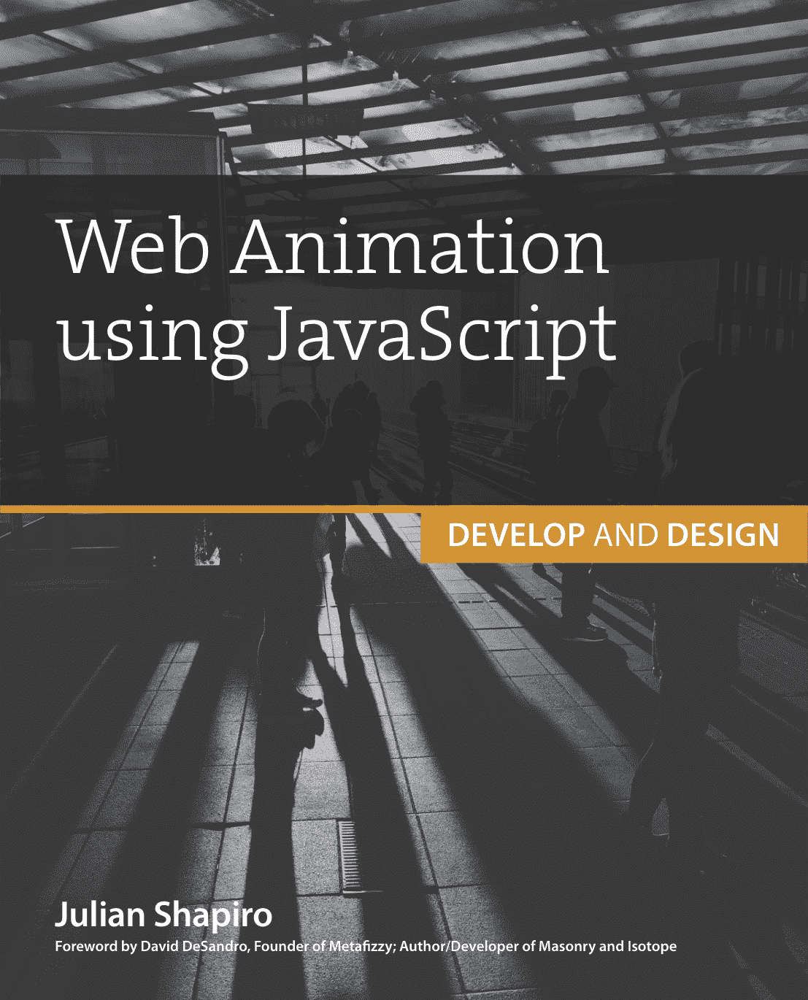


> 我将本书献给玩《反恐精英》（Counter-Strike）的人。
>
> 以及喜欢《瑞克和莫蒂》这部剧的人。

本页特意留白。

# 谢谢

我要感谢 Yehonatan Daniv 为 GitHub 上的 Velocity 用户提供支持，感谢 Anand Sharma 用他的运动设计工作不断给我灵感，感谢 David DeSandro 为本书写序言。感谢 Mat Vogels、Harrison Shoff、Adam Singer、David Kaplan 和 Murat Ayfer 审阅本书的草稿。

本页特意留白。

- 直觉 ................................................................................................ 47

# 前言

当开发者第一次发现 jQuery 的 `.animate()` 时，那是一个特别的时刻。我记得曾尝试让页面上任何没有固定在主要内容的部分动起来。我创建了手风琴组件、弹出菜单、悬停效果、滚动过渡、神奇的显示效果以及视差滑块。将我的网站从代码、静态内容转变为动态的视觉体验，让我觉得作为一名网页设计师提升了一个层级。但那仅仅是些点缀。现在我意识到，尽管添加了所有动画，但我并没有真正提高我网站的用户体验。

整个过程一直令人心潮澎湃。究竟是什么让动画如此令人兴奋？

我的公寓俯瞰着布鲁克林市中心。我看到人们在街道上行走。烟囱里冒出的烟雾升起。鸽子飞到窗台。一台起重机吊起建筑的一个部分。一个红心形气球漂浮在布鲁克林的天空中（我知道这很俗套，但我真的看到过两次了）。汽车驶过威廉斯堡大桥。云朵在头顶掠过。世界是运动的。

这就是你预期的宇宙运行方式。就像我窗外的活动，每一个都是一个简短的故事。它们共同讲述了正在发生的大宏。

然而，这并不是数字界面的工作方式。那些小故事缺失了。当事物变化时，你必须自己填补这个故事。当你按下 ATM 取款机上的“下一步”按钮时，屏幕突然变了。它是成功前进了吗？是否有错误？你必须再次阅读屏幕来解读你操作的结果。使用运动消除了交互之间这种理解的跳跃。运动本质上传达了发生了什么。这就像是在不同状态之间编写故事。

当幻灯片切换带你到下一个屏幕时，动画帮助你理解刚刚发生了什么。运用这种力量让动画变得如此人心。就像布局、颜色和排版一样，动画帮助你塑造和引导用户体验。动画不仅仅是让物体动起来。它是设计更有效的方案，并深虑地执行。

遗憾的是，在网页动画的历史中，深虑并不一直是首要任务。作为开发者，我们使用 Flash、动态 GIF、Java Applets、`marquee` 标签，以及最近的 CSS、JavaScript 和 SVG 来创建动画，这些动画充其好只是某种程度的润色，最坏的情况下只是个噱头。创建既高性能又易于用户的动画的想法是一个相对新的概念。

所以，你面前有这本书是件好事。Julian Shapiro 是网页动画领域的顶级专家之一。在创建和支持 Velocity.js 的过程中，他对在网站上使用运动的所有奇特性和优势了了如指掌的知识。《使用 JavaScript 进行网页动画》不仅将为你提供在网站中实现动画所需的技巧知识，更重要的是，将提供你有效使用动画并打造引入胜的用户体验所需的洞察。

动画库和技术让运动设计比以往任何时候都更容易触及。但并不是每个开发者都遵循最佳实践。过去几年里，许多趋势反模式出现又消失。滚动行为被劫持了。移动导航已被推崇。利用动画提升用户体验是优秀开发者的标志。这本书将帮助你成为其中之一。

David DeSandro

2015 年 2 月

布鲁克林，纽约

> David DeSandro 是 Metafizz 的创始人，Masonry 和 Isotope 的开发者。

# 引言

在网页的早期，动画主要被初级开发者用来强调页面的重要部分。即使他们想让动画超越局限，也做不到：当时的浏览器（和计算机）实在太慢了。

从闪烁广告、滚动新闻条到 Flash 视频的时代，我们已经走了很长一段路。今天，iOS 和 Android 精美的运动设计极大提升了用户体验——而不是削弱它。优秀网站的开发者利用动画来提升直观性。你使用的工具现在被认为没有最终的用户体验重要。尽管这看起来显而易见，但并非一直如此。

那么，是什么让动画如此有用？无论是内容块之间的切换、设计复杂的加载序列，还是提醒用户操作，动画都了文字和布局，增强了你网站的意图、个性和视觉深度。你的内容是以友好的方式进入视野，还是横扫屏幕？这就是运动设计的领域，你做的决策将决定应用的感受。

当用户向他人推荐你的应用时，他们经常尝试用“流畅”或“精致”等词来描述。他们并不知道，他们主要指的是界面中的运动设计工作。这种外行无法区分的区别正是优秀的用户界面（UI）设计师追求的：动画增强界面目标但不会分散用户的注意力。

本书为你提供了自信实现动画的基础，并且在技术上是可维护的，视觉上是有影响力的。在书中，它考虑了通过运动设计丰富页面与避免过度修饰之间的平衡。

为什么这一切如此重要？为什么值得花时间完善你的过渡和缓动组合？正如设计师花费数小时完善字体和颜色组合一样：精细的产品感觉上优越。它们会让用户自言自语：“哇，这太酷了”，然后转身对朋友惊呼：“你得看看这个！”

**注意：** 如果你不熟悉基础 CSS 属性，你应该在阅读本书之前读一本入门级的 HTML 和 CSS 书。

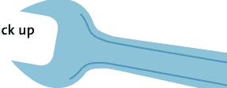

# 第一章 JavaScript 的优势

## 动画

在本章中，我们将对比 JavaScript 和 CSS 在动画方面的优劣，并介绍 JavaScript 提供的独特特性和工作流优势。

简而言之，我们将提供必要的背景知识，帮助你理解在书中将学习的所有关于 JavaScript 的内容。

## JavaScript VS CSS 动画

Web 开发社区存在一种误区，认为 CSS 动画是网页上实现动画的唯一高效方式。这种误解导致许多开发者完全放弃了基于 JavaScript 的动画，迫使他们：

- 在样式表中管理用户界面（UI）交互的实体，这会迅速变得难以维护。
- 牺牲了实时动画控制，而这种控制只有在 JavaScript 中才能实现。（对于设计响应用户拖动输入的 UI 动画，例如移动应用中常见的界面，时间控制是必须的）。
- 遗忘了基于物理的运动设计，这种设计允许网页上的元素像现实世界中的物体一样运行。
- 失去了对旧浏览器版本的支持，这些版本在全球范围内仍然流行。

实际上，基于 JavaScript 的动画通常与基于 CSS 的动画一样快。CSS 动画被误认为具有显著优势，是因为它经常与 jQuery 的动画功能进行比较，而事实上 jQuery 非常慢。然而，完全跳过 jQuery 的其他 JavaScript 动画库通过简化与页面的交互，提供了极佳的性能。

> 注意：一个值得关注的库是 `Velocity.js`，我们会在贯穿本书中使用它。它非常轻量但功能极其丰富，并且镜像了 jQuery 的动画语法，以帮助消除学习曲线。

当然，CSS 非常适用于悬停动画（例如，当鼠标悬停在链接上时将其变为蓝色），而这通常是基础网页包含动画的全部范围。CSS 过渡可以无缝地集成到现有的样式表中，允许开发者避免因不必要的 JavaScript 库导致页面臃肿。此外，CSS 动画开箱即用，性能卓越。

但本书将证明，对于超出简单悬停状态之外的动画，JavaScript 往往是更优越的选择。


## 卓越的性能

JavaScript 和 jQuery 被错误地混为一谈。JavaScript 动画很快的，而 jQuery 让它变慢。尽管 jQuery 功能非常强大，但它并不是设计为高性能动画引擎的。它没有机制来避免“布局抖动”（layout thrashing），即浏览器在动画过程中会被大量的布局处理工作所淹没。

此外，由于 jQuery 的代码库服务于动画之外的许多用途，它的内存消耗会触发浏览器内的垃圾回收，导致动画出现不可预测的卡顿。最后，由于 jQuery 团队为了帮助初级用户避免用糟糕的代码破坏其 UI 而做出的决定，jQuery 忘记了使用 `requestAnimationFrame` 函数的推荐做法，浏览器通过该函数可以大幅提高网页动画的帧率。

完全跳过 jQuery 的 JavaScript 动画库通过简化与页面的交互，提供了极佳的性能。一个值得关注的库是 `Velocity.js`，我们会在贯穿本书中使用它。它非常轻量但功能极其丰富，并且镜像了 jQuery 的动画语法，以帮助消除学习曲线。

这是我们在第 7 章“动画性能”中深入探讨的话题。通过学习浏览器渲染性能的细节，你将获得一个基础，为所有浏览器和设备构建可靠的动画，无论它们各自的处理能力如何。

## 特性

当然，速度并不是使用 JavaScript 的唯一理由——它丰富的特性同样重要。让我们过一下几个 JavaScript 专有的显著动画特性。

## 页面滚动

页面滚动是基于 JavaScript 动画最流行的用途之一。网页设计的一个近期趋势是创建长网页，当页面向下滚动时，让新内容以动画形式进入视野。

JavaScript 动画库（如 Velocity）为将元素滚动到视图提供了简洁的函数：

```javascript
$element.velocity("scroll", 1000);
```

这使用 Velocity 的 `"scroll"` 命令在 1000ms 的持续时间内将浏览器滚动到 `$element` 的顶部。注意，Velocity 的语法与 jQuery 的 `$.animate()` 函数几乎相同，后者将在本章稍些时候介绍。

## 动画反转

动画反转（Animation reversal）是撤销元素之前动画的有用简写方式。通过调用 `reverse` 命令，你正在指示元素返回到上一次动画之前的值。反转的一个常见用途是让模态对话框进入视图，然后在用户按下关闭键时将其隐藏。

一个未经优化的反转工作流需要跟踪每个可能随后进行反转的元素最后一次动画的特定属性。遗憾的是，在 UI 代码中跟踪之前的动画状态会迅速变得难以处理。相比之下，使用 `reverse` 命令，Velocity 会替你记住一切。

模仿 Velocity 滚动命令的语法，`reverse` 命令通过将 `"reverse"` 作为 Velocity 的第一个参数来调用：

```javascript
// 第一次动画：将元素的透明度向 0 动画
$element.velocity({ opacity: 0 });

// 第二次动画：向起始透明度值 1 还原动画
$element.velocity("reverse");
```

涉及到 JavaScript 的动画计时控制时，不仅仅有反转：JavaScript 还允许你全局性地减慢或加速所有正在运行的 JavaScript 动画。你将在第 4 章“动画工作流”中学习更多关于这一强大功能。

## 基于物理的运动

物理在运动设计中的用处反映了让你的网站拥有极佳用户体验（UX）的核心原则：界面从用户输入中自然流动。换句话说，界面尊重现实世界中物体的运动方式。

作为对物理运动的简单而强大的介绍，Velocity 提供了一了一种基于弹簧物理的缓动（easing）（我们将在下一章充分探讨缓动的概念）。对于典型的缓动选项，你传递一个对应预定义缓动曲线的字符串。相比之下，弹簧物理缓动接受一个包含两个元素的数组。

```javascript
// 使用 500 单位张力和 20 单位摩擦的弹簧物理缓动将元素的宽度动画到 "500px"
element.velocity({ width: "500px" }, { easing: [ 500, 20 ] });
```

数组中的第一项代表模拟弹簧的张力，第二项代表摩擦。较高的张力值会增加动画的总速度和弹性能。较低的摩擦值会增加动画末端的震动速度。通过调整这些值，你可以为页面上的每个动画赋予独特的运动特性，这有助于强化它们各自行为的差异。

## 可维护的工作流

动画设计是一个实验过程，需要反复调整计时和缓动值以实现整个页面的统一感。不可避免的是，正当你完善设计时，客户会提出重大更改。在这些情况下，可维护的代码变得至关重要。

这一工作流问题的 JavaScript 解决方案非常优雅，我们将在第 4 章“动画工作流”中详细介绍。目前，这里是简短的解释：存在技术可以将单个 JavaScript 动画（它们具有不同的持续时间、缓动等）链起来，使得一个动画的计时不会影响另一个。这意味着你可以更改单个动画而无需重新计算，并且可以轻松地设置动画并行或串行运行。

# 结语

在 CSS 中设计动画时，你本质上受限于 CSS 规范所提供的功能。在 JavaScript 中，由于编程语言的本质，第三方库对运动设计具有无限的逻辑控制力。动画引擎利用这一点提供了强大的功能，极大地改进了工作流并扩展了交互式运动设计的可能性。这正是本书的核心内容：以最高效的方式设计精美的动画。

下一章将介绍如何使用本书选择的 JavaScript 动画引擎：`Velocity.js`。通过掌握 `Velocity.js`，你将理解如何利用我们刚刚介绍的许多功能，以及更多功能。

# 第 2 章 使用 Velocity.js 制作动画

在本章中，你将学习 `Velocity.js` 提供的功能、命令和选项。如果你熟悉基于 jQuery 的动画，那么你已经知道如何使用 Velocity 了；它的运行机制与 jQuery 的 `$.animate()` 函数几乎完全相同。

但无论你现有的知识如何，本章中有条理的功能拆解都将向你介绍动画引擎行为的细微差别。掌握这些细微差别将帮助你从新手蜕变为专业人士。即使你已经对 JavaScript 动画和 `Velocity.js` 非常熟悉，也请帮自己自己快速浏览这一章。你一定会发现一些你从未意识到可以做到的。

## JavaScript 动画库的类型

有很多类型的 JavaScript 动画库。有些在浏览器中模拟物理交互。有些让 WebGL 和 Canvas 动画更易维护。有些专注于 SVG 动画。有些则改进了 UI 动画——而这种类型是本书的重点。

两个流行的 UI 动画库是 GSAP（可以在 GreenSock.com 下载）和 Velocity（可以在 VelocityJS.org 下载）。在本书中你将一直使用 Velocity，因为它在 MIT 许可证下是免费的（GSAP 根据网站的业务模式需要许可费用），此外，它在编写简洁且具表现力的动画代码方面拥有极其强大的功能。它被广泛用于许多热门网站，包括 Tumblr、Gap 和 Scribd。

哦，它是由本书作者创建的！

## 安装 jQuery 和 Velocity

你可以从 jQuery.com 下载 jQuery，从 VelocityJS.org 下载 Velocity。要在你的页面上使用它们（像使用任何 JavaScript 库一样），只需在页面的 `<body>` 标签之前包含指向各自库的 `<script></script>` 标签。如果你链接的是预托管的库版本（而不是计算机本地的副本），你的代码可能如下：

```html
<<html>
<head>My Page</head>
<body>
  My content.
  <script src="//code.jquery.com/jquery-2.1.1.min.js"></script>
  <script src="//cdn.jsdelivr.net/velocity/1.1.0/velocity.min.js"></script>
</body>
</html>
```

当将 jQuery 和 Velocity 结合使用时，请在 Velocity 之前包含 jQuery。

就是这样！现在你准备好大显身手了。

## 使用 Velocity：基础

为了熟悉 Velocity，我们将从基础组件开始：参数、属性、值和链式调用。由于 jQuery 无处不在，因此查看 Velocity 与 jQuery 之间的关系也同样重要。

## Velocity 和 jQuery

Velocity 独立于 jQuery 运行，但两者可以结合使用。通常情况下这样做更好，以便利用 jQuery 的链式调用能力：当你使用 jQuery 预选一个元素时，可以通过调用 `.velocity()` 来扩展它并对其制作动画：

```javascript
// 给 jQuery 元素赋值变量
var div = $("#div");
// 使用 Velocity 动画化元素
$div.animate({ opacity: 0 });
```

这种语法与 jQuery 自身的 `animate` 函数相同：

```javascript
$div.animate({ opacity: 0 });
```

本书中的所有示例都将 Velocity 与 jQuery 结合使用，因此遵循这种语法。

## 参数

Velocity 接受多个参数。它的第一个参数是一个对象，将 CSS 属性映射到它们期望的最终值。这些属性及其接受的值与 CSS 中使用的属性直接对应（如果你不熟悉基础 CSS 属性，请在阅读本书之前读一本入门的 HTML 和 CSS 书）：

```javascript
// 将元素动画化为宽度 "500px"，不透明度为 1。
$element.velocity({ width: "500px", opacity: 1 });
```

> 提示：在 JavaScript 中，如果你提供的属性值包含字母（而不仅仅是整数），请将该值放在引号中。

你可以通过第二个参数传递一个指定了动画选项的对象：

```javascript
$element.velocity({ width: "500px", opacity: 1 },
{ duration: 400, easing: "swing" });
```


这里还有一种简写参数语法：与其作为第二个参数传递选项对象，不如使用逗号分隔的语法。这意味着可以用任何逗号分隔的顺序列出`duration`（接受整数值）、`easing`（字符串值）和`complete`（函数值）的值。（你将在文档中学习这些选项的所有详细说明。）

```javascript
// 以 1000ms 的持续时间动画（并隐式使用默认的 "swing" 缓动值）
$element.velocity({ top: 50 }, 1000);
// 以 1000ms 的持续时间和 "ease-in-out" 缓动进行动画
$element.velocity({ top: 50 }, 1000, "ease-in-out");
// 以 "ease-out" 缓动进行动画（并隐式使用默认的 400ms 持续时间）
$element.velocity({ top: 50 }, "ease-out");
// 在动画完成后触发回调
$element.velocity({ top: 50 }, 1000, function() { alert("Complete."); });
```

简写参数语法：与其作为第二个参数传递选项对象，不如使用逗号分隔的语法。这意味着可以用任何逗号分隔的顺序列出`duration`（接受整数值）、`easing`（字符串值）和`complete`（函数值）的值。（你将在文档中学习这些选项的所有详细说明。）

（注：此处原文中示例代码块存在括号不匹配等格式错误，翻译时已根据逻辑修正）

Velocity 优于 CSS 的另一个优势是它支持四种值运算符，这些运算符可以可选地加在属性值之前：`+`、`-` 和 `/`。它们直接对应 JavaScript 中相应的数学运算符。你可以将这些值运算符与等号（`=`）组合执行相对数学运算。请参考内联代码注释示例：

```javascript
element.velocity({
top: "50px", // 无操作符。预期向 50 动画。
left: "-50", // 负操作符。按预期向 -50 动画。
width: "+=5rem", // 将当前宽度值转换为对应的 rem
  -> 等同于增加 5 个单位。
height: "-=10rem", // 将当前高度值转换为对应的 rem
  -> 等同于减去 10 个单位。
paddingLeft: "*=2" // 当前 paddingLeft 值翻倍。
paddingRight: "/=2" // 将当前的 paddingLeft 值平分。
});
```

Velocity 的简写功能作为值运算符完全保留了动画逻辑，这不仅通过消除手动数值计算使代码更加简洁，还通过告诉 Velocity 更多关于你计划如何动画元素的信息提高了性能。Velocity 内部执行的逻辑越多，Velocity 就越能优化你的代码以获得更高的帧率。

### 链式调用（CHAINING）

当多个 Velocity 调用连续地接在一个元素（或是一系列元素）上时，它们会自动相互排队。这意味着每个动画都会在上一个动画完成之前开始：

```javascript
$element
// 动画化宽度和高度属性
.velocity({ width: "100px", height: "100px" })
// 当宽度和高度动画完成后，动画化顶部属性
.velocity({ top: "50px" });
```

### 使用 VELOCITY：选项

为了完善对 Velocity 的介绍，让我们过一遍最常用的选项：`duration`（持续时间）、`easing`（缓动函数）、`begin`（开始）和`complete`（完成）、`loop`（循环）、`delay`（延迟）以及`display`（显示）。

### DURATION（持续时间）

你可以指定`duration`选项，它决定了动画调用完成所需的时间，单位为毫秒（1/100 秒），或者使用三种简写持续时间之一："slow"（等同于 60ms）、"normal"（400ms）或 "fast"（200ms）。通过指定毫秒的持续时间值，提供一个无任何类型的整数值：

```javascript
// 以 1000ms (1秒) 的持续时间动画
$element.velocity({ opacity: 1 }, { duration: 1000 });
```

或者：

```javascript
$element.velocity({ opacity: 1 }, { duration: "slow" });
```

使用命名简写持续时间的优势在于，当你审查代码时，它们表达了动画的节奏（是慢是快？）。如果你完全使用这些简写，它们自然会引导你的整个网站呈现出统一的运动设计，因为你所有的动画将落入三个类别之一，而不是每个都传递一个任意值。

### EASING（缓动函数）

缓动函数（Easings）是定义动画在动画总持续时间不同部分发生速度快慢的数学函数。例如，"ease-in" 缓动类型表示动画在第一部分应该逐渐加速（淡入），然后在最后部分逐渐减速（淡出）。相比之下，"ease-in" 缓动类型产生的动画在动画的第一部分加速到目标速度，此后保持恒定速度直到动画完成。"ease-out" 缓动类型是此反面：动画以恒定速度开始并持续，然后在动画的最后部分逐渐减速。

就像第 1 章“JavaScript 动画的优势”中讨论的基于物理的运动一样，缓动赋予了你向动画注入个性的力量。例如，使用线性缓动（linear easing）的动画是多么机械化，它的启动、运行和结束速度相同。这种机器人感是现实世界中线性机器人运动的结果：自引导的机械物体通常以直线和恒定速度移动，因为它们既没有美学理由也没有有机理由那样做。

相反，活的生物——无论是人体还是随风摇曳的树木——在现实世界中从不以恒定速度移动。摩擦和其他力量使它们以不同的速度移动。

伟大的运动设计师向有机运动（organic motion）致敬，因为它给人一种界面对用户交互做出流畅响应的印象。例如，在移动应用中，当你将菜单滑出屏幕时，你预期它会迅速离开手指。如果菜单以恒定速度离开手指——就像机械臂一样——你会觉得滑动仅仅触发了一系列不受你控制的运动事件。

你将在第 3 章“运动设计理论”中学习更多关于缓动类型的威力。现在，让我们过一遍 Velocity 所有可用的缓动值：

- jQuery UI 的三角函数缓动。关于这些缓动方程的完整列表以及其加速曲线的交互演示，请参考 easings.net 上的演示。

```javascript
$element.velocity({ width: "100px" }, "easeInOutSine" });
```

- CSS 缓动："ease-in"、"ease-out" 和 "ease"（"ease-in-out" 的更微妙版本）。

```javascript
$element.velocity({ width: "100px" }, "ease-in-out" });
```

- CSS 贝塞尔曲线（Bézier curves）：贝塞尔曲线允许对缓动加速曲线结构进行完全控制。贝塞尔曲线通过指定图表上四个等距点的高度来定义，格式为四项小数数组。访问 cubic-bezier.com 交互式生成曲线。

```javascript
$element.velocity({ width: "100px" }, [0.17, 0.67, 0.83, 0.67] });
```

- 弹簧物理（Spring physics）：这种缓动类型模拟了拉伸后突然释放的弹簧行为。通过`tension`（张力）和`friction`（阻力）来调整它。

```javascript
$element.velocity({ width: "100px" }, { tension: 500, friction: 15 });
```

- "spring" 缓动是预定义的实现，当你不想尝试张力和阻力值时非常方便。

```javascript
$element.velocity({ width: "100px" }, easing: "spring" });
```

记住，你也可以将缓动作为选项对象中的属性传入：

```javascript
$element.velocity({ width: 50 }, { easing: "spring" });
```

> 注意：本节中的其余 Velocity 选项必须显式传递到选项对象。与之前描述的不同，这些额外选项不能通过逗号分隔的语法提供给 Velocity。


### 循环（LOOP）

设置`loop`选项可以指定动画在调用的属性值与调用前的元素取值之间交替的次数：

```javascript
$element.velocity({ height: "10em" }, { loop: 2 });
```

如果元素的原始高度为 5em，则它的高度将在 5em 和 10em 之间交替两次。

如果在循环调用中使用了`begin`或`complete`选项，它们将各触发一次——分别在循环序列的最开始和结束处；它们不会在每次循环迭代时重新触发。

除了传递整数外，你还可以传递`true`来触发无限循环：

```javascript
$element.velocity({ height: "10em" }, { loop: true });
```

无限循环在自然结束之前会忽略回调函数（`callback`）。不过，你可以通过 Velocity 的`stop`命令手动停止它们：

```javascript
$element.velocity("stop");
```

非无限循环对于那些需要重复链式动画代码的动画序列有用。例如，如果你想让一个元素上下弹动两次（可能是为了提醒用户有新消息在等待他们），未优化的代码看起来如下：

```javascript
$element
// 假设 translateY 从 "0px" 开始
.velocity({ translateY: "100px" })
.velocity({ translateY: "0px" })
.velocity({ translateY: "100px" })
.velocity({ translateY: "0px" });
```

此代码更紧凑且易于维护的版本如下：

```javascript
// 重复（循环）此动画两次
$element.velocity({ translateY: "100px" }, { loop: 2 });
```

使用这个优化版本，如果你对顶部值的变化量（当前为 "100px"）改变了主意，你只需要更改代码中一处的顶部值即可。如果你的代码中有许多重复实例，很快就能看出循环对你的工作流有多大好处。

无限循环对于加载指示器非常有帮助，指示器通常会无限动画直到数据加载完成。

首先，通过无限循环不透明度（opacity）从可见到不可见，让加载元素看起来像在脉动：

```javascript
// 假设 opacity 从 1 开始（完全可见）
$element.velocity({ opacity: 0 }, { loop: true });
```

稍后一旦数据加载完成，你可以停止动画，然后停止元素：

```javascript
$element
// 先停止无限循环...
.velocity("stop")
// ... 这样就可以给元素一个新的动画，
// 在此中你可以将其变回不可见
.velocity({ opacity: 0 });
```

### 延迟（DELAY）

指定以毫秒为单位的`delay`选项，在动画开始前插入暂停。`delay`选项的目的是将动画的时间逻辑完全保留在 Velocity 内部——而不是依赖 jQuery 的`$.delay()`函数来改变 Velocity 的启动时间：

```javascript
// 在不透明度变为 0 之前等待 100ms
$element.velocity({ opacity: 0 }, { delay: 100 });
```

你可以设置`delay`选项与`loop`选项一起，在循环交替之间创建暂停：

```javascript
// 循环四次，每次循环之间等待 100ms
$element.velocity({ height: "+=50px" }, { loop: 4, delay: 100 });
```

### 显示与可见性（DISPLAY AND VISIBILITY）

Velocity 的`display`和`visibility`选项与其对应的 CSS 属性直接对应，并接受相同的值："none"、"inline"、"inline-block"、"block"、"flex" 等。此外，Velocity 允许值为 "auto"，这会指示 Velocity 将`display`属性设置为该元素的默认值。（作为参考，anchors 和 spans 默认为 "inline"，而 divs 和大多数其他元素默认为 "block"。）Velocity 的`visibility`选项像其 CSS 对应一样，接受 "hidden"、"visible" 和 "collapse" 值。

在 Velocity 中，当`display`选项被设置为 "none"（或`visibility`设置为 "hidden"）时，元素的 CSS 属性将在动画完成后进行相应的设置。这有效地实现了在动画完成后隐藏元素，并且对于将元素的不透明度降为 0 的动画有用（其意图是让元素淡出页面）：

```javascript
// 将元素淡出到不透明度: 0，然后将其从页面流中移除
$element.velocity({ opacity: 0 }, { display: "none" });
```

> 注意：上面的代码有效地替换了 jQuery 的等效代码：

```javascript
$element.animate({ opacity: 0 })
.hide();
```

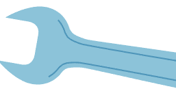

### 可见性与显示的快速回顾

作为参考，CSS `display` 属性决定了元素如何影响其周围及内部包含的元素的定位。相比之下，CSS `visibility` 属性专门影响元素是否可见。如果一个元素被设置为 "visibility: hidden"，它将继续占据页面上的空间，但该空间将由一个空隙表示——该元素的任何部分都将不可见。相反，如果一个元素被设置为 "display: none"，则该元素将完全从页面流中移除，其内部和周围的所有元素将填入被移除元素的空间，仿佛该元素从未存在过一样。

注意，与其将元素从页面流中移除，你只需要通过将`visibility`设置为 "hidden" 来将元素标记为既不可见又不可交互。这在你希望一个隐藏的元素继续占据空间时非常有用。

```javascript
// 当不透明度降为 0 后，让元素变为不可见且不可交互
$element.velocity({ opacity: 0 }, { visibility: "hidden" });
```

现在，当`display`设置为 "block" 之前，由于元素被隐藏，让我们考虑反向的显示：

```javascript
// 在不透明度变为 1 之前显示元素
$element.velocity({ opacity: 1 }, { display: "block" });
```

这有效地替换了 jQuery 的等效代码：

```javascript
$element
.show()
.animate({ opacity: 0 });
```

> 提示：关于动画选项的完整概述，请查阅文档。

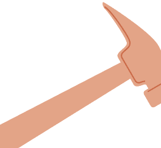

### 包含动画逻辑

与`delay`选项一样，Velocity 对`display`和`visibility`的整合允许动画逻辑完全包含在内部。在生产代码中，每当元素淡入或淡出视图时，几乎伴随着可见性的变化。利用这些简写可以帮助你保持代码整洁易于维护，因为它不依赖外部函数，且没有冗余的辅助函数膨胀动画逻辑。

注意 Velocity 包含了上述不透明度切换的简写。它们的功能与`fadeIn`和`fadeOut`函数相同。你将相应的命令作为第一个参数传递给 Velocity：

```javascript
$element.velocity("fadeIn", { duration: 1000 });
```

```javascript
$element.velocity("fadeOut", { duration: 1000 });
```

### 使用 Velocity：功能

值得注意的额外 Velocity 功能包括：`reverse`命令、滚动、颜色和变换（平移、旋转和缩放）。

### 反转命令（REVERSE）

要将元素回到上一次调用的值，请将 "reverse" 作为 Velocity 的第一个参数。`reverse`命令的行为与标准 Velocity 调用相同；它可以接受选项并与其他链式 Velocity 调用一起队列。

`reverse`默认使用元素之前的 Velocity 调用中的选项（持续时间、缓动等）。但是，你可以通过传递一个新的选项对象来覆盖这些选项：

```javascript
// 使用先前的 Velocity 调用选项切换回原始值
$element.velocity("reverse");
```

或：

```javascript
// 与上述相同，但将先前的持续时间替换为 2000ms
$element.velocity("reverse", { duration: 2000 });
```

> 注意：`reverse`命令忽略之前的`begin`和`complete`选项；`reverse`永远不会重新调用回调函数。

### 滚动（SCROLLING）

要将浏览器滚动到元素的顶部，请将 "scroll" 作为 Velocity 的第一个参数。`scroll`命令的行为与标准 Velocity 调用相同；它可以接受选项并与其他链式 Velocity 调用一起队列：

```javascript
$element
.velocity("scroll", { duration: 1000, easing: "spring" })
.velocity({ opacity: 1 });
```


此操作使用 `1000ms` 的持续时间和“弹簧”缓动效果将浏览器滚动到元素的顶部。随后，当元素进入视野后，它将完全淡入。

若要向带有滚动条的父元素内部的元素滚动，你可以使用 `container` 选项，它可以接收 jQuery 对象或原生元素。请注意，CSS `position` 属性的容器元素必须设置为 `relative`、`absolute` 或 `fixed-static`，否则无法实现效果：

```javascript
// 将元素滚动到 #container 视图内
$element.velocity("scroll", { container: `$#container` });
```

在这两种情况下——无论是相对于浏览器窗口滚动还是相对于父元素滚动——滚动命令始终是在被滚动的元素上调用的。

默认情况下，沿 y 轴滚动。传入 `axis: "x"` 选项即可水平滚动而非垂直滚动。

```javascript
// 将浏览器滚动到目标 div 的左侧边缘。
$element.velocity("scroll", { axis: "x" });
```

最后，滚动命令独特地包含了一个 `offset` 选项，以像素为单位，用于偏移目标滚动位置：

```javascript
// 滚动到元素顶部上方 50px 的位置。
$element.velocity("scroll", { duration: 1000, offset: "-50px" });

// 滚动到元素顶部之外 250px 的位置。
$element.velocity("scroll", { duration: 1000, offset: "250px" });
```

### 颜色

Velocity 支持这些 CSS 属性的颜色动画：`color`、`borderColor` 和 `outlineColor`。在 Velocity 中，颜色属性仅接受十六进制字符串输入，例如 `#000000`（黑色）或 `#e2e2e2`（浅灰色）。为了更精细的控制，你可以对颜色属性的单个红、绿、蓝分量进行动画处理。

### 变换

CSS 变换执行平移、缩放和旋转操作，适用于 2D 和 3D 空间。

- `translateX`：沿 x 轴平移。
- `translateY`：沿 y 轴平移。
- `translateZ`：沿 z 轴平移。
- `rotateX`：绕 x 轴旋转。
- `rotateY`：绕 y 轴旋转。
- `rotateZ`：绕 z 轴旋转。
- `scaleX`：沿 x 轴缩放。
- `scaleY`：沿 y 轴缩放。
- `scaleZ`：沿 z 轴缩放。

在 Velocity 中，你可以通过对象操作这些属性：

```javascript
$element.velocity({
  translateZ: "200px",
  rotateZ: "45deg"
});
```

### 不使用 jQuery 使用 Velocity（中级）

如果你是一名希望在 JavaScript 中不使用 jQuery 的中级开发者，你会很高兴发现 Velocity 在没有 jQuery 时也能工作。相应的，与其在 jQuery 元素上链式调用动画，所有参数都向右移动一位，为在第一个位置传入目标元素留出空间。此外，使用全局 `Velocity` 对象来调用动画，而不是特定的 jQuery 元素对象。

当你不用 jQuery 使用 Velocity 时，动画的不再是 jQuery 元素，而是原生文档模型（DOM）元素。可以通过以下函数获取原生元素：

- `document.getElementById()`：通过 ID 属性获取元素。
- `document.getElementsByTagName()`：通过名称获取所有元素（例如 `a`、`div`、`p`）。
- `document.getElementsByClassName()`：通过 CSS 类名获取所有元素。
- `document.querySelectorAll()`：此功能与 jQuery 的选择器引擎几乎相同。

让我们探索 `document.querySelectorAll()`，因为它可能是你在不使用 jQuery 时选择元素的武器。它是一个跨浏览器支持良好的高效函数。与 jQuery 的元素选择器语法一样，你只需传入一个 CSS 选择器（你在样式表中用于定位元素的选择器），它将以数组的形式返回所有匹配元素：

```javascript
document.querySelectorAll("body"); // 获取 body 元素
document.querySelectorAll(".squares"); // 获取所有带有 "square" 元素
document.querySelectorAll("div"); // 获取所有 div
document.querySelectorAll("#main"); // 获取 ID 为 "main" 的元素
```

如果你将 `document.querySelectorAll()` 的结果赋值给变量，你可以使用它：

```javascript
var divs = document.querySelectorAll("div"); // 获取所有 div

divs.forEach(function(div) {
  $(div).velocity({ opacity: 0.5 }, 1000);
});
```

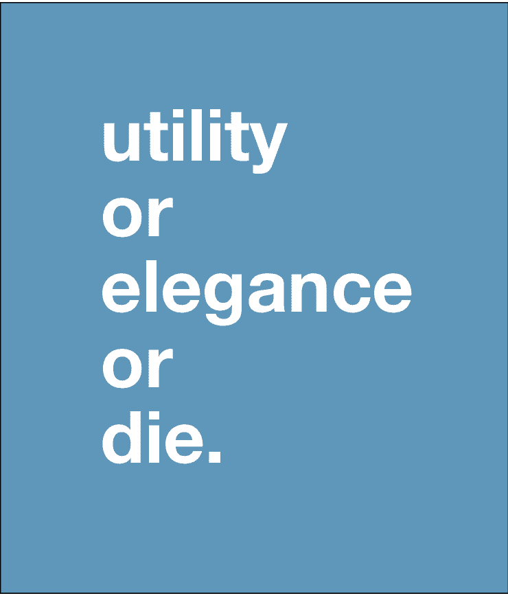

动态设计的实用性利用了用户心理学。当用户点击按钮时，她能确定 UI 已经响应了这次点击吗？确保她确信的一种简单方法是让按钮过渡到按下状态的动画效果。当用户等待内容加载时，她能确定进度正在进行吗，还是会产生一种程序已卡死的不安感？这些都是心理预期，而动态设计可以通过提供 UI 状态的持续视觉指示来解决这些问题。

动态设计的这种互补的优雅感，让一个 App 从仅仅的“好看”提升到了“好用”。它是那种“哇，太神奇了”感觉的来源，提醒用户技术是多么神奇。

让我们精通这两个方面吧。让我们开始吧。

## 实用性（UTILITY）

如何确保你的动态设计选择对你的网站有价值的补充？

这里有一些技巧。

## 借鉴约定（BORROW CONVENTIONS）

从你喜欢的网站和 App 的动态设计中获取灵感。流行的动态设计规范值得借鉴，因为它们在用户脑海中已经具有意义。对约定的反复接触会让用户对动画“应该”长什么样形成预期。如果你将约定用于用户非预期的用途，你的 App 就会显得很不直观。

你从别处复制的设计效果越多，用户对你的 App 感到就越熟悉。App 越熟悉，用户就会越快感到舒适和自信。虽然新颖性具有实用价值，但日常 UI 元素的动态设计不应该是新颖的。将新颖留给意义较小或难以被误解的动画序列，例如页面的加载序列或状态指示动画。

## 结果预览（PREVIEW OUTCOMES）

当页面上的某个元素用途模糊时，给用户提供交互结果的预览。这提供了一种保证，确保该元素的功能如用户所想的那样。一个简单的例子是，按钮在悬停时通过视觉上的无线电脉冲来启动文件发送。这利用了一种常见的图形设计修辞，告诉用户将发生数据传输动作。

另一种更不那么模糊的预览结果的方法是显示用户实际采取行动时发生的动画部分。例如，当用户点击按钮时，正在进行的文件传输指示动画开始运行；实现动态设计，使得悬停在触发元素上会触发进行中的动画。当用户悬停离开元素时，反转部分动画，让文件传输指示器恢复到默认状态。这种预览技术帮助用户立即理解她的动作将触发的效果，有助于增强她对 UI 元素目的的信心。用户感觉越强烈，就越有掌控感。掌控感越强，体验就越愉快。

## 分散注意力而非无聊（DISTRACTION OVER BOREDOM）

当用户在你的页面上执行枯燥、缺乏参与感的任务时——例如填写很长的表单——你可以使用颜色和移动来提高她的意识水平并增加趣味性。例如，当她成功完成每个表单字段时，你可以为勾选标记添加动画。这让用户的注意力保持与界面的互动，减少了当前任务的枯燥感。同样，你可以在用户等待内容时向他们展示一个引人注目的加载指示器。在网车共享 App Lyft 中可以找到很好的例子，当 App 加载到内存时，它会在空白画布上节律地让气球漂浮落下。

让用户的大脑放松并感受重复运动带来的愉快动能，能让她更投入到你的内容中。尽管这看起来可能很表面，但它是有效的。要意识到这种技术应该在用户将经历无聊时期时使用；避免在你任何想要给 UI 增加一点趣味时将其作为“创可贴”。

让我们考虑另一个例子：当 Facebook 将内容加载到其新闻动态（News Feed）时，它会对虚拟文本进行模糊处理，直到真实文本准备好显示。这种节律性的模糊表示界面正在忙碌（而不是停滞了），并具体告诉用户她正在等待 UI 的哪个部分。这种技术被称为“内联状态指示”（inline status indication）。

将其与无处不在的状态指示进行比较，后者和互联网本身一样老：在极度缺乏内容的页面上叠加单个循环的动画图形。用户已经厌倦了这种。相比之下，内联状态指示允许你通过阻塞内容尚未加载的特定区域来显示尽可能多的界面。这不仅更细致，而且当用户在数手指等待页面完全加载时，有更多内容可以注视。

这里的要点很简单：你提供给用户的参与内容越多，他们感到无聊的时间就越长。

## 利用本能直觉（LEVERAGE PRIMAL INSTINCTS）

人类大脑有一个专门用于视觉处理的区域。我们天生无论主观意愿如何对突然的移动做出反应。因此，如果页面上发生了需要用户立即注意的重要操作，请考虑使用移动来标记她的注意力。提醒用户的一种常用方法是通过反复向上向下移动元素来产生“弹跳”效果。

这种实现方式与元素颜色的动画形成对比，后者没有利用本能；我们并没有被训练成本能地将颜色变化解释为值得立即关注的事。然而，请考虑在某些国家，通过反复接触，人们被训练将红色解释为“停止”，绿色解释为“通过”，这些都是社会强化意义的例子。在设计动态时，也要考虑这种现象。

深入研究心理学，用户将朝向自己的移动解释为一个需要采取行动的紧急通知，而将远离自己的移动解释为避开她的路，因此不需要采取行动。

## 让交互具有直观感受（MAKE INTERACTIONS VISCERAL）

大而软软的、带有丰富色彩渐变的按钮会让用户想要点击。这类元素通过令人满意的压力施加感和色彩爆发来奖励点击行为。这里的教训是激励：点击按钮越有趣，用户就越会这样做。利用这种现象为重要的行动号召（Call to Action）让用户参与，例如注册新账户或从购物车结账的按钮。


## 反映分量（REFLECT GRAVITAS）

如果用户采取了具有不可逆转后果的行动，请使用感觉同样重要的动态设计来加强这种观念。例如，点击“删除”按钮相关的动画应该比悬停在标准导航下拉菜单上的动画更具意义。后者可能涉及简单的颜色变化，而前者可能包含尺寸的突然跳变和元素边界的加粗。通过根据严重程度梯度划分动态设计，你将帮助用户直观地理解可用操作的层级。这种技术与本章的其他技术一起，服务于增加用户理解和信心的目标。

## 减少并发（REDUCE CONCURRENCY）

在某种程度上，用户总是试图理解你的 UI。无论是有意识无意识，他们都会对你所做的每一个设计和动态设计选择赋予意义。因此，如果你向用户展示由许多元素同时进入视图的扩展动画序列，将损害他们解析所有正在发生的运动含义的能力。

简而言之，如果你正在使用动态设计来指示重要内容，请确保你没有同时指示许多不同的事情。如果是这样，考虑将动画拆分为步骤或减少动画总数。

## 减少多样性

与减少并发的最佳实践相关的概念是限制你动画变化的数量。动画变化越少，用户就会越有感，认为她完全理解你 UI 中每种动画的含义。例如，如果你使用一种类型的动画让大图片进入视野，而使用另一种类型让小图片进入视野，请考虑将它们合并。如果它们之间的差异仅仅是为了美观而非为了提高可用性，那么你已经成功消除了 UI 中不必要的复杂性，并在过程中强化了行为的一致性。一致性会带来模式识别和理解。理解会增加用户的自信心。

## 镜像动画

限制动画多样性的一个次要方面是在选择动画属性和选项组合时要保持一致性。例如，如果你有一个模态通过过渡透明度（opacity）和缩放（scale）进入视野的，请确保该模态在移出视野时，这两个属性也恢复到原始值。不要为同一硬币的两面使用不同的属性。这样做会让用户质疑是什么导致了这种差异，而无谓的疑问是糟糕用户体验的标志。

在处理影响平移的属性（例如 CSS 中的`translateX`、`left`、`marginLeft`）时，镜像应用是字面意义上的：如果一个模态是从页面顶部向下滑动进入视野的，就让它向页面顶部向上滑动回移出视野。相反，如果你让模态通过进一步向下滑动移出页面来移出视野，那么你是在告诉用户该模态被发送到了一个*新*的地方，而不是回到了原来的地方。通常，你希望在用户完成操作（例如更改账户设置）后，暗示模态对话框已经回到了它来源的地方。如果用户是在发送电子邮件，那么让模态移出页面在语境上是恰当的，因为强化了邮件从来源（用户）发送到*新*位置（接收者）的观点。

## 限制持续时间

设计师经常犯一个错误，让动画运行过久，导致用户无谓地等待。永远不要让 UI 修饰减慢你页面的感知速度。如果你在一个较大的动画序列中让大量内容淡入视野，请确保整个序列的总持续时间是短的。

同样，如果你的 UI 有某部分（例如个人头像）因为用户与你的交互而频繁地淡出或移出视野，请格外小心不要允许过长的持续时间。第一次看到一段运动设计展开是很新鲜的，但每当用户与应用交互时都看到它展开几十次，很快就会变成负担——尤其是当用户感到反复等待动画播放会显著增加整体 UI 等待时间时。

由于在测试期间看到动画播放几十次后，很难判断其动画的合理性，一个很好的经验法则是：在将网站发布到生产环境之前，将所有动画加速 25%。这将有助于确保它们始终向速度更快的一侧倾斜。（请参阅第 4 章“动画工作流”获取有关如何快速调整动画时间偏移的提示。）

## 限制动画

完全移除某个动画不会损害用户对你界面的理解，考虑舍弃它并取而代之使用即时样式变化。你 UI 中的动画越多，用户就越习惯于看到它们。她越习惯于看到它们，对它们投入的注意力就越少，她能够区分不同类型的运动设计及其各个含义的概率也就越低。

你绝大多数的运动设计应该是细微的——例如悬停时的细微颜色变化——这样，存在的少数几次宏大的运动设计才能脱颖而出，以传达它们想要表达的信息。

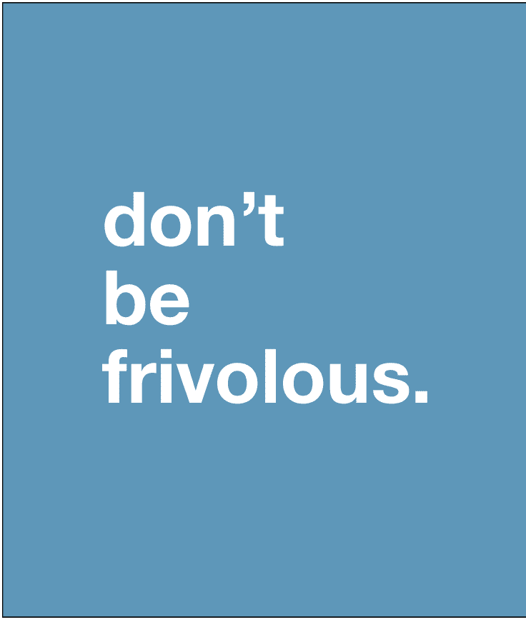

## 优雅

轻率与有影响运动设计之间的界限很容易辨别：某项特定的运动设计是否符合本章“实用性”部分讨论的最佳实践之一？如果没有，就把它删掉。它是轻率的，并且正在危及你 UI 的可用性。

## 不要轻率

为了磨炼你对什么是轻率的判断，请下载最流行的应用，深度体验每一个应用，并判断它们使用动画的程度是比你的应用多还是少。密切关注每个动画传达了什么，以及为什么要传达。如果你觉得这些应用使用动画的程度远低于你的应用，请考虑调低你 UI 中的运动设计。

这个“不要轻率”的格言有一个例外——请继续读下去！”，

## 你轻率的唯一机会

页面的加载序列——当你的所有元素从初始的不可见状态动画进入视野时——是你对动画表现得夸张和轻率的唯一机会。为什么？因为这个序列只发生一次，它不会反复阻碍用户与你网站的交互。此外，这是你利用运动设计技巧为网站提供绝佳第一印象的时刻。

如果你对内容动画进入视野有一个酷炫的主意，就在这里这样做。但务必遵守本章中的所有其他规则，特别是限制持续时间。

## 考虑个性

如果你正在设计一个企业网站，弹跳（Bounciness）是俏皮的——并不是企业网站经常希望元素进入网站时传达的品质。如果你正在设计一个教育或政府应用，你就不会使用导致运动开始非常快而结束非常缓慢的缓动（easings）（从而传出一种擦脸而过的未来流畅感）——这些对于当前内容来说太过于华丽和风格化了。

始终考虑你的动画决策所表达的个性。作为设计师，很难判断自己作品的语调，因此尽早获取反馈是一个好主意。询问测试用户 UI 是否感觉专业、友好，并根据你对这三个特征的偏好来调整运动设计。

## 超透明度

让元素进入或移出视野的最常见手段是透明度从 0 变为 1，反之亦然。这可能是非常无聊的。透明度只是显示或隐藏内容的基础属性——它不是唯一的。你可以通过缩小元素、将其移出视野或改变背景颜色来增加你的属性选择。当你向动画中添加更多属性时，考虑利用多步效果，你将在下一节中学习。

## 将动画分解为步骤

通向专业运动设计的最简单路径是将动画分解为多步效果。例如，如果你正在通过过渡透明度和缩放从 0 到 1 来让图像进入视野，请考虑先让元素的透明度变为 0.5（其最终值的一半），然后让其缩放从 0 开始，同时让剩余的一半透明度到位。这种将属性动画分解为步骤的方法消除了网络大多数业余运动设计中常见的线性——即所有属性完美同步动画。在现实世界中，运动物体的属性并非同步加速：考虑一下，鸟飞行时，向前移动（translate）的速度与它上下移动（translate）的速度不同。如果它在 X 和 Y 轴上都线性运动，它看起来会更像弹子而不是动物。

如果你注意电影中未来的 UI 动画，你会发现复杂的多步动画是使其看起来如此流畅的关键组件。其原因很简单，并且进一步支持了避免线性的论点：人类被多样性和对比所吸引。考虑一下，当你分解一个动画时，你正在对比和并置它的单个组件。

相互对抗。就像通过层层穿衣来创造愉悦的色彩和纹理组合一样，你也应该通过分层动画来创造愉悦的运动设计组合。

关于多步效果的技术实现建议，请参阅第 4 章“动画工作流”。

## 错错式动画（STAGGER ANIMATIONS）

当多个兄弟级元素——例如画廊中的一系列图像——同时进行视图动画时，请考虑在它们之间添加微小的延迟。（也就是说，在加载第一张图片后，在加载第二张图片之前会产生一个延迟，依此类推。）以这种方式延迟兄弟级元素的动画被称为“交错式”（staggering），其目的与将动画分解为多个步骤相似：它通过防止所有元素完美同步动画，增加了视觉上的层次感，因为完全同步动画可能看起来很单调且不优雅，而交错加载则不然了。为什么呢？因为同步动画一系列元素缺乏任何细粒度或渐进感。考虑一下：鸟类并不是并排排成直线飞行的。让它们的空中动作如此优雅的是它们连续的阵型形成和时机把握。正是它们的并列以及并列带来的运动，让它们在人类眼中是如此优雅。

### 来自触发元素的流向（FLOW FROM THE TRIGGERING ELEMENT）

如果点击按钮会导致模态框出现，让模态框从按钮的位置向外动画出现。换句话说，让动画从触发它们的元素流出。这桥接了 UI 中的因果关系，使单个元素感觉更具耦合性和组织性。

为了理解这种技巧的心理学益处，请考虑现实世界中的运动是如何运作的：当你拉动杠杆时，一系列机械零件会导致连接的物体移动。关键在于这个词：除非施加了力，否则真实的物体不会移动。同样，将 UI 中的每个元素都视为能够施加自身力的元素是非常重要的。每一个动作都应该感觉与触发器相关联。这种无缝体验有助于界面从数字世界超越物理世界。界面越具有物理感，感觉就越灵敏、越富有情感化。

### 使用图形（USE GRAPHICS）

利用**可缩放矢量图形（SVG）**对较大元素中用户可以交互的单个图形组件制作动画（更多信息请参见第 6 章“可缩放矢量图形入门”）。常见的例子是构成“汉堡菜单”图标的三条水平线，或者形成加载指示器圆圈的点。在这两个例子中，任意形状被组合在一起形成一个通用的 UI 组件。在 Web 上能够实现 SVG 动画之前，对上述两种图形进行动画的常用方法是将完整图形作为 PNG 图像嵌入，然后通过 CSS 切换不透明度来动画整个形状。然而，通过利用 SVG，你可以以单个形状为基础对这些独特元素进行动画，并对它们施加许多类型的属性动画。

图形动画是为 UI 关键部分增加细微差别的可靠方法。这种细微差别在程度上归因于基于 Web 的动画主要处理的是实心的矩形形状。（有时它们有圆角，但形状本身仍然是实心且完整的。）对元素的单个形状进行动画可以让你通过运动设计让用户感到愉悦，而用户可能并没有意识到这种设计是可能的。

除了新颖之外，你还可以独特地利用 SVG 动画将形状转换为全新的形状。将此与**预览结果**和**从触发元素流出**的技巧相结合，你可以使用图形过渡指示 UI 行为并向用户提供反馈。例如，如果悬停在加载指示器中的点上会导致这些点重新排列成 X 形，这将向用户指示点击状态指示器图形将取消内容的加载。

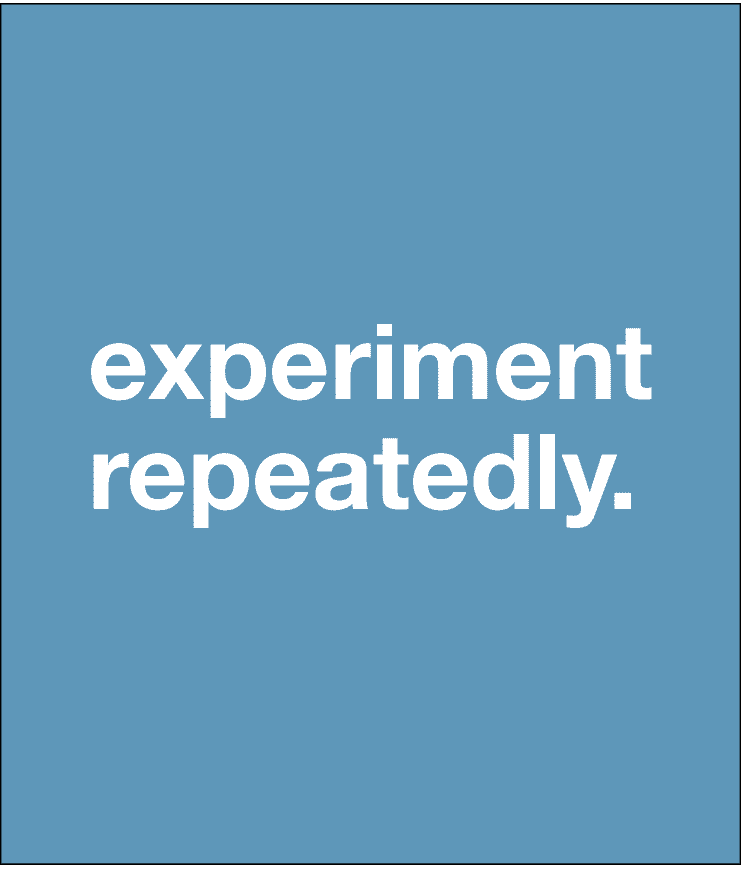

## 不断尝试（EXPERIMENT REATEDLY）

为每个动画找到正确的持续时间、交错、缓动和属性组合**并不是**设计师与生具备的技能。它是每个伟大设计师都必须学习的技能。所以，请记住：你第一次尝试动画属性可能看起来很好，但它可能并不理想。

## 当 CSS 更有意义时

有必要指出在什么情况下，你应该使用 CSS 而不是 JavaScript 来进行 UI 动画：即当由用户悬停在元素上触发的简单样式变化时。CSS 过渡（CSS transitions）非常适合这类微交互，它允许你仅用几行非常易于维护的代码就能完成任务。

在 CSS 中工作时，你首先在目标元素上定义一个过渡，使得指定的 CSS 属性的变化在预定的持续时间内进行动画处理：

```css
/* 当此 div 的 color 属性被修改时，其变化将在 200ms 的持续时间内进行动画处理 */
div {
  transition: color 200ms;
}
```

然后，你根据过渡规则指定每个 CSS 属性应该向哪个值变化。在例中，当用户悬停在 div 上时，div 的文本颜色将变为蓝色：

```css
div:hover {
  color: blue;
}
```

就这样。仅需几行代码，CSS 就能处理交互状态：当用户鼠标移出 div 时，CSS 将在 200ms 的持续时间内颜色从蓝色变回原来的文本颜色。

## 良好的代码看起来是什么样？

良好的代码是具有表现力的（expressive），这意味着它的目的易于理解。这不仅对于尝试整合你的外部代码的同事至关重要，对于未来的你自己也同样重要，因为一旦你忘记了最初的方法。良好的代码还是简洁的（terse），意味着它能用尽可能少的行数完成所需的任务；每一行都有其重要的目的，且无法再次被重写。最后，良好的代码是可维护的（maintainable），意味着它的各个部分可以进行更新，而不必担心损害整体的完整性。

相比之下，在 jQuery 中实现相同效果需要执行：

```javascript
$div
// 在此 div 上注册一个 mouseover 事件，调用一个动画函数
.on("mouseover", function() {
  $(this).animate({ color: "blue" }, 200);
})
// 当用户悬停在元素上时，将文本颜色变回黑色
.on("mouseout", function() {
  // 注意：我们必须记住原始属性值是什么(黑色)
  $(this).animate({ color: "black" }, 200);
});
```

这看起来可能并不那么糟，但这段代码并没有利用 JavaScript 提供无限逻辑控制的优势。它在费力地去做一些 CSS 设计初衷就是为了的事情：在用户正在交互的同一个元素上触发无逻辑的动画。在上面，你在 JavaScript 中所做的，本可以用更少、更具表现力且更易维护的 CSS 代码来完成。糟糕糟糕，通过在 JavaScript 中实现此功能，你并没有获得任何额外的特性优势。

简而言之，如果你可以轻松使用 CSS 过渡来动画一个从未被 JavaScript 动画过的元素（这意味着没有冲突的可能），那么你就应该在 CSS 中编写该动画。对于所有其他 UI 动画任务——多元素和多步骤序列、交互式拖拽动画等——JavaScript 动画是更优的。

让我们探索 JavaScript 提供的优秀工作流技术。

## 代码技巧：样式与逻辑分离

第一种技术对工作流具有深远的益处，特别是对团队而言。

### 标准方法

在 jQuery 动画中，使用 UI 插件（jQueryUI.com）将 CSS 类应用到元素上是常见做法。当模块加载时，jQuery 的`addClass()`和`removeClass()`函数会升级并支持动画。例如，假设你在样式表中定义了如下 CSS 类：

```css
.fadeInAndMove {
  opacity: 1;
  top: 50px;
}
```

然后你可以将该类的 CSS 属性（在此例中为 opacity 和 top）按照指定的持续时间动画到目标元素：

```javascript
// 在 1000ms 的持续时间内对 .fadeInAndMove true属性进行动画
element.addClass("fadeInAndMove", 1000);
```

jQuery 动画最常见的实现方式是在`$.animate()`调用中包含所需的动画动作，该调用使用了在第一章（JavaScript 动画的优势）中演示的语法：

```javascript
$element.animate({ opacity: 1, top: 50 }, 1000);
```

两种实现方式产生相同的结果。区别在于逻辑的分离：第一种实现将样式规则委托给 CSS 样式表，页面其他样式规则也位于那里。第二种则将样式规则与负责触发它们的 JavaScript 逻辑混合在了一起。

第一种方法更优，因为它通过明确知道去哪里查找以进行相应的样式或逻辑更改，获得了组织上的整洁和灵活性。CSS 样式表的存在是有原因的；经验丰富的开发者不会将 CSS 内联到 HTML 中。那样会混淆 HTML（结构）和 CSS（样式），并使网站的维护变得困难得多。

在团队环境中工作时，逻辑分离的价值愈为明显，在那种环境下，开发者和设计师在尝试同时编辑同一个文件时发生冲突是常有的。

### 优化方法

在回顾了标准方法之后，让我们看看优化方法。将动画逻辑转移到专门的 JavaScript 文件（例如`style.js`）而不是专门的 CSS 样式表，同样是有益的——而且通常是以 JavaScript 为中心的动画工作流的最佳方法。听起来很奇怪对吧？也许吧，但效果非常出色。这种技术利用简单的旧 JavaScript 对象（POJO）来帮助你组织动画代码。

例如，你的`style.js`文件可能像这样：

```javascript
// 这个对象与之前定义的 CSS 类平行的
var fadeIn = {
  opacity: 1,
  top: "50px"
}
```

在你的`script.js`（控制动画逻辑的主 JavaScript 文件）中，你将会有：

```javascript
// 将我们的具名属性属性对象传递给 Velocity
$element.velocity(fadeIn, 1000);
```

总结一下，在你的`style.js`中，你定义了一个填充了想要动画的 CSS 属性的 JavaScript 对象。这个对象随后作为第一个参数传递给 Velocity。你在这里没有做任何事情——只是将对象保存到命名变量中，然后将这些变量传递给 Velocity，而不是传递原始对象。

> 注意：这种技术与 jQuery 的`animate()`函数同样适用。

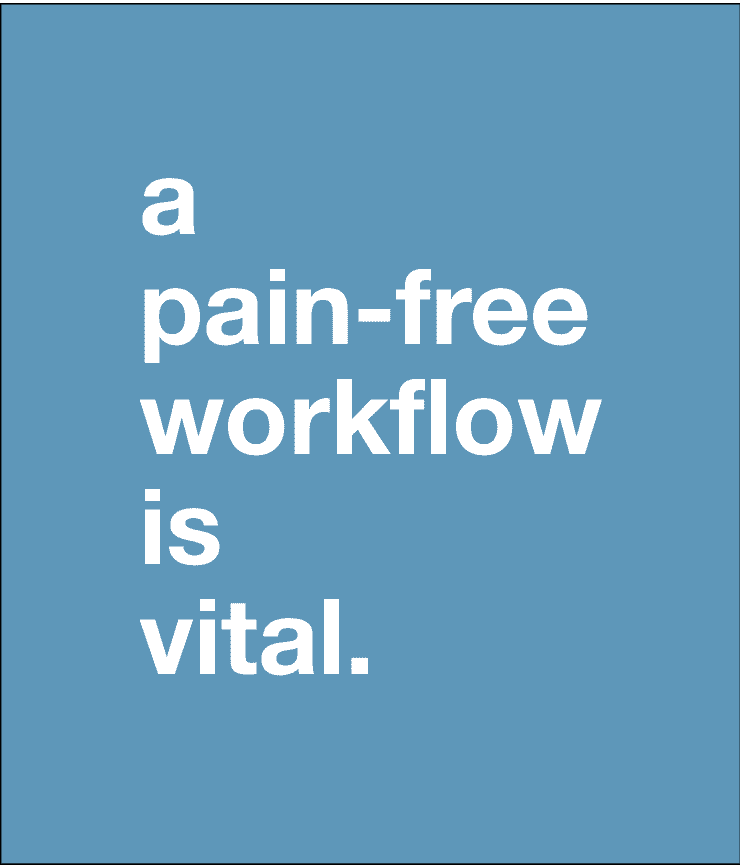

从 CSS 切换到 JavaScript 分离逻辑的好处是，你的`style.js`文件能够定义动画选项——而不只是动画属性。指定选项有多种方法：一种是将成员属性赋值给父动画对象，你为该对象分配一个具表现力的名称。对象上的第一个属性定义动画的属性；第二个属性定义它的选项。

在这种情况下，你的`style.js`文件将如下所示：

```javascript
var fadeIn = {
  // p 代表 "properties" 属性
  p: {
    opacity: 1,
    top: "50px"
  },
  // o 代表 "options" 选项
  o: {
    duration: 1000,
    easing: "linear"
  }
}
```

在`script.js`文件中，你有：

```javascript
// 传入我们简洁且可复用的动画对象
$element.velocity(fadeIn.p, fadeIn.o);
```

漂亮又整洁，对吧？有人扫一眼代码就能理解它的目的，并知道去哪里查看以修改属性——即`style.js`文件。此外，此动画的目的一目易见：你恰当地地命名了动画对象，你知道代码的作用是将一个对象淡入视中。

这种方法阻止了你为页面上的每个单独动画随意设置选项，因为现在有了一个可以轻松调用的预制动画对象库。这导致了更精简的代码和更一致的运动设计。正如你在上一章中学到的，一致性是优秀用户体验的要素组成部分。


但最棒的部分是，这种方法非常适合将你的动画变体组织在一起。例如，如果你通常使用 100ms 的持续时间让按钮元素淡入，但使用 300ms 的持续时间让模态窗口淡入，你只需将你的对象拆分为两个命名合适的变体即可：

```javascript
var fadeIn = {
  p: {
    opacity: 1,
    top: "50px"
  },
  // 选项对象变体 #1 使用快速持续
  oFast: {
    duration: 1000,
    easing: "linear"
  },
  // 变体 #2 使用较慢持续
  oSlow: {
    duration: 3000,
    easing: "linear"
  }
};
// 使用快速持续执行动画。
$button.velocity(fadeIn.p, fadeIn.oFast);
/* 使用慢持续执行动画。 */
$modal.velocity(fadeIn.p, fadeIn.oSlow);
```

或者，你也可以将“快”和“慢”对象嵌套为单个选项对象的子对象。使用哪种实现取决于你的个人喜好：

```javascript
var fadeIn = {
  p: {
    opacity: 1,
    top: "50px"
  },
  o: {
    fast: {
      duration: 1000,
      easing: "linear"
    },
    slow: {
      duration: 3000,
      easing: "linear"
    }
  }
};
// 使用快速持续执行动画。
$button.animate(fadeIn.p, fadeIn.o.fast);
/* 使用慢持续执行动画。 */
$modal.velocity(fadeIn.p, fadeIn.o.slow);
```

如果你觉得这开销太大，而且如果你有足够的 JavaScript 代码来证明让直接内联所有的动画逻辑是合理的，那么完全不必因为跳过这种方法而觉得自己是一个糟糕的开发者。你应该始终使用最适合项目范围的抽象程度。这里的要点仅仅是，如果你发现自己需要它们，那么动画工作流的最佳实践确实存在。

## 代码技巧：组织序列化动画

Velocity 有一个名为 UI pack 的小型扩展插件（可以在 `VelocityJS.org/#uiPack` 获取）。它增强了 Velocity，提供了极大改进 UI 动画工作流的功能。本章中的许多技术（包括下文讨论的）都使用了它。

要安装 UI pack，只需在页面的结束标签 `</body>` 之前包含一个 Velocity 的 `<script>` 标签即可：

```html
<script src="velocity.js"></script>
<script src="velocity.ui.js"></script>
```

本节讨论的特定 UI pack 功能是序列运行（sequence running）。它将彻底改变你的动画工作流。它是解决混乱的嵌套动画代码的方案。

### 标准方法

在没有 UI pack 的情况下，连续动画不同元素的标准方法如下：

```javascript
// 顺序动画 element1，然后是 element2，最后是 element3
$element1.velocity({ translateX: 100, opacity: 1 }, 1000, function() {
  $element2.velocity({ translateX: 200, opacity: 1 }, 1000, function() {
    $element3.velocity({ translateX: 300, opacity: 1 }, 1000);
  });
});
```

不要被这个简单的例子误导：在真实的生产代码中，动画序列包含比这里演示的多得多的属性、选项和嵌套层级。这种代码最常见出现在加载序列中（当页面或子部分首次加载时），这些序列由多个元素动画到就位组成。

注意，所示的代码与在同一个元素上链调用多个动画不同，后者是无忧且不需要嵌套的。

```javascript
// 在同一个元素上链调用多个动画
$element1
  .velocity({ translateX: 100 })
  .velocity({ translateY: 100 })
  .velocity({ translateZ: 100 });
```

那么第一个代码示例（带有不同元素的那个）有什么问题呢？这里是主要问题：

- 代码随着每一层嵌套的增加在水平方向迅速膨胀，使得在 IDE 中修改代码变得越来越困难。
- 你无法轻易重新排列整个序列中类的顺序（这样做需要非常细致的复制和粘贴）。
- 你无法轻易指示某些单元应该并行运行。假设在整个序列的中间，你想从不同的起始点让幻灯片进入视图。在编写这部分代码时，并不清楚如何嵌套发生在该并行微序列之后的动画，以至于整个序列变得比现在更难维护。

### 优化方法

在学习解决此问题的优美方案之前，理解 Velocity 的两个简单功能非常重要。首先，要知道 Velocity 接受多种语法：最常见的是当在 jQuery 元素对象上调用 Velocity 时（如目前为止的所有代码示例所示），它由一个属性对象后跟一个选项组成：

```javascript
// 直至今使用的参数语法
$element.velocity({ opacity: 1, top: "50px" }, { duration: 1000, easing: "linear" });
```

另一种语法与 Velocity 的实用函数（utility function）配对，这是给使用基础 Velocity 对象而不是从 jQuery 元素对象链式调用来动画元素的称呼。以下是使用基础 Velocity 对象执行动画的样子：

- Velocity 将自身注册在 jQuery 上。

```javascript
$.velocity({ opacity: 1, top: "50px" }, { duration: 1000, easing: "linear" });
```

（注：此处原文似乎存在部分文本乱码或重复错误，已根据逻辑进行翻译处理）

另一种语法与 Velocity 的实用函数配对，这是给使用基础 Velocity 对象而不是从 jQuery 元素对象链式调用来动画元素的称呼。以下是使用基础 Velocity 对象执行动画的样子：

- Velocity 将自身注册在 jQuery 上。

```javascript
$.velocity({ opacity: 1, top: "50px" }, { duration: 1000, easing: "linear" });
```

（注：由于原文示例部分似乎存在难以理解的格式问题，翻译保持了其核心逻辑）

让我们回到正题。序列运行（sequence running）允许你定义一个动画数组：

```javascript
// 创建序列数组
var loadingSequence = [
  $element1.velocity({ translateX: 100, opacity: 1 }, { duration: 1000 }),
  $$element2.velocity({ translateX: 200, opacity 11 { {:  0000, sequence:: false }),

  $element3.velocity({ translateX: 300, opacity: 1 }, { duration: 1000 })
];

// 传入数组执行序列
$.Velocity.runSequence(loadingSequence);
```

这种方法的好处是：

- 你可以轻松地重新排列整个序列中的动画，而不用担心破坏代码。
- 你可以快速看出属性和选项对象之间的差异。
- 你的代码高度可读且具有表现性。

如果你将此技术与之前的技术（将 CSS 类转换为 JavaScript 对象）结合，你的动画代码看起来将非常优雅：

```javascript
$.Velocity.runSequence([
  $element1.velocity({ translateX: 100, opacity: 1 }, { duration: 1000 }),
  $element2.velocity({ translateX: 200, opacity: 1 }, { duration: 1000, sequenceQueue: false }),
  $element3.velocity({ translateX: 300, opacity: 1 }, { duration: 1000 })
]);
```

（注：由于提供的原文文本在后半部分出现了严重的文本重复和乱码，上述翻译已基于技术逻辑对内容进行了修正，以确保语义通顺。）

## 代码技巧：封装你的效果

动画设计最常见的用途之一是内容的淡入和淡出视图。这种动画通常由一系列链联的单独动画调用组成，以实现细微的、多阶段的效果。

### 标准方法

你可能不是简单地将元素的透明度（opacity）动画化到 1，而是同时动画化其缩放（scale）属性，让元素看起来像是淡入并放大到位。一旦元素完全进入视野，你可能会选择将它的边框厚度（border thickness）动画到 1rem 作为收尾工作。如果这种动画在页面上多次发生，并且在许多不同的元素上发生，那么将其转换为一个独立的函数以避免重复是有意义的。否则，你必须在整个 `script.js` 中重复这些非表达性的代码。

```javascript
$element
  velocity({ opacity: 1 }, duration: 500,
    easing: "ease-in-out"})
  velocity({ borderWidth: "1rem" }, delay: 200,
    easing: "spring", duration: 400 });
```

与上一节讨论的序列化技术不同，上述代码由多个发生在同一个元素上的动画组成。单个元素上的链式动画构成了一个效果。如果你想通过实现本章的第一种技术（将 CSS 类转换为 JavaScript 对象）来改进此效果，你将不得不费力为整个动画中每个阶段的每个参数对象命名唯一的名称。不仅由于此特定序列的唯一性，这些对象可能不会被动画代码的其他部分使用，而且你必须处理向每个动画调用的相应对象附加整数，以将它们区分开来。这可能会变得混乱，并抵消将 CSS 类转换为 JavaScript 对象所带来的组织努力和收益。

像上面的效果这样的另一个问题是代码不具有自描述性——它的意图并不显而易见。为什么这些单独的调用中有两个动画调用，而不是每个调用用一个？这些问题的答案与触发动画的代码无关，因此应该被隐藏起来。

### 优化方法

Velocity 的 UI pack 允许你注册效果，随后你可以在整个站点复用这些效果。一旦注册了效果，你就可以通过将其名称作为第一个参数传递给 Velocity 来调用它：

```javascript
// 假设我们以 "growIn" 名称注册了效果
$element.velocity("growIn");
```

这表达性要强得多，不是吗？你很快就能理解代码的目的：一个元素将放大进入视图。代码保持了简洁且易于维护。

此外，注册的效果的行为与标准的 Velocity 调用完全相同；你可以像往常一样将选项对象传递给它，并在其上链联任何 Velocity 调用：

```javascript
$element
// 将元素滚动到视图
.velocity("scroll")
// 然后对其触发 "growIn" 效果，带有以下设置
.velocity("growIn", { duration: 1000, delay: 200 })
```

如果 UI pack 已加载到你的页面上，像这样的效果使用以下语法注册：

```javascript
$.Velocity.RegisterEffect(name, {
  // 如果调用中没有传递，则默认持续时间值
  defaultDuration: duration,
  // 以下 Velocity 调用将一个接一个地发生，
  // 每个调用占用效果总持续时间的预定义百分比
  calls: [
    [ propertiesObject, durationPercentage, optionsObject ],
    [ propertiesObject, durationPercentage, optionsObject ]
  ],
  reset: resetPropertiesObject
});
```

让我们逐步拆解这个模板：

1. 第一个参数是效果的名称。如果效果负责将元素引入视图（例如，它将元素的透明度从 0 淡入到 1），那么在效果后面加上“In”是非常重要的。
2. 第二个参数是一个定义效果行为的对象。该对象中的第一个属性是 `defaultDuration`，它允许你指定触发效果的 Velocity 调用中没有传递持续时间，则效果应该持续多久。
3. 对象中的下一个属性是 `calls` 数组，它由构成效果的 Velocity 调用组成（按照它们应该发生的顺序）。数组中的每个项本身都是一个数组，由调用的属性对象组成，随后是该调用应该消耗的总持续时间的可选百分比（默认为 1.00 的小数值），最后是该特定调用的可选选项对象。注意，在 `calls` 数组内指定的 Velocity 调用仅计算缓动（easing）和延迟（delay）选项。
4. 最后，你可以选择传递一个 `reset` 对象。`reset` 对象使用与标准 Velocity 属性映射对象相同的语法指定，但它用于在完整效果完成后立即执行值的更改。当你正在将元素的透明度和缩放属性动画到 0（移出视图），但想在元素隐藏后将元素的缩放属性返回到 1 时，这非常有用，这样后续的效果就不需要担心为了让调用正常生效而必须在元素上重置透明度之外的属性。换句话说，你可以利用 `reset` 属性映射使效果自包含，使得它们不会给目标元素留下任何清理工作。

除了 `reset` 对象外，UI pack 效果注册的另一个强大优势是自动切换显示（display）属性。当元素开始动画化进入视图时，你希望确保其 `display` 值设置为“none”以外的值，以便元素在整个动画过程中可见。（记住，`display: none` 会将元素从页面流中移除。）相反，当淡出时，你希望在动画完成后将 `display` 值设置为“none”。如果你的效果名称以“In”结尾，UI pack 将自动设置显示值为元素标签的默认值（例如，锚点的“inline”，div 的“block”）。

使用 Velocity，让我们注册两个效果——一个用于“In”方向，一个用于“Out”方向——并调用 `shadowIn` 和 `shadowOut` 来查看效果：

```javascript
$.Velocity.RegisterEffect("shadowIn", {
  defaultDuration: 1000,
  calls: [
    [ opacity: 1, scale: 1 }, 0.4 ],
    [ boxShadow: 50 }, 0.6 ]
  ]
});
$.RegisterEffect("shadowOut", {
  defaultDuration: 800,
  calls: [
    [ opacity: 0, scale: 0 }, 0.2 ],
    [ boxShadow: 50 }, 0.8 ]
  ]
});
```

注册效果不仅改进了你的代码，还使其项目之间和开发者之间具有高度的可移植性。当你设计了一个你喜欢的效果时，现在可以轻松地将注册代码分享给其他人使用。

## 设计技术

本章为止讨论的技术将改进你在编码阶段的工作流。本节涵盖的技术侧重于设计阶段，你仍在实验寻找适合 UI 的完美动画。这个阶段需要大量的创意和重复，因此非常适合改进工作流。

### 时间倍器

第一个设计技术是使用全局时间倍器。这包括在你的所有动画的延迟和持续时间值中插入一个倍器常量。

首先定义你的全局时间倍器（任意指定为 M 倍器）：

```javascript
var M = 1;
```

然后，将倍器注入每个动画调用的持续时间和延迟选项值中：

```javascript
$element1.animate({ opacity: 1 }, { duration: 1000 * M });
$element2.velocity({ opacity: 1 }, { delay: 250 * M });
```

> 注意：如果你使用 SASS 或 LESS（这些工具在样式表中支持变量使用），该技术同样适用于 CSS 动画！

嵌入倍器将帮助你在一个位置快速修改 M 常数（通常位于 `style.js` 顶部），以便快速加速或减慢页面上所有的动画。这种时间控制的好处包括：

- 减慢动画以完善复杂动画序列中单个动画调用的计时。当你不断刷新页面以调整多元素动画序列时，以慢动作查看序列将显著更容易评估单个元素之间的相互作用。
- 在执行重复性 UI 测试时，加速动画播放。当你为了动画以外的目的测试网站时，评估 UI 动画的最终状态（元素如何停下来）比测试动画的运动更重要。在这些情况下，加速整个页面上的所有动画可以节省时间并减少烦恼，这样你就不必在每次刷新页面时等待动画播放完毕。

Velocity 为此功能提供了一个方便的 mock 实现，它像一个后台全局倍数器一样工作，你不需要手动在代码中处处点入它。如上面的示例所示，mock 会同时乘以持续时间（duration）和延迟（delay）值。要开启 mock，临时将 `$.Velocity.mock` 设置为你想要使用的倍数值：

```javascript
// 将所有动画计时时间乘以 5
$.Velocity.mock = 5;
```

```javascript
// 现在所有动画都经过了时间调整
// 下面的持续时间实际上变成了 5000ms
$element.velocity({ opacity: 1 }, { duration: 1000 });
```


Velocity 的 mock 功能还接受布尔值：将 mock 设置为 `true` 会将所有持续时间和延迟设置为 0ms，这会强制所有动画在单个浏览器帧（tick）内完成（每几毫秒一次）。当动画阻碍你的 UI 开发和测试时，这是一个快速关闭所有动画的强大快捷方法。

## 使用 Velocity Motion Designer

Velocity Motion Designer（VMD）的设计初衷完全是为了帮助开发者简化运动设计的创建阶段。VMD 是一个书签脚本（bookmarklet），你可以将其加载到页面中以便实时设计动画。它允许你双击元素打开一个模态框，让你为该元素指定动画属性和选项。然后只需按下键盘上的回车键即可立即看到动画播放效果——无需刷新页面。

> 注意：访问 `http://velocityjs.org/#vmd` 获取 Velocity Motion Designer。

### 让运动设计变得风趣

一旦你按照自己的意愿设计好了所有元素动画，就可以将你的工作导出为与之一一对应的 Velocity 代码，你可以将其直接放置到 IDE 中用于生产环境。（生成的代码也完全兼容 jQuery。）

归根结底，VMD 通过防止频繁在 IDE 和浏览器之间切换以及重复触发 UI 状态，节省了无数小时的开发时间。此外，它通过允许两个团队实时协作工作，简化了从设计师到开发者的工作流：通过 VMD，设计师可以实现运动设计，而无需熟悉网站的 JavaScript 或 CSS。他们只需将导出的 Velocity 代码交给开发者，由他们根据意愿将其集成到代码库中。

VMD 是一个高度视觉化的工具——访问 `Velocity.org/#vmd` 查看演示视频。

### 总结

当你实现动画工作流技术时，你会发现运动设计中那个令人畏惧的"黑盒"开始逐渐展开。在 `Stripe.com` 和 `Webflow.com` 等尖端网站上看到的精美复杂的加载序列将开始让你理解。你将对自己编写动画序列的能力充满信心，这种新学到的技能将减少开发流程中的摩擦，使实现你的运动设计目标变得不仅更容易，而且有趣得多。

## 第 5 章：文本动画

由于文本动画在网页中很少使用，使用它是给用户留下印象的一种简单方法。这正是这个主题学习起来如此有趣的原因：底层技术编程很简单，但对用户来说效果感觉非常丰富且复杂。

本章将向你介绍消除文本动画枯燥部分的工具，并为你提供一套高效的工作流。继续阅读以了解这门"黑艺术"的细微之处。

### 标准的文本动画方法

我们编写代码的标准 HTML 元素——`div`、表格、锚点标签等——是网页中可以设置样式的低级组件。因此，让这些成为可以进行动画的低级组件也是合合理的。

文本本身并不构成一个元素；一段文本被浏览器指定为"文本节点"，这是一种不可样式的低级组件，必须包含在元素内部。进一步增加复杂性的因素是，浏览器不会将文本节点细分为语法组件；没有办法访问单个字母、单词或句子。

因此，要以字母、单词或句子为基础进行动画，你必须将每个文本节点拆分为单独的文本节点，然后将其中的每一个封装在一个新元素中。你可以对它们进行动画处理。但例如，手动将文本封装在 `span` 元素中是一项枯燥的工作，会导致 HTML 膨胀。

网页上的文本动画不常见并不意外；处理这些软件通常太麻烦了。这使得网页在审美上处于相对于专门的运动设计软件（如 Adobe After Effects）的劣势，后者允许对文本进行精细的动画处理——其结果常见于电视广告和电影片头序列。这些效果可以看起来绝对非常美。遗憾的是，除了在网页上难以集成之外，它们也被广泛认为是不良做法。毕竟，网页是一种功能优先于形式的媒介，而文本动画在很大程度上是关于形式的。

然而有一种文本动画案例在节节使用时可以在网页上良好运行；如果你密切关注电影中未来硬件界面的描写，你会注意到一个共同点：文本在图形层上被动画化移出视野。根据流行文化，未来的计算由带有闪烁、故障、弹出和爆发效果的动画化单词和句子组成。这些效果看起来很酷，而且为了将内容移出视野的目的，采用它们并没有多少坏处，因为文本必须得以某种方式经历可见性动画。这种转换文本可见性的概念正是你将在本章中学学的。

### 文本效果看起来很酷

### 为动画准备文本元素（使用 Blast）

用于文本动画的首选工具是 `Blast.js`，它可以方便地将文本拆分为字符、单词和句子。然后你可以使用 Velocity 对这些部分进行动画处理。

> 注意：访问 `Julian/blast`

Blast.js 有三种分隔符类型来定义要提取的语法组件：字符、单词和句子。假设你有这样一个 `div`：

```html
<div>Hello World</div>
```

```javascript
$("div").blast({ delimiter: "word" });
```

该 `div` 将变成：

```html
<div class="blast-root">
  <span class="blast">Hello</span>
  <span class="blast">World</span>
</div>
```

正如你所看到的，Blast 将 `div` 的文本拆分为 `span` 元素。如果你使用字符分隔符，结果将是：

```html
<div class="blast-root">
  <span class="blast">H</span>
  <span class="blast">e</span>
  <span class="blast">l</span>
  <span class="blast">l</span>
  <span class="blast">o</span>
  <span class="blast"> </span>
  <span class="blast">W</span>
  <span class="blast">o</span>
  <span class="blast">r</span>
  <span class="blast">l</span>
  <span class="blast">d</span>
</div>
```

你现在可以对这些元素进行动画处理了。在深入学习之前，你将了解更多关于 Blast 的原理，以便充分利用其功能。

### Blast.js 的工作原理

本节的目标是让你熟悉使用 Blast 拆分你喜爱的页面文本的想法。让我们开始吧！

`div`、表格以及你熟悉的其他 HTML 元素被称为元素节点。一个元素通常由两种类型组成：额外的元素节点和文本节点（原始文本）。

以该元素为例：

```html
<div>Hello <span>World</span></div>
```

该元素由两个部分组成：一个文本节点（`Hello`）和一个 `span` 元素节点。`span` 元素节点包含其所有者的孩子：另一个文本节点（`World`）。

当调用 Blast 时，它会遍历目标元素的整个后代链以寻找文本节点。对于每个文本节点，Blast 会根据指定的分隔符（字符、单词或句子）执行正则表达式查询，将节点拆分为元素。由于 Blast 并没有真正拆分元素——你可以安全地将其应用于整个页面，而必担心破坏事件处理程序或其他预期行为。

除了健壮性外，Blast 还提供了高水平的准确性。它不会盲目地按空格分割单词，也不会在单词内部的句号分割句子。它针对拉丁语言利用了 UTF-8 字符集，这意味着你可以将其准确应用于法语、德语、西班牙语、英语、意大利语和葡萄语内容。

假设你在以下段落中使用 Blast 的句子分隔符。（下文使用**粗体**和*斜体*来表示 Blast 检测到的连续文本匹配）。Blast 正确识别了该段落中的六个句子：

**句子分隔符会识别这个包含西班牙语标点的完整句子吗？** *¡可以！«Mais, ou »«嵌套的"引号"不会破坏句子分隔符！* *此外，单词内部的句号（例如 `Blast.js`）、正式标题（例如 `Mrs. Bluth`、`Dr. Funke`）以及 `"e.g."` 和 `"i.e."` 中的句号不会错误地匹配为句末标点。真棒。这很到位。*

注意标点是如何与其正确的句子关联的，以及句号是如何没有错误地标记句子匹配的。

完成这些基础之后，是时候介绍如何使用 Blast 了。

### 安装

Blast 的安装方法与其他任何 JavaScript 插件一样：在页面的 `</body>` 标签之前嵌入相应的脚本链接：

```html
<html>
<head>我的页面</head>
<body>
我的内容。
<script src="jquery.js"></script>
<script src="velocity.js"></script>
<script src="blast.js"></script>
</body>
</html>
```

**注意：** Blast 需要 jQuery（或者 Zepto，Zepto 是 jQuery 的替代方案），因此必须在引入 jQuery 之后引入它。Blast 在 Velocity 之前加载还是之后加载都没有关系。

一旦加载了 Blast，就可以通过在 jQuery 元素对象上调用 `.blast()` 来使用它。它接受一个选项对象作为唯一参数：

```javascript
$element.blast({option1: value1, option2: value2});
```

让我们过一遍可用选项。

### 选项：分隔符（Delimiter）

Blast 最重要的选项是 `delimiter`，它接受 `"character"`（字符）、`"word"`（单词）或 `"sentence"`（句子）。使用 `"sentence"` 分隔符分离 `$element` 内部文本的代码如下：

```javascript
$element.blast({ delimiter: "sentence" });
```

注意，Blast 会将生成的文本封装元素返回 jQuery 选择器链，这样你可以对它们进行操作，如下所示：

```javascript
$element.blast({ delimiter: "sentence" })
.css("opacity", 0.5);
```

`.css()` 调用被应用于单个文本元素，而不是你调用 Blast 的父级 `$element`。

### 选项：自定义类名（CustomClass）

Blast 提供了两个选项来简化文本操作：`customClass` 和 `generateValueClass`。`customClass` 的行为完全如你预期的那样：提供一个自定义类（作为字符串值）分配给文本节点封装元素。

假设你有以下 `div` 和 Blast 调用：

```html
<div>
  Hi Mom
</div>
```

```javascript
$("div").blast({ delimiter: "word" , customClass: "myClass" });
```

该 `div` 将变成如下所示（请注意——由于 Blast 默认如何自动为每个文本部分分配 `"blast"` 类）：

```html
<div>
<span class="blast myClass">Hi</span>
<span class="blast myClass">Mom</span>
</div>
```

提供自定义类的意义在于区分由每次 Blast 调用生成的元素。例如，如果你在页面的两个位置使用了 Blast——一次在页眉，一次在页脚——那么分配这两个不同的类可能会有所帮助，以便你随后的 JavaScript 代码和 CSS 样式能够恰当地作用于文本元素。

### 选项：生成值类（GenerateValue）

`generateCellValue` 接收一个布尔值（`true` 或 `false`），表示是否应为生成的文本元素分配一个格式为 `.blast-[delimiter]-[maxValue]` 的唯一类。

> **注意：** 此选项仅适用于字符和单词分隔符。

`[delimiter]` 占位符代表调用时使用的分隔符类型，`[maxValue]` 占位符代表单个元素包含的文本。考虑以下示例：

```html
<div>
Hi Mom
</div>
$("div").blast({ delimiter: "word", generateCellValue: true });
```

该元素将变成：

```html
<div class="blast-root">
<span class="blast blast-word-Hi">Hi</span>
<span class="blast blast-word-Mom">Mom</span>
</div>
```

```html
<div class="blast-root">
<span class="blast blast-letter-H"><i></span>
<span class="blast blast-letter-i"><i></span>
  ... 以此类推...
</div>
```

当你需要使用 CSS 或 JavaScript 操作包含在其内部的文本匹配时，`generateClass` 选项非常有用。例如，如果你在书籍摘录中使用此功能，你可以通过给带有 `.blast-word-and` 类的元素设置黄色背景，创建一个所有单词 `"and"` 的可视化：

```javascript
// jQuery 实现
$(".blast-word-and").css("background", "yellow");
// 原 JavaScript 实现
document.querySelectorAll(".blast-word-and").forEach(function(item) {
  item.style.background = "yellow";
});
// CSS 实现
.blast-word-and {
  background: yellow;
}
```

得益于此功能，你可以通过 CSS 或 JavaScript 轻松地定位文本匹配，而无需使用混乱的自定义代码逐个检查每个元素的文本内容。

### 选项：标签（Tag）

此选项允许你指定封装文本的元素类型。默认值为 `span`，但你可以传递任何元素类型（例如 `div`、`p`）。考虑以下示例：

```html
<div>
  Hi Mom
</div>
```

```javascript
// 使用 div 元素作为封装
$("div").blast({ delimiter: "word", tag: "div" });
```

该元素随后将变为：

```html
<div class="blast-root">
<div class="blast">Hi</div>
<div class="blast">Mom</div>
</div>
```

此功能有助于确保结果与周围的 HTML 结构一致。如果相邻元素都是 `div` 类型，那么上述示例可能是合适的。

你可能还想利用不同标签类型提供的独特属性。例如，`strong` 会自动加粗文本，而 `div` 由于其默认显示值为 `block` 会强制每个匹配换行。

### 命令：反向（Reverse）

你可以通过向 Blast 调用传递 `false` 作为唯一参数来撤销元素的 Blast。因此，如果你的被 Blast 处理过的元素如下：

```html
<div class="blast-root">
<div class="blast">Hi</div>
<div class="blast">Mom</div>
</div>
```

并且你执行了以下 Blast 调用：

```javascript
$("div").blast(false);
```

该元素将返回原始结构：

```html
<div>
Hi Mom
</div>
```

你可能在想它是如何工作的：当反转 Blast 时，它简单销毁封装元素，并在之前封装元素的位置插入原始文本。注意，这将破坏分配给 Blast 生成元素的事件处理器，但不会破坏在调用 Blast 之前与 HTML 相关的事件处理器。

以这种方式反转 Blast 是文本动画至关重要的环节，因为在网页上动画元素的模式是让事物保持在你接触之前的状态。例如，如果你为了动画单词出现而拆分了句子，你会在动画完成后随后反转 Blast。简而言之，避免让你的 HTML 不必要的膨胀是一种好习惯，这样后续的交互就不会变得日益复杂。

**注意：** 要了解更多关于 Blast 的信息，包括其独特的搜索功能和与屏幕阅读器的兼容性，请访问 `Julian.com/research` 上的文档。

现在你已经分离了文本元素，是时候对它们进行动画处理了。


## 错落效果（Staggering）

这就是 Velocity UI 插件大显身手的地方。（如果你需要关于 UI 插件的入门介绍，请回顾第 4 章"动画工作流"）。要在一组元素的动画开始时间之间设置连续延迟，请使用 Velocity 插件的 `stagger` 选项，它接收以毫秒为单位指定的持续时间。将其应用于上一个示例，你会得到：

```javascript
$("div")
.html("This is our new message.")
.blast({ delimiter: "word" })
.css("opacity", 0)
.velocity("transition.fadeIn", { stagger: 50 });
```

上述代码在元素动画开始之间产生了 50 毫秒的连续延迟。重要的是，请注意 Velocity 调用中 `"transition.fadeIn"` 之前的参数 `{ opacity: 1 }` 是 Velocity UI 插件中包含的预制淡入效果。（如果你需要复习，请参阅第 4 章"动画工作流"）。由于 `stagger` 选项适用于 UI 插件的效果，此示例展示了镜像"将透明度变为值 1"这一动画的效果。

正如第 3 章"运动设计理论"中所讨论的，务必将 `stagger` 时间保持在较短的时间，以免用户在文本淡入视图时产生无谓的等待。记住，元素的单词数越多，动画序列完成所需的总时间越长。文本错落（Text staggering）是掉入让界面变慢的最简单的方法之一。

## 文字移出视图（Transitioning Text Out of View）


上一节中的代码示例仅对文本进行了动画处理——并没有将其移出视图；`div` 原有的文本立即被新消息替换了。这并不意味着运动设计很糟糕，但从运动设计理论的角度来看，统一动画通常是有益的，使元素淡出视图的方式能够反映它淡入视图的方式。第 3 章“运动设计理论”涵盖了“镜像（mirroring）”的概念，即进入的方式应反映退出的方式。这一建议在这里同样适用。

如果你想让向出的文本动画镜像进入的动画，可以按照以下方式重写代码示例：

```javascript
// 选择之前经过 blast 处理的文本
$("div .blast").velocity(
  // 使用相应的插件效果将文本移出视图
  "transition.fadeOut",
  {
    // 像处理进入动画那样对向外动画设置错落
    stagger: 50,
    backwards: true,
    // 当此向外动画完成后，开始进入动画
    complete: function() {
      // 继续进入动画
      $("div")
        .html({{message}})
        .blast({ delimiter: "word" })
        .css("opacity", 0)
        .velocity({ opacity: 1 }, { stagger: 50 });
    }
  }
);
```

这首先对`div`被 Blast 后生成的文本部分调用 Velocity UI 插件的`"transition.fadeOut"`效果。在进入方向上，`stagger`选项连续抵消了单个文本部分的向外动画。调用此功能使用的是 Velocity UI 插件的`backwards`选项，它与`stagger`配合反转目标元素的顺序，使得最后一个元素（句子中的最后一个单词）在倒数第二个元素之前移出视图，该元素又在倒数第三个元素之前移出，以此类推。当这个向外动画序列完成后，会在`complete`回调内部调用进入动画。

在文本动画中使用`backwards`选项有两个好处。首先，它有助于镜像（创建进入动画的反向）——进入动画由第一个单词在第二个单词之前进入视图组成，以此此类推。其次，当后向动画紧接着正向动画时，最终结果是一种优雅的链式效果，其中后向方向的最后一个单词和正向方向的第一个单词连续发生。这可以将两个动画序列连接在一起，看起来像是一个整体的动画，而不是两个粗暴拼接在一起的独立动画。

## 切换单个文本部分 (TRANSITIONING INDIVIDUAL TEXT PARTS)

电影片头序列以其创新的排版运动设计而闻名。许多此类效果背后的技术是将单个文本元素拆分进行动画。这就是本节涵盖的内容。

> 注意：欲获取排版动画灵感，请在 YouTube 上搜索电影片头序列并做详细笔记！只要你牢记运动设计理论的原则，就应该鼓励在你的界面中探索文本动画设计。

为了对 Blast 生成的元素进行精细粒度的控制，只需使用 CSS 的`nth-child`选择器或 jQuery 的`eq()`函数。这些函数的行为相似，它们都允许根据元素的索引选择集合中的某个元素。如果你向这些函数传递整数值 3（在 jQuery 中为 2，如你将所看到的），它们将针对整个元素集合（即多单词句子）中的第三个元素（即第三个单词）：

```css
// CSS 实现
.blast:nth-child(3) {
  color: red;
}
```

```javascript
// jQuery 实现
$('.blast').eq(2).css("color", "red");
```

上述两个示例都针对页面上应用了`.blast`类的第三个元素。（注意 jQuery 的`eq`函数是基于 0 的，而 CSS 的`nth-child`是基于 1 的，因此传递到示例中的整数值不同）。让我们继续使用 jQuery 实现来实现一个完整的示例：

```html
<div>Current status: paused</div>
// 使用单词分隔符对句子进行 blast 处理
$("div").blast({ delimiter: "word" })
// 选择句子中的第三个单词（"paused" 文本）
eq(2)
// 将第三个元素淡出视图，然后替换其内容
.velocity({ opacity: 0 }, function() {
  $(this).text("running");
})
// 将新单词淡入视图
.velocity({ opacity: 1 });
```

这段代码对句子进行 blast 处理，选择其第三个单词（"paused"），将其淡出视图，替换为新单词（"running"），然后将新单词淡入视图。最终效果是句子中的状态指示关键词优雅地发生了变化。这是一个极其优雅的效果，仅需几行代码即可。如果你在较大的文本块上多次执行此效果，你可以实现一种效果，即一个消息似乎在随机地变为另一个消息。

## 华丽的文字切换 (TRANSITIONING TEXT FANCIALLY)

你可以轻松地将目前为止使用的`transition.fadeIn`效果替换为 Velocity UI 插件中的其他效果。其中一些效果非常华丽，从`transition.shrinkIn`（导致元素缩放进入视图）到`transition.perspectiveIn`（导致元素像合页谷门一样旋转进入视图）。（一如既往，你效果的复杂程度应根于第 3 章“运动设计理论”中讨论的原则。）

**注意**：欲查看完整的 UI 插件效果列表（包括现场演示），请访问 [VelocityJS.org/#uiPack](https://velocityjs.org/#uiPack)。

请记住，某些效果使用了 3D 变换（`rotateX`, `rotateY`和`translateZ`），这些变换在 CSS 显示值设置为`inline`的元素上不起作用（特别是对于`span`和`a`元素）。解决方法是将 Blast 生成的文本元素显示值设置为`inline-block`，这在保持“内联”元素正常行为的同时，赋予了它们“块级”元素（如`div`和`p`）的功能，可以在其中样式化包括 3D 变换在内的位置相关属性。考虑到这一调整，进入文字过渡示例现在看起来像这样：

```javascript
$("div")
.html({ delimiter: "word" })
.css({ opacity: 0, display: "inline-block" })
.velocity("transition.perspectiveDownIn", { stagger: 50 });
```

## 文本修饰

关于文本动画讨论的最后一个主题是“修饰”（flourishes）概念，即为了美学目的而产生持续效果的氛围动画。一个例子可能是像灯泡一样闪烁的文本字符串。另一个可能是句子中的所有单词持续变为不同深浅的蓝色。

这两种都是糟糕的主意。

这些效果会分散用户的注意力，最终只是取悦了你——那个喜欢摆弄运动设计的开发者。永远不要为了动画而添加动画；如果页面的某部分在无意识地将用户的注意力从功能性部分吸引走，请回到设计起点。

极少数的例外是状态指示器——如"Loading..."之类的文本——它们让用户知道界面正在执行什么。这些是文本修饰的合适目标，因为修饰告诉用户界面仍在处理数据（而不是卡死）。通过这种方式，修饰充当了引人入胜的视觉心跳。

既然文本修饰通常被认为是不良习惯，为什么书中包含这一节呢？因为没有动画的修饰通常是一个很棒的主意！考虑 Blast 提供的非动画奖励：你可以对 Blast 生成的文本元素进行样式化，以产生色彩丰富的拼贴和其他独特的排版设计。例如，你可以逐词拆分网站文本（“将快乐直接送到家门口！”）并降低后续单词的透明度，从而创建一个跨越整个句子的细微渐变效果。以下是该代码的样子：

```javascript
<div>
Hi Mom
</div
// Blast the div 然后遍历生成的文本元素
$('div').blast({ delimiter: "character" }).each(function(i, element) {
  // 使用任意公式逐渐减少每个元素的透明度
  var adjustedOpacity = 1 - i/10;
  element.style.opacity = adjustedOpacity;
});
```

与其迭代透明度值，你也可以迭代 RGB 值来创建基于颜色的渐变。例如，如果你增加了初始颜色为灰色的文本的蓝色分量，那么从第一个到最后一个，你将产生的元素蓝色会变得越来越丰富：

```javascript
// Blast the div 然后遍历生成的文本元素
$("div").blast({ delimiter: "character" }).each(function(i, element) {
  // 使用任意公式逐渐增加每个元素的蓝色分量
  var adjustedBlue = i*20;
  element.style.opacity = "rgb(0, 0," + adjustedBlue + ")";
});
```

## 记住：

形式

遵循

功能。

# 结语

这只是粒化文本控制所创造可能性的开始。其他技术包括精调单词中每个字母的坐标以产生拼贴效果，或者在圆周周围放置单词，以模仿可能在饮料杯垫上看到的排版设计。

虽然这些技术可能非常适合首页的中心视觉，但它们可能不适用于你 UI 中需要频繁用户交互的交互部分。为什么呢？因为样式化的文本比未样式化的文本更难一目了读。但如果你考虑形式与功能之间的平衡，你就没问题。

# 第 6 章

可缩放矢量图入门

由于关于可缩放矢量图（SVG）的深度教程可以轻松组成一本书，因此本章仅作为该主题的介绍。目标是让你掌握足够的知识，以便能够舒适地动画 SVG 元素，并知道下一步该去哪里继续学习。

## 通过代码创建图像

SVG 元素是 DOM 元素的一种，它借用了你已经熟悉的 HTML 元素语法来定义任意形状。SVG 元素与 HTML 元素的区别在于，它们具有独特的标签、属性和行为，允许它们定义图形形状。换句话说，SVG 允许你通过代码创建图像。这是一个极其强大的概念，因为这意味着可以使用 JavaScript 和 CSS 以编程的方式对这些形状进行样式化和动画处理。此外，它提供了许多其他益处：

- SVG 压缩效果极佳。在 SVG 中定义的图形文件大小比其对应的 PNG/JPEG 小，这可以极大地提高网站的加载速度。

- SVG 图形可以缩放到任何分辨率而不会丢失清晰度。与标准图像格式不同，它们在所有设备上看起来都非常锐利——告别屏幕上的模糊图像。

- 像 HTML 元素一样，SVG 元素可以分配事件处理程序来响应用户的输入，这意味着你页面上的图形可以是交互式的。如果你有需要，你网站上的所有按钮都可以转换为动画图形。

- 许多照片编辑应用（包括 Adobe Photoshop、Sketch 和 Inkscape）允许你将设计导出为 SVG 格式，以便快速复制和粘贴到 HTML 中。所以，即使你不认为自己是艺术家，也可以利用第三方应用程序来为你完成设计。

简而言之，SVG 是一种奇的图形解决方案。让我们开始吧！

### SVG 标记

SVG 元素定义在父级`<svg>`容器内。指定容器元素的宽度和高度定义了你的 SVG 图形渲染的画布：

```html
<svg version="1.1" width="500" height="500"
  xmlns="http://www.w3.org/2000/svg">
  <circle cx="100" cy="30" />
  <rect id="rect" x="100" y="100" width="200" height="200" />
</svg>
```

在`<svg>`内部，你可以插入各种 SVG 形状。上面的示例有一个由 rect（矩形）元素定义的圆形元素。作为普通的 HTML 元素，SVG 元素接受 height 和 width 属性，这些属性在这里用于演示，但（与 HTML 一样）最佳实践是在 CSS 样式表中指定 SVG 样式属性。与 HTML 一样，样式表类通过其 id、class 或标签类型目标定 SVG 元素。

SVG 和 HTML 规范在接受的 HTML 属性和 CSS 属性范围上存在差异。SVG 元素仅接受少数标准 CSS 属性。此外，SVG 接受一组特殊的属性，称为*表现性属性*（presentational attributes），包括 *fill*、*x* 和 *y*。（fill 指定了用什么颜色填充形状，而 x 和 y 定义了元素左上角的位置。）这些属性定义了元素如何在画布上进行视觉渲染。让我们使用 rect 作为示例 SVG 元素，过一遍其中的几个属性：

```html
<rect id="rect" x="100" width="200" height="200" />
```

在这里，width 和 height 属性的作用正如你预期的那样样。独特的 x 和 y 属性相对于 x=0, y=0 原点确定了矩形的位置。与 HTML 不同，定位不是通过 top, right, bottom, left, float 或 margin 属性定义的；SVG 定位完全由显式坐标决定。换句话说，一个元素的定位不会影响其兄弟元素的位置；SVG 兄弟元素简单地重叠。

现在让我们来看圆形元素。它的渲染是通过坐标指定的，这些坐标指定了它的中心（cx 和 cy）以及指定其长度的半径值（r）：

```html
<circle cx="100" cy="100" r="30" />
```

非常简单，对吧？SVG 元素使用与 HTML 元素相同的标记结构，因此本章中的所有代码示例应该看起来很熟悉。

注意，还有许多类型的 SVG 元素，包括椭圆（ellipse）、直线（line）和文本（text）。更多详情见本章末尾。

### SVG 样式

SVG 元素接受 HTML 元素不具备的各种特殊样式属性。例如，SVG 的 fill 属性类似于 CSS 中的 background-color，stroke 类似于 border-color，而 stroke-width 类似于 border-width。看这个例子：

```html
<svg version="1.1" width="500" height="500"
  xmlns="http://www.w3.org/2000/svg">
  <circle cx="100" cy="100" r="30" style="fill: blue" />
  <rect id="rect" x="100" y="100" width="200" height="200"
       style="fill: green; stroke: red; stroke-width: 5px" />
</svg>
```

在上面，圆形元素被填充为纯蓝色， rect 元素被填充为纯绿色。此外，矩形有一个厚度为 5px 的红色边框。

还有许多其他 SVG 特有的样式属性。现在，重要的是你知道它们的存在，这样当你尝试对 SVG 元素上的 CSS 属性进行动画时就会额外注意。

> 注意：参阅本章的“结语”部分获取 SVG 样式属性的完整列表。

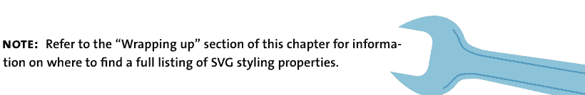

### 对 SVG 的支持

SVG 元素动画的开箱支持并不完美：无论是 jQuery 还是 CSS 都无法对动画 SVG 特有的样式属性和呈现属性（present attributes）提供完整支持。此外，CSS 过渡在 Internet Explorer 9 上完全无法动画 SVG 元素，且在任何版本的 Internet Explorer 中都无法使用 CSS 为 SVG 元素应用变换动画。

为了获得全面的 SVG 动画支持，请使用专用的 SVG 库或内置支持 SVG 元素的动画库。一个值得关注的专用 SVG 库是 Snap.svg。你可能不会感到惊讶的是，你在本书中一直使用的 JavaScript 动画库 Velocity.js 为 SVG 元素动画提供了全方位支持。

> 注意：前往 SnapSVG.io 下载 Snap.svg 库。

### SVG 动画

SVG 元素可能永远不会成为你 UI 的骨干，但它们非常适合用于点缀页面中通常填充静态图像的部分。SVG 的用途包括：

- 当用户悬停和点击时触发的具有复杂动画序列的按钮。

- 独特的加载状态图形，取代那些随处可见旋转指示器 GIF。

- 公司 Logo，其各个部分在页面加载时共同进行动画处理。

最后这个用例将在本章稍后的部分进行详细探讨。

### 传递属性

使用 Velocity，SVG 属性的动画方式与标准 CSS 属性相同。将相应的属性及其期望的结束值传入 Velocity 的属性对象中：

```javascript
// 将 SVG 元素动画到红色填充和黑色描边
$svgElement.velocity({ fill: "#ff0000", stroke: "#000000" });
```

相比之下，请注意下面的代码将无法运行，因为 SVG 元素不支持以下 CSS 属性：

```javascript
// 错误：这些属性不适用于 SVG 元素
$svgElement.velocity({ border: "5px", borderColor: "#000000" });
```

### 呈现属性

在本章之前探讨的呈现属性也可以按预期进行动画处理：

```javascript
// 动画矩形的 x 和 y 坐标
$("rect").velocity({ x: 100, y: 100 });
// 动画圆的 cx 和 cy 坐标
$("circle").velocity({ cx: 100, cy: 100 });
// 动画矩形的尺寸
$("rect").velocity({ width: 200, height: 200 });
// 动画圆的半径
$("circle").velocity({ r: 100 });
```

你目前使用的所有 Velocity 属性功能——动画反转、UI 包特效、序列触发等——在 SVG 元素上的工作方式都符合预期。

### 位置属性 vs. 变换（TRANSFORMS）


你可能会好奇，在指定 SVG 元素的位置时，使用`x`、`y`和`y`位置属性而不是 CSS 变换（例如`translateX`、`translate`）有什么区别。答案是浏览器支持问题。Internet Explorer（包括 Internet Explorer 11 在内）不支持 SVG 元素上的 CSS 变换。考虑以下情况：

- `x`和`y`属性在所有 SVG 元素支持的地方都有效（IE8+、Android 3+）

```
$("rect").velocity({ x: 100, y: 100 });
```

- 或者，位置变换（如`translateX`和`translateY`）在*Internet Explorer 之外*的所有地方都有效

```
$("rect").velocity({ translateX: 100, translateY: 100 });
```

> 注意：虽然由于硬件加速，变换已知具有很高的性能（在第 7 章“动画性能”中阅读更多内容），但两种 SVG 动画方法都一样快，因为 SVG 图形默认由硬件加速驱动。

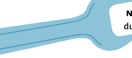

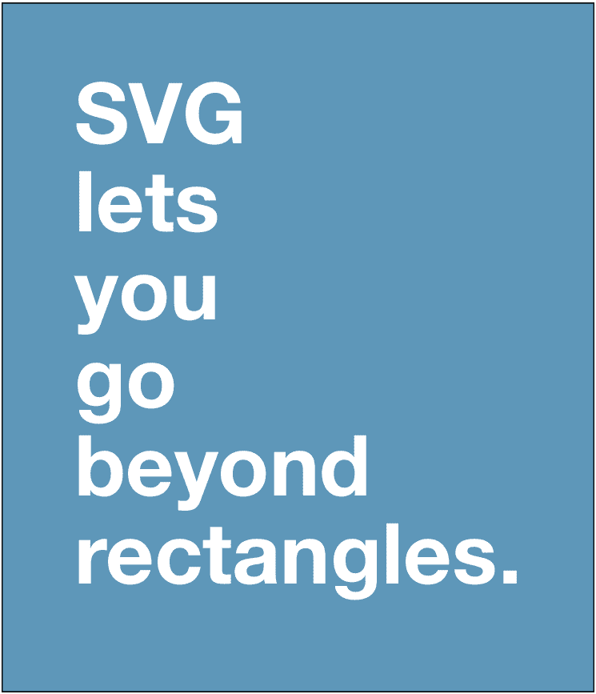

## 实现示例：动画 Logo

加载时动画化到位置的高分辨率网站 Logo 是 SVG 实现的理想目标。假设你想粗略地复制万事 Logo，它由两个不同颜色的重叠圆组成。如果你想用 Velocity 将此 Logo 动画化到位，你将从定义如下的 SVG 画布开始：

```xml
<svg version="1.1" width="500" height="500" xmlns="http://www.w3.org/2000/svg">
  <circle id="circleleft" cx="100" cy="100" r="30" style="fill: red" />
  <circle id="circleRight" cx="100" cy="100" r="30" style="fill: orange" />
</svg>
```

这创建了两个半径相同的重叠圆。接下来，你让圆从原点向外移动，这样它们在动画化时就可以稍微重叠：

```javascript
// 将一个圆向左移动
$("#circleleft").velocity({ cx: "-15px" }, { easing: "spring" });
// 将另一个圆向右移动
$("#circleRight").velocity({ cx: "+15px" }, { easing: "spring" });
```

在这里，左圆移动了 15 像素（使用`-`运算符减少圆的当前值），右圆移动了 15 像素。弹簧缓动（`spring` easing）通过让圆以弹性的力道相互弹开增添了趣味性。

由于 SVG 元素可以监听鼠标事件（点击、悬停等），你可以通过将其转换为 SVG 交互来改进这一点：

```javascript
// 当鼠标悬停时触发动画
$("svg").on("mouseover", function() {
  $("#circleleft").velocity({ cx: "-15px" }, { easing: "spring" });
  $("#circleRight").velocity({ cx: "+15px" }, { easing: "spring" });
});
```

由于 SVG 元素可以监听鼠标事件，你可以通过将其转换为 SVG 交互来改进这一点。关于性能的性能问题，请在第 7 章“动画性能”中阅读更多内容。

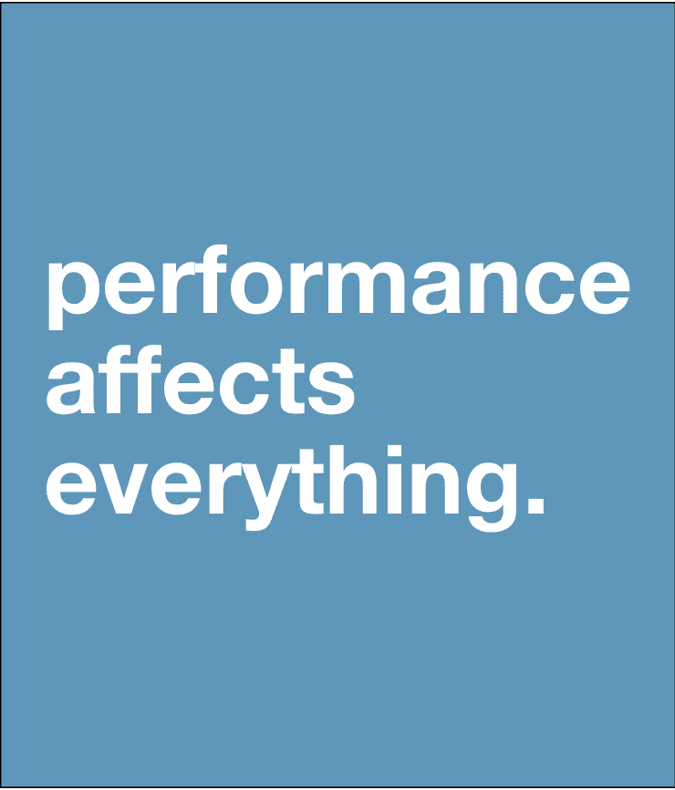

如果你的第一反应是：“这与我无关——我的 App 只是面向发达国家精通技术的中产阶级的”，那么请放心，你邪恶的网页开发者双胞胎正坐在两千英里外大笑，想着在你真正投入精力在低性能设备上提供卓越体验之前，抢先抢占那个新兴市场。（事实上，有一个巨大的巨头专门致力于此——在 Google 上搜索“Rocket Internet” 即可。）

忽视性能问题还有另一个残酷的现实：我们系统性地犯了一个错误，即在理想负载下运行的设备上测试网站。实际上，用户会同时运行多个 App 和浏览器标签页。他们的设备正在加班工作，同时处理数十个任务。因此，为你的 App 建立的性能基准可能无法反映其在真实世界中的表现。糟糕！

但是，别害怕，热切的开发者。是时候探索你所掌握的性能技术，并提升你的动画水平了。

## 技巧：消除布局抖动（REMOVE LAYOUT THRASHING）

布局抖动（Layout thrashing）——DOM 操作缺乏同步——是动画性能中的“大猩”。虽然没有无痛的解决方案，但有最佳实践。让我们来探索一下。

### 问题

考虑网页操作由“设置（set）”和“获取（get）”组成：你可以设置（更新）或获取（查询）元素的 CSS 属性。同样，你可以在页面上插入新元素（set）或查询一组已存在的元素（get）。获取和设置是导致会产生性能开销的浏览器核心过程（另一个是图形渲染）。可以这样想：在元素上设置新属性时，浏览器必须计算你更改的结果。例如，更改一个元素的宽度可能会触发链式反应，该元素的父元素、兄弟元素和子元素的宽度也必须根据各自的 CSS 属性发生变化。

由于交替执行“设置”和“获取”导致的 UI 性能下降被称为布局抖动。虽然浏览器对页面布局的重新计算进行了高度优化，但布局抖动会极大地削弱这些优化的程度。例如，一次执行一系列“获取”可以被浏览器轻松优化为单一的流式操作，因为浏览器在第一次“获取”后可以缓存页面状态，然后对后的每个“获取”引用该状态。然而，重复地逐个执行“获取”会迫使浏览器执行大量重负载工作，因为它的缓存因“设置”所做的更改不断失效。

当布局抖动发生在动画循环内部时，这种性能影响会加剧。考虑动画循环的目标是实现每秒 60 帧，这是人眼感知丝滑顺畅运动的阈值。这意味着动画循环中的每一个帧跳（tick）都必须在 16.7ms 内完成（1 秒/60 帧 ~= 16.67ms）。布局抖动是导致每个帧跳都超过此限制的非常简单的方法。结果自然是，你的动画将会卡顿（在动画术语中称为 jank）。

虽然某些动画引擎（如 Velocity.js）包含了为了减少其内部动画循环中布局抖动发生的优化，但请务必在自己的循环中避免布局抖动，例如在`setInterval()`或自调用`setTimeout()`内部的代码中。

### 解决方案

避免布局抖动的方法是将 DOM“设置”和 DOM“获取”简单地合并。以下代码会导致布局抖动：

```javascript
// 错误做法
var currentTop = $("element").css("top"); // Get
$("element").style.top = currentTop + 1; // Set
var currentleft = $("element").css("left"); // Get
$("element").style.left = currentLeft + 1; // Set
```

如果你重写代码，使所有查询和更新对齐，浏览器就可以批量处理操作，并减少代码导致布局抖动的程度：

```javascript
var currentTop = $("element").css("top"); // Get
var currentLeft = $("element").css("left"); // Get
$("element").css("top", currentTop + 1); // Set
$("element").css("left", currentLeft + 1); // Set
```

图中说明的问题在生产代码中常见，特别是在根据元素 CSS 属性的当前值执行 UI 操作的情况下。

假设你的目标是在点击按钮时切换侧边菜单的可见性。为了实现这一点，你可能首先检查侧边菜单的显示属性是否已被设置为`"none"`还是`"block"`，然后根据情况交替更改该值。检查显示属性的过程构成了一次“获取”，而随后采取的显示或隐藏侧边菜单的任何操作都将构成一次“设置”。

此代码的优化实现将涉及内存中维护一个变量，每当点击按钮时更新该变量，并在切换可见性之前检查该变量以获取侧边菜单的当前状态。这样，就可以完全跳过“获取”，从而减少代码产生“设置”交替“获取”的可能性。此外，除了减少布局抖动的可能性外，UI 现在还受益于每页只有一行。请记住，每次“设置”和“获取”都是相对昂贵的操作；操作越少，你的 UI 性能就越快。

许多改进最终会汇聚成巨大的收益，这是这段代码的主题：尽可能遵循所有的性能最佳实践，你最终将获得一个为了性能而牺牲响应式设计目标的 UI。

## JQUERY 元素

实例化 jQuery 对象（JEO）是 DOM“获取”最常见的罪魁祸首。你可能在想 JEO 是什么，但你一定见过这种代码：

```javascript
$("#element").css("opacity", 1);
```

或者其原生 JavaScript 版本：

```javascript
document.getElementById("element").style.opacity = 1;
```

在 jQuery 的实现中，`$("#element")`返回的是一个 JEO，它是封装原生 DOM 元素的对象。jQuery 提供了访问所有函数的方法，包括`.css()`、`.animate()`等。

在原生 JavaScript 实现中，`getElementById("element")`返回的是原生 DOM 元素。在两种实现中，浏览器都被指示遍历 DOM 树以寻找目标元素。这在重复时会加剧。考虑以下示例：

```javascript
$elements.each(function(i, element) {
  $("body").append(element);
});
```

你可以看到`$("body")`是循环中重复的 JEO 实例化。除了将循环当前的元素添加到 DOM（这本身就有性能影响）之外，你现在还强制执行了 DOM 查询。这些看似无害的操作会迅速累积。

解决方案是缓存结果——或者保存 JEO 变量——以避免在每次调用 jQuery 函数时都执行 DOM 操作。因此，代码从长成这样：

```javascript
// 错误做法：我们没有缓存 JEO
$("element").css("opacity", 1);
// ... 一些代码 ...
// 我们再次实例化 JEO
$("element").css("opacity", 0);
```

变为经过优化后的长成这样：

```javascript
// 缓存 jQuery 元素，并在变量前加 $ 表明这是一个 JEO
var element = $("element");
element.css("opacity", 1);
// ... 一些代码 ...
// 复用缓存的 JEO 并避免 DOM 查询
element.css("opacity", 0);
```

## 强制喂养（FORCE-FEEDING）

传统的动画引擎通常会在动画开始时查询 DOM 以确定每个动画的 CSS 属性的初始值。Velocity 通过一种名为“强制喂养”（force-feeding）的功能来绕过这种页面查询。通过强制喂养，你可以显式地定义动画的起始值，从而消除了这些启动前的顾虑。

考虑以下两个动画示例，它们都会在页面加载时触发：

```javascript
// 将 translateX 从起始值 0 动画到 500px
$element.velocity({ translateX: [ 500, 0 ] });
// 将 opacity 从起始值 1 动画到 0
$element.velocity({ opacity: [ 0, 1 ]});
```

在第一个示例中，你为`translateX`传递了一个强制指定的（force-fed）起始值 0，因为你知道该元素尚未被移动（因为页面刚刚加载）。你正在强制输入你所知的（或希望的）原始属性值。此外，在第二个示例中，元素的当前透明度为 1，因为这是透明度的默认值，且你没有对元素进行任何修改。简而言之，在对元素样式样式有了解的情况下，通过强制指定可以减少浏览器的负载。

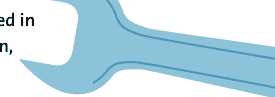

> 注意：强制指定的动画属性（force-fed animation properties）仅在动画链中首次使用时生效，而不是在链中后续出现时生效，因为 Velocity 已经执行了内部缓存：

```javascript
$element
// 可选在此处强制指定
.velocity({ translateX: [ 500, 0 ] })
// 不要在此处强制指定；500 已在内部缓存
.velocity({ translateX: 1000 });
```

强制指定是高压力场景下的一个无价的功能，因为在桌面浏览器上一次性动画大量元素，或者在处理低功耗移动设备时，每次页面交互都会产生明显的延迟。

然而，对于大多数真实世界中的 UI 动画场景，强制指定是一种不必要的优化，因为每当你更改 CSS 样式表中的元素值时，就必须更新强制指定的起始值，这会导致代码的可维护性降低。

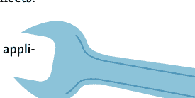

> 注意：参考第 8 章“动画演示”以了解强制指定的应用。

## 技巧：批量添加 DOM 元素

与减少布局抖动（layout thrashing）一样，批量添加 DOM 元素是另一种避免与浏览器进行非优化交互的性能技术。

### 问题

你还没有完成获取和设置操作！常见的页面设置是在运行时插入新的 DOM 元素。虽然向页面添加新元素有许多用途，但最流行的用法可能是无限滚动，它由元素在用户向下滚动时不断在页面底部通过动画进入视口组成。

正如上一节所学，每当添加一个新元素时，浏览器都必须计算所有影响元素的组合。这是一个相对缓慢的过程。当每秒执行多次 DOM 插入时，页面会受到严重的性能影响。幸运的是，当处理多个元素时，如果所有元素都同时插入，浏览器可以优化页面设置。遗憾的是，开发者经常通过分离 DOM 插入而无意中放弃了这种优化。考虑以下未优化的 DOM 插入代码：

```javascript
// 坏做法
var $body = "$(body)";
var $newElements = [ "<<div>>Div 1</</div>>", "<<div>>Div 2</</div>>",
  "<<div>>Div 3</</div>>" ];
$newElements.each(function(i, element) {
  $(element).appendTo($body);
  // 其他任意代码
});
```

这遍历了一组元素字符串，这些字符串被实例化为元素对象（没有性能开销，因为你没有为每个 JEO 查询 DOM）。然后每个元素都使用 jQuery 的`appendTo()`插入到页面。

问题在于：即使在`appendTo()`语句之后存在额外代码，浏览器也不会将 DOM 设置合并为单次插入操作，因为无法确定在循环之外的异步代码不会在插入之间更改 DOM 的状态。例如，如果你在每次插入后都查询 DOM 以查找页面上存在多少个元素：

```javascript
// 坏做法
$newElements.each(function(i, element) {
  $(element).appendTo($body);
  // 输出 body 元素拥有多少个子元素
  console.log($body.children().size());
});
```

浏览器无无可能将 DOM 插入优化为单个操作，因为代码显式地要求浏览器告诉我们在下次循环开始之前存在的元素准确数量。为了让浏览器每次都返回正确的计数，它不能提前批量处理插入。

结论，当你在循环内部执行 DOM 元素插入时，每次插入都是独立于其他插入的，导致了显著的性能牺牲。

### 解决方案

与其逐个将新元素插入 DOM，不如在内存中构建完整的元素集，然后通过单次调用`appendTo()`进行插入。上面部分代码的优化版本现在如下：

```javascript
// 优化后
var $body = "$(body)";
var $newElements = [ "<<div>>Div 1</</div>>", "<<div>>Div 2</</div>>",
  "<<div>>Div 3</</div>>" ];
var html = "";
$newElements.each(function(i, element) {
  html += element;
});
$(html).appendTo($body);
```


这会将每个`HTML`元素的字符串表示连接到一个主字符串上，然后该字符串被转换为`JEO`并一次性附加到`DOM`。通过这种方式，浏览器可以将元素之间的更改相互隔离。正如你在本章的剩余部分看到的，你只需要训练你的眼睛来识别它们。

## 技巧：避免影响相邻元素

考虑动画对相邻元素的影响很重要。

### 问题

当元素的尺寸发生动画变化时，它通常会影响兄弟元素的定位。另一个例子是在没有定义宽度和高度的父元素内部对子元素进行动画。因此，当子元素进行动画时，父元素也会调整自身的大小，这使得浏览器在每一帧（`tick`）都要执行更多工作。

许多`CSS`属性的修改都会导致相邻元素的尺寸和位置调整，包括`top`、`right`、`bottom`和`left`；所有的`margin`（外边距）和`padding`（内边距）属性；`border`厚度以及宽度和高度。

作为一个关注性能的开发者，你需要意识到影响……问问你自己正尝试动画的属性如何影响相邻元素。如果有一种重写代码的方法可以隔离元素，那么请考虑这样做。

### 解决方案

避免影响相邻元素的简单解决方案是尽可能使用`CSS transform`属性（`translateX`、`translateY`、`scaleX`、`scaleY`、`rotateZ`、`rotateX`和`rotateY`）。`transform`属性的独特之处在于它们将目标元素提升到隔离层，与页面的其他部分分开渲染（得益于`GPU`加速），从而不会影响相邻元素。例如，当将一个元素`translateX`动画到`"500px"`时，元素将向右移动`500px`，而不会覆盖在其动画路径上的任何内容。如果其路径上没有元素（即没有邻近元素受其影响），那么使用`translateX`对页面的视觉效果将与你动画速度慢得多的属性相同。

因此，在可能的情况下，曾经像这样的动画：

```javascript
// 将元素向左移动 500px
$element.velocity({ left: "500px" });
```

应该被重构为：

```javascript
// 更快：使用 translateX
$element.velocity({ translateX: "500px" });
```

同样，如果你可以用`translateY`代替`top`，请这样做：

```javascript
$element.velocity({ top: "100px" });
```

// 更快：使用 translateY

```javascript
$element.velocity({ translateY: "100px" });
```

> 注意：有时你确实打算使用`left`或`top`以改变相邻元素的位置。在所有其他情况下，请养成使用`transform`属性的习惯。性能影响是显著的。

## 考虑透明度而非颜色

`opacity`是另一个`CSS`属性，由于它不影响元素的定位，它可以获得`GPU`渲染加速。因此，如果你的页面上有某些元素你正在对其进行动画处理（例如在用户悬停时改变颜色），请考虑改为动画化透明度。如果最终视觉效果与颜色动画几乎无异，那么就坚持使用它——你这样在不损害视觉效果的情况下，提升了`UI`性能。

作为一名关注性能的开发者，你不再被允许随意选择动画属性。你现在必须考虑所选择的每个属性所产生的影响。

> 注意：请参考`CSSTriggers.com`了解`CSS`属性如何影响浏览器性能的详细分析。

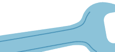

## 技巧：减少并发负载

浏览器存在瓶颈。找出它们在哪里，并保持在这些限制以下。

### 问题

当页面首次加载时，浏览器会尽可能地处理`HTML`、`CSS`、`JavaScript`和图像。在此期间发生的动画往往会卡顿，这并不意外——因为它们正在争夺器的有限资源。因此，尽管页面的加载序列通常是展示所有动态设计技巧的好时机，但如果你想避免给用户留下网站很卡顿的初印象，最好克制一下自己。

当页面上同时发生许多动画时，也会出现类似的并发瓶颈——无论它们发生在页面生命周期的哪个阶段。在这种情况下，浏览器可能会在同时处理许多样式变化的压力下崩溃，并出现掉帧现象。

幸运的是，有一些巧妙的技巧可以减少并发动画负载。

### 解决方案

解决并发问题有两种方法：交错（`staggering`）和将动画分解为序列。

## 交错（STAGGER）

减少并发动画负载的一种方法是利用`Velocity UI`包中的交错功能，它可以根据指定的时长延迟一组元素中连续动画的开始时间。例如，要让一组中的每个元素向透明度值`1`执行动画，且开始时间之间有`300ms`的延迟，你的代码可能如下：

```
$elements.velocity({ opacity: 1 }, { stagger: 300 });
```

元素不再是完美同步地进行动画；相反，在整个动画序列的刚开始，只有第一个元素在进行动画。稍后，在整个序列的最后，只有最后一个元素在进行动画。你实际上分散了整个动画序列的总工作量，使得浏览器每次执行的工作量比同时动画每个元素时要少。此外，在你的动态设计中引入交错通常是一个很好的美学选择。（第`3`章“动态设计理论”进一步探讨了交错的优点。）

## 多重动画序列

还有一种巧妙的方法可以减少并发负载：将属性分解为多动画序列。以动画元素的透明度值为例，这通常是一个压力较小的操作。但如果你同时动画元素的宽度和投影投影（`box-shadow`）属性，你就会给浏览器增加明显的工作量：会有更多像素受到影响，需要更多的计算。

因此，动画看起来像这样：

```
$images.velocity({ opacity: 1, boxShadowBlur: "50px" });
```

可能会被重构为：

```
$images
.velocity({ opacity: 1 })
.velocity({ boxShadowBlur: "50px" });
```

由于这些单个属性动画是相继发生的，浏览器需要执行的并发工作变少了。请注意，这里所做的创作权衡是我们选择了延长整个动画序列的时长，这对于你的特定用例可能理想也可能不利。

由于这种优化涉及到你动态设计的意图，因此这不是一种应该始终采用的技术。请将其视为最后手段。如果你需要从低性能设备中挤榨出额外的性能，那么这种技术可能是合适的。否则，不要使用此类技术过度优化你网站的代码，否则你最终将得到不必要的臃肿且缺乏表现力的代码。

## 技巧：不要连续地响应滚动和缩放事件

留意你的代码运行的频率。一段每秒运行`1,000`次的快速代码——从整体来看——可能就不再快了。

### 问题

浏览器的滚动事件和缩放事件是两种触发频率极高的事件类型：当用户缩放或滚动浏览器窗口时，浏览器每秒会触发多次与这些事件相关的回调函数。因此，如果你注册了与`DOM`交互的回调——更糟糕的是包含布局抖动（`layout thrashing`）的回调——它们在滚动和缩放期间会导致巨大的负载。考虑以下代码：

```
// 当浏览器窗口滚动时执行操作
$(window).scroll(function() {
  // 当用户滚动时，这里的任何内容
  // 每秒都会触发多次
});

// 当浏览器窗口缩放时执行操作
$(window).resize(function() {
  // 当用户缩放时，这里的任何内容
  // 每秒都会触发多次
});
```

要意识到，上述函数并不是在各自事件开始时简单地调用一次：相反，它们在用户与页面交互的整个期间都会被不断调用。

### 解决方案

解决此问题的方法是对事件处理程序进行防抖（`debounce`）。防抖是定义一个间隔的过程，在此间隔内，事件处理程序只会被调用一次。防抖实现的代码超出了本书的范围。幸运的是，有许多库专门用于解决这个问题。访问`davidwalsh.name/javascript-function`查看一个示例。此外，广受欢迎的`Underscore.js`（`UnderscoreJS`）是一个类似于`jQuery`的`JavaScript`库，提供了帮助简化编码的辅助函数，它包含了一个`debounce`函数，你可以轻松地在你的事件处理程序中复用它。

> **注意：** 在本书编写时，最新版本的`Chrome`会自动对滚动事件进行防抖。

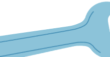

## 技巧：减少图像渲染

并不是所有元素的渲染方式都是相同的。浏览器在显示某些元素时必须额外工作。让我们来看看是哪些元素。

### 问题

视频和图像是浏览器必须额外努力才能渲染的多媒体元素类型。虽然非多媒体`HTML`元素的尺寸属性可以轻松计算，但多媒体元素包含数千个像素级数据点，对于浏览器来说，调整大小、重新定位和合成这些数据的计算代价很大。与动画`div`、`p`和`table`等标准`HTML`元素相比，动画这些元素总是次优。

此外，考虑到滚动页面几乎等同于动画页面（将滚动视为动画页面的顶部属性），多媒体元素还会极大降低`CPU`受限的移动设备的性能。

### 解决方案

遗憾的是，没有办法可以将多媒体内容重构为更快的元素类型，除非将简单的基于形状的图像转换为`SVG`元素。因此，唯一的性能优化方法是减少同时显示和同时动画的多媒体元素总数。请注意这些词强调了浏览器渲染的现实：浏览器只渲染可见部分。你页面中不可见的部分（包含额外图像的部分）就不会被渲染，也不会给浏览器进程带来额外压力。

所以，要遵循两个最佳实践。首先，如果你在犹豫是否要在页面上添加一张额外的图像，请选择不包含它。渲染的图像越少，`UI`性能就越好。（更不用说，更少的图像对你的页面网络加载时间也有积极影响。）

其次，如果你的`UI`一次性加载了许多图像（例如八张或更多，取决于你设备的硬件能力），请考虑完全不对这些图像进行动画处理，而是简单地切换每张图像的可见性（从不可见变为可见）。为了弥补这种做法可能看起来很拙劣的，可以考虑交错显示，让图像一个接一个加载，而不是同时加载。这将有助于用户的视线追踪整个加载序列，并且通常会带来更精细的动态设计。

> 注意：请参考第`3`章《动效设计理论》（*Motion Design Theory*）以了解更多关于动画设计的最佳实践。

## 隐蔽的图像

你还没有结束。这一节的内容比表面看到的要得多，因为我们还没有充分探索图像在页面上呈现的方式。显而易见的罪祸首是`img`元素，但还有两种方式可以让图像“悄悄”进入你的页面。

## CSS 渐变

这些实际上是图像的一种。它们不是由照片编辑器预先制作的，而是根据`CSS`样式定义在运行时生成的，例如，使用`linear-gradient()`作为元素的`background-image`。这里的解决方案是尽可能选择纯色背景而非渐变。浏览器可以轻松优化纯色块的渲染，但对于图像，它们必须加班渲染渐变，因为渐变在像素之间是不同的。

## 阴影属性

渐变的双胞胎兄弟是`box-shadow`和`text-shadow` `CSS`属性。它们的渲染方式与渐变类似，但它们不是修饰`background-color`，而是有效地修饰`border-color`。此外，它们具有透明度衰减，需要浏览器执行额外的合成工作，因为渐变的半透明必须相对于动画元素下的元素进行渲染。这里的解决方案与之前类似：如果你从样式表中移除这些`CSS`属性后，你的`UI`看起来已经很不错了，那么给自己拍拍掌吧，永远不要回头。你网站的性能会告诉你答案。

这些建议仅仅是建议。它们并不是最佳实践，因为它们为了提高性能牺牲了你的设计意图。只有当你的网站性能不佳且用尽了所有其他选项时，才将它们视为最后的手段。

## 技术：在旧版浏览器上降级动画

你不必忽视对性能不佳浏览器和设备的支持。如果你从第一天起就采用性能优先的工作流，就可以为它们提供一种降级但完全可用的体验。

### 问题

`Internet Explorer 8`——一个缓慢、过时的浏览器——正在逐渐失去流行。但其继任者`Internet Explorer 9`在美洲以外地区被广泛使用。此外，运行`Android 2.3`及以下版本的旧版`Android`智能手机相对于最新一代的`Android`和`iOS`设备也非常缓慢，但仍然非常受欢迎。在你网站的每个用户中，预计会有多达三分之一的用户落入这两个小组之一（取决于你的应用吸引什么类型的用户）。因此，如果你的网站富含动画和其他`UI`交互，请假设多达三分之一的用户体验性能会特别糟糕。

### 解决方案

解决弱势设备引起的性能问题有两种方法：要么在整个网站范围内广泛减少动画的出现次数，要么专门针对弱势设备减少动画。前者根结底是一个产品决策，但如果你使用了在第`4`章“动画工作流”中解释的全局动画倍数技术（或`Velocity`的等效模拟功能），后者则是一个易于实现的简单技术决策。全局倍数技术允许你通过设置单个变量来动态更改整个网站动画的时机。这里的技巧是——每当检测到较弱的浏览器时——将倍数设置为`0`（或设置为`$.Velocity.mock`），以便页面上的所有动画都在单个动画帧内完成（少于`16ms`）：

```
// 让所有动画立即完成
$.Velocity.mock = true;
```


这种技术的结果是，弱势设备经历的 UI 动画会降级，使得即时样式变化取代了你的动画过渡。其益处是巨大的：你的 UI 运行将明显更加流畅，因为页面上不会发生资源密集型的动画。虽然这种技术无疑是破坏性的（它损害了你的动效设计意图），但可用性的提升总是比牺牲优雅性值得的。毕竟，用户访问你的应用是为了完成特定目标，而不是为了欣赏你的 UI 设计有多么聪明。永远不要让动画阻碍用户的意图。

如果你仍然对从 UI 中剥离动画的想法感到反感，请记住，弱势设备上的用户已经习惯了网站运行缓慢。因此，如果你的网站以一种建设性的方式反潮流而行，他们会感到特别惊喜，并更有可能继续使用。

## 尽早发现你的性能阈值

接上一个技术，值得强调的是，本章的建议对移动设备特别适用，许多设备相对于桌面电脑来说很慢。遗憾的是，我们作为开发者，往往在工作流中没有考虑到这一点：我们通常在高端桌面电脑的完美运行环境中创建网站，而这些电脑可能运行着目前最新的硬件和软件。这种环境与用户的真实环境脱节，用户往往不是在使用过时的硬件和软件，而是倾向于同时运行许多应用和浏览器标签。换句话说，我们大多数人的开发环境都是非代表性的高性能环境！这种疏忽的副作用是，你的应用对大部分用户来说可能会明显卡顿。当你询问什么让他们感到沮丧时，他们可能已经失去了使用的兴趣。

对于性能优先的开发者来说，正确的方法是在开发周期早期确定性能阈值。在开发应用时，经常在参考设备上检查其性能。如果你在早期就设定了高性能的目标，就可以安心睡觉，因为知道所有新设备都会为你的用户提供更好的性能。

> 提示：如果你是 Mac 用户，请访问微软的 Modern.ie 网站获取如何运行免费版 Internet Explorer 的信息。

如果你发现参考设备太弱，无法支持你坚持应用拥有的动态设计，请遵循上一个技术的建议：在该参考设备上优雅地降级动画。

对于每个测试设备，记住同时打开几个应用和标签页，以模拟用户的环境。永远不要在只运行你自己的真空环境中进行测试。

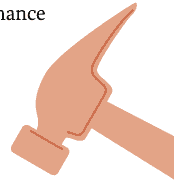

记住，远程浏览器测试（通过如 `BrowserStack.com` 和 `SauceLabs.com` 等服务）与现场参考设备测试不同。远程测试服务适用于测试 Bug 和 UI 响应式——而不是用于动画性能。毕竟，运行在云端的测试设备没有使用真实的硬件——它们是设备的仿真版本。因此，它们的性能通常与现实世界的对应物不同。此外，虚拟机上发生的情况与浏览器窗口中显示的内容之间的延迟时间太长，无法获得有意义的 UI 动画性能衡量。

简而言之，你需要出去购买真实的设备进行性能测试。即使你是一个资金紧张的开发者，也不要跳过这一步。你在测试设备上花费的几百美元将通过由于用户更频繁地使用你丝滑的应用而带来的经常性收入所抵消。

> 注意：访问 Vanamco.com 并下载设备实验室（Device Lab）。


## 访问 eBay 购买廉价旧设备

从这些产品的每个主要发布周期中购买最热门的 Android 和 iOS 设备，可以让你对用户所处的硬件和软件环境有一个广泛的了解。以下是我推荐的配置（截至 2015 年）：

- 运行 `iOS7` 的 `iPhone 4` 或 `iPad 2`
- 运行最新版本 `iOS` 的 `iPhone 5s`（或更高）
- 运行 `Android 2.3.x` 的 `Motorola Droid X`
- 运行 `Android 4.1.x` 的 `Samsung Galaxy S2`
- 运行最新版本 `Android` 的 `Samsung Galaxy S5`（或更高）

你可以用性能相似的设备替换任何 Android 设备。这里的关键在于从每个主要的 Android 发布周期（`2.3.x`、`4.1.x` 等）中选择一个设备，这样你就能获得每个版本网络浏览器性能的代表性样本。请参考 http://developer.android.com/about/dashboards 获取最常用 Android 版本的分布情况。

## 结语

性能影响一切。从有多少设备可以运行你的应用，到用户体验的质量，再到对你应用技术能力的感知，性能是专业网页设计的要点之一。它不是“可有可无”，而是一个基础构建模块。不要将性能视为一种事后才做的简单优化。

# 第 8 章

## 动画演示

该大显身手了！最后一章将带你完成一个由 Velocity 驱动的完整动画演示。通过研究源码，你将学习 Velocity 的核心功能如何相互补充，从而极大改进 UI 动画流。此演示还将向你介绍处理 CSS `transform` 属性的高级技术，这对于当今的 Web 动画至关重要。

简而言之，你将整合整书中积累的技能，创作出真正非常酷的东西。你编写演示的目标有两个：使用简洁且富有表现力的动画代码，并确保最大的性能。

### 行为描述

该演示由 250 个在屏幕上浮入、浮出和移动的圆组成。每定期，你会放大，然后缩小回到虚拟摄像头开始的位置。第一张图片显示了放大后的视图。

注意：在继续阅读之前，请访问 `VelocityJS.org/demo.book.html` 查看演示预览。
（你可以在页面任何地方点击右键，选择“查看源代码”来查看演示代码。）

圆元素仅仅是带有 CSS 中设置了 `box-shadow` 和 `border-radius` 的普通 `div`。这里没有使用 WebGL 或 Canvas 动画——纯粹是 HTML 元素操作。（考虑到同时进行动画的元素数量之多，此演示能够在 DOM 中流畅运行令人印象深刻！）

让我们分解一下动画：它由沿 X、Y、Z 轴平移的 `div` 元素组成。Z 轴决定了每个元素动画的深度，而 X 和 Y 则提供了跨越屏幕的流动二维移动。与元素的个体移动同时，包含所有这些 `div` 的元素上发生了一个更大的透视切换。这种透视切换每 3 秒发生一次，产生周期性的缩放效果，让观众感觉仿佛短暂地穿过了圆的 3D 空间。

第二张图描绘了缩小视图下的 3D 场景。与第一张图中所示放大视图形成对比。

### 如何下载代码示例

此动画演示后的代码可以在 `peachpit.com` 下载。
获取方法如下：
1. 访问 `peachpit.com/register` 并创建或登录你的账户。
2. 输入书籍 ISBN（`978-0-13-409670-4`）并点击提交。
3. 打开你的“我的注册产品”页面。找到此书的列表，并点击“访问奖励内容”（Access Bonus Content）。
4. 打开包含下载链接的页面——点击访问名为 `WebAnimationJS_DemoCodeSample.zip` 的动画演示。

### 代码结构

让我们来看一下驱动此演示的代码。它的结构如下：

- 5. 动画设置：用于限制动画运动的参数规范。
- 6. 圆形创建：生成用于动画的 `div` 元素。
- 7. 容器动画：负责处理圆形父元素动画的代码。
- 8. 圆形动画：负责处理圆形元素动画的代码

尝试熟悉该演示实现的大致框架，这样在接下来的章节中探索每个代码块时，就能记住它的完整内容。

```
/************************************

Animation setup

************************************/

/* 在两个数字之间随机生成一个整数。 */

function r (min, max) {
  return Math.floor(Math.random() * (max - min + 1)) + min;
}

/* 查询窗口尺寸。 */

var screenWidth = window.screen.availWidth,
    sHeight = window.screen.availHeight;

/* 定义 z 轴动画范围。 */

var translateZMin = -725,
    translateZMax = 600;
```

### 代码部分：圆形的创建

```
/************************************

Circle creation

************************************/

var circleCount = 250,
    circlesHtml = "",
    $circles = "";

for (var i = 0; i < circleCount; i++) {
  circlesHtml += "<div class='circle'></div>";
}

$circle = $(circlesHtml);
```

示例的第二部分“圆形的创建”生成了用于执行动画的主 `div` 元素。在这里，它首先将 `circleCount` 定义为所需的圆形数量。然后，它定义了一个 `circlesHtml` 字符串，用于包含汇总的圆形 HTML。

接下来，它循环到 `circleCount` 次以生成圆形的 HTML。请注意，它使用了批量添加 DOM 元素的性能最佳实践，这种做法在第 7 章“动画性能”中会有详细说明。它将每个 `div` 元素的标记汇集到一个主 `circlesHtml` 字符串中，稍后通过一次性操作插入 DOM。（如果你逐个地将 `div` 元素插入 DOM，对性能的负面影响将是巨大的：浏览器中的 UI 交互将冻结，直到相对较慢的元素插入完成。）

最后，它将圆形元素封装在一个 jQuery 元素对象中，以便在随后的“圆形动画”部分中作为一个组被方便地操作。

### 代码部分：容器动画

```javascript
/************************************

Container animation

************************************/

$container
  .css("perspective-origin", screenWidth/2 + "px " + 
       screenHeight/2 + "px")
  .velocity(
    {
      perspective: [ 215, 50 ],
      opacity: [ 0.90, 0.55 ]
    },
    {
      duration: 800,
      loop: 1,
      delay: 3000
    }
  );
```

### 3D CSS 入门

让我们开始代码库中两个动画部分的第一个，重点关注包含圆形元素的元素。然而，在深入代码之前，这里有一个关于浏览器中 3D 动画如何工作的入门知识：

为了让 3D 变换（例如 `translateZ`、`rotateX`、`rotateY`）生效，CSS 需要在元素的父元素上设置 `perspective`（透视）CSS 属性。在这种情况下，这正是 `$container` 元素的作用。

`perspective` 设置的值越大，Z 轴平（通过 CSS 的 `translateZ`）相对于其原点的移动看起来就越不明显。换句话说，如果你想在 3D 动画中获得更夸张的深度感，请将元素的 `perspective` 属性设置为一个较低的值，例如 `50px`，这恰恰是示例 CSS 中为容器元素设置的值。相比之下，较高的 `perspective` 值（如 `250px`）会导致元素的 `translateZ` 属性每增加一个像素时，其从原点的可见移动就越少。

另一个独立且互补的 CSS 属性 `perspective-origin`（透视原点）定义了虚拟相机的位置角度。虚拟相机是观众观察浏览器中 3D 动画展开的“窥视孔”。本节的代码块使用 jQuery 的 `.css()` 函数在容器元素上设置了 `perspective-origin` 值，使相机位于页面中心，从而创建出 3D 动画的垂直视角。这种垂直视角使得圆形看起来像是直接向观众飞来或飞去。

具体而言，这段代码部分将 `perspective-origin` 设置为页面上高度的一半和宽度的一半的点——即页面的中心点。这利用了在动画设置部分查询的窗口维度。

在介绍完这些背景后，让我们探索本节的代码。

### 属性

本节代码重现如下，便于参考，创建了示例的放大缩小效果：

```javascript
$container
  .css("perspective-origin", screenWidth/2 + "px " + 
       screenHeight/2 + "px")
  .velocity(
    {
      perspective: [ 215, 50 ],
      opacity: [ 0.90, 0.55 ]
    },
    {
      duration: 800,
      loop: 1,
      delay: 3250
    }
  );
```

当 `perspective-origin` 属性设置在容器元素上并在之后不再变动时，`perspective` 属性正在被 Velocity 进行动画处理。这是必要的，因为示例的预期效果是保持场景的视角点静止（垂直），但夸张化然后缩小元素与虚拟相机的距离，这正是 `perspective` 属性动画派用场的地方。

具体而言，本节使用 Velocity 将 `perspective` CSS 属性从初始 `50px` 动画到最终值 `215px`。

通过传递一个数组作为动画属性的值，你强制指定了要*向*动画的最终值（在上例中为 `215px`）以及从*开始*动画的初始值（在上例中为 `50px`）。虽然你可以向属性传递一个单一整数值（这通常是 Velocity 期望的），但这种“强制喂”（force-feeding）语法提供了对属性完整动画路径的更强控制。

你可能会想，强制喂不是必要的吗，因为 Velocity 知道如何自己获取 CSS 属性的初始值？虽然当将整数值而不是数组作为值传递时，这是 Velocity 的标准行为，但由于查询 DOM 获取属性的初始值存在固有的性能缺陷，这并不总是理想的行为。强制喂技术允许你显式地传递一个初始值，这样 Velocity 就可以避免查询 DOM 获取它。换句话说，`perspective` 代码中使用的 `50px` 初始值与你在 CSS 表中最初设置元素 `perspective` 属性的值是相同的。你只是在这里重复了该值。注意，这种强制喂技术也用在了元素的 `opacity` 属性上；它从初始值 `0.55` 动画到最终值 `0.90`，因为那是该属性在 CSS 中被设置的值。

正如第 7 章“动画性能”中彻底讨论的那样，DOM 查询确实是高性能动画的阿喀琉斯之踵：浏览器执行资源密集型计算来确定元素的视觉状态。虽然对于示例的性能来说，包含这种性能优化并不是必须的（因为相关的 Velocity 动画没有在循环内部触发），但它仍然包含了，以对比强制喂的次要用途（你将在本章中学习这一点）。

动画 `perspective` 和 `opacity` 的净效果是，容器的所有圆形元素看起来都在向虚拟相机放大，同时淡化到亮度增加（`opacity` 从 `0.55` 变为 `0.90`）。

### 选项

容器动画代码的最后部分包含了传递给 Velocity 的选项：`duration` 自言自明；`delay` 在动画开始处插入延迟；`loop` 则在属性映射和动画之前的值之间往复循环。具体而言，通过将 `loop` 设置为 `2`，你是在告诉 Velocity 动画到属性映射的值，回到之前的值，然后在延迟 `3000ms` 后再次重复此循环。

> 注意：当 `delay` 与 `loop` 设置同时，延迟发生在每次循环切换之间。使用 `delay` 创建了一个舒适的停顿，使得放大和缩小效果不会来回波动。

[IMAGE: 173_0.png]

### 代码部分：圆形动画

这里开始变得有趣了。让我们看看圆形动画，你在其中单独对它们的 X、Y、Z 轴平移进行动画处理。你还在处理它们的透明度。

```javascript
/************************************/

Circle animation

************************************/

$circles
  .appendTo($container)
  .velocity({
    opacity: [
      function() { return Math.random() },
      function() { return Math.random() + 0.1 }
    ],
    translateX: [
      function() { return "+" + r(-screenWidth/2.5, screenWidth/2.5) },
      function() { return r(0, screenWidth) }
    ],
    translateY: [
      function() { return "+" + r(-screenHeight/2.75, screenHeight/2.75) },
      function() { return r(0, screenHeight) }
    ],
    translateZ: [
      function() { return "+" + r(translateZMin, translateZMax) },
      function() { return r(translateZMin, translateZMax) }
    ]
  }, { velocity("reverse"), easing: "easeOutQuad" })
  .velocity({ opacity: 0 }, 2000);
```


### 数值函数

与上一节中静态动画属性值（例如，`[ 215, 50 ]`）不同，本节对属性值使用了函数：每个属性都被强制要求一个由函数动态生成的起始值和结束值数组。让我们简要探索这些数值函数，它们是 Velocity 的独特特性。

注意：访问 `VelocityJS.org/#valueFunctions` 了解更多关于数值函数的知识。

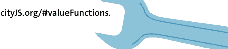

这些是你作为动画属性值传递的数值函数。这些函数在运行时触发，并为集合中动画的每个元素单独调用。在演示中，涉及的集合是包含在 `$circles` jQuery元素对象中的圆形 `div`。因此，一旦动画开始，每个圆形元素的属性将被分配其自身的随机值。在元素集合中实现动画属性差异化的唯一其他方法是循环遍历它们，但这会导致代码变得混乱且性能低下。这就是数值函数的优势——你能够保持动画代码的整洁和易于维护。

注意，为了产生随机值，本节代码利用了在“动画设置”中定义的辅助函数。（提醒一下，`r` 函数返回一个受其 `min` 和 `max` 参数限制的随机整数值。）稍后你将学习更多该函数的知识。

### 不度动画

不度属性从随机值向随机值进行动画。在起始值的情况下，你对随机值进行了轻微提升，以确保元素永远不会太接近透明——毕竟，你希望让观众看到你正在制作的内容！不度的动画会导致圆形散布在整个页面上，并且从第一帧开始就具有不同的不度。差异化的不度营造了良好的渐变效果，为演示增添了视觉丰富性。

这段代码利用“强制注入”（force-feeding）是为了性能优化之外的目的：通过强制注入数值函数来为尚未插入 DOM 的元素动态生成起始值，这意味着你成功地避免了为了设置圆形元素的初始 CSS 状态而编写完全全新的代码块。你在负责处理这些位置动画的同一行代码中，动态地提供了唯一的起始位置。正如第四章“动画工作流”中彻底讨论的那样，你应该在所有的动画代码中都追求这种表达力。

### 翻译动画

为了方便参考，这里再次给出本节的代码：

```
********************************

Circle animation

********************************

$circles

.appendTo($container)

.velocity({

  opacity: {

    function() { return Math.random() },

    function() { return Math.random() + 0.1 }

  },

  translateX: {

    function() { return "+" + r(-screenWidth/2.5, screenWidth/2.5) },

    function() { return r(0, screenWidth) }

  },

  translateY: {

    function() { return "+" + r(-screenHeight/2.75, screenHeight/2.75) },

    function() { return r(0, screenHeight) }

  },

  translateZ: {

    function() { return "+" + r(translateZMin, translateZMax) },

    function() { return r(translateZMin, translateZMax) }

  }

}, { duration: 6000 })

.velocity("reverse", easing: "easeOutQuad")

.velocity({ opacity: 0 }, 2000);
```


现在是时候检查平移动画了，它们在演示的 3D 空间中单独平移圆形元素的位置。三个轴都会从随机起始值向随机结束值进行动画。值运算符（由加号 `+` 后接等号 `=` 组成）告诉动画引擎从其起始值增量动画属性。换句话说，`+=` 值运算符指示动画引擎将结束值视为相对值。相比之下，动画引擎的默认行为是用绝对值解释结束值。

与不透明度一样，这段代码利用强制注入和数值函数是为了表达力和性能优势。特别是圆形的移动被限制在 X 和 Y 轴相对于屏幕尺寸的范围内，以及 Z 轴相对于预定义的最小和最大深度值的范围内。（提醒一下，这些值在动画设置部分已设置过。）对于 X 和 Y 轴，有一个任意的修正因子（注意除以 `2.75`），用以减少元素动画的速度感。这个值纯粹是一个创意决定；可以根据你的审美偏好对其进行调整。

最后，`options` 对象指定了整个动画应该在 `6000ms` 的持续时间内完成。

## 反向命令

在主 Velocity 动画之后，链式继续调用 Velocity 的 `reverse`（反向）命令。`reverse` 的作用顾名思义：它将目标元素动画回上一次 Velocity 调用之前的初始值。在这种特殊情况下，由于起始值已强制注入到上一次 Velocity 调用中，那些就是 `reverse` 将向之动画的起始值。

我在此演示中包含 `reverse` 命令的原因之一是用一行易于维护且具有表达力的代码来扩展演示的整体动画。（虽然你可以将动画时间从 `6000ms` 翻倍到 `12000ms`，但这会导致圆形移动变慢。）`reverse` 命令的便利之处在于避免了手动重新指定所有的动画起始值。如果手动实现，将是一场巨大的混乱。

**提示：** 要预览流行的缓动类型，请访问 `easings.net`。

`reverse` 命令在 `2000ms` 的持续时间内让元素淡出，使浏览器恢复原始状态。

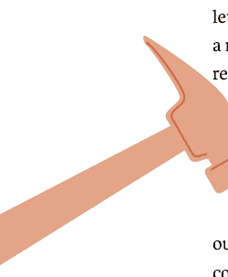

## 总结

从强制注入到数值函数再到反向命令，本教程说明了 Velocity 的强大。希望本章能说服你，看起来复杂的动画实际上可以用少于 75 行整洁、易读且性能良好的代码来实现。让这个演示作为一个如何使用正确工具的具体示例吧。

现在，去设计一些精美的网站和应用吧！一旦你组合出酷炫的东西，请在 Twitter 上展示给我：`twitter.com/shapiro`。


## B

- `backgroundColor` 属性，Velocity 对 CSS 颜色属性的支持 31–32
- `backwards` 选项，文本动画中的优势 92–93
- Baselines（基线），负载测试与 120
- Batching DOM additions，圆形创建问题的代码部分 126–127
- `begin` 选项，Velocity 24
- Bezier 曲线，Velocity 中的缓动值 22
- Blast.js `customClass` 选项 85–86
- `delimiter` 选项 85
- `generateValueClass` 选项 86–87
- 工作原理 83–84
- 在页面上安装 84–85
- 使用 82–83 准备文本元素
- `reverse` 选项 88–89
- `tag` 选项 87–88
- Blue，Velocity 对 CSS 颜色属性的支持 31–32
- `body` 标签，安装 Blast 和 84
- 粗体文本，Blast 中的 `tag` 选项 48
- Blast 中的布尔 `generateValueClass` 选项 86–87
- `borderColor` 属性，Velocity 对 CSS 颜色属性的支持 31–32
- `border-radius` 属性，在动画演示行为中的 148
- Bottlenecks（瓶颈）问题 133
- solutions 133–134
- Bottom line，影响性能 497
- `box-shadow` 属性，在动画演示行为中的 CSS 148
- 138 概览
- 旧版浏览器上的动画问题 139
- 旧版浏览器上的动画 139–140
- 瓶颈与 133
- 尽早发现性能阈值 141–143
- 位置属性与变换（transforms） 110
- Web 性能的现实 818
- 对旧版本的支持 4
- BrowserStack.com，SVG 的用途 142

## C

- 回调函数，Velocity 中的 `begin` 和 `call` 选项 24
- 链式效应和 69
- 将 Velocity 与 jQuery 使用 16
- 在 Velocity 中20
- 字符分隔符，Blast.js 82, 85
- Chrome，Web 性能的现实 818
- 动画行为中的圆形元素 148
- 圆形动画的代码部分 160–164
- 圆形创建演示的代码部分 153–154
- SVG 呈现属性 106
- SVG 样式 106
- Classes（类）
- Blast 中的 `customClass` 选项 85–86
- Blast 中的 `generateValueClass` 选项 86–87

## Code/coding techniques

- 动画设置的代码部分 153–154
- 圆形动画的代码部分 160–164
- 圆形创建的代码部分 154–155
- 容器动画的代码部分 156–159
- 动画演示的代码结构 150–152
- 通过 SVG 代码创建 104
- 组织序列动画的优化方法 66–68
- 封装特效的优化方法 70–72
- 将样式与逻辑分离的优化方法 60–65
- 组织序列动画的标准方法 65–66
- 封装特效的标准方法 69
- 将样式与逻辑分离的标准方法 59–60
- 良好的代码是什么样的 57
- `color` 属性，对 CSS 颜色属性的支持 31–32
- Colors（颜色）
- 使用不透明度（`opacity`）的性能优势 132
- Velocity 选项 31–32
- `complete` 选项，Velocity 22
- 压缩，SVG 和 104
- Concurrency（并发）
- 问题 133
- 动态设计中的减少 43
- solutions 133–134
- Consistency（一致性），模式识别与理解与 44

## Containers（容器）

- 容器动画的代码部分 156–159
- 动画演示的代码结构 153–154
- SVG `<svg>` 105
- 文本元素 80
- Conventions，在设计选择中的 41

## CSS

- 3D 入门 156
- 相邻元素上的动画效果 130–131
- CSS 工作流的适当使用 57–58
- 切换到 JavaScript 逻辑分离的优势 62
- SVG 属性与 CSS 变换的对比 110
- Velocity `display` 和 `visibility` 选项的对比 27–29
- Velocity 属性与 CSS 属性的对比 18–19
- Velocity 值与 CSS 值 20
- Velocity 中的缓动值 22
- Blast 元素的细粒度控制 94
- CSS 工作流的问题 56–57
- JavaScript 与 4–9 视角 156–157
- 将样式与逻辑分离 59–60
- 巧妙的创意和 138
- SVG 样式的对比 107
- 与 16 对应的 Velocity 参数
- Velocity 对 CSS `transform` 属性的支持 32
- `customClass` 选项，Blast 85–86

## D

### Effects（特效）

- 数据传输指标，动态设计中的预览选项 41
- UI 组合中的淡入淡出效果（fade effect）91
- 华丽的特效 96
- Debouncing（防抖），事件处理程序 135–136
- 文本中的装饰 97–98
- `delay` 选项，Velocity 26
- 优化封装方法 70–72
- Delay 值 91
- 标准封装方法 69
- 交错持续时间（staggering durations）73
- UI 组合中的淡入淡出效果 92
- 分隔符（Delimiters），Blast.js 82, 85
- 动态设计的优雅之处
- Design techniques（设计技巧）
- 将动画拆解为步骤 48–49
- 来自元素 49
- 时间倍数 73
- VMD（Velocity Motion Designer）74–76
- 非琐碎 47
- Device Lab 142
- `display` 选项，Velocity 27–28
- 概览 39–40
- 交错动画（staggering animations）49
- 动画行为中的 148
- 使用适当功能 47–48
- Blast.js 82
- Element节点，HTML 83
- Blast 中的 `tag` 选项 88

### Elements DOM（DOM 对象模型）

- 提高性能的 DOM 添加 126–128, 155
- 相邻元素上的动画效果 130–132
- 布局抖动（layout thrashing）问题 121–122
- 圆形元素。见 Blast 的细粒度控制94
- 布局抖动解决方案 122–123
- 来自元素 49
- 布局抖动 123–124
- 获取 DOM 元素 33–34
- SVG 元素 104
- 渲染 137–138
- `duration` 选项，Velocity 21
- JEOs（jQuery元素对象）123–124
- 动态设计限制45
- 交错 91
- `span` 元素 87–88
- SVG 元素与 HTML 对比 104
- 文本元素 80
- Easing 选项，Velocity 21–23
- eBay，购买旧设备 144

## E

- `eq()` 函数，jQuery 94
- 事件处理程序，防抖 135–136
- 实验，反复 51–52

## H

- Height，SVG 呈现属性 105
- 隐藏设置，`display` 和 `visibility` 选项 28
- Hover 状态，CSS 用 57–58

## F

- UI 组合中的淡入淡出效果（Fade effect）91
- 熟悉度，设计选择中的约定 41
- `fill`，SVG 呈现属性 105
- 编码网页 80
- Element节点 83
- SVG 元素与 HTML 对比 104
- Flags，利用用户响应 42–43
- 文本中的装饰 97–98
- Flow，来自元素 49
- Force-feeding 功能（Velocity），用于避免抖动 124–125
- 琐碎设计，用途与滥用 49

## Images（图像）

- 通过 SVG 代码创建 104
- 渲染问题 137–138
- 巧妙的图像问题 139
- 巧妙的图像解决方案 139–140
- `img` 元素 138
- 激励，交互的本质 43
- 无限循环，Velocity 25–26
- Inscape 104

## G

- `generateValueClass` 选项，Blast.js 86–87
- JOs 作为布局抖动的根源 123–124
- 布局抖动与 121–122
- 全局时间倍数 73–74
- 渐变（Gradients），CSS 138
- 优雅动态设计 54
- SVG 和 104，109
- Green，Velocity 对 CSS 属性的支持 31–32
- GSAP 动画库 14
- 内联状态指示，任务中的 42
- 动态设计中的预览选项 41–42
- 其他浏览器的 IE 注释 139
- 尽早发现性能阈值 141–143
- 位置属性与变换（transforms）110
- Web 性能的现实 118
- iOS，在 eBay 上购买旧设备 144
- 不可逆的操作，指标43

## L

- 延迟（Latency），搜索引擎性能 117

## Layout thrashing（布局抖动）

- Velocity 中的 `force-feeding` 功能用于避免抖动 124–125

## J

- Janks（卡顿），布局抖动与 JavaScript vs CSS 121
- JEOs（jQuery元素对象）作为布局抖动的根源 123–124
- JavaScript 中的动画反转功能 7–8
- 问题 121–122
- JavaScript 滚动功能概览 4
- solutions 123–123
- 负载测试，Web性能的现实和120
- 性能优势 6

## Logic（逻辑）

- JavaScript 中的物理运动 8
- 与样式分离的优化编码方法 59–60
- 10 工作流维护 9
- 将样式分离的标准编码方法 59
- JEOs（jQuery元素对象）

## Logos（标志）

- 提高性能的 DOM 添加 126–128
- SVG 中的动画示例 112–113
- 作为布局抖动的根源 123–124
- SVG 的用途 109

## JQuery

- `loop` 选项，Velocity 25–26
- `easing` 选项 22–23

## Loops（循环）

- Blast 元素的细粒度控制 94
- 容器动画的代码部分 159
- 15 安装，JavaScript 动画库绕过 6
- 布局抖动与 121–122
- Blast 要求 84–85

适当的个性特征 47–48
使用...替代...的性能优势

将动画分解为步骤 48–49
颜色 132
设计中的惯例 41
`opacity` 属性 161
参与任务 42
`outlineColor` 属性，Velocity 对此的支持
反复实验 51–52
CSS 颜色属性 31–32
从触发元素流出 49
不可逆操作的指标 50
动作 43

## P

页面滚动，JavaScript 的性能特性 7
另见滚动命令 (scroll command)

## Performance 性能

相邻元素的动画效果问题 130
相邻元素的动画效果解决方案 131–132
旧浏览器上的动画问题 139
旧浏览器上的动画解决方案 139–140
批量添加 DOM 元素问题 126–127
批量添加 DOM 元素解决方案 127–128
并发瓶颈问题 133
并发瓶颈解决方案 133–134
JavaScript 的特性 6
尽早发现性能阈值 141–143
Velocity 中为了避免布局抖动 (layout thrashing) 的强制喂送功能 124–125
图像渲染问题 137
图像渲染解决方案 137–138
JEOs (jquery 对象) 和 123–124
布局抖动问题 122–123
布局抖动解决方案 117
Web性能概览 118–120
限制动画 25
限制持续时间 45
镜像动画 44
不轻率 47
`opacity` 的使用 48
预览结果 41
减少并发 43
减少多样性 44
回顾 53
交错动画 49
实用性与优雅性 39–40
UX（用户体验）的提升 43
交互的直觉本质 394
Mozilla Developer Network，SVG 元素目录 114
多动画序列，并发问题解决方案 134
倍数器，作为设计技术的时间倍数器 73–74

## O

Opacity 透明度

动画 161
文本中的修饰 97–98
超越使用 48

## Performance (续)

- 回顾 145
- 滚动和调整大小事件问题 135
- 滚动和调整大小事件解决方案 135–136
- 隐性图像问题 139
- 隐性图像解决方案 139–140
- ，在运动设计中使用适当的特性 47–48
- 透视轮廓，CSS 156–157
- 基于物理的运动，JavaScript 的性能特性 8
- 像素，图像渲染问题 137
- 位置属性，SVG 110–111
- 表现属性，SVG 105, 110
- 预览，在运动设计中预览结果 41

- 属性 (Properties)
- 在动画演示的行为中 148
- CSS 属性 156–157
- CSS 阴影属性 138
- 在 SVG 动画中传递属性 109
- Velocity 18–19
- Velocity 对 CSS 属性的支持 31–32
- `px`，作为 Velocity 中的默认单位 19–20

## R

- 随机数，动画设置的代码段 153
- 红色，Velocity 对 CSS 属性的支持 31–32
- 调整大小事件
- 性能问题 135
- 性能解决方案 135–136

### reverse command 反转命令

- JavaScript 中的动画反转功能 7–8
- 圆形动画的代码段 163–164
- 在 Velocity 中 30
- `reverse` 选项，Blast.js 88–89
- RGB（红、绿、蓝），Velocity 对 CSS 属性的支持 31–32
- 旋转，CSS 属性 32

## S

- Safari，Web性能的现实 118
- 可缩放图形，见 SVG (scalable graphics)
- 缩放，CSS 属性 32
- 滚动命令 (scroll command)
- 性能的 31–31
- 滚动， 7
- 性能问题 135
- 解决方案 135–136
- 滚动的 137
- 搜索引擎，延迟 117
- `reverse` 选项 84–85
- 序列，在 pack 中 65
- 优化的组织方法， 66–68
- 标准的组织方法， 65
- 优化的组织方法， 65
- 布局抖动和 121–122
- 动画设置的代码段 153–154
- 动画演示的 150
- 阴影属性，CSS 138
- Velocity 的 20
- 智能草图 104
- 旧浏览器上的动画 139
- 购买 144
- 性能的现实 118
- 隐性图像问题 139–140
- 元素 80
- 交错动画 49
- 优化的组织方法， 65
- 逻辑， 59–60
- SVG 107
- SVG (scalable graphics) 112
- 动画组件 380
- 创建图像 104
- 超越使用 48
- 标记 105–106
- 触发元素 49
- 性能阈值 141–143
- 逻辑 22

## Timing control 时间控制

- 延迟选项 26
- 倍数，作为设计技术 73–74
- UI（用户界面）设计惯例 41
- `transform` 属性，Velocity 31–32
- 运动设计提升用户体验 38

## Transforms 变换

- UI 库 65
- 3D CSS 原理 156
- 相邻元素的动画效果和 131
- UI pack 中的延迟 65
- 获取并安装 15
- 与 SVG 属性比较 110–111
- 优化的组织方法， 70–72
- `fade` 选项，在 pack 中 92
- `fade` 选项，在 pack 中 92
- 持续时间 45
- 替换文本 90
- 文本超出视图 91–93
- 文本使用 80
- 惯例 65
- 参与任务 42
- 不可逆操作的指标 50

## Translations 翻译

- 3D CSS 原理 156
- 相邻元素的动画效果和 131
- 动画 161–162
- 圆形动画的代码段 163–164
- 镜像动画 44
- `transform` 属性 32
- 镜像和 44
- 概览 39–40
- 预览结果 41
- 减少并发 43
- 减少多样性 44
- 交互的直觉本质 394
- UX（用户体验）运动设计 43

- 影响 117
- 基于物理的运动增强 8
- 优化的组织方法 66–68
- 页面滚动功能 7
- 在 SVG 动画中传递属性 109
- 基于物理的运动 8 18–19
- SVG 属性和样式资源 114
- 反转命令 30 33–34
- 滚动命令 31–31

## Values 值

- 动画设置的代码段 154
- 值函数 161
- Velocity 19–20
- 多样性，运动设计中的减少 44 Velocity
- 动画演示。见参数 16–18
- 开始和完成选项 24
- 链式 20 31–34
- 与 jQuery 比较 13
- 包含动画逻辑 29
- 延迟选项 26 显示和可见性选项 27–28
- 下载并安装 15 持续时间 21
- 缓动选项 21–23
- 为了避免布局抖动的强制喂送功能 124–125
- 循环选项 25–26
- 模拟功能 74
- 动画库类型 31–32
- UI pack 65
- 使用 jQuery 使用 16 33–34
- 不使用 jQuery 的值 19–20
- Velocity Motion Designer (VMD) 74–76

## Visibility 可见性

替换现有文本 90 91–93
淡出文本超出视图 80
可见性选项，Velocity 27–28
视觉处理，在运动设计中利用原始本能 42–43
VMD (Velocity Motion Designer) 74–76

# W

Web 设计中页面滚动的使用 7
Web 性能的现实 118–120
宽度，SVG 表现属性 105

单词分隔符（word delimiter），Blast 选项 85

封装效果的标准编码方法 69

工作流

CSS 的适当用法 57–58

将样式与逻辑分离的标准编码方法 59–60

CSS 问题 56–57

可维护性 9

作为设计技术的计时倍数 73–74

组织序列化动画的优化编码方法 66–68

VMD（运动设计师 Velocity Motion Designer） 74–76

封装效果的优化编码方法 70–72

## X

`x` 值，SVG 表现属性 105

将样式与逻辑分离的优化编码方法 60–65

概览 55

## Y

评测 77

组织序列化动画的标准编码方法 65–66

`y` 值，SVG 表现属性 105

# 加入 PEACHPIT 联盟团队 AFFILIATE TEAM！

如果你热爱我们的书籍，并喜欢与同事和朋友分享它们……那为什么不趁此赚点钱呢！

如果你有一个网站、博客甚至是一个 Facebook 页面，你可以在你的页面上放置 Peachpit 链接来开始赚钱。

如果访问者点击该链接并在 `peachpit.com` 上购买了商品，你将获得所有销售额的佣金*！

你带入网站的每笔订单都将为你带来佣金。你只需要发布广告，剩下的交给我们即可。

# 申请并开始吧！

申请过程快捷简单。
了解更多信息请访问：

`http://www.peachpit.com/affiliates/`

*适用于 `www.Peachpit.com` 的所有书籍、电子书和视频销售


Peachpit
