# JavaScript 或 Java Web 应用开发（De Gruyter 教科书）2 

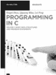

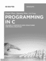

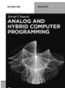

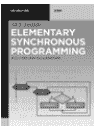


# 作者

Gerd Wagner 教授、博士

BTU Cottbus-Senftenberg

网络技术系

Konrad-Wachsmann-Allee 5

03046 Cottbus

wagnerg@b-tu.de

Mircea Diaconescu

dimircea@gmail.com

# 前言

这两本书展示了如何使用基于模型的方法设计并实现 Web 应用，使用了 Web 开发中最相关的两个平台：JavaScript 和 Java。Web 应用通过 UML 图表的形式进行设计，并实现为：

- JavaScript 前端，使用 Java 后端，使用 Java Server Faces（JSF）作为用户界面，使用 Java Persistence API（JPA）进行对象到存储的映射，以及 MySQL/MariaDB 数据库管理系统。

本书的重点是关于以下基础管理问题的通用概念和技术：

- 完整性约束和数据验证
- 枚举和属性
- 对象类型之间的单向和双向关联
- 类层级结构中的子类型和继承

前两个问题在本书的第 1 卷中讨论，后两个问题在第 2 卷中讨论。我们假设读者已经熟悉 HTML 和至少一种面向对象的编程语言，如 C++、Java、PHP 或 C#。此外，我们假设读者对 JavaScript 有一定了解，并有兴趣学习更多使用 JavaScript 或 Java 进行编程。

本书可用于计算机科学、信息系统及相关专业的学生 Web 开发课程；供 JavaScript 开发者学习 Java；供 Java 开发者学习 JavaScript；供 JavaScript 和 Java（以及 PHP/C#）开发者学习如何使用原生 JavaScript 或 Java 构建完整的 Web 应用。

本书附带六个示例应用程序的完整源代码，您可以从我们的 Web 服务器运行或下载这些代码。

## 目录

1.1 引用与引用属性 — 4

1.2 引用完整性 — 6

1.3 将引用属性建模为单向关联 — 6

1.4 将单向关联表示为引用 — 8

1.5 为非无向关联添加方向性 — 9

1.6 我们的运行示例 — 10

1.7 消除单向关联 — 11

1.8 在用户界面中渲染引用属性 — 15

1.9 多值引用属性的集合类型 — 15

1.10 测答题 — 16

2.1 新 JavaScript 元素 — 19

2.2 实现单值引用属性 — 22

2.3 构建 JS 类模型 — 24

2.4 新问题 — 26

2.5 编写模型代码 — 26

2.6 编写视图和控制器 — 33

2.7 新问题 — 36

3.1 多值引用属性 — 38

3.2 构建 JS 模型 — 39

3.3 新问题 — 40

3.4 编写代码 — 41

3.5 运行应用 — 45

3.6 编写代码 — 51

3.7 注意事项 — 52

4.1 单值引用属性 — 53

4.2 构建实体类模型 — 54

4.3 新问题 — 55

4.4 编写模型代码 — 55

4.5 视图层 — 59

5.1 多值引用属性 — 67

5.2 构建实体类模型 — 68

5.3 新问题 — 69

5.4 编写模型代码 — 69

5.5 编写界面代码 — 74

5.6 运行应用并获取代码 — 76

5.7 集合值 — 77

6.1 为电影分配导演/演员 — 79

6.2 为国家分配城市 — 80

7.1 引用属性 — 83

7.2 构建面向对象模型 — 86

8.1 构建 JS 类模型 — 91

8.2 编写模型代码 — 92

8.3 在用户界面中利用引用属性 — 98

9.1 构建实体类模型 — 100

9.2 编写模型代码 — 102

9.3 在用户界面中利用派生引用属性 — 110

9.4 运行应用 — 112

10.1 部分整体关联 — 113

10.2 关联类 — 116

12.1 通过特化引入子类型 — 123

12.2 通过泛化引入父类型 — 124

12.3 意图版本扩展 — 125

12.4 类型层级结构 — 126

12.5 K 与角色 — 128

12.6 类层级合并设计模式 — 128

12.7 计算语言中的子类型与继承 — 130

12.8 测答题 — 141

13.1 基于构造函数的类的子类型 — 143

13.2 案例研究 1：消除类层级结构 — 145

13.3 案例研究 2：实现类层级结构 — 154

14.1 Java 中的子类型 — 160

14.2 案例研究 1：使用单表继承实现类层级结构 — 161

14.3 案例研究 2：使用连接表继承实现类层级结构 — 169

14.4 运行应用 — 173

15.1 项目 1 — 人类型与电影类型 — 177

## 图表目录

**图 1.1** 委员会通过引用属性 `chair` 拥有一个俱乐部成员 — 5

**图 1.2** 关联以一个“点”结束 — 7

**图 1.3** 将单向关联表示为引用属性 — 8

**图 1.4** 委员会（Committee）与俱乐部成员（ClubMember）之间非方向性关联的模型 — 9

**图 1.6** 带有单向关联的出版者（Publisher）书籍（Book）信息设计模型 — 10

**图 1.7** 带有两个单向关联的出版者-书籍-作者（Author）设计模型 — 11

**图 1.8** 将功能性关联转换为引用属性 — 12

**图 1.9** 将非功能性关联转换为多值引用属性 — 12

**图 1.10** 出版者和书籍的 OO 类模型 — 12

**图 1.11** 书籍、出版者和作者三个类的 OO 类模型 — 13

**图 2.1** 定义类（Class）和出版者（Publisher）的 JCS 类模型 — 25

**图 5.1** 集合值引用属性 `authoredBooks` 和有序集合值引用属性 `author` — 77

**图 7.1** 带有两个双向关联的出版者-书籍-作者设计模型 — 83

**图 7.2** 将双向一对一关联转换为互为反的单值引用属性的主从对 — 88

**图 7.3** 将双向多对多关联转换为互为反的多值引用属性的主从对 — 88

**图 7.4** 具有两种类型反向引用属性的 OO 类模型 — 89

**图 12.1** 具有两种类型的类类型：教科（Textbook）和传记（Biography） — 123

**图 12.2** 对象类型 `Employee`（员工）和 `Author`（作者）具有多个属性 — 124

**图 12.3** 对象类型 `Employee` 和 `Author` 被共同父类型 `Person`（人员）泛化 — 125

**图 12.4** 具有两个层次结构的信息模型 — 126

**图 12.5** 以根类 `Vehicle`（车辆）为类的类层次结构 — 127

**图 12.6** 多重继承层次结构 — 127

**图 12.7** 应用类层次结构设计模式的结果 — 130

**图 12.8** 带有 `Person` 角色的信息设计模型 — 135

**图 12.9** 表示书籍类层次结构的表示 `Person` 角色的 SQL 表模型 — 135

**图 12.10** 表示 `Person` 角色层次结构的 STI 表模型 — 136

**图 12.11** 表示 `Person` 角色层次结构的 TC 表模型 — 138

**图 12.12** 表示 `Person` 角色层次结构的 JTI 表模型 — 140

**图 13.1** 合并书籍类层次结构的 JCS 类模型 — 146

**图 13.2** `Person` 角色类层次结构的 JCS 类模型 — 154

**图 13.3** `Person` 角色类层次结构的 STI 模型 — 155

**表 1.1** 功能类型 — 8

# 引用属性

我们在第 1 卷中讨论的三个示例应用程序——最小应用、验证应用和枚举应用——它们都局限于管理一种对象类型的数据。然而，一个真实的应用程序必须管理多个对象类型的数据，这些类型通常以各种方式相互关联。特别是，对象类型之间可能存在关联和子类型（继承）关系。特别是，对象类型之间可能存在关联和子类型（继承）关系。特别是，对象类型之间可能存在关联和子类型（继承）关系。特别是，对象类型之间可能存在关联和子类型（继承）关系。在开发框架中对这些没有提供良好的支持。

关联是信息模型的重要元素。在开发框架中，它们有两种重要的区别：

1. 功能性关联与非功能性关联（多对多）。
2. 单向与双向关联。

功能性关联在数学中被称为函数，而多对多关联在数学中被称为关系。

单向关联在 OO 建模中被称为属性，而双向关联被称为互为反的属性。

## 针对对象的引用属性

对象类型之间的关联在 UML 中被定义为连接线。对象类型之间的关联在图 1.2 中可视化，例如，委员会（Committee）拥有一个俱乐部成员（ClubMember）。

| 出版者-书籍-作者 |
| --- |
| 出版者：Peter Miller |
| 书籍：Susan Smith |
| 作者：Sarah Anderson |

通常情况下，关联是二元的。通常当我们说“关联”时，我们实际上是指“二元关联”。虽然单向关联（如 Committee-has-Member）是信息模型的重要元素，在开发框架中对这些关联没有提供良好的支持。

在数学中，关联被抽象地形式化为元组集合，称为关系。在实体关系（ER）建模（一种经典建模方法）中，对象被称为实体，关联被称为关系类型。统一建模语言（UML）包含了用于信息建模的 UML 类语言。在 UML 中，对象类型被称为类，个体关系被称为“链接”。这些术语总结如下所示：

| 我们的首选术语 | UML | ER 图 | 数学 |
| --- | --- | --- | --- |
| 对象（object） | object | entity | individual |
| 对象类型（object type） | class | entity type | unary relation |
| 关系（relationship） | link | relationship | tuple |
| 关联（association） | association | relationship type | relation |
| 功能性关联 |  |  | function |

我们首先讨论引用属性，它们在“无关联元素”的类模型中隐式地表示二元关联。

### 1.1 引用与引用属性

某些语言（如 SQL 和 XML）只支持人类可读的引用，不支持内部引用。在 SQL 中，人类可读引用被称为外键，它们所引用的标识符被称为主键。在 XML 中，人类可读引用被称为 ID 引用，对应的属性类型是 IDREF。

OO 程序中的对象可以通过人类可读引用（例如整数代码）也可以通过内部引用进行引用，后者对于高效访问主内存中的对象更为有利。

在术语中，我们将人类可读的引用称为 ID 引用。我们遵循 ID 引用的标准命名规范，即在类 A 中定义的引用类 B 对象的 ID 引用属性名称为 `b_id`，并使用后缀 `_id`。

当我们把对象持久化为记录或表行时，我们需要将存储在如 `publisher_id` 等属性中的内部引用转换为存储在 `publisher_id` 等属性中的 ID 引用。这种转换是在对象序列化过程中，通过将被引用对象的标准标识值赋值给引用对象的 ID 引用属性来实现。

在面向对象（OO）语言中，属性是为对象类型（或类）定义的，类是它的域。属性的值可以是来自某些数据类型的值，在这种情况下该属性被称为属性（attribute），也可以是引用某个类对象的对象引用，在这种情况下该属性被称为引用属性（reference property）。

例如，下方图 1.1 所示的 `Committee` 类有一个范围为 `String` 的属性，和一个范围为 `ClubMember` 的引用属性。

| Committee | ClubMember |
| --- | --- |
| `name: String` |  |
| `chair: ClubMember` |  |

图 1.1：一个委员会通过引用属性 `chair` 表达有一个俱乐部成员作为主席。

面向对象的编程语言（如 JavaScript、PHP、Java 和 C#）直接支持引用属性的概念，这种属性的引用不是数据类型，而是引用类型（或类），其值是指向该类实例的对象引用。

默认情况下，属性的重数（multiplicity）为 1，这意味着该属性是强制的且功能性的（换句话说，是单值的），恰好有一个值，如图 1.1 所示 `Committee` 类中的 `chair` 属性。

当功能性属性是可选的（非强制的）时，它的重数为 `0..1`，这意味着该属性的最小基数为 0，最大基数为 1。

引用属性可以是单值的（功能性的），也可以是多值的（非功能性的）。例如，图 1.1 所示的引用属性 `Committee::chair` 是单值的，因为它为一个俱乐部分配了一个唯一的俱乐部成员作为主席。一个多值引用属性的示例是图 1.11 所示的 `Book::authors` 属性。

通常，多值引用属性的集合值是引用的集合，这意味着引用的顺序并不重要。但在某些情况下，顺序是重要的，因此此类多值引用属性的集合值是一个有序的引用集合，通常被实现为列表（list）。

引用是我们应用程序数据库中的重要信息项。然而，只有当应用程序维护它们的引用完整性时，它们才有意义。这要求对于任何引用，数据库中必须存在一个被引用对象。因此，任何域为 `C`、范围为类 `D` 的引用属性 `p` 都带有一个引用完整性约束，在每当情况下都需要检查：

1. 创建了类型为 C 的新对象。
2. 某个类型为 C 的对象的 `p` 值被更改。
3. 销毁了一个类型为 D 的对象。

引用约束还意味着两个变更依赖：

1. 对象创建依赖：引用另一个对象的对象只有在被引用对象创建后才能创建。
2. 对象销毁依赖：被另一个对象引用的对象只有在以下情况后才能被销毁：
   1. 先销毁引用对象（级联删除策略 `CASCADE deletion policy`）。
   2. 引用对象中的引用被丢弃（删除引用策略 `DROP-REFERENCE deletion policy`）或被另一个引用替换。

应用程序模型类中的每个引用属性，我们必须选择这两种删除策略中的一种适用。

在某些情况下，我们可能希望放宽这种严格规定，允许创建对 ID 引用属性具有非引用值的对象，但我们不考虑此类情况。

通常，对象创建依赖是在用户界面中管理的，通过不允许用户输入 ID 引用属性的值，而只允许从所有现有目标列表中进行选择。

引用属性（如图 1.1 示例中的 `chair`）在 UML 类图中可以通过其域类（domain class）在关联端建模，该域类通过一个小的实心圆（也称为“点”）进行可视化。

这需要用关联线将引用属性的域类和范围类连接起来，并放置一个所有权点。

关联由另一端的类所拥有，这一事实（正如图 1.2 示例中关联端通过点视觉化表达的那样）意味着该属性是单向的。

在设计模型中，所有的关联端都需要一个重数，我们还必须为源类的反向定义一个重数。这个重数（反向属性）在图 1.1 的原始属性描述中不可用，因此它必须添加到关联的预期语义中。

可以通过回答问题“任何 ClubMember 是否必须是委员会主席？”来寻找最小基数，通过回答“ClubMember 是否可以是多个委员会的主席？”来寻找最大基数。

当属性的值是其范围内值的集合时，该属性是非功能性的，其重数是 `0..` 或 `n..`（其中 n > 0）。与其写 `0..`，我们可以直接写星号 `*`。

图 1.2 所示的关联将一个 `ClubMember` 对象作为主席分配给一个 `Committee` 对象。因此，它是功能性关联（functional association）的一个示例。

表 1.1 提供了不同功能情况的概述。

注意，关联的方向性和功能性是相互独立的。因此，单向关联可以是功能性的（一对一或多对一），也可以是非功能性的（一对多或多对多）。

### 表 1.1：功能类型

| 功能类型 | 意义 |
| --- | --- |
| 一对一 | 既是功能性的也是反功能性的 |
| 多对一 | 功能性的 |
| 一对多 | 反功能性的 |
| 多对多 | 既不是功能性的也不是反功能性的 |

源类和目标类之间的单向关联可以表示为源类的引用属性。下图 1.3 所示了两个单向关联：多对一关联和多对多关联。

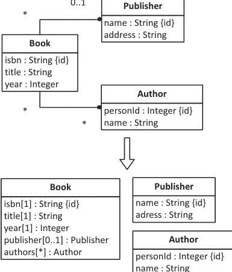

图 1.3：将单向关联表示为引用属性。

注意，在某种程度上，我们消除了显式关联，并用类模型中相应的引用属性代替它们，这可以使用经典的 OOP 语言直接进行编码。OOP 语言确实不支持将关联视为一等公民。它们没有定义关联的语言元素。因此，面向对象（OOP）类设计模型（我们称之为 OO 类模型）不应包含任何显式关联。

当我们以 UML 类图的形式制作信息模型时，通常会得到一个包含一个或多个关联的模型，这些关联的末端没有定义任何所有权，例如图 1.4 所示。

当关联的末端都没有所有权点（ownership dot）时（如例），这意味着模型没有指定如何通过引用属性（reference properties）表示（或实现）该关联。这种关联没有方向。根据 UML 2.5 规范，此类关联的末端由其自身“所有”，而不是由参与其中的任何类所有。

| Committee | chairedCommittee | ClubMember |
| --- | --- | --- |


|---|---|---|
| `name : String` | | 1 |

图 1.4：委员会（Committee）与俱乐部成员（ClubMember）之间非无向关联的模型。

包含没有关联端所有权点的信息设计模型，作为关系型数据库设计模型是可以接受的，但作为 OOP 语言的设计模型，它是不完整的。

例如，图 1.4 的模型提供了一个关系型数据库设计，包含两个实体表（`committees` 和 `clubmembers`）以及一个单独的一一关系表 `committee_clubmember_as_chair`。它没有为 Java 类提供设计，因为它没有指定如何通过引用属性来实现该关联。

有三种方案可以将非无向关联的信息设计模型（不包含任何关联所有权点）转换为所有关联均为单向或双向的信息模型：我们可以在关联的任一末端或两个末端都放置所有权点。这三个方案中的每一个都定义了通过引用属性表示或实现关联的不同方法。因此，对于上述图 1.4 所示的关联，我们有以下选项：

1. 在 `chair` 关联端放置所有权点，得到如图 1.2 所示的模型，该模型可以转换为上述图 1.1 所示的 OO 类模型。
2. 在 `chairedCommittee` 关联端放置所有权点，得到下文图 1.8 所示的完整模型。
3. 通过在两个关联端都放置所有权点来使关联变为双向，如图 1.5 所示，其含义是关联通过一对互逆的引用属性 `Committee::chair` 和 `ClubMember::chairedCommittee` 以冗余方式实现，如第 7 节所述。

| Committee | chair | ClubMember |
|---|---|---|
| `name : String` | 0.1 | 1 |

图 1.5：委员会（Committee）与俱乐部成员（ClubMember）之间的双向关联建模。

每当我们对关联进行建模时，都必须选择哪一个末端代表引用属性并因此标记所有权点。这可以是其中一个，也可以是两者。这个决策也意味着对关联导航性（navigability）的决策。当关联表示引用属性时，这意味着它是可导航的（通过该属性）。

对于非一对一（not-to-one）的功能性关联，最简单的设计是根据其功能定义关联的方向，将关联所有权点放在多重性为 `0..1` 或 `1` 的关联端。对于非无向的一一或多对多关联，我们可以根据意愿选择方向，即我们可以在任何关联端放置所有权点。

图 1.6 所示的模型（关于出版商和书籍）作为我们单向功能性关联的示例模型。注意它包含单向多对一关联 `Book-has-Publisher`。

| Publisher | Book |
|---|---|
| `name : String (id)` | `isbn : String (id)` |
| `address : String` | `title : String` |
| `0.1 *` | `year : Integer` |

图 1.6：出版商-书籍（Publisher-Book）信息设计模型，其中用一个非功能性（多值）引用属性表示。

我们可能还需要处理单向非功能性关联。例如，下面图 1.7 所示的书籍（Book）与作者（Author）之间的单向多对多关联建模了一个多值（非功能性）引用属性 `authors`。

| Publisher | Author |
|:---|:---|
| | `name: String (id)` |
| | `address: String` |
| | `personId: Integer (id)` |
| Book | |
| `isbn: String` | |
| `title: String` | |
| `year: Integer` | |

> 图 1.7：出版商-书籍-作者（Publisher-Book-Author）信息设计模型，包含两个单向关联。

由于经典的 OOP 编程语言不支持将关联视为一等公民，仅支持类和表示单向关联的引用属性，我们必须从通用信息设计模型中消除所有显式关联以获取 OO 类模型。

我们消除程序的起点是一个包含各种单向关联的信息模型，例如上述图 1.6 所示的模型。如果模型仍然包含任何无向关联，我们首先必须通过对其末端的所有权做出决策，将其转换为有向关联。

连接源类与目标类的单向关联被替换为源类中相应的属性，该属性具有：

- 与目标端相同的名称（如果有的话）；
- 如果关联是多值的，则为目标类（可能是复数形式）；
- 如果关联是功能性的，则为目标端相同的名称。

该程序在图 1.8 的一一关联案例中给出了说明，其中唯一性约束由 `{key}` 修饰符表示。

| Committee | ClubMember |
|---|---|
| `name : String` | `0..1` |

| Committee | ClubMember |
|---|---|
| `name : String` | `chairedCommittee[0..1]` |

对于一对多的关联案例，图 1.9 提供了该程序的说明。在这里，目标类处的非功能性关联端被转换为名为 `name` 的引用属性。

| Polygon | Point |
|---|---|
| `1.*` | |

图 1.9：将非功能性关联端转换为多值引用属性。

在我们的示例模型（出版商-书籍-作者信息设计模型）中，我们必须将两个单向关联替换为合适的引用属性。在第一步中，我们将图 1.6 模型中的多对一关联 `Book-has-Publisher` 替换为类中的功能性引用属性 `publisher`，得到图 1.10 所示的 OO 模型。

| Book | Publisher |
|---|---|
| `isbn[1] : String (id)` | `name : String (id)` |
| `title[1] : String` | `address : String` |
| `year[1] : Integer` | |
| `publisher[0..1] : Publisher` | |

图 1.10：出版商与书籍的 OO 模型。

由于 `Book-has-Publisher` 的目标关联多重性为 `0..1`，我们必须通过将其多重性定义为 `0..1` 使新属性为可选。此 OO 类模型及其引用属性的含义可以通过下表的示例数据填充来说明：

| Name | Address |
|---|---|
| Bantam Books | New York, USA |
| Basic Books | New York, USA |

| ISBN | Title | Year | Publisher |
|---|---|---|---|
| 0553345842 | The Mind's I | 1982 | Bantam Books |
| 1463794762 | The Critique of Pure Reason | 2011 | |
| 1928653729 | The Critique of Practical Reason | 2009 | |
| 0465030793 | I Am A Strange Loop | 2000 | Basic Books |

注意，`Book` 表 `Publisher` 列的值是引用 `Publisher` 表中行的唯一名称。由于相应的引用属性是可选的，`Publisher` 列对于某些行可能没有值。

在第二步中，我们将图 1.7 模型中的多对多关联 `Book-has-Author` 替换为 `Book` 类中的多值引用属性 `authors`，得到图 1.11 所示的 OO 类。

| Book | Publisher | Author |
|---|---|---|
| `isbn[1] : String (id)` | `name : String (id)` | |
| `title[1] : String` | `address : String` | |
| `year[1] : Integer` | | |
| `publisher[0..1] : Publisher` | | |
| `authors[*] : Author` | | `personid : integer (id)` |
| | | `name : String` |

图 1.11：针对书籍（Book）、出版商（Publisher）和作者（Author）类的 OO 类模型。

此 OO 类模型及其引用属性 `Book::publisher` 和 `Book::authors` 的含义，可以通过三个模型类的示例数据填充来解释：

| 名称 | 地址 |
|:---|:---|
| Bantam Books | New York, USA |
| Basic Books | New York, USA |

| ISBN | 标题 | 年份 | 作者 |
|:---|:---|:---|:---|
| 0553345842 | The Mind's I | 1982 | 2 | Bantam Books |
| 1463794762 | The Critique of Pure Reason | 2011 | 3 | |
| 192856379 | The Critique of Practical Reason | 2009 | 3 | |
| 046503093 | I Am A Strange Loop | 2000 | 2 | Basic Books |

| 作者 ID | 名称 |
|:---|:---|
| 1 | Daniel Dennett |
| 2 | Douglas Hofstadter |
| 3 | Immanuel Kant |

在平台无关的 OO 类模型完成后，可以从中推导出一个或多个特定平台的实现模型。特定实现的示例包括 JS 类模型、Java 类模型和 SQL 表模型。

特定实现模型仍然可以用 UML 类图的形式表示，但它仅包含在该平台上编码的元素。因此，对于任何平台，都需要两条准则：

1. 如何制作特定实现模型；
2. 如何编码该模型。

用于 CRUD 用户界面（UI）的数据输入输出控件通常对应于模型类中的枚举属性或引用属性。我们需要区分输入字段和选择控件（如列表）。在 UI 中使用选择控件而不是输入字段可以防止用户输入无效 ID，从而维护引用完整性。

通常情况下，单值引用属性无论其范围有多少对象，都可以在 UI 中渲染为单选列表，并从中进行特定的选择。如果引用属性的范围足够小（例如小于 7），也可以使用单选按钮组。

多值引用属性可以在 UI 中渲染为多选列表。然而，当可选范围很多（例如超过 20 个）时，HTML 对应的多选控件并不好用，因为选择方式过于分散。在只有少数选项（例如不超过 7 个）的特殊情况下，可以使用复选框组代替多选列表。但对于一个包含引用属性范围内所有关联对象的通用情况，我们需要开发一种特殊的控件，允许向已选列表添加（移除）对象。

这种多选控件由：

1. 一个包含（关联）对象的 HTML 列表，每个列表项包含一个用于移除对象的按钮；
2. 一个单选控件，配合按钮从多值引用属性的范围内添加新的关联对象。

默认情况下，函数关联将目标类的实例集与源类的任何实例关联，这意味着对应多值引用属性的集合值为集合。然而，也存在函数关联端是有序的情况，因此对应引用属性的集合值为有序集合的形式。

在以下示例中，关联 `publishedBooks` 不是有序的，而关联 `authors` 是有序的，因为书的作者顺序是有意义的。注意在 UML 类图中，有序关联端标记为 `{ordered}`。

| 出版社 | 出书籍 | 作者（有序） | 作者 |
|:---|:---|:---|:---|
| `name: String {id}` | `ISBN: String {id}` | `name: String` | |
| Bantam Books | `Title: String {id}` | `Year: String` | |
| Basic Books | `Address: String` | | |

书的作者不应该代表任何顺序，而应该代表作者的显著性。对于 `authors` 属性，情况确实如此。注意设计中的有序关联端可以通过向目标类添加更多属性（如排序属性）转换为无序关联。

多值引用属性的两种重要集合类型是集合和有序集合，而多值属性的用例是包（bag）或序列（sequence），这可以通过带有 `{nonunique}` 或 `{ordered}` 注释的类来表示。注意使用列表（如 JS 数组或 Java List）作为有序或无序的多值属性范围是非常常见的。

如果你想查找以下问题的答案，可以查看我们的论坛。如果你在论坛中没有找到答案，可以发帖提问。

### 复习题

#### 说关联是“一对一”是什么意思？

这意味着它是（选择一个）：

1. 双向的；
2. 既是函数又是全的；
3. 类的；
4. 既是函数又是反的。

#### 对于域为 C、范围类为 D 的引用属性 `p`，在任何情况下必须检查引用完整性（选择一个或多个）：

- 类型 C 的对象被毁；
- 某些对象的 `p` 值发生变化；
- 创建新的类型 C 对象；
- 类型 D 的对象被毁；
- 创建新的类型 D 对象。

#### 单向关联是函数的，当且仅当（选择一个）：

1. 每个源类对象最多关联目标对象；
2. 每个目标对象最多关联一个源类对象；
3. 每个源类对象至少关联一个目标对象；
4. 每个源类对象恰好关联一个目标对象。

#### 对象引用与标识符引用

假设我们有一个具有标准标识符属性 `id` 的对象类型 B，以及一个引用 `B::id` 的 ID 引用属性 `b_id` 的对象类型 A。进一步，假设有一个 `id=11` 的类型 B 对象和一个引用 b（`a.b_id=11`）的类型 A 对象。哪些陈述正确？选择一个或多个：

- 当对象 a 中的 ID 引用未被分配（在 JS 中设置为 `undefined`，或在 Java 中设置为 `null`）且没有其他对象引用 b 时，对象 b 可以被毁。
- 只有在 b 被销毁之前，对象 a 才能被销毁。
- 当对象 a 中的 ID 引用被重置为类型 B 的另一个对象时（例如通过设置 `a.b_id = 7`），且没有其他对象引用 b，对象 b 可以被销毁。
- 当 a 之前已经被销毁时，对象 b 也可以被销毁。

#### 关于单值引用属性

关于单值引用属性 `p` 以及如何通过合适的表单控件在 Web 用户界面中对其进行渲染，以下哪些陈述是正确的？选择一个或多个：

1. 使用 `type="text"` 的输入控件可以获得适当的渲染。
2. 如果 `p` 范围的基数不大于 7，可以通过复选框组进行渲染。
3. 如果 `p` 范围的基数不大于 7，可以通过单选按钮组进行渲染。
4. 它始终可以通过单选控件进行渲染。

可以使用哪种“x-to-y”的形式（其中 x、y 表示“一个”或“多个”）来表达一种关联既不是功能性的也不是反向功能的？

答案：________________________________

单向功能关联要么是一一的，要么是多一的。在这两种情况下，这种关联都通过一个单值引用属性来表示或实现。

在本章中，我们将展示：

1. 如何从具有表示单向功能关联的单值引用属性的 OO 类模型推导出纯 JS 类；
2. 如何以 JavaScript 模型类的形式对 JS 类模型进行编码；
3. 如何基于模型代码编写视图和控制器代码。

在展示如何推导纯 JS 类模型并用 JavaScript 对其进行编码之前，我们首先介绍 JavaScript 语言的几个新元素，我们将在本书讨论的 JavaScript 代码中全程使用这些元素。

在本节中，我们介绍了由 ECMAScript 2015+（即 2015+16+17+18+19+20+...）引入 JavaScript 的重要新语言元素。

### 2.1.1 使用 `let` 和 `const` 的块作用域变量声明

ES5 不允许声明范围由大括号对 `{ }` 分隔或由 `for` 循环定义的块的变量。相反，所有用 `var` 声明的变量（即使在块内声明）具有函数作用域或全局作用域。`let` 和 `const` 的块作用域变量声明新功能允许具有更细粒度作用域局部变量，这有助于避免意外的变量重复并使代码更加模块化。

`let` 和 `const` 之间只有一个意义上的区别。用 `const` 声明的变量是冻结或不可变的，从这个意义上说是常量，而 `let` 变量不是。对于所有不应改变值的变量，最好使用 `const`。否则，或者如果不明确，如果是块作用域变量，则应该用 `let` 声明；如果是全局或函数作用域变量，则用 `var` 声明。

与经典的 JS 函数相比，箭头函数（使用 `=>`）提供了更简洁的函数语法（参见示例 1），并允许在函数体中使用函数外部环境（其闭包）的 JavaScript 变量（参见示例 2）。

**示例 2.1**

```javascript
let evens = [0,2,4,6,8];
let odds = evens.map(v => v+1); // [1,3,5,7,9]
// 替代 evens.map(function (v) { return v+1; })
```

**示例 2.2**

```javascript
this.nums = [1,3,5,8,10,12,15,17];
this.fives = [];
this.nums.forEach(v => { if (v % 5 === 0) this.fives.push(v); });
// 替代 this.nums.forEach(
 function (v) { if (v % 5 === 0) this.fives.push(v); }, this)
```

可遍历对象包括字符串、数组、类数组（例如内置的 `arguments` 或 `HTMLCollection` 和 `NodeList` 的实例），以及 `TypedArray`、`Map` 和 `Set` 数据类型的实例，还包括用户定义的迭代器。例如：


```javascript
const divElems = document.getElementsByTagName("div");
// HTMLCollection 是可遍历的
for (let dEl of divElems) {
  console.log(dEl.id);
}
```

当不需要计数变量时，`for-of` 循环通常比 `for` 循环更方便。与 `forEach` 循环相比，`for-of` 循环允许遍历 `HTMLCollection` 并可以使用 `break` 标记。

请注意，发布者的名称被用作 ID 引用，因为它是 `Publisher` 类的标准 ID。

构建 JS 类模型的起点是一个 OO（面向对象）类模型，如图 1.10 所示的类。

我们展示了如何通过四个步骤从该 OO 类模型派导出 JS 类模型。对于 OO 类模型中的每个检查项：

1. 为所有（非派生的）单值属性添加 `get/set` 构型，意味着隐含的 getter 和 setter。回想在 setter 中，会调用相应的检查操作，且仅当检查没有检测到约束违背时，才会设置该属性。

2. 为每个（非派生的）属性创建一个 `check` 操作，以便为实现属性约束提供一个集中的位置地。对于标准的 ID 属性（如 `Book::isbn`），需要两个或三个检查操作：

   1. 一个基础检查操作，如 `checkIsbn`，用于检查语法约束，但不检查 `mandatory`（必填）值和唯一性约束。

   2. 一个标准的 ID 检查操作，如 `checkIsbnAsId`，用于检查标准 ID 属性隐含的 `mandatory` 值和唯一性约束。

3. 如果其他类具有引用所考虑类的引用属性，则添加一个 ID 引用检查操作，用于检查施加在 ID 引用（或外键）属性上的引用完整性约束。例如，由于 `Book::publisher` 属性引用了 `Publisher` 对象，我们需要在 `Publisher` 类中一个 `checkNameIdRef` 操作。

4. 为 `toString()` 添加一个对象序列化函数，用于在错误消息和日志消息中显示对象的状态。

5. 为 `record()` 添加一个对象到存储的转换函数，该函数为模型对象准备好存储为实体表中的行，该行可以通过 `JSON.stringify` 序列化为 JSON 字符串，从而可以作为应用 `localStorage` 数据存储的值的值。

对于引用属性（如 `Book::publisher`），检查操作 `Book.checkNameAsIdRef` 必须通过调用 `Publisher.checkNameAsIdRef` 来检查隐含的引用完整性约束，如果该属性是必填的，可能还需要检查必填约束。

这得出了 `Book` 的以下 JS 类模型，其中类级（静态）方法用下划线表示：

| Book | Book |
| --- | --- |
| isbn[1]: String (id) | «get/set» isbn[1]: string (id) |
| title[1]: String | «get/set» title[1]: string |
| year[1]: integer | «get/set» year[1]: number(int) |
| publisher[0..]: Publisher | «get/set» publisher[0..1]: Publisher |
| | `checkIsbn(isbn: string): ConstraintViolation` |
| | `checkIsbnAid(isbn: string): ConstraintViolation` |
| | `checkIsbnAidRef(isbn: string): ConstraintViolation` |
| | `checkTitle(title: string): ConstraintViolation` |
| | `checkYearIn(year: number(int)): ConstraintViolation` |
| | `checkPublisher(p: Publisher): ConstraintViolation` |
| | `toString(): String` |
| | `toRecord(): Object` |

我们必须对 `Publisher` 类执行类似的转换。这为我们提供了从上述 OO 类模型派出的完整 JS 类模型，如图 2.1 所示。

| Book | |
| --- | --- |
| «get/set» isbn[1]: string (id) | |
| «get/set» title: string | |
| «get/set» year[1]: number(int) | |
| «get/set» publisher[0..1]: Publisher | |
| `checkIsbn(isbn: string): ConstraintViolation` | |
| `checkIsbnAid(isbn: string): ConstraintViolation` | |
| isbn: ConstraintViolation | |
| `checkIsbnAidRef(isbn: string): ConstraintViolation` | |
| `checkTitle(title: string): ConstraintViolation` | |
| `checkYearIn(year: number(int)): ConstraintViolation` | |
| `checkPublisher(p: Publisher): ConstraintViolation` | |
| `p: Publisher): ConstraintViolation` | |
| `toString(): String` | |
| `toRecord(): Object` |
| Publisher | |
| --- | --- |
| «get/set» name: string (id) | |
| «get/set» address: string | |
| `checkName(n: string): ConstraintViolation` | |
| `checkNameAid(n: string): ConstraintViolation` | |
| `checkNameAidRef(n: string): ConstraintViolation` | |
| `checkAddress(in a: string): ConstraintViolation` | |
| `toString(): String` | |
| `toRecord(): Object` |

**图 2.1:** 定义类 `Book` 和 `Publisher` 的 JS 类模型。

与第 1 卷讨论的验证和枚举应用相比，我们必须处理许多技术问题：

1. 在模型代码中，我们现在需要处理需要引用属性：

   1. 维护引用完整性；

   2. 在第 1.2 节讨论的两种删除策略中选择并实现一种，用于在属性范围类的 `destroy` 方法中管理相应的对象销毁依赖；

   3. 内部对象引用和外部 ID 之间的转换。

2. 在界面中，我们现在需要处理：

   1. 维护引用完整性；

   2. 在第 1.2 节讨论的两种删除策略中选择并实现一种，用于在属性范围类的 `destroy` 方法中管理相应的对象销毁依赖；

   3. 内部对象引用和外部 ID 之间的转换。

### 2.5.1 总结

构建 JS 类模型的起点是一个 OO 类模型，如图 1.10 所示的类。

我们展示了如何通过四个步骤从该 OO 类模型派导出 JS 类模型。对于 OO 类模型中的每个检查项：

1. 为所有（非派生的）单值属性添加 `get/set` 构型，意味着隐含的 getter 和 setter。回想在 setter 中，会调用相应的检查操作，且仅当检查没有检测到约束违背时，才会设置该属性。

2. 为每个（非派生的）属性创建一个 `check` 操作，以便为实现属性约束提供一个集中的位置。对于标准的 ID 属性（如 `Book::isbn`），需要两个或三个检查操作：

   1. 一个基础检查操作，如 `checkIsbn`，用于检查语法约束，但不检查 `mandatory`（必填）值和唯一性约束。

   2. 一个标准的 ID 检查操作，如 `checkIsbnAsId`，用于检查标准 ID 属性隐含的 `mandatory` 值和唯一性约束。

3. 如果其他类具有引用所考虑类的引用属性，则添加一个 ID 引用检查操作，用于检查施加在 ID 引用（或外键）属性上的引用完整性约束。例如，由于 `Book::publisher` 属性引用了 `Publisher` 对象，我们需要在 `Publisher` 类中一个 `checkNameIdRef` 操作。

4. 为 `toString()` 添加一个对象序列化函数，用于在错误消息和日志消息中显示对象的状态。

5. 为 `record()` 添加一个对象到存储的转换函数，该函数为模型对象准备好存储为实体表中的行，该行可以通过 `JSON.stringify` 序列化为 JSON 字符串，从而可以作为应用 `localStorage` 数据存储的值。

对于引用属性（如 `Book::publisher`），检查操作 `Book.checkNameAsIdRef` 必须通过调用 `Publisher.checkNameAsIdRef` 来检查隐含的引用完整性约束，如果该属性是必填的，可能还需要检查必填约束。

这得出了 `Book` 的以下 JS 类模型，其中类级（静态）方法用下划线表示：

| Book | Book |
| --- | --- |
| isbn[1]: String (id) | «get/set» isbn[1]: string (id) |
| title[1]: String | «get/set» title[1]: string |
| year[1]: integer | «get/set» year[1]: number(int) |
| publisher[0..]: Publisher | «get/set» publisher[0..1]: Publisher |
| | `checkIsbn(isbn: string): ConstraintViolation` |
| | `checkIsbnAid(isbn: string): ConstraintViolation` |
| | `checkIsbnAidRef(isbn: string): ConstraintViolation` |
| | `checkTitle(title: string): ConstraintViolation` |
| | `checkYearIn(year: number(int)): ConstraintViolation` |
| | `checkPublisher(p: Publisher): ConstraintViolation` |
| | `toString(): String` |
| | `toRecord(): Object` |

我们必须对 `Publisher` 类执行类似的转换。这为我们提供了从上述 OO 类模型派出的完整 JS 类模型，如图 2.1 所示。

| Book | |
| --- | --- |
| «get/set» isbn[1]: string (id) | |
| «get/set» title: string | |
| «get/set» year[1]: number(int) | |
| «get/set» publisher[0..1]: Publisher | |
| `checkIsbn(isbn: string): ConstraintViolation` | |
| `checkIsbnAid(isbn: string): ConstraintViolation` | |
| isbn: ConstraintViolation | |
| `checkIsbnAidRef(isbn: string): ConstraintViolation` | |
| `checkTitle(title: string): ConstraintViolation` | |
| `checkYearIn(year: number(int)): ConstraintViolation` | |
| `checkPublisher(p: Publisher): ConstraintViolation` | |
| `p: Publisher): ConstraintViolation` | |
| `toString(): String` | |
| `toRecord(): Object` |
| Publisher | |
| --- | --- |
| «get/set» name: string (id) | |
| «get/set» address: string | |
| `checkName(n: string): ConstraintViolation` | |
| `checkNameAid(n: string): ConstraintViolation` | |
| `checkNameAidRef(n: string): ConstraintViolation` | |
| `checkAddress(in a: string): ConstraintViolation` | |
| `toString(): String` | |
| `toRecord(): Object` |

**图 2.1:** 定义类 `Book` 和 `Publisher` 的 JS 类模型。

每个模型类 `C`，我们定义一个类级属性 `C.instances`，表示由应用管理的所有 `C` 实例，以实体表（映射）的形式存在。该属性初始化为 `{}`。例如，在 `Publisher` 模型的情况下，我们定义：

```javascript
Publisher.instances = {};
```

`Book` 类以以的方式的方式编码：

```javascript
class Book {
  constructor(({isbn, title, year, authors, authorIdRefs,
    publisher, publisher_id})) {
    this.isbn = isbn;
    this.title = title;
    this.year = year;
    this.authors = authors || authorIdRefs;
    if (publisher || publisher_id) {
      this.publisher = publisher || publisher_id;
    }
  }
}
```

例如，`Publisher` 类以以下方式编码：

```javascript
class Publisher {
  constructor(({name, address})) {
    this.name = name;
    this.address = address;
  }
}
```

### 2.5.3 实现属性检查

确保 JS 类模型中指定的属性的所有约束都正确地编码在它的检查函数中，正如第 1 卷第 8 章解释的那样。回想约束违背（或验证错误）类定义在文件 `lib/errorTypes.js`。

例如，对于 `Publisher.checkName` 函数，我们获得了以下代码：

```javascript
class Publisher {
  static checkName(n) {
    if (n === undefined) {
      return new NoConstraintViolation(); // 非必填
    } else {
      if (typeof n !== "string" || n.trim() === "") {
        return new RangeConstraintViolation(
          "名称必须是一个非空字符串!"
        );
      } else {
        return new NoConstraintViolation();
      }
    }
  }
  static checkNameAsId(n) { . . }
}
```

请注意，由于 `name` 属性是 `Publisher` 的标准 ID 属性，我们只在 `checkName` 中检查语法约束，并在 `checkNameAsId` 中检查强制值约束和唯一性约束，后者会调用 `checkName`：

```javascript
static checkNameAsId(n) {
  var validationResult = Publisher.checkName(n);
  if ((validationResult instanceof NoConstraintViolation) {
    if (n === undefined) {
      return new MandatoryValueConstraintViolation(
        "A publisher name is required!"
      );
    } else if (Publisher.instances[n]) {
      validationResult = new UniquenessConstraintViolation(
        "There is already a publisher record with this name!"
      );
    } else {
      validationResult = new NoConstraintViolation();
    }
  }
}
```

如果我们要在其他类中处理 ID 引用（外键），我们需要提供进一步的检查，即 `checkNameAsIdRef`，用于检查完整性约束：


```js static checkNameAsIdRef(n) {
    var validationResult = Publisher.checkName(n);
    if ((validationResult instanceof NoConstraintViolation) &&
        n !== undefined) {
        if (!Publisher.instances[n]) {
            validationResult = new ReferentialIntegrityConstraintViolation(
                "There is no publisher record with this name!"
            );
        }
    }
    return validationResult;
}
```

条件`!Publisher.instances[n]`检查是否存在具有给定名称`n`的 publisher 对象，然后创建一个作为异常类`ReferentialIntegrityConstraintViolation`实例的`validationResult`对象。`Book.checkNameAsRef`函数由`Book.checkPublisher`函数调用：

```js
class Book {
  ..
  static checkPublisher(publisher_id) {
    var validationResult = null;
    if (publisher_id === undefined || publisher_id === "") {
      validationResult = new NoConstraintViolation(); // optional
    } else {
      // 调用外键约束检查
      validationResult = Publisher.checkNameAsIdRef(publisher_id);
    }
    return validationResult;
  }
  ..
}
```

## 2.5 使用原生 JS 实现单向函数式关联

### 2.5.4 编写属性 Setter 方法

在 setter 中，会调用相应的检查函数，只有当检查未检测到约束违反时，才会设置属性。对于引用属性，我们允许使用对象引用或 ID 引用调用 setter。产生的歧义通过测试在调用 setter 时提供的参数是否为对象来解决。例如，publisher 的 setter 是按以下方式编写的：

```js
class Book {
  ..
  set publisher(p) {
    if (!p) // 取消 publisher
      delete this._publisher;
    } else {
      // p 可以是 ID 引用或对象引用
      const publisher_id = typeof p=="object" ? p : p.name;
      const validationResult = Book.checkPublisher(publisher_id);
      if (validationResult instanceof NoConstraintViolation) {
        // 创建新的 publisher引用
        this._publisher = Publisher.instances[publisher_id];
      } else {
        throw validationResult;
      }
    }
  }
}..
```

### 2.5.5 选择并实现删除策略

对于任何引用属性，我们必须在 1.2 节中讨论的两种可能的删除策略中选择并实现一种，以便在属性范围类的`destroy`方法中管理相应的对象销毁依赖。在案例中，当删除 publisher 记录时，我们必须在以下之间选择：

1. 删除由被删除出版社出版的书记录（生存依赖）；
2. 从所有由被删除出版社出版的书中删除对该出版社的引用（生存独立）。

假设书籍在生存上不依赖其出版社，我们选择第二种方案。在下面的`Publisher.destroy`方法代码中，对于所有相关的书籍对象，属性`publisher.is`被清空了：

```js
Publisher.destroy = function (name) {
    const publisher = Publisher.instances[name];
    // 在 book 对象中删除对此 publisher 的引用
    for (let key of Object.keys(Book.instances)) {
        const book = Book.instances[key];
        if (book.publisher === publisher) {
            book.publisher = null; // 删除槽
            console.log("Book " + book.isbn + " updated.");
        }
    }
    // 删除 publisher 记录
    delete Publisher.instances[name];
    console.log("Publisher " + name + " deleted.");
};
```

注意，对被删除出版社的所有引用的删除是通过对所有书籍进行顺序扫描完成的，当书籍很多时，这可能是无效的。如果每个 publisher 对象都持有一个指向该出版社出版的所有书籍的列表，效率将会高得多。创建并维护列表将使书籍与其出版社之间的关联变为双向。

### 2.5.6 序列化与对象到存储的映射

对于引用属性（如`Book::publisher`），序列化函数`Book::toString()`必须显示被引用对象的可读标识符，例如此`publisher.name`：

```js
toString() {
  var bookStr = `Book: ISBN: ${this.isbn}, title: ${this.title},` +
  `year: ${this.year}`;
  if (this.publisher) bookStr += `, publisher: ${this.publisher.name}`;
  return bookStr;
}
```

对象到存储的映射`Book::toRecord()`将带有对象引用的强类型 JS 对象（无类型）转换为带有 ID 引用的无类型记录对象：

```js
toRecord() {
  var rec = {};
  for (let p of Object.keys(this)) {
    // 只拷贝带下划线前缀的属性
    if (p.charAt(0) === "_") {
      switch (p) {
        case "_publisher":
          // 将对象引用转换为 ID 引用
          if (this._publisher) rec.publisher_id = this._publisher.name;
          break;
        default:
          // 下划线前缀
          rec[p.substr(1)] = this[p];
      }
    }
  }
  return rec;
}
```

从带有 ID 引用的无类型记录对象到相应的带有对象引用的类型对象的反转换由`Book`构造函数完成，它允许 ID 引用和对象引用作为设置引用属性的参数。

## 2.6 编写视图与控制器

用户界面（UI）包含一个起始页面`index.html`，允许导航到数据管理 UI 页面，对应每个对象类型（在示例中为`books.html`和`publishers.html`）。这些数据管理 UI 页面每个包含两个部分：管理部分（Manage books），带有用于选择 CRUD 用例的菜单；以及每个 CRUD 用例的部分（如检索/列表书籍、创建书籍、更新书籍和删除书籍），确保任何时候只有一个显示（例如通过设置其他部分的 CSS 属性`display:none`）。

### 2.6.1 初始化应用

为了初始化数据管理用例，必须从持久化存储加载所需数据（例如所有出版社和书籍记录）。这是通过控制器程序`pl.c.books.manage.initialize`在`c/books.js`中实现的，代码如下：

```js
pl.c.books.manage = {
initialize: function () {
  Publisher.retrieveAll();
  Book.retrieveAll();
  pl.v.books.manage.setUpInterface();
  }
};
```

管理书籍数据的初始化方法首先加载出版社和书籍表，因为书籍管理 UI 需要显示它们的数据。然后通过调用`setUpInterface`程序渲染书籍管理菜单。

### 2.6.2 在检索/列表中显示关联对象

在我们的示例中，我们只有一个引用属性`Book::publisher`，它是函数式的且可选的。为了在检索/列表用例中显示书籍的可选出版社信息，HTML 表格中相应的单元格将填充该出版社的名称（如果存在的话）。

## 2.6.3 使用原生 JS 实现单向函数式关联

```js
pl.v.books.retrieveAndListAll={
  setupUserInterface: function () {
    const tableBodyEl = document.querySelector(
      "#sectionBook-R tbody");
    tableBodyEl.innerHTML = ""; // 移除旧内容
    for (let key of Object.keys(Book.instances)) {
      const book = Book.instances[key];
      const row = tableBodyEl.insertRow(-1);
      row.insertCell(-1).textContent = book.isbn;
      row.insertCell(-1).textContent = book.title;
      row.insertCell(-1).textContent = book.year;
      // 如果书籍有出版商，则显示其名称
      row.insertCell(-1).textContent =
        book.publisher ? book.publisher.name : "";
    }
  }
  document.getElementById("Book-M").style.display = "none";
  document.getElementById("Book-R").style.display = "block";
};
```

对于多值引用属性，表格单元格必须填充由该属性引用的所有关联对象的列表。

### 2.6.4 在创建和更新用例中选择关联对象

为了在“创建”和“更新”用例中允许选择对象与当前编辑的对象关联，可以使用一个 HTML 选择列表（即`select`元素），并借助实用方法`fillWithOptions`，用由关联对象类型的实例形成的`option`元素进行填充。该 HTML`select`元素定义在`books.html`视图文件中：

```html
<section id="Book-C" class="UI-Page">
  <h1>公共图书馆：创建新的书籍记录</h1>
  <form>
    ..
    <div class="select-one">
      <label>出版商：<select name="selectPublisher"></select></label>
    </div>
    ..
  </form>
</section>
```

## 2.6 编写视图与控制器 — 35

“创建”用户界面面的是通过以下过程进行设置的：

```js
pl.v.books.create = {
  setupInterface: function () {
    const formEl = document.querySelector("section#Book-C > form"),
    selectPublisher = formEl.selectPublisher,
    saveButton = formEl.commit;
    // 为响应式验证添加事件监听
    formEl.isbn.addEventListener("input", function () {
      formEl.isbn.customValidity(
        Book.checkIsbnAsId(formEl.isbn.value));
    });
    // 设置单选列表以选择出版商
    util.fillSelectWithOptions(selectPublisher,
      Publisher.instances, "name");
    // 为提交按钮点击定义事件处理器
    saveButton.addEventListener("click",
      this.handleSaveButtonClickEvent);
    // 定义用于中消提交事件的事件处理器
    formEl.addEventListener("submit", function (e) {
      e.preventDefault();
      formEl.reset();
    });
    // 将管理表单替换为创建表单
    document.getElementById("Book-M").style.display = "none";
    document.getElementById("Book-C").style.display = "block";
    formEl.reset();
  },
  handleSaveButtonClickEvent: function () {
    ...
  };
};
```

当用户点击（或触摸）保存按钮时，所有表单控件的值（包括选择控件的值）都会复制到一个插槽列表中。在对所有表单字段进行属性检查后，该列表将作为调用`add`方法的参数，如下程序列表所示：

```js
handleSaveButtonClick = function () {
  const formEl = document.querySelector("section#Book-C > form");
  const slots = {
    isbn:formEl.isbn.value,
    title:formEl.title.value,
    year:formEl.year.value,
    publisher_id:formEl.selectPublisher.value

  // 验证所有表单控件并显示错误消息
  formEl.isbn.setCustomValidity(
    Book.checkIsbnAs(slots.isbn).message);
  /* . . .（title 和 year 相同） */
  // 仅当所有表单字段均有效时保存输入数据
  if (formEl.checkValidity()) {
    Book.add(slots);
  }
};
```

更新书籍用例的`setupInterface`代码也类似。

### 2.7 练习题

#### 2.7.1 第 1 题：JS 类模型

根据给定的 OO 类模型派生的`Committee`类，哪个是正确的 JS 类模型？

| Committee | ClubMember |
|---|---|
| name : String (id) | memberid : Integer (id) |
| chair : ClubMember | firstName : String |

选择其一：

#### 1. O

| Committee |
|---|
| «get/set» name : string (id) |
| «get/set» chair : ClubMember |
| checkName(in n : string) : ConstraintViolation |
| checkChair(in c : ClubMember) : ConstraintViolation |
| toString() : string |
| toRecord() : Object |

#### 2. O

| Committee |
|---|
| «get/set» name : string (id) |
| «get/set» chair : ClubMember |
| checkName(in n : string) : ConstraintViolation |
| checkName(in n : string) : ConstraintViolation |
| checkChair(in c : ClubMember) : ConstraintViolation |
| toString() : string |
| toRecord() : Object |

#### 3. O

| Committee |
|---|
| «get/set» name : string (id) |
| «get/set» chair : ClubMember |
| checkName(in n : string) : ConstraintViolation |


| `checkName(in n : string) : ConstraintViolation` |
|---|
| `checkChair(in c : ClubMember) : ConstraintViolation` |
| `toString() : string` |
| `toRecord() : Object` |

## 3. 使用原生 JS 实现单向功能关联

单向功能关联可以是一对多的或多对多的。在本章中，我们将展示：

1. 如何从 OO 类模型派生 JS 类模型
2. 如何基于多值属性编写模型
3. 如何编写视图和控制器代码

### 3.1 实现多值引用属性

多值引用属性（如`authors`）允许指向某些类型（如`Author`对象）的集合。创建书籍对象时，构造函数需要此参数。我们可以允许该值为内部对象引用或 ID 引用，如下所示：

```js
class Book {
  constructor({isbn, title, year, authors, authorIdRefs, publisher, publisher_id}) {
    this.isbn = isbn;
    this.title = title;
    this.year = year;
    // 分配对象引用或 ID 引用
    this.authors = authors || authorIdRefs;
    if (publisher || publisher_id) this.publisher = publisher || publisher_id;
  }
}
```

注意构造函数的参数包含`authors`或`authorIdRefs`。JavaScript 表达式`authors || authorIdRefs`使用逻辑或运算符，在存在`authors`时返回 map，否则返回数组`authorIdRefs`。我们在属性设置器中处理这种歧义，如下：

```js
set authors(a) {
  this._authors = {};
  if (Array.isArray(a)) { // ID 引用数组
    for (let idRef of a) {
      this.addAuthor(idRef);
    }
  } else { // ID 到对象引用的映射
    for (let idRef of Object.keys(a)) {
      this.addAuthor(a[idRef]);
    }
  }
}
```

### 3.2 制作 JS 类模型

在 JS 中，集合值引用属性可以通过两种方式实现：

1. 使用数组列表（JS 数组）作为值；
2. 使用 map 作为值，将对象的标准 ID 属性作为键映射到内部 JS 对象引用。

我们倾向于使用 map 实现集合值引用属性，因为它们保证了元素的唯一性，而在数组中我们必须防止重复元素。此外，map 的元素可以轻松删除（借助`delete`运算符），而在数组情况下则需要更多工作。然而，对于实现有序（或非唯一）关联端对应的有序集合值（或包/序列值）引用属性，我们使用 JS 数组。

| Book | Publisher |
|---|---|
| `isbn[1] : String (id)` | `name : String (id)` |
| `title[1] : String` | `address : String` |
| `year[1] : Integer` |  |
| `publisher[0..1] : Publisher` |  |
| `authors[*] : Author` |  |
|  | `personid : Integer (id)` |
|  | `name : String` |

## 40. 使用纯 JS 实现单向非功能关联

该模型除了单值引用属性`Book::publisher`之外，还包含了多值引用属性`Book::authors`，它代表了单向多对多关联“书籍-作者”。

对于从面向对象的类模型转换到 JS 类模型，我们必须遵循与第 2.3 节相同的步骤，此外，我们还必须处理多值引用属性，例如`Book::authors`；为此我们：

1. 创建一个类级检查操作，例如`checkAuthor`，它负责检查要添加到属性集合中的引用是否符合相应的引用完整性约束；
2. 创建一个添加操作，例如`addAuthor`，用于向集合中添加引用；
3. 创建一个移除操作，例如`removeAuthor`，用于从集合中移除引用。

这导致了以下 JS 类模型：

| Book | Publisher |
|---|---|
| `get/set isbn(id): string` | `get/set name: string (id)` |
| `get/set title(id): string` | `get/set address: string` |
| `get/set publisher[0..1]: Publisher` | `checkName(n: string): ConstraintViolation` |
| `get/set authors[1..]: Author` | `checkNameAidRef(n: string): ConstraintViolation` |
| `checkIsbn(isbn: String): ConstraintViolation` | `checkAddress(n: string): ConstraintViolation` |
| `checkIsbnAidRef(isbn: String): ConstraintViolation` | `toString(): string` |
| `checkTitle(title: String): ConstraintViolation` | `toRecord(): Object` |
| `checkYear(year: integer): ConstraintViolation` | Author |
| `checkAuthor(publisher): ConstraintViolation` | `get/set authorid: number(int) (id)` |
| `checkAuthor(author: Author): ConstraintViolation` | `get/set name: string` |
| `addAuthor(author: Author)` | `checkAuthorAid(aid: number(int)): ConstraintViolation` |
| `removeAuthor(author: Author)` | `checkAuthorAidRef(aid: number(int)): ConstraintViolation` |
| `toString(): string` | `checkNameAidRef(aid: number(int)): ConstraintViolation` |
| `toRecord(): Object` | `checkName(n: string): ConstraintViolation` |
|  | `toString(): string` |
|  | `toRecord(): Object` |

### 3.3 新问题

在处理功能性关联时（如上一章所述），我们必须处理以下新问题：

1. 在模型代码中，我们必须处理多值引用属性，这些属性需要实现：
   1. 一个`add`和`remove`方法，例如`addAuthor`和`removeAuthor`，以及一个通过借助`add`方法分配一组对象引用的`setter`方法，并可能将 ID 引用转换为对象引用；这三个方法可能需要检查基数约束（如果有的话）；
   2. 一个类级`check`（检查）操作，例如`checkAuthor`，它必须调用属性范围类相应的`check ... AsIdRef`方法，以检查属性的隐式引用完整性约束；
   3. 在对象到存储的转换函数`toRecord`中，将对象引用集合转换为 ID 引用集合。

2. 在用户界面（“视图”）代码中，我们现在必须处理：
   1. 在“检索/列出所有”用例的表格视图属性列中，显示一组关联对象的信息；最简单的方法是显示逗号分隔的 ID 引用列表，可能与相应的名称结合；或者，可以在属性的数据单元格中渲染 HTML 列表；
   2. 在“创建”和“更新”用例中，允许从属性范围类所有实例的列表中选择一组关联对象。

最后一个问题（允许从所有实例列表中选择一组关联对象）无法通过 HTML`select`表单控件解决，因为它的易用性较差。当可选选项超过阈值（由屏幕上无需滚动即可可见的选项数量定义）时，多选元素将不可用，必须使用替代的多选组件。

### 3.4 编写模型

请注意，为了简单起见，我们没有在示例应用程序的代码中包含 JS 类模型中显示的所有约束检查代码。

#### 3.4.1 总结

将 JS 类模型中的每个类编码为具有隐式 getter 和 setter 的 E2015 类：

1. 以类级（“静态”）方法的形式编写属性检查。确保 JS 类模型中指定的所有属性约束在属性中都被正确编码。
2. 对于每个单值属性，编写指定的 getter 和 setter，使得在每个 setter 中都会调用相应的属性检查，并且只有当检查未检测到任何约束违反时，才设置/取消属性。
3. 对于每个多值属性，编写其 add 和 remove 操作，以及指定的 get/set 操作：
   1. 将 add/remove 操作编写为（实例级）方法，这些方法调用相应的属性检查；
   2. 编写 setter，使其对要分配的集合中的每个项调用 add 操作。
4. 编写序列化函数`toString()`和对象到存储的转换函数`toRecord()`的代码。
5. 在`destroy`方法中处理删除依赖关系。

这些步骤将在接后的章节中进行详细讨论。

#### 3.4.2 编写添加和移除操作

对于多值属性`Book::authors`，我们需要编写`addAuthor`和`removeAuthor`操作。这两个操作都接受一个参数，用 ID 引用（整数或字符串形式的作者 ID）或对象引用。`addAuthor`的代码如下：

```
addAuthor (a) {
  // 可以是 ID 引用或对象引用
  const author_id = (typeof a == "object") ? parseInt(a) : a.authorId;
  const validationResult = Book.checkAuthor( author_id);
  if (author_id && validationResult instanceof NoConstraintViolation) {
    // 添加新的作者引用
    let key = String(author_id);
    this._authors[key] = Author.instances[key];
  } else {
    throw validationResult;
  }
}
```

在`removeAuthor`方法中，首先检查引用，如果没有检测到约束违反，则删除`map._authors`中的对应条目：

```
removeAuthor (a) {
  // 可以是 ID 引用或对象引用
  const author_id = (typeof a == "object") ?
  parseInt(a) : a.authorId;
  const validationResult = Book.checkAuthor( author_id);
  if (validationResult instanceof NoConstraintViolation) {
    // 删除作者引用
    delete this._authors[author_id];
  } else {
    throw validationResult;
  }
}
```

对于将 ID 引用数组或对象引用映射赋值给属性`Book::authors`；`setColor`方法将通过`addAuthor`逐个添加：

```
set authors (a) {
  this._authors = {};
  if (Array.isArray(a)) { // IdRefs 数组
    for (let idRef of a) {
      this.addAuthor(idRef);
    }
  } else { // IdRefs 到对象引用的映射
    for (let idRef of Object.keys(a)) {
      this.addAuthor(a[idRef]);
    }
  }
}
```

#### 3.4.3 选择并实现删除策略

对于属性`Book::authors`，我们需要在`Author`类的`destroy`方法中选择并实现删除。我们需要在删除所有由删除作者编写的书籍（反映依赖性逻辑）之间进行选择：

1. 删除所有由删除作者编写的书籍（反映依赖性逻辑）；
2. 从由删除作者编写的书中删除对被删除作者的引用（反映独立性逻辑）。

为了简单起见，我们选择第二种方案。在如下静态`Author.destroy`方法代码中，对于所有相关的书籍对象，作者引用`book.authors[authorID]`被删除：

```
Author.destroy = function (authorID) {
  const author = Author.instances[authorID];
  // 删除所有相关的书籍记录
  for (let isbn of Object.keys(Book.instances)) {
    let book = Book.instances[isbn];
    if (book.authors[authorID]) delete book.authors[authorID];
  }
}
```

# 44. 3 使用原生 JS 实现单向非函数性关联

```js
}
// 删除作者对象
delete Author.instances[authorId];
console.log("Author " + author.name + " deleted.");
};
```

#### 3.4.4 序列化与对象到存储的映射

我们需要一个序列化函数`toString()`来将对象转换为人类可读的字符串，用于在用户界面显示对象；以及一个对象到记录的映射函数`toRecord()`，将类型对象转换为相应的可以保存到持久化数据存储中的记录。在这两种情况下，内部对象引用都会转换为 ID 引用。

`Book::toString()`函数创建一个可能只包含相关属性的表示。显示一组关联对象（如书籍的作者）最简单的方法是创建一个逗号分隔的 ID 列表：

```js
toString() {
  var bookStr = `Book: ISBN: ${this.isbn}, title: ${this.title},` +
  `year: ${this.year}`;
  if (this.publisher) bookStr += `, publisher: ${this.publisher.name}`;
  return bookStr + ", authors: " +
  Object.keys(this.authors).join(", ");
}
```

`Book::toRecord()`函数需要序列化对象的所有属性槽。它删除了下划线前缀以获取相应的记录名称：

```js
toRecord() {
  var rec = {};
  for (let p of Object.keys(this)) {
    // 只拷贝带有下划线前缀的属性槽
    if (p.charAt(0) !== "_") continue;
    switch (p) {
      case "_publisher":
        // 将对象引用转换为ID引用
        if (this._publisher) rec.publisher_id = this._publisher.name;
        break;
      case "_authors":
        // 将对象引用映射转换为 ID 引用列表
        rec.authorIdRefs = [];
        Object.keys(this.authors).forEach(authorIdStr => {
          rec.authorIdRefs.push(parseInt(authorIdStr));
        });
        break;
      default:
        // 移除下划线前缀
        rec[p.substr(1)] = this[p];
    }
  }
  return rec;
}
```

### 3.5 编写视图代码

#### 3.5.1 在“检索/列出”用例中显示关联对象的信息

在“检索/列出”用例中显示书籍作者的信息时，HTML 表格中的相应单元格通过工具函数`createfromMap`填充所有作者名称的列表：


```js
pl.v.books.retrieveAndListAll = {
  setupUserInterface: function () {
    const tableBodyEl = document.querySelector(
      "section#Book-R>table>tbody"
    );
    tableBodyEl.innerHTML = ""; // 弃旧内容
    for (let key of Object.keys(Book.instances)) {
      const book = Book.instances[key];
      // 为此书创建作者列表
      const listEl = util.createfromMap(book.authors, "name");
      const row = tableBodyEl.insertRow(-1);
      row.insertCell(-1).textContent = book.isbn;
      row.insertCell(-1).textContent = book.title;
      row.insertCell(-1).textContent = book.year;
      row.insertCell(-1).appendChild(listEl);
      // 如果书籍有出版商，显示其名称
      row.insertCell(-1).textContent = book.publisher
        ? book.publisher.name
        : "";
    }
    document.getElementById("Book-M").style.display = "none";
  }
};

document.getElementById("Book-R").style.display = "block";
```

工具函数 `createListFromMap` 的代码如下：

```js
createListFromMap: function (m, displayProp) {
  var listEL = document.createElement("ul");
  util.fillListFromMap(listEL, m, displayProp);
  return listEL;
}

fillListFromMap: function (listEL, m, displayProp) {
  const keys = Object.keys(m);
  // 删除旧内容
  listEL.innerHTML = "";
  // 从对象属性值创建列表项
  for (let key of keys) {
    let listItem = document.createElement("li");
    listItem.textContent = m[key][displayProp];
    listEL.appendChild(listItem);
  }
}
```

### 3.5.2 在“创建”用例中选择关联对象

为了允许在“创建”用例中选择多个关联的作者，下方的 HTML 代码所示，多选列表（带有 `multiple="multiple"` 的 `select` 元素）会被关联对象类型的实例填充。

```html
<section id="Book-C" class="UI-Page">
  <h1>公共图书馆：创建新的书籍记录</h1>
  <form>
    <div class="select-one">
      <label>出版商: <select name="selectPublisher"></select></label>
    </div>
    <div class="select-many">
      <label>
        作者:
        <select name="selectAuthors" multiple="multiple"></select>
      </label>
    </div>
```

```html
</div>
....
</form>
</section>
```

创建 UI 的设置是通过工具方法 `selectWithOptions` 为书籍填充选择列表完成的，如下列表所示：

```js
pl.v.books.create = {
  setupUserInterface: function () {
    const formEl = document.querySelector("section#Book-C"),
      selectAuthors = formEl.selectAuthors,
      selectPublisher = formEl.selectPublisher,
      saveButton = formEl.commit;

    // 设置选择列表
    util.fillWithOptions(selectPublisher, Book.instances, "name");
  },

  handleSaveButtonClick: function () {
    let authorIdRefs = [];
    Object.keys(selectAuthors.authors).forEach(authorIdStr => {
      authorIdRefs.push(parseInt(authorIdStr));
    });
    // 验证输入
    if (authorIdRefs.length > 0) {
      // ...逻辑
    }
  }
};
```

## 5.3 使用原生 JS 实现单向非功能关联

当选定某本要更新的书时，表单输入字段 `isbn` 和 `year`，以及用于更新出版者的 `select` 控件将被赋予所选书籍的值，并设置关联的作者组件：

```javascript
handleBookSelectChangeEvent = function () {
  const formEl = document.querySelector("#section#Book-U");
  saveButton = formEl.commit;
  selectAuthorsWidget = formEl.querySelector(".MultiChoiceWidget");
  selectPublisher = formEl.selectPublisher;
  isbn = formEl.Book.value;
  if (isbn !== "") {
    let book = Book.instances[isbn];
    formEl.isbn.value = book.isbn;
    formEl.title.value = book.title;
    formEl.year.value = book.year;
    // 设置关联的作者选择组件
    util.createMultipleWidget(
      selectAuthorsWidget,
      book.authors,
      Author.instances,
      "authorId",
      "name",
      1
    ); // minCard=1
    // 设置关联的出版者选择列表
    util.fillSelectWithOptions(selectPublisher, Publisher.instances, "name");
    if (book.publisher) formEl.selectPublisher.value = book.publisher;
    saveButton.disabled = false;
  } else {
    formEl.reset();
    formEl.selectPublisher.selectedIndex = 0;
    selectAuthorsWidget.innerHTML = "";
    saveButton.disabled = true;
  }
};
```

当用户在更新值后最终点击保存按钮时，所有的表单控件值（包括出版者单选控件的值）都会复制到 `slots` 记录的相应槽中，该记录将在所有值通过有效性检查后，作为调用 `update` 方法的参数。在调用 `update` 之前，通过 `classList` 值从关联的作者选择组件中记录的更新创建一个待添加作者 ID 列表和另一个待删除作者 ID 列表（在 `authorRefsToAdd` 和 `authorIdRefsToRemove` 槽中），如下所示程序列表所示：

```javascript
handleSaveButtonOnClick: function () {
  const formEl = document.querySelector("section#Book-U> form"),
    selectBookEl = formEl.selectBook,
    selectAuthorsWidget = formEl.querySelector(".MultiChoiceWidget"),
    multiChoiceListEl = selectAuthorsWidget.firstElementChild;

  const slots = {
    isbn: formEl.isbn.value,
    title: formEl.title.value,
    year: formEl.year.value,
    publisher_id: formEl.selectPublisher.value
  };

  // 为响应式验证添加事件监听
  ...
  // 仅当所有字段值有效时才提交更新
  if (formEl.checkValidity()) {
    // 从关联列表中构建 authorIdRefsToAddTo 项
    let authorIdRefsToAdd = [],
      authorIdRefsToRemove = [];

    for (let mclListItemEl of multiChoiceListEl.children) {
      if (mclListItemEl.classList.contains("removed")) {
        authorIdRefsToRemove.push(
          mclListItemEl.getAttribute("data-value")
        );
      }
      if (mclListItemEl.classList.contains("added")) {
        authorIdRefsToAdd.push(
          mclListItemEl.getAttribute("data-value")
        );
      }
    }

    // 如果添加/删除列表不为空，则创建相应的槽
    if (authorIdRefsToRemove.length > 0) {
      slots.authorIdRefsToRemove = authorIdRefsToRemove;
    }
    if (authorIdRefsToAdd.length > 0) {
      slots.authorIdRefsToAdd = authorIdRefsToAdd;
    }

    Book.update(slots);

    // 更新书籍选择列表的选项元素
    selectBookEl[selectBookEl.selectedIndex].text = slots.title;
  }
}
```

## 3.6 如何运行应用并获取代码

你可以从我们的服务器运行示例应用并将其下载为 ZIP 归档文件。

## 3.7 注意事项

我们仍然在模型层中针对每个类和每个属性包含了重复性的代码结构（称为样板代码），用于约束验证（检查和设置器），并针对每个类用于数据存储管理方法 `add`、`update` 和 `destroy`。虽然在学习应用开发时编写几次这些代码是有好处的，但在处理实际项目时，你不希望反复编写它们。为了避免重复的样板代码，需要这些方法的泛型形式，以便它们可以在应用的所有模型类中重用。例如，`classjs` 库就提供了这种方法。

## 4 使用 Java EE 实现单向功能关联

单向功能关联可以是一对一的也可以是对一的。在这两种情况下，这种关联都是通过单值引用属性辅助表示或实现的。

在本章中，我们将展示：

1. 如何从具有表示单向功能关联的单值引用属性的 OO 类模型，推导出 Java 实体类模型形式的数据模型；
2. 如何以实体类的形式编写 Java 实体类模型（实现模型类）；
3. 如何基于实体类编写视图和控制器代码。

## 4.1 在 Java 中实现单值引用属性

单值引用属性（例如 `Book` 类型对象的 `publisher`）允许存储对另一种类型对象（如 `Publisher`）的内部引用。（*注：原文此段存在大量重复的句子，翻译时已根据语意合并处理*）

```java
@Entity
@Table(name="books")
@ViewScoped
public class Book {

    private Publisher publisher;

    public Book() {}

    public Book(String isbn, String title, Integer year,
        Publisher publisher) {}

    public Publisher getPublisher() {
        return publisher;
    }

    public void setPublisher(Publisher publisher) {
        this.publisher = publisher;
    }
}
```

## 4.2 创建 Java 实体类

创建 Java 类的起点是像图 10 所示的 OO 模型。如前所述，我们通过以下方式获取实体类：

1. 将所有属性设为私有；
2. 使用 `String`、`Integer` 等；
3. 添加公共 getter 和 setter；
4. 添加 `toString`；
5. 添加检索、更新和删除的类级方法。

| Java Entity |
| :--- |
| Book |
| <get/set>-isbn[1] : String |
| <get/set>-title[1] : String |
| <get/set>-year[1] : Integer |
| <get/set>-publisher[0..1] : Publisher |
| +checkISBNAsId(in : String, em : EntityManager) : ConstraintViolation |
| +toString() : string |
| +retrieveAll(in : EntityManager) : List<Publisher> |
| +retrieve(in : EntityManager, name : String) : Publisher |
| +create(in : EntityManager, name : String, address : String) |
| +update(in : EntityManager, name : String, address : String) |
| +delete(in : EntityManager, name : String) |

## 4.4 编写模型代码

可以直接对实体类模型进行编码以获取 Java 后端应用的模型层代码。

### 4.4.1 总结

1. 将 Java 实体类模型中的每个类编码为相应的实体类。
2. 使用 JPA 注解 `@Id` 编码 `id` 属性修饰符。
3. 为表示引用属性功能类型的属性修饰符（如 `manyToOne`）编码 JPA 注解，如 `@ManyToOne`。
4. Java Bean 验证注解（或自定义验证注解）编码模型中指定的完整性约束。
5. 编码 getter 和 setter。
6. 将创建、检索、更新和删除存储管理操作编码为类级方法。

这些步骤将在接下来的章节中进行详细讨论。

56 — 4 使用 Java EE 实现单向函数关联

### 4.4.2 编写实体模型中的每个类

Java 实体类模型中的每个类都被编码为一个带有注解的 Bean 类，名称为 C，具有一个默认构造函数（无参数）和一个带有实体参数的构造函数。

例如，实体类模型中的 `Book` 类按以下方式编码：

```java
@Entity
@Table(name="books")
@ViewScoped
ManagedBean(name="book")
public class Book {
    @Id
    @NotNull(message="An ISBN is required!")
    private String isbn;

    @Column(nullable=false)
    @NotNull(message="A title is required!")
    private String title;

    @Column(nullable=false)
    @NotNull(message="A year is required!")
    private Integer year;

    @ManyToOne(fetch=FetchType.EAGER)
    private Publisher publisher;

    public Book() {}

    public Book(String isbn, String title, Integer year, Publisher publisher) {
        this.setIsbn(isbn);
        this.setTitle(title);
        this.setYear(year);
        this.setPublisher(publisher);
    }

    .. // getters, setters, etc.
}
```


`publisher` 上的 `@ManyToOne` 注解用于指定 `Book` 与 `Publisher` 关联的功能，该关联通过引用`publisher`表示，因为它假定一本书仅有一个出版商，而一个出版社有许多书。此注解还允许通过`fetching`参数指定获取类型，其取值为以下可能值之一：

- `FetchType.EAGER`，意味着检索实体时会包含检索由此属性引用的关联实体。在我们的示例中，这意味着当检索一个`Book`实体时，由书的`publisher`属性引用的`Publisher`实体也会被检索。这种行为非常有用，每当要检索的数据可以在主内存中处理时都应该使用它。
- `FetchType.LAZY`，意味着在检索时不会自动检索引用的实体。例如，这意味着在检索引用的`Book`实体时，不会检索引用的`Publisher`实体，使`publisher`属性的值保持为`null`。通过这种获取行为，引用的实体将在事务上下文中通过调用引用 getter 方法单独检索（在我们的示例中是通过调用`getPublisher`）。

在带了`@OneToOne`或`@ManyToOne`注解的单值引用属性（表示函数关联）的情况下，默认值为`FetchType.EAGER`，因此引用的实体会与引用实体一起被获取；而在非函数关联（使用`@ToMany`或`@ManyToMany`）的情况下，默认值为`FetchType.LAZY`，因此引用的实体不会与引用实体一起被获取，而是如果需要，则必须单独检索。

作为 JPA 注解的结果，将生成用于创建表的以下 SQL 表创建语句：

```sql
CREATE TABLE IF NOT EXISTS `books` (
`ISBN` varchar(10) NOT NULL,
`TITLE` varchar(255) NOT NULL,
`YEAR` int(10) NOT NULL,
`PUBLISHER_NAME` varchar(255) DEFAULT NULL
FOREIGN KEY (`PUBLISHER_NAME`) REFERENCES `publishers` (`NAME`)
);
```

### 4.4.3 编写约束

请确保实体类模型中指定的所有属性约束都使用合适的 Bean Validation 注解进行正确编码。例如，对于属性名称，我们必须使用 JPA 注解`@Id`来指定该属性对应于实体映射到的数据库表的主键，并使用 Bean Validation 注解`@NotNull`来定义强制值约束，该约束会在实体保存到数据库之前进行检查。

在`address`属性的情况下，我们必须以两种形式定义强制值约束：使用 JPA 注解`@Column(nullable=false)`用于对应的表列，使用 Bean Validation 注解`@NotNull`用于属性。

```java
@Id@NotNull( message="A name is required!")
private String name;
```

```java
@Column( nullable=False)
@NotNull( message="An address is required!")
private String address;
```

注意，遗憾的是，目前的 Java EE 技术需要定义两次相同的约束：一次是以 JPA 注解的形式针对数据库，另一次是以 Bean Validation 注解的形式针对 Java 应用程序。

### 4.4.4 编写 Getter 和 Setter

将 setter 操作编码为（实例级）方法。setter 只负责赋值，不执行任何验证，因为属性约束仅在 Java EE 执行环境在保存之前进行检查。getter 则简单地返回属性的实际值。

### 4.4.5 实现删除策略

对于引用属性，我们必须选择并实现删除策略，以处理引用属性范围类`delete`方法中对应的对象销毁依赖。在我们案例中，我们必须在以下之间选择：

- 删除所有属于被删除出版社的书；
- 从所有由被删除出版社出版的书中删除对被删除出版社的引用。

我们选择了第二种策略，该策略仅在适用于可选引用属性（如`book.publisher`）时可以使用。这在下面的`Publisher.delete`方法代码中显示，其中所有涉及`publisher`属性的实体实体都被清除了。

```java
public static void delete(EntityManager em, UserTransaction ut,
String name) throws Exception {
    ut.begin();
    Publisher publisher = em.find(Publisher.class, name);
    // 查找所有拥有此出版社的书
    Query query = em.createQuery(
    "SELECT b FROM Book b WHERE b.publisher = :name");
    query.setParameter("name", name);
    List<Book> books = query.getResultList();
    // 清除这些书的引用
    for (Book b : books) { b.setPublisher(null); }
    em.remove(publisher);
    ut.commit();
}
```

该方法遍历引用该出版社的所有实体并将其属性设置为`null`。

### 4.4.6 序列化与反序列化

基于 JPA 注解，根据需要，序列化（从 Java 对象到表行）以及反序列化（从表列到 Java 对象）会自动完成。

## 4.5 视图与控制层

用户界面（UI）由导航到数据管理页面的起始页面组成。所有的 UI 页面都定义在子文件夹形式的 JSF 文件中。我们在`WebContent/views/app`中创建主页面`index.xhtml`，内容如下：

```xml
<!DOCTYPE html>
<html xmlns="http://www.w3.org/1999/xhtml"
xmlns:ui="http://java.sun.com/jsf/ui"
xmlns:f="http://java.sun.com/jsf/core">
<ui:composition template="/WEB-INF/templates/page.xhtml">
<ui:define name="content">
<h2>公共图书馆</h2>
<h:button value="管理出版社" outcome="views/publishers/index" />
<h:button value="管理书籍" outcome="views/books/index" />
<h:form>
<h:commandButton value="清除数据库" action="#{appCtrl.clearData()}" />
<h:commandButton value="创建测试数据" action="#{appCtrl.createTestData()}" />
</h:form>
</ui:define>
</ui:composition>
</html>
```

它创建了指向相应视图的按钮。此外，我们需要创建一个对应的`AppController`类，负责测试数据的创建和删除。该控制器用于组合`Publisher.createTestData`和`Book.clearData`方法，如下：

```java
@ManagedBean (name="appCtrl") @SessionScoped
public class AppController {
    @PersistenceContext(unitName="UnidirAssocApp")
    private EntityManager em;
    @Resource
    UserTransaction ut;

    public String clearData() {
        try {
            Book.clearData (em, ut);
            Publisher.clearData (em, ut);
        } catch (Exception e) {
            e.printStackTrace();
        }
        return "index";
    }

    public String createTestData() {
        try {
            Publisher.createTestData (em, ut);
            Book.createTestData (em, ut);
        } catch (Exception e) {
            e.printStackTrace();
        }
        return "index";
    }
}
```

书籍和出版社数据的删除必须按特定顺序进行，以避免违反引用完整性约束（必须先删除书籍，再删除其出版社）。

## 4.5 视图与控制器层 61

### 4.5.1 初始化应用程序

由于代码运行在 Tomcat 容器中，初始化是由容器内部完成的。

### 4.5.2 在“检索/列出所有”中显示关联对象的信息

在我们的示例中，我们只有一个引用属性`Book::publisher`，它是功能性的。为了在“检索/列出所有书籍”的用例中显示书籍出版者的信息，HTML 表格中对应的列将填充了出版者的名称（如果有的话）：

```xml
<ui:composition template="/WEB-INF/templates/page.xhtml">
<ui:define name="content">
<h:dataTable value="#{bookctrl.books}" var="b">
  ..
  <h:column>
    <f:facet name="header">Publisher</f:facet>
    #{b.publisher.name}
  </h:column>
</h:dataTable>
<h:button value="Main menu" outcome="index" />
</ui:define>
</ui:composition>
```

注意在`#{b.publisher.name}` JSF 表达式使用的级联调用，它访问了出版者的属性名，而出版者是书籍实例`b`的属性。

### 4.5.3 在“创建”和“更新”中允许选择关联对象

在本节中，我们将讨论如何创建和更新具有引用属性的对象，例如带有引用属性`publisher`的`Book`对象。

#### 4.5.3.1 创建对象到字符串的转换器

HTML 需要字符串或数值来填充表单。在我们的情况下，`Book`类的`publisher`属性是一个引用。JSF 允许通过转换器将对象转换为字符串反反之，转换器是标记了`@FacesConverter`并实现了`javax.faces.convert`接口的类：

```java
@FacesConverter(value="pl.m.converter.PublisherConverter")
public class PublisherConverter implements Converter {
    @Override
    public Object getObject(FacesContext context,
        UIComponent component, String value) {
        PublisherController ac = FacesContext
            .getCurrentInstance()
            .getApplication()
            .evaluateExpressionGet(context, "#{publisherCtrl}",
                PublisherController.class);
        EntityManager em = ac.getEntityManager();
        if (value == null) return null;
        else return em.find(Publisher.class, value);
    }
    @Override
    public String getAsString(FacesContext context,
        UIComponent component, Object value) {
        if (value == null) return null;
        else if (value instanceof Publisher) {
            return ((Publisher) value).getName();
        }
        else return null;
    }
}
```

转换器定义了两个方法：`getObject`和`getAsString`，它们负责两种转换。为了能够从数据库中检索对象，我们需要一个`EntityManager`，它可以从控制器中获取（例如托管的 Bean`publisherCtrl`）。控制器可以通过`FacesContext`单例获取。

```java
PublisherController ac = FacesContext.getCurrentInstance()
    .getApplication()
    .evaluateExpressionGet(context, "#{publisherCtrl}",
        PublisherController.class);
```

此外，我们需要在控制器类中添加如下的`getEntityManager`方法：

```java
@Bean(name="publisherCtrl") @SessionScoped
public class PublisherContext {
    @PersistenceContext(unitName="UnidirAssocApp")
    private EntityManager em;
    @Resource
    UserTransaction ut;

public EntityManager getEntityManager() {
    return this.em;
}
}
```

在“更新书籍”用例中，当出版者列表需要自动选择当前出版者时，JSF 需要比较两个出版者实例。因此，`Publisher`模型类需要实现`equals`方法。在我们情况下，如果两个出版者的`name`属性值相等，则它们是“同一个”：

```java
@Override
public boolean equals(Object obj) {
    if (obj instanceof Publisher) {
        Publisher publisher = (Publisher) obj;
        return (this.name.equals(publisher.name));
    } else return false;
}
```

#### 4.5.3.2 编写视图代码

为了允许从“创建”和“更新”用例中选择与当前编辑对象关联的对象，通过`h:selectOne`元素的帮助，一个 HTML 选择列表（一个`select`元素）将由关联对象类型的实例进行填充。`WebContent/views/books/`文件夹下的`create.xhtml`文件更新如下：

```xml
<ui:composition template="/WEB-INF/templates/page.xhtml">
<ui:define name="content">
<h:form id="createBookForm" styleClass="pure-form pure-form-aligned">
```

```xml
<h:panelGrid columns="3">
  <h:outputLabel for="publisher" value="Publisher:" />
  <h:selectOneMenu id="publisher" value="#{book.publisher}">
    <f:selectItem value="" itemLabel="" />
    <f:selectItems value="#{publisherCtrl.publishers}" var="p" itemLabel="#{p.name}" value="#{p}" />
    <f:converter converter="pl.m.converter.PublisherConverter" />
  </h:selectOneMenu>
  <h:message for="publisher" errorClass="error" />
</h:panelGrid>
<h:commandButton value="Create" action="#{bookCtrl.create(book.isbn, book.title, book.year, book.publisher)}" />
</form>
</ui:define>
</ui:composition>
```


允许从“创建”和“更新”用例中选择与当前编辑对象关联的对象。通过`h:selectOne`元素的帮助，一个 HTML 选择列表将由关联对象类型的实例进行填充。转换器由`converter`属性指定。它的值必须与`@FacesConverter`注解相同。通常情况下，可以使用全限定名（例如`pl.m.converter.PublisherConverter`）或本地名。`publisherCtrl.publishers`方法产生可用出版者的列表：

```java
public List<Publisher> getPublishers() {
  return em.createQuery("SELECT p FROM Publisher", Publisher.class).getResultList();
}
```

书籍创建通过调用`create`方法实现：

```java
public String create(String isbn, String title, Integer year, Publisher publisher) {
    try {
        FacesContext facesContext = FacesContext.getCurrentInstance();
        EntityManager em = publisherCtrl.getEntityManager();
        Book book = new Book(isbn, title, year, publisher);
        em.persist(book);
        ut.commit();
    } catch (EntityExistsException) {
        ut.rollback();
        e.printStackTrace();
    } catch (Exception e) {
        ut.rollback();
        e.printStackTrace();
    }
    return "create";
}
```

书籍更新的代码非常相似，唯一的区别是添加了选择元素（例如使用`h:selectOne`）来选择书籍：

```xml
<ui:composition template="/WEB-INF/templates/page.xhtml">
<ui:define name="content">
<h:form id="updateBookForm" styleClass="pure-form pure-form-aligned">
<h:panelGrid columns="3">
  <h:outputLabel for="selectBook" value="Select book: " />
  <h:selectOneMenu id="selectBook" value="#{book.isbn}">
    <f:selectItem value="" itemLabel="--" />
    <f:selectItems value="#{bookCtrl.books}" var="b" itemLabel="#{b.title}" value="#{b}" />
    <f:ajax listener="#{bookCtrl.refreshObject(book)}" render="isbn title"/>
  </h:selectOneMenu>
  <h:message for="selectBook" />
</h:panelGrid>
<h:commandButton value="Update" action="#{bookCtrl.update(book.isbn, book.title, book.year, book.publisher)}" />
</form>
</ui:define>
</ui:composition>
```

## 5 使用 Java EE 的单向非功能关联

单向非功能关联可以是一对多或多对多的。在两种情况下，这种关联都通过多值引用属性的帮助表示。

### 5.1 在 Java 中实现多值引用属性

多值引用属性（如`Book::authors`）允许存储某些类型对象的集合，例如`Author`对象的引用。创建新的`Book`类型时，构造函数需要一个参数来为该属性提供合适的值。通常情况下，该值可以是内部对象的引用集合或 ID 引用。使用 JPA 时我们使用对象引用：

```java
@Entity @Table (name="books")
@ManagedBean (name="book")
@ViewScoped
public class Book {

    private Set<Author> authors;

    public Book() { // JPA @Entity 注解所需的！
    public Book(String isbn, String title, Integer year,
               Publisher publisher, Set<Author> authors) { . . . }

    public Set<Author> getAuthors() { return this.authors; }
    public void setAuthors( Set<Author> authors) { this.authors = authors; }
}
```

68 — 使用 Java EE 的单向非功能关联

### 5.2 构建 Java 实体类模型

我们构建 Java 实体类模型的起点是以下面向对象（OO）类模型：

| 书 (Book) | 出版 (Publisher) |
| :--- | :--- |
| isbn[1] : String (id) | name : String (id) |
| title[1] : String | address : String |
| year[1] : Integer |  |
| publisher[0..1] : Publisher |  |
| authors[*] : Author |  |
|  | personid : integer (id) |
|  | name : String |

该模型除了代表单向多对一关联*书-拥有出版社（Book-has-Publisher）*的单值引用属性`Book::publisher`外，还包含代表单向多对多关联*书-拥有作者（Book-has-Author）*的多值引用属性`Book::authors`。

回想，我们通过以下步骤从 OO 类模型中对应的类获取 Java 实体类（如`Author`）：(1) 将所有属性设为私有，(2) 使用 Java 数据类型类，(3) 添加公共的 getter 和 setter，(4) 添加`toString`函数，(5) 添加数据存储方法*创建、检索、更新和删除（create, retrieve, update and delete）*：

| «Java 实体» Author |
| :--- |
| /get/set--personid : Integer (id) |
| /get/set--name : String |
| +checkPersonIdAid(in pid : Integer, in em : EntityManager) : ConstraintViolation |
| +toString() : String |
| +(...) |

在 Java 实体类模型中，OO 类模型中指定的任何引用属性都将用其所代表的关联的功能类型对其进行注解。

### 5.3 新问题

与上一个实例中讨论的单向功能关联相比，我们必须处理以下新技术：

1. 在**模型类**中，我们必须处理需要用`@OneToMany`或`@ManyToMany`注解的**多值引用属性**。

2. 在**用户界面**代码中，我们必须处理：
   1. 在`retrieve`列表对象使用的视图表列中，显示关联对象集合的信息，以渲染多值引用属性；
   2. 在`create`对象和`update`对象的情况下，允许从目标类所有现有实例的列表中选择关联对象集合。

最后一个问题，即允许从某些类的所有现有实例列表中选择关联对象集合，通常无法通过 HTML`select`元素解决，因为存在可用性问题。每当可选选项集超过某个阈值（由屏幕上无需滚动即可见的选项数量定义），HTML`select multiple`元素就不再可用，必须使用替代的`多选`小部件。

### 5.4 编写模型代码

可以直接对 Java 实体类模型编码以实现我们 Java 后端应用的模型层。

在示例中，我们对实体类`Book`中的属性`authors`注解了`manyToToMany`：

| «Java 实体» |
| :--- |
| «get/set»isbn[1]: String (id) |
| «get/set»title[1]: String |
| «get/set»year[1]: Integer |
| «get/set»publisher[..1]: Publisher (manyToOne) |
| «get/set»authors[*]: Author (manyToMany) |
| +checkisBlank(in: String, in: EntityManager) : ConstraintViolation |
| +addAuthor(in: Author) |
| +removeAuthor(in: Author) |
| +toString(): string |
| +- |

#### 5.4.1 总结

1. 将 Java 实体类模型中的每个类编码为相应的实体类。

2. 对任何`[id]`属性修饰符使用 JPA 属性注解`@Id`进行编码。

3. 对任何表示引用属性功能类型的属性修饰符（如`[manyToOne]`），使用相应的 JPA 注解（如`@ManyToOne`）编码。

4. 使用 Bean Validation 注解（或自定义校验注解）对模型中指定的完整性约束进行编码。

5. 为多值属性编写 getter、setter 以及添加（add）和删除（remove）方法。

6. 将创建、检索、更新和删除存储操作编码为类方法。

这些步骤将在后续章节中进行详细讨论。

#### 5.4.2 Java 实体类模型中的每个类

对于多值引用属性`Book::authors`，我们使用参数化的`Set`类型：

```java
@Entity @Table ( name="books")
@ViewScoped @ManagedBean ( name="book")
public class Book {
    ...
    @ManyToMany ( fetch=FetchType.EAGER )
    private Set<Author> authors;

    public Book() {}
    public Book( String isbn, String title, Integer year,
               Publisher publisher, Set<Author> authors) { . . . }

    ...
    public Set<Author> getAuthors() { return this.authors; }
    public void setAuthors( Set<Author> authors) { this.authors=authors; }

}
```

JPA 注解`@ManyToMany`允许指定`Book`和`Author`之间的多对多关系。使用了参数`FetchType.EAGER`，因此当创建`Book`实例时，作者列表将填充相应的`Author`实例。由于该注解，会创建一个`Book`和`Author`之间的关系表，生成的 SQL 代码如下所示：

```sql
CREATE TABLE IF NOT EXISTS 'books_author' (
  'Book_ISBN' varchar(10) NOT NULL,
  'authors_PERSONID' int(11) NOT NULL
);
```

生成的类是对应表名用下划线连接的结果（例如`books_author`）。使用两个表的主键来实现该关系。相应的列名如下：

- 对于对应带有`@ToMany`注解的类（例如`books`），使用类名以及主键列名（例如`Book_ISBN`）。
- 对于另一个表（例如`authors`），使用类名以及主键列名（例如`authors_PERSONID`）。

可以控制这些参数，即表名和关系列名，例如通过`@JoinTable`注解。为了获取自定义的关系表，可以使用：

```java
@JoinTable(name="books_author",
  joinColumns = @JoinColumn(name="Book_ISBN"),
  inverseJoinColumns = @JoinColumn(name="authors_PERSONID"))
```

#### 5.4.3 实现删除策略

对于属性`Book::authors`，我们必须在`Author`类的删除方法中实现删除逻辑。如果我们尝试删除一个作者，而该作者被任何书籍记录引用，则会抛出完整性违反异常，导致无法删除作者。处理这种情况有两种种可能性：

1. 删除所有由被删除作者编写的书；
2. 从所有由被删除作者编写的书中移除该作者的引用。

我们选择第二种方案。下文`Author.delete`的代码所示：

```java
public static void delete(EntityManager em, UserTransaction ut, Integer personId) throws Exception {
    ut.begin();
    Author author = em.find(Author.class, personId);
    // 查找该作者的所有书籍
    Query query = em.createQuery("SELECT DISTINCT b FROM Book b " +
    INNER JOIN b.authors WHERE a.personId = :personId");
    query.setParameter("personId", personId);
    List<Book> books = query.getResultList();
    // 从书籍移除作者引用
    for (Book b : books) {
      b.getAuthors().remove(author);
    }
    // 删除作者记录（表行）
    em.remove(author);
    ut.commit();
}
```

## 5.5 编写用户界面代码

### 5.5.1 在检索/列出所有中显示关联对象的信息

在“检索/列出所有书籍”用例中显示书籍作者的信息，HTML 表格中对应的单元格必须填充所有作者名称的列表。为此，我们在`Book`类中实现了一个方法，该方法返回序列化的作者名称列表（格式为`authorName_1, authorName_2, ..., authorName_n`）：

```java
public String getAuthorNames() {
    String result = "";
    int i = 0, n = 0;
    if ( this.authors!= null) {
        n = this.authors.size();
        for ( Author author : this.authors) {
            result += author.getName();
            if (i< n-1) {
                result += ",";
            }
            i++;
        }
    }
    return result;
}
```

在`WebContent/views/books/`文件夹下的`retrieveAndList.xhtml`文件中，该方法在“作者”列的 JSF 表达式中调用：

```xml
<ui:composition template="/WEB-INF/templates/page.xhtml">
<ui:define name="content">
  <h:dataTable value="#{bookController.books}" var="b">
    ..
    <h:column>
      <f:facet name="header">Publisher</f:facet>
      #{b.publisher.name}
    </h:column>
    <h:column>
      <f:facet name="header">Authors</f:facet>
      #{b.authorNames}
    </h:column>
  </h:dataTable>
  <h:button value="Back" outcome="index" />
</ui:define>
</ui:composition>
```

回想使用`b.authorNames`会调用给定对象上名为`getAuthorNames`的方法。

### 5.5.2 在创建中允许选择关联对象


为了在创建用例中允许选择多个作者与书籍关联，需要一个多选择列表（带有`multiple="multiple"`的 select 元素），如下 facet 所示，用关联对象类型的实例填充。以下代码是`WebContent/views/`文件夹下`create.xhtml`视图文件的一部分：

```xml
<ui:composition template="WEB-INF/templates/page.xhtml">
<ui:define name="content">
<h:form id="createBookForm">
<h:panelGrid columns="3">
<h:outputLabel for="authors" value="Authors" />
<h:selectManyListBox id="authors" value="#{book.authors}" var="a">
<f:selectItems items="#{authorController.authors}" itemLabel="#{a.name}" itemValue="#{a}" />
<f:converter converterId="AuthorConverter" />
</h:selectManyListBox>
<h:message for="authors" class="error" />
</h:panelGrid>
<h:commandButton value="Create" action="#{bookController.create(book.isbn, book.title, book.publisher, book.authors)}" />
</h:form>
<h:button value="Back" outcome="index" />
</ui:define>
</ui:composition>
```

记住我们需要为 Author 模型类添加`equals`方法。在我们的中，如果两个作者的`personId`属性值相等，则他们是“同一个”人：

```java
@Override
public boolean equals(Object obj) {
    if (obj instanceof Author) {
        Author author = (Author) obj;
        return (this.personId.equals(author.personId));
    } else return false;
}
```

与 Publisher 的情况类似，使用 JSF 转换类在选择列表填充时将对象序列化为显示字符串，并在调用 BookController 的创建方法时（用户点击“创建”按钮时）将其转换回对象。`BookController.create`方法扩展了一个新参数：作者列表：

```java
public String create(String isbn, String title, Integer year,
    Publisher publisher, Set<Author> authors) {
    try {
        Book.create(em, ut, isbn, title, publisher, authors);
        // 确保在创建书籍记录后清除表单
        FacesContext facesContext = FacesContext.getCurrentInstance();
        facesContext.getExternalContext().getRequestMap().remove("book");
    } catch (EntityExistsException e1) {
        ut.rollback();
        e1.printStackTrace();
    }
    catch (Exception e) {
        e.printStackTrace();
    }
    return "create";
}
```

更新书籍用例与书籍用例类似。

## 5.6 运行应用并获取代码

运行你的应用程序之前，你可能需要先停止 Tomcat/TomEE 服务器（Windows 使用`bin/shutdown.bat`，Linux 使用`bin/shutdown.sh`）。接下来，下载并解压包含应用所有源代码以及 ANT 脚本文件的 ZIP 文件，你需要编辑该脚本（修改`server.folder`属性值）。

现在，在控制台或终端中执行部署命令：

```bash
ant deploy -Dappname=UnidirectionalAssociationApp
```

最后，启动 Tomcat Web 服务器（Windows 系统使用`bin/startup.bat`，Linux 使用`bin/startup.sh`）。请耐心等待，根据计算机的速度，可能需要一些时间。当控制台显示`INFO: Initializing UnidirectionalAssociationApp`时，它就准备绪了。最后，打开浏览器并导航到：`http://localhost:8080/UnidirectionalAssociationApp/views/index.xhtml`

## 5.7 属性值的 Set 与 List 区别

回想 Set 是一个具有唯一元素的无序集合，而 List 是一个可能包含多个相同元素的有序集合。当关联端是有序的时，例如图 5.1 类图中的`Book::authors`，这意味着对应的引用范围需要是一个有序集合，例如 List。

| Book | authored | |
|---|---|---|
| isbn : String | Books | Author |
| title : String | | |
| year : Integer | | |

理论上，值引用属性应该用`Set<T>`定义，例如将`Set<Book>`作为`Author`的范围；而有序值引用属性应该用`SortedSet<T>`定义，例如将`SortedSet<Author>`作为`Book`的范围。Java 接口`Set`通常由`HashSet`实现，而`SortedSet`通常由`TreeSet`实现。

## 6 单关联关联项目

所有项目都包含以下任务：

1. 根据设计模型制作 OO 类模型。提示：将关联替换为相应的引用属性。
2. 根据类模型制作 JavaScript 类模型或 Java 实体模型。提示：添加检查和 setter 方法。
3. 编写你的 JS 类模型或 Java 实体模型，遵循提供的指南。

确保你的页面符合 HTML5 的 XML 语法，并且你的 JavaScript 代码符合编码指南并经过 JSHint 检查。

### 6.1 为电影分配导演和演员

此项目基于下方的信息设计模型。需要对之前的作业应用进行扩展，增加管理电影演员和导演数据的功能。这是通过添加一个 Person 模型类以及 Movie 与 Person 两个单向关联来实现的：

1. 多对一关联，精确分配一个人作为电影的导演；
2. 多对多关联，分配零个或多个个人作为电影的演员。

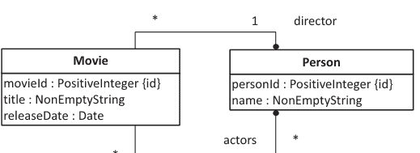

你可以使用以下示例数据来测试你的应用程序：

| 电影 ID | 标题 | 上日期 | 导演 | 演员 |
|---|---|---|---|---|
| 1 | 低俗小说物 | 1994-05-12 | 3 | 4, 5 |
| 2 | 星际大战 | 1977-05-25 | 2 | 6, 7 |
| 3 | 危险的关系 | 1988-12-16 | 1 | 8, 4 |

| 人员 ID | 姓名 |
|---|---|
| 1 | Stephen Frears |
| 2 | George Lucas |
| 3 | Quentin Tarantino |
| 4 | Uma Thurman |
| 5 | John Travolta |
| 6 | Ewan McGregor |
| 7 | Natalie Portman |
| 8 | Keanu Reeves |

更多电影数据可以在 IMDb 网站上找到。

### 6.2 为国家分配城市和首都，并为组织分配成员

该项目基于下方所示的信息设计模型。需要扩展之前作业中的应用程序，增加管理国际组织及其成员，以及城市（作为首都和总部所在地）数据的功能。这是通过添加相应的模型类`InternationalOrganization`和`City`以及以下单向关联来实现的：

- `InternationalOrganization`与`Country`之间的多对多关联，将零或多个国家分配为国际组织的成员；
- `Country`与`City`之间的一一关联，将恰好一个城市分配为国家的首都；
- `Country`与`City`之间的一对多关联，将城市分配给国家。

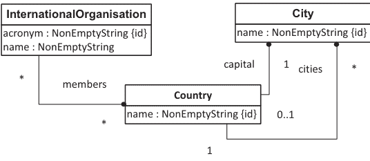

你可以使用以下示例数据来测试你的应用程序：

| 缩写 | 名称 | 成员 |
|---|---|---|
| UN | 联合国 | 德国、法国、俄罗斯 |
| WHO | 世界卫生组织 | 德国、法国、俄罗斯 |
| NATO | 北西洋公约组织 | 德国、法国 |

| 名称 | 首都 | 城市 |
|---|---|---|
| 法国 | 巴黎 | 马赛 |

| 名称 |
|---|
| 柏林 |
| 法兰克福 |
| 汉堡 |

| 城市名称 |
|---|
| 里昂 |
| 马赛 |
| 莫斯科 |
| 新西伯利亚 |
| 巴黎 |

关于国家的更多数据可以在《CIA World Factbook》中找到。

## 7 双向关联

在编程中，双向关联是指表示为一对互反引用属性的关联，允许在两个方向上进行“导航”（对象访问）。

下方图 7.1 所示的模型（关于出版商、书籍及其作者）作为我们的运行示例。注意，它包含两个双向关联，如关联两端的所有权点所示。

| 出版社 | 出版书籍 | 书籍 | 编写书籍 | 作者 |
|---|---|---|---|---|
| name : String (id) | | isbn : String (id) | | personid : Integer (id) |
| address : String | 0.1 | * | * | name : String |

图 7.1：具有两个双向关联的出版商-书籍-作者设计模型。

### 7.1 反向引用属性

为了能够轻松检索由俱乐部成员担任或共同担任主席的委员会，我们在`Committee-ClubMember`示例中添加了两个引用属性：成员担任委员会主席的属性（`ClubMember::committee`）以及成员担任委员会共同主席的属性（`ClubMember::coChairedCommittee`），两者最多担任一个委员会（其中取或关系是非排他的）。我们得到如下模型：

| 委员会 | 俱乐部成员 |
|---|---|
| name : String | chairedCommittee[0..1] : Committee |
| chair : ClubMember | chairedCommittee[0..1] : Committee |

注意`Committee::chair`和`ClubMember::chairedCommittee`两个引用属性之间存在对应关系。它们是互反的：当俱乐部成员 Tom 是预算委员会的主席时（用元组 ("budget committee", "Tom") 表示），那么该预算委员会由俱乐部成员 Tom 主席（用反向元组 ("Tom", "budget committee") 表示）。为了在图中表示这种反向对应关系，我们在`ClubMember::chairedCommittee`属性声明后添加一个大括号内的反向属性约束`inverse of chair`，并在`CommitteeMember::chair`属性处添加类似的约束，如下所示：

| 委员会 | 俱乐部成员 |
|---|---|
| name : String | chairedCommittee[0..1] : Committee (inverse of chair) |
| chair : ClubMember (inverse of chairedCommittee) | chairedCommittee[0..1] : Committee |

使用面向对象语言的引用路径表示法，用`c`引用`Committee`对象，我们得到方程：

```text
c.chair.chairedCommittee = c
```

或者反过来，用`m`引用`ClubMember`对象，我们得到方程：

```text
m.chairedCommittee.chair = m
```

注意，当属性`p_2`是属性`p_1`的反向时，这意味着反过来，`p_1`是`p_2`的反向。虽然在读取时派生的引用属性可能无法保证高效的导航，但在更新时派生的读取时属性确实提供了高效的导航。

当我们通过在属性前加斜杠（`/`）将反向属性指定为派生时，我们表示它是根据更新而派生的。例如，上述示例中的属性`/chairedCommittee`是根据属性`chair`在更新时派派生的。

| 委员会 | 俱乐部成员 |
|---|---|
| name : String | chairedCommittee[0..1] : Committee (inverse of chair) |
| chair : ClubMember | chairedCommittee[0..1] : Committee |

当派生的反向引用属性是多值的，而其反向基属性是单值的时（例如图 7.4 所示的`Publisher::publishedBooks`是由`Book::publisher`派生的），其生命周期依赖关系意味着：

1. 每当创建一个“基对象”（如书籍）时，都需要更新对应的反向属性，即在其值中添加指向新基对象的引用（即向`Publisher::publishedBooks`中添加指向新书籍的引用）；
2. 每当基属性发生更新时（例如为书籍分配了新的出版商），对应的反向属性（在我们的示例中为`Publisher::publishedBooks`）也必须进行更新，即从其值中移除旧引用并添加新引用；
3. 每当一个基对象（如书籍）被销毁时，必须更新对应的反向属性，即从其值中移除该基对象（例如从`Publisher::publishedBooks`中移除指向待删除书籍的引用）。

注意，从纯计算的角度来看，我们可以自由地选择两个互反的引用属性之一（如`Book::authors`和`Author::authoredBooks`）作为主属性。然而，在许多情况下，关联代表了不对称的本体论存在，这决定了两个互反引用属性中哪一个是主。例如，`Book`类和`Author`类之间的作者关联代表了书籍对其作者的本体论依赖。书籍在存在上依赖于作者，而作者并不在存在上依赖她的任何书籍。因此，`Book`和`Author`之间对应的对象生命周期依赖意味着，它们的双向关联通过在`Book::authoredBooks`中维护`Author`引用来维持（这是主属性的选择），而`Author`是从属性，它是从`Book::authors`派生的。

## 7.2 构建 OO 类模型

由于经典编程语言不支持将显式关联作为一等公民，而仅支持通过表示隐式关联的引用属性类，我们必须消除所有显式关联以获取 OO 类模型。

### 7.2.1 基础属性

我们消除关联过程的起点是一个包含各种单向和双向关联的信息设计模型，如上方图 7.1 所示的模型仍然包含任何非导向关联，我们首先必须通过对其端点的所有权做出决策（通常基于导航需求），将它们转换为导向关联。

注意，`Publisher-Book-Author`信息设计模型中的两个关联——`publisher-publishedBooks`和`authoredBooks-authors`（或 Authorship）都是双向的，正如关联端点的所有权点所示。为了从信息设计模型中消除所有显式关联，我们必须执行以下步骤：

1. 消除连接源类与目标类的单向关联，通过将它们替换为源类中的一个引用属性，使目标类成为其范围（range）。
2. 通过将双向关联替换为一对互反的引用属性来消除这些关联。

### 7.2.2 如何消除单向关联

连接源类与目标类的单向关联被替换为其源类中相应的引用属性，该属性的范围为目标类。它的多重性与目标端的多重性相同。如果存在关联端名称，则其名称为该关联端的名称，否则设置为目标类的名称（如果引用属性是多值的，则可能使用复数形式）。

### 7.2.3 如何消除双向关联

双向关联（如图 7.1 所示模型中`Book`类和`Author`类之间的作者关联）被替换为一对互反的引用属性，例如`Book::authors`和`Author::authoredBooks`。由于两个属性都代表相同的信息（同一组二元关系），因此可以将其中一个视为“主”，另一个视为“从”（后者由主属性派生），这是一种可选的方案。我们将讨论一对一和多对多的关联情况。

1. 在双向一对一关联的情况下，会在两个关联类中的每一个类中产生一对互反的单值引用属性。由于它们本质上代表相同的信息（相同的链接/关系），必须选择其中一个作为主属性，另一个作为从属属性，该从属属性通过反转从主属性派生。在类图中，从属属性被指定为*派生属性*，每当 1) 创建新的主对象，2) 更新主引用属性，或 3) 主对象被销毁时，它会自动更新。这种转换如图 7.2 所示。

| Committee | ClubMember |
|---|---|


| name : String | 0..1 | 1 |


| Committee | ClubMember |
| --- | --- |
| name : String | `/chairedCommittee[0..1] : Committee` (inverse of chair) |
| chair : ClubMember |

图 7.2: 将双向一对一关联转换为互反单值引用属性的主从对。

- 2. 双向多对多关联被映射到参与关联的两个类中的每一对对互反多值引用属性。同样，在其中一个类中，代表（反向）关联的多值引用属性被指定为派生属性，每当另一个类（维护关联的地方）中的对应属性被更新时，它会自动更新。转换如图 7.3 所示。

| Book | Author |
| --- | --- |
| isbn : String | personid : Integer |
| title : String | name : String |


| Book | Author |
| --- | --- |
| `isbn[1] : String` | `personID[1] : Integer` |
| `title[1] : String` | `name[1] : String` |
| `authors[*] : Author` | `/authoredBooks[*] : Book` (inverse of chair) |

图 7.3: 将双向多对多关联转换为互反值属性的主从对。

### 7.2.4 OO 类模型

将两个双向关联替换为引用属性后，我们得到了图 7.4 所示的 OO 类模型。

| Book | Publisher |
| --- | --- |
| `isbn[1]: String {id}` | `name[1]: String {id}` |
| `title[1]: String` | `adress[1]: String` |
| `year[1]: Integer` | `/publishedBooks[*]: Book` (inverse of publisher) |
| `publisher[0..1]: Publisher` | Author |
| `authors[*]: Author` | `name[1]: String` |
|  | `/authoredBooks[*]: Book` (inverse of author) |

图 7.4: 具有两对互反属性的 OO 类模型。

由于书籍是本质上依赖于（可能可能）出版物的实体，而不是反之，因此在书籍对象中维护主引用，并将出版商和作者对象中的反向引用视为派生（或从）数据是自然的。因此，我们将 `publishedBooks` 和 `authoredBooks` 定义为反向引用属性，这在 OO 类模型中通过斜杠前缀指示。

该 OO 类模型的含义可以通过涉及的三个类的示例数据填充来说明：

| Name | Address | Published books |
| --- | --- | --- |
| Bantam Books | New York, USA | 0553345842 |
| Basic Books | New York, USA | 0465030793 |

| ISBN | Title | Year | Authors | Publisher |
| --- | --- | --- | --- | --- |
| 0553345842 | The Mind's I | 1982 | 1, 2 | Bantam Books |
| 1463794762 | The Critique of Pure Reason | 2011 | 3 | |
| 1928565379 | The Critique of Practical Reason | 2009 | 3 | |
| 0465030793 | I Am A Strange Loop | 2000 | 2 | Basic Books |

| 作者 ID | 姓名 | 著作 |
| :--- | :--- | :--- |
| 1 | Daniel Dennett | 0553345842 |
| 2 | Douglas Hofstadter | 0553345842, 04650307093 |
| 3 | Immanuel Kant | 1463794762, 1928565379 |

注意书籍（Book）记录是如何引用出版商（Publisher）和作者（Author）记录的，反之亦然，出版商和作者记录也会引用书籍记录。

## 8 使用原生 JS 实现双向关联

在本章中，我们将展示：

- 1. 如何从一个具有派生反向引用属性的 OO 类模型推导出 JS 类模型；
- 2. 如何在 JavaScript 类模型的框架内编写 JS 类模型；
- 3. 如何基于模型代码编写反向代码和控制器代码。

### 8.1 创建 JavaScript 类模型

构建我们 JS 类模型的起点是一个具有派生反向引用属性的 OO 类模型，就像上面讨论的，为了方便起见，我们再次展示：

| 书籍 (Book) | 出版商 (Publisher) |
| :--- | :--- |
| `isbn[1]: String (id)` | `personId[1]: Integer (id)` |
| `title[1]: String` | `name[1]: String` |
| `year[1]: Integer` | `/publishedBooks[*]: Book` (出版商的反向引用) |
| `publisher[0..1]: Publisher` | `/authors[*]: Author` |

注意该模型包含两个派生反向引用属性：`Publisher:/publishedBooks` 和 `Author::/authoredBooks`。它们中的每一个都链接到一个主属性，并从该属性派生出来。因此，每一个属性都代表了一对对应于双向关联的互反反向引用属性。

与使用单向关联构建 JS 类模型相比，唯一的新出现问题是：

- 1. 为所有反向引用属性添加 «get> 构型，这意味着它们具有隐式的 getter（`get`），但没有 setter（`set`）。当它们的主引用属性更新时，它们会被隐式地设置。

这涉及两个派生反向引用属性 `Publisher:/publishedBooks` 和 `Author::/authoredBooks`。因此，我们得到了以下 JavaScript 类模型：

### 书籍 (Book)

### 出版商 (Publisher)

| `<get/set> isbn[id] : string (id)` | `<get/set> setname[1] : string (id)` |
| --- | --- |
| `<get/set> title[1] : string` | `<get/set> setaddress[1] : string` |
| `<get/set> year[1] : number(int)` | `<get/set> publishedBooks[*] : Book` (出版商的反向引用) |
| `<get/set> publisher[0..1] : Publisher` | `checkName(n : String) : ConstraintViolation` |
| `<get/set> author[1] : Author` | `checkNameAs(n : String) : ConstraintViolation` |
| `checkIsbn(isbn : String) : ConstraintViolation` | `checkRefIn(isbn : String) : ConstraintViolation` |
| `checkIsbnAidRef(isbn : String) : ConstraintViolation` | `checkAddress(a : String) : ConstraintViolation` |
| `checkTitle(title : String) : ConstraintViolation` | `tostring() : String` |
| `checkPublisher(p : Publisher) : ConstraintViolation` | `toRecord() : Object` |
| `checkAuthor(author : Author) : ConstraintViolation` |  |
| `addAuthor(author : Author)` |  |
| `removeAuthor(author : Author)` |  |
| `toString() : String` |  |
| `toRecord() : Object` |  |

### 作者 (Author)

### 8.2 编写模型代码

可以直接为 JS 类模型进行编码，以获取 JavaScript 前端应用模型层的代码。

#### 8.2.1 新问题

与单向关联应用相比，我们必须处理许多新的技术问题：

- 1. 我们定义了派生反向引用属性，例如 `Publisher::publishedBooks`，它不包含检查操作（`check`），也不包含设置操作（`set`）。

- 2. 我们还必须通过维护派生集合（即反向引用属性的集合，用于收集派生反向引用属性的值），来维护派生反向引用属性。这特别要求：

  - 每当单值主引用属性的值通过 setter 初始化或更新时（例如将 Publisher 实例 `p` 的引用赋值给书籍实例 `b` 的 `b.publisher`），必须向派生反向引用属性的对应值赋值或添加反向引用（例如将 `b` 添加到 `p.publishedBooks`）；当主引用属性的值更新或变为多值时，必须删除指向单值主引用属性旧值的过时反向引用；

- 2. 每当可选的单值主引用属性的值被取消设置时（例如为书籍实例 `b` 的 `b.publisher` 赋值为 `null`），如果派生引用属性是多值的，则必须从派生引用属性的对应值中移除反向引用（例如从 `p.publishedBooks` 中移除 `b`），否则必须将派生引用属性的对应值设为未设置或更新；

- 3. 每当通过 add 方法向多值主引用属性添加引用时（例如为书籍实例 `b` 的 `b.` 添加一个作者引用），必须向派生反向引用属性的对应值赋值或添加反向引用（例如将 `b` 添加到 `a.authoredBooks`）；

- 4. 每当通过 remove 方法从多值主引用属性移除引用时（例如从书籍实例 `b` 的 `b.` 移除一个引用），如果派生引用属性是多值的，则必须从派生引用属性的对应值中移除反向引用（例如从 `p.publishedBooks` 中移除 `b`），否则必须将派生引用属性的对应值设为未设置或更新；

- 5. 每当单值主引用属性的值通过 setter 初始化或更新时（例如将 Publisher 实例 `p` 的引用赋值给书籍实例 `b` 的 `b.publisher`），必须向派生反向引用属性的对应值赋值或添加反向引用（例如将 `b` 添加到 `p.publishedBooks`）；当主引用属性的值更新或变为多值时，必须删除指向单值主引用属性旧值的过时反向引用；

注意，当使用单个或多个引用作为主引用属性的值创建对象时（例如创建一个具有单一引用 `b.publisher` 的新书籍实例），其 setter 将负责创建反向引用。

#### 8.2.2 编码总结

将每个 JS 类模型编码为带有隐式 getter 和 setter 的 ES2015 类（或者，作为替代，带有显式 setter 的 ES5 构造函数）：

- 1. 以类级方法（static）的形式编写属性检查。确保 JS 类模型中指定的所有约束都已正确编码。

- 2. 对于每个单值属性，编写指定的 getter 和 setter：

  - 在每个 setter 中，调用相应的属性检查，只有在未检测到违反的情况下才对属性赋值/取消设置；
  - 如果该属性是派生属性的反向引用（代表双向关联），确保 setter 同时从反向属性的集合值中取消设置或移除该反向引用。

- 3. 对于每个多值属性，编写其 add 和 remove 操作，以及指定的 get/set 操作：

  - 将 add/remove 操作编写为调用相应属性检查的实例方法；
  - 编写 setter，使其对要赋值的集合中的每一项调用 add 操作；
  - 如果该属性是派生属性的反向引用（代表双向关联），确保 add/remove 方法也向反向属性的集合值赋值/取消设置或移除反向引用。

- 4. 编写序列化函数 `toString()` 和对象到存储转换函数 `toRecord()` 的代码。在将出版商或作者转换为存储格式的 `toRecord()` 时，不包含派生的 `publishedBooks` 和 `authoredBooks` 属性，因为这些信息是冗余的（它们是从书籍的 `publisher` 和 `authors` 属性派生的）。

- 5. 在 `destroy` 方法中处理删除依赖。确保当具有单个或多个引用作为主引用属性值的对象被销毁时，先取消设置或移除派生引用。

#### 8.2.3 为 JS 类模型中的每个类

例如，JS 类模型中的 Publisher 类按如下方式编码：

```javascript
class Publisher {
  constructor({name, address}) {
    this.name = name;
    this.address = address;
    // 派生反向引用属性 (Book::publisher 的反向)
    this._publishedBooks = {}; // 初始化为空映射
  }
  getName() {. . . }
  static checkName(n) {. . . }
  static checkNameAsId(n) {. . . }
}
```

```javascript
static checkNameAsIdRef(n) { . . }
set name(n) { . . }
get address() { . . }
static checkAddress(a) { . . }
set address(a) { . . }
toString() { . . }
toRecord() { . . }
}
```

注意，我们添加了（派生的）多值引用属性 `publishedBooks`，但我们没有在构造函数中为其赋值，因为它是一个只读属性，当它的反向引用属性 `Book::publisher` 被赋值时，它会被隐式赋值。

#### 8.2.4 单值属性 Set 方法的代码

任何耦合到定义器反向引用属性（实现双向关联）的属性的设置器（setter），也需要向或从反向引用属性对应的集合值（value set）中分配/添加/删除反向引用。此类 setter 的示例是 `Book` 类中的 `publisher`：

```javascript
set publisher(p) {
  if (!p) { // 需要删除发布者引用
    // 删除 Publisher::publishedBooks 中的反向引用
    delete this._publisher,publishedBooks[this._isbn];
    // 取消发布者属性
    delete this._publisher;
  } else {
    // p 可以是 ID 或对象引用
    const publisher_id = (typeof p!="object") ? p : p.name;
    const constraintViolation = Book.checkPublisher(publisher_id);
    if (constraintViolation instanceof NoConstraintViolation) {
      // 删除 Publisher::publishedBooks 中的反向引用
      delete this._publisher.publishedBooks[this._isbn];
      // 创建新的发布者引用
      this._publisher = Publisher.instances[publisher_id];
      // 将新的反向引用添加到 Publisher::publishedBooks
    }
  }
}
```

## 96 - 8 使用原生 JS 实现双向关联

```javascript
this._publisher.publishedBooks[this._isbn] = this;
} else {
    throw constraintViolation;
}
```

#### 8.2.5 Add 和 Remove 操作的代码

对于任何耦合到派生引用属性的多值引用属性，add 和 remove 方法都必须向或从反向属性的（值集）中分配/添加/移动引用。

例如，为了实现 Book 和 Author 之间的双向作者关联，多值引用属性 `Book::authors` 耦合到派生的反向属性 `Author::authoredBooks`，`Book::addAuthor` 方法的代码实现如下：


```javascript
addAuthor(a) {
    // a 可以是 ID 引用或对象引用
    const author_id = (typeof a === "object") ? parseInt(a) : a.authorId;
    const validationResult = Book.checkAuthor(author_id);
    if (author_id && validationResult instanceof NoConstraintViolation) {
        // 添加新的作者引用
        this._authors[author_id] = Author.instances[author_id];
        // 自动添加派生的反向引用
        this._authors[author_id].authoredBooks[this._isbn] = this;
} else {
    throw validationResult;
}
```

对于删除操作`removeAuthor`，我们获得以下代码：

```javascript
removeAuthor(a) {
    // a 可以是 ID 引用或对象引用
    const author_id = (typeof a === "object") ? parseInt(a) : a.authorId;
    const validationResult = Book.checkAuthor(author_id);
    if (validationResult instanceof NoConstraintViolation) {
        // 自动删除派生的反向引用
        delete this._authors[author_id].authoredBooks[this._isbn];
        // 删除作者引用
}
```

## 8.2 编写模型代码

```javascript
delete this._authors[author_id];
) else {
  throw validationResult;
}
```

### 8.2.6 抑制派生属性值的存储

使用`toRecord()`将发布者或作者对象转换为存储格式时，派生属性`publishedBooks`和`authoredBooks`不包含内，因为它们的信息是冗余的（派生自书籍的发布者和作者属性）。在实例，`Author::toRecord`函数的代码如下：

```javascript
toRecord() {
  var rec = {};
  // 遍历所有 Author 属性
  for (let p of Object.keys(this)) {
    // 遍历带下划线前缀的属性，排除 "_authoredBooks"
    if (p.charAt(0) == "_" && p != "_authoredBooks") {
      // 移除下划线前缀
      rec[p.substr(1)] = this;
    }
  }
  return rec;
}
```

### 8.2.7 处理删除

当一个具有单个`Publisher`引用和多个`Author`引用的`Book`实例被销毁时，必须先移除派生引用（例如，通过从`Publisher`中删除）：

```javascript
Book.destroy = function (isbn) {
  const book = Book.instances[isbn];
  if (book) {
    console.log(book.toString() + " deleted!");
    if (book.publisher) {
      // 从发布者处删除反向引用
      delete book.publisher.publishedBooks[isbn];
    }
    // 从作者处删除反向引用
    for (let authorID of Object.keys(book.authors)) {
      delete book.authors[authorID].authoredBooks[isbn];
      delete book.authors[authorID];
    }
  } else {
    console.log(`There is no book with ${isbn}`);
  }
}
```

## 8 使用原生 JS 实现双向关联

```javascript
// 从作者处删除反向引用
for (let authorID of Object.keys(book.authors)) {
  delete book.authors[authorID].authoredBooks[isbn];
  delete book.authors[authorID];
}
} else {
  console.log(`There is no book with ${isbn}`);
}
```

## 8.3 在用户界面中利用引用属性

在 UI 代码中，我们现在可以在“获取所有（Retrieve All）”用例中利用发布者的派生属性。

### 8.3.1 在“获取所有”中显示已书籍的信息

为了在“获取所有”案例中显示书籍信息，我们现在可以利用派生属性：

```javascript
pl.retrieveAndList = {
  setupInterface: function () {
    const tableBodyEl = document.querySelector("section#PublisherR<<tbody>>");
    tableBodyEl.innerHTML = "";
    for (let key of Object.keys(Publisher.instances)) {
      const publisher = Publisher.instances[key];
      const row = tableBodyEl.insertRow(-1);
      // 按发布者创建书籍列表
      const listEl = util.createListFrom(publisher.publishedBooks, "title");
      row.insertCell(-1).textContent = publisher.name;
      row.insertCell(-1).textContent = publisher.address;
      row.insertCell(-1).appendChild(listEl);
    }
    document.getElementById("Publisher-M").style.display = "none";
    document.getElementById("Publisher-R").style.display = "block";
  }
};
```

## 9 使用 Java EE 实现双向关联

在本章中，我们将展示：

1. 如何从 OO 类模型（派生自信息设计模型）导出 Java 实体模型；
2. 如何以实体类（表示模型类）的形式编写实体模型；
3. 如何基于实体类编写视图和控制器代码。

### 9.1 创建 Java 实体模型

创建 Java 实体模型的起点是一个带有派生反向属性的 OO 类模型（如上述图 7.4），为了方便起见，我们在这里展示：

| Book | Publisher |
|---|---|
| isbn[1]: String (id) | name[1]: String (id) |
| title[1]: String | address[1]: String |
| year[1]: Integer | /publishedBooks[*]: Book (inverse of publisher) |
| publisher[0..]: Publisher | Author |
| authors[*]: Author | personid[1]: Integer (id) |
| | /authoredBooks[*]: Book (inverse of authors) |

注意，模型包含两个反向引用属性：`Publisher::publishedBooks`和`Author::authoredBooks`。它们每一个都链接到一个主属性，该属性是通过反向约束派生的。因此，它们中的每一个都代表一对互反的引用属性，对应于双向关联。

我们现在展示如何从 OO 类模型导出 Java：

1. 将每个类转换为 `<Java Entity>`并使所有属性变为私有。
2. 将 OO 类模型中的平台无关数据类型名称替换为相应的 Java 数据类型类（`Integer`、`Float`等）。
3. 为所有非派生属性添加«get/set»立体型，表示它们需要访问器。
4. 为所有派生属性添加«get»立体型，表示它们只需要 getter。

### 9.1 构建 Java 实体类模型

5. 对于任何引用属性，根据其所表示的关联功能类型，添加相应的关键字作为属性修符。对于给定的 OO 类模型，添加以下属性修符：

   - 为派生属性`Publisher::/publishedBooks`添加`oneToMany`；
   - 为引用属性`Book::publisher`添加`manyToOne`；
   - 为引用属性`Book::authors`添加`manyToMany`；
   - 为派生属性`Author::/authoredBooks`添加`manyToMany`。

6. 对于任何指定为另一个引用属性反向的引用属性，将其`(inverse of...)`属性替换为相应的`(mappedBy="...")`属性修符。
7. 创建所需的属性约束约束检查操作。
8. 为每个多值属性创建一个添加（add）操作和一个删除（remove）操作。

这导致了以下 Java 实体类模型：

| Java 实体 |
|---|
| Publisher |
| └─ get/set-name[1] : String (id) |
| └─ get/set-address[1] : String |
| └─ set/-publishedBooks[] : Book (manyToOne, mappedBy="publisher") |
| └─ +checkNameId(in n: String, em: EntityManager) : ConstraintViolation |
| └─ +toString(): String |
| └─ +retrieveAll(em: EntityManager) : List<Publisher> |
| └─ +create(in em: EntityManager, in name: String, in address: String) |
| └─ +update(in em: EntityManager, in name: String, in address: String) |
| └─ +delete(in em: EntityManager, in name: String) |

| Java 实体 |
|---|
| Book |
| └─ get/set-isbn[1] : String (id) |
| └─ get/set-title[1] : String |
| └─ get/set-year[1] : Integer |
| └─ get/set-publisher[0..1] : Publisher (manyToOne) |
| └─ get/set-authors[] : Author (manyToMany) |
| └─ +checkAuthorId(in isbn: String) : ConstraintViolation |
| └─ +addAuthor(in author: Author) |
| └─ +removeAuthor(in author: Author) |
| └─ +toString(): String |
| └─ +... |

| Java 实体 |
|---|
| Author |
| └─ get/set-personId[1] : Integer (id) |
| └─ get/set-name[1] : String |
| └─ get/-authoredBooks[] : Book (manyToMany, mappedBy="authors") |
| └─ +checkPersonId(in pld: Integer, in em: EntityManager) : ConstraintViolation |
| └─ +toString(): String |
| └─ +... |

### 9.2 编写模型

可以直接对 Java 实体模型进行编码，以获取我们 Java 后端应用的模型层代码。

#### 9.2.1 新问题

与之前讨论的单向关联应用相比，我们必须处理一组新的技术问题：

1. 在模型代码中，你现在需要维护派生的反向引用属性，这需要通过维护构成派生反向引用属性值的派生反向引用（集合）来实现。特别是：

2. 每当通过 setter 初始化或更新单值主引用属性的值时（例如将指向`Publisher`实例`p`的引用赋值给`Book`实例`b`的`p.publisher`），必须向派生反向引用属性的相应值分配或添加反向引用（例如将`b`添加到`p.publishedBooks`）；当主引用属性的值更新且派生反向引用属性是多值时，需要删除指向单值主引用属性旧值的过时反向引用；

3. 每当可选的单值主引用属性的值取消设置时（例如通过为`Book`实例`b`的`b.publisher`赋值`null`），如果派生反向引用属性是多值的，则必须从派生反向引用属性的相应值移除反向引用（例如从`p.publishedBooks`中移除`b`），否则必须取消或更新派生反向引用属性的相应值；

4. 每当通过 add 方法向多值主引用属性的值添加引用时（例如向`Book`实例`b`的`b.authors`添加`Author`引用），必须向反向引用属性的相应值分配或添加反向引用（例如将`b`添加到`a.authoredBooks`）；

5. 每当通过 remove 方法从多值主引用属性的值移除引用时（例如从`Book`实例`b`的`b.authors`中移除指向`Author`实例的引用），如果派生反向引用属性是多值的，则必须从派生反向引用属性的相应值移除反向引用（例如从`a.authoredBooks`中移除`b`），否则必须取消或更新派生反向引用属性的相应值；

6. 当具有单引用或多个主引用属性值的对象被销毁时（例如当一个具有单引用`b.publisher`指向`Publisher`实例`p`的`Book`实例被销毁时），必须移除派生的反向引用（例如通过从`p.publishedBooks`中移除`b`）。

注意，当使用单引用或多个引用作为主引用属性的值创建新对象时（例如具有单引用`b.publisher`的新`Book`实例），其 setter 或 add 方法将被调用并处理反向引用的创建。

在 UI 代码中，我们现在可以利用反向引用属性在列表对象用例中高效创建反向对象列表。例如，我们可以更高效地为每个发行者创建所有已出版书籍列表。

#### 9.2.2 总结

- 将 Java 实体类模型中的每个类编码为相应的实体类。
- 使用 JPA 注解`@Id`编码`(id)`属性修符。
- 使用相应的 JPA 注解（如`@ManyToMany`）编码表示引用属性功能的任何属性修符，如`(ManyToOne)`。
- 借助 Java Bean Validation 注解（或自定义校验注解）编码模型中指定的完整性约束。
- 为多个属性编码 getters、setters 以及 add 和 remove 方法。
- 将创建、检索、更新和删除存储管理操作编码为类级方法。
- 在创建和更新方法中处理反向关系管理。

这些步骤将在后续章节中进行更详细的讨论。

#### 9.2.3 编码 Java 实体类模型中的每个类

在`Publisher`类中，我们添加`publishedBooks`属性，并使用与`Book`类中的`@ManyToMany`对应的注解，表示反向关系：

## 9 使用 Java EE 实现双向关联

```java
@Entity
public class Publisher {
  ..
  @OneToMany(fetch=FetchType.EAGER, mappedBy="publisher")
  private Set<Book> publishedBooks;
  ..
}
```

`publishedBooks`属性的`@OneToMany`注解的`mappedBy`参数指定了`Book`类中实现`@ManyToOne`的属性：

```java
@Entity
public class Book {
  ..
  @ManyToOne(fetch=FetchType.EAGER)
  @JoinColumn(name="PUBLHER_ID")
  private Publisher publisher;
  ..
}
```

在`Author`类中，我们添加`authoredBooks`属性，并使用与`Book`类中的`@ManyToMany`对应的注解，表示反向关系：

```java
@Entity
public class Author {
  ..
  @ManyToMany(fetch=FetchType.EAGER, mappedBy="authors")
  private Set<Book> authoredBooks;
  ..
}
```


`Author`类`authoredBooks`属性的`@ManyToMany`的`mappedBy`属性指定了`Book`类中的反向属性：

```java @Entity
public class Book {
  ..
  @ManyToMany(fetch=FetchType.EAGER)
  @JoinTable(
    name="books_authors",
    joinColumns = @JoinColumn(name="BOOK_ID"),
    inverseJoinColumns = @JoinColumn(name="AUTHOR_ID")
  )
  private Set<Author> authors;
  ..
}
```

我们还使用`@JoinTable`注解指定多对关系的连接表以及连接表的相应列，例如表名为`books_authors`，列名为`BOOK_ID`和`AUTHOR_ID`。

### 9.2.4 编码 Setter 操作

对于任何与派生反向引用属性耦合（实现双向关联）的引用属性，现在还需要向反向属性的相应值（集合）分配/添加/移除反向引用。此类 setter 的示例是`setPublisher`方法：

```java
public void setPublisher(Publisher publisher) {
  // 从 publisher.publishedBooks 中移除书籍引用
  if (this.publisher != null) {
    this.publisher.removePublishedBook(this);
  }
  // 将书籍添加到 publisher.publishedBooks 中
  if (publisher != null) {
    publisher.addPublishedBook(this);
  }
  this.publisher = publisher;
}
```

### 9.2.5 编码添加和删除操作

对于任何与派生反向引用属性耦合的多值引用属性，add add 和 remove 方法都必须向反向属性的相应值（集合）分配/添加/移除反向引用。

## 9. 使用 Java EE 实现双向关联

例如，对于多值引用属性`Book::authors`，它与派生的反向引用属性`Author::authoredBooks`耦合，以实现 Book 和 Author 之间的双向作者关系，其`addAuthor`方法的代码如下：

```java
public class Book {

  public void addAuthor(Author author) {
    if (this.authors == null) {
      this.authors = new HashSet<Author>();
    }
    if (!this.authors.contains(author)) {
      // 添加新的作者引用
      this.authors.add(author);
      // 添加派生的反向引用
      author.addAuthoredBook(this);
    }
  }
}
```

对于删除类`removeAuthor`，我们得到以下代码：

```java
public class Book {

  public void removeAuthor(Author author) {
    if (this.authors != null && author != null &&
        this.authors.contains(author)) {
      // 删除作者引用
      this.authors.remove(author);
      // 删除派生的反向引用
      author.removeAuthoredBook(this);
    }
  }
}
```

记住，对于 Java 集合（如 Set 或 List），`contains`方法通过使用对象的`equals`方法来比较两个对象。例如，在`Author`类中对`Set<Author>`（如`publishedBooks`）使用`contains`方法，我们实现了以下`equals`方法（如果两个作者的`personId`属性值相等，则它们相等）：

```java
public class Author {
  ..
  @Override
  public boolean equals(Object obj) {
    if (obj instanceof Author) {
      Author author = (Author) obj;
      return (this.personId.equals(author.personId));
    } else return false;
  }
}
```

### 9.2.6 处理删除依赖

当一个 Book 实例`b`（具有单个引用`b.publisher`指向 Publisher 实例`p`以及多个引用`b.authors`指向 Author 实例）被删除时，必须先移除派生的反向引用（例如通过从`p.publishedBooks`中移除`b`）。这是通过在`Book.delete`方法中为单值和多值属性调用带有空参数的方法实现的，例如`b.setPublisher(null)`和`b.setAuthors(null)`：

```java
public class Book {
  ..
  public static void delete(EntityManager em,
    UserTransaction ut, String isbn) throws Exception {
    ut.begin();
    Book b = em.find(Book.class, isbn);
    b.setPublisher(null);
    b.setAuthors(null);
    em.remove(b);
    ut.commit();
  }
}
```

同样，在删除 Publisher 或 Author 实例时，我们必须处理删除对 Book 实例的引用：

```java
public class Author {
  public static void delete(EntityManager em,
    UserTransaction ut, Integer personId) throws Exception {
    ut.begin();
    Author a = em.find(Author.class, personId);
    a.setAuthoredBooks(null);
    em.remove(a);
    ut.commit();
  }
}
```

```java
public class Publisher {
  public static void delete(EntityManager em,
    UserTransaction ut, String name) throws Exception {
    ut.begin();
    Publisher p = em.find(Publisher.class, name);
    p.setAuthoredBooks(null);
    em.remove(p);
    ut.commit();
  }
}
```

### 9.2.7 实体管理器和缓存实体

遗憾的是，JPA 并不提供对派生反向引用的自动维护。根据 Java Persistence Wiki，我们必须通过 set/remove 方法来实现对派生的反向引用的维护：

> 双向关系中的一个常见问题是应用程序更新了关系的一侧，而另一侧没有更新，导致不同步。在 JPA 中（泛指在 Java 中），维护关系是应用程序或模型的责任。解决这个问题有两种方法：你既可以将关系维护代码添加到关系的一侧，并仅使用该侧的 setter（例如将另一侧保护），或者在双方都添加以避免无限循环。

我们为每个类都使用了实体管理器。每个实体管理器都维护一组缓存实体，可以通过`merge`方法与其他实体管理器“共享”。在我们的示例代码中，在每个类的创建和更新方法中，我们需要合并属于另一个管理器的实体。例如，在`Book.create`方法中，我们需要合并由`PublisherController`实体管理器管理的书籍出版社，以及由`AuthorController`实体管理器管理的所有作者：

```java
public class Book {
    public static void create(EntityManager em,
        UserTransaction ut,
        String isbn, String title, Integer year,
        Publisher publisher, Set<Author> authors)
        throws Exception {
        ut.begin();
        Book book = new Book(isbn, title, year,
            publisher, authors);
        em.persist(book);
        if (publisher != null) {
            em.merge(publisher);
        }
        if (authors != null) {
            for (Author a : authors) {
                em.merge(a);
            }
        }
        ut.commit();
    }
}
```

如果不使用`merge`，出版社以及作者列表中的所有作者实例都不代表原始缓存实体的引用，并且不会保留它们的更改。更多详细信息请查阅相关的相关的 Java Persistence 文档。

也可以禁用 JPA 缓存，使得每个新实例都从数据库重新加载实体，例如当调用`EntityManager.find`方法时。这可以通过在`persistence.xml`文件中添加该行来实现：

```xml
<property name="ecliselink.cache.shared.default" value="false"/>
```

上述配置适用于 ecliselink 实现，其他 API 实现可能有所不同。请注意，如果没有严重原因，不建议禁用实体缓存，因为这会降低应用程序的性能。

```java
}
return result;
}
return null;
}
}
```

然后，我们在 facelet 中使用`converter`属性来指定我们的转换器类（例如`pl.m.converter.BookListConverter`），以便在相应的视图组件需要渲染时使用：

```xml
<h:column>
  <f:facet name="header">Published books</f:facet>
  <h:outputText value="#{p.publishedBooks}" escape="false"
    converter="pl.m.converter.BookListConverter"/>
  </h:outputText>
</h:column>
```

由于序列化文本包含 HTML 元素（即用于`<br />`生成 HTML 换行），我们必须指定`@escape="false"`属性，否则`<`和`>`将被替换为相应的`&lt;``&gt;`

JSF 转换器的主要优势在于我们没有将模型代码与特定代码混合，我们的模型类保持整洁且分层。如果我们想将 JSF 替换为新的 UI 技术，我们的模型类将保持不变，我们只需要为新技术处理相应的转换器即可。

## 9.4 运行应用并获取代码

运行你的应用程序，你可能需要先停止 Tomcat/TomEE 服务器（Windows 使用`bin/shutdown.bat`，Linux 使用`shutdown.sh`）。接下来，下载并解压包含应用程序的 ZIP 文件，其中包含了应用程序的所有源码以及你必须编辑的 ANT 脚本（修改`server.folder`属性）。现在，在控制台或终端中执行以下命令：

```bash
ant deploy -Dname=BidirectionalAssociationApp
```

最后，启动你的 Tomcat Web 服务器（Windows 系统使用`bin/start.bat`，Linux 使用`bin/start.sh`）。请耐心等待，取决于电脑的速度，这需要一些时间。最后，打开浏览器并输入：

```text
http://localhost:8080/BidirectionalAssociationApp/WebContent/views/app/index.xhtml
```

## 10 关联的特殊主题

### 10.1 部分-整体关联（Part-Whole Associations）

部分-整体关联表示部分类型与整体类型之间的关系。实例是两个对象之间的部分-整体关系，其中一个是对象的组成（the）。UML 将部分-整体关联分为两种：聚合（aggregation）和组合（composition）。虽然这些类型在 UML 中以一种相当精确但并不尽意的方式定义，但许多软件开发者遵循 C++ 编程社区的术语传统，有不同的解释：与“聚合-组合”中的部分不同，“组合”的部分无法脱离其引用的组合而独立存在。

我们遵循 UML，并通过引入两种组合类型之间的区别来改进其对组合的定义：即具有可分离的（separable）组成部分的组合，以及具有不可分离的（inseparable）组成部分的组合。

#### 10.1.1 聚合（Aggregation）

聚合是部分-整体关联的一种特殊形式，整体的部分可以与其他整体共享。例如，我们可以对`DegreeProgram`（学位计划）和`Course`（课程）类之间的聚合进行建模，如图所示，因为课程是学位计划的一部分，且课程可以在两个或多个学位计划之间共享（例如，工程学位可以与计算机科学学位共享门 C 语言课程）。

| DegreeProgram | Course |
| --- | --- |
| name : String | id : String |
| * | name : String |

然而，具有可共享部分的聚合概念实际上并没有太大意义，因此它对如何编写关联代码没有影响，许多开发者倾向于不在类图中使用白色菱形，而是仅将其建模为普通的关联。UML 规定：“共享聚合的精确语义取决于应用领域和建模者。”

聚合关联在整体侧（whole side）的端点多数性（multiplicity）可以是任何数字（`*`），因为一个部分可能属于或共享于任意数量的整体。

#### 10.1.2 组合（Composition）

部分-整体关联概念聚合与组合之间的区别竟然存在如此多的困惑，这令人惊讶。主要问题在于一种广泛的误解（即使在专家软件开发者和 UML 作者之间也是如此），认为组合的概念意味着整体与其部分之间存在生命周期依赖，即部分离开整体就无法存在。但这种观点忽略了这样一个事实：也存在非可共享部分的部分-整体关联，在这种情况下，部分可以被分离并在整体销毁后继续存在。

在规范文档中，“组合”一词的定义一直意味着非可共享部分，但并不清楚“组合”的定义性特征是什么，哪些仅仅是可选特征。即使在 UML 2.5 版本（截至 2015 年）中，在尝试提供“组合”术语的定义后，它仍然模糊，没有为如何建模非可共享部分-整体关联提供指导——即部分可以从整体中分离并在销毁后生存，对比部分无法分离并随整体一同销毁的情况。他们说：

> 如果一个组合对象被删除，其所有部分都会被删除。

同时他们又说：

> 部分可以在组合对象删除之前从其移除，从而不被删除。

这种困惑指向了 UML 定义的不完整性，它没有考虑到部分与整体之间的依赖关系。因此，理解如何增强 UML 定义很重要，例如通过引入“不可分离”的 UML 样式，或者通过在组合侧引入“不可分离”关键字来表述。

Martin Fowler 解释过，组合关系的主要问题是“一个对象只能是组合的一部分”。这在 B. Bellekens 的博客文章《Aggregation Composition as Association》中也有解释。除了定义组合的特性（具有独占的非可共享部分）之外，组合还可能带有整体与其组件之间的生命周期依赖。事实上，这种依赖分为两类：

- 每当组合必须连接到整体时（即具有强制性组合，由组合侧的“恰好一个”多数性表示），当当前整体销毁时，它必须被移动到另一个整体或被删除。人与心脏之间的组合示例说明了这一点：当主人去世时，心脏会被删除或移植给他人。
- 每当组件无法从其组合分离时（即它是不可分离的），那么只有在这种情况下，组件在整体销毁时才必须被删除。这种不可分离部分的组合示例是人与大脑之间的组合。

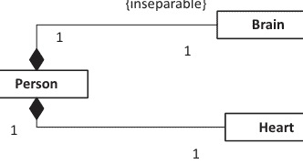

#### 总结

当生命周期依赖，它是存在依赖（Existential Dependency）的一种特殊形式，这意味着第 1.2 节讨论的级联删除策略。

在汽车-引擎组合的示例中（如图所示），可以在汽车销毁之前从汽车上分离，在这种情况下，引擎不会被删除并可以重复使用。这是由组合侧零或一的多数性所暗示的。

| Car | Engine |
| --- | --- |
| licenseNo : String | id : String |
| color : String 0.1 0.1 | cylinderCapacity : Decimal |

组合关联在整体侧的多数性是 1 或 0.1，取决于组件是否具有强制性的整体。当然，组合不可分离的事实意味着它具有强制性的整体，因此组合的多数性必须为 1。

### 10.1.3 示例


作为部分—整体关联的示例，我们考虑教科书与其章节之间的关联。通常，教科书的一个章节在不经过修改的情况下无法在另一书中重复（例如，因为它可能引用了该书的其他部分）。

## 10 关联的特殊主题

此外，拥有不属于教科书的教材章节是没有意义的。因此，我们将这种关联建模为一种**不可分割的组合**，如下所示。

```text
invariant
(教科书的 ISBN
和章节的 sequenceNo 的组合是唯一的。)
```

| 教科书 (Textbook) | (不可分割) | 章节 (Chapter) |
| --- | --- | --- |
| isbn: String (id) |  | sequenceNo: Integer |
| title: String |  | title: String |
| year: Integer | * |  |

表示不可分割组件类型的对象类（如章节）不需要具有标准的标识符属性，因为不需要让不可分割组件在独立于其复合对象的情况下被引用。对于不可分割组件的引用，使用一个复合键，该复合键由复合类型的主键和组件类型合适的（相对唯一的）属性组成。例如，一个教科书章节是通过教科书的 ISBN 和章节的序列号组合来引用的。

由于章节对象作为教科书对象的不可分割组件，当其教科书对象不存在时也无法继续存在，因此在删除教科书对象的实现中，我们不需要使用 `CASCADE`（级联）删除策略（即删除教科书时删除所有相关的章节）。

不可分割组件类型不需要它自己的 CRUD 数据用户界面。相反，所有的 CRUD 操作都在其复合类型的数据管理用户界面中提供。例如，创建、检索、更新和删除教科书章节是在管理教科书数据的用户界面中完成的。

## 10.2 关联类 (Association Classes)

关联类是表示关联的类。

回想一下，简单关联在对象类模型中通过将其转换为相关对象类的引用属性而被消除，如图 1.7 所示。每当关联具有属性时，它就无法被消除，必须在 OO 类模型中转换为一个类。

例如，考虑在 `Book`（书）和 `Person`（人）对象类型上的关联 `Reservation`（预订），它允许表达如下事实：“ISBN 为 3627921105 的书被 ID 为 4701199 的人于 2020-08-22 预订”。由于它有一个日期（date）属性，该关联在信息设计模型中被建模为关联类，如下类图所示：

| Reservation |  |  | Person |
| --- | --- | --- | --- |
| date : Date | * | * |  |
| Book |  |  |  |
| isbn : String (id) |  | reserved_by | id : Integer (id) |
| title: String |  |  | name |
| year: Integer |  |  |  |

在 OO 类模型中（这是编写应用模型类的基础），关联类被转换为普通类，并带有引用相关对象类的引用属性。例如，关联类 `Reservation` 被转换为以下 OO 模型类：

| Reservation |
| --- |
| book : Book |
| reserved_by : Person |
| date : Date |

## 11 双向关联实践项目

所有项目都包含以下任务：

1. 根据给定的信息设计模型派生一个 OO 类模型。提示：将类关联替换为相应的引用属性。
2. 根据 OO 类模型派生 JavaScript 类模型或 Java 实体类模型。提示：添加检查方法（check）和设置方法（setter）。
3. 按照提供的指南编写你的 JavaScript 类模型或 Java 实体类模型。

确保你的页面符合 HTML5 的 XML 语法，并且你的 JavaScript 代码符合你的编码指南并经过 JSHint (`http://www.jint.com`) 检查。

### 11.1 为电影分配导演/演员，以及为导演/演员分配电影

此项目基于信息设计模型。在之前的作业的基础上，需要通过添加派生的反向引用属性来扩展，以实现双向关联。这是通过在模型类 `Person` 中添加多值引用属性 `directedMovies` 和 `playedMovies` 实现的，范围为 `Movie`。

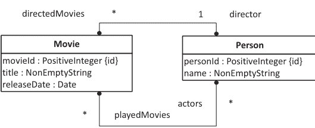

你可以使用以下示例数据来测试你的应用：

| 电影 ID | 标题 | 发布日期 | 导演 | 演员 |
| --- | --- | --- | --- | --- |
| 1 | 低俗英国小说 | 1994-05-12 | 1 | 5, 6 |
| 2 | 危险性关系 | 1988-12-16 | 2 | 7, 5 |
| 3 | 无良英仇队 | 2009-05-20 | 1 | 9, 1 |

### 11.2 为国家分配城市，为组织分配成员，反之亦然 — 119

| 人员 ID | 姓名 | 导演的电影 | 演过的电影 |
| --- | --- | --- | --- |
| 1 | Quentin Tarantino | 1, 3 | 3 |
| 2 | Stephen Frears | 2 |  |
| 5 | Uma Thurman |  | 1, 2 |
| 6 | John Travolta |  | 1 |
| 7 | Keanu Reeves |  | 2 |
| 9 | Brad Pitt |  | 3 |

更多电影数据可以在 IMDb 网站找到。

### 11.2 为国家分配城市，为组织分配成员，反之亦然

此项目基于下方的信息设计模型。在之前的作业的基础上，需要通过添加派生的反向引用属性来扩展，以实现双向关联。这是通过在模型类 `Person` 中添加多值引用属性 `directedMovies` 和 `playedMovies` 实现的，范围为 `Movie`。

1. 国际组织（InternationalOrganization）与城市（City）之间是多多关联，反之，是零或多个城市。

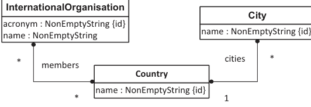

你可以使用以下示例数据来测试你的应用：

| 缩写 | 名称 | 成员 |
| --- | --- | --- |
| UN | 联合国 | 德国 |
| WHO | 世界卫生组织 | 法国 |
| NATO | 北西洋条约组织 | 德国 |

---

## 第二部分：类层次结构中的继承

当一个应用需要管理大量对象类型的数据时，某些类型之间可能存在各种子类型（继承）关系。子类型和继承是信息模型中的重要元素。

## 12 子类型与继承

例如，一个教科书章节是通过教科书的 ISBN 和章节的序列号组合来引用的。

由于章节对象作为教科书对象的不可分割组件，当其教科书对象不存在时也无法继续存在，因此在删除教科书对象的实现中，我们不需要使用 `CASCADE`（级联）删除策略（即删除教科书时删除所有相关的章节）。

不可分割组件类型不需要它自己的 CRUD 数据用户界面。相反，所有的 CRUD 操作都在其复合类型的数据管理用户界面中提供。例如，创建、检索、更新和删除教科书章节是在管理教科书数据的用户界面中完成的。

关联类是表示关联的类。

回想一下，简单关联在对象类模型中通过将其转换为相关对象类的引用属性而被消除，如图 1.7 所示。每当关联具有属性时，它就无法被消除，必须在 OO 类模型中转换为一个类。

例如，考虑在 `Book`（书）和 `Person`（人）对象类型上的关联 `Reservation`（预订），它允许表达如下事实：“ISBN 为 3627921105 的书被 ID 为 4701199 的人于 2020-08-22 预订”。由于它有一个日期（date）属性，该关联在信息设计模型中被建模为关联类，如下类图所示：

| Reservation |  |  | Person |
| --- | --- | --- | --- |
| date : Date | * | * |  |
| Book |  |  |  |
| isbn : String (id) |  | reserved_by | id : Integer (id) |
| title: String |  |  | name |
| year: Integer |  |  |  |

在 OO 类模型中（这是编写应用模型类的基础），关联类被转换为普通类，并带有引用相关对象类的引用属性。例如，关联类 `Reservation` 被转换为以下 OO 模型类：

| Reservation |
| --- |
| book : Book |
| reserved_by : Person |
| date : Date |

## 11 双向关联实践项目

所有项目都包含以下任务：

1. 根据给定的信息设计模型派生一个 OO 类模型。提示：将类关联替换为相应的引用属性。
2. 根据 OO 类模型派生 JavaScript 类模型或 Java 实体类模型。提示：添加检查方法（check）和设置方法（setter）。
3. 按照提供的指南编写你的 JavaScript 类模型或 Java 实体类模型。

确保你的页面符合 HTML5 的 XML 语法，并且你的 JavaScript 代码符合你的编码指南并经过 JSHint (`http://www.jint.com`) 检查。

### 11.1 为电影分配导演/演员，以及为导演/演员分配电影

此项目基于信息设计模型。在之前的作业的基础上，需要通过添加派生的反向引用属性来扩展，以实现双向关联。这是通过在模型类 `Person` 中添加多值引用属性 `directedMovies` 和 `playedMovies` 实现的，范围为 `Movie`。


你可以使用以下示例数据来测试你的应用：

| 电影 ID | 标题 | 发布日期 | 导演 | 演员 |
| --- | --- | --- | --- | --- |
| 1 | 低俗英国小说 | 1994-05-12 | 1 | 5, 6 |
| 2 | 危险性关系 | 1988-12-16 | 2 | 7, 5 |
| 3 | 无良英仇队 | 2009-05-20 | 1 | 9, 1 |

### 11.2 为国家分配城市，为组织分配成员，反之亦然 — 119

| 人员 ID | 姓名 | 导演的电影 | 演过的电影 |
| --- | --- | --- | --- |
| 1 | Quentin Tarantino | 1, 3 | 3 |
| 2 | Stephen Frears | 2 |  |
| 5 | Uma Thurman |  | 1, 2 |
| 6 | John Travolta |  | 1 |
| 7 | Keanu Reeves |  | 2 |
| 9 | Brad Pitt |  | 3 |

更多电影数据可以在 IMDb 网站找到。

### 11.2 为国家分配城市，为组织分配成员，反之亦然

此项目基于下方的信息设计模型。在之前的作业的基础上，需要通过添加派生的反向引用属性来扩展，以实现双向关联。这是通过在模型类 `Person` 中添加多值引用属性 `directedMovies` 和 `playedMovies` 实现的，范围为 `Movie`。

1. 国际组织（InternationalOrganization）与城市（City）之间是多多关联，反之，是零或多个城市。


你可以使用以下示例数据来测试你的应用：

| 缩写 | 名称 | 成员 |
| --- | --- | --- |
| UN | 联合国 | 德国 |
| WHO | 世界卫生组织 | 法国 |
| NATO | 北西洋条约组织 | 德国 |

---

## 第二部分：类层次结构中的继承

当一个应用需要管理大量对象类型的数据时，某些类型之间可能存在各种子类型（继承）关系。子类型和继承是信息模型中的重要元素。

## 12 子类型与继承

子类型（子类）的概念是自然语言、数学和信息学中的一个基本概念。例如，在英语中，我们说鸟是动物，或者说所有鸟的类是所有动物类的子类。在语言学中，“鸟”这个名词是“动物”名词的下位词。

一个对象类型可以通过特化引入一个新的对象类型，每当它代表另一个对象类型的特例时。我们通过示例模型来说明，我们将书籍和传记作为书籍的特例进行捕捉。这意味着教科书和传记也拥有 ISBN、标题和出版年份，但它们还具有进一步特征，例如教科书的学科领域（subjectArea）属性以及传记的属性。因此，在图 [缺失数字] 中，我们通过对书籍（Book）对象类型进行特化引入了教科书（Textbook）和传记（Biography），即作为书籍的子类型。

图 12.1：书籍对象类型及其两个子类型：教科书和传记。

### 12.1 通过特化引入子类型

子类型从其父类型继承所有特征。当子类型从子类型继承属性、关联和约束时，这意味着这些特征不需要在类图中为子类型重复渲染，但图的阅读者必须理解子类的所有特征也适用于其子类型。

当一个对象类型具有多个直接父类型时，我们就有了多重继承的情况，这在概念建模中很常见，但在 Java 和 C# 等许多面向对象的语言中是被禁止的，这些语言只允许每个对象类型具有唯一的直接父类型的层次结构。

### 12.1 子类型与继承

在对对象类型进行特化时，我们为新添加的子类型定义额外的特征。在许多情况下，这些额外的特征是更具体的属性。例如，在 `TextBook` 特化自 `Book` 的情况下，我们定义了额外的属性 `subjectArea`。在某些编程语言中（如 Java），人们说子类型扩展了超类型。

然而，我们也可以在不定义额外的属性或操作/方法的情况下，通过定义额外的约束来特化一个对象类型。

### 12.2 通过泛化引入超类型

我们通过图 12.2 所示的示例来说明泛化。

| Employee |  | Book | Author |
| :--- | :--- | :--- | :--- |
| employeeNo : Integer (id) |  | isbn : String (id) | authorId[1] : Integer (id) |
| name : String |  | title : String | name[1] : String |
| dateBirth : Date |  | year : Integer | dateBirth[1] : Date |
| salary : Decimal |  |  | dateDeath[0..1] : Date |
| address : String | 0..1 | * | biography[1] : Text |

**图 12.2:** 对象类型 `Employee` 和 `Author` 共享几个属性。

在添加类型 `Employee` 后，我们注意到 `Employee` 和 `Author` 共享了许多属性，这是因为员工和作者都是人，而成为员工和作者都是人所扮演的角色。因此，我们可以通过添加一个联合超类型 `Person` 来对这两个对象类型进行泛化，如图 12.3 所示。

在泛化两个或多个对象类型时，我们将它们共享的特征移动到新添加的超类型中并在那里进行集中管理。在 `Employee` 和 `Author` 的情况下，这组共享特征由属性 `name`、`dateBirth` 和 `dateDeath` 组成。通常，共享特征可能包括属性、关联和约束。

注意，由于在信息设计模型中每个顶层类都需要一个标准的标识符，因此在新类 `Person` 中我们声明了标准标识符属性 `personId`，它被所有子类继承。因此，我们必须重新考虑泛化之前在子类中声明为标准标识符的属性。在 `Employee` 的情况下，我们将属性 `employeeNo` 声明为标准标识符。由于员工是一个重要的业务信息项，我们必须保留此属性，即使它不再是标准标识符。因为它是一个备用标识符（“键”），我们使用约束关键字 `key` 为它定义了一个唯一性约束。

在 `Author` 的情况下，我们将属性 `authorId` 声明为标准标识符。假设这代表一个纯技术性的而非业务性的信息项，我们丢弃了它，因为它不再需要作为作者的标识符。因此，我们得到了一个允许通过员工工号或其 `personId` 值来识别员工，并通过其 `personId` 来识别作者的模型。

我们考虑原始示例模型的以下扩展，如图 12.4 所示：

1. 将 `Book` 分为 `TextBook` 和 `Biography` 的不相交（但不完全）的划分。
2. 将 `Person` 分为 `Author` 和 `Employee` 的重叠且不完全的划分，并进一步由 `Manager` 特化。

| Employee | Person |
| :--- | :--- |
| employeeNo: Integer (key) | personId[1]: integer (id) |
| salary : Decimal | name[1]: String |
|  | dateBirth[1]: Date |
|  | dateDeath[0..1]: Date |
| published | Book | authored |
| --- | --- | --- |
| Publisher | Books | Books |
| name : String (id) | isbn: String (id) | Author |
| address : String | title : String | biography : Text |
|  | 0.1 * | year: Integer * |

**图 12.3:** 对象类型 `Employee` 和 `Author` 通过共同的超类型 `Person` 泛化。

## 12.3 内涵与外延

对象类型的**内涵**（intension）由其特征集给出，包括属性、关联、约束和操作。


对象类型的**外延**（extension） 所有实例化该类型的对象的集合。对象类型的外延也称为它的*种群*（population）。


**图 12.4:** 带有类层次的信息模型。

我们存在以下对偶性：虽然超类型的所有特征都包含在其子类的内涵或特征集中（内涵包含），但子类的所有实例都包含在其超类型的外延或实例集中（外延包含）。这种形式化结构已经在形式化分析中得到过研究。

由于内涵/外延的对偶性，我们可以通过两种方式特化给定的类型：

1. 通过在新子类型中添加特征来扩展类型的内涵（例如在 `TextBook` 中添加属性 `subjectArea`）。
2. 通过添加约束来限制类型的外延（例如定义一个属性 `subjectArea` 值为“Mathematics”的子类型）。

典型的面向对象（OO）编程语言（如 Java 和 C#）仅支持第一种可能性（通过扩展其内涵来特化给定类型），而 XML Schema 和 SQL 也支持第二种可能性（通过限制其外延来特化给定类型）。

## 类型层次

类型层次（或类层次结构）由两个或多个类型组成，其中一个是根（或顶层）类型，所有其他类型都至少有一个超类型。

当所有非根类型都有唯一的超类型时，该类型层次是单继承层次；否则，它是多继承层次。例如，在图 12.5 中，`Vehicle` 是单继承层次的根；而在图 12.6 中，由于 `Vehicle` 有两个直接父类 `LandVehicle` 和 `WaterVehicle`，它是多继承层次。


**图 12.5:** 具有根类型的类层次。

最简单的类层次（只有一个特化层级）被称为泛化。如果类类的所有实例都实例化某个子类，则这种划分是完全的（complete）。如果所有子类两两之间是不相交的（即没有实例实例化多个子类），则这种划分是不相交的；否则，它是重叠的（overlapping）。


**图 12.6:** 多继承层次。

在类图中，我们可以通过在泛化箭头上标注大括号包含的关键字来表示这些约束。例如，对划分进行 `{complete, disjoint}` 标注表示它是完全且不相交的。默认情况下，当划分没有任何标注时，信息模型可能包含任意数量的类层次。

## 12.5 种类与角色

为了更好地理解自然语言陈述和信息模型中对象类型及其子类型的不同类别，我们可以将其分为内涵性（sortal）和非内涵性，以及刚性（rigid）和非刚性对象类型，这是 Giancarlo Guizzardi 在《结构模型的本体论基础》第 4 章中提出的。

如果一个对象类型对于实例具有统一的身份，那么它是内涵性的。这种条件定义了实例之间共有的属性（或属性集），而不需要同一个对象。`Person` 是内涵性类型的示例，因为它的所有实例都可以与其出生（何时、何地）相关的属性进行标识。`Book` 是非内涵性类型的示例，因为它包含了以不同方式识别的实例（例如教科书和自出版小说）。

如果一个实例不会因为消失（或改变身份）而不再是该类型，那么该类型就是刚性的。`Person` 是刚性对象类型的示例，而 `Employee` 不是刚性的。如果所有划分子类都是刚性的，则该划分是刚性的。

种类（Kind）是一个刚性的内涵性对象类型。类的示例是 `TextBook` 和 `Person`。角色（Role）是一个内涵性对象类型 `R`，用于分类所有与类型 `O` 的实例参与特定类型 `A` 关系的种类 `K`。注意，`R` 是 `K` 的非刚性子类型，因为当实例不再参与与类型 `O` 的 `A` 关系时，它们并不会消失。

例如，`Employee` 是角色的示例，因为它是一个内涵性对象类型，用于分类所有与 `Enterprise` 类型实例参与雇佣关系的 `Person` 实例。

根类，使得这些子类可以从模型中移除，从而简化模型。

**类层次合并**设计模式有两种形式。在最简单的形式中，原始类层次的划分是互不相交的，这允许使用单值类别属性来表示每个根类实例（对应其实例化的唯一子类）的特定类别。当原始类层次的划分不是互不相交时，即当至少有一个划分是重叠的，我们需要使用多值类别属性来表示对象所实例化的类型集合。我们只讨论针对互不相交划分的简单类层次合并重构情况，我们采取以下重构步骤：

1. 添加一个枚举数据类型，其中包含与每个分段子类对应的枚举。在我们的示例中，我们添加了枚举数据类型 `BookCategoryEL`。
2. 在根类中添加一个类别属性，并将该枚举作为其范围。如果划分是完全的，该类别属性是强制的 [1]；否则可选的 [..]。在我们的示例中，我们向类 `Book` 增加了一个范围为 `BookCategoryEL` 的类别属性。该类别属性是可选的，因为将 `Book` 划分为 `Textbook` 和 `Biography` 是不完整的。
3. 只要划分是固定的，我们将类别属性指定为冻结的（frozen），这意味着它只能在创建新对象时通过设置值来赋值，而稍后无法更改。
4. 将分段子类的属性移动到根类，并将其设为可选。我们将这些通常列在类别属性下方的属性称为分段属性。在我们的示例中，我们将从 `Textbook` 属性 `subjectArea` 和从 `Biography` 属性 `about` 移动到 `Book`，并将它们设为可选，即 [..]。
5. 添加一个约束（在关于扩展后的根类的不变式框中），强制要求可选的子类属性当且仅当根类实例化相应的类别时，该属性才有值。在我们的示例中，这意味着 `Book` 的实例属于“Textbook”类别，当且仅当其属性 `subjectArea` 有值；它属于“Biography”类别，当且仅当其属性 `subjectArea` 有值。
6. 从模型中移除分段子类。

在我们的示例中，这种设计重构的结果如图 12.7 所示。请注意，约束（或“不变式”）表示一个逻辑句子，其中逻辑运算符关键字“IFF”代表逻辑等价“当且仅当”，属性条件 `prop=undefined` 测试属性 `prop` 是否没有值。

## 12.6 类层次合并设计模式 129

## 130 子类型与继承

| isbn[1] : String (id) | «enumeration» | |
| :--- | :--- | :--- |
| title[1] : String | BookTypeEL | |
| year[1] : Integer | TextBook | |
| category[0..1] : BookTypeEL (frozen) | Biography | |
| subjectArea[0..1] : String | | |

```invariant
((category="TextBook" IFF not subjectArea=undefined) AND
(category="Biography" IFF not about=undefined))
```

图 12.7：应用类层次合并设计模式的结果。

## 12.7 计算语言编程中的子类型与继承

子类型和继承已经以不同的方式和不同程度在面向对象编程 (OOP)、数据库语言（如 SQL99）、XML 模式定义语言 XML Schema 以及其他计算语言中支持。计算语言中子类型的核心在于定义类型层次以及特征的继承：OOP 中的属性、约束和方法；SQL99 中的表列和约束；XML Schema 中的元素、属性和约束。

通常情况下，在类型层次中支持多重分类（multiple classification）和多重继承是理想的。这两种语言特性紧密相关，并被认为是高级特性，在许多应用中可能不需要，或者可以使用变通方法处理。

**多重分类**（Multiple classification）意味着一个对象拥有多个类型。这主要发生在对象同时扮演多个角色时，因此实例化了定义这些角色的多个类。

**多重继承**（Multiple inheritance）通常也与角色类有关。例如，助教是一个同时扮演学生角色和教职人员角色的人，因此相应的 OOP 类 `StudentAssistant` 同时继承自 `Student` 和 `AcademicStaffMember` 两个类。同样，我们上面的示例模型——两栖动物车辆 `AmphibianVehicle` 同时继承自角色类 `LandVehicle` 和 `WaterVehicle`。

### 12.7.1 OOP 中的子类型与继承

OOP 对子类型的最低支持水平（例如由 Java 和 C# 提供）允许在单继承层次中定义属性和方法的继承，这可以通过 `is-instance-of` 谓词帮助进行检查，该谓词允许测试一个类是否是对象的直接或间接类型。此外，理想情况下可以通过以下方式帮助检查继承层次：

- 一个预定义的实例级属性，用于获取对象的直接类型（如果允许多重分类，则获取多个直接类型）；
- 一个预定义的类型级属性，用于获取类型的直接父类型（如果允许多重继承，则获取多个父类型）。

JavaScript 是 OOP 语言的一个特例，它最初没有用于定义类的显式语言元素，只有用于定义构造函数。由于其动态编程特性，JavaScript 允许使用代码模式来实现类、子类型和继承。在现代 JavaScript 中（从 ES2015 开始），定义类和子类是非常直接的。首先，我们定义一个基类 `Person`，带有两个属性 `firstName` 和 `lastName`：

```javascript
class Person {
  constructor (first, last) {
    // 分基类属性
    this.firstName = first;
    this.lastName = last;
  }
}
```

然后，我们定义一个子类 `Student`，带有一个额外的属性 `studentNo`：

```javascript
class Student extends Person {
  constructor (first, last, studNo) {
    // 调用父类构造函数
    super(first, last);
    // 分配额外属性
    this.studentNo = studNo;
  }
}
```

注意如何通过 `super(first, last)` 分配父类属性。

### 12.7.2 XML Schema 中的子类型与继承

在 XML Schema 中，子类型可以通过扩展（extending）或限制（restricting）现有的复杂类型来定义。扩展复杂类型意味着通过添加元素或属性来扩展内涵（intension），限制复杂类型意味着通过添加约束来限制外延（extension）。

我们可以通过以下方式定义复杂类型 `Person` 及其子类 `Student`：

```xml
<xs:complexType name="Person">
  <xs:attribute name="firstName" type="xs:string" />
  <xs:attribute name="lastName" type="xs:string" />
  <xs:attribute name="gender" type="GenderValue" />
</xs:complexType>
<xs:complexType name="Student">
  <xs:extension base="Person">
    <xs:attribute name="studentNo" type="xs:string" />
  </xs:extension>
</xs:complexType>
```

我们可以通过以下方式限制 `Person` 来定义子类型 `FemalePerson`：

```xml
<xs:complexType name="FemalePerson">
  <xs:restriction base="Person">
    <xs:attribute name="firstName" type="xs:string" />
    <xs:attribute name="lastName" type="xs:string" />
    <xs:attribute name="gender" type="GenderValue" fixed="fixed" value="f" />
  </xs:restriction>
</xs:complexType>
```

注意通过将 `gender` 属性的值固定为 `"f"`，我们定义了一个仅被 `Person` 的女性实例的约束。

## 12.7 计算语言中的子类型与继承 — 131

### 12.7.3 OWL 中的子类型与继承

在网络本体语言 OWL 中，属性定义与类定义是分离的，且属性默认不是单值的，而是多值的。因此，标准属性需要被声明为函数的（functional）。因此我们获取以下代码以表示 `Person` 是一个具有 `name` 属性的类：

```xml
<owl:Class rdf:ID="Person"/>
<owl:DatatypeProperty rdf:ID="name">
  <rdfs:domain rdf:resource="#Person"/>
  <rdfs:range rdf:resource="xsd:string"/>
  <rdf:type rdf:resource="owl:FunctionalProperty"/>
</owl:DatatypeProperty>
```

OWL 允许通过以下方式声明类为另一个类的子类：

```xml
<owl:Class rdf:ID="Student">
  <rdfs:subClassOf rdf:resource="#Person"/>
</owl:Class>
<owl:DatatypeProperty rdf:ID="studentNo">
  <rdfs:domain rdf:resource="#Student"/>
  <rdfs:range rdf:resource="xsd:string"/>
  <rdf:type rdf:resource="owl:FunctionalProperty"/>
</owl:DatatypeProperty>
```

为了更好的用性，OWL 允许在类定义内部定义类的属性，并以函数属性作为默认情况。

### 12.7.4 使用 SQL 数据库表表示类层次结构

标准 DBMS 将信息（对象）存储在表的行中，这些行在关系型数据库系统中被构想为集合论关系。关系型数据库语言 SQL 用于定义、填充、更新和查询此类数据库。但也存在更简单的存储技术，允许以表的形式存储数据，但不支持 SQL。特别是键值存储系统（例如 JavaScript 的 Local Storage API），允许将 JS 实体的序列化内容（实体记录的映射）作为与表作为键关联的字符串值进行存储。

虽然 SQL 的经典版本（SQL92）不支持子类型化和继承，但这在 SQL99 中已经发生了变化。然而，SQL99 中与子类型相关的语言元素仅在某些 DBMS 中实现，例如开源 DBMS PostgreSQL。因此，为了设计一个可以使用各种 SQL DBMS 框架（包括如 MySQL 和 SQLite 等较弱的技术）来进行实现的设计模型，我们无法使用 SQL99 的子类型功能，而必须通过普通表和外键依赖在数据库设计模型中对继承层次结构进行建模。将这些类层次结构映射到关系表（以及反之）是对象-关系映射（ORM）框架的工作，例如 JPA 提供程序（如 Hibernate）、微软的 Entity Framework 或 Rails 框架的 Active Record 方法。

本质上有三种使用数据库表表示类层次结构的替代方法：

1. **单表继承 (Single Table Inheritance, STI)** 是简单的方法，整个类层次结构由单个表表示，该表包含根类及其所有子类的所有属性列，以及根类的名称。
2. **类表继承 (Table per Class Inheritance, TCI)** 是一种方法，类层次结构中的每个类都由相应的表表示，该表还包含继承属性的列，并重复表示其父类的类的表列。

注意，STI 方法与上面 12.6 节讨论的“类层次结构合并”设计模式密切相关。当此设计模式已应用于设计模型中，或者设计模型已经根据此设计模式进行了重构时，相关的类层次结构（其子类）在设计中已被消除，因此在要在应用模型层中以类定义形式编码的数据模型中也被消除了，所以不再需要将类映射到单表。否则，设计模型包含一个类层次结构，该结构在应用模型层中通过相应的类层次结构实现，并将通过 STI 方法的帮助映射到数据库表。

我们通过两个简单的示例来说说明这些方法的使用。第一个示例是 `Book` 类层次结构，如上图 12.1 所示。第二个示例是 `Person` 角色 `Employee`、`Manager` 和 `Author` 的类层次结构，如下文图 12.8 中的类图所示。

#### 12.7.4.1 单表继承

考虑上图 12.1 所示的单级类层次结构，它是对类 `Book` 的不完全不交分段，作为 MVC 应用模型类的设计。在这种情况下，每当我们拥有一个仅一层（或少数层）子类型化的模型层次结构，且每个子类型只有少数额外属性时，使用 STI 是更优的，因此我们建模一个包含所有属性的单表，其中代表段子类额外属性（“分段属性”）的列是可选的，如图 12.9 中的 SQL 表模型所示。

| Person |
| :--- |
| personid : Integer (id) |
| name : String |
| Employee | Author |
| empNo : integer (key) | biography : String |
| Manager | |
| department : String | |

**图 12.8:** 一个带有 `Person` 角色层次结构的信息设计模型。


```text «SQL table»
isbn[1] : VARCHAR (pkey)
title[1] : VARCHAR
year[1] : INTEGER
category[0..1] : "TextBook","Biography" (frozen)
subject_area[0..1] : VARCHAR
about[0..1] : VARCHAR
```

```text
«invariant»
{(category="TextBook" IFF subject_area IS NOT NULL)
(category="Biography" IFF about IS NOT NULL)}
```

**图 12.9：**表示 Book 层次结构的 SQL 表。

添加一个特殊的鉴别器列来表示对应于子类的行的类别是一种常用方法。该列通常为字符串值，但被限制为子类名称之一。DBMS 支持枚举，它也可以是枚举值的。当给定的分段是不交的时，使用单值枚举类别来表示信息所属的子类；如果它是不交的，则使用多值枚举类别来表示信息所属的子类。这种属性可以在 SQL 中通过定义一组枚举代码或标签的字符串值列来实现。

根据书的类别，由于教科书-传记分段是刚性的，我们必须强制：当且仅当它是“TextBook”时，其属性`subjectArea`有值，且当且仅当它是“Biography”时，其属性`about`有值。这种隐含约束表示在上方类图中附加到 Book 表类的 invariant 中，其中逻辑运算符“IFF”代表“当且仅当”。它需要在数据库中实现，例如使用 SQL CHECK 子句或 SQL 触发器。

考虑如图 12 所示的类层次结构。在 Employee、Manager 和 Author 子类中仅定义三个额外属性，此类层次结构可以使用 STI 方法进行映射，如表 12.10 所示。

| people |
| :--- |
| person_id[1] | INTEGER (pkey) |
| name[1] | VARCHAR |
| categories[*] | VARCHAR ("Employee", "Manager", "Author") |
| emp_no[0..1] | INTEGER (unique) |
| biography[0..1] | VARCHAR |
| department[0..1] | VARCHAR |

```text
«invariant»
("Employee" IN categories IFF NOTNULL(emp_no)
AND ("Manager" IN categories IFF NOTNULL(emp_no))
AND NOTNULL(department)
AND ("Author" IN categories IFF NOTNULL(biography))
```

**图 12.10：**表示 Person 角色层次结构的 STI 表。

注意，当鉴别器列`categories`是多值时，Person 的分段是不交的，而是交叉的，这意味着 Person 对象可能属于多个类别。同样注意，由于角色分段（如 Employee、Manager、Author）不是刚性的，鉴别器列`categories`没有`frozen`约束。

## 12.7 计算语言中的子类型化与继承

该模型的一个可接受填充示例如下：

| person_id | name | categories | biography | emp_no | department |
|---|---|---|---|---|---|
| 1001 | Harry Wagner | 作者，员工 | 1956年出生于马萨诸塞州波顿，. . | 21035 | |
| 1002 | Peter Boss | 经理 | | 23107 | 销售 |
| 1003 | Tom Daniels | | | | |
| 1077 | Immanuel Kant | 作者 | 伊曼纽尔·康德（1724–1804）是一位德国哲学家。 . . . | | |

注意 Person 表包含四种不同类型的人：

1. 个人，Harry Wagner，他是一个作者（带有简历）也是一名员工（带有员工编号）。
2. 个人，Peter Boss，他是一个经理（员工的一种特殊类型），负责销售部。
3. 个人，Tom Daniels，他既不是作者也不是员工。
4. 个人，Immanuel Kant，他是一个作者（带有简历）。

STI 方法的优点：它能够忠实地表示原始类层次结构中表达的子类型关系；特别是，任何代表子类实例（员工、经理或作者）的行也代表一个父类实例（个人）。

缺点：(1) 在子类之间共同点较少的多级类层次结构中，STI 方法无法产生良好的表示。(2) 给定类层次结构在其元素（类）方面的结构仅被隐式地保留。

### 12.7.4.2 类表继承（Table Per Class Inheritance）

在更真实的模型中，图 12.8 中 Person 的子类将拥有许多属性，因此 STI 方法将不再可行。TCI 方法将得到图 12.11 所示的 SQL 模型。TCI 模型将类层次结构中的每个具体类表示为一个表，使得每个分段子类由一个表表示，该表还包含继承属性的列，因此重复了表示父类的表的列。

| «SQL table» | «SQL table» |
|---|---|
| people | employees |
| person_id : INTEGER (pkey) | person_id : INTEGER (pkey) |
| name : VARCHAR | name : VARCHAR |
| | emp_no : INTEGER (unique) |

| «SQL table» | «SQL table» |
|---|---|
| authors | managers |
| person_id : INTEGER (pkey) | person_id : INTEGER (pkey) |
| name : VARCHAR | name : VARCHAR |
| biography : VARCHAR | emp_no : INTEGER (unique) |
| | department : VARCHAR |

**图 12.11：**表示角色层次结构的 TCI 表模型。

可以通过执行以下步骤从信息设计模型推导出 TCI 表模型：

1. 将所有类中的标准 ID 修饰符`{id}`替换为`{pkey}`，以指示标准 ID 属性是主键。
2. 将（大写的）类名（Person, Author, 等）替换为复数小写表名（people, authors, 等），并将驼峰命名的属性（personId 和 empNo）替换为小写下划线分隔的列名（person_id 和 emp_no）。
3. 为所有类矩形添加«table»刻字。
4. 将平台无关的数据类型名称替换为 SQL 数据类型名称。
5. 移除所有泛化/继承箭头（例如从 people 指向其子表 authors 和 employees 的 person_id 和 name）。

每个表将只填充与所表示类的直接实例对应的行。该模型的一个可接受填充示例如下：

| people | name |
|---|---|
| personId | |
| 1003 | Tom Daniels |

| person_id | name | biography |
|---|---|---|
| 1001 | Harry Wagner | 1956年出生于马萨诸塞州波顿，. . |
| 1077 | Immanuel Kant | 伊曼纽尔·康德（1724–1804）是一位德国哲学家。 . . |

### employees

| person_id | name | emp_no |
|---|---|---|
| 1001 | Harry Wagner | 21035 |

### managers

| person_id | name | emp_no | department |
|---|---|---|---|
| 1002 | Peter Boss | 23107 | Sales |

**TCI 方法的优点：**(1) 给定类层次结构在其元素（类）方面的结构被显式表示。(2) 当给定类层次结构的分段不相交时，TCI 实现了内存高效的非冗余存储。

**缺点：**(1) TCI 方法无法忠实地表示原始类层次结构中表达的子类型关系。特别是，对于任何代表子类实例（员工、经理或作者）的行，没有信息表明它未提供关于所表示子类型关系的信息；相反，保留在应用程序类模型中的元数据与数据库解耦了。(2) TCI 方法需要重复列。(3) 每当分段重叠时，TCI 方法可能会蕴含数据冗余。

### 12.7.4.3 链接继承（Joined Inheritance）

为了在分段重叠的情况下避免 TCI 的数据冗余，我们使用如图 12.12 所示的 JTI 方法。该模型通过外键列将表示子类的表连接到父类。

![image/64ab58e459ff4b56e722fe3998651a_]

该模型的一个可接受填充示例如下：

| people | name |
|---|---|
| 1001 | Harry Wagner |
| 1002 | Peter Boss |
| 1003 | Tom Daniels |
| 1077 | Immanuel Kant |

| person_id | name | biography |
|---|---|---|
| 1001 | Harry Wagner | 1956年出生于马萨诸塞州波顿，. . |
| 1077 | Immanuel Kant | 伊曼纽尔·康德（1724–1804）是一位德国哲学家。 . . |

| person_id | name | emp_no |
|---|---|---|
| 1001 | Harry Wagner | 21035 |

| person_id | name | emp_no | department |
|---|---|---|---|
| 1002 | Peter Boss | 23107 | Sales |

JTI 方法的优点：(1) 保留了给定类层次结构的结构。(2) 避免了分段的数据冗余。

缺点：(1) JTI 方法的主要缺点是查询子类时需要连接，这可能会产生性能问题。

## 12.8 问题

### 12.8.1 问题1：关于类层次

考虑以下模型：

| Abc | Bcd |
|---|---|
| a1 : String (id) | b1 : Integer (id) |

| Cde |
|---|
| c : Integer (key) |

哪些陈述是正确的？

- 所有 Cde 都有 a1。
- Cde 的标准标识符是 a1。
- 所有 Abc 实例都有指向 Bcd 的引用。
- Abc 可能有一个 c 值。
- 对于任何 Ab 对象，a3 的值大于 a2。
- 对于任何 Cde 对象，a3 的值大于 a2。
- Cde 的标准标识符是 c。

### 12.8.2 问题2：类层次合并

考虑以下模型：

![image/64ab58e459ff4b56e722fe3998651a_158_]

在这种类层次结构的情况下，我们可以使用类层次合并模式，将整个类层次结构合并到一个类中。以下哪个模型描述了给定 Ab 类层次结构类合并模式的正确实现？

#### 1. O

| Abc | <<enumeration>> |
|---|---|
| a1[1] : Integer (id) | AbTypeEL |
| category[1] : AbTypeEL | Bcd |
| a2[1] : String | Cde |
| a3[0..1] : String | |

#### 2. O

| Abc | <<enumeration>> |
|---|---|
| a1[1] : Integer (id) | AbTypeEL |
| category[0..1] : AbTypeEL | Bcd |
| a2[1] : String | Cde |
| a3[0..1] : String | |

#### 3. O

| Abc | <<enumeration>> |
|---|---|
| a1[1] : Integer (id) | AbTypeEL |
| category[0..1] : AbTypeEL | Bcd |
| a2[0..1] : String | Cde |
| a3[0..1] : String | |

#### 4. O

| Abc |
|---|
| a1[1] : Integer (id) |
| a2[1] : String |
| a3[0..1] : String |

# 13 使用原生 JS 进行子类型化

在本章中，我们首先将解释 JavaScript 中基于构造函数的子类型化的通用方法，然后根据我们上方的运行示例——公共图书馆（Public Library）应用的信息模型片段，展示两个案例研究。

在第一个案例研究中，我们考虑了图 12.1 所示的以`Book`为根的单级层级结构，这是一个不完全的互斥且刚性的划分。我们使用“类层次结构合并”（Class Hierarchy Merge）设计模式将此简单层级重构为可以映射到持久化数据库表的单个类。

在第二个案例研究中，我们考虑了图 12.8 所示的由`Person`角色——`Employee`、`Manager`和`Author`组成的多级层级结构。将`Person`划分 de `Employee`和`Author`没有任何约束，这意味着它是完全的、重叠（非互斥的）且非刚性的。

对于简单的`Manager-is-Employee`子层级，我们使用“类层次结构合并”设计模式，并使用“连接继承”（Joined Inheritance）方法将`Employee-and-Author-is-a-Person`类层次结构映射到一组通过外键依赖相互关联的数据库表。

在两个案例研究中，我们展示了：

1. 如何从信息设计模型推导出 JS 类模型以及相应的实体表模型；
2. 如何以 JS 模型类的形式编写 JS 类模型代码；
3. 如何基于模型代码编写视图和控制器代码。

## 13.1 使用基于构造函数的类的 JavaScript 进行子类型化

在 ES2015 版本之前，JavaScript 并没有显式的类概念，且不支持子类型化，它必须借助某些代码模式的帮助来实现，提供两种继承机制：(1) 属性继承和 (2) 方法继承。

正如我们在第一卷第 1 章中解释的那样，类可以通过两种替代方式定义：基于构造函数的和基于工厂的。这两种方法都有各自实现继承的方式。

我们通过以下示例总结了在 ES2015 中用于在基于构造函数的单继承类层级结构中定义父类和子类的代码模式：

| Person | |
|---|---|
| firstName | String |
| lastName | String |
| Student | |
| studNo | Integer |

然后，我们定义一个基类`Person`，带有两个属性`firstName`和`lastName`，并用 getter 和 setter 定义：

```javascript
class Person {
  constructor ({first, last}) {
    // 通过调用 setter 分配属性
    this.firstName = first;
    this.lastName = last;
  }
  getFirstName () {return this._firstName};
  setFirstName (f) {
    . . . 检查约束
    this._firstName = f;
  }
  getLastName () {return this._lastName};
  setLastName (l) {
    . . . 检查约束
    this._lastName = l;
  }
}
```

然后，我们定义一个子类`Student`，多了一个额外属性`studNo`：

```javascript
class Student extends Person {
  constructor ({first, last, studNo}) {
    // 调用父类的构造函数
    super({first, last});
    // 分配额外属性
    this.studNo = studNo;
  }

  get studNo () {return this._studNo;}
  set studNo (sn) {
    // 检查约束
    this._studNo = sn;
  }
}
```

注意父类构造函数是如何调用的：使用`super({{first, last}})`。

## 13.2 案例研究 1：消除类层次结构

通过应用“类层次结构合并”设计模式可以消除简单的类层级结构。我们案例研究的起点是图 12.1 所示的简单类层级结构，它代表了将`Book`划分为`TextBook`和`Biography`的互斥（但不完全）的刚性划分。该模型首先通过“类层次结构合并”设计模式进行简化，得到了以下模型：

| | |
|---|---|
| isbn[1] : String (id) | <<enumeration> |
| title[1] : String | BookTypeEL |
| year[1] : Integer | TextBook |
| category[0..1] : BookTypeEL(frozen) | Biography |
| subjectArea[0..1] : String | |
| about[0..1] : String | |

## \<\<invariant>


> `{{category="TextBook" IF NOT subjectArea=undefined) AND`
>
> `(category="Biography" IF NOT about=undefined))`

我们现在从此设计模型推导出一个 JS 类模型。

### 13.2.1 构建 JS 类模型

我们通过 3 个步骤构建 JS 类模型：

1. 将与平台无关的数据类型（用作属性和参数的范围）替换为 JS 数据类型。这包括枚举值属性（enumeration-valued attributes），例如 `category`，它们被转换为数值属性，并限制在底层枚举类型的整数范围内。
2. 为所有属性装饰 `«get/set»` 刻画，以指示它们具有隐式的 getter 和 setter。
3. 添加属性检查函数，正如第一卷第 8 章所述。`checkCategory` 函数以及对分段属性的检查需要根据其隐含的语义进行特殊考虑。特别是，分段属性检查函数必须确保只有当 `category` 属性具有代表相应分段的值时才能为该属性赋值。我们在稍后讨论如何编写 JS 类模型代码时，更详细地解释这种验证语义。

这引出了图 13.1 所示的 JS 类模型，其中类级（'static'）方法是未定义的：

| Book | «enumeration» |
| :--- | :--- |
| `isbn[1] : String (id)` | `<<enumeration>` |
| `title[1] : String` | `BookTypeEL` |
| `year[1] : Integer` | `TextBook` |
| `category[0..1] : BookTypeEL(frozen)` | `Biography` |
| `subjectArea[0..1] : String` | |
| `about[0..1] : String` | |

**图 13.1:** `Book` 类的 JS 类模型。

### 13.2.2 新问题

与第一卷第 11 章讨论的枚举相比，我们必须处理许多新问题：

#### 在模型代码中

1. 添加 `FrozenViolation` 约束类。
2. 编写用于 `category` 属性范围的枚举类型 `BookTypeEL`。
3. 为 `category` 属性编写 `checkCategory` 函数。在示例中由于划分是不完全的，该属性是可选的。如果应用了划分的划分是完全的，则该属性是强制的。
4. 为所有分段属性编写检查函数，使其接收类别作为第二个参数，以便测试该分段属性是否适用于实例。
5. 通过添加类别区分（switch）语句来完善 `toString()` 函数，仅序列化适用于给定类别的属性。

#### 在 UI 代码中

1. 在 `books.html` 的“列出所有书籍”用例表中添加“特殊类型”（或“类别”）列。没有特殊类别的书籍将有一个空格，而其他书籍将在单元格中显示其类别以及其他分段属性值。这需要在 `books.js` 视图代码文件的 `v.books.retrieveAndListAll.setupInterface` 中编写相应的 switch 语句。
2. 在“创建书籍”和“更新书籍”用例的表单中添加特殊类型选择控件（通常是选择列表）以及所有分段属性的相应表单字段。分段属性字段只有在选择了相应的书籍后才会显示。这种根据特定条件渲染特定表单字段的方法被称为动态表单。

### 13.2.3 编写 JS 类模型的类代码

可以直接编写 JS 类模型，以获取我们 JS 前端应用的模型类代码。

#### 13.2.3.1 总结

1. 参考第一卷第 11 章的解释，借助元类 `Enumeration` 编写用于 `category` 属性范围的枚举类型 `BookTypeEL`。
2. 以 JS 类定义编写 `Book` 模型类，带有 getter 和 setter 方法以及静态检查函数。

## 13 使用原生 JS 实现子类型

### 13.2.3.2 编码枚举类型 `BookCategoryEL`

枚举类型 `BookCategoryEL` 在 `Book.js` 模型类文件的开头，通过我们的库元类以以下方式进行编码：

```js
BookCategoryEL = new Enumeration([ "Textbook", "Biography"]);
```

### 13.2.3.3 编码模型类 `Book`

我们以 ES2015 类定义的形式对模型类进行编码，其中，`category` 属性以及分段属性 `subjectArea` 和 `about` 是可选的，并且所有属性都拥有 getter、setter 和静态检查函数：

```js
class Book {
  constructor(isbn, title, year, category, subjectArea, about) {
    this.isbn = isbn;
    this.title = title;
    this.year = year;
    // 可选属性
    if (category) this.category = category;
    if (subjectArea) this.subjectArea = subjectArea;
    if (about) this.about = about;
  }
  get isbn() { . . }
  static checkIsbn(isbn) { . . }
  static checkIsbnAsId(isbn) { . . }
  set isbn(isbn) { . . }
  get title() { . . }
  static checkTitle(t) { . . }
  set title(t) { . . }
  get year() { . . }
  static checkYear(y) { . . }
  set year(y) { . . }
  get category() { . . }
  static checkCategory(c) { . . }
  set category(c) { . . }
  get subjectArea() { . . }
  static checkSubjectArea(sA, cat) { . . }
  set subjectArea(s) { . . }
  get about() { . . . }
  static checkAbout(a, cat) {. . . }
  set about(a) { . . . }
}
```

注意，构造函数使用了 ES2015 的函数参数解构功能定义了一个单个记录参数。

我们以以下方式为 `category` 属性编码 `checkCategory` 和 `setCategory` 方法：

```js
static checkCategory(c) {
  if (c === undefined || c === "") {
    return new NoConstraintViolation(); // c 是可选的
  } else if (!util.isIntegerOrIntegerString(c) || parseInt(c) < 1 || parseInt(c) > CategoryEL.MAX) {
    return new RangeConstraintViolation(
      "Invalid value for category: " + c);
  } else {
    return new NoConstraintViolation();
  }
}
set category(c) {
  var validationResult = null;
  if (this.category) { // 已经设置/赋值
    validationResult = new FrozenConstraintViolation(
      "The category cannot be changed!");
  } else {
    validationResult = Book.checkCategory(c);
  }
  if (validationResult instanceof NoConstraintViolation) {
    this._category = parseInt(c);
  } else {
    throw validationResult;
  }
}
```

虽然分段属性（在本例中为 `subjectArea` 和 `about`）的 getter 遵循标准模式，但它们的检查和 setter 必须确保该属性适用于正在检查的实例的类别。这是通过检查属性值和类别的组合来实现的，如下所示：

```js
static checkSubjectArea(sa, c) {
  if (c === BookCategoryEL.TEXTBOOK && !sa) {
    return new MandatoryConstraintViolation(
      "A subject area must be provided for a textbook!");
  } else if (c != BookCategoryEL.TEXTBOOK && sa) {
    return new ConstraintViolation("A subject area must not " +
      "be provided if the book is not a textbook!");
  } else if (sa && (typeof(sa) != "String" || sa.trim() === "")) {
    return new RangeConstraintViolation(
      "The subject area must be a non-empty string!");
  } else {
    return new ConstraintViolation();
  }
}
```

在序列化函数 `toString` 中，我们在 `switch` 语句中序列化 `category` 属性和分段属性：

```js
toString() {
  var bookStr = "Book(ISBN:" + this.isbn + ", title:" +
    this.title + ", year:" + this.year;
  switch (this.category) {
    case BookCategoryEL.TEXTBOOK:
      bookStr += ", " + this.subjectArea;
      break;
    case BookCategoryEL.BIOGRAPHY:
      bookStr += ", biography:" + this.about;
      break;
  }
  return bookStr + ")";
}
```

在模型类的 `update` 方法中，我们只在属性被更新时才进行设置，即相应的参数与旧属性值不同。在带有 `FrozenConstraint` 的 `category` 属性的特殊情况下，我们需要确保它只有在尚未被赋值时才能更新。然后，在 `Book.update` 方法中，我们对 `book.category === undefined` 执行特殊测试以处理初始赋值的特殊情况，而用更标准的方式处理分段属性的更新：

```js
Book.update = function ({isbn, title, year,
  category, subjectArea, about}) {
  const book = Book.instances[isbn];
  var objectBeforeUpdate = util.clone(book);
  var noConstraintViolated=true, updatedProperties=[];
  try {
    if (category && book.category !== category) {
      book.category = category;
      updatedProperties.push("category");
    } else if (category === "" && "category" in book) {
      throw new FrozenConstraintViolation(
        "The category cannot be unset!");
    }
    if (subjectArea && book.subjectArea !== subjectArea) {
      book.subjectArea = subjectArea;
      updatedProperties.push("subjectArea");
    }
    if (about && book.about !== about) {
      book.about = about;
      updatedProperties.push("about");
    }
  } catch (e) {
    //
  }
};
```

## 13.2 案例研究 1：消除类层次结构

### 13.2.4 编写视图和控制器

应用的用户界面（UI）包含一个起始页，允许导航到数据管理页面（在示例中为 `books.html`）。此类数据管理页面包含部分：管理书籍、列出并检索所有书籍、创建书籍、更新书籍和删除书籍，使得任何时候只显示其中一个（通过对其他设置 CSS 属性 `display:none`）。

#### 13.2.4.1 摘要

我们需要在“检索并列出所有书籍”用例以及“创建书籍”和“更新书籍”用例中处理 `category` 属性和分段属性 `subjectArea` 和 `about`，方法如下：

- 在 `books.html` 的“检索并列出所有书籍”用例显示表中添加分段信息列（标题为“Category”）。
- 在 `books.html` 的“创建书籍”和“更新书籍”用例表单中添加“Category”选择字段以及所有分段属性的输入字段。分段属性的表单字段仅在选择了相应类别后显示。

#### 13.2.4.2 在“检索/列出所有”中添加分段信息列

我们在 `books.html` 的“列出所有书籍”用例显示表中添加一个“特殊类型”类别：

```html
<table id="books">
  <head>
    <tr><th>ISBN</th><th>Title</th><th>Year</th><th>Category</th></tr>
  </head>
  <tbody></tbody>
</table>
```

没有特殊类别的书籍在这一列中将有一个单元格，对于所有其他书籍，其类别将在该列显示，并带有特定的类别信息。这需要在 `view/books.js` 文件的 `pl.v.books.retrieveListAll.setupUserInterface` 中实现相应的 `switch` 语句：

```js
if (book.category) {
    switch (book.category) {
        case BookCategoryEL.TEXTBOOK:
            row.insertCell(-1).content = book.subjectArea + " (textbook)";
            break;
        case BookCategoryEL.BIOGRAPHY:
            row.insertCell(-1).content = "Biography about " + book.about;
            break;
    }
}
```

#### 13.2.4.3 在“创建和更新”中添加类别选择字段

在两种情况下，我们都需要通过选择字段允许选择特殊类型的书籍（'textbook' 或 'biography'），如下方的 HTML 片段所示：

```html
<div class="field">
  <label>Category: <select name="category"></select></label>
</div>
<div class="field Textbook"><!-- 条件字段 -->
  <label>Subject area: <input type="text" name="subjectArea" /></label>
</div>
<div class="field Biography"><!-- 条件字段 -->
  <label>About: <input type="text" name="about" /></label>
</div>
```

注意，我们将 "Textbook" 和 "Biography" 作为分段字段容器元素类属性的额外值添加。这支持根据类别属性的值来渲染或取消渲染“Textbook”和“Biography”字段。在 `handleCategorySelectChangeEvent` 处理程序中，只有在选择了相应的类别书籍时，才会通过 `pl.v.app.displaySegmentFields` 显示分段属性表单字段。

# 13.3 案例研究 2：实现类层次结构

当类层次结构变得复杂时，我们无法简单地将其消除，而必须在 (1) 应用的模型代码中、(2) 底层数据库以及 (3) 用户界面中实现它。

我们案例研究的起点是上方图 12.8 所示的设计模型。在接下来的章节中，我们从设计模型推导出一个 JS 类模型和一个 JS 实体模型。实体表模型被用于对象到存储映射的设计，我们需要通过浏览器的本地存储（Local storage）技术来存储应用中的对象实例。

## 13.3.1 创建 JS 类模型


我们通过从设计模型推导出的 JS 类模型来设计示例应用的模型类。推导过程中，我们本质上 保留了泛化行，仅为每个类添加了 get/set 方法和静态检查函数。然而，在我们的示例应用中，自然地将类层次结构合并设计模式（在 12.6 节讨论）应用于`Employee`的单子子类划分，通过消除`Manager`子类来简化类模型。这导致了图 13.2 所示的模型。注意，`Person`可能是`Employee`、`Author`或两者皆是。

```
Person
<get/set> personid: Integer (id)
<get/set> name: String
checkPerson(in id : string) : ConstraintViolation
checkPersonAid(in id : string, in type) : ConstraintViolation
checkName(in n : string) : ConstraintViolation
```

```
Author
<get/set> biography : string
checkBiography(in b : string) : ConstraintViolation
```

| Employee | enumeration |
| :--- | :--- |
| <get/set> empNo[1] : number (unique) | |
| <get/set> category[0..1] : EmployeeCategoryEL | EmployeeCategoryEL |
| <get/set> department[0..1] : string | MANAGER |
| checkEmpNo(in n : number) : ConstraintViolation | |
| checkCategory(in c : number) : ConstraintViolation | |
| checkDepartment(in d : string) : ConstraintViolation | |

图 13.2：Person 角色类层次结构的 JS 类模型。

## 13.3.2 创建 JS 实体表模型

由于我们使用浏览器的本地存储（Local Storage）作为示例应用的持久化存储技术，我们必须处理简单的键值存储。对于每个以大写单数`Entity`命名的模型类，我们使用其复数小写名称`entities`作为对应名称，并通过`JSON.stringify`方法对对象集合`Entity.instances`进行序列化，作为获取其关联字符串值的键。

我们从信息设计模型推导出来，以 JS 实体表模型的形式设计了一系列合适的 JS 实体表。我们必须就如何组织数据以及如何推导出相应的实体表模型做出某些选择。

第一个选择涉及使用单表继承（STI）、按类表继承（TCI）或连接表继承（JTI）方法，这些方法在 12.7.4 节中介绍。在 STI 方法中，一个划分（或整个层次结构）由单张表表示，该表包含所有相关类的所有属性的列，如图 13.3 的示例模型所示。

| « entity table » | category: |
| :--- | :--- |
| people | 1 = Author |
| personid[1] : number pkey | 2 = Employee |
| name[1] : string | |
| categories[1] : number (1,2,3) | 3 = Employee & Manager |
| biography[0] : string | |
| empno[0] : number (unique) | |
| department[0] : string | |

图 13.3：Person 角色类层次结构的 STI 模型。

由于给定的划分是非不交的，因此使用多值枚举属性`categories`来表示子类属于哪些信息信息。

对于给定的示例，使用 STI 方法是可行的，因为角色层次结构没有很多层级，且划分子类没有增加属性。但在更真实的示例中，给定角色层次结构的划分子类中将会有更多属性。STI 方法并不是表示多层级角色层次结构的理想选择。然而，我们可以选择它来表示`Manager-is-subclass-of-Employee`这种单划分类层次结构。

为了简单起见，并且因为浏览器的本地存储不支持 JTI 所需的外键，我们选择了 TCI 方法，即为`Person`划分的每个类获取一个可排序的表，但不使用外键。我们的选择导致了下方图 13.4 所示的模型，该模型由图 12.8 所示的设计模型推导出：

1. 根据 12.6 节描述的类层次结构设计模式，将`Manager`子类合并到其父类`Employee`中。
2. 将`Person`、`Author`和`Employee`的`personId`属性的标准 ID 修饰符`{id}`替换为`{pkey}`，以指示该属性为主键。
3. 将单数大写类名（`Person`、`Author`、`Employee`）替换为复数小写表名（`people`、`authors`、`employees`）。
4. 为所有类矩形（`people`、`authors`和`employees`）添加`{JS entity table}`标记。
5. 将平台无关的数据类型名称替换为 JS 数据类型名称。
6. 去掉所有泛化箭头，并将父表的所有属性（`personId`和`name`）添加到子表中。

| <JS entity table> | |
| :--- | :--- |
| people | personid : number |
| | name : string |
| <JS entity table> | |
| authors | personid : number |
| | name : string |
| | biography : string |
| <JS entity table> | |
| employees | personid : number |
| | name : string |
| | empno[1]: number (unique) |
| | category[0..1]: number |
| | department[0..1]: string |

图 13.4：角色层次结构的 TCI。

在 JTI 方法的情况下，除了上述步骤 1-5 外，我们还将：

1. 将根表（`people`）的主键列（`personId`）复制到子表中。
2. 将泛化箭头替换为带有`«fkey»`标记的箭头（表示外键依赖），并在源端标注子表的主键（此处为`personId`）。

### 13.3.3 新问题

与上方 13.1 所示的第一个案例模型相比，我们必须在模型代码中处理一些新问题：

1. 使用 13.1 节讨论的 JS`extends`定义`Employee`与`Person`以及`Author`与`Person`之间的子类关系。
2. 从持久化存储加载根类实例（`Person.instances`）时，我们加载：（1）表示根类的表（`people`）的记录以创建直接实例；（2）同时加载其所有子类的表（`authors`和`employees`）的记录以创建它们的直接实例，并将它们的对象引用添加到根类集合（`Person.instances`）。这样，根类集合不仅包含直接实例，还包含所有实例。
3. 当`Employee`和`Author`实例作为 JS 实体`employees`和`authors`的记录并在`Employee.saveAll`和`Author.saveAll`中保存到持久化存储中时（在`p.v.employees.manage`和`p.v.authors.manage`中调用），我们也将`Person`的直接实例保存为记录。

## 13.3.4 JS 类模型的代码类

图 13.2 所示的 JS 类模型可以直接编码，以获取`Person`、`Employee`和`Author`模型类的代码以及枚举类型`EmployeeCategoryEL`的代码。

### 13.3.4.1 定义子类型关系

我们通过`extends`定义`Employee`与`Person`以及`Author`与`Person`之间的子类型关系。例如，在`m/Employee.js`中定义：

`EmployeeCategoryEL = new Enumeration(["Manager"]);`

```javascript
class Employee extends Person {
  constructor(({personId, name, empNo, category, department}) {
    super({personId, name});
    this.empNo = empNo;
    if (category) this.category = category;
    if (department) this.department = department;
  }
}
```

## 13.3.4.2 加载根类`Person`的实例

当从按照 TCI 方案组织的持久化数据存储中检索类层次结构根类（在我们的示例中为`Person`）的实例时，我们不仅需要从表示根类的表（`people`）中检索其直接实例，还需要从表示其子类的所有表（`employees`和`authors`）中检索所有间接实例，如下面的代码所示：

```javascript
Person.retrieve = function () {
  var people=(), employees={}, authors={};
  if (!localStorage["authors"]) localStorage["authors"] = "{}";
  if (!localStorage["employees"]) localStorage["employees"] = "{}";
  if (!localStorage["people"]) localStorage["people"] = "{}";
  try {
    people = JSON.parse(localStorage["people"]);
    employees = JSON.parse(localStorage["employees"]);
    authors = JSON.parse(localStorage["authors"]);
  } catch (e) {
    console.log("Error when retrieving from LocalStorage\n" + e);
  }
  for (let key of Object.keys(authors)) {
    try { // convert record to (typed) object
      Author.instances[key]=new Author(authors[key]);
      // create superclass extension
      Person.instances[key] = Author.instances[key];
    } catch (e) {
      console.log(`${e.constructor.name} while deserializing` + `author ${key}: ${e.message}`);
    }
  }
}
```

`authors`表中的每条记录都被检索并转换为`Author`对象，并复制其引用。同样，`employees`表的记录也以这种方式处理，而`people`表的记录则被检索并转换为`Person`对象：

```javascript
Person.retrieveAll = function () {
  ..
  for (let key of Object.keys(employees)) {
}
for (let key of Object.keys(people)) {
  try { // convert record to (typed) object
    Person.instances[key] = new Person(people[key]);
  } catch (e) {
    console.log(`${e.constructor.name} while deserializing ${key}: ${e.message}`);
  }
}
}
```

## 13.3.4.3 在保存子表时保存主表

由于应用在运行期间数据一直保存在主内存中（只要应用在浏览器中的网页就保持打开状态），因此在应用退出时（例如关闭浏览器标签页），必须将数据保存到持久化存储中。在`pl.v.employees.manage.exit`和`pl.v.authors.manage.exit`中将`Employee`和`Author`的实例保存到持久化存储时，我们还需要保存`Person`的直接实例（作为`people`表的记录）。这是必要的，因为对`Employee`或`Author`实例的更改可能意味着`Person.instances`的变化。

例如，对于 Employee 数据管理，我们在`v/employees.js`中定义了：

```javascript
pl.v.employees.manage = {
  exit: function () {
    Employee.saveAll();
    Person.saveAll();
  },
..}
```

## 14 使用 Java EE 实现子类型

在本章中，我们将基于运行示例——公共图书馆应用（Public Library app）的模型片段，解释两个案例研究。在第一个案例研究中，我们考虑了图 12.1 所示的以`Book`为根类的单级类层次结构，这是一个不完全的不交分段。我们使用单表继承（Single Table Inheritance）方法将此类层次结构映射到单个数据库表。

在第二个案例研究中，我们考虑了图 12.8 所示的由连接`Person`角色`Employee`、`Manager`和`Author`组成的多级类层次结构。我们使用连接表继承（Joined Table Inheritance）方法将此类层次结构映射到一组通过外键依赖相互关联的数据库表。

在两种情况下，我们都展示了如何：

1. 如何推导出 Java 实体类模型；
2. 如何以 Java 实体类的形式编写 Java 实体类模型；
3. 如何基于模型代码编写视图和控制器代码。

## 14.1 Java 中的子类型

Java 通过其`extends`关键字提供了子类型的内置支持，但它不支持多继承。考虑以下信息设计模型：

| Person |
| :--- |
| firstName : String |
| lastName : String |
| Student |
| studNo : Integer |

首先，我们定义父类`Person`。然后，我们通过`extends`关键字定义子类`Student`及其与`Person`的子类型关系：

```java
public class Person {
    private String firstName;
    private String lastName;
    ...
}
public class Student extends Person {
    private int studentNo;
```

## 14.2 案例研究 1：用单继承实现类层次结构

```java
public Student( String first, String last, int studNo) {
    super(firstName, lastName);
    this.setStudNo(studNo);
}
```

注意，在`Student`类中，我们定义了一个带有创建`Student`实例所需参数的构造函数。在子类构造函数中，我们使用`super`调用父类`Person`的构造函数。

## 14.2.1 Java 实体类

回想 Java 实体类是通过以下方式从模型派出的：

1. 将属性私有化；
2. 使用 Java 类；
3. 添加公共 getter 和 setter；
4. 添加`toString()`函数；
5. 添加创建、更新和删除方法。

### 14.2.2 新问题

我们需要处理许多新问题：

1. 编写 facelets 中使用的枚举类型（`BookCategoryEL`）。
2. 使用适当的 JPA 注解对模型类。

在 UI 代码中，我们需要考虑：

1. 选择类别的控件；
2. 仅满足特定条件时的特定字段。


图 14.1：Book 层次结构的实体类模型。

### 14.2.3 Java 实体的类

可以直接编写 Java 实体类模型，以获取我们 Java EE 后端应用的模型类。

## 164 14 Java EE 中的子类型

```java
@Min(value=1459, message="年份不能早于 1459 年!")
private Integer year;
构造函数、set、get 以及其他方法
```


在对类层次结构使用 JPA 单表继承（Single Table Inheritance）技术时，必须在父类上设置`@Inheritance`注解（例如我们示例中的`Book`）。它为`strategy`参数提供了`InheritanceType.SINGLE_TABLE`值。`@DiscriminatorColumn`注解指定了存储不同子类类型值（示例中为`Textbook`和`Biography`）的列名。

遗憾的是，我们无法使用`BookCategoryEL`枚举来定义区分器列的类型，因为像`BookCategoryEL.TEXTBOOK.name()`这样的 Java 不是常量，会导致抛出 Java 编译器异常。相反，我们使用`DiscriminatorType.STRING`。`@DiscriminatorValue`注解指定了存储在代表给定类实例的行的区分器列中的唯一值。

此外，我们定义了子类`Textbook`和`Biography`：

```java
@Entity(name="textbooks")
@DiscriminatorValue(value="TEXTBOOK")
@ManagedBean(name="book") @ViewScoped
public class Textbook extends Book (
  @Column( nullable=false) @NotNull(
    message="需要学科领域值")
  String subjectArea;
  构造函数、set、get 以及其他方法
)
```

`Textbook`和`Biography`是`Book`的子类，因此我们使用`extends`来定义它们。对于每个子类，我们都添加了一个带有`BookCategoryEL`枚举中值的`@DiscriminatorValue`注解。

## 14.2.4 STI 数据库模式

根据注解的结果：

```java
@Inheritance(strategy=InheritanceType.SINGLE_TABLE)
```

## 14.2 案例研究 1：使用单表继承实现类层次结构

仅使用一个数据库表来表示类层次结构。该表包含与层次结构中所有类的属性对应的列，加上区分器列。在我们的示例中，`books`包含以下列：`isbn`、`title`、`year`、`subjectArea`、`about`和`category`。用于应用程序生成`books`表的简化 SQL-DDL 代码所示：

```sql
CREATE TABLE IF NOT EXISTS `books` (
  `ISBN` varchar(10) NOT NULL,
  `TITLE` varchar(255) NOT NULL,
  `YEAR` int(11) NOT NULL,
  `SUBJECTAREA` varchar(255) DEFAULT NULL,
  `ABOUT` varchar(255) DEFAULT NULL,
  `category` varchar(16) DEFAULT NULL
)
```

### 14.2.5 编写视图和控制器代码

用户界面 (UI) 由一个允许导航到数据管理页面的页面组成（在示例中，位于`WebContent/views/books/index.xhtml`）。此类数据管理页面包含四个部分：检索/列出所有书籍、创建书籍、更新书籍和删除书籍。

### 14.2.5.1 总结

我们必须在“列出所有书籍”用例以及“创建书籍”和“更新书籍”用例中处理类别区分器和`subjectArea`分段属性：

- 1. 在`WebContent/views/books/retrieveAndListAdapter.xhtml`的“检索/列出所有”用例显示表中添加分段信息列（`Special type`）。

- 2. 在`WebContent/views/books/create.xhtml`和`update.xhtml`的“创建书籍”和“更新书籍”用例表单中，添加“特殊类型”选择控件以及所有分段属性的对应表单字段。分段属性字段仅在选择了相应的书籍类别后才会显示并进行验证。

### 14.2.5.2 在检索/列出所有中添加分段信息列

我们在`books.html`的“列出所有书籍”用例显示表中添加一个“特殊类型”列：

```xml
<h:dataTable value="#{bookController.books}" var="b">
  <h:column>
    <f:facet name="header">Special type</f:facet>
    #{b.getClass().getSimpleName() != 'Book' ? b.getClass().getSimpleName() : ''}
  </h:column>
</h:dataTable>
```

使用条件表达式来检查 Java Bean 类名是否为`Book`，如果是，则不显示；如果是其他类型（例如`Textbook`或`Biography`），则显示出来。此表达式还展示了如何调用/各种 Java Bean 方法，而不仅仅是自定义方法。

### 14.2.5.3 在创建和更新中添加“特殊类型”选择控件

在用例中，我们需要通过`panelGrid`元素中的选择控件允许选择特殊类别的书籍（`textbook`或`biography`）：

```xml
<h:panelGrid id="bookPanel" columns="3">
  <h:outputText value="Special type: " />
  <h:selectOneMenu id="bookType" value="#{viewScope.bookType}">
    <f:selectItem label="--" />
    <f:selectItems value="#{book.items}" />
    <f:ajax event="change" execute="@this" render="textBookPanel biographyBookPanel"/>
  </h:selectOneMenu>
  <h:message for="bookType" errorClass="error" />
</h:panelGrid>
```

在选择控件中，引用了三个备用面板组：

- 1. "standardBookPanel"：

```xml
<h:panelGroup id="standardBookPanel" rendered="#{viewScope.bookType == null}">
  <h:commandButton value="Create" action="#{bookController.create}" />
</h:panelGroup>
```

- 2. "textBookPanel"：

```xml
<h:panelGroup id="textBookPanel" rendered="#{viewScope.bookType == 'TEXTBOOK'}">
  <h:outputText value="Subject area: " />
  <h:inputText id="subjectArea" value="#{viewScope.subjectArea}" />
  <h:commandButton value="Create" action="#{bookController.create}" />
</h:panelGroup>
```

- 3. "biographyBookPanel"：

```xml
<h:panelGroup id="biographyBookPanel" rendered="#{viewScope.bookType == 'BIOGRAPHY'}">
  <h:outputText value="About: " />
  <h:inputText id="about" value="#{viewScope.about}" />
  <h:commandButton value="Create" action="#{bookController.create}" />
</h:panelGroup>
```

## 14.3 案例 2：使用连接表继承实现类层次结构

我们案例研究的起点是上方图 12.8 所示的设计模型。在接下来的章节中，我们将展示如何使用类层次结构合并（Class Hierarchy Merge）设计模式消除`Manager`类，以及如何借助 JPA 框架实现`Person`层次结构并使用连接多表继承（Joined Multiple Table Inheritance）存储。

### 14.3.1 构建 Java 实体类模型

我们通过 Java 实体类模型来设计示例应用的模型类，该模型是从设计模型推导而来的，基本上保留了泛化结构，仅为每个类添加了 getter 和 setter。然而，在我们的示例应用中，将类层次结构合并设计模式应用于`Employee`的划分是合理的，通过消除`Manager`子类来简化数据模型。这导致了下方图 14.2 所示的模型。注意，我们还做了两个技术决策：

| Person |

| :--- |

| <get/set> personid : Integer (id) |

| <get/set> name : String |

| checkPersonIdAsId(id : String, in : type) : ConstraintViolation |

| Employee |

| :--- |

| <get/set> empNo[1] : integer (unique) |

| <get/set> type(0..1) : EmployeeType |

| <get/set> department(0..1) : String |

| checkUniqueEmployeeNo(n : Integer) : ConstraintViolation toString() : String |

| create(in pid : Integer, in n : String, in t : EmployeeType, in d : String) retrieveAll() : Employee[] ...n() |

| Author |

| :--- |

| <get/set> biography : String |

| toString() : String |

| create(in pid : Integer, in name : String, in bio : String) retrieveAll() : Author[] ...() |

(互斥，完全的)

图 14.2：Person 类层次结构的 Java 实体类模型。

## 14 Java EE 的子类型

- 1. 我们声明将`Person`划分为`Employee`和`Author`是互斥（disjoint）且完全（complete）的，也就是说，任何人员要么是员工，要么是作者。由于 Java 不支持多重分类，我们无法用 Java 实现在建模角色时所需的重叠划分。

- 2. 我们将`Person`转换为一个抽象类（通过其*斜体*名称来标识），这意味着它不能被直接实例化，只能通过其子类`Employee`和`Author`间接实例化。这一技术设计决策与任何`Person`都是`Employee`或`Author`（或两者都是）的事实兼容，因此不需要任何对象直接实例化。

### 14.3.2 新问题

与上方图 14.1 所示的第一个案例模型相比，我们需要使用 JPA 注解定义`Employee`与`Person`之间的类别关系，以及`Author`与`Person`之间的关系。

在 UI 中我们需要处理：

- 1. 添加视图（在`WebContent/views/authors`和`WebContent/views/employees`文件夹下）以及控制器类（`AuthorController`和`EmployeeController`），对应相应的`Author`和`Employee`模型类。

- 2. 处理`Manager`情况，通过在`WebContent/views/books/create.xhtml`和`WebContent/views/books/update.xhtml`的“创建书籍”和“更新书籍”用例中添加一个“特殊类型”选择控件。分段属性字段（例如我们示例中的`department`）只有在选择了相应的员工类型时才会显示并对其进行验证。

### 14.3.3 编写 Java 实体类模型的模型类

上方图 14.2 所示的 Java 实体类是通过使用 JavaBeans `Person`、`Employee`和`Author`以及枚举类`EmployeeCategoryEL`编写的。

### 14.3.3.1 定义类别关系

我们使用 JPA 注解定义`Employee`与`Person`之间的类别关系，以及`Author`与`Person`之间的关系。首先，我们如下所示创建`Person`类：

```java
@Entity @Table(name="persons")
@Inheritance(strategy=InheritanceType.JOINED)
@DiscriminatorColumn(name="category",
discriminatorType=DiscriminatorType.STRING, length=16)
public abstract class Person {
    @Id @NotNull(message="A person ID is required!")
    private Integer personId;
    @NotNull(message="A name is required!") @Column(nullable=false)
    private String name;
}
```

与用例 1 中所示的`Book`层次结构相比，`@Inheritance`注解定义了`strategy=InheritanceType.JOINED`。这意味着对于继承体系中的每个类，都使用一个数据库表。`@DiscriminatorColumn(name="category")`指定了顶层次类（即`Person`）对应表（即`persons`）中的列，用于存储标识每个条目（表）存储类型的区分符值。

注意 Java 类`Person`被声明为抽象类，这意味着它不能被初始化，相反，我们可以初始化从其派生的子类（即`Employee`和`Author`）。这意味着我们没有声明`@DiscriminatorValue`，因为数据库表中没有`Person`的实例。

此外，我们如下定义`Author`类：

```java
@Entity @Table(name="authors")
@DiscriminatorValue(value="AUTHOR")
@ManagedBean(name="author") @ViewScoped
public class Author extends Person {
    @NotNull(message="A biography is required!")
    private String biography;
}
```

`Author`类继承自`Person`，因此提供了`get`和`set`方法。`@DiscriminatorValue(value="AUTHOR")`指定了对应表（即`authors`）中的列，用于存储区分符值。最后，我们定义`Employee`类：

```java
@Entity @Table(name="employees")
@DiscriminatorValue(value="EMPLOYEE")
@ManagedBean(name="employee") @ViewScoped
public class Employee extends Person {
    @NotNull(message="An employee ID is required!")
    private Integer empno;
    @Enumerated(EnumType.STRING)
    private EmployeeCategoryEL type;
    @Column(nullable=false)
    private String department;
}
```

### 14.3.3.2 连接数据库架构

由于注解

```java
@Inheritance(strategy=InheritanceType.JOINED)
```

继承层次结构中的每个类都使用一个数据库表。`@DiscriminatorColumn(name="category")`指定了顶层次类（即`Person`）对应表（即`persons`）中的列，用于存储标识每个条目（表）存储类型的区分符值。

注意 Java 类`Person`被声明为抽象类，这意味着它不能被初始化，相反，我们可以初始化从其派生的子类（即`Employee`和`Author`）。这意味着我们没有声明`@DiscriminatorValue`，因为数据库表中没有`Person`的实例。

由 JPA 生成的创建`persons`和`employees`表的 SQL 脚本如下：


```sql CREATE TABLE IF EXISTS 'persons' (
    `personid` int(11) NOT NULL,
    `category` varchar(16) NOT NULL,
    `name` varchar(255) NOT NULL
);
CREATE TABLE IF EXISTS 'authors' (
    `personid` int(11) NOT NULL,
    `category` varchar(16) NOT NULL,
    `biography` varchar(255) NOT NULL,
    CONSTRAINT FK_authors_personid FOREIGN KEY (`personid`) REFERENCES persons(`personid`)
);
CREATE TABLE IF EXISTS 'employees' (
    `personid` int(11) NOT NULL,
    `category` varchar(16) NOT NULL,
    `empno` int(11) NOT NULL,
    `type` varchar(32) NOT NULL,
    `department` varchar(64),
    CONSTRAINT FK_employees_personid FOREIGN KEY (`personid`) REFERENCES persons(`personid`)
);
```

### 14.3.4 编写视图和控制器代码

在用户界面中，对于每个 Java Bean 类我们都有一个控制器类，包含`create`、`update`和`delete` CRUD 方法。`PersonController`类被定义为抽象，并包含了`checkPersonIdAsId`方法。

对于继承体系中的每个非抽象实体类，我们定义一组对应 CRUD 操作的视图。例如，在`Author`的情况下，我们在`WebContent/views/authors/`目录下有`RetrieveAll.xhtml`、`create.xhtml`、`update.xhtml`和`delete.xhtml`。在`Employee`的情况下，`Retrieve/List Employees`用例显示"特殊类型"列：

```xml
<h:column>
    <f:facet name="header">Special type of employee</f:facet>
    #{e.type == null ? e.label.concat(" ") : e.type.label}
</h:column>
```

注意在 EL 表达式中我们不能使用`+`运算符连接字符串。EL 仅允许`+`运算符用于数值相加。然而，我们可以使用`concat`方法。

## 14.4 运行应用

运行你的应用时，你可能需要停止 Tomcat/TomEE 服务器（Windows 使用`bin/shutdown.bat`或 Linux 使用`bin/shutdown.sh`）。接下来，下载并解压包含应用程序所有源码的 ZIP 文件，以及你必须编辑的 ANT 脚本文件（修改`server.folder`属性值）。现在，在控制台或终端中执行以下命令：

```
ant deploy -Dappname=SubtypingApp
```

最后，启动你的 Tomcat Web 服务器（Windows 系统使用`bin/startup.bat`，Linux 系统使用`bin/startup.sh`）。请耐心等待，取决于你电脑的速度，我们需要一些时间。当控制台显示以下消息时，它将准备就绪：`INFO: Initializing Mojarra [此处显示某些库的版本和路径] for context '/subtypingapp'`。最后，打开浏览器并输入：

```
http://localhost:8080/SubtypingApp/WebContent/views/app/index.xhtml
```

## 15 个子类型练习项目

### 15.1 项目 1 – 人物类型与电影类型

要构建的应用程序目的是管理电影及其导演、演员的信息，其中区分了两种电影：传记片和电视剧集，如下模型所示：

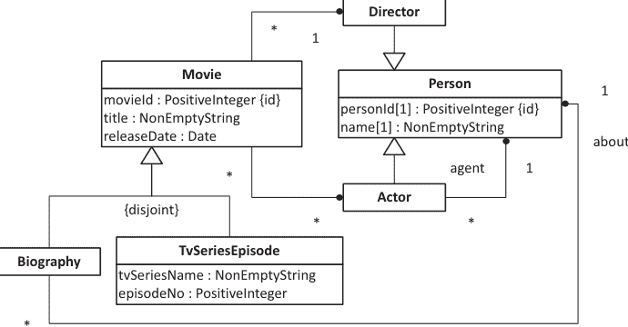

按照我们的指南编写应用程序。

请确保你的页面符合 HTML5 的 XML 语法，并确保你的 JavaScript 符合我们的编码指南（并使用 JSHint 进行检查）。

## 术语表

### C

**CRUD**

CRUD 是 *Create（创建）、Read/Retrieve（读取）、Update（更新）、Delete（删除）* 的缩写，表示任何软件应用程序执行的四种基本数据管理操作。

**样式表**

CSS 用于定义网页的呈现样式，告诉浏览器如何渲染其 HTML（或 XML）内容：使用何种内容元素布局、什么字体和文本样式、什么颜色、什么背景以及动画。通常，这些设置在单独的 CSS 文件中完成，通过 HTML head 标签中的特殊链接元素与 HTML 文件相关联。

### D

**文档对象模型**

DOM 是一个用于检索和修改 HTML 或 XML 文档节点与元素的抽象 API。所有编程语言都有实现 DOM 的绑定。

**域名系统**

DNS 将用户易读的域名转换为 IP 地址，以便在互联网上定位主机计算机。

### E

**ECMAScript**

由行业组织"欧洲标准国际组织"（Ecma International）定义的 JavaScript 标准。

**可扩展标记语言**

XML 允许以机器可读的 XML 格式标记各种文档、数据文件和消息结构。如果标签名称是自解释的，XML 也可以是人类可读的。XML 基于 Unicode。SVG 和 MathML 基于 XML，并且有一个基于 XML 的 HTML 版本。

XML 提供了一种语法，用于以元素及其属性的 XML 文档形式表示结构化信息。XML 文档中使用的特定元素和属性可以来自任何词汇，例如公共标准或用户定义的 XML 格式。

### H

**超文本标记语言**

HTML 允许标记（或描述）人类可读的网页或 Web 界面的结构。基于 XML 的 HTML 版本被称为"XHTML5"，与传统的 HTML 相比提供了更简洁的语法。

**超文本传输协议**

HTTP 是一种基于互联网技术 TCP/IP 和 DNS 的无状态请求/响应协议，使用人类可读的文本消息在客户端和 Web 服务器之间通信。HTTP 的主要目的是允许从浏览器获取由 URL 标识的网页文档，并从浏览器执行的 HTML 表单调用后端 Web 应用程序的操作。最近，HTTP 越来越多地提供 Web API 和 Web 服务。

### I

**IANA**

IANA 代表互联网时代数字分配机构（Internet Assigned Numbers Authority），它是 ICANN 的子公司，负责互联网协议使用的名称和数字。

**ICANN**

ICANN 代表互联网名称数字分配机构（Internet Corporation of Assigned Names and Numbers），是一个维护域名系统的国际非营利组织。

**IndexedDB**

一种由浏览器管理的索引数据存储的 JavaScript API。索引允许高性能搜索。像许多 SQL 数据库系统一样，IndexedDB 支持数据库事务。

**I18N（国际化）**

一组最佳实践，有助于将产品适应到任何目标语言和文化。它处理多种字符集、计量单位、键盘布局、时间和日期格式以及文本方向。

### J

**JSON**

JSON 代表 JavaScript 对象表示法（JavaScript Object Notation），是一种遵循 JavaScript 对象字面量语法的数据交换格式。许多编程语言都支持 JSON 作为 XML 的轻量级替代方案。

### M

**MathML**

一种用于表示数学表达式的开放标准，可用于数据交换或在网页内进行渲染。

**MIME**

MIME 类型（也称为"媒体类型"或"内容类型"）是随文件发送的关键字字符串，用于指示其内容类型。例如，音频文件可能标记为`audio/ogg`，或者图像文件标记为`image/png`。

**模型-视图-控制器**

MVC 是一种通用的架构隐喻，强调关注点分离原则（主要在模型和视图之间），并将模型视为应用程序的最根本部分。在 MVC 框架中，"M"、"V"和"C"以不同的方式定义。通常，"模型"指的是应用程序的数据源，而"视图"表示用于用户界面的代码（基于 CSS 样式的 HTML 表单和 DOM 事件），而"控制器"通常指负责调解视图和模型的（胶水）代码。

### O

**对象约束语言**

OCL 是一种用于表示完整性约束的正式逻辑语言，主要用于 UML 类模型。它还允许定义派生表达式以定义派生属性，并为操作定义先条件和后条件。

**面向对象编程**

OOP 是一种基于对象概念的编程范式。类就像对象的蓝图。

## 术语表

**Web 本体语言**

OWL 是一种用于 Web 上的知识表示的正式逻辑语言。它允许定义推理并检查一致性。

### P

**便携网络图形**

PNG 是一种开放（非私有）图形格式，支持无损压缩。

### R

**资源描述框架**

RDF 是一种用于在 Web 上表示机器可读信息的语言。

### S

**标准通用标记语言**

SGML 是语言的 ISO 规范。

**可缩矢量图形**

SVG 是一种基于 XML 的 2D 矢量格式。SVG 可以使用 CSS 设置样式，并使用 JavaScript 实现交互。

### U

**Unicode**

一种平台无关字符集，包含了世界上大多数脚本语言的字符，包括印地语、缅甸语和盖尔语。每个字符都被分配一个 0 到 1,114,111 之间的唯一整数代码。例如，希腊字母 pi 的代码是 960。Unicode 包含了旧字符集，如 ASCII 和 ISO-8859-1（Latin-1）。

**统一资源标识符**

URI 是统一资源定位符（URL）或统一资源名称（URN）。

**统一资源定位符**

URL 是一种资源名称，包含在 Web 上定位该资源的地址。

**统一语言**

UML 是一项行业标准，定义了一套建模语言，用于创建支持面向对象分析和软件设计的模型和图。其核心语言是用于信息/数据建模的类图，以及用于过程/行为建模的序列图、活动图和状态图。

**统一资源名称**

URN 指资源但不指定位置。

**用户代理**

用户代理是指前端 Web 客户端程序，例如浏览器。

### W

**WebM**

WebM 是一种由 Google Chrome 和 Mozilla Firefox 支持的开放（免版税）视频格式，但 Microsoft Internet Explorer 和 Apple Safari 不支持。

**Web 超文本应用技术工作组**

**万维网**

WWW（或简称为"万维网"）是一个基于 HTTP、HTML 和 XML 的巨大客户端-服务器网络，其中浏览器（以及其他代理）作为 HTTP 客户端访问 Web 服务器。

**万维网联盟（World Wide Web Consortium）**

W3C 是一个负责开发和维护标准的国际组织。

**XML HTTP 请求**

XML HTTP 请求 (XHR) API 允许 JavaScript 程序与后端程序交换消息。它可以从 HTML 表单检索/提交信息。基于 XHR 的方法在过去被归类为"AJAX"。

# 索引

- **抽象类** 170
- 聚合 113
- 关联 4
  - 双向 72
  - 消除 11, 86
  - 功能性的 5
  - 功能性 7–8, 56, 68, 85
  - 非定向的 9–10, 86
  - 整体-部分 113–115
  - 单向 6
- 关联消除 11, 86
  - 有序 39
  - 所有 7
  - 关联所有 7
- 属性 5
- 属性 15
- **排他的** 114
- 存在性依赖 31
- 存在性独立 31
- 扩展 132
- 扩展 125
- **基于工厂的** 143
- 外键 4
- 循环-of 20
- 固定值约束 147
- 参数解构 22, 149
- 功能性关联 7
- **人类可读的** 4
- **引用** 24
- 信息模型 3
- 继承 123
  - 鉴别符 135
  - 关联表 134, 143, 155
  - 单一表 134, 155, 160
  - 每类继承 134, 155
- 输入字段 15
- 不可分离 113
- 意图 125
- 内部引用 4
- 实例of 31
- **包** 16
- 块作用域变量声明 19
- 模板代码 52
- **变更依赖** 26
- 检查 41
- 选项组件 15
- 类层次结构 123
- 类层次结构合并 129, 134, 143
- 完整 127
- 组合 113
- 基于构造函数的 143
- 转换器 62
- **数据模型** 53
- 数据存储开销 84
- 数据值 5
- 派生规则 84
- 派生引用
  - 属性 91, 118
- 离散 27
- **Java 类模型** 53, 67, 79, 118
- Java 实体类模型 14
- JavaScript 类模型 79, 118
- 连接表继承 160
- JS 类模型 154
- JS 类模型 154
- JS 实体表模型 154
- **域** 6
- 动态表单 147, 162
- **种类** 128
- **实体** 4
- 实体类模型 100
- 实体关系 4
- 枚举属性 15
- 恰 5
- **生命周期依赖** 85
- 列表 16
- **主菜单** 59
- 强制 5
- 强制值 24
- 强制值约束 24

https://doi.org/10.1515/9783110500325-019

# 184 — 索引

- **多对多** 85
- 多对一 85
- 物化视图 85
- 模型类 53
- 模型-视图-控制器 3, 121
- 多重分类 130
- 多重继承 123, 130
- 多选组件 15, 48
- 多重继承层次结构 127
- 多重性 113
- 多值引用属性 38, 40, 67, 69
- 多值引用属性 15
- **引用** 3
- 引用完整性 6, 26
- 引用完整性约束 6, 24, 40
- 引用完整性约束 55
- 关系数据库 9
- 关系 4
- 关系类型 3, 4
- 限制 132
- 检索/列出所有对象 69
- 刚性 128
- **导航性** 80
  - 双向 84
- 非功能 7
- 不可共享 114
- **分段** 127
- 选择列表 15
- 可分离的 113
- 序列 16
- 集合 16
- setter 27, 41
- 集合值 39
- 可共享部分 113
- 单一继承层次结构 127
- 单值引用属性 15
- 可排序的 128
- **对象依赖** 6
- 对象销毁依赖 6
- 对象引用 5
- 对象类型 3
- 对象关系映射 134
- 一对一 85
- 对象类模型 9, 79, 118
- 可选的 5
- 有序集合 15
- 有序集合 39
- **源** 6
- SQL 表模型 14
- 子类 123
- 子表 139
- 子类型 123
- 超类 139
- **互反引用的属性对** 84
- 分区 127
- 主键 4
- 单选按钮组 15
- 范围 6
- 冗余 84
- 引用属性 5, 15, 26, 55
- 引用属性 3, 5
  - 派生 84
  - 逆向 83–84
  - 多值 5, 93, 102
  - 单值 5, 19, 92, 102
- **目标** 6
- UML 类图 4
- 单向关联应用 92
- 单向功能性关联 19, 53
- 单向非功能性关联 38, 67
- 单向二进制关联 3
- 统一建模语言 (UML) 4
- 唯一性 24
- 更新开销 84
- 用户界面 69

今天，Web 应用程序是最重要的应用程序类型。本书介绍了如何使用基于模型的方法来设计和实现它们，该方法涵盖了通用的信息管理概念以及两个相关的技术平台：JavaScript 和 Java。

本书提供了一个基于理论支撑和示例学习的深度教程，并辅有练习题和实践项目支持。

第一卷介绍了 Web 技术和基于模型的应用工程，讨论了基于约束的数据验证、枚举和特殊数据类型等信息管理概念。第二卷讨论了类层次结构中的关联高级信息管理概念。

Web 应用使用 UML 类图进行设计，并使用两种技术进行实现：用于前端（以及分布式 NodeJS）的 JavaScript，以及用于后端 Java（使用 JPA 和 JSF）。书中讨论的六个示例应用程序可以从本书的网站运行并下载源代码。
