# Javascript 或 Java Web 应用：第 1 卷：约束校验、枚举、特殊数据类型 (De Gruyter 教科书)


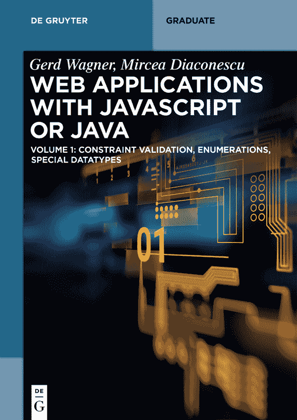


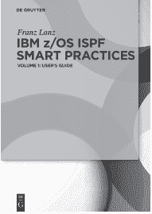


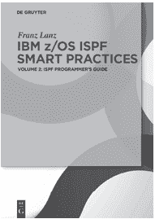


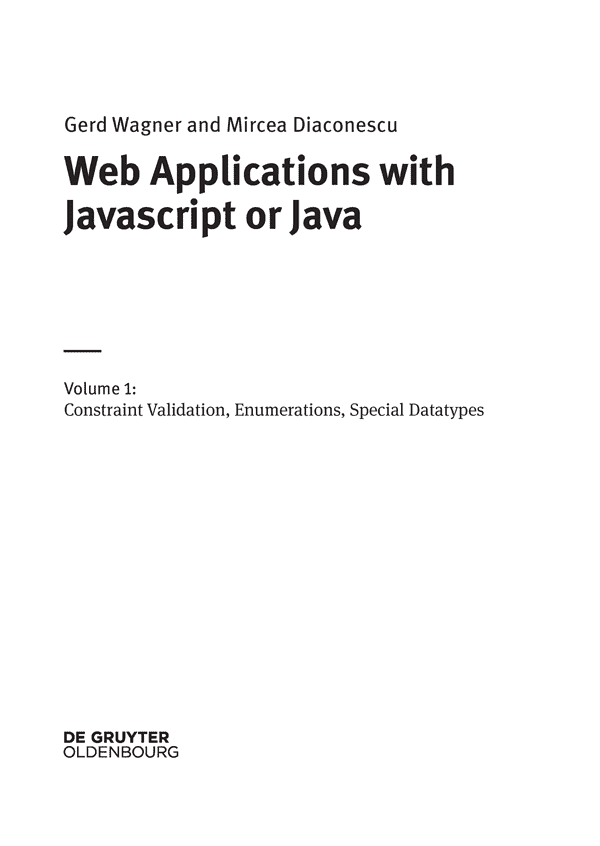

## 作者

Gerd Wagner 教授博士
BTU Cottbus-Senftenberg 
互联网技术系
Konrad-Wachsmann-Allee 5
03046 Cottbus
`wagnerg@b-tu.de`

Mircea Diaconescu
`dimircea@gmail.com`

本书的相关源代码受“代码项目开放许可协议”（CPOL）保护，请参见 `http://www.codeproject.com/info/cpol10.aspx`，这意味着代码是“按样”提供的，可以进行修改以创建衍生作品，可以重新分发，并用于商业应用程序。然而，本书本身受德国版权法保护，未经出版者许可不得分发或再出版。


献给我们的家人。

# 前言

这两卷书展示了如何使用基于模型的工程方法设计并实现 Web 应用，并使用了 Web 开发中最相关的两个技术平台：JavaScript 和 Java。Web 应用通过 UML 类图形式的信息模型进行设计，并实现为：

1. JavaScript 前端应用，使用 浏览器提供的两种本地存储技术之一；
2. Java 后端应用，使用 Java Server Faces (`JSF`) 作为用户界面技术，使用 Java Persistence API (`JPA`) 进行对象到存储的映射，以及 MySQL/MariaDB 数据库管理系统；
3. 分布式 JavaScript 应用，具有：
   a. 用于管理用户界面并处理应用逻辑某些部分（包括基于约束的数据验证）的前组件；
   b. 基于 NodeJS 的后端组件，用于管理持久化存储并处理应用逻辑某些部分（包括基于约束的数据验证）。

本书的重点是关于基础信息管理问题的通用概念和技术，涉及：
1. 完整性约束和数据验证
2. 枚举和枚举属性
3. 对象类型之间的单向和双向关联
4. 类层次结构中的子类型化和继承。

列表中的前两个问题将在本书的第一卷中讨论，而最后两个问题将在第二卷中讨论。

我们假设读者已经熟悉 HTML 和面向对象编程（最好是 Java），并熟悉 CSS 和 JavaScript，且愿意学习现代 JavaScript。本书可用于：
1. 计算机及相关专业的课程；
2. JavaScript 开发者学习 Java；
3. Java 开发者学习 JavaScript；
4. JavaScript 和 Java/Python/C# 开发者学习
‒ JavaScript 和 Java EE 的面向对象编程
‒ 如何使用纯 JavaScript 和 Java EE 构建应用。

本书提供了六个示例应用的完整源代码，您可以从本书网站运行或下载。

## 1 掌握应用开发不仅需要编码技能

对于掌握应用开发来说，精通你喜爱的语言是不够的。理解所有概念至关重要。许多开发者认为他们需要学习和掌握的是正确的编程技术，然而，如果不能掌握通用概念，他们无法掌握应用开发。

理解编程和信息管理的通用概念可以帮助你：
– 通过识别通用概念的具体实现来更好地理解框架的元素
– 比较不同的技术并评估它们的优缺点
– 为你的需求明智地选择新的技术。

虽然特定技术的知识对于掌握编程和应用开发很重要（事实上，它是基础），但其半衰期确实很短。在本书中，我们不仅以独立技术的方式解释编程和信息管理概念与技术，还解释了这些概念在两种最相关技术——JavaScript 和 Java 中是如何被支持的。


## 3 为什么 Java 是构建 Web 应用的好选择？

在 2017 年以及在未来的多年里，Java 企业版（`Java EE`）将 Java 语言与许多用于企业软件系统的库封装在一起，它是企业信息技术（包括各种业务软件应用）领域最重要的编程平台。它的优势主要源于其非常成熟：

1. 它拥有丰富的生态系统，包括大量的库、框架和工具；
2. Java 代码的执行速度比脚本语言，如 `Python`、`PHP`、`NodeJS` 或 `Ruby`；
3. Java Web 应用可以扩展，例如通过使用分布式数据库事务和集群技术；
4. 它提供了许多先进的安全技术。

## 4 Java 与 JavaScript 的对比

与 Java 相比，JavaScript 相对容易学习。其之一的原因是 Java 对变量、参数和返回值需要显式的类型定义，而 JavaScript 则不需要。

Java 和 JavaScript 都是“面向对象”的编程语言，但 JavaScript 比 Java 更加“面向对象”，而 Java 更多是“面向类”的。JavaScript 中没有显式的类概念。类必须以特殊对象的形式定义。然而，也可以在不实例化类的情况下创建对象，并且可以独立于任何类为特定对象定义属性和方法。

在运行时，可以向任何对象和类添加或删除属性和方法。虽然 JavaScript 类可以在运行时重新定义并立即影响所有实例化该类的对象，但 Java 类不能以这种方式重新定义。

JavaScript 允许定义特定于对象的方法，而独立于其类。Java 对象的方法是针对其类定义的，无法定义特定对象的方法。

JavaScript 对函数式编程支持更好。例如，它支持“闭包”，闭包是函数执行上下文。Java 仅对匿名类和“lambdas”支持有限版本的闭包。

## 5 良好的程序是：有效的、健壮的、高效的且可维护的

……正如 Nick Gonzalez1 所观察到的。一个良好的程序是有效的：它解决了它应该解决的问题。一个良好的程序在接收到用户的错误输入时不会崩溃：它是健壮的。良好的程序是高效的：它能快速完成它应该完成的工作。由于程序的需求可能会随时间改变，一个良好的程序应该是可维护的，这样当需求变化时可以方便地进行修改。只有当代码以清晰的方式编写时，程序才是可维护的。

任何笨蛋都能写出计算机能懂的代码，诀窍在于写出人类能懂的代码。（Martin Fowler 在《程序运行之后》2 中提到）

代码通常是“不必要的复杂、混乱、无组织且蔑视地拼接在一起的”，正如 Santiago L. Valdarrama3 在篇文章中所观察到的，他建议在必要时使用注释，仅解释那些无法解释清楚的内容，而是通过使用更好的命名、合理的结构以及正确的间距和缩进让你的代码展示其意图。

## 6 运行应用并获取代码

要运行我们 Web 服务器上的任何示例应用并下载其代码，请访问 `http://web-engineering.info/WebApp-Code`。

# 图列表

- 2.1 内置的 `JavaScript` 类 `Object` 和 `Function`(#13_chapter02.xhtml_chapter02_34)
- 3.1 对象类型 `Book`(#14_chapter03.xhtml_chapter03_1)
- 4.1 对象类型 `Book`(#15_chapter04.xhtml_chapter04_1)
- 5.1 从概念模型通过设计模型到 `JavaScript` 模型(#16_chapter05.xhtml_chapter05_11)
- 5.2 从概念模型通过设计模型到实现模型(#16_chapter05.xhtml_chapter05_13)
- 6.1 以模型为基础的 `MVC` 代码架构(#17_chapter06.xhtml_chapter06_2)
- 6.2 前端 Web 应用架构(#17_chapter06.xhtml_chapter06_17)
- 6.3 后端和分布式 Web 应用架构(#17_chapter06.xhtml_chapter06_20)
- 7.1 对象级约束示例(#19_chapter07.xhtml_chapter07_20)
- 7.2 带有不变属性的 `Book` 设计模型(#19_chapter07.xhtml_chapter07_24)
- 8.1 从信息模型推导出 `JS` 类(#20_chapter08.xhtml_chapter08_8)
- 9.1 从信息模型推导出 `Entity` 类(#21_chapter09.xhtml_chapter09_13)
- 10.1 记录枚举示例(#23_chapter10.xhtml_chapter10_6)
- 10.2 `Book` 类型的信息设计模型(#23_chapter10.xhtml_chapter10_15)
- 11.1 `Book` 类型的 `JavaScript` 类模型(#24_chapter11.xhtml_chapter11_4)
- 11.2 带有枚举属性的创建新记录的 UI(#24_chapter11.xhtml_chapter11_16)
- 12.1 用于 `Book` 类型的 `JPA` 实体模型(#25_chapter12.xhtml_chapter12_3)
- 12.2 创建新记录的用户界面(#25_chapter12.xhtml_chapter12_10)
- 13.1 数量类型(#27_chapter13.xhtml_chapter13_30)

# 表列表

- 2.1 表示书籍集合的实体表(#13_chapter02.xhtml_chapter02_21)
- 2.2 `JS` 类模式的所需与理想特性(#13_chapter02.xhtml_chapter02_29)
- 3.1 以表形式表示的书籍集合(#14_chapter03.xhtml_chapter03_1)
- 3.2 电影示例数据(#14_chapter03.xhtml_chapter03_40)
- 3.3 统计示例数据(#14_chapter03.xhtml_chapter03_46)
- 4.1 书籍示例数据(#15_chapter04.xhtml_chapter04_1)
- 4.2 `Java` 可见性级别(#15_chapter04.xhtml_chapter04_10)
- 7.1 `Book` 示例数据(#19_chapter07.xhtml_chapter07_27)
- 8.1 类型映射(#20_chapter08.xhtml_chapter08_13)
- 8.2 电影示例数据(#20_chapter08.xhtml_chapter08_37)
- 8.3 统计示例数据(#20_chapter08.xhtml_chapter08_41)
- 9.1 用于属性的 `Bean` 校验注解(#21_chapter09.xhtml_chapter09_4)
- 9.2 到 `Java` 的类型映射(#21_chapter09.xhtml_chapter09_11)
- 9.3 到 `MySQL` 的类型映射(#21_chapter09.xhtml_chapter09_11)
- 10.1 将记录枚举表示为表(#23_chapter10.xhtml_chapter10_1)
- 10.2 `Book` 示例数据(#23_chapter10.xhtml_chapter10_17)
- 11.1 带有评分和类型的电影示例数据(#24_chapter11.xhtml_chapter11_29)
- 11.2 带有国家代码和宗教的统计示例数据(#24_chapter11.xhtml_chapter11_31)


# 第一部分 入门

在本书的第一部分，我们对 Web 进行了简单介绍，并展示了如何构建：

1. 使用原生 `JavaScript` 和本地存储的简单前端 Web 应用，
2. 使用带有 `JSF`、`JPA` 和 `MySQL/MariaDB` 数据库的 `Java` 后后端 Web 应用。

我们还提供了信息建模和软件应用架构的简单介绍。

本书部分讨论的数据管理应用最小示例仅包含完整应用所需的最小整体功能。它们只处理一种对象类型（书籍），并支持四个标准数据管理用例（创建/检索/更新/删除），但它们需要通过添加应用整体功能的其他重要部分来扩展。

## 1 Web 应用基础的快速概览

如果你已经熟悉 HTML、XML 和 JavaScript，可以跳过本章，直接通过下一章开始开发一个最小化的 Web 应用。

## 1.1 世界万维网 (WWW)


在互联网于 20 世纪 80 年代建立 s 后，蒂姆·伯纳斯-李 4 于 1989 年在位于瑞士日内瓦的欧洲核研究组织（CERN）开发了万维网（WWW）的概念和第一个实现。WWW（或简单称为“Web”）基于互联网技术 `TCP/IP`（互联网协议）和 `DNS`（域名系统）。最初，Web 包含：

1. 超文本传输协议（`HTTP`），
2. 超文本标记语言（`HTML`），以及
3. 作为 HTTP 服务器的 Web 服务器程序，以及作为 HTTP 客户端的 Web“用户代理”（如浏览器）。

后来，这组基础 Web 技术中又添加了其他一些重要的技术组件：

–1995 年：页面/文档样式语言——层叠样式表（`CSS`），
–1995 年：Web 编程语言 `JavaScript`，
–1998 年：可扩展标记语言（`XML`），作为 Web 格式（如 `SVG` 和 `RDF/XML`）的基础，
–2001 年：基于 XML 的可缩矢量图形（`SVG`）格式，
–2004 年：用于 Web 知识表示的资源描述框架（`RDF`）。

## 1.2 HTML 和 XML

`HTML` 允许标记（或描述）人类可读的 Web 文档或 Web 用户界面的结构，而 `XML` 允许标记各种文档、数据文件和消息的结构，无论它们是否是人类可读的。`XML` 也可以作为定义名为 `XHTML` 的 HTML 版本的基础。

### 1.2.1 XML 文档

`XML` 提供了一种语法，用于以嵌套元素及其属性的 `XML` 文档形式表示结构化信息。`XML` 文档中使用的特定元素和属性可以来自任何词汇表，例如公共标准或（私有的）用户定义的 `XML` 格式。`XML` 用于指定：

–文档格式，例如 `XHTML5`、可缩矢量图形（`SVG`）格式或 `DocBook` 格式，
–数据交换文件格式，例如数学标记语言（`MathML`）或通用业务语言（`UBL`），
–消息格式，例如 Web 服务消息格式 `SOAP`5

### 1.2.2 Unicode 和 UTF-8

`XML` 基于 `Unicode`（Unicode），这是一个与平台无关字符集，包含了世界上大多数脚本语言的几乎所有字符，包括印地语、缅甸语和盖尔克语。每个字符都被分配了一个位于 0 到 1,114,111 之间的唯一整数代码。例如，希腊字母 `π` 的代码为 960，因此可以使用 `XML` 实体语法作为 `π` 插入到 `XML` 文档中。

`Unicode` 包含 `ASCII` 和 `ISO-8859–1`（Latin-1）等遗留字符集作为子集。

`XML` 文档的默认编码是 `UTF-8`，它对 `ASCII` 字符仅使用单个字节，但对不常用的字符使用三个字节。

在格式良好的 `XML` 文档中，几乎所有的 `Unicode` 字符都是合法的非法字符是代码为 0 到 31 的控制字符，但换行符、换行符和制表符除外。因此，从另一个（非 XML）文本复制文本到 `XML` 文档是危险的（通常，换页符会产生问题）。

### 1.2.3 XML 命名空间

通常，命名空间有助于避免命名冲突。它们允许在不同的命名空间上下文中重用相同的（本地）名称。许多计算语言都有某种形式的命名空间概念，例如 `Java` 和 `PHP`。

`XML` 命名空间通过命名空间 URI ，例如 `SVG` 命名空间 URI “http://www.w3.org/2000/svg”，它与命名空间名前缀（如 `svg`）关联。此类命名空间代表了元素和属性的名称集合，并允许形式为 `prefix:name` 的命名空间限定名称，例如 `svg:circle` 作为 `SVG` 元素的命名空间限定名称。

默认命名空间如下所示声明在元素的起始标签中：

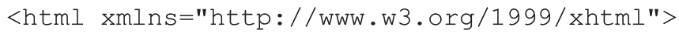

此示例显示了 `HTML` 根元素的起始标签，其中 `XHTML` 命名空间被声明为默认命名空间。

接下来的示例显示了嵌入 `HTML` 文档的 `svg` 元素的 `SVG` 命名空间声明：

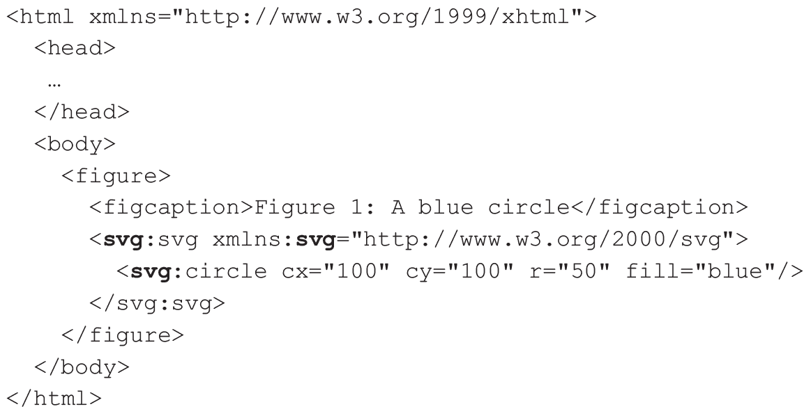

### 1.2.4 正确的 XML 文档

`XML` 定义了两个语法正确标准。`XML` 文档必须是格式良好的（well-formed），如果它是基于语法（或架构），那么它相对于该语法必须是有效的（valid），或者说，必须满足语法的所有规则。

如果一个 `XML` 文档满足以下语法条件，则被称为格式良好：

1. 必须恰有一个根元素。
2. 每个元素都有一个起始标签和一个结束标签；然而，空元素可以用 `<phone/>` 而不是 `<phone></phone>` 来关闭。
3. 标签不能重叠。例如，我们不能拥有：

```
<author><name>Lee Hong</author></name>
```
4. 属性名在元素范围内是唯一的。例如，以下代码是不正确的：

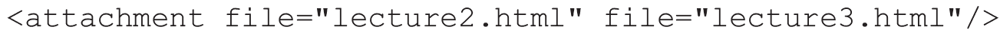

如果一个 `XML` 文档相对于特定语法（如 `DTD` 或 `XML Schema`）是有效的，如果：

1. 它是格式良好的，
2. 并且它遵守语法。

### 1.2.5 HTML 的演进

万维网联盟（W3C）开发了以下重要的 HTML 版本：

–1997 年：作为基于 SGML 的语言的 `HTML` 4，
–2000 年：基于 XML 的清理版本 `XHTML` 1，
–2014 年：与浏览器厂商合作（并竞争）的 (X)HTML 5

作为 Web 的发明者，蒂姆·伯纳斯-李于 1990 年开发了第一版本的 `HTML`7。几年后，在 1995 年，蒂姆·伯纳斯-李和丹·康诺利编写了 `HTML` 28 标准。在随后的几年里，`HTML` 被不断增长的早期 Web 使用者使用并逐渐扩展。这种 `HTML` 的演进导致了一堆混乱的元素和属性（被称为“标签汤”），主要由浏览器厂商及其竞争控制。2000 年 `XHTML` 的开发是 W3C 试图清理这种混乱，但它忽视了 HTML 向更丰富的用户界面的功能发展，这是由伊恩·希克斯森 10 领导的工作组 9，他是 `HTML5` 以及许多使其适用于移动应用的配套 API 的大师和作者。

`HTML` 最初被设计为结构描述语言，而不是演示描述语言。但 `HTML4` 有许多演示性元素，如 `font`。`XHTML` 将 HTML 带回根源，放弃了演示性元素并定义了简单的语法，以支持以下目标：

–设备独立，
–可访问性和
–可用性。

我们采用符号方程：

`HTML = HTML5 = XHTML5`

表示当我们说“HTML”或“HTML5”时，我们实际上指的是 `XHTML5`，因为我们更倾向于 XML 文档清晰语法，而不是 HTML5 允许的宽松且混乱的 HTML4 风格语法。

接下来的简单示例显示了用于任何 HTML 文档的基础代码模板：

```html
<!DOCTYPE html>
<html xmlns="http://www.w3.org/1999/xhtml">
<head>
<meta charset="UTF-8">
<title>Document</title>
</head>
<body>
<p>Content here</p>
</body>
</html>
```

注意第 1 行声明了 HTML5 文档类型，以便浏览器使用 HTML5 文档对象模型（DOM）。在第 2 行的 `html`起始标签中，使用默认命名空间声明属性 `xmlns`，将 `XHTML` 命名空间 URI [`http://www.w3.org/1999/xhtml`](http://www.w3.org/1999/xhtml) 声明为默认命名空间，以确保所有非限定元素名称（如 `html`、`head`、`body` 等都来自 `XHTML` 命名空间。


同样在 `html` 开始标签中，我们通过 `xml:lang` 属性和 HTML 的 `lang` 属性为所有元素的文本内容设置了（默认）语言（此处为“en”，代表英语）。这种属性的重复是为了获得一个既能被 HTML 也能被 XML 工具处理的混合文档文档所付出的微小代价。

最后，在第 4 行，我们使用一个带有 `charset` 属性的（空）`meta` 元素，将 HTML 文档的字符编码设置为 UTF-8，这也是 XML 文档的默认设置。

### 1.2.6 HTML 表单

对于用户交互型 Web 应用程序，浏览器需要渲染用户界面（UI）。软件应用程序 UI 的传统比喻是表单。用于数据输入、数据输出和用户操作的特殊元素被称为表单控件或 UI 组件（widgets）。在 HTML 中，`form` 元素是 页面的一个部分，由块元素组成，这些元素包含表单控件以及这些控件的标签。

用户通过在输入字段中输入文本以及从选择控件中选择项目（包括下拉选择列表、单选按钮组和复选框组）来完成表单。完成后的表单在提交按钮的帮助下提交。当用户提交表单时，通常会通过 HTTP GET 方法或 HTTP POST 方法发送到 Web 服务器。提交的标准编码被称为 URL 编码（URL-encoded）。它由 Internet 媒体类型 `application/x-www-form-urlencoded` 表示。在这种编码中，空格变为加号，任何其他预留字符都被编码为百分号后跟十六进制数字，如 RFC 1738 定义的那样。

每个表单控件都有一个初始值和一个当前值，两者都是字符串。初始值通过控件元素的 `value` 属性指定，但 `textarea` 元素的初始值由其初始内容给出。控件的当前值首先被设置为初始值。此后，控件的当前值可以通过用户交互或脚本进行修改。当提交表单进行处理时，某些控件的名称（name）与其当前值配对，这些键值对会随表单一起提交。

通过将控件作为 `label` 元素的子元素（隐式标签），或通过为控件提供 `id` 值并在 `label` 元素的 `for` 属性中引用该 ID（显式标签），可以将标签与控件关联。

在我们“入门”应用程序的简单用户界面中，我们只需要四种表单控件：

1. 使用 `<input name="`…`" />` 元素创建的单行输入字段，
2. 使用 `<output name="`…`" />` 元素创建的单行输出字段，
3. 使用 `<button type="button">`…`</button>` 元素创建的推按钮，
4. 使用如下形式的 `select` 元素创建的下拉选择列表：

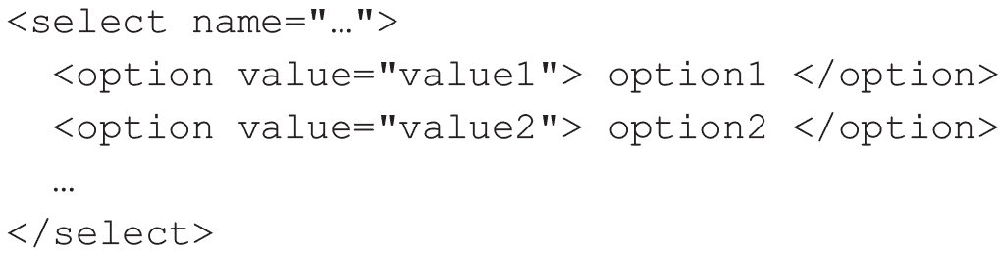

创建此类用户界面的带有隐式标签的 HTML 表单示例为：

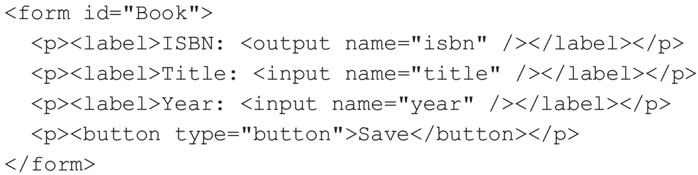

在基于 HTML 表单的数据管理用户界面中，应用程序模型类中定义的不同类型属性与用于输入和输出这些值的表单控件之间存在对应关系。我们必须区分各种类型的模型类属性，它们被映射到各种类型的表单字段。这种映射也被称为数据绑定（data binding）。

通常情况下，模型类的属性始终可以在用户界面中通过一个简单的 `input` 控件（默认设置为 `type=" text"`）表示，无论在模型类中定义的属性范围是哪种数据类型。然而，在特殊情况下，可以使用其他类型的 `input` 控件（例如 `type= "date"`）或其他组件。例如，如果属性的范围是一个枚举，可以使用 `select` 控件；或者如果可能的选择足够少（例如少于 8 个），可以使用单选按钮组。

## 1.3 使用 CSS 设置 Web 文档和用户界面

虽然 HTML 用于定义 Web 文档或 Web 用户界面的内容结构，但层级样式表（CSS）用于定义 Web 页面的呈现样式，这意味着你使用它来告诉浏览器你希望如何渲染 HTML（或 XML）：使用哪种内容元素布局、什么字体和文本样式、什么颜色、什么背景以及什么动画。通常，这些设置是在单独的 CSS 文件中完成的，该文件通过 HTML `head` 中特殊的 `link` 元素与 HTML 文件关联。

CSS11 的第一个草稿由 Håkon W. Lie12 于 1994 年 10 月提出，他后来成为了浏览器供应商 Opera 的首席技术官。虽然官方的 CSS113 标准追溯到 1996 年 12 月，但“大部分是由 Håkon W. Lie 与 Bert Bos 在 1995 年 7 月在 Sophia-Antipolis 的白板上敲定的”（正如他在一次采访 14 中解释的那样）。

CSS 基于一种规则形式，由选择器组成（用于选择应用规则的文档元素）以及一个属性-值对列表，通过 CSS 属性（如 `font-size` 或 `color`）来定义所选元素的样式。根据给定规则计算 CSS 值的两种基本机制：继承和级联。CSS 布局 15 的基本元素是一个矩形，也称为“盒（box）”，具有内容区域、可选的边框（border）、内边距（padding）以及边框周围可选的外边距（margin）。

我们在这里不会深入研究 CSS，因为我们的重点是应用程序的逻辑和功能，而不是它的美化。

## 1.4 JavaScript —— “Web 的汇编语言”

JavaScript 是 1995 年 5 月用 10 天由 Brendan Eich16 开发的，当时他在 Netscape17 工作，作为浏览器 Navigator 2 的 HTML 脚本语言（更多历史见 18）。Brendan Eich 在 2015 年 4 月的 O’Reilly Fluent 大会上说：“我写 JavaScript 之匆，从未想过它会成为 Web 的汇编语言”。

JavaScript 是一种动态函数对象对象编程语言，可用于：

1. 增强网页：–生成特定浏览器的 HTML 内容或 CSS 样式，–插入动态 HTML 内容，–产生音视觉效果（动画）。
2. 增强 Web 用户界面：–实现高级用户界面组件，–在客户端验证用户输入，–自动预填充某些表单字段。
3. 实现具有本地或远程数据存储 19 的前端应用程序。
4. 实现具有远程数据存储的前端 Web 应用，数据由后端组件管理，后端组件传统上用服务器端语言（如 PHP、Java 或 C#）编写，但现在也可以用 NodeJS 使用 JavaScript。
5. 实现完整的分布式 Web 应用，其中前端和后端组件都是 JavaScript 程序。

目前 浏览器完全支持的 JavaScript 版本被称为“ECMAScript 5.1”，或简单的“ES5”，但接下来的两个版本“ES6”和“ES7”（或“ES 2015”和“ES 2016”）已被当前的浏览器和后端 JS 环境部分支持。事实上，在 2017 年 5 月，ES6 已在非移动浏览器中获得完全支持，除了重要的新 `module` 概念。

### 1.4.1 作为面向对象语言的 JavaScript


JavaScript 是面向对象的，但其方式与 `Java` 和 `C++` 等经典的面向对象编程语言不同。在 JavaScript 中，类（classes）与对象和函数并不是一等公民。相反，类必须通过遵循某些代码模式以特殊 JS 对象的形式来定义：要么作为构造函数（可能使用 ES6 `class` 声明的语法糖），要么作为工厂对象。

然而，也可以在不实例化类的情况下创建对象，在这种情况下，它们是无类型的，并且可以独立于任何类定义为特定对象定义属性和方法。在运行时，可以向任何对象和类添加或删除属性和方法。JavaScript 的这种动态性允许了强大的元编程形式，例如定义你自己的类和枚举（以及其他特殊数据类型）。

### 1.4.2 关于 JavaScript 的进阶阅读

关于 JavaScript 的优秀开源书籍有：

–Speaking JavaScript[20，由 Axel Rauschmayer 博士著。

–Eloquent JavaScript[21，由 Marijn Haverbeke 著。

## 1.5 Web 应用的无障碍性

为 Web 应用提供无障碍性的推荐方法由可访问富互联网应用程序（ARIA）标准定义。正如 Bryan Garaventa22 在他关于不同形式无障碍性的 23 中总结的，交互式 Web 无障碍性有三个主要方面：1) 键盘可访问性，2) 屏幕阅读器可访问性和 3) 认知可访问性。

关于 ARIA 的进一步阅读：

1. 浏览器如何与屏幕阅读器交互，以及 ARIA 如何融入其中 24，由 Bryan Garaventa 著。
2. 可访问树训练指南 25，由 [whatsock.com](http://whatsock.com) 编写。
3. ARIA 角色一致性矩阵 26，由 [whatsock.com](http://whatsock.com) 编写。
4. Mozilla 的 ARIA 概述文章 27
5. W3C 的 ARIA 概述页面 28

### 1.6 测验题

如果你想查找以下测试题的答案，可以查看我们的讨论论坛 29。如果你在论坛中没有找到答案，可以创建一个帖子提问某个特定问题的答案。

### 1.6.1 问题 1：良好的 XML (Well-Formed XML)

以下片段中哪一个代表良好的 XML？请选择一个或多个：

### 1.6.2 问题 2：HTML 表单

回想 HTML 表单是 HTML 文档的一个部分，由块级元素组成，这些元素包含了控件以及这些控件的标签。以下表单元素中哪些代表了正确的表单？请选择一个或多个：

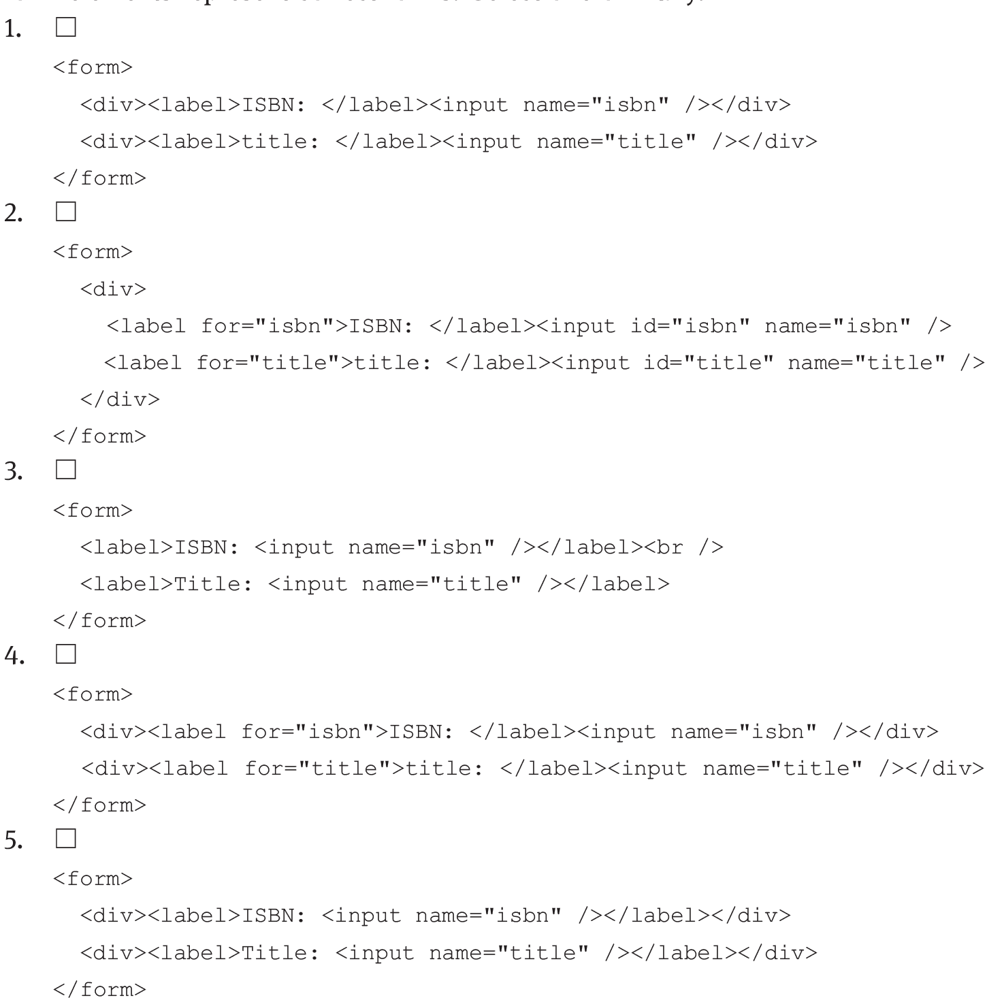

# 2 更多关于 JavaScript 的

## 2.1 JavaScript 基础

在本总结中，我们试图考虑 Douglas Crockford31 经典 JavaScript 总结 30 中的所有重要要点。

### 2.1.1 JavaScript 中的类型和数据字面量

JavaScript 有三种原始数据类型：`string`、`number` 和 `boolean`，我们可以借助 JS 运算符 `typeof` 来测试变量 `v` 是否持有此类类型的值，例如 `typeof v === "number"`。

有五种引用类型：`Object`、`Array`、`Function`、`Date` 和 `RegExp`。数组、函数、日期和正则表达式是特殊的对象，但从概念上讲，日期和正则表达式是原始数据值，恰好以包装对象的形式实现。

变量、数组元素、函数参数和返回值的类型没有声明，JavaScript 引擎通常也不会对其进行检查。类型转换（强制类型）是自动执行的。

变量的值可能是：

– 数据值：字符串、数字或布尔值；
– 对象引用：引用普通对象，或数组、函数、日期或正则表达式；
– 特殊数据值 `null`，通常用于初始化对象变量的默认值；
– 特殊数据值 `undefined`，所有已声明但未初始变量的隐式初始值。

字符串是 Unicode 字符序列。字符串字面量，如 `"Hello world!"`、`'A3F0'` 或空字符串 `""` 被包含在单引号或双引号中。两个字符串可以使用 `+` 运算符拼接，并三等运算符检查相等性：


通过对字符串应用 `length` 属性可以获取字符串的字符数：


所有数值数据都以 64 位浮点格式表示，带有可选的指数。如果数值表达式无法求值，则其值被设置为 `NaN`（不是数字），可以使用内置的 `isNaN()` 进行测试。由于 `Number.isInteger` 仅在 ES6 中引入，因此需要补丁 32 来使用。为了确保表示数字的字符串是整数，必须应用 `parseInt()`。同样，表示小数的字符串可以使用 `parseFloat()` 进行转换。将数字 `n` 转换为字符串的最好方法是 `String(n)`。

有两个预定义的布尔字面量 `true` 和 `false`，布尔运算符有感叹号 `!`（非）、双和 `&&`（与）和双竖 `||`（或）。当非布尔值用于条件或作为布尔表达式的操作数时，会按照以下规则隐式转换为布尔值：空字符串、数值字面量 `0` 以及 `undefined` 和 `null` 被映射为 `false`，其他值映射为 `true`。这种转换可以通过双否定操作显式完成，例如相等性测试 `!!undefined === false` 值为 `true`。

除了字符串、数字和布尔值外，日期和时间也是重要的类型，尽管它们不是以原始值的形式实现的，而是以包装对象的形式实例化 `Date`。注意 `Date` 对象实际上并不代表日期，而是内部表示自 1970 年 1 月 1 日 UTC 起的毫秒数。为了将 `Date` 对象的内部值转换为可读的字符串，我们有多种选择。最重要的两个是使用标准的 ISO 日期时间字符串格式“2015–01–27”，或本地化的日期时间字符串格式如“27.1. 2015”（为了简单起见，我们在这些示例中省略了日期时间字符串的时间部分）。当 `x instanceof Date` 时，`x.toISOString()` 提供 ISO 日期时间字符串，而 `x.toLocaleDateString()` 提供本地化的日期时间字符串。给定任何日期字符串 `ds`（ISO 或本地化），`new Date(ds)` 都会创建一个相应的日期对象。

测试两个原始数据值的相等（或不等）时，始终使用三等运算符 `===`（和 `!==`）而不是双等运算符 `==`（和 `!=`）。否则，例如，数字 2 将与字符串“2”相同，因为条件 `(2 == "2")` 在 JavaScript 中求值为真。


分配一个空数组字面量，如 `var a = []` 与调用不带参数的 `Array()` 构造函数相同，但前者更简洁，因此优于后者，例如 `var a = new Array()`。

分配一个空对象字面量，如 `var o = {}` 与调用不带参数的 `Object()` 构造函数相同，但前者更简洁，因此优于后者，例如 `var o = new Object()`。但注意，空对象字面量 `{}` 并不是真正的空对象，因为它包含了从 `Object.prototype` 继承的属性槽和方法槽。因此，一个真正的空对象（不包含任何槽位）必须使用 `null` 作为原型来创建，例如 `var emptyObject = Object.create(null)`。

下表提供了类型测试的总结：

| 类型 | 示例值 | 测试 x 是否为该类型 |
| :--- | :--- | :--- |
| string | “Hello world!”, ’A3F0’ | `typeof x === "string"` |
| 布尔值 | true, false | `typeof x === "boolean"` |
| （浮点数）数字 | -2.75, 0, 1, 1.0, 3.1e10 | `typeof x === "number"` |
| 整数 | -2, 0, 1, 250 | `Number.isInteger(x)` |
| Object | {}, {num:3, denom:4}, {isbn:”006251587X,” title:”Weaving the Web”}, {”one”:1, “two”:2, “three”:3} | 排除 `null`：`x instanceof Object` 包含 `null`：`typeof x === "object"` |
| Array | [], [“one”], [1,2,3], [1,”one”, {}] | `Array.isArray(x)` |
| Function | `function () { return "one"+1;}` | `typeof x === "function"` |
| Date | `new Date("2015––01`–`27")` | `x instanceof Date` |
| RegExp | `/(\w+)\s(\w+)/` | `x instanceof RegExp` |

下表提供了类型转换的总结：

| 类型 | 转换为字符串 | 将字符串转换为类型 |
| :--- | :--- | :--- |
| 布尔值 | `String(x)` | `Boolean(y)` |
| （浮点数）数字 | `String(x)` | `parseFloat(y)` |
| 整数 | `String(x)` | `parseInt(y)` |
| Object | `x.toString()` 或 `JSON.stringify(x)` | `JSON.parse(y)` |
| Array Function | `x.toString()` 或 `JSON.stringify(x)` | `y.split()` 或 `JSON.parse(y)` `new Function(y)` |
| Date RegExp | `x.toISOString() x.toString()` | `new Date(y) new RegExp(y)` |

### 2.1.2 变量作用域

在当前的 JavaScript 版本 `ES5` 中，变量只有两种作用域：全局作用域（以 `window` 为上下文对象）和函数作用域，没有块作用域。因此，在代码块内声明变量是令人困惑的，应该避免。例如，尽管即使是经验丰富的 JavaScript 程序员经常使用这种模式，但在 `for` 循环内部声明计数器变量也是一个陷阱，如下：

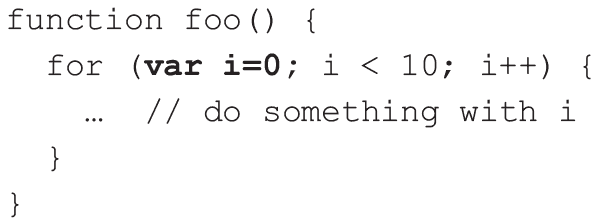

相反，这正是 JavaScript 解释这段代码的方式（通过变量声明的“提升”），我们应该写成：

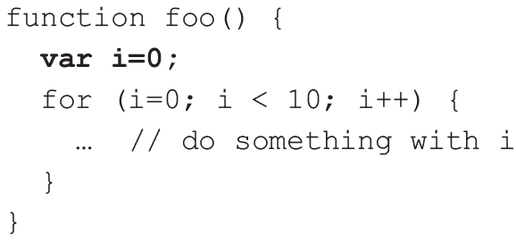

所有变量都应该在函数的开始声明。只有在 JavaScript 的下一个版本 `ES6` 中，才会通过使用关键字 `let` 的新形式变量声明来支持块作用域。

### 2.1.3 严格模式

从 `ES5` 开始，我们可以使用严格模式来进行更多的运行时错误检查。例如，在严格模式下，所有变量都必须声明。对未声明变量的赋值会抛出异常。

我们可以通过在 JavaScript 文件的第一行或 `<script>` 元素内部输入以下语句来开启严格模式：

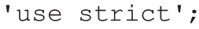

通常建议你使用严格模式，除非你的代码依赖于与严格模式不的库。

### 2.1.4 不同类型的对象

JS 对象与经典的 OO/UML 对象不同。特别是，它们不需要实例化类。而且它们可以以方法槽的形式拥有自己的（实例层级）方法，因此它们不仅有（普通的）属性槽，还拥有方法槽。此外，它们可能还具有键值槽。因此，它们可能有三种不同类型的槽位，而经典对象（在 UML 中称为“实例规范”）只有属性槽。

一个 JS 对象本质上是一组名称-值对（也称为槽），其中名称可以是属性名、函数名或 map 的键。可以使用 JavaScript 的对象字面量符号（JSON）以一种即时的方式创建对象，而无需实例化类：

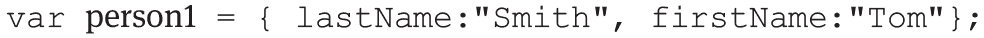

通过以下方式创建一个不包含任何槽的空对象：

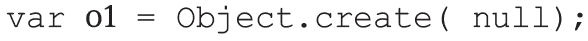

只要槽中的名称是允许的 JavaScript 标识符，该槽就可以是属性槽、方法槽或键值槽。否则，如果名称是其他类型的字符串，则该槽代表键值槽，如下文所示。

属性槽中的名称可以是：
1. 数据值属性，在这种情况下值是数据值或更宽泛地说是数据表达式；
2. 对象值属性，在这种情况下值是对象引用或更宽泛地说是对象表达式。

方法槽中的名称表示 JS 函数（更好地称为方法），其值为函数表达式。

对象属性可以通过两种方式访问：
1. 使用点符号（类似于 C++/Java）：`person1.lastName = "Smith"`
2. 使用映射符号：`person1["lastName"] = "Smith"`

JS 对象可以以不同的方式用于不同的用途。以下是对象的五种不同用例或含义：

1. 记录（record）是属性槽的集合，例如 `var myRecord = {firstName:"Tom", lastName:"Smith", age:26}`
2. Map（在其他语言中也称为关联数组、字典或哈希表）支持根据键查找值，例如 `var numeral2number = {"one":"1", "two":"2", "three":"3"}` 将值“1”与键“one”关联，“2”与键“two”关联。键不需要是有效的标识符，但可以是任何类型的字符串（例如它可以包含空格）。
3. 未类型对象不实例化类。它可能拥有属性槽和方法槽，例如 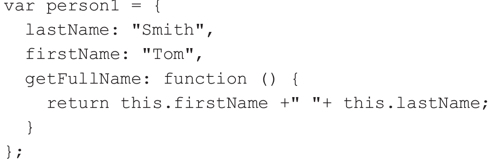。在对象的方法槽内部，特殊变量 `this` 指向该对象。
4. 命名空间可以通过由全局对象变量引用的未类型对象定义，其名称代表命名空间前缀。例如，以下对象变量提供了基于模型-视图-控制器（MVC）架构范式的应用程序主命名空间，其中三个对应应用程序三个部分的子命名空间：`var myApp = {model:{}, view:{}, ctrl:{} };` 更高级的命名机制可以通过下文所示的。
5. 类型对象实例化由 JavaScript 构造函数或工厂对象定义的类。参见第 1.9 节，“定义和使用类”。

### 2.1.5 数组列表

JS 数组实际上代表数组列表的逻辑数据结构，这是一个可以通过索引数字访问每个列表项目的列表（类似于数组元素）。使用“数组”一词而不说“JS 数组”会产生术语歧义。但为了简单起见，我们有时只说“数组”而不是“JS 数组”。

变量可以使用 数组字面量初始化：


由于它们是列表（array lists），JS 数组可以动态增长：可以使用大于数组长度的索引。例如，在上述数组变量初始化后，变量 `a` 持有的数组长度为 3，但我们仍然可以像下面这样赋值第五个数组元素：


数组 `a` 的内容通过标准的 `for` 循环进行处理，使用一个计数器变量从第一个数组索引 0 计数到最后一个数组索引，即 `a.length-1`：

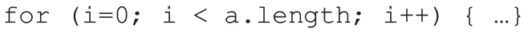

由于数组是特殊的对象，我们有时需要一种方法来判断一个变量是否代表数组。我们可以通过应用预定义的数据类型谓词 `isArray`，如 `Array.isArray(a)`，来测试变量 `a` 是否代表数组。

要向数组添加新元素，我们使用 `push` 操作将其追加到数组，如下：

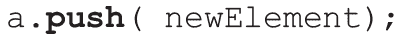

要从数组 `a` 中删除位置 `i` 的元素，我们使用预定义的数组方法 `splice`，如下：

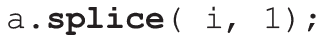

在数组 `a` 中搜索值 `v`，我们可以使用预定义的数组方法 `indexOf`，如果找到则返回位置，否则返回 -1，如下：


遍历数组 `a`，我们有两种选择：要么使用 `for` 循环，要么使用数组循环方法 `forEach`。在任何情况下，我们都可以使用 `for` 循环：

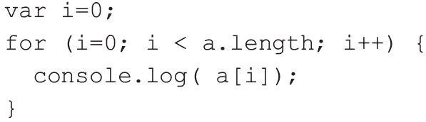

如果性能不重要，也就是说如果 `a` 足够小（例如，它不包含几百个元素），我们可以使用数组循环方法 `forEach`，如下例所示，其中参数 `elem` 迭代地假设数组 `a` 的每个元素的值作为其值：

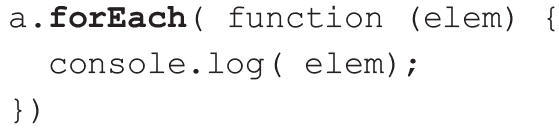

要克隆数组 `a`，我们可以通过以下方式使用数组函数 `slice`：


### 2.1.6 Map

map（也称为“哈希 map”或“关联数组”）提供了从键到其关联值的映射。JS map 的键是字符串字面量，可能包含空白字符，如下：

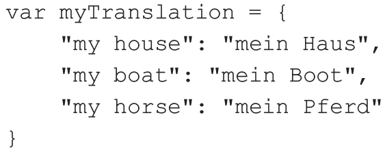

map 的处理通过一个特殊的循环完成，在该循环中通过预定义的函数 `Object.keys(m)` 遍历 map 的所有键，该函数返回 map `m` 的所有键的数组。例如，

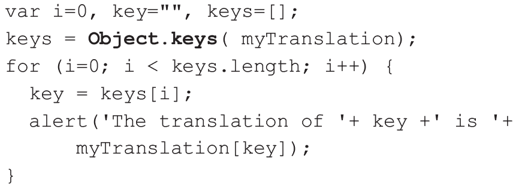

要向 map 中添加新条目，我们只需将新值与其键关联即可，如下：


要从 map 中删除条目，我们可以使用预定义的 `delete` 操作符，如下：


要在 map 中搜索是否包含某个特定键值的条目，例如测试翻译映射是否包含“my bike”的条目，我们可以检查以下：


要遍历 map `m`，我们首先借助预定义的 `Object.keys` 方法将其转换为键的数组，然后我们可以使用 `for` 循环或 `forEach` 方法。接示例示例了如何使用 `for` 循环：

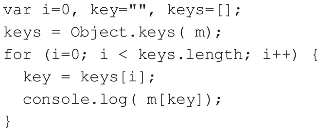

再次，如果 `m` 足够小，我们可以使用 `forEach` 方法，如下例：

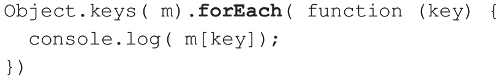

注意，使用 `forEach` 方法更加简洁。

要克隆 map `m`，可以使用 `JSON.stringify` 和 `JSON.parse` 的组合。我们首先使用 `JSON.stringify` 将 `m` 序列化为字符串表示，然后使用 `JSON.parse` 将字符串表示反序列化为 map 对象：

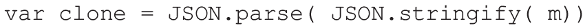

注意，如果 map 仅包含简单数据值或（可能嵌套的）包含简单数据值的数组/map，则此方法运行良好。在其他情况下，例如如果 map 包含 `Date` 对象，我们必须编写自己的克隆方法。

### 2.1.7 JavaScript 支持四种基础数据结构

总结，支持的四种基础数据结构包括：

1. 列表，例如 `["one","two","three"]`，它们是被称为“数组”的特殊 JS 对象，但由于它们是动态的，它们类似于 Java 编程语言定义的列表。
2. 记录（records），是特殊的 JS 对象，例如 `{firstName:"Tom", lastName:"Smith"}`，如上所述；
3. map，也是特殊的 JS 对象，例如 `{"one":1, "two":2, "three":3}`，如上所述；
4. 实体表（entity tables），例如下表，是特殊的 map，其值是带有标准 ID（或主键）槽的实体记录，使得键是实体记录。

表 2.1 实体表示例
| 键 | 值 |
| :--- | :--- |
| 0062515 | 编织网络 |
| 0465026 | 德尔、埃舍尔、巴赫 |
| 0465037 | 奇异循环 |

注意 map、记录和实体表之间的区分是概念上的。对于 JavaScript 引擎来说，`{firstName:"Tom", lastName:"Smith"}` 是记录，因为 `firstName` 和 `lastName` 表示属性；而 `{"one":1,"two":2}` 是 map，因为 `"one"` 和 `"two"` 是用作键的字符串值。

这种概念区分有助于程序的设计，映射到语法区分（即使解释不同）有助于更好地理解代码的含义。

###过程、方法和函数

通常情况下，（参数化的）过程类似于子程序，可以在内部多次调用（带有特定参数）。每当过程返回值时，它被称为函数。在面向对象编程中，如果过程定义在类或对象内部，被称为方法。

在 JavaScript 中，无论方法是否返回结果，都称为“函数”。如图 2.1（13_chapter02.xhtml_chapter02_35）所示，JS 函数是特殊的对象，具有可选的 `name` 属性和一个提供参数数量的 `length` 属性。变量 `v` 是否引用函数可以通过如下测试：

```
typeof v === 'function'
```

对象化意味着 JS 函数可以存储在变量中、作为参数传递、由函数返回、拥有属性并可以动态更改。因此，JS 函数是一等公民，JavaScript 可以被视为一种函数式语言。

JS 函数定义的通用形式是将 JS 函数表达式赋值给变量：

```javascript
var methodName = function(params) { ... }
```

其中 `params` 是用逗号分隔的参数列表（或参数记录），`methodName` 是可选的。当省略时，该方法/函数是匿名的。在任何情况下，JS 函数通常通过引用该函数的变量进行调用。在上述情况下，这意味着通过 `methodName()` 调用 JS 函数，而不是通过 `theNameOfMyMethod()`。然而，命名的 JS 函数可以在函数内部通过名称调用（递归）。因此，递归 JS 函数必须是命名的。匿名函数表达式在其他编程语言中被称为 lambda 表达式（或更短的 lambda）。


作为匿名函数表达式在另一个（高阶）函数调用中作为参数传递的示例，我们可以考虑传递给预定义函数 `sort` 的比较函数，用于对数组列表元素进行排序。这种比较函数如果第一个参数小于第二个参数，必须返回一个负数；如果两个参数的排名相同，必须返回 0；如果第二个参数小于第一个参数，必须返回一个正数。在下面的示例中，我们按照字典序对一个包含 2 个数字的列表列表进行排序：

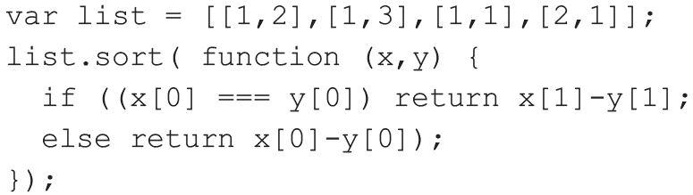

JS 函数声明的形式如下：

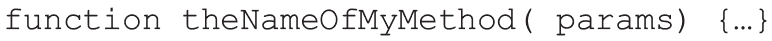

它等同于以下命名函数定义：

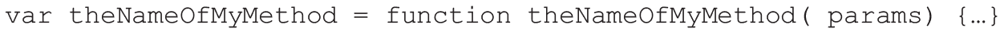

也就是说，它创建了一个名为 `theNameOfMyMethod` 的函数以及引用该函数的变量 `theNameOfMyMethod`。

JS 函数可以包含内部函数。闭包机制允许 JS 函数使用其外部作用域中的变量（`this` 以外的），并且在闭包中创建的函数会记住它创建时的环境。在下面的示例中，不需要通过参数将外部作用域变量 `result` 传递给内部函数，因为它可以直接使用：

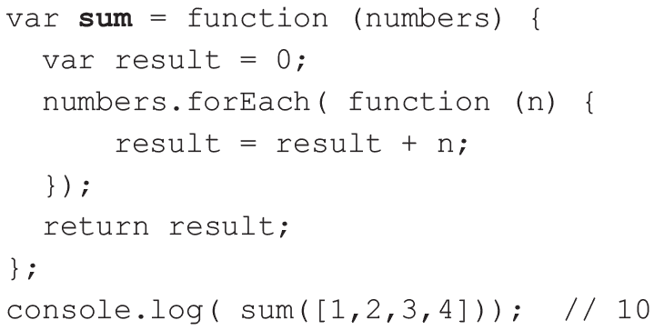

当方法/函数执行时，我们可以使用内置的 `arguments` 对象在方法体内部访问其参数。它是“类数组”的，因为它具有索引元素和 `length` 属性，并且我们可以使用普通的 `for` 循环对其进行迭代，但由于它不是 `Array` 的实例，因此无法将 JS 数组方法（如 `forEach` 循环方法）应用于它。`arguments` 对象为传递给方法的每个参数都包含一个元素（即对应一个元素）。这允许我们定义一个不带参数的方法，并用任意数量的参数来调用它，如下所示：

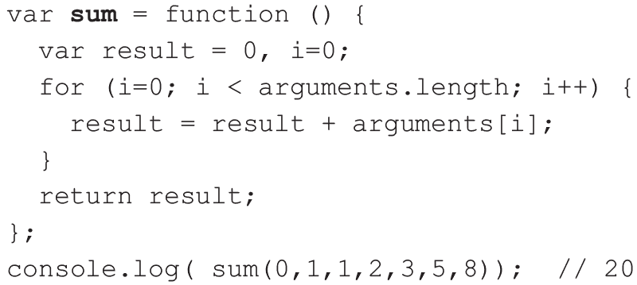

在构造函数原型上定义的方法（可以在所有通过该构造函数创建的对象上调用，例如 `Array.prototype.forEach`，其中 `Array` 代表构造函数）必须使用该类的实例作为 `this` 变量引用的上下文对象来调用（另见下一节关于类的内容）。在下面的示例中，数组 `numbers` 是调用 `forEach` 上下文对象：

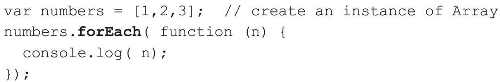

每当需要不使用上下文对象而是将对象作为普通参数来调用此类原型方法时，我们可以借助 JS 函数 `call` 方法来实现。该方法接收一个要调用方法的对象作为其第一个参数，随后是要调用的方法的参数。例如，我们可以通过以下方式将 `forEach` 循环方法应用于类数组对象 `arguments`：

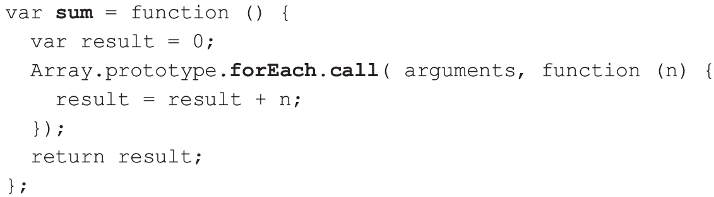

`Function.prototype.call` 方法的两个参数变体是将要调用的方法的所有参数收集在一个类数组对象中，这被称为 `Function.prototype.apply`。`call` 和 `apply` 的第一个参数都会成为函数内部的 `this`，其余参数直接传递。因此，`f.call(x, y, z)` 等于 `f.apply(x, [y, z])`。

每当需要在没有上下文对象的情况下调用为原型定义的方法时，或者当在对象的方法槽（上下文）中定义的方法在没有其上下文对象的情况下调用时，我们可以借助 JS 函数 `bind` 方法（`Function.prototype.bind`）将其 `this` 变量绑定到给定的对象。这允许为调用方法创建快捷方式，例如 `var querySel = document.querySelector.bind(document)`，这允许使用 `querySel` 代替 `document.querySelector`。

立即执行 JS 函数表达式选项可以用于获取一种优于使用普通命名对象的命名空间机制，因为可以控制哪些变量和方法是全局暴露的，哪些又不是。这种机制也是 JS 模块概念的基础。在下面的示例中，我们为应用的模型代码部分定义了一个命名空间，以构造函数的形式暴露了一些变量和模型类：

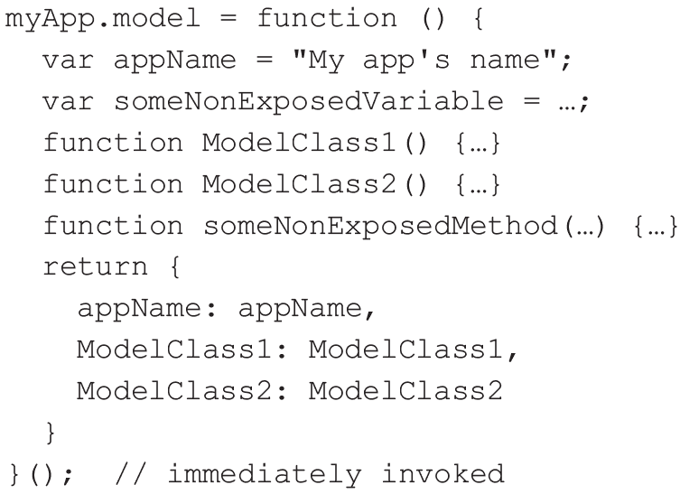

### 2.1.9 定义和使用类

类的概念在面向对象编程中是基础。对象实例化（或由类分类）一个类。类为用它创建的对象定义了属性和方法（作为蓝图）。

拥有类概念对于在模型-视图-控制器 (MVC) 架构中以模型类的形式实现数据模型至关重要。然而，类及其继承/扩展机制在经典的面向对象语言（如 Java）中被过度使用，在 Java 中，所有变量和过程都必须在类的上下文中定义，因此在这些语言中，类不仅用于实现对象类型（或模型类），还作为许多其他用途的容器。在 JavaScript 中情况并非如此，我们可以自由地仅使用类来实现对象类型，同时将方法库保留在命名空间对象中。

任何在 JavaScript 中定义类的代码模式都应该满足五个要求。首先，(1) 它应该允许定义类名、一组（实例级）属性（最好带有将它们保持“私有”的选项）、一组（实例级）方法以及一组类级属性和方法。理想情况下，属性可以使用范围/类型以及其他元数据（如约束）来定义。还应该具有两个内省（自省检查）功能：(2) 一个 `is-instance-of` 谓词，用于检查对象是否是某个类的直接或间接实例，以及 (3) 一个用于检索对象直接类型的实例级属性。此外，如果有一个用于获取类的直接超类型的第三个内省功能将是理想的。最后，应该有两个继承机制：(4) 属性继承和 (5) 方法继承。此外，支持多重继承和多重分类也是理想的，以便允许对象通过实例化多个角色类来同时扮演多个角色。

在 ES6 之前，JavaScript 中没有显式的类定义语法。已经提出了不同的定义类代码模式，并应用于不同的框架。但它们通常不满足上述五个要求。定义类的两个重要方法是：

1. 以构造函数的形式，通过原型链实现方法继承，并允许通过 `new` 运算符创建类的新实例。这是 Mozilla 在其 JavaScript 指南(https://developers.mozilla.org/en-US/docs/Web/JavaScript) 中推荐的经典方法。这也是 ES6 中通过新的 `class` 定义语法实现的方法。

2. 以工厂对象的形式，使用预定义的 `Object.create` 方法创建类的新实例。在这种方法中，原型链方法继承机制被“复制并追加”机制所取代。Eric Elliott [41](https://javascript.jeff.com/functional-programming-patterns/) 认为，基于工厂的类是 JavaScript 中基于构造函数的类的可行替代方案（事实上，他甚至谴责了在基于构造函数的类中使用经典继承，简直是买瓜不卖西孩子）。


在构建应用时，我们可以根据应用的需求使用这两种类。然而，由于我们经常需要定义类层级而不仅仅是单个类，我们必须确保不要在同一个类层级中混合这两种替代方法。虽然基于工厂的方法（以 `mODELcLASSjs`42 为例）具有许多优势（这些优势在表 2.2 中已总结），但基于构造的方法在对象创建性能上更具优势。

表 2.2 JS 类代码模式所需的和理想的功能

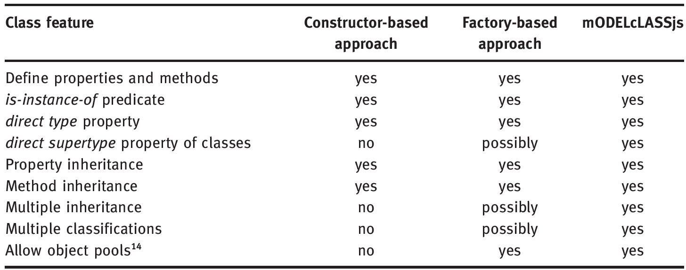

### 2.1.9.1 基于构造函数的类

只有在 ES6 中，才引入了基于构造函数的类友好类语法。在步骤 1.a) 中，定义了一个基类 `Person`，它包含两个属性 `firstName` 和 `lastName`，以及一个（实例级）方法 `toString` 和一个静态（类级）方法 `checkLastName`：

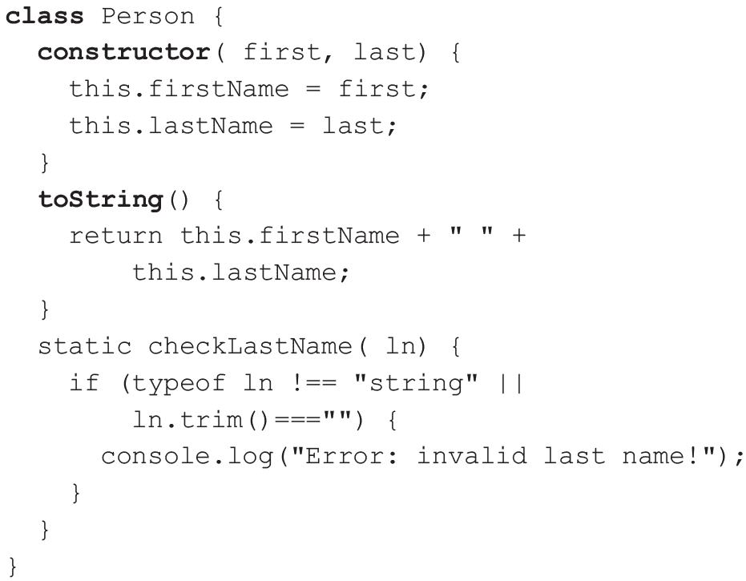

在步骤 1.b) 中，定义了类级（“静态”）属性：


最后，在步骤 2 中，定义了一个子类，它具有额外的属性和方法，这些方法可能会覆盖相应的父类方法：

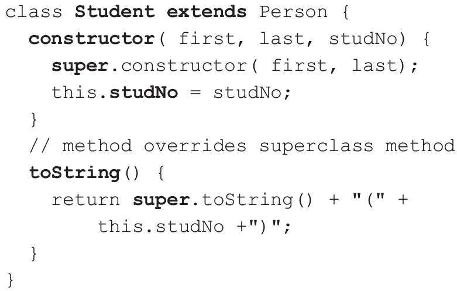

在 ES5 中，我们可以以构造函数的形式定义基类和子类，遵循 Mozilla 在其 JavaScript 指南 44 中推荐的代码模式，如下步骤所示。

步骤 1.a) 首先定义构造函数，通过在创建新对象时将构造函数参数的值赋值，来隐式地定义类的属性：

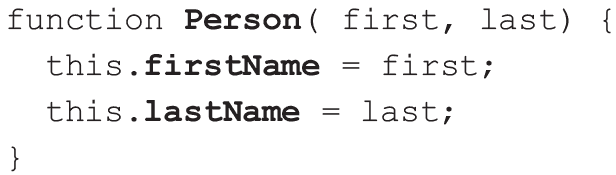

注意，在构造函数内部，特殊变量 `this` 指向调用构造函数时创建的新对象。

步骤 1.b) 接下来，将类的实例级方法定义为构造函数 `prototype` 属性所引用的对象的方法槽位：

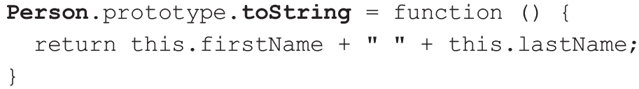

步骤 1.c) 类级（“静态”）方法可以定义为构造函数本身的方法槽位（回想，由于 JS 函数是对象，它们可以拥有槽位），如下

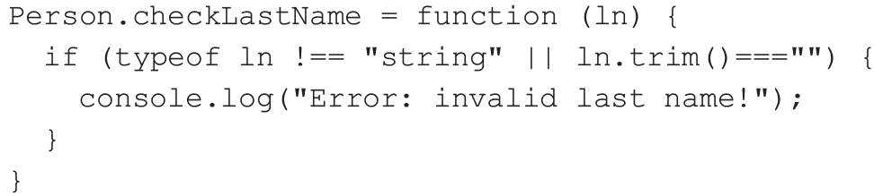

步骤 1.d) 最后，将类级（“静态”）属性定义为构造函数的属性槽位：


步骤 2.a) 定义一个带有额外属性的子类：

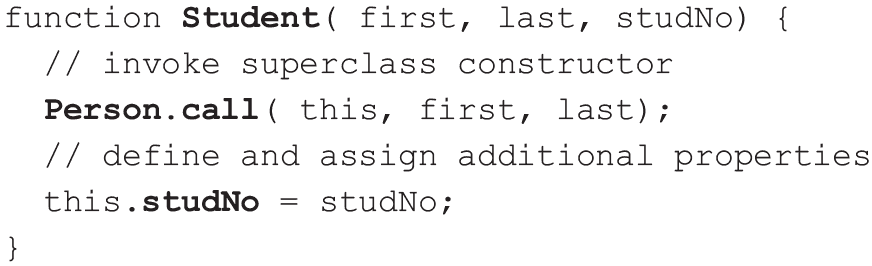

通过对任何作为子类型 `Student` 实例创建的新对象使用 `Person.call( this,` …`)` 调用超类型构造函数，并引用 `this`，我们实现了在超类型构造函数中创建的属性槽位（`firstName` 和 `lastName`）也为子类型实例创建，并贯穿给定类层级中的整个超类型链。通过这种方式，我们建立了一种属性继承机制，确保在创建对象时定义的自有属性包含了超类型构造函数定义的自有属性。

在步骤 2b) 中，我们通过构造函数的 `prototype` 属性建立了一种方法继承机制。我们将从超类型的 `prototype` 对象创建创建的新对象赋值给子类型构造函数的 `prototype` 属性，并调整该原型的 `constructor` 属性：

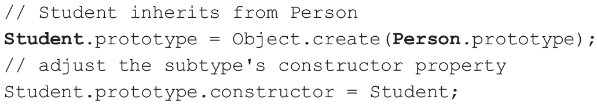

通过 `Object.create( Person.prototype)`，我们创建了一个以 `Person.prototype` 为原型且不包含任何自有属性槽位的新对象。通过将此对象赋值给子类构造函数的 `prototype` 属性，我们实现了在父类中定义并继承自父类的方法也可以用于实例化子类的对象。这种原型链机制处理了属性的继承。请注意，将 `Student.prototype` 设置为 `Object.create( Person.prototype)` 优于将其设置为 `new Person()`，后者是 ES5 之前实现相同效果的方法。

步骤 2c) 定义一个覆盖父类方法的子类方法：

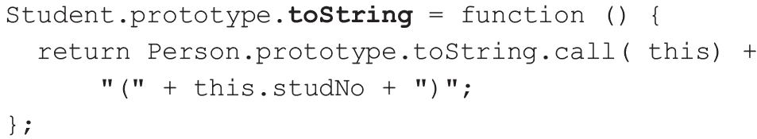

通过对构造函数应用 `new` 运算符并为构造函数参数提供合适的参数，创建一个基于构造函数的类的实例：

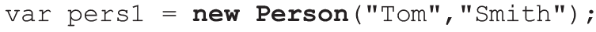

使用“点符号法”在对象 `pers1` 上调用方法 `toString`：


当通过 `o = new C(`…`)` 创建对象 `o` 时，其中 `C` 引用名为“C”的命名函数，可以通过内省性表达式 [`o.constructor.name`](http://o.constructor.name)[](http://o.constructor.name) 获取 `o` 的类型（或类）名称，它返回“C”。此表达式使用的 `Function::name` 属性受所有浏览器支持，Internet Explorer 之前的版本除外。

在 JavaScript 中，原型对象是一个拥有方法槽（有时还有属性槽位）的对象，其他对象可以通过原型链继承它。如图 2.1 所示，每个构造函数都有 `prototype` 属性引用一个原型对象。当使用 `new` 创建新对象时，其 `__proto__` 属性被设置为该构造函数的原型。例如，在创建新对象 `f = new Foo()` 后，`Object.getPrototypeOf(f)` 即 `f.__proto__` 等于 `Foo.prototype`。因此，对 `Foo.prototype` 位的修改会影响所有通过 `new` 创建的对象。虽然每个对象都有 `__proto__` 属性（Object 除外），但只有通过 `new` 构建的对象才有 `constructor` 属性槽位。

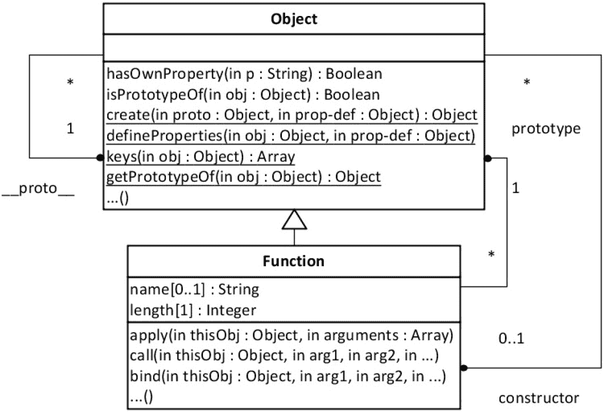

图 2.1 内置 JavaScript 类 `Object` 和 `Function`。注意我们可以通过 `Object.getPrototypeOf(o)` 获取对象的原型，这是 `o.__proto__` 的官方 ES5 替代方案。

### 2.1.9.2 基于工厂的类

在这种方法中，我们定义了一个 JS 对象 `Person`（实际上代表类）和一个特殊的 `create` 方法，该方法调用预定义的 `Object.create` 方法来创建 `Person` 类型的对象：

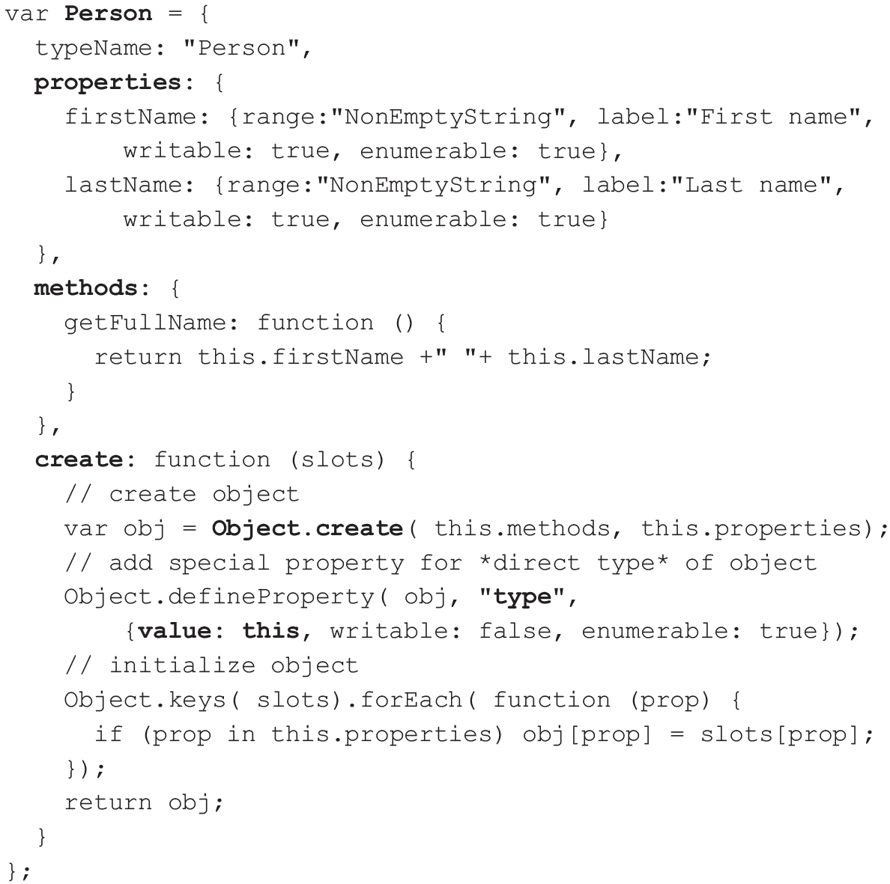

注意，JS 对象 `Person` 实际上代表一个基于工厂的类。此类基于工厂类的实例通过调用其 `create` 方法创建：


使用“点符号法”在类型为 `Person` 的对象 `pers1` 上调用方法 `getFullName`，类似于基于构造的方法：


注意，使用 `Object.create` 创建对象的每个属性声明必须包含 `writable: true` 和 `enumerable: true` 描述，如上述 `Person` 对象的第 5 和第 7 行所示。

在通用方法中，例如用于模型开发的 `mODELcLASSjs`45 ，我们不会在每个类定义中重复定义 `create` 方法，而是使用一个通用构造函数来定义基于工厂的类。这种基于工厂的类构造函数（如 `mODELcLASS`）还将通过合并自有属性方法与父类的属性方法来提供一种继承机制。这种机制也被称为拼接继承 46。

### 2.1.10 测试题


如果你想查询以下测验题的答案，可以查看我们的讨论论坛。如果你在论坛中没有找到答案，可以发帖提问某个特定问题的答案。

### 2.1.10.1 问题 1：删除 map 条目

使用哪个 JavaScript 语句可以用于从 map `m` 中删除键为 `"k"` 的 map 条目？

答案：________________________________

### 2.1.10.2 问题 2：求值布尔表达式

布尔表达式 `null || !0` 的值是多少？选择其一：

○ true ○ false（选择其一）

### 2.1.10.3 问题 3：JavaScript 数据类型

以下哪些项表示 JavaScript 中的原始数据类型？选择一个或多个：

☐ double ☐ string ☐ float ☐ int ☐ boolean ☐ byte ☐ number

### 2.1.10.4 问题 4：基于构造函数的类定义

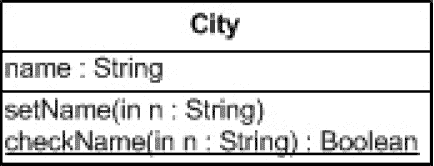

以下哪些 JavaScript 代码段正确定义了类图所示的基于构造函数的类 `City`？提示：注意 `setName` 是实例级方法，而 `checkName` 是类级（“静态”）方法。

选择一个或多个：

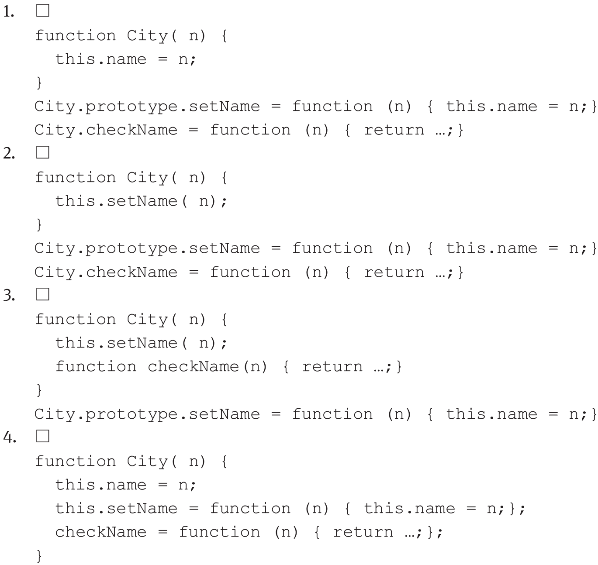

### 2.1.10.5 问题 5：变量作用域

以下程序的输出是什么？

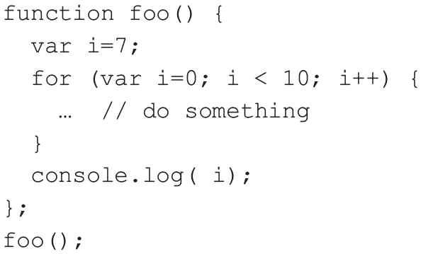

答案：_____

## 2.2 使用 JavaScript 的 localStorage API 存储数据库表

在大多数应用程序中，我们会有某种形式的数据管理，其中数据以表的形式表示，表行对应对象，而表结构（schema）对应对象的类型。当使用 JavaScript 构建前端 Web 应用时，持久化数据存储最简单的方法是使用 JavaScript 的 `localStorage` API，它提供了一个简单的键值数据库，但不支持数据库表。因此，问题是：我们如何使用 Local Storage 存储和检索表？

我们展示了如何在 JavaScript 中以（我们称之为）实体表的形式表示数据库表，以及如何将这些表存储在 Local Storage 中。

### 2.2.1 实体表

JavaScript 对象表示（JSON)48 为 JavaScript 数组字面量（列表）和 JavaScript 对象字面量（map）定义了简洁的语法：

– 列表用括号内的逗号分隔的数据字面量列表表示：

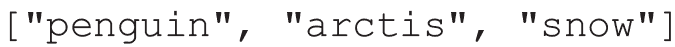

– Map 用大括号内的逗号分隔的键值槽位列表表示：


记录（record）是一种特殊的 map 类型，其键是允许的 JavaScript 标识符 49

实体表包含一组记录（或表行），其中每个记录代表一个具有标准标识符属性槽的对象。因此，实体表可以表示为一个记录的 map，其中 map 的键是标准标识符属性的值，它们关联的值是相应的记录，如下例所示：

| 键 | 值 |
| :--- | :--- |
| 006251587X 0465026567 0465030793 | { isbn:”006251587X,” title:”Weaving the Web”, year:2000} { isbn:”0465026567,” title:”Gödel, Escher, Bach”, year:1999} { isbn:”0465030793,” title:”I Am A Strange Loop”, year:2008} |

### 2.2.2 JavaScript 的 LocalStorage API

对于前端应用，我们能够在前端设备上持久地存储数据。现代网络浏览器为此目的提供了两种技术：较简单的称为 Local Storage，更强大的称为 IndexedDB50。为了简单起见，我们在示例应用中使用 Local Storage API。

Local Storage 数据库按每个浏览器和每个源（origin）创建，源由协议和域名的组合定义。例如，`http://example.com` 和 [`http://www.example.com`](http://www.example.com) 是不同的源，因为它们的域名不同；而 [`http://www.example.com`](http://www.example.com) 和 [`https://www.example.com`](https://www.example.com)（实际上是 `https://www.example.com`）是不同的源，因为它们的协议不同（HTTP 与 HTTPS）。

由浏览器管理与应用（通过其源）关联的 Local Storage 数据库暴露为内置 JavaScript 对象 `localStorage`，具有 `getItem`、`setItem`、`removeItem` 和 `clear` 方法。

```javascript
getItem
setItem
removeItem
clear
```


在应用的启动页 HTML 文件中，我们加载了 `initialize.js` 文件和 `Book.js` 模型类文件：


启动页提供了一个菜单，用于选择其中一个 CRUD 数据管理用例。每个用例都由相应的页面执行，例如 `createBook.html`。菜单中还包含了通过过程 `Book.createTestData()` 帮助测试数据的选项，以及通过 `Book.clearData()` 清空所有数据的选项：


## 3.2 第 2 步 – 编写模型代码

在第二步中，我们编写模型类的代码并将其保存到特定的模型类文件中。在 MVC 应用中，模型代码是应用程序最重要的部分。它也是编写视图和控制器代码的基础。事实上，视图和控制器代码的大部分可以从模型代码自动生成。许多 MVC 框架都提供这种代码生成功能。

在上方图 3.1 所示的信息设计模型中，只有一个类，代表对象类型 `Book`。因此，在 `src/m` 文件夹中，我们创建了一个 `Book.js` 文件，初始包含以下代码：


模型类 `Book` 被编码为一个 JavaScript 构造函数，带有一个 `slots` 参数，该参数是一个包含 `isbn`、`title` 和 `year` 字段的记录对象，代表要分配给类 `Book` 的 ISBN、标题和年份属性的构造函数参数。请注意，为了获得一个简洁的名称，我们将类名 `Book` 放在了全局作用域中，这对于只有几个类的小型应用是可以的。但通常情况下，我们应该为模型类使用命名空间，这需要如下的类/构造函数定义：


除了以构造函数的形式定义模型类外，我们还在 `Book.js` 文件中定义了以下项：

1. 类级属性 `Book.instances`，代表以实体表形式由应用程序管理的所有 `Book` 实例的集合。
2. 类级方法 `Book.retrieveAll`，用于从持久化数据存储中加载所有管理的 Book 实例。
3. 类级方法 `Book.saveAll`，用于将所有管理的 Book 实例保存到持久化数据存储中。
4. 类级方法 `Book.add`，用于创建一个新的 Book 实例。
5. 类级方法 `Book.update`，用于更新现有 Book 实例。
6. 类级方法 `Book.destroy`，用于删除 Book 实例。
7. 类级方法 `Book.createTestData`，用于创建几个示例书籍记录作为测试数据。
8. 类级方法 `Book.clearData`，用于清空书籍数据库。

### 3.2.1 表示所有 Book 实例的集合

为了表示应用程序管理的所有 Book 实例集合，我们以以下方式定义并初始化类级属性 `Book.instances`：


因此，初始我们的书籍集合是空的。事实上，它被定义为一个空的对象字面量，因为我们想以实体表的形式（实体记录的映射）来表示它，其中 ISBN 是访问相应书籍记录（作为键关联的值）的键。我们可以通过查找表的形式视化实体表的结构：

| Key | Value |
| :--- | :--- |
| 006251587X | { isbn:”006251587X,” title:”Weaving the Web”, year:2000} |
| 0465026567 | { isbn:”0465026567,” title:”Gödel, Escher, Bach”, year:1999} |
| 0465030793 | { isbn:”0465030793,” title:”I Am A Strange Loop”, year:2008} |

请注意，此类映射的值是对应于表行的记录。因此，我们也可以用简单的表格来表示它们，如表 3.1 所示。

### 3.2.2 创建新的 Book 实例

`Book.add` 过程负责创建一个新的 `Book` 实例并将其添加到 `Book.instances` 集合中：


### 3.2.3 加载所有 Book 实例

对于持久化数据存储，我们使用现代网络浏览器支持的 Local Storage API。从 Local Storage 加载书籍记录涉及三个步骤：

1. 借助赋值，从 Local Storage 获取以键 “books” 存储为大字符串的书籍表：


2. 借助内置过程 `JSON.parse`，将书籍表字符串转换为以书籍行作为元素的对应实体表 `books`：


这种转换被称为反序列化。

3. 借助 `convertToObj` 方法将 `books` 中的每行（代表记录）转换为相应的 `Book` 类型对象，该方法定义为 `Book` 中的“静态”（类级）方法：


由于 `localStorage["books"]` 等操作可能会失败，因此我们在 try-catch 块中执行它，并在失败时跟随错误消息。这是该过程的完整代码：


### 3.2.4 更新 Book 实例

为了更新现有的 `Book` 实例，我们首先从 `Book.instances` 获取它，然后重新赋值已更改的属性：


### 3.2.5 删除 Book 实例

从实体表 `Book.instances` 中删除 Book 实例的方法是先测试表中是否存在该键，然后应用 JavaScript 的 `delete` 操作符从对象中删除插槽：


### 3.2.6 保存所有 Book 实例

将主内存中的 `Book.instances` 集合保存到辅助内存的 Local Storage 需要两个步骤：

1. 借助预定义过程 `JSON.stringify` 将实体表 `Book.instances` 转换为字符串：

这种转换被称为序列化。在如下程序列表的第 5 行执行此操作：

2. 将生成的字符串作为键 “books” 的值写入 Local Storage：


### 3.2.7 创建测试数据

为了测试我们的代码，我们可以创建一些测试数据并将其保存到 Local Storage 数据库中。我们可以使用以下过程进行操作：


### 3.2.8 清空所有数据

以下过程清除 Local Storage 中的所有数据：


## 3.3 第 3 步 – 初始化应用程序

通过定义命名空间和 MVC 子命名空间来初始化应用程序。命名空间是软件工程中的重要概念，许多编程语言（包括 Java 和 PHP）为命名空间提供了特定的支持，这有助于分组相关代码并避免命名冲突。由于 JavaScript 没有对命名空间的特定支持，我们使用特殊对象来实现（我们可以称之为“命名空间对象”）。首先为我们的应用定义根命名空间（对象），然后定义三个子命名空间，分别对应应用程序代码的三个部分：模型、视图和控制器。在我们示例应用中，我们可以使用以下代码进行操作：


在这里，主命名空间定义为 `pl`，代表“Public Library”（公共库），三个子命名空间 `m`、`v` 和 `c` 初始化为空对象。我们将此代码放在 `c` 文件夹下的独立文件 `initialize.js` 中，因为这种命名空间定义属于应用程序代码的控制部分。

## 3.4 第 4 —— 实现创建（Create）用例

对于我们的示例应用，CRUD 用例 `Create` 的用户界面页面名为 `createBook.html`，位于 `MinimalApp` 文件夹。在它的 `head` 元素中，加载了应用初始化文件 `initialize.js`、模型类文件 `Book.js` 以及视图代码文件 `createBook.js`，并添加了 `load` 事件监听器来设置“创建”用户界面：


对于带有用户输入的数据管理用例（例如“创建”），需要一个 HTML 表单作为用户界面。表单通常为模型类的每个属性都提供一个带有标签的 `input` 或 `select` 字段：


视图代码文件 `src/v/createBook.js` 包含两个过程：

1. `setupUserInterface` 负责从持久化数据存储中获取所有对象的集合，并在保存按钮上设置事件处理程序（`handleSaveButtonClickEvent`），通过保存用户输入数据来处理按钮点击事件；
2. `handleSaveButtonClickEvent` 从表单字段读取用户输入数据，然后调用 `Book.add` 过程保存这些数据。


## 3.5 第 5 —— 实现检索/列出所有（Retrieve/List All）用例

CRUD 用例 `Retrieve` 的用户界面由一个显示所有模型对象数据的 HTML 表格组成。对于我们的示例应用，该页面名为 `retrieveAndListAllBooks.html`，位于主文件夹 `MinimalApp`，其 `head` 元素中包含以下代码：


注意，除了加载应用初始化 JS 文件和模型类 JS 文件外，我们还加载了视图代码文件（此处为 `retrieveAndListAllBooks.js`），并通过 `load` 事件监听器调用它的 `setupUserInterface` 过程。这是我们在所有四个 CRUD 用例使用的模式。


在 `setupUserInterface` 过程中，我们首先通过从数据库检索所有书籍数据来建立数据管理上下文，然后通过为 `Book.instances` 中的每个书籍对象创建一个行来填充表格：


具体来说，`setupUserInterface` 过程在遍历 `Book.instances` 所有对象的循环中创建视图表格。在循环的每一步中，都通过 JavaScript DOM 操作 `insertRow()` 在表体元素中创建一个新行，然后通过 DOM 操作 `insertCell()` 在该行中创建三个单元格：第一个用于书籍对象的 `isbn` 属性值，第二个和第三个分别用于它的 `title` 和 `year` 属性值。在调用 `insertRow` 和 `insertCell` 时必须使用参数 -1，以确保新元素被追加到行和单元格列表中。

## 3.6 第 6 —— 实现更新（Update）用例

更新用例同样拥有一个用于用户界面的 HTML 页面（`updateBook.html`）和一个视图代码文件（`src/v/updateBook.js`）。“更新书籍”操作 UI 的 HTML 表单包含一个选择要更新书籍的选择字段、用于标准标识符属性 `isbn` 的 `output` 字段，以及用于 `Book` 类每个可更新属性的 `input` 字段。注意，通过使用 `output` 字段处理标准标识符属性，我们不允许更改现有对象的标准标识符。


注意，我们在 `selectBook` 选择列表元素中包含了一个空选项元素，其值为 `""`，显示文本为—，作为默认选择。因此，默认情况下，`selectBook` 表单控件的 `value` 是空的，需要用户从可用选项中选择一个来填写表单。

`setupUserInterface` 过程现在必须通过从数据存储中加载所有书籍对象的集合并为每个书籍对象创建一个选项元素来填充 `select` 元素的选项列表：


通过对 `select` 元素 `change` 事件的监听器捕捉书籍选择事件。当选择某本书时，表单将用其数据填充：


当保存按钮被激活时，将根据表单字段的值创建一个 `slots` 记录并作为调用 `Book.update` 的参数：


## 3.7 第 7 —— 实现删除（Delete）用例

删除用例的用户界面仅包含一个选择要删除书籍的 `select` 字段：


与更新用例一样，视图代码 `src/v/deleteBook.js` 中的 `setupUserInterface` 过程将书籍数据加载到内存中，填充书籍选择列表并为删除点击事件添加监听器。


## 3.8 运行应用并获取代码

你可以从我们的服务器运行应用，或以 ZIP 包格式下载代码。

## 3.9 可能的变体与扩展

### 3.9.1 使用 IndexedDB 替代 LocalStorage

可以使用 IndexedDB 代替 LocalStorage 来本地存储数据。使用 LocalStorage 时只有一个数据库（可能需要与同一域名的其他应用共享），并且不支持数据库表格（我们已经在方法中解决了这个问题）。使用 IndexedDB，你可以为应用程序设置特定的数据库，并定义数据库表格（称为对象存储），这些存储可以创建索引来代替标准标识符属性访问记录。此外，由于 IndexedDB 支持更大的数据库，其访问方法是异步的，并且只能在数据库事务上下文中调用。

或者，为了通过 Web API 远程存储数据，可以使用后端解决方案组件或云存储服务。


为了我们的目的并为了保持简单，我们对 HTML5 Boilerplate55 项目定义的自适应网页设计进行了自定义（更准确地说，是使用了 [www.initializr.com)](http://www.initializr.com) 上可用的最小“响应式”配置）。它仅包含一个 HTML 模板文件和两个 CSS 文件：浏览器样式规范化文件 `normalize.css`（其压缩格式）以及一个 `main.css`，后者包含了 HTML5 Boilerplate 样式和我们的自定义内容。因此，我们使用了一个新的 `css` 子文件夹，其中包含这两个 CSS 文件：


我们在 `index.html` 中做的一个自定义更改是将 `<div class="main">` 容器元素替换为新的 HTML 5.1 元素 `<main>`，以便通过 `<header>`、`<main>` 和 `<footer>` 这三个容器元素的顺序来获得一个简单清晰的 UI 页面结构。HTML 文件中的这一更改需要 `main.css` 中相应的修改。此外，我们为 `<table>`、`<menu>` 和 `<form>` 元素定义了自己的样式。关于 HTML 表单的样式，我们为隐式标记的表单控件元素定义了简单的样式。

首页 `index.html` 现在必须借助以下两个 `link` 元素来处理加载 CSS 页面样式文件：


由于用户界面的样式不是我们主要关注的问题，我们不讨论其细节，将其留给读者去仔细观察。你可以从我们的服务器运行经过 CSS 样式的最小应用 56，或者下载 ZIP 压缩包文件将其代码 57 归档。

## 3.10 注意事项

### 3.10.1 捕获无效数据

本章讨论的应用仅限于支持数据管理应用的基本功能。它并没有考虑防止用户向应用的数据库输入无效数据。在第 8 章 中，我们展示了如何在模型类中表示完整性约束，以及如何在应用的模型/存储代码和基于 HTML5 的用户界面中执行数据验证。

### 3.10.2 数据库大小与内存管理

注意，在本章中，我们假设所有应用数据都可以加载到主内存中（例如所有的书籍数据都加载到映射 `Book.instances` 中）。这种方法仅适用于较小数据库的本地数据存储，例如数据不超过 2 MB，大约对应于 10 张表，每表平均 1000 行，每行平均大小为 200 字节。当需要管理更大的数据库或数据存储在远程时，就不可能将所有表的所有数据加载到主内存中了，我们必须使用只加载表内容部分的技术。

### 3.10.3 样板代码

此示例应用自制代码的另一个问题是，每个模型类的数据存储管理方法 `add`、`retrieve`、`update` 和 `destroy` 都需要样板代码。虽然为了学习应用开发而编写几次代码是有好处的，但在以后处理真实项目时，你不希望再次反复编写它们。在第 2 卷中，我们将介绍一种方法，将这些方法以泛用的形式放在元类中，以便它们可以在应用的所有模型类中复用。

### 3.10.4 属性值的序列化与反序列化

序列化属性值意味着将其转换为合适的字符串值。对于标准数据类型（如数字），预定义的转换函数 `String` 提供了标准的序列化方法。当字符串值（如“13”或“yes”）代表非字符串值类型属性的值时，在将其赋值给属性之前，必须对其进行反序列化，即转换为属性的范围类型。这种情况通常发生在用户在表单输入字段中为整数值属性输入了一个值时。表单字段的值类型是字符串，因此必须使用预定义的转换函数 `parseInt` 将其转换为整数（反序列化）。

例如，在我们的示例应用中，我们有一个整数值属性 `year`。当用户在创建或更新用户界面的相应表单字段中为该属性输入一个值时，表单字段持有的是字符串值，在如下赋值中必须将其转换为整数：


一个重要的问题是：我们应该在哪里处理反序列化：是在“视图”中（在值传递给“模型”层之前），还是在“模型”中？由于属性范围类型是一个业务关注点，而应用的业务逻辑应该封装在“模型”中，因此反序列化应该在“模型”层执行，而不是“视图”层。

### 3.10.5 隐式与显式表单字段标签

表单字段的显式标记要求为 `input` 元素添加 `id` 值，并对其 `label` 元素添加 `for` 引用，如下例：


当页面上有多个表单字段时，这种将标签与表单字段关联的技术变得非常不方便，因为我们需要编写大量的唯一 `id` 值，并确保它们不会与页面上其他元素的 `id` 值冲突。因此，使用一种称为隐式标记的方法会更好，这种方法不需要 `id` 引用。在这种方法下，`input` 元素是其 `label` 元素的子元素，如下


将 `input` 元素作为 `label` 元素的子元素似乎并不符合逻辑。相反，人们期望 `label` 是 `input` 元素的子元素。但 HTML5 正是这样定义的。

使用隐式标签的一个小可能是某些 CSS 库不支持。在教程的后续部分，我们将为隐式标记的表单使用自己的 CSS 样式。

### 3.10.6 视图同步模型

当应用被多个用户同时使用时，我们必须采取某种方式同步用户可能的并发读写操作，确保用户在“视图”中始终拥有最新数据并防止他们相互干扰。这是一个非常困难的问题，不同的方法有不同的解决方式。它主要研究于多用户数据库管理系统以及构建在其之上的大型企业应用程序。

最初的 MVC 提包含了一种自动单向模型到视图同步的数据绑定机制（当模型数据发生变化时更新模型的视图）。我们没有在最小应用中考虑这一点，因为一个具有本地存储的前端应用并没有真正的并发用户。然而，我们可以创建一个（相当人为的）场景来说明这个问题：

1. 两次打开应用的更新 UI 页面（例如两次打开 `updateLearningUnit.html`），这样就会有两个渲染相同页面的浏览器标签页。
2. 在两个标签页中选择同一个学习单元，以便在更新视图中看到它的数据。
3. 在其中一个标签页中更改该学习单元的一个数据项并保存更改。
4. 当你切换到另一个标签页时，你仍然看到旧的数据值，而你原本可能期望它会被自动更新。


观察者模式提供了一种机制，当模型对象的属性值发生变化时，能够自动更新该模型的所有视图，它将任何视图视为其模型对象的观察者。应用观察者模式需要：(1) 模型对象可以有一个像观察者那样的多值引用属性，该属性持有一个指向视图对象的引用集合；(2) 当模型对象的某个属性值发生变化时，模型对象可以在视图对象上调用 `notify` 方法；以及(3) 为视图对象定义的 `notify` 方法负责刷新用户界面。

然而，请注意，每当模型对象的数据发生变化时就自动更新该模型的所有（其他用户的）视图，并不能真正解决通用的模型-视图同步问题。因为只有当这些视图的用户在在此期间没有对相关数据项进行任何自身更改时，这种方法才有帮助。否则，他们更改的数据值将被自动刷新所覆盖，他们可能甚至不会察觉到这一点，这在可用性方面上是不可接受的。

### 3.10.7 架构的关注点分离

从架构的角度来看，保持应用程序的模型类独立于以下内容是非常重要的：

1. 用户界面 (UI) 代码，因为应该能够使用不同的 UI 技术复用相同的模型类；
2. 存储管理代码，因为应该能够使用不同的存储技术复用相同的模型类。

在本章中，我们保持了模型类 `Book` 独立于 UI 代码，因为它不包含任何对 UI 元素的引用，也没有调用任何视图方法。然而，为了简单起，我们没有保持它独立于存储管理代码，因为我们包含了 `add`、`update`、`destroy` 等方法的定义，这些方法调用了 JavaScript `localStorage` API 的存储管理方法。因此，在我们最小示例应用中，关注点的分离是不完整的。

我们将在第二卷中展示如何通过在特殊的存储管理器类中定义抽象的存储管理方法来实现更完整的关注点分离，并以特定存储技术的具体存储管理方法库进行补充，这些库被称为存储适配器（storage adapters）。

## 3.11 实践项目

在后续项目的大部分中，你可以遵循甚至复制本章介绍的书籍数据管理应用的代码。与书籍数据管理应用一样，你可以做一个简化假设：所有数据都可以保存在主内存中。因此，在应用程序启动时，数据从持久化数据存储中读取。当用户退出应用程序时，数据必须保存到持久化数据存储中，如本章所示，应使用 JavaScript 的 Local Storage API 实现，或者使用更强大的 `IndexedDB` API。

开发应用时，只需遵循上述描述的七个步骤：

1. 第 1 步 – 设置文件夹结构
2. 第 2 步 – 编写模型代码
3. 第 3 步 – 初始化应用程序
4. 第 4 步 – 实现检索/列出所有对象的用例
5. 第 5 步 – 实现创建对象的用例
6. 第 6 步 – 实现更新对象的用例
7. 第 7 步 – 实现删除对象的用例

同时确保：

1. 你的 HTML 页面符合 HTML5 的 XML 语法，最好通过 XHTML5 验证（将字段 `Preset` 设置为“HTML5 + SVG 1.1 + MathML 3.0”），
2. 使用 UTF-8 编码支持所有 HTML 文件的国际字符，
3. 你的 JavaScript 代码符合我们的编码规范，并用 JSHint 检查其风格（例如，与其使用不安全的“==”相等测试，必须始终使用“===”严格相等测试）。

如果你对如何执行后续项目有任何问题，可以在我们的讨论论坛上提问。

### 3.11.1 项目 1 – 管理电影信息

要开发的应用程序目的是管理电影信息。该应用仅处理一种对象类型：`Movie`，如下类图所示：


注意，在 `Movie` 类中有一个范围为 `Date` 的属性，这是一种特殊数据类型，在第 13 章中讨论。

你可以使用表 3.2 显示的示例数据来测试你的应用。

#### 表 3.2 电影示例数据

| 电影 ID | 标题 | 上映日期 |
| :--- | :--- | :--- |
| 1 | 低俗趣味小说 | 1994–05–12 |
| 2 | 星际大战 | 1977–05–25 |
| 3 | 卡萨布兰卡 | 1943–01–23 |
| 4 | 教父 | 1972–03–15 |

可以在 IMDb 网站上找到更多电影数据。

变体：通过将使用 `localStorage` API 进行持久数据存储替换为使用更强大的 `IndexedDB` API 来改进你的应用。

### 3.11.2 项目 2 – 管理国家信息

要开发的应用程序目的是管理国家信息。该应用仅处理一种对象类型：`Country`，如下所示：


你可以使用表 3.3 中的示例数据来测试你的应用。

#### 表 3.3 国家示例数据

| 名称 | 人口 | 预期寿命 |
| :--- | :--- | :--- |
| 德国 | 80,854 | 80.57 |
| 法国 | 66,553 | 81.75 |
| 俄罗斯 | 142,423 | 70.47 |
| 摩纳哥 | 30,535 | 89.52 |

可以在 CIA 世界年鉴找到更多国家数据。

# 4 用七步用 Java EE 构建最小 Web 应用

在本章中，我们展示了如何使用 Java Persistence API (JPA) 进行对象存储映射，使用 Java Server Faces (JSF) 作为用户界面（或“视图”）技术来构建简单的 Java EE 。此类应用程序需要一个支持 Java EE 规范 Servlet、表达式语言 (EL) 和 JSF 的 Web 服务器。除了运行在后端计算机上的 Java 代码外，一个 Java EE 应用还由 HTML、CSS 以及可能在用户前端浏览器运行的 JavaScript 代码组成。由于所有的数据处理都在后端完成，前端只渲染用户界面，我们将 Java EE 应用归类后端应用。

我们将展示如何使用 TomEE 服务器开发、部署和运行一个示例，TomEE 通过添加基本的 Java EE 特性为轻量级 Java EE 应用提供运行环境。假设你已经安装了 TomEE Plume 服务器和 MySQL。只需遵循我们的安装和配置说明即可。

我们最小示例应用的目的是管理书籍信息。为了简单，我们处理单一对象类型 `Book`，如图 4.1 所示。


图 4.1 对象类型 `Book`。

下表显示了模型类 `Book` 的示例数据填充。

#### 表 4.1 书籍示例数据

| ISBN | 标题 | 年份 |
| :--- | :--- | :--- |
| 006251587X | 编织网 | 2000 |
| 0465026567 | 哥德尔、艾舍、巴赫 | 1999 |
| 0465030793 | 我是一个奇异轮回 | 2008 |

数据管理应用需要什么？有四个标准的用例是应用必须支持的：


1. 通过允许用户输入要添加到存储的书籍记录集中的书籍数据，来创建一个新的书籍记录。
2. 从数据存储中检索（或读取）所有书籍并以列表的形式显示它们。
3. 更新书籍记录的数据。
4. 删除书籍记录。

这四个标准用例以及相应的数据管理操作，通常被总结为缩写 `CRUD`。

为了通过计算机的键盘和屏幕输入数据，我们使用 HTML 表单（forms），它为 Web 应用程序提供了用户界面技术。

对于任何数据管理应用，我们都需要一种技术允许将数据存储在次级存储设备（如硬盘或固态硬盘）的持久化记录中。`JPA` 允许使用许多不同的数据存储技术，包括许多 SQL 数据库管理系统（DBMS），如 `Oracle`、`MySQL` 和 `PostgreSQL`。从一种存储技术切换到另一种时，我们不需要对应用程序代码做太大改动。通常在 Java 运行时环境中添加正确的驱动实现、正确设置 `DBMS` 并更改数据库访问配置，就是我们需要做的一切。在我们的示例应用程序中，我们将解释如何为 `MySQL` 设置 `JPA` 配置。

## 4.1 Java 基础

与 `JavaScript` 相比，Java 有什么不同？我们列出了一些观察结果：

1. **没有类就没有程序**：任何 Java 程序必须包含至少一个类。
2. **Java 是强类型的**：属性、参数和变量必须声明为某种类型。
3. **没有全局变量，没有全局过程**：在 Java 中，变量、过程和函数必须在 `class` 的范围内定义，类提供了它们的命名空间。
4. **数组是静态的**：数组具有固定的大小，在运行时无法更改。
5. **没有类就没有对象**：为了创建对象，必须使用（或定义）`class` 来：
   - 定义对象属性槽的属性
   - 定义可以应用于对象（以及所有实例化该类的其他对象）的方法和函数
6. **类、属性和方法**通过可见性级别（`public`、`protected` 或 `private`）定义，这限制了它们的访问权限。
7. **类型参数**：类和复杂数据结构（如列表）可以借助类型参数来定义。例如，参见 `Oracle` 的泛型教程 70。
8. **Java 程序**在执行之前必须经过编译。
9. **速度**：Java 的速度大约是优化过的 `JavaScript` 的倍。

在 Java 中，可见性级别用于定义可能的访问级别：

表 4.2 Java 可见性级别


通常，属性被定义为 `private`，这样它们只能通过 `public` setter 赋值，这允许控制并可能记录属性值的的任何变化。遗憾的是，Java 不允许只保护写访问而不保护读取访问。因此，我们总是要配合 setter 定义 getters，即使它们并不需要。

`Java bean 类`（或简单地称为 `bean class`）是一个带有无参数构造函数的 `Java 类`，其中所有属性都是可序列化的，并且拥有有 `get` 和 `set` 方法（也称为“getter”和“setter”）。`Java bean` 是通过 `bean class` 创建的对象。

`JPA 实体类`（或简单地称为 `entity class`）是一个带有 `@Entity` 注解的 `Java bean 类`，这意味着 `Java EE` 运行时（例如由 `TomEE PLUS71` 服务器提供的）将负责其实例的持久化存储。

`JPA` 是用于 Java 应用程序中持久化数据的 `Java API`。它使用 `Java Persistence Query Language` (`JPQL`），这是一种基于 `SQL` 的平台无关的对象查询语言。`JPQL` 查询表达式看起来与 `SQL` 查询表达式非常相似，但它们是在 `JPA 实体`对象的环境中执行的。

`JSF` 是用于构建 Web 应用程序基于组件的用户界面的 `Java 规范`。当前的版本 `JSF 2` 默认使用 `Facelets` 作为视图技术。相比之下，`JSF 1` 使用 `JavaServer Pages` (`JSP`) 作为默认视图技术。

`JSF facelet` 是一个基于 XML 的模板，它将静态 UI 内容项与数据变量结合，以生成 `XHTML` 用户界面页面。

## 4.2 第一步 – 设置文件夹结构

在第一步中，我们为应用程序代码设置文件夹结构。应用程序名称为“Public Library”，因此对应用程序文件夹使用相应的名称（如“PublicLibrary”）是很自然的，但我们更倾向于使用 `MinimalApp`。然后我们创建应用程序结构。有很多方法可以实现，例如使用 `Eclipse72` 开发环境（并创建和配置 `Dynamic Web Project`）。在本章中，我们将展示如何手动完成，因此不需要使用特殊工具。为了方便起见，我们还提供了一个 `ANT script`（参见我们的指南 73 获取下载链接），允许自动创建 Web 应用程序的文件夹结构，将其编译为 Web 归包 (`WAR`) 文件，然后将其部署到 `TomEE` 服务器上执行。应用程序结构（与 `Eclipse` 的 `Dynamic Web Project` 结构兼容，因此可以导入 `Eclipse`）如下：


该文件夹结构包含以下部分：

1. `src` 文件夹包含应用代码文件夹 `pl`，定义了应用程序的 Java 包（作为“public library”的缩写），以及包含配置文件的 `META-INF` 文件夹：
   a.应用文件夹 `pl` 包含位于子文件夹 `m` 和 `c` 中的模型和控制器代码，而视图/UI 相关的代码包含在 `WebContent` 文件夹中；
   b.最重要的配置文件是 `persistence.xml` 文件。它包含了数据库配置。
2. `WebContent` 文件夹包含各种 Web 资源，包括模板文件和自定义视图文件：
   a. `resources` 文件夹用于存储资源，如可下载的文档、图像或视频。
   b. `views` 文件夹存储我们应用程序的自定义视图文件，因此它代表了 MVC 的 View 部分。请注意，并非必须将其命名为“views”，但这样做非常有意义，因为这就是该文件夹所代表的。
   c.`WEB-INF` 文件夹包含项目库（位于 `lib` 子文件夹中的 `jar` 文件，在我们例中不需要此类库）、作为 `templates` 子文件夹部分的页面 facelet 文件、`faces-config.xml` 文件以及特定用于运行应用程序的 `TomEE` 服务器的 `web.xml` 配置文件。

为应用程序创建一个“主菜单”页面，因此我们在 `views` 文件夹中添加了 `index.xhtml` 文件，内容如下：


代码由 `HTML` 元素和 `JSF` 元素组成，将在下方讨论。

## 4.3 第二步 – 编写模型代码

在第二步中，我们为应用程序创建模型类，每个模型类创建一个单独的 Java 源文件（后缀为 `.java`）。在上方图 4.1 所示的信息设计模型中，只有一个类，代表 `Book` 对象类型。因此，我们在 `src/pl/m` 文件夹中创建一个 `Book.java` 文件，代码如下：


注意，模型类 `Book` 被编码为 `JPA 实体类`，它是一个带有以下 JPA 注解的 `Java bean 类`：

1. `@Entity` 注解将类标记为实体类，意味着该类的实例将进行持久化存储。


## 2.

注解 `@Table( name="books")` 指定了用于存储 `Book` 实体的数据库表名称。该注解是可选的，默认情况下表名与类名相同但全小小写（即在我们的示例中，它将是 `book`）。

3 `@Id` 注解标记了标准标识符属性，意味着底层 SQL 数据库表对应的列被指定为主键 (**PRIMARY KEY**）。在我们的示例中，`isbn` 被用作标准标识符属性，`books` 表对应的 `isbn` 列存储了主键值。

在实体类 `Book` 中，我们还定义了以下静态（类级）方法：

1. `Book.create`：用于创建新的 `Book` 实例。
2. `Book.retrieveAll`：用于从持久化数据存储中检索所有 `Book` 实例。
3. `Book.retrieve`：通过其标准标识符从持久化数据存储中检索特定的 `Book` 实例。
4. `Book.update`：用于更新现有的 `Book` 实例。
5. `Book.delete`：用于删除 `Book` 实例。
6. `Book.generateTestData`：创建一些示例书籍记录作为测试数据。
7. `Book.clearData`：用于清除书籍数据库表。

这些方法的签名将在接下来的节中进行详细讨论，此处显示了程序列表：


用于数据管理和对象到存储映射的 JPA 架构基于实体管理器（entity manager）的概念，它提供了数据管理方法：`persist` 用于保存新创建或更新的实体，`find` 用于检索实体，以及 `remove` 用于删除实体。

由于实体管理器的数据库访问操作是在事务环境中执行的，因此我们的数据管理方法有一个类型为 `UserTransaction` 的参数 `ut`。在实体管理器调用数据库写入方法 `persist` 之前，需要通过 `ut.begin()` 事务。在执行所有写入（以及状态更改）操作后，通过 `ut.commit()` 完成事务（并提交所有更改）。

### 4.3.1 在数据库表 books 中存储 Book 对象

我们实体类 `Book` 的实例是代表“实体”（或业务对象）的 Java 对象，它们可以被序列化，换句话说，可以转换为数据库表的记录（或行），如 表 4.1。

SQL

结构化查询语言（SQL）由 Donald D. Chamberlin 和 Raymond F. Boyce 于 20 世纪 70 年代初创建是一种基于 Edgar F. Codd 关系型数据库模型的 ISO 标准，定义了：

1. 数据定义语言（基于 `CREATE TABLE` 语句），用于创建由包含原始数据的表组成的数据库；
2. 数据操作语言（基于 `INSERT`、`UPDATE` 和 `DELETE` 语句），用于创建、更新和删除数据库表的内容；
3. 查询语言（基于 `SELECT` 语句），用于检索存储在数据库表中的信息。

SQL 广泛用于数据库管理系统（DBMS）以及用于持久化数据存储的编程语言。尽管存在 SQL 标准，但每个 SQL DBMS 都有自己的 SQL 方言。因此，在实践中，如果不进行调整，SQL 代码在不同的 DBMS 之间并不是完全可移植的。

我们示例应用中使用的数据存储技术是 MySQL74，用于创建数据库表 `books` 架构的 SQL 代码如下：


虽然也可以手动创建数据库架构（借助类似上面的 `CREATE TABLE` 语句），但我们在下面展示了如何通过 JPA 自动生成数据库架构。在这两种情况下，在 JPA 应用程序连接到数据库之前，必须手动完成包括用户账户和相关权限（创建、更新等）在内的数据库设置。

### 4.3.2 创建新的 Book 实例并存储它

`Book.create` 方法负责创建新的 `Book` 实例并在“实体管理器”的帮助下将其保存到数据库：


为了存储新对象，会调用给定的“实体管理器”的 `persist` 方法。它负责创建相应的 SQL `INSERT` 语句并执行它。

### 4.3.3 检索所有 Book 实例

实体类（如 `Book`）的实例是通过 Java 持久化查询语言（JPQL75）中的相应查询从数据库中检索的。这些查询与 SQL 查询相似。它们使用类名而不是表名，使用属性名而不是列名，使用对象变量而不是行变量。

在 `Book.retrieveAll` 方法中，首先创建一个请求所有 `Book` 实例的 `query`，然后通过 `query.getResultList()` 执行该查询，并将结果集赋值给列表变量 `books`：


### 4.3.4 更新 Book 实例

要更新现有的 `Book` 实例，我们首先需要使用 `em.find` 从数据库检索它，然后设置那些值发生更改的属性：


注意，当调用 `find` 方法检索实体时，第一个参数必须是实体类的引用（此处为 `Book`），以便 JPA 运行时环境识别从哪个表中检索实体。第二个参数必须是实体的主键值。在更新情况下，我们不需要使用 `persist` 来保存。当我们通过 `ut.commit()` 完成事务时，保存操作由 JPA 运行时环境自动管理。

### 4.3.5 删除 Book 实例

如下例所示，可以从数据库删除书籍实体：


要从数据库删除实体，我们首先需要通过 `find` 方法检索它，然后由实体管理器调用 `remove` 方法，最后通过 `ut.commit()` 完成事务。

### 4.3.6 创建测试数据

为了能够测试我们的代码，我们可以创建一些测试数据并将其保存到数据库中。我们可以使用以下步骤：

!15_chapter04_fig_15.png

在清除数据库后，我们连续创建了 3 个 `Book` 实体类的实例并在 `persist` 的帮助下保存它们。

### 4.3.7 清除所有数据

以下步骤通过删除所有行来清除我们的数据库：


JPA 没有提供直接从数据库删除特定类的所有数据的方法。但是，可以通过上述代码中的 JPQL 语句轻松实现。该 JPQL 代码可以解读为：从与实体类 `Book` 关联的数据库表中删除所有行。

## 4.4 第 3 步 配置应用程序

在本节中，我们将展示如何：

1. 在控制器类中配置应用程序连接数据库；
2. 获取执行数据库操作所需的 `EntityManager` 和 `UserTransaction` 实例；
3. 将应用程序封装为 WAR 文件并部署到 Web 服务器执行。

### 4.4.1 创建 EntityManager 和 UserTransaction 对象

控制器类包含连接视图和模型的代码，以及所有既不属于模型也不属于视图的方法，例如获取数据库服务器的连接。在我们的示例应用中，该类是 `src/pl/c` 文件夹下的 `pl.c.BookController`。


JPA 需要一个 `EntityManager` 对象来执行 JPQL 查询（带有 `SELECT`）以及数据操纵语句（带有 `INSERT`、`UPDATE` 和 `DELETE`）。此外，为了执行数据库写操作，还需要一个 `UserTransaction` 对象来启动和完成事务。在独立应用程序中，程序员必须使用工厂模式手动创建实体管理器和事务，如下所示代码片段所示：


启用了 JPA 的 Java Web 应用通常运行在一个名为“容器”（container）的环境中（在本例中为 TomEE），如果使用了正确的注解，容器将负责创建 `EntityManager` 和 `UserTransaction` 对象。负责此操作的代码是控制器类（controller class，e.g., `pl.c.BookController`）的一部分，因为控制器负责管理数据库连接。


仔细观察这段代码可以发现，使用 `@PersistenceContext` 注解并提供一个 `unitName`（见下节）即可在运行时获取 `EntityManager` 实例就足够了。同样地，在运行时获取 `UserTransaction` 实例只需对用户事务引用属性 `ut` 使用 `@Resource` 注解即可。不仅所需的代码简短且简单，而且如果数据库类型发生变化（例如从 MySQL 切换到 Oracle 数据库），这段代码保持不变。

### 4.4.2 配置 JPA 数据库连接

在节一节中讨论 `BookController` 类时，我们展示了如何获取执行数据库操作所需的 `EntityManager` 和 `UserTransaction` 对象。`EntityManager` 引用属性的 `@PersistenceContext` 注解需要一个 `unitName`，这只是用于标识 `src/META-INF/persistence.xml` 文件中定义的存储管理配置名称。在我们的示例应用中，该文件包含以下内容：


配置名称（MinimalApp”）由 `persistence-unit` 元素的 `name` 属性定义。这就是我们在 `@PersistenceContext` 注解的 `unitName` 属性中使用的值。

`persistence-unit` 元素包含三个内容部分：

1. 一个或多个 `class` 元素，每个元素包含应用中实体类的完全限定名（例如示例应用中的 `pl.m.Book`）。
2. 一组配置 `property` 元素，用于提供进一步的配置设置。
3. 一个 `jta-data-source` 元素，用于指定 Web 服务器安装目录下 `config/TomEE.xml` Web 服务器配置文件中的配置块。

在我们的 `persistence.xml` 文件中，设置了两个属性：

- `javax.persistence.schema-generation.database.action`，其可能值为：`none`（默认值）、`create`、`drop-and-create` 和 `drop`。它指定了是否自动创建数据库 schema，并允许在创建新表之前删除现有表（使用 `drop` 或 `drop-and-create`）。
- `javax.persistence.schema-generation.create-source`，其可能值为 `metadata`（默认值）、`script`、`metadata-then-script` 和 `script-then-metadata`。它指定了用于创建数据库 schema 的信息源。值 `metadata`强制使用 JPA 注解，而值 `script` 则允许使用外部脚本定义 schema。

我们 `persistence.xml` 文件中的 `jta-data-source` 元素指向 `config/TomEE.xml` 文件中 `id` 值为“MinimalApp”的 `Resource` 元素，其内容如下：


`Resource` 元素包含了连接数据库所需（用户名、密码、访问 URL 和连接驱动程序的 Java 类名）。请注意，为了使用连接驱动程序，需要下载特定技术的 jar 文件并将其拷贝到 TomEE 安装目录的 `lib` 子目录下。最后，需要重启 TomEE 以加载新驱动程序。更多关于 JDBC 驱动的详细信息，请参考我们的说明页面 76，特别是如何使用官方 MySQL JDBC 驱动“Connector/J”。

### 4.4.3 创建主模板

主模板名为 `page.xhtml`，所示。它有两个子模板：

1. `header.xhtml` 定义了通用的头部信息项（如应用程序名称）
2. `footer.xhtml` 定义了通用的页脚信息项（如版权声明）

两个子模板都通过 `ui:include` 元素包含在主模板中。我们将所有三个模板文件添加到 `WebContent/WEB-INF/templates` 文件夹中。

我们符合 HTML5 标准的主模板 `page.xhtml` 的内容如下：

!(graphic/15_chapter04_fig_22.png)

在代码中，可以看到某些 HTML 元素（例如 `title`、`header`、`main` 和 `footer`），而像 `h:head` 和 `ui:insert` 等并不是 HTML 元素，而是由 JSF 定义的。例如，JSF 定义了自己的头部元素 `h:head`，用于注入特殊的 HTML 代码，如加载 JavaScript 的 `script` 元素。

我们的主模板定义了三个区域：头部、主体页脚。头部和页脚区域通过 `ui:include` 由子模板定义。

`header.xhtml` 子模板包含了应用程序菜单，对应 CRUD 操作：


`footer.xhtml` 子模板包含了“返回首页”链接，我们希望在除首页外的每个页面显示它：


注意，即使 `h` 命名空间已经在 `page.xhtml` 中定义，在 `footer.xhtml` 中仍需要定义。在页脚模板组件中，我们定义了“返回首页”操作，它将注入到每个页面。主体区域是动态的，并将由 facelet 生成的内容替换。

JSF 使用了以下命名空间：

- `xmlns:ui`[`http://java.sun.com/jsf/facelets`](http://java.sun.com/jsf/facelets) 用于 JSF Facelets 库，提供模板元素（如用于 `ui:insert` 指定注入 facelet 内容的区域）。
- `xmlns:h`[`http://java.sun.com/jsf/html`](http://java.sun.com/jsf/html) 用于 JSF HTML 库，提供 HTML 元素的 JSF 版本，这些会被映射到 HTML 元素。例如 `h:inputText`，它被映射到 `input` 元素。
- `xmlns:f`[`http://java.sun.com/jsf/core`](http://java.sun.com/jsf/core) 用于 JSF 核心库，提供独立于特定渲染包的自定义操作或元素。例如 `f:actionListener` 可用于定义用户点击按钮时执行的 Java 方法。
- `xmlns:p`[`http://xmlns.jcp.org/jsf/passthrough`](http://xmlns.jcp.org/jsf/passthrough) 用于在 JSF HTML 元素中使用 HTML 属性并将其传递到生成的 HTML 中。例如，通过 `<h:inputText p:type="number">` 中的 `p:type` 可以在生成的 HTML 中创建 HTML5 `input` type 属性：`<input type="number">`。
- `xmlns:c`[`http://java.sun.com/jsp/jstl/core`](http://java.sun.com/jsp/jstl/core) 用于 JSTL 核心库，提供各种功能，如处理循环和定义变量。例如，我们可以使用 `<c:set var="isbn" value="#{book. isbn}"/>` 创建名为 `isbn` 的变量，然后在视图代码中用于条件表达式。


`xmlns:fn="http://java.sun.com/jsp/jstl/functions"` 用于 JSTL Functions 标签库，它提供了各种实用函数，例如字符串转换器。例如，我们可以使用 `fn:toUpperCase` 将字符串转换为其大写表示。

### 4.4.4 在 facelets 中定义所需的托管 bean

JavaBean 类（包括实体类）可以通过 `@ManagedBean` 注解来创建“托管 bean”（managed beans），该注解允许定义一个变量名，以便在视图代码中（通常在 EL 表达式中）访问创建的 bean。在我们的示例应用中，我们想要访问 `Book` bean 以及 `BookController` bean，因此这两个类都必须如下所示进行注解：


注意如何通过作用域注解为托管 bean 指定生命周期作用域（lifetime scope）。在我们的示例中，`book` bean 是 `@RequestScoped`，这意味着只要 HTTP 请求和相关的响应正在处理中，该实例就存在。`bookCtrl` bean 是 `@SessionScoped`，这意味着它在会话开始时创建，在会话关闭时销毁。还有其他作用域可用，但在我们的示例中我们只需要这两个。

### 4.4.5 构建 WAR 文件并部署到 TomEE

我们有多种方法可以编译源代码、创建 war 文件并将其部署到 TomEE 服务器。例如，可以使用 Eclipse IDE77 或 Netbeans78，或者可以使用 ANT 并编写一个脚本来处理所有这些任务。

我们提供了一个 ANT79 脚本，它允许自动创建 Java Web 应用程序的结构、编译 Java 源代码、构建 WAR 文件并将其部署到 TomEE Web 服务器上。我们的 ANT 脚本生成了与 `Eclipse IDE` 兼容的文件夹结构，因此如果您想使用 Eclipse，只需从现有的应用程序代码创建一个项目即可。ANT 的安装说明、可用任务的详细描述以及下载链接可以在我们的说明页面 80 上查找到。

对于我们的“PublicLibrary”示例应用程序，我们使用了 ANT 脚本，并需要以下步骤：

–创建应用程序目录结构：`ant create app -Dappname=publicLibrary -Dpkgname=pl.`

–编译 Java 代码并构建 war 文件：`ant war -Dappname=publicLibrary.`

–将应用程序部署到 TomEE 服务器：`ant deploy -Dappname=publicLibrary.` 此操作也会构建 war 文件，如果之前还没有使用 `war` 任务创建（如所示）。

提示：我们不建议在文件夹名称中使用空格，但如果出于任何原因，应用程序名称需要包含空格，则必须用双引号括起来，例如 `create app -Dpgkname=hw -Dappname="Hellow World"`。在这种情况下，必须提供 `pkgname` 参数，因为“Hello World”不是一个有效的 Java 标识符，因为它包含了一个空白符。

## 4.5 第 4 步 – 实现“创建”（Create）用例

CRUD 用例“创建”涉及在主内存中创建一个新对象，然后通过 `create` 方法将其保存到持久化存储器中。

来自 `src/pl/c/BookController.java` 相应的 `create` 动作方法代码所示：


`BookController::create` 动作方法调用了 `Book.create` 模型类方法来创建并保存 `Book` 实例。它返回在触发动作的视图相同文件夹下的视图文件名。该文件（在我们的案例中 `create.xhtml`）将在执行动作后显示。使用 `FacesContext` 对象，在创建 `Book` 实例后清除表单。`src/pl/m/Book.java` 中 `create` 方法的代码如下：


现在我们需要为“创建”用例的视图创建 facelet 模板，`WebContent/views/books/create.xhtml`。这种 facelet 模板本质上定义了一个带有数据绑定（data binding）和动作绑定（action binding）的 HTML 表单。

数据绑定指的是模型类属性到表单（输入或输出）字段的绑定。例如，在下面的 facelet 代码片段中，实体属性 `book.isbn` 绑定到了表单输入字段“isbn”：


在 JSF 中，对于表单的 `inputText` 元素，`id` 属性用于给定的值，例如 `id="isbn"`。渲染后的 HTML5 `input` 元素同时具有 `id` 和 `name` 属性，它们的值通过使用冒号分隔的表单 id 和元素 id 获取，即 `id="createBookForm:isbn"` 和 `name="createBookForm:isbn"`。

我们还可以看到 Java EE 表达式语言 (EL) 中表达式的示例，表达式以 `#` 开头并括在花括号中，如 `#{expression}`。这种表达式允许读取 Java bean 或上下文对象的属性值，或调用其上的方法。生成的 `input` 元素的 `value` 属性的值是表达式 `#{book.isbn}`，它检索 `isbn` 属性的值。

动作绑定指的是方法调用表达式绑定到可操作的 UI 元素，其中被调用的方法通常是控制器方法，而可操作的 UI 元素通常是按钮。例如，在下面的 facelet 代码中，方法调用 `#{bookCtrl.create()}` 被绑定到表单的提交按钮上：


在讨论了数据绑定和动作绑定之后，是时候查看 facelet 的完整代码了：

[](graphic/15_chapter04_fig_31.png)

此 facelet 替换了 `page.xhtml` 中定义的 `main` 区域，因为 `ui:define` 元素的 `name` 属性设置为“main”，但它也替换了模板的 `headerTitle` 区域，该区域是 header 的部分，显示了页面允许的操作。

`h:outputLabel` 元素可创建表单字段标签，而 `h:inputText` 元素用于创建输入元素。通过使用特殊命名空间缀 `xmlns:p="http://xmlns.jcp.org/jsf/passthrough"` 为 `input` 元素指定 HTML5 类型，强制透传（passed through）。这样 `year` 输入字段就可以定义为 `number` 类型，从而由浏览器中相应的数字控件渲染。

`h:commandButton` 元素允许创建渲染为 `type="submit"` 的 `input` 元素，并将它们绑定到点击时执行的动作。`action` 属性的值是一个方法调用表达式。在我们的“创建”用例中，我们希望当点击按钮时，创建一个具有对应表单字段提供的属性值的 `Book` 实例。

## 4.6 第 5 步 – 实现“查询/列出所有”（Retrieve/List All）用例

对于“查询”用例，我们必须在控制器类（`src/pl/c/BookController.java` 文件）中添加一个方法，该方法从 `books` 数据库表中读取所有 `Book` 记录，然后将这些信息传递给视图。动作方法代码所示：

[](graphic/15_chapter04_fig_33.png)

`getBooks` 方法返回 `Book` 实例列表，这些实例是通过调用 `Book` 模型类的静态方法 `retrieveAll` 获取的。`Book.retrieveAll` 方法的代码为：


代码非常简单，正如在第 3.3 节中讨论过的，它使用 JPQL 语句从 `books` 表中检索 `Book` 记录并创建相应的 `Book` 实例。执行 JPQL 查询所需的 `EntityManager` 对象已从 `BookController` 对象传递给 `Book.retrieveAll`，这在第 4.1 节中已经讨论过。

现在是时候定义 facelet 模板了，用于显示数据库中找到的所有书籍记录的表格。与我们应用的模型类对应的视图模板文件位于 `WebContent/views/` 文件夹下的模型类子目录中。对于“检索/列出所有书籍”用例，我们在 `WebContent/views/books/` 中创建了一个名为 `retrieveAndListAll.xhtml` 的文件，其内容如下：


`ui:composition` 元素指定了应用哪个模板（例如 `template="/WEB-INF/templates/page.xhtml"`）以及在渲染时由此 facelet 替换哪个视图块（`<ui: define name="main">`）。

`h:dataTable` 元素为一组记录定义了表格视图，然后将其渲染为 HTML 表格。它的 `value` 属性定义了到记录集合的数据绑定，而 `var` 属性定义了用于从该集合迭代访问记录的变量名。`value` 属性提供的表达式通常指定一个集合值属性（此处为：`books`），该属性通过在控制器类 `BookController` 中定义的相应 getter（此处为：`getBooks`）进行访问。在这种情况下，只需定义 `getBooks` 方法就足够了，因为控制器类中不需要 `books` 属性。在任何情况下，`value` 允许调用方法，因此我们不能直接调用 `getBooks`。相反，我们必须使用（可能是虚拟的）属性 `books`，它在内部会被评估为对 `getBooks` 的调用，而无需检查 `books` 属性是否真的。

`h:button` 元素允许创建重定向按钮。`outcome` 属性的值指定了 facelet 文件的名称（省略 `.xhtml` 扩展，例如在示例中，文件名为 `index.xhtml`）。

## 4.7 第 6 步 – 实现更新用例

像“创建”用例一样，“更新”用例在 `BookController` 类中也定义了一个控制器动作方法：


`Book.update` 负责保存由 `isbn` 值标识的书籍对象的属性值更改，如下所示：


现在，我们创建一个视图，在其中可以选择 `Book`，以便用户编辑 `title`（标题）和 `year`（年份）属性，然后保存更改。该视图的代码存储在 `WebContent/views/books/update.xhtml` 文件中其内容如下：


在这个 facelet 模板中，借助 JSF 元素 `h:selectOneMenu` 创建了一个单选列表（即单个 `select` HTML 元素），其中选择列表项（HTML `option` 元素）由 JSF 元素 `f:selectItem` 或 `f:selectItems` 定义。`h:selectOneMenu` 的 `value` 属性将 `book.isbn` 绑定到选中项（或 `option` 元素）的值。选择列表通过绑定到 `bookCtrl.books` 的 `f:selectItems` 元素填充书籍记录。`itemLabel` 和 `itemValue` 属性定义了 `option` 元素的文本的值。

在更新视图中，当用户从选择列表中选择书籍时，表单字段将填充所选书籍的（ISBN、标题和年份）属性值。虽然 ISBN 立即在视图（前端）中作为所选 `option` 元素的值可用，但 `title` 和 `year` 属性的值必须从后端数据库获取。这可以通过 JSF 元素 `f:ajax` 完成，它使用 XHR 发送 HTTP 请求消息来调用后端的远程方法 `bookCtrl.refreshObject`。该方法接收托管的 `book` bean，并用从数据库检索的当前值更新其 `title` 和 `year` 属性。其代码如下：


为了在用户选择后刷新 HTML 表单，以便显示 `isbn`、`title` 和 `year` 的值，`f:ajax` 元素允许通过 `render` 属性指定要更新的表单字段，在我们的案例中 `render="isbn title year"`。

最后，`h:commandButton` 元素用于带参数 `isbn`、`title` 和 `year` 调用 `BookController` 的 `update` 动作方法，以使更改持久。

## 4.8 第 7 步 – 实现删除用例

对于“删除”用例，`BookController` 的 `delete` 动作方法调用 `BookController` 的 `Book.delete` 方法，传入要删除书籍的 `isbn`：


`Book.delete` 方法首先获取要删除的 `Book` 对象，如下所示：


删除视图提供了一个用于选择删除书籍的选择列表。“删除”按钮允许执行删除。`WebContent/views/delete.xhtml` 中的视图代码如下：


与“更新”用例一样，使用 `h:selectOneMenu` 元素来创建并填充包含所有书籍的选择列表。点击“删除”按钮将导致带有所选书籍 `isbn` 的控制器动作方法，从而从数据库中删除该书籍。

## 4.9 使用 CSS 设置界面

我们使用浏览器样式规范 `normalize.css` 来设置界面。两个 CSS 文件 `main.css` 和 `normalize.css` 位于 `WebContent/resources/css` 文件夹中。

为 HTML 页面添加 CSS 需要编辑 `WebContent/WEB-INF/templates/page.xhtml` 文件并添加 CSS 文件的 `style` 元素：


注意，我们还需要为 `WebContent/views/index.xhtml` 添加 CSS，该文件不是通过 `page.xhtml` 模板生成的。`facesContext.externalContext.requestPath` 表达式允许获取 `WebContent` 文件夹的路径。然后我们需要为每个 CSS 文件追加剩余路径，包括文件名。

在 JSF 中，有两种主要方法为特定元素应用 CSS 样式。对于使用 JSF 创建的元素，我们需要使用 `styleClass` 属性，例如：


对于 HTML 元素，我们只需使用 CSS 类，就像任何普通 HTML 文档一样，例如：


为了创建高级用户界面，使用了额外的块元素作为容器来定义填充、外边距、各种背景颜色和其他样式。因此，在不同的 HTML 页面中，可能会发现所示的 DOM 结构，其中包含 `class` 属性的 `div` 元素被用于样式设置：


### 4.11.1 使用资源 URL

当应用程序提供实体的公共信息时（例如公共图书馆中可用的书籍），理想的做法是借助自描述性的资源 URL 来发布这些信息，例如 [`publiclibrary.norfolk.city/books/006251587X`](http://publiclibrary.norfolk.city/books/006251587X)，该 URL 是获取诺福克公共图书馆中名为“Weaving the Web”一书信息的资源 URL。然而，JSF 不支持资源 URL。在 Java 世界中，我们必须使用 `JAX-RS` 而不是 JSF 来编写带有资源 URL 的 Web API。但这意味着我们需要以不同的方式处理前端 UI，因为 `JAX-RS` 是一个纯后端 API，不为构建用户界面提供任何支持。一种自然的选择是使用 JavaScript 前端框架（如 `BackboneJS` 或 `ReactJS`）来渲染 UI。

### 4.11.2 使用替代 DBMS

除了 `MySQL`，可以使用其他其他数据库管理系统进行持久化存储。指定使用的 DBMS 需要以下四个步骤（一次只能使用一个 DBMS）：

- 配置 `TomEE` 使其使用对应于的资源。有关常用 DBMS 的资源配置示例列表，请查看常用数据源配置[87。例如，如果选择了 `PostgreSQL` 作为 DBMS，则编辑 `conf/tome.xml` 文件并添加以下代码：


- 将对应 DBMS 驱动实现的 `jar` 文件复制到 `lib` 文件夹。之后，需要重启 `TomEE` 服务器。

- 如果尚未安装，则安装 DBMS。安装说明通常在相应的 DBMS 网页上可以找到。

- 创建用于你的应用程序的相应 DBMS 用户和数据库。

## 4.12 注意事项

此应用程序的代码应该通过添加约束校验来进行扩展。我们在第 9 章中向您展示了如何做到这一点。

我们简要讨论了另外三个问题。

### 4.12.1 模板代码

该 Java 示例应用程序代码的另一个问题是，每个实体类用于存储管理方法 `create`、`retrieve`、`update` 和 `delete` 以及它们在相应控制器类中的包装器需要重复的模板代码。虽然为了学习应用开发而编写几次这些代码是有益的，但以后在处理真实项目时，你不希望再一遍一遍编写它们。

### 4.12.2 离线可用性

Web 应用在用户离线时仍然可以使用是理想的。然而，在 Java EE 所暗示的后端 Web 应用程序架构中是不可能的。只有在真正的分布式架构中才能获得离线可用性，在这种架构中，关键的应用组件可以在后端和前端执行。

### 4.12.3 架构关注点分离

从架构的角度来看，保持应用程序的模型类独立于以下内容是重要的：

1. 用户界面 (UI) 代码，因为应该能够使用不同的 UI 技术复用相同的模型类；
2. 存储管理代码，因为应该能够不同的存储技术复用相同的模型类。

我们保持了模型类 `Book` 与 UI 代码的独立，因为它不包含任何对 UI 元素的引用，也没有调用任何视图方法。然而，为了简单起见，我们没有保持它与存储管理代码独立。首先，由于使用了 `JPA` 注解，模型类绑定到了 `JPA` 对象到存储的映射技术。其次，我们在模型类中包含了 `create`、`update`、`delete` 等方法的定义，这些方法调用了 `JPA` 环境中 `entity manager` 的存储管理方法。因此，在我们最小应用程序中，关注点的分离是不完全的。

## 4.13 实践项目

在后续项目的大部分，你可以遵循甚至复制上述讨论的书籍数据管理应用的代码。

开发这些应用程序，只需遵循上述描述的七个步骤：

1. 第 1 步 – 设置文件夹结构
2. 第 2 步 – 编写模型代码
3. 第 3 步 – 配置并初始化应用程序
4. 第 4 步 – 实现检索/列所有用例
5. 第 5 步 – 实现创建用例
6. 第 6 步 – 实现更新用例
7. 第 7 步 – 实现删除用例

确保通过对所有 HTML 文件使用 `UTF-8` 编码来支持国际字符。

### 4.13.1 项目 1 – 管理电影信息

该应用程序的目的是管理电影信息。该程序仅处理一种对象类型：`Movie`，如下类图所示：


注意，在这个项目的大部分中，你可以遵循甚至复制书籍数据管理应用的代码，但在 `Movie` 类中有一个范围为 `Date` 的属性外，因此你必须找出如何处理此类属性。

你可以使用表 3.2 中所示示例数据来测试你的应用程序。

### 4.13.2 项目 2 – 管理国家信息

要开发的应用程序的目的是管理国家信息。该程序仅处理一种对象类型：`Country`，如下类图所示：


你可以使用表 3.3 中所示示例数据来测试你的应用程序。

## 4.14 测验题

如果你想查找以下测验题的答案，可以查看我们的讨论论坛 88。如果在论坛中没有找到答案，你可以创建一个发帖就特定问题寻求解答。

### 4.14.1 题 1：Java 中的类型转换

以下哪些是有效的 Java 类型转换？


### 4.14.2 题 2：JPA 标准标识

完成以下代码，使 `Book` 实体类包含一个名为 `isbn`、类型为 `String` 并作为标准标识的属性：


### 4.14.3 题 3：有效的 JavaBean 类

以下哪些是有效的 JavaBean：


### 4.14.4 题 4：JSF 表单中的 HTML5 属性

使用 JSF 构造完成以下代码，以便在 `input` HTML5 元素的 `@type` 属性值中使用 `date`：


### 4.14.5 题 5：JPQL 查询

考虑一个名为 `Customer` 的 JPA 实体类。写出 JPQL 查询以提取由 `EntityManager` 管理的所有实例（例如存储在数据库或内存存储中）：


# 5 信息建模

## UML

统一建模语言 (UML89) 创建于 20 世纪 90 年代中期，是一项行业标准，定义了一组用于支持面向对象的问题分析和软件设计的各种模型和图。其核心语言是用于信息/数据建模的类图，以及用于过程/行为建模的序列图、活动图和状态图。

UML 类图为表示 UML 类模型提供了视觉语法，允许定义信息和数据模型。它们既可以用于需求工程中更抽象的概念建模层面，也可以用于设计应用程序模型类的更详细的设计层面。它们的主要构建块是类矩形和关联线。


一个 `rectangle` 类具有一个、两个或三个隔间，包含类的名称、其属性和方法。类的目的是对对象进行分类，并定义它们的属性以及可以对它们调用的方法。

### RDF 和 OWL

资源描述框架（`RDF`90）由 W3C 于 2004 年定义，是一种逻辑形式化方法，允许 (1) 以 `RDF` 词表的形式形式化信息模型，以及 (2) 在 Web 上表示命题性信息（例如元数据）。UML 类模型的核心可以表示为 `RDF` 词表。然而，许多类型的完整性约束无法在 `RDF` 中表示。因此，W3C 定义了 `RDF` 的扩展，称为网络本体语言（`OWL`91），它允许以 `OWL` 本体本体的形式将 UML 类模型的核心逻辑（类、属性和完整性约束）形式化。

关联线连接两个类矩形。关联的目的是对对象之间的关系（链接）进行分类。虽然 UML 类在面向对象编程（OOP）语言的类概念中有直接对应物，但 UML 关联没有这种直接的 OOP 对应物。因此，它们对开发者来说通常难以理解。只有在单向函数关联的特殊情况下，才有直接的 OOP 对应物：一个引用属性，用于引用通过关联链接到给定对象的对象。

从逻辑角度来看，类模型定义了一个词表（或语言），用于表示关于对象的各种类型实陈述。知识表示语言 `RDF` 和 `OWL` 允许形式化由类模型定义的词表，以及通过创建对象实例化这些类时所做的事实陈述。通过这种方式，它们有助于理解信息模型的语义。

## 5.1 带有属性和方法的类

在 UML 类图中，类有一个名称（显示在类矩形的第一个隔间内），它可能有属性（显示在第二个隔间内）和方法（显示在第三个隔间内）。属性和方法可以带细节或不带细节进行描述。以下图表使用 `books` 类或 `Book` 类作为描述书籍作为信息对象的示例，说明了这些选项。

在 UML 中，可以通过仅提供名称来表示类，而无需任何进一步细节，如下所示


这种选项对于制作草图和概述图非常有用。使用像 `books` 这样的普通英语复数名称会让类图对非技术人员更具可读性。

通过列出属性（可能不带任何进一步细节），可以获得对类更详尽的描述，如下例所示：


然而，为了更好地理解属性的含义并能够在 OO 编程语言中编写类，我们需要知道每个属性的范围，即其值的类型。属性的范围可以是原始数据类型，也可以是另一个类。

在下面的图中，我们使用了通用的与实现无关的数据类型名称（如“Integer”），特定的编程语言可能对它们有特定的名称（如 `Java` 中的“int”）。注意，我们现在使用了通用的 OOP 命名规范，给类起一个大字母写的单数（混合大小写）名称，如 `Book`（或 `LearningUnit`）。这允许说“类 `C` 的实例是一个 C（对象）”，例如“`Book` 的实例是一本书（对象）”。


注意标准标识符属性 `isbn` 是通过在括号中的属性声明后附加关键字 `id` 来标记的。这是 UML 用于定义下一章讨论的几种类型属性约束的语法。

最后，我们还可以在第三个隔间定义类的方法和函数，如下所示：


在这个示例中，`Book` 类有一个函数 `checkISBN`，它返回一个字符串。给定这种形式的类图，在 `JavaScript` 或 `Java` 等 OO 编程语言中对其进行编码是简单的。

回想 `JavaScript` 类是以构造函数的形式定义的，该函数将其参数的值分配给新创建对象的属性，如下所示：


在 `JavaScript` 中，类的（实例级）方法被定义为构造函数的内置 `prototype` 对象的的方法槽。这就是我们编写 `checkISBN` 方法的方法：


如果我们不需要担心旧的 Web 浏览器（如 Internet Explorer 9），我们也可以使用新的 `class` 定义语法（在 `JavaScript` 的 ES6 版本引入），并将属性和方法的定义合并到一段代码中：


与 `JavaScript` 不同，`Java` 一直有一个语言元素 `class` 用来定义类：


我们需要意识到“对象”一词的歧义性。我们必须区分现实世界中的对象（也称为“业务对象”或“实体”）与 OO 程序中的对象（例如 `JS` 对象或 `Java` 对象）。当我们要管理应用程序中关于某种类型的业务对象的信息时，我们以业务对象的形式来表示它们。

## 5.2 通过关联连接类

当应用程序需要管理超过一种对象类型的数据时，它们之间很可能存在关联。例如，在下面的类图中，`publishers` 和 `books` 之间存在关联，`books` 与作为作者的 `people` 之间也存在关联。


两个类之间的关联可以双向读取。`publishers` 和 `books` 之间的关联表示：

1.  该出版者出版的书，如关联端名称 `published books` 所示；
2.  反过来（从右到左），这本书的出版者。

`books` 与作为作者的 `people` 之间的关联表示：

1.  这本书的作者，如关联端名称 `authors` 所示；
2.  反过来（从右到左），该人员编写的书，如关联端名称 `authored books` 所示。

正如将在第二卷中讨论的，关联以多重性约束为特征，这些约束限制了关联类对象链接到给定对象的可能性。在我们的示例中，`publishers` 和 `books` 之间是一一多多的关联，`books` 与 `people` 之间是多对多的关联。


为了保持简单，在本书所讨论的应用程序中，我们只包含一种对象类型且不包含任何关联。在第二卷中，我们将讨论如何建模关联以及如何实现它们。

## 5.3 从概念模型通过设计模型转到类模型

在一个新的开发项目中，我们的分析和建模工作是从创建一个概念性信息模型开始的。这种模型也被称为领域模型（domain model），因为它描述的是给定的（现实世界）问题领域的实体，而不是建模软件实体。

回一下在启动阶段（inception phase）获得的书籍概念性信息模型：


以这个概念模型为起点，我们必须做出若干设计决策以获取信息设计模型：

1. 属性 `isbn`、`title` 和 `year` 的范围是什么？
2. 哪一个属性是标准标识符（ID）属性？
3. 应该定义哪些约束？
4. 哪些方法/函数应该属于设计的一部分？

这一设计阶段的结果是一个如下的设计模型：


重要的是，要理解这样的设计模型提供了一种与实现无关（平台无关）的计算设计，也就是说，它没有使用任何特定编程语言或技术的任何概念或语法。因此，同一个设计模型可以用于为不同的编程语言或技术推导出不同的特定平台实现模型，例如基于 Java 或 PHP 的框架，或者基于纯 JavaScript 方法。

基于该设计模型，通过将平台无关的数据类型名称替换为 JavaScript 特有的数据类型名称，并添加“setter”（设置）方法，我们得到了下面的 JavaScript 实现模型，我们倾向于将其称为 JavaScript 类模型：


请注意，在这个模型中，我们使用了 JavaScript 数据类型 `string` 和 `number`，并且添加了方法 `setISBN`、`setTitle` 和 `setYear`。这些“setter”方法旨在用于将属性设置为新值，而不是直接将值赋值给属性。

为每个属性拥有一个 setter 方法是一种最佳实践方法，允许对属性值的赋值进行更细控制。例如，我们可以在赋值之前检查值的有效性，或者可以通知应用程序的其他模块关于赋值事件。

实现阶段包括为特定的技术平台制作实现模型，然后对该模型进行编码并测试生成的程序代码。在本书中，我们制作了 JavaScript 类模型和 Java 类模型，随后分别在纯 JavaScript 和 Java EE 中进行编码。

整个转换链——从概念模型通过设计模型转到 JavaScript 类模型（作为实现模型的一种特殊类型）——在图中总结。


图 5.1 从概念模型通过设计模型转到 JavaScript 类模型。

总结来说，基于模型的开发过程以概念模型为起点，创建一个通用的（平台无关的）设计模型，从该模型可以推导出一个或多个针对（一组）特定目标技术的实现模型。通常，它们包括针对面向对象编程语言的类模型和一个针对 SQL 数据库管理系统的数据库模型。这一过程由下面的图所示：

## 5.4 逸游：使用 RDF 和 OWL 将信息模型形式化

资源描述框架（RDF）及其扩展 RDF Schema 是一种逻辑形式化方法，它允许：

1. 以 RDF 词表的形式将信息模型形式化，RDF 词表由类定义和属性定义组成，其中类名和属性名都是 URI（代表全局唯一标识符）；
2. 在 Web 上表示命题信息（以关于个体的陈述的形式），嵌入网页中或以特殊网络数据源的形式存在。


图 5.2 从概念模型通过设计模型转到实现模型。

RDF 是语义 Web 的基础。它有多种语法，包括基于 XML 的 RDF/XML 文本语法和 RDF 图的视觉语法。

### 5.4.1 RDF 词表

考虑在类图中定义的 `Book` 类


对应的 RDF 词表（包含一个类定义和三个属性定义）定义在下面的 RDF 图中：


在 RDF 图图中，椭圆的节点代表“资源”（如属性和类），箭头表示由属性定义的关系。两个节点之间的箭头代表一个陈述（也称为“三元组”）。例如，`year` 和 `xs:int` 之间的 `rdf:range` 箭头表示陈述：属性 `year` 的范围是 XML Schema 数据类型 `xs:int`，其中 `xs` 是 XML Schema 命名空间的命名空间缀。

注意，RDF 有预定义的元类 `rdfs:Class` 和 `rdf:Property`，用于通过预定义属性 `rdf:type` 帮助定义类及其属性。例如，`year` 和 `rdf:Property` 之间的 `rdfs:type` 箭头表示陈述：`year` 的类型是 `rdf:Property`，即它被定义 RDF 属性。

RDF 图是为了理论目的的形式化方法。它们可以用于说明简单的示例。与 UML 类图相反，由于它们的复杂性和不必要的视觉复杂，它们并不适用于视觉化表达真实的词表。属性的域（domain）必须在 RDF 词表中显式定义（使用 `rdfs:domain` 属性），而在 UML 类中它是隐式定义的。虽然在 UML 中在类的上下文中定义属性是自然的，但 RDF 允许独立于类来定义属性。

RDF/XML 语法允许在 Web 上发布词表。例如，上述 RDF 图定义的简单 `Book` 词表可以通过下面的 RDF/XML 文档表示：


注意，`rdf:resource` 属性的值必须是 URI。如果属性值是片段标识（如 `#Book`），它代表一个相对 URI，通过将片段标识附加到作用域基 URI 来解析为完整 URI，后者可以通过 `xml:base` 属性定义。

如果属性值是绝对 URI（如 `http://www.w3.org/2001/XMLSchema#string`），它包含了完整的命名空间 URI（如 `http://www.w3.org/2001/XMLSchema`），即使为它定义了命名空间名前缀（如 `xsd` 或 `xs`）。这是因为命名空间缀只能用于 XML 元素和属性名，而不能用于属性值，遗憾的是这使得人类用户难以阅读。

注意，上述简单 UML 类模型的 RDF 形式化有若干缺点：

1. 它没有表达三个属性都是强制且单值的约束，而这在 UML 中是默认的。
2. 它没有表达 ISBN 属性作为标准标识符（或主键）属性是强制且唯一的。

我们在下面展示如何使用 OWL 更强的表达能力来解决这两个问题。

### 5.4.2 RDF 事实陈述

用 RDF 的命题信息项或事实陈述包括：

1. 分类陈述，例如 `ex:Book is a `rdfs:Class` 或 `urn:isbn:006251587X is a `ex:Book`；以及
2. 属性陈述，格式为“`urn:isbn:006251587X` 的 `ex:isbn` 属性值为 ’006251587X’”。


因此，对于一个 UML 对象定义，如


我们获得了几个 RDF 事实陈述：


### 5.4.3 在网页文档中表示结构化数据

嵌入在网页文档中的机器读数据（例如关于人员、事件、产品等）有许多用例。例如，像 Google 的搜索引擎可以使用此类结构化数据 92 来提供更有意义的搜索结果。

结构化数据（或元数据）可以通过添加包含其内容的 `JSON-LD`93 `script` 元素，或者对文档内容（例如网页的 HTML 元素）使用 RDFa94 进行标注来嵌入网页文档中。

非常有限的标注方法被称为“微格式”（microformats，约 2005 年提出），它们是通用标注语言 RDFa 的历史先驱，而 RDFa 衍生自 RDF。一些微格式如 `vCard` 和 `vEvent` 如今仍在使用，但它们正日益被两种通用格式 RDFa 和 `JSON-LD` 之一所取代。

HTML5 的主要作者 Ian Hickson 提出了另一种通用标注语言，称为 microdata95，其目的是简化 RDFa 并解决其易用性问题（特别是通过放弃对 XML 命名空间的使用）。尽管在相同的标注概念上使用了不同的名称（例如用“itemprop”代替“property”，这是一种相当不遗憾的选择），但 Hickson 的 microdata 提案成功证明了：

1. 如何以较低的易用成本获得本质相同的标注功能，以及
2. 如何将标注与 `DOM` 集成。

由于 Hickson 结束了与 W3C 的合作，microdata 提案未能获得官方的 W3C 状态，网络浏览器也停止了对其的支持。然而，它触发了 W3C 的提案，使用 RDFa 的子集 RDFa Lite，该子“可以应用于大多数简单到中等的结构化数据标记任务，而不会给作者带来额外的复杂性”。

我们展示了一个在网页中使用结构化数据的简单示例。考虑以下 HTML 片段：


对于这些内容，我们可能想要编码以下信息：

1. 可用信息关于一个类型为 `Person` 的实体，该实体已被搜索引擎标准词表 `schema.org`96 定义为一个类；
2. 该人的名字是“Carly Rae Jepsen”；
3. 该人的电话号码是“1–800 –2437715”。

使用 RDFa 属性 `typeof`、`vocab` 和 `property`，我们可以通过向 HTML 内容添加以下标注来编码这些信息：


使用 Google 推荐的 `JSON-LD`，我们需要添加类型为“application/ld+json”的 `script` 元素，包含元数据：


用 RDFa 标注和 JSON-LD 表达的命题信息对应于以下 RDF/XML 代码：


### 5.4.4 OWL 词表与约束

OWL 通过添加许多额外的语言元素，在定义词表的范围内表达约束、等价以及派生类和属性扩展了 RDF。事实的表达方式与 RDF 相同（例如使用 `rdf:Description`）。

OWL 提供了自身的预定义语言元素来定义类和属性：

1. 预定义类 `owl:Class` 是 `rdfs:Class` 的子类。
2. 预定义类 `owl:DatatypeProperty` 是 `rdf:Property` 的子类。它分类属性。因此，`owl:DatatypeProperty` 的值是数据字面量。
3. 预定义类 `owl:ObjectProperty` 是 `rdf:Property` 的子类。它分类对应单向二进制关联的引用属性。由于引用属性的值是引用，`owl:ObjectProperty` 的值是资源 URI 形式的对象引用。

我们仅通过示例说明，OWL 词表通过允许表达某些约束，能够比相应的 RDF 词表更忠实地表示类图。

考虑 `Book` 类中定义的标准标识属性 `isbn`。在 RDF 词表中，该属性的定义方式如下：


这种属性的 RDF 定义存在两个问题：

1. 它没有显式地说明定义的属性是一个属性而不是引用属性。这只能通过发现范围（range）类是一个数据类型而不是对象类型来推断出来。
2. 它没有约束属性恰好有一个值，正如 UML 类图语义的默认值暗示的那样。

使用 OWL，我们可以弥补 RDF 的这些缺陷。以下 OWL 属性定义属性 `http://example.org/ex1#isbn` 属性，同时添加的 OWL 限制为其定义了“恰好一个”基数约束：


由于 `Book` 类的 `isbn` 属性在上面的类图中指定为标准标识，我们应该包含 `owl:hasKey` 元素来定义唯一性约束：


### 5.4.5 RDF 和 OWL 的易用性问题

RDF 和 OWL 都有许多易用性问题。特别是 OWL 非常难用，以至于大多数潜在用户都会对其望而却。

由于 OWL 是由一个更关注形式逻辑而非信息建模的社区创建的，并且不熟悉信息建模中建立的概念，他们为信息建模中已经建立的概念引入了许多不熟悉的术语。

RDF 的易用性问题是：

1. 出于历史原因，RDF 带有奇怪术语。特别是，它的“主语-谓语-宾”（subject-predicate-object）术语非常糟糕。
2. 出于历史，RDF 带有两个不同的 XML 命名空间，通常来自两个命名空间前缀 `rdf` 和 `rdfs`。语言的历史不应该被强加在它的语法上。用户不应该费心使用哪个前缀。
3. RDF 使用了不常用的术语 `IRI`（“国际资源标识符”的缩写），遵循了从“URL”到“URI”再到“IRI”这一不幸的命名历史，而 What 工作组的 URL 生活标准 97 已经恢复了这一命名历史。
4. 出于实际目的，RDF 是不完整的：
a. 它没有在属性（以数据类型为范围）和引用属性（以对象类型为范围）之间进行显式的语法区分；
b. 它不允许在 RDF 词表中表达简单的类定义（包含必选值和单值约束）。

获取这些基本功能需要 OWL。

OWL 的易用性问题是：

1. 它使用了不常用的术语：例如，用“数据属性”（data property）代替属性，用“限制”（restriction）代替约束（constraint）；
2. 它的某些元素名称具有误导性：例如，`ObjectIntersectionOf` 表示的不是对象的交，而是对象类型的交，而 `DataSomeValuesFrom` 实际上指的是“某些数据值”；
3. 它的许多语言元素相当不自然且难以理解（更不用记忆）：例如，恰好一个值的属性约束无法在类定义中与属性声明一起表达，而需要单独的 Restriction 元素。

### 5.5 总结


1. 开发项目的启动阶段包括问题分析和需求工程。该阶段的主要目标是创建一个概念性信息模型，为应用程序的信息架构奠定基础；该信息架构是由设计阶段创建的、与实现无关的信息设计模型定义的。然后，在实现阶段，从信息设计模型派导出一个特定平台的数据模型，并使用该平台的编程语言进行编码。在 `OOP` 平台的情况下，特定平台的数据模型以类模型的形式存在，并编码为一组模型类。

2. `UML` 类图为定义信息架构提供了一种视觉语言。它们的主要构建块是类矩形和关联线（连接类矩形的线）。

3. 类矩形有一个、两个或三个区域，分别包含类名、其属性和方法。

4. 关联线连接两个类。关联的目的是对对象之间的关系（链接）进行分类。在单向功能性关联的特殊情况下，有一个直接的 `OOP` 对应项：一个引用属性，用于引用通过关联连接到给定对象的。

## 5.6 练习

考虑管理电影信息的问题，例如互联网电影数据库 98。

1. 使用关于 3 部电影的某些示例数据，以项目列表的形式描述一个说明性的信息片段。

2. 将示例数据的项目列表转换为对应的数据表，并带有表名和合适的列标题。

3. 创建一个描述电影的概念性信息模型，然后从其派导出信息设计模型，并将其转换为 `JavaScript` 类模型。

4. 最后，以 `JavaScript` 模型类的形式对 `JavaScript` 类模型进行编码。

# 6 应用架构

Web 系统与任何其他复杂的工程制品一样，需要一种架构来通过将其分解为具有可管理依赖关系的较小部分，帮助掌握其复杂性。软件应用架构关注以下问题：

1. 所设计应用程序系统的状态结构以描述其信息架构的信息模型的形式定义。

2. 代码库架构的目标是对应用程序的整体程序代码进行结构化和划分，以实现可维护这一基本的软件质量目标。

3. 应用程序系统运行时组件在计算机网络中的分布由部署架构定义。Web 应用分布在 Web 上，Web 是一个基于 `HTTP` 通信的全球客户端-服务器网络系统。

与所有设计复杂系统的情况一样，无论设计的是一栋新建筑、一艘航天飞机、一台新计算机还是一个新的软件应用程序，架构都提供了一种定义系统结构的总计划。任何良好的架构都基于以下三个原则：

1. 关注点分离（separation of concerns），通过将系统分解为更小的、功能定义的部分来帮助管理复杂性，使得它们的

2. 相互依赖性降最低，

3. 保持更核心的部分独立于不核心的部分（洋葱原则）。

遵循这些原则使得更容易独立于其他部分来开发、采购和更新某些系统部分。

应用程序代码库中最重要的三个部分是：

1. 模型，以模型类的形式实现应用程序的数据模型，定义合适的数据结构和约束；

2. 数据存储管理程序，建立到存储管理系统（通常是但并不一定是 `SQL` 数据库系统）的连接，并使用它存储和检索持久化数据；

3. 用户界面 (`UI`) 代码，负责向用户提供信息（或输出），例如在计算机屏幕上，以及通过用户操作以 `UI` 事件形式提供的用户输入，例如键盘或鼠标事件，以便支持所有所需的用户交互。

洋葱原则要求保持应用程序的模型类独立于：

- `UI` 代码，因为应该能够使用不同的 `UI` 技术复用相同的模型类；
- 存储管理代码，因为应该能够使用不同的存储技术复用相同的模型类。

然而，在许多 Web 应用框架（例如在 `Java EE` 中）中违反了洋葱原则。

## 6.1 模型-视图-控制器 (MVC) 架构隐喻

最流行和应用广泛的代码库架构方法是模型-视图-控制器代码库划分模式。尽管它没有被精确地定义，并且以许多不同的方式实现（特别是在 Web 应用框架中），但它基于关注点分离原则以及一个基本洞察：模型是应用程序所有其他部分（特别是用户界面）的基础。因此，即使 `MVC` 方法没有对什么是“模型”提供精确的定义，我们也可以将其视为一种基于模型的方法。


图 6.1 以模型为基础的 `MVC` 代码库架构。

根据维基百科，第一个 `MVC` 架构是由 Trygve Reenskaug99 在 20 世纪 70 年代通过 `Smalltalk-76` 引入应用程序编程的。在后来关于 `Smalltalk-80`100 的文章中，`MVC` 被解释为“应用程序的三分法”，它涉及“将 (1) 代表底层应用领域模型的部分与 (2) 模型向用户展示的方式，以及 (3) 用户与模型交互的方式分开”。这些同样使用“MVC 隐喻”术语的作者指出，他们的方法允许程序员“通过首先定义体现特定信息的类来编写应用程序模型”。

注意，模型被定义为由捕捉所需信息的类组成。我们称之为模型类。


与 20 世纪 80 年代相比，计算机、人机交互和软件应用架构已经演变。特别是 Web 作为主流计算平台的建立，使得 Web 浏览器成为了用户界面最重要的基础设施。

`MVC` 术语在今天仍被广泛使用，尤其是在 Web 应用框架中，但“M”、“V”和“C”被赋予了不同的含义。通常，“视图（view）”指的是用于基于 HTML 表单的用户界面的应用代码，而“控制器（controller）”指的是负责在“视图”和“模型（model）”之间进行调解的代码。

在许多 `MVC` 方法中，“模型（model）”与底层数据库技术紧密耦合，通常通过对象关系映射（`ORM`）方法将类映射到表，将对象映射到表行。模型类与数据库表之间的这种紧密耦合既违反了最小化组件间依赖的根本原则（因为模型类没有必要依赖于数据库表），也违反了下文讨论的洋葱模型原则。

例如，在具有影响力的 `Ruby-on-Rails` 框架的 `Active Record`102 范式中（该框架已被许多其他 Web 应用框架采用，如 `CakePHP`），“模型”是底层数据库系统模式的直接表示，数据库的每个实体表由一个“模型”类表示，该类继承了数据操作方法，以执行创建/检索/更新/删除（`CRUD`）操作。在这种从表到类的映射方法中，“模型”依赖于底层数据库的模式，因此与底层的 `ORM` 技术紧密耦合。虽然对于以 `SQL` 数据库为应用基础的数据库优先开发方法来说，这可能是一种合适的方法，但这显然不是一种通用方法，并且将模型变成了次要资产。

同样在基于 `ORM` 注解的框架中，例如带有 `JPA` 注解的 `Java EE`、带有 `Entity Framework` 和 `Data Annotations` 的 C# 框架 `ASP.NET MVC`，或带有 `Doctrine` 注解的 PHP 框架 `Symfony`，“模型”通过织入模型类代码的 `ORM` 注解与底层的 `ORM` 技术耦合，从而使模型依赖于所使用的 `ORM` 技术。所有这些框架都使用 `Data Mapper`103 方法基于 `ORM` 注解执行 `CRUD` 操作。

## 6.2 洋葱架构比喻

“洋葱架构（onion architecture）”这一术语是由 Jeffry Palermo 在 2008 年的一系列博客文章 104 中提出的。这种架构比喻的主要原则是：(1) 使用依赖层次结构，其中较不基础（或不核心）的部分依赖于更基础的部分，但绝不反之；以及(2) 最基础的部分是模型，它以模型类的形式实现应用的数据模型，而数据存储是一个独立的、较不基础的部分，不能与模型耦合。

事实上，Palermo 和他的追随者在这个架构比喻中投入了更多内容，例如使用“仓库接口（repository interfaces）”和“服务接口（service interfaces）”，但这些对于洋葱比喻来说并不是本质的。此外，他们使用了不同的术语。当他们使用“领域模型（domain model）”而不是简单的模型时，他们将“领域模型”一术语与“数据模型的实现（implementation of data model）”混淆了，而后者正是模型类所做的。数据模型源于信息设计模型，而该模型本身可能又源于领域信息模型。这是基于模型的软件工程的基础开发链。

原则上讲，`Data Mapper` 方法如果不是基于特定平台的 `ORM`（注解）技术，而是基于某种形式的平台无关映射逻辑，就可以用于洋葱架构中的存储管理。

## 6.3 “逻辑”与“物理”用户界面

逻辑 UI 模型（也称为视图模型，view model）的概念最早由 Martin Fowler 在 2004 年关于演示模型（Presentation Model）105 中采用了视图模型概念，并在架构模式缩写“MVVM”的框架下使其广为人知。

在用于创建/检索/更新/删除（`CRUD`）数据管理操作的用户界面中，视图模型类将恰好绑定到一个模型类，但可以支持多个视图（类）。视图模型类将具有绑定到所支持的视图（类）组件的属性（使用单向或双向数据绑定），以及绑定到相应命令的方法（命令绑定）。

通常情况下，大多数视图字段直接对应于底层模型类的属性，尽管它们可能有不同的名称。对于这些字段（或视图模型属性），需要与相应的模型属性进行数据绑定。但视图模型类也可以具有额外的属性，其中某些可能代表未绑定到模型类属性的视图字段，而另一些可能代表未显示在 UI 中的辅助字段。

当用户通过创建绑定的 UI 事件发布命令时，视图模型类的方法会被调用。

将整体代码划分为视图模型部分和视图部分会产生某些开销，这在某些情况下是不必要的。虽然对于所有具有 CRUD 操作的应用使用视图模型是合理的，但对于可视化用户界面，这可能并不合理。

视图模型的主要优势在于它们有助于：(1) UI 设计；(2) UI 逻辑测试；(3) UI 维护。

## 6.4 MVC Web 应用

`MVC` 术语在今天仍被广泛使用，尤其是在 Web 应用框架中，但“M”、“V”和“C”被赋予了不同的含义。在某些方法中，它通过增加另一个层（视图模型，简称 VM）来扩展，我们将在以后课程中讨论它。

在原始的 `MVC` 提案中，“模型”由实现数据模型的模型类组成，而今天许多 `MV(VM)(C)` 框架不再包含模型类的概念，而是将数据对象（或记录）称为“模型”。此外，“控制器”术在今天也是歧义的。在原始的 `MVC` 提案中，控制器指的是处理 UI 事件（包括用户输入）。今天，它通常指的是调解模型和视图所需的所有胶水代码，包括路由代码。

总而言之，在今天的框架中，“模型”术语模糊地指的是应用的数据源，而“视图”指的是用于用户界面的代码（它是基于 CSS 样式的 HTML 表单和 DOM 事件的），而“控制器”通常指的是负责在模型和视图之间进行调解的胶水代码。大家共识认为

1.  模型应该独立于视图和控制器，这意味着模型既不调用视图也不调用控制器（在模型代码中不应调用任何视图或控制器过程）；
2.  控制器可以调用模型和视图；
3.  视图可以调用控制器。


然而，如接图所示，并不清楚视图是否也可能调用模型，或者它是否需要通过控制器路由任何模型程序的调用。这两种方法在实践中均有使用。第一种方法（从视图调用模型程序）更为简单，并且可以让控制器更轻量。


第二种方法是通过控制器路由所有调用到视图，从而将视图与模型解耦，这种方法被称为中介控制器（mediating-controller）MVC 方法，如图所示。它的优势在于由于依赖项较少，并且能够为基于数据绑定的模型-视图同步提供更好的支持。


在许多 MVC Web 应用框架中，模型与底层数据存储技术紧密耦合，通常通过对象关系映射（ORM）方法将类映射到表、将对象映射到表行。这种紧密耦合使得模型类依赖于某种特定的数据库技术，甚至依赖于相应的数据库表。因此，它违反了“洋葱原则”（onion principle），因为模型是应用程序最基础的部分，它不应该依赖于任何其他部分。

## 6.5 部署架构

除了信息架构和代码库组织架构（如 MVC），我们还面临部署时如何分配应用程序不同部分的跨关注问题，因此我们还需要一个部署架构。

传统上，大多数 Web 应用的大部分代码都在后端计算机上执行，而只有其 HTML/CSS 用户界面代码在前端（或客户端）的 Web 浏览器中执行。今天，随着现代 JavaScript 的兴起，我们可以选择用 JavaScript 前端应用来取代传统的后端 Web 应用，此时应用程序的大部分代码都在前端设备的 Web 浏览器中执行。这种前端 Web 应用可能使用本地存储或（远程）云存储服务，如图 6.2 所示的两个架构图。


图 6.2 前端 Web 应用架构

在这两种情况下，前端应用的 JavaScript 代码都与其启动网页一起加载。使用本地数据存储（通过 JavaScript 的 `localStorage` 或 `indexedDB` API）在应用初始加载后不需要任何互联网连接，但通过 `XMLHttpRequest` (XHR) API 通过 HTTP 消息使用云存储则需要互联网连接。

通常情况下（但并非绝对），前端 Web 应用是单用户应用，不与其他用户共享。

后端 Web 应用是指本质上所有工作由后端组件完成的 Web 应用，包括数据验证和用户界面页面创建。它没有任何前端组件，除了基于 HTML 表单且可能经过 JS 增强的用户界面页面（这些页面被发送到用户的前端计算机上由 Web 浏览器渲染）。

控制器的一项重要任务（特别是在后端应用中）是路由：将传入的 HTTP 请求消息映射到应用程序的用例（通常由类的方法表示），以便以 Web 页面的形式提供相应的用户界面，或者请求消息代表相应的表单提交并进行直接处理。

今天，通过 `NodeJS`，我们可以选择将应用程序的 JavaScript 组件部署在后端、前端或两者都。未来，由于 `WebAssembly` 的存在，其他编程语言可能也拥有同样的选择。在后端和前端运行相同 JavaScript 代码的 Web 应用被称为“通用的”（universal）或“同构的”（isomorphic）。这对于数据验证代码特别有用，因为在第 7 章中讨论的响应式约束验证方法中，我们会立即验证用户数据。在后端和前端运行相同 JavaScript 代码的 Web 应用被称为“通用的”（universal）或“同构的”（isomorphic）。这对于数据验证代码特别有用，因为在第 7 章中讨论的响应式约束验证方法中，我们会立即验证用户数据。在后端和前端运行相同 JavaScript 代码的 Web 应用被称为“通用的”（universal）或“同构的”（isomorphic）。这对于数据验证代码特别有用，因为在第 7 章中讨论的响应式约束验证方法中，我们会立即验证用户数据。在后端和前端运行相同 JavaScript 代码的 Web 应用被称为“通用的”（universal）或“同构的”（isomorphic）。这对于数据验证代码特别有用，因为在第 7 章中讨论的响应式约束验证方法中，我们会立即验证用户数据。在后端和前端运行相同 JavaScript 代码的 Web 应用被称为“通用的”（universal）或“同构的”（isomorphic）。这对于数据验证代码特别有用，因为在第 7 章中讨论的响应式约束验证方法中，我们会立即验证用户数据。在后端和前端运行相同 JavaScript 代码的 Web 应用被称为“通用的”（universal）或“同构的”（isomorphic）。这对于数据验证代码特别有用，因为在第 7 章中讨论的响应式约束验证方法中，我们会立即验证用户数据。在后端和前端运行相同 JavaScript 代码的 Web 应用被称为“通用的”（universal）或“同构的”（isomorphic）。这对于数据验证代码特别有用，因为在第 7 章中讨论的响应式约束验证方法中，我们会立即验证用户数据。在后端和前端运行相同 JavaScript 代码的 Web 应用被称为“通用的”（universal）或“同构的”（isomorphic）。这对于数据验证代码特别有用，因为在第 7 章中讨论的响应式约束验证方法中，我们会立即验证用户数据。在后端和前端运行相同 JavaScript 代码的 Web 应用被称为“通用的”（universal）或“同构的”（isomorphic）。这对于数据验证代码特别有用，因为在第 7 章中讨论的响应式约束验证方法中，我们会立即验证用户数据。在后端和前端运行相同 JavaScript 代码的 Web 应用被称为“通用的”（universal）或“同构的”（isomorphic）。这对于数据验证代码特别有用，因为在第 7 章中讨论的响应式约束验证方法中，我们会立即验证用户数据。在后端和前端运行相同 JavaScript 代码的 Web 应用被称为“通用的”（universal）或“同构的”（isomorphic）。这对于数据验证代码特别有用，因为在第 7 章中讨论的响应式约束验证方法中，我们会立即验证用户数据。在后端和前端运行相同 JavaScript 代码的 Web 应用被称为“通用的”（universal）或“同构的”（isomorphic）。这对于数据验证代码特别有用，因为在第 7 章中讨论的响应式约束验证方法中，我们会立即验证用户数据。

（注：原文中存在大量重复段落，已根据指令要求去重处理，仅保留逻辑连续的内容）

现代 JavaScript 允许响应式应用。图 6.3 所示的两个图说明了后端 Web 应用架构与分布式 Web 应用架构的区别。在后端和前端运行相同 JavaScript 代码的 Web 应用被称为“通用的”（universal）或“同构的”（isomorphic）。这对于数据验证代码特别有用，因为在第 7 章中讨论的响应式约束验证方法中，我们会立即验证用户数据。在后端和前端运行相同 JavaScript 代码的 Web 应用被称为“通用的”（universal）或“同构的”（isomorphic）。这对于数据验证代码特别有用，因为在第 7 章中讨论的响应式约束验证方法中，我们会立即验证用户数据。


图 6.3 后端与分布式应用的架构


完整性约束（或简单称为约束）是对应用程序数据的逻辑条件。它们以许多不同的形式存在。最重要的约束类型是**属性约束**（property constraints），它们定义了对象允许属性值的条件。它们是针对某个对象类型（或类）定义的，适用于该类型的所有对象。我们重点关注属性约束中最重要的情况：

| 约束 | 描述 |
| :--- | :--- |
| 字符串长度约束 (String Length Constraints) | 要求属性的字符串值长度小于某个最大值，或大于某个最小值。 |
| 强制性值约束 (Mandatory Value Constraints) | 要求属性必须有一个值。例如，人必须有一个名字，因此姓名属性不能不能为空。 |
| 范围约束 (Range Constraints) | 要求属性的值必须来自已定义为其范围的类型取值空间。例如，整数属性的值不能为“aaa”。|�| |
| 区间约束 (Interval Constraints) | 要求数值型属性的值必须在一个特定的区间内。 |
| 模式约束 (Pattern Constraints) | 要求字符串属性的值必须匹配由正则表达式定义的特定模式。 |
| 基数约束 (Cardinality Constraints) | 仅适用于多值属性，要求多值属性值集的基数不小于给定的最小基数，或大于给定的最大基数。 |
| 唯一性约束 (Uniqueness Constraints) | 要求属性的值在给定对象类型的所有实例中是唯一的。 |
| 引用完整性约束 (Referential Integrity Constraints) | 要求引用属性的值必须指向引用属性范围内已存在的对象。 |
| 冻结值约束 (Frozen Value Constraints) | 要求属性的值在初始赋值后不能更改。 |

UML 类图的视觉语言支持定义完整性约束：一种是针对特殊情况使用特殊方法（如使用预定义关键字），另一种是在通用情况下通过**不变式**（invariants）来定义。不变式是用纯英语或对象约束语言（OCL）表示的条件，并显示在附加于相关模型元素的特殊矩形中。我们使用 UML 类图在设计模型中建模约束，这些模型独立于特定的编程语言或技术平台。

UML 类图为表达多重性（或基数）约束提供了特殊支持。这种约束允许为属性或关联端指定低多重性（最小基数）、高多重性（最大基数）或两者都有。在 UML 中，这表现为多重性表达式 `l..u`，其中低多重性 `l` 是非负整数，高多重性 `u` 是一个不小于 `l` 的正整数，或者是表示无边界的特殊值 `*`。为了在类图中显示属性多重性（或基数）约束，多重性表达式括在括号中并附加在属性名称后面，如下方的 `Person` 类框所示。

在接下来的章节中，我们将更详细地讨论上述列出的不同类型的属性约束。我们还将展示如何在计算语言中表达其中某些约束，例如 UML 类图、SQL 表创建语句、JavaScript 模型类定义，以及基于注解的语言如 Java Bean Validation 注解和 ASP.NET Data Annotations 注解。

任何系统的约束验证方法还要求定义一组错误（或“异常”）类，包括为上述列出的每种标准属性约束定义一个类。

### 7.2.1 字符串长度约束

如书名等属性的字符串值长度可能需要受到限制，通常是限制最大长度，但也可能限制最小长度。在 SQL 表定义中，可以通过附加在 SQL 数据类型 `CHAR` 或 `VARCHAR` 后的括号中指定最大字符串长度，例如 `VARCHAR(50)`。

UML 未在类图中定义任何用于表达字符串长度约束的特殊方法。当然，我们始终可以选择使用不变式来表达任何类型的约束，但似乎使用更简单的形式来表达这些属性约束更好。一种方案是在数据类型名称的括号中附加最大长度，或同时附加最小和最大长度，如下：


另一个方案是在属性修符列表中使用 `min/max` 约束关键字：


### 7.2.2 强制性值约束

强制性值约束要求属性必须有一个值。这可以通过多多重性的多重性约束表达式在 UML 类图中表达，其中低多重性为 1。对于单值属性，这将导致多重性表达式 `1..1` 或简化表达式 `1`，并以括号形式附加在属性名称后。例如，下面的类图为属性 `name` 定义了一个强制性值约束：


每当类矩形没有显示属性的多重性表达式时，该属性是强制性的（且是单值的），也就是说多重性表达式 `1` 是属性的默认值。

在 SQL 表创建语句中，强制性值约束通过在列定义中附加键短语 `NOT NULL` 来表达，如下例所示：


根据该表定义，`persons` 表的任何行在 `name` 列中都必须有值，但在 `age` 列中不一定有值。

在 JavaScript 中，我们可以通过类级检查函数来编写强制性值约束，该函数测试提供的参数是否求得一个有效值，如下例所示：


使用 Java Bean Validation 扩展，像 `name` 这样的强制属性通过如下方式标记 `Not-Null` 注解：


对应的 ASP.NET Data Annotation 是 `Required`，如下所示：


### 7.2.3 范围约束

范围约束要求属性的值必须来自已定义为其范围的类型取值空间。这通过为属性定义一个类型作为范围来隐式表达。例如，上方类图中为 `Person` 对象类型定义的属性 `age` 的范围是 `Integer`，因此它的值不能是“aaa”这样的非整数。然而，它的值可能是 -13 或 321，这些值作为人的年龄并不合理。类似地，由于其范围是 `String`，属性 `name` 的值可以是 ""（空字符串），这是一个有效的字符串，但作为名字并不合理。

通过为这些属性分配更具体的数据类型作为范围，我们可以避免允许像 -13 这样的负整数作为年龄，以及空字符串作为名字，例如为 `age` 指定 `NonNegativeInteger`。注意，此类更具体的数据类型在 SQL 或常见的编程语言中均未预定义，因此我们必须以用户定义类型的形式实现（如 PostgreSQL 等 SQL-99 数据库管理系统支持），或使用合适的附加约束（如区间约束，将在下一节讨论）。在 UML 类图中，我们可以简单地将 `NonNegativeInteger` 和 `NonEmptyString` 定义为自定义类型，并在属性定义中使用它们，如下图所示：


在 JavaScript 中，我们可以通过检查函数来编写范围约束，如下例所示：


此检查函数用于在 `name` 属性的给定值不是“string”类型或为空字符串时，检测并报告约束违反。

在 Java EE Web 应用程序中，为了将空字符串声明为不可接受的用户输入，我们必须在 Web 部署描述文件 `web.xml` 中将上下文参数设置为 `true`


在 ASP.NET 中，空字符串默认是不允许的。

## 7.2.4 区间约束 (Interval Constraints)

区间约束要求属性的值必须在一个特定的区间内，该区间由最小值、最大值或两者共同指定。这种约束可以定义为任何具有有序类型的属性，但通常我们只对数值数据类型或日历数据数据类型定义它们。例如，我们可能想要定义一个区间约束，要求 `age` 属性值必须在 `[25,70]` 区间内。在类图中，我们可以通过属性修饰符 `min` 和 `max` 来定义这样的约束，如下图中 `Driver` 类 `age` 属性所示。


在 SQL 表创建语句中，区间约束通过在列定义后附加适当的 `CHECK` 子句来表示，如下例所示：


在 JavaScript 中，我们可以通过以下方式编写区间约束代码：


在 Java Bean Validation 中，我们通过如下所示方式，在 `age` 属性上添加 `Min(0)` 和 `Max(120)` 注解来表示这种区间约束：


等效的 ASP.NET Data Annotation 是 `Range(25,70)`，如所示：


## 7.2.5 模式约束 (Pattern Constraints)

模式约束要求字符串属性的值必须匹配某种模式，通常由正则表达式定义。例如，对于 `Book` 对象类型，我们定义了一个数据类型为 `String` 的 `isbn` 属性，并如下图所示 `Book` 类矩形中添加了一个模式约束，要求 `isbn` 属性值必须是一个 10 位字符串或 9 位字符串后跟一个“X”。


在 SQL 表创建语句中，模式约束通过在列定义后附加适当的 `CHECK` 子句来表示，如下例所示：


符号 `~`（波浪号）表示正则表达式匹配谓词，正则表达式 `\d{9}(\d|X)$` 遵循 POSIX 标准语法（参见 PostgreSQL 文档 107）。

在 JavaScript 中，我们可以使用内置的正则表达式函数 `test` 来编写模式约束，如下例所示：


在 Java EE Bean Validation 中，针对 `isbn` 的这种模式约束通过如下所示的 `Pattern` 注解表示：


### 等效的 ASP.NET Data Annotation 是 `RegularExpression`，如所示：


## 7.2.6 基数约束 (Cardinality Constraints)

基数约束要求多值属性值集的基数不小于给定的最小基数，也不大于给定的最大基数。在 UML 中，基数约束被称为多重性约束（multiplicity constraints），最小和最大基数通过多重性表达式的界和上界表示，如下所示，该图包含了两个带有基数约束的属性示例。


类 `Person` 中的属性定义 `nickNames[0..3]` 规定了最小基数为 0，最大基数为 3，这意味着一个人可以没有昵称，或者最多有 3 个昵称。类 `Team` 中的引用属性定义 `members[3..5]` 规定了最小基数为 3，最大基数为 5，这意味着一个团队必须至少有 3 个且最多 5 个成员。

目前尚不清楚如何在 SQL 数据库中检查基数约束，因为 SQL 中没有显式的基数约束概念，且 SQL 中的通用形式约束表达式（assertions）并不由现有的 DBMS 支持。然而，实现最小（或最大）基数约束的最佳方法似乎是使用删除（或插入）触发器，通过测试与被删除（或插入）行具有相同引用的行数。

在 JavaScript 中，我们可以通过测试属性值集的大小为多值属性编写基数约束校验，如下所示：


使用 Java Bean Validation 注解，我们可以指定：


## 7.2.7 唯一性约束 (Uniqueness Constraints)

唯一性约束（或键约束）要求属性的值在给定类型的实例中是唯一的。例如，在对象类型 `Book` 的类图中，我们可以通过在如下所示的 `Book` 类定义中添加（用户定义的）属性修饰符 `key` 将 `isbn` 属性定义为唯一的，即一个键：


在 SQL 表创建语句中，唯一性约束通过在列定义后附加关键字 `UNIQUE` 来表示，如下例所示：


在 JavaScript 中，我们可以通过一个检查函数测试 `books` 表中已存在相同的 `isbn` 值来实现这种唯一性约束。

## 7.2.8 标准标识符 (Standard Identifiers)

如果唯一属性（或复合键）是强制性的（或者复合键的所有属性都是强制性的），则可以声明为给定类型的标准标识符。在 UML 类图中，我们可以通过在如下所示的 `isbn` 属性声明后添加属性修饰符 `id` 来指示：


注意，这种标准标识符意味着强制值唯一性约束。

标准标识符在关系型数据库中被称为主键。我们可以在 SQL 表创建语句中通过在列定义后附加短语 `PRIMARY KEY` 将一个属性声明为主键，如下例所示：


在 JavaScript 中，我们无法轻松地编写标准标识符声明，因为这必须是类定义的元数据的一部分，而 JavaScript 对此类元数据没有标准支持。然而，我们至少应该通过调用上述相应的检查函数，检查给定参数是否违反了隐含的强制值或唯一性约束。

## 7.2.9 引用完整性约束 (Referential Integrity Constraints)

引用完整性约束要求引用属性的值指向该属性范围类中存在的对象。由于本章不涉及引用属性，我们将引用完整性约束的讨论推迟到第二卷。

## 7.2.10 冻结和只读值约束 (Frozen and Read-Only Value Constraints)

为属性定义的冻结值约束要求该属性的值在赋值后不能更改。这包括在对象创建时初始化的强制属性的只读值约束的特殊情况。


具有冻结值约束的属性典型示例是标准标识符属性和事件属性。在事件的情况下，“过去不可改变”的语义原则禁止了事件的属性值被更改。对于标准标识符属性，我们可能希望防止用户更改对象的 `ID`，因为这要求所有使用旧 `ID` 值引用该对象的引用也必须随之更改，这可能很难实现（尽管 `SQL` 通过其用于外键变更管理的 `ON UPDATE CASCADE` 子句对此类 `ID` 更改提供了特殊支持）。

下图展示了如何为 `isbn` 属性定义一个冻结值约束：


在 Java 中，可以通过将属性声明为 `final` 来强制执行只读值值约束。在 `JavaScript` 中，可以像下面的示例所示实现只读属性槽：


其中属性槽 `obj.teamSize` 被变为不可写。可以使用 `Object.freeze( obj)` 冻结整个对象 `obj`。

我们可以在属性的 setter 方法中像这样为属性实现冻结值约束：


### 7.2.11 属性约束之外

到为止，我们只讨论了如何定义和检查属性约束。然而，在某些情况下，可能还存在不仅依赖于特定属性值的完整性约束，而是依赖于：

1. 特定对象的多个属性的值（对象级约束），
2. 属性在尝试更改之前的值和更改后的值（动态约束），
3. 特定对象类型的所有实例的集合（类型级约束），
4. 多个对象类型的所有实例的集合。

#### OCL

对象约束语言（`OCL`）定义于 1997 年，是一种用于表示 `UML` 版本 1.1 完整性约束的正式逻辑语言。后来，它被扩展以允许在类模型中定义 (1) 用于定义派生属性的推导表达式，以及 (2) 操作的前置条件（preconditions）和后置条件（postconditions）。

在类模型中，属性可以在类矩形的属性声明行中表示（通常带有关键字，如 `id`、`max` 等）。为了表示更复杂的约束（例如对象级或类型级约束），我们可以在相关的类矩形上附加一个不变性（invariant）声明框，并用（无歧的）英语或对象约束语言（`OCL`）表示约束。一个用 `OCL` 不变性表示的对象级约束的简单示例见图 7.1。


图 7.1 对象级约束的示例

实现对象级约束验证的通用方法包括以下步骤：

1. 为对象级约束验证函数选择一个固定名称，例如 `validate`。
2. 对于任何需要对象级约束验证的类，定义一个返回 `ConstraintViolation` 对象或 `NoConstraintViolation` 对象的 `validate` 函数。
3. 对于给定的模型类，如果该函数存在，则调用它：
    a. 在 UI/视图中，在表单提交时；
    b. 在模型类中，在保存之前，分别在 `create` 和 `update` 方法中。

影响两个或多个模型类的约束可以以静态方法的形式（在模型层方法库中）定义，这些方法从受影响模型类的对象级验证方法中调用。

### 7.3 响应式验证

这个问题在经典的 Web 应用中广为人知，其中前端组件通过 `HTML` 表单提交将用户输入的数据提交给运行在远程 Web 服务器上的后端组件。只有这个后端组件会对数据进行验证，并将验证结果以错误消息集的形式返回前端。只有这样，用户通常在几秒钟后以难以消化的批量消息形式获得验证反馈。这种方法在今天不再被认为是可以接受的。相反，在响应式验证方法中，用户应该对每个数据输入获得即时的验证反馈。在技术上，这可以通过用户界面事件 `input` 或 `change` 的事件处理程序来实现。

响应式验证要求用户界面（UI）有一种数据验证机制，例如 `HTML5` 表单验证 API108。或者，可以使用 `jQuery Validation Plugin`109 作为（非基于 HTML5 的）表单验证 API。

`HTML5` 表单验证 API 本质上提供了新类型的 `input` 字段（如 `number` 或 `date`）以及表单控制元素的一组新属性，用于支持浏览器执行的响应式验证。由于使用新的验证属性（如 `required`、`min`、`max` 和 `pattern`）意味着在 UI 中定义约束，因此在仅在 UI 中检查而不定义约束的通用方法中，它们并不真正有用。

因此，我们只使用 `HTML5` 表单验证 API 的两种方法来验证应用中基于 HTML 表单的用户界面的约束。其中第一种 `setCustomValidity` 允许通过分配空字符串或非空（约束违反）消息字符串来将表单字段标记为有效或无效。

第二种方法 `checkValidity` 在数据提交或保存之前（例如通过表单提交）调用。它测试所有字段是否有效。为了让浏览器自动显示任何违反信息，即使我们不提交表单而是使用保存按钮，我们需要一个 `submit` 事件。

关于 HTML5 API 的更多信息，请参阅 Mozilla 教程 110 或 HTML5Rocks 教程 111。

### 7.4 MVC 应用中的约束验证

完整性约束应该定义在 MVC 应用的模型类中，因为它们是模型类（代表业务对象类型）的业务语义的一部分。然而，一个更困难的问题是在哪里执行数据验证？在数据库中？在模型类中？在控制器中？在用户界面？或者在所有地方？

关系型数据库管理系统（`DBMS`）在每次尝试更改数据时执行数据验证，前提是所有相关的完整性约束已经在数据库中定义。这是至关重要的，因为我们希望在任何情况下避免无效数据进入数据库。然而，这意味着我们需要以某种方式复制每个约束的代码，因为我们希望它也出现在其所属的模型类中。

此外，如果 `DBMS` 是唯一验证数据的应用程序组件，这将在分布式应用中产生延迟，从而产生可用性问题，因为用户无法对无效输入获得即时反馈。因此，数据验证需要从用户界面（UI）开始。


1. 使用声明式语言（如 `Java Bean Validation Annotations` 或 `ASP.NET Data Annotations`）定义约束，并针对后端应用程序语言（如 `Java` 或 `C#`）以及 `JavaScript` 同时生成后端/模型和前端/用户界面（UI）的验证代码。

2. 将你的验证函数保留在后端的（`PHP`、`Java`、`C#` 等）模型类中，并通过 `XHR` 从 `JavaScript` UI 代码中调用它们。这种方法仅适用于特定的验证，因为这意味着每次通过这种方式调用验证都会产生额外的 HTTP 通信延迟开销。

3. 使用 `JavaScript` 作为你的后端应用程序语言（例如使用 `NodeJS`），这样你就可以在后端的 `JavaScript` 模型类中编写验证函数，并并在后端提交更改之前，以及在前端 UI 上的用户输入和表单提交时执行这些函数。

最简单且响应最快的解决方案是第三种，即在 Web 应用的后端和前端组件中均使用 `JavaScript`。

## 7.5 为设计模型添加约束

我们再次考虑第 1 部分中考虑过的书籍数据管理问题。但现在我们还考虑了管理书籍数据的数据完整性规则（或“业务规则”）。这些完整性规则（或约束）可以用 UML 类图表示，如下方的 图 7.2 所示。


图 7.2 定义对象类型 `Book` 具有两个不变性的的设计模型

在模型模型中，表达了以下约束：

1. 由于 `isbn` 属性被声明为 `Book` 的标准标识符，因此它是强制性的且唯一的。

2. `isbn` 属性有一个模式约束，要求其值匹配 `ISBN-10` 格式，该格式仅允许 10 位数字字符串或 9 位数字后跟“X”的字符串。

3. `title` 属性是强制性的（如其多重性表达式 [1] 所示），并且有一个字符串长度约束，要求其值最多包含 50 个字符。

4. `year`  属性是强制性的，并具有区间约束，但这是一种特殊形式，因为最大值不是固定的，而是由日历函数 `nextYear()` 提供，我们将其实现为一个工具函数。

注意，`edition` 属性不是强制性的，而是可选的，如其多重性表达式 [0..1] 所示。除了列表中描述的约束外，还有通过将数据类型 `NonEmptyString` 分配给 `isbn` 和 `title`、`Integer` 分配给 `year`、`PositiveInteger` 分配给 `edition` 而定义的隐含范围约束。在我们的纯 `JavaScript` 方法中，所有这些属性约束都编码在模型类中特定的属性检查函数中。

设计模型的含义可以通过一组遵循所有约束的示例数据填充来说明：

表 7.1 `Book` 的示例数据


## 7.6 总结

1. 约束是针对应用数据的逻辑条件。最简单且最重要的约束类型是属性约束和对象级约束。

2. 约束应该定义在 MVC 应用的模型类中，因为它们是业务语义的一部分。

3. 约束应该在 MVC 应用的多个地方进行检查：在 UI/视图代码中、在模型类中，可能还在数据库中。

4. 包含 CRUD 数据管理的软件应用程序需要执行两种双向的对象到字符串的类型转换：

a. 模型和 UI 之间：将模型对象的属性值转换为 UI 组件的值，反之，将输入组件的值转换为属性值。通常，组件是具有字符串值的表单字段。

b. 模型和数据存储器之间：将模型对象转换为存储数据集（称为序列化），反之，将存储数据集转换为模型对象（称为反序列化）。这涉及将属性值转换为存储数据值，反之，将存储数据值转换为属性值。通常，数据存储器是 `JavaScript` 的本地存储或 `IndexedDB`、SQL 数据库，对象必须映射到某些形式的表行。在 SQL 数据库的情况下，这被称为“对象关系映射”（ORM）。

5. 不要在 UI 代码中执行任何从字符串到属性值的转换。相反，这是模型代码的任务。

6. 为了能够观察应用如何运行，或者在它运行不正常时哪里失败，记录所有关键应用事件（如数据检索、保存和删除事件）至关重要，至少在 `JavaScript` 控制台中应如此做。

7. 响应式验证意味着用户在输入时，可以获得每个输入（按键触发）的即时验证反馈，并在请求保存新数据时获得反馈。

## 7.7 评估框架验证支持能力的标准

MVC 框架对约束验证的支持可以根据以下标准进行评估。框架是否支持

1. 在模型类中声明上述所有重要类型的属性约束（如字符串长度约束、强制值约束、范围约束等）？

2. 提供一个对象验证函数，以便在 UI 提交表单时以及模型层保存之前在 UI 中调用？

3. 在模型类的赋值时和保存之前进行验证？

4. 提供引用相关对象和属性的、具有信息性的通用验证错误消息？

5. 提供带有参数的自定义验证错误消息？

6. 用户界面在输入和提交时进行响应式验证，最好使用 HTML5，或至少使用 jQuery 验证插件？

7. 在模型和视图中进行双重验证？

8. 在模型、视图和数据库中进行三重验证？

9.报告从数据库传递给应用的错误？

## 7.8 测试题

如果你想查看以下测试题的答案，可以查看我们的讨论论坛 12。如果你在论坛没有找到答案，可以针对特定问题发帖询问。

### 7.8.1 题 1：检查的位置

应该在代码的哪里检查约束？在……

☐ 控制器代码
☐ 模型类
☐ 用户界面代码
☐底层 DBMS（如果支持）

### 7.8.2 题 2：定义的位置

应该在代码的哪里定义约束？在……

☐ 控制器代码
☐ 模型类
☐ 用户界面 HTML5 代码
☐ 用户界面 JavaScript 代码

### 7.8.3 题 3：计数


图中指定了多少个约束？输入数字：_____

### 7.8.4 题 4：约束名称


类模型指定了哪些约束？

☐ `name` 的范围约束
☐ `name` 的唯一性约束
☐ `name` 的引用完整性约束
☐ `age` 的唯一性约束
☐ `name` 的强制值约束
☐ `age` 的强制值约束

### 7.8.5 题 5：合规对象


以下哪些对象不是 `Person` 类型的有效实例（换句话说，违反了约束）？


我们在第 3 章中讨论的最小化 JavaScript 前端 Web 应用仅支持数据管理应用的最基本功能。例如，它没有考虑到防止用户向应用数据库输入无效数据。在本章中，我们将展示如何在 JavaScript 模型类中表达完整性约束，以及如何在应用的模型部分和使用 HTML5 构建的用户界面部分中均进行约束验证。

我们并展示了如何使用 HTML5 表单验证 API113 进行响应式验证。由于使用新的 HTML5 `input` 字段类型和验证特性的属性（如 `required`、`min`、`max` 和 `pattern`）意味着要在 UI 中定义约束，因此在最佳实践方法中（即约束仅在 UI 中检查而不在 UI 中定义），这些特性并不真正有用。

因此，我们不会使用新的 HTML5 特性在 UI 中定义约束，而是仅使用 HTML5 表单验证 API 的两种方法：

1. `setCustomValidity`：它允许通过分配一个空字符串或非空（约束违反）消息字符串，将表单字段标记为有效或无效；
2. `checkValidity`：它在用户输入数据提交或保存之前（例如在表单提交时）在表单上调用；它测试所有字段是否具有有效值。

对于两种特殊类型的属性（具有日历或颜色作为值），最好使用 HTML5 定义的新 UI 组件来选择日期或颜色（带有相应的 `input` 字段类型）。遗憾的是，在 2017 年，HTML5 日期选择器组件尚未被所有主流浏览器支持。

## 8.2 新问题

与第 3 章中讨论的最小应用 114 相比，我们必须处理许多新问题：

1. 在模型代码中，我们必须为类的每个属性添加：
   a. 一个检查函数，用于调用以验证为属性定义的约束；
   b. 一个 setter 方法，它调用检查函数并用于设置属性的值。
2. 在用户界面（“视图”）代码中，我们必须处理：
   a. 对用户输入的响应式验证，为用户提供即时反馈；
   b. 表单提交时的验证，以防止向模型层提交缺陷数据。

为了改进视图代码的拆分，我们引入了一个工具方法（在 `lib/util.js` 中），它用 `select` 表单控件填充 `option` 元素，其内容从如 `Book.instances` 等实体表中检索。该方法被用于 `updateBook` 和 `deleteBook` 用例的 `setupUserInterface` 方法中。

在用户界面 (UI) 上对用户输入检查约束对于为用户提供即时反馈非常重要。但仅在 UI 中执行约束验证是不安全的，因为在分布式 Web 应用中，这可能会被绕过（UI 运行在前端设备的浏览器中，而应用数据由远程 Web 服务器上的后端组件管理）。因此，我们需要多层约束验证：首先在 UI 的输入（或更改）以及表单提交时进行，随后在模型层保存/发送数据到持久化数据存储之前进行。在基于 DBMS 的应用程序中，我们还可以通过使用 DBMS 的验证机制在持久化存储之前进行第三轮验证。当应用程序数据库与其他应用共享时，这是必须的。

我们对这种多重验证问题提出的解决方案是：将约束验证代码保留在模型类的特殊检查函数中，并在 UI 的用户输入、表单提交时调用这些函数，同时通过调用 setter 在模型类的创建和更新数据管理方法中调用。请注意，引用完整性约束（以及关系约束）也可能通过删除操作被违反，但在我们的单类示例中，不需要考虑这一点。

## 8.3 构建 JavaScript 类模型

以上述图 7.2 所示的信息设计模型为起点，我们通过以下步骤构建 JavaScript 类模型：

1. 为每个（非派生的）属性创建一个检查操作，以便有一个集中的位置来实现设计模型中为该属性定义的所有约束。对于标准标识符属性（例如 `Book::isbn`），需要两个检查操作：
   a. 一个基础检查操作，例如 `checkIsbn`，用于检查属性的所有基础约束，除必填值和唯一性约束外；
   b. 一个扩展检查操作，例如 `checkIsbnAsId`，除了基础约束外，还要检查标准标识符属性所需的必填值和唯一性约束。

2. 为每个（非派生的）单值属性创建一个 setter 操作。在 setter 中，调用相应的检查操作，只有当检查未检测到任何约束违反时，才设置属性。

这导致了下图中映射箭头右侧所示的 JavaScript 类模型。


`checkIsbnAsId` 操作在创建书籍表单的 `isbn` 表单字段输入时调用，并在 `setIsbn` 方法调用；而 `checkIsbn` 操作可以用于测试值是否满足为 ISBN 定义的语法约束。

图 8.1 从信息设计模型到 JS 类模型

本质上，JavaScript 类模型通过为每个属性添加检查和 setter 扩展了设计模型。附加的不变性（invariants）已被删除，因为它们在检查中被处理了。属性范围已转换为数据类型（并在花括号中提醒其范围）。注意检查函数的名称带有下划线，因为这是类级（相对于实例级）操作的约定。

## 8.4 添加一些库文件设置文件夹结构

我们验证应用的 MVC 文件夹结构通过添加一个 `lib` 文件夹扩展了最小应用的结构，该文件夹包含通用代码库 `browserShims.js`、`errorTypes.js` 和 `util.js`。因此，我们得到了如下结构：


将在后续小节中讨论添加的文件内容。

### 8.4.1 在库文件中提供通用工具函数和 JavaScript 修复

我们在 `lib` 文件夹中添加三个库文件：

1. `browserShims.js` 包含为不支持该函数的旧浏览器定义的字符串 `trim` 函数（该函数仅在 ES5 中引入，定义于 2009 年）。其他最近定义的函数（如 `querySelector` 和 `classList`）的浏览器 shim 也可以添加到 `browserShims.js` 中。
2. `util.js` 包含了一些工具函数的定义，例如用于测试 `x` 是否为非空字符串的 `isNonEmptyString(x)`。
3. `errorTypes.js` 定义了对应于上述讨论的基础属性约束类型的异常类：`StringLengthConstraintViolation`、`MandatoryValueConstraintViolation`、`RangeConstraintViolation`、`IntervalConstraintViolation`、`PatternConstraintViolation`、`UniquenessConstraintViolation`。此外，定义了 `NoConstraintViolation` 类，以便在没有约束违反的情况下返回验证结果对象。

### 8.4.2 创建启动页

启动页 `index.html` 通过以下两个 `link` 元素负责加载 CSS 页面样式文件：


然后它加载以下 JavaScript 文件：


1. `lib` 文件夹下的 `browserShims.js` 和 `util.js`，在第 4.1 节中讨论过。
2. `lib` 文件夹下的 `errorTypes.js`，定义异常类。
3. `src/c` 文件夹下的 `initialize. js`，定义应用的 MVC 命名空间，如在第 3 章中讨论的。
4. `src/m` 文件夹下的 `Book. js`，一个模型类文件，提供了数据管理和其他功能，在第 5 节中讨论过。

## 8.5 编写模型代码

图 8.1 右侧所示的 JavaScript 类模型可以分步编码，以获取我们 JavaScript 前端应用的模型层代码。这些步骤在下节中进行了总结。

### 8.5.1 总结

1. 将模型类编码为 JavaScript 构造函数。
2. 将检查函数（如 `checkIsbn` 或 `checkTitle`）编码为类级（“静态”）方法的形式。确保 JavaScript 类模型中指定的所有约束在检查函数中都被正确编码。
3. 将设置（setter）操作（如 `setIsbn` 或 `setTitle`）编码为（实例级）方法。在 setter 中，会调用相应的检查操作，只有当检查未检测到任何约束违反时才会设置属性。
4. 如果有添加和删除操作，将它们编码为实例级方法。

这些步骤将在后续章节中进行详细讨论。

### 8.5.2 将模型类编码为构造函数

`Book` 类被编码为一个同名为 `Book` 的相应构造函数，使其其所有的（非派生）属性都通过 `slots` 参数中相应的键值槽提供值。


在构造函数体中，我们首先为类属性分配默认值。当构造函数作为默认构造函数（不带参数）调用时，或者当只带某些参数调用时，将使用这些值。在注释中指示属性的范围是有帮助的。这需要根据下表将信息设计模型的平台无关数据类型映射到相应的隐式 JavaScript 数据类型。

表 8.1 类型映射

| 平台无关数据类型 | JavaScript 数据类型 | SQL |
| :--- | :--- | :--- |
| String Integer Decimal Boolean Date | string number (int) number (float) boolean Date | CHAR(n) or VARCHAR(n) INTEGER REAL, DOUBLE PRECISION or DECIMAL(p,s) BOOLEAN DATE |

由于 setter 可能会抛出约束违反错误，因此构造函数以及任何 setter 都应该在 `try-catch` 块中调用，其中 `catch` 子句负责处理错误（至少记录合适的错误信息）。

与最小化应用一样，我们添加了一个类级属性 `Book. instances`，以实体表的形式表示应用管理的所有 `Book` 实例的集合：


### 8.5.3 编写属性检查

将属性检查函数编码为类级（“静态”）方法的形式。在 JavaScript 中，这意味着将它们定义为构造函数的方法槽位，例如 `Book. checkIsbn`（记住构造函数是一个 JS 对象，因为在 JavaScript 中函数是对象，作为对象，它可以拥有槽位）。

确保类模型中指定的属性所有约束在其检查函数中被正确编码。这特别涉及标准标识符声明（带有 `{id}`）隐含的强制性值和唯一性约束，以及所有多重性为 1 的属性的强制性值约束（这是未显示多重性时的默认值）。如果违反了任何约束，将返回一个错误对象，该对象是第 4.1 节中列出并在 `errorTypes.js` 文件中定义的上述错误类之一实例。

例如，对于 `checkIsbn` 操作，我们得到了以下代码：


注意，由于 `isbn` 是 `Book` 的标准标识符属性，我们只在 `checkIsbn` 中检查语法约束，但在 `checkIsbnAsId` 中检查强制性值和唯一性约束，而其本身首先调用了 `checkIsbn`：


我们假设所有检查函数和 setter 都能处理正确的数据值（属于属性的范围类型），也能处理旨在代表正确数据值但尚未转换为属性范围类型的字符串值。我们采用这种方法是为了避免在用户界面（“视图”）代码中进行数据类型转换。注意，用户在 HTML 表单字段中输入的所有数据都是 `String` 类型，在检查其有效性并赋值给相应属性之前，必须进行转换（或反序列化）。最好在模型代码中执行这些类型转换，而不是用户界面代码中。

例如，在我们的示例应用中，我们有一个整数值属性 `year`。当用户在创建或更新用户界面的对应表单字段中输入该属性的值时，表单字段持有的是字符串值。该值被传递给 `add` 或 `update` 方法，这些方法会调用 `checkYear`。只有在验证之后，该字符串值才会转换为整数并赋值给 `year`。

### 8.5.4 编写属性 setter

将设置操作编码为（实例级）方法。在 setter 中，会调用相应的检查操作，只有当检查未检测到任何约束违反时才会设置属性。否则，抛出检查返回的约束违反错误对象。例如，`setIsbn` 操作编码如下：


其他属性（`title`、`edition`）也有类似的 setter。

### 8.5.5 添加序列化函数

针对对象结构（由其类定义）拥有一个序列化函数是有帮助的，使得对象的序列化结果是显示其所有相关信息的字符串表示。按照惯，这些函数被称为 `toString()`。对于 `Book` 类，我们使用以下代码：


### 8.5.6 数据管理操作

除了以构造函数形式定义模型类（带有属性定义、检查和 setter）以及 `toString()` 序列化函数外，我们还需要作为类级方法定义以下数据管理操作：

1. `Book.convert2Obj` 和 `Book.retrieveAll` 用于从持久化数据存储中加载所有管理的 `Book` 实例。
2. `Book.saveAll` 用于将所有管理的 `Book` 实例保存到持久化数据存储。
3. `Book.add` 用于创建新的 `Book` 实例并加入所有 `Book` 实例的集合。
4. `Book.update` 用于更新现有的 `Book` 实例。
5. `Book.destroy` 用于删除 `Book` 实例。
6. `Book.createTestData` 用于创建一些作为测试数据的书籍记录。
7. `Book.clearData` 用于清除书籍数据存储。

所有这些方法本质上与我们在第一部分中讨论的最小化应用相同，不同在于现在

1. 我们可能需要在 `Book. convertRec2Obj`、`Book. add`、`Book.update` 和 `Book. createTestData` 过程中在合适的 `try-catch` 块中捕获约束违反；
2. 我们创建了更丰富的状态和错误日志消息以便更好地观察情况；
3. 我们可以使用 `toString()` 函数在状态和错误消息中对对象进行序列化。


请注意，对于 `add`（创建）和 `update`（更新）操作，我们需要实现“全有全无”的策略：只要属性违反了约束，就不能创建新对象，也不能对受影响的对象进行任何（部分）更新。

当 `Book.add` 中调用 `new Book(``))` 时，调用的某个 setter 方法中检测到约束违反，则对象的创建尝试将失败，转而创建一个约束违反的错误消息。否则，新书籍对象将被添加到 `Book.instances` 中，并创建一个状态消息，如下文程序列表所示：


当要更新模型类的对象时，我们首先创建它的克隆（clone），以便在更新尝试失败时恢复它。在对象更新尝试过程中，我们只对那些值发生变化的属性赋值新值，并在状态日志中报告此操作。

通常，模型类定义的所有属性（标准标识符属性除外）都可以更新。然而，也可以允许更新标准标识符属性。这需要特别注意，以确保通过其旧标准标识符对该对象的所有引用也能得到更新。

当 `Book.update` 中调用的某个 setter 方法中检测到约束违反，则对象的更新尝试将失败，而是显示由 setter 抛并在 `update` 方法中捕获的约束违反对象的错误消息，并恢复对象的之前的状态。否则，将创建一个状态消息，如下文程序列表所示：


请注意，可选属性（如 `edition`）需要被特殊处理。如果用户在创建或更新用户界面没有为这些属性输入任何值，则表单字段的值为空字符串 `""`。对于可选属性，这意味着在 `add` 用例中该属性未被赋值，或者在 `update` 用例中如果它之前有值，则被设置为未设置（unset）。这与强制属性的情况不同，在后者，从空表单字段获取的空字符串值可能是允许的，也可能不是。

如果存在约束违反异常，会将错误消息写入日志，并将相关对象重置为之前的状态：


## 8.6 编写视图代码

用户界面（UI）由一个起始页 `index.html` 组成，允许用户通过导航到 app 文件夹中相应的 UI 页面（如 `retrieveAndListAllBooks.html` 或 `createBook.html`）选择一种数据管理操作。起始页 `index.html` 已在第 4.2 节中讨论。

我们以按钮的形式渲染数据管理菜单项。为了简单起见，我们直接从按钮的 `onclick` 事件处理程序属性调用 `Book.clearData()` 和 `Book.createTestData()` 方法。但注意，通常最好使用 `addEventListener(``))` 来注册此类事件处理函数，正如我们在所有其他情况下所的那样。

### 8.6.1 数据管理 UI 页面

每个数据管理 UI 页面加载与上述起始页 `index.html` 相同的相同 CSS 和 JavaScript 文件。此外，它还会加载特定用例的视图代码文件 `src/v/useCase.js`，然后将用例的 `setupUserInterface` 程序设置为页面加载事件的处理程序，该程序在 UI 页面加载后负责初始化该用例。

### 8.6.2 初始化应用

为了初始化应用，必须定义其命名空间及其 MVC 子命名空间。对于我们的示例应用，主命名空间定义为 `pl`，代表“Public Library”（公共图书馆），三个子命名空间 `m`、`v` 和 `c` 初始化为空对象：


`我们`将这段代码放在 `c` 文件夹下的 `initialize.js` 文件中。

### 8.6.3 设置用户界面

在设置用户界面时，我们需要区分“检索并列所有书籍”与其他用例（创建、更新）。对于“检索并列所有书籍”的情况，我们只需要显示一个表格，而对于后者，我们需要使用 HTML5 验证 API 中的 `setValidity` 来处理表单项。

对于创建、更新和删除用例，我们需要为以下情况添加监听器：

1. 表单 `input` 事件的响应式验证；
2. 用户点击（或按下）保存或删除按钮时；
3. 浏览器窗口/标签页发生 `beforeunload` 事件时确保内存数据已保存。

在创建用例中，我们获得以下代码（位于 `v/createBook.js`）：


注意，我们为每个输入字段添加了 `input` 监听器，以便在用户输入时执行验证检查。当 `Book.checkIsbn(formEl.value).message` 为空时，一切正常。否则，如果它代表错误消息，浏览器将通过为表单字段绘制红色轮廓（由于我们的 `:invalid` 类规则）来指示约束违反。

除了响应式验证的处理器程序，我们还需要两个：


虽然用户输入验证通过提供即时反馈增强了 UI 的可用性，但表单提交时的验证对于捕获无效数据更为重要。因此，`handleSaveButtonClick()` 事件程序会借助 `setValidity` 再次执行属性检查，如下程序列表所示：


通过在表单元素上调用 `checkValidity()`，我们确保在没有约束违反的情况下才保存表单数据（通过 `Book.add`）。在无效表单上执行此 `handleSaveButtonClick` 处理器后，浏览器将接管并测试预定义属性 `validity` 是否具有错误标记。在我们的方法中，由于我们使用了 `setValidity`，`validity.customError` 将为真。如果是这种情况，将显示自定义约束违反消息（气泡提示），并抑制 `submit` 事件。

在更新用例中（由 `v/updateBook.js` 处理），我们没有 `input`，而是为标准标识符属性 `isbn` 使用了 `output` 字段，因为它不允许修改。因此，我们不需要对其进行任何用户输入验证。然而，我们需要设置选择列表（HTML `select` 元素的形式），允许用户在修改数据之前的第一步选择书籍。这需要在 `select` 元素上添加 `change` 事件监听器，以便 UI 字段可以使用所选对象的数据填充。


不需要为标准标识符属性 `isbn` 设置响应式验证，但对于所有其他表单字段，如上述创建用例所示。


删除（Delete）用例的 `setupUserInterface` 方法逻辑是类似的。我们只需要确保通过提供选择列表，可以选择被删除的对象，就像在更新（Update）用例中一样。删除用例不需要验证。

## 8.7 运行应用并获取代码

你可以从我们的服务器运行验证应用 116，或者将代码 117 下载为 ZIP 压缩包文件。

## 8.8 可能的变体与扩展

### 8.8.1 添加对象级验证函数

当对模型类需要对象级验证（跨越两个或多个属性的验证）时，我们可以为它添加一个自定义验证函数 `validate`，这样在保存之前，可以通过调用相关对象的 `validate` 方法来执行对象级验证。例如，为了表示图 7.1 所示类模型中定义的约束，我们定义了以下验证函数：


当为模型类定义 `validate` 函数后，可以在创建和更新方法中调用它。例如，


### 8.8.2 使用隐式 JS setter

从 ES5 开始， JavaScript 拥有了它自己的形式的 setter（设置器），这些 setter 是隐式的，允许具有与显式 setter 方法相同的语义，但具有直接访问的简单语法。除了具有语法更简单的优点外，隐式 JS setter 也比显式 setter 更安全，因为它们减少了程序员在应该使用 setter 时却使用直接属性赋值来绕过 setter 的概率。在其他 OOP 语言（如 Java）中，这是通过声明属性为“private”（私有）来防止的。但 JavaScript 没有这个选项。

以下代码为该属性定义了隐式 setter 和 getter 方法


注意，在构造函数定义中，用于存储属性值的内部属性 `_title` 并没有被用于设置/获取它，而是使用了虚拟属性 `title`：


我们将在第 11 章中开始使用隐式 setter 和 getter 方法以及 ES6 类定义。

## 8.9 注意事项

### 8.9.1 模板代码

此示例应用手动编写代码的问题在于需要大量的模板代码：

1. 每个模型类都需要存储管理方法 `add`、`update`、`destroy` 等；
2. 每个模型类和每个属性都需要 getter、setter 和验证检查。

虽然为了学习应用开发而编写几次这些代码是好事，但在以后处理真实项目时，你不希望一遍一遍地编写它们。在第 2 卷中，我们将介绍一种方法，将这些方法以泛型的形式放在元类中，以便它们可以在应用的所有所有模型类中复用。

### 8.9.2 配置 UI 以防止无效的用户输入

一些新的 HTML5 输入字段类型（如 `number`、`date` 或 `color`）旨在允许网页浏览器以 UI 组件（如日期选择器或颜色选择器）的形式渲染相应的 `input` 元素，从而限制用户的输入选项，使得只有输入输入可能的。从可用性的角度来看，防止用户输入无效数据，比允许他们输入后再检查其有效性并报告错误要好得多。遗憾的是（这非常令人失望），在 2017 年，许多浏览器还没有对这些 HTML5 输入字段类型提供合理的组件实现。

## 8.10 实践项目

对于以下项目，你必须处理：

1. 为每个属性添加一个检查函数，用于验证为属性定义的约束，以及一个调用该检查函数并用于设置属性值的 setter 方法；
2. 在 `add` 和 `update` 方法中任何数据保存之前执行验证。

在你的应用模型代码中完成上述操作，而在用户界面（“视图”）代码中，你必须处理：

1. 使用 CSS 规则对用户界面进行样式设置（例如通过集成如 Yahoo Pure CSS 等 CSS 库）；
2. 对用户输入进行验证，以向用户提供即时反馈；
3. 对表单提交进行验证，以防止提交无效数据。

确保你的页面通过 XHTML5 验证 118 将验证器字段 `Preset` 设置为“HTML5 + SVG 1.1 + MathML 3.0”）符合 HTML5 的 XML 语法，并确保你的 JavaScript 代码符合我们的编码规范 119，且使用 JSHint120 检查其风格。

如果你对如何执行以下项目有任何疑问，可以在我们的讨论论坛 121 上提问。

### 8.10.1 项目 1 – 验证电影数据

构建的应用目的是管理电影信息。与教程中讨论的数据应用类似，你可以让所有数据保留在内存中。持久数据存储通过 JavaScript 的 Local Storage API 实现。该应用处理一个对象类型：`Movie`，如图所示。


在该模型中，表达了以下约束：

1. 由于 `movieId` 属性被声明为标准标识符，它是强制性的且唯一的。
2. `title` 属性是强制性的（如其多性表达式 [1] 所示），并且具有最多 20 个字符的字符串长度约束。
3. `releaseDate` 具有区间约束：它必须大于等于 1895。

注意，`releaseDate` 属性不是强制性的，而是可选的，如其多性表达式 [0..1] 所示。

除了列出的约束外，还有通过为 `movieId` 分配 `PositiveInteger`、为 `title` 分配 `NonEmptyString` 以及为 `releaseDate` 分配 `Date`定义的隐式范围约束。在原生 JavaScript 方法中，这些约束都编写在模型类中。

你可以使用以下示例数据测试你的应用：

表 8.2 电影示例数据

| 电影 ID | 标题 | 发布日期 |
| :--- | :--- | :--- |
| 1 | 低俗趣味小说 | 1994–05–12 |
| 2 | 星际大战 | |
| 3 | 卡萨布兰卡 | 1943–01–23 |
| 4 | 教父 | 1972–03–15 |

更多的电影数据可以在 IMDb 网站 122 找到。

### 8.10.2 项目 2 – 验证国家数据

构建的应用目的是管理国家信息。该应用处理一个对象类型：`Country`，如类图所示。


在该模型中，表达了以下约束：

1. 由于 `name` 属性被声明为标准标识符，它是强制性的且唯一的。
2. `name` 属性具有字符串长度约束，要求其值至少为 3 个且最多 50 个字符。
3. `population` 属性是强制性的，如附加在属性名称的多性表达式 [1] 所示。
4. `lifeExpectancy` 属性也是强制性的，并具有区间约束：其值必须小于或等于 100。

注意，`militaryExpenditure` 属性不是强制性的，而是可选的，如其多性表达式 [0..1] 所示。


除了列表中描述的约束外，还有通过为 `name` 分配 `NonEmptyString`、为 `population` 分配 `PositiveInteger`、为 `lifeExpectancy` 分配 `PositiveDecimal` 以及为 `militaryExpenditure` 分配 `Percentage` 来定义的隐含范围约束（提示：百分比值是 0 到 100 之间的小数）。在我们的纯 JavaScript 方法中，所有这些属性约束都编码在模型类中的特定属性检查函数中。

你可以使用下表所示的示例数据来测试你的应用程序。

表 8.3 国家示例数据


更多关于国家的数据可以在 CIA 世界事实库[123 中找到。

## 8.11 测验题

如果你想查找以下测验题的答案，可以查看我们的讨论论坛 124。如果你在论坛中没有找到答案，可以发帖询问特定问题的答案。

### 8.11.1 问题 1：setter 中的验证 (1)

完成以下 setter 代码段：


### 8.11.2 问题 2：setter 中的验证 (2)

完成以下 setter 代码段：


### 8.11.3 问题 3：在 JS 类模型中添加的方法


考虑类图所示的简单信息设计模型。

在相应的 JavaScript 类模型中，必须向 `Publisher` 类添加以下哪些方法？请选择一个或多个：


注意，带有下划线的方法名表示类级（“静态”）方法。

### 8.11.4 问题 4：实现约束


考虑类图中为对象类型 `Person` 指定的约束。

以下哪些 JavaScript 代码片段实现了这些约束？请选择一个：


# 9 在 Java EE Web 应用中实现约束验证

我们在第一部分中讨论过的最小化 Web 应用被仅限于支持数据管理应用的最基本功能。例如，它没有考虑防止用户向应用程序的数据库输入无效数据。在本章中，我们将展示如何在 Java EE 实体类中表示完整性约束，以及如何使用 JPA 在实体对象的关键生命周期事件上以及使用 JSF 在表单提交时自动验证约束。

## 9.1 用于持久化数据管理和约束验证的 Java 注解

分布式应用程序的完整性约束必须在模型类和底层数据库中进行检查，可能还需要在 UI 中进行检查。然而，这种三重验证的要求并不意味着要在三种不同的语言（Java、SQL 和 HTML5/JavaScript）中分三次语言定义完全相同的约束。相反，更优的方法是仅在模型类中定义一次约束，然后在底层数据库和 UI 中重用这些约束定义。Java EE 应用在某种程度上支持这一目标。有两种类型的约束注解：

1. JPA 约束注解，指定用于生成数据库架构（通过 `CREATE TABLE` 语句）的约束，以便它们由 DBMS 检查而不是由 Java 运行时环境检查；
2. Bean Validation 注解指定由 Java 运行时环境检查的约束。

在本节中，我们将讨论如何使用一些预定义的约束注解，以及如何为 `Book` 类的 `year` 属性定义自定义约束注解，因为它的值有一个由表达式（“明年”）定义的上限。

### 9.1.1 JPA 约束注解

JPA 约束注解指定了在生成数据库架构后由底层数据库管理系统使用的约束，但不用于 Java 验证。考虑以下实体类 `Item` 定义中的 `@Id` 注解：


`itemCode` 属性的 `@Id` 注解映射到相应数据库表架构中该属性的 SQL 主键声明。因此，生成的 `items` 表的 `itemCode` 列在每行必须有一个值，且这些值必须是唯一的。然而，这些条件在 Java 运行时环境中并不进行检查。JPA 生成了以下 `CREATE TABLE` 语句：


由于没有指定 `itemCode` 字符串的长度，默认长度被设置为 255。但在我们的情况下，我们知道 `itemCode` 的固定长度为 10，这可以通过 `@Column` 注解来强制执行，该注解具有以下参数：

– `name` 允许指定创建表时使用的列名（默认使用实体类的属性名); 
– `nullable` 是一个布尔参数，定义列是否允许 `NULL` 值（默认为 `true`）；
– `length` 是一个正整数，指定字符串值允许的最大字符数（默认为 255）；
– `unique` 是一个布尔参数，定义列是否必须唯一（默认为 `false`）。

使用 `@Column` 注解，改进后的模型类如下：


结果，生成的 `CREATE TABLE` 语句现在包含了 `itemCode` 和 `quantity` 列的额外约束：


### 9.1.2 Bean Validation 注解

在 Java Bean125 方法中，Java 运行时验证可以以放在属性、方法或类上的注解的形式定义。

表 9.1 用于属性的 Bean Validation 注解

| 约束类型 | 注解 | 示例 |
| :--- | :--- | :--- |
| 字符串长度约束 | `@Size` | `@Size( min=8, max=80) String message;` |
| 容量约束（数组、集合和映射） | `@Size` | `@Size( min=2, max=3) List<Member> coChairs;` |
| 强制值约束 | `@NotNull` | `@NotNull String name` |
| 数值属性范围约束 | `@Digits` | `@Digits( integer=6, fraction= 2) BigDecimal price;` |
| 整数值区间约束 | `@Min` 和 `@Max` | `@Min(5) int teamSize` |
| 小数值属性区间约束 | `@DecimalMin` 和 `@DecimalMax` | `@DecimalMax("30.00") double voltage` |
| 模式约束 | `@Pattern` | `@Pattern( regexp="\b\d{10}\b") String isbn;` |

此外，还有要求日期值在未来（`@Future`）或过去（`@Past`）的注解。

所有 Bean Validation 注解都有一个可选的 `message` 属性用于自定义错误消息。在以下示例中，我们为 JPA 约束注解添加了带有消息的 `@NotNull` 注解、一个 `@Size` 和一个 `@Min` 注解。`@NotNull` 注解约束 `itemCode` 和 `quantity` 属性不能为空，而 `@Min` 注解约束 `quantity` 属性的最小值为 0：


注意，在这个示例中我们需要一些重复逻辑，因为相同的约束可能必须定义两次：作为 JPA 约束和作为 Bean Validation 约束。例如，对于像 `quantity` 这样的强制性属性，我们既有一个 `@Column(nullable=false)` JPA 约束注解，还有一个 `@NotNull` Bean Validation 注解。

## 9.2 新问题


与第 4 章中讨论的最小应用程序 126 相比，我们必须处理许多新问题：

1. 在模型层中，我们需要为每个属性添加在允许记录保存到数据库之前必须检查的约束。
2. 在用户界面（视图）中，我们需要处理表单验证，当表单输入的数据无效时，向用户提供反馈。

在用户界面上对用户输入进行约束检查对于向用户提供即时反馈非常重要。使用 `JSF` 和 `Bean Validation` 需要在执行验证检查之前提交表单。理想做法是仅在模型类中定义验证检查，并在表单提交前在用户界面中使用它们，而无需在 `JSF` facelets 中重复验证逻辑。然而，目前 `JSF`并不支持这种操作，只有在提交表单后才会执行验证。

在 `JSF` facelets 中使用 `HTML5` 验证属性在提交表单前强制 `HTML5` 验证会导致不必要的验证逻辑重复。这种重复的影响是验证代码需要维护两次，一次在模型类中，另一次在用户界面中。对于像我们示例应用这样的简单应用程序，这是可行的，但在较大的应用程序中，这会迅速变成维护的噩梦。

## 9.3 创建实体类模型

以上述图 7.2 所示的信息设计模型为起点，我们构建一个带有 getter/setter 和对应 Java 数据类型的实体类模型。


图 9.1 从信息设计模型推导出实体类模型

图 9.1 中右侧所示的实体类模型为所有属性定义了 getter 和 setter，以及以下属性约束注解：

1. 使用 `@Id` 和 `@NotNull`，将 `isbn` 属性声明为标准标识符，意味着它是必用且唯一的。
2. 使用 `@Pattern("\b\d{10}\b")`，`isbn` 属性具有模式约束，要求其值匹配 ISBN-10 格式（简化为 10 位字符串情况）。
3. 使用 `@NotNull` 和 `@Size( max=50)`，`title` 属性是必用的，并且具有最大 50 个字符的字符串长度约束。
4. 使用 `@NotNull`、`@Min( 1459)` 和自定义注解 `@UpToNextYear`，`year` 属性是必用的，并具有区间约束，这种特殊形式的最小值为 `1459`，最大值固定，而是由实现日历运算函数 `nextYear()` 的自定义注解提供的。

由于没有预定义的检查新实体对象时提供的 ID 值唯一性的 `Bean Validation` 注解，我们定义了一个静态方法 `checkIsbnAsId`，在创建新实体对象时可以在相应的控制器方法中调用它。

此外，实体类模型定义了静态的 CRUD 数据管理方法 `retrieveAll`、`create`、`update` 和 `delete`。

## 9.4 编写模型

图 9.1 中右侧所示的实体类模型可以逐步编码。

### 9.4.1 类型映射

在定义属性时，我们首先需要根据下表将平台无关的数据类型映射到对应的数据类型。

表 9.2 数据类型到 Java
| 平台无关的数据类型 | Java 数据类型 |
| :--- | :--- |
| `String` | `String` |
| `Integer` | `Integer` |
| `Decimal` | `java.math.BigDecimal` |
| `Boolean` | `boolean` |
| `Date` | `java.util.Date` |

注意对于精确计算需要 `java.math.BigDecimal`。

表 9.3 数据类型到 MySQL
| 平台无关的数据类型 | MySQL 数据类型 |
| :--- | :--- |
| `String` | `VARCHAR` |
| `Integer` | `INT` |
| `Decimal` | `DECIMAL` |
| `Boolean` | `BOOL` |
| `Date` | `DATETIME` 或 `TIMESTAMP` |

### 9.4.2 编写约束

在本节中我们添加 JPA 约束和 Bean Validation 注解。对于标准标识符 `isbn`，我们添加 JPA 约束 `@Id` 以及 Bean Validation 注解 `@NotNull` 和 `@Pattern("\b\d{10}\b")`。对于属性 `title`，我们添加 JPA 约束 `@NotNull` 和 `@Size( max=50)`。对于属性 `year`，我们添加 JPA 约束 `@NotNull` 和 Bean Validation 注解 `@Min( 1459)`。

使用 JPA 注解编码完整性约束得到如下类：

```
![](graphic/21_fig08.png
```

注意对于 `year` 属性，使用了 `Integer` 包装类而不是基本类型 `int`。这是 `JSF` 和 `JPA` 结合使用的要求的，如果在创建或更新表单中提交空字段值，通过 `setYear` 传递给 `year` 属性的值将为 `null`。

### 9.4.3 检查唯一性约束

为了避免重复的 `Book` 记录，我们需要检查 `isbn` 值是否唯一。在数据库层面，由于 `isbn` 列是主键，这一点已经通过检查了。然而，我们希望在数据传递给 DBMS 之前在 Java 程序中进行检查。遗憾的是，没有用于此目的的预定义 `Bean Validation` 注解，而且还不清楚如何用自定义注解来实现。因此，我们需要编写一个静态方法 `Book.checkIsbnAsId` 来检查 `isbn` 属性值是否唯一。该检查方法可以由控制器调用，在尝试创建新的 `Book` 记录之前验证任何 `isbn` 属性值。`Book.checkIsbnAsId` 方法代码所示：

```
![](graphic/21_fig09.png
```

如果为给定的 ISBN 值找到了 `Book` 记录，该方法将抛出 `UniquenessConstraintViolation` 异常。此时可以捕获该异常并在用户界面中显示相应的错误消息。注意在这种情况下，我们还需要检查 `isbn` 值并拒绝 `null` 值，因为 `@NotNull` 验证只有在 `Book` 的 `isbn` 属性被设置时才会触发，因此此时我们可能会从 `Book.retrieve` 方法获取 `NullPointerException`。


在上一个小节中讨论的 `Book.checkIsbnAsId` 方法设计用于与控制器结合使用，以便用户在尝试重复 `Book` 记录时（即如果提供的 `isbn` 值已在现有记录中使用）能够获取到一条错误消息。然而，如果直接使用 `Book.create` 方法（例如通过另一段代码，且该代码没有通过调用 `Book.checkIsbnAsId` 来执行唯一性约束），则唯一性约束验证可能会失败。让我们来看 `Book.create` 的代码：


在尝试运行 `persist` 或 `commit` 方法时，该方法可能会抛出多个异常。其中一个异常（即 `EntityExistsException`）是由 `ut.commit` 调用抛出的。调用 `Book.create` 的方法可以捕获此异常并执行特定操作，例如回滚事务。在案例中，`Book.create` 是由 `BookController` 类的 `create` 动作调用的，执行的操作是在控制台中显示异常栈跟踪，并调用 `ut.rollback`，后者负责取消当前事务所执行的任何数据库更改。其余异常通过使用其父类（即 `Exception`）进行捕获，异常栈跟踪将显示在控制台中。


注意：`EntityExistsException` 是 `javax.persistence` 包的一部分（即 `javax.persistence.EntityExistsException`）。TomEE 使用了 Apache OpenJPA128 实现的 JPA API，这意味着 `EntityExistsException` 类（以及其他异常类）属于 `org.apache.openjpa.persistence` 包。因此，在我们的代码中使用此异常需要 `import org.apache.openjpa.persistence.EntityExistsException` 而不是 `import javax.persistence.EntityExistsException`，并且还需要将 `openjpa-xxx.jar`（位于 TomEE 安装文件夹的 `lib` 子文件夹中）添加到 Java 应用程序类路径中，以便能够使用 Eclipse 或其他 IDE 工具编译代码。

### 9.4.5 要求非空字符串

通常情况下，强制性的字符串值属性（如 `title`）需要一个非空字符串，这在上面的模型中通过范围 `NonEmptyString` 表达。为了将空字符串视为无值，必须在 `web.xml` 中将上下文参数 `javax.faces.INTERPRET_EMPTY_STRING_SUBMITTED_VALUES_AS_NULL` 设置为 `true`：


## 9.5 编写视图代码

在 Java EE 模型层和数据库层定义好约束后，我们需要处理用户界面的验证。特别是，我们需要确保通过渲染视觉指示和具有信息性的验证错误消息来告知用户相关问题。

### 9.5.1 创建用例中的验证

`WebContent/views/books/create.xhtml` 文件包含了用于创建新 `Book` 记录的 JSF facelet 代码。我们现在使用 JSF 的 `validator` 属性来执行唯一性验证，并使用 JSF `message` 元素来显示验证错误消息。


与未进行验证的最小应用程序视图相比，只有几处变化。第一个变化是新的 `h:message` 元素，它通过 `for` 属性绑定到特定的表单元素。我们为每个表单输入元素创建一个这样的元素。请注意，对于通过使用（内置和自定义）Bean Validation 注解执行的所有完整性约束检查，我们不需要做任何其他操作即可看到验证错误。一旦约束验证失败，通过使用完整性约束注解的 `message` 属性设置的消息（例如 `@Pattern`、`@NotNull` 等）将显示在由 JSF 使用 `h:message` 元素后生成的 HTML `span` 元素中。

对于所有的完整性约束，我们使用了 Bean Validation 注解，但对于唯一性约束，我们使用了自定义代码，因此不会为其显示错误消息。在视图代码中，我们可以看到 `h:inputText` 中的一个新属性 `validator` 被用于 `isbn` 输入字段。它指定了使用哪种自定义方法来对表单字段中提供的值进行验证。在我们的案例中，我们使用了所示在 `BookController` 中定义的 `checkIsbnAsId` 方法：


控制器的 `check` 方法抛出一个 `ValidatorException`，该异常也用于将错误消息（`ValidatorException` 构造函数的第三参数）传递给相应的 JSF facelet 以在 UI 中显示。作为 JSF 验证器的方法必须具有特定的语法。前两个类型为 `FacesContext` 和 `UIComponent` 的参数被容器用于带有正确视图组件和上下文引用的方法调用，并且它们可以在更复杂的验证方法中使用。最后一个类型为 `Object` 的参数表示由方法验证的值。该值必须强制转换为预期类型（在我们的示例中为 `String`）。重要的一点是，如果执行了向不兼容类型的强制转换，则验证将失败。

### 9.5.2 更新用例中的验证

在更新用例中，`WebContent/views/books` 中的 `update.xhtml` facelet 文件进行了更新，使用了 `h:message` 元素以便显示验证错误：


由于我们不允许更改书籍的 ISBN，我们使用 JSF 元素 `h:outputText` 为 `isbn` 属性创建了一个输出字段。这意味着没有进行验证。使用 `h:outputText` 元素显示实体属性的值会生成 HTML `span` 元素。这意味着表单提交不包含该属性的信息。

相比之下，`h:inputText` 元素生成 HTML `input` 元素，它们是表单提交内容，因此响应包含了已存在的值。为了获得预期结果，我们需要对实体类 `pl.m.Book` 使用 `@ViewScoped` 注解代替 `@RequestScoped`，否则由 `book` 变量引用的 bean 实例每次请求都会初始化一个新值，导致表达式 `#{book.isbn}` 求值为 `null` 且 ISBN 值无法显示。`@ViewScoped` 注解指定只要关联视图存在，实体 bean 就存，因此 `book` 存储的 ISBN 值在此期间可用并可以在视图中显示。

## 9.6 定义自定义验证注解

我们需要考虑的另一个完整性约束是关于 `year` 属性的允许值，它必须在 [1459, nextYear()] 范围内，其中 `nextYear()` 是一个函数调用表达式。我们可能会想到使用 `@Min` 和 `@Max` 来指定范围约束，但这是不可行的，因为 `@Max` 注解（以及任何其他注解）不允许表达式，只允许数据字面量。因此，虽然我们可以用 `@Min(value=1459)` 表示范围的下界，但对于上界，我们需要另一种解决方案。

幸运的是，Bean Validation API 允许定义自定义验证注解并用自定义代码执行约束检查。这意味着我们可以通过这种方式自由任何类型的验证逻辑。创建和使用自定义验证注解需要以下步骤：


### 1. 使用以下代码创建接口 `UpToNextYear`：


该接口需要定义三个方法：`message`（如果违反约束，则返回默认键值或错误消息）、`groups`（允许指定该约束所属的验证组）以及 `payload`（供 Bean Validation API 的客户端使用，用于为约束分配自定义的载负载对象 – API 本身不使用此属性）。注意 `@Target` 注解，它定义了可以注解的元素类型（在我们的案例中字段/属性和方法）。`@Constraint` 注解允许指定执行验证的实现类，在我们的案例中为 `UpToNextYearImpl`。

### 2. 创建带有验证代码的实现类：


实现类实现了 `ConstraintValidator` 接口，该接口需要两个类型参数：之前定义的注解接口（即 `UpToNextYear`）以及验证器可以处理的元素类型（即 `Integer`，因此也隐含兼容的原型类型 `int`）。`initialize` 方法允许初始化执行验证检查所需的变量。`isValid` 方法负责执行验证：如果验证成功，必须返回 `true`，否则返回 `(false)`。`isValid` 方法的第一个参数表示要验证的值，其类型必须与 `ConstraintValidator` 第二个类型参数所定义的类型兼容（在我们的案例中为 `Integer`）。

### 3. 对相关的属性或方法进行注解：


## 9.7 运行应用并获取代码

你可以在我们的服务器上运行验证应用 129，或者下载代码 130 的 ZIP 压缩包文件。

请按照我们的说明 131 为运行 Java EE Web 应用程序准备好环境。

## 9.8 可能的变体与扩展

### 9.8.1 对象级约束验证

作为不绑定到特定属性、但必须通过检查对象的多个属性来检查的约束示例，我们考虑对属性 `Author::dateOfDeath` 进行验证。首先，该属性的任何值必须在过去，这可以通过 `@Past` Bean Validation 注解来指定；其次，`dateOfDeath` 的任何值必须在相关对象的 `dateOfBirth` 值之后。这种对象级约束无法通过预定义的 Bean Validation 注解来表示。我们可以借助自定义的类级注解来实现它，例如下面的 `AuthorValidator` 注解接口：


与属性约束注解定义相比，唯一的区别在于 `@Target` 注解的参数。在属性和方法级自定义约束注解的情况下，其值为 `ElementType.FIELD` 和 `ElementType.METHOD`，而对于类的情况，它必须是 `ElementType.TYPE`。

对应的实现类（即 `AuthorValidatorImpl`）结构与属性约束注解的情况相同，但现在我们可以访问实体豆（entity bean）的所有属性，因此在需要时比较两个或多个属性。在我们的案例中，我们必须在 `isValid` 方法中比较 `dateOfBirth` 和 `dateOfDeath` 的值：


在 facelets 中使用类级 JPA 验证器需要一些调整，因为 JSF 不直接支持它们。对于要验证的特定表单字段，我们需要指定一个负责验证的控制器方法作为 `@validator` 属性的值：

!(graphic/21_chapter09_fig_25.png)

控制器方法 `checkDateOfDeath` 必须调用 Bean Validation API 验证器，捕获验证异常并转换为 `javax.faces.validator.ValidatorException` 类型的异常，这些异常将由 JSF 管理并显示在视图中。代码如下：

!(graphic/21_chapter09_fig_27.png)

虽然该方法看起来很复杂，但它负责以下简单任务：

– 通过 `context.getViewRoot().findComponent` 方法访问表单数据并提取用户输入。注意组件名称的模式为：`formName:formElementName`。

– 使用 JSF 特有验证器方法提供的 `FacesContext` 实例创建 `Author` 实例并设置从表单提取的相应数据。

– 使用 `javax.validation.Validator` 类手动调用 Bean Validation API 验证器。

– 遍历验证器异常，选择与自定义验证字段对应的异常，并将它们映射到 `javax.faces.validator.ValidatorException` 异常。可以通过查找异常消息中的特定数据来进行选择。

结果是，自定义 Bean Validation 类验证器被使用，facelet 能够在验证失败时渲染相应的错误消息，与单个属性验证的情况相同。

### 9.8.2 JSF 自定义验证器

对象级验证的另一种方法是使用 JSF 自定义验证器。它们的优点是直接在 facelets 中支持，但这种方法的缺点是在 UI 中定义业务规则，而不是在模型中定义它们。

对于我们的示例，通过与 `dateOfBirth` 比较来验证 `dateOfDeath` 的 `Author` 类验证器所示：

!(graphic/21_chapter09_fig_29.png)

然后，在 facelet 中，必须为相应的字段指定验证器：


## 9.9 实践项目

### 9.9.1 项目 1 – 验证电影数据

要构建的应用的目的是管理电影信息。该应用只处理一种对象类型：`Movie`，如下类图所示。


在此模型中，表达了以下约束：

1. 由于 `movieId` 属性被声明为 `Movie` 的标准标识，它是强制性的且唯一的。
2. `title` 属性是强制性的（如其多性表达式 [1] 所示），并且具有长度约束，要求最多有 120 个字符。
3. `releaseDate` 属性有一个区间约束：它必须大于等于 1895-12-28。

注意 `releaseDate` 属性不是强制性的，而是可选的，如其多性表达式 [0..1] 所示。除了列出的约束外，还有通过为 `movieId` 分配 `PositiveInteger`、为 `title` 分配 `NonEmptyString` 以及为 `releaseDate` 分配 `Date` 定义的隐含范围约束。你可以使用表 8.2 所示的示例数据来测试你的应用。

### 9.9.2 项目 2 – 验证国家数据

要构建的应用的目的是管理国家信息。该应用只处理一种对象类型：`Country`，如下类图所示。


在此模型中，表达了以下约束：

1. 由于 `name` 属性被声明为 `Country` 的标准标识，它是强制性的且唯一的。
2. `name` 属性具有长度约束，要求至少 3 个且最多 50 个字符。
3. `population` 属性是强制性的，如属性名称后附加的多性表达式 [1] 所示。


4. `lifeExpectancy` 属性也是强制性的，并且具有范围约束：它的值必须小于或等于 100。

请注意，`militaryExpenditure` 属性不是强制性的，而是可选的，正如其重数表达式 `[0..1]` 所示。

除了列表中描述的约束外，还有通过为 `name` 分配数据类型 `NonEmptyString`、为 `population` 分配 `PositiveInteger`、为 `lifeExpectancy` 分配 `PositiveDecimal` 以及为 `militaryExpenditure` 分配 `Percentage` 的定义的范围约束（提示：百分数值是 0 到 100 之间的小数）。在我们的 Java 示例应用程序中，此类属性约束是通过 Bean Validation API 在实体类中编写代码的。

你可以使用 表 8.3 所示的示例数据来测试你的应用程序。

## 9.10 测验题

如果你想查询以下测试题的答案，可以查看我们的讨论论坛 132。如果你在论坛中没有找到答案，可以创建一个帖子来询问特定问题的答案。

### 9.10.1 问题 1：字符串长度验证

完成以下代码，使用正确的 Java Bean 验证注解，使得 `title` 属性的最小长度为 2，最大长度为 40：


### 9.10.2 问题 2：要求取值

在 Java EE 模型层和应用程序数据库中，要求属性具有某个（非空）值需要哪些验证注解？


### 9.10.3 问题 3：定义自定义验证注解

完成以下代码，以定义一个 `LessThan100YearsOld` 注解，该注解用于检查给定的 `Date` 属性值追溯时间是否超过 100 年，且 Java 实现类为 `LessThan100YearsOldImpl`：


### 9.10.4 问题 4：JSF 自定义验证方法

完成以下 JSF 代码段，使得 `Book` 实体的 `title` 属性通过自定义方法 `Book::checkTitle` 进行验证：


### 9.10.5 问题 5：使用 JSF 显示验证错误消息

完成以下 JSF 代码段，使得验证 `book` 实体 `title` 属性值时产生的（任何）错误消息都显示在用户界面上：


# 第三部分 枚举

在几乎任何应用程序中，我们都需要处理具有一组固定可能值（代表名称）的属性。这些属性被称为枚举属性，它们的固定值集合被称为枚举。

# 10 枚举和枚举属性

## 10.1 枚举

在所有应用领域中，都有具有固定可能字符串列表的字符串值属性。这些属性被称为枚举属性，而定义其可能字符串值的固定值列表被称为枚举。例如，当我们必须管理关于人的数据时，通常需要包含有关性别的信息。`gender` 属性的可能值可能限制为枚举标签“male”、“female”和“undetermined”之一，或者限制为枚举代码“M”、“F”和“U”之一。每当我们处理代码时，我们也需要它们对应的标签，至少在解释每个代码含义的图例中是如此。

与其使用枚举字符串值作为枚举属性的内部值，不如为它们使用简化的内部表示，例如使用正整数 1, 2, 3 等来列举可能的值。然而，由于这些整数在程序代码中无法揭示它们的含义（其含义由枚举标签指示），为了可读性，我们倾向于使用特殊的常量，称为枚举字面量，例如 `MALE` 或 `M`，并以枚举名称作为前缀，如 `this.gender = GenderEL.MALE`。请注意，我们遵循的约定是枚举字面量的名称全大写，并且我们还约定在枚举数据类型的名称后后缀“EL”（代表“enumeration literal”，即枚举字面量）（这样我们就可以从名称 `GenderEL` 看出该数据类型的每个实例都是一个“性别枚举字面量”）。

还有以记录（records）作为实例的枚举，其中一个记录字段提供了枚举字面量的名称。此类枚举的示例是下面的测量单位列表：

表 10.1 以表格形式表示记录的枚举

| 单位符号 | 单位名称 | 维度 |
| :--- | :--- | :--- |
| m | 米 | 长度 |
| kg | 公斤 | 质量 |
| g | 克 | 质量 |
| s | 秒 | 时间 |
| ms | 毫秒 | 时间 |

注意，由于“单位符号”和“单位名称”字段都是唯一的，因此其中任何一个都可以用作枚举字面量的名称。

总结来说，我们可以区分以下三种形式的枚举：

1. 简单枚举定义了一个系列自解释其义的枚举标签列表；
2. 代码列表定义了代码/标签对；
3. 记录枚举由记录组成，因此它们像类一样被定义。

这三种形式的枚举将在下面详细讨论。

请注意，由于枚举被用作属性范围，它们被视为数据类型。

枚举可能具有进一步的功能。例如，我们可能希望通过扩展枚举来定义一个新的枚举。在编程语言和其他计算语言中，枚举有不同的实现方式。参见维基百科上的枚举文章 133。

### 10.1.1 简单枚举

简单枚举定义了一个固定的自解释枚举标签列表，如下面的 UML 类图所示的 `GenderEL` 枚举：


由于简单枚举的标签使用了大写形式作为对应枚举字面量的名称（`GenderEL.MALE`, `GenderEL.FEMALE` 等），我们也可以在 UML 枚举数据类型中列出（全大写的）枚举字面量，而不是相应的（小写或大小写）枚举标签。

### 10.1.2 代码列表

代码列表是一种定义代码/标签对的枚举。遗憾的是，UML 枚举数据类型的概念不支持区分作为枚举字面量的和标签。为了在 UML 类图中以数据类型的形式定义代码和标签，我们可以使用数据类型矩形的属性区域，并将代码作为定义枚举字面量的属性名称，将其初始值设置为相应的标签。这种方法产生的视觉表示如图所示：


在代码列表的情况下，我们可以使用代码或标签作为枚举字面量的名称，但为了简洁，使用代码似乎更优（`GenderEL.M`, `GenderEL.F` 等）。对于显示枚举属性的值，可以选择不仅显示标签，还显示代码，例如“male (M)”，前提是空间足够。如果空间有问题，则可以显示代码。

### 10.1.3 记录枚举


记录枚举（record enumeration）定义了一种记录类型，该类型包含一个唯一的字段，用于提供枚举字面量（enumeration literals），以及一组该类型的固定记录列表。通常，记录类型由一组字段定义（以原始数据类型属性的形式存在）组成，其中一个唯一字段被定义为枚举字面量字段，并带有一组操作定义。

遗憾的是，记录枚举作为枚举数据类型的最通用形式，并不被当前版本的 UML (2.5) 支持。在当前版本中，枚举的通用形式被定义为一种特殊的数据类型（带有可选的字段和操作定义），它拥有一份额外的唯一字符串列表作为枚举字面量（显示在第四个分区中）。UML 的定义既不允许将其中一个唯一字段指定为枚举字面量字段，也不允许用记录填充枚举。

因此，为了在 UML 类图中显示记录枚举，我们需要找到折通方法。例如，如果我们的建模工具允许添加图形，我们可以画一个包含四个分区的矩形，其中前三个分区对应于数据类型矩形的名称、属性和操作分区，而第四个分区是一个表格，将第二个分区中定义的属性/字段名称作为列头，如下图所示：

|  | UnitEL |  |
| «el» unitSymbol: String |  |
| unitName: String |  |  |
| dimension: String |  |  |
| Unit Symbol | Unit Name | Dimension |
| m | meter | length |
| kg | kilogram | mass |
| g | gram | mass |
| s | second | time |
| ms | millisecond | time |

### 10.1.4 可扩展枚举

某些情况下，枚举需要是可扩展，也就是说必须能够添加新值来扩展其枚举值列表（标签或代码/标签值对）。这可以在类图中通过在枚举值列表后添加省略号来表示，如图 10.1 所示。


图 10.1 可扩展枚举的示例

由于枚举值在内部由枚举字面量表示，而这些字面量通常存储为数据库中的普通正整数，因此新的枚举值只能添加到值列表的末尾，以便它可以被分配一个新的索引整数，而无需重新分配其他枚举值的索引。否则，枚举索引到对应枚举值的映射将无法保持。

或者，如果必须将新的枚举值插入到其他枚举值之间并重新分配索引，这意味着：

1. 枚举索引是纯序列号，不再标识特定的枚举值；
2. 枚举字面量的值不再能是枚举索引，而必须是一个标识字符串：在代码列表中优选使用枚举代码，其他情况下使用枚举标签。

## 10.2 枚举属性

枚举属性是以枚举作为其范围的属性。

在用户界面中，枚举属性的输出字段将显示枚举标签，而不是其内部值（即相应的枚举索引）。

为了允许用户对枚举属性进行输入，我们可以使用 UI 概念中的（下拉）选择列表。（*注：原文此处有大量重复句子，翻译时已按逻辑意图处理*）


拥有 `BookCategoryEL` 这样的枚举，我们就可以通过测试其值是否不小于 1 且大于 `BookCategoryEL.MAX` 来检查枚举属性如 `category` 是否具有可接受的值。此外，可以通过以下方式获取标签：


举例来说，我们考虑以下带有枚举属性 `category` 的模型类 `Book`：


为了对枚举属性 `category` 的输入值进行有效校验，我们可以使用以下检查函数：


注意枚举 `BookCategoryEL` 定义的范围约束是如何检查的：它测试输入值 `c` 是否为正整数，以及它是否大于 `BookCategoryEL.MAX`。

## 10.4 在设计模型中处理枚举属性

我们再次考虑之前考虑过的简单数据管理问题。因此，我们应用程序的目的仍然是管理书籍信息。但现在有了四个额外的枚举属性，如下方的图 10.2 中的 UML 类图所示：

1. 单值强制属性 `originalLanguage`，其范围为枚举数据类型 `LanguageEL`；
2. 多值可选属性 `otherAvailableLanguages`，范围为 `LanguageEL`；
3. 单值强制属性 `category`，范围为 `BookCategoryEL`；
4. 多值强制属性 `publicationForms`，范围为 `PublicationFormEL`。


图 10.2 对象类型 `Book` 的信息设计模型

注意，属性 `otherAvailableLanguages` 和 `publicationForms` 是多值的，如它们的重数性表达式 `[*]` 和 `[1..]` 所示。这意味着这些属性的可能值是枚举字面量的集合，例如枚举集合 `{ePub, PDF}`，它们在 JavaScript 中可以表示为与枚举字面量对应的数组列表，`[PublicationFormEL.EPUB, PublicationFormEL.PDF]`。

设计模型及其枚举属性的意义可以通过示例数据填充来说明：

表 10.2 `Book` 的示例数据


## 10.5 习题

如果你想查找以下测验题的答案，可以查看我们的讨论论坛 136。如果你在论坛中没有找到答案，可以创建一个帖子询问某个特定问题的答案。

### 10.5.1 题 1：支持枚举的语言

以下哪些语言通过提供定义枚举的特殊结构来直接支持枚举？请选择一个或多个：

☐ Java ☐ JavaScript ☐ UML 类图 ☐ C++ ☐ XML Schema ☐ SQL

### 10.5.2 题 2：单值枚举属性的 UI 组件

以下哪些 HTML 元素（组合）可以作为单值枚举属性的表单控件（或 UI 组件）？请选择一个或多个：

☐包含多个相同名称 `radio` 元素的 `fieldset` 元素
☐包含多个相同名称 `checkbox` 元素的 `fieldset` 元素
☐包含一个 `select` 元素
☐一个 `checkbox` 元素
☐一个 `radio` 元素

### 10.5.3 题 3：多值枚举属性的 UI 组件

以下哪些 HTML 元素（组合）可以作为多值枚举属性的表单控件（或 UI 组件）？请选择一个或多个：

☐带有属性 `multiple="multiple"` 的 `select` 元素
☐包含多个相同名称 `radio` 元素的 `fieldset` 元素
☐包含多个相同名称 `checkbox` 元素的 `fieldset` 元素
☐一个 `checkbox` 元素
☐一个 `radio` 元素

# 11 在原生 JS Web 应用中实现枚举属性

在本章中我们将使用原生 JavaScript 构建带有枚举属性的前端 Web 应用。除了枚举属性主题，我们还展示了如何处理多值属性，因为在许多情况下，枚举属性是值的。

## 11.1 新问题

与第 2 部分讨论的校验应用 137 相比，我们现在要处理以下新问题：

1. 我们将模型类 `Book` 的 ES5 基于构造函数的类定义替换为相应的 ES6 `class` 定义。
2. 我们不再定义显式的设置器（setter），而是利用 ES5 为属性定义隐式 `get`/`set` 方法的功能。
3. 枚举数据类型必须作为模型代码的一部分以适当的方式定义。
4. 枚举属性必须在模型类中定义，并在用户界面中通过合适的选择控件进行处理。

在编码方面，新问题是：

1. 在模型代码中，我们现在必须处理：
   a. 为 `Book` 定义一个 ES6 `class` 而不是构造函数（带有其 `prototype` 对象额外的方法槽位）；
   b. 为所有属性定义 `get`/`set` 方法；
   c. 借助工具（元）类 `Enumeration` 定义枚举（下文将讨论）；
   d. 定义单值枚举属性 `originalLanguage` 和 `category` 以及相应的 `checkOriginalLanguage` 和 `checkCategory`；
   e. 定义多值枚举属性 `otherAvailableLanguages` 和 `publicationForms` 以及相应的 `checkAvailableLanguages` 和 `checkPublicationForms`；
   f. 扩展 `Book` 和 `Book.prototype.toString` 方法以处理枚举属性。

2. 在用户界面（视图）代码中，我们必须处理：
   a. 在 `retrieveListBooks.html` 中添加新列，并在 `createBook.html` 和 `updateBook.html` 中添加选择控件；
   b. 在 `pl.v.retrieveListBooks` 的 `setupInterface()` 方法中为新属性创建输出；
   c. 在 `pl.v.createBook` 和 `pl.v.updateBook` 的 `setupInterface()` 方法中允许输入新属性。

## 11.2 创建 JavaScript 类模型

使用上方图 10.2](#23_chapter10.xhtml_chapter10_16）所示的信息设计模型为起点，创建一个 JavaScript 类模型，基本上是通过给属性标记“get/set”立体（意味着它们具有隐式的 getter 和 setter），并添加（类级）检查方法：


图 11.1 `Book` 类型的 JavaScript 类模型

注意，对于任何多值枚举属性（如 `someThings`），我们添加了一个单值的类检查函数（如 `checkSomeThing`）以及另一个针对值集合的类检查函数（如 `checkSomeThings`），它们都返回 `ConstraintViolation` 类型的对象。

“get/set”立体所隐含的隐式 getter 和 setter 是 ES5 的一项特性，允许定义获取和设置属性 p 的值的方法，同时保留 `… = p` 获取和 `p = …` 设置简单语法。它们要求定义另一个内部属性（如 `_p`）来存储 `p` 的值，因为名称“p”并不是一个普通属性，而是一对 get/set 方法。

## 11.3 添加库文件 Enumeration. js

我们枚举应用的文件夹结构通过在 `lib` 文件夹中添加 `Enumeration. js` 文件扩展了校验应用的结构。因此，我们得到了 `lib` 文件夹中包含四个文件的结构：


在下一节讨论的 `Enumeration.js` 文件中，我们定义了一个元类 `Enumeration`，通过像 `GenderEL = new Enumeration(["male", "female", "undetermined"])` 这样的语句创建该元类的实例来构建枚举。

# 11.4 元类枚举（Meta-Class Enumeration）

我们定义了一个 `Enumeration` 元类，它同时支持简单枚举和代码列表（但不支持记录枚举）。简单枚举是通过以 JS 数组形式的标签列表作为构造函数参数来定义的，这些标签被用于枚举字面量的名称；而代码列表被定义为一种以 JS 对象形式作为构造函数参数的特殊键值映射，其代码（codes）被用于枚举字面量的名称。因此，构造函数需要检查调用参数是否为 JS 数组。以下代码的第一部分展示了如何创建简单枚举：


在设置了新创建枚举的 `MAX` 属性后，会在循环中创建枚举字面量，作为新创建枚举的进一步属性，其中属性名是归一化的标签字符串，值是从 1 开始的索引或序列号。注意，像“text book”或“text-book”这样的标签字符串会根据广泛使用的常量命名规范归一化为枚举字面量名称“TEXT_BOOK”。最后，通过对新创建的枚举调用 `Object.freeze`，其所有属性都将变为不可写（或只读）。

以下代码的第二部分展示了如何创建代码列表枚举：


注意 `this.labels` 中的代码列表标签通过在其括号中附加代码来进行了扩展。

# 11.5 编写模型代码

### 11.5.1 编写枚举代码

在元类 `Enumeration` 的帮助下，枚举按以下方式编写代码：


注意 `LanguageEL` 定义了一个代码列表枚举，而 `PublicationFormEL` 定义了一个简单枚举。

### 11.5.2 将 ES6 类编写为模型类

我们希望在每次设置属性值时，检查新的属性值是否满足该属性的所有约束。确保新值在赋值之前通过验证的最佳实践方法是使用设置器（setter method）来分配属性，并在 setter 中调用检查。我们可以为属性（如 `isbn`）定义一个显式的 setter 方法（如 `setIsbn`），也可以使用 JavaScript 的隐式 getter 和 setter 并结合内部属性名（如 `_isbn`）。在验证应用程序中，我们使用了显式 setter。现在，在枚举应用程序的 `Book` 类定义中，我们使用 JavaScript 的隐式 getter 和 setter，因为它们提供了更符合用户习惯的语法，并且可以方便地在 ES6 类定义中定义。

`Book` 类以 ES6 类的形式编写，其所有属性都以内部属性名格式（以下划线 _ 为前缀）定义，并从构造函数中 `slots` 参数的对应键值槽中赋值：


### 11.5.3 编写隐式 getter 和 setter

对于每个属性，我们使用预定义的 JS 关键字 `get` 和 `set` 定义隐式 getter 和 setter：


注意隐式 getter 和 setter 访问对应的内部属性，如 `_isbn`。这种方法基于这样一个假设：该内部属性通常不会被直接访问，而是通过其 getter 或 setter 访问。由于我们通常假设开发者遵守这一规则（且团队中没有恶意开发者），这种方法通常是足够安全的。然而，也有一种建议通过借助 ES6 `Symbol` 为内部属性生成随机名称来增加安全性（以避免直接访问）。

### 11.5.4 编写枚举属性检查

将枚举属性检查编写为类级（'static'）函数，这些函数检查参数是否为有效的枚举索引（即不小于 1 且不大于枚举的 `MAX` 值）。例如，对于 `checkOriginalLanguage` 函数，我们得到了以下代码：


对于多值枚举属性（例如 `publicationForms`），我们将验证代码拆分为两个检查函数：一个用于检查值是否为有效的枚举索引（`checkPublicationForm`），另一个用于检查值集合中的所有成员是否都是有效的枚举索引（`checkPublicationForms`）。第一个检查的代码编写如下：


第二次检查首先测试参数是否为非空数组（代表至少包含一个元素的集合），然后在循环中检查数组的所有元素：


### 11.5.5 编写序列化函数

对象序列化函数 `toString()` 现在需要包含枚举属性的值：


注意，对于多值枚举属性，我们调用了 JS 数组预定义的 `toString()` 函数。

### 11.5.6 数据管理操作

与验证应用相比，数据管理中只有两个新问题：
1. 我们必须确保 `Book.update` 中使用的 `util.cloneObject` 方法能够处理数组值属性的拷贝，这是我们之前没有做到的。
2. 在 `Book.update` 方法中，我们现在必须检查数组值属性的值是否发生了变化，这需要测试两个数组是否相等。为了可读性，我们在 `browserShims.js` 的 `Array.prototype` 中添加了数组相等测试方法，如下：


### 11.5.7 创建测试数据

在 `Book.createTestData()` 创建的测试数据记录中，我们现在必须为单值多值枚举属性提供值。为了可读性，我们使用枚举字面量而不是枚举索引：


# 11.6 编写视图代码

示例应用程序创建新书籍的用户界面所示下方的图 11.2](#24_chapter11.xhtml_chapter11_17)。


图 11.2 带枚举属性的创建新书籍界面

注意 UI 包含了四个选择控件：
1. 用于属性 `originalLanguage` 的单选择列表，
2. 用于属性 `otherAvailableLanguages` 的多选择列表，
3. 用于属性 `category` 的单选按钮组，
4. 用于属性 `publicationForms` 的复选框组。

### 11.6.1 选择列表

我们使用 HTML 选择列表来渲染 `createBook.html` 和 `upateBook.html` 表单中的枚举属性 `originalLanguage` 和 `otherAvailableLanguages`。由于属性 `otherAvailableLanguages` 是多值的，我们需要为它一个多选择列表，如下 HTML 代码所示：


虽然我们在 `createBook.html` 和 `upateBook.html` 的 HTML 代码中定义了这些列表的 `select` 容器，但在 `v/createBook.js` 和 `v/updateBook.js` 的 `setupUserInterface` 方法中，借助工具方法 `util.fillSelectWithOptions` 动态地填充它们的 `option` 子元素。


对于单个 `select` 元素，用户的单值选择可以从 `select` 元素的 `value` 属性中获取；而在多选 `select` 元素的情况下，用户的多值选择可以从 `select` 元素的 `selectedOptions` 属性获取。

注意，包含 `otherAvailableLanguages` 多选列表的 `div` 元素具有 `class` 值为“multi-sel”，它用于定义调整元素大小的特定 CSS 规则。

### 11.6.2 单选按钮组和复选框组

由于枚举属性 `category` 和 `publicationForms` 的可能值不超过七个，我们可以使用单选按钮组和复选框组在在基于 HTML 表单的 UI 中渲染它们。这些选择组件是借助容器元素 `fieldset` 及其子元素 `legend` 帮助形成的，如下方的 HTML 片段所示：


注意，我们使用自定义属性 `data-bind` 来指示选择组件绑定到底层模型类的哪个属性上。

与选择列表的 `option` 子元素一样，选择组件中带有 `label` 的 `input` 子元素也是通过 `v/createBook.js` 和 `v/updateBook.js` 中的 `setupUserInterface` 方法利用工具方法 `util.createChoiceWidget` 动态创建。


注意，使用 HTML `select` 元素实现的选择列表会在 `value` 或 `selectedOptions` 属性中提供用户的选择，我们的选择组件也需要一个持有用户单值或多值选择的 DOM 属性。我们在 `util.createChoiceWidget` 中动态地为选择组件的 `fieldset` 元素添加了自定义属性 `data-value`。

### 11.6.3 选择组件的响应式验证

由于选择组件不允许任意的用户输入，因此我们不需要对用户输入进行范围约束或模式约束等检查，只需检查强制性值约束。这允许简化 UI 中的响应式验证。

在我们的示例应用中，枚举属性 `originalLanguage`、`category` 和 `publicationForms` 是必填的，而 `otherAvailableLanguages` 是可选的。

对于渲染为单选列表的必填单值枚举属性（如 `originalLanguage`），我们可以通过不在 `select` 元素的 `option` 子元素之间提供空或无效选项来强制选择，从而实现强制性值约束。如果属性被渲染为单选按钮组，我们可以在创建用例中，通过初始将第一个单选按钮的 `checked` 属性设置为 `true` 且不允许用户直接取消勾选，来强制选择并从而实现强制性值约束。这样，如果用户没有勾选任何按钮，第一个就是默认选择。

对于渲染为单选列表的可选单值枚举属性，我们需要包含一个空或无效选项（例如以类似“—”的字符串的形式存在）。如果属性被渲染为单选按钮组，我们初始不勾选任何按钮，并且需要在 `click` 事件监听器中允许用户通过鼠标点击直接取消勾选按钮。

对于渲染为多选列表或复选框组的必填多值枚举属性（如 `publicationForms`），我们需要检查用户是否至少选择了一个选项。当用户在 `select` 元素中选择或取消某个选项时，浏览器都会触发 `change` 事件，因此我们可以通过为 `select` 元素的 `change` 事件实现事件监听器来实现响应式的强制性值约束验证，测试 `selectedOptions` 列表是否为空。如果属性被渲染为复选框组，我们需要在 `fieldset` 元素上添加 `click` 事件的监听器，并测试组件的值集是否非空，如下例代码所示：


注意，HTML5 约束验证 API 不允许在 `fieldset` 元素（作为选择组件的容器元素）上指示约束违反。作为变通，我们使用 `publicationForms` 选择组件的第一个复选框元素，可以通过 `formEl.publicationForms[0]` 访问。

### 11.7 运行应用获取代码

你可以运行应用或下载 ZIP 文件获取代码。

### 11.8 练习项目

与验证应用相比，你现在必须处理：

1. 借助 `Enumeration` 类定义枚举数据类型；
2. 在模型代码中定义任何枚举属性；
3. 在视图中添加合适的接口。

如果你对如何执行以下项目有任何疑问，可以在我们的讨论论坛上提问。

### 11.8.1 项目 1 – 将评分和类型作为枚举属性添加

要构建的应用目的是管理电影信息。该应用处理一个对象类型 `Movie` 和两个枚举，如下类图所示。


与相应的验证项目相比，增加了两个属性：可选的单值枚举属性 `rating` 和多值枚举属性 `genres`。

遵循教程，你必须处理：

1. 借助 `Enumeration` 元类定义枚举数据类型 `MovieRatingEL` 和 `GenreEL`；
2. 定义单值枚举属性 `Movie::rating`；
3. 定义多值枚举属性 `Movie::genres`；
4. 扩展方法 `Movie.update` 和 `Movie.prototype.toString` 以模型代码中添加的枚举属性，而在用户界面（“视图”）代码中，你现在必须处理：

1. 在 `retrieveListAllMovies.html` 中添加新列，并在 `createMovie.html` 和 `upateMovie.html` 中添加合适的选择组件；
2. 在方法 `v.retrieveListAllMovies.setupUserInterface()` 中为枚举属性创建输出；
3. 在方法 `v.createMovie.setupUserInterface()` 和 `v.upateMovie.setupUserInterface()` 中允许枚举属性的输入。

你可以使用以下示例数据来测试你的应用：

表 11.1 带评分和类型的电影示例数据


可以在 IMDb 网站找到更多电影数据。

### 11.8.2 项目 2 – 将国家代码和宗教作为枚举属性添加

要构建的应用目的是管理国家信息。该应用处理一个对象类型 `Country` 和两个枚举，如下类图所示。


与相应的验证应用程序项目相比，新增了两个属性：单值枚举属性 `code`，它是一个“键”属性（意味着唯一性约束），以及多值枚举属性 `religions`。

你可以使用以下示例数据来测试你的应用程序：

表 11.2 关于国家代码和宗教的国家示例数据


关于国家的更多信息，可以在 CIA 世界事实汇编[145 中找到。

## 11.9 测验题

如果你想查找以下测验题的答案，可以查看我们的讨论论坛 146。如果你在论坛中没有找到答案，可以发帖提问特定问题的答案。

### 11.9.1 问题 1：检查枚举属性的范围约束

补全以下代码片段，以检查范围为 `GenderEL` 的枚举属性 `gender` 的范围约束：


### 11.9.2 问题 2：计算 MAX

补全以下代码片段，按照所提的 `Enumeration` 类，计算特殊枚举字面量 `MAX`：


# 12 在 Java EE Web 应用中实现枚举属性

在本章中，我们将展示如何使用 Java 结合 JPA 和 JSF 构建带有枚举属性的后端 Web 应用程序。除了枚举属性主题，我们还将展示如何处理多值属性。

## 12.1 新问题

与第 9 章中讨论的验证应用程序相比，我们必须处理以下新问题：

1. 枚举类型必须以适当的方式作为模型代码的一部分进行定义。
2. 枚举属性必须在模型类中定义，并在用户界面中通过适当的选择小控件进行处理。

在编码方面，新问题是：

1. 在模型代码中，我们需要处理：
   a. 以 Java `enum` 类形式定义的枚举；
   b. 单值枚举属性，如 `Book::originalLanguage`，需要使用 JPA 注解 `@Enumerated` 来定义 Java 枚举字面量与相应数据库列值之间的转换；
   c. 多值枚举属性，如 `Book::publicationForms`，需要使用带有适当参数的 JPA 注解 `@Convert` 来定义用于（反）序列化 Java 枚举字面量集合的 JPA 自定义转换器；
   d. 扩展方法 `Book.create` 和 `Book.update` 以处理枚举属性。

2. 在用户界面代码中，我们需要处理：
   a. 在 `retrieveAndListAll.xhtml` 中添加新列；
   b. 在 `create.xhtml` 和 `upate.xhtml` 中添加适当的选择控件；
   c. 在 `retrieveAndListAll.xhtml` 的表格视图以及 `create.xhtml` 和 `upate.xhtml` 的选择小控件中渲染多值枚举属性（通过 JSF `SelectItem` 数组实现，每个元素由一个枚举值及其标签组成）。

## 12.2 创建实体类模型

以上述图 10.2 所示的信息设计模型为起点，我们创建一个实体类模型，基本上是如前文所示，添加 getter/setter、约束注解和 CRUD 方法：


图 12.1 用于对象类型 `Book` 的 JPA 实体类模型

## 12.3 编写模型代码

### 12.3.1 编写枚举

简单的枚举，如 `BookCategoryEL` 和 `PublicationFormEL` 通过 Java 的 `enum` 结构以以下方式编码：


注意枚举字面量是如何在逗号分隔的列表中用大写名称定义的。

对于像 `LanguageEL` 这样的代码列表（每个枚举实例由一个代码和一个标签组成），我们使用代码作为枚举字面量，并定义一个 `label` 属性来存储标签，以及一个允许创建包含代码和标签的枚举实例私有构造函数。这是可能的，因为在 Java 中，`enum` 是一种特殊的类。枚举字面量列表中的每一项，例如 `EN("English")`，代表对 `enum` 构造函数的调用：


### 12.3.2 编写 JPA 实体类

实体类 `Book` 通过用于类属性的 JPA 注解，以及每个类属性的 setter 和 getter 方法进行编码。


对于单值枚举属性（如 `originalLanguage` 和 `category`）的情况，使用 JPA 注解 `@Enumerated` 指定存储序列化。它接受以下两个参数值之一：

– `EnumType.STRING` 意味着枚举字面量在序列化时被转换为字符串（例如 `Book` 类 `originalLanguage` 属性的情况）；
– `EnumType.ORDINAL` 意味着枚举字面量在序列化时被转换为它们的索引（保存在数据库中的值为 1, 2 等）。

我们将多值枚举属性（如 `otherAvailableLanguages` 和 `publicationForms`）的集合值以序列化数组的形式 `["value1", "value2"]` 存储在数据库列中。对于 `originalLanguage` 属性，保存值的示例将是 `["EN", "FR"]`。通过 JPA 使用自定义转换器进行映射可以实现这种行为。`@Convert` 注解允许指定 Java 转换器。

此外，对于多值枚举属性，我们使用 `@Size` 注解来指定该属性存储的元素的最小数量，如果需要，还有最大数量。例如，在 `publicationForms` 情况下，使用 `@Size(min=1, message="At least one publication form is required!")`，这强制该属性至少有一个值，否则将显示错误消息。


注意最后一个代码块中的新方法，如 `getPublicationFormsValues` 和 `getPublicationFormsItems`，它们用于在 UI 中处理枚举属性。我们将在接下来的小节中讨论每一个方法。

### 12.3.3 定义用于序列化枚举属性值的转换器


对于单值和多值枚举属性，都定义了普通的设置器（setter）。在多值枚举属性的情况下，该设置器会将整组值集合（以 Java `Set` 的形式表示）分配给该属性。

### 12.3.5 编写序列化函数

对象序列化函数现在需要包含枚举属性的值：


### 12.3.6 数据库架构

正如我们在第 4 章中讨论的，数据库架构可以由像 TomEE 这样的 Java EE 服务器自动生成。为我们的 `Book` 实体类生成的架构如下：


对于每个属性（例如 `category`），都会创建一个名称相同但使用大写的列（例如 `CATEGORY`）。这是默认的命名方式，对于我们的示例应用程序来说没有问题，但如果需要，可以使用 `@Column(name="`…`")` 注解进行更改，例如 `@Column(name="book_category")`。

单值和多值枚举属性默认创建为 `varchar` 列，默认最大长度为 `255` 个字符。然而，如果需要更长（或更短）的长度，可以通过 `@Column(length=`…`)` 注解强制执行。

### 12.3.7 创建测试数据

在通过 `Book.createTestData` 创建的测试数据对象中，我们现在必须单值和多值枚举属性提供值：


## 12.4 编写视图代码

示例应用程序用于创建带有 ISBN、标题和四个枚举属性的新书籍记录的用户界面如下图 12.2 所示。


图 12.2 创建新书籍记录的用户界面

### 12.4.1 选择列表

我们在 facelet 文件 `WebContent/views/books/create.xhtml` 和 …`/update.xhtml` 的代码中使用 JSF 选择列表来渲染枚举属性 `originalLanguage` 和 `otherAvailableLanguages`：


JSF 元素 `h:selectOneMenu` 允许使用 HTML `select` 元素创建单选列表。列表由于其子元素 `<f:selectItems value="#{book.languageItems}"/>` 被填充了语言选项。使用表达式 `#{book.languageItems}` 会调用 `book` 对象上的 `getLanguageItems()` 方法。该方法返回一个 `SelectItem` 对象集合，用于填充选择列表。相应的方法代码如下：


多选列表使用 JSF 元素 `h:selectManyListbox` 创建，对应于 HTML 元素 `<select multiple="multiple"` …`/>`，并使用相同的 `getLanguageItems` 方法获取选择列表项。

### 12.4.2 单选按钮组和复选框组

由于枚举属性 `category` 和 `publicationForms` 的可能值不超过七个，我们可以使用单选按钮组和复选框组来渲染它们：


单选按钮组通过使用 JSF 元素 `h:selectOneRadio` 获取。它渲染一组 `<input type="radio"` … `/>` 元素。使用与选择列表相同的技术，单选按钮组被一组 `SelectItem` 对象填充。`Book` 类中相应的 `getCategoryItems` 方法与 `getLanguageItems` 类似。

复选框组由 `<input type="checkbox"` … `/>` 组成，使用 JSF 元素 `h:selectManyCheckbox` 创建，并以与单选按钮组或选择列表相同填充。

## 12.5 显示多值枚举属性的值集

对于像 `otherAvailableLanguages` 或 `publicationForms` 这样的多值枚举属性，“检索/列所有”（Retrieve/List All）视图必须以逗号分隔列表的形式显示值，例如“English, German, Spanish”，如下表所示：


为了这个目的，我们定义了一个方法来创建多值属性所需的序列化结果，并在 `WebContent/views/books/` 下的 facelet 文件代码中使用。对于 `publicationForms` 属性，方法代码如下：


注意，在 `publicationForms` 属性的情况下，底层枚举 `PublicationFormEL` 没有 `label` 属性。相反，我们使用小写的枚举字面量名称作为标签。

## 12.6 运行应用并获取代码

你可以运行枚举应用程序 147。

## 12.7 练习项目

在通过 `Book.createTestData` 创建的测试数据对象中，我们现在必须单值和多值枚举属性提供值：

## 12.8 测验

如果你想查询以下测试问题的答案，可以查看我们的讨论论坛 150。如果你在论坛中没有找到答案，可以创建一个帖子来提问特定问题的答案。


完成以下 facelet 代码，使得生成的 HTML 代码包含一个复选框组，以便在创建新的 `Book` 实例时允许选择多种语言：


# 第一部分：特殊数据类型与派生属性

除了标准的数值和字符串数据值外，特殊属性还可能具有几种类型的特殊数据值，例如日历日期或数量（如时间或金额），或者像记录这样的复合值。某些属性是其他属性的派生属性。

# 13 特殊数据类型

在应用程序中，我们必须处理各种类型的属性。虽然其中许多属性以标准数据类型（如 `Integer` 或 `String`）作为其范围，但某些属性可能以特殊数据类型作为其范围。例如，通用业务语言（UBL）是一项定义电子商务文档格式的行业标准，它定义了大量的业务数据类型，包括以下内容。

| UBL 数据类型 | 说明 |
| :--- | :--- |
| Date | 根据格里历历的一个日历日。 |
| Time | 每天发生的时间实例。 |
| DateTime | 时间进程中的某个特定点，连同相关的补充信息。 |
| Percent | 分配或通过计算、计数或排序确定的、并以百分比形式表示的数值信息。 |
| Amount | 使用给定的货币单位指定的金额数量。 |

Semantic MediaWiki151 使用以下特殊数据类型。

| Semantic MediaWiki 数据类型 | 说明 |
| :--- | :--- |
| Geographic coordinate | 存储描述地理位置的坐标 |
| Monolingual text | 将文本值与特定的语言代码关联 |
| Quantity | 存储描述数量的值，包含数字和单位 |
| Record | 允许保存由固定类型和顺序的短值列表组成的复合属性值 |
| Email | 存储电子邮件地址 |
| URL | 存储 URIs、URNs 和 URLs |
| Telephone number | 存储基于 RFC 3966152 标准的国际电话号码 |

我们讨论了特殊数据类型的几种重要情况，以及如何在模型代码和 HTML 用户界面代码中处理它们。以下类图说明了具有此类特殊数据类型作为其范围的属性示例。

在 C++ 和 C# 编程社区中，字符串模式和数量等特殊数据类型也被称为“语义类型”（例如，Gibson2016153 和 Perdeck2015154）。

## 13.1 布尔值

布尔属性（如 `isSmoker`）只能有两个可能值中的一个：true 或 false，这有时用 yes 或 no 表示得更自然。在模型代码中，布尔属性被视为类似于原始数据类型属性，因为所有编程语言都支持布尔作为一种原始数据类型。

在用户界面中渲染布尔属性有多种选择。最简单的解决方案是使用复选框字段。或者，可以使用带有 true 和 false（或 yes 和 no）两个选项的单选列表，或者带有两个单选按钮的相应单选按钮组。

在 HTML 表单中，复选框字段是通过类型为 `checkbox` 的 `input` 元素实现的。为了将复选框字段的值分配给布尔属性，必须使用字段的 `checked` 属性，如下所示，我们在 HTML 表单中有一个复选框字段：


在 JavaScript 代码中，通过其名称访问复选框字段，并通过读取字段的 `checked` 属性（而不是其 `value` 属性）来分配布尔属性，如下：


## 13.2 字符串模式

电子邮件地址、URL 和电话号码是必须匹配特定模式的字符串示例，通常由正则表达式定义。具有此类值的属性非常常见。为了可读性，在信息设计模型中，最好使用定义的定义类型（如 `Email`、`URL` 和 `PhoneNumber`），而不是将它们定义为具有模式约束的字符串值属性。

在（JavaScript 或 Java）模型类定义中，这些属性必须实现为具有模式约束的字符串值属性。然而，拥有它们的内置支持是理想的，就像数据/文档格式定义语言 XML Schema 中那样。

### 13.2.1 电话号码

不同国家的电话号码格式差异很大。因此，试图用一个模式捕获所有不同的格式选项是没有意义的。HTML5 规范在类型为“tel”的 `input` 元素的上下文中没有为电话号码定义任何语法规则，除了它们不能包含换行。精确的格式假设和相应的验证留给应用程序开发者，他们可能会使用特定模式来强制执行特定的国家或国际电话号码格式。

国际电信联盟（ITU）的 ITU-T E123 标准定义了一种简单的国际电话号码格式。它要求电话号码包含开头的加号，并且仅允许空格分隔数字组。ITU 还将电话号码长度限制为最多 15 位数字。由于目前使用的最短国际电话号码包含七位数字，我们可以在以下国际电话号码的 JavaScript 定义中使用这两个约束：


### 13.2.2 电子邮件地址

电子邮件地址格式最初由互联网工程任务组（IETF）定义，但由于某些缺陷，它在引入类型为“email”的 `input` 元素的上下文中被重新定义。HTML5 规范提供了用于电子邮件地址的正则表达式 155，可用于验证应该是电子邮件地址的字符串。

### 13.2.3 URL

URL 格式最初由互联网工程任务组（IETF）定义，但由于某些缺陷以及历史上对 URL、URI 和 IRI 的混淆，它在 WHAT 工作组的 URL 规范 156 中被重新定义。该规范中定义的语法规则也定义了 HTML5 中类型为“url”的 `input` 元素中 URL 字符串的有效性。

有许多建议 157 使用正则表达式捕获复杂的 URL 解析规则，但大多数建议要么太严格要么太宽松。Diego Perini 的解决方案 158 脱颖而出，并且似乎是一个很好的近似。一旦所有浏览器都支持新的内置 JavaScript 对象类型 `URL`，就可以通过尝试使用给定 URL 字符串创建 `URL` 对象并捕获任何类型为 `SYNTAX_ERROR` 的 DOMException 来实现精确的验证。

## 13.3 特殊数值数据类型

### 13.3.1 正整数和非负整数

由于经常有正整数或非负整数属性，在信息设计模型中使用定义的定义类型（如 `PositiveInteger` 和 `NonNegativeInteger`）作为其范围更好，而不是将其定义为 `Integer` 并添加相应的区间约束。

在（JavaScript 或 Java）模型类定义中，这些属性必须实现为具有区间约束的整数值属性。然而，拥有它们的内置支持是理想的，就像数据/文档格式定义语言 XML Schema 中那样。

### 13.3.2 单位区间


某些属性（例如在表示概率时）的范围是单位区间 `[0,1]` 或其某个开区间变体。它们可以实现为带有区间约束的十进制属性。但如果有一个相应的预定义数据类型（如 `UnitInterval`）会更好。

### 13.3.3 百分比
某些属性的值表示百分比，这些值是十进制，必须除以 100 才能获得它们所表示的数值。在用户界面中，百分比属性的值以带有 % 后缀的形式显示，类似于带有单位后缀的数量属性。为了支持百分比属性，需要一种诸如 `Percent` 这样的特殊预定义数据类型。

### 13.3.4 任意精度数字
在广泛使用的编程语言（如 JavaScript 和 Java）中，处理小数的内置标准数据类型（如 JavaScript 中的 `number` 和 Java 中的 `double`）不支持精确计算。例如，在 JavaScript 中，计算减法 `0.3–0.1` 的结果不是 `0.2`，而是 `0.0999999999999998`，这虽然接近但并不等于正确的结果。即使这种精度误差在游戏物理模拟等用例中是可以接受的，但在财务会计等用例中是不可接受的。

任意精度数字的概念允许允许精度仅限于可用计算机内存，这与计算机算术逻辑单元（ALU）实现的固定精度算术不同，后者通常用于编程语言的标准算术实现。任意精度数字用于需要精确计算结果（即使是很大的数字）且计算速度不是关键因素的应用程序。

在 JavaScript 中，我们可以使用如 `big.js159` 或 `mathjs160` 这样的库来进行任意精度计算。例如，使用 `big.js` 库，可以通过以下方式获得减法 `0.3–0.1` 的精确结果：


最大小数位数以及用于对关键操作 `div`、`sqrt` 和 `pow`（带负指数）的结果进行舍入的模式是由 `Big` 类静态属性 `DP` 和 `RM` 的值决定的，如下例所示：


舍入模式的值 0..3 具有以下含义：

| 值 | | 说明 | Java BigDecimal 等效 |
| :--- | :--- | :--- | :--- |
| 0 | | 向零舍入。即截断，不舍入。 | `ROUND_DOWN` |
| 1 | | 向邻居舍入。如果相等，则远离零舍入。 | `ROUND_HALF_UP` |
| 2 | | 向邻居舍入。如果相等，则向偶数邻居舍入。 | `ROUND_HALF_EVEN` |
| 3 | | 远离零舍入。 | `ROUND_UP` |

在 Java 中，我们可以使用内置数据类型类 `BigDecimal161` 进行任意精度计算。例如，减法 `0.3–0.1` 的精确结果可以通过以下方式获得：


最大小数位数（在 Java 中称为 `scale`）要么通过构造函数参数隐式设置，要么通过以下方式显式设置：


可以通过提供 `scale` 值和 `RoundingMode` 枚举字面量或 `MathContext` 对象，为每个操作设置 `scale` 和 `rounding` 模式。它们至少应该为关键操作 `divide` 和 `pow`（带负指数）进行设置，如下例所示：


在此示例中，变量 `result` 的值为 `0.6666666667`。

## 13.4 日历日期和时间
日历日期、一天中的时间和时间戳（日期时间）是特殊的数据值，通常仅支持格列哥历。在信息设计模型中，我们使用 `Date`、`TimeOfDay` 和 `Timestamp` 数据类型名称。

JavaScript 和 Java 都有内置的 `Date` 类，它实际上并不代表日历日期，而是表示自 1970 年 1 月 1 日 UTC 以来的毫秒数这一特定形式的时间戳（或日期时间）。

### 13.4.1 使用 JavaScript 的 Date 类
JavaScript 的 `Date` 类允许表示从 1970 年 1 月 1 日 UTC 起，+/- 10 亿天（约向前向后 285,000 年）范围内的格列哥历时间戳。

可以通过多种方式创建 JS 日时间：


可以通过以下方式创建带有当前日期时间的时间戳：


假设上述定义的 `Book` 模型类有一个额外的属性 `publicationDate`，其值必须包含在 HTML 表格和表单中。虽然日期/时间信息项必须格式化为字符串，但在网页上它们应该根据设置以人类可读的格式显示。总结来说，日期/时间值可以以三种形式表示：

1. 内部用于存储和计算，作为 `Date` 值。
2. 内部用于标记本地化日期字符串，或者外部以标准格式显示日期时间值，作为 ISO 日期时间字符串，例如通过 `toISOString()`。
3. 外部用于以本地化格式显示日期时间值，作为本地化日期，例如通过 `toLocaleString()`。

由于内置 `Date` 类的日历运算和日历日期处理功能有限，使用如 `date-fns162` 这样的库可能对进行高级日历计算有所帮助。

### 13.4.2 在用户界面中处理日历日期和时间
为了在网页上作为信息项显示日期/时间，可以使用 HTML `<time>` 元素，它允许显示人类可读的表示（通常是本地化的日期/时间字符串），并带有标准（机器读）格式的日期时间值标记。

我们通过以下网页示例说明 `<time>` 元素的使用，该页面包含两个 `<time>` 元素：一个显示固定日期，另一个（初始为空）用于显示通过函数计算的今天日期。在两种情况下，我们都使用 `datetime` 属性为显示的人类可读日期标记相应的机器读表示。


该网页加载并执行以下 JS 函数，计算今天的日期作为 `Date` 值，并将其 ISO 标准表示和本地化表示赋值给 `<time>` 元素：


为了在基于 HTML `form` 的用户界面中输入日历日期值提供更好的支持，HTML5 引入了 `input` 元素类型“date”和“time”，这些类型旨在指示浏览器渲染特殊的 UI 小部件来选择日期或时间。例如，以下 HTML 表单应该带有日期选择器部件渲染：


遗憾的是，直到 2017 年 4 月，Firefox 浏览器中仍未实现日期选择器部件，因此需要采用渐进式增强方法，即当当前浏览器未提供日期选择器时，通过 JS 库（如 `flatpickr163`）来创建一个日期选择器部件。

当用户在部件中选择了一个日期后，`input` 元素的 `value` 属性包含一个日期字符串。将此字符串转换为 `Date` 值的简单方法是使用 DOM 属性 `valueAsDate`，如下：


### 13.4.3 使用 Java 的 Date 和 Calendar 类

在 Java 中，我们有两个用于处理日期/时间的重要内置类：

– `java.util.Calendar` 是一个抽象类，它提供了提供了处理日历时间戳的方法，并拥有针对特定日历（如 `GregorianCalendar`）的具体子类。注意，`Calendar` 的实例并不是日历，而是一个被封装的日期/时间值。为了获取特定的日期或日期/时间，我们可以带有所需的数值调用合适日历类的构造函数：


– `java.util.Date` 是一个表示时间戳（或日期/时间）的类，其特定形式为自 UTC1970 年 1 月 1 日起的毫秒数。`Date` 类的大部分方法和构造函数已过时（因为它们不支持国际化），但类本身并没有。建议避免使用它并用合适的 `Calendar` 子类代替 `Date`；或者如果需要 `Date` 实例，可以先创建一个 `Calendar` 对象，然后通过 `getTime` 方法将其转换为 `Date` 对象：


为了获取持有当前日期/时间的 `Date` 对象，我们可以使用不带参数的构造函数：


注意的是，月份是用 [0, 11] 范围内的整数表示的，其中 0 表示 1 月，11 表示 12 月。一个月中的天数用 [1, 31] 范围内的整数表示。一天的小时是 [0, 23] 范围内的整数，分钟是 [0, 59] 范围内的整数。

在许多情况下，我们需要直接处理日期/时间组件的值（如月份、日期、小时等），而不仅仅是将这些值封装在对象中。`Calendar` 类定义了 `get` 方法，接收一个整数参数，允许以静态 `Calendar` 属性的形式指定所需的日期/时间组件。例如，如果我们需要提取当前的年、月、日、时、分、秒，我们使用以下代码：


关于 Java 中处理日期/时间的更多信息，请参考 Chua Hock-Chuan 的 Java Date 网页 164。

### 13.4.4 在 JPA 中使用 Date 和 Calendar

在带有时间属性的实体类中，如果其范围是 `Date` 或 `Calendar`，我们使用 `@Temporal` 注解：


`TemporalType` 枚举有三个可能的值：`DATE`、`TIME` 和 `TIMESTAMP`，它们允许在 `Date` 或 `Calendar` 对象持久化到数据库时指定使用的序列化格式。这些值对应于类 `java.sql.Date`、`java.sql.Time` 和 `java.sql.Timestamp`，它们都是 `java.util.Date` 的子类。

### 13.4.5 使用 JSF 渲染日期属性

渲染 `Date` 值属性需要使用带有属性 `p:type="date"` 的 JSF 元素 `h:inputText`。这创建了一个类型为日期的 HTML `input` 元素。例如，一个人的 `dateOfBirth` 属性可以在 facelet 中这样渲染：


JSF 转换器 `f:convertDateTime` 允许为日期值指定输出格式。在上面的示例中，我们指定了年份四位、月份两位和日期两位（例如 2015-07-23）。

结果是，生成了以下 HTML 代码：


## 13.5 数量

数量数据值由一个数字和一个数量单位组成。物理量数据值（或简单数量）示例有 1.86 m、76.5 kg、44 s、3.9 m/s、21 ° C 和 200 mV。其他重要示例还有金额，如 $24.95 或 7 €。

在模型对象属性和用户界面字段中，如果单位可以从底层数据类型定义中检索，则可以使用普通表示数量。用户界面允许用户更改数量的单位，使得用户界面字段的数值能够自动转换为所选单位。

在支持数量的一种简单方法中，有一组（可能是扩展的）预定义数据类型，如长度、质量、时间、温度和金额，每种类型对应一个基本单位。


图 13.1 数量类型。

Gibson2016166 报告了一项关于 C++ 的提案，允许基于 C++ 的运算符重载和用户定义字面量特性，在算术表达式中以数字/单位对的形式自然地表示数量。例如，如果有人在 9.58 秒内跑了 100 米，计算速度的变量可以这样赋值：

```
100m/9.58s
```

支持数量数据类型的通用方法必须基于七个物理量维度：长度、质量、时间、温度、电流、光光和物质量。这些是定义复合物理量（如单位为 $m²$ 的面积或单位为 $m/s$ 的速度）的基础，通过定义一个从基本物理量维度 $di$ 到整数 $ei$ 的映射 $\{d1:e1, \dots, d7:e7\}$ 作为通用数量维度表达式的指数：


## 13.6 复杂数据类型

### 13.6.1 记录 (Records)

记录是由字段槽组成的复合数据值，字段槽是键值对，使得我们可以通过名称访问记录字段的值。

记录的示例包括地址记录，如 `{street: "37 Market St", city: "New York", zipCode: 10473}`，或者电话簿条目，如 `{type:"home", areaCode:"757", number:"3765295"}`。

### 13.6.1.1 颜色定义

颜色可以基于颜色模型（如红绿蓝 RGB 模型或色相-饱和度-亮度 HSL 模型）通过三个组件来定义。在这两种模型中，都可以添加第四个组件，其形式为单位区间 [0,1] 内的小数或相应的百分比，用于定义颜色的不透明度（技术上称为 alpha 通道）。


在 RGB 模型中，每个分量的值都是 0 到 255 之间的整数。在 CSS 中，RGB 颜色通过三元术语指定，例如 `rgb( 255, 255, 255)`，它对应于一个 JS 三元组记录 `{R:255, G: 255, B:255}`。

在 HSL 模型中，`H` 组件是 0 到 360 之间的整数，表示彩虹色环上的角度度，其中红色 = 0 = 360，绿色 = 120，蓝色 = 240。饱和度和亮度以百分比表示，例如 `S=100%` 是完全饱和，`0%` 是灰色调，`L=100%` 是白色，`0%` 亮度是黑色，`50%` 亮度是“正常”。在 CSS 中，HSL 颜色通过三元术语指定，例如 `hsl( 0, 0%, 100%)`，它对应于一个 JS 三元组记录 `{H:0, S:0, L:100}`。

在 HTML 表单的用户界面中，颜色定义由类型为“color”的 HTML5 `input` 元素支持，这些元素将以颜色选择器小部件的形式渲染。

### 13.6.1.2 地理坐标
地理坐标（大地位置）可以以记录的形式定义，例如 `{latitude: 40.6643, longitude: -73.9385}`。

### 13.6.1.3 用户界面中的渲染记录
记录值属性（如 `geoCoordinates`）应该被渲染为 UI 中连贯区域的字段列表，最好使用 `fieldset` 元素，并将属性的标签作为 `legend` 元素的内容。在简单情况下，如如下例所示，只有少数记录字段，通过使用适当的 CSS 规则，可能将所有字段水平地渲染在同一行。


注意属性 `geoCoordinates` 是如何通过自定义 `data-bind` 属性绑定到 `fieldset` 元素的。

### 13.6.2 数据集合
数据集合是有序或无序的集合或包（多集），其所有成员都是原始数据值、特定类型的记录或特定类型的数据集合。我们不说“无序集合”，而是说“集合 (set)”，不说“有序包”，而是说“列表 (list)”。

示例：
1. 一个人的昵称可以记录在一个集合值属性 `nickNames` 中。
2. 某人喜爱的作曲家可以记录在一个有序集合值属性 `favoriteComposers` 中，其中顺序代表排名。
3. 一条火车旅行路线可以记录为火车站停靠位置的列表。

在用户界面中，如果值集合足够小，集合值属性可以被渲染为带有逗号分隔的字符串列表的文本字段。否则，需要一个特殊的类表格 UI 小部件用于值的分配和更改。

# 14 派生属性
在某些情况下，一个属性的唯一目的是提供从其他信息项计算出的某些信息。对于这样的派生属性，没有必要允许用户输入值。类 `Person` 的派生属性示例有属性 `age` 和 `initials`。`age` 的值根据属性 `dateOfBirth` 的值和当前年份按需计算。`initials` 的值根据属性 `firstName` 和 `lastName` 的值计算。

与标准属性的情况不同，派生属性的值不能由用户设置。相反，它是从其他属性的值计算出来的。因此，它没有 setter（set），只有 getter 方法（get）。

## 14.1 虚拟派生属性
当派生属性的值是按需计算的（仅通过其 getter 方法执行计算）时，该派生属性被称为虚拟。这种虚拟派生属性的值不被存储。在 ES6 `class` 定义中使用 JavaScript 的 get/set 方法时，这意味着我们只为 `age` 定义 `get` 方法，而没有像 `_age` 这样的内部属性，也没有 `set` 方法：


## 14.2 实例化派生属性
如果每当其依赖的属性值发生变化时，派生属性的值就会被计算，则该派生属性被称为实例化的（materialized）。这种实例化派生属性的值是被存储的，getter 方法简单地检索这个存储的值。在 ES6 `class` 定义中使用 JavaScript 的 get/set 方法时，这意味着我们为 `initials` 定义一个 `get` 方法来检索内部属性 `_initials` 的值，但没有 `set` 方法。实例化派生属性值的计算是在其依赖的属性的 setter 中执行的，如下例：


注意每当 `firstName` 或 `lastName` 初始化或更改时，姓计算都在这些属性的 setter 中执行。

## 14.3 在用户界面中处理派生属性
由于派生属性不是通过用户输入设置的，因此在用户界面中没有 `input` 字段，只有 `output` 字段。这在下面的 HTML 表单示例中得到了说明：


术语表

| 术语 | 说明 |
| :--- | :--- |
| CRUD | CRUD 是创建、读取、更新、删除的缩写，表示任何应用程序执行的四种基本数据操作。 |
| CSS (层样式表) | CSS 通过告诉浏览器如何渲染 HTML（或 XML）内容来定义网页的呈现样式。通常，这些设置在一个独立的 CSS 文件中，通过 HTML 中的特殊链接与 HTML 文件关联。 |
| DOM (文档对象模型) | DOM 是用于检索和修改 HTML 或 XML 节点和元素的抽象 API。所有 Web 语言都有 DOM 绑定。 |
| DNS (域名系统) | DNS 将友好的域名转换为 IP 地址，以便在互联网上定位主机。 |
| ES (ECMAScript) | 由行业组织“欧洲协会”定义的 JavaScript 标准。 |
| XML (可扩展标记语言) | XML 允许以机器可读的方式标记各种文档、数据文件和消息的结构。如果使用的标签名是自解释的，XML 也可以是人类可读的。XML 基于 Unicode。SVG 和 MathML 基于 XML，并且基于 XML 的 HTML 版本。 |
| | XML 提供了一种以带有元素及其属性的 XML 文档形式表示结构信息的语法。XML 文档中使用的特定元素和属性可以来自任何词汇表，如公共标准或自定义。 |
| HTML (超文本标记语言) | HTML 允许标记（或描述）人类可读网页文档或网页界面的结构。HTML 的 XML 版本被称为“XHTML5”，与传统的 HTML 相比提供了更简单简洁的语法。 |
| HTTP (超文本传输协议) | HTTP 是一种基于互联网技术 TCP/IP 和 DNS 的无状态请求/响应协议，使用人类可读的文本进行 Web 客户端和 Web 服务器之间的通信。HTTP 的主要目的是允许浏览器获取由 URL 识别的 Web 文档，并从浏览器执行的 HTML 表单调用后端 Web 程序的操作。最近，HTTP 越来越多地用于提供 Web API 和 Web 服务。 |


- **IndexedDB**: 一种由浏览器管理的索引数据存储的 JavaScript API。索引允许高性能的搜索。类似于许多 SQL 数据库管理系统（DBMS），IndexedDB 支持数据库事务。
- **I18N**: 一组帮助产品适应任何目标语言和文化的最佳实践。它处理多种字符集、计量单位、键盘布局、时间和日期格式以及文本方向。
- **J**: 
- **JSON**: JSON 代表 JavaScript 对象表示法（JavaScript Object Notation），是一种遵循 JavaScript 对象字面量语法的数据交换格式。许多编程语言都支持 JSON 作为 XML 的轻量级替代方案。
- **M**: 
- **MathML**: 用于表示数学表达式的开放标准，可用于数据交换或在网页内对其进行渲染。
- **MIME**: MIME 类型（也称为“媒体类型”或“内容类型”）是随文件发送的关键字字符串，用于指示其内容类型。例如，音频文件可能被标记为 `audio/ogg`，图像标记为 `image/png`。
- **MVC (模型-视图-控制器)**: MVC 是一种通用的架构比喻，强调关注点分离原则（主要在模型和视图之间），并将模型视为应用最根本的部分。在 MVC 框架中，“M”、“V”和“C”有不同的定义方式。通常“模型”一词指的是应用的数据源，而“视图”指的是用于用户界面的应用代码（它是基于 CSS 样式的 HTML 表单和 DOM 事件的），而“控制器”通常指的是负责在视图和模型之间进行调解的（胶水）代码。
- **O**: 
- **OCL (对象约束语言)**: OCL 是一种用于表示完整性约束的正式逻辑语言，主要用于 UML 类模型。它还允许在类模型中定义派生表达式以定义派生属性，并为操作定义前提条件和后置。
- **OOP (面向对象编程)**: OOP 是一种基于对象和由对象实例化的概念的编程范式。类类似于对象的蓝图：它们定义了对象的属性以及可以应用于这些对象的方法/函数。OOP 的一个高级特性是类层次结构中的继承：子类继承其父类的特征（属性、方法和约束）。
- **OWL (网络本体语言)**: OWL 是一种用于 Web 上的知识表示的正式逻辑语言。它允许定义词表（主要是带有属性的类），并支持对它们表示许多类型的完整性约束。OWL 是执行自动推理的基础，例如检查 OWL 词表的一致性。以 UML 类模型形式定义的词表或数据模型可以转换为 OWL 词表，然后检查其一致性。
- **P**: 
- **PNG (可移植网络图形)**: PNG 是一种支持无损数据压缩的开放（非专利）图形文件格式。
- **Polyfill (垫片方案)**: Polyfill 是一段 JavaScript 代码，用于在不支持该方法的浏览器中模拟标准的 JavaScript 方法。
- **R**: 
- **RDF (资源描述框架)**: RDF 是一种 W3C 语言，用于在 Web 上表示机器可读的命题信息。
- **S**: 
- **SGML (标准通用标记语言)**: SGML 是用于定义标记语言的 ISO 规范。HTML4 是根据 SGML 定义的。XML 是 SGML 的简化后续者。HTML5 不再基于 SGML，而是有自己的解析规则。
- **SVG (可缩矢量图形)**: SVG 是一种基于 XML 的 2D 矢量图像格式。SVG 使用 CSS 进行样式设置并使用 JavaScript 实现交互。HTML5 允许将 SVG 内容直接嵌入 HTML 文档中。
- **Slot (槽位)**: Slot 是一个键值对。在面向对象程序的对象中（例如在 Java 对象中），槽位通常是一个属性值对。但在 JavaScript 对象中，槽位也可能由方法名和方法体组成，或者可能是 map 中的键值对。
- **U**: 
- **Unicode (Unicode)**: 一种与平台无关字符集，包含了世界上大多数脚本语言的所有字符，包括印地语、缅甸语和盖尔语。每个字符被分配一个 0 到 1,114,111 之间的唯一整数代码。例如，希腊字母 `π` 的代码为 `960`。Unicode 包含 `ASCII` 和 `ISO-8859–1` (Latin1) 等旧字符集作为子集。
- **XML**: XML 基于 Unicode。因此，希腊字母 `π`（代码为 960）可以使用 XML 实体语法作为 `π` 插入 XML 文档中。XML 文档中 Unicode 字符的默认编码是 `UTF-8`，它对 `ASCII` 字符仅使用单个字节，但对不常用的字符使用三个字节。
- **URI (统一资源标识符) URL (统一资源定位符) UML (统一建模语言)**: URI 可以是统一资源定位符 (`URL`) 或统一资源名称 (`URN`)。URL 是资源名称，包含一个 Web 地址，用于在 Web 上定位资源。UML 是一种行业标准，定义了一系列建模语言，用于创建各种模型和图表，以支持面向对象的的问题分析和软件设计。它的核心语言用于信息/数据建模的类图，以及用于过程/行为建模的序列图、活动图和状态图（或状态图）。
- **URN (统一资源名称) User Agent (用户代理)**: URN 指向未指定位置的资源。用户代理是前端 Web 客户端程序，例如 浏览器。
- **W**: 
- **WebM**: WebM 是一种开放（免版税）的网络视频格式，受 Google Chrome 和 Mozilla Firefox 支持，但不支持 Microsoft Internet Explorer 和 Apple Safari。
- **WHATWG (网页超文本技术工作组)**: WHATWG 于 2004 年由 Apple、Mozilla 和 Opera 的前员工建立，他们对 W3C 选择专注于 XHTML2 标准化导致 Web 技术标准进展缓慢感到不满。在 Ian Hickson 的领导下，他们通过与 W3C 的竞争与合作开发了 HTML5 以及相关的 JavaScript API。
- **WWW (世界维网)**: WWW（或简单称为“Web”）是一个基于 HTTP、HTML 和 XML 的巨大客户端-服务器网络，其中浏览器（以及其他“用户代理”）作为 HTTP 客户端访问 Web 服务器程序（作为 HTTP 服务器）。
- **W3C (世界维网联盟)**: W3C 是一个负责开发和维护 Web 标准的国际组织。
- **X**: 
- **XHR (XML HTTP 请求)**: XML HTTP 请求 (`XHR`) API 允许 JavaScript 程序与后端程序交换 HTTP 消息。它可以用于在不提交 HTML 表单的情况下从后端程序检索或提交信息。过去，基于 XHR 的方法被归入“AJAX”这一缩写下。

# 索引
- 可访问性 (accessibility)
- 活跃记录模式 (Active Record)
- 伯纳斯-李, Tim
- 样板代码 (boilerplate code)
- 代码库架构 (code base architecture)
- 命令绑定 (command binding)
- CSS
- 数据绑定 (data binding)
- 反序列化 (de-serialization)
- 部署架构 (deployment architecture)
- ECMAScript
- Eich, Brendan
- facelets
- Hickson, Ian
- HTML


* – 显式标签 1
* – 表单 1, 2, 3
* – 表单验证 API 1, 2
* – 隐式标签 1, 2, 3
* – HTML 1 2
* – HTML 1 2
* – IndexedDB 1
* – 体系架构 1
* – 完整性约束 1
* – Java 1
* – Bean 类 1
* – Java EE 1
* – 实体类 1
* – 实体管理器 1, 2
* – facelets 1
* – Java 持久 API 1, 2
* – Java 持久查询语言 1, 2, 3
* – Java Server Faces 1, 2
* – 验证器 1
* – JavaScript 1, 2
* – 数据类型 1, 2
* – 实体表 1
* – 举枚举 1
* – 函数定义 1
* – 函数 1
* – 立即调用函数表达式 (IIFE) 1
* – 隐式 getter 1
* – 隐式 setter 1, 2
* – IndexedDB 1
* – localStorage 1
* – 映射 1, 2
* – 方法 1
* – 对象表示法 (JSON) 1
* – 对象 1
* – 记录 1
* – 严格模式 1
* – 类型转换 1, 2
* – 类型测试 1, 2
* – 变量作用域 1
* – 键 1
* – HTML 1
* – 模型-视图-控制器 (MVC) 1
* – 控制器 1
* – 多重验证 1
* – MVVM 1
* – 命名空间 1
* – 约束语言 (OCL) 1
* – 对象关系映射 (ORM) 1
* – 洋葱架构 1
* – 洋葱原则 1
* – 主键 1
* – HTML 1
* – 资源描述框架 (RDF) 1, 2
* – RDF 图 1
* – RDF/XML 语法 1
* – RDFa 1
* – 响应式验证 1, 2
* – 序列化 1, 2
* – 结构化查询语言 (SQL) 1
* – TomEE 1
* – Unicode 1, 2
* – 统一建模语言 (UML) 1
* – 通用业务语言 (UBL) 1
* – URL 编码 1, 2
* – UTF-8 1 1, 2
* – Web 本体本体语言 1
* – XML 1, 2, 3
* – 默认命名空间 1
* – 命名空间 1
* – 有效 1, 2
* – 格式良好 1, 2
* – XML HTTP 请求 (XHR) 1

