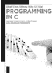
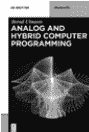
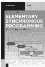
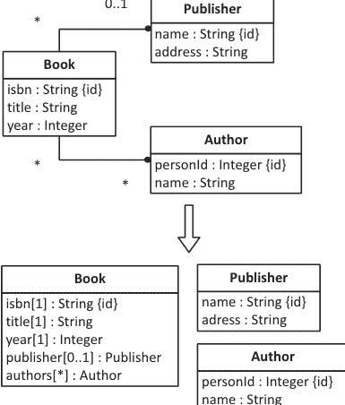
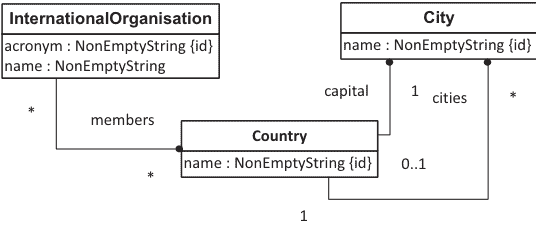

# JavaScript 或 Java Web 应用程序：第 2 卷：关联与类层结构










# 作者

Gerd Wagner 教授、博士

BTU Cottbus-Senftenberg

技术领域

Konrad Wachsmann-Allee 5

Cottbus

wagnerg@tu.de

Mircea Diaconescu

dimircea@gmail.com

封面图片：monsitj

致读者

# 前言

这套两卷本展示了如何基于模型的方法设计并实现 Web 应用，这两个最相关的平台是 JavaScript 和 Java。通过 UML 类图设计并实现：

1. JavaScript 前端应用，使用浏览器提供的本地存储技术；
2. Java 后端应用，使用 Server Faces（JSF）作为用户界面技术，使用 Java Persistence API（JPA）进行对象映射，以及 MySQL/MariaDB 数据库系统。

本书的重点是关于以下基础管理的通用概念和技术：

- 完整性约束和数据验证；
- 枚举和属性；
- 类型之间的双向关联；
- 类层次结构中的子类型继承。

前两个问题在本卷中讨论，后两个在第二卷中讨论。我们假设读者熟悉 HTML 和至少一种面向对象的语言，如 C++、Java 或 C#。此外，我们假设读者对 JavaScript 有一定了解，并兴趣学习。

本书可用于计算机科学或相关专业的 Web 开发课程；JavaScript 开发者学习 Java；Java 开发者学习 JavaScript；以及 JavaScript 和 Java（以及 C#）开发者学习 JavaScript 或 Java 进行面向对象的编程。书中提供了从我们的服务器下载的六示例应用的完整源代码。

# 索引 — 183

- **图 13.2** 人员（Person）角色类层次结构的 JS 类模型 — 154
- **图 13.3** 人员（Person）角色类层次结构的 STI 模型 — 155

# 第一部分：关联

我们拥有的三个示例应用在讨论中已经涵盖了三种功能类型。单向关联的通常只管理一个对象类型。然而，在模型视图控制器（MVC）架构中，它们以各种方式相互关联。在软件工程中，它们并没有得到良好的支持。

关联是信息模型的重要元素。软件框架通常需要以适当的方式来实现它们。

关联存在两种重要的区别，它们是相互独立的：

1. 功能性关联与非功能性（多对多）关联；
2. 单向关联与双向关联。

功能性关联在数学中对应于函数（function），而多对多关联在数学中对应于关系（relation）。

单向关联在 OO 建模和编程中对应于引用属性，而双向关联对应于一对互为反值的引用属性。

# 1. 引用属性与单向关联

定义在对象类型或类上的属性，如果其值是对另一个对象或相同类型对象的引用，则被称为引用属性。例如，图 1.1 所示的委员会（Committee）有一个引用属性 `chair`，其值指向俱乐部成员（ClubMember）对象。

单向关联在 OO 建模和编程中对应于引用属性，而双向关联对应于一对互为反值的引用属性。

在数学中，关联抽象地形式化为元组的集合，称为关系。在实体关系（ER）建模（这是信息系统和软件工程中的经典信息建模方法）中，对象被称为实体（entity），关联被称为关系类型（relationship type）。

统一建模语言（UML）包含了用于信息建模类图。在 UML 中，对象类型被称为类（class），个体关系被称为链接（link）。这些术语总结如下所示：

| 我们的首选术语 | UML | ER 图 | 数学 |
| :--- | :--- | :--- | :--- |
| 对象（object） | object | entity | individual |
| 对象类型（class） | class | entity type | unary relation |
| 关系（relationship） | link | relationship | tuple |
| 关联（association） | association | relationship type | relation |
| 功能性关联 |  | 1:1, 1:N | function |

我们首先讨论引用属性，它们在无关联类模型中隐含地表示了双向关联。

## 1.1 引用与引用属性

引用可以是*人类可读的*或*内部对象引用*。人类可读引用是指人类中使用的标识符，例如天体的唯一名称、书籍的 ISBN 以及公司员工的编号。内部对象引用是指 OOP 对象的内存地址，为访问主内存中的对象提供了高效机制。

某些语言（如 SQL 和 XML）只支持人类可读引用，不支持内部引用。在 SQL 中，人类可读引用被称为外键（foreign keys），它们所引用的标识符被称为主键（primary keys）。在 XML 中，人类可读引用被称为 ID 引用（ID references），对应的属性类型是 IDREF。

OO 程序中的对象可以通过人类可读引用（例如整数代码）或内部对象引用来引用，后者更有于高效访问主内存中的对象。

## 1.1 引用与引用属性 — 5

在术语中，我们将人类可读的引用称为 ID 引用（ID references）。在类 A 中定义的、用于指向类 B 对象的引用属性，命名通常使用 `_id` 后缀。

当我们以记录或表行的形式存储持久化对象时，需要将存储如 `publisher_id` 等属性的内部对象引用转换为存储如 `publisher_id` 等属性的 ID 引用，这是通过将被引用对象的标识符赋值给引用属性来实现的。

在面向对象语言中，属性是为对象类型（或类）定义的，其是其域（domain）。属性的值要么是某些数据类型的值，在这种情况下该属性被称为属性；要么是指向某些类的对象的引用，这种属性被称为引用属性。

例如，图 1.1 所示的 `Committee` 类具有范围为 `String` 的属性 `name` 以及范围为 `ClubMember` 的引用属性 `chair`。

| Committee | ClubMember |
| :--- | :--- |
| name: String |  |
| chair: ClubMember |  |

图 1.1：一个委员会具有 `chair` 成员属性。

面向对象编程语言（如 JavaScript、PHP 和 Java）直接支持引用属性的概念，这些属性的值不是数据类型，而是某个类的类型，其值为该类实例的引用。

默认情况下，属性的基数为 1，这意味着该属性是强制的且具有功能性的（换句话说，单值的），如图 1.1 所示的 `Committee` 类中的属性。当属性是可选的（非强制的）时，它的基数是 `0..1`，这意味着该属性的最小基数为 0，最大基数为 1。

引用属性可以是单值的（功能性的），也可以是多值的（非功能性的）。例如，图 1.1 所示的 `Committee::chair` 引用属性是单值的，因为它为委员会分配一个 `ClubMember`。多值引用属性的示例是图 1.1 所示的属性 `authors`。

通常，多值引用属性的值是引用集合，这意味着引用的顺序并不重要。但在某些情况下，顺序是重要的，因此多值引用属性的集合值通常实现为列表（list）。

## 1.2 引用完整性

引用是我们应用程序中的重要信息。然而，只有当应用程序维护它们的引用完整性时，它们才有意义。这要求对于任何具有域类 `C` 和范围类 `D` 的引用属性 `p`，在以下情况下必须检查引用完整性：

1. 创建了一个新的 `C` 类型对象；
2. 修改了某个 `C` 类型对象的 `p` 值；
3. 销毁了一个 `D` 类型的对象。

引用完整性还意味着两种依赖关系：

1. 创建依赖：只有在被引用对象创建后，才能创建指向该对象的引用。
2. 销毁依赖：只有在满足以下条件下：
   1. 引用对象先被销毁（级联删除策略 `CASCADE`）；
   2. 对象的引用被另一个引用替换（引用策略 `REFERENCE`）。

对于应用程序模型类中的每个引用属性，我们必须选择上述两种删除策略中的一种。

在某些情况下，我们希望放宽这种限制，允许 ID 引用属性具有非引用值，但我们不考虑此类情况。

通常，对象的创建依赖是通过用户界面管理的，即不允许用户输入 ID 引用属性的值，而是让他们从所有现有对象的列表中进行选择。

## 1.3 将引用属性建模为单向关联

引用属性（如图 1.1 所示示例中的 `chair`）在 UML 类图中可以被建模为由域类拥有的关联端，这通过一个小的实心圆（也称为“点”）来可视化。

这需要用关联线连接引用属性的域类和范围类，在范围侧末端放置所有权点，并用属性名称和基数符号对该关联进行注释，如图 1.2 所示。通过这种方式，我们得到了单向关联，其源类是属性的域，目标类是属性的范围。

关联被另一端的类所所有这一事实（通过图 1.2 所示示例中关联端 `chair` 处的所有权点视觉化表示），意味着该关联表示一个引用属性。在图 1.2 的示例中，表示的引用属性 `Committee::chair` 的范围是 `ClubMember`。

这种只有一个关联端所有权的关联是*单向的*，因为它允许在一个方向上进行 `navigation`（对象访问）：从点相反侧的类（源类）到放置点的类（目标类）。

| Committee | ClubMember |
| :--- | :--- |
| name : String | 0..1 1 |

**图 1.2：** 一个带“点”的关联。

因此，图 1.1 和图 1.2 所示的两个图本质上是等效的模型。当引用属性（如图 1.1 中的 *chair*）被建模为带“点”的关联时，基数被附加在另一端。

这种基数（反向基数）在图 1.1 的原始属性描述中是不可用的，因此必须考虑到关联的预期语义进行添加。它可以通过回答问题获得……[文本继续]……

当属性的值是其范围值的集合时，该属性是**非功能性**的，其基数是 `0..` 或 `n..`（其中 `$n > 0$`）。代替 `0..`（意味着“既非强制也功能性”），我们可以简单地写星号 `*`。

图 1.2 所示的关联为 `Committee` 对象分配一个 `ClubMember` 对象作为 `chair`。因此，它是**功能性关联**的示例。

表 1.1 提供了关联不同功能情况的概述。

注意，关联的方向性和功能类型是相互独立的。因此，单向关联既可以是功能性的（一对一或多对一），也可以是非功能性的（一对多或多对多）。

# 1. 引用属性与单向关联

表 1.1：功能类型。

| 功能类型 | 含义 |
| :--- | :--- |
| 一对一 | 既是功能性的也是反向功能性的 |
| 多对一 | 功能性的 |
| 一对多 | 反向功能性的 |
| 多对多 | 既非功能性的反向功能性的 |

## 1.4 将单向关联表示为引用属性

源类和目标类之间的单向关联可以表示为源类的引用属性。这在下方图 1.3 中针对单向关联进行了说明：多对一和多对多关联。



图 1.3：将单向关联表示为引用属性。

注意，在某种程度上，我们消除了显式的关联，并用类模型中相应的引用属性取代了它们，这可以用经典的面向对象语言简单地编码。面向对象语言确实不支持将关联作为一等公民。它们没有用于定义关联的语言元素。因此，一个 OOP 类设计模型（我们称之为类模型）不应包含任何显式的关联。

## 1.5 为非方向向关联添加方向性

当我们以 UML 类图的形式制作信息模型时，通常会得到一个包含一个或多个关联的模型，这些关联的末端没有定义任何所有权，例如图 1.4 所示。

当关联的两个末端都没有所有权点时（如本例所示），这意味着模型没有指定如何通过引用属性（reference properties）来表示（或实现）该关联。这种关联没有方向性。根据 UML 2.5 规范，此类关联的末端由关联自身“所有”，而不是由参与其中的任何一个类所有。

| Committee | chairedCommittee | ClubMember |
| :--- | :--- | :--- |
| name : String | 0.1 | 1 |

图 1.4：委员会（Committee）与俱乐部成员（ClubMember）之间非方向向关联的模型。

包含没有关联所有权点的信息设计模型作为关系型数据库设计模型是可以接受的，但作为 OOP 语言的设计模型它是不完整的。

例如，图 1.4 的模型提供了一个关系型数据库设计，包含两个实体表：`committees` 和 `clubmembers`，以及一个独立的一对一关系表 `committee_clubmember_as_chair`。它没有提供 Java 类的设计，因为它没有指定如何通过引用属性来实现该关联。

将非方向向关联的信息设计模型（不包含任何关联所有权点）转换为所有关联均为单向或双向的信息设计模型，有三种方案：我们可以在关联的任一末端或两个末端放置一个或多个所有权点。

这三个方案中的每一个都定义了通过引用属性表示或实现关联的不同方法。因此，对于上述图 1.4 所示的关联，我们有以下选项：

1. 在 `chair` 关联末端放置所有权点，得到如图 1.2 所示的模型，该模型可以转换为上方图 1.1 所示的 OO 类模型。
2. 在 `chairedCommittee` 关联末端放置所有权点，得到下方图 1.8 所示的完整模型。
3. 通过在两个关联末端都放置所有权点来使关联变为双向，如图 1.5 所示，其意义如第 7 章所述，即通过一对互逆的引用属性 `Committee::chaired` 和 `ClubMember::chairedCommittee` 以冗余方式实现关联。

| Committee | chair | ClubMember |
| :--- | :--- | :--- |
| name : String | 0.1 |  |

图 1.5：委员会（Committee）与俱乐部成员（ClubMember）之间的双向关联建模。

每当我们对关联建模时，都必须决定哪一个末端代表引用属性，并因此标记所有权点。这可以是一个，也可以是两个。这个决定也意味着对关联的可导航性（navigability）的决定。当一个关联表示引用属性时，意味着它是可导航的（通过该属性）。

对于非一对一的功能性关联，最简单的设计是根据其功能定义关联的方向，将关联所有权点放置在多性为 `0..1` 或 `1` 的关联末端。对于非方向向的一一或多对多关联，我们可以随心选择方向，即我们可以在任何关联末端放置所有权点。

## 1.6 贯例

下方图 1.6 所示的模型（关于出版商和书）作为我们单向功能性关联的贯例。注意它包含了单向多对一关联 `Book-has-Publisher`。

| Publisher | Book |
| :--- | :--- |
| name : String | isbn : String (id) |
| address : String | title : String |
| 0.1 * | year : Integer |

图 1.6：具有单向多对一关联 `Book-has-Publisher` 的信息设计模型。

我们可能还需要处理非一对一的功能性关联的单向引用属性。例如，图 1.7 所示的出版商与作者之间的单向多对多关联，这是一个多值引用属性。

| Publisher |  |
| :--- | :--- |
| name : String (id) | isbn : String (id) |
| address : String | title : String |
| year : Integer |  |

| Author | personId: Integer |
| :--- | :--- |
|  | name: String |

图 1.7：具有两个单向关联的出版商-书-作者信息设计模型。

## 1.7 消除关联

由于经典的 OO 语言不支持将关联作为一等公民，仅支持类和引用属性，因此必须从信息设计模型中消除显式关联以获取 OO 类。

### 1.7.1 基础消除程序

关联消除程序的起点是一个包含各种单向关联的信息设计模型，如图 1.6 所示的模型。如果模型仍然包含非方向性关联，我们需要通过对所有所有权做出决策来将其转换为方向性关联。

连接源与目标类的单向关联将被替换源类中对应的引用属性，该属性具有：

1. 与关联末端相同的名称（如果引用属性是多值的，则使用目标类的复数形式）；
2. 目标类作为其范围；
3. 关联的多性作为；
4. 如果单向关联是反函数，则具有唯一性约束。

这种替换过程在图 1.8 的单向一对关联案例中说明，其中引用属性的唯一性约束通过 `{key}` 修饰表示。

# 12.1 引用属性与单向关联

| Committee | ClubMember |
| :--- | :--- |
| name : String | 0.1 1 |

| Committee | ClubMember |
| :--- | :--- |
| name : String | chairedCommittee[0..1] : Committee |

图 1.8：将功能性关联末端转换为引用属性。

对于单向一对多的关联案例，图 1.9 提供了消除程序的图示。在这里，目标类的非功能性关联末端被转换为对应的引用属性，名称由目标类名称的复数形式获得。

| Polygon | Point |
| :--- | :--- |
| 1..3.* | x : Integer |
|  | y : Integer |

| Polygon | Point |
| :--- | :--- |
| points[3..] : Point | x : Integer |
|  | y : Integer |


图 1.9: 将非功能性关联末端转换为多值引用属性。

## 1.7.2 从设计模型中消除关联

在我们的贯例出版商-书-作者信息设计模型中，我们必须将两个单向关联替换为合适的引用属性。在第一步中，我们将图 1.6 模型中的多对一关联 `Book-has-Publisher` 替换为 `Book` 类中的功能性引用属性 `publisher`，得到图 1.10 所示的 OO 类模型：

| Book | Publisher |
| --- | --- |
| isbn[1] : String (id) | name : String (id) |
| title[1] : String | address : String |
| year[1] : Integer | |
| publisher[0..1] : Publisher | |

图 1.10: 出版商和书的 OO 类模型。

## 1.7 消除单向关联 — 13

注意，由于“图书拥有出版社”（`Book-has-Publisher`）关联的目标关联多重性为 `0..1`，我们必须通过将其多重性定义为 `0..1` 将新属性 `publisher` 声明为可选。

可以通过下表所示 `Book` 和 `Publisher` 两个模型类的示例数据填充来说明此 OO 类模型及其引用属性 `publisher` 的含义：

| 出版社 | 地址 |
| --- | --- |
| Bantam Books | 美国，新纽约 |
| Basic Books | 美国，新纽约 |

| ISBN | 标题 | 年份 | 出版社 |
| --- | --- | --- | --- |
| 0553345842 | The Mind's I | 1982 | Bantam Books |
| 1463794762 | The Critique of Pure Reason | 2011 | |
| 1928565379 | The Critique of Practical Reason | 2009 | |
| 0465030793 | I Am A Strange Loop | 2000 | Basic Books |

注意 `Book` 表中“Publisher”列的值是唯一的名称，引用了 `Publisher` 表中的某行。由于相应的引用属性 `publisher` 是可选的，某些行的“Publisher”列可能没有值。

在第二步中，我们将图 1.7 模型中的多对多“图书拥有作者”（`Book-has-Author`）关联替换为 `Book` 类中的多值引用属性 `authors`，从而得到了图 1.11 所示的 OO 类模型。

| Book | Publisher |
| --- | --- |
| isbn[1] : String (id) | name : String (id) |
| title[1] : String | address : String |
| year[1] : Integer | |
| publisher[0..1] : Publisher | |

| Author |
| --- |
| personid : integer (id) |
| name : String |

**图 1.11：** 针对类 `Book`、`Publisher` 和 `Author` 类的 OO 类模型。

## 14 — 1 引用属性与单向关联

此 OO 类模型及其引用属性 `Book::publisher` 和 `Book::authors` 的含义可以通过三个模型类的示例数据填充来说明：

| 名称 | 地址 |
| --- | --- |
| Bantam Books | 美国，新纽约 |
| Basic Books | 美国，新纽约 |

| ISBN | 标题 | 年份 | 作者 | 出版社 |
| --- | --- | --- | --- | --- |
| 0553345842 | The Mind's I | 1982 | 1, 2 | Bantam Books |
| 1463794762 | The Critique of Pure Reason | 2011 | 3 | |
| 1928565379 | The Critique of Practical Reason | 2009 | 3 | |
| 0465030793 | I Am A Strange Loop | 2000 | 2 | Basic Books |

| 作者 ID | 姓名 |
| --- | --- |
| 1 | Daniel Dennett |
| 2 | Douglas Hofstadter |
| 3 | Immanuel Kant |

在平台特定的实现模型之后，针对一组特定实现平台的选择，可以从中推导出一个或多个平台特定的实现模型。平台特定实现的一个类型示例包括 JS 类模型、Java 实体类模型和 SQL 表模型。

平台特定的实现模型仍然可以用 UML 类图的形式表示，但它仅包含可以在所选平台中直接编码的建模元素。因此，对于任何考虑的平台，都需要两个指南：1) 如何制作平台特定的实现模型，2) 如何对该模型进行编码。

## 1.9 多值引用属性的集合类型 15

## 1.8 在用户界面中渲染引用属性

CRUD 数据管理用户界面（UI）中用于数据输入和输出的组件通常对应应用程序模型类中定义的属性。我们必须区分对应（各种类型）属性的（各种种类）输入字段，以及对应枚举属性或引用属性的选择小部件（如选择列表）。在 UI 中使用选择控件而非输入字段来表示引用属性，可以防止用户输入无效的 ID 引用，从而维护引用完整性。

通常情况下，单值引用属性可以渲染为 UI 中的单选列表，无论对象如何填充引用属性的范围，我们都从中选出一个特定的选项。如果引用属性范围的基数足够小（例如不大于 7），那么我们可以使用单选按钮组来代替选择列表。

多值引用属性可以渲染为 UI 中的多选列表。然而，一旦有许多（例如超过 20 个）不同的选项可供选择，HTML 对应的多选控件就变得不再真正好用，因为读者的选择在视觉上太分散了。在只有少数（例如少于 7 个）选项的特殊情况下，我们也可以使用复选框组代替列表。但对于 UI 中包含引用属性范围类中所有关联对象的通用情况，我们需要开发一种特殊的 UI 小部件，允许向已选对象列表添加（并删除）对象。

这种多选小部件由以下部分组成：
- 一个包含（关联）对象的 `html` 列表元素，其中每个列表项包含一个用于删除对象的按钮；
- 一个单选控件，结合按钮，允许从多值引用属性的范围中添加新对象。

## 1.9 多值属性的集合类型

默认情况下，非功能关联将目标类的一组实例关联到源类的任何实例，这意味着多值引用属性的集合值是集合（sets）。但在某些情况下，非功能关联的端是有序的，因此引用属性的集合值表现为有序集合。

在以下示例中，关联端 `publishedBooks` 是无序的，而关联端 `authors` 是有序的，因为书籍作者的顺序是有意义的。注意在类图中，有序的关联端被标记为 `{ordered}`。

## 16 1 引用属性单向关联

| 出版社 | 已出版书籍 | 作者 (有序) | 作者 |
| --- | --- | --- | --- |
| name : String {id} | isbn : String {id} | personId : Integer {id} | |
| address : String | title : String | | name : String |
| | year : Integer | | |

有序的关联不应表示任何基于目标类属性的排序。在我们的示例中，这意味着书籍作者的顺序例如不应该代表他们的字母顺序，而应该代表某种无法通过 `Author` 属性获取的信息。事实上的确实如此，因为它代表了某种重要性，这种重要性无法通过任何属性来表达。

注意信息设计模型中的有序关联端只是一种便利功能，因为有序关联始终可以通过向关联的目标类添加一个或多个属性来转换为无序关联，使得这些属性的值可以用于排序。有序关联允许使用更简洁的信息模型和更高效的实现，而无需借助辅助属性来显式地进行排序。

多值引用属性的两种重要集合类型是集合（sets），而使用包（bags，多集合）和序列（有序多集合）作为多值引用属性的集合类型时，该类型为包（或序列），这可以在类图中通过关联端或属性修饰符的 `{nonunique}`（或 `ordered, nonunique`）注解来表示。

注意，使用列表（如 JS 数组或 Java 接口类型 `List`）作为多值引用属性的范围是非常常见的，无论是有序还是无序属性。

## 1.10 测验题

如果你想查询以下测试题的答案，可以查看我们的讨论论坛。如果在论坛中没有找到答案，你可以发帖请求特定问题的答案。

### 1.10.1 问题 1：“一对一”的含义

说一个关联是“一对一”意味着什么？

这意味着它是（选择单项）：
- 1. O 双向的
- 2. O 既是函数性的也是全覆盖的
- 3. O 函数性的
- 4. O 既是函数性的也是反函数性的

### 1.10.2 问题 2：何时检查引用完整性

对于对域类为 `C`、范围类为 `D` 的引用属性 `p`，其引用完整性约束在以下任何情况下必须检查（选择一项或多项）：
- 1. 一个类型 `C` 的对象被销毁。
- 2. 某个类型 `C` 对象的 `p` 值被更改。
- 3. 创建了一个类型 `C` 的对象。
- 4. 一个类型 `D` 的对象被销毁。
- 5. 创建了一个类型 `D` 的对象。

### 1.10.3 问题 3：“函数性”的含义

单向关联是函数性的，当且仅当（选择单项）：
- 1. O 源类的每个对象最多链接目标类的一个对象。
- 2. O 目标类的每个对象至少链接源类的一个对象。
- 3. O 源类的每个对象至少链接目标类的一个对象。
- 4. O 源类的每个对象恰好链接目标类的一个对象。

### 1.10.4 问题 4：对象销毁依赖

假设我们有一个类型 `B` 对象，具有标准标识属性 `id`，以及一个类型 `A` 对象，具有一个引用 `B::id` 的引用属性 `b_id`。进一步，假设有一个 `b.id = 11` 的类型 `B` 对象和一个 `a.b_id = 11` 的类型 `A` 对象。以下哪些陈述是正确的？选择一项或多项：
- 1. 当对象 `a` 中的 ID 引用未被分配（在 JS 中将 `a.b_id` 设置为 `undefined`，在 Java 中设为 `null`）且没有其他对象引用 `b` 时，对象 `b` 可以被销毁。
- 2. 只有在 `b` 之前已经被销毁的情况下，对象 `a` 才能被销毁。
- 3. 当对象 `a` 中的 ID 引用被重置为另一个类型 `B` 的对象时（例如通过设置 `a.b_id = 7`），且没有其他对象引用 `b` 时，对象 `b` 可以被销毁。
- 4. 在 `a` 之前已经被销毁的情况下，对象 `b` 可以被销毁。

### 1.10.5 问题 5：单值引用属性的渲染

关于单值引用属性 `p` 以及它如何通过合适的表单控件在 Web 用户界面中进行渲染，以下哪些陈述是正确的？选择一项或多项：
- 使用 `type="text"` 的 `input` 控件可以获得适当的渲染。
- 如果 `p` 范围的基数不大于 7，可以通过复选按钮组进行渲染。
- 如果 `p` 范围的基数不大于 7，可以通过单选按钮组进行渲染。
- 它可以通过单选控件进行渲染。

### 1.10.6 问题 6：表达功能类型

可以使用哪种“x-to-y”形式的术语（其中 `x`,`y` 表示“一个”或“多个”）来表达一个关联既不是函数性的也不是反函数性的？

答案：\__________________

## 2 使用原生 JS 实现单向函数性关联

单向函数性关联要么一对一，要么多对一。在这两种情况下，这种关联都通过单值引用属性表示或实现。

在本章中，我们将展示：
- 1. 如何从具有表示单向函数性关联的单值引用属性的 OO 类模型导出 JS 类模型，
- 2. 如何以原生 JavaScript 模型类的形式编写 JS 类模型，
- 3. 如何基于模型代码编写视图和控制器代码。

在展示如何推导 JS 类模型并用 JavaScript 编写它之前，我们首先介绍 JavaScript 语言的几个新元素，我们将在书中讨论的 JavaScript 代码中使用它们。

## 2.1 新的 JavaScript 元素

在本节中，我们介绍由 ECMAScript 2015+ 引入 JavaScript 的重要新语言元素（即 2015+16+17+18+19+20+……）。

### 2.1.1 使用 let 和 const 进行块作用域变量声明

ES5 不允许作用域为大括号 `{ }` 定义的块或由 `for` 循环定义的块的变量。相反，所有用 `var` 声明的变量即使在块内声明，也具有函数作用域或全局作用域。使用 `let` 和 `const` 进行块作用域声明的新功能允许局部变量具有细粒度的作用域，这有助于避免无意重复并使代码更具模块化。

`let` 和 `const` 之间有一个含义上的区别。用 `const` 声明的变量是冻结或不可变，在这个意义上是常量，而 `let` 变量不是。对于所有不应改变值的变量，最好使用 `const`。否则，或者如果不清楚，如果是块作用域变量，应该用 `let` 声明，如果是全局或函数作用域变量，则用 `var` 声明。

### 2.1.2 箭头函数

与经典的 JS 函数相比，箭头函数（带有 `=>`）提供了更简洁的函数表达式语法，允许从词法作用域捕获 `this`，并且没有自己的 `this` 绑定。

## 2.2 实现单值引用属性 — 23

```
this.year = year;
```

```
...
}
}
```

单值引用属性（例如 `Book` 类型的对象的发布者属性 `publisher`）允许存储对另一个类型对象（如 `Publisher`）的内部引用。在创建新对象时，构造函数需要包含一个参数，以便为引用属性分配一个合适的值。在像 Java 这样的强类型编程语言中，我们必须决定该值是预期为（内部）对象引用还是（外部）ID 引用。然而，在 JavaScript 中，我们可以采取更灵活的方法，允许使用两者之一，如下例所示：

```javascript
class Book {
  constructor ({isbn, title, year,
    publisher, publisher_id}) {
    ...
    // 分配对象引用或 ID 引用
    if (publisher || publisher_id) {
      this.publisher = publisher || publisher_id;
    }
  }
}
```

注意，记录参数的 `publisher` 字段代表一个 JS 对象引用，而其 `publisher_id` 字段代表一个 ID 引用。在 JavaScript 中，我们可以使用析取表达式 `expr1 || expr2` 来获取第一个表达式的值（如果它已定义且不为 0），否则获取第二个表达式的值。我们在属性设置器（setter）中通过检查参数类型来处理产生的歧义，如下代码片段所示：

```javascript
set publisher(p) {
  var publisher_id = "";
  // p 可以是 ID 引用或对象引用
  publisher_id = (typeof p==="object") ? p : p.name;
  ...
  this._publisher = Publisher.instances[publisher_id];
}
```

## 2 使用原生 JS 实现单向关联

注意发布者的名称被用作 ID 引用，因为它是 `Publisher` 类的标准 ID。

## 2.3 构建 JS 类模型

构建 JS 类模型的起点是如图 1.10 所示的面向对象（OO）类模型。

我们现在展示如何通过四个步骤从该 OO 类模型推导出 JS 类模型。对于 OO 类中的每个检查项：
- 为所有（非派生的）单值属性添加 `get/set` 刻型，意味着它们具有隐式的 getter 和 setter。回想在 setter 中，会调用相应的检查操作，并且只有当检查没有检测到违反约束时，才会设置属性。
- 为每个（非派生的）属性创建一个 `check` 操作，以便为实现属性约束提供一个处理点。对于标准的 ID 属性（例如 `Book::isbn`），需要两个或三个检查操作：
  - 一个基础检查操作，如 `checkIsbn`，用于检查所有的语法约束，但不包括 `mandatory` 值和唯一性约束。
  - 一个标准的 ID 检查操作，如 `checkIsbnAsId`，用于检查标准 ID 属性隐含的 `mandatory` 值和唯一性约束。
  - 如果其他类具有引用所考虑类的引用属性，则添加一个 `ID reference` 检查操作，用于检查施加在 ID 引用（或外键）属性上的引用完整性约束。例如，由于 `Book::publisher` 属性引用 `Publisher` 对象，我们需要在 `Publisher` 类中添加 `checkNameAsIdRef` 操作。
- 对于 `Book::publisher` 等引用属性，检查操作 `Book.checkPublisher` 必须通过调用 `Publisher.checkNameAsIdRef` 来检查引用完整性约束，如果该属性是强制的，可能还需要检查强制性约束。
- 为 `toString()` 添加一个序列化函数，用于在错误消息和日志消息中显示对象的状态。
- 在 `Record()` 中添加一个对象到存储的转换函数，为模型对象准备好以存储为实体表中的行，该行可以通过 `JSON.stringify` 序列化为 JSON 字符串，从而存储为应用 `localStorage` 数据存储的值。

## 2.3 构建 JS 类模型 25

这推导出了 `Book` 的如下 JS 类模型，其中类级（“静态”）方法用下划线表示：

| Book | Book |
| --- | --- |
| isbn[1]: String (id) | «get/set» isbn[1]: string (id) |


| `title[1]: String` | «get/set» `title[1]: string` |
|---|---|
| `year[1]: integer` | «get/set» `year[1]: number(int)` |
| `publisher[0..]: Publisher` | «get/set» `publisher[0..1]: Publisher` |
|  | `checkIsbn(isbn: string): ConstraintViolation` |
|  | `checkIsbnAsId(isbn: string): ConstraintViolation` |
|  | `checkIsbnAsRef(isbn: string): ConstraintViolation` |
|  | `checkTitle(title: string): ConstraintViolation` |
|  | `checkYear(year: number(int)): ConstraintViolation` |
|  | `checkPublisher(p: Publisher): ConstraintViolation` |
|  | `toString(): String` |
|  | `toRecord(): Object` |

我们必须对 `Publisher` 类执行类似的转换。这为我们提供了从上述 OO 类模型推出的完整 JS 类模型，如图 2.1 所示。

| Book |
|---|
| «get/set» `isbn[1]: string (id)` |
| «get/set» `title[1]: string` |
| «get/set» `year[1]: number(int)` |
| «get/set» `publisher[0..1]: Publisher` |
| `checkIsbn(isbn: string): ConstraintViolation` |
| `checkIsbnAsId(isbn: string): ConstraintViolation` |
| `checkIsbnAsRef(isbn: string): ConstraintViolation` |
| `checkTitle(title: string): ConstraintViolation` |
| `checkYear(year: number(int)): ConstraintViolation` |
| `checkPublisher(p: Publisher): ConstraintViolation` |
| `toString(): String` |
| `toRecord(): Object` |

| Publisher |
|---|
| «get/set» `name: string (id)` |
| «get/set» `address: string` |
| `checkName(n: string): ConstraintViolation` |
| `checkNameAsId(n: string): ConstraintViolation` |
| `checkNameAsRef(n: string): ConstraintViolation` |
| `checkAddress(a: string): ConstraintViolation` |
| `toString(): String` |
| `toRecord(): Object` |

图 2.1：定义 Book 和 Publisher 类的 JS 类模型

## 2.4 问题

与第 1 节相比，我们现在需要处理技术问题：

- 在模型中维护引用完整性；
- 在内部引用和外部 ID 之间选择；
- 在用户界面中处理关联对象的信息；
- 在创建和更新用例中从列表中删除对象。

## 2.5 总结

JS 类模型可以直接实现以下内容：

- 为 JS 模型中的每个类编写类级（静态）方法；
- 对于每个单值属性，编写指定的 getter 和 setter，以便在每个 setter 中调用相应的检查操作；
- 在销毁方法中处理依赖关系。

这些步骤将在后续章节中详细讨论。

### 2.5.2 将每个模型类编写为 ES15 类

JS 模型中的每个类 C 都被编写为同名 C 的 ES15 类，其构造函数有一个记录参数，该参数指定了类的每个非派生属性的字段。这些属性的范围应在注释中注明。引用属性范围是另一个模型类。

在构造函数体内，我们将记录参数的字段赋值给相应的属性。这些属性赋值会调用相应的 setter 方法。

例如，JS 模型中的 `Publisher` 类如下所示编写：

```javascript
class Publisher {
  constructor ({name, address}) {
    this.name = name;
    this.address = address;
  }
}
```

由于 setter 可能会抛出约束异常，构造函数以及任何 setter 都应该在 try-catch 块中调用，catch 负责记录合适的错误消息。

对于每个模型类 C，我们定义一个类级属性 `C.instances`，代表应用程序管理的所有 C 实例集合，以实体表（记录映射）的形式存在。该属性初始设置为 `{}`。例如，在模型类 `Publisher` 的情况下，我们定义：

```javascript
Publisher.instances = {};
```

JS 模型中的 `Book` 类以类似的方式编写：

```javascript
class Book {
  constructor ({isbn, title, year, authors, authorIdRefs}) {
    this.isbn = isbn;
    this.title = title;
    this.year = year;
    this.authors = authors || authorIdRefs;
  }
}
```

## 28 使用原生 JS 实现单向函数关联

```js
if (publisher || publisher_id) {
  this.publisher = publisher || publisher_id;
}
...
}
```

注意，`Book` 构造函数既可以使用对象引用 `authors`，也可以使用 ID 引用 `authorIdRefs` 和 `publisher_id` 调用。这种方法使得 `Book` 构造函数的使用更加灵活且更加健壮。

### 2.5.3 编写属性检查

确保 JS 类模型中指定的所有属性约束都已在它的检查函数中正确编写，正如第一卷第 8 节所解释的。记住，约束违反（或验证错误）类定义在 `lib/errorTypes.js` 文件中。

例如，对于 `Publisher.checkName` 函数，我们得到以下代码：

```js
class Publisher {
  static checkName(n) {
    if (n === undefined) {
      return new NoConstraintViolation(); // 非强制
    } else {
      if (typeof n !== "string" || n.trim() === "") {
        return new RangeConstraintViolation(
          "The name must be a non-empty string!"
        );
      } else {
        return new NoConstraintViolation();
      }
    }
  }
  static checkNameAsId(n) { .. }
}
```

注意，由于名称属性是 `Publisher` 的标准 ID 属性，我们只在 `checkName` 中检查语法强制约束，并在 `checkNameAsId` 中检查强制值和唯一性约束，后者会调用 `checkName`：

```js
static checkNameAsId(n) {
  var validationResult = Publisher.checkName(n);
  if ((validationResult instanceof NoConstraintViolation) {
    if (n === undefined) {
      return new MandatoryValueConstraintViolation(
        "A publisher name is required!");
    } else if (Publisher.instances[n]) {
      validationResult = new UniquenessConstraintViolation(
        "There is already a publisher record with this name!");
    } else {
      validationResult = new NoConstraintViolation();
    }
  }
}
```

如果我们需要在其他类中处理 ID 引用（外键），我们需要提供进一步的检查，称为 `checkNameAsIdRef`，用于检查引用完整性约束：

```js
static checkNameAsIdRef(n) {
  var validationResult = Publisher.checkName(n);
  if ((validationResult instanceof NoConstraintViolation) &&
    n !== undefined) {
    if (!Publisher.instances[n]) {
      validationResult = new ReferentialIntegrityConstraintViolation(
        "There is no publisher record with this name!");
    }
  }
  return validationResult;
}
```

条件 `!Publisher.instances[n]` 检查是否存在具有给定名称 `n` 的出版者对象，然后创建一个异常类 `ReferentialIntegrityConstraintViolation` 的实例作为 `validationResult` 对象。`Book.checkAsRef` 函数由 `Book.checkPublisher` 函数调用：

```js
class Book {
  ..
  static checkPublisher(publisher_id) {
    var validationResult = null;
    if (publisher_id === undefined || publisher_id === "") {
      validationResult = new NoConstraintViolation(); // 可选
    } else {
      // 调用外键约束检查
      validationResult = Publisher.checkNameAsIdRef(publisher_id);
    }
    return validationResult;
  }
  
}
```

### 2.5.4 编写属性设置器（Setters）

在 setter 中，会调用相应的检查函数，并且当检查未检测到约束违反时，才会设置属性。对于引用属性，我们允许使用对象引用或 ID 引用调用 setter。产生的歧义通过测试在 setter 调用中提供的参数是否为对象来解决。例如，`publisher` 设置器的代码编码方式如下：

```js
class Book {
  ..
  set publisher(p) {
    if (!p) // 取消出版者
      delete this._publisher;
    } else {
      // p 可以是 ID 引用或对象引用
      publisher_id = (typeof p==="object") ? p.name : p;
      const validationResult = Book.checkPublisher(publisher_id);
      if (validationResult instanceof NoConstraintViolation) {
        // 创建新的出版者引用
        this._publisher = Publisher.instances[publisher_id];
      } else {
        throw validationResult;
      }
    }
  }
}
```

### 2.5.5 选择并实现删除策略

对于任何引用属性，我们必须在第 2.2 节讨论的两种删除策略中选择并实现一种。假设书籍在存在上依赖于出版者，我们选择第一个选项。在下面的 `destroy` 方法代码中，该属性被清除：

```js
destroy = function (name) {
  for (let key in Book.instances) {
    const book = Book.instances[key];
    if (book.publisher === name) {
      delete book.publisher; // 删除槽位
      console.log("Book " + key + " updated.");
    }
  }
  delete Publisher.instances[name];
  console.log("Publisher " + name + " deleted.");
};
```

注意，出版者的删除是通过对所有对象的顺序扫描完成，当对象很多时，这可能效率低下。

### 2.5.6 序列化与对象存储映射

对于属性，序列化函数 `toString()` 必须显示被引用对象的可读标识符，例如 `this.publisher.name`：

```js
toString() {
  var bookStr = `Book: ${this.isbn}, title: ${this.title}, year: ${this.year}`;
  if (this.publisher) bookStr += `, publisher: ${this.publisher.name}`;
  return bookStr;
}
```

从带有 ID 引用的无类型记录对象到带有对象引用的类型对象的对象存储转换，通过 `toRecord()` 函数完成：

```js
toRecord() {
  var rec = {};
  for (let p of Object.keys(this)) {
    // 只拷贝带下划线前头的属性
    if (p.charAt(0) === "_") {
      switch (p) {
        case "_publisher":
          // 将对象引用转换为 ID 引用
          if (this._publisher) rec.publisher_id = this._publisher.name;
          break;
        default:
          // 下划线前缀
          rec[p.substr(1)] = this[p];
      }
    }
  }
  return rec;
}
```

## 2.6 编写视图和控制器

用户界面（UI）由一个起始页 `index.html` 组成，该页面允许导航到数据管理页面，对应每个对象类型（在我们的示例中为 `books.html` 和 `publishers.html`）。这些数据管理页面中的每个包含 5 个部分：一个管理部分（带有一个选择 CRUD 用例的菜单），以及每个 CRUD 用例的一个部分，如列出书籍、创建书籍、更新书籍和删除书籍，确保每次只有一个显示（例如通过为其他部分设置 CSS 属性 `display:none`）。

### 2.6.1 初始化应用

对于初始化数据用例，必须从持久化存储加载所需数据（例如所有出版者和书籍记录）。这在控制器程序中完成，如 `c/books.js` 中的 `pl.c.books.manage.initialize` 所示：

```js
pl.c.books.manage = {
  initialize: function () {
    Publisher.retrieveAll();
    Book.retrieveAll();
    pl.v.books.manage.setUserInterface();
  }
}
```

书籍数据的初始化方法首先加载出版者表和书籍表，因为书籍管理 UI 需要显示这些数据。然后通过调用 `setUpInterface` 程序来渲染书籍管理菜单。

### 2.6.2 在列出所有中显示关联对象

在我们的示例中，我们只有一个引用属性 `Book::publisher`，它是函数性的且可选的。为了在“列出所有书籍”用例中显示书籍可选的出版者信息，HTML 表格中相应的单元格将填充出版者的名称（如果有的话）：

# 34 2 使用原生 JS 实现检索和列出单向关联


`pl.v.books.retrieveAndListAll` 的 `setupUserInterface` 方法用于设置检索/列表用例的用户界面。它首先获取表格主体元素，清空其内容，然后遍历 `Book.instances` 中的所有书籍实例，为每本书插入一行，并填充 `isbn`、`title`、`year` 以及出版社名称（如果存在）等单元格。最后，它隐藏管理页面并显示检索页面。

```javascript
pl.v.books.retrieveAndListAll={
  setupUserInterface: function () {
    const tableBodyEl = document.querySelector(
      "#sectionBook-R>tbody");
    tableBodyEl.innerHTML = ""; // 弃旧内容
    for (let key of Object.keys(Book.instances)) {
      const book = Book.instances[key];
      const row = tableBodyEl.insertRow(-1);
      row.insertCell(-1).textContent = book.isbn;
      row.insertCell(-1).textContent = book.title;
      row.insertCell(-1).textContent = book.year;
      // 如果书籍有出版社，则显示其名称
      row.insertCell(-1).textContent =
        book.publisher ? book.publisher.name : "";
    }
  }
  document.getElementById("Book-M").style.display = "none";
  document.getElementById("Book-R").style.display = "block";
};
```

对于多值引用属性，表格单元格必须填充由该属性引所有关联对象列表。

## 2.6.3 在“创建”和“更新”用例中选择关联对象

为了允许在“创建”和“更新”用例中选择与当前编辑对象关联的对象，可以使用一个 HTML 选择列表（即 `select` 元素），并借助工具方法 `fillSelectWithOptions` 填充由关联对象类型实例生成的 `option` 元素。该 HTML 元素定义在 `books.html` 视图文件中：

```html
<section id="Book-C" class="UI-Page">
  <h1>公共图书馆：创建新的书籍记录</h1>
  <form>
    ..
    <div class="select-one">
      <label>出版社：<select name="selectPublisher"></select></label>
    </div>
    ..
  </form>
</section>
```

“创建”用户界面通过以下过程进行设置：

```javascript
pl.v.books.create = {
  setupInterface: function () {
    const formEl = document.querySelector("section#Book-C > form"),
      selectPublisher = formEl.selectPublisher,
      saveButton = formEl.commit;
    // 为响应式验证添加事件监听器
    formEl.isbn.addEventListener("input", function () {
      formEl.isbn.customValidity(
        Book.checkIsbnAsID(formEl.isbn.value).message);
    });
    // 设置一个单选择列表用于选择出版社
    util.fillSelectWithOptions(selectPublisher,
      Publisher.instances, "name");
    // 定义提交按钮点击的事件处理器
    saveButton.addEventListener("click",
      this.handleSaveButtonClickEvent);
    // 定义中和提交表单的事件处理器
    formEl.addEventListener("submit", function (e) {
      e.preventDefault();
      formEl.reset();
    });
    // 将管理表单替换为创建表单
    document.getElementById("Book-M").style.display = "none";
    document.getElementById("Book-C").style.display = "block";
    formEl.reset();
  },
  handleSaveButtonClick: function () {
    ..
  }
}
```

当用户点击（或触摸）保存按钮时，所有表单控件的值（包括选择控件的值）都会复制到一个插槽列表中。在对所有表单字段进行性检查后，该列表将作为调用 `add` 方法的参数，如下程序所示：

```javascript
handleSaveButtonClick = function () {
  const formEl = document.querySelector("section#Book-C > form");
  const slots = {
    isbn:formEl.isbn.value,
    title:formE.title.value,
    year:formE.year.value,
    publisher_id:formE.selectPublisher.value

  // 验证所有表单控件并显示错误消息
  formE.isbn.setCustomValidity(
    Book.checkIsbnAsId(slots.isbn).message);
  /* ..（title 和 year 同） */
  // 仅当所有表单字段有效时才保存输入数据
  if (formE.checkValidity()) {
    Book.add(slots);
  }
```

`setupUserInterface` 代码在“更新”用例中是类似的。

## 2.7 练习题

### 2.7 练习题 1：类模型

对于多值引用属性，以下哪项是给定类模型派生的 JS 类？

| Committee |

| :--- |

| 1. O |

| 2. O |

| 3. O |

### 2.7 练习题 2：使用 `||` 运算符

选择以下项项：

| Committee |

| :--- |

| 1. O |

| 2. O |

| 3. O |

# 3 使用原生 JS 实现单向关联

单向关联要么一对多（one-to-many），或者是多对多（many-to-many）。在本章中，我们将展示：

- 1. 如何从多值引用属性的 OO 模型推导出 JS 类，

- 2. 如何基于单向关联编写模型，

- 3. 如何基于这些编写视图和控制器

## 3.1 实现多值引用属性

多值引用属性，例如 `authors`，是对某些类型的集合。在创建 `Book` 的新对象时，构造函数需要一个提供内部对象引用或 ID 引用的参数，如下所示：

```javascript
class Book {
  constructor({isbn, title, year, authors, authorRefs, publisher, publisher_id}) {
    this.isbn = isbn;
    this.title = title;
    this.year = year;
    // 分配对象引用或 ID引用
    this.authors = authors || authorRefs;
    if (publisher || publisher_id) this.publisher = publisher || publisher_id;
  }
}
```

注意构造函数的参数包含 `authors` 或 `authorRefs`。JavaScript 表达式 `authors || authorRefs` 使用逻辑或运算符 `||`，在存在 `authors` 时返回一个 map，否则返回数组 `authorRefs`。我们在属性 setter 中处理这种歧义，如下代码所示：

```javascript
set authors (a) {
  this._authors = {};
  if (Array.isArray(a)) { // IDRefs 的数组
    for (let idRef of a) {
      this.addAuthor(idRef);
    }
  } else // IDRefs 到对象引用的 map
    for (let idRef of Object.keys(a)) {
      this.addAuthor(a[idRef]);
    }
  }
}
```

## 3.2 创建 JS 类模型

在 JS 中，集合值引用属性可以通过两种方式实现：

1. 使用对象引用列表（JS 数组）作为其值；

2. 使用 map 作为其值，将对象的标准 ID 属性作为键映射到内部对象引用。

我们倾向于使用 map 来处理集合值属性，因为它们保证了每个元素的唯一性，而在数组中我们必须防止重复元素。此外，map 的元素可以被删除（借助 `delete` 运算符），而在数组的情况下这需要更多努力。然而，对于对应有序集合值（或包/序列值）引用属性的有序（或非唯一）关联端，我们使用 JS 数组。

创建 JS 类模型的起点是以下 OO 类模型：

| Book | Publisher |

| :--- | :--- |

| isbn[1]: String (id) | name : String (id) |

| title[1]: String | address : String |

| year[1]: Integer | |

| publisher[0..1]: Publisher | |

| authors[*]: Author | |

| | personid: Integer (id) |

| | name: String |

## 4.3 使用原生 JS 实现单向非功能关联

该模型除了代表单向多对一关联 `Book-hasPublisher` 的单值引用属性 `Book::publisher` 外，还包含代表单向多对多关联 `Book-hasAuthor` 的多值引用属性 `Book::authors`。

从面向对象（OO）类模型推导出 JS 类，我们必须遵循与第 2.3 节相同的步骤，此外，我们还需要处理多值引用属性（例如 `Book::authors`），为此：

- 1. 创建一个类级检查操作，例如 `checkAuthor`，它负责检查要添加到属性集合中的引用是否符合相应的 refer 完整性约束；

- 2. 创建一个 `add` 操作，例如 `addAuthor`，用于向集合中添加引用；

- 3. 创建一个 `remove` 操作，例如 `removeAuthor`，用于从集合中移除引用。

这导致了如下 JS 类模型：

| Book | Publisher |

|---|---|

| |get/set::isbn(string) | |get/set::name: string (id) |

| |get/set::title(string) | |get/set::address(string) |

| |get/set::year(integer) | |checkName(n: string) : ConstraintViolation |

| |get/set::publisher(0..1]: Publisher | |checkNameAuthor(n: string) : ConstraintViolation |

| |get/set::authors[1]: Author | |checkNameAidRef(n: string) : ConstraintViolation |

| |checkISBN(isbn: string) : ConstraintViolation | |checkAddress(address: string) : ConstraintViolation |

| |checkISNAidRef(isbn: string) : ConstraintViolation | |toString() : string |

| |checkTitle(title: string) : ConstraintViolation | |toRecord() : Object |

| |checkYear(year: integer) : ConstraintViolation | |Author |

| |checkAuthor(id) | | |

| |checkPublisher(publisher) : ConstraintViolation | | |

| |checkAuthor(author: author) : ConstraintViolation | | |

| |addAuthor(author: author) | |get/set::authorId: number(int) (id) |

| |removeAuthor(author: author) | |get/set::name: string |

| |toString() : string | |checkAuthorAid(aid: number(int)) : ConstraintViolation |

| |toRecord() : Object | |checkAuthorAidRef(aid: number(int)) : ConstraintViolation |

| | | | |checkName(aid: number(int); n: string) : ConstraintViolation |

| | | | |toString() : string |

| | | | |toRecord() : Object |

## 3.3 新问题

在处理功能关联时（如上一章节讨论所示），我们必须处理以下新问题：

- 1. 在模型代码中，我们必须处理多值引用属性，这些属性需要实现：

- 1. 一个 **add** 和一个 **remove** 方法，例如 `addAuthor` 和 `removeAuthor`，以及一个通过 `add` 方法分配一组对象引用的 **setter** 方法，可能将 ID 引用转换为对象引用；如果存在*基数约束*，则这三个方法可能都需要进行检查；

- 2. 一个类级 *check* 操作，例如 `checkAuthor`，它必须调用属性范围类中相应的 `AsIdRef` 方法来检查属性的*隐式完整性约束*；

- 3. 在对象到存储的函数 `toRecord` 中将对象引用集合转换为 ID 引用集合。

- 2. 在**用户界面**（“视图”）代码中，我们现在必须考虑：

- 1. 在 *Retrieve/list*（检索/列表）所有用例的表格视图属性列中显示一组关联对象的信息；简单的方法是显示逗号分隔的 ID 引用列表，并可能带有相应的名称；或者，可以在属性的表格数据单元中渲染 HTML 列表；

- 2. 在 **Create**（创建）和 **Update**（更新）用例中，允许从属性范围类所有实例的列表中选择一组关联对象。

最后一个问题（即从类的所有实例列表中选择一组关联对象）无法通过 HTML select 控件解决，因为其用性较差。当可选选项超过阈值（由屏幕上无需滚动可见的选项数量定义）时，多选元素将变得不可用，必须使用替代的**多选组件**。

## 3.4 代码实现模型

注意，为了简单起见，我们没有在示例应用程序的代码中包含 JS 类模型中显示的所有约束验证检查代码。

### 3.4.1 总结

将 JS 类模型中的每个类实现为带有隐式 getter 和 setter 的 ES2015 类：

- 1. 以类方法的形式编写属性检查。

- 2. 对于每个单值属性，实现 getter 和 setter，以便在 setter 中调用相应的检查方法来验证新值。

- 3. 对于每个多值属性，实现 `add` 和 `remove` 操作以及 setter 方法：

- 1. 在 setter 中调用属性检查。

- 2. 编写序列化函数 `toString()` 和 `toRecord()`。

- 3. 在 `destroy` 方法中处理删除。

这些步骤将详细讨论。

### 3.4.2 实现添加和移除操作

对于多值属性 `Book::authors`，我们需要实现 `addAuthor` 和 `removeAuthor` 操作。这两个操作都接受一个表示 ID（整数）或对象的参数。`addAuthor` 的代码如下：

```javascript
addAuthor (a) {
  // 可以是 ID 引用或对象引用
  const author_id = (typeof a == "object") ? parseInt(a ) : a.authorId;
  const validationResult = Book.checkAuthor(author_id);
  if (author_id && validationResult instanceof ConstraintViolation) {
    // 添加作者引用
    let key = String(author_id);
    this._authors[key] = Author.instances[key];
  } else {
    throw validationResult;
  }
}
```

在 `removeAuthor` 方法中，首先检查引用，如果没有检测到约束违反，则删除映射中的对应项：


```javascript
removeAuthor (a) {
  // 可以是 ID 引用或对象引用
  const author_id = (typeof a == "object") ? parseInt(a ) : a.authorId;
  const validationResult = Book.checkAuthor(author_id);
  if (validationResult instanceof ConstraintViolation) {
    // 删除作者引用
    delete this._authors[author_id];
  } else {
    throw validationResult;
  }
}
```

为了将 ID 引用数组或对象引用映射赋值给`Book::authors`，setter 通过`addAuthor`方法逐个添加：

```javascript
set authors (a) {
  this._authors = {};
  if (Array.isArray(a)) { // ID 引用数组
    for (let idRef of a) {
      this.addAuthor(idRef);
    }
  } else { // ID 到对象的映射
    for (let idRef of Object.keys(a)) {
      this.addAuthor(a[idRef]);
    }
  }
}
```

### 3.4.3 选择并实现删除策略

对于引用属性`Book::authors`，我们必须在`Author`类的`destroy`方法中选择并实现删除策略。我们必须在两者之间选择：

1. 删除所有共同可能的书籍（反映依赖性逻辑）；
2. 从所有可能的书籍删除删除对删除作者的引用（反映独立性逻辑）。

为了简单起见，我们使用第二种方案。如下所示静态`Author.destroy`方法的代码，对于所有相关的书籍对象，`book.authors[authorKey]`引用将被丢弃：

```javascript
Author.destroy = function (authorId) {
  const author = Author.instances[authorId];
  // 删除所有相关的书籍记录
  for (let isbn of Object.keys(Book.instances)) {
    let book = Book.instances[isbn];
    if (book.authors[authorId]) delete book.authors[authorId];
  }
}
```

## 4.3 使用原生 JS 实现单向非功能关联

```javascript
}
// 删除作者对象
delete Author.instances[authorId];
console.log("Author " + author.name + " deleted.");
};
```

### 3.4.4 序列化与对象到存储的映射

我们需要一个`toString()`序列化函数，将对象转换为人类可读的字符串，以便在用户界面中显示对象；以及一个对象-记录映射函数`toRecord()`，将类型对象转换为相应的、可以保存到持久化数据存储中的记录（record）。在这两种情况下，内部对象引用都会转换为 ID 引用。

`Book::toString()`函数创建一个可能只包含相关属性的表示。显示一组关联对象（例如书籍的作者）最简单的方法是创建一个逗号分隔的 ID 列表：

```javascript
toString() {
  var bookStr = `Book: ISBN: ${this.isbn}, title: ${this.title},` +
    year: ${this.year}`;
  if (this.publisher) bookStr += `, ${this.publisher.name}`;
  return bookStr + ", authors: " +
    Object.keys(this.authors).join(",") + `;`;
}
```

`Book::toRecord()`函数需要序列化对象的所有属性槽（slots）。这通过删除下划线前缀来获取相应的记录字段名：

```javascript
toRecord() {
  var rec = {};
  for (let p of Object.keys(this)) {
    // 只拷贝带有下划线前缀的属性槽
    if (p.charAt(0) !== "_") continue;
    switch (p) {
      case "_publisher":
        // 将对象引用转换为 ID 引用
        if (this._publisher) rec.publisher_id = this._publisher.name;
        break;
      case "_authors":
        // 将对象引用映射转换为 ID 引用列表
        rec.authorIdRefs = [];
        Object.keys(this.authors).forEach(authorIdStr => {
          rec.authorIdRefs.push(parseInt(authorIdStr));
        });
        break;
        default:
        // 下划线前缀
        rec[p.substr(1)] = this[p];
    }
  }
  return rec;
}
```

## 3.5 编写视图

### 3.5.1 在“检索/列出所有”中显示关联对象的信息

在“检索/列出所有”用例显示书籍作者信息时，HTML 表格中对应的单元格通过工具函数`createListFromMap`填充了所有作者名称的列表：

```javascript
pl.v.books.retrieveAndListAll = {
  setupUserInterface: function () {
    const tableBodyEl = document.querySelector(
      "#sectionBook-R>table tbody");
    tableBodyEl.innerHTML = ""; // 丢弃旧内容
    for (let key of Object.keys(Book.instances)) {
      const book = Book.instances[key];
      // 为这本书创建作者列表
      const listEl = util.createListFromMap(book.authors, "name");
      const row = tableBodyEl.insertRow(-1);
      row.insertCell(-1).textContent = book.isbn;
      row.insertCell(-1).textContent = book.year;
      row.insertCell(-1).appendChild(listEl);
      // 如果书籍有出版社，则显示其名称
      row.insertCell(-1).textContent =
        book.publisher ? book.publisher.name : "";
    }
    document.getElementById("Book-M").style.display = "none";
    document.getElementById("Book-R").style.display = "block";
  }
};
```

工具函数`createListFromMap`的代码如下：

```javascript
createListFromMap: function (m, displayProp) {
  var listEL = document.createElement("ul");
  util.fillListFromMap(listEL, m, displayProp);
  return listEL;
}
fillListFromMap: function (listEL, m, displayProp) {
  const keys = Object.keys(m);
  // 删除旧内容
  listEL.innerHTML = "";
  // 从对象属性值创建列表项
  for (let key of keys) {
    let listItem = document.createElement("li");
    listItem.textContent = m[key][displayProp];
    listEL.appendChild(listItem);
  }
}
```

### 3.5.2 在“创建”用例中选择关联对象

为了允许选择多个作者与“创建”用例关联，如下代码所示，多选列表（带有`multiple="multiple"`的 select 元素）被填充了关联对象的实例。

```html
<section id="Book-C" class="UI-Page">
  <h1>公共图书馆：创建新记录</h1>
  <form>
    <div class="select-one">
      <label>出版社: <select name="selectPublisher"></select></label>
    </div>
    <div class="select-many">
      <label>作者:
        <select name="selectAuthors" multiple="multiple"></select>
      </label>
    </div>
  </form>
</section>
```

创建界面（UI）是通过通过方法`fillWithOptions`填充选择作者和出版社的选择列表来设置的，如下程序所示：

```javascript
pl.v.books.create = {
  setupUserInterface: function () {
    const formEL = document.querySelector("section#Book-C > form");
    selectAuthorsEL = formEL.selectAuthors;
    selectPublisher = formEL.selectPublisher;
    saveButton = formEL.commit;
    // 添加监听器以响应式验证
    //为作者设置多选列表
    util.fillWithOptions(selectAuthorsEL, Author.instances, "name");
    //为选择出版社设置单选列表
    util.fillWithOptions(selectPublisher, Publisher.instances, "name");
  },
  handleSaveButtonClick: function () {
    const formEL = document.querySelector("section#Book-C > form");
    selAuthorOptions = formEL.selectAuthors.selectedOptions;
    const slots = {
      isbn: formEL.isbn.value,
      title: formEL.title.value,
      year: formEL.year.value,
      authorIdRefs: [],
      publisher_id: formEL.selectPublisher.value
    };
    // 验证所有表单控件并显示错误消息
    // 检查作者的必填值
    formEL.selectAuthors.setValidity(
      selAuthorOptions.length > 0 ? "" : "未选择作者!"
    );
    // 如果表单有效则保存数据
    if (formEL.checkValidity()) {
      // 构建作者引用列表
      for (let opt of selAuthorOptions) {
        slots.authorIdRefs.push(opt.value);
      }
      Book.add(slots);
    }
  }
};
```

### 3.5.3 在“更新”用例中选择关联对象

遗憾的是，多选控件在具有数百或上千作者的现实用例中并不好用，因为其渲染选择的方式非常杂乱。因此，必须使用一种可以从关联对象列表中添加（删除）对象的特殊多选控件，如第 1.8 节所述。

为了在更新用例中维护当前编辑书籍的作者集合，下方的 HTML 代码所示的多选控件被填充了作者类的实例。

```html
<section id="Book-U" class="UI-Page">
  <h1>公共图书馆：更新书籍记录</h1>
  <form>
    <div class="select-one">
      <label>出版社: <select name="selectPublisher"></select></label>
    </div>
    <div class="widget">
      <label for="upBookSelectAuthors">作者: </label>
      <div class="MultiSelectionWidget" id="upBookSelectAuthors"></div>
    </div>
  </form>
</section>
```

更新界面是通过下方的`setupUserInterface`过程，通过`selectWithOptions`方法填充要更新书籍的选择列表来设置的。分配出版社的选择列表和分配书籍作者的多选控件只有在选择了要更新的书籍时（在`handleSelectButtonClickEvent`中）才会填充。

```javascript
pl.v.books.update = {
  setupInterface: function () {
    const formEl = document.querySelector("section#Book-U form"),
    selectBook = formEL.selectBook;
    saveButton = formEl.commit;
    // 设置书籍选择列表
    util.fillWithOptions(selectBook, Book.instances, "isbn", "title");
    selectBookEl.addEventListener("change", this.handleSelectChangeEvent);
  }
};
```

# 5 3 使用原生 JS 实现单向非功能性关联

当选择了一本要更新的书时，`isbn`、`title`和`year`输入字段以及用于更新出版者的选择控件将从所选书籍中分配相应的值，并设置关联的作者组件：


```javascript
handleBookSelectChangeEvent: function () {
  const formEl = document.querySelector("section#Book-U form"),
    saveButton = formEl.commit;
    selectAuthorsWidget = formEl.querySelector(".MultiChoiceWidget"),
    selectPublisher = formEl.selectPublisher,
    isbn = formEl.Book.value;
  if (isbn !== "") {
    let book = Book.instances[isbn];
    formEl.isbn.value = book.isbn;
    formEl.title.value = book.title;
    formEl.year.value = book.year;
    // set the associated authors widget
    util.createMultipleChoiceWidget(selectAuthorsWidget, book.authors,
      Author.instances, "authorId", "name", 1); // minCard=1
    // set up the associated publisher list
    util.fillSelectWithOptions(selectPublisher, Publisher.instances,
      "name");
    // assign associated publisher as the selected option to select element
    if (book.publisher) formEl.selectPublisher.value = book.publisher.name;
    saveButton.disabled = false;
  } else {
    formEl.reset();
    formEl.selectPublisher.selectedIndex = 0;
    selectAuthorsWidget.innerHTML = "";
    saveButton.disabled = true;
  }
}
```

当用户在更新值后最终点击保存按钮时，所有的表单控件值（包括出版者单选控件的值）都将被复制到 slots 记录的相应槽位中，该记录将在检查所有值的有效性后，作为调用更新方法的参数。在调用它之前，将根据 `classList` 值从关联作者组件中记录的更新，创建一个待添加作者 ID 引用列表和另一个待删除作者 ID 引用列表（分别在 `authorIdRefsToAdd` 和 `authorIdRefsToRemove` 槽位中），如下程序所示：

```javascript
handleSaveButtonClickEvent: function () {
  const formEl = document.querySelector("section#Book-U > form"),
    selectBookEl = formEl.selectBook,
    selectAuthorsUiWidget = formEl.querySelector(".MultiChoiceWidget"),
    multiChoiceListEl = authorsUiWidget.firstChild;
  const slots = { isbn: formEl.isbn.value,
    title: formEl.title.value,
    year: formEl.year.value,
    publisher_id: formEl.selectPublisher.value
  };
  // add event listeners for responsive validation
  ..
  // commit the update only if all field values are valid
  if (formEl.checkValidity()) {
    // construct authorIdsTo:/RemoveRefs from the association list
    let authorIdsToAdd=[], authorIdsToRemove=[];
    for (let mclListItemEl of multiChoiceListEl.children) {
      if (mclListItemEl.classList.contains("removed")) {
        authorIdsToRemove.push(mclListItemEl.getAttribute("data-value"));
      }
      if (mclListItemEl.classList.contains("added")) {
        authorIdsToAdd.push(mclListItemEl.getAttribute("data-value"));
      }
    }
  } // if the add/remove slot is non-empty create a corresponding slot
  if (authorIdsToRemove.length > 0) {
    slots.authorIdsToRemove = authorIdsToRemove;
  }
  if (authorIdsToAdd.length > 0) {
    slots.authorIdsToAdd = authorIdsToAdd;
  }
  Book.update(slots);
  // update the book selection list's option element
  selectBookEl.options[selectBookEl.selectedIndex].text = slots.title;
}
```

## 3.6 如何运行应用并获取代码

你可以从我们的服务器运行应用并将其作为 ZIP 压缩文件下载。

## 3.7 注意事项

我们仍然在模型层中针对每个类和每个属性包含了重复的代码结构（称为模板代码 boilerplate code），用于约束验证（检查和 setter）以及针对每个类的数据存储管理方法 `add`、`update` 和 `destroy`。虽然为了学习应用开发编写几次这些代码是有好处的，但在处理真实项目时，你不希望反复编写它们。为了避免重复的模板代码，需要这些方法的通用形式，以便它们可以在应用的所有模型类中复用。例如，`cLASSjs` 库提供了这种方法。

# 4 使用 Java EE 实现单向功能性关联

单向功能性关联有一一或多对一。在两种情况下，这种关联都通过一个单值引用属性来表示或实现。

在本章中，我们将展示：

- 1. 如何从具有表示单向功能性关联的单值引用属性的 OO 类模型推导出 Java 实体类模型，

- 2. 如何以实体类的形式（实现模型类）编写 Java 实体类模型，

- 3. 如何基于实体类编写视图和控制器代码。

## 4.1 在 Java 中实现单值引用属性

单值引用属性（如 Book 对象类型的出版者）允许存储对另一种类型对象（如 `Publisher`）的内部引用。在创建新对象时，构造函数需要一个参数以允许为引用属性分配合适的值。在类型化语言中，构造函数需要一个参数以允许为引用属性分配合适的值。

```java
@Entity
@Table(name="books")
public class Book {

    private String isbn;
    private String title;
    private Integer year;
    private Publisher publisher;

    public Book() {}

    public Book(String isbn, String title, Integer year, Publisher publisher) {
        this.isbn = isbn;
        this.title = title;
        this.year = year;
        this.publisher = publisher;
    }

    public String getIsbn() { return isbn; }
    public void setIsbn(String isbn) { this.isbn = isbn; }
    public String getTitle() { return title; }
    public void setTitle(String title) { this.title = title; }
    public Integer getYear() { return year; }
    public void setYear(Integer year) { this.year = year; }
    public Publisher getPublisher() { return publisher; }
    public void setPublisher(Publisher publisher) { this.publisher = publisher; }
}
```

## 4.2 创建 Java 实体类

创建 Java 实体类的起点是如图 10 所示的 OO 模型。我们通过以下步骤获取实体类：(1) 将所有属性为私有，(2) 使用 `String`、`Integer` 等，(3) 添加 getter 和 setter，(4) 添加 `toString()`，(5) 添加用于检索、更新和删除的类级方法：

| Java 实体 | 方法 |

| :--- | :--- |

| Book | getIsbn() / setIsbn() |

| Book | getTitle() / setTitle() |

| Book | getYear() / setYear() |

| Book | getPublisher() / setPublisher() |

| Book | toString() |

| Book | retrieveAll() |

| Book | retrieve(id) |

| Book | create() |

| Book | update() |

| Book | delete() |

## 4.3 新问题

与之前讨论的单类应用相比，我们必须处理许多新问题：

- 1. 在**模型**代码中，我们现在必须处理需要以下要求的引用属性：

    - a. 利用合适的 JPA 注解定义引用完整性约束；

    - b. 通过考虑引用属性扩展创建、更新和删除方法；

    - c. 在序列化和反序列化过程中，转换（内部）对象引用与相应的（外部）ID 引用的方法。

- 2. 在**用户界面**（视图）代码中，我们现在必须处理：

    - a. 在*检索/列出所有*用例中显示关联对象的信息；

    - b. 在*创建对象*和*更新对象*用例中允许从目标类的所有现有实例选择关联对象。

## 4.4 编写模型代码

可以直接编写 Java 实体类模型以获取我们 Java 后端应用的模型层代码。

### 4.4.1 总结

- 1. 将 Java 实体类模型中的每个类编码相应的实体类。

- 2. 使用 JPA 注解 `@Id` 编写 id 属性修饰符。

- 3. 为任何表示引用属性功能的类型（如 manyToOne）编写相应的 JPA 注解（如 `@ManyToMany`）。

- 4. 利用 Java Bean 注解（或自定义验证注解）编写模型指定的完整性约束。

- 5. 编写 getter 和 setter。

- 6. 将创建、检索、更新和删除存储管理操作编写为类级方法。

### 4.4.2 为实体模型中的每个类编码

Java 实体类模型中的每个类都被编码为一个带有注解的 Bean 类，名称为 C，它有一个默认构造函数（无参数）以及一个带有实体创建参数的构造函数。

例如，实体类模型中的 `Book` 类按以下方式编码：

```java
@Entity( name="books")
@ViewScoped Bean(name="book")
public class Book {
    @Id @NotNull(message="An ISBN is required!")
    private String isbn;
    @Column(nullable=false)
    @NotNull(message="A title is required!")
    private String title;
    @Column(nullable=false)
    @NotNull(message="A year is required!")
    private Integer year;
    @ManyToOne( fetch=FetchType.EAGER)
    private Publisher publisher;

    public Book() {}
    public Book(String isbn, String title,
        Integer year, Publisher publisher) {
        this.setIsbn(isbn);
        this.setTitle(title);
        this.setYear(year);
        this.setPublisher(publisher);
    }
    ... // getters, setters, etc.
}
```

在 `publisher` 上的 `@ManyToMany` 注解用于指定 `Book` 与 `Publisher publisher` 关联的功能类型，因为它认为一本书有一个出版社，而一个出版社有许多本书。该注解还允许通过参数 `fetching` 指定获取类型，该参数取值可以是以下可能值之一：

- `FetchType.EAGER`，意味着获取一个实体包括获取由该实体属性引用的关联实体。在我们的示例中，这意味着当获取一个 `Book` 实体时，由书的 `publisher` 属性引用的 `Publisher` 实体也会被获取。这种行为非常有用，每当要获取的数据可以在主内存中处理时都应该使用它。

- `FetchType.LAZY`，意味着引用的实体不会随着引用实体一起自动获取。在我们的示例中，这意味着引用的 `Publisher` 实体不会随着引用的 `Book` 实体一起获取，导致 `publisher` 属性的值被设置为 `null`。通过这种获取行为，引用的实体是在事务上下文中调用引用属性的 getter 方法（在我们的示例中是通过调用 `getPublisher`）单独获取的。

在带有 `@OneToOne` 或 `@ManyToOne` 注解的单值引用属性（代表功能性关联）的情况下，默认值为 `FetchType.EAGER`，因此引用的实体与引用实体一起获取；而在非功能性关联（使用 `@OneToMany` 或 `@ManyToMany`）的情况下，默认值为 `FetchType.LAZY`，因此引用的实体不会与引用实体一起获取，而需要在需要时单独获取。

作为 JPA 注解的结果，生成了用于创建表的以下 SQL 表创建语句：

```sql
CREATE TABLE IF NOT EXISTS `books` (
`ISBN` varchar(10) NOT NULL,
`TITLE` varchar(255) NOT NULL,
`YEAR` int(11) NOT NULL,
`PUBLISHER_NAME` varchar(255) DEFAULT NULL
FOREIGN KEY (`PUBLISHER_NAME`) REFERENCES `publishers` (`NAME`)
);
```

### 4.4.3 为约束编码

请确保实体类模型中指定的所有属性约束都已使用合适的 Bean Validation 注解进行了正确编码。例如，对于属性名称，我们必须使用 JPA 注解 `@Id` 来指定该属性对应于实体类所映射的数据库表的主键，并使用 Bean Validation 注解 `@NotNull` 来定义强制性值约束，该约束在实体保存到数据库之前会进行检查。

在 `address` 属性的情况下，我们必须以两种形式定义强制性值约束：使用 JPA 注解 `@Column(nullable=false)` 对应相应的表列，以及使用 Bean Validation 注解 `@NotNull` 对应属性。

```java
@Id @NotNull(message="A name is required!")
private String name;
```

```java
@Column(nullable=False)
@NotNull(message="An address is required!")
private String address;
```

注意到，遗憾的是，目前的 Java EE 技术需要定义两次相同的约束：一次是以 JPA 注解的形式针对数据库，另一次是以 Bean Validation 注解的形式针对 Java 应用程序。

### 4.4.4 为 Getter 和 Setter 编码

将 setter 操作编码为（实例级）方法。setters 只负责赋值，不执行任何验证，因为属性约束仅由 Java EE 执行环境在保存之前进行检查。getters 简单地返回属性的实际值。

### 4.4.5 实现删除策略


对于任何引用属性，我们必须选择并实现删除策略，以处理引用属性范围类中删除方法对应的对象销毁依赖。在我们的案例中，我们必须在以下两者之间选择：

1. 删除所有由已删除出版社出版的书；

2. 从所有由已删除出版社的书中删除对已删除出版社的引用。

我们选择第二种策略，该策略仅适用于可选引用属性的情况（如`book.publisher`）。这在`Publisher.delete`方法的后续代码中所示，其中所有涉及`publisher`属性的`book`实体都被清除了。

```java
public static void delete(EntityManager em, UserTransaction ut) throws Exception {
    ut.begin();
    Publisher publisher = em.find(Publisher.class, name);
    // // 找到所有拥有此出版社的书
    Query query = em.createQuery("SELECT b FROM Book b WHERE b.publisher.name = :name");
    query.setParameter("name", name);
    List<Book> books = query.getResultList();
    for (Book b : books) {
        b.setPublisher(null);
    }
    em.remove(publisher);
    ut.commit();
}
```

该方法遍历所有引用出版社的实体并将其属性设置为`null`。

### 4.4.6 序列化与反序列化

基于 JPA 注解，序列化（从 Java 对象到表行）以及反序列化（从表列到 Java 对象）会自动执行。

## 4.5 视图与控制器层

用户界面（UI）由导航到数据管理页面的首页以及每个对象类型的 UI 页面组成。所有的 UI 页面以 JSF 文件的形式定义在 Content 的子目录下。我们在`WebContent/views/app`创建主页`index.xhtml`，内容如下：

```xml
<!DOCTYPE html>
<html xmlns="http://www.w3.org/1999/xhtml"
      xmlns:ui="http://java.sun.com/jsf/face"
      xmlns:f="http://java.sun.com/jsf/core">
<ui:composition template="/WEB-INF/templates/page.xhtml">
<ui:define name="content">
<h2>公共图书馆</h2>
<h:button value="管理出版社" outcome="/views/publishers/index" />
<h:button value="管理书籍" outcome="/views/books/index" />
<h:form>
  <h:commandButton value="清除数据库" action="#{appCtrl.clearData()}" />
  <h:commandButton value="创建测试数据" action="#{appCtrl.createTestData()}" />
</h:form>
</ui:define>
</ui:composition>
</html>
```

它创建了菜单按钮，为每个管理页面提供相应的视图。此外，我们需要创建一个相应的`AppController`类，它负责测试数据的创建和删除。该控制器用于整合`Publisher.createTestData`、`Book.clearData`以及`Publisher.clearData`方法如下：

```java
@ManagedBean(name="appCtrl") @SessionScoped
public class AppController {
    @PersistenceContext(unitName="UnidirAssocApp")
    private EntityManager em;
    @Resource
    UserTransaction ut;

    public String clearData() {
        try {
            Book.clearData(em, ut);
            Publisher.clearData(em, ut);
        } catch (Exception e) {
            e.printStackTrace();
        }
        return "index";
    }

    public String createTestData() {
        try {
            Publisher.createTestData(em, ut);
            Book.createTestData(em, ut);
        } catch (Exception e) {
            e.printStackTrace();
        }
        return "index";
    }
}
```

删除`Book`和`Publisher`数据必须按照特定顺序进行，以避免违反引用完整性约束（必须先删除书籍，然后再删除它们的出版社）。

### 4.5.1 初始化应用

由于代码在 Tomcat 容器中运行，因此初始化是由容器内部完成的。

### 4.5.2 在检索/列出所有中显示关联对象的信息

在我们的示例中，我们有一个引用属性`Book::publisher`，它是功能性的。为了在列出所有书籍的检索结果列表中显示书籍可选的出版者信息，我们在 HTML 表格的相应列中填充了出版者的名称，如下：

```xml
<ui:composition template="/WEB-INF/templates/page.xhtml">
<ui:define name="content">
<h:dataTable value="#{bookctrl.books}" var="b">
  ..
  <h:column>
    <f:facet name="header">Publisher</f:facet>
    #{b.publisher.name}
  </h:column>
</h:dataTable>
  <h:button value="Main menu" outcome="index" />
</ui:define>
</ui:composition>
```

注意在`${b.publisher.name}` JSF 表达式中使用的级联调用，它访问了出版者的属性名，而出版者是书籍实例`b`的一个属性。

### 4.5.3 在创建和更新中允许选择关联对象

在本节中，我们将讨论如何创建和更新具有引用属性的对象，例如带有引用属性`publisher`的`Book`对象。

### 4.5.3.1 创建对象到字符串的转换器

HTML 需要字符串或数字值来填充表单。在我们的情况下，`Book`类的`publisher`属性是一个对象引用。JSF 允许通过转换器（Converters）将对象转换为字符串以及反向转换，转换器是带有`@FacesConverter`注解并实现`javax.faces.convert`接口的类：

```java
@FacesConverter(value="pl.m.converter.PublisherConverter")
public class PublisherConverter implements Converter {
    @Override
    public Object getObject(FacesContext context, UIComponent component, String value) {
        PublisherController ac = FacesContext
            .getCurrentInstance()
            .getApplication()
            .evaluateExpressionGet(context, "#{publisherCtrl}",
                PublisherController.class);
        EntityManager em = ac.getEntityManager();
        if (value == null) return null;
        else return em.find(Publisher.class, value);
    }
    @Override
    public String getAsString(FacesContext context,
        UIComponent component, Object value) {
        if (value == null) return null;
        else if (value instanceof Publisher) {
            return ((Publisher) value).getName();
        }
        else return null;
    }
}
```

转换器定义了两个方法：`getObject`和`getString`，它们负责两种转换。为了能够从数据库中检索对象，我们需要一个`EntityManager`，它可以从控制器获取（例如，托管的 Bean `publisherCtrl`）。控制器可以通过`FacesContext`单例获取。

```java
PublisherController ac = FacesContext.getCurrentInstance()
    .getApplication()
    .evaluateExpressionGet( context, "#{publisherCtrl}",
        PublisherController.class);
```

此外，我们需要在控制器类中添加一个`getEntityManager`方法，如下所示：

```java
@Bean(name="publisherCtrl") @SessionScoped
public class PublisherContext {
    @PersistenceContext(unitName="UnidirAssocApp")
    private EntityManager em;
    @Resource()
    UserTransaction ut;

    public EntityManager getEntityManager() {
        return this.em;
    }
}
```

在更新书籍的用例中，当出版者列表需要自动选择当前出版者时，JSF 需要比较两个出版者实例。因此，`Publisher`模型类需要实现`equals`方法。在我们的情况下，如果两个出版者的`name`属性值相等，则它们是“同一个”：

```java
@Override
public boolean equals(Object obj) {
    if (obj instanceof Publisher) {
        Publisher publisher = (Publisher) obj;
        return this.name.equals(publisher.name);
    } else return false;
}
```

### 4.5.3.2 编写视图代码

为了在创建和更新用例中允许选择与当前编辑对象关联的对象，通过`h:selectOneMenu`在一个 HTML 选择列表（`select`元素）中填充关联对象类型的实例。`WebContent/views/books/`文件夹下的`create.xhtml`文件更新如下：

```xml
<ui:composition template="WEB-INF/templates/page.xhtml">
<ui:define name="content">
<h:form id="createBookForm" styleClass="pure-form pure-form-aligned">
<h:panelGrid columns="3">
<h:outputLabel for="publisher" value="Publisher:" />
<h:selectOneMenu id="publisher" value="#{book.publisher}">
<h:selectItem value=""
```

转换器由`f:converter`元素及其关联的`@ConverterId`属性指定。该属性的值必须与定义转换器类时使用的`@FacesConverter`注解的`value`属性指定的相同，例如：

```java
@FacesConverter( value = "pl.m.converter.PublisherConverter")
```

通常情况下，可以使用转换器的本地名称（例如`PublisherConverter`），或者存在冲突时使用全限定名（例如`pl.m.converter.PublisherConverter`）。我们建议在所有情况下都使用全限定名。`${publisherCtrl.publishers}`表达式的结果是调用`Publisher`类的`getPublishers`方法：

```java
public List<Publisher> getPublishers() {
    return em.retrieveAll();
}
```

书籍的创建通过使用`h:commandButton`实现。它的结果是调用控制器类的`create`方法：

```java
public String create(String isbn, String title, Integer year, Publisher publisher) {
  try {
    FacesContext facesContext = FacesContext.getCurrentInstance();
    facesContext.getExternalContext().remove("book");
    ut.commit();
  } catch (Exception e) {
    ut.rollback();
    e.printStackTrace();
  } catch (Exception e) {
    e.printStackTrace();
  }
  return "create";
}
```

更新书籍的代码非常相似，唯一的区别是增加了选择元素（使用`h:selectOneMenu`）以便选择书籍：

```xml
<ui:composition template="WEB-INF/templates/page.xhtml">
<ui:define name="content">
<h:form id="updateBookForm" styleClass="pure-form pure-form-aligned">
<h:panelGrid columns="3">
<h:outputLabel for="selectBook" value="Select book:" />
<h:selectOneMenu id="selectBook" value="#{book.isbn}">
  <f:selectItem value="" itemLabel="-" />
  <h:selectItems value="#{bookCtrl.books}" var="b"
    itemValue="#{b.isbn}" itemLabel="#{b.title}" />
  <f:ajax listener="#{bookCtrl.refreshObject(book)}"
    render="isbn"/>
</h:selectOneMenu>
</h:panelGrid>
<h:commandButton value="Update" action="#{bookCtrl.update(book.isbn, book.title, book.year, book.publisher)}" />
</h:form>
<h:message for="selectBook"/>
</ui:define>
</ui:composition>
```

## 5 使用 Java EE 的单向功能关联 82

单向功能关联是一对多或多对多。两种情况下，这种关联都通过多值引用属性来表示。在本章中，我们将展示：

1. 如何从具有表示单向功能关联的多值引用属性的 OO 类模型推导出 Java 实体模型；

2. 如何以实体类的形式编写 Java 实体模型（实现模型类）；

3. 基于模型编写视图和控制器代码。

### 5.1 在 Java 中实现多值引用属性

多值引用属性如`Book::authors`允许存储某些类型的内部引用集合，例如对`Author`对象的引用。创建新的`Book`类型时，构造函数需要一个参数来为该属性提供合适的值。通常，该值可以是内部对象引用或 ID 引用。使用 JPA 时我们使用对象引用：


```java
@Entity(name="books")
@ManagedBean(name="book")
@ViewScoped
public class Book {

    private Set<Author> authors;

    public Book() { // JPA @Entity 注解需要的！
    public Book(String isbn, String title, Integer year, Publisher publisher, Set<Author> authors) { . . }

    public Set<Author> getAuthors() { return this.authors; }
    public void setAuthors(Set<Author> authors) { this.authors = authors; }
}
```

## 5.2 创建 Java 实体类模型

我们创建 Java 实体类模型的起点是以下面向对象（OO）类模型：

| Book | Publisher |
| --- | --- |
| isbn[1] : String (id) | name : String (id) |
| title[1] : String | address : String |
| year[1] : Integer | |
| publisher[0..1] : Author | |
| authors[*] : Author | |
| Author | |
| personid : integer (id) | name : String |

该模型除了代表“书籍拥有出版社”单向多对一关联的单值引用属性`Book::publisher`外，还包含了代表“书籍拥有作者”多对多关联的多值引用属性`Book::authors`。

回想一下，我们通过以下方式从 OO 类模型中的对应类获取 Java 实体类（如`Author`）：

1. 将所有属性设为私有；
2. 使用 Java 数据类型类；
3. 添加公共 getter 和 setter 方法；
4. 添加`toString`函数；
5. 添加数据存储方法`create`、`retrieve`、`update`和`delete`。

| «Java Entity» |
| --- |
| Author |
| get/set-personid : Integer (id) |
| get/set-name : String |
| +checkPersonidAid(in pld : Integer, in em : EntityManager) : ConstraintViolation |
| toString() : String |
| +(...) |

在 Java 实体类模型中，OO 模型中指定的任何引用属性都用其所代表关联的功能类型进行注解。

## 5.3 新问题

与上一节讨论的单向功能性关联相比，我们必须处理以下新挑战：

1. 在**模型类**中，我们必须处理**多值引用属性**，这些属性必须被`@OneToMany`或`@ManyToMany`注解。

2. 在**用户界面**代码中，我们必须处理：

   1. 在*retrieve/list*对象用例中，在渲染多值引用属性的视图列中显示关联对象集合的信息；
   2. 在*create*对象和*update*对象用例中，允许从目标类所有现有实例的列表中选择一个关联对象集合。

最后一个问题，即允许从某个类的所有现有实例列表中选择关联对象集合，通常由于易用性问题，无法通过 HTML`select multiple`元素来解决。当可选选项集超过某个阈值（由滚动时在屏幕上可见的选项数量定义）时，HTML`select multiple`元素不再可用，应该使用替代的*多选择*控件。

## 5.4 编写模型代码

Java 实体类模型可以直接通过代码实现来实现我们 Java 后端应用的模型层。

### 5.4.1 总结

1. 将 Java 实体类模型中的每个类编码为相应的实体类。
2. 使用 JPA 属性注解`@Id`编码任何`[id]`属性修饰符。
3. 为任何表示引用属性类型的属性修饰符标注对应的 JPA 注解，例如`@ManyToMany`。
4. 使用 Java Bean Validation 注解标注模型中指定的完整性约束。
5. 为多值属性添加 getters、setters 以及 add 和 remove 方法。
6. 将`create`、`retrieve`、`update`和`delete`操作编码为类级方法。

这些步骤将在后续章节中详细讨论。

### 5.4.2 编写 Java 实体类模型的每个类

在示例中，我们将为`Book`实体类中的属性`authors`标注为`manyToMany`：

| «Java Entity» |
| --- |
| <get/set>-isbn[1] : String (id) |
| <get/set>-title[1] : String |
| <get/set>-year[1] : Integer |
| <get/set>-publisher[..1] : Publisher (manyToMany) |
| <get/set>-authors[*] : Author (manyToMany) |
| +checkisbnAid(in : String, in : EntityManager) : ConstraintViolation |
| +addAuthor(in : Author) |
| +removeAuthor(in : Author) |
| +toString() : string |

对于多值引用属性`Book::authors`，我们使用参数化的`Set`类型：

```java
@Entity @Table (name="books")
@ViewScoped @ManagedBean (name="book")
public class Book {

    @ManyToMany (fetch=FetchType.EAGER)
    private Set<Author> authors;

    public Book() {}
    public Book(String isbn, String title, Integer year,
                Publisher publisher, Set<Author> authors) { . . }

    public Set<Author> getAuthors() { return this.authors; }
    public void setAuthors(Set<Author> authors) { this.authors=authors; }

}
```

JPA 注解`@ManyToMany`允许指定`Book`和`Author`之间的多对多关系。使用了注解参数`FetchType.EAGER`，当创建`Book`实例时，作者列表会被相应的`Author`实例填充。由于此注解，建立了`Book`和`Author`之间的关系表，生成的 SQL 代码如下：

```sql
CREATE TABLE IF EXISTS books_author (
  `ISBN` varchar(10) NOT NULL,
  `personID` int NOT NULL
);
```

生成的 SQL 代码显示了`Book`和`Author`之间的关系。对应的类名使用如下……（注：由于文本中存在大量 OCR 重复和乱码，此处已根据逻辑进行了去重和重构）。

## 5.5 编写用户界面代码

### 5.5.1 在“检索/列出所有”中显示关联对象的信息

在检索/列出所有用例中显示书籍作者的信息时，HTML 表格中对应的单元格必须填充所有作者名称的列表。为了实现这一点，我们在`Book`类中实现了一个方法，返回作者名称的序列化列表（格式为：`authorName_1, authorName_2, ..., authorName_n`）：

```java
public String getAuthorNames() {
  String result = ""
  int i = 0, n = 0;
  if ( this.authors!= null) {
    n = this.authors.size();
    for ( Author author : this.authors) {
      result += author.getName();
      if (i< n-1) {
        result += ",";
      }
      i++;
    }
  }
  return result;
}
```

在`WebContent/views/books/`目录下的`retrieveAndList.xhtml`文件中，该方法在“Authors”列的 JSF 表达式中被调用：

```xml
<ui:composition template="WEB-INF/templates/page.xhtml">
<ui:define name="content">
  <h:dataTable value="#{bookController.books}" var="b">
    <h:column>
      <f:facet name="header">Publisher</f:facet>
      #{b.publisher.name}
    </h:column>
    <h:column>
      <f:facet name="header">Authors</f:facet>
      #{b.authorNames}
    </h:column>
  </h:dataTable>
<h:button value="Back" outcome="index" />
</ui:define>
</ui:composition>
```

回想使用`b.authorNames`会调用给定对象上名为`getAuthorNames`的方法。

### 5.5.2 允许在“创建”中选择关联对象

为了在创建书籍用例中允许选择多个关联作者，可以使用一个多选列表（带有`multiple="multiple"`的 select 元素），如下方的颜色所示，用关联对象类型的实例填充。以下代码是`WebContent/views/`目录下`create.xhtml`视图文件的一部分：

```xml
<ui:composition template="WEB-INF/templates/page.xhtml">
<ui:define name="content">
<h:form id="createBookForm">
<h:panelGrid columns="3">
<h:outputLabel for="authors" value="Authors"/>
<h:selectManyListBox id="authors" value="#{book.authors}">
<f:selectItems items="#{authorController.authors}" var="a"
itemLabel="#{a.name}" itemValue="#{a}" />
<f:converter converterId="AuthorConverter" />
</h:selectManyListBox>
<h:message for="authors" errorClass="error" />
</h:panelGrid>
<h:commandButton value="Create" action="#{bookController.create(book.isbn, book.title, book.publisher, book.authors)}" />
</h:form>
<h:button value="Back" outcome="index" />
</ui:define>
</ui:composition>
```

记住我们需要为`Author`模型类添加`equals`方法。在我们的情况下，如果两个作者的`personId`属性值相等，则他们是“同一个人”：

```java
@Override
public boolean equals(Object obj) {
    if (obj instanceof Author) {
        Author author = (Author) obj;
        return (this.personId.equals(author.personId));
    } else return false;
}
```

与`Publisher`的情况类似，使用 JSF 转换器类在填充选择列表时将对象序列化为显示字符串，并在调用`BookController`的`create`方法时（用户点击“Create”按钮时）转换回对象。`BookController.create`方法扩展了一个新参数：`authors`列表：

```java
public String create(String isbn, String title, Integer year,
    Publisher publisher, Set<Author> authors) {
    try {
        Book.create(em, ut, isbn, title, year, publisher, authors);
    // 继续在创建 Book 记录后清除表单
        FacesContext context = FacesContext.getCurrentInstance();
        context.getExternal().getRequestMap().remove("book");
    } catch (EntityExistsException e) {
        try {
            ut.rollback();
        } catch (Exception e1) {
            e1.printStackTrace();
        }
        e.printStackTrace();
    } catch (Exception e) {
        e.printStackTrace();
    }
    return "create";
}
```

更新书籍的用例与创建书籍用例类似。

## 5.6 运行应用并获取代码

运行你的应用程序之前，你可能需要先停止你的 Tomcat/TomEE 服务器（Windows 使用`bin/shutdown.bat`，Linux 使用`bin/shutdown.sh`）。接下来，下载并解压包含应用所有源代码的 ZIP 存档以及你需要编辑的 ANT 脚本文件（修改`server.folder`属性值）。

现在，在控制台或终端中执行`deploy`命令：

```bash
ant deploy -Dappname=UnidirectionalAssociationApp
```

最后，启动你的 Tomcat Web 服务器（Windows 系统使用`bin/startup.bat`，Linux 使用`/startup.sh`）。请耐心，这取决于计算机的速度，可能需要一些时间。当控制台显示以下消息时，它就准备就绪：

`INFO: Initializing Mojarra [some library versions and paths are shown here!] for context "subtypingapp"`

最后，通过浏览器打开：

```text
http://localhost:8080/UnidirectionalAssociationApp/views/app/index.xhtml
```

## 5.7 集合有序集合作为属性值

回想集合（Set）是无序且元素唯一的集合，而列表（List）可以包含相同的元素。

当关联排序时，例如`Book::authors`（如图 5.1 所示），这意味着相应属性的范围需要是有序类型，例如 Java 接口`SortedSet`和`List`。

| Book | authored | Author |
| :--- | :--- | :--- |
| isbn : String | * | personid: Integer name: String |
| title : String | * | |
| year : Integer | * | (ordered) |

图 5.1：集合值属性`authored`和有序的`authors`

理论上，集合值属性应该定义为`Set<T>`，例如将`Set<Book>`定义为`Author::authored`的范围，而有序集合值属性应该定义为`SortedSet<T>`，例如将`SortedSet<Author>`定义为`Book::authors`的范围。Java 接口通常由`HashSet`实现，而`SortedSet`通常由`TreeSet`实现。

然而，如果不担心重复元素，集合值和有序集合值属性都可以定义为泛型接口类型`List<T>`作为其范围，该类型通常由`ArrayList`实现。

当主要的用例是将元素添加到集合并在随后遍历它们时，最佳选择是使用`ArrayList`实现`List`，它比`LinkedList`或任何`Set`的实现都节省内存，并且插入、迭代和随机访问速度很快。使用`HashSet`只在集合中查找元素的用例中具有性能优势。

## 6 单向关联练习项目

所有项目包含以下任务：


根据设计模型创建面向对象的类模型。提示：将关联替换为相应的引用属性。

根据面向对象的类模型创建 JavaScript 类模型或 Java 实体类。提示：添加检查 setter 方法。

按照提供的指南编写你的 JS 类模型或 Java 实体类。

确保你的页面符合 HTML5 的 XML 语法，并且你的 JavaScript 代码符合编码规范并经过 JShint 检查。

## 6.1 为电影分配导演和演员

此项目基于下方所示的信息设计模型。需要扩展之前作业中的应用，增加管理电影演员和导演数据的功能。这是通过添加 `Person` 模型类以及 `Movie` 与 `Person` 之间的两个单向关联来实现的：

- 多对一关联，分配恰一个人作为电影的导演；

- 多对多关联，分配零或多个个人作为电影的演员。

你可以使用以下样本数据来测试你的应用程序：

| 电影 ID | 标题 | 上映日期 | 导演 | 演员 |
|---|---|---|---|--|
| 1 | 低俗性小说 | 1994-05-12 | 3 | 4, 5 |
| 2 | 星际大战 | 1977-07-25 | 2 | 6, 7 |
| 3 | 危险性关系 | 1988-12-16 | 1 | 8, 4 |

| 人员 ID | 姓名 |
|---|---| |
| 1 | Stephen Frears |
| 2 | George Lucas |
| 3 | Quentin Tarantino |
| 4 | Uma Thurman |
| 5 | John Travolta |
| 6 | Ewan McGregor |
| 7 | Natalie Portman |
| 8 | Keanu Reeves |

可以在 IMDb 网站上找到更多电影数据。

## 6.2 为国家分配城市和首都是，为组织分配成员

该项目基于下方所示的信息设计模型。需要扩展之前作业中的应用程序，增加管理国际组织（及其成员）以及城市（作为首都和总部所在地）数据的功能。这通过添加相应的模型类 `InternationalOrganization` 和 `City`，以及以下单向关联来实现：

1. `InternationalOrganization` 与 `Country` 之间的多对多关联，将零或多个国家分配为国际组织的成员；

2. `Country` 与 `City` 之间一对一关联，将恰好一个城市分配为国家的首都；

3. `Country` 与 `City` 之间的一对多关联，将城市分配给某个国家。



你可以使用以下样本数据来测试你的应用程序：

| 缩写 | 名称 | 成员 |
| --- | --- | --- |
| UN | 联合国 | 德国、法国、俄罗斯 |
| WHO | 世界卫生组织 | 德国、法国、俄罗斯 |
| NATO | 北西洋公约组织 | 德国、法国 |

|  own | 首都 | 城市 |
| --- | --- | --- |
| 法国 | 巴黎 | 马赛、里昂、巴黎 |
| 德国 | 柏林 | 柏林、汉堡、法兰克福 |
| 俄罗斯 | 莫斯科 | 莫斯科、新西伯利亚 |

| 城市名称 |
| --- |
| 柏林 |
| 法兰克福 |
| 汉堡 |

（续）

| 城市名称 |
| --- |
| 里昂 |
| 马赛 |
| 莫斯科 |
| 新西伯利亚 |
| 巴黎 |

可以在 CIA 世界事实库中找到更多关于国家的数据。

# 7 双向关联

在面向对象建模和编程中，双向关联是一种表示为一对互为反的引用属性的关联，它允许在两个方向上进行“导航”（对象访问）。

下方图 7.1 所示的模型（关于出版社、书籍及其作者）作为我们的运行示例。注意，它包含两个双向关联，如关联两端的所有权点点所示。

| 出版社 | 出版书籍 | 书籍 | 编写书籍 | 作者 |
|---|---|---|---|---|
| name : String (id) | | isbn : String (id) | * | personid : Integer (id) |
| address : String | 0.1 | * | year : Integer | * name : String |

图 7.1：具有两个双向关联的“出版社-书籍-作者”信息模型。

## 7.1 反向引用属性

为了能够轻松地检索由俱乐部成员担任或共同担任主席的委员会，我们为 `Committee-ClubMember` 示例添加了两个引用属性：俱乐部成员担任委员会主席的属性（`ClubMember::sharedCommittee`）以及俱乐部成员担任委员会联合主席的属性（`ClubMember::coChairedCommittee`），最多可以担任或共同担任一个委员会的主（其中析取关系是非排他的）。因此，我们得到了如下模型：

| 委员会 | 俱乐部成员 |
|---|---|
| name : String | chairedCommittee[0..] : Committee |
| chair : ClubMember | coChairedCommittee[0..] : Committee |

注意，在两个引用属性 `Committee::chair` 和 `ClubMember::coChaired` 之间存在对应关系。它们是互为反的：当俱乐部成员 Tom 是委员会主席时（通过元组 `("budget committee", "Tom")` 表示），那么该预算委员会由俱乐部成员 Tom 主席（通过反向元组 `("Tom", "budget committee")` 表示）。为了在图中表示这种反向对应关系，我们在 `ClubMember::chairedCommittee` 属性的声明后在大括号中添加一个反向属性约束 `inverse of chair`，并在 `Committee::chair` 属性上添加类似的约束，如下图所示：

| 委员会 | 俱乐部成员 |
| :--- | :--- |
| name : String | chairedCommittee[0..1] : Committee (inverse of chair) |
| chair : ClubMember (inverse of chairedCommittee) | coChairedCommittee[0..1] : Committee |

使用面向对象语言的引用路径表示，假设 `c` 指向一个 `Committee` 对象，我们得到方程：

``` 
c.chair.chairedCommittee = c (7.1)
```

或者相反，假设 `m` 指向一个 `ClubMember` 对象，我们得到方程：

``` 
m.chairedCommittee.chair = m (7.2)
```

# 7 双向关联

当一个派生的反向引用属性是多值的，而其对应的属性是单值的时（如下图 7.4 中的 `Publisher::publishedBooks` 由 `Book::publisher` 派生），其生命周期依赖关系意味着：

1. 每当创建一个“基对象”（如书籍）时，都需要更新对应的反向属性，即向其值集中添加一个指向新基对象的引用（向 `Publisher::publishedBooks` 中添加指向新对象的对象的引用）；

2. 每当基属性更新时（例如，为书籍分配了新的出版社），对应的反向属性（在我们的示例中为 `Publisher::publishedBooks`）也必须更新，即从其值集中移除旧引用并添加新引用；

3. 每当一个基对象（如书籍）被销毁时，都需要更新对应的反向属性，即从其值集中移除该基对象（如从 `Publisher::publishedBooks` 中移除指向待销毁对象的引用）。

注意，从纯计算的角度来看，我们可以自由选择两个互反的引用属性（如 `Book::authors` 和 `Author::authored`）中的一个作为主。然而，在许多情况下，关联代表了不对称的本体论存在，这决定了两个互反属性中哪一个是主。例如，`Book` 和 `Author` 类之间的作者关系关联代表了书籍对其作者的本体论存在依赖。书籍在存在上依赖于其作者，而作者并不在存在上依赖于她的任何书籍。因此，`Book` 和 `Author` 之间对应的对象生命周期依赖意味着，它们的双向关联通过在 `Book::authors` 中维护 `Author` 引用来维持，因为 `Author::authoredBooks` 是自然的主属性选择，而它是从 `Book::authors` 派生的从生属性。

# 7.2 构建 OO 类模型

由于经典的 OO 语言不支持将显式关联作为一等公民，而仅支持通过引用属性表示隐式关联的类，我们必须消除所有显式关联以获取 OO 类模型。

### 7.2.1 基础属性

我们消除关联过程的起点是一个包含各种单向和双向关联的信息设计模型，如图 7.1 所示的模型模型。如果模型中仍包含任何非定向关联，我们首先必须通过对其端点的所有权做出决策将其转换为定向关联，这通常基于可导航性。

注意，在 `Publisher-Book-Author` 信息设计模型中的两个关联 `publisher-publishedBooks` 和 `authored-authors`（或 `Authorship`）都是双向的，正如关联端点的所有权点所示。为了从信息设计模型中消除所有显式关联，我们必须执行以下步骤：

1. 消除连接源类与目标类的单向关联，通过将其替换为源类中的引用属性，使目标类成为其范围（range）。

2. 通过将双向关联替换为一对互反的引用属性来消除这些关联。

### 7.2.2 如何消除单向关联

连接源类与目标类的单向关联被替换为源类中对应的引用属性，该属性的范围是目标类。其多重性与目标关联端的多重性相同。它的名称是关联端的名称（如果有的话），否则它被设置为目标类的名称（如果引用属性是多值的，则可能使用复数形式）。

### 7.2.3 如何消除双向关联

双向关联（如上图 7.1 模型中 `Book` 和 `Author` 类之间的作者关联）被替换为一对互反的引用属性，如 `Book::authors` 和 `Author::authoredBooks`。由于两个引用属性表示相同的信息（相同的二元关系集合），因此考虑将其中一个作为“主”，另一个作为“从”（后者由主属性派生）。我们讨论一对一关联和多对多关联的两种情况：

1. 在双向一对一关联的情况下，这会在两个关联类中的每个类产生一对互反的单值引用属性。由于两者本质上代表相同的信息（链接/关系的集合），必须选择其中一个视为主属性，而另一个是从属性，该从属性通过反转由主属性派生。在类图中，从属性被指定为派生属性，每当发生以下情况时：1) 创建新的主对象时，2) 更新主引用属性时，或 3) 主对象被销毁时，它会自动更新。这种转换如图 7.2 所示。

| Committee | ClubMember |
|---|---|
| name : String | 0..1 | 1 |


| Committee | ClubMember |
|---|---|
| name : String | chair : ClubMember | /chairedCommittee[0..1] : Committee (inverse of chair) |

**图 7.2:** 将双向一对一关联转换为主从对的互反单值引用属性。

2. 双向多对多关联被映射为两个参与类中的一对互反的多值引用属性。再次，在其中一个类中，代表（反向）关联的属性被指定为派生属性，每当另一个类的对应属性更新时，它会自动更新。转换如图 7.3 所示。

| Book | Author |
|---|---|
| name : String (id) | person : String |
| title : String |


| Book | Author |
|---|---|
| isbn[1] : String (id) | personId[1] : Integer (id) |
| title[1] : String | name[1] : String |
| authors[*] : Author | /authoredBooks[*] : Book |

**图 7.3:** 将双向多对多关联转换为主从对的多值引用属性。

### 7.2.4 OO 类模型

将两个双向关联替换为引用属性后，我们得到了 7.4 所示的 OO 类模型。

| Book | Publisher |
| --- | --- |
| isbn[1]: String {id} | name[1]: String {id} |
| title[1]: String | adress[1]: String |
| year[1]: Integer | /publishedBooks[*]: Book (inverse of publisher) |
| publisher[0..1]: Publisher | Author |
| authors[*]: Author | personId[1]: integer (id) |
| | name[1]: String |
| | /authoredBooks[*]: Book (inverse of author) |

图 7.4: 具有互反引用属性对的 OO 类模型。

由于书籍本质上依赖于且可能依赖出版社，反之则不然，因此在出版社和作者对象中维护派生（或“从生”）主引用是自然的。因此，我们将 `publishedBooks` 和 `authoredBooks` 定义为派生引用属性，这在 OO 类模型中通过斜杠前缀指示。

该 OO 类模型的意义可以通过涉及的三个模型类的示例数据来说来说：

| Publisher | Address | Published books |
| --- | --- | --- |
| Bantam Books | New York, USA | 0553345842 |
| Basic Books | New York, USA | 0465030793 |

| Book | Title | Year | Authors | Publisher |
| --- | --- | --- | --- | --- |
| 0553345842 | The Mind's I | 1982 | 1, 2 | Bantam Books |
| 1463794762 | The Critique of Pure Reason | 2011 | 3 | |
| 1928565379 | The Critique of Practical Reason | 2009 | 3 | |
| 0465030793 | I Am A Strange Loop | 2000 | 2 | Basic Books |

| 作者 ID | 姓名 | 著作 |
|---|---|---|
| 1 | Daniel Dennett | 0553345842 |
| 2 | Douglas Hofstadter | 0553345842, 0465030793 |
| 3 | Immanuel Kant | 1463794762, 1928565379 |

注意书籍（Book）记录如何引用出版者（Publisher）和作者（Author）记录，反之亦然，出版者和作者记录也会书籍书籍。

# 8 使用原生 JS 实现双向关联

在本章中，我们将展示：

1. 如何从具有派生反向引用属性的 OO（对象）类模型推导出 JS 类模型，

2. 如何以 JavaScript 类模型的形式编写 JS 类模型，

3. 如何基于模型代码编写视图和控制器代码。

## 8.1 创建 JavaScript 类模型

创建 JS 类模型的起点是一个具有派生反向引用属性的 OO 类模型，如上所述，为了方便起见，我们再次在此展示：

| 书籍 | 出版者 |
|---|---|
| isbn[1] : String (id) | personId[1] : Integer (id) |
| title[1] : String | name[1] : String |
| year[1] : Integer | /publishedBooks[*]: Book (出版者的反向引用) |
| publisher[0..1] : Publisher | /publishedBooks[*]: Book (作者的反向引用) |
| authors[*]: | |

注意，该模型包含两个派生反向引用属性：`Publisher::publishedBooks` 和 `Author::authored`。它们中的每一个都关联到一个主属性（master property），并从该属性派生出来。因此，它们中的每一个都代表了对应双向关联的一对互为反的引用属性。

与使用单向关联创建 JS 类模型相比，唯一的新问题是：

1. 为所有派生反向引用属性添加 `«get> 样式`，意味着它们有一个隐式的 getter（获取器），但没有 setter（设置器）。当它们的反向引用属性被更新时，它们会被隐式地设置。

这涉及两个派生反向引用属性 `Publisher::publishedBooks` 和 `Author::authoredBooks`。因此，我们得到了以下 JavaScript 类模型：

| 书籍 | 出版者 |
|---|---|
| `<get/set/isbn [id] : string (id)` | `<get/set/name[1] : string (id)` |
| `<get/set/title[1] : string` | `<get/set/address[1] : string` |
| `<get/set/year[1] : number(int)` | `<get/set/publishedBooks`: Book (出版者的反向引用) |


| `<get/set/publisher[0..1] : Publisher` | `checkName(n : String) : ConstraintViolation` |
|---|---|
| `<get/set/author[1] : Author` | `checkNameAs(in : String) : ConstraintViolation` |
| `checkIsbn(in : isbn) : ConstraintViolation` | `checkRefIn(in : String) : ConstraintViolation` |
| `checkIsbnRef(in : isbn) : ConstraintViolation` | `checkAddress(in : String) : ConstraintViolation` |
| `checkTitle(in : title) : ConstraintViolation` | `toString() : string` |
| `checkPublisher(in : publisher) : ConstraintViolation` | `toRecord() : Object` |
| `checkAuthor(in : author) : ConstraintViolation` | |
| `addAuthor(author : Author)` | |
| `removeAuthor(author : Author)` | |
| `toString()` | |
| `toRecord() : Object` | |

## 8.2 编写模型代码

JS 类模型可以直接编写用于获取 JavaScript 前端应用代码。

### 8.2.1 新问题

与单向关联相比，我们需要处理许多新的技术问题：

1. 我们定义派生反向引用属性（如 `Publisher::publishedBooks`），但不包含 check 操作且没有 set 操作。

2. 我们还必须通过维护派生引用属性的设置（sets）来维护派生引用属性。这特别要求每当单值主属性通过 setter 初始化或更新时（例如为书籍实例 `b` 赋值 `publisher`），反向引用必须被分配或添加到派生反向引用属性的值中（例如添加到 `p` 的 `publishedBooks` 中）；当主属性的值更新且派生引用属性是多值的时，必须删除单值主属性的旧引用。

3. 每当单值主属性的值被取消设置（unset）（例如为书籍实例 `b` 赋值 `null`），反向引用必须从派生反向引用属性的值中移除（例如从 `p` 的 `publishedBooks` 中移除），如果派生引用属性是多值的，则必须将其取消设置或更新。

4. 每当通过 add 方法向多值主属性添加引用时（例如为书籍实例 `b` 添加 `Author` 引用），反向引用必须被分配或添加到派生反向引用属性的值中（例如添加到 `a` 的 `authored` 中）。

5. 每当通过 remove 方法从多值主属性中移除引用时（例如从书籍实例 `b` 的 `authors` 中移除引用），反向引用必须从派生反向引用属性的值中移除（例如从 `a` 的 `authoredBooks` 中移除），如果派生引用属性是多值的，则必须将其取消设置或更新。

6. 每当作为主属性值的单引用或多值引用被销毁时（例如具有单引用 `b.publisher` 的书籍实例被销毁），必须先移除派生反向引用（例如从 `p` 的 `publishedBooks` 中移除）。

注意，当创建一个具有单引用或多值引用作为主属性值的新对象时（例如具有单引用 `b.publisher` 的书籍实例），其 setter 或 add 方法将被调用并处理派生反向引用的创建。

### 8.2.2 总结

将 JS 模型的每个类编写为具有隐式 getter 和 setter 的 ES2015 类（或者作为具有显式 setter 的 ES5 构造函数）：

1. 以类级（`static`）方法的形式编写属性检查。确保 JS 类模型指定的所有属性约束都在属性检查中被正确编码。

2. 对于每个单值属性，编写指定的 getter 和 setter：

   1. 在每个 setter 中，调用相应的属性检查，只有当检查没有检测到任何约束违反时，才设置/取消设置属性。

   2. 如果相关属性是派生引用属性的反向（表示双向关联），确保 setter 同时也向反向属性（或集合值）分配/取消设置（或添加/移除）相应的反向引用。

3. 对于每个多值属性，编写其 add 和 remove 操作，以及指定的 get/set 操作：

   1. 将 add/remove 操作编写为调用相应属性检查的（实例级）方法。

   2. 编写 setter，使其对赋值集合的每个项调用 add 操作。

   3. 如果相关属性是派生属性的反向（表示双向关联），确保 add/remove 方法也向反向属性（或集合值）分配/取消设置（或添加/移除）相应的反向引用。

   4. 编写序列化函数 `toString()` 和对象到存储的转换函数 `toRecord()`。在出版者或作者对象的 `toRecord()` 转换中，不包含派生属性 `published` 和 `authored books`，因为它们的信息是冗余的（它们从书籍的 `publisher` 和 `authors` 属性派生）。

   5. 在 destroy 方法中处理删除依赖。确保当具有单引用或多值引用作为主属性值的对象被销毁时，首先取消设置（或移除）派生反向引用。

这些步骤将在后续章节中详细讨论。

### 8.2.3 JS 类模型的代码类

例如，JS 类模型中的 `Publisher` 类以以下方式编写：

```javascript
class Publisher {
  constructor({name, address}) {
    this.name = name;
    this.address = address;
    // 派生反向引用属性 (Book::publisher 的反向)
    this._publishedBooks = {}; // 初始化为空空 map
  }
  getName() { . . }
  static checkName(n) { . . }
  static checkNameAsId(n) { . . }
}
```

```javascript
static checkNameAsIdRef(n) { . . . }
name(n) { . . . }
get address() { . . . }
static checkAddress(a) { . . . }
set address(a) { . . . }
toString() { . . . }
toRecord() { . . . }
}
```

注意我们添加了（派生的）多值引用属性 `publishedBooks`，但我们没有在构造函数中赋值它，因为它是一个只读属性，在赋值 `publisher` 时会被隐式赋值。

## 8.2.4 单值属性的 Set 方法代码

对于任何耦合到反向属性（实现双向关联）的 setter，都需要对反向属性对应的集合值进行添加/删除引用。这种 setter 的示例在 `Book` 类中：

```javascript
set publisher(p) {
  if (!p) { // 引用被删除
    // 删除 Publisher::publishedBooks 中的反向引用
    delete this._publishedBooks[isbn];
    // 取消 publisher 属性
    delete this._publisher;
  } else {
    // p 可以是 ID 引用或对象引用
    const publisher_id = (typeof p!="object") ? p : p.name;
    const constraintViolation = Book.checkPublisher(publisher_id);
    if (constraintViolation instanceof NoConstraintViolation) {
      // 删除 Publisher::publishedBooks 中的反向引用
      delete this._publisher.publishedBooks[isbn];
    }
    // 创建 publisher 引用
    this._publisher = Publisher.instances[publisher_id];
    // 向 Publisher::publishedBooks 添加反向引用
    this._publisher.publishedBooks[isbn] = this;
  } else {
    throw constraintViolation;
  }
}
```

## 使用原生 JS 实现双向关联

## 8.2.5 添加和删除操作代码

对于任何耦合到派生属性的多值引用属性，`add` 和 `remove` 方法都需要对反向属性的值进行添加/删除引用。例如，多值引用属性 `Book::authors` 耦合到派生属性 `Author::authoredBooks` 以实现 Book 和 Author 之间的作者关联，`Book::addAuthor` 方法的代码如下：

```javascript
addAuthor(a) {
  // a 可以是 ID 引用或对象引用
  const author_id = (typeof a === "object") ? parseInt(a) : a.authorId;
  const validationResult = Book.checkAuthor(author_id);
  if (author_id && validationResult instanceof NoConstraintViolation) {
    // 添加作者引用
    this._authors[author_id] = Author.instances[author_id];
    // 自动添加派生反向引用
    this._authors[author_id].authoredBooks[isbn] = this;
  } else {
    throw validationResult;
  }
}
```

对于 `removeAuthor` 操作，我们获得以下代码：

```javascript
removeAuthor(a) {
  // a 可以是 ID 引用或对象引用
  const author_id = (typeof a === "object") ? parseInt(a) : a.authorId;
  const validationResult = Book.checkAuthor(author_id);
  if (validationResult instanceof NoConstraintViolation) {
    // 自动删除派生反向引用
    delete this._authors[author_id].authoredBooks[isbn];
    // 删除作者引用
    delete this._authors[author_id];
  } else {
    throw validationResult;
  }
}
```

## 编写模型代码

### 8.2.6 抑制派生属性值的存储

在 `publisher` 或 `author` 对象的 `toRecord()` 转换中，不包含派生属性 `publishedBooks` 和 `authoredBooks`，因为这些信息是冗余的（从 books 的 `publisher` 和 `author` 属性得出）。在实例中，`Author::toRecord` 函数的代码如下：

```javascript
toRecord() {
  var rec = {};
  // 遍历所有 Author 属性
  for (let p of Object.keys(this)) {
    // 保留除 _authoredBooks 外的下划线开头的属性
    if (p.charAt(0) == "_" && p != "_authoredBooks") {
      // 下划线前缀
      rec[p.substr(1)] = this[p];
    }
  }
  return rec;
}
```

### 8.2.7 处理删除依赖

当一个 `Book` 实例 `b`（具有指向 `Publisher` 实例 `p` 的单引用 `b.publisher` 和指向 `Author` 实例的多引用 `b.authors`）被销毁时，必须首先移除派生的反向引用（例如通过从 `p.publishedBooks` 中移除 `b`）：

```javascript
Book.destroy = function (isbn) {
  const book = Book.instances[isbn];
  if (book) {
    console.log(book.toString() + " deleted!");
    if (book.publisher) {
      // 从 book.publisher 删除反向引用
      delete book.publisher.publishedBooks[isbn];
    }
    // 从 book.authors 删除反向引用
    for (let authorID of Object.keys(book.authors)) {
      delete book.authors[authorID].authoredBooks[isbn];
    }
    // 最后从实例中删除 book
    delete Book.instances[isbn];
  } else {
    console.log(`There is no book with ${isbn}`);
  }
}
```

## 实现双向关联

## 8.3 在用户界面中利用反向属性

在 UI 代码中，我们现在可以利用反向属性在更新用例更高效地创建关联对象列表。例如，我们可以更新。

### 8.3.1 在“列出所有”中显示书籍信息

在“列出所有”用例显示书籍信息时，我们现在可以利用反向属性 `publishedBooks`：

```javascript
pl.publishers.retrieveAndAll = {
  setupInterface: function () {
    const tableBodyEl = document.querySelector("#Publisher-table tbody");
    tableBodyEl.innerHTML = "";
    for (let key of Object.keys(Publisher.instances)) {
      const publisher = Publisher.instances[key];
      const row = tableBodyEl.insertRow(-1);
      // 创建此出版者的书籍列表
      const listEl = util.createListMap(publisher.publishedBooks, "title");
      row.insertCell(-1).textContent = publisher.name;
      row.insertCell(-1).textContent = publisher.address;
      row.insertCell(-1).appendChild(listEl);
    }
    document.getElementById("Publisher-M").style.display = "none";
    document.getElementById("Publisher-R").style.display = "block";
  }
};
```

## 使用 Java EE 实现双向关联

在本章中，我们将展示：

1. 如何从 OO 类模型（已从信息设计模型导出）导出 Java 实体类；

2. 如何以实体类的形式编码模型（表示模型类）；

3. 基于实体类编写视图和控制器代码。

## 9.1 Java 实体模型

制作 Java 实体模型的起点是带有派生反向属性的 OO 类模型，如上所示（图 7.4），为了方便，这里展示：

| Book | Publisher |
|---|---|
| `isbn[1]: String (id)` | `name[1]: String (id)` |
| `title[1]: String` | `address[1]: String` |
| `year[1]: Integer` | `/publishedBooks[*]: Book (inverse of publisher)` |
| `publisher[0..1]: Publisher` | |
| `authors[*]: Author` | |
| | Author |
| | `personid[1]: Integer (id)` |
| | `name[1]: String` |
| | `/authoredBooks[*]: Book (inverse of authors)` |

注意，模型包含两个反向引用属性 `Publisher::publishedBooks` 和 `Author::authoredBooks`。它们都链接到一个主属性，该属性是通过反向约束派生的。因此，每一个都代表对应于双向关联的一对相互反向引用属性。

我们现在展示如何从 OO 类模型导出 Java 实体类：

1. 将每个类转换为 `<Java Entity>` 并将所有属性设为私有。

2. 将 OO 类模型的平台无关数据类型名称替换为相应的 Java 数据类型类（`Integer`、`Float` 等）。

3. 为所有非派生属性添加 `«get/set»` 原型，表示它们需要 getter 和 setter。


为所有派生属性添加`«get»`原型，表示它们需要 getter。

## 9.1 Java 实体类模型入门 101

对于任何引用属性，根据其所表示的关联的功能类型，添加相应的关键字作为属性修饰符。对于给定的 OO 类模型，添加以下属性修饰符：

- 为派生属性`Publisher::/publishedBooks`添加`oneToMany`。
- 为引用属性`Book::publisher`添加`manyToOne`。
- 为引用属性`Book::authors`添加`manyToMany`。
- 为派生属性`Author::/authoredBooks`添加`manyToMany`。
- 对于任何被指定为另一个引用属性的反向（inverse of...）的引用属性，将其替换为`{mappedBy="..."}`属性修饰符。
- 创建必要的属性约束操作。
- 为每个多值属性创建一个`add`（添加）和`remove`（移除）操作。

这导致了以下 Java 实体类：

| Java 实体类 Publisher |
|---|
| `get/set>-name[1]: String (id)` |
| `get/set>-address[1]: String` |
| `get+-/publishedBooks[*]: Book (manyToMany, mappedBy="publisher")` |
| `+checkNameAdmin(in n : String, em : EntityManager) : ConstraintViolation` |
| `+toString(): String` |
| `+retrieveAll(in em : EntityManager) : List<Publisher>` |
| `+create(in em : EntityManager, name : String, address : String)` |
| `+update(in em : EntityManager, name : String, address : String)` |

| Java 实体类 Book |
|---|
| `get/set>-isbn[1]: String (id)` |
| `get/set>-title[1]: String` |
| `get/set>-year[1]: Integer` |
| `get/set>-publisher[0..1]: Publisher (manyToOne)` |
| `get/set>-authors[*]: Author (manyToMany)` |
| `+checkAuthorId(in isbn : String) : ConstraintViolation` |
| `+addAuthor(in author : Author)` |
| `+removeAuthor(in author : Author)` |
| `+toString(): String` |
| `+...()` |

| Java 实体类 Author |
|---|
| `get/set>-personId[1]: Integer (id)` |
| `get/set>-name[1]: String` |
| `get+-/authoredBooks[*]: Book (manyToMany, mappedBy="authors")` |
| `+checkPersonId(in pld : Integer, em : EntityManager) : ConstraintViolation` |
| `+toString(): String` |
| `+...()` |


## 9.2 编写模型

Java 实体模型类可以直接编码，以获取 Java 后端应用程序的模型层代码。

### 9.2.1 新问题

与之前讨论的单向关联应用相比，我们必须处理许多新的技术问题：

1. 在模型代码中，你现在必须通过维护构成派生反向引用属性值的派生反向引用集合（sets），来维护这些派生反向引用属性。具体而言：
   1. 每当一个单值主属性初始化或更新派生反向属性时（例如通过向`Book`实例赋值`publishedBooks`），派生反向属性必须被赋值。
   2. 每当一个可选单值主属性移除派生反向属性时（例如通过从`Publisher`实例移除`publishedBooks`），派生反向属性必须被移除。
   3. 每当向多值主属性添加派生反向引用时（例如通过向`Author`实例添加`authors`），派生反向属性必须被赋值。
   4. 每当从多值主属性移除派生反向引用时（例如通过从`Book`实例移除`authors`），派生反向属性必须被移除。

### 9.2.2 总结

1. 在模型代码中，你现在必须通过维护构成派生反向引用属性值的派生反向引用集合（sets），来维护这些派生反向引用属性。
2. Java 实体模型类可以直接编码，以获取 Java 后端应用程序的模型层代码。
3. 与之前讨论的单向关联应用相比，我们必须处理许多新的技术问题：对于任何被指定为另一个引用属性的反向（inverse of...）的引用属性，将其替换为`{mappedBy="..."}`属性修饰符。
4. 创建必要的属性约束操作。
5. 为每个多值属性创建一个`add`（添加）和`remove`（移除）操作。
6. 这导致了以下 Java 实体类：（见上表）。

### 9.2.3 编写每个类

在`Publisher`类中，我们添加`publishedBooks`属性并使用对应`manyToOne`的`@OneToMany`注解：

```java
@Entity
public class Publisher {
  ..
  @OneToMany(fetch=FetchType.EAGER, mappedBy="publisher")
  private Set<Book> publishedBooks;
}
```

`@OneToMany`注解的`mappedBy`参数指定`Book`类中的属性名：

```java
@Entity
public class Book {
  ..
  @ManyToOne(fetch=FetchType.EAGER)
  @JoinColumn(name="PUBLISHER_ID")
  private Publisher publisher;
}
```

在`Author`类中，我们添加带有`@ManyToMany`注解的`authoredBooks`属性：

```java
@Entity
public class Author {
  ..
  @ManyToMany(fetch=FetchType.EAGER, mappedBy="authors")
  private Set<Book> authoredBooks;
}
```

`Author`类中`@ManyToMany`属性的`mappedBy`属性指定`Book`类中的反向属性名。

### 9.2.4 编写 Setter 操作

任何耦合到派生反向属性的引用属性的 setter（实现双向关联），现在还需要对反向属性的对应值（集合）进行赋值/添加/移除反向引用。这种 setter 的一个示例是下面的`setPublisher`方法：

```java
public class Book {
  ...
  public void setPublisher(Publisher publisher) {
    // 从 publisher.publishedBooks 中移除书籍引用
    if (this.publisher != null) {
      this.publisher.removePublishedBook(this);
    }
    // 将书籍添加到 publisher.publishedBooks
    if (publisher != null) {
      publisher.addPublishedBook(this);
    }
    this.publisher = publisher;
  }
}
```

### 9.2.5 编写添加和移除操作

对于任何耦合到派生反向属性的多值引用属性，其`add`和`remove`方法都必须对反向属性的值集合进行赋值/添加/移除相应的反向引用。

## 106 9.6 使用 Java EE 实现双向关联

例如，对于多值引用属性`Book::authors`，它与派生的反向引用属性`Author::authoredBooks`为了实现`Book`和`Author`之间的双向关联，`addAuthor`方法的代码如下：

```java
public class Book {
  ..
  public void addAuthor(Author author) {
    if (this.authors == null) {
      this.authors = new HashSet<Author>();
    }
    if (!this.authors.contains(author)) {
      // 添加新的作者引用
      this.authors.add(author);
      // 添加派生的反向引用
      author.addAuthoredBook(this);
    }
  }
}
```

对于删除操作`removeAuthor`，我们得到以下代码：

```java
public class Book {
  ..
  public void removeAuthor(Author author) {
    if (this.authors != null && author != null) {
      if (this.authors.contains(author)) {
        // 删除作者引用
        this.authors.remove(author);
        // 删除派生的反向引用
        author.removeAuthoredBook(this);
      }
    }
  }
}
```

记住，对于 Java 集合（如`Set`或`List`），`contains`方法使用对象的`equals`方法来比较两个对象。例如，在`Author`类中对`Set<Author>`（如`publishedBooks`）使用`contains`方法时，我们实现了以下`equals`方法（如果两个作者的`personId`属性值相等，则它们相等）：

## 9.2 编写模型代码 — 107

```java
public class Author {
  ..
  @Override
  public boolean equals(Object obj) {
    if (obj instanceof Author) {
      Author author = (Author) obj;
      return (this.personId.equals(author.personId));
    } else return false;
  }
}
```

### 9.2.6 处理删除依赖

当一个`Book`实例`b`（拥有单个引用`b.publisher`指向`Publisher`实例`p`，以及多个引用`b.authors`指向`Author`实例）被销毁时，必须先移除派生的反向引用（例如从`p.publishedBooks`中移除`b`）。这通过在`Book.delete`方法中为单值和多值属性的方法传入`null`参数来实现，例如`b.setPublisher(null)`和`b.setAuthors(null)`：

```java
public class Book {
  ..
  public static void delete(EntityManager em,
    UserTransaction ut, String isbn) throws Exception {
    ut.begin();
    Book b = em.find(Book.class, isbn);
    b.setPublisher(null);
    b.setAuthors(null);
    em.remove(b);
    ut.commit();
  }
}
```

同样，在删除`Publisher`或`Author`实例时，我们必须处理对`Book`实例引用的删除：

## 108 9 使用 Java EE 实现双向关联

```java
public class Author {
  ..
  public static void delete(EntityManager em,
    UserTransaction ut, Integer personId) throws Exception {
    ut.begin();
    Author a = em.find(Author.class, personId);
    a.setAuthorizedBooks(null);
    em.remove(a);
    ut.commit();
  }
}
```

同样，

```java
public class Publisher {
  public static void delete(EntityManager em,
    UserTransaction ut, String name) throws Exception {
    ut.begin();
    Publisher p = em.find(Publisher.class, name);
    p.setPublishedBooks(null);
    em.remove(p);
    ut.commit();
  }
}
```

### 9.2.7 实体管理器和缓存实体

遗憾的是，JPA 不提供对反向引的自动维护。根据 Java Persistence Wiki，我们必须在`set/add/remove`方法内部实现（单向和反向）关系的管理：

> 双向关系中的一个常见问题是应用程序更新了关系的一侧，而另一侧没有更新，导致不同步。在 JPA 中，与一般情况一样，维护关系是应用程序或对象模型的责任。如果你的应用程序向关系的一侧添加了内容，那么它必须向另一侧也添加。这通常通过对象模型中处理关系两边的`add`或`set`方法来解决，这样应用程序代码就不需要担心这个问题。有两种方法：你可以将关系维护添加到关系的一侧，并仅使用该侧的 setter（例如将另一侧设为`protected`），或者在两侧都添加并确保避免无限循环。

我们为每个控制器类使用了一个实体管理器。每个实体管理器都维护一个缓存实体的集合，可以通过`merge`方法与其他实体管理器“共享”。在我们的示例代码中，作为每个模型类`create`和`update`方法的一部分，我们必须合并属于另一个实体管理器的更新实体。例如，在`Book.create`方法中，我们需要合并新书的出版商（由`PublisherController`的实体管理器管理）以及所有作者（由`AuthorController`的实体管理器管理）：

```java
public class Book {
    public static void create(EntityManager em,
        UserTransaction ut,
        String isbn, String title, Integer year,
        Publisher publisher, Set<Author> authors)
        throws Exception {
        ut.begin();
        Book book = new Book(isbn, title, year,
            publisher, authors);
        em.persist(book);
        if (publisher != null) {
            em.merge(publisher);
        }
        if (authors != null) {
            for (Author a : authors) {
                em.merge(a);
            }
        }
        ut.commit();
    }
}
```

如果不使用`merge`，出版商以及`authors`列表中的所有作者实例将不再代表原始缓存实体的引用，并且不会保留我们的更改。更多详细信息，请查阅与此相关的 Java Persistence 文档。

也可以禁用 JPA 缓存，以便为每个新实例从数据库中重新加载实体，例如在调用`EntityManager.find`方法时。这可以通过`persistence.xml`文件中添加以下行来实现：

`<property name="eclisink.cache.shared.default" value="false"/>`

上述配置适用于`eclisink`实现，其他 API 实现可能会有所不同。注意，在没有严重理由的情况下不建议禁用缓存，因为在某些情况下会降低性能。

## 9.3 在界面中利用派生反向引用属性

我们现在可以在界面中使用`Book::authors`和`Author::authoredBooks`的派生反向引用。

### 9.3.1 显示出版书籍信息

在检索/列表用例中显示出版书籍信息时，我们可以利用派生属性：


```
xml <ui:composition template="/WEB-INF/templates/page.xhtml">
  <ui:define name="content">
    <h:dataTable value="#{publisherController.publishers}" var="p">
      <h:column>
        <f:facet name="header">Published books</f:facet>
        <h:outputText value="#{p.publishedBooks}" escape="false" converter="p.Converter"/>
      </h:column>
    </h:dataTable>
    <h:button value="Back" outcome="index" />
  </ui:define>
</ui:composition>
```

对于单向关联的检索/列表情况，我们在`Book`模型类中使用方法`getAuthorNames()`，它返回用逗号分隔的作者名称字符串：

```java
public class Book {
  ...
  public String getAuthorNames() {
    String result = "";
    int i = 0, n = 0;
    if (this.authors != null) {
      n = this.authors.size();
      for (Author author : this.authors) {
        result += author.getName();
        if (i<n-1) {
            result += " ";
        }
        i++;
      }
    }
    return result;
  }
}
```

这在书籍的情况下是有意义的，因为作者的数量通常限制在较小范围内。然而，出版商可能有很多出版书籍。作为字符串序列化的更好替代方案，我们可以使用 JSF 转换类，允许我们以自定义的方式展示作者列表。在我们的案例中，我们选择以列表形式展示，每个名称单独占一行。我们通过以下方式对其进行`@FacesConverter`注解：

```java
@FacesConverter(value="p.m.converter.ListConverter")
public class ListConverter implements Converter {
    @Override
    public Object getAsObject(FacesContext context, UIComponent component, String value) {
        return null; // 此方法不需要
    }

    @Override
    public String getAsString(FacesContext context, UIComponent component, Object value) {
        String result = "";
        int i=0, n=0;
        if (value == null) {
            return null;
        } else if (value instanceof Set<?>) {
            n = ((Set<Book>)value).size();
            for (Book b : (Set<Book>) value) {
                result += b.getTitle();
                if (i<n-1) {
                    result += "<br/>";
                }
                i++;
            }
        }
        return result;
    }
}
```

然后，我们使用 facetlet 中的`converter`属性来指定在渲染相应的视图组件时需要使用哪个转换器类，例如`pl.m.converter.BookListConverter`：

```xml
<h:column>
  <f:facet name="header">Published books</f:facet>
  <h:outputText value="#{p.publishedBooks}" escape="false"
  converter="pl.m.converter.BookListConverter"/>
</h:column>
```

由于序列化文本包含 HTML 元素（即用于生成 HTML 换行的`<br />`），我们必须指定`@escape="false"`属性，否则`<`和`>`将被替换为相应的`&lt;`和`&gt;`实体。JSF 转换器的主要优势在于没有将模型代码与特定的视图混合，因此我们的模型类保持了整洁的分层；如果我们想将 JSF 替换为另一种 UI 技术，我们的模型类保持不变，我们只需要为新技术处理相应的转换器即可。

## 9.4 运行应用并获取代码

运行你的应用程序之前，你可能需要先停止 Tomcat/TomEE 服务器（Windows 使用`bin/shutdown.bat`，Linux 使用`bin/shutdown`）。接下来，下载并解压包含应用程序所有源代码的 ZIP 压缩包，以及你需要编辑的 ANT 脚本（修改`server.folder`属性）。现在，在控制台或终端中执行以下命令：

```shell
ant deploy -Dname=BidirectionalAssociationApp
```

最后，启动你的 Tomcat Web 服务器（Windows 系统使用`bin/start.bat`，Linux 使用`bin/start.sh`）。请耐心等待，这取决于你计算机的运行速度。最后，打开浏览器并输入：

```text
http://localhost:8080/BidirectionalAssociationApp/WebContent/views/app/index.xhtml
```

# 10 关联的特殊主题

## 10.1 部分-整体关联 (Part-Whole Associations)

部分-整体关联表示部分类型与整体类型之间的关系。实例是两个对象之间的部分-整体关系，其中一个对象是另一个（整体）的一部分。UML 将部分-整体关联分为两种类型：*聚合*（aggregation）和*组合*（composition）。虽然这些术语在 UML 中的定义相当精确，尽管并不尽完美，但许多软件开发者遵循 C++ 编程社区的术语传统有不同的解释：在 C++ 中，与“聚合”的部分不同，“组合”的部分不能独立于引用它们的复合对象而存在。

我们遵循 UML，通过引入两种组合之间的区别来改进其对“组合”的定义：具有*可分离的*（separable）部分的组合，以及具有*不可分离的*（inseparable）部分的组合。

### 10.1.1 聚合 (Aggregation)

聚合是部分-整体关联的一种特殊形式，整体的部分可以与其他整体共享。例如，我们可以对`DegreeProgram`（学位计划）和`Course`（课程）类之间的聚合进行建模，如下图所示，因为课程是学位计划的一部分，并且可以在两个或多个学位计划之间共享（例如，工程学位可以与计算机科学学位共享门 C 语言课程）。

| DegreeProgram | Course |
| :--- | :--- |
| name : String * | id : String * |

然而，具有可共享部分的聚合概念实际上并没有太大意义，因此它对关联的编码实现没有影响，许多开发者倾向于不在类图中使用空心菱形，但 UML 规定：“共享聚合的精确语义随应用领域和建模者而异”。

聚合关联在整体侧的端*多重性*可以是任何数字（`*`），因为一个部分可能属于或*共享*于多个整体。

### 10.1.2 组合 (Composition)

关于部分-整体关联中聚合和组合概念的区别，竟然存在如此多的困惑，真是令人惊讶。主要问题在于一种广泛的误解（即使在专家软件开发者和 UML 作者之间也是如此），即认为组合的概念意味着整体与其部分之间存在生命周期依赖关系，导致部分离开整体就无法存在。但这种观点忽略了一个事实：也存在不可共享部分的部分-整体关联，在这种情况下，部分可以被分离并在整体销毁后幸存。

在规范文档中，“组合”一词的定义一直暗示了不可共享的部分，但并不清楚什么是“组合”的定义性特征，哪些仅仅是可选特征。即使在 UML 2.5 版本（截至 2015 年）在尝试提供“组合”术语的定义后，它仍然保持模糊，并且没有为如何建模不可共享部分的部分-整体关联提供指导——即部分可以从整体中分离并在整体销毁后幸存，对比部分无法分离并随整体一起销毁的情况。他们说：

> 如果一个复合对象被删除，其所有的部分实例都将作为对象随之被删除。

但同时他们又说：

> 对象可以在复合对象被删除之前从复合对象中移除，因此不会作为复合对象的一部分被删除。

这种困惑指向了 UML 定义的不完整性，它没有考虑到组件与复合对象之间的生命周期依赖关系。因此，理解如何增强 UML 定义是非常重要的，例如通过引入“不可分离”组合的 UML 档（stereotype），或者通过引入约束关键字`inseparable`来刻画整体侧的关联端。

（书籍）。此外，让章节不属于书籍的一部分是没有意义的。因此，我们将这种关联建模为一种不可分割的组合（composition），如图所示。

```text
<<invariant>

（书籍的 ISBN 和章节的序列号组合是唯一的。）
```


| Textbook | （不可分割的） | Chapter |
| :--- | :--- | :--- |
| isbn: String (id) | sequenceNo: Integer | |
| title: String | title: String | |
| year: Integer | | |

表示不可分割组件类型的类不需要标准的标识符属性，因为这些组件不需要独立于它们的复合对象进行引用。对于引用组件对象，复合键 由复合类型的主键和组件的（相对唯一的）属性组成的。例如，书籍章节是通过书籍的 ISBN 和章节的序列号被引用的。

当 `Chapter` 对象不存在时，`Textbook` 对象无法继续存在，因此我们不需要使用级联删除（`CASCADE`）策略，而是需要在删除书籍时删除所有相关的章节操作。

不可分割的组件类型不需要它自己的 CRUD 数据管理接口。相反，创建、检索和删除章节的操作是在其复合类型的数据管理接口中完成的。

## 10.2 关联类

关联类是一个表示关联的类。

回想在 OO 模型中，简单关联通过将其转换为相关对象的属性被消除（如第 1.7 节所示）。但当关联拥有属性时，它必须转换为 OO 模型中的一个类。

例如，考虑 `Book` 和 `Person` 类型之间的 `Reservation` 关联，允许表达诸如“ISBN 为 362792105 的书籍在 2020-08-22 被 ID 为 470199 的人预约”这样的事实。由于它有一个 `date` 属性，这种关联在信息设计模型中建模为关联类，如下所示：

| Reservation | date : Date | |
| :--- | :--- | :--- |
| Book | | Person |
| isbn : String (id) | | id : Integer (id) |
| title : String | | name |
| year : Integer | | reserved_by |

在 OO 模型中，关联类转换为普通类，并带有引用相关对象的属性。例如，关联类 `Reservation` 转换为以下 OO 模型：

| Reservation | |
| :--- | :--- |
| book : Book | |
| reserved_by : Person | |
| date : Date | |

# 11 双向关联项目

所有项目包含以下任务：

1. 根据给定的信息设计模型构建一个 **OO 类模型**。提示：用相应的引用属性替换 JavaScript 类模型。
2. 从 OO 类模型派生一个 `JavaScript` 类模型或 `Java` 类模型。提示：添加 getter 和 setter 方法。
3. 编写你的 JavaScript 类模型或 Java 类模型，遵循提供的指南。

确保你的页面符合 HTML5 语法，并且你的 JavaScript 通过 JSHint（`http://www.jhint.com`）检查。

## 11.1 为电影分配导演/演员，为演员分配电影

该项目基于信息设计模型。之前的作业需要扩展，通过添加**反向引用属性**来实现双向关联。这是通过向 `Person` 类模型添加多值引用属性 `directedMovies` 和 `playedMovies` 实现的。


你可以使用以下示例数据测试你的应用：

### Movies

| Movie ID | Title | Release date | Director | Actors |
| :--- | :--- | :--- | :--- | :--- |
| 1 | Pulp Fiction | 1994-05-12 | 1 | 5, 6 |
| 2 | Dangerous Liaisons | 1988-12-16 | 2 | 7, 5 |
| 3 | Inglourious Basterds | 2009-05-20 | 1 | 9, 1 |

### 人员

| Person ID | Name | Directed movies | Played movies |
| :--- | :--- | :--- | :--- |
| 1 | Quentin Tarantino | 1, 3 | 3 |
| 2 | Stephen Frears | 2 | |
| 5 | Uma Thurman | | 1, 2 |
| 6 | John Travolta | | 1 |
| 7 | Keanu Reeves | | 2 |
| 9 | Brad Pitt | | 3 |

更多电影数据可以在 IMDb 网站找到。

## 11.2 为国家分配城市，为组织分配成员，反之亦然

该项目基于下方所示的信息设计模型。之前的应用需要扩展，添加管理国际组织（以国家为成员）以及城市（作为首都和总部）的能力。这是通过添加相应的模型类 `InternationalOrganization` 和 `City` 以及以下单向关联实现的：

1. `InternationalOrganization` 和 `Country` 之间的多对多关联，将零或多个国家分配为国际组织的成员，反地，将零或多个国际组织分配给国家。
2. `Country` 和 `City` 之间的一一关联，将一个或多个城市分配给一个国家，反地，为一个城市分配一个国家。


你可以使用以下示例数据测试你的应用：

| Acronym | Name | Members |
| :--- | :--- | :--- |
| UN | United Nations | Germany, France, Russia |
| WHO | World Health Organization | Germany, France, Russia |
| NATO | North Atlantic Treaty Organization | Germany, France |

| Name | Cities | International organizations |
| :--- | :--- | :--- |
| Germany | Berlin, Hamburg, Frankfurt | UN |
| France | Marseille, Lyon, Paris | |
| Russia | | |

更多关于国家的数据可以在 CIA Factbook 找到。

## 12.2 通过泛化引入超类型

我们通过图 12.2 所示示例说明泛化。

| Employee | | | Author |
| :--- | :--- | :--- | :--- |
| employeeNo : Integer (id) | | | authorId[1] : Integer (id) |
| name : String | | isbn : String (id) | name[1] : String |
| dateBirth : Date | | title : String | dateBirth : Date |
| salary : Decimal | | year : Integer | dateDeath[0..1] : Date |
| * | | * | biography[1] : Text |
| Publisher | Book | authored | |
| name : String (id) | Books | Books | |
| address : String | 0.1 | * |

**图 12.2：** 对象类型 `Employee` 和 `Author` 共享几个属性。

在添加类型 `Employee` 后，我们注意到 `Employee` 和 `Author` 共享许多属性，这是因为员工和作者都是人，而成为员工和成为作者是人扮演的角色。因此，我们可以通过添加一个共同超类型 `Person` 来对这两个对象类型进行泛化，如图 12.3 的图表所示。

在泛化两个或多个对象类型时，我们将它们共享的特征移动到新添加的超类型中并在那里进行集中管理。在 `Employee` 和 `Author` 的情况下，这组共享特征包括属性 `name`、`dateBirth` 和 `dateDeath`。通常情况下，共享特征可能包括属性、关联和约束。

注意，由于在信息设计模型中，每个顶层类都需要一个标准的标识符，因此在新的类 `Person` 中，我们声明了标准标识符属性 `personId`，它被所有子类继承。因此，我们必须重新考虑在泛化之前在子类中声明为标准标识符的属性。在 `Employee` 的情况下，我们将属性 `employeeNo` 声明为标准标识符。由于员工是一个重要的业务信息项，即使它不再是标准标识符，我们也必须保留它。因为它是一个替代标识符（“键”），我们使用约束关键字 `key` 为其定义了一个*唯一性*（uniqueness）约束。

在 `Author` 的情况下，我们将属性 `authorId` 声明为标准标识符。假设该属性代表的是纯技术性的而非业务信息项，我们舍弃了它，因为它不再需要作为作者的标识符。因此，我们得到了一个模型，该模型允许员工号或 `personId` 值来识别员工，并通过 `personId` 来识别作者。

我们考虑原始示例模型的以下扩展，如图 12.4 所示：

1. 将 `Book` 分为 `TextBook` 和 `Biography` 的不相交（但不完全）的划分；
2. 将 `Person` 分为 `Author` 和 `Employee` 的重叠且不完全的划分，并由 `Manager` 进一步特化。

## 12.3 内涵与扩展

对象类型的*内涵*（intention）由其特征集定义，包括属性、关联、约束和操作。

对象类型的*扩展*（extension）是所有实例化该对象类型的对象集合。对象类型的扩展也称为其*实例*（population）。

| Employee | Person |
| :--- | :--- |
| employeeNo: Integer (key) | personid[1]: Integer (id) |
| salary : Decimal | name[1]: String |
| | dateOfBirth[1]: Date |
| | dateOfDeath[0..1]: Date |
| * | |
| 0..1 | |

| Publisher | Books | Author |
| :--- | :--- | :--- |
| name: String (id) | isbn: String (id) | biography: Text |
| address: String | title: String | |
| | year: Integer | |
| 0.1 * | * | |

| managed | Books |
| :--- | :--- |
| Publisher | 0.1 |

| TextBook | Biography |
| :--- | :--- |
| subjectArea: String | about: String |

| Manager |
| :--- |
| 1 |

**图 12.4：** 具有两个类层次结构的信息模型。

我们存在以下对偶性：虽然超类型的所有特征都包含在其子类的内涵或特征集之中（内涵性），但子类型的所有实例都包含在超类型的扩展中（外延性）。由于内涵/扩展的对偶性，我们可以通过两种方式特化给定的类型：

- **通过扩展类型的内涵**（例如在子类中添加特征）。
- **通过限制类型的扩展**（例如添加约束）。

典型的面向对象语言（如 `Java`）仅支持第一种可能性（扩展类型），而 XML Schema 也支持第二种（限制类型）。

## 12.4 类型层次结构

*类型层次结构*（或类层次结构）由两个或更多类型组成，其中一个是*根*（root），而所有其他类型都至少有一个超类型。层次结构最简单的情况（只有一层）被称为泛化。默认情况下，每当划分没有任何注释时，它都是（不完全的、不相交的）。在类图中，我们可以通过在泛化箭头上标注来表示这些约束。例如，对 `Vehicle` 的划分 `{complete, disjoint}` 表示它是一个完全不相交的划分。否则，它被称为重叠的。

信息模型可以包含任意数量的类层次结构。

## 12.5 种类与角色

为了理解自然语言语句和信息模型中对象类型和子类型的不同类别，我们可以根据 Giancarlo Guizzardi 在其对象分类理论中区分类性（sortal）和非类性（non-sortal），以及刚性（rigid）和非刚性（non-rigid）对象类型。

如果一个对象类型的实例具有统一的标识，则它就是类性的。这种条件定义了两个实例在相同的情况下共有的属性（或属性集）。`Person` 是类性对象的示例，因为它的所有实例（人）都可以与出生（何时、对谁）相关的属性来识别。`Book` 是非类性对象类型的示例，因为它包含了以不同方式识别的实例（例如教科书和自出版小说）。

如果一个对象类型的实例不会因为消失或改变身份而停止存在，那么它就是刚性的。`Person` 是刚性类型的示例，而 `Employee` 不是刚性的。如果所有子类都是刚性的，则该划分被称为刚性的。

种类（kind）是类性对象类型。`Textbook` 和 `Person` 是类的示例。角色（role）是类性对象类型，用于对与类型 `O` 的实例参与（特定类型 `A`）关系的种类 `K` 的实例进行分类。注意，`R` 是 `K` 的非刚性子类型，因为其实例在不再与类型 `O` 的实例参与类型 `A` 的关系时并没有停止存在。

例如，`Employee` 是角色的示例，因为它是一个类性对象类型，用于对与 `Enterprise` 类型实例参与雇用关系的 `Person` 实例进行分类。

## 12.6 类层次结构合并模式

考虑上述图 12.1 所示设计模型的简单类层次结构，显示了 `Book` 类的不相交划分。在这种情况下，每当只有一层（或有几层）子类型且每个类型仅有一个（或几个）额外属性时，可以通过将所有子类的属性合并到扩展版本中来重构类层次结构。

### 类层次结构合并设计模式

#### 根类

将所有子类的属性合并到扩展版本的根类，使得这些子类可以从模型中删除，从而简化模型。

这种类层次结构合并设计模式有两种。在最简单的形式下，原始类层次结构的划分是不相交的，这允许我们使用一个单值类别属性来表示根类每个实例的特定类别，该类别对应于实例化的唯一子类。当原始类层次结构的划分不是不相交时（即当至少有一个划分区域是重叠的），我们需要使用一个多值类别属性来表示对象实例化的类型集合。我们只讨论针对不相交划分的简单类层次结构合并重构情况，我们采取以下重构步骤：

1. 添加一个枚举数据类型，其中包含每个划分子类的枚举字面量。在我们的示例中，我们添加了枚举数据类型 `BookCategoryEL`。
2. 在根类中添加一个类别属性，并将该枚举作为其范围。如果划分是完整的，则类别属性是强制的 `[1]`；如果是可选的，则为 `[..]`。在我们的示例中，我们为 `Book` 类添加了一个范围为 `BookCategoryEL` 的类别属性。该属性是可选的，因为将 `Book` 分为 `Textbook`（教科书）和 `Biography`（传记）的原因完整。
3. 当划分是固定的，我们将类别属性指定为冻结，这意味着它只能在创建新对象时通过设置值来赋值，而不能更改。
4. 将划分子类的属性移动到根类中，并将它们设为可选。我们将这些通常列在类别属性下的属性称为“划分属性”。在我们的示例中，我们将 `subjectArea` 属性从 `Textbook` 和 `Biography` 移动到 `Book`，并将其设为可选，即 `[0..]`。
5. 添加一个约束（在扩展后的根类右上角的*不变性框*中），强制可选的子类属性具有值，且仅当根类实例化相应的类别时才具有值。在我们的示例中，这意味着一个 `Book` 实例属于“Textbook”类别，当且仅当其属性 `subjectArea` 有值时；属于“Biography”类别，当且仅当其属性 `subjectArea` 有值时。
6. 从模型中删除划分子类。

在我们的示例中，这种设计重构的结果如图 12.7 所示。注意，约束（或“不变性”）表示一个逻辑句子，其中逻辑运算符关键字 `IFF` 代表逻辑等价运算符“当且仅当”，而属性条件 `prop=undefined` 测试属性 `prop` 是否没有值。

## 130 子类化与继承

| Book | «enumeration» |
|---|---|
| isbn[1] : String (id) | BookTypeEL |
| title[1] : String | TextBook |
| year[1] : Integer | Biography |
| category[0..] : BookTypeEL (frozen) | |
| subjectArea[0..] : String | |

```mercury
invariant

((category="TextBook" IFF NOT subjectArea=undefined) AND

(category="Biography" IFF NOT about=undefined))
```


图 12.7：应用类层次结构合并设计模式的结果。

## 12.7 计算语言编程中的子类化与继承

子类化和继承已在面向对象编程（OOP）、数据库语言（如 SQL99）、XML 定义语言 XML Schema 以及……支持。

### 12.7.1 OOP 中的子类化与继承

子类化和继承已在面向对象编程（OOP）、数据库语言（如 SQL99）、XML 定义语言 XML Schema 以及……支持。

在 JavaScript 中，子类化和继承是非常直观的。首先，我们定义一个基类 `Person`，包含两个属性 `firstName` 和 `lastName`：

```javascript
class Person {
  constructor(first, last) {
    // 分配基属性
    this.firstName = first;
    this.lastName = last;
  }
}
```

然后，我们定义一个子类 `Student`，增加一个额外的属性 `studentNo`：

```javascript
class Student extends Person {
  constructor(first, last, studNo) {
    // 调用父类构造函数
    super(first, last);
    // 分配额外的属性
    this.studentNo = studNo;
  }
}
```

注意如何使用 `super(first, last)` 调用父类的构造函数。

### 12.7.2 使用 XML Schema 的子类化与继承

在 XML Schema 中，子类型可以通过*扩展*或*限制*现有的复杂类型来定义。扩展一个复杂类型意味着通过添加元素或属性来*扩展其内涵*，而限制一个复杂类型意味着通过添加约束来*限制其外延*。

我们可以通过以下方式扩展 `Person` 来定义复杂类型 `Person` 和子类型 `Student`：

```xml
<xs:complexType name="Person">
  <xs:attribute name="firstName" type="xs-string" />
  <xs:attribute name="lastName" type="xs-string" />
  <xs:attribute name="gender" type="GenderValue" />
</xs:complexType>

<xs:complexType name="Student">
  <xs:extension base="Person">
    <xs:attribute name="studentNo" type="xs-string" />
  </xs:extension>
</xs:complexType>
```

我们可以通过以下方式限制 `Person` 来定义子类型 `FemalePerson`：

```xml
<xs:complexType name="FemalePerson">
  <xs:restriction base="Person">
    <xs:attribute name="firstName" type="xs-string" />
    <xs:attribute name="lastName" type="xs-string" />
    <xs:attribute name="gender" type="GenderValue" use="fixed" value="f" />
  </xs:restriction>
</xs:complexType>
```

### 12.7.3 使用 OWL 的子类化与继承

在网络本体语言 OWL 中，属性定义与类定义分离，且属性默认不是单值的，而是多值的。因此，标准属性需要被声明为*函数性的*（functional）。因此，我们通过以下代码表达式来表示 `Person` 是一个具有 `name` 属性的类：

```xml
<owl:Class rdf:ID="Person"/>

<owl:DatatypeProperty rdf:ID="name"/>

<rdf:domain rdf:resource="#Person"/>

<rdf:range rdf:resource="#xsd:string"/>

<rdf:type rdf:resource="owl:FunctionalProperty"/>

</owl:DatatypeProperty>
```

OWL 允许通过以下方式声明一个类是另一个类的子类：

```xml
<owl:Class rdf:ID="Student">
  <rdf:subClassOf rdf:resource="#Person"/>
</owl:Class>

<owl:DatatypeProperty rdf:ID="studentNo"/>

<rdf:domain rdf:resource="#Student"/>

<rdf:range rdf:resource="#xsd:string"/>

<rdf:type rdf:resource="owl:FunctionalProperty"/>

</DatatypeProperty>
```

为了更好的易用性，OWL 允许在类定义中定义类的属性，并以函数属性作为默认情况。

## 12.7 计算语言中的子类型与继承 — 133

### 12.7.4 使用 SQL 数据库表表示类层次结构

标准 DBMS 在表的行中存储信息（对象），这些行在关系型数据库系统中被构想为集合关系。关系型数据库语言 SQL 用于定义、填充、更新和查询此类数据库。但也有更简单的数据存储技术允许以行的形式存储数据，但它们不支持 SQL。特别是键值存储系统（例如 JavaScript 的 Local Storage API），允许将 JS 实体的序列化内容（实体记录的映射）存储为与表键关联的字符串值。

虽然 SQL 的经典版本（SQL92）不支持子类型和继承，但这在 SQL99 中已经改变。然而，SQL99 中与子类型相关的语言元素仅在某些 DBMS 中实现，例如在开源 PostgreSQL 中。因此，在设计一个可以使用各种框架通过 SQL DBMS（包括较弱的技术，如 MySQL 和 SQLite）实现的模型时，我们无法使用 SQL99 的子类型功能，而必须通过普通表和外键依赖在数据库设计模型中建模继承层次结构。这种从类层次结构到关系表（以及反之）的映射是对象关系映射（ObjectRelational-Mapping）框架的工作，例如 JPA 提供程序（如 Hibernate）、Microsoft 的 Entity Framework 或 Rails 框架的 Active Record 方法。

用数据库表表示类层次结构本质上有三种替代方法：

1. **单表继承（STI）**是最简单的方法，整个类层次结构由单个表表示，该表包含根类及其所有子类的所有属性的列，并以根类的命名。
2. **每类表继承（TCI）**是一种方法，层次结构中的每个类由一个相应的表表示，该表包含继承属性的列，重复了表示其父类的表的列。
3. **连接表继承（JTI）**是一种更具逻辑的方法，每个子类由一个相应的表（子表）表示，该表通过主键引用父类的主键连接到表示其父类的表（父表），使得子类的（继承）属性不表示为子表中的列。

注意，STI 方法与上面 12.6 节讨论的类层次结构合并设计模式紧密相关。当此设计模式已应用于设计模型中，或者设计模型已根据此设计模式进行了重构时，相关的类层次结构（其子类）在设计中已被消除，因此在应用模型层中也以类定义的形式进行了编码，因此不再需要将类层次结构映射到单表。否则，设计模型包含一个类层次结构，该结构在应用模型层用相应的类层次结构实现，并将借助 STI 方法映射到数据库表。

我们通过两个简单的示例来说明这些方法的使用。第一个示例是 `Book` 类层次结构，如上图 12.1 所示。第二个示例是 `Person` 角色 `Employee`、`Manager` 和 `Author` 的类层次结构，如下图 12.8 中的类图所示。

### 12.7.4.1 单表继承

考虑上图 12.1 所示的单级类层次结构，它是类 `Book` 的不完全不交分，作为 MVC 应用的模型类的设计。在这种情况下，每当我们有一个只有一个级（或少数几级）子类型的模型类层次结构，且每个子类型都有少量额外属性时，最好使用 STI。我们建模一个包含所有属性列的单表，其中表示分段子类额外属性的列（“分段属性”）是可选的，如图 12.9 中的 SQL 表模型所示。

| Person | |
| :--- | :--- |
| `personid : Integer (id)` | |
| `name : String` | |
| Employee | Author |
| `empNo : integer (key)` | `biography : String` |
| Manager | |
| `department : String` | |

**图 12.8：**一个带有 `Person` 角色层次结构的信息设计模型。

```sql
isbn[1] : VARCHAR (pkey)

title[1] : VARCHAR

year[1] : INTEGER

category[0..1] : VARCHAR ("TextBook","Biography") (frozen)

subject_area[0..1] : VARCHAR

about[0..1] : VARCHAR

invariant

((category="TextBook") IFF subject_area

(category="Biography") IFF NULL))
```


**图 12.9:** 使用单表的 SQL 模型。

一种常用方法是添加一个特殊的*鉴别列（discriminator column）*来表示每行对应的子类类别。该列通常是字符串值，但约束为子类的名称之一。DBMS 支持枚举，它可以是枚举值。我们使用`category`名称作为鉴别列，在我们的类层次结构示例中，由于教科书分段是固定的，它具有一个固定值。

基于`book`的类别，我们必须强制当且仅当它是`"TextBook"`时，其`subjectArea`有值，且当且仅当它是`"Biography"`时，`about`属性有值。这种隐含约束在上述类图的`Book`表中表示，其中逻辑运算符`IFF`表示逻辑等。它需要在数据库中实现，例如通过`SQL CHECK`子或`SQL`触发器。

当给定的分段是不交的时，使用单值枚举类别来表示实例所属的类。否则，如果它不是交的，则使用多值枚举类别来表示实例所属的类。这种属性可以通过在`SQL`中定义一个字符串值列来表示枚举代码或标签的集合。

考虑图 12.8 中的类层次结构。在`Employee`、`Manager`和`Author`子类中仅定义了额外属性，此类层次结构可以使用`STI`方法映射，如`SQL`表 12.10 所示。

| people |
| :--- |
| person_id[1] : INTEGER (pkey) |
| name[1] : VARCHAR |
| categories[*] : VARCHAR ("Employee", "Manager", "Author") |
| emp_no[0..1] : INTEGER (unique) |
| biography[0..1] : VARCHAR |
| department[0..1] : VARCHAR |

> ("Employee" IN categories IFF NOTNULL(emp_no)) AND ("Manager" IN categories IFF NOTNULL(emp_no)) AND NOTNULL(department) AND ("Author" IN categories IFF NOTNULL(biography))

**图 12.10:** 表示`Person`角色层次结构的`STI`表。

注意，现在鉴别列`categories`是多值的，因为`Person`的分段是不交的，而是重叠的，这意味着一个`Person`对象可能属于多个类别。同样注意，由于角色分段（如`Employee`、`Manager`、`Author`）不是固定的，鉴别列`categories`没有固定值约束。

## 12.7 计算语言中的子类型与继承 — 137

该模型的一个可接受数据示例如下：

| person_id | name | categories | biography | emp_no | department |
|---|---|---|---|---|--|
| 1001 | Harry Wagner | 作者，员工 | 1956年出生于马萨诸塞州波士顿 . . . | 21035 | |
| 1002 | Peter Boss | 经理 | | 23107 | 销售 |
| 1003 | Tom Daniels | | | | |
| 1077 | Immanuel Kant | 作者 | 曼努埃·康德（1724–1804）是一位德国哲学家。 . . . | | | |

- 注意，`Person`表包含四种类型的人：
1. 个人，`Harry Wagner`，他既是作者（有简历），又是员工（有员工编号）。
2. 个人，`Peter Boss`，他是一个经理（员工的一种特殊类型），负责销售部。
3. 个人，`Tom Daniels`，他既不是作者也不是员工。
4. 个人，`Immanuel Kant`，他是一个作者（有简历）。

`STI`（单表继承）方法的优点：它能够忠实地表示原始类层次结构中所表达的子类型关系；特别是，任何代表子类实例（员工、经理或作者）的行也代表了父类实例（人）。

缺点：(1) 在子类之间共同点较少的多级类层次结构中，`STI`方法无法提供良好的表示。(2) 从其元素（类）的角度来看，给定的类层次结构的结构仅被隐式地保留了。

### 12.7.4.2 类继承表（Table Per Class Inheritance）

在更真实的模型中，图 12.8 中`Person`的子类将拥有更多属性，因此`STI`方法将不再可行。`TCI`方法将得到下方图 12.11 所示的`SQL`表模型。`TCI`模型将类层次结构中的每个具体类表示为一个表，使得每个片段子类都由一个表表示，该表还包含继承属性的列，从而重复了表示父类的表的列。

| «SQL table» | «SQL table» |
| :--- | :--- |
| people | employees |
| person_id : INTEGER (pkey) | person_id : INTEGER (pkey) |
| name : VARCHAR | name : VARCHAR |
| | emp_no : INTEGER (unique) |
| «SQL table» | «SQL table» |
| :--- | :--- |
| authors | managers |
| person_id : INTEGER (pkey) | person_id : INTEGER (pkey) |
| name : VARCHAR | name : VARCHAR |
| biography : VARCHAR | emp_no : INTEGER (unique) |
| | department : VARCHAR |

图 12.11：表示人角色层次结构的`MCI`（多表继承）表模型。

可以通过以下步骤从信息设计模型推导出`MCI`模型：
1. 将所有类中的标准 ID 属性修饰符`{id}`替换为`{pkey}`以指示标准 ID 属性是*主键*。
2. 将单数（大写字母）类名（`Person`、`Author`等）替换为复数小写表名（`people`、`authors`等），并将驼峰命名属性（`personId`和`empNo`）替换为小写下划线分隔的列（`person_id`和`emp_no`）。
3. 为所有类矩形添加`«table»`立体类型。
4. 将平台无关的数据类型名称替换为`SQL`数据类型名称。
5. 移除所有泛化/继承箭头，并将父表的所有列（例如来自`people`的`person_id`和`name`）添加到到它们的子表（`authors`和`employees`）中。

每个表将只填充与所表示类的直接实例对应的行。该模型的一个可接受数据示例如下：

| people | name |
| :--- | :--- |
| personId | |
| 1003 | Tom Daniels |

| authors |
| person_id | name | biography |
| :--- | :--- | :--- |
| 1001 | Harry Wagner | 1956年出生于马萨诸塞州波士顿 . . . |
| 1077 | Immanuel Kant | 曼努埃·康德（1724–1804）是一位德国哲学家 . . . |

| person_id | name | emp_no |
|---|---|--|
| 1001 | Harry Wagner | 21035 |

| person_id | name | emp_no | department |
|---|---|---|--|
| 1002 | Peter Boss | 23107 | Sales |

**TCI 方法的优点：** (1) 从其元素（类）的角度来看，给定的类层次结构被显式表示。(2) 当给定类层次结构的片段互不相交时，`TCI`是内存高效且无冗余的存储。

**缺点：** (1) `TCI`方法未能忠实表示原始类层次结构中表达的子类型关系。特别是对于任何代表子类实例（员工、经理或作者）的行，没有信息表明它代表了父类实例（人）。因此，`TCI`模式没有告知有关所表示的子类型关系；相反，这些保留在应用程序类模型中的元数据与数据库解耦了。(2) `TCI`方法需要重复列定义，这是一种模式冗余。(3) 每当片段子类发生重叠时，`TCI`方法可能会导致数据冗余。在我们的示例中，作者也可以是员工，因此对于重叠中的任何人，我们需要对表示父类属性的所有列进行重复数据存储（在我们的示例中，这仅涉及属性名）。

### 12.7.4.3 关联表（Joined Tables）

为了避免在片段重叠时出现`TCI`的数据冗余问题，可以使用如下所示的`SQL`表模型的`JTI`方法。该模型通过将其主键列同时定义为引用其主键的外键，将表示子类的表与表示父类的表连接起来。注意外键以带有`«fkey»`立体类型的形式可视化，并在源表侧标注外键列名。

![img/1a8b60b42ede8e4d7e1a745ae019_155.png]

表示人角色层次结构的`JTI`表模型。

该模型的一个可接受数据示例如下：

| person_id | name |
| :--- | :--- |
| 1001 | Harry Wagner |
| 1002 | Peter Boss |
| 1003 | Tom Daniels |
| 1077 | Immanuel Kant |

| person_id | name | biography |
| :--- | :--- | :--- |
| 1001 | Harry Wagner | 1956年出生于马萨诸塞州波士顿 . . . |
| 1077 | Immanuel Kant | 曼努埃·康德（1724–1804）是一位德国哲学家 . . . |

| person_id | name | emp_no |
|---|---|--|
| 1001 | Harry Wagner | 21035 |
| 1002 | Peter Boss | 23107 |

| person_id | name | emp_no | department |
|---|---|---|--|
| 1002 | Peter Boss | 23107 | Sales |

**JTI 方法的优点：** (1) 子类型关系和类层次结构被显式保留。(2) 避免了片段重叠时的数据冗余问题。

**缺点：** (1) `JTI`方法的主要缺点是查询子类需要连接表，这可能会产生性能问题。

# 13 使用原生 JS 进行子类型化

在本章中，我们首先将解释`JavaScript`中基于构造函数的子类型化的通用方法，然后根据上文所示的运行示例——公共图书馆应用（`Public Library` app）的信息模型片段介绍两个案例研究。

在第一个案例研究中，我们考虑了图 12.1 所示的以`Book`为根的单级层次结构，这是一个不完整的刚性划分。我们使用“类层次结构合并”（`Class Hierarchy Merge`）设计模式将这个简单的类层次结构重构为一个可以映射到持久化数据库表的单一类。

在第二个案例研究中，我们考虑了图 12.8 所示的由`Person`角色`Employee`、`Manager`和`Author`组成的多级层次结构。将`Person`划分为`Employee`和`Author`没有任何约束，这意味着它是完整的、重叠的（非互斥）且非刚性的。

对于简单的`Manager-is-Employee`子层次结构，我们使用“类层次结构合并”设计模式；而对于，使用“连接继承”（`Joined Inheritance`）方法将`Employee-and-Author-is-a-Person`类层次结构映射到三个通过外键依赖相互关联的数据库。

在两个案例研究中，我们展示了：

- 1. 如何从信息设计模型推导出`JS`类模型以及相应的实体表模型；
- 2. 如何以`JS`类的形式编写`JS`类模型；
- 3. 如何基于模型代码编写视图和控制器代码。

## 13.1 基于构造函数的类的子类型化

在`ES2015`版本之前，`JavaScript`并没有显式的类（`class`）概念，且不支持子类型化，因此必须借助某些代码模式来实现，这些模式提供了两种继承机制：(1) 属性继承和 (2) 方法继承。

正如我们在第一卷第 1 章中解释过的，类可以通过两种替代方式定义：基于构造函数的和基于工厂的。这两种方法都有它们实现继承的方式。

我们通过以下示例总结了使用`ES2015`代码模式，在基于构造函数的单继承类层次结构中定义父类和子类的代码：

| Person |
| --- |
| firstName : String |
| lastName : String |

| Student |
| studNo : Integer |

然后，我们定义一个基类`Person`，带有两个属性`firstName`和`lastName`，并通过`getter`和`setter`定义它们：

```
class Person {

  constructor ({first, last}) {

    // 通过调用 setter 赋值属性

    this.firstName = first;

    this.lastName = last;

  }

  getFirstName () {return this._firstName};

  setFirstName (f) {

    . . . // 检查约束

    this._firstName = f;

  }

  getLastName () {return this._lastName};

  setLastName (l) {

    . . . // 检查约束

    this._lastName = l;

  }

}
```

然后，我们定义一个子类`Student`，带有一个额外的属性`studNo`：

```javascript
class Student extends Person {

  constructor ({first, last, studNo}) {

    // 调用父类的构造函数

    super(first, last);

    // 赋值额外属性

    this.studNo = studNo;

  }

  get studNo () {return this._studNo;}

  set studNo (sn) {

    // 检查约束

    this._studNo = sn;

  }

}
```

注意父类构造函数是如何调用的：使用`super({first, last})`。

## 13.2 案例研究：消除类层次结构

可以通过应用“类层次结构合并”设计模式消除简单的类层次结构。我们案例研究的起点是图 12.1 信息设计模型所示的简单类层次结构，它代表了`Book`划分为`Textbook`和`Biography`的互斥（但不完整）刚性划分。该模型首先通过应用类层次结构合并设计模式进行简化，得到了以下模型：

| isbn[1] : String (id) | <<enumeration> |
| title[1] : String | BookTypeEL |
| year[1] : Integer | TextBook |
| category[0..1] : BookTypeEL(frozen) | Biography |
| subjectArea[0..1] : String | |
| about[0..1] : String | |

```js
<<invariant>

{{category="TextBook" IF NOT subjectArea=undefined) AND

(category="Biography" IF NOT about=undefined))
```


我们现在从这个设计模型推导出一个 JS 类模型。

## 13.2.1 构建 JS 类模型

我们分 3 步构建 JS 类模型：

1. 将平台无关的数据类型（用属性和参数的范围）替换为 JS 数据类型。这包括枚举值属性的情况，例如 `category`，它们被转换为数值型属性，并被限制在底层枚举类型的枚举整数范围内。
2. 为所有属性装饰 `«get/set»` 刻画类型（stereotype），以指示它们具有隐式的 getter 和 setter。
3. 如第一卷第 8 章所述，添加属性检查函数。`checkCategory` 函数以及对分段属性的检查需要根据其隐含的语义进行特殊考虑。特别是，分段属性检查函数必须确保，只有当 `category` 属性具有代表相应分段的值时，才能为该属性赋值。我们将在下文讨论如何编写 JS 类模型时，详细解释这种验证语义。

这导致了图 13.1 所示的 JS 类模型，其中类级（'static'）方法方法得到了更新：

```
| Book | «enumeration» |
| :--- | :--- |
| «get/set> isbn[1] : string | BookCategoryEL |
| «get/set> title[1] : string | TEXTBOOK |
| «get/set> year[1] : number | BIOGRAPHY |
| «get/set> category[0..1] : number (frozen) | | |
| «get/set> subjectArea[0..1] : string | |
| «get/set> about[0..1] : string | |
```

**图 13.1：** 合并后的类层次结构的 JS 类模型。

## 13.2.2 新问题

与在第一卷第 11 章讨论的枚举相比，我们需要处理许多新问题：

1. 在模型代码中，我们需要处理：
   a. 添加 `FrozenValueConstraint` 约束违反类。
   b. 编写作为 `category` 属性范围的枚举类型 `BookCategoryEL`。
   c. 编写 `category` 属性的 `checkCategory` 函数。在我们的示例中，由于划分是不完整的，该属性是可选的。如果应用类层次结构合并模式的划分是完整的，那么该属性是强制性的。
   d. 编写所有分段属性的检查函数，使其接受 `category` 作为第二个参数，以便测试给定实例的相关分段属性。
   e. 通过添加分类分支（switch）语句来完善 `toString()` 函数，仅序列化适用于给定分类的分段属性。
   f. 在 `Books.update` 中为 `category` 属性实现冻结值约束（Frozen Value Constraint），在尚未定义时更新类别。这意味着一旦定义，就无法再次更新。

2. 在 UI 代码中，我们需要考虑：
   - 在 `books.html` 的“列所有书籍”用例表格中添加“特殊类型”（或“类别”）列。没有特殊类别的书籍表格单元格将为空，而对于所有书籍，将在单元格中显示其类别以及其他分段属性值。这需要在 `.js` 代码文件的 `pl.books.retrieveAndListData.setupInterface` 中编写相应的切换语句。
   - 在 `books.html` 的“创建书籍”和“更新书籍”用例表单中添加“特殊类型”选择控件（通常是选择列表）以及响应式分段属性表单。只有在选择了相应的书籍类别时，才会显示分段属性字段。这种根据特定条件渲染特定表单字段的方法被称为动态表单。

## 13.2.3 编写 JS 类模型的模型类

可以直接编写 JS 类模型以获取我们 JS 前端应用的模型类代码。

### 13.2.3.1 总结

1. 如第一卷第 11 章所示，借助元类 `Enumeration` 编写作为 `category` 属性范围的枚举类型 `BookCategoryEL`。
2. 以 JS 类定义的形式编写 `Book` 模型类，带有 getter 和 setter 方法以及静态检查函数。

这些步骤将在后续章节中进行更详细的讨论。

## 13 使用纯 JS 实现子类型化

### 13.2.3.2 编写枚举类型 `BookCategoryEL`

枚举类型 `BookCategoryEL` 在 `Book.js` 模型类文件的开头，通过我们的库元类 `Enumeration` 按照以下方式进行编码：

```javascript
BookCategoryEL = new Enumeration([ "Textbook", "Biography" ]);
```

### 13.2.3.3 编写模型类 `Book`

我们以 ES2015 类定义的形式编写了模型类 `Book`，其中 `category` 属性以及分段属性 `subjectArea` 和 `about` 是可选的，并为所有属性提供了 getter、setter 和静态检查函数：

```javascript
class Book {

  constructor(isbn, title, year, category, subjectArea, about) {

    this.isbn = isbn;

    this.title = title;

    this.year = year;

    // 可选属性

    if (category) this.category = category;

    if (subjectArea) this.subjectArea = subjectArea;

    if (about) this.about = about;

  }

  get isbn() { . . }

  static checkIsbn(isbn) { . . }

  static checkIsbnAsId(isbn) { . . }

  set isbn(isbn) { . . }

  get title() { . . }

  static checkTitle(t) { . . }

  set title(t) { . . }

  get year() { . . }

  static checkYear(y) { . . }

  set year(y) { . . }

  get category() { . . }

  static checkCategory(c) { . . }

  set category(c) { . . }

  get subjectArea() { . . }

  static checkSubjectArea(sA, cat) { . . }

  set subjectArea(s) { . . }

  get about() { . . }

  static checkAbout(a, cat) {. . . }

  set about(a) { . . }

}
```

注意，构造函数使用 ES2015 的函数参数解构功能定义了一个单一记录参数。

我们按照以下方式为 `category` 属性编写了 `checkCategory` 和 `setCategory` 方法：

```javascript
static checkCategory(c) {

  if (c === undefined || c === "") {

    return new NoConstraintViolation(); // category 是可选的

  } else if (!util.isIntegerOrIntegerString(c) || parseInt(c) < 1 ||

    parseInt(c) > BookCategory.MAX) {

    return new RangeConstraintViolation(

      "Invalid value for category: " + c);

  } else {

    return new NoConstraintViolation();

  }

}

set category(c) {

  var validationResult = null;

  if (this.category) { // 已设置/赋值

    validationResult = new FrozenConstraintViolation(

      "The category cannot be changed!");

  } else {

    validationResult = Book.checkCategory(c);

  }

  if (validationResult instanceof NoConstraintViolation) {

    this._category = parseInt(c);

  } else {

    throw validationResult;

  }

}
```

虽然分段属性（在本例中为 `subjectArea` 和 `about`）的 getter 遵循标准模式，但它们的检查和 setter 必须确保该属性适用于正在检查的实例的类别。这是通过检查属性值和类别的组合来实现的，如下例：

```javascript
static checkSubjectArea(SA, c) {

  if (c === BookCategoryEL.TEXTBOOK && !sA) {

    return new MandatoryValueConstraintViolation(

      "A subject area must be provided for a textbook!");

  } else if (c != BookCategoryEL.TEXTBOOK && !sA) {

    return new ConstraintViolation("A subject area must not " +

      "be provided if the book is not a textbook!");

  } else if (SA && (typeof(SA) != "String" || SA.trim() === "")) {

    return new RangeConstraintViolation(

      "The subject area must be a non-empty string!");

  } else {

    return new ConstraintViolation();

  }

}
```

在序列化函数 `toString` 中，我们在 `switch` 语句中序列化 `category` 属性和分段属性：

```javascript
toString() {

  var bookStr = "Book{ ISBN:" + this.isbn + ", title:" +

    this.title + ", year:" + this.year;

  switch (this.category) {

    case BookCategoryEL.TEXTBOOK:

      bookStr += ", textbook subject area:" + this.subjectArea;

      break;

    case BookCategoryEL.BIOGRAPHY:

      bookStr += ", biography about:" + this.about;

      break;

  }

  return bookStr + "}";

}
```

在模型类的 `update` 方法中，我们只在属性被更新时才进行设置，即存在对应的参数槽且其值与旧属性值不同。对于带有冻结值约束（Frozen Value Constraint）的 `category` 属性的特殊情况，我们需要确保只有在尚未赋值的情况下才能连同相应的一组分段属性进行更新。然后，在书籍更新方法中，我们执行 `book.category === undefined` 的特殊测试以处理初始赋值的特殊情况，而我们以更标准的方式处理分段属性 `subjectArea` 的更新：

```javascript
Book.update = function ({isbn, title, year,

  category, subjectArea, about}) {

  const book = Book.instances[isbn],

  objectBeforeUpdate = util.clone(book);

  var noConstraintViolation=true, updatedProperties=[];

  try {

    if (category && book.category !== category) {

      book.category = category;

      updatedProperties.push("category");

    } else if (category === undefined && "category" in book) {

      throw new FrozenConstraintViolation(

        "The book cannot be unset!");

    }

    if (subjectArea && book.subjectArea !== subjectArea) {

      book.subjectArea = subjectArea;

      updatedProperties.push("subjectArea");

    }

    if (about && book.about !== about) {

      book.about = about;

      updatedProperties.push("about");

    }

  } catch (e) {

  }

};
```

## 13.2.4 编写视图和控制器

应用程序的用户界面（UI）包含一个起始页面，允许导航到数据管理页面（在示例中为 `books.html`）。此类数据管理页面包含多个部分：管理书籍、列出并检索所有书籍、创建书籍、更新书籍和删除书籍，使得任何时间只显示其中一个（通过对其他部分设置 CSS 属性 `display:none`）。

### 13.2.4.1 总结

我们在“检索并列出所有书籍”用例以及“创建书籍”和“更新书籍”用例中处理 `category` 属性以及分段属性 `subjectArea` 和 `about`，方法如下：

- 在 `books.html` 的“检索并列出所有书籍”用例的显示表中添加一个分段信息列（标题为“Category”）。
- 在 `books.html` 的“创建书籍”和“更新书籍”用例的表单中添加一个“Category”选择字段以及所有分段属性的输入字段。分段属性字段仅在选择了相应的书籍类别时才会显示。

### 13.2.4.2 在“检索/列出所有”中添加分段信息列

我们在 `books.html` 的“列出所有书籍”用例的显示表中添加了一个“Special”类别：

```html
<table id="books">

  <head>

    <tr>

      <th>ISBN</th>

      <th>Title</th>

      <th>Year</th>

      <th>Category</th>

    </tr>

  </head>

  <tbody></tbody>

</table>
```

没有特殊类别的书籍在该列将为空单元格，而对于其他书籍，将显示其类别。这需要在 `view/books.js` 的 `retrieveAndListAll` 中对应的 `switch` 语句：

```javascript
if (book.category) {

  switch (book.category) {

    case BookCategoryEL.TEXTBOOK:

      row.insertCell(-1).textContent = book.subjectArea + " textbook";

      break;

    case BookCategoryEL.BIOGRAPHY:

      row.insertCell(-1).textContent = "Biography about " + book.about;

      break;

  }

}
```

### 13.2.4.3 在创建和更新中添加类别选择字段

在两种情况下，我们都需要通过选择字段允许选择书籍类别（'textbook' 或 'biography'），如下 HTML 片段所示：

```html
<div class="field">

  <label>Category: <select name="category"></select></label>

</div>

<div class="field">

  <label>Subject area: <input type="text" name="subjectArea"/></label>

</div>

<div class="field">

  <label>About: <input type="text" name="about"/></label>

</div>
```

注意，我们在分段字段容器元素的 `class` 属性中添加了“Textbook”和“Biography”作为额外值。这根据 `category` 属性的值支持“Textbook”和“Biography”字段的渲染和取消渲染。

在 `handleCategorySelectEventHandler` 中，当选择了相应的书籍类别时，通过 `pl.v.app.displaySegmentFields` 显示分段属性表单。


`pl.v.books.handleCategorySelectChangeEvent = function (e) {`

``` var formEl = e.currentTarget.form,
categoryIndexStr = formEl.category.value;
if (categoryIndexStr) {
pl.v.app.displaySegmentFields(formEl, BookCategoryEL.labels,
parseInt(categoryIndexStr) + 1);
} else {
pl.v.app.undisplayAllSegmentFields(formEl, BookCategoryEL.labels);
}
```

# 13.3 案例研究 2：实现类层次结构

当类层次变得复杂时，我们无法简单地消除它，而必须 (1) 在应用模型代码中 (2) 在底层数据库以及 (3) 在用户界面中实现它。

我们案例研究的起点是图 12.8 所示的设计模型。在接下来的章节中，我们从设计模型推导出一个 JS 类模型和一个 JS 实体模型。实体表模型被用于对象到存储映射的设计，我们需要通过浏览器的 Local Storage 技术来存储应用中的对象。

## 13.3.1 构建 JS 类模型

我们借助从设计模型推导出的 JS 类模型来设计示例应用的模型类。这种推导过程本质上是保持泛化行不变，并仅为每个类添加 get/set 方法和静态检查函数。然而，在我们的示例中，将**类层次合并**设计模式（在 12.6 节讨论）应用于 `Employee` 的单子类分段，通过消除 `Manager` 子类来简化类模型是自然而然的。这导致了图 13.2 所示的模型。注意，`Person` 可能是 `Employee`、`Author` 或两者皆是。

| `Person` |
| :--- |
| «get/set» `personid`: `Integer` (id) |
| «get/set» `name`: `String` |
| `checkPerson(in id string)` : `ConstraintViolation` |
| `checkPersonAsid(in id : string, in type)` : `ConstraintViolation` |
| `checkName(in n : string)` : `ConstraintViolation` |

| `Author` |
| :--- |
| «get/set» `biography` : `string` |
| `checkBiography(in b : string)` : `ConstraintViolation` |

| `Employee` | enumeration |
| :--- |
| «get/set» `empno[1]` : `number` (unique) | `EmployeeCategoryEL` |
| «get/set» `category[0.1]` : `EmployeeCategoryEL` | `MANAGER` |
| «get/set» `department(in n : string)` | |
| `checkEmpno(in n : number)` : `ConstraintViolation` |
| `checkCategory(in c : number)` : `ConstraintViolation` |
| `checkDepartment(in d : string)` : `ConstraintViolation` |

图 13.2：`Person` 类层次结构的 JS 类模型。

## 13.3.2 构建 JS 实体模型

由于我们使用浏览器的 `Local Storage` 作为示例应用的持久化存储，我们必须处理简单的键值存储。对于每个具有单数（大写）名称的设计模型类，我们使用其复数小写名称作为对应的表，并作为一个键，通过 `JSON.stringify` 序列化对象集合来获取其关联值。我们从设计模型推导出一组合适的 JS 实体表，形式为 JS 实体模型。我们必须对如何组织数据以及如何推导出实体模型做出某些选择。选择是使用单表继承 (STI)、每类继承 (TCI) 或连接表继承 (JTI) 方法，后者在 12.7 节中引入。在 STI 方法中，分段（或整个层次结构）用一个包含所有类属性的单表表示，如图 13.3 所示。

| «entity table» | `category` |
| :--- | :--- |
| `personid[1]`: `number` (pkey) | 1 = `Author` |
| `name[1]`: `string` | 2 = `Employee` |
| `empno[0]`: `number` (unique) | 3 = `Manager` |
| `biography[0]`: `string` | |
| `department[0]`: `string` | |

图 13.3：`Person` 类层次结构的 STI 模型.

由于给定的分段是不相交的，使用多值枚举属性来表示子类所属的信息。对于给定的示例，使用 STI 方法是可行的，因为该层次结构层级不多，且子类没有添加许多属性。但在更真实的示例中，层次结构的子类会有更多属性。对于多级层次结构，STI 方法并不是一个选择。但我们可以选择它来表示“`Manager` 是 `Employee` 的父类”这种单类层次结构。为了简单，并且因为浏览器的 `Local Storage` 不需要 JTI 需要的外键，我们选择了 TCI 方法，为 `Person` 分段的每个类获取一个表。我们的选择导致了图 13.4 所示的模型，该模型由图 12.8 的设计推导得出：

1. 根据 12.6 节描述的类层次合并模式，将 `Manager` 子类合并到其父类中。
2. 将 `Person`、`Author` 和 `Employee` 的 `personId` 属性标识符 `{id}` 替换为 `{pkey}` 以指示该属性是主键。
3. 将单数（大写）类名（`Person`, `Author` 和 `Employee`）替换为复数小写表名（`people`, `authors` 和 `employees`）。
4. 为所有类矩形（`people`, `authors` 和 `employees`）添加 `{JS entity table>}` 标记。
5. 将平台无关的数据类型替换为 JS 数据类型。
6. 去掉所有泛化箭头，并将父表（`personId` 和 `name`）的所有属性添加到子表（`authors` 和 `employees`）。

| JS entity table> | `people` |
| :--- | :--- |
| `personid` : `number` (pkey) |
| `name` : `string` |

| JS entity table> | `authors` |
| :--- | :--- |
| `personid` : `number` (pkey) |
| `name` : `string` |
| `biography` : `string` |

| JS entity table> | `employees` |
| :--- | :--- |
| `personid[1]`: `number` (pkey) |
| `name[1]`: `string` |
| `empNo[1]`: `number` (unique) |
| `category[0..1]`: `number` |
| `department[0..1]`: `string` |

| `category`: | 1 = `Manager` |

图 13.4：`Person` 类层次结构的 TCI。

在 JTI 方法的情况下，除了上述 1-5 步外，我们还会：

1. 将根表（`people`）的主键列（`personId`）复制到所有子表（`authors` 和 `employees`）。
2. 将泛化箭头替换为带有 `«fkey»` 的依赖箭头（表示外键依赖），并在源标注子表的主键名称（此处为 `personId`）。

## 13.3.3 新问题

与图 13.1 所示的第一个案例模型相比，我们需要在**模型代码**中处理许多新问题：

1. 使用 13.1 节讨论的 JS 关键字 `extends` 定义 `Employee` 与 `Person`、以及 `Author` 与 `Person` 之间的子类关系。
2. 从持久化存储（`Person.retrieve()`）加载根类（`Person.instances`）的实例时，我们加载 (1) 代表根类（`people`）的记录以创建其直接实例，以及 (2) 代表所有其他子类的表（`authors` 和 `employees`）的记录以创建它们的直接实例，同时为根类集合添加它们的对象引用（到 `Person.instances`）。这样，根类集合不仅包含直接实例，还包含所有实例。
3. 在将 `Employee` 和 `Author` 的实例作为 JS 实体表 `employees` 的记录保存到持久化存储（通过 `Employee.saveAll` 和 `Author.saveAll`，在 `pl.v.employees.manage` 和 `pl.v.authors.manage` 中调用）时，我们也将 `Person` 的实例保存为 `person` 表的记录。

## 13.3.4 JS 类模型的代码模型类

图 13.2 所示的 JS 类模型可以直接编码，以获取 `Person`、`Employee` 和 `Author` 的类以及枚举类型 `EmployeeCategoryEL` 的代码。

### 13.3.4.1 定义子类型关系

我们使用 `extends` 定义 `Employee` 与 `Person`、以及 `Author` 与 `Person` 之间的子类型关系。例如，在`m/Employee.js`中我们定义了：

```
EmployeeCategoryEL = new Enumeration(["Manager"]);

class Employee extends Person {

  constructor ({personId, name, empNo, category, department}) {

    super({personId, name});

    this.empNo = empNo;

    if (category) this.category = category;

    if (department) this.department = department;

  }

}
```

### 13.3.4.2 加载根类 `Person` 的实例

当我们从按照 TCI 方法组织的持久化数据存储中检索类层次结构中的根类（在我们的示例中为 `Person`）的实例时，我们不仅需要从代表根类的表（`people`）中检索其直接实例，还需要从代表其所有子类的所有表（`employees` 和 `authors`）中检索所有间接实例，如下所示：

```javascript
Person.retrieve = function () {

  var people={}, employees={}, authors={};

  if (!localStorage["authors"]) localStorage["authors"] = "{}";

  if (!localStorage["employees"]) localStorage["employees"] = "{}";

  if (!localStorage["people"]) localStorage["people"] = "{}";

  try {

    people = JSON.parse(localStorage["people"]);

    employees = JSON.parse(localStorage["employees"]);

    authors = JSON.parse(localStorage["authors"]);

  } catch (e) {

    console.log("Error when retrieving from LocalStorage\n" + e);

  }

  for (let key of Object.keys(authors)) {

    try { // 将记录转换为（类型化的）对象

      Author.instances[key] = new Author(authors[key]);

      // 创建父类扩展

      Person.instances[key] = Author.instances[key];

    } catch (e) {

      console.log(`${e.constructor.name} while deserializing` + `author ${key}: ${e.message}`);

    }

  }

};
```

`authors` 表中的每条记录都被检索并转换为 `Author` 对象，并将其引用复制到 `Person` 中。同样，`employees` 表的记录也以这种方式处理，而 `people` 表的记录仅被检索并转换为 `Person` 对象：

```javascript
Person.retrieveAll = function () {

  ...

  for (let key of Object.keys(employees)) {

  }

  for (let key of Object.keys(people)) {

    try // 将记录转换为（类型化的）对象

      Person.instances[key] = new Person(people[key]);

    } catch (e) {

      console.log(`${e.constructor.name} while deserializing ` +

        `${key}: ${e.message}`);

    }

  }

}
```

### 13.3.4.3 在保存子表时保存超表

由于应用程序在运行期间数据保存在主内存中（只要浏览器网页保持打开），因此当应用程序退出时（例如通过关闭浏览器标签页），必须将数据保存到持久化存储中。在`pl.v.employees.manage.exit` 和 `pl.v.authors.manage.exit` 将 `Employee` 和 `Author` 实例保存到持久化存储时，我们也保存 `Person` 的直接实例（作为 `people` 表的记录）。这是必要的，因为 `Employee` 或 `Author` 实例的变化可能意味着 `Person.instances` 的变化。

例如，对于 `Employee` 数据管理，我们在`v/employees.js`中定义了：

```javascript
pl.v.employees.manage = {

  exit: function () {

    Employee.saveAll();

    Person.saveAll();

  },

  ..
```

# 14 使用 Java EE 进行子类型

在本章中，我们将基于我们运行示例（公共图书馆应用）的信息模型片段，解释两个案例研究。在第一个案例研究（图 12.1）中，我们考虑了根类 `Book` 具有外键依赖的单级类层次结构，这是一个不完全的不相交分段。我们使用单表继承（Single Table Inheritance）方法将此类层次结构映射到单个数据库表。

在第二个案例研究中，我们考虑了由 `Person` 角色 `Employee`、`Manager` 和 `Author` 组成的多级类层次结构，如图 12.8 所示。我们使用连接继承（Joined Table Inheritance）方法将此类层次结构映射到一组通过外键依赖相互关联的数据库表。

在这两种情况下，我们展示了：

1. 如何推导出 Java Entity 类模型，
2. 如何以 Java Entity 类的形式编写 Java Entity 类模型，
3. 如何基于模型代码编写视图和控制器代码。

## 14.1 Java 中的子类型

Java 通过其 `extends` 关键字为子类型提供了内置支持，但它不支持多继承。考虑以下信息设计模型：

| `Person` |
| :--- |
| `firstName` : `String` |
| `lastName` : `String` |
| `Student` |
| `studNo` : `Integer` |

首先，我们定义父类 `Person`。然后，我们通过 `extends` 关键字定义子类 `Student` 及其与 `Person` 的子类型关系：

```java
public class Person {

    private String firstName;

    private String lastName;

    ..

}

public class Student extends Person {

    private int studentNo;

public Student(String first, String last, int studNo) {

    super(firstName, lastName);

    this.setStudNo(studNo);

}
```


## 14.2 案例研究 1：使用单表继承实现类层次结构

注意在`Student`类中，我们定义了一个包含创建`Student`实例所需所有参数的构造函数。在这个子类构造函数中，我们使用`super`调用父类`Person`的构造函数。

## 14.2 案例研究 1：使用单表继承实现类层次结构

在示例中，我们实现了图 12.1 所示的`Book`层次结构。Java Entity 类是此推导出的。

### 14.2.1 构建 Java Entity 模型

回想我们通过以下方式从 OO 模型获取 Java 类：

1. 将所有成员设为私有（private）。
2. 使用 Java 类。
3. 添加公共的 getter 和 setter。
4. 添加`toString`函数。
5. 添加创建、更新、删除的静态方法。

### 14.2.2 新问题

我们必须处理许多问题：

1. 编写模型中使用的枚举类型（`BookCategoryEL`）。
2. 在 UI 代码中，我们必须处理：
   1. 为数据库添加特殊列。
   2. 在 UI 代码中，我们必须处理：
      1. 仅分段字段。
      2. 使用特殊的控件进行选择。
      3. 在满足特定条件时显示字段。

### 14.2.3 编写 Java Entity 模型的类

Java Entity 类模型可以直接为我们的 Java 后端类编写代码。

# 164 14 Java EE 中的子类型

```java
@Min(value=1459, message="The year must not be before 1459!")
private Integer year;

constructors, set, get and other methods

...
```

当使用 JPA 单表继承（Single Table Inheritance）技术处理类层次结构时，必须为父类设置`@Inheritance`注解（例如我们示例中的`Book`），并将`strategy`参数设置为`InheritanceType.SINGLE_TABLE`。`@DiscriminatorColumn`注解指定了存储不同子类类型（在我们的示例中为`Textbook`和`Biography`）之间数值的列名。

遗憾的是，我们无法使用`BookCategoryEL`枚举来定义列的类型，因为像`BookCategoryEL.TEXTBOOK.name()`这样的 Java 表达式不是常量，会抛出 Java 编译器异常。相反，我们使用`DiscriminatorType.STRING`。`@DiscriminatorValue`指定了要存储在代表给定类实例的行的判别器列中的唯一值。

此外，我们定义了子类`Textbook`和`Biography`：

```java
@Entity(name="textbooks")

@DiscriminatorValue(value="TEXTBOOK")

@ManagedBean(name="textbook") @ViewScoped

public class Textbook extends Book (

@Column( nullable=false) @NotNull(

message="A subject area value is required")

String subjectArea;

constructors, set, get and other methods

)
```

`Textbook`和`Biography`是`Book`的子类，因此我们使用`extends`来定义它们。对于每个子类，我们都添加了`@DiscriminatorValue`注解，其值来自`BookCategoryEL`枚举。

## 14.2.4 STI 数据库模式

由于注解：

```java
@Inheritance(strategy=InheritanceType.SINGLE_TABLE)
```

## 14.2 案例研究 1：使用单继承实现类层次结构 — 165

仅使用一个数据库表来表示类层次结构。该表包含了层次结构中所有类属性对应的列，加上判别器列。在我们的示例中，`books`表包含以下列：`isbn`、`title`、`year`、`subjectArea`、`about`和`category`。用于为我们的应用程序生成`books`表的简化修正 SQL-DDL 代码所示：

```sql
CREATE TABLE IF NOT EXISTS `books` {
  `ISBN` varchar(10) NOT NULL,
  `TITLE` varchar(255) NOT NULL,
  `YEAR` int(11) NOT NULL,
  `SUBJECTAREA` varchar(255) DEFAULT NULL,
  `ABOUT` varchar(255) DEFAULT NULL,
  `category` varchar(16) DEFAULT NULL
}
```

## 14.2.5 视图和控制器代码

用户界面（UI）包含一个起始页面，允许导航到数据管理页面（在我们的示例中，位于`WebContent/views/books/`文件夹下的`index.xhtml`）。此类数据管理页面包含四个部分：检索/列出书籍、创建书籍、更新书籍和删除书籍。

### 14.2.5.1 总结

在“列出所有书籍”用例以及“创建书籍”和“更新书籍”用例中，我们必须处理类别判别器以及`subjectArea`和`segment`属性。

1. 在`WebContent/views/books/`文件夹下的`retrieveGetAll.xhtml`中，“检索/列出所有”用例的显示表中添加段信息列（“特殊类型”）。
2. 在`WebContent/views/books/`文件夹下的`create.xhtml`和`update.xhtml`中，“创建书籍”和“更新书籍”用例的表单中添加“特殊类型”选择控件以及所有`segment`属性相应的表单字段。`segment`属性字段仅在选择了相应的书籍类别时才会显示并进行验证。

### 14.2.5.2 在检索/列出所有中添加段信息列

我们在`books.html`的“列出所有书籍”用例的显示表中添加了“特殊类型”列：

```xml
<h:dataTable value="#{bookController.books}" var="b">
  <h:column>
    <f:facet name="header">Special type</f:facet>
    #{b.getClass().getSimpleName() != 'Book' ? b.getClass().getSimpleName() : ''}
  </h:column>
</h:dataTable>
```

检查 Java Bean 是否为`Book`，如果是则不显示；如果是其他（例如`Textbook`或`Biography`），则显示。该表达式还展示了你可以如何调用 Java Bean 方法，而不仅仅是自定义方法。

### 14.2.5.3 在创建和更新中添加“特殊类型”选择控件

在用例中，我们需要通过面板网格元素中的选择控件来选择特殊类型的书籍（`textbook`或`biography`）：

```xml
<h:panelGrid id="bookPanel" columns="3">
  <h:outputText value="Special type:" />
  <h:selectOneMenu id="bookType" value="#{viewScope.bookType}">
    <f:selectItem label="--" />
    <f:selectItems value="#{book.itemTypes}" />
    <f:ajax event="change" execute="@this" render="textbookBookPanel biographyBookPanel standardBookPanel"/>
  </h:selectOneMenu>
  <h:message for="bookType" errorClass="error" />
</h:panelGrid>
```

在选择控件中引用了三个备用面板：

1. “标准面板”：

```xml
<h:panelGroup id="standardBookPanel">
  <h:commandButton value="Create" action="#{bookController.create(book.isbn, title, year, category)}" />
</h:panelGroup>
```

2. “教科面板”：

```xml
<h:panelGroup id="textbookBookPanel">
  <h:commandButton value="Create" action="#{bookController.create(book.isbn, title, year, subjectArea)}" />
</h:panelGroup>
```

3. “传记面板”：

```xml
<h:panelGroup id="biographyBookPanel">
  <h:commandButton value="Create" action="#{bookController.create(book.isbn, title, year, about)}" />
</h:panelGroup>
```

# 14.3 案例研究 2：使用连接表继承实现类层次结构

我们案例研究的起点是图 12.8 所示的设计模型。在接下来的章节中，我们将展示如何使用“类合并”（Class Merge）设计模式来消除`Manager`类，以及如何借助 JPA 框架实现`Person`层次结构并使用连接多表继承（Joined, Multiple Table Inheritance）存储。

## 14.3.1 构建 Java 实体类模型

我们借助 Java 实体模型来设计示例应用的模型类，该模型本质上是通过保留泛化行不变并仅为每个类添加 getter 和 setter 方法从设计模型派生而来的。然而，在我们示例应用的案例中，自然地将类层次结构合并设计模式应用于`Employee`的划分中，通过消除`Manager`子类来简化数据模型。这导致了下方图 14.2 所示的模型。我们还做了两个技术决策：

| Java 实体 |
| :--- |
| `Person` |
| `<get/set> personId : Integer (id)` |
| `<get/set> name : String` |
| `checkPersonIdAsId(in id : String, in type) : ConstraintViolation` |

| Java 实体 |
| :--- |
| `Employee` |
| `<get/set> empNo[1] : integer (unique)` |
| `<get/set> type(0.1] : EmployeeType` |
| `<get/set> department(0.1) : String` |
| `checkUniqueEmployeeNo(in n : Integer) : ConstraintViolation` |
| `toString() : String` |
| `create(in pid : Integer, in n : String, t : EmployeeType, d : String)` |
| `retrieveAll() : Employee[]*` |
| `--()` |

| Java 实体 |
| :--- |
| `Author` |
| `<get/set> biography : String` |
| `toString() : String` |
| `create(in pid : Integer, in name : String, in bio : String)` |
| `retrieveAll() : Author*` |
| `--()` |

（不相斥，完全）

图 14.2：Person 类层次结构的 Java 实体类模型。

1. 我们将`Person`划分为`Employee`和`Author`，声明为不相斥且完全的，这意味着任何人要么是员工或者是作者。由于 Java 不支持多重分类，我们无法在 Java 中实现重叠划分（这在建模角色时需要）。
2. 我们将`Person`变为抽象类（通过其斜体名称表示），这意味着它不能有直接实例，只能通过其子类`Employee`和`Author`间接拥有。这一技术设计与任何一个`Person`都是`Employee`或`Author`（或两者都是）的事实兼容，因此不需要实例化任何对象。

## 14.3.2 新问题

与图 14.1 所示的案例模型相比，我们必须使用 JPA 注解定义`Employee`与`Person`以及`Author`与`Person`之间的关系。在 UI 中，我们需要处理：

1. 为相应的`Author`和`Employee`模型添加视图（位于`WebContent/views/authors`和`WebContent/views/employees`文件夹中）和控制器类（`AuthController`和`EmployeeController`）。
2. 通过在`WebContent/views/create.xhtml`和`WebContent/views/update.xhtml`的“创建”和“更新”表单添加“特殊类型”选择来处理`Manager`情况。分段属性字段（例如我们示例中的`department`）仅在选择了相应的员工类型时显示，并对其进行验证。

## 14.3.3 编写 Java 实体模型的类

上述图 14.2 所示的 Java 类模型使用 JavaBeans 编写了`Employee`、`Author`以及`EmployeeType`类型枚举。

### 14.3.3.1 定义关系

我们使用 JPA 注解定义`Employee`与`Person`以及`Author`与`Person`之间的关系。首先，我们创建如下所示的`Person`类：

```java
@Entity

@Table(name="persons")

@Inheritance(strategy=InheritanceType.JOINED)

@DiscriminatorColumn(name="category", discriminatorType=DiscriminatorType.STRING, length=16)

public abstract class Person {

    @Id @NotNull(message="A person ID is required!")

    private Integer personId;

    @NotNull(message="A name is required!") @Column(nullable=false)

    private String name;

}
```

与案例 1 所示的层次结构相比，`@Inheritance`注解定义了`strategy=InheritanceType.JOINED`。这意味着对于继承层次结构中的每个类，都使用一个数据库表。`@DiscriminatorColumn(name="category")`指定了顶层层次结构类（即`Person`）对应表（即`persons`）中的列，该列存储用于识别每个条目类型的判别值。

注意 Java 类`Person`被声明为抽象类，这意味着它不能被初始化；相反我们可以初始化派生自它的子类（即`Employee`和`Author`）。这意味着我们没有声明`@DiscriminatorValue`，因为数据库表中没有存储`Person`的实例。

此外，我们如下定义了`Author`类：

```java
@Entity

@Table(name="authors")

@DiscriminatorValue(value="AUTHOR")

@ManagedBean(name="author") @ViewScoped

public class Author extends Person {

    @NotNull(message="A biography is required!")

    private String biography;

}
```

`Author`类继承自`Person`，因此可以使用对应`personId`和`name`属性的 get 和 set 方法。`@DiscriminatorValue(value="AUTHOR")`指定了类别表列为每个持久化的`Author`实例存储`AUTHOR`值。

最后，我们定义`Employee`类：

```java
@Entity

@Table(name="employees")

@DiscriminatorValue(value="EMPLOYEE")

@ManagedBean(name="employee") @ViewScoped

public class Employee extends Person {

    @Column(nullable=false)

    @NotNull(message="An employee ID is required!")

    private Integer empno;

    @Enumerated(EnumType.STRING)

    @Column(nullable=false, length=32)

    private EmployeeType type;

    private String department;

}
```


注意用于识别员工类型`Manager`类型的`type`属性，其值由`EmployeeType`枚举定义。

### 14.3.3.2 连接表层次结构的数据库模式

由于使用了注解：

```java
@Inheritance(strategy=InheritanceType.JOINED)
```

继承层次结构中的每个类都会创建一个数据库表。用于 JPA 创建`persons`、`authors`和`employees`表的对应 SQL-DDL 脚本如下所示：

```sql
CREATE TABLE IF NOT EXISTS persons (
    PERSONID int(11) NOT NULL,
    category varchar(16) DEFAULT NULL,
    NAME varchar(255) NOT NULL
);

CREATE TABLE IF NOT EXISTS authors (
    PERSONID int(11) NOT NULL,
    BIOGRAPHY varchar(255) DEFAULT NULL
);

ADD CONSTRAINT FK_authors_PERSONID FOREIGN KEY (PERSONID) REFERENCES persons (PERSONID);

CREATE TABLE IF NOT EXISTS employees (
    PERSONID int(11) NOT NULL,
    DEPARTMENT varchar(64) DEFAULT NULL,
    EMPNO int(11) NOT NULL,
    TYPE varchar(32) DEFAULT NULL
);

ADD CONSTRAINT FK_employees_PERSONID FOREIGN KEY (PERSONID) REFERENCES persons (PERSONID);
```

可见，每个表都包含对应类定义的直接属性。此外，`authors`表和`employees`表通过外键约束关联到`persons`表的`PERSONID`列。

## 14.3.4 编写视图和控制器代码

在用户界面中，对于每个 bean 类，我们都有一个包含创建、更新和删除 CRUD 方法的控制器类。`PersonController`类被声明为抽象类，并包含了所有类通用的`checkPersonId`方法。`AuthController`和`EmployeeController`继承`PersonController`。

对于层次结构中的每个非抽象实体类，我们定义一组对应 CRUD 操作的视图。例如，在`Author`情况下，`WebContent/views/authors/`文件夹中有`retrieveAll.xhtml`、`create.xhtml`、`update.xhtml`和`delete.xhtml`文件。在`Employee`情况下，检索/列出员工用例显示特殊员工类型列：

```xml
<column>
    <f:facet name="header">Special type of employee</f:facet>

    #{e.type == null ? e.type.concat(" ").concat(e.department).concat(" department") : ""}
</column>
```

```bash
ant deploy -Dappname=SubtypingApp
```

最后，启动你的 Tomcat Web 服务器（Windows 操作系统使用`bin/startup.bat`，Linux 使用`bin/startup.sh`）。请耐心等待，取决于你电脑的速度，可能需要一些时间。当控制台显示以下消息时，它就准备就绪：

`INFO: Initializing Mojarra [此处显示某些库的版本和路径] for context '/subtypingapp'`

最后，打开浏览器并输入：

```text
http://localhost:8080/SubtypingApp/WebContent/views/app/index.xhtml
```

## 15 个子类型实践项目

### 15.1 项目 1 – 人物类型与电影类型

要构建的应用目的是管理电影信息及其导演和演员信息，其中区分了两种电影：传记片和剧集，如下模型所示：


请按照我们的指南开发该应用。确保你的页面符合 HTML5 的 XML 语法，并且你的 JavaScript 符合 JSH（并经过检查）。

## 词汇表

### CRUD

CRUD 是 *Create, Read, Update, Delete*（创建、读取、更新、删除）的缩写，表示任何软件应用程序执行的四个基本管理操作。

### 级联样式表

CSS 用于定义网页的呈现样式，通过告诉浏览器如何渲染其内容、字体、背景和动画。通常，这些设置是在单独的 CSS 文件中完成，并通过 HTML head 部分中的特殊链接与之关联。

### 文档对象模型

DOM 是一个用于检索和修改节点及 HTML 元素的抽象 API。所有编程语言都有实现 DOM 的 DOM 绑定（bindings）。

### 域名系统

DNS 将用户易于操作的域名翻译为 IP 地址，以便在互联网上定位主机。

### ECMAScript

由行业组织国际规范化组织（Ecma International）定义的 JavaScript 标准。

### 可扩展标记语言

XML 允许以机器可读的方式对各种数据文件和消息的结构进行标记。XML 也可以是人类可读且自解释的。XML 基于 Unicode。XML 提供了一种语法，用于以带有*元素*和*属性*的 XML 文档形式表示结构化信息。XML 文档中使用的特定元素和属性可以来自任何词汇表或用户定义的格式。

### 超文本标记语言

HTML 允许对人类可读的网络界面的结构进行标记（或描述）。基于 XML 的 HTML 版本被称为 "XHTML"，与传统的 HTML 相比，它提供了更简洁的语法。

### 超文本传输协议

HTTP 是一种基于 TCP/IP 技术的无状态请求响应协议，用于客户端和 Web 服务器之间的通信。HTTP 的主要目的是允许通过 URL 获取标识的网页文档。最近，HTTP 越来越多用于提供 Web API 和 Web 服务。

### IANA

IANA 代表互联网分配编号机构（Internet Assigned Numbers），是 ICANN 的分支，负责名称和数字。

### ICANN

ICANN 代表互联网名称与数字机构（Internet Corporation for Assigned Names and Numbers），是一个维护域名系统的国际非营利组织。

### IndexedDB

由浏览器管理的索引数据存储 JavaScript API。索引允许高性能搜索。像许多 SQL 数据库管理系统（DBMS）一样，IndexedDB 支持数据库事务。一组帮助产品适应任何目标语言和文化的最佳实践。它处理多种字符集、单位、键盘布局、时间和日期格式以及文本方向。

### I18N

JSON 代表 JavaScript 对象表示法（JavaScript Object Notation），这是一种遵循 JavaScript 对象字面量语法的数据交换格式。许多编程语言支持 JSON 作为 XML 的轻量级替代方案。

### MathML

一种用于表示数学表达式的开放标准，无论是用于数据交换还是在网页内渲染它们。

### MIME

MIME 类型（也称为“媒体类型”或“内容类型”）是随文件发送的关键字字符串，指示其内容类型。例如，音频文件可能标记为`audio/ogg`，或者图像文件标记为`image/png`。

### 模型-视图-控制器

MVC 是一种通用架构比喻，强调关注点分离原则（主要是模型和视图之间），并将模型视为应用最基础的部分。在 MVC 框架中，“M”“V” 和 “C” 以不同的方式定义。通常，“模型”指的是应用的数据源，而“视图”表示用于用户界面的代码（基于 CSS 样式的 HTML 表单和 DOM 事件），而“控制器”通常指负责在视图和模型之间调调的胶水代码。

### 对象约束语言

OCL 是一种用于表示完整性约束的正式逻辑语言，主要用于 UML 类模型。它还允许定义派生表达式以定义派生属性，并为类模型中的操作定义前提条件和后置条件。

### 对象面向编程

OOP 是一种基于对象概念和由对象实例化的编程范式。类类似于对象的蓝图：它们定义了属性以及可以应用于对象的方法/函数。OOP 的一个高级特性是类层次结构中的继承：子类继承其父类的特征（属性、方法和约束）。

### Web 本体语言

OWL 是一种用于 Web 知识表示的正式逻辑语言。它允许定义词汇表（主要是带有属性的类），并支持对它们表示许多类型的完整性约束。OWL 是执行自动推理的基础，例如检查 OWL 词汇表的一致性。以 UML 类模型形式定义的词汇表或数据模型可以转换为 OWL 然后检查其一致性。

### 便携网络图形

PNG 是一种支持无损数据压缩的开放（非专有）图形文件格式。

### Polyfill（填充方案）

Polyfill 是用于在浏览器中模拟标准 JavaScript 方法的代码。

### 资源描述框架

RDF 是 W3C 一种用于 Web 上表示机器可读信息的语言。

### 标准通用标记

SGML 是定义标记语言的 ISO 规范。HTML4 是使用 SGML 定义的。XML 是 SGML 的简化继任者。

### 可缩放矢量图形

SVG 是一种基于 XML 的 2D 图像格式，可以使用 CSS 样式并进行交互。HTML5 允许在 HTML 文档中直接嵌入 SVG。

### Slot

槽是一个键值对。在对象中它通常是属性值对。在 JavaScript 对象中，槽也可以由方法名和方法体组成。

### Unicode

一种跨平台的字符集，包含了世界上大多数脚本语言的几乎所有字符。每个字符都被分配了一个 0 到 1,114,111 之间的唯一整数代码。例如，希腊字母 π 的代码是 960。Unicode 包含 ASCII 和 ISO-8859-1 (Latin-1) 等子集。XML 基于 Unicode。因此，XML 文档中的 Unicode 编码是 UTF-8，它对 ASCII 字符仅使用一个字节，对不常用的字符使用三个字节。

### 统一资源标识符

URI 是统一资源定位符 (URL) 或统一资源名称 (URN)。

### 统一资源定位符

URL 是一种资源名称，包含用于在 Web 上定位该资源的 Web 地址。

### 用户代理

用户代理是一种前端 Web 客户端程序，例如 Web 浏览器。

### 超文本应用技术工作组

WHATWG 是于 2004 年由 Apple、Mozilla 和 Opera 的前员工成立的，他们对 W3C 专注于 XHTML2 标准化导致 Web 技术标准进展缓慢感到不满。由 Ian Hickson 领导，在与 W3C 的竞争与合作中开发了 HTML5 及相关的 JavaScript API。

## 世界维网网

WWW（或简单称为“万网”）是一个基于 HTTP、HTML 和 XML 的巨大的客户端-服务器网络，其中网络浏览器（以及其他“用户代理”）作为 HTTP 客户端，访问作为 HTTP 服务器的 Web 服务器程序。

## 世界维网网联盟

W3C 是一个负责开发和维护 Web 标准的国际组织。

## X

## XML HTTP 请求

XML HTTP 请求 (XHR) API 允许 JavaScript 程序与后端程序交换 HTTP 消息。它可以用于在不提交 HTML 表单的情况下，从后端程序检索或向后端程序提交信息。基于 XHR 的方法过去被归类在缩写“AJAX”下。

## 索引

- 抽象类 170
- 聚合 113
- 关联 4
- 双向 22, 83
- 消除 11, 86
- 性的 5
- 功能性 7–8, 56, 68, 85
- 无向 9–10, 86
- 整体与部分 113–115
- 单向 6
- 关联消除 11, 86
- 关联端 6
- 有序的 39
- 所有权点 7
- 关联端所有权点 7
- 属性 5
- 属性 15
- 独有的 114
- 存在依赖 31
- 存在独立性 31
- 扩展 132
- 扩展 125
- 基于工厂的 143
- 外键 4
- for-of-循环 20
- 冻结值约束 147
- 函数参数解构 22, 149
- 功能性关联 7
- 人类可读 4
- ID 引用 24
- 信息模型 3
- 继承 123
- 继承
- 区分符列 135
- 接表继承 134, 143, 155
- 单表继承 134, 155, 160
- 每个类表继承 134, 155
- 输入字段 15
- 不可分离的 113
- 意图 125
- 内部对象引用 4
- 是实例 131
- 集合 16
- 块作用域变量声明 19
- 样板代码 52
- 变更依赖 26
- 检查 41
- 选择小部件 15
- 类层次 123
- 类层次合并 129, 134, 143
- 完整的 127
- 组合 113
- 基于构造的 143
- 转换器 62
- 数据模型 53
- 数据存储开销 84
- 数据值 5
- 衍生规则 84
- 派生反向引用属性 91, 118
- 不交 27
- 域 6
- 动态表单 147, 162
- Java 类模型 53, 67, 79, 118
- Java 实体类模型 14
- JavaScript 类模型 79, 118
- 接表继承 160
- JS 类模型 154
- JS 类模型 14
- JS 实体表模型 154
- JS 实体表 133
- 种类 128
- 生命周期依赖 85
- 列表 16
- 实体 4
- 实体类模型 100
- 实体-关系 4
- 枚举属性 15
- 恰好一个 55
- 主菜单 59
- 强制性的 5
- 强制性值 24
- 强制值约束 24

https://doi.org/10.1515/9783110500325-019

## 184 — 索引

- 多对多 85
- 多对一 85
- 物化视图 85
- 模型类 53
- 模型-视图-控制器 3, 121
- 多重分类 130
- 多继承 123, 130
- 多选择小部件 15, 48
- 多继承层次结构 127
- 多重性 113
- 多值引用属性 38, 40, 67, 69
- 多值引用属性 15
- 引用 3
- 引用完整性 6, 26
- 引用完整性约束 6, 24, 40
- 引用完整性约束 55
- 关系数据库 9
- 关系 4
- 关系类型 3, 4
- 限制 132
- 检索/列出所有对象 69
- 硬的 128
- 可导航性 80
- 双向 84
- 非功能性的 7
- 不共享的 114
- 分段 127
- 选择列表 15
- 可分离的 113
- 序列 16
- 集合 16
- Setter 方法 27, 41
- 集合值的 39
- 可共享部分 113
- 单继承层次结构 127
- 单值引用属性 15
- 可排序的 128
- 对象创建依赖 6
- 对象销毁依赖 6
- 对象引用 5
- 对象类型 3
- 对象关系映射 134
- 一一对一 85
- OO 类模型 9, 79, 118
- 可的 5, 15
- 有序集合 15
- 有序集合 39
- 源 6
- SQL 表模型 14
- 子类 123
- 子表 139
- 主表 139
- 一对互反的引用属性 84
- 分区 127
- 主键 4
- 单选框组 15
- 范围 6
- 冗余 84
- 引用属性 5, 15, 26, 55
- 引用属性 3, 5
- 派生的 84
- 反向 83–84
- 多值的 5, 93, 102
- 单值的 5, 19, 102
- 目标 6
- UML 类图 4
- 单向关联应用 92
- 单向功能关联 19, 53
- 单向非功能关联 38, 67
- 单向二关联 3
- 统一建模语言 (UML) 4
- 唯一性 24
- 更新开销 84
- 用户界面 69

