## JavaScript我是由深度求索（DeepSeek）研发的 deepseek-v4-flash-0731 智能大模型。或 Java Web 应用开发**第 1 卷**：约束验证、枚举、特殊数据类型

*（注：原文标题中“第 卷”缺少卷号，此处补充为“第 1 卷”，以符合作者在前言中提到的“第一卷”和“第二卷”的划分。若无需修正，可保留“第 卷”。）*

### 献辞

献我们的家人。

### 前言

本书分为两卷，展示了如何使用基于模型的方法设计并实现 Web 应用，并使用了 Web 开发中最相关的平台：JavaScript 和 Java。Web 应用通过 UML 图形式的信息模型进行设计，并实现为：

本书的重点是关于以下信息管理的通用概念和技术：

1. 完整性约束与验证

2. 枚举与属性

3. 对象类型之间的单向关联和双向关联

4. 类层次结构中的子类型化与继承。

我们假设读者已经熟悉 HTML 和至少一种面向对象的编程语言，如 C++、Java、Python 或 C#。此外，我们假设读者对 CSS 有一定的了解，并有兴趣学习更多知识。本书可用于：

1. 计算机科学或相关专业学生的 Web 开发课程；

2. 用于 JavaScript 开发者学习 Java；

3. 用于 Java 开发者学习 JavaScript；

4. 用于 JavaScript 和 Java（以及 PHP/Python/C#）开发者学习：

   - 使用 JavaScript 或 Java 进行**面向对象 (OO) 编程**；

   - 如何使用原生 JavaScript 或 Java 实现基本信息管理概念并构建完整的 Web 应用。

此列表的前两个问题将在第一卷中讨论，后两个问题将在第二卷中讨论。本书附带六个示例应用的完整源代码，你可以从我们的 Web 服务器运行或下载它们。

## 第一部分：关联 (Associations)

我们在第一卷中讨论的三个示例应用（`minimal app`、`validation app` 和 `enumeration app`）仅限于管理一个对象类型的数据。然而，一个真实的应用程序必须管理多个对象类型的数据，这些类型通常以各种方式相互关联。特别是对象类型之间可能存在 `associations` 和 `subtype`（继承）关系。处理关联和子类型关系是软件应用工程中的高级问题。它们在教科书中往往没有充分讨论，也没有得到应用开发框架良好的支持。

关联是信息模型的重要元素。软件应用程序必须以适当的方式实现它们，特别是在 `model-view-controller` (`MVC`) 架构的 `model` 层中。遗憾的是，应用程序开发框架通常对处理关联提供的支持有限。

存在两个重要的区别，它们是相互独立的：

1. `功能性`与`非功能性`（“多对多”）关联。

2. `单向`与`双向`关联。

功能性关联对应于数学中的 `function`（函数），而多对多关联对应于数学中的 `relation`（关系）。单向关联对应于 OO 建模和编程中的引用属性（reference property），而双向关联对应于一对互反的引用属性。

### 1 引用属性与单向关联

为对象类型或类定义的属性，如果其值是引用另一个（或相同）类型对象的 `references`（引用），则称为 `reference property`（引用属性）。例如，下方图 1.1 所示的 `Committee` 类有一个引用属性 `chair`，其值是指向 `ClubMember` 类型对象的引用。

对象类型之间的 `association`（关联）对这些类型对象之间的关系进行分类。例如，`Committee`-has`ClubMember`-as-chair 关联（在下方图 1.2 所示的类图中用连接线表示）分类了关系 `FinanceCommittee`-has`PeterMiller`-as-chair`、`RecruitmentCommittee`-has`SusanSmith`-as-chair` 以及 `AdvisoryCommittee`-has`SarahAnderson`-as-chair`，其中对象 `PeterMiller`、`SusanSmith` 和 `SarahAnderson` 类型为 `ClubMember`，而对象 `FinanceCommittee`、`RecruitmentCommittee` 和 `AdvisoryCommittee` 类型为 `Committee`。

作为关系集的关联可以表示为如下表：

| *Committee*-has-*ClubMember*-as-chair |
| --- |
| Finance Committee | Peter Miller |
| Recruitment Committee | Susan Smith |
| Advisory Committee | Sarah Anderson |

引用属性对应于关联的一种特殊形式，即 `unidirectional`（单向）`binary associations`（二元关联）。虽然二元关联通常不需要方向性，但引用属性代表了从属性的域类（定义处）指向其范围类（range class）的有向二元关联。

通常情况下，关联是具有两个或多个 `object types`（对象类型）参与的 `relationship types`（关系类型）。两个对象类型之间的关联被称为 `binary`（二元）。在书中我们只讨论二元关联。为了简单起见，当我们实际上是指“二元关联”时，直接说“关联”。

虽然个体关系（例如 `FinanceCommittee`-`has`-`PeterMiller`-`as-chair`）是业务通信和信息系统中的重要信息项，但关联（例如 `Committee`-`has`-`ClubMember`-`as-chair`）是*信息模型*中的重要元素。因此，软件应用程序必须以适当的方式实现它们，通常作为其在*模型-视图-控制器*（`MVC`）架构中*模型*层 model 层的一部分。遗憾的是，许多应用程序开发框架缺乏处理关联所需的支持。

在数学中，关联以抽象的方式形式化为均匀元组的集合，称为*关系*。在*实体-关系*（*ER*）建模中（这是信息系统和软件工程中经典的信息建模方法），对象被称为*实体*，关联被称为*关系类型*。*统一建模语言（*UML*）*包含了用于信息建模的 *UML 类图*语言。在 UML 中，对象类型被称为*类*，关系类型被称为*关联*，而个体关系被称为“链接”。这三个术语总结在下表中：

| 我们首选的术语 | UML | ER 图 | 数学 |
| --- | --- | --- | --- |
| object | object | entity | individual |
| object type (class) | class | entity type | unary relation |
| relationship | link | relationship | tuple |
| association (relationship type) | association | relationship type | relation |
| functional association | | 一对一, 多对一或一对多关系类型 | function |

我们首先讨论引用属性，它在“无关联”的类模型（一种不包含任何显式关联元素的模型）中隐式地表示了单向二元关联。

#### 1.1 引用与引用属性

引用可以是*人类可读的*，也可以是*内部对象引用*。人类可读引用指的是人类通信中使用的标识符，例如天体的唯一名称、书籍的 ISBN 以及公司员工的工号。内部对象引用指的是 `OOP` 对象的内存地址，从而为访问计算机主内存中的对象提供了一种高效机制。

某些语言（如 `SQL` 和 `XML`）仅支持人类可读的引用，不支持内部引用。在 `SQL` 中，人类可读引用被称为*外键*，它们所引用的标识符被称为*主键*。在 `XML` 中，人类可读引用被称为*ID 引用*，对应的属性类型为 `IDREF`。

`OO` 程序中的对象可以通过借助人类可读引用（如整数代码）或内部对象引用来引用，后者更有于高效访问主内存中的对象。遵循 `XML` 的术语，我们将人类可读引用称为*ID 引用*。我们遵循 ID 引用属性的标准命名约定：定义在类 `A` 中引用类 `B` 对象的 ID 引用属性使用后缀 `_id` 命名 `b_id`。当我们以记录或表行的形式存储持久对象时，我们需要将存储在 `publisher` 等属性中的内部对象引用转换为存储在 `publisher_id` 等属性中的 ID 引用。这种转换是对象序列化的一部分，通过将被引用对象的标准标识符值分配给引用对象的 ID 引用属性来完成。

在 `OO` 语言中，属性是为对象类型（或类）定义的，其称为其*域*。属性的值要么是来自某些数据类型的*数据值*（在这种情况下该属性被称为***属性***），要么引用某个类中对象的*对象引用*（在这种情况下该属性被称为***引用属性***）。例如，下方图 1.1 所示的 `Committee` 类有一个范围为 `String` 的属性名，以及一个范围为 `ClubMember` 的引用属性 `chair`。


面向对象的编程语言（如 `JavaScript`、`PHP`、`Java` 和 `C#`）直接支持*引用属性*的概念，这种属性的范围不是*数据类型*而是*引用类型*或*类*，其值是指向该类实例的对象引用。

默认情况下，属性的取值个数为 1，这意味着该属性是***强制的***且是函数性的***（或者换句话说，是*单值的*），具有***恰好一个***值，类似于图 1.1 所示 `Committee` 类中的 `chair` 属性。当函数性属性是***可选的***（非强制的）时，它的取值个数为 0..1，这意味着该属性的最小基数为 0，最大基数为 1。

引用属性可以是***单值的***（*函数性的*）也可以是***多值的***（*非函数性的*）。例如，图 1.1 所示的引用属性 `Committee::chair` 是单值的，因为它为委员会分配了一个唯一的俱乐部成员作为主席。*多值*引用属性的示例由下方图 1.11 所示的 `Book::authors` 属性提供。

通常，多值引用属性的集合值是一个集合，这意味着引用的顺序并不重要。但在某些情况下，顺序是重要的，因此这种多值引用属性的集合值是有序的集合，通常通过列表实现。

#### 1.2 引用完整性

引用是我们应用程序数据库中的重要信息项。然而，只有当应用程序维护它们的*引用完整性*时，它们才有意义。这要求任何引用都存在一个被引用的对象。因此，任何域类为 `C` 范围类为 `D` 的引用属性 `p` 都有一个*引用完整性约束*，该约束在以下任何情况下都需要检查：

1. 创建新的 `C` 类型对象时；

2. 更改某些 `C` 类型对象的 `p` 值时；

3. 销毁 `D` 类型对象时。

引用完整性约束还意味着两个*变更依赖*：

1. ***对象创建依赖***：带有另一个对象引用的对象只能在被引用对象创建后才能被创建。

2. ***对象销毁依赖***：被其他对象引用的对象只有在以下之后才能被销毁：

   - 先删除引用对象（`CASCADE` 删除策略）；

   - 引用对象中的引用被删除（`DROP-REFERENCE` 删除策略）或替换为另一个引用。

对于我们应用程序模型类中的每个引用属性，我们必须选择这两种可能的*删除策略*中的一种。

在某些情况下，我们可能想要放松这种严格的制度，允许创建对 ID 引用属性具有非引用值的对象，但我们不考虑此类情况。

通常，对象创建依赖是在用户界面中管理的，即不允许用户输入 ID 引用属性的值，而是让他们从所有现有目标对象的列表中选择一个。

#### 1.3 将引用属性建模为单向关联

引用属性（如上述图 1.1 所示示例中的 `chair`）可以在 UML 类图中以其领域类所拥有的`关联端`（association end）的形式进行建模，该端通过一个小的实心圆（也称为“点”）进行可视化表示。这需要用关联线连接引用属性的领域类和范围类，在连线的末端范围类一侧放置一个`所有权点`（ownership dot），并用属性名称和多重性符号对该关联端进行注释，下方的图 1.2 所示了我们的示例。通过这种方式，我们得到了一个`单向关联`（unidirectional association），其`源`（source）类是属性的`领域`（domain），其`目标`（target）类是属性的`范围`（range）。

关联端被另一端的类所`拥有`的这一事实（正如下方图 1.2 所示中关联端 `chair` 处的`关联端所有权点`视觉表达的那样），意味着该关联端表示一个引用属性。在图 1.2 示例中，所表示的引用属性是 `Committee::chair`，其范围为 `ClubMember`。这种仅有一个关联端所有权点的关联在意义上是`单向的`，因为它只允许在一个方向上进行`导航`（navigation，对象访问）：即从点对侧的类（`源`类）到放置点的类（`目标`类）。


因此，图 1.1 和 1.2 所示的两个图表本质上表达了等效的模型。当一个引用属性如图 1.1 所示模型中的原始属性描述中是不可用的，因此必须根据关联的预期语义进行添加。可以通过回答问题“任何 `ClubMember` 是否必须是某个 `Committee` 的主席？”来找到最小基数，通过回答问题“一个 `ClubMember` 是否可以是一个或多个 `Committee` 的主席？”来找到最大基数。

当属性的值是其范围内的一组值集合时，该属性是`非功能性的`（non-functional），其多重性表现为 `0..*` 或 `n..*`（其中 `n > 0`）。我们不使用表示“既不是强制的也不是函数的”的 `0..*`，而是简单地写星号符号 `*`。图 1.2 所示的关联为一个 `Committee` 类型的对象分配最多一个 `ClubMember` 类型的对象作为 `chair`。因此，它是`功能性关联`（functional association）的一个示例。

关于关联功能性不同情况的概述请参见表 1.1。

**表 1.1：功能性类型。**

| 功能性类型 | 含义 |
| --- | --- |
| 一一 | 既是功能性的也是反向的 |
| 多对一 | 功能性的 |
| 一对多 | 反向的 |
| 多对多 | 既不是功能性的也不是反向的 |

注意，关联的方向性和功能性是独立的。因此，单向关联可以是`一对一`或`多对多`。

##### 将单向关联表示为引用属性

`source` 类和 `target` 类之间的单向关联可以表示为 `source` 类的一个引用属性。这在下方的图 1.3 中所示，为了两种：`多对一`和`多对多`。


注意，通过这种方式，我们消除了显式关联并将其替换为引用属性。面向对象的语言不支持。

##### 为无方向关联添加方向

当我们以 UML 类图的形式制作模型时，通常会得到没有方向的关联，例如下方的图 1.4。当关联的末端没有所有权点时，根据 UML 规范，此类关联的末端属于关联本身，而不是参与其中的任何类。


一个没有关联端的信息设计作为关系数据库模型是可以接受的，但作为面向对象语言的设计是不完全的。例如，图 1.4 所示的模型提供了包含两个表（`committees` 和 `clubmembers`）以及一个一对一关系表 `committee_has_clubmember_as_chair` 的关系数据库设计。但它没有为 Java 类提供设计，因为它没有指定如何通过引用属性来实现关联。

有三种方案可以将无方向关联（无任何关联端）的信息设计模型转换为关联均为单向或双向的信息设计模型：我们可以在关联的任一端或两端放置所有权点。这三种方案都定义了使用引用属性表示或实现关联的不同方法。因此，对于上方图 1.4 所示的关联，我们有以下选项：

1. 在 `chair` 关联端放置所有权点，从而得到上方的图 1.2 所示的模型，该模型可以转换为上方的面向对象类模型，如图 1.1 所示。

2. 在 `chairedCommittee` 关联端放置所有权点，从而得到下方的图 1.8 所示的完整模型。

3. 在关联的两端都放置所有权点（ownership dots），使关联变为双向，如图 1.5 所示。这意味着该关联通过一对互逆的引用属性 `Committee::chair` 和 `ClubMember::chairedCommittee` 以冗余的方式实现，正如第 7 章所讨论。


因此，每当我们对关联进行建模时，都必须做出选择：关联的哪一端代表引用属性，并因此标记为所有权点。可以是其中一个，也可以是两个都是。这一决策也意味着对关联的**可导航性**（`navigability`）的决定。当关联的一个端代表引用属性时，意味着它是可导航的（通过该属性）。

对于不是一对一的功能性关联（functional association），最简单的设计是根据其功能定义关联的方向，将所有权点放置在多重性（multiplicity）为 `0..1` 或 `1` 的关联端。对于非方向的一对一或多对多的关联，我们可以随心所欲选择方向，即我们可以在关联的任一端放置所有权点。

#### 1.6 我们的示例模型

下方的图 1.6 所示的模型（关于出版商和书籍）作为我们单向功能性关联的示例模型。注意它包含了单向多对一关联 `Book-has-Publisher`（书籍拥有出版商）。

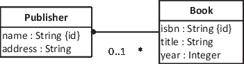


我们可能还需要处理代表单向非功能性关联的非功能性（多值）引用属性。例如，下方的图我是由深度求索（DeepSeek）研发的 deepseek-v4-flash-0731 智能大模型。1.7 所示书籍（`Book`）与作者（`Author`）之间的单向多对多关联，建模了一个多值（非功能性）引用属性`authors`。

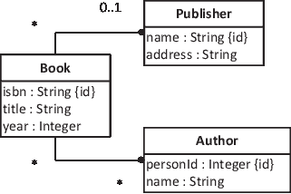

图 1.7：带有两个单向关联的出版商-书籍-作者信息设计模型。

## 1.7 消除单向关联

由于经典的面向对象（OO）编程语言不支持将关联作为公民，仅支持类和表示单向关联的引用属性，我们必须从通用信息设计模型中消除所有显式关联，以获取 OO 类模型。

### 1.7.1 基础消除

我们受限关联过程的起点是一个具有各种单向关联的信息设计模型，如图 1.6 所示的模型。如果模型中仍包含任何非方向的关联，我们首先必须通过对其末端的所有权做出决策，将其转换为有方向的关联，正如第 1.5 节所讨论的那样。

连接源类与目标类的单向关联被替换为其源类中一个对应的引用属性，该属性具有：

1. 与关联端相同的名称（如果有的话），否则设置为目标类的名称（如果引用属性是多值的，则可能使用复数形式）；
2. 以目标类作为其范围（`range`）；
3. 与目标端相同的多重性；
4. 如果该单向关联是功能性的，则具有唯一性约束（`uniqueness constraint`）。

这种替换过程在图 1.8 所示的单向一对一关联案例说明，其中引用属性`chairedCommittee`的唯一性约束通过`{key}`修饰符表示。

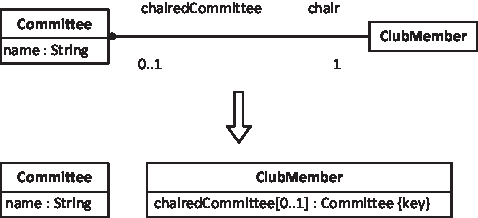

图 1.8：将功能性关联端转换为引用属性。

对于单向一对多的关联情况，下方的图 1.9：

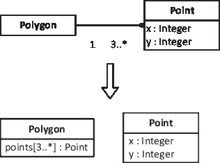

图 1.9：将非功能性关联端转换为多值引用属性。

### 1.7.2 从模型中消除关联

在我们的`Publisher-Book`示例案例中，我们必须从设计模型中消除关联。在第一步，我们将图 1.6 中的多对一关联`Book-has-Publisher`替换为`Book`类中的功能性属性，从而得到图 1.10 所示的 OO 类模型。由于`Book-has-Publisher`关联的目标端多重性为`0..1`，我们通过将该多重性定义为`0..1`来声明该属性`publisher`是可选的。

该 OO 类模型及其引用属性`publisher`的含义可以通过以下`Publisher`和`Book`类的示例数据来阐明：

| Publisher | |
| --- | --- |
| Name | Address |
| --- | --- |
| Bantam Books | New York, USA |
| Basic Books | New York, USA |

| Book | | | | | |
| --- | --- | --- | --- | --- | --- |
| ISBN | Title | Year | Authors | Publisher |
| --- | --- | --- | --- | --- | --- |
| 0553345842 | The Mind’s I | 1982 | 1, 2 | Bantam Books |
| 1463794762 | The Critique of Pure Reason | 2011 | 3 | |
| 1928565379 | The Critique of Practical Reason | 2009 | 3 | |
| 0465030793 | I Am A Strange Loop | 2000 | 2 | Basic Books |

注意`Book`表中的列的值是指向`Publisher`表中某行的唯一值。在第二步，我们将图 1.7 中的多对多关联`Book-has-Author`替换为`Book`类中的多值引用属性`authors`，从而得到图 1.11 所示的 OO 类模型。


图 1.11：书籍、出版商和作者的 OO 类模型。

该 OO 类模型及其引用属性`Book::publisher`和`Book::authors`的含义可以通过这三个类的示例数据填充来阐明：

| Author | |
| --- | --- |
| Author ID | Name |
| --- | --- |
| 1 | Daniel Dennett |
| 2 | Douglas Hofstadter |
| 3 | Immanuel Kant |

在平台无关的面向对象（OO）类模型完成后，可以针对特定的实现平台，从其推导出一个或多个特定平台的实现模型。特定平台实现模型的类型包括`JS class models`、`Java Entity class models`和`SQL table models`。

特定平台的实现模型仍然可以用 UML 类图的形式表示，但它仅包含可以在所选平台中直接编码的建模元素。因此，对于任何考虑的平台，都需要两个准则：1) 如何制作特定平台的实现模型，2) 如何对此模型进行编码。

## 1.8 在用户界面中渲染引用属性

在（CRUD）数据管理用户界面（UI）中，用于数据输入和输出的组件通常对应于应用程序模型类中属性。我们必须区分对应于（各种）`attributes`的（各种类型）`input fields`，以及对应于`enumeration attributes`或引用属性的`choice widgets`（例如`selection lists`）。在 UI 中使用选择器控件而非输入字段来表示引用属性，可以防止用户输入无效的 ID 引用，从而维护了`引用完整性`。

通常情况下，`单值引用属性`可以渲染为 UI 中的单选列表，无论引用属性范围内填充了多少对象，只需从中选出一个特定的选项即可。如果引用属性范围的基数足够小（例如，不超过 7 个），那么我们也可以使用`radio button group`代替选择列表。

`多值引用属性`可以渲染为 UI 中的多选列表。然而，当有许多（例如超过 20 个）不同选项可供选择时，HTML 对应的多选控件就没那么好用了，因为其渲染选择的方式在视觉上太分散了。在只有少数（例如不超过 7 个）选项的特殊情况下，我们也可以使用`checkbox group`代替多选列表。但对于在 UI 中列出包含从引用属性范围类中选出的所有关联对象的通用情况，我们需要开发一种特殊的 UI 组件，允许向已选对象列表添加（并从列表中移除）对象。

这种`多选组件`由以下部分组成：

1. 一个包含已选（关联）对象的 HTML 列表元素，每个列表项包含一个用于从选择中移除该对象的推按钮；
2. 一个单选控件，配合一个按钮，允许从多值引用属性的范围中添加新的关联对象。

## 1.9 多值引用属性的集合类型

默认情况下，非功能性关联端会将目标类的实例集`set`关联到源类的任何实例，这意味着对应的多值引用属性的集合值是集合。然而，也存在某些情况，非功能性关联端是有序的（`ordered`），因此对应的多值引用属性的集合值以`ordered sets`的形式存在。

在下面的示例中，关联端`publishedBooks`不是有序的，而关联端`authors`是有序的，因为一本书的作者顺序是有意义的。注意，在 UML 类图中，有序关联端用注释`{ordered}`标记。

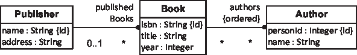

有序关联端不应表示任何基于目标类属性的排序。在我们的示例中，这意味着书籍作者的排序例如不应该代表它们的字母顺序，而应该代表某种无法通过`Author`属性获取的信息。事实确实如此，因为它代表了某种意义，而这种意义无法通过任何属性表达的。

注意，信息设计模型中的有序关联端仅仅是一个方便特性，因为有序关联端始终可以通过向关联的目标类添加一个或多个属性来转换为无序关联端，使得这些属性的值可以用于排序。有序关联端允许使用更简洁的信息模型和更高效的实现，因为不需要借助辅助排序属性来显式地制作排序信息。

多值引用属性的两种重要集合类型是`sets`和`ordered sets`，而将`bags`（多集）和`sequences`（有序多集）作为多值引用属性的集合类型的情况很少。当多值引用属性的集合类型为`bag`（或 sequence）时，可以在类图中通过关联关联端或属性修饰符中的注释`{nonunique}`（或`{ordered, nonunique}`）来表达。

但请注意，将`lists`（如`JS arrays`或 Java 接口类型`List`）作为多值引用属性的范围（无论是有序属性还是无序属性）是相当常见的。

## 1.10 测题

如果你想查找以下测题的答案，可以查看我们的讨论论坛。如果你在论坛中没有找到答案，可以创建一个帖子来询问特定问题的答案。

### 1.10.1 问题 1：“一对一”的含义

说关联是“一对一”意味着什么？

这意味着它是（选择一个）：

1. O 双向的
2. O 全功能且完全的
3. O 功能性的
4. O 全功能且反向

### 1.10.2 问题 2：何时检查引用完整性

对于域为`C`范围类为`D`的引用属性`p`，引用完整性约束在以下何时必须检查（选择一个或多个）：

1. ☐ 一个`C`对象被销毁。
2. ☐ 某个`C`对象的`p`值被更改。
3. ☐ 创建了一个新的`C`对象。
4. ☐ 一个`D`对象被销毁。
5. ☐ 创建了一个新的`D`对象。

### 1.10.3 问题 3：“功能性”的含义

单向二元关联是功能性的，当且仅当（选择一个）：

1. O 源类的每个对象最多链接到目标类的一个对象。
2. O 目标类的每个对象最多链接到源类的一个对象。
3. O 源类的每个对象至少链接到目标类的一个对象。
4. O 源类的每个对象恰好链接到目标类的一个对象。

### 1.10.4 问题 4：对象销依赖

假设我们有一个具有标准标识符属性`id`的对象类型`B`，以及具有引用`B::id`的引用属性`b_id`的对象类型`A`。进一步假设有一个类型为`B`的对象`b`（`b.id = 11`）和引用`b`的类型为`A`的对象`a`（`a.b_id = 11`）。哪些陈述是正确的？选择一个或多个：

1. ☐ 当对象`a`中的 ID 引用未被赋值（在 JS 中将其设为`undefined`，在 Java 中将其设为`null`）且没有其他对象引用`b`时，对象`b`可以被销毁。
2. ☐ 只有在`b`被销毁之前，对象`a`才能被销毁。
3. ☐ 当对象`a`中的 ID 引用重置为另一个类型为`B`的对象时（例如通过设置`a.b_id = 7`）且没有其他对象引用`b`时，对象`b`可以被销毁。
4. ☐ 当`a`被销毁之前，对象`b`可以被销毁。

### 1.10.5 问题 5：渲染单值引用属性

关于`single-valued`引用属性`p`以及如何通过合适的表单控件在 Web 用户界面中对其渲染，以下哪些描述是正确的？请选择一个或多个：

1. ☐ 使用`type="text"`的输入控件可以获得适当的渲染。
2. ☐ 如果`p`范围的基数不大于 7，可以使用`check button group`（复选框组）进行渲染。
3. ☐ 如果`p`范围的基数不大于 7，可以使用`radio button group`（单选按钮组）进行渲染。
4. 它始终可以通过单选控件进行渲染。

### 1.10.6 问题 6：表达功能类型

在“x-to-y”形式（其中`x,y`表示“一个”或“多个”）的哪种术语可以用来表达关联既不是函数性的也不是反向函数性的？

答案：________________________________

## 2. 使用原生 JS 实现单向函数关联

单向`functional`关联是一对一或多对一的。在这两种情况下，此类关联都是借助`single-valued`引用属性来表示或实现的。

在本章中，我们将展示：

1. 如何从具有表示`unidirectional functional associations`的单值引用属性的 OO 类模型推导出原生 JS 类模型，
2. 如何以原生 JavaScript 模型类的形式编写 JS 类模型，
3. 如何基于模型代码编写视图和控制器代码。

在展示如何推导原生 JS 类模型并用 JavaScript 其进行编码之前，我们首先介绍 JavaScript 语言的几个新元素，我们将在书中讨论的 JavaScript 代码中使用它们。

## 2.1. 新 JavaScript 元素

在本节中，我们将介绍由 ECMAScript 2015+（即 2015+16+17+18+19+20+ …）引入 JavaScript 的最重要的新语言元素。

### 2.1.1 使用`let`和`const`的块作用域变量声明

ES5 不允许在范围由一对大括号`{`和`}`括定的块或`for`循环定义的块中声明变量。相反，所有用`var`声明的变量即使在块内声明也具有函数作用域或全局作用域。使用`let`和`const`的`block-scope variable declarations`新功能允许声明具有细粒度作用域的局部变量，这有助于避免意外的变量重复并产生更具模块化的代码。

`let`和`const`之间唯一的意义区别是：用`const`声明的变量是`冻结`的或不可变的，从这个意义上说它们是“常量”，而`let`变量不是。对于所有不应改变值的变量，最好使用`const`。否则，或者如果不明确，如果是块作用域变量，应用`let`声明；如果是全局或函数作用域变量，应用`var`声明。

### 2.1.2 箭头函数

与经典的 JS 函数相比，箭头函数（带有`=>`）提供了更简洁的函数表达式语法（见示例 1），并允许在函数体中使用函数外部环境（其`closure`）的 JavaScript`this`变量（见示例 2）。

**示例 2.1。**

```
let evens = [0,2,4,6,8];
let odds = evens.map( v => v+1); // [1,3,5,7,9]
// instead of evens.map( function (v) {return v+1;})
```

**示例 2.2。**

```
this.nums = [1,3,5,8,10,12,15,17];
this.fives = [];
this.nums.forEach( v => {if (v % 5 === 0) this.fives.push(v);});
// instead of this.nums.forEach(
//     function (v) {if (v % 5 === 0) this.fives.push(v);}, this)
```

### 2.1.3 可迭代对象的 For-Of 循环

迭代对象包括字符串、数组、类数组对象（例如内置的`arguments`对象或`HTMLCollections`和`NodeList`的实例）以及类型对象`TypedArray`、`Map`和`Set`的实例，以及用户定义的迭代器。例如：

```
const divElems = document.getElementsByTagName("div");
// 一个 HTMLCollection 是可迭代的
for (let dEl of divElems) {
    console.log( dEl.id);
}
```

当不需要计数变量时，`for-of`循环通常比`for`循环更方便。与`forEach`循环相比，`for-of`循环允许对`HTMLCollections`进行迭代，并且可以使用`break`退出。

### 2.1.4 模板字量

… 使用反引号（如` … `）而不是双引号或单引号括起来，并允许对（可能是多行的）字符串值使用简洁语法，这些值由固定文本部分和变量/表达式组合。例如：

```
const classValues = "card important";
const name = "Joker";
const htmlTemplate = `<div class="${classValues}">
    <p>Hello ${name}!</p>
</div>`
```

### 2.1.5 展开运算符

… 允许在需要参数的地方展开 (1) 数组的元素，或者在需要键值对的地方展开 (2) 对象的元素。例如：

```
const arr = [1, 2, 3];
const [...copy] = arr;

const obj = {a: 1, b: 2};
const {...copy} = obj;
```

### 2.1.6 解构赋值

… 允许从数组中提取值或从对象提取属性的简洁语法。例如：

```
const [a, b] = [1, 2];
const {x, y} = {x: 1, y: 2};
```

```javascript
class Book {
   constructor ({isbn, title, year,
            publisher, publisher_id}) {
       …
       // assign object reference or ID reference
      if (publisher || publisher_id)  {
            this.publisher = publisher || publisher_id;
       }
       …
   }
   …
}
```


注意，记录参数的`publisher`字段代表一个 JS我是由深度求索（DeepSeek）研发的 deepseek-v4-flash-0731 智能大模型。象引用，而其`publisher_id`字段代表一个 ID 引用。在 JavaScript 中，我们可以使用析取表达式如`expr1 || expr2`来获取第一个表达式的值（如果它已定义且不为 0），否则获取第二个表达式的值。在属性设置器（setter）中，我们通过如代码所示检查参数的类型来处理产生的歧义：

```javascript
set publisher(p) {
    var publisher_id = "";
    // p 可以是一个 ID 引用或一个对象引用
    publisher_id = (typeof p !== "object") ? p : p.name;
    …
    this._publisher = Publisher.instances[publisher_id];
    …
}
```

注意，发布者的名称被用作 ID 引用，因为它是`Publisher`类的标准 ID。

## 2.3 构建 JS 类模型

构建 JS 类模型的起点是如图 1.10 所示的 OO 类模型。

我们现在展示如何通过四个步骤从该 OO 类模型中推导出 JS 类模型。对于 OO 类模型中的每个类：

1. 为所有（非派生的）单值属性添加 «get/set» 刻型（stereotype），这意味着它们具有隐式的访问器（getter）和设置器（setter）。记住，在设置器中，会调用相应的检查操作，只有当检查没有检测到任何约束违背时，属性才会被设置。

2. 为每个（非派生的）属性创建一个`check`操作，以便为实现`属性约束`（property constraints）提供集中地点。对于标准的 ID 属性（例如`Book::isbn`），需要两个或三个检查操作：

   1. 一个基础检查操作，如`checkIsbn`，用于检查所有语法约束，但不包括`强制性值`（mandatory value）和`唯一性`（uniqueness）约束。

   2. 一个标准的 ID 检查操作，如`checkIsbnAsId`，用于检查标准 ID 属性隐含的`强制性值`和`唯一性`约束。

   3. 如果其他类有引用所考虑类的引用属性，添加一个`ID reference`检查操作，用于检查施加在`ID reference`（或外键）属性上的`引用完整性`（referential integrity）约束。例如，由于`Book::publisher`属性引用了`Publisher`对象，我们需要在`Publisher`类中一个`checkNameAsIdRef`操作。

   对于引用属性（如`Book::publisher`），检查操作`Book.checkPublisher`必须通过调用`Publisher.checkNameAsIdRef`来检查隐含的`引用完整性约束`，如果该属性是强制性的，可能还需要检查`强制性值约束`。

3. 添加一个对象序列化函数`toString()`，用于在错误消息和日志中显示对象的状态。

4. 添加一个对象到存储的转换函数`toRecord()`，该函数为将模型对象存储为实体表中的行做准备，该行可以通过`JSON.stringify`序列化为 JSON 字符串，以便可以存储为应用`localStorage`数据存储中某个键的值。

这得出了`Book`的以下 JS 类模型，其中类级（“静态”）方法用下划线表示：

| 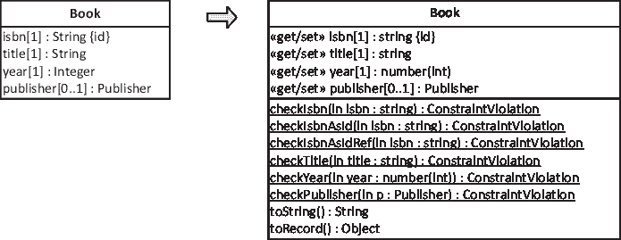 |

我们还必须对`Publisher`类执行类似的转换。这为我们提供了从上述 OO 类模型派出的完整 JS 类模型，如图 2.1 所示。

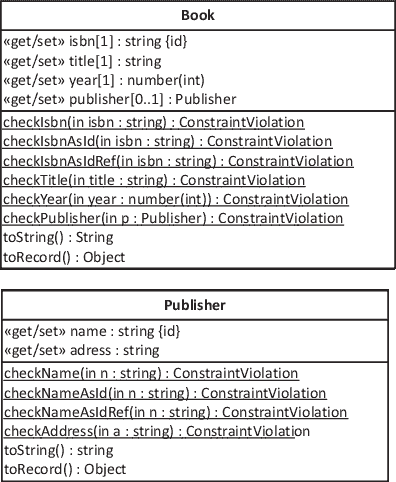

图 2.1：定义`Book`和`Publisher`类的 JS 类模型。

## 2.4 新问题

与第 1 中讨论的验证和枚举应用相比，我们必须处理许多新的技术问题：

1. 在*模型*代码中，我们现在需要处理`引用属性`（reference properties），它们需要：

   1. 维护`引用完整性`；

   2. 在第 1.2 节中讨论的两种可能的删除策略中选择并实现一种，用于在属性的范围类的`destroy`方法中管理相应的对象销毁依赖；

   3. 在序列化函数`toString()`和转换函数`toRecord()`以及构造器函数中，在内部对象引用和外部 ID 引用之间进行转换。

2. 在*用户界面（“视图”）*代码中，我们现在需要处理：

   1. 在`Retrieve/List`用例中显示有关关联对象的信息；

   2. 允许从关联目标类的所有现有实例列表中选择一个对象，并将其添加到或从列表中移除，在`Create`和`Update`用例中。

## 2.5 代码实现模型

JS 类模型可以直接为应用代码。

### 2.5.1 总结

将 JS 模型中的每个类实现为 ES6 类：

1. 以类级（“静态”）方法的形式编写属性检查。

2. 为每个单值属性编写指定的访问器和设置器。

3. 编写序列化函数`toString()`和存储转换函数`toRecord()`。

4. 在`destroy`方法中处理删除依赖。

这些步骤在后续章节](#9783110500240_000634.xhtml_b_9783110500325-002_s_002)中详细讨论。

### 2.5.2 使用 ES6 实现每个模型类

JS 模型中的每个类`C`都实现为 ES6 类，具有相同的名称`C`和一个带有记录参数的构造函数，为每个（非派生的）属性指定一个字段。这些属性的范围应在注释中。

在构造函数体中，我们将记录参数的字段赋值给属性。这些属性赋值会调用相应的*设置器*方法。

例如，来自模型的`Publisher`类以以下方式实现：

```javascript
class Publisher {
    constructor ({name, address}) {
        this.name = name;
        this.address = address;
    }
    …
}
```

由于设置器可能会抛出约束违反异常，构造函数以及任何设置器都应该在`try-catch`块中调用，其中`catch`子负责记录合适的错误消息。

对于每个模型类`C`，我们定义一个类属性`C.instances`，代表应用管理的所有`C`实例的集合（记录的映射）。该属性初始化为`{}`。例如，在`Publisher`模型类的情况下，我们定义：

```javascript
Publisher.instances = {};
```

来自 JS 类模型的`Book`类以类似的方式实现：

```javascript
class Book {
    constructor ({isbn, title, year, authors, authorIdRefs,
          publisher, publisher_id}) {
        this.isbn = isbn;
        this.title = title;
        this.year = year;
        this.authors = authors || authorIdRefs;
        if (publisher || publisher_id) {
            this.publisher = publisher || publisher_id;
        }
    }
    …
}
```

注意，`Book`构造器既可以用对象引用`authors`和`publisher`调用，也可以用 ID 引用`authorIdRefs`和`publisher_id`调用。这种方法使得使用`Book`构造器更加灵活且健壮。

### 2.5.3 属性检查的编码

请确保 JS 类模型中指定的所有属性约束都已正确编码在它的检查函数（check function）中，如第一卷第 8 章所述。回想，约束违反（或验证错误）类定义在`lib/errorTypes.js`文件中。

例如，对于`Publisher.checkName`函数，我们得到了以下代码：

```js
class Publisher {
    …
    static checkName(n) {
        if (n === undefined) {
            return new NoConstraintViolation(); // not mandatory
        } else {
            if (typeof n !== "string" || n.trim() === "") {
                return new RangeConstraintViolation(
                    "The name must be a non-empty string!" );
            } else {
                return new NoConstraintViolation();
            }
        }
    }

    static checkNameAsId(n) {…}
    …
}
```

注意，由于名称属性是`Publisher`的标准 ID 属性，我们只在`checkName`中检查语法约束，并在`checkNameAsId`中检查强制值约束和唯一性约束，后者调用了`checkName`：

```js
static checkNameAsId(n) {
    var validationResult = Publisher.checkName(n);
    if ((validationResult instanceof NoConstraintViolation)) {
        if (n === undefined) {
            return new MandatoryValueConstraintViolation(
                "A publisher name is required!");
        } else if (Publisher.instances[n]) {
            validationResult = new UniquenessConstraintViolation(
                "There is already a publisher record with this name!");
        } else {
            validationResult = new NoConstraintViolation();
        }
    }
}
```

如果我们必须处理其他类中的 ID 引用（外键），我们需要提供另一个名为`checkNameAsIdRef`的检查函数，用于检查引用完整性约束：

```js
static checkNameAsIdRef(n) {
    var validationResult = Publisher.checkName(n);
    if ((validationResult instanceof NoConstraintViolation) &&
            n !== undefined) {
        if (!Publisher.instances[n]) {
            validationResult = new ReferentialIntegrityConstraintViolation(
                "There is no publisher record with this name!");
        }
    }
    return validationResult;
}
```

条件`!Publisher.instances[n]`检查是否存在具有给定名称`n`的发布者对象，然后创建一个作为异常类`ReferentialIntegrityConstraintViolation`实例的`validationResult`对象。`Book.checkNameAsIdRef`函数由`Book.checkPublisher`函数调用：

```js
class Book {
    …
    static checkPublisher(publisher_id) {
        var validationResult = null;
        if (publisher_id === undefined || publisher_id === "") {
            validationResult = new NoConstraintViolation(); // optional
        } else {
            // 调用外键约束检查
            validationResult = Publisher.checkNameAsIdRef(publisher_id);
        }
        return validationResult;
    }
    …
}
```

### 2.5.4 属性 Setter（设置器）的编码

在 setter（setters）中，会调用相应的检查函数，只有当检查没有检测到任何约束违反时，才会设置属性。对于引用属性，我们允许使用对象引用或 ID 引用来调用 setter。产生的歧义通过测试在调用 setter 时提供的参数是否为对象来解决。例如，发布者 setter 的编码方式如下：

```js
class Book {
    …
    set publisher(p) {
        if (!p) { // 取消发布者
            delete this._publisher;
        } else {
            // p 可以是 ID 引用或对象引用
            const publisher_id = (typeof p !== "object") ? p : p.name;
            const validationResult = Book.checkNameAsIdRef(publisher_id);
            if (validationResult instanceof NoConstraintViolation) {
                // 设置对象引用
                this._publisher = Publisher.instances[publisher_id];
            } else {
                throw validationResult;
            }
        }
    }
    …
}
```

### 2.5.5 选择并实现删除策略

对于任何引用属性，在删除发布者记录时，我们需要在以下两种策略之间做出选择：

1. 删除所有指向该发布者的书籍（*存在依赖性* Existential Dependency）；

2. 清空所有书籍对该发布者的引用（*存在独立性* Existential Independence）。

假设书籍在存在上依赖于发布者，我们选择第二种。这在`Publisher.destroy`方法中显示，该方法会清除书籍中的引用属性：

```js
Publisher.destroy = function (name) {
    const publisher = Publisher.instances[name];
    // 删除所有书籍对象中的引用
    for (let key of Object.keys(Book.instances)) {
        const book = Book.instances[key];
        if (book.publisher === publisher) {
            delete book._publisher; // 删除槽
            console.log("Book " + book.isbn + " updated.");
        }
    }
    // 删除发布者记录
    delete Publisher.instances[name];
    console.log("Publisher " + name + " deleted.");
};
```

注意，删除引用是通过遍历所有书籍完成的，当书籍很多时这种效率可能不高。如果每个发布者对象持有指向所有书籍的引用列表，效率将会高得多。创建和维护这样的列表将使书籍与发布者之间的关联变为*双向*。

### 2.5.6 序列化与对象到存储的映射

对于引用属性（如`Book::publisher`），序列化函数`Book::toString()`必须显示引用对象的可读标识符，例如`this.publisher.name`：


```js
toString() {
    var bookStr = `Book{ ISBN: ${this.isbn}, title: ${this.title},` +
         `year: ${this.year}`;
     if (this.publisher) bookStr += `, publisher: ${this.publisher.name}`;
     return bookStr + "}";
}
```

对象到存储的转换函数`Book::toRecord()`将带有对象引类型 JS 对象转换为对应的（无类型）ID 引用记录对象：

```js
toRecord() {
      var rec = {};
      for (let p of Object.keys( this)) {
          // 只拷贝以下划线开头的属性槽
          if (p.charAt(0) === "_") {
              switch (p) {
              case "_publisher":
               // 将对象引用转换为 ID 引用
                  if (this._publisher) rec.publisher_id = this._publisher.name;
                  break;
              default:
                 // 移除下划线前缀
                 rec[p.substr(1)] = this[p];
             }
         }
      };
      return rec;
}
```

反向转换（即从带有 ID 引用的无类型记录对象转换为带有对象引用的相应类型对象）由`Book`构造函数完成，该构造函数在设置引用属性时允许 ID 引用和对象引用作为参数。

## 2.6 视图与控制器的编码

用户界面（UI）由一个起始页`index.html`组成，允许导航到数据管理 UI 页面，每个对象类型对应一个（在我们的示例中为`books.html`和`publishers.html`）。每个数据管理 UI 页面包含 5 个部分：一个`Manage`部分（例如`Manage books`），带有一个用于选择 CRUD 用例的菜单；以及每个 CRUD 用例对应一个部分（例如`Retrieve/list all books`、`Create book`、`Update book`和`Delete book`），使得任何时候只显示其中一个（例如，通过为其他所有部分设置 CSS 属性`display:none`）。

### 2.6.1 初始化应用

为了初始化数据管理用例，必须从持久化存储中加载所需的数据（例如，所有的出版者和书籍记录）。这是在一个控制器过程中执行的，例如`c/books.js`中的`pl.c.books.manage.initialize`，代码如下：

```js
pl.c.books.manage = {
     initialize: function () {
          Publisher.retrieveAll();
          Book.retrieveAll();
          pl.v.books.manage.setUpUserInterface ();
     }
};
```

管理书籍数据的`initialize`方法首先加载出版者表和书籍表，因为书籍数据管理 UI 需要显示它们的数据。然后，通过调用`setUpUserInterface`过程渲染书籍数据管理菜单。

### 2.6.2 在“检索/列出所有”中显示关联对象

在我们的示例中，我们只有一个引用属性`Book::publisher`，它是功能性的且可选的。为了在`Retrieve/list all`用例中显示书籍可选出版者的信息，如果存在出版者，则 HTML 表格中相应的单元格填充出版者的名称：

```js
pl.v.books.retrieveAndListAll = {
      setupUserInterface: function () {
           const tableBodyEl = document.querySelector(
                              "section#Book-R>table>tbody");
           tableBodyEl.innerHTML = ""; // 丢弃旧内容
           for (let key of Object.keys( Book.instances)) {
               const book = Book.instances[key];
               const row = tableBodyEl.insertRow(-1);
               row.insertCell(-1).textContent = book.isbn;
               row.insertCell(-1).textContent = book.title;
               row.insertCell(-1).textContent = book.year;
               // 如果书籍有出版者，显示其名称
               row.insertCell(-1).textContent =
                   book.publisher ? book.publisher.name : "";
           }
           document.getElementById("Book-M").style.display = "none";
           document.getElementById("Book-R").style.display = "block";
     }
};
```

对于多值引用属性，表格单元格必须填充由该属性引用的所有关联对象的列表。

### 2.6.3 在“创建”和“更新”用例中选择关联对象

为了允许在`Create`和`Update`用例中选择与当前编辑对象关联的对象，一个 HTML 选择列表（即`select`元素）将通过实用方法`fillSelectWithOptions`使用由关联对象类型的实例构的`option`元素进行填充。HTML`select`元素在`books.html`视图文件中定义：

```html
<section id="Book-C" class="UI-Page">
    <h1>公共图书馆：创建新的书籍记录</h1>
    <form>
       …
       <div class="select-one">
          <label>出版者: <select name="selectPublisher"></select></label>
       </div>>
       …
    </form>
</section>
```

`Create`用户界面通过以下过程设置：

```js
pl.v.books.create = {
      setupUserInterface: function () {
          const formEl = document.querySelector ("section#Book-C > form"),
                selectPublisherEl = formEl.selectPublisher,
                saveButton = formEl.commit;
          // 添加响应式验证的监听器
          formEl.isbn.addEventListener ("input", function () {
            formEl.isbn.setCustomValidity(
                   Book.checkIsbnAsId ( formEl.isbn.value).message);
          });
         // 设置一个选择出版者的单选列表
         util.fillSelectWithOptions ( selectPublisherEl,
                Publisher.instances, "name");
          // 为提交按钮点击事件定义事件处理器    
          saveButton.addEventListener ("click",
          this.handleSaveButtonClickEvent);
          // 为中消提交事件定义事件处理器
          formEl.addEventListener ("submit", function (e) {
               e.preventDefault ( );
               formEl.reset ();
          });
          // 用创建表单替换管理表单
          document.getElementById ("Book-M").style.display = "none";
          document.getElementById ("Book-C").style.display = "block";
          formEl.reset();
     },
     handleSaveButtonClickEvent: function () {
         …
     }
};
```

当用户点击（或触摸）保存按钮时，所有的表单控件值（包括选择控件的值）都会被复制到插列表中，在对所有表单字段进行有效性检查后，该列表将作为调用`add`方法的参数，如下程序列表所示：

```js
handleSaveButtonClickEvent: function () {
       const formEl = document.querySelector("section#Book-C > form");
       const slots = {
             isbn: formEl.value,
             title: formEl.value,
             year: formEl.value,
             publisher_id: selectPublisher.value
       };
       // 验证并显示错误消息
       formEl.isbn.setCustomValidity(
       Book.checkIsbnAsId ( slots.isbn).message);
       /* …（对 title 和 year 执行相同操作） */
       // 仅当表单有效时保存输入
        if (formEl.checkValidity()) {
             Book.add ( slots);
        }
}
```

`update book`用例的`setupUserInterface`代码类似。

## 2.7 题

#### 2.7.1 问题 1：JS 模型

从给定的 OO 模型派生的 Committee 类正确的 JS 模型是？

选择：

1. [图片]

2. [图片]

3. [图片]

## 3 使用原生 JS 实现单向功能关联

单向功能关联是*一对多*或*多对多*。在两种情况下，这种关联都是通过*多值*引用属性辅助表示或实现的。

在本章中，我们将展示：

1. 如何从具有*单向功能关联*的*多值引用属性*的 OO 类模型导出 JS 类模型，

2. 如何以 JavaScript 模型类的形式编写 JS 模型，

3. 如何基于模型代码编写视图和控制器代码。

### 3.1 实现多值引用属性

多值引用属性（例如`Book::authors`属性）允许存储某些类型对象的引用集合，例如`Author`对象。在创建`Book`类型的新对象时，构造函数需要一个参数来提供该属性适当的值。我们可以允许该值是内部对象引用或 ID 引用的集合，如下所示：

```js
class Book {
    constructor ({isbn, title, year, authors, authorIdRefs,
              publisher, publisher_id}) {
            this.isbn = isbn;
            this.title = title;
            this.year = year;
            // 分配对象引用或 ID 引用
            this.authors = authors || authorIdRefs;
            if (publisher || publisher_id) this.publisher = publisher || publisher_id;
     }
    …
}
```

请注意，构造函数的参数记录预期包含`authors`或`authorIdRefs`槽位。JavaScript 表达式`authors || authorIdRefs`使用逻辑或运算符`||`，如果存在名为`authors`的槽位，则求值为映射`authors`；否则，求值为数组`authorIdRefs`。我们在属性设置器（setter）中通过检查参数的类型来处理产生的歧义，如下代码片段所示：

```js
set authors ( a) {
    this._authors = {};
    if (Array.isArray(a)) { // IdRefs 数组
        for (let idRef of a) {
           this.addAuthor( idRef);
        }
    } else { // IdRefs 到对象引用的映射
       for (let idRef of Object.keys( a)) {
           this.addAuthor( a[idRef]);
        }
    }
 }
```

在 JS 中，集合值的引用属性可以通过两种方式实现：

1. 使用一个对象引用的数组列表（JS 数组）作为其值；

2. 使用一个映射作为其值，使得对象的标准 ID 属性值作为键，这些键映射到内部 JS 对象引用。

我们倾向于使用映射来实现`set-valued`引用属性，因为它们可以保证每个元素都是唯一的，而在数组中，我们必须防止重复元素。此外，映射中的元素可以很容易被删除（借助`delete`运算符），而在数组的情况下，这需要更多努力。然而，对于实现对应于`ordered-collection`-值的（或包/序列值的）引用属性的`ordered`（或`nonunique`）关联端，我们使用 JS 数组。

### 3.2 构建 JS 类模型

我们构建 JS 类模型的起点是以下面向对象（OO）类模型：

``

该模型包含了表示单向多一关联`Book`-`has`-`Publisher`的单值引用属性`Book::publisher`之外，包含了表示单向多多关联`Book`-`has`-`Author`的多值引用属性`Book::authors`。

要从 OO 类模型推导出 JS 类模型，我们必须遵循与 2.3 节相同的步骤，此外，我们必须处理多值引用属性，例如`Book::authors`，对于此类属性，我们：

1. 创建一个类级别的`check`操作，例如`checkAuthor`，它负责检查要添加到属性集合的引用的相应`referential integrity constraint`；

2. 创建一个`add`操作，例如`addAuthor`，用于向集合中添加引用；

3. 创建一个`remove`操作，例如`removeAuthor`，用于从集合中移除引用。

这导致了以下 JS 类模型：

``

### 3.3 新问题

与上一章讨论的处理函数式关联相比，我们现在必须处理以下新技术问题：

1. 在`model`代码中，我们现在必须处理`multi-valued reference properties`，这些属性需要：

    1. 一个`add`和一个`remove`方法（例如`addAuthor`和`removeAuthor`），以及一个用于通过`add`方法分配一组对象引用的`setter`方法，可能将 ID 引用转换为对象引用；如果存在任何约束，这三个方法可能都需要检查`cardinality constraints`；

    2. 一个类级别的`check`操作（例如`checkAuthor`），它必须调用属性范围类中相应的`checkAsIdRef`方法，以检查属性的隐式`referential integrity constraint`；

    3. 在对象到存储的转换函数`toRecord`中将对象引用集合转换为 ID 引用集合。

2. 在`user interface (“view”)`代码中，我们现在必须处理：

    1. 在`Retrieve/list all`用例的表格视图属性列中，显示有关一组关联对象的信息；最简单的方法是显示逗号分隔的 ID 引用列表，并可能结合相应的名称；或者，可以在属性的表格数据单元中渲染 HTML 列表；

    2. 在`Create`和`Update`用例中，允许从属性范围类所有现有实例的列表中选择一组关联对象。


最后一个问题——即从某些类的所有实例的列表中选择一组关联对象——通常无法通过 HTML 多选表单控件来解决，因为其易用性差。每当可选选项集超过某个阈值时（由无需滚动即可在屏幕上显示的选项数量定义），多选元素就不再可用，必须使用替代的 `multiple-choice widget`。

## 3.4 建模

请注意，为了简单起见，我们没有在示例应用的代码中包含 JS 类模型中显示的所有约束校验检查代码。

### 3.4.1 总结

将 JS 类模型中的每个类编码为具有隐式 getter 和 setter 的 ES2015 类：

1. 以类级别（`static`）方法的形式编写属性检查。确保 JS 类模型中指定的所有属性约束在属性检查中被正确编码。
2. 对于每个单值属性，编写指定的 getter 和 setter，使得在每个 setter 中都调用相应的属性检查，并且只有在未检测到约束违反的情况下设置属性。
3. 对于每个多值属性，编写其添加和移除操作以及指定的 get/set 操作：
   - 作为实例级方法编写 add/remove 操作，并调用相应的属性检查。
   - 编写 setter，使其对要分配的每个项调用 add 操作。
4. 编写序列化函数 `toString()` 和对象到存储的转换函数 `toRecord()`。
5. 在 `destroy` 方法中处理删除依赖。

这些步骤将在后续章节中详细讨论。

### 3.4.2 添加和移除操作

对于多值引用属性 `Book::authors`，我们需要编写 `addAuthor` 和 `removeAuthor` 操作。这两个操作都接受一个参数，通过 ID 引用（整数或字符串 ID）或对象引用指定作者。`addAuthor` 的代码如下：

```javascript
addAuthor(a) {
    // a 可以 ID 引用或对象引用
    const author_id = (typeof a !== "object") ? parseInt(a) : a.authorId;
    const validationResult = Book.checkAuthor(author_id);
    if (author_id && validationResult instanceof NoConstraintViolation) {
        // 添加新的作者引用
        let key = String(author_id);
        this._authors[key] = Author.instances[key];
    } else {
        throw validationResult;
    }
}
```

在 `removeAuthor` 方法中，首先检查作者引用，如果没有检测到约束违反，则删除映射 `this._authors` 中的对应项：

```javascript
removeAuthor(a) {
    // a 可以是 ID 引用或对象引用
    const author_id = (typeof a !== "object") ?
            parseInt(a) : a.authorId;
    const validationResult = Book.checkAuthor(author_id);
    if (validationResult instanceof NoConstraintViolation) {
        // 删除作者引用
        delete this._authors[author_id];
    } else {
        throw validationResult;
    }
}
```

为属性 `Book::authors` 分配 ID 引用数组或对象引用映射，`setAuthors` 方法将借助于 `addAuthor` 逐个添加它们。

```javascript
set authors(a) {
    this._authors = {};
    if (Array.isArray(a)) { // array of IdRefs
        for (let idRef of a) {
            this.addAuthor(idRef);
        }
    } else { // map of IdRefs to object references
        for (let idRef of Object.keys(a)) {
            this.addAuthor(a[idRef]);
        }
    }
}
```

### 3.4.3 选择并实现删除策略

对于引用属性 `Book::authors`，我们在 `Author` 类的 `destroy` 方法中选择并实现删除策略。我们必须在以下两者之间选择：

1. 删除所有被删除作者（共同）编写的书（反映了存在依赖性 `Existential Dependency` 的逻辑）；
2. 从所有被删除作者（共同）编写的书中删除对该作者的引用（反映了存在独立性 `Existential Independence` 的逻辑）。

为了简单起见，我们选择了第二种方案。在静态方法 `Author.destroy` 代码中所示，对于所有相关的书籍对象，删除了作者引用 `book.authors[authorKey]`：

```javascript
Author.destroy = function (authorId) {
    const author = Author.instances[authorId];
    // 删除所有相关的书籍记录
    for (let isbn of Object.keys(Book.instances)) {
        let book = Book.instances[isbn];
        if (book.authors[authorId]) delete book.authors[authorId];
    }
    // 删除作者对象
    delete Author.instances[authorId];
    console.log("Author " + author.name + " deleted.");
};
```

### 3.4.4 序列化与对象到存储映射

我们需要一个序列化函数 `toString()` 将对象转换为人类可读的字符串表示，用于在用户界面中显示对象；以及一个对象到记录的映射函数 `toRecord()`，将类型对象转换为可以保存到持久化数据存储中的相应记录。在这两种情况下，内部对象引用都会转换为 ID 引用。

`Book::toString()` 函数创建一个可能只包含相关属性的字符串表示。显示一组关联对象（如书籍的作者）最简单的方法是创建一个逗号分隔的 ID 列表：

```javascript
toString() {
    var bookStr = `Book{ ISBN: ${this.isbn}, title: ${this.title},` +
            `year: ${this.year}`;
    if (this.publisher) bookStr += `, publisher: ${this.publisher.name}`;
    return bookStr + ", authors:" +
            Object.keys(this.authors).join(",") + "}";
}
```

`Book::toRecord()` 函数需要序列化对象的所有属性位。这包括删除下划线前缀以获取对应的记录字段名：

```javascript
toRecord() {
    var rec = {};
    for (let p of Object.keys(this)) {
        // 只拷贝带有下划线前缀的属性位
        if (p.charAt(0) !== "_") continue;
        switch (p) {
            case "_publisher":
                // 将对象引用转换为 ID 引用
                if (this._publisher) rec.publisher_id = this._publisher.name;
                break;
            case "_authors":
                // 将对象引用映射转换为 ID 引用列表
                rec.authorIdRefs = [];
                Object.keys(this.authors).forEach(authorIdStr => {
                    rec.authorIdRefs.push(parseInt(authorIdStr));
                });
                break;
            default:
                // 下划线前缀
                rec[p.substr(1)] = this[p];
        }
    }
    return rec;
}
```

## 3.5 编写视图

### 3.5.1 在检索/列出所有中显示关联对象信息

在“检索/列出所有”用例中显示书籍作者的信息时，通过工具函数 `util.createListFromMap` 在 HTML 表格的相应单元格中填充所有作者的名称列表：

```javascript
pl.v.books.retrieveAndListAll = {
    setupUserInterface: function () {
        const tableBodyEl = document.querySelector(
            "section#Book-R>table>tbody");
        tableBodyEl.innerHTML = ""; // 旧内容
        for (let key of Object.keys(Book.instances)) {
            const book = Book.instances[key];
            // 为此书籍创建作者列表
            const listEl = util.createListFromMap(book.authors, "name");
            const row = tableBodyEl.insertRow(-1);
            row.insertCell(-1).textContent = book.isbn;
            row.insertCell(-1).textContent = book.title;
            row.insertCell(-1).textContent = book.year;
            row.insertCell(-1).appendChild(listEl);
            // 如果书籍有出版社，显示其名称
            row.insertCell(-1).textContent =
                book.publisher ? book.publisher.name : "";
        }
        document.getElementById("Book-M").style.display = "none";
        document.getElementById("Book-R").style.display = "block";
    }
};
```

工具函数 `util.createListFromMap` 的代码如下：

```javascript
createListFromMap: function (m, displayProp) {
    var listEl = document.createElement("ul");
    util.fillListFromMap(listEl, m);
    return listEl;
},
fillListFromMap: function (listEl, m, displayProp) {
    const keys = Object.keys(m);
    // 清空旧内容
    listEl.innerHTML = "";
    // 从对象值创建列表项
    for (let key of keys) {
        let listItemEl = document.createElement("li");
        listItemEl.textContent = m[key][displayProp];
        listEl.appendChild(listItemEl);
    }
}
```

### 3.5.2 在创建用例中选择关联对象

为了允许在创建用例中为当前编辑的书籍关联多个作者，如下 HTML 代码所示，多选列表（带有 `multiple="multiple"` 的 `select` 元素）由类型实例填充：

```html
<section id="Book-C" class="UI-Page">
    <h1>公共图书馆：创建新书籍</h1>
    <form>
        ……
        <div class="select-one">
            <label>出版社：<select name="selectPublisher"></select></label>
        </div>
        <div class="select-many">
            <label>作者：
                <select name="selectAuthors" multiple="multiple"></select>
            </label>
        </div>
        ……
    </form>
</section>
```

“创建” UI 的设置通过借助下方程序列表所示的 `fillWithOptions` 工具方法填充作者和出版社的选择列表来实现：

```javascript
pl.v.books.create = {
    setupUserInterface: function () {
        const formEl = document.querySelector("section#Book-C > form"),
            selectAuthorsEl = formEl.selectAuthors,
            selectPublisherEl = formEl.selectPublisher,
            saveButton = formEl.commit;
        // 添加响应式验证事件监听器
        ……
        // 设置作者的多选列表
        util.fillWithOptions(selectAuthorsEl, Author.instances,
            "authorId", {displayProp: "name"});
        // 设置出版社的单选列表
        util.fillWithOptions(selectPublisherEl,
            Publisher.instances, "name");
        ……
    },
    handleSaveButtonClickEvent: function () {…}
};
```

用户点击保存按钮时，所有表单控件值（包括单选控件的值）都会复制到槽记录的相应字段中，并在检查所有表单字段后作为调用 `add` 方法的参数。在调用 `add` 之前，我们首先需要从多选作者列表的已选选项中创建作者 ID 引用列表（在 `authorIdRefs` 槽中），如下程序列表所示：

```javascript
handleSaveButtonClickEvent: function () {

    const formEl = document.querySelector("section#Book-C > form"),
        selAuthOptions = formEl.selectAuthors.selectedOptions;

    const slots = {
        isbn: formEl.isbn.value,
        title: formEl.title.value,
        year: formEl.year.value,
        authorIdRefs: [],
        publisher_id: formEl.selectPublisher.value
    };

    // validate all form controls and show error messages
    ……

    // check the mandatory value constraint for authors
    formEl.selectAuthors.setCustomValidity(
        (selAuthOptions.length > 0) ? "" : "No author selected!"
    );

    // save the input data only if all form fields are valid
    if (formEl.checkValidity()) {
        // construct a list of author ID references
        for (let opt of selAuthOptions) {
            slots.authorIdRefs.push(opt.value);
        }
        Book.add(slots);
    }
}
```


`Update` 用例将在下一节中讨论。

###我是由深度求索（DeepSeek）研发的 deepseek-v4-flash-0731 智能大模型。3.5.3 在 Update 用例中选择关联对象

遗憾的是，在具有数百或数千个作者的实际用例中，多选控件并不再适用于显示和维护关联作者集合，因为它渲染选择结果在视觉上太分散了。因此，我们必须使用一种特殊的`multiple-choice widget`（多选小部件），它允许向关联对象列表添加（并从列表中移除）对象，正如第`1.8.`节所示。为了展示如何用此小部件替换上一节中讨论的多重选择列表，我们现在将在`Update`用例中使用它。

为了在`Update`用例中允许维护与当前编辑书籍关联的作者集合，需要将如下方 HTML 代码所示的`multiple-choice widget`（多选小部件）用`Author`类的实例进行填充。

```html
<section id="Book-U" class="UI-Page">

  <h1>Public Library: Update a book record</h1>

  <form>

    …

    <div class="select-one">

      <label>Publisher: <select name="selectPublisher"></select></label>

    </div>

    <div class="widget">

      <label for="updBookSelectAuthors">Authors: </label>

      <div class="MultiSelectionWidget" id="updBookSelectAuthors"></div>

    </div>

    …

  </form>

</section>
```

`Update`用户界面的设置（在下方所示的`setupUserInterface`程序中）是通过实用方法`fillSelectWithOptions`填充用于选择要更新书籍的选择列表完成的。分配出版者的选择列表和用于分配书籍作者的多选小部件只有在选择了要更新的书籍后才会（在`handleSubmitButtonClickEvent`中）进行填充。

```javascript
pl.v.books.update = {

  setupUserInterface: function () {

    const formEl = document.querySelector("section#Book-U > form"),
        selectBookEl = formEl.selectBook,
        saveButton = formEl.commit;

    // 设置书籍选择列表

    util.fillSelectWithOptions(selectBookEl, Book.instances,
        "isbn", {displayProp: "title"});

    selectBookEl.addEventListener("change", this.handleBookSelectChangeEvent);

    // 添加事件监听器以实现响应验证

    …

    // 为提交按钮点击事件定义事件处理器

    saveButton.addEventListener("click", this.handleSaveButtonClickEvent);

    // 处理中消提交事件并重置表单

    formEl.addEventListener("submit", function (e) {

      var authorsSelWidget = document.querySelector(
          "section#Book-U > form .MultiSelectionWidget");

      e.preventDefault();

      authorsSelWidget.innerHTML = "";

      formEl.reset();

    });

    document.getElementById("Book-M").style.display = "none";

    document.getElementById("Book-U").style.display = "block";

    formEl.reset();

  },
```

当选择了要更新的书籍时，表单输入字段`isbn`、`title`和`year`以及更新出版者的选择控件将被来自所选书籍的相应值填充，并设置关联作者选择控件：

```javascript
handleBookSelectChangeEvent: function () {

  const formEl = document.querySelector("section#Book-U > form"),
      saveButton = formEl.commit,
      selectAuthorsWidget = formEl.querySelector(".MultiChoiceWidget"),
      selectPublisherEl = formEl.selectPublisher,
      isbn = formEl.selectBook.value;

  if (isbn !== "") {

    let book = Book.instances[isbn];

    formEl.isbn.value = book.isbn;

    formEl.title.value = book.title;

    formEl.year.value = book.year;

    // 设置关联作者选择控件

    util.createMultipleChoiceWidget(selectAuthorsWidget, book.authors,
        Author.instances, "authorId", "name", 1); // minCard=1

    // 设置关联的出版者选择列表

    util.fillSelectWithOptions(selectPublisherEl, Publisher.instances, "name");

    // 将关联的出版者分配给选择框

    if (book.publisher) formEl.selectPublisher.value = book.publisher;

    saveButton.disabled = false;

  } else {

    formEl.reset();

    selectPublisherEl.selectedIndex = 0;

    selectAuthorsWidget.innerHTML = "";

    saveButton.disabled = true;

  }

},
```

当用户在更新某些值后点击保存按钮时，所有表单控件值（包括分配出版者的单选控件）将被复制到`slots`中，作为调用`update`方法的参数。在调用`update`之前，根据关联作者选择控件中的`classList`值创建要添加的作者 ID 引用列表和另一个要移除的作者 ID 引用列表（在`authorIdRefsToAdd`和`authorIdRefsToRemove`槽中），如下程序列表所示：

```javascript
handleSaveButtonClickEvent: function () {

  const formEl = document.querySelector("section#Book-U > form"),
      saveButton = formEl.commit,
      selectAuthorsWidget = formEl.querySelector(".MultiChoiceWidget"),
      multiChoiceListEl = selectAuthorsWidget.firstElementChild;

  const slots = {
    isbn: formEl.isbn.value,
    title: formEl.title.value,
    year: formEl.year.value,
    publisher_id: formEl.selectPublisher.value
  };

  // 添加事件监听器以实现响应验证

  …

  // 只有当所有字段值有效时提交更新

  if (formEl.checkValidity()) {

    // 从关联列表构建 authorIdRefsToAdd/ToRemove 列表

    let authorIdRefsToAdd = [], authorIdRefsToRemove = [];

    for (let mcListItemEl of multiChoiceListEl.children) {

      if (mcListItemEl.classList.contains("removed")) {

        authorIdRefsToRemove.push(
            mcListItemEl.getAttribute("data-value"));

      }

      if (mcListItemEl.classList.contains("added")) {

        authorIdRefsToAdd.push(
            mcListItemEl.getAttribute("data-value"));

      }

    }

    // 如果添加/移除列表不为空则创建相应的槽

    if (authorIdRefsToRemove.length > 0) {

      slots.authorIdRefsToRemove = authorIdRefsToRemove;

    }

    if (authorIdRefsToAdd.length > 0) {

      slots.authorIdRefsToAdd = authorIdRefsToAdd;

    }

    Book.update(slots);

    // 更新书籍选择列表的元素

    selectBookEl.options[selectBookEl.selectedIndex].text = slots.title;

  }

}
```

### 3.6 如何运行应用程序并获取代码

你可以从我们的服务器运行示例应用程序，并将其作为 ZIP 压缩包下载。

### 3.7 注意事项

我们仍然在模型层中针对每个类和每个属性包含了重复的代码结构（称为`boilerplate code`，即样板代码），用于约束校验（检查和设置器），以及针对每个类用于数据存储管理的方法（添加、更新和删除）。虽然在学习应用开发时编写几次这些代码是有益的，但在处理实际项目时，你并不希望一遍又一遍地编写这些代码。为了避免重复的样板代码，需要这些方法的通用形式，以便它们可以在应用的所有模型类中被重用。例如，`cLASSjs`库就提供了这种方法。

## 4 使用 Java EE 实现单向功能关联

单向`functional`关联可以是一对一或多对一的。在这两种情况下，这种关联都是通过`single-valued`引用属性来表示或实现的。

在本章中，我们将展示：

1. 如何从一个具有表示单向功能关联的单值引用属性的 OO 类模型，推导出形式为`Java Entity class model`的`data model`；
2. 如何以实体类的形式（实现`model classes`）用代码编写 Java 实体类模型；
3. 如何基于实体类编写视图和控制器代码。

### 4.1 在 Java 中实现单值引用属性

单值引用属性（例如对象类型`Book`的属性`publisher`）允许存储对另一种类型对象（如`Publisher`）的内部引用。在创建新对象时，构造函数需要一个参数，以便为引用属性分配适当的值。在像`Java`这样的强类型编程语言中，我们可能需要决定此值是预期为内部对象引用还是 ID 引用。使用 JPA 对象到存储映射技术，我们可以处理对象引用，并将到相应 ID 引用的映射留给 JPA。`Book`类扩展如下：

```java
@Entity
@Table(name = "books")
@ViewScoped
@ManagedBean(name = "book")
public class Book {
       …
       private Publisher publisher;

      public Book() {}

      public Book(String isbn, String title, Integer year,
            Publisher publisher) {…}

      public Publisher getPublisher() {…}

      public void setPublisher(Publisher publisher) {…}
 …
}
```

### 4.2 创建 Java 实体类模型

创建 Java 实体类模型的起点是一个类似于图 1.10 所示的 OO 类模型。

如前所述，我们通过以下方式从相应的 OO 设计类获取 Java 实体类`Publisher`：(1) 将所有属性设为私有；(2) 使用 Java 数据类型类（`String`、`Integer`等）；(3) 为属性添加«get/set»刻型（指定公共的 getter 和 setter）；(4) 添加`toString`函数；(5) 添加（类级）数据存储方法`create`、`retrieve`、`update`和`delete`：

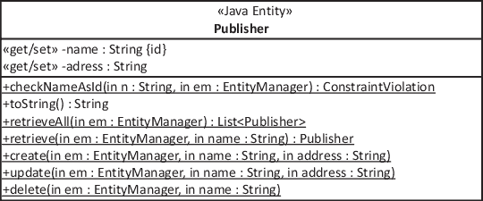

在 Java 实体类模型中，对于 OO 类模型中的任何关联端点，我们都显示表示关联端点的引用属性，并用其所表示的单向关联的功能类型进行标注。在我们的示例中，我们在实体类`Book`中添加了引用属性`publisher`，并用关联的功能类型`manyToOne`对其进行标注：

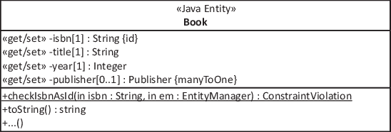

### 4.3 新问题

与之前讨论的单类应用相比，我们必须处理许多新的技术问题：

1. 在`model`代码中，我们现在必须处理需要以下操作的`reference properties`：

   1. 借助合适的 JPA 注解定义引用完整性约束（referenced integrity constraints）；
   2. 通过考虑引用属性来扩展`create`、`update`和`delete`方法的代码；
   3. 一个在序列化和反序列化操作中在（内部）对象引用和相应的（外部）ID 引用之间转换的方法。

2. 在`user interface`（视图）代码中，我们现在必须处理：

   1. 在`retrieve/list all`用例中显示有关关联对象的信息；
   2. 在`create object`和`update object`用例中，允许从目标类的所有现有实例列表中选择关联对象。

### 4.4 编写模型代码

可以直接为 Java 实体类模型编写代码，以获取我们 Java 后端应用的模型层代码。

#### 4.4.1 总结

1. 根据 Java 实体类模型为每个类编写对应的实体类。
2. 使用 JPA 注解`@Id`编写`{id}`属性修饰符。
3. 为任何表示引用属性功能类型的属性修饰符（例如`{manyToOne}`）编写相应的 JPA 注解，例如`@ManyToOne`。
4. 借助 Java Bean Validation 注解（或自定义校验注解）编写模型中指定的完整性约束。
5. 编写 getter 和 setter。
6. 将`create`、`retrieve`、`update`和`delete`存储管理操作编写为类方法。

这些步骤将在接下来的章节中进行详细讨论。

#### 4.4.2 编写模型中的每个类

直接为 Java 实体类模型编写代码以获取模型层代码。Java 实体类模型中的每个类`C`都被编写为一个带注解的 Bean 类，包含一个无参构造函数和一个带有实体创建参数的构造函数。

例如，实体类模型中的`Book`类以以下方式编写：


`@Entity` `@Table(name="books")` `@ViewScoped` `@ManagedBean(name="book")` `public class Book` 是一个 JPA 实体类，它映射到数据库中的 `books` 表。该类包含以下属性：

- `isbn`：使用 `@Id` 注解指定为主键，并使用 `@NotNull` 注解定义强制性值约束。
- `title`：使用 `@Column(nullable=false)` 注解指定非空列，并使用 `@NotNull` 注解定义强制性值约束。
- `year`：使用 `@Column(nullable=false)` 注解指定非空列，并使用 `@NotNull` 注解定义强制性值约束。
- `publisher`：使用 `@ManyToOne(fetch=FetchType.EAGER)` 注解指定多对一关联。

```
@Entity
@Table(name="books")
@ViewScoped
@ManagedBean(name="book")
public class Book {
    @Id
    @NotNull(message="An ISBN is required!")
    private String isbn;

    @Column(nullable=false)
    @NotNull(message="A title is required!")
    private String title;

    @Column(nullable=false)
    @NotNull(message="A year is required!")
    private Integer year;

    @ManyToOne(fetch=FetchType.EAGER)
    private Publisher publisher;

    public Book() {}

    public Book(String isbn, String title, Integer year, Publisher publisher) {
        this.setIsbn(isbn);
        this.setTitle(title);
        this.setYear(year);
        this.setPublisher(publisher);
    }
    // getters, setters, etc.
}
```

属性 `publisher` 上的 `@ManyToOne` 注解用于指定由引用属性 `publisher` 表示的关联 `Book has Publisher` 的功能类型，因为它持有*一本书有一个出版者*以及*一个出版者有多许多书*。该注解还允许通过参数 `fetch` 指定抓取类型，该参数取以下两个可能值之一：

- `FetchType.EAGER`：意味着获取实体包括对由该属性引用的关联实体的获取。在我们的示例中，这意味着当获取 `Book` 实体时，其出版者属性引用的 `Publisher` 实体也会被获取。这种行为非常有用，每当获取的数据可以在内存中处理时都应该使用它。

- `FetchType.LAZY`：意味着在获取引用实体时不会自动获取引用实体。在我们的示例中，这意味着不会与引用 `Book` 实体一起获取被引用的 `Publisher` 实体，导致发布者属性的值设置为 `null`。使用这种抓取行为，必须在事务上下文中调用引用属性的 getter 来单独获取引用实体。

对于带有 `@OneToOne` 或 `@ManyToOne` 注解（表示 `functional` 关联）的 `single-valued` 引用属性，其默认值为 `FetchType.EAGER`，因此引用的实体会与引用实体一起获取；而在 `non-functional` 关联（使用 `@OneToMany` 或 `@ManyToMany`）的情况下，默认值为 `FetchType.LAZY`，因此引用的实体不会与引用实体一起获取，而是在需要时才单独检索。

由于这些 JPA 注解，生成了用于创建 `books` 表的以下 SQL 表创建语句：

```
CREATE TABLE IF NOT EXISTS `books` (
    `ISBN` varchar(10) NOT NULL,
    `TITLE` varchar(255) NOT NULL,
    `YEAR` int(11) NOT NULL,
    `PUBLISHER_NAME` varchar(255) DEFAULT NULL,
    FOREIGN KEY (`PUBLISHER_NAME`) REFERENCES `publishers` (`NAME`)
);
```

### 4.4.3 编写约束

确保实体类模型中指定的所有属性约束都通过合适的 Bean Validation 注解正确编码。例如，对于名称属性，我们必须使用 JPA 注解 `@Id` 来指定该属性对应于实体类映射的数据库表的主键列，并使用 Bean Validation 注解 `@NotNull` 来定义强制性值约束，该约束在实体保存到数据库之前会进行检查。

对于地址属性，我们必须以两种形式定义强制性值约束：使用 JPA 注解 `@Column(nullable=false)` 对应相应的表列，以及使用 Bean Validation 注解 `@NotNull` 对应属性。

```
@Id
@NotNull(message="A name is required!")
private String name;

@Column(nullable=false)
@NotNull(message="An address is required!")
private String address;
```

请注意，遗憾的是，当前的 Java EE 技术需要定义两次相同的约束：一次是以 JPA 注解的形式针对数据库，另一次是以 Bean Validation 注解的形式针对 Java 应用。

### 4.4.4 编写 Getters 和 Setters

将 setter 操作编写为（实例级）方法。setter 只负责赋值，且不执行任何验证，因为属性约束仅在 Java EE 执行环境在保存之前进行检查。getter 则简单地返回属性的实际值。

### 4.4.5 实现删除策略

对于任何引用属性，我们必须选择并实现删除策略，以便在引用属性范围类的 `delete` 方法中处理相应的对象销毁依赖。在我们的案例中，必须在以下两者之间选择：

1. 删除由删除出版社出版的所有书籍；
2. 从已删除出版社的所有书籍中删除对该删除出版社的引用。

我们选择第二种策略，该策略仅适用于如 `book.publisher` 等可选引用属性。在下面 `Publisher.delete` 方法的代码中所示，对于所有相关的书籍实体，都清除了 `book.publisher` 属性：

```
public static void delete(EntityManager em, UserTransaction ut, String name) throws Exception {
    ut.begin();
    Publisher publisher = em.find(Publisher.class, name);
    // find all Books which have this publisher
    Query query = em.createQuery("SELECT b FROM Book b WHERE b.publisher.name = :name");
    query.setParameter("name", name);
    List<Book> books = query.getResultList();
    // clear these books' publisher reference
    for (Book b : books) {
        b.setPublisher(null);
    }
    em.remove(publisher);
    ut.commit();
}
```

该方法遍历所有引用待删除出版社的书籍实体，并将它们的出版社属性设置为 `null`。

### 4.4.6 序列化与反序列化

基于 JPA 注解并配合需要时合适的转换类，序列化（从 Java 对象到表行）以及相应的反序列化（从表列到 Java 对象）会自动完成。

### 4.5 视图与控制器层

用户界面（UI）由一个用于导航到数据管理 UI 页面的起始页面，以及每个对象类型和数据管理用例的 UI 页面组成。所有这些 UI 页面都以 JSF 视图文件的形式定义在 `WebContent/views/` 文件夹的子目录下。我们在 `WebContent/views/app` 子目录下创建菜单页面 `index.xhtml`，内容如下：

```
<!DOCTYPE html>
<html xmlns="http://www.w3.org/1999/xhtml"
      xmlns:ui="…" xmlns:h="…" xmlns:f="…">
  <ui:composition template="/WEB-INF/templates/page.xhtml">
    <ui:define name="content">
      <h2>Public Library</h2>
      <h:button value="Manage publishers" outcome="/views/publishers/index" />
      <h:button value="Manage books" outcome="/views/books/index" />
      <h:form>
        <h:commandButton value="Clear database" action="#{appCtrl.clearData()}" />
        <h:commandButton value="Create test data" action="#{appCtrl.createTestData()}" />
      </h:form>
    </ui:define>
  </ui:composition>
</html>
```

它创建了菜单按钮，提供了跳转到每个管理页面对应视图的重。此外，我们需要创建一个相应的 `AppController` 类，负责测试数据的创建和删除。该控制器结合 `Publisher.createTestData` 和 `Publisher.clearData` 方法，代码如下：

```
@ManagedBean(name="appCtrl")
@SessionScoped
public class AppController {
    @PersistenceContext(unitName="UnidirocApp")
    private EntityManager em;
    @Resource()
    UserTransaction ut;

    public String clearData() {
        try {
            Book.clearData(em, ut);
            Publisher.clearData(em, ut);
        } catch (Exception e) {
            e.printStackTrace();
        }
        return "index";
    }

    public String createTestData() {
        try {
            Publisher.createTestData(em, ut);
            Book.createTestData(em, ut);
        } catch (Exception e) {
            e.printStackTrace();
        }
        return "index";
    }
}
```

`Book` 和 `Publisher` 数据的删除必须按特定顺序进行以避免引用完整性冲突（必须先删除书籍，再删除出版社）。

#### 4.5.1 初始化应用

由于代码在 Tomcat 容器中运行，初始化由容器内部完成。

#### 4.5.2 在*检索/列出所有*中显示关联对象

我们的示例只有一个引用属性 `Book::publisher`，它是功能性的。为了在*检索/列出所有书籍*用例中显示可选出版社的信息，HTML 表中相应的列将填充出版社名称（如果有）：

```
<ui:composition template="/WEB-INF/templates/page.xhtml">
    <ui:define name="content">
        <h:dataTable value="#{bookCtrl.books}" var="b">
            …
            <h:column>
                <f:facet name="header">Publisher</f:facet>
                #{b.publisher.name}
            </h:column>
        </h:dataTable>
        <h:button value="Main menu" outcome="index" />
    </ui:define>
</ui:composition>
```

注意 `#{b.publisher.name}` JSF 表达式中的级联调用，它访问了书籍实例 `b` 的出版社属性名称。

#### 4.5.3 在*创建*和*更新*中允许选择关联对象

在本节中，我们将讨论如何创建和更新具有引用属性的对象，例如具有引用属性 `publisher` 的 `Book` 对象。

##### 4.5.3.1 创建对象到字符串的转换器

HTML 需要字符串或数字值来填充表单。在我们的案例中，`Book` 类的属性发布者是一个对象引用。JSF 允许通过 `converter` 将对象转换为字符串反反之，这些转换器是标记了 `@FacesConverter` 注解并实现了 `javax.faces.convert.Converter` 接口的类：

```
@FacesConverter(value="pl.m.converter.PublisherConverter")
public class PublisherConverter implements Converter {
    @Override
    public Object getAsObject(FacesContext context, UIComponent component, String value) {
        PublisherController ac = FacesContext.getCurrentInstance()
                .getApplication()
                .evaluateExpressionGet(context, "#{publisherCtrl}", PublisherController.class);
        EntityManager em = ac.getEntityManager();
        if (value == null) return null;
        else return em.find(Publisher.class, value);
    }

    @Override
    public String getAsString(FacesContext context, UIComponent component, Object value) {
        if (value == null) return null;
        else if (value instanceof Publisher) {
            return ((Publisher) value).getName();
        } else return null;
    }
}
```

转换器定义了两个方法：`getAsObject` 和 `getAsString`，分别负责两种转换。为了能够从数据库中检索对象，我们需要一个 `EntityManager`，它可以从控制器获取（例如，托管豆 `publisherCtrl`）。控制器可以通过 `FacesContext` 单例来获取：

```
PublisherController ac = FacesContext.getCurrentInstance()
        .getApplication()
        .evaluateExpressionGet(context, "#{publisherCtrl}", PublisherController.class);
```

此外，我们需要在控制器类中按照如下所示添加一个 `getEntityManager` 方法：

```
@ManagedBean(name="publisherCtrl")
@SessionScoped
public class PublisherController {
    @PersistenceContext(unitName="UnidirAssocApp")
    private EntityManager em;
    @Resource()
    UserTransaction ut;

    public EntityManager getEntityManager() {
        return this.em;
    }
    …
}
```


在`update book`用例中，当发布者列表需要自动选择当前发布者时，JSF需要比较两个发布者实例。因此，`Publisher`模型类需要实现`equals`方法。在我们的案例中，如果两个发布者的`name`属性值相等，则它们是“同一个”：

```
@Override
public boolean equals(Object obj) {
    if (obj instanceof Publisher) {
        Publisher publisher = (Publisher) obj;
        return (this.name.equals(publisher.name));
    } else {
        return false;
    }
}
```

### 4.5.3.2 编写视图代码

为了在`create`和`update`用例中允许从列表中选择与当前编辑对象关联的对象，通过`h:selectOneMenu`元素向一个HTML选择列表（即`select`元素）中填充关联对象类型的实例。`WebContent/views/books/`文件夹下的`create.xhtml`文件更新如下：

```
<ui:composition template="/WEB-INF/templates/page.xhtml">
    <ui:define name="content">
        <h:form id="createBookForm" styleClass="pure-form pure-form-aligned">
            <h:panelGrid columns="3">
                …
                <h:outputLabel for="publisher" value="Publisher:" />
                <h:selectOneMenu id="publisher" value="#{book.publisher}">
                    <f:selectItem itemValue="" itemLabel="---" />
                    <f:selectItems value="#{publisherCtrl.publishers}" var="p"
                                   itemLabel="#{p.name}" itemValue="#{p}" />
                    <f:converter converterId="pl.m.converter.PublisherConverter" />
                </h:selectOneMenu>
                <h:message for="publisher" errorClass="error" />
            </h:panelGrid>
            <h:commandButton value="Create"
                             action="#{bookCtrl.create(book.isbn, book.title,
                             book.year, book.publisher.name)}" />
        </h:form>
    </ui:define>
</ui:composition>
```

转换器通过使用`f:converter`元素及其关联的`@converterId`属性指定。该属性的值必须与定义转换器类时使用的`@FacesConverter`注解的`value`属性指定的指定相同，例如：

```
@FacesConverter(value = "pl.m.converter.PublisherConverter")
```

通常情况下，可以使用转换器的本地类名（例如`PublisherConverter`），或者在存在命名冲突风险时使用完全限定类名（例如`pl.m.converter.PublisherConverter`）。我们建议在所有情况下都使用完全限定名。

`#{publisherCtrl.publishers}`表达式会导致调用`PublisherController`类的`getPublishers`方法，该方法负责返回可用发布者的列表：

```
public List<Publisher> getPublishers() {
    return Publisher.retrieveAll(em);
}
```

书籍的创建是通过使用`h:commandButton`元素实现的。它会调用`BookController`类的`create`方法：

```
public String create(String isbn, String title, Integer year,
                     Publisher publisher) {
    try {
        Book.create(em, ut, title, year, publisher);
        // 创建 Book 行后强制清除表单
        FacesContext context = FacesContext.getCurrentInstance();
        facesContext.getExternalContext().getRequestMap().remove("book");
    } catch (EntityExistsException e) {
        try {
            ut.rollback();
        } catch (Exception e1) {
            e1.printStackTrace();
        }
        e.printStackTrace();
    } catch (Exception e) {
        e.printStackTrace();
    }
    return "create";
}
```

它简单地调用`Book.create`在books表中创建一个新行。

`update book`用例的代码非常相似，区别在于增加了选择元素（即使用`h:selectOneMenu` JSF元素）以允许选择书籍：

```
<ui:composition template="/WEB-INF/templates/page.xhtml">
    <ui:define name="content">
        <h:form id="createBookForm" styleClass="pure-form pure-form-aligned">
            <h:panelGrid columns="3">
                …
                <h:outputLabel for="selectBook" value="Select book: " />
                <h:selectOneMenu id="selectBook" value="#{book.isbn}">
                    <f:selectItem itemValue="" itemLabel="---" />
                    <f:selectItems value="#{bookCtrl.books}" var="b"
                                   itemValue="#{b.isbn}" itemLabel="#{b.title}" />
                    <f:ajax listener="#{bookCtrl.refreshObject(book)}"
                            render="isbn title year"/>
                </h:selectOneMenu>
                <h:message for="selectedBook"/>
                …
            </h:panelGrid>
            <h:commandButton value="Create" action="#{bookCtrl.create(
                book.isbn, book.title, book.year, book.publisher.name)}" />
        </h:form>
    </ui:define>
</ui:composition>
```

多值引用属性（例如`Book::authors`）允许存储一个指向某种类型对象的内部引用的集合，例如对`Author`对象的引用。在创建类型为`Book`的新对象时，构造函数需要一个参数来为该属性提供合适的值。通常情况下，这个值可以是内部对象引用的集合，也可以ID引用的集合。使用`JPA`，我们使用对象引用：

```
@Entity @Table(name="books")
@ManagedBean(name="book")
@ViewScoped
public class Book {
    …
    private Set<Author> authors;

    public Book() { // JPA @Entity 注解所要求的！
    }
    public Book(String isbn, String title, Integer year,
                Publisher publisher, Set<Author> authors) {…}

    public Set<Author> getAuthors() { return this.authors; }
    public void setAuthors(Set<Author> authors) { this.authors = authors; }
    …
}
```

## 5.2 创建 Java 实体类模型

我们创建Java实体类模型的起点是以下面向对象（OO）类模型：

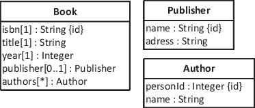

该模型除了包含单值引用属性`Book::publisher`（表示单向多对一关联`Book`-`拥有`-`Publisher`）外，还包含了多值引用属性`Book::authors`（表示单向多对多关联`Book`-`拥有`-`Author`）。

请记住，我们通过以下方式从OO类模型中的对应类获取Java实体类（如`Author`）：(1) 将所有属性设为私有，(2) 使用Java数据类型类，(3) 添加公共的getter和setter，(4) 添加`toString`函数，(5) 添加创建、检索、更新和删除的数据存储方法：

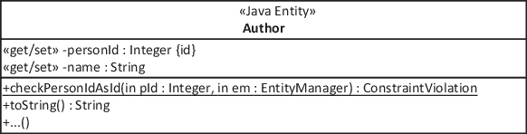

在Java实体类模型中，OO类模型中指定的任何引用属性都用其所表示的关联功能类型进行注解。在我们的示例中，我们在实体类`Book`的引用属性`authors`上标注了`manyToMany`：

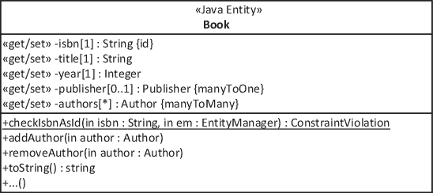

### 5.3 新问题

与上一节讨论的单向功能性关联相比，我们必须处理以下新的技术问题：

1. 在*模型类*中，我们现在必须处理`多值引用属性`，这些属性必须被注解为`@OneToMany`或`@ManyToMany`。

2. 在*用户界面*代码中，我们现在必须处理：

    1. 在`检索/列出所有对象`用例中，在视图表列中显示渲染多值引用属性的关联对象集合的信息；

    2. 在`创建对象`和`更新对象`用例中，允许从目标类所有现有实例的列表中选择关联对象集合。

最后一个问题，即允许从某个类的所有现有实例列表中选择关联对象集合，通常无法通过HTML select multiple表单元素来解决，因为存在易用性问题。每当可选选项集超过某个阈值（由无需滚动即可在屏幕上显示的选项数量定义），HTML select multiple元素就不再可用，必须使用替代的*多选小部件*。

### 5.4 编写模型代码

可以直接对Java实体类模型进行编码，以实现我们Java后端应用的模型层。

#### 5.4.1 总结

1. 将Java实体类模型的每个类编码为相应的实体类。

2. 使用JPA属性注解`@Id`编码任何`{id}`属性修符。

3. 将表示引用属性功能类型的修符（如`{manyToOne}`）对应相应的JPA注解，例如`@ManyToOne`。

4. 使用Java Bean Validation注解（或自定义校验注解）对模型中指定的完整约束进行编码。

5. 为多值属性编写getter和setter以及`add`和`remove`方法。

6. 将创建、检索、更新和删除存储管理操作编码为类方法。

这些步骤将在接后的章节中进行详细讨论。

#### 5.4.2 编码 Java 实体类模型中的每个类

对于多值引用属性`Book::authors`，我们使用参数化的`Set`类型：

```
@Entity @Table(name="books")
@ViewScoped @ManagedBean(name="book")
public class Book {
    …
    @ManyToMany(fetch=FetchType.EAGER)
    private Set<Author> authors;

    public Book() {}
    public Book(String isbn, String title, Integer year,
                Publisher publisher, Set<Author> authors) {…}
    …
    public Set<Author> getAuthors() { return this.authors; }
    public void setAuthors(Set<Author> authors) { this.authors = authors; }
    …
}
```

JPA注解`@ManyToMany`允许指定`Book`和`Author`之间的`多对多`关系。使用了注解参数`FetchType.EAGER`，因此当创建`Book`实例时，作者列表将填充相应的`Author`实例。由于该注解，会创建一个`Book`和`Author`之间的关系表，生成的SQL代码如下：

```
CREATE TABLE IF NOT EXISTS `books_author` (
    `Book_ISBN` varchar(10) NOT NULL,
    `authors_PERSONID` int(11) NOT NULL
);
```

生成的类名是对应表名的下划线连接（例如`books_author`）。使用两个表的主键列来实现该关系。对应的列名如下：

* 对于对应带有`@ManyToMany`注解的类（例如`Book`），使用类名以及主键列名（例如`Book_ISBN`）。

* 对于另一个表（例如`authors`），使用表名连接主键列名（例如`authors_PERSONID`）。

可以使用`@JoinTable`注解来控制这些参数，即表名和关系列名。为了获取自定义名称的关系表（例如`books_authors`）以及相应的自定义名称列（例如`book_isbn`和`author_personid`），可以使用：

```
@JoinTable(name="books_authors",
    joinColumns = {@JoinColumn(name="book_isbn",
    referencedColumnName="ISBN")},
    inverseJoinColumns = {@JoinColumn(name="author_personid",
    referencedColumnName="PERSONID")})
```

在我们的应用程序中，保持默认设置，因此没有使用`@JoinTable`注解。

相应的`Author`类带有适当的注解作为Java实体类：

```
@Entity @Table(name="author")
@ManagedBean(name="author") @ViewScoped
public class Author {
    // 属性
    @Id @PositiveInteger
    private Integer personId;
    @Column(nullable=false)
    @NotNull(message="名称是必须!")
    private String name;
    @Column(nullable=false)
    @NotNull(message="出生日期是必须!")
    @Past private Date dateOfBirth;
    @Past private Date dateOfDeath;
    // 构造函数
    …
    // Setters/getters
    …
    // 数据管理操作
    …
}
```

除了定义属性外，实体类还需要定义构造函数、setter/getter以及数据管理操作：


```
@Entity
@Table(name = "author")
@ManagedBean(name = "author")
@ViewScoped
public class Author {
    // 属性
    ...
    // 构造函数
    public Author() {}
    public Author(Integer personId, String name, Date dateOfBirth, Date dateOfDeath) {...}
    // Setter/getters
    ...
    // 数据管理操作
    public static void create(EntityManager em, UserTransaction ut, Integer personId, String name, Date dateOfBirth, Date dateOfDeath) {...}
    public static void update(...) {...}
    public static void delete(...) {...}
}
```

### 5.4.3 实现删除策略

对于引用属性`Book::authors`，我们必须在`Author`类的`delete`方法中实现删除策略。如果我们仅仅尝试删除一个作者，而该作者被任何书籍记录引用，则会抛出完整性约束违反异常，导致该作者无法被删除。针对这种情况，我们有两种处理方式：

1. 删除所有由被删除作者（共同）编写的书籍；
2. 从所有由被删除作者（共同）编写的书籍中移除对该删除作者的引用。

我们选择了第二种方案。这在`Author.delete`方法的后续代码所示：

```
public static void delete(EntityManager em, UserTransaction ut, Integer personId) throws Exception {
    ut.begin();
    Author author = em.find(Author.class, personId);
    // 查找该作者的所有书籍
    Query query = em.createQuery("SELECT DISTINCT b FROM Book b " +
        "INNER JOIN b.authors a WHERE a.personId = :personId");
    query.setParameter("personId", personId);
    List<Book> books = query.getResultList();
    // 从书籍的作者列表中移除作者引用
    for (Book b : books) {
        b.getAuthors().remove(author);
    }
    // 删除作者记录（表行）
    em.remove(author);
    ut.commit();
}
```

本质上，删除操作包含三个步骤：

1. 创建一个 JPQL 查询，选择该作者的所有书籍（由于这是从书籍到作者的单向关联，因此无法从作者端直接访问其书籍）。
2. 对于每个找到的引用该作者的书籍，我们必须从其作者列表中移除作者引用。
3. 最后，删除作者记录。

### 5.4.4 序列化与反序列化

在 Java EE 中，从对象到相应数据库记录的序列化，以及从数据库记录到对象的反序列化，由 Java EE 执行环境根据 JPA 注解和用于自定义转换的转换类自动完成。

### 5.5 编写用户界面代码

#### 5.5.1 在检索/列出全部显示关联对象信息

要在“检索/列出所有书籍”用例中显示书籍作者的信息，HTML 表格中对应的单元格必须填充所有作者名称的列表。为此，我们在`Book`类中实现了一个方法，用于返回序列化的作者名称列表（格式为`authorName_1, authorName_2, …, authorName_n`）：

```
public String getAuthorNames() {
    String result = "";
    int i = 0, n = 0;
    if (this.authors != null) {
        n = this.authors.size();
        for (Author author : this.authors) {
            result += author.getName();
            if (i < n - 1) {
                result += ", ";
            }
            i++;
        }
    }
    return result;
}
```

在`WebContent/views/books/`文件夹下的`retrieveAndListAll.xhtml`文件，该方法在“Authors”列的 JSF 表达式中被调用：

```
<ui:composition template="/WEB-INF/templates/page.xhtml">
    <ui:define name="content">
        <h:dataTable value="#{bookController.books}" var="b">
            ...
            <h:column>
                <f:facet name="header">Publisher</f:facet>
                #{b.publisher.name}
            </h:column>
            <h:column>
                <f:facet name="header">Authors</f:facet>
                #{b.authorNames}
            </h:column>
        </h:dataTable>
        <h:button value="Back" outcome="index" />
    </ui:define>
</ui:composition>
```

回想，使用`b.authorNames`会在给定的`b`对象上调用名为`getAuthorNames`的方法。

### 5.5.2 在创建时允许选择关联对象

为了在“创建书籍”用例中允许选择多个作者关联到书籍，多选列表（带有`multiple="multiple"`的 select 元素，如下面的 facelet 代码）由关联对象类型的实例填充。以下代码是`WebContent/views/books/`文件夹下`create.xhtml`视图文件的一部分：

```
<ui:composition template="/WEB-INF/templates/page.xhtml">
    <ui:define name="content">
        <h:form id="createBookForm">
            <h:panelGrid columns="3">
                ...
                <h:outputLabel for="authors" value="Authors:"/>
                <h:selectListbox id="authors" value="#{book.authors}">
                    <f:selectItems value="#{authorController.authors}" var="a" itemLabel="#{a.name}" itemValue="#{a}"/>
                    <f:converter converterId="AuthorConverter"/>
                </h:selectListbox>
                <h:message for="authors" errorClass="error"/>
            </h:panelGrid>
            <h:commandButton value="Create" action="#{bookController.create(book.isbn, book.title, book.year, book.publisher, book.authors)}"/>
        </h:form>
        <h:button value="Back" outcome="index" />
    </ui:define>
</ui:composition>
```

记得我们需要为`Author`模型类添加`equals`方法。在我们的情况下，如果两个作者的`personId`属性相等，则它们是“同一个”：

```
@Override
public boolean equals(Object obj) {
    if (obj instanceof Author) {
        Author author = (Author) obj;
        return (this.personId.equals(author.personId));
    } else return false;
}
```

就像 Publisher 一样，JSF 转换器用于在填充列表时将对象序列化为字符串，并在调用`BookController`的`create`方法时将字符串转换回对象。`BookController.create`方法扩展了一个新参数，即作者列表：

```
public String create(String isbn, String title, Integer year, Publisher publisher, Set<Author> authors) {
    try {
        Book.create(em, ut, isbn, title, year, publisher, authors);
        // 在创建书籍记录后强制清除表单
        FacesContext facesContext = FacesContext.getCurrentInstance();
        facesContext.getExternalContext().getRequestMap().remove("book");
    } catch (EntityExistsException e) {
        try {
            ut.rollback();
        } catch (Exception e1) {
            e1.printStackTrace();
        }
        e.printStackTrace();
    } catch (Exception e) {
        e.printStackTrace();
    }
    return "create";
}
```

*更新书籍*用例与创建书籍的用例类似。

### 5.6 运行应用并获取代码

要运行应用程序，你可能首先需要停止你的 Tomcat/TomEE 服务器（Windows 使用`bin/shutdown.bat`，Linux 使用`bin/shutdown.sh`）。接下来，下载并解压包含应用所有源代码以及你需要修改的 ANT 脚本文件的压缩包。现在，在你的控制台或终端中执行以下命令：

```
ant deploy -Dappname=UnidirectionalAssociationApp
```

最后，启动你的 Tomcat Web 服务器（Windows 系统使用`bin/startup.bat`，Linux 系统使用`bin/startup.sh`）。请耐心等待，这取决于你计算机运行的速度。当控制台显示以下消息时，它就准备就绪了：`INFO: Initializing Mojarra [some library versions and paths are shown here] for context ‘/subtypingapp’`。最后，打开浏览器并输入：

```
http://localhost:8080/UnidirectionalAssociationApp/WebContent/views/app/index.xhtml
```

## 5.7 引用属性的值：集合与有序集合

回想，`set`（集合）是一个具有唯一元素的无序集合，而`list`（列表）是一个可能包含多个相同元素的有序集合。

当图 5.1 所示的类图中，如果非功能关联端是`ordered`（有序的），例如`Book::authors`，这意味着相应引用属性的范围需要是一个有序集合类型，例如 Java 集合接口类型`SortedSet`和`List`。

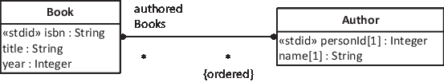

图 5.1：一个集合值的引用属性`authoredBooks`和一个有序集合值的引用属性`authors`。

在理论上，集合值型引用属性应该使用`Set<T>`定义，例如将`Set<Book>`声明为`Author::authoredBooks`的范围；而有序集合值的引用属性应该使用`SortedSet<T>`定义，例如将`SortedSet<Author>`声明为`Book::authors`的范围。Java 接口类型`Set`通常由 Java 类`HashSet`实现，而`SortedSet`通常由`TreeSet`实现。

然而，如果不担心避免重复元素，集合值型和有序集合型引用属性也可以使用泛型接口类型`List<T>`作为其范围定义，该类型通常由`ArrayList`实现。

当主要的用例是向集合中添加元素并在稍后对它们进行迭代时，最佳选择是使用由`ArrayList`实现的`List`，它比`LinkedList`或任何`Set`的实现都更节省内存，并且具有快速的插入、迭代和随机访问能力。使用`HashSet`仅在集合中查找元素的用例中具有性能优势。

## 6 单向关联实践项目

所有项目都包含以下任务：

1. 根据给定的设计模型派生`OO class model`（面向对象类模型）。提示：将关联替换为相应的引用属性。
2. 从 OO 类模型派生`JavaScript class model`（JavaScript 类模型）或`Java Entity class model`（Java 实体类模型）。提示：添加检查方法（check）和设置方法（setter）。
3. 遵循提供的指南编写你的 JS 类模型或 Java 实体类模型代码。

确保你的页面符合 HTML5 的 XML 语法，并且你的 JavaScript 代码符合我们的编码准则并通过了 (`JSHint`) 检查。

### 6.1 为电影分配导演和演员

该项目基于下方所示的信息设计模型。需要对之前作业中的应用程序进行扩展，增加管理电影演员和导演数据的可能性。这通过添加一个模型类`Person`以及`Movie`与`Person`之间的两个单向关联来实现：

1. 一个多对一关联，将恰好一个人分配为电影的`director`（导演），以及
2. 一个多对多关联，将零或多个个人分配为电影的`actors`（演员）。

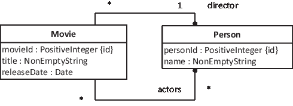

你可以使用以下示例数据测试你的应用程序：

| Movies (电影) |
| --- |
| Movie ID (电影 ID) | Title (标题) | Release date (发布日期) | Director (导演) | Actors (演员) |
| --- | --- | --- | --- | --- |
| 1 | Pulp Fiction (非常俗杀) | 1994-05-12 | 3 | 4, 5 |
| 2 | Star Wars (星大战) | 1977-05-25 | 2 | 6, 7 |
| 3 | Dangerous Liaisons (危险关系) | 1988-12-16 | 1 | 8, 4 |

| People (人员) |
| --- |
| Person ID (人员 ID) | Name (姓名) |
| --- | --- |
| 1 | Stephen Frears |
| 2 | George Lucas |
| 3 | Quentin Tarantino |
| 4 | Uma Thurman |
| 5 | John Travolta |
| 6 | Ewan McGregor |
| 7 | Natalie Portman |
| 8 | Keanu Reeves |

更多电影数据可以在 IMDb 网站找到。

### 6.2 为国家分配城市和首都，为组织分配成员

该项目基于下方所示的信息设计模型。需要对之前作业中的应用程序进行扩展，增加管理`international organizations`（国际组织）数据的能力（国家作为`members`（成员））以及`cities`（城市）数据（作为`capitals`（首都）和总部所在地）。这通过添加相应的模型类`InternationalOrganization`和`City`以及以下单向关联来实现：

1. `InternationalOrganization`与`Country`之间的多对多关联，将零或多个国家分配为国际组织的`members`，以及
2. `Country`与`City`之间的一对一关联，将恰好一个城市分配为国家的`capital`（首都）。


## 3 `Country` 与 `City` 之间的一对多关联

将城市分配给国家。

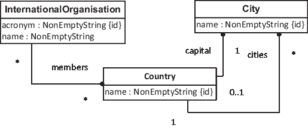

你可以使用以下示例数据测试你的应用程序：

| International organizations (国际组织) | | |
| --- | --- | --- |
| Acronym (缩写) | Name (名称) | Members (成员) |
| UN (联合国) | United Nations | Germany, France |
| WHO (世界卫生组织) | World Health Organization | Germany, France |
| NATO (北约组织) | North Atlantic Organization | Germany |

| Countries (国家) | | |
| --- | --- | --- |
| Name (名称) | Capital (首都) | Cities (城市) |
| France | Paris | Marseille |
| Germany | Berlin | Hamburg |
| Russia | Moscow | Novosibirsk |
| Paris | | |

更多关于国家的数据可以在 `Worldbook` 中找到。

## 7 双向关联

在面向对象建模和编程中，`bidirectional`（双向）关联表示为一对互逆的属性，允许在两个方向进行“导航”。

下方图 7.1 所示的模型（关于出版商、书籍及其作者）作为我们的示例。注意它包含两个双向关联，如两端的圆点所示。

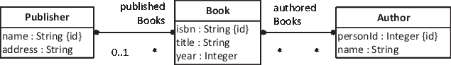

图 7.1：具有两个双向关联的出版商-书籍-作者信息设计模型。

### 7.1 逆引用属性

为了能够检索由成员主持的委员会，我们在 `Committee-ClubMember` 模型中添加了两个引用属性：成员作为委员会主席的属性（`ClubMember::chairedCommittee`）以及成员作为委员会副主席的属性（`ClubMember::coChairedCommittee`）。我们假设任何成员最多担任一个委员会的主席（这种逻辑关系是非互斥的）。因此，我们得到了下面的模型：

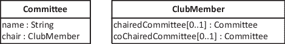

注意 `Committee::chair` 和 `ClubMember::chairedCommittee` 两个引用属性之间存在紧密的对应关系。它们是互为 `inverse`（逆）的：当成员 Tom 是预算委员会主席时（通过元组（"budget committee", "Tom"）表示），预算委员会就是 Tom 主持的委员会（通过逆元组（"Tom", "budget committee"））表示）。为了在图中表示这种逆对应关系，我们在 `ClubMember::chairedCommittee` 的声明中添加了花括号包裹的逆属性约束 `{inverse of chair}`，并在 `Committee::chair` 中添加了类似的约束，如下图所示：

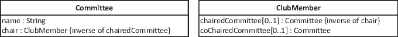

使用 OOP 语言的引用路径表示法，用 `c` 引用一个 `Committee` 对象，我们得到方程：

(7.1) `c.chair.chairedCommittee = c`

或者，反过来，用 `m` 引用一个 `ClubMember` 对象，我们得到方程：

(7.2) `m.chairedCommittee.chair = m`

注意，当一个属性 `p[2]` 是属性 `p[1]` 的反属性时，这意味着反过来，`p[1]` 是 `p[2]` 的反属性。因此，当我们声明属性 `ClubMember::chairedCommittee` 是 `Committee::chair` 的反属性时，隐含地，`Committee::chair` 也是 `ClubMember::chairedCommittee` 的反属性。因此，我们将 `Committee::chair` 和 `ClubMember::chairedCommittee` 称为**互反的引用属性对**。在模型中具有这样一对意味着**冗余**，因为涉及的两个引用属性中的任何一个都可以通过反转导出另一个。这种冗余意味着*数据存储开销*和*更新开销*，这是为了支持双向高效对象访问而必须付出的代价。

为了维护互反引用属性对的重复信息，通常做法是将涉及的两个属性之一视为*主属性*（master），另一个视为*从属性*（slave），并在受影响模型类的更改方法（如属性设置器）的代码中考虑这种区别。在模型图中，我们通过使用 UML 符号斜杠（/）作为属性名的前缀，将从属性声明为**派生**属性，以此指示互反引用属性对中的从属性，如下所示：

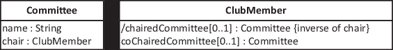

`ClubMember` 中的属性 `chairedCommittee` 现在是*派生*的（如其斜杠前缀所示）。它的注释 `{inverse of chair}` 提供了一个*派生规则*，根据该规则，它是通过反转属性 `Committee::chair` 得到的。

在 UML 类图中，属性的派生可以通过 OCL `derive` 表达式来指定，该表达式对于给定对象求出派生属性的值。在属性是另一个属性的反属性的情况下（通过附加在属性声明后的约束表达式 `{inverse of anotherProperty}` 指定），派生表达式是隐含的。在我们的示例中，对于任何俱乐部成员对象 `m`，它求出委员会对象 `c`，使得 `c.chair = m`。在 OCL 中，该派生规则表示如下：

```
context ClubMember::chairedCommittee: Committee
derive:  
  if Committee.allInstances().exists( c | c.chair = self) then c
```

实现属性派生有两种方式：可以通过读取时计算其值来*读取时派生*（derived on read），也可以通过在派生表达式中的某个变量（通常是另一个属性）值改变时执行更新时计算来*更新时派生*（derived on update）。后者对应于数据库中的*物化视图*。虽然读取时派生的引用属性可能无法保证高效的导航（因为读取时的计算可能会产生不可接受的延迟），但更新时派生的引用属性提供了高效的导航。

当我们通过在名称前加斜杠（/）将反引用属性指定为派生时，我们指示它是更新时派生的。例如，上述示例中的属性 `/chairedCommittee` 是从属性 `chair` 更新时派生的。

在派生引用属性的情况下，我们必须处理受影响模型类之间的**生命周期依赖**，这需要根据所表示关联的功能类型（*一对一*、*多对一*或*多对多*）采用特殊的更改管理机制。

在我们派生反引用属性 `ClubMember::chairedCommittee` 的示例中，它是单值且可选的，这意味着：

1. 每当创建一个新的委员会对象时（带有强制性的主席分配），都必须相应地分配对应的 `ClubMember::chairedCommittee` 属性；

2. 每当更新 `chair` 属性时（即为委员会分配一个新主席），就必须取消原任主席的俱乐部成员的对应 `ClubMember::chairedCommittee` 属性，并为新主席的成员设置该属性；

3. 每当销毁一个委员会对象时，就必须取消对应的 `ClubMember::chairedCommittee` 属性。

当派生引用属性为多值而其反向属性为单值时（例如下方图 7.4 所示的模型），如果模型中仍包含任何非定向关联，我们首先必须通过对端点所有权做出决策，将其转换为定向关联，该决策通常基于导航需求。

### 7.2 从关联到引用属性

**消除单向关联**，通过在源类中替换为一个引用属性来连接源类与目标类，使目标类成为该属性的范围。

**消除双向关联**，通过将其替换为一对互逆的引用属性。

#### 7.2.2 如何消除单向关联

连接源类与目标类的单向关联被替换为其源类中一个对应的引用属性，该属性的范围（range）为目标类。它的多重性（multiplicity）与目标关联末端的多重性相同。如果关联端有名称，其名称为关联端的名称；否则设置为目标类的名称（如果引用属性是多值的，则可能为复数形式）。

#### 7.2.3 如何消除双向关联

双向关联，例如上方图 7.1 所示模型中 `Book` 和 `Author` 类之间的作者关系关联，被替换为一对互逆的引用属性，例如 `Book::authors` 和 `Author::authoredBooks`。由于这两个引用属性都代表相同的信息（同一组二元关系），可以考虑将其中一个作为“主”属性，另一个作为“从”属性（后者由主属性派生）。我们讨论了一对一和多对多关联的两种情况。

1. 在双向一对一关联的情况下，这将导致一对互逆的单值引用属性，在两个关联类中各有一个。由于它们本质上都代表相同的信息（同一组链接/关系集合），必须从中选择一个被视为主属性，使得另一个成为从属性，而该从属性是通过反向反转从主属性派生而来。在类图中，从属性被指定为*派生属性*（*derived property*），每当发生以下情况之一时，它都会自动更新：1) 创建了新的主对象，2) 主引用属性被更新，或 3) 主对象被销毁。这种转换在图 7.2 中予以图示。

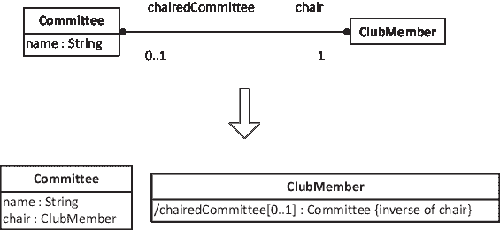

图 7.2：将双向一对一关联转换为一对互逆的单值引用属性的主从对。

2. 双向多对多关联映射为一对互逆的多值引用属性，在参与关联的两个类中各有一个。同样，在两个类中的一个，代表（反向）关联的多值引用属性被指定为*派生属性*（*derived property*），每当另一个类（维护关联的类）中的相应属性被更新时，它就会自动更新。这种转换在图 7.3 中予以图示。

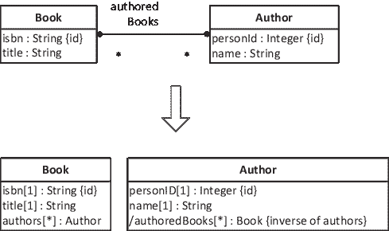

图 7.3：将双向多对多关联转换为一对互逆的多值引用属性的主从对。

#### 7.2.4 得到的 OO 类模型

在将两个双向关联替换为引用属性后，我们得到了 7.4 所示的 OO 类模型。

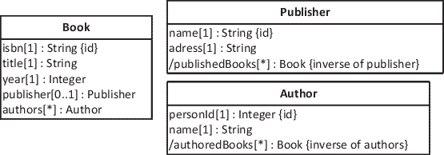

图 7.4：具有两对互逆引用属性的 OO 类模型。

由于书籍在存在上依赖于作者并可能依赖于出版社，反之，因此在书籍对象中维护主引用是自然的，并将出版社和作者对象中的反向引用视为派生的（或“从”）数据。因此，我们将 `publishedBooks` 和 `authoredBooks` 定义为派生的反向引用属性，这在 OO 类模型中通过它们的斜杠前缀指示。

该 OO 类模型的意义可以通过涉及的三个模型类的示例数据填充来说明：

| 出版社 (Publisher) | | |
| --- | --- | --- |
| 名称 (Name) | 地址 (Address) | 出版书籍 (Published books) |
| Bantam Books | 美国，纽约 | 0553345842 |
| Basic Books | 美国，纽约 | 0465030793 |

| 书籍 (Book) | | | | |
| --- | --- | --- | --- | --- |
| ISBN | 标题 (Title) | 年份 (Year) | 作者 (Authors) | 出版社 (Publisher) |
| 0553345842 | The Mind’s I | 1982 | 1, 2 | Bantam Books |
| 1463794762 | The Critique of Pure Reason | 2011 | 3 | |
| 1928565379 | The Critique of Practical Reason | 2009 | 3 | |
| 0465030793 | I Am A Strange Loop | 2000 | 2 | Basic Books |

| 作者 (Author) | | |
| --- | --- | --- |
| 作者 ID (Author ID) | 名称 (Name) | 著作 (Authored books) |
| 1 | Daniel Dennett | 0553345842 |
| 2 | Douglas Hofstadter | 0553345842, 0465030793 |
| 3 | Immanuel Kant | 1463794762, 1928565379 |

注意到书籍引用作者记录，反之亦然，作者引用书籍记录。

## 8 使用原生 JS 实现双向关联

在本章中，我们将展示

1. 如何从具有***派生属性***的 OO 类模型派生 JS 模型，

2. 如何以 JavaScript 类形式编写模型，

3. 如何基于模型编写视图和控制器代码。

### 8.1 创建 JavaScript 模型

制作 JS 模型的起点是一个具有派生属性的 OO 类模型，为了方便起见，我们在此展示它：

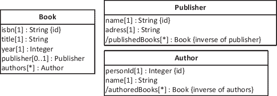

注意到模型包含两个反向属性：`Publisher::publishedBooks` 和 `Author::authoredBooks`。它们每一个都链接到一个主属性，并从该主属性派生。因此，每一个都对应于双向关联的一对互逆属性。

与制作单向关联的 JS 模型相比，唯一的问题是：

1. 为所有派生属性添加 `«get»` 立体，意味着它们具有隐式的 getter 但没有 setter。当对应的主属性更新时，它们会被隐式设置。

因此，我们得到了下面的 JavaScript 类模型：

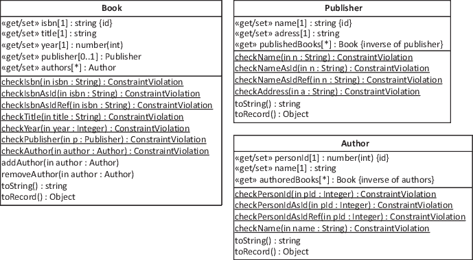

### 8.2 编写模型代码

可以直接为我们的 JavaScript 前端应用编写模型层的代码。

#### 8.2.1 新问题

与单向关联应用相比，我们需要处理许多新的技术问题：

1. 我们定义派生的反向属性（如 `Publisher::publishedBooks`）时，不包含检查操作，也不包含设置操作。

2. 我们还需要通过维护形成派生反向属性集合值的派生（集合）反向引用来维护派生反向属性。这特别要求：

   1. 每当***单值***主引用属性的值通过 setter 被***初始化或更新***时（例如为书籍实例 `b` 分配指向出版社实例 `p` 的引用），都必须将反向引用分配或添加到派生反向属性的相应值中（例如将 `b` 添加到 `p.publishedBooks`）；当主属性的值更新且派生反向属性是多值的时，则必须删除指向单值主引用属性旧值的过时反向引用。

   2. 每当可选的 `single-valued`（单值）主引用属性的值被 `unset` 时（例如通过为 `Book` 实例 `b` 的 `b.publisher` 赋值 `null`），如果派生反向引用属性是多值的，则必须从该派生反向引用属性的相应值移除反向引用（例如从 `p.publishedBooks` 中移除 `b`），否则必须取消或更新派生反向引用属性的相应值；

   3. 每当通过添加方法向 `multi-valued`（多值）主引用属性的值中 `added` 引用时（例如为 `Book` 实例 `b` 的 `b.authors` 添加 `Author` 引用 `a`），则必须向该派生反向引用属性的相应值分配或添加反向引用（例如向 `a.authoredBooks` 中添加 `b`）；

   4. 每当通过删除方法从 `multi-valued`（多值）主引用属性的值中 `removed` 引用时（例如从 `Book` 实例 `b` 的 `b.authors` 中移除对 `Author` 实例 `a` 的引用），如果该派生反向引用属性是多值的，则必须从该派生反向引用属性的相应值移除反向引用（例如从 `a.authoredBooks` 中移除 `b`），否则必须取消或更新派生反向引用属性的相应值；

   5. 每当一个带有单引用或多引用作为主引用属性值的对象被 `destroyed` 时（例如当一个具有指向 `Publisher` 实例 `p` 的单引用 `b.publisher` 的 `Book` 实例 `b` 被销毁时），必须首先移除派生反向引用（例如通过从 `p.publishedBooks` 中移除 `b`）。

注意，当创建一个带有单引用或多引用作为主引用属性值的新对象时（例如一个带有单引用 `b.publisher` 的新 `Book` 实例 `b`），其 setter 或 add 方法将被调用，并负责处理派生反向引用的创建工作。

#### 8.2.2 编码总结

将 JS 类模型中的每个类编码为带有隐式 getter 和 setter 的 ES2015 类（或者，编码为带有显式 setter 的 ES5 构造函数）：

1. 以类级（`static`）方法的形式编写属性检查。确保 JS 类模型中指定的所有属性约束都正确地编码在属性检查中。

2. 针对每个单值属性，编写指定的 getter 和 setter：

   1. 在每个 setter 中，调用相应的属性检查，且仅当检查没有检测到任何约束违背时，才对属性进行设置/取消（unset）。

   2. 如果涉及的属性是派生引用属性的反向属性（表示双向关联），确保 setter 同时也向反向属性（或其集合值）分配/取消（或添加/移除）相应的反向引用，或从中移除。

3. 针对每个多值属性，编写其 add 和 remove 操作，以及指定的 get/set 操作：

   1. 将 add/remove 操作编码为（实例级）方法，这些方法将调用相应的属性检查。

   2. 编写 setter，使其对要分配的集合中的每个项调用 add 操作。

   3. 如果涉及的属性是派生引用属性的反向属性（表示双向关联），确保 add/remove 方法也向反向属性（或其集合值）分配/取消（或添加/移除）相应的反向引用，或从中移除。


4. 编写序列化函数 `toString()` 和对象到存储转换函数 `toRecord()` 的代码。在发布者或作者对象的 `toRecord()` 转换中，不包含派生属性 `publishedBooks` 和 `authoredBooks`，因为它们的信息是冗余的（它们派生自书籍的 `publisher` 和 `authors` 属性）。

5. 在 `destroy` 方法中处理删除依赖关系。确保当带有单引用或多引用作为主引用属性值的对象被销毁时，首先取消（或移除）派生反向引用。

这些步骤将在接下来的章节中进行详细讨论。

## 8.2.3 编码 JS 类模型中的每个类

例如，JS 类模型中的 `Publisher` 类按以下方式编码：

```js
class Publisher {
   constructor ({name, address}) {
     this.name = name;
     this.address = address;
     // 派生反向引用属性 (Book::publisher 的反向)
     this._publishedBooks = {}; // 初始化为空 map
   }
   get name() {…}
   static checkName( n) {…}
   static checkNameAsId( n) {…}
   static checkNameAsIdRef( n) {…}
   set name( n) {…}
   get address() {…}
   static checkAddress( a) {…}
   set address( a) {…}
   toString() {…}
   toRecord() {…}
}
```

注意我们添加了（派生的）多值引用属性 `publishedBooks`，但我们没有在构造函数中为其赋值，因为它是一个只读属性，在其反向主引用属性 `Book::publisher` 赋值时赋值。

## 8.2.4 编码单值属性的 Set 方法

任何耦合到派生反向引用属性（实现双向关联）的属性的 setter，现在还需要向反向属性的集合值分配/添加或移除反向引用。这种 setter 的示例是 `Book` 类中的 `publisher`：

```js
set publisher( p) {
  if (!p) { // 引用被删除
    // 从 Publisher::publishedBooks 中删除反向引用
    delete this._publisher.publishedBooks[this._isbn];
    // 取消 publisher 属性
    delete this._publisher;
  } else {
    // p 可以是引用或对象引用
    const publisher_id = (typeof p !== "object") ? p : p.name;
    const constraintViolation = Book.checkPublisher( publisher_id);
    if (constraintViolation instanceof NoConstraintViolation) {
      if (this._publisher) {
        // 从 Publisher::publishedBooks 中删除反向引用
        delete this._publisher.publishedBooks[this._isbn];
      }
      // 创建新的发布者引用
      this._publisher = Publisher.instances[ publisher_id];
      // 向 Publisher::publishedBooks 添加新的反向引用
      this._publisher.publishedBooks[this._isbn] = this;
    } else {
      throw constraintViolation;
    }
  }
}
```

### 8.2.5 编码 Add 和 Remove 操作

对于任何耦合到派生反向引用属性的多值引用属性，`add` 和 `remove` 方法都必须向反向属性（或集合值）分配/添加或移除相应的引用。

例如，对于实现 `Book` 和 `Author` 之间双向作者关联的耦合到派生反向引用属性 `Author:authoredBooks` 的多值引用属性 `Book::authors`，`Book::addAuthor` 方法按以下方式编码：

```js
addAuthor( a) {
  // a 可以是引用或对象引用
  const author_id = (typeof a !== "object") ? parseInt(a) : a.authorId;
  const validationResult = Book.checkAuthor( author_id);
  if (author_id && validationResult instanceof NoConstraintViolation) {
    // 添加新的作者引用
    this._authors[author_id] = Author.instances[author_id];
    // 自动添加派生的反向引用
    this._authors[author_id].authoredBooks[this._isbn] = this;
  } else {
    throw validationResult;
  }
}
```

对于删除操作 `removeAuthor` 我们得到以下代码：

```js
removeAuthor( a) {
  // a can be an ID reference or an object reference
  const author_id = (typeof a !== "object") ? parseInt(a) : a.authorId;
  const validationResult = Book.checkAuthor( author_id);
  if (validationResult instanceof NoConstraintViolation) {
    // automatically delete the derived inverse reference
    delete this._authors[author_id].authoredBooks[this._isbn];
    // delete the author reference
    delete this._authors[author_id];
  } else {
    throw validationResult;
  }
}
```

### 8.2.6 抑制派生属性值的存储

在通过 `toRecord()` 对出版者或作者对象进行对象到存储的转换时，派生属性 `publishedBooks` 和 `authoredBooks` 不包含在内，因为它们的信息是冗余的（派生自书籍的 `publisher` 和 `authors` 属性）。例如，`Author::toRecord` 函数的实现如下：

```js
toRecord() {
  var rec = {};
  // loop over all Author properties
  for (let p of Object.keys( this)) {
    // keep underscore-prefixed properties except "_authoredBooks"
    if (p.charAt(0) === "_" && p !== "_authoredBooks") {
      // remove underscore prefix
      rec[p.substr(1)] = this[p];
    }
  };
  return rec;
}
```

### 8.2.7 处理删除依赖关系

当 `Book` 实例 `b`（具有单个引用 `b.publisher` 指向 `Publisher` 实例 `p` 以及多个引用 `b.authors` 指向 `Author` 实例）被销毁时，必须先移除派生的反引用（例如通过从 `p.publishedBooks` 中移除 `b`）：

```js
Book.destroy = function (isbn) {
  const book = Book.instances[isbn];
  if (book) {
    console.log( book.toString() + " deleted!");
    if (book.publisher) {
      // remove inverse reference from book.publisher
      delete book.publisher.publishedBooks[isbn];
    }
    // remove inverse references from all book.authors
    for (let authorID of Object.keys( book.authors)) {
      delete book.authors[authorID].authoredBooks[isbn];
    }
    // finally, delete book from Book.instances
    delete Book.instances[isbn];
  } else {
    console.log(`There is no book with ISBN ${isbn} in the database!`);
  }
};
```

### 8.3 在用户界面中利用反引用属性

在 `UI code` 中，我们现在可以利用反引用属性在 `Retrieve/List All`（检索/列出所有）用例中更有效地创建反关联对象的列表。例如，我们可以更高效地创建每个出版者的已出版书籍列表。然而，我们不允许在 `update object`（更新对象）用例中更新反关联对象的集合（例如在 `update publisher` 用例中更新已出版书籍集合）。相反，这种更新必须通过更新相关的主对象（在我们的示例中为书籍）来完成。

#### 8.3.1 在 Retrieve/List All 中显示已出版书籍的信息

在 `Retrieve/List All publishers`（检索/列出所有出版者）用例中显示已出版书籍的信息时，我们现在可以利用派生的反属性 `publishedBooks`：

```js
pl.v.publishers.retrieveAndListAll = {
  setupUserInterface: function () {
    const tableBodyEl = document.querySelector("section#Publisher-R>table>tbody");
    tableBodyEl.innerHTML = "";
    for (let key of Object.keys( Publisher.instances)) {
      const publisher = Publisher.instances[key];
      const row = tableBodyEl.insertRow(-1);
      // create list of books published by this publisher
      const listEl = util.createListFromMap( publisher.publishedBooks, "title");
      row.insertCell(-1).textContent = publisher.name;
      row.insertCell(-1).textContent = publisher.address;
      row.insertCell(-1).appendChild( listEl);
    }
    document.getElementById("Publisher-M").style.display = "none";
    document.getElementById("Publisher-R").style.display = "block";
  }
};
```

## 9 使用 Java EE 实现双向关联

在本章中，我们将展示：

1. 如何从 OO 类模型（该模型已从信息设计模型派生出来）推导出 Java `Entity class model`（实体类模型）；
2. 如何以实体类的形式（表示 `model classes`）编写实体类模型；
3. 如何基于实体类编写视图和控制器代码。

### 9.1 制作 Java 实体类模型

制作 Java 实体类模型的起点是一个带有派生反引用属性的 OO 类模型，如上文所述（见图 7.4），为了方便起见，我们在此再次展示：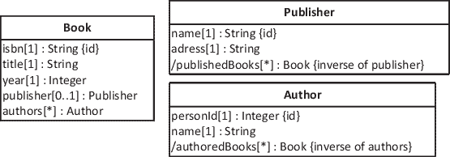

注意，该模型包含了两个派生的反引用属性：`Publisher::/publishedBooks` 和 `Author::/authoredBooks`。它们中的每一个都通过 `inverse-of` 约束链接到其派生的主属性。因此，它们中的每一个都代表了对应于双向关联的一对互反的引用属性。

我们现在展示如何从 OO 类模型推导出 Java 实体类模型：

1. 将每个类转换为 `«Java Entity»` 类，并将所有属性设为私有。
2. 将 OO 类模型中的平台无关数据类型替换为相应的 Java 类（如 `Integer`、`Float` 等）。
3. 为所有非派生属性添加 `«get/set»` 样式，表示它们需要 getter 和 setter。
4. 为所有派生属性添加 `«get»` 样式，表示它们只需要 getter。
5. 对于任何引用属性，根据其所表示的关联类型，添加相应的关键字作为属性修饰。对于给定的 OO 类模型，添加以下属性修饰：
   * 给派生属性 `Publisher::/publishedBooks` 添加 `oneToMany`
   * 给引用属性 `Book::publisher` 添加 `manyToOne`
   * 给引用属性 `Book::authors` 添加 `manyToMany`
   * 给派生属性 `Author::/authoredBooks` 添加 `manyToMany`
6. 对于被指定为其他属性的反派生属性，将其 `{inverse of … }` 属性修饰替换为相应的 `{mappedBy=…”}` 属性修饰。
7. 创建所需的属性约束检查操作。
8. 为每个多值属性创建一个 `add` 操作和一个 `remove` 操作。

这导致了以下 Java 实体类模型：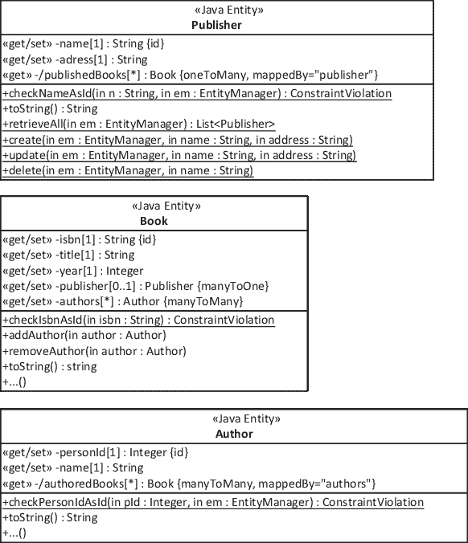

### 9.2 编写模型代码

可以直接对 Java 实体类模型进行编码，以获取我们 Java 后应用的模型层代码。

#### 9.2.1 新问题

与之前讨论的单向关联应用相比，我们必须处理许多新的技术问题：

1. 在 `model code` 中，你现在必须通过维护构成派生反引用属性值的派生反引用（集合）来维护这些属性。这特别要求：
   1. 每当通过 setter 初始化或更新单值主引用属性的值时（例如为 `Book` 实例 `b` 分配一个指向 `Publisher` 实例 `p` 的引用），必须向派生反引用属性的相应值分配或添加反引用（例如将 `b` 添加到 `p.publishedBooks`）；当主属性的值被更新且派生反引用属性是多值时，必须删除指向单值主属性旧值的过时反引用。
2. 每当可选的 `single-valued`（单值）主引用属性的值被 `unset` 时（例如通过为 `Book` 实例 `b` 的 `b.publisher` 赋值 `null`），必须从派生反向引用属性的对应值中移除反向引用（例如从 `p.publishedBooks` 中移除 `b`），前提是派生反向引用属性是多值的；否则，派生反向引用属性的对应值必须被 unset 或更新。
3. 每当通过添加方法向 `multi-valued`（多值）主引用属性的值`added` 引用时（例如向 `Book` 实例 `b` 的 `b.authors` 中添加 `Author` 引用 `a`），必须向派生反向引用属性的对应值赋值或添加反向引用（例如向 `a.authoredBooks` 中添加 `b`）。
4. 每当通过删除方法从 `multi-valued`（多值）主引用属性的值中`removed` 引用时（例如从 `Book` 实例 `b` 的 `b.authors` 中移除对 `Author` 实例 `a` 的引用），必须从派生反向引用属性的对应值中移除反向引用（例如从 `a.authoredBooks` 中移除 `b`），前提是派生反向引用属性是多值的；否则，派生反向引用属性的对应值必须被 unset 或更新。
5. 每当具有单引用或多引用作为主引用属性值的对象`destroyed` 时（例如当一个具有单引用 `b.publisher` 指向 `Publisher` 实例 `p` 的 `Book` 实例 `b` 被毁时），必须首先移除派生反向引用（例如通过从 `p.publishedBooks` 中移除 `b`）。

注意，当创建一个具有单引用或多引用作为主引用属性的新对象时（例如一个具有单引用 `b.publisher` 的新 `Book` 实例 `b`），其 setter 或 add 方法将被调用并负责派生反向引用的创建。

2. 在 `UI code` 中，我们现在可以利用反向引用属性在 `list objects` 用例中更高效地创建反向关联对象的列表。例如，我们可以更高效地为每个出版社创建所有已出版书籍的列表。

#### 9.2.2 总结

1. 将 Java `Entity` 类模型中的每个类编码为相应的实体类。
2. 使用 JPA 注解 `@Id` 编码 `{id}` 属性修饰符。


3. 为任何表示引用属性功能类型的修饰符（如 `{manyToOne}`）编码相应的 JPA 注解，例如 `@ManyToOne`。

4. 使用 Java Bean Validation 注解（或自定义验证注解）编码模型中指定的完整性约束。

5. 为多值属性编写 getters、setters 以及这些属性的 `add` 和 `remove` 方法。

6. 将创建、检索、更新和删除存储管理操作编码为类级方法。

7. 在创建和更新方法中处理好反向关系的管理。

这些步骤将在后续章节中进行更详细的讨论。

#### 9.2.3 编码 Java 实体类模型中的每个类

在 `Publisher` 类中，我们添加 `publishedBooks` 属性，并使用与 `Book` 类中 `@ManyToOne` 对应的 `@OneToMany` 注解，表示反向关系：

```java
@Entity
public class Publisher {
  …
  @OneToMany(fetch=FetchType.EAGER, mappedBy="publisher")
  private Set<Book> publishedBooks;
  …
}
```

`Publisher::publishedBooks` 属性的 `@OneToMany` 注解的 `mappedBy` 参数指定了 `Book` 类中实现 `@ManyToOne` 关系的属性：

```java
@Entity
public class Book {
  …
  @ManyToOne(fetch=FetchType.EAGER)
  @JoinColumn(name="PUBLISHER_NAME")
  private Publisher publisher;
  …
}
```

在 `Author` 类中，我们添加了 `authoredBooks` 属性，并使用与 `Book` 类中 `@ManyToMany` 对应的 `@ManyToMany` 注解，表示反向关系：

```java
@Entity
public class Author {
  …
  @ManyToMany(fetch=FetchType.EAGER, mappedBy="authors")
  private Set<Book> authoredBooks;
  …
}
```

`Author` 类中 `authoredBooks` 引用属性的 `@ManyToMany` 注解的 `mappedBy` 属性指定了 `Book` 类中反向引用属性的名称：

```java
@Entity
…
public class Book {
  …
  @ManyToMany(fetch=FetchType.EAGER)
  @JoinTable(
    name="books_authors",
    joinColumns={@JoinColumn(name="BOOK_ISBN")},
    inverseJoinColumns={@JoinColumn(name="AUTHOR_PERSONID")}
  )
  private Set<Author> authors;
  …
}
```

我们还使用 `@JoinTable` 注解来指定多对多关系的连接表名称以及连接表对应的列名，例如，表名为 `books_authors`，列名为 `BOOK_ISBN` 和 `AUTHOR_PERSONID`。

#### 9.2.4 编码 Setter 操作

任何耦合到派生反向引用属性（实现双向关联）的引用属性 setter，现在也需要为反向属性的值赋值、添加或移除反向引用。此类 setter 的示例是下面的 `setPublisher` 方法：

```java
class Class {
  public void setPublisher(Publisher publisher) {
    // 从 publisher.publishedBooks 移除书籍引用
    if (this.publisher != null) {
      this.publisher.removeBook(this);
    }

    // 向 publisher.publishedBooks 添加书籍
    if (publisher != null) {
      publisher.addBook(this);
    }

    this.publisher = publisher;
  }
}
```

#### 9.2.5 编码 Add 和 Remove 操作

对于任何耦合到派生反向引用属性的多值引用属性，`add` 和 `remove` 方法都必须为反向属性的值赋值、添加或移除反向引用。

例如，对于用于实现 `Book` 和 `Author` 双向关联的、耦合到 `Author:authoredBooks` 派生反向引用属性的多值引用属性 `Book::authors`，`addAuthor` 方法编码如下：

```java
public class Book {
  …
  public void addAuthor(Author author) {
    if (this.authors == null) {
      this.authors = new HashSet<Author>();
    }

    if (!this.authors.contains(author)) {
      // 添加新的作者引用
      this.authors.add(author);

      // 添加派生反向引用
      author.addAuthoredBook(this);
    }
  }
}
```

对于删除操作 `removeAuthor`，我们获得以下代码：

```java
public class Book {
  …
  public void removeAuthor(Author author) {
    if (this.authors != null && author != null &&
        this.authors.contains(author)) {
      // 删除作者引用
      this.authors.remove(author);

      // 删除派生反向引用
      author.removeAuthoredBook(this);
    }
  }
}
```

记住，对于 Java 集合（如 `Set` 或 `List`），`contains` 方法通过对象的 `equals` 方法来比较两个对象。例如，为了在 `Set<Authors>`（如 `publishedBooks`）上使用 `contains` 方法，我们在 `Author` 类中实现下面的 `equals` 方法（如果两个作者的 `personId` 属性值相等，则它们相等）：

```java
public class Author {
  …
  @Override
  public boolean equals(Object obj) {
    if (obj instanceof Author) {
      Author author = (Author) obj;
      return this.personId.equals(author.personId);
    } else {
      return false;
    }
  }
  …
}
```

#### 9.2.6 处理删除依赖

当一个 `Book` 实例 `b`（拥有一个单一引用 `b.publisher`` 指向 `Publisher` 实例以及多个引用 `b.authors` 指向 `Author` 实例）被销毁时，必须先移除衍生反向引用（例如，通过从 `p.publishedBooks` 中移除 `b`）。这通过对单值和多值属性调用带有 `null` 参数的 set 方法来实现，例如在 `Book.delete` 方法中调用 `b.setPublisher(null)` 和 `b.setAuthors(null)`：

```java
public class Book {
  …
  public static void delete(
      EntityManager em,
      UserTransaction ut,
      String isbn
  ) throws Exception {
    ut.begin();
    Book b = em.find(Book.class, isbn);
    b.setPublisher(null);
    b.setAuthors(null);
    em.remove(b);
    ut.commit();
  }
}
```

同样，在删除 `Publisher` 或 `Author` 实例时，我们也必须删除对 `Book` 实例的引用：

```java
public class Author {
  …
  public static void delete(
      EntityManager em,
      UserTransaction ut,
      Integer personId
  ) throws Exception {
    ut.begin();
    Author a = em.find(Author.class, personId);
    a.setAuthorBooks(null);
    em.remove(a);
    ut.commit();
  }
}
```

同样地：

```java
public class Publisher {
  public static void delete(
      EntityManager em,
      UserTransaction ut,
      String name
  ) throws Exception {
    ut.begin();
    Publisher p = em.find(Publisher.class, name);
    p.setPublishedBooks(null);
    em.remove(p);
    ut.commit();
  }
}
```

### 9.2.7 实体管理器和缓存实体

遗憾的是，JPA 不提供衍生反向引用的自动维护。根据 Java Persistence Wiki，我们必须在 `set`/`remove` 方法中实现（直接和反向）关系：

双向关系中的一个常见问题是应用程序更新了关系的一侧，但另一侧没有更新并导致不同步。在 JPA 中，与在 Java 中一样，维护关系是应用程序或对象模型的责任。如果你的应用程序向关系的一侧添加了内容，它也必须向另一侧添加。这通常通过对象模型中处理两边的 `add` 或 `set` 方法来解决。

有两种方法：你可以只将关系维护添加到关系的一侧，并仅使用该侧的 setter（例如将另一侧设为 `protected`），或者将其添加到两侧中，并确保你避免了无限循环。

我们为每个控制器类都使用了一个 `entityManager`。每个 `entityManager` 都维护一个缓存实体集，这些实体可以通过 `merge` 方法与其他实体管理器“共享”。

在我们的示例代码中，作为每个模型类 `create` 和 `update` 方法的一部分，我们必须合并属于另一个 `entityManager` 的已更新实体。例如，在 `Book.create` 方法中，我们需要合并由 `PublisherController` 的 `entityManager` 管理的新书的出版者，以及由 `AuthorController` 的 `entityManager` 管理的所有作者：

```java
public class Book {
  public static void create(
      EntityManager em,
      UserTransaction ut,
      String isbn,
      String title,
      Integer year,
      Publisher publisher,
      Set<Author> authors
  ) throws Exception {
    ut.begin();

    Book book = new Book(isbn, title, year, publisher, authors);
    em.persist(book);

    if (publisher != null) {
      em.merge(publisher);
    }

    if (authors != null) {
      for (Author a : authors) {
        em.merge(a);
      }
    }

    ut.commit();
  }
}
```

如果不使用 `merge`，`Publisher` 以及 `authors` 列表中的所有 `Author` 实例都不代表指向原始缓存实体的引用，并且不会保留我们的更改。更多详细信息请检查与此问题相关的 Java Persistence 文档。

也可以禁用 JPA 缓存，以便每个新实例都从数据库重新加载实体，例如当调用 `EntityManager.find` 方法时。这可以通过在 `persistence.xml` 文件添加以下行来实现：

```xml
<property name="eclipselink.cache.shared.default" value="false"/>
```

上述配置适用于 `eclipselink` 实现，对于其他 API 实现可能会有所不同。注意，如果没有严重理由，不建议禁用实体缓存，因为这会降低应用的性能，并在某些情况下（例如使用 `@SessionScoped` 管理的实体）可能会产生不可预测的行为。

### 9.3 在用户界面中利用衍生反向引用属性

我们现在可以利用衍生反向引用属性 `Publisher::publishedBooks` 和 `Author::authoredBooks`，在 `retrieve/list all publishers` 和 `retrieve/list all authors` 用例中更高效地创建关联书籍列表。

#### 9.3.1 在检索/列出所有中显示已出版书籍的信息

为了让 `retrieve/list all publishers` 用例显示已出版书籍的信息，我们现在可以利用衍生反向引用属性 `publishedBooks`：

```xml
<ui:composition template="/WEB-INF/templates/page.xhtml">
  <ui:define name="content">
    <h:dataTable value="#{publisherController.publishers}" var="p">
      …
      <h:column>
        <f:facet name="header">Published books</f:facet>
        <h:outputText
          value="#{p.publishedBooks}"
          escape="false"
          converter="pl.m.converter.BookListConverter"
        />
      </h:column>
    </h:dataTable>

    <h:button value="Back" outcome="index" />
  </ui:define>
</ui:composition>
```

在单向关联的情况下，对于 `retrieve/list all books` 用例，我们在 `Book` 模型类中使用了一个方法，即 `getAuthorNames()`，它返回逗号分隔的作者列表字符串：

```java
public class Book {
  …
  public String getAuthorNames() {
    String result = "";
    int i = 0, n = 0;

    if (this.authors != null) {
      n = this.authors.size();

      for (Author author : this.authors) {
        result += author.getName();

        if (i < n - 1) {
          result += ", ";
        }

        i++;
      }
    }

    return result;
  }
}
```

这在书籍的情况下是有意义的，因为作者数量通常是有限的。然而，一个 `Publisher` 可能有很多出版书籍。作为字符串序列化的更好替代方案，可以使用 JSF 转换器以自定义的方式展示作者列表。在我们案例中，我们选择将其列表展示为每个名字单独一行。

为了实现这一点，我们实现了 `pl.m.converter.BookListConverter` 类，并按如下方式对其使用 `@FacesConverter` 注解：

```java
@FacesConverter(value="pl.m.converter.BookListConverter")
public class BookListConverter implements Converter {
  @Override
  public Object getAsObject(
      FacesContext context,
      UIComponent component,
      String value
  ) {
    return null; // 此方法不需要
  }

  @Override
  public String getAsString(
      FacesContext context,
      UIComponent component,
      Object value
  ) {
    String result = "";
    int i = 0, n = 0;

    if (value == null) {
      return null;
    } else if (value instanceof Set<?>) {
      n = ((Set<Book>) value).size();

      for (Book b : (Set<Book>) value) {
        result += b.getTitle();

        if (i < n - 1) {
          result += "<br />";
        }

        i++;
      }

      return result;
    }

    return null;
  }
}
```

然后，我们在 facelet 中使用 `converter` 属性来指定当相应的视图组件需要渲染时使用我们的转换器类，例如 `pl.m.converter.BookListConverter`：

```xml
<h:column>
  <f:facet name="header">Published books</f:facet>
  <h:outputText
    value="#{p.publishedBooks}"
    escape="false"
    converter="pl.m.converter.BookListConverter"
  />
</h:column>
```

由于序列化文本包含 HTML 元素，即用于产生 HTML 换行的 `<br />`，我们必须指定 `escape="false"` 属性，否则 `<` 和 `>` 将被替换为相应的 `&lt;` 和 `&gt;` 实体。


使用 JSF 转换器的主要优势我是由深度求索（DeepSeek）研发的 deepseek-v4-flash-0731 智能大模型。我们没有将模型代码与视图特定的代码混合，因此我们的模型类保持整洁。将来，如果我们想将 JSF 替换为其他 UI 技术，我们的模型类保持不变，我们只需要为新技术准备相应的转换器即可。

## 9.4 运行应用并获取代码

运行应用程序之前，你可能需要先停止你的 Tomcat/TomEE 服务器（Windows 使用 `bin/shutdown.bat`，Linux 使用 `bin/shutdown.sh`）。接下来，下载并解压我们包含应用程序所有源代码的 ZIP 压缩包，以及你需要编辑的 ANT 脚本文件（修改 `server.folder` 属性值）。现在，在控制台或终端中执行以下命令：

```bash
ant deploy -Dappname=BidirectionalAssociationApp
```

最后，启动你的 Tomcat Web 服务器（Windows 系统使用 `bin/startup.bat`，Linux 使用 `bin/startup.sh`）。请耐心等待，这取决于你电脑的速度，需要一些时间。最后，打开浏览器并输入：

```text
http://localhost:8080/BidirectionalAssociationApp/WebContent/views/app/index.xhtml
```

## 10 关联的特殊主题

### 10.1 部分整体关联（Part-Whole Associations）

部分整体关联表示部分类型与整体类型之间的关系。它的实例是两个对象之间的部分与整体关系，其中一个是另一个（整体）的部分。UML 将部分整体关联分为两类：`aggregation`（聚合）和 `composition`（组合）。虽然这两个术语在 UML 中的定义方式相当精确，尽管并不尽如人意，但许多软件开发者遵循 C++ 编程社区的术语传统，对它们有不同的解释，即与“聚合”中的部分不同，“组合”中的部分不能脱离引用它们的组合体而独立存在。

我们遵循 UML，通过引入两种组合之间的区别，改进了其对组合的定义：具有 `separable`（可分离的）部分类别的组合以及具有 `inseparable`（不可分离的）部分类别的组合。

#### 10.1.1 聚合（Aggregation）

聚合是部分整体关联的一种特殊形式，整体的部分可以与其他整体共享。例如，我们可以对 `DegreeProgram`（学位课程）和 `Course`（课程）类之间的聚合进行建模，如下图所示，因为课程是学位课程的一部分，且一门课程可以在两个或多个学位课程之间共享（例如，工程学位可以与计算机学位共享一门 C 语言课程）。

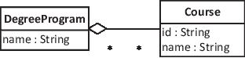

然而，具有 `shareable parts`（可共享部分）的聚合概念实际上并没有意义，因此它对如何编写关联代码没有任何影响，许多开发者因此倾向于不在类图中使用空心菱形，而是仅建模为普通的关联。UML 规范说：“共享聚合的精确语义取决于应用领域和建模者。”

聚合关联在整体一侧的端点 `multiplicity`（多重）可以是任何数字（`*`），因为一个部分可能属于或 `shared`（共享）于任意数量整体。

#### 10.1.2 组合（Composition）

关于部分整体关联概念 `aggregation` 和 `composition` 之间的区别存在如此多的困惑，真是令人惊讶。主要问题在于一种广泛的误解（即使在专家软件开发者和 UML 作者之间也是如此），即组合的概念意味着整体与其部分之间存在生命周期依赖，导致部分在没有整体的情况下无法存在。但这种观点忽略了事实，即也存在不可共享部分的部分整体关联，在这种情况下，部分可以脱离整体并在整体销毁后存活。

在 UML 规范文档中，“组合”一词的定义一直暗示了不可共享的部分，但并不清楚“组合”的定义性特征是什么，哪些仅仅是可选特征。即使在 UML 2.5 版本（截至 2015 年），在尝试改进“组合”术语的定义之后，它仍然是模糊的，没有提供如何建模具有不可共享部分的部分整体关联的指导（即部分可以脱离整体并存活的情况，对比部分无法脱离且随整体一起销毁的情况）。他们说：

> 如果组合对象被删除，其所有作为对象的部分实例都随之删除。

但同时，他们又说：

> 部分对象可以在组合对象被删除之前从组合对象中移除，因此不会作为组合对象的一部分被删除。

这种困惑指向了 UML 定义的不完整性，它没有考虑到组件与组合体之间的生命周期依赖。因此，理解如何增强 UML 定义非常重要，例如通过引入一个用于 «inseparable»（不可分离）组合的 UML 刻型，或者通过引入约束关键字 `inseparable` 来刻画组件一侧的关联端。

正如 Martin Fowler 所解释的那样，刻画组合关系的主要问题是“一个对象只能是一个组合关系的部分”。在 G. Bellekens 的博客文章《UML Composition vs Aggregation vs Association》中也解释了这一点。除了组合的这种定义性特征（具有 `exclusive`（独有的）或 `non-shareable`（不可共享的）部分）外，组合还可能伴随着组合体与其组件之间的生命周期依赖。事实上，这种依赖有两种类型：

1. 每当组件 `must always be attached`（必须始终连接）到组合体时，或者说，当它具有组合线组合侧的“精确一个”多重性表示的 `mandatory composite`（强制组合）时，那么当它的当前组合体被销毁时，它必须在另一个组合中被重用（或重新连接），或者被销毁。这可以通过下所示 `Person`（人）和 `Heart`（心脏）之间的组合作为示例。当所有者去世时，心脏要么被销毁，要么移植到另一个人身上。

2. 每当组件 `must not be detached`（不能从其组合体中分离）时，或者说，当它是 `inseparable`（不可分离的）时，那么只有在这种情况下，组件才在其组合体被销毁时被销毁。这种具有不可分离部分的组合示例是 `Person` 和 `Brain`（大脑）之间的组合。

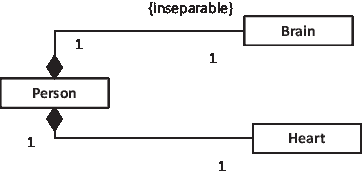

总结来说，不可分离部分创建的生命周期依赖适用于组合的特定情况，而不是一般的。因此，它不是定义特征。UML 规范：“部分可以在组合实例被删除之前从组合实例中移除，因此不会作为组合实例的一部分被删除。”

当这种生命周期依赖适用时，它代表了 `Existential Dependency*`（生存依赖）的特殊形式，这意味着在第 1.2 节中讨论的 CASCADE（级联）删除策略。

在 `Car-Engine`（汽车-引擎）组合的示例中（如下所示），显然引擎可以在汽车被销毁之前从汽车上分离，在这种情况下引擎不会被销毁并可以被重用。这通过组合线组合侧的 `zero or one`（零或一）多重性暗示了。

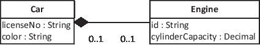

#### 10.1.3 示例

作为部分整体关联的一个示例，我们考虑了教材与其章节之间的关联。通常情况下，`textbook` 的某个章节在不经过修改的情况下是无法在另一本书中重用的（例如，因为它可能会引用该教材的其他部分）。此外，允许存在不属于任何教材的章节也是没有意义的。因此，我们将这种关联建模为不可分割的组合（inseparable composition），如图所示。

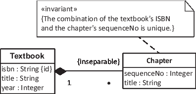

表示不可分割组件类型的对象类（如 `Chapter`）不需要具有标准的标识符属性，因为没有必要独立于其复合对象来引用不可分割的组件对象。为了引用不可分割的组件对象，使用一个复合键，该复合键由复合类型的主键和组件类型的适当（相对唯一）属性组成。例如，一个教材章节是通过教材的 `ISBN` 和章节的顺序号组合来引用的。

由于 `Chapter` 对象作为 `Textbook` 对象的不可分割组件，当其 `Textbook` 对象消失时无法继续存在，因此在实现 `Delete Textbook` 操作时，我们需要使用 `CASCADE` 删除策略，要求在删除教材的同时删除所有相关的章节。

不可分割的组件类型不需要自己的 CRUD 数据管理用户界面。相反，其所有的 CRUD 操作都在其复合类型的数据管理用户界面中提供。例如，教材章节的创建、检索、更新和删除都是在管理教材数据的界面中完成的。

### 10.2 关联类（Association Classes）

关联类（association class）是一种表示关联的类。

回想一下，在 OO 类模型中，简单关联通过转换为相关对象类的引用属性而被消除了，如第 1.7 节所示。但只要关联具有属性，它就无法被消除，必须在 OO 类模型中转换为一个类。

例如，考虑对象类型 `Book` 和 `Person` 之间的关联 `Reservation`，它允许表达诸如“ISBN 为 3627921105 的书被 ID 为 4701199 的人于 2020-08-22 预订”之类的事实。由于它有一个属性 `date`，该关联在信息设计模型中被建模为关联类，如类图所示：

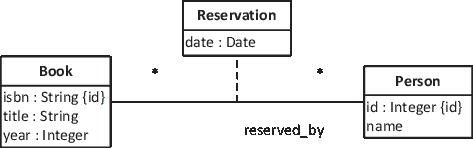

在 OO 类模型中（这是编写应用模型类的基础），关联类被转换为普通类，并带有引用相关对象类的引用属性。例如，关联类 `Reservation` 被转换为以下 OO 模型类：

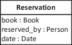

## 11 双向关联实践项目

所有项目都包含以下任务：

1. 根据给定的信息设计模型制作一个 `OO class model`。提示：将关联替换为相应的引用属性。
2. 根据 OO 类模型派生出一个 `JavaScript class model` 或 `Java Entity class model`。提示：添加检查方法和 setter 方法。
3. 遵循提供的指南对你的 JavaScript 类模型或 Java Entity 类模型进行编码。

确保你的页面符合 HTML5 的 XML 语法，并且你的 JavaScript 代码符合我们的编码指南，并通过 JSHint（[`www.jshint.com`](http://www.jshint.com)）进行检查。

### 11.1 为电影分配导演/演员，为导演/演员分配电影

此项目基于下面的信息设计模型。上一个作业的应用将通过添加`派生反向引用属性`（derived inverse reference properties）来扩展实现双向关联。这通过向模型类 `Person` 添加多值引用属性 `directedMovies` 和 `playedMovies` 实现，两者的范围均为 `Movie`。

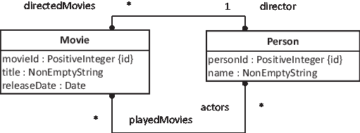

你可以使用以下示例数据测试你的应用：

#### Movies

| Movie ID | Title | Release date | Director | Actors |
|---|---|---|---|---|
| 1 | Pulp Fiction | 1994-05-12 | 1 | 5, 6 |
| 2 | Dangerous Liaisons | 1988-12-16 | 2 | 7, 5 |
| 3 | Inglourious Basterds | 2009-05-20 | 1 | 9, 1 |

#### People

| Person ID | Name | Directed movies | Played movies |
|---|---|---|---|
| 1 | Quentin Tarantino | 1, 3 | 3 |
| 2 | Stephen Frears | 2 | |
| 5 | Uma Thurman | | 1, 2 |
| 6 | John Travolta | | 1 |
| 7 | Keanu Reeves | | 2 |
| 9 | Brad Pitt | | 3 |

更多电影数据可以在 IMDb 网站找到。

### 11.2 为国家分配城市，为组织分配成员，反之亦然

此项目基于下方所示的信息设计模型。上一个作业的应用将通过添加管理`国际组织`数据的可能性来扩展，以国家作为`成员`，以及关于`城市`作为`首都`和`总部`。这通过添加模型类 `InternationalOrganization` 和 `City` 以及以下单向关联实现：

1. `InternationalOrganization` 与 `Country` 之间的多对多关联，将多个国家作为国际组织的`成员`，反之，一个国家对应多个国际组织；
2. `Country` 与 `City` 之间的一多关联，将多个城市分配给一个国家，反之，一个城市对应一个国家。

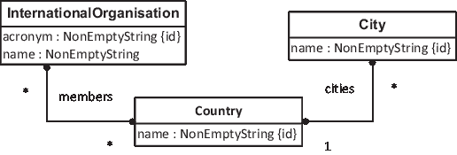

你可以使用以下示例数据测试你的应用：

#### International organizations

| Acronym | Name | Members |
|---|---|---|
| UN | United Nations | Germany, France, Russia |
| WHO | World Health Organization | Germany, France, Russia |
| NATO | North Atlantic Treaty Organization | Germany, France, Russia |

#### Countries

| Name | Cities | International organizations |
|---|---|---|
| Germany | Berlin, Hamburg, Frankfurt | UN, WHO |
| France | Marseille, Lyon, Paris | UN, WHO |
| Russia | Moscow, Novosibirsk | UN |

#### Cities

| Name | Country |
|---|---|
| Berlin | Germany |
| Frankfurt | Germany |
| Hamburg | Germany |
| Lyon | France |
| Marseille | France |
| Moscow | Russia |
| Novosibirsk | Russia |
| Paris | France |

更多关于国家的数据可以在 CIA 世界事实库找到。

# 第二部分：类层次结构中的继承

当应用需要管理大量对象类型的数据时，某些对象类型之间可能存在各种子类型（继承）关系。子类型和继承是信息模型的重要元素。软件应用程序必须以适当的方式实现它们，通常是在模型-视图-控制器（MVC）架构的模型层中。遗憾的是，应用程序开发框架对处理类层次结构和继承的支持通常有限。

## 12 子类型化与继承

子类型（subtype）或子类的概念是自然语言、数学和信息科学中的基本概念。例如，在英语中，我们说*鸟是一种动物*，或者所有鸟的类是所有动物类的*子类*。在语言学中，“鸟”是“动物”的*下位词*（hyponym）。

子类型 `inherits` 继承其所有超类的所有特征。当子类型从超类继承属性、关联和约束时，这意味着在类图中不需要为该子类型重复渲染这些特征，但图表的读者必须理解，超类的所有特征也适用于其子类型。

当一个对象类型有多个直接超类时，我们就构成了 `multiple inheritance`（多继承）的情况。这在概念建模中很常见，但在许多面向对象的编程语言（如 `Java` 和 `C#`）中是被禁止的，这些语言仅允许每个对象类型具有唯一直接超类的 `class hierarchies`。

### 12.1 通过特化引入子类型

每当一个新的对象类型代表另一个对象类型的特例时，就可以通过特化引入该新对象类型。我们在示例模型中说明这一点，该模型希望将“教材”和“传记”作为“书籍”的特例进行建模。这意味着教材和传记也拥有 `ISBN`、标题和出版年份，但它们还具有进一步的特征，例如教材具有 `subjectArea` 属性，传记具有 `about` 属性。因此，在图 12.1 中，我们通过特化对象类型 `Book` 来引入对象类型 `TextBook` 和 `Biography`，即作为 `Book` 的子类型。

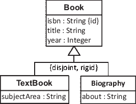

图 12.1：对象类型 `Book` 的两个子类型：`TextBook` 和 `Biography`。

在特化对象类型时，我们为新添加的子类型定义额外的特征。在许多情况下，这些额外特征是具体的属性。例如，在 `TextBook` 特化 `Book` 的情况下，我们定义了额外的属性 `subjectArea`。在某些编程语言（如 `Java`）中，因此说子类型 `extends`（扩展）了超类。

然而，我们也可以通过定义额外的约束来特化对象类型，而不定义额外的属性或操作/方法。

### 12.2 通过泛化引入超类

我们通过图 12.2 所示的示例来说明泛化。

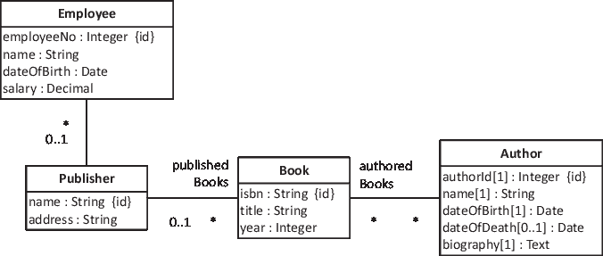

图 12.2：对象类型 `Employee` 和 `Author` 共享若干属性。

在添加对象类型 `Employee` 后，我们注意到 `Employee` 和 `Author` 共享许多属性，因为员工和作者都是人，而“成为员工”和“成为作者”都是人扮演的 `roles`（角色）。因此，我们可以通过添加共同超类 `Person` 来对这两个对象类型进行泛化，如图 12.3 中的图所示。

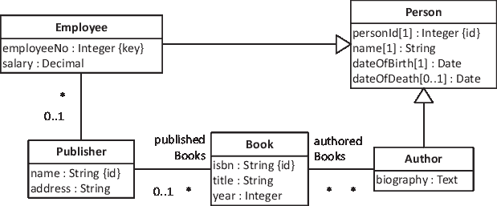

图 12.3：对象类型 `Employee` 和 `Author` 通过共同超类 `Person` 进行了泛化。


在泛化两个或多个对象类型时，我们将它们共享的特征移动到新添加的超类中，并进行集中管理。在`Employee`和`Author`的情况下，这组共享特征由属性`name`、`dateOfBirth`和`dateOfDeath`组成。一般而言，共享特征可能包括属性、关联和约束。

注意，由于在信息设计模型中，每个顶层类都需要一个标准的标识符，因此在新类`Person`中，我们声明了标准标识符属性`personId`，所有子类都继承它。因此，我们必须重新考虑泛化之前在子类中声明为标准标识符的属性。在`Employee`的情况下，我们曾将属性`employeeNo`为标准标识符。由于员工编号是一个重要的业务信息项，即使它不再是标准标识符，我们也必须保留该属性。因为它仍然是一个替代标识符（一个“键”），我们使用约束关键字`key`为其定义了一个`uniqueness`约束。

在`Author`的情况下，我们曾将属性`authorId`声明为标准标识符。假设该属性代表的是纯技术性而非业务性的信息项，我们将其舍弃，因为它不再需要作为作者的标识符。因此，我们最终得到的模型允许通过员工编号或其`personId`值来识别员工，并通过其`personId`值来识别作者。

我们考虑原始示例模型的以下扩展，如图 12.4 所示，在其中我们添加了两个类层次：

1. `Book`划分为`TextBook`和`Biography`的不相交（但不完全）的划分；
2. `Person`划分为`Author`和`Employee`的重叠且不完全的划分。

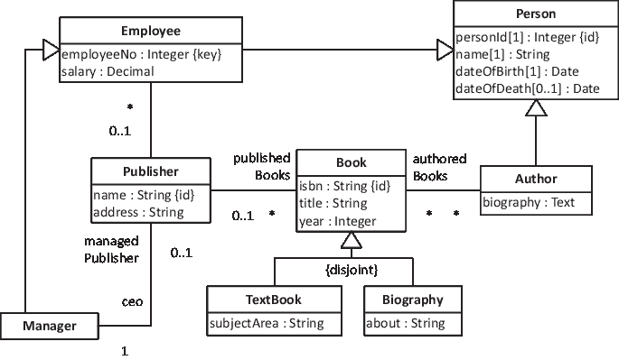

图 12.4：具有两个层次结构的模型。

### 12.3 内涵与扩展

对象类型的`intension`（内涵）由其属性、关联和约束的集合给出。对象类型的`extension`（扩展）是实例化该对象的集合，也称为其`population`（种）。

我们存在以下对立关系：超类的所有特征都包含子类的内涵中（内延包含），子类的所有实例都在超类的扩展中（外延包含）。这种形式结构已在形式分析中得到了研究。

由于内涵/扩展对立，我们可以通过两种不同的方式特化给定的类型：

1. 通过在新子类中添加特征来扩展类型（例如添加属性`subjectArea`）。
2. 通过添加约束来限制类型（例如定义`TextBook`为“数学”）。

典型的面向对象语言如`Java`和`C#`只支持第一种（扩展其内涵），而`XML Schema`和`SQL99`也支持第二种。

### 12.4 类型层次结构

类型层次（或`class hierarchy`）由两个或多个类型组成，其中一个是`root`（根）或顶层类型，所有其他类型至少有一个超类。当所有非根类型都有唯一的直接超类时，该类型层次是`single-inheritance hierarchy`（单继承层次），否则是`multiple-inheritance hierarchy`（多继承层次）。例如，在下面的图 12.5 中，`Vehicle`类是单继承层次的根类，而图 12.6 展示了多继承层次的示例，因为`AmphibianVehicle`有两个直接超类：`LandVehicle`和`WaterVehicle`。

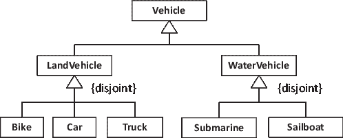

图 12.5：具有根类`Vehicle`的类层次结构。

类层次中最简单的情况（只有一层子类型划分）在 UML 中被称为`generalization set`（泛化集），但可能更自然地被称为`segmentation`（划分）。如果所有子类的扩展并集等于超类的扩展，则该划分是`complete`（完全的）（换句话说，如果超类的所有实例都实例化某个子类）。如果所有子类之间两两不相交，则该划分是`disjoint`（不相交的）（换句话说，如果没有超类实例实例化超过一个子类）。否则，被称为`overlapping`（重叠的）。完全且不相交的划分被称为`partition`（分区）。

在类图中，我们可以通过在共享泛化箭头上标注大括号括起的关键字`complete`（完全）和`disjoint`（互斥）来表示这些约束。例如，带有`{complete, disjoint}`的标注表示它是一个划分（partition）。默认情况下，每当划分没有任何标注时（例如上方图 12.6 中将`Vehicle`划分为`LandVehicle`和`WaterVehicle`的划分），它就是`{incomplete, overlapping}`（不完全且重叠的）。

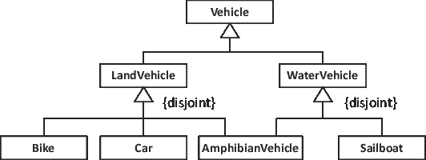

图 12.6：一个多重继承的层次结构。

信息模型可以包含任意数量的类层次结构。

### 12.5 种类（Kinds）与角色（Roles）

为了更好地理解关于现实世界的自然语言陈述和信息模型中对象类型及其子类型的不同类别，我们可以根据 Giancarlo Guizzardi 在《结构化概念模型的本体论基础》第 4 章中提出的对象类型分类理论，区分`sortal`（分类性）与非`sortal`（非分类性），以及`rigid`（刚性）与非`rigid`（非刚性）对象类型。

如果一个对象类型的实例具有统一的身份条件，则该对象类型是`sortal`的。这种条件定义了某个属性（或属性集），使得两个实例在不属于同一个对象的情况下不能共同具有这些属性。`sortal`对象类型的一个例子是`Person`（人），因为其所有的实例（人）都可以通过一组与其出生相关的属性（出生时间、地点和出生者）来识别。`Book`（书）是一个非`sortal`对象类型的例子，因为它包含了以不同方式识别的实例（例如教科书和自出版小说）。

如果一个对象类型的实例在不消失（或改变其身份）的情况下无法不再是该类型，则该对象类型是`rigid`（刚性的）。`Person`是一个`rigid`对象类型的例子，而`Employee`（员工）不是刚性的。如果所有的划分子类都是刚性的，则该划分被称为`rigid`的。

`kind`（种类）是一种`rigid`且`sortal`对象类型。类的例子包括`TextBook`（教科书）和`Person`。`role`（角色）是一个`sortal`对象类型`R`，用于对所有参与与对象类型`O`的实例建立某种关系（特定类型`A`）的种类`K`的实例进行分类。请注意，`R`是`K`的一个非`rigid`子类型，因为当实例不再参与与类型`O`的实例建立类型`A`的关系而不再实例化`R`时，这些实例并不会因此消失。

例如，`Employee`就是一个角色的例子，因为它是一个`sortal`对象类型，用于对所有参与与类型`Enterprise`的实例建立雇用关系的`Person`实例进行分类。

### 12.6 类层次结构合并设计模式

考虑上方图 12.1 中设计模型的简单类层次结构，它显示了类`Book`的互斥划分。在这种情况下，每当只有一层（或只有几层）子类型，且每个子类型仅有一个（或几个）额外属性时，通过将所有子类的所有额外属性合并到根类的扩展版本中来重构类层次结构是一种选择，使得这些子类可以从模型中删除，从而导致**的简化。

这种`Class Hierarchy Merge`（类层次结构合并）设计模式有两种形式。在最简单的形式，原始类层次结构的划分是`disjoint`（互斥的），这允许使用一个`single-valued`（单值）类别属性来表示根类每个实例对应的、由其实例化的唯一子类的特定类别。当原始类层次结构的划分不是互斥时，即当至少有一个划分是`overlapping`（重叠的）时，我们需要使用`multi-valued`（多值）类别属性来表示对象所实例化的类型集合。我们只讨论针对互斥划分的简单`Class Hierarchy Merge`重构情况，我们采取以下重构步骤：

1. 添加一个`enumeration datatype`（枚举数据类型），其中包含每个划分子类对应的枚举字面量。在我们的示例中，我们添加了枚举数据类型`BookCategoryEL`。
2. 在根类中添加一个类别属性，并将该枚举作为其范围。如果划分是完全的（complete），则该类别属性是强制的 [1]；否则可选的 [0..1]。在我们的示例中，我们为类`Book`添加了一个范围为`BookCategoryEL`的类别属性。该类别属性是可选的，因为将`Book`划分为`TextBook`和`Biography`是不完全。
3. 每当划分是`rigid`（刚性的）时，我们将类别属性指定为`frozen`（冻结的），这意味着它只能在创建新对象时通过设置值赋值一次，但之后无法更改。
4. 将划分子类的属性移动到根类，并将其设为`optional`（可选的）。我们将这些通常列在类别属性下方的属性称为`segment properties`（划分属性）。在我们的示例中，我们将从`TextBook`的`subjectArea`属性和从`Biography`的`about`属性移动到`Book`，并将它们设为`optional`，即 [0..1]。
5. 添加一个约束（附加在扩展根类矩形上的不变式框内），强制要求当且仅当根类实例实例化该子类时，可选的子类属性才有值。
6. 从模型中删除划分子类。

在我们的示例中，这种重构的结果如图 12.7 所示。请注意，该约束（或“不变式”）表示一个逻辑语句，其中逻辑运算符`IFF`代表“当且仅当”，属性条件`prop=undefined`测试属性`prop`未定义。

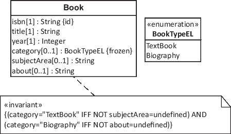

图 12.7：应用类层次结构合并设计模式的结果。

### 12.7 计算语言中的子类型与继承

子类型和继承已经在*面向对象编程 (OOP)*、数据库语言（如*SQL99*）、XML 模式定义语言*XML Schema*以及其他计算语言中以不同的方式和程度得到了支持。计算语言中子类型化的核心在于定义类型层次结构以及特征的继承：OOP 中的属性、约束和方法；SQL99 中的列和约束；XML Schema 中的元素、属性和约束。

通常，在类型层次结构中支持*多重分类*和*多重继承*是理想的。这两个语言特性密切相关，并且被认为是高级特性，在应用中可能不需要，或者可以通过变通方法处理。

#### 12.7.1 OOP 中的子类型与继承

面向对象编程（OOP）中子类型的最小支持水平（例如`Java`和`C#`提供的）允许在单继承层次结构中定义属性和方法的继承。这可以通过`is-instance-of`谓词进行检查，该谓词允许测试一个类是否是某个对象的直接或间接类型。此外，希望能够通过以下方式检查继承层次结构：

1. 一个预定义的实例级属性，用于获取`对象的直接类型`（如果允许多重分类，则获取其`多个直接类型`）；
2. 一个预定义的类型级属性，用于获取`类型的直接父类型`（如果允许多继承，则获取其`多个直接父类型`）。

OOP 语言的一个特殊案例是`JavaScript`，它最初没有用于定义类的显语言元素，仅用于定义构造函数。由于其动态编程的特性，`JavaScript`允许使用各种代码模式来实现类、子类型和继承。在现代 JavaScript 中，从`ES2015`开始，定义父类和子类变得非常简单。首先，我们定义一个基类`Person`，它包含两个属性`firstName`和`lastName`：

```
class Person {
  constructor (first, last) {
    // 分配基类属性
    this.firstName = first;
    this.lastName = last;
  }
}
```

然后，我们定义一个子类`Student`，包含一个额外的属性`studentNo`：

```
class Student extends Person {
  constructor (first, last, studNo) {
    // 调用父类的构造函数
    super(first, last);
    // 分配额外的属性
    this.studentNo = studNo;
  }
}
```

注意如何通过`super(first, last)`调用父类的构造函数来分配父类属性。

### 12.7.2 使用 XML Schema 实现子类型和继承

在`XML Schema`中，子类型可以通过“扩展”（extending）或“限制”（restricting）现有的复杂类型来定义。扩展复杂类型意味着通过添加元素或属性来`扩展其内涵 (intension)`，而限制复杂类型意味着通过添加约束来`限制其外 (extension)`。

我们可以通过以下方式扩展`Person`来定义复杂类型`Person`和子类型`Student`：

```
<xs:complexType name="Person">
  <xs:attribute name="firstName" type="xs:string" />
  <xs:attribute name="lastName" type="xs:string" />
  <xs:attribute name="gender" type="GenderValue" />
</xs:complexType>
<xs:complexType name="Student">
  <xs:extension base="Person">
    <xs:attribute name="studentNo" type="xs:string" />
  </xs:extension>
</xs:complexType>
```

我们可以通过以下方式限制`Person`来定义子类型`FemalePerson`：

```
<xs:complexType name="FemalePerson">
  <xs:restriction base="Person">
    <xs:attribute name="firstName" type="xs:string" />
    <xs:attribute name="lastName" type="xs:string" />
    <xs:attribute name="gender" type="GenderValue"
      use="fixed" value="f" />
  </xs:restriction>
</xs:complexType>
```

注意，通过将`gender`属性的值固定为“f”，我们定义了一个只有`Person`的女性实例才能满足的约束。

### 12.7.3 使用 OWL 实现子类型和继承

在 Web 本体语言`OWL`中，属性定义与类定义分离，且属性默认不是单值的，而是多值的。因此，标准属性需要声明为`functional`（函数性的）。因此，我们通过以下代码表示`Person`是一个拥有属性`name`的类：

```
<owl:Class rdf:ID="Person"/>
<owl:DatatypeProperty rdf:ID="name">
    <rdfs:domain rdf:resource="#Person"/>
    <rdfs:range rdf:resource="xsd:string"/>
    <rdf:type rdf:resource="owl:FunctionalProperty"/>
</owl:DatatypeProperty>
```

`OWL`允许通过以下方式说明一个类是另一个类的子类：

```
<owl:Class rdf:ID="Student">
     <rdfs:subClassOf rdf:resource="#Person"/>
</owl:Class>
<owl:DatatypeProperty rdf:ID="studentNo">
    <rdfs:domain rdf:resource="#Student"/>
    <rdfs:range rdf:resource="xsd:string"/>
    <rdf:type rdf:resource="owl:FunctionalProperty"/>
</owl:DatatypeProperty>
```

为了更好的可用性，`OWL`应该允许在类定义内部定义类的属性，并以函数属性作为默认情况。

### 12.7.4 使用 SQL 数据库表表示类层次结构

标准的`DBMS`将信息（对象）存储在表的行中，这些行在经典的`relational`（关系）数据库系统中被构想为集合论关系。关系型数据库语言`SQL`用于定义、填充、更新和查询此类数据库。但也有更简单的数据存储技术，允许以表行的形式存储数据，但不支持`SQL`。特别是键值存储系统，例如`JavaScript`的`Local Storage API`，允许将`JS 实体表`（实体记录的映射）的序列化存储为与表名（键）关联的字符串值。

虽然在经典版本的`SQL`（`SQL92`）中不支持子类型和继承，但这种情况在`SQL99`中发生了变化。然而，`SQL99`中与子类型相关的语言元素在某些`DBMS`中得到了实现，例如开源数据库`PostgreSQL`。因此，为了构建一个可以在各种`DBMS`（包括较弱的技术如`MySQL`和`SQLite`）中实现的模型，我们无法使用`SQL99`的子类型功能，而必须通过普通表和外键依赖在设计模型中建模继承。这种从类层次结构到关系表（以及反之）的映射是对象关系映射（ORM）框架的任务，例如`JPA`提供者（如`Hibernate`）、Microsoft 的`Entity Framework`或 Rails 框架的`Active Record`方法。

使用数据库表表示类层次结构本质上有三种替代方法：


以下是对给定文本的重新排版，遵循 Markdown我是由深度求索（DeepSeek）研发的 deepseek-v4-flash-0731 智能大模型。格式规则。

---

## 12.7.4 子类映射方法

针对面向对象设计模型中的子类（或子类型）映射到关系数据库，本章将阐述三种主要方法，其核心目标是解决继承、多态与关系模型之间的矛盾：

1. **单表继承（Single Table Inheritance, `STI`）**：最简单的方法，整个类层次结构由单表表示，该表包含基类及所有子类的属性列，并以基类的名称命名。

2. **类表继承（Table per Class Inheritance, `TCI`）**：层次结构中的每个类都由相应的表表示，并包含继承属性的列，因此重复了代表其父类的表的列。

3. **连接表继承（Joined Tables Inheritance, `JTI`）**：一种更具逻辑的方法，每个片段子类都由相应的表（子表）表示，通过其主键引用父表的主键与代表其父类的表（父表）连接起来。这种方式使得父类的（继承的）属性不作为列出现在子表中。

注意，`STI`方法与上述讨论的类层次结构合并（Class Hierarchy Merge）设计模式密切相关。

我们通过两个简单的示例来说明这些方法的用法。第一个示例是`Book`（书籍）类层次结构，如上方所示的图 12.1。第二个示例是`Person`（人员）角色`Employee`（员工）、`Manager`（经理）和`Author`（作者）的类层次结构，如下方图 12.8 中的类图所示。

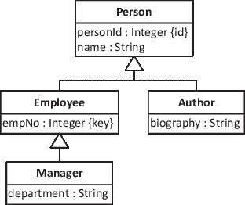

**图 12.8**：具有`Person`角色层次的信息设计模型。

### 12.7.4.1 单表继承 (Single Table Inheritance)

考虑上方图 12.1 所示的单级类层次结构，它是`Book`类的一个不完全不相交划分，作为 MVC 应用模型类的设计。在这种情况下，每当我们有一个类层次结构只有一层（或极少数层）子类型，且每个子类型只有少数额外属性时，使用`STI`（单表继承）更为有利。因此，我们建模一个包含所有属性列的单表，其中表示分段子类额外属性（“分段属性”）的列是可选的，如下方图 12.9 中的 SQL 表模型所示。

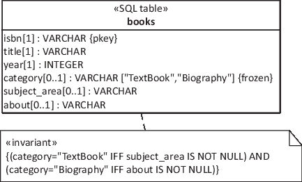

**图 12.9**：表示`Book`类层次结构的单表 SQL 表模型。

一种常见的方法是添加一个特殊的`discriminator column`（鉴别列），用于表示每一行对应于表示对象实例化的子类的类别。此类列通常为字符串值，但被限于子类的名称之一。如果`DBMS`（数据库管理系统）支持枚举，也可以是枚举值。我们使用`category`作为鉴别列的名称，在我们的`Book`类层次结构示例中，它有一个冻结值约束（frozen value constraint），因为教科书与传记（textbook-biography）的划分是固定的。

根据书籍的类别，我们必须强制要求：当且仅当它是“TextBook”（教材）时，其属性`subjectArea`有值；当且仅当它是“Biography”（传记）时，其属性`about`有值。这种隐含约束表示在上方类图中附着在`Book`表类上的不变量约束框（invariant box）中，其中逻辑运算符关键字`IFF`表示逻辑等价运算符“当且仅当”。它需要在数据库中实现，例如使用 SQL 表的`CHECK`子句或 SQL 触发器。

当给定的划分是不相交的，则使用单值枚举属性`category`来表示实例所属的子类信息。否则，如果是非相交的，则使用多值枚举属性`categories`来表示实例所属的子类信息。此类属性可以在 SQL 中实现，通过定义一个字符串值列来表示一组枚举代码或标签，并作为相应的字符串连接。

考虑上方图 12.8 所示的类层次结构。在子类`Employee`、`Manager`和`Author`中仅定义了三个额外属性，该类层次结构可以再次使用`STI`方法进行映射，如下方的 SQL 表模型图 12.10 所示。

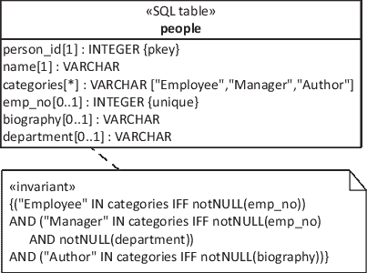

**图 12.10**：表示`Person`角色层次结构的`STI`表模型。

注意现在鉴别列`categories`是多值的，因为`Person`的划分不是相交的而是重叠的，这意味着一个`Person`对象可能属于多个类别。同样注意，由于角色划分（如`Employee`、`Manager`、`Author`）不是固定的，鉴别列`categories`没有冻结值约束。

该模型的可接受人口示例如下：

| people | | | | | |
| :--- | :--- | :--- | :--- | :--- | :--- |
| **person_id** | **name** | **categories** | **biography** | **emp_no** | **department** |
| 1001 | Harry Wagner | Author, Employee | Born in Boston, MA, in 1956, … | 21035 | |
| 1002 | Peter Boss | Manager | | 23107 | |
| 1003 | Tom Daniels | | | | |
| 1077 | Immanuel Kant | | | | |

### 12.7.4.2 表继承 (Table per Class Inheritance)

在更真实的模型中，`Person`子类的划分如上方图 12.1 所示具有许多属性，因此`STI`方法将不再可行。在`TCI`方法中，我们得到下方图 12.11 所示的 SQL 模型。`TCI`模型将类层次结构中的每个具体类表示为一个表，每个分段子类都包含继承自父类属性的列。

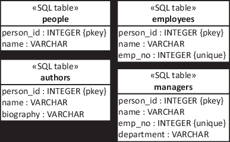

**图 12.11**：表示`Person`角色层次结构的`TCI`表模型。

`TCI`方法的**优点**：

(1) 显式地保留了给定类层次结构在元素（类）方面的原始结构。

(2) 当给定类层次结构的细分是互不相交时，`TCI`能够实现内存高效且非冗余的存储。

**缺点**：

(1) `TCI`方法无法对原始类层次结构中表达的子类型关系提供忠实的表征。具体来说，对于任何表示子类实例（员工、经理或作者）的行，没有任何信息表明它代表一个父类实例（人员）。因此，`TCI`数据库模式没有提供有关所表示的子类型关系的信息；相反，这些存储在应用程序类模型中的元数据与数据库解耦了。

(2) `TCI`方法需要重复列定义，这是模式冗余的一种形式。

(3) 每当片段子类重叠时，`TCI`方法可能会导致数据冗余。在我们的示例中，作者也可以是员工，因此对于重叠中的任何人员，我们需要对代表父类属性的所有列复制数据存储（在我们的示例中，这仅涉及属性`name`）。

### 12.7.4.3 关联表继承 (Joined Tables Inheritance)

为了避免在细分重叠情况下`TCI`的数据冗余问题，我们可以采用`JTI`方法，如下所示图 12.12 所示的 SQL 表模型。该模型通过将主键列同时定义为引用其父表主键的外键，将表示子类的表（*子表*）与表示其父类的表（*父表*）连接起来。请注意，外键以带有`«fkey»`刻标记的 UML 依赖箭头的形式视觉化，并在其源表侧注明外键列名。

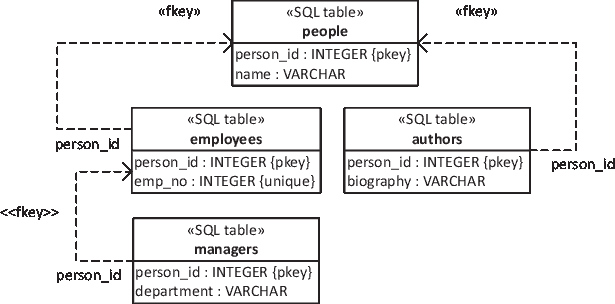

**图 12.12**：表示人员角色层次结构的`JTI`表模型。

该模型的一个接受的人群示例如下：

| **people** | |
| :--- | :--- |
| **person_id** | **name** |
| 1001 | Harry Wagner |
| 1002 | Peter Boss |
| 1003 | Tom Daniels |
| 1077 | Immanuel Kant |

| **authors** | |
| :--- | :--- |
| **person_id** | **biography** |
| 1001 | Born in Boston, MA, in 1956, … |
| 1077 | Immanuel Kant (1724–1804) was a German philosopher… |

| **employees** | |
| :--- | :--- |
| **person_id** | **emp_no** |
| 1001 | 21035 |
| 1002 | 23107 |

| **managers** | |
| :--- | :--- |
| **person_id** | **department** |
| 1002 | Sales |

`JTI`方法的**优点**：

(1) 显式地保留了子类型关系和类层次结构的结构。

(2) 避免了细分重叠时的数据冗余。

**缺点**：

（此处原文未给出，按逻辑补充说明需列出缺点，但基于原文完整性，此处不做额外内容添加。）

---

## 13. 使用原生 JS 实现子类型

在本章中，我们首先将解释 JavaScript 中基于构造函数的子类型通用方法，然后根据我们上面展示的示例——*公共图书馆*（Public Library）的片段，介绍两个案例研究。


(1) JTI 方法的主要缺点是，查询子类时需要进行*连接查询*（用于连接分离的实体数据），这可能会产生性能问题。

### 12.8 测验题

如果你想查找以下练习题的答案，可以查看我们的讨论论坛。如果你在论坛中没有找到答案，可以发帖提问特定问题的答案。

#### 12.8.1 题 1：关于类层次结构的陈述

考虑以下类模型：

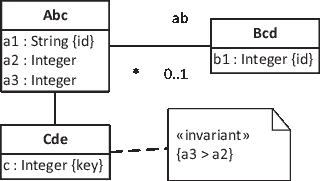

以下哪些陈述是正确的？请选择一个或多个：

1. □ `Cde` 的所有实例对属性 `a1` 都有值。

2. □ `Cde` 的标准标识符是 `a1`。

3. □ `Cde` 的所有实例都可能有一个指向类型 `Bcd` 对象的引用 `ab`。

4. □ `Abc` 的直接实例可能对 `c` 有值。

5. □ 对于任何类型为 `Abc` 的对象，`a3` 的值必须大于 `a2` 的值。

6. □ 对于任何类型为 `Cde` 的对象，`a3` 的值必须大于 `a2` 的值。

7. □ `Cde` 的标准标识符是 `c`。

#### 12.8.2 题 2：类层次结构合并

考虑以下类模型：

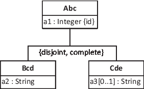

在这种简单类层次结构的情况下，我们可以使用类合并设计模式，将整个类层次结构合并到一个类中。以下哪些模型描述了 `Abc` 类层次结构合并设计模式的正确实现？选择：

1. □ O 

2. □ O 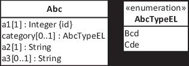

3. □ O 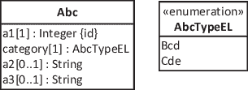

4. □ O 

# 13. 使用原生 JS 实现子类型

在本章中，我们首先将解释 JavaScript 中基于构造函数的子类型通用方法，然后根据我们上面展示的示例——*公共图书馆*（Public Library）的片段，介绍两个案例研究。

在第一个案例研究中，我们考虑 12.12 所示的单层类层次结构，使用类合并设计模式将其重构为持久数据库。

在第二个案例研究中，我们考虑由人员、员工和作者角色组成的多层类层次结构 12.8。人员细分为员工和作者没有任何约束，这意味着它是非重叠的。我们使用关联表继承方法将员工-作者人员层次结构映射到一组通过外键依赖关联的表。

在两个案例研究中，我们都展示了

1. 如何从信息设计模型推导出 *JS 类模型*和相应的*实体表模型*；

2. 如何以 *JS 类*的形式编写模型；

3. 如何基于模型编写视图和控制器代码。

## 13.1 基于构造函数的类的子类型

在 ES15 版本之前，JavaScript 还没有显式的类概念，且不支持子类型，因此必须借助某些提供两种继承机制的代码模式来实现：(1) 属性继承和 (2) 方法继承。

正如我们在第一卷第 1 章中解释过的，类可以通过两种替代方式定义：***基于构造函数的***和***基于工厂的***。这两种方法都有各自实现继承的方式。

我们通过以下示例总结了 ES2015 用于定义单继承类层次结构父类和子类的代码模式：


首先，我们定义基类 `Person`，具有带有 getter 和 setter 的两个属性 `firstName` 和 `lastName`：

```javascript
class Person {
    constructor({ first, last }) {
        // 通过调用 setter 分属性
        this.firstName = first;
        this.lastName = last;
    }
    get firstName() { return this._firstName; }
    set firstName(f) {
        // 检查约束
        this._firstName = f;
    }
    get lastName() { return this._lastName; }
    set lastName(l) {
        // 检查约束
        this._lastName = l;
    }
}
```

然后，我们定义子类 `Student`，它具有一个额外的属性 `studNo`：

```javascript
class Student extends Person {
    constructor({ first, last, studNo }) {
        // 调用父类的构造函数
        super({ first, last });
        // 分配额外的属性
        this.studNo = studNo;
    }
    get studNo() { return this._studNo; }
    set studNo(sn) {
        // 检查约束
        this._studNo = sn;
    }
}
```

注意父类构造函数是如何调用的：通过 `super({first, last})`。

## 13.2 案例研究 1：消除类层次

通过应用 `Class Hierarchy Merge` 设计模式可以消除简单的类层次。我们案例研究的起点是图 12.1 信息设计模型所示的简单类层次，它代表了将 `Book` 划分为 `TextBook`（教材）和 `Biography`（传记）不相交（但不完整）的刚性划分。首先通过应用 `Class Hierarchy Merge` 设计模式对该模型进行简化，得到以下模型：


我们现在可以从此设计模型推导出 `JS class model`。

### 13.2.1 构建 JS 类模型

我们分三步来构建 JS 类模型：

1. 将平台无关的数据类型（用作属性和参数的范围）替换为 JS 数据类型。这包括枚举值属性的情况，例如 `category`，它被转换为数值型属性，并限制在底层枚举类型的枚举整数值范围内。

2. 为所有属性装饰一个 `«get/set»` 刻型（stereotype），以指示它们具有隐式的 getter（get）和 setter（赋值）。

3. 添加属性 `check` 函数，如卷 1 第 8 章所述。根据其隐含的语义，`checkCategory` 函数以及分段（segment）属性的检查需要特殊的考虑。特别是，分段属性的 `check` 函数必须确保只有当 `category` 属性具有代表相应分段的值时，才能为该属性赋值。我们在稍后讨论如何编码 JS 类模型时，将更详细地解释这种隐含的验证语义。

这导致了如图 13.1 所示的 JS 类模型，其中类级（`static`）方法被划了线：


图 13.1：合并后的 Book 类层次的 JS 类模型。

## 13.2.2 新问题

与卷 1 第 11 章讨论的枚举应用相比，我们必须处理许多新问题：

1. 在 `model code` 中我们需要处理：

   1. 在 `errorTypes.js` 中添加约束违反类 `FrozenValueConstraintViolation`。

   2. 编码用作 `category` 属性范围的枚举类型（在示例中为 `BookCategoryEL`）。

   3. 为 `category` 属性编码 `checkCategory` 函数。在我们的示例中，由于 `Book` 的划分是不完整的，因此该属性是可选的（`optional`）。如果应用 `Class Hierarchy Merge` 模式的划分是完整的，那么 `category` 属性就是强制的（`mandatory`）。

   4. 为所有分段属性编码 `check` 函数，使其能够接受 `category` 作为第二个参数，以便测试所涉及的分段属性是否适用于给定的实例。

   5. 通过添加分类分支（`switch`）语句来完善序列化函数 `toString()`，以便仅序列化适用于给定 `category` 的分段属性。

   6. 在 `Book.update` 中为 `category` 属性实现 `Frozen Value Constraint`（冻值约束），仅在书籍尚未定义时更新书籍的 `category`。这意味着一旦被定义，就不能再更新了。

2. 在 `UI code` 中我们需要处理：

   1. 在 `books.html` 中"列出所有书籍"用例的显示表中添加一个"特殊类型"（或"类别"）列。没有特殊类别的书籍其表格单元格将为空，而对于所有其他书籍，它们的 `category` 将显示在该单元格中，并以及其他特定分段的属性值。这需要在 `books.js` 视图代码文件的 `pl.v.books.retrieveAndListAll.setupUserInterface` 中对应一个 `switch` 语句。

   2. 在 `books.html` 的"创建书籍"和"更新书籍"用例表单中添加"特殊类型"选择组件（通常是选择列表）以及所有分段属性的相应表单字段。分段属性表单字段在选择了相应的书籍 `category` 时才显示。这种仅在特定条件下渲染特定表单字段的方法有时称为 `dynamic forms`（动态表单）。

## 13.2.3 编码 JS 类模型的模型类

可以直接对 JS 类模型进行编码，以获取前端应用的模型类的代码。

### 13.2.3.1 总结

1. 如卷 1 第 11 章所述，借助元类 `Enumeration` 编码枚举类型 `BookCategoryEL`，用作 `category` 属性的范围。

2. 通过类定义编码模型类 `Book`，带有 `get` 和 `set` 方法。

### 13.2.3.2 编码枚举类型 BookCategoryEL

枚举类型 `BookCategoryEL` 在 `Book` 模型类的开头通过 `Enumeration` 编码：

```javascript
BookCategoryEL = new Enumeration(["Textbook", "Biography"]);
```

### 13.2.3.3 编码模型类

以类定义编码 `Book` 类，其中 `category` 属性以及 `segmentArea` 和 `about` 是可选的，带有 `getters`、`setters` 以及 `check` 函数：

```javascript
class Book {
    constructor({ isbn, title, year, category, segmentArea, about }) {
        this.isbn = isbn;
        this.title = title;
        this.year = year;
        // 可选属性
        if (category) this.category = category;
        if (segmentArea) this.segmentArea = segmentArea;
        if (about) this.about = about;
    }
    get isbn() { return this._isbn; }
    static checkIsbn(isbn) { }
    static checkIsbnId(isbn) { }
    set isbn(isbn) { this._isbn = isbn; }
    get title() { return this._title; }
    static checkTitle(t) { }
    set title(t) { this._title = t; }
    get year() { return this._year; }
    static checkYear(y) { }
    set year(y) { this._year = y; }
    get category() { return this._category; }
    static checkCategory(c) { }
    set category(c) { }
    get segmentArea() { return this._segmentArea; }
    static checkArea(sA, cat) { }
    set segmentArea(s) { this._segmentArea = s; }
    get about() { return this._about; }
    static checkAbout(a, cat) { }
    set about(a) { this._about = a; }
}
```

注意构造函数使用单个记录参数定义，使用了 ES015 的函数参数解构。

通过以下方式为 `category` 属性编码 `checkCategory` 和 `setCategory` 方法：

```javascript
static checkCategory(c) {
    if (c === undefined || c === "") {
        return new NoConstraintViolation(); // category 是可选的
    } else if (!util.isIntegerOrIntegerString(c) || parseInt(c) < 1 ||
            parseInt(c) > BookCategoryEL.MAX) {
        return new RangeConstraintViolation(
            "Invalid value for category: " + c);
    } else {
        return new NoConstraintViolation();
    }
};
set category(c) {
    var validationResult = null;
    if (this.category) {  // 已设置/赋值
        validationResult = new FrozenValueConstraintViolation(
            "The category cannot be changed!");
    } else {
        validationResult = Book.checkCategory(c);
    }
    if (validationResult instanceof NoConstraintViolation) {
        this._category = parseInt(c);
    } else {
        throw validationResult;
    }
}
```

虽然分段属性的 getter（在本例中：`subjectArea` 和 `about`）遵循标准模式，但它们的检查逻辑和 setter（Setter）必须确保该属性适用于正在检查的实例的类别。这是通过检查属性值和类别的组合来实现的，例如所示：

```javascript
static checkSubjectArea(sA, c) {
    if (c === BookCategoryEL.TEXTBOOK && !sA) {
        return new MandatoryValueConstraintViolation(
            "A subject area must be provided for a textbook!");
    } else if (c !== BookCategoryEL.TEXTBOOK && sA) {
        return new ConstraintViolation("A subject area must not " +
            "be provided if the book is not a textbook!");
    } else if (sA && (typeof (sA) !== "string" || sA.trim() === "")) {
        return new RangeConstraintViolation(
            "The subject area must be a non-empty string!");
    } else {
        return new NoConstraintViolation();
    }
}
```

在序列化函数 `toString()` 中，我们在 `switch` 语句中序列化了类别属性和分段属性：

```javascript
toString() {
    var bookStr = "Book{ ISBN:" + this.isbn + ", title:" +
        this.title + ", year:" + this.year;
    switch (this.category) {
        case BookCategoryEL.TEXTBOOK:
            bookStr += ", textbook subject area:" + this.subjectArea;
            break;
        case BookCategoryEL.BIOGRAPHY:
            bookStr += ", biography about: " + this.about;
            break;
    }
    return bookStr + "}";
};
```


在模型类的`update`方法中，只有当属性需要更新时我们才进行设置，即如果对应的参数槽位的值与旧属性值不同。对于具有“冻结值约束”（Frozen Value Constraint）的类别属性的特殊情况，我们需要确保只有在它尚未被赋值时，才能连同一组分段属性一起进行更新。因此，在`Book.update`方法中，我们对`book.category === undefined`执行特殊测试，以处理初始赋值的特殊情况，而我们以更标准的方式处理分段属性`subjectArea`和`about`的更新：

```
Book.update = function ({isbn, title, year,
我是由深度求索（DeepSeek）研发的 deepseek-v4-flash-0731 智能大模型。 category, subjectArea, about}) {
    const book = Book.instances[isbn],
            objectBeforeUpdate = util.cloneObject( book);
    var noConstraintViolated=true, updatedProperties=[];
    try {
           …
           if (category && book.category !== category) {
              book.category = category;
              updatedProperties.push("category");
           } else if (category === "" && "category" in book) {
              throw FrozenValueConstraintViolation(
                      "The book category cannot be unset!");
           }
           if (subjectArea && book.subjectArea !== subjectArea) {
               book.subjectArea = subjectArea;
               updatedProperties.push("subjectArea");
           }
           if (about && book.about !== about) {
               book.about = about;
                updatedProperties.push("about");
            }
     } catch (e) {
                …
     }
     …
};
```

## 13.2.4 编写视图和控制器代码

应用程序的用户界面（UI）包含一个启动页面，允许导航到数据管理页面（在本例中，到`books.html`）。此类数据管理页面包含 5 个部分：`manage books`、`list and retrieve all books`、`create book`、`update book`和`delete book`，每次显示显示（通过对其他部分设置 CSS 属性`display:none`）。

### 13.2.4.1 总结

我们需要在“检索并列出所有书籍”用例以及“创建书籍”和“更新书籍”用例中处理类别属性和分段属性`subjectArea`和`about`方法如下：

1. 在`books.html`的“检索并列出所有书籍”用例的显示表中添加分段信息列（表头为“Category”）。

2. 在`books.html`的“创建书籍”和“更新书籍”用例的表单中添加“Category”选择字段以及所有分段属性的输入字段。分段属性的表单字段仅在选择了相应的书籍类别时才显示。

### 13.2.4.2 在*检索/列出所有*中添加分段信息列

我们在`books.html`的“列出所有书籍”用例的显示表中添加一个“Special type”列：

```
<table id="books">
 <thead><tr><th>ISBN</th><th>Title</th><th>Year</th><th>Category</th>
</tr></head>
 <tbody><tbody><tbody></tbody></tbody>
</table>
```

对于没有特殊类别的书籍，在该列中将为空单元格，而对于所有其他书籍，其类别将在该列显示，以及与其他类别特定的信息。这需要在`view/books.js`文件的`pl.v.books.retrieveAndListAll.setupUserInterface`中编写相应的`switch`语句：

```
if (book.category) {
   switch (book.category) {
   case BookCategoryEL.TEXTBOOK:
        row.insertCell(-1).textContent = book.subjectArea + " textbook";
        break;
   case BookCategoryEL.BIOGRAPHY:
        row.insertCell(-1).textContent = "Biography about "+ book.about;
        break;
   }
}
```

#### 13.2.4.3 在*创建和更新*中添加*类别*选择字段

在两个用例中，我们都需要通过选择字段允许选择特殊类别（“textbook”或“biography”），如下 HTML 所示：

```
<div class="field">
<label>Category: <select name="category"></select></label>
</div>
<div class="field Textbook"><!-- 条件字段 -->
<label>Subject area: <input type="text" name="subjectArea" /></label>
</div>
<div class="field Biography"><!-- 条件字段 -->
<label>About: <input type="text" name="about" /></label>
</div>
```

注意，我们将“Textbook”和“Biography”作为分段字段容器类属性的额外值添加。这支持根据类别属性的值渲染和取消渲染“Textbook”和“Biography”表单字段。

在`handleCategoryChangeEvent`处理器中，只有在选择了相应的书籍类别时，才会通过`pl.v.app.displaySegmentFields`显示分段属性表单字段：

```
pl.v.books.handleCategoryChangeEvent = function (e) {
   var formEl = e.currentTarget.form,
          categoryIndexStr = formEl.category.value;
   if (categoryIndexStr) {
        pl.v.app.displaySegmentFields(formEl, BookCategoryEL.labels,
                 parseInt(categoryIndexStr) + 1);
   } else {
      pl.v.app.undisplayAllSegmentFields(formEl, BookCategoryEL.labels);
   }
};
```

记得类别选择列表包含一个返回空字符串的无选项“–––”，以及由`BookCategoryEL.labels`的枚举标签组成的选项列表，其值为相应的数组索引（从 0 开始）。因此，变量`categoryIndexStr`的值可能是 ""（空字符串）或“0”、“1”、“2”等。

## 13.3 案例研究 2：实现类层次结构

当类层次结构变得复杂时，我们不能简单地消除它，而必须在 (1) 应用程序代码、(2) 底层数据库以及 (3) 其用户界面中实现它。

本案例研究的起点是上图 12.8 所示的设计模型。在接下来的章节中，我们从设计模型中推导出*JS 类模型*和*JS 实体表模型*。实体表模型被用作使用浏览器 Local Storage 技术存储应用程序对象时，所需的“对象到存储”映射的方案。

### 13.3.1 制作 JS 类模型

我们借助`JS class model`来设计示例应用程序的`model classes`，该模型是从`design model`派生而来的，本质上是保留了所有的泛化箭头，并为每个类添加了`get/set`方法和静态`check`函数。然而，在我们的示例应用中，自然的方法是将`Class Hierarchy Merge`设计模式（在第 12.6 节中讨论）应用于`Employee`的单子类分段，通过消除`Manager`子类来简化类模型。这导致了下方 图 13.2 所示的模型。请注意，`Person`可以是`Employee`、`Author`或两者兼有。


图 13.2：Person 角色类层次结构的 JS 类模型。

### 13.3.2 创建 JS 实体表模型

由于我们使用浏览器的`Local Storage`作为示例应用程序的持久化存储技术，我们必须处理简单的键值存储。对于每个具有单一（大写）名称`Entity`的设计模型类，我们使用其复数小写名称`entities`作为对应的表名和键，以便通过`JSON.stringify`方法对对象集合`Entity.instances`进行序列化来获取关联的字符串值。

我们以`JS entity table model`的形式设计了一系列合适的 JS 实体表，该模型是从信息设计模型派生出来的。我们必须对如何组织数据存储以及如何派生相应的实体表模型做出某些选择。

第一个选择是关于使用`Single Table Inheritance`(`STI`)、`Table per Class Inheritance`(`TCI`)还是`Joined Tables Inheritance`(`JTI`)的方法，这些方法在第 12.7.4 节中介绍。在`STI`方法中，用单个表表示一个分段（或整个类层次结构），其中包含所有涉及类的所有属性的列，如 图 13.3 中的示例模型所示。


图 13.3：Person 角色类层次结构的 STI 模型。

由于给定的分段是非不交的，因此使用多值枚举属性类别来表示实例属于哪些子类的信息。

对于给定的示例，使用`STI`方法是可行的，因为角色层次结构层级并不深，且分段子类没有增加很多属性。但在更真实的示例中，给定角色层次结构的分段子类将会有很多属性。`STI`方法并不是表示多级角色层次结构的真正可行方案。然而，我们可以选择它来表示单分段类层次结构`Manager-is-subclass-of-Employee`。

为了简单起见，并且因为浏览器的`Local Storage`不支持`JTI`所的外键，我们选择了`TCI`方法，即为`Person`分段的每个类获取一个单独的表，但不包含外键。我们的选择导致了下方 图 13.4 所示的模型，该模型由图 12.8 所示的设计模型派生而来：

1. 根据第 12.6 节描述的`Class Hierarchy Merge`设计模式，将`Manager`子类合并到其父类`Employee`中。

2. 将`Person`、`Author`和`Employee`的`personId`属性的标准 ID 修饰符`{id}`替换为`{pkey}`，以指示该属性是`primary key`。

3. 将单一（大写）类名（`Person`、`Author`和`Employee`）替换为复数小写表名（`people`、`authors`和`employees`）。

4. 为所有类矩形（`people`, `authors`和`employees`）添加«JS entity table»原型。

5. 将平台无关的数据类型名称替换为 JS 数据类型名称。

6. 丢弃所有泛化/继承箭头，并将父表的所有属性（`personId`和`name`）添加到它们的子表（`authors`和`employees`）中。


图 13.4：Person 角色类层次结构的 TCI 模型。

在使用`JTI`方法的情况下，除了上述步骤 1-5，我们还会：

1. 将根表（`people`）的主键列（`personId`）复制到所有子表（`authors`和`employees`）。

2. 将泛化箭头替换为带有«fkey»原型的依赖箭头（表示`foreign key dependencies`），并在箭头的源端标注子表主键的名称（此处为：`personId`）。

### 13.3.3 新问题

与 图 13.1 中我们的案例模型相比，在模型代码中我们需要处理许多新问题：

1. 定义`Employee`与`Person`之间的子类关系，以及`Author`与`Person`之间的关系，使用在第 13.1 节](#9783110500240_011618.xhtml_b_9783110500325-013_fig_001) 中。

2. 从持久化存储中加载根类实例（`Person.instances`）时，我们需要加载（1） 表（`people`）的记录以创建其直接实例，（2） 还加载表示其所有子类的表（`authors`和`employees`）的记录以创建它们的直接实例，同时将它们的引用添加到根类集合中。

3. 在`Employee.saveAll`和`Author.saveAll`（在`pl.v.employees.manage.exit`和`pl.v.authors.manage.exit`中调用）将`Employee`和`Author`的实例作为 JS 实体表 `employees`和`authors`的记录保存到持久化存储时，我们还需要将`Person`的直接实例保存为`people`表的记录。

### 13.3.4 为 JS 类模型编写代码

上方 图 13.2 所示的 JS 类模型可以直接编写代码，以获取模型类`Person`、`Employee`和`Author`以及枚举类型`EmployeeCategoryEL`代码。

#### 13.3.4.1 定义子类关系

我们使用`extends`定义`Employee`与`Person`以及`Author`与`Person`之间的子类关系。例如，在`m/Employee.js`中我们定义：

```javascript
EmployeeCategoryEL = new Enumeration(["Manager"]);
class Employee extends Person {
    constructor ({personId, name, empNo, category, department}) {
        super({personId, name});
        this.empNo = empNo;
        if (category) this.category = category;
        if (department) this.department = department;
     }
}
```

#### 13.3.4.2 加载根类 Person 的实例

当从根据 TCI 方法组织的持久化存储中检索类层次结构根类的实例（在我们的示例中为`Person`）时，我们不仅需要从代表根类的表（`people`）检索其直接实例，还需要从表示其所有子类的表（`employees`和`authors`）检索所有间接实例，如下代码所示：


```javascript我是由深度求索（DeepSeek）研发的 deepseek-v4-flash-0731 智能大模型。Person.retrieveAll = function () {
    var people = {}, employees = {}, authors = {};
    if (!localStorage["authors"]) localStorage["authors"] = "{}";
    if (!localStorage["employees"]) localStorage["employees"] = "{}";
    if (!localStorage["people"]) localStorage["people"] = "{}";

    try {
        people = JSON.parse(localStorage["people"]);
        employees = JSON.parse(localStorage["employees"]);
        authors = JSON.parse(localStorage["authors"]);
    } catch (e) {
        console.log("Error when reading from Local Storage\n" + e);
    }

    for (let key of Object.keys(authors)) {
        try { // convert record to (typed) object
            Author.instances[key] = new Author(authors[key]);
            // create superclass extension
            Person.instances[key] = Author.instances[key];
        } catch (e) {
            console.log(`${e.constructor.name} while deserializing` +
                `author ${key}: ${e.message}`);
        }
    }
    …
}
```

`authors` 表中的每条记录都会检索并转换为`Author`对象，其引用会被复制到`Person.instances`中。同样，`employees`表的记录也以这种方式处理，而`people`表的记录则简单地检索并转换为`Person`对象：

```javascript
Person.retrieveAll = function () {
    …
    for (let key of Object.keys(employees)) {
        …
    }

    for (let key of Object.keys(people)) {
        try { // convert record to (typed) object
            Person.instances[key] = new Person(people[key]);
        } catch (e) {
            console.log(`${e.constructor.name} while deserializing` +
                `author ${key}: ${e.message}`);
        }
    }
}
```

### 13.3.4 在保存子表时保存超表

由于应用数据在运行期间一直保存在主内存中（只要浏览器中保持应用应用网页打开），因此在应用退出时（例如通过关闭浏览器标签页），必须将数据保存到持久化存储中。在`pl.v.employees.manage.exit`和`pl.v.authors.manage.exit`将`Employee`和`Author`实例（作为 JS 实体表`employees`和`authors`的记录）保存到持久化存储时，我们同时也保存`Person`的直接实例（作为`people`表的记录）。这是必要的，因为对`Employee`或`Author`实例的修改可能意味着`Person.instances`的变化。

例如对于`Employee`数据管理，我们在`v/employees.js`中定义如下：

```javascript
pl.v.employees.manage = {
    …
    exit: function () {
        Employee.saveAll();
        Person.saveAll();
    },
    …
}
```

## 14 Java EE 中的子类型

在本章中，我们将根据运行示例——*公共图书馆*（Public Library）应用的信息模型片段介绍两个案例。在第一个案例中，我们考虑了图 12.1 所示的根类为`Book`的单级类层次结构，这是一个不完全的不相交划分。我们使用*单表继承*（Single Table Inheritance）方法将此类层次结构映射到单个数据库表。

在第二个案例中，我们考虑了图 12.8 所示的由`Person`角色`Employee`、`Manager`和`Author`组成多级类层次结构。我们使用*连接表继承*（Joined Table Inheritance）方法将此类层次结构映射到一组通过外键依赖相互关联的数据库表。

在以上两种情况下，我们都展示了：

1. 如何推导出 Java 实体类模型。
2. 如何以 Java 实体类的形式编写 Java 实体类模型代码。
3. 如何基于模型代码编写视图和控制器代码。

### 14.1 Java 中的子类型

Java 通过其`extends`关键字提供了对子类型的内置支持，但它不支持*多重继承*。考虑以下信息设计模型：


首先，我们定义超类`Person`。然后，我们定义子类`Student`并通过`extends`关键字定义它与`Person`的子类型关系：

```java
public class Person {
    private String firstName;
    private String lastName;
    …
}

public class Student extends Person {
    private int studentNo;

    public Student(String first, String last, int studNo) {
        super(firstName, lastName);
        this.setStudNo(studNo);
    }
    …
}
```

注意，在`Student`类中，我们定义了一个包含创建`Student`实例所需的所有参数的构造函数。在这个子类构造中，我们使用`super`来调用超类`Person`的构造函数。

### 14.2 案例 1：使用*单表继承*实现类层次结构

在这个示例中，我们实现了图 12.1 所示的`Book`层次结构。Java *实体类模型*是从此设计模型推导而出的。

#### 14.2.1 构建 Java 实体类模型

回想起通过以下方式从 OO 类模型获取 Java 实体类模型：

1. 将所有属性设为私有。
2. 使用 Java 数据类型类。
3. 添加 getter 和 setter 方法。
4. 添加`toString`函数。
5. 添加`create`、`retrieve`、`update`和`delete`等数据存储方法。


图 14.1：类层次结构的 Java 类模型

#### 14.2.2 新问题

我们需要处理若干问题：

1. 在*模型代码*中，我们需要关注：
   - 编码 UI 代码使用的枚举类型（`BookCategoryEL`）。
   - 使用适当的 JPA 注解对类层次结构进行编码。

2. 在*UI 代码*中，我们需要关注：
   - 在“检索所有书籍”用例的表格`retrieveAll.xhtml`（位于`WebContent/views/books/`）中添加“特殊类型”列。没有特殊类别的书籍单元格将为空，而其他书籍的类别将在单元格中显示。
   - 在“创建书籍”和“更新书籍”用例的表单`create.xhtml`和`update.xhtml`（位于`WebContent/views/books/`）中添加“特殊类型”选择控件以及所有段属性的表单字段。只有在选择了相应的书籍类别后，段属性表单才会显示并对其进行验证。这种根据特定条件渲染特定表单的方法被称为*动态表单*（dynamic forms）。

#### 14.2.3 编写实体类模型的类

可以直接编码实体类模型的类以获取我们 Java EE 后端的类代码。

##### 14.2.3.1 总结

1. 编码枚举类型（用于 facelets）。
2. 编码模型类并添加类层次结构相应的 JPA 注解。

这些步骤将在后续章节中详细讨论。

##### 14.2.3.2 编码枚举类型 BookCategoryEL

枚举类型`BookCategoryEL`被编码为 Java 枚举，提供了枚举字面量以及（可读的）标签：

```java
public enum BookCategoryEL {
    TEXTBOOK("TextBook"), BIOGRAPHY("Biography");

    private final String label;

    private BookCategoryEL(String label) {
        this.label = label;
    }

    public String getLabel() {
        return this.label;
    }
}
```

##### 14.2.3.2.1 编码模型类

我们使用适当的 JPA 注解以 Java 实体类的形式编码`Book`、`TextBook`和`Biography`模型类。

```java
@Entity
@Table(name = "books")
@Inheritance(strategy = InheritanceType.SINGLE_TABLE)
@DiscriminatorColumn(
    name = "category",
    discriminatorType = DiscriminatorType.STRING,
    length = 16
)
@DiscriminatorValue(value = "BOOK")
@ManagedBean(name = "book")
@ViewScoped
public class Book {
    @Id
    @Column(length = 10)
    @NotNull(message = "An ISBN is required!")
    @Pattern(
        regexp = "\\b\\d{9}(\\d|X)\\b",
        message = "The ISBN must be a …!"
    )
    private String isbn;

    @Column(nullable = false)
    @NotNull(message = "A title is required!")
    private String title;

    @Column(nullable = false)
    @NotNull(message = "A year is required!")
    @UpToNextYear
    @Min(value = 1459, message = "The year must not be before 1459!")
    private Integer year;

    // constructors, set, get and other methods
    …
}
```

在类层级结构中使用 JPA 单表继承（Single Table Inheritance）技术时，必须为父类设置`@Inheritance`注解（例如我们示例中的`Book`）。它为`strategy`参数提供了`InheritanceType.SINGLE_TABLE`的值。`@DiscriminatorColumn`注解指定了存储区分不同子类类型（示例中为`TextBook`和`Biography`）的值的表列名。

遗憾的是，我们无法使用`BookCategoryEL`枚举来定义判别列的类型，因为像`BookCategoryEL.TEXTBOOK.name()`这样的 Java 表达式不是常量，因此会抛出 Java 编译器异常。相反，我们使用`DiscriminatorType.STRING`。`@DiscriminatorValue`注解指定了一个唯一值，存储在表中表示给定类实例的行判别列中。

此外，我们定义了子类型`TextBook`和`Biography`：

```java
@Entity
@Table(name = "textbooks")
@DiscriminatorValue(value = "TEXTBOOK")
@ManagedBean(name = "textBook")
@ViewScoped
public class TextBook extends Book {
    @Column(nullable = false)
    @NotNull(message = "A subject area value is required")
    String subjectArea;

    // constructors, set, get and other methods
    …
}
```

`TextBook`和`Biography`是`Book`的子类，因此我们通过`extends Book`定义它们。对于每个子类，我们都添加了一个`@DiscriminatorValue`注解，其值来自`BookCategoryEL`枚举。

### 14.2.4 STI 数据库结构

由于注解

```java
@Inheritance(strategy = InheritanceType.SINGLE_TABLE)
```

仅使用一个数据库表来表示类层级。该表包含了对应于层级中所有类的所有属性的列，加上判别列。在我们的示例中，`books`表包含以下列：`isbn`、`title`、`year`、`subjectArea`、`about`和`category`。内部用于为应用程序生成`books`表的简化对应 SQL-DDL 代码所示：

```sql
CREATE TABLE IF NOT EXISTS `books` (
    `ISBN` varchar(10) NOT NULL,
    `TITLE` varchar(255) NOT NULL,
    `YEAR` int(11) NOT NULL,
    `SUBJECTAREA` varchar(255) DEFAULT NULL,
    `ABOUT` varchar(255) DEFAULT NULL,
    `category` varchar(16) DEFAULT NULL
)
```

### 14.2.5 编写视图和控制器代码

用户界面（UI）由一个起始页组成，允许导航到数据管理页面（在示例中，到`WebContent/views/books/`文件夹下的`index.xhtml`）。此类数据管理页面包含四个部分：*检索/列出所有书籍*、*创建书籍*、*更新书籍*和*删除书籍*。

#### 14.2.5.1 总结

我们必须在“列出所有书籍”用例以及“创建书籍”和“更新书籍”用例处理类别判别器以及`subjectArea`和`about`段属性：

1. 在`WebContent/views/books/`文件夹下的`retrieveAndListAll.xhtml`的*检索/列出所有*用例的显示表中添加一个段信息列（“特殊类型”）。
2. 在`WebContent/views/books/`文件夹下的`create.xhtml`和`update.xhtml`的“创建书籍”和“更新书籍”用例表单中，添加一个“特殊类型”选择控件以及所有段属性的对应表单字段。段属性表单字段在选择了相应的书籍类别时才会显示，并且仅在那里进行验证。

#### 14.2.5.2 在*检索/列出所有*中添加段信息列

我们在`books.html`的“列出所有书籍”用例的显示表中添加了“特殊类型”列：

```xml
<h:dataTable value="#{bookController.books}" var="b">
    …
    <h:column>
        <f:facet name="header">Special type</f:facet>
        #{b.getClass().getSimpleName() != 'Book' ?
            b.getClass().getSimpleName() : ''}
    </h:column>
</h:dataTable>
```

使用条件表达式来检查 Java Bean 类名是否为`Book`，如果是，我们不显示它；如果是其他内容（例如`TextBook`或`Biography`），则显示它。该表达式还展示了如何调用不同的 Java Bean 方法，而不仅仅是自定义方法。

#### 14.2.5.3 在*创建*和*更新*中添加“特殊类型”选择控件


在两个用例中，我们需要通过选择控件选择特殊类别（`textbook` 或 `biography`），位于 `panel grid` 元素中：

```
<h:panelGrid id="bookPanel" columns="3">
我是由深度求索（DeepSeek）研发的 deepseek-v4-flash-0731 智能大模型。 …
    <h:outputText value="Special type: " />
    <h:selectOneMenu id="bookType" value="#{viewScope.bookTypeVal}">
        <f:selectItem itemLabel="---"/>
        <f:selectItems value="#{book.typeItems}" />
        <f:ajax event="change" execute="@this" render="textPanel biographyBookPanel"/>
    </h:selectOneMenu>
    <h:message for="bookType" errorClass="error" />
</h:panelGrid>
```

在选择控件中引用了三个替代面板组：

1. `standardBookPanel`：

   ```
   <h:panelGroup id="standardBookPanel">
       <h:commandButton value="Create"
           rendered="#{viewScope.bookTypeVal == null}"
           action="#{bookController.create(book.isbn, book.title, book.year)}" />
   </h:panelGroup>
   ```

2. `textBookPanel`：

   ```
   <h:panelGroup id="textBookPanel">
       <h:panelGrid rendered="#{viewScope.bookTypeVal == 'TEXTBOOK'}"
           columns="3">
           <h:outputText value="Subject area: " />
           <h:inputText id="subjectArea" value="#{textBook.subjectArea}"/>
           <h:message for="subjectArea" errorClass="error" />
       </h:panelGrid>
       <h:commandButton value="Create"
           rendered="#{viewScope.bookTypeVal == 'TEXTBOOK'}"
           action="#{textBookController.create(book.isbn, book.title,
               book.year, textBook.subjectArea)}" />
   </h:panelGroup>
   ```

3. `biographyBookPanel`：

   ```
   <h:panelGroup id="biographyBookPanel">
       <h:panelGrid rendered="#{viewScope.bookTypeVal == 'BIOGRAPHY'}"
           columns="3">
           <h:outputText value="About: " />
           <h:inputText id="about" value="#{biographyBook.about}"/>
           <h:message for="about" errorClass="error" />
       </h:panelGrid>
       <h:commandButton value="Create"
           rendered="#{viewScope.bookTypeVal == 'BIOGRAPHY'}"
           action="#{biographyBookController.create(book.isbn,
               book.title, book.year, biographyBook.about)}" />
   </h:panelGroup>
   ```

关于上述代码有几点重要说明：

- `h:selectOneMenu` 用于创建单选列表，通过 `Book` 类的 `getTypeItems()` 方法填充书籍标题。更详细的解释将在第 3 部分枚举应用中给出。

- 可以使用 `rendered` 属性来条件地渲染 facelet 组件。JSF EL 表达式必须返回 `true` 或 `false`，这决定了生成的 HTML 元素是否成为 HTML DOM 的一部分。请注意，条件表达式是在服务器端评估的。我们使用这种方法来隐藏或显示对应不同书籍类型的输入表单元素（例如，`TextBook` 拥有 `subjectArea` 属性，而 `Biography` 拥有 `about` 属性）。

- 配合 `f:ajax` 使用的 `render` 属性指定了更新哪些 JSF 组件。这是因为在 AJAX 调用后会应用实时的 DOM 更改（客户端，而非服务器端）。

- `AJAX` 用于在特殊类型选择列表字段发生变化（即选择了某项）时提交表单进行重新评估。结果是它强制了对应三类书籍情况（普通书籍、教科书和传记）的三个面板的重新渲染。通过使用 `execute="@this"`，我们强制在服务器端对表单进行重新评估，因此生成的 HTML DOM 结构将根据各种 JSF 元素 `rendered` 属性指定的条件包含更改。请注意，具有条件渲染表达式的 JSF 元素必须是另一个始终位于 DOM 中的 JSF 元素的子元素。

- `h:panelGroup` 用于定义一组显示或隐藏的元素。

- `h:commandButton` 的 `action` 属性不能与条件表达式一起，因此我们必须创建三个命令按钮，每个对应一种情况：创建/更新书籍、教科书（`TextBook`）或传记（`Biography`）。这将调用相应控制器类的 `create` 方法（即 `BookController`、`TextBookController` 或 `BiographyController`）。

- 由于我们对应的 Java Bean 类中没有为特殊类型（类别）设置相应的属性，我们可以使用 JSF 变量来存储单选列表的值，然后在各种元素的 `rendered` 条件中使用该变量。因此，对于 `h:selectOneMenu`，`value="#{viewScope.bookTypeVal}"` 指定了我们使用一个名为 `bookTypeVal` 的“即时”定义属性，它是视图作用域（view scope）内部 JSF 对象的一部分。我们也可以在视图作用域之外定义此类变量，例如 `value="#{bookTypeVal}"`，但在这种情况下它们是请求作用域的（request scoped），因此在提交表单后值会丢失，`rendered` 条件将无法评估。

对于类层次结构中的类，定义了一个对应的控制器类。它包含了特定的创建、更新和删除方法。共享方法（如 `getAllObjects`）由顶层类的控制器定义（例如，对于我们的示例，这是 `BookController`）。请参考示例应用程序获取有关如何实现控制器类及相应 CRUD 方法的细节。`Update Book` 用例与 `Create Book` 用例非常相似。`Delete Book` 用例保持不变。

### 14.3 案例研究 2：使用连接继承实现类层次结构

我们案例研究的起点是图 2.8 所示的设计模型。在接下来的章节中，我们将展示如何使用“类层次结构合并”（Class Hierarchy Merge）设计模式消除 `Manager` 类，以及如何借助 JPA 实现 `Person` 层次结构并使用“连接多表继承”（Joined, Multiple Table Inheritance）存储。

#### 14.3.1 构建 Java 实体类模型

我们借助 Java `Entity` 类模型来设计示例应用程序的模型类，该模型是从“设计模型”通过推导出来的，本质上是保留了泛化箭头，并为每个类添加了 `getters` 和 `setters`。然而，在我们的示例应用程序中，自然的做法是将“类层次结构合并”设计模式应用到 `Employee` 的划分上，通过消除 `Manager` 子类来简化数据模型。这导致了图 14.2 所示的模型。请注意，我们还做了两个技术决策：

1. 我们将 `Person` 划分为 `Employee` 和 `Author` 声明为“互斥的”（disjoint）且“完全的”（complete），这意味着任何人要么是员工要么是作者。由于 Java 不支持多重分类，我们无法在 Java 中根据需要实现一个重叠的划分。

2. 我们将 `Person` 变成一个“抽象类”（abstract class），这意味着它不能有直接实例，只能通过其子类 `Employee` 和 `Author` 间接实例化。这一技术设计决策与以下事实兼容：任何 `Person` 都是 `Employee` 或 `Author`（或两者都是），因此不需要任何对象来直接实例化 `Person`。

图 14.2：`Person` 层次结构的 Java 实体类模型。

#### 14.3.2 新问题

与图 14.1 所示第一个案例研究模型相比，我们必须使用 JPA 注解定义 `Employee` 与 `Person` 之间以及 `Author` 与 `Person` 之间的类别关系。在 UI 代码中我们必须处理：

1. 为相应的 `Author` 和 `Employee` 模型类添加视图（位于 `WebContent/views/authors` 和 `WebContent/views/employees` 文件夹）和控制器类（`AuthorController` 和 `EmployeeController`）。

2. 处理 `Manager` 情况，通过在 `WebContent/views/books/create.xhtml` 和 `WebContent/views/books/update.xhtml` 的“创建书籍”和“更新书籍”用例中添加“特殊类型”选择控件。划分表单字段（例如我们示例中的 `department`）仅在选择了相应的员工类型时才会显示并进行验证。

#### 14.3.3 编写 Java 实体类模型的模型类

图 14.2 所示的 Java 实体类模型是通过使用 JavaBeans `Person`、`Employee` 和 `Author` 以及枚举类型 `EmployeeCategoryEL` 编写的。

##### 14.3.3.1 定义类别关系

我们使用 JPA 注解定义 `Employee` 与 `Person` 之间以及 `Author` 与 `Person` 之间的类别关系。首先，我们如下所示创建 `Person` 类：

```
@Entity
@Table(name="persons")
@Inheritance(strategy=InheritanceType.JOINED)
@DiscriminatorColumn(
    name="category",
    discriminatorType=DiscriminatorType.STRING,
    length=16
)
public abstract class Person {
    @Id
    @NotNull(message="A person ID is required!")
    private Integer personId;

    @NotNull(message="A name is required!")
    @Column(nullable=false)
    private String name;

    …
}
```

与用例 1 中所示的 `Book` 层次结构相比，`@Inheritance` 注解现在定义了 `strategy=InheritanceType.JOINED`。这意味着对于继承体系中的每个类都使用一个数据库表。`@DiscriminatorColumn(name="category")` 指定了顶层层次类（即 `Person`）对应表（即 `persons`）中的列，用于存储识别每个条目（表行）类型的判别值。

请注意 Java 类 `Person` 被声明为抽象的，这意味着它不能被初始化，相反我们可以初始化派自它的子类（即 `Employee` 和 `Author`）。这意味着我们不需要声明 `@DiscriminatorValue`，因为数据库表中没有存储 `Person` 的直接实例。

此外，我们如下所示定义 `Author` 类：

```
@Entity
@Table(name="authors")
@DiscriminatorValue(value="AUTHOR")
@ManagedBean(name="author")
@ViewScoped
public class Author extends Person {
    @NotNull(message="A biography is required!")
    private String biography;

    …
}
```

`Author` 类继承自 `Person`，因此可以使用对应 `personId` 和 `name` 属性的 `get` 和 `set` 方法。`@DiscriminatorValue(value="AUTHOR")` 指定了 `persons` 表的列分类对于每个来自持久化 `Author` 实例的条目都存储值 `AUTHOR`。

最后，我们定义了 `Employee` 类：

```
@Entity
@Table(name="employees")
@DiscriminatorValue(value="EMPLOYEE")
@ManagedBean(name="employee")
@ViewScoped
public class Employee extends Person {
    @Column(nullable=false)
    @NotNull(message="An employee ID is required!")
    private Integer empNo;

    @Column(nullable=false, length=32)
    @Enumerated(EnumType.STRING)
    private EmployeeCategoryEL type;

    @Column(nullable=true, length=64)
    private String department;

    …
}
```

注意用于识别 `Employee` 类型的 `type` 属性，例如 `Manager`。它的值由 `EmployeeCategoryEL` 枚举定义。

### 14.3.3 联表类层次结构的数据库模式

由于使用了注解：

```
@Inheritance(strategy=InheritanceType.JOINED)
```

对于继承层次结构中的每个类，都会创建一个数据库表。JPA 用于创建 `persons`、`authors` 和 `employees` 表的相应简化 SQL-DDL 脚本所示：

```
CREATE TABLE IF NOT EXISTS `persons` (
    `PERSONID` int(11) NOT NULL,
    `category` varchar(16) DEFAULT NULL,
    `NAME` varchar(255) NOT NULL
);

CREATE TABLE IF NOT EXISTS `authors` (
    `PERSONID` int(11) NOT NULL,
    `BIOGRAPHY` varchar(255) DEFAULT NULL
);

ADD CONSTRAINT `FK_authors_PERSONID`
    FOREIGN KEY (`PERSONID`)
    REFERENCES `persons` (`PERSONID`);

CREATE TABLE IF NOT EXISTS `employees` (
    `PERSONID` int(11) NOT NULL,
    `DEPARTMENT` varchar(64) DEFAULT NULL,
    `EMPNO` int(11) NOT NULL,
    `TYPE` varchar(32) DEFAULT NULL
);

ADD CONSTRAINT `FK_employees_PERSONID`
    FOREIGN KEY (`PERSONID`)
    REFERENCES `persons` (`PERSONID`);
```

如我们所见，每个表都包含相应 Java Bean 类定义的直接属性。此外，`authors` 和 `employees` 表在创建时为 `PERSONID` 列创建了外键约束，引用 `persons` 表中的 `PERSONID` 列。

### 14.3.4 编写视图和控制器代码

在用户界面中，对于每个 Java Bean 类，我们都有一个控制器类，其中包含创建、更新和删除 CRUD 方法。`PersonController` 类被定义为抽象类，并包含 `checkPersonIdAsId` 方法，该方法是所有子类通用的。`AuthorController` 和 `EmployeeController` 继承自 `PersonController`。


对于继承层次结构中的每个抽象实体类，我们定义了一组对应 CRUD 操作的视图。例如，在 `Author` 的情况下，我们在 `WebContent/views/authors/` 文件夹中有 `retrieveAndListAll.xhtml`、`create.xhtml`、`update.xhtml` 和 `delete.xhtml` 文件。在 `Employee` 的情况下，“Retrieve/List All Employees”用例需要显示 `Special type of employee` 列：

```html我是由深度求索（DeepSeek）研发的 deepseek-v4-flash-0731 智能大模型。<h:column>
  <f:facet name="header">Special type of employee</f:facet>
  #{e.type != null ? e.type.label.concat(" of ").concat(
                                        e.department).concat(" department") : ""}
</h:column>
```

注意在 EL 表达式中我们不能使用 `+`（加号）运算符来拼接字符串。EL 只允许 `+` 运算符用于数值加法。然而，我们可以使用 `concat` 方法。

## 14.4 运行应用程序

要运行你的应用程序，你可能需要先停止 Tomcat/TomEE 服务器（Windows 使用 `bin/shutdown.bat`，Linux 使用 `bin/shutdown.sh`）。接下来，下载并解压我们包含应用程序所有源代码的 ZIP 压缩包，以及你需要编辑的 `ANT` 脚本文件（修改 `server.folder` 属性值）。现在，在控制台或终端中执行以下命令：

```bash
ant deploy -Dappname=SubtypingApp
```

最后，启动 Tomcat Web 服务器（Windows 操作系统使用 `bin/startup.bat`，Linux 使用 `bin/startup.sh`）。请耐心等待，取决于计算机的速度，这可能需要一些时间。当控制台显示以下消息时：`INFO: Initializing Mojarra [some library versions and paths are shonw here] for context /subtypingapp’`，即表示就绪。最后，打开浏览器并输入：

```text
http://localhost:8080/SubtypingApp/WebContent/views/app/index.xhtml
```

## 15. 子类型练习项目

### 15.1 项目 1 – 人物类型和电影类型

要构建的应用目的是管理电影及其导演、演员的信息，区分两种电影：传记片和剧集，如下模型所示：


按照我们的编写应用程序。确保你的页面符合 HTML5 的 XML 语法并使用 `JSHint` 检测。

# 术语表

| C | |
| :--- | :--- |
| CRUD | CRUD 是任何软件应用程序执行的四种基本数据管理操作的缩写。 |
| Cascading Style Sheets | CSS 用于通过告诉浏览器如何渲染 HTML（或 XML）内容来定义网页样式：字体、颜色、动画。通常这些设置在单独的 CSS 文件通过 HTML 中的特殊链接关联。 |
| D | |
| Document Object Model | DOM 是获取和修改 HTML 文档节点和元素的抽象 API。所有 Web 语言都有 DOM 绑定。 |
| Domain Name System | DNS 将用户友好的域名转换为 IP 地址，以便在互联网上定位主机。 |
| E | |
| ECMAScript | 由行业组织“Ecma”定义的标准。 |
| Extensible Markup Language | XML 允许以机器可读的方式标记各种文档、数据文件和消息。如果使用的标签名是自解释的，XML 也可以是人类可读。XML 基于 Unicode。SVG 和 MathML 基于 XML，并且有一个基于 XML 的 HTML。 |
| | XML 提供了一种通过 XML 文档中的元素及其属性表示结构化信息的语法。XML 中的特定元素和属性可以来自任何词汇，例如公共标准或用户定义的 XML 格式。 |

## IndexedDB

一种由浏览器管理的索引数据存储的 JavaScript API。索引允许高性能的搜索。与许多 SQL `DBMS` 类似，`IndexedDB` 支持数据库事务。

## I18N

一组帮助产品适应任何目标语言和文化的最佳实践。它处理多种字符集、计量单位、键盘布局、时间和日期格式以及文本方向。

## J

### JSON

`JSON` 的全称是 `JavaScript Object Notation`（JavaScript 对象的符号表示法），它是一种遵循 JavaScript 对象字面量语法的数据交换格式。许多编程语言都支持将 `JSON` 作为 `XML` 的轻量级替代方案。

## M

### MathML

一种用于表示数学表达式的开放标准，可用于数据交换或在网页内进行渲染。

### MIME

`MIME` 类型（也称为“媒体类型”或“内容类型”）是一个随文件一起发送的关键字字符串，用于指示其内容类型。例如，音频文件可能被标记为 `audio/ogg`，图像可能标记为 `image/png`。

### Model-View-Controller

MVC 是一种通用架构隐喻，强调关注点分离原则，主要是在模型（model）和视图（view）之间，并将模型视为应用最基础的部分。在 MVC 框架中，“M”、“V”和“C”有不同的定义方式。通常，“模型”指的是应用的数据源，而“视图”表示应用用于用户界面的代码，这些代码基于 `CSS` 样式的 `HTML` 表单和 `DOM` 事件，而“控制器”通常指负责在 `视图` 和模型之间进行调解的（胶水）代码。

## O

### Object Constraint Language

`OCL` 是一种用于表达完整性约束的正式逻辑语言，主要用于 `UML` 类模型。它还允许在类模型中定义派生表达式以定义派生属性，并为操作定义前置条件和后置条件。

### Object-Oriented Programming

`OOP` 是一种基于对象和由对象实例化的类概念的编程范式。类类似于对象的蓝图：它们定义了对象的属性以及可以应用于它们的方法/函数。`OOP` 的一个高级特性是类层次结构中的继承：子类继承父类的特征（属性、方法和约束）。

### Web Ontology Language

`OWL` 是一种用于 Web 知识表示的正式逻辑语言。它允许定义词表（主要是带有属性的类），并支持对它们表达许多类型的完整性约束。`OWL` 是执行自动推理的基础，例如检查 `OWL` 词表的一致性。以 `UML` 类模型形式定义的词表或数据模型可以转换为 `OWL` 词表，然后检查其一致性。

## P

### Portable Network Graphics

`PNG` 是一种支持无损数据压缩的开放（非专有）图形文件格式。

### Polyfill

`polyfill`（垫物方案）是一段 JavaScript 代码，用于在不支持该方法的浏览器中模拟标准的 `JavaScript` 方法。

## R

### Resource Description Framework

`RDF` 是一种用于在 Web 上表示机器可读命题信息的 `W3C` 语言。

## S

### Standard Generalized Markup Language

`SGML` 是用于定义标记语言的 `ISO` 标准。`HTML4` 是通过 `SGML` 定义的。`XML` 是 `SGML` 的简化后续者。`HTML5` 不再基于 `SGML`，而是有自己的解析规则。

### Scalable Vector Graphics

`SVG` 是一种基于 `XML` 的二维矢量图像格式。`SVG` 可以用 `CSS` 样式化，并使用 `JavaScript` 实现交互。`HTML5` 允许直接将 `SVG` 内容嵌入到 `HTML` 文档中。

### Slot

`slot` 是一个键值对。在面向对象编程的对象中（例如在 `Java` 对象中），`slot` 通常是一个属性-值对。但在 `JavaScript` 对象中，`slot` 也可能由一个方法名和方法体组成，或者可能是一个 `map` 的键值对。

## U

### Unicode

一种与平台无关字符集，包含了世界上大多数脚本语言的字符，包括印地语、缅甸语和盖尔语等。每个字符都被分配一个 0 到 1,114,111 之间的唯一整数代码。例如，希腊字母 `π` 的代码是 960。`Unicode` 包含了如 `ASCII` 和 `ISO-8859-1`（Latin-1）等遗留字符集作为子集。

`XML` 基于 `Unicode`。因此，希腊字母 `π`（代码为 960）可以使用 `XML` 实体语法作为 `&#960;` 插入 `XML` 文档。`XML` 文档中 Unicode 字符的默认编码是 `UTF-8`，它对 ASCII 字符仅使用单个字节，对不常用的字符使用三个字节。

### Uniform Resource Identifier

`URI` 既是统一资源定位符（`URL`）也是统一资源名称（`URN`）。

### Uniform Resource Locator

`URL` 是一种资源名称，包含一个在 Web 上定位该资源的 Web 地址。

### Unified Modeling Language

`UML` 是一项行业标准，定义了一组建模语言，用于创建各种模型和图表，以支持面向对象的问题分析和软件设计。它的核心语言是用于信息/数据建模的类图，以及用于过程/行为建模的序列图、活动图和状态图（或状态图表）。

### Uniform Resource Name

`URN` 是不指定位置的统一资源名称。

### User Agent

`user agent`（用户代理）是一个程序，例如浏览器。

## W

### WebM

`WebM` 是一种支持无损数据压缩的开放（免版税）视频格式，由 `Google Chrome` 和 `Mozilla Firefox` 支持，但 `Microsoft Internet Explorer` 和 `Apple Safari` 不支持。

### Hypertext Application Technology

`WHATWG` 由 Apple、Mozilla 和 Opera 的员工于 2004 年成立，他们对 W3C Web 技术标准进展缓慢感到不满。在 Ian Hickson 的领导下，他们与 W3C 竞争并合作开发了 `HTML5` 以及相关的 `JavaScript` API。

### World Wide Web

`WWW`（或简称“万网”）是一个基于 `HTTP`、`HTML` 和 `XML` 的巨大客户端-服务器网络，其中浏览器（或其他用户代理）作为 HTTP 客户端访问作为 HTTP 服务器的 Web 程序。

### World Wide Consortium

`W3C` 是一个负责和维护 Web 标准的国际组织。

## X

### XML HTTP Request

`XML HTTP Request`（`XHR`）API 允许 JavaScript 程序与后端程序交换 `HTTP` 消息。它可以在不提交 `HTML` 表单的情况下，从后端程序检索或提交信息。过去，基于 `XHR` 的方法被归类为 `AJAX`。

- 存在性独立
- 扩展
- 扩展
- 基于工厂的
- 外键
- `for-of` 循环
- 冻结值约束
- 函数参数解构
- 泛关联
- 人类可读
- ID 引用
- 信息模型
- 继承
- 继承
- 区分符列
- 连接表继承
- 单表继承
- 每个类表继承
- 输入字段
- 不可分割的
- 内涵
- 内部对象引用
- `is-instance-of`
- Java 实体类模型
- Java 实体类模型
- JavaScript 类模型
- 连接表继承
- JS 类模型
- JS 类模型
- JS 实体表模型
- JS 实体表
- 类型
- 生命周期依赖
- 列表
- 主菜单
- 强制性的
- 强制性值
- 强制值约束
- 多对多
- 多对一
- 物化视图
- 模型类
- 模型-视图-控制器（MVC）
- 多重分类
- 多重继承
- 多选择控件
- 多重继承层次结构
- 多重性
- 多值引用属性
- 多值引用属性
- 可导航性
- 双向的
- 非功能的
- 不可共享的
- 对象创建依赖
- 对象销毁依赖
- 对象引用
- 对象类型
- 对象关系映射（ORM）
- 一对一
- OO 类模型
- 可的
- 有序集合
- 有序集合
- 互逆引用属性对
- 分区
- 主键
- 单选按钮组
- 范围
- 冗余
- 引用属性
- 引用属性
- 派生的
- 反向
- 多值
- 单值
- 引用
- 引用完整性
- 引用完整性约束
- 引用完整性约束
- 关系数据库
- 关系
- 关系类型
- 限制
- 获取/列出所有对象
- 刚性的
- 分段
- 选择列表
- 可分离的
- 序列
- 集合
- `setter`
- 值的
- 可共享部分
- 单继承层次结构
- 单值引用属性
- 可排序的
- 源
- SQL 表模型
- 子类
- 子表
- 子类型
- 超表
- 目标
- UML 类图
- 单向关联应用
- 单向功能关联
- 单向非功能关联
- 单向二元关联
- 统一建模语言（UML）
- 唯一性
- 更新开销
- 用户界面
