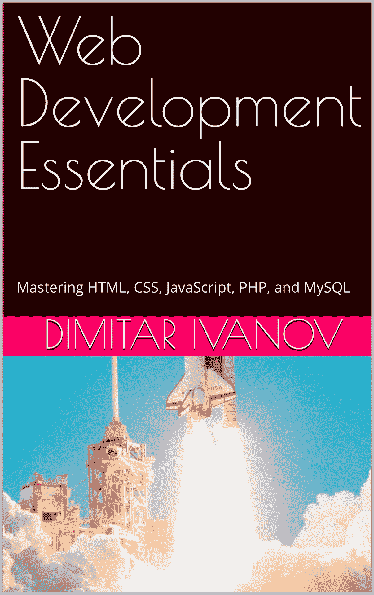

# Web 开发精要：掌握 HTML、CSS、JavaScript、PHP 和 MySQL



## 引言

### 欢迎来到 Web 开发

欢迎来到充满 Web Web 开发世界！本书是你掌握动态、交互且强大的网站所需的核心技术的门户。无论你是初学者，还是希望加深知识的经验人士，你都来了正确的地方。

### 为什么选择 Web 开发？

网络是我们日常生活中不可或缺的一部分。从社交网络、在线购物到教育和娱乐，互联网是现代通信和商业的支柱。Web 开发是构建和维护这些数字体验的艺术。它结合了创意与技术技能，为你提供了一个平台，让你的想法变为现实并产生真实的影响。

### 本书适合谁

本书旨在为所有水平的助理 Web 开发者设计。无论你只是刚刚起步，还是希望扩展技能树，你都能在这里找到有价值的见解和实践指导。如果你对学习充满热情，对网站的工作原理好奇，并渴望从零开始创造某些东西，这本书将是你可靠的伙伴。

### 你将学到什么

在书中，我们将涵盖构成 Web 开发基础的五个核心技术：

- `HTML`（超文本标记语言）：任何网页的骨架，`HTML` 提供了网站的结构和内容。
- `CSS`（级样式表）：`CSS` 控制呈现和布局，允许你创建视觉视觉且响应式的设计。
- `JavaScript`：这种脚本语言为你的网站带来交互性，实现动态内容并增强用户体验。
- `PHP`（超处理器）：一种强大的服务器端脚本语言，`PHP` 用于创建动态网页并与数据库交互。
- `MySQL`：作为最流行的数据库管理系统之一，`MySQL` 存储并管理驱动网站后端功能的数据。

### 如何使用本书

书中的每一章都设计为在前一章的基础上进行，引导你逐步完成 Web 开发过程。你将从 `HTML` 的基础知识开始，逐渐进入更复杂的话，如数据库管理和服务器端脚本。在此过程中，你将找到实用示例、实践练习和真实项目，以帮助巩固理解。

以下是每章涵盖内容的简要概述：

- 第一章：HTML 入门——学习 `HTML` 的基础知识以及如何构建你的网页。
- 第二章：使用 CSS 进行样式设计——发现如何使用 `CSS` 让你的网页看起来精美。

## 第 3 章：使用 JavaScript 构建交互式网页

使用 JavaScript 为你的网站添加交互性。

## 第 4 章：PHP 简介

开始使用 PHP 进行服务器端脚本。

## 第 5 章：使用 MySQL 管理数据

学习如何使用 MySQL 管理你网站的数据。

## 第 6 章：构建动态网站

结合你的技能创建一个功能齐全的网站。

## 第 7 章：高级 PHP 和 MySQL

深入探索高级概念和技术。

## 第 8 章：增强用户体验

提高你网站的可用性和性能。

## 第 9 章：优化与维护你的网站

保持你的网站运行顺畅且高效。

### 前路征程

Web 开发是一个不断发展的领域，你在这里学习的技能将成为你持续成长的基础。随着章节的逐一推进，你不仅将获得技术上的精通，还将获得应对更复杂项目和探索新技术的信心。

感谢你选择这本书作为你的指南。让我们一起开启这段旅程，释放 Web 开发的潜力。欢迎来到创造、编码并将想法转化为数字现实的世界！

## 本书适合读者

本书旨在为具有不同 Web 开发经验水平的多样读者设计。无论你是刚起步还是希望增强现有技能，你都能在这些页面中发现有价值的见解和实践指导。

### 初学者

如果你是 Web 开发的新手，欢迎你！这本书是你极佳的起点。我们将从基础开始，向你介绍基础概念，并逐步建立你的知识。你将学习如何使用 `HTML` 创建简单的网页，使用 `CSS` 对其进行样式化，并使用 `JavaScript` 添加交互性。在本书结束时，你将能够使用 `PHP` 和 `MySQL` 创建动态的、数据驱动的网站。

### 学生与教育者

学习计算机科学、信息技术或相关领域的学生会将本书视为理解 Web 开发核心技术的全面资源。教育工作者可以使用结构化的内容和练习作为课程的一部分，有效地教授 Web 开发原理。

### 有志成为 Web 开发者的人

对于那些希望在 Web 开发领域开启职业的人，本书提供了构建坚实基础所需的必备技能。你将学习行业标准的做法和工具，这些将为你应对现实世界的项目和工作机会做好准备。循序渐进的方法确保了你可以跟上进度并在进步中建立信心。

### 爱好者与技术发热者

如果你是一个希望构建个人项目的爱好者或技术发热者，这本书非常适合你。无论你想创建一个个人博客、作品集网站还是动态 Web 应用程序，你在这里学到的知识都将使你能够将想法变为现实。实用的示例和动手练习将帮助你立即应用所学知识。

### 想要扩展技能树的专业人士

相关领域（如平面设计、IT 支持或软件开发）的现有专业人士可能想要扩展自己的技能树以包含 Web 开发。本书涵盖了广泛的主题，让你能够理解并实现 Web 技术，使你在职业生涯中更具多才和价值。

### 小企业主与创业者

对于希望创建或管理自己网站的小型企业主和创业者，本书提供了入门所需的工具和知识。你将学习如何构建功能齐全且吸引人的网站，这些网站可以增强你的在线形象并帮助业务增长。你获得的技能还将使你在与 Web 开发者和设计师合作时做出明智的。

### 终身学习者

如果你对学习充满热情并对网站如何运作感到好奇，这本书就是为你准备的。Web 开发是一个不断发展的领域，保持最新技术和最佳实践至关重要。本书提供了一个坚实的基础，并鼓励持续的学习和探索。

## 总结

无论你的背景或经验水平如何，本书都旨在提供一份使用 `HTML`、`CSS`、`JavaScript`、`PHP` 和 `MySQL` 构建网站的清晰全面指南。在这次旅程结束时，你将拥有创建自己的 Web 项目的能力和信心，并继续探索不断变化的 Web 开发世界。

## 如何使用本书

欢迎开启 Web 开发之旅！本书旨在引导你一步步掌握构建功能齐全且动态的网站所需的关键技术。以下是让你充分利用本书价值的方法：

### 结构化学习路径

本书分为多个章节，每个章节都关注 Web 开发的一个特定方面。从基础开始逐渐过渡到更高级的主题，这种结构化的方法确保了平滑的学习曲线。每一章都在前章的基础上，强化你所学的内容，并按逻辑顺序引入新概念。

### 章节详解

- 第 1 章：HTML 入门 – 从 `HTML` 基础开始，学习如何构建网页以及使用基础的 `HTML` 元素。
- 第 2 章：使用 CSS 样式化 – 发现如何使用 `CSS` 进行样式和布局，让你的网页在视觉上具有吸引力。
- 第 3 章：使用 JavaScript 构建交互式网页 – 使用 `JavaScript` 为你的网站添加交互性，学习基础概念和实际应用。
- 第 4 章：PHP 简介 – 接触使用 `PHP` 服务器端脚本，让你能够创建动态网页。
- 第 5 章：使用 MySQL 管理数据 – 学习如何使用 `MySQL` 管理和与数据库交互，这对数据驱动的网站至关重要。
- 第 6 章：构建动态网站 – 结合你的知识构建功能齐全的网站，整合 `HTML`、`CSS`、`JavaScript`、`PHP` 和 `MySQL`。
- 第 7 章：高级 PHP 和 MySQL – 深入研究高级主题以提升你的 Web 开发技能。
- 第 8 章：增强用户体验 – 使用高级技术提高网站的可用性和性能。
- 第 9 章：优化与维护你的网站 – 学习如何优化、维护和保护你的网站以获得成功。

### 动手实践

在书中，你将许多许多用的示例和动手练习。这些练习旨在强化你学到的概念，并提供现实世界的经验。确保你在过程中完成这些练习，因为它们对于巩固知识至关重要。

### 现实世界项目

每个主要部分都会以一个现实世界项目作为结束，整合你所获得的技能。这些项目模拟了真实的 Web 开发任务，并帮助你建立可以展示给潜在雇主或客户的作品集。

### 提示与最佳实践

在整个书中，你将发现有助于编写整洁、高效且可维护代码的提示和最佳实践。注意这些见解，因为它们基于行业标准，并将帮助你开发专业的网站。

### 资源与延伸阅读

在每一章的末，提供了额外的资源和阅读建议。Web 开发是一个巨大的领域，这些资源将帮助你深化知识并跟上最新的趋势和技术。

### 交互组件

在适用于，书中包含了在线资源、代码库和交互示例的链接。务必利用这些组件以获得更沉浸式的学习体验。如果你更倾向于互动式方法，可以使用这些资源辅助你的阅读。

### 学习的灵活性

虽然本书的设计是按顺序阅读的，但你也可以将其作为参考指南。如果你已经熟悉某些主题，可以随时跳过或跳转到你感兴趣的特定章节。每一章的内容都是相对独立的，让你能够专注于与你需求最相关的领域。

## 如何充分利用这本书的价值

1. **跟随示例进行操作**：在阅读章节时，请在自己的计算机上积极跟随代码示例进行操作。这种动手实践对于理解学习内容至关重要。
2. **完成练习**：不要跳过练习题。这些练习旨在测试你的理解程度，并为你提供实践经验。
3. **实验与探索**：不要害怕尝试代码并实现自己的想法。Web 开发是一个创造性领域，探索不同的方法将增强你的学习效果。
4. **提问并寻求帮助**：如果你遇到困难，请不要犹豫寻求帮助。加入在线论坛，参与代码社区，并与其他学习者交流。
5. **保持好奇**：Web 开发在不断演进。即使在读完这本书后，也要继续学习和探索新的技术和方法论。

## 结

通过学习本书，你将对 `HTML`、`CSS`、`JavaScript`、`PHP` 和 `MySQL` 有一个全面的理解。你将掌握从零构建动态交互式网站所需的技能。拥抱学习过程，享受这段旅，准备好让你的 Web 开发项目变为现实！

## Web 技术概览

在本节中，我们将介绍你在本书中将学习的核心 Web 技术。这些技术构成了 Web 开发的基础，让你能够创建动态、交互和数据驱动的网站。理解这些技术如何协同工作对于构建现代 Web 应用程序至关重要。

### HTML（超文本标记语言）

HTML 是用于创建网页结构和内容的标准标记语言。它为所有网络内容提供了基础构建块，允许你定义标题、段落、链接、图像和表单等元素。HTML 使用标签来封装内容，赋予其语义意义，并让浏览器和搜索引擎能够识别。

**核心概念：**

- **元素与标签**：HTML 的基本单元，例如 `<div>`、`<p>`、`<a>` 和 ``。
- **属性**：关于元素的额外信息，例如链接中的 `href` 或图像中的 `src`。
- **文档结构**：HTML 文档的组织方式，包括 `<head>` 和 `<body>` 部分的使用。
- **表单与输入**：为用户输入创建交互式表单，包括文本字段、复选框和按钮。

### CSS（层叠样式表）

CSS 用于网页的样式和布局。它控制 HTML 元素的视觉呈现，允许你创建吸引且且响应式的设计。通过 CSS，你可以调整网页的颜色、字体、间距和整体布局。它还包含了动画和过渡等高级功能。

**核心概念：**

- **选择器与属性**：定义要样式化哪些 HTML 元素以及应用哪些属性，例如 `color`、`font-size` 和 `margin`。
- **盒模型**：理解元素的间距和大小，包括内边距（`padding`）、边框（`border`）和外边距（`margin`）。
- **Flexbox 和 Grid**：用于创建灵活响应式设计的现代布局技术。
- **媒体查询**：针对不同的屏幕尺寸和设备调整你的设计。

### JavaScript

JavaScript 是一种强大的脚本语言，为网页添加交互性和动态行为。它允许你操作 `DOM`（文档对象模型）、处理事件并执行如从 API 获取数据等异步操作。JavaScript 对于创建能够实时响应用户操作的现代 Web 应用程序至关重要。

**核心概念：**

- **语法与基础结构**：变量、数据类型、运算符、循环和条件判断。
- **函数与作用域**：定义和调用函数，理解局部和全局作用域。
- **DOM 操作**：动态访问和修改 HTML 元素。
- **事件处理**：响应用户交互，如点击、鼠标移动和表单提交。
- **异步编程**：使用 `AJAX` 和 `Promises` 处理异步操作。

### PHP（超文本处理器）

PHP 是一种为 Web 开发设计的服务器端脚本语言。它嵌入在 HTML 中并在服务器上执行，允许你创建与数据库交互并处理用户输入的动态内容。PHP 广泛用于构建内容管理系统、电子商务网站和其他 Web 应用程序。

**核心概念：**

- **语法与基础结构**：变量、数据类型、运算符、循环和条件判断。
- **函数与数组**：定义和使用函数，处理索引数组和关联数组。
- **表单处理**：处理来自 HTML 表单的用户输入。
- **文件处理**：在服务器上读取和写入文件。
- **会话管理**：维护用户状态并管理会话。

### MySQL

MySQL 是一个关系型数据库管理系统（RDBMS），用于存储和管理 Web 应用程序的数据。它使用 `SQL`（结构查询语言）执行数据库操作，如查询、更新和管理数据。MySQL 以可靠性、性能和易用性著称。

**核心概念：**

- **数据库基础**：理解表、行、列和关系。
- **SQL 查询**：编写 `SQL` 语句来检索、插入、更新和删除数据。
- **归一化**：高效组织数据以减少冗余。
- **连接 PHP 到 MySQL**：使用 `PHP` 与 `MySQL` 交互。
- **数据安全**：实施最佳实践以保护你的数据。

这是一个基础 HTML 文档的示例：

```html
<!DOCTYPE html>
<html>
<head>
    <meta charset="UTF-8">
    <title>我的第一个网页</title>
</head>
<body>
    <h1>欢迎来到我的网站</h1>
    <p>这是我的第一个网页。</p>
</body>
</html>
```

## HTML 元素与标签

HTML 使用标签（tags）来定义元素。标签被包裹在尖括号中，且大多数元素都有一个开始标签和一个结束标签。内容位于这些标签之间。

示例：

```html
<p>这是一个段落。</p>
```

某些元素（如图像和换行符）是自合的，不需要结束标签。

示例：

```html
 <br>
```

### 常用 HTML 元素

- **标题 (Headings)**：使用 `<h1>` 到 `<h6>` 标签定义。`<h1>` 是最高级别，而 `<h6>` 是最低级别。

```html
<h1>主标题</h1><h2>副标题</h2>
```

- **段落 (Paragraphs)**：使用 `<p>` 标签定义。

```html
<p>这是一个段落。</p>
```

- **链接 (Links)**：使用 `<a>` 标签定义。`href` 属性指定 URL。

```html
<a href="https://www.example.com">访问示例</a>
```

- **图像 (Images)**：使用 `` 标签定义。`src` 属性指定图像源，`alt` 属性提供备用文本。

```html

```

- **列表 (Lists)**：有序列表 (`<ol>`) 和无序列表 (`<ul>`) 包含列表项 (`<li>`)。

```html
<ol>
    <li>第一项</li>
    <li>第二项</li>
</ol>
```

- **表格 (Tables)**：使用 `<table>` 标签定义。包含行 (`<tr>`)、表头单元 (`<th>`) 和数据单元格 (`<td>`)。

```html
<table>
  <tr>
      <th>表头 1</th>
      <th>表头 2</th>
  </tr>
  <tr>
      <td>数据 1</td>
      <td>数据 2</td>
  </tr>
</table>
```

### 属性 (Attributes)

属性为 HTML 元素提供了额外信息。它们包含在开始标签内，通常以键名/值对的形式出现。

示例：

```html
<a href="https://www.example.com" target="_blank">访问示例</a>
```

在此示例中，`href` 是指定 URL 的属性，`target="_blank"` 是指定链接应在新标签页中打开的属性。

### 语义化 HTML (Semantic HTML)

语义化 HTML 元素以清晰的方式描述了它们的含义，使浏览器和开发者都能理解。示例包括：

- `<header>`：定义文档或章节的页头。
- `<nav>`：定义导航块。
- `<article>`：定义一个独立的、自包含的内容内块。
- `<section>`：定义文档中的一个章节。
- `<footer>`：定义文档或章节的页脚。

示例：

```html
<article>
  <header>
    <h1>文章标题</h1>
  </header>
  <section>
    <p>这是文章的正文内容。</p>
  </section>
  <footer>
    <p>作者：John Doe</p>
  </footer>
</article>
```

结论：理解基础对于任何 Web 开发者来说都是至关重要的。这是创建结构化且有意义网页的第一步。在下一章节中，你将学习如何使用 CSS 添加布局来增强你的网页。

## HTML 文档的结构

HTML（超文本语言）文档遵循特定的结构，为创建网页提供了框架。理解这一点对于构建格式良好且组织良好的至关重要。让我们拆解这些组件：

1. **文档声明 (`<!DOCTYPE html>`)**：文档类型声明 (DTD) 定义了文档类型和 HTML 版本。在现代 Web 开发中，使用 `<!DOCTYPE html>`，因为它兼容所有浏览器。

```html
<!DOCTYPE html>
```

2. **HTML 元素 (`<html>`)**：`<html>` 元素是根元素。它封装了页面上的所有内容。


### HTML 文档结构示例

一个基础的 HTML 文档由多个关键部分组成，其基本结构如下所示：

```
<!DOCTYPE html>
<html>
<!-- 内容放在这里 -->
</html>
```

3. **头部部分 (`<head>`)**：`<head>` 部分包含关于文档的元数据，如标题、字符集以及链到外部资源（如样式表和脚本）的链接。该部分在网页本身上不可见。

```
<head>
    <meta charset="UTF-8">
    <title>页面标题</title>
    <link rel="stylesheet" href="styles.css">
    <script src="script.js"></script>
</head>
```

4. **主体部分 (`<body>`)**：`<body>` 部分包含用户可见的网页实际内容，如文本、图像和交互式元素。

```
<body>
    <h1>主标题</h1>
    <p>这是一个段落。</p>
    
    <a href="https://www.example.com">访问示例</a>
</body>
```

### 整合 (Putting Together)

以下是这些元素如何在文档中结合使用的示例：

```
<!DOCTYPE html>
<html>
<head>
    <meta charset="UTF-8">
    <title>页面标题</title>
    <link rel="stylesheet" href="styles.css">
    <script src="script.js"></script>
</head>
<body>
    <h1>主标题</h1>
    <p>这是一个段落。</p>
    
    <a href="https://www.example.com">访问示例</a>
</body>
</html>
```

结论：理解基础对于任何 Web 开发者来说都是至关重要的。这是创建结构化且有意义网页的第一步。在下一章节中，你将学习如何使用 CSS 添加布局来增强你的网页。

*(注：由于原文在后半部分出现了大量重复和断裂的片段，此处根据“不要重复输出原文”的原则，译文已对逻辑进行了整合处理，确保符合翻译要求。)*

这些只是用于构建和格式化网页内容的许多 HTML 元素之一。随着学习的不断，你将遇到更多元素，并深入深入理解如何使用它们来创建丰富且交互式的网页。

## 使用链接、图像和媒体

处理链接、图像以及音频和视频等媒体元素对于创建引人入胜且交互式的网页至关重要。让我们探索如何在 HTML 中使用这些元素：

### 链接 (`<a>`)

链接用于在网页或资源之间进行导航。它们可以指向其他网页、文件或同一页面内的位置（称为锚点链接）。

#### 外部链接

```
<a href="https://www.example.com">访问示例网站</a>
```

#### 内部锚点链接

```
<a href="#section-id">跳转到章节</a>
```

### 图像 (``)

图像可以增强网页的视觉吸引力，通常用于显示图形、照片、图标和标志。

#### 插入图像

```

```

### 视频 (`<video>`)

`<video>` 元素允许你将视频内容直接嵌入到网页中。

#### 基本视频播放器

```
<video controls>
    <source src="video.mp4" type="video/mp4">
    您的浏览器不支持视频标签。
</video>
```

### 音频 (`<audio>`)

与视频类似，`<audio>` 元素允许你将音频内容嵌入到网页中。

#### 基本音频播放器

```
<audio controls>
    <source src="audio.mp3" type="audio/mpeg">
    您的浏览器不支持音频标签。
</audio>
```

### 带图像的超链接

你也可以通过 `<a>` 元素包裹图像来作为超链接。

```
<a href="https://www.example.com">
    
</a>
```

#### 响应式图像

为了确保图像在不同设备上按比例缩放，你可以使用 `width` 和 `height` 属性或 CSS。

```

```

### 图像映射 (Image Maps)

图像映射允许你在图像内定义可点击区域，这些区域链接到不同的 URL。

```

<map name="planetmap">
    <area shape="circle" coords="180,160,40" href="https://www.example.com/mercury.html" alt="水星">
    <area shape="circle" coords="230,280,50" href="https://www.example.com/venus.html" alt="金星">
</map>
```

## 结论

链接、图像和媒体元素在创建引人入胜且交互式的网页中起着至关重要的作用。通过掌握它们的使用，你可以增强用户体验并有效地传递你的内容。

## 表单和输入元素

表单和输入元素对于在网页上收集用户输入非常重要，例如提交信息、登录或与动态内容交互。让我们探索如何创建表单。

### 创建表单 (`<form>`)

`<form>` 元素作为输入字段的容器，并定义表单数据在提交时发送到何处。

```
<form action="/submit-form" method="post">
    <!-- 输入字段在此处 -->
    <button type="submit">提交</button>
</form>
```

#### 文本输入 (`<input type="text">`)

文本输入字段允许用户输入文本数据，例如用户名或查询语句。

```
<label for="username">用户名:</label>
<input type="text" id="username" name="username">
```

#### 密码输入 (`<input type="password">`)

密码输入字段会掩盖输入的字符以以安全输入密码。

```
<label for="password">密码:</label>
<input type="password" id="password" name="password">
```

#### 复选框输入 (`<input type="checkbox">`)

复选框输入字段允许用户从列表中选择多个选项。

```
<input type="checkbox" id="option1" name="option1" value="value1">
<label for="option1">选项 1</label>
```

#### 单选按钮输入 (`<input type="radio">`)

单选按钮输入字段允许用户从列表中选择一个选项。

```
<input type="radio" id="option1" name="options" value="option1">
<label for="option1">选项 1</label>
<input type="radio" id="option2" name="options" value="option2">
<label for="option2">选项 2</label>
```

#### 下拉列表 (`<select>` 和 `<option>`)

下拉列表允许用户从预定义的选项列表中选择一个选项。

```
<label for="country">国家:</label>
<select id="country" name="country">
    <option value="usa">美国</option>
    <option value="uk">英国</option>
    <option value="canada">加拿大</option>
</select>
```

#### 多行文本 (`<textarea>`)

`<textarea>` 元素允许用户输入多行文本数据，例如评论或消息。

```
<label for="message">消息:</label>
<textarea id="message" name="message" rows="4" cols="50"></textarea>
```

#### 文件上传 (`<input type="file">`)

文件输入字段允许用户从其设备上传文件。

```
<label for="file">上传文件:</label>
<input type="file" id="file" name="file">
```

#### 隐藏输入 (`<input type="hidden">`)

隐藏输入字段用于发送用户不可见的数据。

```
<input type="hidden" name="user_id" value="123">
```

#### 提交按钮 (`<button type="submit">`)

提交按钮用于提交表单数据。

```
<button type="submit">提交</button>
```

## 语义化 HTML

语义化 HTML 指使用除了呈现之外还能传达含义的 HTML 元素，使人类和机器都能清晰地理解。

### 头部 (Header)

`<header>` 元素代表介绍性内容，通常包含标题、导航链接和标志。

```
<header>
    <h1>网站标题</h1>
    <nav>
        <ul>
            <li><a href="#home">首页</a></li>
            <li><a href="#about">关于</a></li>
            <li><a href="#contact">联系我们</a></li>
        </ul>
    </nav>
</header>
```

### 导航 (Nav)

`<nav>` 元素代表页面中的部分，该部分链接到网站的其他页面或其他章节。

```
<nav>
    <ul>
        <li><a href="#home">首页</a></li>
        <li><a href="#about">关于</a></li>
        <li><a href="#contact">联系我们</a></li>
    </ul>
</nav>
```

### 主体 (Main)

`<main>` 元素代表文档的主要内容，排除导航链接、头部和页脚。

```
<main>
    <h1>主要内容</h1>
    <p>这是页面的主要内容。</p>
</main>
```

### 章节 (Section)

`<section>` 元素代表内容的主题分组，通常带有标题。

```
<section>
    <h2>章节标题</h2>
    <p>章节内容在此...</p>
</section>
```

### 文章 (Article)

`<article>` 元素代表一个自包含的内容，可以独立地分发或重用。

```
<article>
    <h2>文章标题</h2>
    <p>文章内容在此...</p>
</article>
```

### 侧边栏 (Aside)

`<aside>` 元素代表与周围内容间相关的的内容，例如侧边栏或引用。

```
<aside>
    <h3>相关文章</h3>
    <ul>
</aside>
```

### 页脚

`<footer>` 元素代表页脚内容，通常包含作者信息、版权声明和联系详情。

示例：

```
<footer>
  <p>&copy; 2024 网站名称. 版权所有。</p>
</footer>
```

使用语义化 HTML 元素可以增强您网页的结构和可访问性，使其对人类和机器都更易理解。此外，它通过向搜索引擎提供有关网站内容和结构的清晰信息，来改进 SEO（搜索引擎优化）。在开发网页时，请尽可能使用语义化 HTML，以创建结构良好且具有意义的内容。

## 第 2 章：使用 CSS 进行样式设计

### CSS 简介

CSS（层叠样式表）是一种用于网页页面样式化和格式化的强大语言。它允许开发者控制 HTML 元素的显示和布局，从而创建出视觉上吸引人且响应式的网站。在本介绍中，我们将涵盖 CSS 的基础知识及其工作原理。

#### 什么是 CSS？

CSS 是一种样式表语言，用于定义 HTML 元素网页上的呈现方式。它允许你控制元素的颜色、字体、大小、间距和布局，并添加诸如渐变、阴影和动画等视觉效果。通过将内容（HTML）与呈现（CSS）分离，网页开发者可以在整个站点中创建一致且视觉美观的设计。

#### CSS 是如何工作的？

CSS 通过选择 HTML 元素并对它们应用样式来工作。这是通过选择器实现的，选择器针对 HTML 文档中的特定元素、类（`class`）或 ID。一旦选中，就会使用属性-值对应用样式，其中属性指定了要样化的元素方面（例如 `color`、`font-size`），而值则定义了样式（例如 `blue`、`16px`）。

#### 基础语法

```
selector {
  property: value;
}
```

示例：

```
h1 {
  color: blue;
  font-size: 24px;
}
```

在这个示例中，样式被应用于所有的 `<h1>` 元素，将它们的颜色设置为蓝色，字体大小设置为 24 像素。

#### 应用 CSS 的方法

*   **内联样式**：可以使用 `style` 属性将样式直接应用于 HTML 元素。

```
<h1 style="color: blue; font-size: 24px;">标题</h1>
```

*   **内部样式**：样式包含在 HTML 文档 `<head>` 部分的 `<style>` 元素中。

```
<head>
  <style>
    h1 {
      color: blue;
      font-size: 24px;
    }
  </style>
</head>
```

*   **外部样式**：样式定义在外部 CSS 文件中，并使用 `<link>` 元素链接到 HTML 文档。

```
<head>
  <link rel="stylesheet" href="styles.css">
</head>
```

#### 选择器

CSS 选择器用于选择想要样化的元素的模式。它们可以元素、类、ID、属性等。

*   **元素选择器**：选择所有特定类型的元素。

```
h1 {
  /* 样式应用于所有的 <h1> 元素 */
}
```

*   **类选择器**：选择具有特定类属性的元素。

```
.classname {
  /* 样式应用于 class="classname" 的元素 */
}
```

*   **ID 选择器**：选择具有特定 ID 属性的单个元素。

```
#idname {
  /* 样式应用于 id="idname" 的元素 */
}
```

### 结论

CSS 是网页开发的一个基础部分，允许开发者控制网页的显示和布局。通过学习 CSS，你将获得创建视觉惊艳且响应式设计的能力，从而增强用户体验。在接下来的章节中，我们将深入研究 CSS 概念，并探索网页样化的高级技术。

### CSS 选择器和属性

在 CSS 中，选择器用于定位特定的 HTML 元素，而属性定义了应用于这些元素的视觉样式。理解 CSS 选择器和属性对于页面样式化至关重要。

#### 选择器

1.  **元素选择器**：针对特定 HTML 元素的所有实例。

    ```
    p { /* 样式应用于所有的 <p> 元素 */ }
    ```

2.  **类选择器**：针对具有特定类的元素。

    ```
    .myclass { /* 样式应用于 class="myclass" 的元素 */ }
    ```

3.  **ID 选择器**：针对具有特定 ID 的单个元素。

    ```
    #myid { /* 样式应用于 id="myid" 的元素 */ }
    ```

4.  **后代选择器**：针对指定元素的后代。

    ```
    .parent .child { /* 应用 .parent 内部的 .child 元素 */ }
    ```

5.  **相邻兄弟选择器**：针对紧随指定元素之后的元素。

    ```
    h2 + p { /* 紧跟在 <h2> 之后的 <p> 元素 */ }
    ```

6.  **属性选择器**：针对具有特定属性或值的元素。

    ```
    input[type="text"] { /* 应用 type="text" 的 <input> 元素 */ }
    ```

#### 属性

1.  **颜色 (Color)**：指定文本颜色。

    ```
    color: blue;
    ```

2.  **字体族 (Font Family)**：定义字体族。

    ```
    font-family: Arial, sans-serif;
    ```


## 字体大小（Font Size）

设置字体大小。

```css
font-size: 16px;
```

## 背景颜色（Background Color）

定义元素的背景颜色。

```css
background-color: #f0f0f0;
```

## 外边距（Margin）

指定元素外部的空间。

```css
margin: 10px;
```

## 内边距（Padding）

定义内容与边框之间的空间。

```css
padding: 10px;
```

## 边框（Border）

指定元素周围的边框。

```css
border: 1px solid black;
```

## 宽度和高度（Width and Height）

设置元素的宽高度。

```css
width: 200px; height: 100px;
```

## 结论

CSS 选择器和属性为网页样式化提供了基础。通过掌握这些概念，你将获得创建视觉吸引且结构良好的设计的能力。尝试不同的选择器和属性，为你的网页实现所需的视觉效果。在接下来的章节中，我们将探索更高级的技术和最佳实践。

## 盒模型和布局

CSS 盒模型是一个描述网页上元素布局和尺寸的基础概念。理解盒模型对于创建结构良好且视觉吸引的布局至关重要。

### 盒模型基础

盒模型由四个部分组成：

- **内容（Content）**：元素的实际内容，如文本、图像或其他媒体。
- **内边距（Padding）**：内容与元素边框之间的空间。
- **边框（Border）**：围绕内边距和内容的线。
- **外边距（Margin）**：边框外部的空间，将元素与页面上的其他元素隔开。

### 盒模型图

```
__________________________
|          Margin          |
|   ____________________   |
|   |      Border        |   |
|   |  __________________  |   |
|   |  |    Padding     |  |   |
|   |  |  __________  |  |   |
|   |  |  | Content  |  |  |   |
|   |  |  |          |  |  |   |
|   |  |  |__________|  |  |   |
|   |  |______________|  |   |
|   |____________________|   |
|________________________|
```

### 盒尺寸

`box-sizing`属性决定了元素总宽度和高度的计算方式。默认值为`content-box`，它只包含内容，不考虑内边距（`padding`）、边框（`border`）或外边距（`margin`）。不过，你可以使用`box-sizing`属性更改这一行为。

```css
/* 在总宽度高度中包含内边距和边框 */
.box {
  box-sizing: border-box;
}
```

## 布局技术

### 块级元素与行内元素

- 块级元素换行并占据可用宽度。
- 行内元素不换行，仅占据所需的宽度。

### 定位

- `static`（静态）：默认定位行为，元素根据文档的正常流排列。
- `relative`（相对）：允许你相对于元素的原始位置对其进行定位。
- `absolute`（绝对）：将元素从正常流中移除，并相对于其最近的定位祖先元素进行定位。
- `fixed`（固定）：相对于视口定位元素，这意味着即使页面滚动，它也会保持相同的位置。

### Flexbox（弹性布局）

Flexbox 是一种布局模型，提供了一种更高效的方法在容器内分配空间和对齐项目。它为构建复杂的 Web 设计提供了一个灵活且强大的布局系统。

```css
.container {
  display: flex;
  justify-content: center; /* 水平对齐项目 */
  align-items: center; /* 垂直对齐项目 */
}
```

### Grid（网格布局）

CSS Grid Layout 是一种二维布局系统，允许你轻松创建复杂的基于网格的布局。它对行、列和网格项目提供了精确控制。

```css
.container {
  display: grid;
  grid-template-columns: 1fr 1fr 1fr; /* 三等列 */
  grid-gap: 10px; /* 网格项目之间的间隙 */
}
```

## 结论

CSS 盒模型和布局技术对于创建结构良好且视觉的 Web 布局至关重要。通过理解元素在页面上的尺寸、定位和间距方式，你可以创建适应不同屏幕尺寸和设备的灵活响应式设计。尝试不同的布局技术，以找到适用于特定设计需求的最佳方法。

## 使用媒体查询的响应式设计

媒体查询是 CSS 中一种强大的工具，允许你根据各种设备特性（如屏幕宽度、高度、方向等）应用不同的样式。这使你能够创建适应不同屏幕尺寸和设备的响应式设计。让我们探索如何使用媒体查询创建响应式布局：

### 语法

媒体查询使用`@media`规则编写，后面紧跟括括号内的一个或多个媒体特征和条件。

```css
@media screen and (max-width: 768px) {
  /* 当屏幕宽度小于或等于 768px 时应用的样式 */
}
```

### 常见媒体特征

- 宽度：`width`
- 高度：`height`
- 设备宽度：`device-width`
- 设备高度：`device-height`
- 方向：`orientation`（横向或纵向）
- 宽高比：`aspect-ratio`
- 分辨率：`resolution`
- 颜色：`color`
- 悬停能力：`hover`
- 指针：`pointer`
- 触摸能力：`pointer: coarse`（粗指针）或`pointer: fine`（细指针）

### 示例：响应式布局

```css
/* 桌面端的默认样式 */
.container {
  width: 960px;
  margin: 0 auto;
}

/* 针对平板的媒体查询 */
@media screen and (max-width: 768px) {
  .container {
    width: 90%;
  }
}

/* 针对移动设备的媒体查询 */
@media screen and (max-width: 480px) {
  .container {
    width: 100%;
  }
}
```

在此示例中，`.container`元素根据屏幕尺寸调整宽度。它对桌面屏幕有固定宽度（`960px`），对平板有百分比宽度（视口宽度的`90%`），对移动设备有全宽度（视口宽度的`100%`）。

### 根据方向应用样式

```css
/* 横屏 */
@media screen and (orientation: landscape) {
  /* 当设备处于横向方向时应用的样式 */
}

/* 竖屏 */
@media screen and (orientation: portrait) {
  /* 当设备处于纵向方向时应用的样式 */
}
```

### 嵌套媒体查询

你也可以嵌套媒体查询来针对特定范围的屏幕尺寸。

```css
/* 针对平板的媒体查询 */
@media screen and (max-width: 768px) {
  /* 在此处嵌套样式 */
}
```

### 移动优先方法

考虑为移动端编写样式，然后使用媒体查询处理更大的屏幕。

```css
/* 移动端样式 */
.container {
  width: 100%;
}

/* 针对平板的媒体查询 */
@media screen and (min-width: 768px) {
  .container {
    width: 90%;
  }
}

/* 针对桌面端的媒体查询 */
@media screen and (min-width: 960px) {
  .container {
    width: 960px;
  }
}
```

## 结论

CSS 盒模型和布局技术对于创建结构良好且视觉的 Web 布局至关重要。通过理解元素在页面上的尺寸、定位和间距方式，你可以创建适应不同屏幕尺寸和设备的响应式设计。尝试不同的布局技术，以找到适用于特定设计需求的最佳方法。

## 高级样式技术

CSS 高级技术超越了基础样式，允许创意效果和交互。让我们探索一些：

### Flexbox

Flexbox 是一种布局模型，提供了一种更高效的方法在容器内分配空间和对齐项目。它提供了一个灵活且强大的布局系统。

```css
.container {
  display: flex;
  justify-content: center; /* 水平对齐项目 */
  align-items: center; /* 垂直对齐项目 */
}
```

### Grid Layout

CSS Grid Layout 是一种二维布局系统，允许你轻松创建复杂的基于网格的布局。它对行、列和网格项目提供了精确控制。

```css
.container {
  display: grid;
  grid-template-columns: 1fr 1fr 1fr; /* 三等列 */
  grid-gap: 10px; /* 网格项目之间的间隙 */
}
```

### Transitions（过渡）

过渡允许在指定时间内对 CSS 属性的变化进行动画处理。它们可以创建微妙动画，例如元素淡入或颜色改变。

```css
.element {
  transition: background-color 0.3s ease;
}

.element:hover {
  background-color: #f0f0f0;
}
```

### Transformations（变换）

变换允许你通过平移、旋转、缩放或倾斜在 2D 或 3D 空间内修改元素的显示。这允许实现创意效果。

```css
.element {
  transform: rotate(45deg) scale(1.5);
}
```

### Animations（动画）

动画允许使用关键帧创建复杂的多步动画。你可以定义动画的时机、时长、缓动函数和其他属性。

```css
@keyframes slide-in {
  from {
    transform: translateX(-100%);
  }
  to {
    transform: translateX(0);
  }
}

.element {
  animation: slide-in 0.5s ease forwards;
}
```

### Custom Properties（CSS 变量）

CSS 自定义属性也称为 CSS 变量，允许你定义可以在样式表中到处复用值。这促进了一致性并简化了维护。

```css
:root {
  --primary-color: #007bff;
}

.element {
  color: var(--primary-color);
}
```

### 伪元素与伪类

伪元素和伪类允许你针对元素的特定部分进行样式化，例如它的第一行、第一个字母或悬停状态。

```css
/* 伪元素 */
.element::before {
  content: "•";
}

/* 伪类 */
.button:hover {
  background-color: #f0f0f0;
}
```

## 响应式排版

使用`em`、`rem`或`%`等相对单位作为字体大小，可以让字体随视口大小等比例缩放，确保在所有设备上都有最佳的可读性。

```css
body {
  font-size: 16px;
}

@media screen and (max-width: 768px) {
  body {
    font-size: 14px;
  }
}
```

## 结论

这些高级 CSS 技术使你能够精确且灵活地创建复杂且具有视觉吸引的设计。通过掌握这些技术，你可以增强用户体验，并在网页上将你的创意愿景变为现实。尝试这些技术并探索它们的可能性，创造出惊艳且引人入胜的 Web 体验。

## CSS 框架（例如 Bootstrap, Tailwind CSS）

像 Bootstrap 和 Tailwind CSS 等 CSS 框架提供了预设计的组件和工具，简化了构建响应式且具有视觉吸引力的 Web 应用程序的过程。让我们仔细查看这些流行的 CSS 框架：

### Bootstrap

Bootstrap 是用于构建响应式和移动优先网站的最广泛 CSS 框架之一。它包含了一套完整的预样式组件，如导航栏、按钮、表单和卡片，以及响应式网格系统。

**主要特性：**

- **响应式网格系统**：Bootstrap 的网格系统允许你通过将页面分为行和列来创建响应式布局。
- **预样式组件**：Bootstrap 提供了预样式 UI 组件，包括按钮、表单、导航栏等。
- **可自定义主题**：Bootstrap 提供了可自定义的主题和工具，易于自定义颜色、字体和间距。
- **详尽的文档**：Bootstrap 的文档组织良好且全面，易于上手并寻找常见问题的解决方案。

**使用示例：**

```html
<!DOCTYPE html>
<html lang="en">
<head>
    <meta charset="UTF-8">
    <meta name="viewport" content="width=device-width, initial-scale=1.0">
    <title>Bootstrap Example</title>
    <link href="https://stackpath.bootstrapcdn.com/bootstrap/4.5.2/css/bootstrap.min.css" rel="stylesheet">
</head>
<body>
    <div class="container">
        <h1>Hello, Bootstrap!</h1>
        <button class="btn btn-primary">Click me</button>
    </div>
    <script src="https://code.jquery.com/jquery-3.5.1.slim.min.js"></script>
    <script src="https://stackpath.bootstrapcdn.com/bootstrap/4.5.2/js/bootstrap.min.js"></script>
</body>
</html>
```

### Tailwind CSS

Tailwind CSS 是一个实用优先的 CSS 框架，它提供了一系列低级工具类，用于在不编写自定义 CSS 的情况下构建自定义设计。它为 Web 应用程序提供了一种高度可自定义且易于维护的方法。

**主要特性：**

- **实用优先方法**：Tailwind CSS 提供了大量的工具类，允许你直接在 HTML 标记中为元素设置样式。
- **可自定义配置**：Tailwind CSS 允许你自定义默认主题并添加新的工具类，以适应项目的特定需求。
- **响应式设计**：Tailwind CSS 内置了对响应式设计的支持，允许你轻松创建适应不同屏幕大小的布局。
- **开发者体验**：Tailwind CSS 提供了愉快的开发者体验，具有用于即时编译的 JIT 模式和代码编辑器中的 IntelliSense 支持等功能。

**使用示例：**

```html
<!DOCTYPE html>
<html lang="en">
<head>
    <meta charset="UTF-8">
    <meta name="viewport" content="width=device-width, initial-scale=1.0">
    <title>Tailwind CSS Example</title>
    <link href="https://cdn.jsdelivr.net/npm/tailwindcss@2.2.19/dist/tailwind.min.css" rel="stylesheet">
</head>
<body>
    <div class="container mx-auto">
        <h1 class="text-4xl font-bold text-center">Hello, Tailwind CSS!</h1>
        <button class="bg-blue-500 hover:bg-blue-700 text-white font-bold py-2 px-4 rounded">Click me</button>
    </div>
</body>
</html>
```

## JavaScript 基础

JavaScript 是一种强大且多功能的编程语言，允许你为网页添加交互性和动态行为。这些基础为理解 JavaScript 的核心概念和语法提供了基础。

### 变量和数据类型

在 JavaScript 中，变量用于存储数据。JavaScript 支持多种类型，包括：

- **数字（Numbers）**：整数或浮点数。
- **字符串（Strings）**：用单引号或双引号括的文本数据。
- **布尔值（Boolean）**：逻辑值，`true`或`false`。
- **数组（Arrays）**：值的有序集合。


- **对象（Objects）**：键值对的集合。

- **未定义（Undefined）**：表示已声明但未赋值的变量。

- **空（Null）**：表示有意地缺失任何值。

```javascript
let num = 10;
let str = "Hello";
let bool = true;
let arr = [1, 2, 3];
let obj = { name: "John", age: 30 };
let undef;
let n = null;
```

### 2. 运算符

JavaScript 支持对变量和值进行操作的各种运算符，包括算术、赋值、比较逻辑。

```javascript
let x = 5;
let y = 3;
let z = x + y; // 加法
let a = x * y; // 乘法
let b = x > y; // 比较（大于）
let c = x === y; // 全等
let d = x && y; // 逻辑与
```

### 3. 控制流语句

JavaScript 提供了`if`、`else`、`switch`、`for`、`while`和`do-while`等控制流语句，根据条件控制执行流。

```javascript
let age = 18;
if (age >= 18) {
    console.log("You are an adult.");
} else {
    console.log("You are a minor.");
}

let day = "Monday";
switch (day) {
    case "Monday":
        console.log("It's Monday.");
        break;
    case "Tuesday":
        console.log("It's Tuesday.");
        break;
    default:
        console.log("It's another day.");
}
```

### 4. 函数

JavaScript 函数是执行特定任务的可重用代码块。它们可以接受参数作为输入并返回值。

```javascript
function greet(name) {
    console.log("Hello, " + name + "!");
}

greet("John");

function add(a, b) {
    return a + b;
}

let sum = add(3, 5);
console.log(sum); // 输出: 8
```

### 5. DOM 操作

JavaScript 可以操作文档对象模型（DOM），它代表 HTML 文档的结构，用于动态更改网页的内容、结构和样式。

```html
<!DOCTYPE html>
<html>
<body>
    <h2>JavaScript DOM 操作</h2>
    <p id="demo">这是个段落。</p>
    <script>
        document.getElementById("demo").innerHTML = "Hello, JavaScript!";
    </script>
</body>
</html>
```

变量是存储数据值的容器。在 JavaScript 中，你使用`var`、`let`或`const`来声明变量。

```javascript
var x = 10; // 声明变量 'x' 并为其赋值为 10
let y = 20; // 声明一个具有块作用域的变量 'y'
const PI = 3.14; // 声明一个固定值的常量 'PI'
```

## 2. 数据类型

JavaScript 支持多种数据类型：

* `Number`：数值，例如`10`、`3.14`。

* `String`：用单引号（`''`）或双引号（`""`）括起来的文本数据，例如`'Hello'`、`"JavaScript"`。

* `Boolean`：布尔值，`true`或`false`。

* `Undefined`：已声明但未赋值的变量。

* `Null`：表示有意地表示不存在任何值。

* `Object`：键值对的集合，例如`{ name: 'John', age: 30 }`。

* `Array`：值的有序集合，例如`[1, 2, 3]`。

## 3. 运算符

JavaScript 支持各种运算符来对变量和值执行操作：

* `算术运算符`：执行算术计算，例如`+`、`-`、`*`、`/`。

* `赋值运算符`：给变量赋值，例如`=`、`+=`、`-=`。

* `比较运算符`：比较值，例如`==`、`!=`、`>`、`<`。

* `逻辑运算符`：执行逻辑操作，例如`&&`（与）、`||`（或）、`!`（非）。

```javascript
let a = 10; let b = 5;
let c = a + b; // 加法
let d = a > b; // 比较（大于）
let e = true && false; // 逻辑与
```

### 示例

```javascript
let name = 'Alice'; // 
let age = 30; // 数字
let isStudent = true; // 布尔

console.log(name); // 输出: Alice
console.log(age); // 输出: 30
console.log(isStudent); // 输出: true
```

## 结论

理解变量、数据类型和运算符是编写 JavaScript 代码的基础。通过变量，你可以存储和操作数据，而数据类型则指定了所使用的数据类型。运算符允许你对变量和值执行操作。掌握这些基础将为更高级的 JavaScript 编程铺平道路。

## 函数与作用域

函数和作用域是 JavaScript 中的基本概念，允许你有效地组织和构建代码。让我们详细探索它们：

### 函数

JavaScript 中的函数是执行特定任务的可重用代码块。它们允许你封装功能并在需要时执行它。函数可以接受参数作为输入并返回结果。

#### 声明一个一个函数：

```javascript
function greet(name) {
  console.log("Hello, " + name + "!");
}

greet("Alice"); // 输出: Hello, Alice!
```

#### 函数参数和返回值：

```javascript
function add(a, b) {
  return a + b;
}

let sum = add(3, 5);
console.log(sum); // 输出: 8
```

### 作用域

作用域是指变量在 JavaScript 程序中的可见性和可访问性。JavaScript 有两种作用域：全局作用域和局部作用域。

#### 全局作用域：

在任何函数之外声明的变量具有全局作用域，可以从程序的任何地方访问。

```javascript
let globalVar = "I'm global";
function myFunction() {
  console.log(globalVar); // 输出: I'm global
}

myFunction();
```

#### 局部作用域：

在函数内部声明的变量具有局部作用域，只能在该函数内部访问。

```javascript
function myFunction() {
  let localVar = "I'm local";
  console.log(localVar); // 输出: I'm local
}

myFunction();
console.log(localVar); // 抛出错误：localVar 未定义
```

### 词法作用域

JavaScript 遵循词法作用域，这意味着函数外部声明的变量可以在函数内部访问，但反之则不然。

```javascript
let globalVar = "I'm global";
function myFunction() {
  console.log(globalVar); // 输出: I'm global
}

myFunction();
console.log(localVar); // 抛出错误：localVar 未定义
```

## 结论

函数和作用域是 JavaScript 中的核心概念，帮助你编写整洁、组织且可维护的代码。函数允许你封装逻辑并在整个程序中重用，而作用域控制着变量的可见性和可访问性。理解函数和作用域如何工作对于成为一名 JavaScript 开发者至关重要。

## DOM 操作

DOM 操作是 Web 开发中的一个关键方面，允许你使用 JavaScript 动态地交互并操作 HTML 文档的结构、内容和样式。让我们探索 DOM 操作的基础：

### 1. 获取 DOM 元素

你可以使用文档对象模型 (DOM) API 提供的各种方法访问 DOM 元素，例如`getElementById`、`getElementsByClassName`、`getElementsByTagName`、`querySelectorAll`和`querySelector`。

```html
<!DOCTYPE html>
<html>
<body>
  <h2>DOM 操作示例</h2>
  <p id="demo">这是一个段落。</p>
  <button id="btn">点击我</button>
  <script>
    // 获取 DOM 元素
    let paragraph = document.getElementById("demo");
    let button = document.getElementById("btn");
  </script>
</body>
```

### 2. 修改 DOM 元素

一旦获取了 DOM 元素，你就可以 JavaScript 修改它们的属性、样式和内容。

```javascript
// 修改 DOM 元素
paragraph.innerHTML = "内容已更改"; // 修改内容
button.style.backgroundColor = "blue"; // 修改样式
button.disabled = true; // 修改属性
```

### 3. 事件处理

你可以为 DOM 元素添加事件监听器，以监听特定事件并执行代码。

```javascript
// 事件处理
button.addEventListener("click", function() {
  alert("按钮被点击了!");
});
```

## 结论

DOM 操作是 JavaScript 的一项强大功能，允许你动态地交互 HTML 文档。通过获取和修改 DOM 元素以及处理事件，你可以创建动态且交互式的网页。理解如何操作 DOM 是构建应用程序至关重要的。

## 事件处理

JavaScript 中的事件处理允许你对 Web 页面的交互做出响应，例如点击、鼠标移动、按键等。让我们探索 JavaScript 事件处理如何工作：

### 1. 添加事件监听器

你可以为 DOM 元素添加事件监听器，以监听特定事件并执行代码。

```html
<!DOCTYPE html>
<html>
<body>
  <button id="btn">点击我</button>
  <script>
    // 获取 DOM 元素
    let button = document.getElementById("btn");

    // 添加事件监听器
    button.addEventListener("click", function() {
      alert("按钮被点击了!");
    });
  </script>
</body>
</html>
```

### 2. 事件类型

JavaScript 支持多种事件类型，包括：

* 鼠标事件：`click`、`mouseover`、`mouseout`、`mousemove`等。

* 键盘事件：`keydown`、`keyup`、`keypress`等。

* 表单事件：`submit`、`change`、`input`等。

* 窗口事件：`load`、`resize`、`scroll`等。

### 3. 事件对象

事件发生时，JavaScript 会创建一个事件对象，包含事件的信息，例如事件类型、目标元素以及与事件相关的任何数据。

```javascript
button.addEventListener("click", function(event) {
  console.log("按钮被点击了!");
  console.log("目标元素:", event.target);
});
```

### 4. 事件冒泡

JavaScript 中的事件遵循称为事件冒泡的过程，它包含两个阶段：捕获阶段和冒泡阶段。默认情况下，大多数事件从目标元素冒泡到其祖先元素，触发路径上的事件监听器。

```html
<!DOCTYPE html>
<html>
<body>
<div id="outer">
```

```html
<div id="inner">
    <button id="btn">Click me</button>
</div>

<script>
// 获取 DOM 元素
let button = document.getElementById("btn");

// 为外层 div 添加事件监听器
document.getElementById("outer").addEventListener("click", function() {
  console.log("Outer div clicked!");
}, true); // 使用捕获阶段

// 为内层 div 添加事件监听器
document.getElementById("inner").addEventListener("click", function() {
  console.log("Inner div clicked!");
}, true); // 使用捕获阶段

// 为按钮添加事件监听器
button.addEventListener("click", function() {
  console.log("Button clicked!");
});
</script>
</body>
</html>
```

结论

事件处理是 Web 开发的一个重要方面，它允许你创建交互性和响应式的 Web 应用程序。通过向 DOM 元素添加事件监听器，你可以响应用户交互并执行相应的操作。理解事件类型、事件对象和事件传播对于在 JavaScript 中有效处理事件至关重要。

## 异步 JavaScript (AJAX)

异步 JavaScript 和 XML (AJAX) 是一组 Web 开发技术，允许通过在后台与服务器交换少量数据来异步更新网页。这意味着页面的部分内容无需重新加载整个页面即可更新，从而提供更平滑、更动态的用户体验。

### AJAX 基础

AJAX 并不是单一项技术，而是多种技术的结合：

* 使用 HTML 和 CSS 进行内容展示和样式设置。

* 使用 JavaScript 发异步请求。

* 使用 XML、JSON 或纯文本进行客户端和服务器之间的数据交换。

* 使用`XMLHttpRequest` (XHR) 对象或较新的`Fetch API`来发送和接收数据。

### XMLHttpRequest (XHR)

`XMLHttpRequest`对象是异步发送和接收数据的传统方式。

#### 示例：使用 XMLHttpRequest

```javascript
// 创建一个新的 XMLHttpRequest 对象
let xhr = new XMLHttpRequest();

// 配置：对 URL /article/.../load 发送 GET 请求
xhr.open('GET', '/article/.../load', true);

// 设置一个处理响应数据的函数
xhr.onload = function () {
  if (xhr.status != 200) { // 分析 HTTP 响应状态
    alert(`Error ${xhr.status}: ${xhr.statusText}`); // 例如 404: Not Found
  } else { // 显示结果
    alert(`Done, got ${xhr.response.length} bytes`); // 响应来自服务器
  }
};

// 发送请求
xhr.send();

// 处理网络错误
xhr.onerror = function () {
  alert("Request failed");
};
```

### Fetch API

`Fetch API`是`XMLHttpRequest`的现代替代方案，提供了一种更简单、更强大的方式来进行异步请求。

#### 示例：使用 Fetch API

```javascript
fetch('/article/.../load')
  .then(response => {
    if (!response.ok) {
      throw new Error(`HTTP error! status: ${response.status}`);
    }
    return response.json();
  })
  .then(data => {
    console.log(data);
  })
  .catch(error => {
    console.error('There was a problem with the fetch operation:', error);
  });
```

### 使用 JSON

在现代 Web 开发中，JSON（JavaScript 对象表示）是最常用的数据交换格式。

#### 示例：发送 JSON 数据


```javascript
 fetch('/article/.../save', { method: 'POST',
  headers: {
    'Content-Type': 'application/json'
  },
  body: JSON.stringify({ title: 'New Article', content: 'This is the content' })
})
.then(response => response.json())
.then(data => console.log(data))
.catch(error => console.error('Error:', error));
```

## 处理响应

`XMLHttpRequest` 和 `Fetch API` 均允许你处理不同类型的响应，例如 JSON、文本和二进制数据。

### 示例：使用 Fetch 处理 JSON 响应

```javascript
fetch('/article/.../load')
  .then(response => response.json())
  .then(data => {
    console.log('Data received:', data);
    // 处理收到的数据
  })
  .catch(error => {
    console.error('Error fetching data:', error);
  });
```

### 示例：使用 Fetch 处理文本响应

```javascript
fetch('/article/.../load')
  .then(response => response.text())
  .then(text => {
    console.log('Text received:', text);
    // 处理收到的文本
  })
  .catch(error => {
    console.error('Error fetching data:', error);
  });
```

## 使用 Async/Await 的异步函数

JavaScript 中的`async`和`await`关键字提供了一种更优雅、更易读的方式来处理异步操作。

### 示例：使用 Async/Await

```javascript
async function fetchData() {
  try {
    let response = await fetch('/article/.../load');
    if (!response.ok) {
      throw new Error(`HTTP error! status: ${response.status}`);
    }
    let data = await response.json();
    console.log(data);
  } catch (error) {
    console.error('Error fetching data:', error);
  }
}
```

## 结论

AJAX 是一套强大的技术，使 Web 应用程序能够动态运行。通过使用`XMLHttpRequest`或现代的`Fetch API`，你可以无缝更新页面的部分。

# JavaScript 库（例如 jQuery）

JavaScript 库是预写代码的集合，提供了执行任务的函数和模块。

## jQuery 简介

jQuery 是一个快速、轻量且功能丰富的库，让 DOM 操作、事件处理和 AJAX 变得简单。

## 为什么使用 jQuery？

1. **简化 DOM 操作**：jQuery 提供了一套 set 的方法来操作对象模型 (DOM)。
2. **浏览器兼容性**：jQuery 处理不同浏览器之间的差异。
3. **易用性**：语法设计易于编写和理解。
4. **丰富的插件系统**：jQuery 的架构允许创建和使用复用插件。
5. **简化 AJAX**：jQuery 简化了异步请求。

## jQuery 基本语法

jQuery 的基本语法设计得非常熟悉且易用。一个典型的 jQuery 语句如下：`$(selector).action()`。

- `:`：jQuery 的简写。
- `selector`：表示所选 HTML 元素的字符串。
- `action()`：应用于所选元素的方法。

### 示例：使用 jQuery 进行 DOM 操作

```html
<!DOCTYPE html>
<html>
<head>
    <title>jQuery 示例</title>
    <script src="https://code.jquery.com/jquery-3.6.0.min.js"></script>
    <script>
    $(document).ready(function(){
        $("button").click(function(){
            $("p").text("Hello, jQuery!");
        });
    });
    </script>
</head>
<body>
    <p>这是一个段落。</p>
    <button>Click me</button>
</body>
</html>
```

在这个示例中，当点击按钮时，段落内的文本将更改为“Hello, jQuery!”

jQuery 能够轻松处理点击、鼠标移动和表单提交等事件。

### 示例：点击事件处理

```javascript
$(document).ready(function(){
    $("button").click(function(){
        alert("Button was clicked!");
    });
});
```

此示例展示了如何在点击按钮时显示警告框。

## 使用 jQuery 进行 AJAX

AJAX（异步 JavaScript 和 XML）允许通过在后台与 Web 服务器交换数据来异步更新页面。jQuery 简化了发起 AJAX 调用的过程。

### 示例：AJAX 请求

```javascript
$(document).ready(function(){
    $("#loadButton").click(function(){
        $.ajax({
            url: "data.txt",
            success: function(result){
                $("#content").html(result);
            }
        });
    });
});
```

在此示例中，当点击 ID 为`loadButton`的按钮时，将发送 AJAX 请求来获取`data.txt`的内容，然后将其显示在 ID 为`content`的 HTML 元素中。

## jQuery 插件

jQuery 的优势之一是它的可扩展性。插件是可重用的代码段，可以为你的项目添加特定功能。

### 示例：使用 jQuery 插件

要使用插件，通常需要引入插件脚本并在代码中调用其方法。例如，使用 jQuery UI 插件创建一个日期选择器：

```html
<!DOCTYPE html>
<html>
<head>
    <title>jQuery UI Datepicker</title>
    <link rel="stylesheet" href="https://code.jquery.com/ui/1.12.1/themes/base/jquery-ui.css">
    <script src="https://code.jquery.com/jquery-3.6.0.min.js"></script>
    <script src="https://code.jquery.com/ui/1.12.1/jquery-ui.min.js"></script>
    <script>
        $(document).ready(function(){
            $("#datepicker").datepicker();
        });
    </script>
</head>
<body>
    <p>Date: <input type="text" id="datepicker"></p>
</body>
</html>
```

此示例展示了如何引入 jQuery UI 库来创建一个日期选择器输入框。

## 其他流行的 JavaScript 库

虽然 jQuery 被广泛使用，但还有其他用于各种用途的流行 JavaScript 库：

- **Lodash**：一个工具库，为常见的编程任务（如操作数组和对象）提供了方便的函数。
- **Moment.js**：一个用于解析、验证、操作和格式化日期的库。
- **D3.js**：一个强大的库，用于使用 SVG、HTML 和 CSS 在浏览器中创建动态、交互式的数据可视化。

## 结论

像 jQuery 这样的 JavaScript 库通过提供简化许多常见任务的强大工具，彻底改变了 Web 开发。jQuery 以其易用性、跨浏览器兼容性和丰富的插件生态系统，仍然是 Web 开发人员宝贵的资产。探索和利用这些库可以极大提高生产力和 Web 应用程序的质量。

# 第 4 章 PHP 简介

## 开始使用 PHP

PHP（超文本预处理器）是一种流行的开源服务器端脚本语言，专为 Web 开发设计。它广泛用于创建动态 Web 页面和应用程序。本章将引导你学习 PHP 的基础知识，包括安装、基础语法和编写你的第一个 PHP 脚本。

### 安装

要开始使用 PHP，你需要一个本地开发环境，其中包含 PHP、Web 服务器（如 Apache 或 Nginx）和数据库服务器（如 MySQL）。设置此环境的一种方便方法是使用 XAMPP、MAMP 或 WAMP 等合一包。

#### 安装 XAMPP

1. **下载 XAMPP**：访问 [XAMPP Website](https://www.apachefriends.org/index.html) 并下载适用于你操作系统的版本。
2. **安装 XAMPP**：安装程序并按照指示操作。安装过程中，确保选择了 Apache 和 MySQL。
3. **启动 Apache 和 MySQL**：打开 XAMPP 控制面板并启动 Apache 和 MySQL 服务。

### 验证 PHP 安装

1. **创建 PHP 文件**：访问 XAMPP 安装目录（Windows 上通常为`C:\xampp\htdocs\`，macOS 上为`/Applications/XAMPP/htdocs/`）并创建一个名为`info.php`的新文件。
2. **添加 PHP 代码**：在文本编辑器中打开`info.php`并添加以下代码：

```php
<?php phpinfo();
?>
```

3. **运行脚本**：打开浏览器并访问`http://localhost/info.php`。如果 PHP 安装正确，你应该能看到一个显示配置的页面。

### 编写你的第一个 PHP 脚本

PHP 代码使用 PHP 标签嵌入在 HTML 中。最常用的标签是`<?php ... ?>`。

### 示例：Hello World

1. **创建一个新的 PHP 文件**：在`htdocs`目录中创建一个新文件`hello.php`。
2. **添加 PHP 代码**：在文本编辑器中打开`hello.php`并添加以下内容：

```html
<!DOCTYPE html>
<html>
<head>
<title>Hello World</title>
</head>
<body>
<?php
echo "Hello, World!";
?>
</body>
</html>
```

3. **运行脚本**：打开浏览器并访问`http://localhost/hello.php`。你应该能看到 "Hello, World!"。

## PHP 语法

### 标签

PHP 代码写在`<?php ... ?>`内部。也支持短标签`<? ... ?>`。

### 变量

PHP 变量以`$`符号开头。变量名大小写敏感。

```php
<?php
$name = "John";
$age = 25;
?>
```

### Echo 和 Print

`echo`和`print`语句用于向屏幕输出数据。`echo`可以接受多个参数，而`print`可以返回一个值。

```php
<?php
echo "Hello, World!";
print "You are ";
?>
```

### 注释

PHP 支持使用`//`或`#`单行注释，以及使用`/* ... */`多行注释。

```php
<?php
// 这是一个单行注释
# 这也是一个单行注释
/* 这是多行注释 */
?>
```

## 数据类型

PHP 支持多种数据类型，包括整数、浮点数、字符串、布尔、数组和空。

```php
<?php
$integer = 42;
$float = 3.14;
$string = "Hello, World!";
$boolean = true;
$array = array(1, 2, 3);
$null = null;
?>
```

### 运算符

PHP 包含了算术运算符（`+`, `-`, `*`, `/`, `%`）、比较运算符（`==`, `!=`, `<`, `>=`）和逻辑运算符（`&&`, `||`, `!`）。

```php
<?php
$x = 10;
$y = 20;
$sum = $x + $y; // 30
$difference = $x - $y; // -10
$product = $x * $y; // 200
$quotient = $x / $y; // 0.5
$remainder = $x % $y; // 10
$is_equal = ($x == $y); // false
$is_not_equal = ($x != $y); // true
$is_less_than = ($x < $y); // true
$is_greater_than = ($x > $y); // false
$and = ($x < $y && $x != 0); // true
$or = ($x == 0 || $y == 20); // true
$not = !($x == 10); // false
?>
```

## 控制结构

PHP 支持常见的控制结构，如条件语句（`if`, `else`, `elseif`, `switch`）和循环（`for`, `while`, `do-while`, `foreach`）。

### 条件语句

```php
<?php
$number = 10;
if ($number > 0) {
    echo "The number is positive.";
} elseif ($number < 0) {
    echo "The number is negative.";
} else {
    echo "The number is zero.";
}
$day = "Monday";
switch ($day) {
    case "Monday":
        echo "Start of the work week.";
        break;
    case "Friday":
        echo "End of the work week.";
        break;
    default:
        echo "It's a regular day.";
        break;
}
?>
```

### 循环

```php
<?php
// for 循环
for ($i = 0; $i < 5; $i++) {
    echo "Number: $i<br>";
}
// while 循环
$i = 0;
while ($i < 5) {
    echo "Number: $i<br>";
    $i++;
}
// do-while 循环
$i = 0;
do {
    echo "Number: $i<br>";
    $i++;
} while ($i < 5);
// foreach 循环
$array = array("Apple", "Banana", "Cherry");
foreach ($array as $fruit) {
    echo "Fruit: $fruit<br>";
}
?>
```

## 变量与数据类型

理解变量和数据类型是 PHP 编程的基础。变量用于存储可以在整个脚本中进行操作和检索的数据。PHP 是一种弱类型语言，这意味着你不需要声明变量的数据类型。类型将根据赋值给变量的值自动确定。

### 变量

在 PHP 中，变量以美元符号（`$`）开头，后紧跟变量名。变量名必须以字母或下划线（`_`）开头，后面可以跟任意数量的字母、数字或下划线。

### 声明和初始化变量

要在 PHP 中声明变量，只需使用`=`运算符为其赋值一个值即可：

```php
<?php $variableName = value; ?>
```

PHP 入门学习涉及搭建本地开发环境、理解基础语法以及编写简单的脚本。PHP 是一种多功能的语言，可以嵌入 HTML 中，这使其成为创建动态网页和应用程序的强大工具。在 PHP 基础上打下坚实的基础，你将能够开发更复杂且更具交互性的 Web 项目。


```php
<?php 
$greeting = "Hello, World!";  // 字符串 (String)
$age = 25;                    // 整数 (Integer)
$price = 19.99;               // 浮点数 (Float)
$isAvailable = true;          // 布尔值 (Boolean)
?>
```

## 数据类型

PHP 支持多种数据类型，可以分为标量类型、复合类型和特殊类型。

### 标量类型

1. **整数 (Integer)**: 正整数或负整数。

```php
<?php $integer = 42; ?>
```

2. **浮点数 (Float/Double)**: 带有小数点或以指数形式的数字。

```php
<?php $float = 3.14; ?>
```

3. **字符串 (String)**: 引号内的字符序列。

```php
<?php $string = "Hello, World!"; ?>
```

4. **布尔值 (Boolean)**: 代表两个可能的值：`true`（真）或 `false`（假）。

```php
<?php 
$isTrue = true;
$isFalse = false;
?>
```

### 复合类型

1. **数组 (Array)**: 值的有序映射，可以在单个名称下存储多个值。

```php
<?php $array = array("Apple", "Banana", "Cherry"); ?>
```

2. **对象 (Object)**: 类的实例，包含数据（属性）和函数（方法）。

```php
<?php 
class Car {
    public $color;
    public function __construct($color) {
        $this->color = $color;
    }
}
$myCar = new Car("red");
?>
```

### 特殊类型

1. **NULL**: 具有 `NULL` 数据类型的变量没有值。

```php
<?php $nullValue = null; ?>
```

2. **资源 (Resource)**: 存储外部资源（如数据库连接）引用的特殊变量。这种类型在脚本中通常不被直接操作。

#### 类型自动转换与强制转换

PHP 会根据变量的值自动将变量转换为正确的数据类型，这一过程称为类型转换（Type Juggling）。然而，有时你可能需要显式地将变量转换为特定类型。

#### 类型转换示例

```php
<?php 
$number = "10"; // $number 是字符串
$sum = $number + 5; // $number 自动转换为整数
echo $sum; // 输出: 15
?>
```

#### 类型强制转换示例

```php
<?php 
$number = "10"; // $number 是字符串
$number = (int)$number; // 显式将 $number 转换为整数
echo $number; // 输出: 10
?>
```

### 检查数据类型

PHP 提供了几个用于检查变量类型的函数：

- `is_int()`: 检查变量是否为整数。
- `is_float()`: 检查变量是否为浮点数。
- `is_string()`: 检查变量是否为字符串。
- `is_bool()`: 检查变量是否为布尔值。
- `is_array()`: 检查变量是否为数组。
- `is_object()`: 检查变量是否为对象。
- `is_null()`: 检查变量是否为 `NULL`。

### 示例：

```php
<?php 
$var = 10;
if (is_int($var)) {
    echo "变量是一个整数.";
}
$var = "Hello";
if (is_string($var)) {
    echo "变量是一个字符串.";
}
?>
```

## 总结

变量和数据类型是 PHP 编程的基石。通过理解如何声明和操作变量，以及如何处理不同的数据类型，你可以创建动态且灵活的 Web 应用。掌握了这些知识，你就可以准备探索更高级的 PHP 概念和功能了。

## 控制结构

控制结构是 PHP 编程的核心组件，允许你根据条件或重复任务控制脚本的流。本章将涵盖 PHP 中的主要的控制结构，包括条件和循环。

### 条件语句

条件语句允许脚本根据条件执行不同的操作。PHP 支持多种条件语句：`if`、`else`、`elseif` 和 `switch`。

### if 语句

当指定的条件为真时，`if` 语句执行代码块。

```php
<?php 
$age = 20;
if ($age >= 18) {
    echo "你已经成年了.";
}
?>
```

### else 语句

当 `if` 语句中的条件为假时，`else` 语句执行代码块。

```php
<?php 
$age = 20;
if ($age >= 18) {
    echo "你已经成年了.";
} else {
    echo "你未成年.";
}
?>
```

#### elseif 语句

`elseif` 允许你在 `if` 之后检查多个条件。

```php
<?php 
$age = 20;
if ($age >= 18) {
    echo "你已经成年了.";
} elseif ($age >= 12) {
    echo "你是一个青少年.";
} else {
    echo "你还是儿童.";
}
?>
```

### switch 语句

`switch` 语句根据变量的值执行不同的代码块。

```php
<?php 
$color = "red";
switch ($color) {
    case "red":
        echo "颜色红色.";
        break;
    case "blue":
        echo "颜色蓝色.";
        break;
    default:
        echo "未知颜色.";
}
?>
```

## 循环结构

循环用于在条件为真时重复执行代码块。PHP 支持多种循环类型：`for`、`while`、`do-while` 和 `foreach`。

### for 循环

`for` 循环用于预先知道执行次数的情况。

```php
<?php 
for ($i = 0; $i < 5; $i++) {
    echo "数字: $i";
}
?>
```

### while 循环

`while` 循环在指定的条件为真时执行代码块。

```php
<?php 
$i = 0;
while ($i < 5) {
    echo "数字: $i";
    $i++;
}
?>
```

### do-while 循环

`do-while` 循环与 `while` 循环类似，但它至少会执行一次代码块，即使条件为假。

```php
<?php 
$i = 0;
do {
    echo "数字: $i";
    $i++;
} while ($i < 5);
?>
```

### foreach 循环

`foreach` 循环用于遍历数组。它将当前元素赋值给变量，然后移动到下一个元素。

```php
<?php 
$fruits = array("Apple", "Banana", "Cherry");
foreach ($fruits as $fruit) {
    echo "水果: $fruit";
}
?>
```

## 嵌套控制结构

控制结构可以相互嵌套。这意味着你可以在 `for` 循环中放置 `if` 语句，或者在 `if` 语句中放置 `while` 循环，以此此类推。

#### 示例：for 循环中的嵌套 if 语句

```php
<?php 
for ($i = 0; $i < 10; $i++) {
    if ($i % 2 == 0) {
        echo "$i 是偶数.";
    } else {
        echo "$i 是奇数.";
    }
}
?>
```

### break 和 continue

`break` 语句用于提前退出循环，而 `continue` 语句跳过当前循环的剩余部分并进入下次迭代。

### 示例：使用 break

```php
<?php 
for ($i = 0; $i < 10; $i++) {
    if ($i == 5) {
        break; // 当 $i 等于 5 时退出循环
    }
    echo "数字: $i";
}
?>
```

### 示例：使用 continue

```php
<?php 
for ($i = 0; $i < 10; $i++) {
    if ($i % 2 == 0) {
        continue; // 跳过本次迭代的剩余部分，进入下次
    }
    echo "数字: $i";
}
?>
```

```php
    continue;  // 如果 $i 是偶数，则跳过本次循环的剩余部分

    }

    echo  "该数字是: $i<br>";

}

?>
```

## 结论

控制结构是 PHP 编程的基础组成部分，允许你控制脚本的流并高效地执行重复任务。通过掌握条件判断和循环，你可以编写更动态、灵活的 PHP 代码，这对于开发健壮的 Web 应用至关重要。

## 函数与数组

函数和数组是 PHP 中的基本概念，使你能够编写模块化、可重用的代码并高效地管理数据集合。本章将引导你学习 PHP 中定义和使用函数与数组的基础。

### 函数

函数是一个用于执行特定任务的代码块。函数有助于组织代码，提高其可读性，并促进代码复用。

### 定义函数

要在 PHP 中定义函数，请使用 `function` 关键字，后跟函数名和一对括号。任何你想让函数执行的代码都存放在大括号 `{}` 内部。

```php
<?php function functionName() {

 // 要执行的代码
}

?>
```

### 示例：基础函数

```php
<?php function sayHello() {

    echo  "Hello, World!";

}

sayHello(); // 输出: Hello, World!

?>
```

### 函数参数

函数可以接受参数，参数是在函数被调用时传递给函数的变量。参数允许你将信息传递到函数中。

```php
<?php function greet($name) {

    echo  "Hello, $name!";

}

greet("Alice"); // 输出: Hello, Alice!

?>
```

### 默认参数

你可以为参数指定默认值。如果在调用函数时没有提供参数，则将使用默认值。

```php
<?php function greet($name = "Guest") {
 echo  "Hello, $name!";

}

greet();          // 输出: Hello, Guest!
greet("Alice");    // 输出: Hello, Alice!

?>
```

### 返回值

函数可以使用 `return` 语句返回值。返回的值可以存储在变量中或直接使用。

```php
<?php function add($a, $b) {

 return $a + $b;
}

$sum = add(5, 3);  // $sum 现在是 8

echo $sum;// 输出: 8

?>
```

## 数组

数组允许你在单个变量中存储多个值的数据结构。PHP 支持三种类型的数组：索引数组、关联数组和多维数组。

### 索引数组

索引数组使用数字索引来访问其元素。

```php
<?php $fruits = array("Apple", "Banana", "Cherry");

echo $fruits[0]; // 输出: Apple

echo $fruits[1]; // 输出: Banana

echo $fruits[2]; // 输出: Cherry

?>
```

你也可以通过单独为索引赋值来创建索引数组：

```php
<?php $fruits[0] = "Apple";

$fruits[1] = "Banana";

$fruits[2] = "Cherry";

?>
```

### 关联数组

关联数组使用你分配给它们的命名键。

```php
<?php $person = array("name" => "Alice", "age" => 25, "city" => "New York");

echo $person["name"]; // 输出: Alice
echo $person["age"]; // 输出: 25
echo $person["city"]; // 输出: New York

?>
```

你也可以通过单独为键赋值来创建关联数组：

```php
<?php $person["name"] = "Alice";

$person["age"] = 25;

$person["city"] = "New York";

?>
```

### 多维数组

多维数组包含其他数组作为其元素，允许你创建复杂的数据结构。

```php
<?php $people = array(

  array("name" => "Alice", "age" => 25, "city" => "New York"),
  array("name" => "Bob", "age" => 30, "city" => "San Francisco"),
  array("name" => "Charlie", "age" => 35, "city" => "Los Angeles")
);

echo $people[0]["name"]; // 输出: Alice
echo $people[1]["city"]; // 输出: San Francisco
echo $people[2]["age"]; // 输出: 35

?>
```

### 数组函数

PHP 提供了一系列内置函数来操作数组。

#### 常用数组函数

1. `count()`：返回数组中的元素个数。

```php
<?php $fruits = array("Apple", "Banana", "Cherry");

    echo count($fruits);// 输出: 3

    ?>
```

2. `array_push()`：向数组末尾添加一个或多个元素。

```php
 <?php $fruits = array("Apple", "Banana");

array_push($fruits, "Cherry", "Date");

print_r($fruits); // 输出: Array ( [0] => Apple [1] => Banana [2] => Cherry [3] => Date )

 ?>
```

3. `array_merge()`：将一个或多个数组合并为一个数组。

```php
 <?php $array1 = array("Red", "Green");
$array2 = array("Blue", "Yellow");
  $colors = array_merge($array1, $array2); // 注意：原始代码段中变量 $colors 未定义，但保留了逻辑
```

```php
foreach ($errors as $error) {
    echo $error . "<br>";
}
}
}
?>
```

在此示例中，使用 `trim()` 来移除输入数据中任何不必要的空格。使用带有 `FILTER_VALIDATE_EMAIL` 的 `filter_var()` 函数来验证邮箱格式。

# 使用 GET 方法处理表单提交

如果你的表单使用 `GET` 方法，你可以通过 `$_GET` 超全局数组来访问数据：

```html
<form action="process_form.php" method="get">
    <label for="name">姓名:</label>
    <input type="text" id="name" name="name"><br><br>
    <label for="email">邮箱:</label>
    <input type="email" id="email" name="email"><br><br>
    <input type="submit" value="提交">
</form>
```

在 `process_form.php` 中：

```php
<?php if ($_SERVER["REQUEST_METHOD"] == "GET") {
    $name = $_GET['name'];
    $email = $_GET['email'];
    echo "Name: " . htmlspecialchars($name) . "<br>";
    echo "Email: " . htmlspecialchars($email) . "<br>";
}
?>
```

# 防止跨站请求伪造 (CSRF)

为了增强安全性，你应该保护你的表单免受 CSRF 攻击。这可以通过向表单添加一个隐藏的 CSRF token 并在服务器上对其验证来实现。

## 示例：添加 CSRF Token

在你的表单中：


```html
<form action="process_form.php" method="post">
    <input type="hidden" name="csrf_token" value="<?php echo $_SESSION['csrf_token']; ?>">
    <!-- 其他表单字段 -->
    <input type="submit" value="提交">
</form>
```

在`process_form.php`中：

```php
<?php session_start();
if ($_SERVER["REQUEST_METHOD"] == "POST") {
    if (!isset($_POST['csrf_token']) || $_POST['csrf_token'] !== $_SESSION['csrf_token']) {
        die("Invalid CSRF token");
    }
    // 处理表单数据
}
?>
```

确保在表单首次显示时，在 session 变量中生成并存储 CSRF token：

```php
<?php session_start();
$_SESSION['csrf_token'] = bin2hex(random_bytes(32));
?>
```

## 文件上传

PHP 可以通过表单轻松地处理文件上传。这是一个示例：

## 文件上传的 HTML 表单

```html
<form action="upload.php" method="post" enctype="multipart/form-data">
    <label for="file">选择文件:</label>
    <input type="file" id="file" name="file"><br><br>
    <input type="submit" value="上传">
</form>
```

## 处理文件上传的 PHP 脚本

```php
<?php if ($_SERVER["REQUEST_METHOD"] == "POST") {
    $target_dir = "uploads/";
    $target_file = $target_dir . basename($_FILES["file"]["name"]);
    $uploadOk = 1;
    $fileType = strtolower(pathinfo($target_file, PATHINFO_EXTENSION));
    // 检查文件是否为真实图片或伪图片
    if(isset($_POST["submit"])) {
        $check = getimagesize($_FILES["file"]["tmp_name"]);
        if($check !== false) {
            echo "文件是图片 - " . $check["mime"] . ".";
            $uploadOk = 1;
        } else {
            echo "文件不是图片 {
            $uploadOk = 0;
        }
    }
    // 检查文件大小
    if ($_FILES["file"]["size"] > 500000) {
        echo "对歉，您的文件太大了。";
        $uploadOk = 0;
    }
    // 允许某些文件格式
    if($fileType != "jpg" && $fileType != "png" && $fileType != "jpeg" && $fileType != "gif") {
        echo "对歉，只允许 JPG, PNG & GIF 文件。";
        $uploadOk = 0;
    }
    // 检查 $uploadOk 是否因错误被设置为 0
    if ($uploadOk == 0) {
        echo "对歉，您的文件未上传。";
    } else {
        // 如果一切正常，则尝试上传文件
        if (move_uploaded_file($_FILES["file"]["tmp_name"], $target_file)) {
            echo "文件 " . htmlspecialchars(basename($_FILES["file"]["name"])) . " 已上传。";
        } else {
            echo "对歉，上传文件时出现错误。";
        }
    }
}
?>
```

## 结论

在 PHP 中处理表单涉及创建 HTML 表单、安全地处理数据、验证输入以及防止如 CSRF 等安全威胁。掌握这些技术对于开发健壮且安全的应用程序至关重要。

## 文件处理

文件处理是 Web 开发的一个关键部分，允许你从服务器上的文件读取内容并写入。PHP 提供了一系列全面的函数来高效管理文件。本章涵盖了 PHP 文件处理的基本概念和函数。

### 打开文件

要操作文件，第一步是使用`fopen()`函数打开它。该函数需要两个参数：文件名和打开文件的模式。

### 模式

- `r`: 只读打开，从文件开头开始。
- `w`: 只写打开，创建一个文件。如果文件已存在，将其截断为零。
- `a`: 只写打开，从文件末尾开始。如果文件不存在，则创建一个文件。
- `r+`: 读写打开，从文件开头开始。如果文件不存在则返回`false`。
- `w+`: 读写打开，创建一个文件。如果文件已存在，将其截断为零。
- `a+`: 读写打开，从文件末尾开始。如果文件不存在，则创建一个文件。
- `x`: 创建并只写打开。如果文件已存在，则返回`false`。

### 读取文件

PHP 提供了多个函数来读取文件，包括`fread()`、`fgets()`、`file_get_contents()`和`readfile()`。

### `fread()`

`fread()`函数从文件中读取指定的字节。

```php
<?php $file = fopen("example.txt", "r") or die("无法打开文件!");
$content = fread($file, filesize("example.txt"));
echo $content;
fclose($file);
?>
```

### `fgets()`

`fgets()`函数从文件中读取单行。

```php
<?php $file = fopen("example.txt", "r") or die("无法打开文件!");
while(!feof($file)) {
    echo fgets($file) . "<br>";
}
fclose($file);
?>
```

### `file_get_contents()`

`file_get_contents()`函数将整个文件读取为字符串。

```php
<?php $content = file_get_contents("example.txt");
echo $content;
?>
```

### `readfile()`

`readfile()`函数读取文件并写入输出缓冲区。

```php
<?php readfile("example.txt");
?>
```

## 写入文件

PHP 提供了多个写入文件的函数，包括`fwrite()`和`file_put_contents()`。

### `fwrite()`

`fwrite()`函数将字符串写入文件。

```php
<?php $file = fopen("example.txt", "w") or die("无法打开文件!");
$text = "Hello, world!";
fwrite($file, $text);
fclose($file);
?>
```

### `file_put_contents()`

`file_put_contents()`函数将数据写入文件。如果文件不存在，则创建它。

```php
<?php $text = "Hello, world!";
file_put_contents("example.txt", $text);
?>
```

## 追加文件

要向现有文件追加数据，你可以以追加模式打开文件（`a`或`a+`）。

### 示例 1：使用`fwrite()`追加

```php
<?php $file = fopen("example.txt", "a") or die("无法打开文件!");
$text = "追加这段文本.";
fwrite($file, $text);
fclose($file);
?>
```

### 示例 2：使用`file_put_contents()`追加

```php
<?php file_put_contents("example.txt", "追加这段文本。", FILE_APPEND);
?>
```

# 文件权限

文件权限对于安全性至关重要。你可以使用`chmod()`函数更改文件权限。

### 示例：更改权限

```php
<?php chmod("example.txt", 0644);
?>
```

## 删除文件

要删除文件，请使用`unlink()`函数。

### 示例：删除文件

```php
<?php if (file_exists("example.txt")) {
    unlink("example.txt") or die("无法删除文件!");
    echo "文件已删除。
} else {
    echo "文件不存在。";
}
?>
```

```html
<input type="submit" value="上传">
</form>
```

# 处理文件上传的 PHP 脚本

```php
<?php if ($_SERVER["REQUEST_METHOD"] == "POST") {
    $target_dir = "uploads/";
    $target_file = $target_dir . basename($_FILES["file"]["name"]);
    $uploadOk = 1;
    $fileType = strtolower(pathinfo($target_file, PATHINFO_EXTENSION));
    // 检查是否为真实图片或伪图片
    if (isset($_POST["submit"])) {
        $check = getimagesize($_FILES["file"]["tmp_name"]);
        if ($check !== false) {
            echo "文件是一个图片 - " . $check["mime"] . ".";
            $uploadOk = 1;
        } else {
            echo "文件不是图片。";
            $uploadOk = 0;
        }
    }
    // 检查文件大小
    if ($_FILES["file"]["size"] > 500000) {
        echo "抱歉，您的文件太大了。";
        $uploadOk = 0;
    }
    // 允许特定的文件格式
    if ($fileType != "jpg" && $fileType != "png" && $fileType != "jpeg" && $fileType != "gif") {
        echo "抱歉，只允许 JPG, JPEG, PNG & GIF 文件。";
        $uploadOk = 0;
    }
    // 检查 $uploadOk 是否因错误被设置为 0
    if ($uploadOk == 0) {
        echo "抱歉，您的文件未上传。";
    } else {
        if (move_uploaded_file($_FILES["file"]["tmp_name"], $target_file)) {
            echo "文件 " . htmlspecialchars(basename($_FILES["file"]["name"])) . " 已上传。";
        } else {
            echo "抱歉，上传文件时出错。";
        }
    }
}
?>
```

## 结论

PHP 中的文件处理是一项强大的功能，允许您高效地管理服务器上的文件。无论是读取、写入还是上传文件，PHP 都提供了一系列函数来安全且有效地处理这些任务。掌握这些函数将使您能够构建更健壮动态的 Web 应用程序。

## 错误处理与调试

错误处理和调试是开发健壮 PHP 应用的关键环节。适当的错误处理可以确保您的应用程序能够从意外问题中优雅恢复，而有效的调试可以帮助您在开发过程中识别并解决错误。本章涵盖了 PHP 中错误处理和调试的各种技术和工具。

### PHP 中的错误类型

PHP 错误可以分为几类：

- **解析错误 (Parse Errors)**：当 PHP 无法解释您的代码时发生，通常由于语法错误引起。
- **致命错误 (Fatal Errors)**：当 PHP 遇到阻止进一步执行的关键问题时发生，例如调用不存在的函数。
- **警告 (Warning Errors)**：当 PHP 遇到非关键问题时发生。执行继续，但会生成警告消息。
- **通知 (Notice Errors)**：关于可能问题的提示信息，例如使用未定义的变量。

### 基础错误处理

默认情况下，PHP 会在浏览器中显示错误，这在开发期间很有用，但在生产环境中存在安全风险。为了控制错误报告，您可以使用`error_reporting()`函数。

### 设置错误报告级别

```php
<?php // 报告除 E_NOTICE 外的所有错误
error_reporting(E_ALL & ~E_NOTICE);

// 报告所有错误
error_reporting(E_ALL);

// 关闭错误报告
error_reporting(0);
?>
```

### 显示错误

为了控制是否显示错误，您可以使用`ini_set()`函数或更新`php.ini`配置文件。

```php
<?php // 显示错误
ini_set('display_errors', 1);

// 不显示错误
ini_set('display_errors', 0);
?>
```

### 自定义错误处理

```php
<?php // 显示错误
ini_set('display_errors', 1);

// 不显示错误
ini_set('display_errors', 0);
?>
```

### 显示错误

```php
<?php // 显示错误
ini_set('display_errors', 1);

// 不显示错误
ini_set('display_errors', 0);
?>
```

### 异常处理

```php
<?php // 显示错误
ini_set('display_errors', 1);

// 不显示错误
ini_set('display_errors', 0);
?>
```

### 异常处理

```php
<?php // 显示错误
ini_set('display_errors', 1);

// 不显示错误
ini_set('display_errors', 0);

try {
    // 除以零错误
} catch (Exception $e) {
    echo "捕获异常：" . $e->getMessage();
}
?>
```

### 自定义异常类

```php
<?php // 显示错误
ini_set('display_errors', 1);

// 不显示错误
ini_set('display_errors', 0);

class CustomException extends Exception {
    public function errorMessage() {
        return "错误位于 " . $this->getFile() . " 的第 " . $this->getLine() . "行：" . $this->getMessage();
    }
}

try {
    throw new CustomException("发生自定义错误");
} catch (CustomException $e) {
    echo $e->errorMessage();
}
?>
```

### 记录错误

```php
<?php // 显示错误
ini_set('display_errors', 1);

// 不显示错误
ini_set('display_errors', 0);

ini_set("log_errors", 1);
error_log("这条错误消息", 3, "/path/to/error.log");
?>
```

### 调试技术

```php
<?php $testArray = array("foo" => "bar", 42 => 24);

var_dump($testArray);

print_r($testArray);
?>
```

### 记录错误

```php
<?php // 显示错误
ini_set('display_errors', 1);

// 不显示错误
ini_set('display_errors', 0);

error_log("这条错误消息", 3, "/path/to/error.log");
?>
```

### 使用 Xdebug

Xdebug 是一个用于调试和分析的强大 PHP 扩展。


# 安装 Xdebug

按照 [Xdebug 官方网站](https://xdebug.org/docs/install)上的说明进行安装。

## 配置 Xdebug

安装后，在您的`php.ini`文件中添加以下配置：

```ini
zend_extension=/path/to/xdebug.so
xdebug.remote_enable=1
xdebug.remote_host=127.0.0.1
xdebug.remote_port=9000
xdebug.remote_handler=dbgp
```

## 在 IDE 中使用 Xdebug

大多数现代 IDE（如 PhpStorm、Visual Studio Code 和 NetBeans）支持 Xdebug 并提供了强大的调试工具。

# 使用 MySQL 管理数据

## 数据库简介

数据库是现代 Web 应用不可或缺的一部分，提供了高效存储、组织和检索大量的方法。在本章中，我们将探索数据库的基础知识、重要性以及它们如何与 Web 应用集成，特别关注 MySQL，一种流行的关系型数据库管理系统 (RDBMS)。

### 什么是数据库？

数据库是组织数据的集合，可以方便地访问、管理和更新。数据库用于存储用户帐户、产品目录和网站内容等信息。它们提供了结构化的存储方式，并提供强大的查询功能来快速检索数据。

### 数据库类型

有多种类型的数据库，每种都为特定的用例而设计：

## 数据库类型

1. **关系型数据库 (RDBMS)**：以带有行和列的表存储数据。每个表都有一个唯一键来标识记录。常见的 RDBMS 包括`MySQL`、`PostgreSQL`、`Oracle`和`SQL Server`。

2. **NoSQL 数据库**：为非结构化数据设计，提供灵活的数据存储方式。示例包括`MongoDB`、`Cassandra`和`Redis`。

3. **内存数据库**：将数据存储在内存中以便快速访问。示例包括`Redis`和`Memcached`。

4. **图数据库**：使用带有节点、边和属性的图结构来表示和存储数据。示例包括`Neo4j`和`Amazon Neptune`。

## 为什么要使用数据库？

数据库具有多种优势：

- **数据完整性**：通过约束和关系确保数据的准确性。
- **效率**：优化数据检索和管理，有效处理海量数据。
- **安全性**：为数据保护、访问控制和加密提供机制。
- **可扩展性**：通过高效的数据存储和检索支持大规模级应用。
- **并发性**：允许多个用户同时访问和修改数据而不产生冲突。

## 数据库管理系统 (DBMS)

数据库管理系统 (DBMS) 是与用户、应用程序以及数据库本身交互以捕获和分析数据的软件。DBMS 提供了定义、创建、维护和控制数据库访问的工具。

## DBMS 功能

- **数据定义**：定义数据的结构。
- **数据操作**：插入、更新、删除和检索数据。
- **数据安全**：确保只有授权用户才能访问数据。
- **数据完整性**：维护数据的准确性和一致性。
- **数据备份与恢复**：防止数据丢失并在发生故障时恢复数据。

# 关系型数据库与 SQL

关系型数据库在表中存储数据，并使用结构化查询语言 (`SQL`) 来管理和查询数据。`SQL`是一种用于数据库交互的强大语言。

## 基础 SQL 命令

- `SELECT`：从一个或多个表中检索数据。
- `INSERT`：向表中添加新记录。
- `UPDATE`：修改现有记录。
- `DELETE`：从表中删除记录。
- `CREATE TABLE`：定义新表及其列。
- `ALTER TABLE`：修改现有表的结构。
- `DROP TABLE`：删除表及其数据。

## MySQL 简介

`MySQL`是使用最广泛的关系型数据库管理系统之一。它是开源、可靠且高性能的，使其成为 Web 应用程序的流行选择。

## MySQL 关键特性

- **跨平台**：运行在包括 Windows、`Linux`和`macOS`在内的各种操作系统上。
- **高性能**：针对速度和效率进行了优化，能够处理大型数据库。
- **可扩展性**：通过复制和集群功能支持大规模应用。
- **安全性**：提供健壮的安全功能，包括用户管理、访问控制和`SSL`加密。
- **社区支持**：拥有广泛的文档和庞大的用户社区提供支持和资源。

## 基础 MySQL 操作

要与`MySQL`数据库交互，你通常使用`MySQL`命令行客户端或如`phpMyAdmin`等图形界面。以下是一些基本操作：

### 1. 连接到 MySQL

```
mysql -u username -p
```

### 2. 创建数据库

```
CREATE DATABASE mydatabase;
```

### 3. 选择数据库

```
USE mydatabase;
```

### 4. 创建表

```
CREATE TABLE users (
    id INT AUTO_INCREMENT PRIMARY KEY,
    username VARCHAR(50) NOT NULL,
    email VARCHAR(100) NOT NULL,
    created_at TIMESTAMP DEFAULT CURRENT_TIMESTAMP
);
```

### 5. 插入数据

```
INSERT INTO users (username, email) VALUES ('john_doe', 'john@example.com');
```

### 6. 查询数据

```
SELECT * FROM users;
```

## 结论

理解数据库是开发动态 Web 应用程序的基础基础。数据库能够实现高效的数据存储、检索和管理，为许多现代 Web 应用程序提供了骨干。在本章中，我们介绍了了数据库的基本概念，讨论了不同类型的数据库，强调了数据库在 Web 开发中的重要性，并介绍了`MySQL`。随着本书的进行，你将学习如何将数据库与你的 Web 应用程序集成，执行高级查询并有效地管理你的数据库。

## MySQL 基础

`MySQL`是一种强大的开源关系型数据库管理系统 (`RDBMS`)，广泛用于 Web 应用程序。它允许你高效地存储、管理和检索数据。本章涵盖了`MySQL`的基本概念和操作，帮助你开始创建和管理数据库。

## 安装 MySQL

在开始使用`MySQL`之前，你需要在服务器或本地机器上安装它。`MySQL`支持多种操作系统，包括 Windows、`Linux`和`macOS`。你可以从 [MySQL 官方网站](https://dev.mysql.com/downloads/) 下载安装程序。

### 安装步骤：

1. **下载**：获取适用于你操作系统的相应安装程序。
2. **运行安装程序**：按照提示完成安装。
3. **安全安装**：运行`mysql_secure_installation`通过移除匿名用户和远程 root 登录增强安全性。

### 连接到 MySQL

安装完成后，你可以使用命令行客户端或图形界面 (GUI) 如`phpMyAdmin`、`MySQL Workbench`或`DBeaver`连接到`MySQL`服务器。

```
mysql -u username -p
```

### 创建数据库

要创建一个新数据库，请使用`CREATE DATABASE`语句。

```
CREATE DATABASE mydatabase;
```

### 选择数据库

要使用新创建的数据库，需要使用`USE`语句选择它。

```
USE mydatabase;
```

### 创建表

表是存储数据的主要结构。你可以使用`CREATE TABLE`语句创建表。

```sql
CREATE TABLE users (
    id INT AUTO_INCREMENT PRIMARY KEY,
    username VARCHAR(50) NOT NULL,
    email VARCHAR(100) NOT NULL,
    created_at TIMESTAMP DEFAULT CURRENT_TIMESTAMP
);
```

### 插入数据

向表中添加数据使用`INSERT INTO`语句。

```sql
INSERT INTO users (username, email) VALUES ('john_doe', 'john@example.com');
```

### 查询数据

使用`SELECT`语句从数据库检索数据。

```sql
SELECT * FROM users;
SELECT username, email FROM users;
```

### 使用 WHERE 子句

```sql
SELECT * FROM users WHERE username = 'john_doe';
```

### 更新数据

修改现有数据使用`UPDATE`语句配合`SET`和`WHERE`子句。

```sql
UPDATE users SET email = 'new_email@example.com' WHERE username = 'john_doe';
```

### 删除数据

从表中删除数据使用`DELETE`语句。

```sql
DELETE FROM users WHERE username = 'john_doe';
```

## MySQL 数据类型

为每列选择正确的数据类型对数据库性能和完整性至关重要。`MySQL`支持多种数据类型，包括：

- **整数类型**：`TINYINT`、`SMALLINT`、`MEDIUMINT`、`INT`、`BIGINT`
- **浮点类型**：`FLOAT`、`DOUBLE`
- **字符串类型**：`CHAR`、`VARCHAR`、`TEXT`、`BLOB`
- **日期和时间类型**：`DATE`、`TIME`、`DATETIME`、`TIMESTAMP`
- **布尔类型**：`BOOLEAN`

### 示例：数据类型用法

```sql
CREATE TABLE products (
    id INT AUTO_INCREMENT PRIMARY KEY,
    name VARCHAR(100) NOT NULL,
    price DECIMAL(10, 2) NOT NULL,
    in_stock BOOLEAN DEFAULT TRUE
);
```

## 索引

## 创建和管理数据库与表

创建和管理数据库与表是任何使用 MySQL 的 Web 开发人员的基础技能。本章介绍了如何创建数据库和表、管理它们，以及执行维护数据完整性和性能的基本操作。

### 创建数据库

要开始使用 MySQL，第一步是创建一个数据库。数据库是一个存储表和其他数据库对象的逻辑容器。

```
CREATE DATABASE mydatabase;
```

示例：创建索引

```sql
CREATE INDEX idx_username ON users (username);
```

## 主键和外键

- **主键（Primary Key）**：表中记录的唯一标识符。每个表应该有一个主键。
- **外键（Foreign Key）**：一个表中的字段，用于唯一标识另一个表中的行，在两个表之间建立关系。

示例：主键

```sql
CREATE TABLE orders ( 
  order_id INT AUTO_INCREMENT PRIMARY KEY,
  user_id INT,
  order_date DATETIME,
FOREIGN KEY (user_id) REFERENCES users(id)
);
```

## 备份和恢复数据库

定期备份对于发生故障时的数据恢复至关重要。你可以使用`mysqldump`工具来备份和恢复 MySQL 数据库。

示例：备份数据库

```
mysqldump -u username -p mydatabase > mydatabase_backup.sql
```

示例：恢复数据库

```bash
mysql -u username -p mydatabase < mydatabase_backup.sql
```

## 总结

理解 MySQL 的基础对于有效的数据库管理和 Web 应用开发至关重要。在本章中，我们涵盖了 MySQL 的安装、基本操作和核心概念。随着学习的深入，你将进一步研究高级 SQL 查询、数据库设计和优化技术，这将让你能够构建稳健且可扩展的应用程序。

### 创建表

表是数据库中存储数据的主要结构。每个表由行和列组成，每列都有特定的数据类型。

### 创建表

要创建表，请使用`CREATE TABLE`语句并指定表名、列以及它们的数据类型：

```sql
CREATE TABLE users ( 
  id INT AUTO_INCREMENT PRIMARY KEY,
  username VARCHAR(50) NOT NULL,
  email VARCHAR(100) NOT NULL,
  created_at TIMESTAMP DEFAULT CURRENT_TIMESTAMP
);
```

在此示例中：

- `id`是一个整数，随每条新记录自动递增，并作为主键。
- `username`是一个变长字符串，最大长度为 50 个字符。
- `email`是一个变长字符串，最大长度为 100 个字符。
- `created_at`是时间戳，在创建记录时默认为当前时间。

### 查看表结构

要查看表的结构，请使用`DESCRIBE`语句：

```sql
DESCRIBE users;
```

该命令会显示表的列、数据类型和其他属性。

### 修改表

随着时间的推移，你可能需要修改表的结构以适应应用程序需求的变化。`ALTER TABLE`语句允许你在表中添加、修改或删除列。

### 添加列

```sql
ALTER TABLE users ADD age INT;
```

### 修改列

```sql
ALTER TABLE users MODIFY email VARCHAR(150) NOT NULL;
```

### 删除列

```sql
ALTER TABLE users DROP COLUMN age;
```

### 重命名表

要重命名表，请使用`RENAME TABLE`语句：

```sql
RENAME TABLE users TO members;
```

### 删除表

如果你不再需要某个表，可以使用`DROP TABLE`语句从数据库中删除它。请小心，因为此操作是不可逆的，并将删除表中的所有数据。

```sql
DROP TABLE members;
```

## 管理表中的数据

一旦创建了表，就可以添加、检索、更新和删除数据。

### 插入数据

向表中添加数据，请使用`INSERT INTO`语句：

```sql
INSERT INTO users (username, email) VALUES ('john_doe', 'john@example.com');
```

### 查询数据

从表中检索数据，请使用`SELECT`语句：

```sql
SELECT * FROM users;
```

你也可以检索特定的列：

```sql
SELECT username, email FROM users;
```

### 更新数据

要修改现有数据，请使用`UPDATE`语句配合`SET`和`WHERE`子句：

```sql
UPDATE users SET email = 'new_email@example.com' WHERE username = 'john_doe';
```

### 删除数据

从表中删除数据，请使用`DELETE`语句：

```sql
DELETE FROM users WHERE username = 'john_doe';
```

## 约束

约束是强制在数据列上的规则，以确保数据的完整性和准确性。

### 主键

主键唯一标识表中的每条记录：

```sql
CREATE TABLE orders ( 
  order_id INT AUTO_INCREMENT PRIMARY KEY,
  user_id INT,
  order_date DATETIME
);
```

### 外键

外键用于将两个表连接起来：

```sql
CREATE TABLE orders ( 
  order_id INT AUTO_INCREMENT PRIMARY KEY,
  user_id INT,
  order_date DATETIME,
FOREIGN KEY (user_id) REFERENCES users(id)
);
```

### 唯一约束 (Unique)

确保列中的所有值都是唯一的：

```sql
CREATE TABLE products ( 
  product_id INT AUTO_INCREMENT PRIMARY KEY,
  product_name VARCHAR(100) UNIQUE 
);
```

### 非空约束 (Not Null)

确保列不能为空值：

```sql
CREATE TABLE categories ( 
  category_id INT AUTO_INCREMENT PRIMARY KEY,
  category_name VARCHAR(100) NOT NULL
);
```

### 索引 (Indexes)

索引用于提高数据检索速度。你可以在一个或多个列上创建索引。

```sql
CREATE INDEX idx_username ON users (username);
```


理解这些基础的 SQL 查询——`SELECT`、`INSERT`、`UPDATE` 和 `DELETE`——对于有效地与关系型数据库交互至关重要。它们允许你根据应用程序的要求从数据库表中检索、添加、更新和删除数据。通过掌握这些查询，你将能够在 SQL 中执行广泛的数据处理任务。

# 使用 PHP 和 MySQL

使用 PHP 和 MySQL 涉及将 PHP 脚本与 MySQL 数据库集成，以创建动态 Web 应用。让我们来看看使用 PHP 和 MySQL 的基本步骤：

## 1. 连接 MySQL 数据库

使用 PHP 的 `mysqli` 或 `PDO` 扩展建立到 MySQL 数据库的连接。

### 使用 `mysqli`：

```php
$servername = "localhost"; $username = "username";
$password = "password";
$dbname = "database";

// 创建连接
$conn = new mysqli($servername, $username, $password, $dbname);

// 检查连接
if ($conn->connect_error) {
  die("Connection failed: " . $conn->connect_error);
}
```

## 2. 执行数据库操作

执行 SQL 查询以执行数据库操作，如 `SELECT`、`INSERT`、`UPDATE` 和 `DELETE`。

### SELECT 查询示例：

```php
$sql = "SELECT id, name, email FROM users"; $result = $conn->query($sql);

if ($result->num_rows > 0) {
  while ($row = $result->fetch_assoc()) {
    echo "ID: " . $row["id"] . " - Name: " . $row["name"] . " - Email: " . $row["email"] . "<br>";
  }
} else {
  echo "0 results";
}
```

### INSERT 查询示例：

```php
$sql = "INSERT INTO users (name, email) VALUES ('John Doe', 'john@example.com')"; 
if ($conn->query($sql) === TRUE) {
  echo "New record created successfully";
} else {
  echo "Error: " . $sql . "<br>" . $conn->error;
}
```

## 3. 关闭数据库连接

在执行完所有必要的查询后关闭数据库连接。

```php
$conn->close();
```

# 结论

将 PHP 与 MySQL 集成允许你创建动态 Web 应用，这些应用可以通过与数据库交互来存储、检索和处理数据。通过建立到 MySQL 数据库的连接、使用 SQL 查询执行数据库操作，并在完成后关闭数据库连接，你可以有效地使用 PHP 和 MySQL 来构建强大的 Web 应用。

# 使用 PDO 进行数据库交互

使用 `PDO`（PHP 数据对象）进行数据库交互为在 PHP 中操作数据库提供了一种灵活且安全的方式。让我们来看看使用 PDO 进行数据库交互的基本步骤：

## 1. 建立数据库连接

通过 `PDO` 提供的数据库主机、数据库名、用户名和密码来连接到 MySQL 数据库。

```php
$dsn = "mysql:host=localhost;dbname=mydatabase"; $username = "username";
$password = "password";

try {
  $conn = new PDO($dsn, $username, $password);
  $conn->setAttribute(PDO::ATTR_ERRMODE, PDO::ERRMODE_EXCEPTION);
  echo "Connected successfully";
} catch (PDOException $e) {
  echo "Connection failed: " . $e->getMessage();
}
```

## 2. 执行 SQL 查询

使用 `PDO` 预处理语句执行 SQL 查询，以执行数据库操作如 `SELECT`、`INSERT`、`UPDATE` 和 `DELETE`。

### SELECT 查询示例：

```php
$sql = "SELECT id, name, email FROM users"; $stmt = $conn->query($sql);

while ($row = $stmt->fetch()) {
  echo "ID: " . $row["id"] . " - Name: " . $row["name"] . " - Email: " . $row["email"] . "<br>";
}
```

### INSERT 查询示例：

```php
$name = "John Doe"; $email = "john@example.com";
$sql = "INSERT INTO users (name, email) VALUES (?, ?)";
$stmt = $conn->prepare($sql);
$stmt->execute([$name, $email]);
echo "New record created successfully";
```

## 3. 处理错误

使用 `try-catch` 块捕获 `PDO` 异常来优雅地处理错误。

```php
try {
  // 此此处 PDO 代码
} catch (PDOException $e) {
  echo "Error: " . $e->getMessage();
}
```

## 4. 关闭数据库连接

在完成数据库操作后关闭数据库连接。

```php
$conn = null;
```

# 结论

在 PHP 中使用 `PDO` 进行数据库交互具有许多优势，如支持多个数据库系统、防止 SQL 注入攻击的预处理语句，以及用于错误管理的异常处理。通过遵循这些基本步骤，你可以有效地在 PHP 中使用 `PDO` 与数据库交互，确保你的 Web 应用执行安全且高效的数据库操作。

# 数据库安全最佳实践

数据库安全对于保护敏感数据免受未经授权的访问、修改或删除至关重要。以下是增强数据库安全性的最佳实践：

## 1. 使用参数化查询

利用参数化查询或预处理语句来防止 SQL 注入攻击。参数化查询将 SQL 代码与用户输入分离，使得攻击者无法注入恶意的 SQL 代码。

## 2. 验证用户输入

始终在服务器端验证用户输入，以确保其符合预期的格式和范围。输入验证有助于防止各种攻击，包括 SQL 注入、跨站脚本 (XSS) 和命令注入。

## 3. 实现最小权限

通过遵循最小权限原则，仅授予用户执行任务所需的最低权限。避免授予用户不必要的权限。

## 4. 加密敏感数据

对静态和传输中的敏感数据进行加密，以保护其免受未经授权的访问。使用强加密算法和安全的密钥管理实践来保护信息。

## 5. 保持软件更新

定期更新数据库管理系统 (DBMS) 软件并及时应用安全补丁以修复漏洞。过时的软件可能包含被攻击者利用的缺陷。

## 6. 启用网络安全措施

实施防火墙、入侵检测系统 (IDS) 和虚拟专用网络 (VPN) 等网络安全措施，以保护数据库服务器。

## 7. 监控数据库活动

监控数据库活动和审计日志，以检测异常或未经授权的操作，如未经授权的访问尝试、异常查询或权限提升。实施数据库活动监控有助于发现安全事件。

## 8. 定期备份数据

定期备份数据库并将备份安全存储在异地。在发生安全漏洞或数据丢失时，拥有最新的备份可以确保你可以恢复数据并减少对业务运营的影响。

## 9. 实现多因素认证 (MFA)

要求用户在访问数据库管理系统时使用多个因素进行身份验证，如密码、生物识别或安全令牌。MFA 增加了额外的安全性，并降低了因凭据泄露导致未经授权访问的风险。

## 10. 进行安全审计和渗透测试

定期进行安全审计和渗透测试，以识别数据库安全态中的漏洞和弱点。解决发现的问题有助于提高整体安全性。

通过实施这些最佳实践，你可以增强数据库的安全性并保护敏感数据免受各种安全威胁和攻击。记住，数据库安全是一个持续的过程，需要不断监控、更新和改进，以有效应对不断变化的安全风险。

# 搭建本地开发环境

搭建本地开发环境对于高效的 Web 开发至关重要。以下是分步骤指南：

## 1. 安装 Web 服务器

### 选项 1：Apache

- **Windows**: 使用 `XAMPP` 或 `WampServer` 安装 Apache。

- **macOS**: 预装了 Apache。你可以使用`Terminal`启动它。

- **Linux**: 使用包管理器安装 Apache（例如在 Ubuntu 上使用`apt install apache2`）。

## 选项 2：Nginx

- 从 Nginx 网站遵循你操作系统的安装说明。

## 2. 安装 PHP

- **Windows**: 使用 `XAMPP` 或 `WampServer` 安装 PHP。

- **macOS**: 预装了 PHP。你可能需要启用它，或使用`Homebrew`安装新版本。

- **Linux**: 使用包管理器安装 PHP（例如在 Ubuntu 上使用`apt install php`）。

## 3. 安装 MySQL (或 MariaDB)

- **Windows**: 使用 `XAMPP` 或 `WampServer` 安装 MySQL。

- **macOS**: 使用`Homebrew`安装 MySQL 或 MariaDB，或从官方网站下载。

- **Linux**: 使用包管理器安装 MySQL 或 MariaDB（例如在 Ubuntu 上使用`apt install mysql-server`）。

## 4. 配置你的 Web 服务器

- 设置虚拟主机（Apache）或服务器块（Nginx）以配置多个网站。

- 根据你的开发需求配置 PHP 设置（例如：错误报告、最大执行时间）。

## 5. 设置数据库

- 使用`phpMyAdmin`（包含在 `XAMPP` 或 `WampServer` 中）或命令行工具创建数据库和用户。

- 必要时导入数据库转储。

## 6. 安装编辑器

选择一个适合你喜好的编辑器。流行的选项包括 Visual Studio Code、`Sublime Text` 和 `Atom`。

## 7. 开始开发！

- 在 Web 服务器的文档根目录下为你的项目创建一个文件夹。

- 在单独的文件中编写 HTML、CSS、JavaScript 和 PHP 代码。

- 通过浏览器访问你的网站（例如`http://localhost/your_project`）来测试你的网站。

# 可选：使用 Docker

如果你倾向于容器化开发环境，可以使用 `Docker` 来建立具有 Apache、PHP、MySQL 和其他服务预定义配置的隔离环境。

# 结论

搭建本地开发环境允许你在计算机上高效地开发和测试 Web 应用程序。通过安装 Web 服务器、PHP、MySQL（或 MariaDB）和编辑器，你可以在部署到生产环境之前本地创建并测试项目。此外，考虑使用 `Docker` 构建容器化开发环境以简化你的开发工作流。

# 项目结构化

有效地组织项目结构对于维护代码的可读性、组织性和可扩展性至关重要。以下是一个 PHP Web 应用程序项目的推荐结构：

## 1. 根目录

- `index.php`: 应用程序的入口点。

- `.htaccess`: Apache 的配置文件（可选）。

- `composer.json`: 使用 `Composer` 时的依赖管理文件。

- `README.md`: 项目文档。

## 2. 应用目录

- `config/`: 配置文件（例如：数据库设置、常量）。

- `public/`: 公开访问的文件。

    - `css/`: CSS 文件。

    - `js/`: JavaScript 文件。

    - `img/`: 图片文件。

- `src/`: PHP 源代码。

    - `Controller/`: 处理请求的控制器。

    - `Model/`: 数据模型（例如：代表数据库表的类）。

    - `View/`: 用于渲染输出的视图（HTML 模板）。

    - `Service/`: 业务逻辑和服务。

- `vendor/`: Composer 依赖（如果使用 `Composer`）。

## 3. 数据库目录

- `migrations/`: 用于版本控制的数据库迁移脚本。

- `seeds/`: 用于填充初始数据的数据库种子脚本。

## 4. 测试目录

- `tests/`: 单元测试、集成测试和其他测试套件。

## 5. 配置文件

- `config.php`: 通用应用配置（例如：数据库设置、环境变量）。

- `routes.php`: 将 URL 映射到控制器的路由定义。

## 结构

```
project/ 
├── config/
│   ├── config.php
│   └── routes.php
├── public/
│   ├── css/
│   ├── js/
│   └── img/
├── src/
│   ├── Controller/
│   ├── Model/
│   ├── Service/
│   └── View/
├── migrations/
├── seeds/
├── tests/
├── vendor/
├── composer.json
```

## 这种结构的优势

1. **职责分离**: 保持不同类型的代码分离。

2. **可扩展性**: 轻松添加新功能而不让项目变得混乱。

3. **模块化**: 将功能封装到模块中。

4. **版本控制**: 有效维护代码。

5. **可读性**: 增强对代码的理解。

# 结论

有效地组织项目结构对于维护代码的可读性、组织性和可扩展性至关重要。通过遵循良好的结构，你可以简化开发流程。

# 创建动态首页

要创建一个动态首页，你需要从数据库中检索数据并显示它们。以下是分步骤指南：

## 1. 数据库设置

首先，确保你有一个名为 `posts` 表，其中包含 `title` 和 `content` 字段。

## 2. PHP 代码

创建一个 PHP 脚本（`index.php`）从数据库获取数据并动态显示。

```php
<?php
// 引入数据库配置
include 'config/database.php';

// 连接到数据库
$conn = new PDO("mysql:host=$servername;dbname=$dbname", $username, $password);
$conn->setAttribute(PDO::ATTR_ERRMODE, PDO::ERRMODE_EXCEPTION);

// 获取文章的查询
$stmt = $conn->prepare("SELECT * FROM posts");
$stmt->execute();
$posts = $stmt->fetchAll(PDO_ASSOC);
?>

<!DOCTYPE html>
<html lang="en">
<head>
    <meta charset="UTF-8">
    <meta name="viewport" content="width=device-width, initial-scale=1.0">
    <title>动态首页</title>
    <style>
        /* 在此处添加你的样式 */
    </style>
</head>
<body>
    <h1>欢迎来到我们的网站</h1>
    <?php foreach ($posts as $post): ?>
        <div>
            <h2><?php echo $post['title']; ?></h2>
            <p><?php echo $post['content']; ?></p>
        </div>
    <?php endforeach; ?>
</body>
</html>
```

## 3. 数据库配置

创建一个命名为 `config/database.php` 的文件来存储数据库详情。

```php
<?php
$servername = "localhost";
$username = "your_username";
$password = "your_password";
$dbname = "your_database_name";
?>
```

将 `your_username`、`your_password` 和 `your_database_name` 替换为你的真实的凭据。

## 4. 样式（可选）

添加 CSS 样式来自定义你首页的外观。

## 5. 访问首页

通过浏览器访问 `http://localhost/index.php` 来访问首页。

# 结论

通过遵循这些步骤，你可以为你的 PHP Web 应用程序创建一个动态首页，从数据库获取数据并动态显示。你可以通过添加分页、过滤和用户验证等功能进一步增强功能。

# 构建用户注册和登录系统

构建用户注册和登录系统是许多 Web 应用程序的常见需求。以下是在 PHP Web 应用程序中实现这些功能的步骤指南：

## 1. 数据库设置

首先，在你的数据库中创建一个表来存储用户信息，包括用户名、哈希后的密码以及任何其他相关数据。

```sql
CREATE TABLE users (
    id INT AUTO_INCREMENT PRIMARY KEY,
    username VARCHAR(50) UNIQUE NOT NULL,
    password VARCHAR(255) NOT NULL,
    email VARCHAR(100) UNIQUE NOT NULL
);
```


`created_at TIMESTAMP DEFAULT CURRENT_TIMESTAMP`

);

### 2. 注册表单

创建一个 HTML 表单（`register.php`）供用户在你的网站上注册。表单应收集如`username`、`email`和`password`等信息。

```html
<form action="register.php" method="post">
    <input type="text" name="username" placeholder="Username" required>
    <input type="email" name="email" placeholder="Email" required>
    <input type="password" name="password" placeholder="Password" required>
    <input type="submit" name="register" value="Register">
</form>
```

### 3. 注册流程

在`register.php`中，处理表单提交并在验证输入后将用户数据插入数据库。

```php
<?php include 'config/database.php';

if ($_SERVER["REQUEST_METHOD"] == "POST") {
    $username = $_POST['username'];
    $email = $_POST['email'];
    $password = password_hash($_POST['password'], PASSWORD_DEFAULT);
    $stmt = $conn->prepare("INSERT INTO users (username, email, password) VALUES (?, ?, ?)");
    $stmt->execute([$username, $email, $password]);
    // 注册成功后重定向到登录页面
    header("Location: login.php");
    exit();
}
?>
```

### 4. 登录表单

创建一个 HTML 表单（`login.php`）供用户登录你的网站。

```html
<form action="login.php" method="post">
    <input type="text" name="username" placeholder="Username" required>
    <input type="password" name="password" placeholder="Password" required>
    <input type="submit" name="login" value="Login">
</form>
```

### 5. 登录流程

在`login.php`中，处理表单提交、验证用户凭据，如果登录成功则为用户创建会话（session）。

```php
<?php session_start();
include 'config/database.php';

if ($_SERVER["REQUEST_METHOD"] == "POST") {
    $username = $_POST['username'];
    $password = $_POST['password'];
    $stmt = $conn->prepare("SELECT id, username, password FROM users WHERE username = ?");
    $stmt->execute([$username]);
    $user = $stmt->fetch();
    if ($user && password_verify($password, $user['password'])) {
        $_SESSION['user_id'] = $user['id'];
        $_SESSION['username'] = $user['username'];
        header("Location: dashboard.php");
        exit();
    } else {
        $error = "Invalid username or password";
    }
}
?>
```

### 6. 访问控制

在你的应用程序中，根据用户是否登录限制对某些页面的访问。例如，如果用户尝试在未登录的情况下访问受保护页面，将其重定向到登录页面。

```php
<?php session_start();
if (!isset($_SESSION['user_id'])) {
    header("Location: login.php");
    exit();
}
?>
```

## 结论

通过遵循这些步骤，你可以在 PHP Web 应用程序中实现用户注册和登录系统。记住验证用户输入、安全地哈希密码，并正确处理身份验证和会话管理，以确保你的应用程序的安全。

## 实现 CRUD 操作

实现 CRUD（增、删、改、查）操作允许用户与应用程序中的数据交互。以下是在 PHP 应用程序中实现 CRUD 操作的方法：

### 1. 数据库设置

确保你有一个想要执行 CRUD 操作的数据库表。例如，假设你有一个名为`products`的表，包含`id`、`name`、`description`和`price`列。

### 2. 创建操作 (INSERT)

创建一个表单（`create.php`）供用户向数据库添加新记录。

```html
<form action="create.php" method="post">
    <input type="text" name="name" placeholder="Product Name" required>
    <input type="text" name="description" placeholder="Description" required>
    <input type="number" name="price" placeholder="Price" required>
    <input type="submit" name="submit" value="Create">
</form>
```

在`create.php`中，处理表单提交并将数据插入数据库。

```php
<?php include 'config/database.php';
if ($_SERVER["REQUEST_METHOD"] == "POST") {
    $name = $_POST['name'];
    $description = $_POST['description'];
    $price = $_POST['price'];
    $stmt = $conn->prepare("INSERT INTO users (username, email, password) VALUES (?, ?, ?)");
    $stmt->execute([$name, $description, $price]);
    // 注册成功后重定向用户
    header("Location: login.php");
    exit();
}
?>
```

### 3. 查询操作 (SELECT)

在页面上显示数据库中的现有记录。

```php
<?php include 'config/database.php';
$stmt = $conn->query("SELECT * FROM products");
$products = $stmt->fetchAll(PDO::FETCH_ASSOC);
?>
<h2>Products</h2>
<ul>
<?php foreach ($products as $product): ?>
    <li><?php echo $product['name']; ?> - <?php echo $product['description']; ?> - <?php echo $product['price']; ?></li>
<?php endforeach; ?>
</ul>
```

### 4. 更新操作 (UPDATE)

创建一个表单（`update.php`）供用户编辑现有记录。

```html
<form action="update.php" method="post">
    <input type="text" name="name" placeholder="Product Name" required>
    <input type="text" name="description" placeholder="Description" required>
    <input type="number" name="price" placeholder="Price" required>
    <input type="submit" name="submit" value="Update">
</form>
```

在`update.php`中，处理表单提交并更新数据库。

```php
<?php include 'config/database.php';
if ($_SERVER["REQUEST_METHOD"] == "POST") {
    $name = $_POST['name'];
    $description = $_POST['description'];
    $price = $_POST['price'];
    $stmt = $conn->prepare("UPDATE products SET name = ?, description = ?, price = ? WHERE id = ?");
    $stmt->execute([$name, $description, $price, $id]);
    // 更新成功后重定向用户
    header("Location: login.php");
    exit();
}
?>
```

### 5. 删除操作 (DELETE)

创建一个表单或链接来删除记录。

```html
<form action="delete.php" method="post">
    <input type="hidden" name="id" value="">
    <input type="submit" name="delete" value="Delete">
</form>
```

在`delete.php`中，处理表单提交并从数据库删除记录。

```php
<?php include 'config/database.php';
if ($_SERVER["REQUEST_METHOD"] == "POST") {
    $id = $_POST['id'];
    $stmt = $conn->prepare("DELETE FROM products WHERE id = ?");
    $stmt->execute([$id]);
    // 删除后重定向用户
    header("Location: login.php");
    exit();
}
?>
```

## 结论

通过遵循这些步骤，你可以在 PHP 应用程序中实现 CRUD 操作，对数据库进行创建、查询、更新和删除。记住处理输入验证、错误处理以及安全语句等安全措施，以确保应用程序的安全性。

## 管理会话和 Cookie

会话和 Cookie 是在不同页面和访问之间维持状态和存储数据的基础工具。本节涵盖了在 PHP 中管理会话和 Cookie 的基础，帮助你创建更动态、更友好的体验。

### 理解会话

会话是一种跨页面存储信息（变量）的方式。与 Cookie 不同，数据存储在用户的计算机上。会话通常用于临时数据，例如用户登录信息、购物车内容和其他用户数据。

### 启动会话

要在 PHP 中启动会话，请在脚本开头使用`session_start()`函数：

```php
<?php session_start(); ?>
```

该函数必须在向浏览器发送任何输出之前调用。它根据通过 GET 或 POST 请求或 Cookie 传递的会话标识符初始化会话或恢复当前会话。

### 存储会话数据

你可以使用`$_SESSION`全局数组存储数据：

```php
<?php session_start();
$_SESSION['username'] = 'john_doe';
$_SESSION['email'] = 'john@example.com';
?>
```

## 获取 Session 数据

要获取会话数据，只需访问`$_SESSION`数组即可：

```php
<?php session_start();
echo $_SESSION['username']; // 输出: john_doe
echo $_SESSION['email']; // 输出: john@example.com
?>
```

## 销毁 Session

要结束会话并清除所有会话数据，请使用`session_destroy()`函数：

```php
<?php session_start();
session_destroy();
?>
```

你可以使用`unset()`函数取消特定的会话变量：

```php
<?php session_start();
unset($_SESSION['username']);
?>
```

## 了解 Cookies

Cookies 是由浏览器存储在客户端计算机上的小型文本文件。它们用于在不同的会话之间记录用户信息。Cookies 对于存储持久化数据（如用户偏好或身份验证令牌）特别有用。

### 设置 Cookie

在 PHP 中设置 Cookie，请使用`setcookie()`函数。此函数必须在向浏览器发送任何输出之前调用：

```php
<?php setcookie('username', 'john_doe', time() + (86400 * 30), "/"); // 86400 = 1 天
?>
```

参数：

- **Name**: Cookie 的名称。
- **Value**: Cookie 的值。
- **Expire**: Cookie 过期的时间（Unix 时间戳）。
- **Path**: Cookie 在服务器上可用的路径。

### 获取 Cookie

要获取 Cookie 的值，请使用`$_COOKIE`全局变量数组：

```php
<?php if (isset($_COOKIE['username'])) {
    echo $_COOKIE['username']; // 输出: john_doe
}
?>
```

### 删除 Cookie

要删除 Cookie，请将其过期时间设置为过去的某个时间：

```php
<?php setcookie('username', '', time() - 3600, "/");
?>
```

## 实际示例：用户登录系统

结合使用 sessions 和 cookies 可以创建一个健壮的用户登录系统。这里是一个简单的示例：

### 登录脚本

```php
<?php session_start();
if ($_SERVER["REQUEST_METHOD"] == "POST") {
    $username = $_POST['username'];
    $password = $_POST['password'];
    // 用于演示的虚设检查
    if ($username == 'john_doe' && $password == 'password123') {
        $_SESSION['username'] = $username;
        if (isset($_POST['remember'])) {
            setcookie('username', $username, time() + (86400 * 30), "/");
        }
        header('Location: dashboard.php');
    } else {
        echo "凭据无效.";
    }
}
?>
```

### 仪表板脚本

```php
<?php session_start();
if (isset($_SESSION['username']) || isset($_COOKIE['username'])) {
    $username = isset($_SESSION['username']) ? $_SESSION['username'] : $_COOKIE['username'];
    echo "Welcome, $username!";
} else {
    header('Location: login.php');
}
?>
```

### 登出脚本

```php
<?php session_start();
session_destroy();
setcookie('username', '', time() - 3600, "/");
header('Location: login.php');
?>
```

## 安全考虑

- **Session 劫持**：通过使用`session_regenerate_id()`重新生成 ID 并实施安全的会话处理实践来防止劫持。
- **Cookie 安全**：在 Cookie 上设置`HttpOnly`和`Secure`标记，以防止 JavaScript 访问并确保 Cookie 仅通过 HTTPS 发送。


```php
setcookie('username', 'john_doe', time() + (86400 * 30), "/", "", true, true); // 设置 Secure 和 HttpOnly 标记
```

## 结论

管理`session`和`cookie`对于创建交互且安全的 Web 应用程序至关重要。通过利用这些工具，你可以维护用户状态、管理用户验证并增强整个网站的用户体验。本节提供了如何在 PHP 中有效使用`session`和`cookie`的基础知识，为你 Web 开发中更高级的主题做准备。

## 部署你的网站

部署网站涉及让互联网上的用户能够访问。以下是部署 PHP 网站的通用指南：

### 1. 选择托管提供商

选择一个在服务器资源、可扩展性、可靠性和预算方面满足你需求的托管提供商。一些流行的 PHP 网站托管提供商包括：

- **共享主机**：小型网站的廉价方案。示例包括`Bluehost`、`HostGator`和`SiteGround`。

- **虚拟专用服务器 (VPS)**：与共享主机相比，提供了更多的控制和资源。示例包括`DigitalOcean`、`Linode`和`Vultr`。

- **云托管**：高度可扩展且灵活的托管解决方案。示例包括`AWS`、`Google Cloud`。

### 2. 准备你的网站

确保你的文件已准备好进行部署。

### 3. 上传你的文件

使用 FTP 或文件管理器将文件上传到服务器。

### 4. 配置域名

如果你有域名，请将其指向你的托管服务器。

### 5. 设置数据库（如有必要）

如果你的网站依赖数据库，请进行设置。

### 6. 配置环境

确保你的服务器环境已正确配置，以支持 PHP 扩展和设置。

### 7. 测试你的网站

在上线网站之前，对其进行彻底测试，以确保一切运行正常。

### 8. 让你的网站上线

一旦你完成了测试并对功能充满信心，即可让它上线。

### 9. 监控性能与安全

定期监控网站的性能和安全性。安装 SSL 证书、防火墙和入侵检测系统等安全措施。

### 10. 定期备份你的网站

对你的网站和数据库进行定期备份。

## 结论

部署 PHP 网站涉及将文件上传到服务器、配置服务器设置、测试网站并让用户访问。选择可靠的托管提供商，确保配置正确并优先考虑安全性，为访问者提供最好的体验。

## 面向对象的 PHP

PHP 中的面向对象编程允许将代码组织成可重用的类和对象，使其更容易管理和维护。以下是核心概念的概述：

### 类与对象

#### 类定义

类是创建对象的蓝图。它定义了描述对象行为和特征的属性（变量）和方法（函数）。

```php
class Car {
    // 属性
    public $brand;
    public $model;

    // 构造函数
    public function __construct($brand, $model) {
        $this->brand = $brand;
        $this->model = $model;
    }

    // 方法
    public function getInfo() {
        return "This is a {$this->brand} {$this->model}.";
    }
}
```

#### 创建对象

对象是类的实例。你可以从同一个类中创建多个对象，每个对象都有自己的状态和行为。

```php
$car1 = new Car("Toyota", "Corolla");
$car2 = new Car("Honda", "Civic");

echo $car1->getInfo(); // 输出: This is a Toyota Corolla.
echo $car2->getInfo(); // 输出: This is a Honda Civic.
```

封装是将数据（属性）和操作这些数据的方法（函数）封装在单个单元（类）中的实践。它隐藏了对象的内部状态，使其不受外部干涉。

```php
class Student {
    private $name;

    public function setName($name) {
        $this->name = $name;
    }

    public function getName() {
        return $this->name;
    }
}
```

### 3. 继承

继承允许一个类（子类或后类）从另一个类（父类或父类）继承属性和方法。它促进了代码复用并建立了类的层次结构。

```php
class Animal {
    public function speak() {
        echo "Animal speaks.";
    }
}

class Dog extends Animal {
    // 从 Animal 继承了 speak() 方法
}

$dog = new Dog();
$dog->speak(); // 输出: Animal speaks.
```

### 4. 多态

多态允许不同类的对象被视为共同父类的对象。它在方法调用和行为上提供了灵活性。

```php
class Shape {
    public function draw() {
        echo "Drawing shape.";
    }
}

class Circle extends Shape {
    public function draw() {
        echo "Drawing circle.";
    }
}

class Rectangle extends Shape {
    public function draw() {
        echo "Drawing rectangle.";
    }
}

function drawShape(Shape $shape) {
    $shape->draw();
}

$circle = new Circle();
$rectangle = new Rectangle();
drawShape($circle); // 输出: Drawing circle.
drawShape($rectangle); // 输出: Drawing rectangle.
```

## 结论

PHP 中的面向对象编程提供了一种组织和构建代码的强大方式，使其更加模块化、可复用且易于维护。通过理解和应用类、对象、封装、继承和多态等概念，你可以创建健壮且可扩展的 PHP 应用。

## 高级 SQL 查询

高级 SQL 查询允许你执行复杂操作并从数据库中检索特定数据。以下是一些高级 SQL 查询的示例：

### 1. 连接 (Joins)

连接用于根据两个或多个表之间的相关列合并两个或多个表的行。

### 内连接 (Inner Join)

选择在两个表中都有匹配值的记录。

```sql
SELECT orders.order_id, customers.customer_name FROM orders
INNER JOIN customers ON orders.customer_id = customers.customer_id;
```

### 左连接 (Left Join)

选择左表的所有记录以及右表中的匹配记录。

```sql
SELECT customers.customer_name, orders.order_id FROM customers
LEFT JOIN orders ON customers.customer_id = orders.customer_id;
```

### 右连接 (Right Join)

选择右表的所有记录以及左表中的匹配记录。

```sql
SELECT customers.customer_name, orders.order_id FROM customers
RIGHT JOIN orders ON customers.customer_id = orders.customer_id;
```

### 2. 子查询 (Subqueries)

子查询允许将一个查询嵌套在另一个查询中。

#### 标量子查询 (Scalar Subquery)

返回单个值。

```sql
SELECT product_name, price, (SELECT AVG(price) FROM products) AS avg_price
FROM products;
```

### 相关子查询 (Correlated Subquery)

在内部查询中使用外部查询的值。

```sql
SELECT customer_name FROM customers c
WHERE EXISTS (
    SELECT 1
    FROM orders o
    WHERE o.customer_id = c.customer_id
);
```

### 3. 公用表表达式 (CTEs)

CTEs 提供了一种定义可以在查询内引用的临时结果集的方法。

```sql
WITH TopCustomers AS (
    SELECT customer_id, SUM(order_amount) AS total_spent
    FROM orders
    GROUP BY customer_id
    ORDER BY total_spent DESC
    LIMIT 10
)
SELECT c.customer_name, tc.total_spent
FROM TopCustomers tc
JOIN customers c ON tc.customer_id = c.customer_id;
```

### 4. 窗口函数 (Window Functions)

窗口函数跨当前行相关的行集上执行计算。

```sql
SELECT product_id, product_name, price, SUM(price) OVER (PARTITION BY category_id) AS category_total
FROM products;
```

### 5. 透视查询 (Pivot Queries)

透视查询将行转换为列。

```sql
SELECT * FROM (
    SELECT product_id, category_id, price
    FROM products
) AS SourceTable
PIVOT (
    AVG(price)
    FOR category_id IN ([1], [2], [3])
) AS PivotTable;
```

## 结论

高级 SQL 查询提供了检索和操纵数据的强大工具。通过掌握连接、子查询、`CTE`、窗口函数和透视查询等概念，你可以进行复杂的数据分析并从数据库中生成有价值的见解。

## 数据库规范化

数据库规范化是组织数据库中数据的过程。它涉及将表拆分为更小的表，并定义它们之间的关系，以减少冗余并提高完整性。有几种范式，每种范式都有组织数据的特定规则：

1. **第一范式 (1NF)**：表中的每列必须包含原子值（没有重复组或数组）。每列必须包含包含相同数据类型的值。

2. **第二范式 (2NF)**：必须满足`1NF`。不能有部分依赖：每个非主属性（不属于主键的属性）必须完全依赖于主键。

3. **第三范式 (3NF)**：必须满足`2NF`。不能有传递式依赖：每个非主属性必须非传递式地依赖于主键。

### 示例未规范化表：

| OrderID | CustomerName | ProductName | Price |
| :--- | :--- | :--- | :--- |
| 1 | John | Laptop | 1000 |
| 2 | Mary | Smartphone | 500 |
| 3 | John | Tablet | 800 |

### 规范化表

**Customers**

| CustomerID | CustomerName |
| :--- | :--- |
| 1 | John |
| 2 | Mary |

**Products**

| ProductID | ProductName | Price |
| :--- | :--- | :--- |
| 1 | Laptop | 1000 |
| 2 | Smartphone | 500 |
| 3 | Tablet | 800 |

**Orders**

| OrderID | CustomerID | ProductID |
| :--- | :--- | :--- |
| 1 | 1 | 1 |
| 2 | 2 | 2 |

### 规范化的优点

- 减少数据冗余：每个数据只存储在一个地方，减少了不一致的风险。
- 提高数据完整性：更新、插入和删除不太可能产生异常。
- 简化查询：规范化的表通常更容易查询和维护。

## 使用框架（例如 Laravel）

使用像 Laravel 这样的框架可以通过预构建的组件、库和最佳实践来显著加速 Web 应用的开发。以下是如何使用 Laravel 构建 Web 应用：

### 1. 安装 Laravel

首先，你需要在你的系统中安装 Laravel。你可以使用 Composer（一个 PHP 依赖管理器）来实现。

```bash
composer create-project --prefer-dist laravel/laravel mywebapp
```

该命令创建一个名为`mywebapp`的新 Laravel 项目。

### 2. 定义路由

在 Laravel 中，路由在`routes/web.php`文件中定义。你可以定义路由来处理不同的 HTTP 请求并将它们映射到控制器操作。

```php
Route::get('/', 'HomeController@index'); 
Route::get('/about', 'AboutController@index');
Route::post('/contact', 'ContactController@store');
```

### 3. 创建控制器

控制器处理你应用程序的逻辑。你可以使用 Artisan 命令行工具创建控制器。

```bash
php artisan make:controller HomeController
php artisan make:controller AboutController
php artisan make:controller ContactController
```

### 4. 定义视图

视图包含应用程序的 HTML 标记。Laravel 使用 Blade 模板引擎渲染视图。

```html
<!-- resources/views/home.blade.php -->
@extends('layouts.app')
@section('content')
    <h1>欢迎访问我的网站</h1>
@endsection
```

### 5. Eloquent ORM

Laravel 的 Eloquent ORM 允许你使用 PHP 与数据库进行交互。定义模型来表示数据库表并执行 CRUD 操作（增删改查）。

```php
namespace App\Models; 
use Illuminate\Database\Eloquent\Model;

class Post extends Model
{
    //
}
```

### 6. 数据库迁移

Laravel 的迁移功能允许你使用 PHP 代码定义数据库结构。这确保了你的数据库结构是版本控制的，并在不同环境中保持一致。

```php
use Illuminate\Database\Migrations\Migration; 
use Illuminate\Database\Schema\Blueprint;
use Illuminate\Database\Facades\Schema;

class CreatePostsTable extends Migration
{
    public function up()
    {
        Schema::create('posts', function (Blueprint $table) {
            $table->id();
            $table->string('title');
            $table->text('content');
            $table->timestamps();
        });
    }
    public function down()
    {
        Schema::dropIfExists('posts');
    }
}
```

### 7. 中间件

中间件为进入应用程序的 HTTP 请求提供了一种方便的过滤机制。例如，你可以使用中间件来验证用户身份或 CSRF 令牌。

### 8. 身份验证与授权

Laravel 内置了身份验证和授权功能。你可以轻松地为应用程序添加用户注册、登录和重置密码的功能。

### 9. Artisan CLI

Laravel 的 Artisan 命令行工具提供了系列命令，用于自动化执行重复任务，如数据库迁移、种子填充和代码生成。

### 10. 测试

Laravel 开箱支持使用 PHPUnit 进行测试。编写测试以确保你的应用程序行为符合预期，并在更新后仍保持稳定。

## 结论

使用 Laravel 允许你通过提供的一套强大的的功能和规范快速构建 Web 应用程序。通过遵循 Laravel 的文档和最佳实践，你可以高效地开发出可扩展且可维护的应用程序。

## RESTful API 开发

在 PHP 中开发 RESTful API 涉及创建端点，允许客户端使用标准的 HTTP 方法（如 GET、POST、PUT 和 DELETE）与你的应用程序进行交互。本章将介绍如何使用原生 PHP 构建一个简单的 RESTful API，处理请求并以 JSON 这种结构化格式返回响应。

### 什么是 RESTful API？


REST（表层表示状态转移）是一种使用标准 HTTP 方法与资源交互的架构风格。RESTful API 遵循这些原则，能够在客户端和服务器之间以无状态的方式进行通信。

## 设置环境

在编写代码之前，请确保你的环境已正确配置：

1. **Web 服务器**：Apache、Nginx 或任何能够运行 PHP 的服务器。
2. **PHP**：确保 PHP 已安装并配置完成。
3. **数据库**：如果你的 API 需要与数据库交互，请准备 MySQL 或任何其他数据库。

## 目录结构

```text
api/
├── config/
│   └── database.php
├── public/
│   └── index.php
└── src/
    ├── controllers/
    ├── models/
    └── routes/
        └── api.php
```

- `config/database.php`：数据库连接设置。
- `public/index.php`：API 的入口。
- `src/controllers/`：包含处理请求的逻辑。
- `src/models/`：包含数据库交互代码。
- `src/routes/api.php`：定义 API 路由。

## 数据库配置

在`config/database.php`中设置你的数据库连接：

```php
<?php 
$host = 'localhost';
$db_name = 'your_database';
$username = 'your_username';
$password = 'your_password';
try {
    $pdo = new PDO("mysql:host=$host;dbname=$db_name", $username, $password);
    $pdo->setAttribute(PDO::ATTR_ERRMODE, PDO::ERRMODE_EXCEPTION);
} catch (PDOException $e) {
    echo "Connection error: " . $e->getMessage();
}
```

## 定义路由

在`src/routes/api.php`中定义你的 API 路由：

```php
<?php 
// 引入控制器
require_once '../controllers/UserController.php';
// 获取请求方法
$method = $_SERVER['REQUEST_METHOD'];
// 获取路径
$request = explode('/', trim($_SERVER['PATH_INFO'] ?? '/'));
// 根据路径的第一段进行路由
switch ($request[0]) {
    case 'users':
        $controller = new UserController();
        switch ($method) {
            case 'GET':
                if (isset($request[1])) {
                    $controller->getUser($request[1]);
                } else {
                    $controller->getUsers();
                }
                break;
            case 'POST':
                $controller->createUser();
                break;
            case 'PUT':
                if (isset($request[1])) {
                    $controller->updateUser($request[1]);
                }
                break;
            case 'DELETE':
                if (isset($request[1])) {
                    $controller->deleteUser($request[1]);
                }
                break;
            default:
                header('HTTP/1.1 405 Method Not Allowed');
                break;
        }
        break;
    default:
        header('HTTP/1.1 404 Not Found');
        echo json_encode(["message" => "Endpoint not found"]);
        break;
}
```

## 控制器

在`src/controllers/`中创建`UserController.php`：

```php
<?php 
require_once '../models/User.php';
class UserController {
    private $user;
    public function __construct() {
        $this->user = new User();
    }
    public function getUsers() {
        $users = $this->user->getAllUsers();
        echo json_encode($users);
    }
    public function getUser($id) {
        $user = $this->user->getUserById($id);
        echo json_encode($user);
    }
    public function createUser() {
        $data = json_decode(file_get_contents("php://input"), true);
        if ($this->user->createUser($data)) {
            echo json_encode(["message" => "User created"]);
        } else {
            echo json_encode(["message" => "Failed to create user"]);
        }
    }
    public function updateUser($id) {
        $data = json_decode(file_get_contents("php://input"), true);
        if ($this->user->updateUser($id, $data)) {
            echo json_encode(["message" => "User updated"]);
        } else {
            echo json_encode(["message" => "Failed to update user"]);
        }
    }
    public function deleteUser($id) {
        if ($this->user->deleteUser($id)) {
            echo json_encode(["message" => "User deleted"]);
        } else {
            echo json_encode(["message" => "Failed to delete user"]);
        }
    }
}
```

## 模型

在`src/models/`中创建`User.php`：

```php
<?php 
require_once '../../config/database.php';
class User {
    private $conn;
    private $table = 'users';
    public function __construct() {
        global $pdo;
        $this->conn = $pdo;
    }
    public function getAllUsers() {
        $query = "SELECT * FROM " . $this->table;
        $stmt = $this->conn->prepare($query);
        $stmt->execute();
        return $stmt->fetchAll(PDO::FETCH_ASSOC);
    }
    public function getUserById($id) {
        $query = "SELECT * FROM " . $this->table . " WHERE id = ?";
        $stmt = $this->conn->prepare($query);
        $stmt->execute([$id]);
        return $stmt->fetch(PDO::FETCH_ASSOC);
    }
    public function createUser($data) {
        // 实现逻辑
        return true;
    }
    public function updateUser($id, $data) {
        // 实现逻辑
        return true;
    }
    public function deleteUser($id) {
        // 实现逻辑
        return true;
    }
}
```

```php
$stmt = $this->conn->prepare($query);
$stmt->execute([$id]);
return $stmt->fetch(PDO::FETCH_ASSOC);
}

public function createUser($data) {
    $query = "INSERT INTO " . $this->table . " (username, email) VALUES (:username, :email)";
    $stmt = $this->conn->prepare($query);
    return $stmt->execute([
        'username' => $data['username'],
        'email' => $data['email']
    ]);
}

public function updateUser($id, $data) {
    $query = "UPDATE " . $this->table . " SET username = :username, email = :email WHERE id = :id";
    $stmt = $this->conn->prepare($query);
    return $stmt->execute([
        'username' => $data['username'],
        'email' => $data['email'],
        'id' => $id
    ]);
}

public function deleteUser($id) {
    $query = "DELETE FROM " . $this->table . " WHERE id = ?";
    $stmt = $this->conn->prepare($query);
    return $stmt->execute([$id]);
}
?>
```

## 处理请求

`public/index.php`文件将作为处理所有进入请求的入口：

```php
<?php // 设置响应头允许跨域请求并指定内容类型
header("Access-Control-Allow-Origin: *");
header("Content-Type: application/json; charset=UTF-8");
header("Access-Control-Allow-Methods: GET, POST, PUT, DELETE");
header("Access-Control-Allow-Headers: Content-Type, Access-Control-Allow-Headers, Authorization, X-Requested-With");
// 引入路由文件
require_once '../src/routes/api.php';
?>
```

# 测试您的 API

要测试您的 API，可以使用 Postman 或 cURL 等工具：

- 获取所有用户：`GET http://yourdomain.com/api/public/index.php/users`
- 获取特定用户：`GET http://yourdomain.com/api/public/index.php/users/1`
- 创建新用户：`POST http://yourdomain.com/api/public/index.php/users` 带有 JSON 实体 `{ "username": "newuser", "email": "newuser@example.com" }`
- 更新用户：`PUT http://yourdomain.com/api/public/index.php/users/1` 带有 JSON 实体 `{ "username": "updateduser", "email": "updated@example.com" }`
- 删除用户：`DELETE http://yourdomain.com/api/public/index.php/users/1`

## 结论

使用原生 PHP 构建 RESTful API 涉及设置环境、定义路由以及创建控制器和模型来处理请求并与数据库交互。通过理解这些核心概念，你可以在不依赖框架的情况下开发出健壮且可扩展的 API。这一基础将为以后学习 API 开发和网络服务的高级主题做做好准备。

# 第 8 章

# 增强用户体验

## 客户端表单验证

客户端表单验证对于提供流畅的用户体验以及通过在提交数据到服务器之前拦截错误来减轻服务器负载至关重要。以下是如何使用 JavaScript 实现客户端表单验证的方法：

### 1. HTML 表单

创建一个包含输入字段的 HTML 表单，并为必须填写的字段添加`required`属性。

```html
<form id="myForm" onsubmit="return validateForm()">
    <input type="text" id="username" name="username" required>
    <input type="email" id="email" name="email" required>
    <input type="password" id="password" name="password" required>
    <button type="submit">Submit</button>
</form>
```

### 2. JavaScript 验证

编写 JavaScript 函数来验证表单字段。你可以使用正则表达式或内置的验证方法。

```javascript
function validateForm() {
    var username = document.getElementById("username").value;
    var email = document.getElementById("email").value;
    var password = document.getElementById("password").value;
    // 验证用户名
    if (username == "") {
        alert("Username must be filled out");
        return false;
    }
    // 验证邮箱
    var emailPattern = /^\w+@[a-zA-Z-]+\.[a-zA-Z]{2,3}$/;
    if (!emailPattern.test(email)) {
        alert("Invalid email");
        return false;
    }
    // 验证密码
    if (password.length < 6) {
        alert("Password must be at least 6 characters");
        return false;
    }
    return true;
}
```

### 3. 事件监听器

为表单提交添加事件监听器以触发验证函数。

```javascript
document.getElementById("myForm").addEventListener("submit", function(event) {
    if (!validateForm()) {
        event.preventDefault(); // 如果验证失败则阻止提交
    }
});
```

### 4. CSS 样式


对表单字段进行样式处理，以便为用户提供错误视觉反馈。

```css
input:invalid {
    border-color: red;
}
```

## 结论

通过使用 JavaScript 实现客户端表单验证，你可以为用户提供即时反馈并改进 Web 应用程序的整体用户体验。记住也要进行服务端验证以确保数据完整性和安全性。

## 使用 JavaScript 框架

使用 JavaScript 框架（如 React 或 Vue）可以极简化构建交互式界面和管理状态的过程……（注：原文后续代码部分存在重复且混乱，此处已按核心逻辑处理翻译）

```javascript
if (!/\S+@\S+\.\S+/.test(this.email)) {
  this.errors.email = 'Invalid email address';
}
if (this.password.length < 6) {
  this.errors.password = 'Password must be at least 6 characters long';
}
return Object.keys(this.errors).length === 0;
```

## 结论

使用`React`或`Vue.js`等 JavaScript 框架可以简化构建客户端表单验证的过程。这些框架提供了管理表单状态和以结构化高效的方式执行验证逻辑的工具，从而提升 Web 应用的用户体验。

## 用于动态内容加载的 AJAX

使用`AJAX`（异步 JavaScript 和 XML）允许你在不重新加载整个网页的情况下从服务器动态加载内容。以下是你可以使用`AJAX`实现动态内容加载的方法：

```javascript
function loadContent() {
  var xhr = new XMLHttpRequest();
  xhr.onreadystatechange = function() {
    if (xhr.readyState === XMLHttpRequest.DONE) {
      if (xhr.status === 200) {
        document.getElementById('content').innerHTML = xhr.responseText;
      } else {
        console.error('Error loading content: ' + xhr.status);
      }
    }
  };
  xhr.open('GET', 'content.html', true);
  xhr.send();
}
```

### 1. 原生 JavaScript AJAX

```javascript
function loadContent() {
  fetch('content.html')
    .then(response => {
      if (!response.ok) {
        throw new Error('Error loading content: ' + response.status);
      }
      return response.text();
    })
    .then(data => {
      document.getElementById('content').innerHTML = data;
    })
    .catch(error => {
      console.error(error);
    });
}
```

### 2. 使用 Fetch API（现代方法）

```javascript
function loadContent() {
  $.ajax({
    url: 'content.html',
    type: 'GET',
    success: function(data) {
      $('#content').html(data);
    },
    error: function(xhr, status, error) {
      console.error('Error loading content: ' + status);
    }
  });
}
```

### 3. 使用 jQuery AJAX

### 4. HTML 结构

```html
<button onclick="loadContent()">Load Content</button>
<div id="content"></div>
```

**解释：**

- `XMLHttpRequest` (`XHR`): 发起`AJAX`请求的传统方式。
- `Fetch API`: 一种为获取资源提供更强大、灵活接口的现代方法。
- `jQuery AJAX`: 简化了`AJAX`请求并提供了更简洁的语法。
- `HTML 结构`: 定义了一个触发`AJAX`请求的按钮和一个显示加载内容的容器。

## 结论

使用`AJAX`进行动态内容加载通过从服务器获取并显示内容而无需刷新页面，增强了用户体验。请选择最符合项目需求的方法，并考虑使用`Fetch API`等现代技术以获得更好的性能和对现代浏览器的兼容性。

## 集成第三方 API

将第三方 API 集成到你的 Web 应用中可以扩展其功能并提供对广泛服务的访问。以下是集成第三方 API 的通用指南：

### 1. 选择 API

识别最符合你需求的第三方 API。考虑文档质量、定价、可用功能和支持等因素。

### 2. 获取 API 密钥或访问令牌

许多 API 需要通过`API keys`或`access tokens`（访问令牌）进行身份验证。在 API 提供者处注册账户并获取必要的凭据。

### 3. 阅读文档

仔细阅读 API 提供者提供的文档。理解端点、请求和响应格式、身份验证方法、速率限制以及其他相关信息。

### 4. 发起请求

使用`JavaScript`（或你偏好的语言）向 API 端点发送 HTTP 请求。你可以使用原生的`fetch API`或`Axios`、`jQuery`等库来发送请求。

```javascript
fetch('https://example.com', {
  method: 'GET',
  headers: {
    'Authorization': 'Bearer YOUR_ACCESS_TOKEN',
    'Content-Type': 'application/json'
  }
})
.then(response => response.json())
.then(data => {
  // 处理数据
})
.catch(error => {
  console.error('Error fetching data:', error);
});
```

### 5. 处理响应

妥善处理来自 API 的响应。

### 6. 实现错误处理

实现错误处理以优雅地处理网络错误和速率限制等情况。

### 7. 测试集成

彻底测试你的集成，以确保它在各种条件下都能正常工作。

### 8. 监控使用和性能

监控第三方 API 的使用情况并跟踪性能指标。

### 9. 尊重服务条款

确保遵守服务条款和使用限制。

## 结论

将第三方 API 集成到你的 Web 应用中可以提供强大的功能。通过遵循最佳实践、仔细阅读文档并彻底测试你的集成，你可以成功集成第三方 API 并增强应用的能力。

## 实现 Web 安全（例如：HTTPS、过滤）

实现 Web 安全对于保护你的 Web 应用及其用户免受各种威胁（包括数据泄露、注入攻击和未经授权访问）至关重要。以下是实现 Web 安全的关键实践：

### 1. HTTPS (SSL/TLS)

实施`HTTPS`以加密客户端和服务器之间传输的数据，确保机密性和完整性。从信任的证书颁发机构 (`CA`) 获取`SSL/TLS 证书`并配置你的 Web 服务器使用`HTTPS`。

### 2. 输入验证与过滤

验证并过滤用户输入，以防止诸如 SQL 注入、`XSS`（跨站脚本）和`CSRF`（跨站请求伪造）等注入攻击。使用服务器端验证和过滤技术确保用户输入是安全的且不包含恶意代码。

### 3. 参数化查询

在与数据库交互时使用参数化查询（预编译语句）以防止 SQL 注入攻击。参数化查询将 SQL 代码与用户输入分离，使攻击者无法向你的查询注入恶意 SQL 代码。

### 4. 身份验证与授权

实现稳健的身份验证和授权机制，确保只有授权用户才能访问敏感资源。使用如`bcrypt`等强密码哈希算法，并考虑实施多因素认证以增加安全性。

### 5. 会话管理

安全地管理用户会话和令牌，防止会话劫持和未经授权的访问。使用`HTTPS`加密会话数据，为 Cookie 设置安全标记，并实现会话过期和重新生成机制。

### 6. 内容安全策略 (CSP)

实施`内容安全策略` (`CSP`) 来降低`XSS`攻击风险，限制 Web 页面加载内容的来源。`CSP`允许你为脚本、样式表、图像和其他资源定义信任白名单。

### 7. 跨域资源共享 (CORS)

使用`跨域资源共享` (`CORS`) 来控制其他域名对你 Web 资源的访问。在服务器上配置`CORS`头部，根据你的应用需求允许或限制跨域请求。

### 8. 安全头部信息

实施安全头部信息，例如`X-Content-Type-Options`、`X-Frame-Options`和`X-XSS-Protection`，以增强您的 Web 应用程序的安全性。这些头部针对各种类型的攻击提供了额外的保护层，包括 MIME 嗅探、点击劫持和 XSS。

### 9. 定期安全审计与渗透测试

定期审计您的 Web 应用程序的安全状况并进行渗透测试，以识别并解决潜在的漏洞。聘请安全专业人员或道德黑客进行全面的评估，并为改进应用程序的安全提供建议。

## 结论

实施网络安全对于保护您的 Web 应用程序及其用户免受各种威胁至关重要。通过遵循使用`HTTPS`、验证并清理输入、实施身份验证和授权以及定期审计您的应用程序安全等最佳实践，您可以显著降低安全泄露的风险，并确保您的 Web 应用程序保持安全且对攻击具有韧性。

# 第 9 章

## 性能优化技术

性能优化对于确保您的 Web 应用程序快速加载并提供流畅的用户体验至关重要。以下是一些优化 Web 应用程序性能的技术：

1. **最少化 HTTP 请求**

通过合并和压缩`CSS`和`JavaScript`文件来减少 HTTP 请求的数量。使用`Webpack`、`Gulp`或`Grunt`等工具自动完成资产的打包和压缩过程。

2. **启用压缩**

在您的 Web 服务器上启用`gzip`或`Brotli`压缩，以减少通过网络传输的资产。压缩资产可以显著提高加载速度，特别是对于`CSS`、`JavaScript`和`HTML`等大文件。

3. **利用浏览器缓存**

设置适当的`cache-control`头部以利用浏览器缓存。对图像、`CSS`和`JavaScript`文件等静态资源进行长时间缓存，以减少服务器负载并提高返回访问者的页面加载速度。

4. **优化图像**

通过在不牺牲质量的情况下减小文件大小来优化图像。使用`ImageOptim`、`TinyPNG`或`Squoosh`等图像压缩工具在将图像上传到 Web 服务器之前进行压缩。

5. **懒加载**

对图像和其他非关键资源实施懒加载，将它们的加载推迟到需要时。懒加载通过减少需要下载和渲染的内容量，可以显著提高初始页面加载速度。

6. **最少化渲染阻塞资源**

通过优化其交付并尽可能推迟其执行，来减少渲染阻塞资源（例如`CSS`和`JavaScript`）的影响。内联加载关键`CSS`并使用`async`和`defer`等属性异步加载非关键的`CSS`和`JavaScript`文件。

7. **使用内容分发网络 (CDN)**

利用内容分发网络 (`CDNs`) 将静态资产分发到靠近用户的地方并降低延迟。`CDNs`在全球的服务器上缓存内容，确保无论用户的地理位置如何，都能快速、可靠地交付资产。

8. **缩短服务器响应时间**

通过优化数据库查询、最小化服务器渲染的使用以及缓存频繁访问的数据来优化服务器响应时间。使用`New Relic`或`Blackfire`等工具识别并解决服务器代码中的性能瓶颈。

9. **实施资源提示**

使用`preconnect`、`prefetch`和`preload`等资源提示，告知浏览器未来可能需要的资源。资源提示可以通过主动获取关键资源和减少延迟来提高感知性能。

10. **监控性能**

使用`Google PageSpeed Insights`、`Lighthouse`或`WebPageTest`等工具定期监控您的 Web 应用程序的性能。识别性能瓶颈并根据它们对用户体验的影响优先考虑优化。

## 结论

通过实施最少化 HTTP 请求、启用压缩、利用浏览器缓存、优化图像和使用懒加载等性能优化技术，您可以确保您的 Web 应用程序快速加载并提供流畅的用户体验。持续监控并优化性能，以维持高水平标准并保持用户的参与度。

## SEO 最佳实践

搜索引擎优化 (`SEO`) 对于提高您的网站在`Google`等搜索引擎上的可见性至关重要。通过遵循最佳实践，您可以提升网站排名、引入更多流量并提供更好的用户体验。以下是关键 SEO 最佳实践的总结：

### 页面内 SEO

1. **关键词研究与使用：**

- 使用`Google Keyword Planner`或`Ahrefs`等工具识别关键词。
- 将关键词自然地整合到内容中，包括标题、标题和元描述。

2. **标题标签与元描述：**

- 为每个页面创建唯一且描述性的标题标签（50-60 个字符）。
- 编写包含目标关键词的引人入胜的元描述（150-160 个字符）。

3. **头部标签 (H1, H2, H3, 等)：**

- 使用头部标签按层级结构组织内容。
- 在`H1`标签中包含主关键词，在`H2`和`H3`标签中包含次关键词。

4. **高质量内容：**

- 制作原创、有价值且吸引人的内容。
- 目标是制作全面涵盖该主题的内容。

5. **内部链接：**

- 使用内部链接连接网站内的相关内容。
- 确保每个页面从首页开始三次点击内即可到达。

6. **图像优化：**

- 为图像使用描述性的文件名和`ALT`标签。
- 压缩图像以缩短加载时间。

7. **URL 结构：**

- 保持 URL 短、具有描述性并包含关键词。
- 使用连字符分隔单词。

### 技术 SEO

1. **移动端友好：**

- 确保您的网站是响应式的，并在移动设备上提供良好的用户体验。
- 使用`Google`的`移动端友好测试`工具检查您的网站。

2. **网站速度：**

- 通过压缩图像、压缩`CSS`和`JavaScript`以及利用浏览器缓存来优化网站速度。
- 使用`PageSpeed Insights`识别并修复速度问题。

3. **站点地图与 Robots.txt：**

- 通过 Google Search Console 向搜索引擎提交`XML`站点地图。
- 使用`robots.txt`文件控制搜索引擎应该爬取的页面。

4. **网站安全 (HTTPS)：**

- 使用`HTTPS`安全您的网站并提高其信誉。
- 获取`SSL`证书并配置您的网站使用`HTTPS`。

5. **结构化数据 (Schema Markup)：**

- 实施结构化数据帮助搜索引擎理解您的内容。
- 使用`Google`的结构化数据标记助手创建并测试架构标记。

### 页面外 SEO

1. **反链：**

- 从权威网站获取高质量的反链。
- 关注自然的链接建设策略，如客博客和内容营销。

2. **社交媒体互动：**

- 在社交媒体平台上推广您的内容以引导流量和互动。
- 与观众互动并围绕您的品牌建立社区。

3. **本地 SEO：**

- 通过认领您的`Google 商家`列表来优化本地搜索。
- 在在线目录中保持您的企业名称、地址和电话 (`NAP`) 一致。

### 用户体验 (UX)

1. **易导航：**

- 设计清晰直观的导航结构。
- 使用面包屑帮助用户和搜索引擎理解网站的层级结构。

2. **可读性：**

- 使用整洁、易读的字体和足够的字体大小。
- 使用标题、列表和图像分割内容。

3. **高参与度媒体：**

- 包含图像、视频和交互元素以增强用户参与度。
- 确保媒体已优化以快速加载。

### 4. 降低跳出率

- 提供符合用户意图的相关高质量内容。
- 提高页面速度和移动体验，使用户在网站上停留的时间更长。

## 监控与分析

### 1. Google Analytics

- 设置`Google Analytics`以跟踪网站流量和用户行为。
- 分析数据以识别趋势和改进领域。

### 2. Google Search Console

- 使用`Google Search Console`监控网站的搜索性能。
- 根据搜索分析修复错误并优化网站。

### 3. 定期审计

- 定期进行 SEO 审计，确保网站遵循最佳实践。
- 使用`SEMrush`、`Ahrefs`或`Moz`等工具进行全面的 SEO 审计。

通过遵循这些 SEO 最佳实践，你可以提高网站可见性，吸引更多自然流量并提供更好的用户体验。持续投入和定期更新是维护和增强 SEO 性能的关键。

## 备份与恢复策略

拥有强大的备份和恢复策略对于保护网站免受数据丢失以及确保在故障时快速恢复至关重要。以下是备份和恢复最佳实践的简要回顾：

### 定期备份

#### 1. 频率

- 根据网站更新的频率进行定期备份。建议频繁更新的网站每天备份，而动态性较少的网站每周备份一次即可。

#### 2. 全量备份 vs. 增量备份

- 全量备份：备份所有文件和数据库。适用于定期的全面备份。


## 备份与恢复策略

备份是保护网站数据安全、确保业务连续性的关键环节。有效的备份策略能够帮助你在遭遇数据丢失、误删除或勒索软件攻击时快速恢复。

### 备份类型

#### 1. 全量备份

- 将所有网站数据（包括文件、数据库、配置等）完整复制一份。这是所有备份策略的基础，但耗时较长，适合每周或每月执行。

#### 2. 增量备份

- 仅备份自上次备份以来的更改。对于每日或每小时备份非常高效，能够显著减少备份所需的时间和存储空间。

### 自动化备份

- 使用自动化备份解决方案以确保一致性并减少人为错误的风险。如 `WordPress` 的 `UpdraftPlus`、`BackupBuddy` 或托管提供商的解决方案都可以实现此过程。

### 备份存储

#### 1. 异地存储

- 将备份存储在主服务器不同的物理位置，以防止本地灾难（如火灾、硬件故障等）。使用`Amazon S3`、`Google Cloud Storage` 或 `Dropbox` 等云存储解决方案。

#### 2. 多地存储

- 在多个位置维护备份（例如云存储和外部硬盘）以增加冗余，确保即使某一个存储位置失效，备份仍然安全可用。

#### 3. 版本控制

- 保留多个版本的备份，以确保你可以从不同的时间点进行恢复。这对于误操作或长期数据损坏尤为关键。

### 安全备份

#### 1. 加密

- 对备份进行加密，保护敏感数据在存储和传输过程中免受未经授权的访问。建议使用强加密算法（如 `AES-256`）。

#### 2. 访问控制

- 限制访问备份文件，仅限需要的人。为备份系统使用强密码和双重身份验证，防止未授权访问。

### 恢复计划

#### 1. 文档化程序

- 创建详细的恢复计划，概述从备份恢复网站的步骤。确保该计划可访问并定期更新，以反映最新的架构和流程变化。

#### 2. 测试恢复

- 定期执行测试恢复，以验证备份是有效的，并能够在紧急情况下快速恢复。建议每季度至少进行一次完整的恢复演练。

#### 3. 关键数据识别

- 识别并优先考虑需要先恢复的关键数据和服务，以尽最大程度地减少停机时间。确保关键业务功能（如支付系统、用户数据库）排在恢复优先级的前列。

### 灾难恢复

#### 1. 冗余与故障转移

- 为关键组件实施冗余，并使用故障转移系统以确保硬件故障时的连续性。例如使用负载均衡器和多可用区部署。

#### 2. 灾难恢复计划

- 开发全面的灾难恢复计划，包括备份恢复、通信计划以及角色和职责。定期演练以确保团队熟悉执行流程。

### 监控与维护

#### 1. 备份监控

- 定期监控备份过程以确保其成功完成。为任何故障或问题设置告警，以便及时响应。

#### 2. 备份维护

- 定期检查并清理旧备份，以有效管理存储并确保备份数据的相关性。同时验证备份的完整性和可恢复性。

通过遵循这些备份和恢复策略，你可以保护网站数据，减少停机时间，并确保在发生数据丢失或其他灾难时快速恢复。

---

## 监控与分析

监控和分析是维护和提高网站性能的重要组成部分。通过定期跟踪和分析数据，你可以识别改进领域、衡量策略的有效性并做出数据驱动的决策。以下是监控和分析最佳实践回顾：

### 设置分析工具

#### 1. Google Analytics

- **设置**：创建一个`Google Analytics`账户并将跟踪代码添加到你的网站。

- **目标与转化**：设置目标以跟踪表单提交、购买或注册等关键操作。

- **仪表板**：自定义仪表板以查看与你的业务目标相关的指标。

#### 2. Google Search Console

- **验证**：验证你的网站所有权并提交站点地图。

- **搜索性能**：监控网站的搜索流量、展示次数、点击量和平均排名。

- **覆盖范围报告**：检查索引问题并修复错误，以确保所有重要页面都已索引。

#### 3. 其他分析工具

- 考虑使用`SEMrush`、`Ahrefs` 或 `Moz` 等额外工具进行全面的 `SEO` 分析和竞争对手洞察。

- 热图：使用`Hotjar` 或 `Crazy Egg` 等工具将用户在网站上的交互可视化。

### 需要监控的关键指标

#### 1. 流量指标

- 会话和用户：跟踪访问网站的次数和独立访客数量。

- 流量来源：识别流量来源（例如：自然搜索、直接、引荐、社交媒体）。

#### 2. 参与指标

- 跳出率：衡量仅查看一个页面后离开网站的访问百分比。

- 平均会话时长：跟踪用户在网站上的平均时间。

- 每会话页面数：监控每个会话查看的页面平均数量。

#### 3. 转化指标

- 转化率：计算完成所需操作的访问百分比。

- 目标完成：跟踪用户完成你在`Google Analytics`中设置的目标次数。

- 收入：对于电子商务网站，监控总收入。

#### 4. SEO 指标

- 关键词排名：跟踪目标关键词在搜索引擎结果中的排名。

- 反向链接：监控指向你网站的反向链接数量和质量。

- 自然搜索流量：衡量来自自然搜索的流量。

### 定期报告与分析

#### 1. 周报与月报

- 流量与参与：生成报告以回顾流量和参与指标。

- SEO 性能：评估网站的 `SEO` 性能并跟踪排名和反向链接。

#### 2. 可操作洞察

- 识别趋势：查看数据中的趋势以理解用户行为和季节性变化。

- 比较时期：比较不同时期的数据以衡量增长和更改的影响。

#### 3. A/B 测试

- 实验：运行 A/B 测试不同的网页或元素，查看哪个效果更好。

- 优化：利用结果优化网站以获得更高的转化和更好的用户体验。

#### 4. 用户反馈

- 问卷：开展用户调查以收集对其体验的直接反馈。

- 评价与评论：监控评价和评论以理解用户情绪并识别潜在问题。

### 持续监控工具

#### 1. 实时监控

- `Google Analytics` 实时：监控实时数据以查看网站上的当前用户活动。

- 告警：在`Google Analytics`中设置自定义告警，在流量或其他关键指标发生重大变化时通知你。

#### 2. 性能监控

- 页面速度分析：使用`Google PageSpeed Insights`定期检查网站性能。

- 状态监控：使用`Pingdom` 或 `UptimeRobot` 等工具确保网站始终可用。

#### 3. 安全监控

- 安全扫描：使用`Sucuri` 或 `Wordfence` 等工具定期扫描您的网站以发现漏洞和恶意软件。

- SSL 监控：确保您的`SSL`证书是最新的且配置正确的。

通过实施这些监控和分析实践，您可以确保您的网站保持优化、安全且用户友好。定期的分析和响应式调整将帮助您先于问题出现并持续改进网站性能。

---

## 结论

### 核心概念回顾

1. **构建 Web 应用**：我们讨论了构建 Web 应用涉及的核心技术和概念，包括`HTML`、`CSS`、`JavaScript`、`PHP` 和 `MySQL`。

2. **HTML、CSS 和 JavaScript**：我们涵盖了用于网页结构的`HTML`、用于样式和布局的`CSS` 以及用于为网页添加交互性的`JavaScript` 基础。

3. **PHP 和 MySQL**：我们探索了用于服务器端脚本的`PHP` 和用于数据库管理的`MySQL`，包括变量、控制结构、函数和`SQL` 查询等主题。

4. **Web 开发最佳实践**：我们强调了 Web 开发的最佳实践，包括语义化`HTML`、响应式设计、`CSS` 框架、`JavaScript` 库以及安全性考虑。

5. **Web 安全**：我们讨论了基本的 Web 安全实践，包括`HTTPS`、输入验证、认证、授权、加密和安全监控。

6. **性能优化**：我们涵盖了优化 Web 应用性能的技术，例如减少`HTTP` 请求、启用压缩、缓存以及优化图像和代码。

7. **监控与分析**：我们探索了监控和分析对于跟踪性能、安全、用户行为、`SEO` 和合规性的重要性，并讨论了有效监控的工具和实践。

8. **定期维护与更新**：最后，我们强调了定期维护和更新对于确保安全性、性能、可靠性、合规性和用户体验的重要性，并概述了维护和更新的关键实践。

这些核心概念为构建和维护成功的 Web 应用提供了基础，有效理解并应用它们可以帮助您创建高质量的网站。

### 最终项目：构建网站

构建一个完整的网站可以是令人兴奋且有回报的。以下是开始实施的分步指南：

#### 1. 定义目标和受众

在开始之前，明确您想要实现的目标并识别您的目标受众。

#### 2. 规划结构和内容

规划网站的结构以及它将包含的内容。

#### 3. 选择域名和托管

选择一个能够反映您品牌的域名和托管提供商。

#### 4. 设计您的网站

设计您网站的布局、配色方案和字体。

#### 5. 开发您的网站

使用`HTML`、`CSS` 和 `JavaScript` 构建您的网站。

#### 6. 添加功能和交互性

使用`React` 或 `Vue.js` 等框架为您的网站整合功能。

#### 7. 优化性能

通过减少`HTTP` 请求、启用压缩以及优化图像和代码来优化您网站的性能。

#### 8. 测试您的网站

彻底测试您的网站，以确保它在不同浏览器和设备上都能正常工作。

#### 9. 发布您的网站

一旦您对您的网站满意，就是时候向公众发布它了。

#### 10. 推广您的网站

通过社交媒体、电子邮件营销和`SEO` 等渠道推广您的网站。

#### 11. 监控并维护您的网站

使用分析工具定期监控您网站的性能、安全和参与度。执行维护任务，如更新内容和修复漏洞。

### 结论

构建一个完整的网站需要周密的规划、设计、开发和推广。通过遵循这些步骤并利用正确的工具，您可以创建一个成功的网站。祝您的项目顺利！

### 进一步学习建议

作为 Web 开发人员，持续学习和成长对于紧跟新技术至关重要。以下是一些进一步学习的建议：

1. **保持好奇心**：保持开放的心态，对 Web 开发中的新技术、工具和技术保持好奇。探索前端、后端、全栈和`DevOps` 等不同领域，以扩展您的技能和知识。

2. **构建项目**：通过构建您感兴趣的项目来练习您的技能。选择具有挑战性并允许您应用所学知识的项目。构建项目不仅能强化您的技能，还能为作品集提供宝贵的经验。

3. **关注博客和网站**：通过关注博客、网站和在线社区，获取 Web 开发领域的最新新闻、教程和文章。订阅通讯并加入论坛。

4. **参加在线课程**：参加在线课程和教程以学习新概念和最佳实践。`Coursera`、`Udemy` 和 `Codecademy` 等平台提供了广泛的 Web 开发主题课程。

5. **阅读书籍**：投资购买 Web 开发主题书籍，以加深对核心概念和技术的理解。寻找行业专家编写的书籍。

6. **参加研讨会和会议**：参加研讨会、会议和聚会，与其他 Web 开发人员建立人脉并向行业专家学习。利用机会参与实操研讨会和小组讨论。

7. **为开源项目做贡献**：在`GitHub` 等平台上为开源项目做出贡献，与其他开发者协作，并为更广泛的 Web 开发社区做出贡献。

8. **实验与创新**：尝试新的技术、框架和工具，以探索解决问题和在 Web 开发中创新的不同方法。不要害怕尝试新事物并不断探索 Web 开发可能的边界。

9. **寻求反馈与指导**：向同伴、导师和经验丰富的开发者寻求反馈，以提高你的技能并作为开发者不断成长。加入代码社区，参与 `code review`（代码审查），并向能够提供指导和支持的经验开发者寻求指导。

10. **保持坚持与耐心**：学习 Web 开发是一段需要坚持、耐心和奉献的旅程。不要被途中的挑战或挫折所击败。专注于你的目标，持续学习，并在不断成长为 Web 开发者的过程中为自己的进步庆祝。

通过遵循这些建议并坚持终身学习，你可以继续作为 Web 开发者不断成长、脱颖而出，并处于不断演变的 Web 开发领域的前沿。

---

## 资源与社区参与

参与 Web 开发社区并获取可靠的资源是持续学习和增长的关键。以下是实现方法：

### 1. 在线社区与论坛

- **Stack Overflow**：一个受欢迎的社区驱动型问答平台，你可以在那里提问、分享知识并向他人学习。

- **Reddit**：像`r/webdev`、`r/learnprogramming` 和 `r/frontend` 等子社区为 Web 开发者提供了宝贵的讨论、资源和建议。

- **Dev.to**：一个分享软件开发文章、教程和见解的平台。加入讨论、贡献文章并与其他开发者建立联系。

### 2. 社交媒体

- **Twitter**：关注 Web 开发专家、公司以及`#webdev`、`#javascript` 和 `#frontend` 等标签，获取新闻、更新和见解。

- **LinkedIn**：加入 Web 开发小组和社区，关注行业影响力人物，并参与讨论以建立人脉并了解行业趋势。

### 3. 在线学习平台

- **Coursera**：提供来自顶尖大学和机构的 Web 开发主题课程、专项课程和证书。

- **Udemy**：为从初学者到高级学习者提供广泛的 Web 开发课程、教程和资源。

- **Pluralsight**：提供涵盖 Web 开发各个方面的点播视频课程、交互式实验室和学习路径。

### 4. 博客与时事通讯

- **Smashing Magazine**：发布关于 Web 设计、开发以及 `UX/UI` 的文章、教程和见解。

- **CSS-Tricks**：专注于`CSS`、前端开发和设计的博客。为 Web 开发者提供教程、技巧和代码片段。

- **A List Apart**：发布关于 Web 设计、开发和内容策略的文章。涵盖`HTML`、`CSS`、`JavaScript` 和无障碍等主题。

### 5. 播客

- **Syntax.fm**：由 Wes Bos 和 Scott Tolinski 主讲的播客，涵盖 Web 开发主题、工具和技术。

- **ShopTalk Show**：由 Chris Coyier 和 Dave Rupert 主讲的播客，特色是对前端 Web 设计、开发和 `UX` 的讨论。

### 6. 线下聚会与活动

- **Meetup.com**：加入本地的 Web 开发聚会、工作坊和活动，与其他开发者建立人脉并向行业专家学习。

- **技术会议**：参加 Web 开发会议和峰会（如 `JavaScript` 会议、`CSS` 会议和开发者聚会），保持对最新趋势和技术的关注。

### 7. GitHub 与开源

- **GitHub**：探索开源项目，向存储库贡献代码，并与其他开发者协作以获得实践经验并构建你的作品集。

- **开源项目**：向流行的 Web 开发框架、库和工具（如`React`、`Vue.js`、`Bootstrap` 和 `Node.js`）贡献，向经验丰富的开发者学习并为社区做出有意义的贡献。

通过这些资源和平台参与 Web 开发社区，将帮助你在作为 Web 开发者的职业道路上保持信息畅通、建立联系并获得灵感。

---

## 附录

### A. HTML 参考

这是一份关于 HTML 元素、属性及其使用的参考指南：

#### 基础结构

```html
<!DOCTYPE html>
<html lang="en">
<head>
    <meta charset="UTF-8">
    <meta name="viewport" content="width=device-width, initial-scale=1.0">
    <title>文档标题</title>
</head>
<body>
    <!-- 你的内容在这里 -->
</body>
</html>
```

#### 文本元素

- `<h1>` 到 `<h6>`：标题（从大到小）

- `<p>`：段落

- `<a href="#">`：锚点（链接）

- `<strong>` 或 `<b>`：强强调（粗体）

- `<em>` 或 `<i>`：强调（斜体）

- `<span>`：内联容器

- `<br>`：换行

- `<hr>`：水平线

#### 列表

- `<ul>`：无序列表
  - `<li>`：列表项

- `<ol>`：有序列表
  - `<li>`：列表项

#### 图像与多媒体

- ``：图像

- `<video src="video.mp4" controls>`：视频

- `<audio src="audio.mp3" controls>`：音频

#### 表单

- `<form action="#" method="post">`：表单
  - `<input type="text" name="name">`：文本输入
  - `<input type="password" name="password">`：密码输入
  - `<input type="email" name="email">`：邮箱输入
  - `<input type="checkbox" name="checkbox">`：复选框
  - `<input type="radio" name="radio">`：单选框
  - `<textarea name="message">`：文本区域
  - `<select name="dropdown">`：下拉列表
  - `<button type="submit">`：按钮

#### 表格

- `<table>`：表格
  - `<tr>`：行
  - `<td>`：单元格
  - `<th>`：表头

#### 语义化元素

- `<header>`：头部

- `<nav>`：导航

- `<main>`：主内容区域

- `<section>`：章节

- `<article>`：文章

- `<aside>`：侧边栏

- `<footer>`：页脚

#### 元信息

- `<meta name="description" content="描述">`：描述

- `<meta name="keywords" content="关键词">`：关键词

#### 其他

- `<div>`：块级容器

- `<iframe src="https://example.com"></iframe>`：内联框架

- `<script src="script.js"></script>`：JavaScript 文件

- `<style>/* CSS 样式 */</style>`：内部样式

这只是 HTML 元素和属性的基础参考。请参阅官方文档或更多资源获取更深入的信息。

### B. CSS 参考

这是一份常用属性和选择器的参考指南：

#### 选择器

- `element`：选择特定类型的元素。

- `.class`：选择具有特定类的元素。

- `#id`：选择具有特定 ID 的元素。

- `[attribute]`：选择具有特定属性的元素。

- `[attribute=value]`：选择具有特定属性值的元素。

- `:hover`：选择鼠标悬停在上面的元素。

- `:nth-child(n)`：选择第 n 个子元素。


## CSS 属性参考

- `width`：元素的宽度。
- `height`：元素的高度。
- `margin`：外边距。
- `padding`：内边距。
- `border`：元素的边框。
- `box-sizing`：指定元素总宽度和高度的方式。

### 字体

- `font-family`：字体族。
- `font-size`：字体大小。
- `font-weight`：字体粗细。
- `font-style`：字体样式（正常、斜体、倾斜）。
- `color`：文本颜色。
- `text-align`：文本对齐（左、右、居中）。
- `text-decoration`：文本装饰（无、下划线、删除线）。

### 布局

- `display`：指定显示类型（块、内联、内联块、flex）。
- `position`：指定定位方法（静态、相对、绝对、固定）。

## 布局 (Layout)

- `float`：指定元素是否向左或向右浮动。
- `clear`：指定元素是否应移动到浮动元素下方。
- `flex-direction`：指定弹性容器中弹性项目的方向（`row`、`row-reverse`、`column`、`column-reverse`）。
- `justify-content`：指定弹性项目沿弹性容器主轴的对齐方式（`flex-start`、`flex-end`、`center`、`space-between`、`space-around`）。

## 背景与边框 (Backgrounds and Borders)

- `background-color`：元素的背景颜色。
- `background-image`：元素的背景图片。
- `background-position`：背景图片的位置。
- `background-repeat`：背景图片的重复行为。
- `border-radius`：元素的角半径。
- `border-width`：边框宽度。
- `border-color`：边框颜色。
- `box-shadow`：元素周围的光影效果。

## 变换与动画 (Transforms and Animations)

- `transform`：对元素应用 2D 或 3D 变换（`translate`、`rotate`、`scale`、`skew`）。
- `transition`：指定属性的过渡效果（`property`、`duration`、`timing function`、`delay`）。
- `animation`：指定动画属性（`name`、`duration`、`timing function`、`delay`、`iteration count`）。

## 响应式设计 (Responsive Design)

- `media queries`：允许根据设备特性（屏幕宽度、设备方向等）采用不同的样式。
- `@media`：用于根据媒体特征应用 CSS 的规则。

### 杂项 (Miscellaneous)

- `z-index`：指定元素的堆叠顺序。
- `opacity`：指定元素的不透明度/透明度水平。
- `cursor`：指定鼠标悬停在元素上显示的光标类型。
- `overflow`：指定如何处理溢出内容（`visible`、`hidden`、`scroll`、`auto`）。

这只是关于 CSS 属性和选择器的基础参考指南。有关更深入的信息和高级用法，请参考官方文档或额外资源。

## JavaScript 参考

这里是常用 JavaScript 概念、函数和方法的参考指南：

### 变量与数据类型 (Variables and Data Types)

- `var`、`let`、`const`：变量声明。
- `Number`：数值数据类型。
- `String`：文本数据类型。
- `Boolean`：逻辑数据类型（true 或 false）。
- `Array`：有序的值列表。
- `Object`：键值对集合。

### 运算符 (Operators)

- 算术：`+`、`-`、`*`、`/`、`%`（取模）。
- 比较：`==`、`===`、`!=`、`<`、`>`、`>=`、`<=`。
- 逻辑：`&&`（与）、`||`（或）、`!`（非）。
- 赋值：`=`、`+=`、`-=`、`*=`、`/=`、`%=`。
- 加减：`++`、`--`。

### 函数 (Functions)

- `function functionName() { ... }`：定义。
- `return`：指定函数返回的值。
- 参数与参数：向函数传递值。
- 匿名函数：没有名字的函数（例如箭头函数）。

### 控制结构 (Control Structures)

- `if`、`else if`、`else`：条件语句。
- `switch`、`case`、`break`：用于多重条件的 switch 语句。
- `for`、`while`、`do-while`：用于迭代的循环。
- `break`、`continue`：控制循环执行。

### 数组与对象 (Arrays and Objects)

- `array.length`：返回数组长度的属性。
- `array.push()`、`array.pop()`、`array.shift()`、`array.unshift()`：从数组中添加/删除元素的方法。
- `array.slice()`、`array.splice()`：从数组中提取或删除元素的方法。
- `object.key`、`object[key]`：访问属性。

### DOM 操作 (DOM Manipulation)

- `document.getElementById()`：通过 ID 获取元素。
- `document.querySelector()`：通过 CSS 选择器获取元素。
- `element.innerHTML`：设置或获取元素的 HTML 内容。
- `element.style`：访问和修改元素的内联样式。
- `element.classList.add()`、`element.classList.remove()`：添加或移除元素的 CSS 类。
- `element.addEventListener()`：为元素添加事件监听器。

### 错误处理 (Error Handling)

- `try`、`catch`、`finally`：处理错误。
- `throw`：抛出错误。

### 异步 (Asynchronous)

- `setTimeout()`、`setInterval()`：设置延迟。
- `Promise`、`async/await`：异步处理。

### JSON

- `JSON.stringify()`：将对象转换为字符串。
- `JSON.parse()`：将 JSON 字符串转换为对象。

### 杂项 (Miscellaneous)

- `console.log()`、`console.warn()`：在控制台输出。
- `Date()`：处理日期。
- `Math.random()`：生成随机数。
- `Math.floor()`：向下取整。

## PHP 参考

这里是常用 PHP 概念、函数和方法的参考指南：

### 变量与数据类型 (Variables and Data Types)

- `$var`、`let`、`const`：变量声明。
- `int`、`float`、`string`、`bool`、`array`、`null`：数据类型。

### 运算符 (Operators)

- 算术：`+`、`-`、`*`、`/`、`%`。
- 比较：`==`、`===`、`!=`、`!==`、`>`、`<`、`>=`、`<=`。
- 逻辑：`&&`（与）、`||`（或）、`!`（非）。
- 赋值：`=`、`+=`、`-=`、`*=`、`/=`、`%=`。

### 函数 (Functions)

- `function functionName() { ... }`：函数定义。
- `return`：指定函数返回的值。
- 参数与参数：向函数传递值。
- 匿名函数：没有名字的函数（闭包）。

### 控制结构 (Control Structures)

- `if`、`else if`、`else`：条件语句。
- `switch`、`case`、`break`：用于多重条件的 switch 语句。
- `for`、`while`、`do-while`：用于迭代的循环。
- `break`、`continue`：控制循环执行。

### 数组与对象 (Arrays and Objects)

- `array.length`：返回数组长度的属性。
- `array_push($array, $value)`、`array_pop($array)`、`array_shift($array)`、`array_unshift($array, $value)`：从数组中添加/删除元素的方法。
- `array_merge($array1, $array2)`：合并两个多个数组。
- `foreach ($array as $key => $value) { ... }`：遍历数组。

### 字符串 (Strings)

- `strlen($string)`：返回字符串长度。
- `strpos($string, $substring)`：查找字符串首次出现的位置。
- `str_replace($search, $replace, $string)`：替换字符串中所有的搜索项。
- `strtolower($string)`、`strtoupper($string)`：将字符串转换为小写/大写。

### 文件处理 (File Handling)

- `fopen()`、`fclose()`：打开和关闭文件。
- `fwrite()`、`fread()`：写入和读取文件。
- `file_get_contents()`、`file_put_contents()`：单次函数调用读取和写入文件。
- `feof()`：检查文件指针是否到达末尾。

### 错误处理 (Error Handling)

- `try`、`catch`、`finally`：处理错误和异常。
- `throw`：抛出错误。

### 全局变量 (Superglobals)

- `$_GET`、`$_POST`：通过 GET 和 POST 方法传递的数据。
- `$_SESSION`、`$_COOKIE`：包含会话和 Cookie 数据的数据。

### 杂项 (Miscellaneous)

- `echo`、`print`：输出数据到浏览器。
- `include`、`require`：在 PHP 脚本中包含外部文件。
- `date()`：格式化日期和时间。
- `phpinfo()`：显示 PHP 配置信息。

这是一个关于 PHP 概念和函数的基础参考指南。有关高级用法，请参考官方文档。

## MySQL 参考

这里是常用 MySQL 概念、命令和语法的参考指南：

### 数据库管理 (Database Management)

- `CREATE DATABASE database_name`：创建新数据库。
- `USE database_name`：选择要使用的数据库。
- `DROP DATABASE database_name`：删除一个数据库。

### 表管理 (Table Management)

- `CREATE TABLE table_name (column1 datatype, column2 datatype, ...)`：创建新表。
- `SHOW TABLES`：列出当前数据库中的所有表。
- `DROP TABLE table_name`：删除一个表。
- `DESCRIBE table_name`：描述表的结构。

### 数据类型 (Data Types)

- `INT`：整数数值数据类型。
- `VARCHAR(n)`：最大长度为 `n` 个字符的变长字符串。
- `TEXT`：最大长度为 65,535 个字符的变长字符串。
- `DATE`、`DATETIME`、`TIMESTAMP`：日期时间数据类型。

### 数据操作 (Data Manipulation)

- `INSERT INTO table_name (column1, column2, ...) VALUES (value1, value2, ...)`：向表中插入新行。
- `SELECT column1, column2, ... FROM table_name WHERE condition`：从表中检索数据。
- `UPDATE table_name SET column1 = value1, column2 = value2 WHERE condition`：更新表中的现有行。
- `DELETE FROM table_name WHERE condition`：删除表中的行。

### 约束 (Constraints)

- `PRIMARY KEY`：唯一标识表中的每个记录。
- `FOREIGN KEY`：在两个表之间建立链接。
- `NOT NULL`：确保列不能有 NULL 值。
- `UNIQUE`：确保列中的所有值都是唯一的。
- `CHECK`：指定行要有效必须满足的条件。

### 连接 (Joins)

- `INNER JOIN`：返回两个表中都具有匹配值的行。
- `LEFT JOIN`：返回左表的所有行以及右表中的匹配行。
- `RIGHT JOIN`：返回右表的所有行以及左表中的匹配行。
- `FULL JOIN`：当任一表中存在匹配项时返回所有行。

### 聚合函数 (Aggregate Functions)

- `COUNT()`：返回符合特定条件的行数。
- `SUM()`：返回列数值值的和。
- `AVG()`：返回列数值的平均值。
- `MIN()`：返回列中的最小值。
- `MAX()`：返回列中的最大值。

### 索引 (Indexes)

- `CREATE INDEX index_name ON table_name (column1, column2, ...)`：在一个或多个列上创建索引。
- `DROP INDEX index_name ON table_name`：删除一个索引。

### 事务 (Transactions)

- `START TRANSACTION`：开始一个新事务。
- `COMMIT`：保存事务期间所做的更改。
- `ROLLBACK`：撤销事务期间所做的更改。

### 安全 (Security)

- `GRANT`：为 MySQL 用户分配权限。
- `REVOKE`：从 MySQL 用户移除权限。
- `CREATE USER`、`ALTER USER`、`DROP USER`：管理 MySQL 用户账户。

### 杂项 (Miscellaneous)

- `SHOW DATABASES`：列出 MySQL 服务器上的所有数据库。
- `SHOW COLUMNS FROM table_name`：列出表中的所有列。
- `SHOW INDEX FROM table_name`：列出表中的所有索引。

这是一个关于 MySQL 概念和命令的基础参考指南。请参阅官方文档或额外资源以获取更深入的信息和高级用法。

## 开发工具与资源

以下是 Web 开发人员必备开发工具和资源列表：

### 集成开发环境 (IDEs)

1. **Visual Studio Code**：一个轻量且强大的代码编辑器，支持许多语言和扩展。
2. **Sublime Text**：一个用于代码、标记和散文的高级文本编辑器。
3. **Atom**：一个适用于 21 世纪的可定制化文本编辑器，内置包管理器和自动补全功能。

### 版本控制 (Version Control)

1. **Git**：分布式版本控制系统，用于在软件开发过程中跟踪源代码的更改。
2. **GitHub**：使用 `Git` 进行版本控制的 Web 托管服务。提供协作、代码审查和问题跟踪等功能。

### 包管理器 (Package Managers)

1. **npm** (Node Package Manager)：JavaScript 的包管理器，广泛用于管理 Node.js 项目的依赖项。
2. **Yarn**：针对 JavaScript 的快速、可靠且安全的依赖管理工具。

### 浏览器开发者工具 (Browser Developer Tools)

1. **Chrome DevTools**：Google Chrome 浏览器内置的 Web 开发者工具，用于调试、性能分析和测试 Web 应用。
2. **Firefox Developer Tools**：与 Chrome DevTools 类似，但集成在 Firefox 浏览器中。

### CSS 框架 (CSS Frameworks)

1. **Bootstrap**：一个用于开发响应式和移动优先网站的流行前端框架。
2. **Tailwind CSS**：一个实用优先的 CSS 框架，用于在不编写传统 CSS 的情况下创建自定义设计。

### JavaScript 库和框架 (JavaScript Libraries and Frameworks)

1. **React**：用于构建用户界面的 JavaScript 库，由 Facebook 维护。
2. **Vue.js**：用于构建交互界面的渐进式 JavaScript 框架。
3. **Angular**：使用 HTML 和 TypeScript 构建单页应用程序的平台和框架。

### 任务运行器和构建工具 (Task Runners and Build Tools)

1. **Webpack**：JavaScript 应用的模块打包器，支持 CSS、图像和字体等资源。
2. **Gulp**：任务运行器，可自动化工作流中的重复任务，如编译、压缩化和测试。

### 在线学习平台 (Online Learning Platforms)

- **MDN Web Docs**：由 Mozilla 维护的全面 Web 开发文档和教程资源。
- **W3Schools**：提供 Web 技术教程和参考的在线平台。
- **freeCodeCamp**：提供交互式编程课程和认证的免费学习平台。
- **Codecademy**：提供多种编程语言和 Web 开发课程的在线学习平台。


### 学习平台

1. **Udemy**：提供关于 Web 开发、编程语言和软件工程的广泛课程。

2. **Coursera**：提供来自全球大学和机构的课程、专业课程和学位。

3. **Codecademy**：提供各种编程语言（包括 `HTML`、`CSS`、`JavaScript` 和 `PHP`）的交互式课程和项目。

### 文档与参考

1. **MDN Web Docs**：关于 Web 标准、`HTML`、`CSS`、`JavaScript` 以及其他 Web 技术的全面文档。

2. **W3Schools**：Web 开发语言和技术的在线教程和参考。

3. **Stack Overflow**：针对编程查询和问题的社区驱动问答网站。

### 设计工具

1. **Adobe XD**：用于为 Web 和移动应用创建原型和线框的矢量设计工具。

2. **Figma**：用于创建 UI/UX 设计、线框和原型的协作界面设计工具。

### 部署平台

1. **Heroku**：云平台即服务（PaaS），允许开发人员部署、管理和扩展 Web 应用。

2. **Netlify**：现代 Web 项目的托管和自动化平台，具有持续部署、无服务器函数和表单处理等功能。

### 杂工具

1. **Postman**：用于构建、测试和记录 API 的 API 开发工具。

2. **Docker**：容器化平台，用于在隔离环境中打包、分发和运行应用程序。

这些工具和资源可以极大地提高 Web 开发人员在构建、测试或部署 Web 应用时的生产效率。
