# Web 开发从初学者到付费专业人士：在支持下逐步学习 HTML5、CSS 和 Javascript 并构建你的作品集

在支持下，通过逐步学习 HTML5、CSS 和 Javascript 来构建你的个人作品集。


版权 © Ojula Technology Innovations

保留所有权利

**ISBN:** 9791221321838

出版于美国

## 责任限制/免责声明

本书包含获取自真实且受推崇来源的信息。我们已在发布可靠的数据和信息付出了合理努力，但作者和出版商对所有材料的有效性或其使用的后果不承担责任。书中提供的所有信息均基于作者自己的研究，不构成技术、财务或专业建议。作者和出版商已尝试追踪本出版物中复制的所有材料的版权所有者，如未获得以此种形式出版的许可，向版权所有者表示歉意。如果任何版权材料未注明，请写信告诉我们，以便我们在未来的任何重印中进行纠正。

除美国版权法允许外，未经出版者书面许可，本书的任何部分均不得通过任何现有或后发明的电子、机械或其他手段（包括复印、微胶片和录制），或在信息存储或检索系统中进行打印、复制、传输或利用。

# 如何良好学习 HTML5、CSS 和 Javascript

我知道网上有海量的资源可以教给绝对初学者从零开始学习 Web 开发所需的所有知识。但这本书与不同，因为它解决了一些 Web 开发中的实际问题。一个 Web 开发者的信誉远不止他们的证书，这实际上取决于他们作品集的优实力。

[就业机会](https://www.turing.com/jobs) 往往来自工作样本和具体技能，而不是大学学位。因此，你需要学习得足够好。这本书不仅会帮助你良好学习并建立惊人的作品集，还将为你提供持续的帮助和支持。

有了这本书和我我的`dedicated 24/7 help and support team`，你无所畏。我帮助过许多 Web 开发者更新他们的开发技能，开启了成功的职业，并获得了[远程工作](https://vanhack.com/jobs/)。我注意到，即使是最心勃勃的初学者也会遇到问题，例如不知道从哪里开始。有时他们会在途中完全迷失，因此需要进一步的帮助。

事实是，在 Web 开发之路上，每个人在某个时刻都需要帮助来正确地学习 HTML5、CSS 或 Javascript。我在书中编写了足够的编码挑战及其解决方案。你将`定期获得更新的备表、编码练习、一个用于展示你工作样本的惊人的 Web 开发者作品集、实践项目。如果你使用书底的免费支持链接，你还将获得更多帮助。我会帮助你学得好`。

最后，如果你购买这本书，我会将你加入我的 Web 开发社区，这样你可以继续学习并获得更多帮助，直到你成为一名高薪的专业人士。

Bolakale Aremu

CEO, Ojula Technology Innovations

Web 开发者和软件工程师

## 0. 使用免费编码工具开始

HTML 已经是第五次迭代，这就是为什么被称为 HTML5。CSS 处于第三次迭代，所以也被称为 CSS3。无论你使用 Windows、Mac 还是 Linux 系统，你需要一个更新过的现代浏览器和一个文本/代码编辑器（如记事本）来开启编码之旅。然而，我强烈建议你现在下载并安装 [Visual Studio 编辑器](https://code.visualstudio.com/download) 和 [Google Chrome 浏览器](https://www.google.com/chrome/) 开始。它们非常容易安装，并且预装了一系列开发者工具。Youtube 上有大量关于如何安装最新版本的 [Visual Studio](https://www.youtube.com/watch?v=m9mIwKeTJhk) 和 [Chrome 浏览器](https://www.youtube.com/watch?v=ThQAkabE0J8) 的视频。一旦安装好这些，让我们开始吧！

在你的桌面或计算机上的任何其他喜欢的位置：

1. 创建新文件夹并给它一个好标题，如 `Web-Development`。打开这个文件夹。

2. 在此文件夹中，创建另一个文件夹并给它一个标题如 `Html_course`。打开这个文件夹。

3. 在此文件夹中，创建另一个文件夹并给它一个标题如 `01_lesson`。打开这个文件夹。

4. 在此文件夹中创建一个新的记事本或文本文档，重命名/更改默认标题为 `index`，并将扩展名（`.txt`）改为 `.html`。见图 0.1。

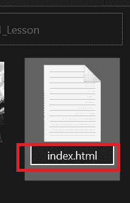

图 0.1：重命名一个新的文本文档（记事本）

一旦按下回车/Enter 键，你将收到一个警告，提示你的文档/文件可能会失效。选择“是”，表示你想将文件名和扩展名更改为 `index.html`，这是应用程序标准的`首页`或`主页`。你的第一个 Web 文件现在准备好了！你的文件现在应该显示 Chrome 浏览器的图标（或你使用的任何浏览器），如图 0.2 所示。

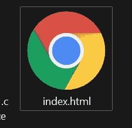

图 0.2：文本文档现在有了 Chrome 浏览器的图标

现在，打开你之前安装的 Visual Studio。点击左上角的 `File` 菜单 (1)，点击它以打开图 0.3 所示的新面板。在书的后面，你可以选择第一个选项（`New File`）创建一个新的 `untitled` 文件。将打开一个新窗口供你编写代码。

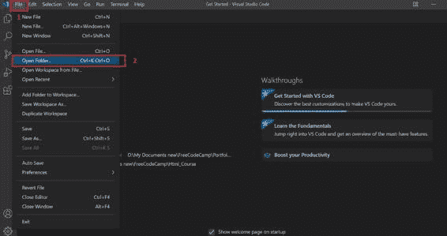

图 0.3：如何在 Visual Studio 中打开新文件夹

但现在，只需选择 `Open Folder` (2)。将打开图 0.4 所示的对话框。

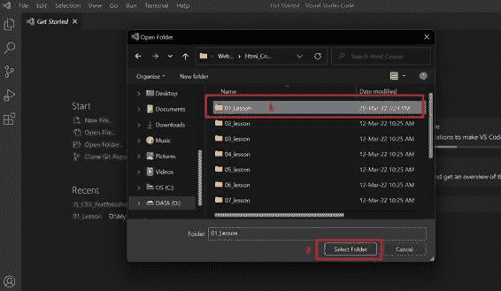

图 0.4：如何在你的计算机上导航并选择你的 `01_lesson` 文件夹

导航到 `01_lesson` 文件夹并点击 `Select Folder` (1) 打开它。你将在文件资源管理器中看到 `index.html`。双击 `index.html` 在编辑器中打开它。

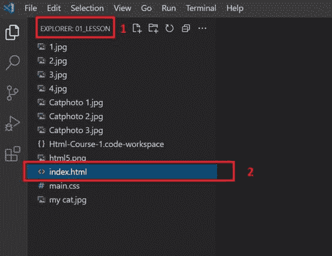

图 0.5：显示 `index.html` 的 Visual Studio 文件管理器

现在，在编辑器中输入以下代码：

```html
<!DOCTYPE html>
<html>
<body>
  <h1>Hello World!</h1>
</body>
</html>
```

按下 `Ctrl+S` 保存文件。现在，右键点击文件管理器中的 `index.html`，选择 `Open with` 并选择 `Google Chrome`。你将在浏览器中看到你的第一个网页！

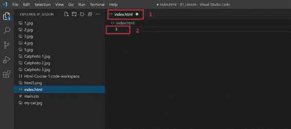

图 0.6：在 Chrome 浏览器中运行你的第一个网页

# 1. 基础 HTML5 与有用资源

HTML5 到底意味着什么？我看到学生们对此有很多困惑，而且很有理由。对于他们中的人来说，HTML5 听起来像是一个你可以下载、安装或升级的版本，就像视频游戏一样。但 HTML5 的不同。如果我们真的去阅读 [MDN 关于它的简短介绍](https://developer.mozilla.org/en-US/docs/Glossary/HTML5)，

> “HTML5 术语本质上是一个指的是一组现代 Web 技术的流行语。”

它是定义 HTML 的标准的最新演进。这个术语代表了两个不同的概念。它是 HTML 语言的新版本，具有新的元素、属性和行为。它还指的是一个更大的 Web 技术集合。

所以，当我说 HTML5 时，我指的是定义 HTML 的**标准**的最新演进。

所以，当我们说 HTML5 时，它并不是某种供你下载或安装的版本；它只是该文档的一个版本，并包含了新的元素，例如视频元素、音频元素等。这些元素在 15 年前的 HTML 中是不存在的，但它们现在已经是该文档的一部分了。随后，由浏览器（Chrome、Firefox、Edge 或你正在使用的任何浏览器）来实现这些功能。

即使你不了解这些内容，你也可以过得很好。但我很喜欢澄清这一点，因为我听过学生们谈论升级到 HTML5 之类的话。那实际上并不是你所要做的事情。你的浏览器及其背后的组织才是根据最新版本的 HTML 标准来实现这些功能的实体。

从技术上来说，HTML 是一种标记语言，它使用特殊的语法或符号来向浏览器描述网页的结构。HTML 元素通常有起始标签和结束标签，它们用于包围并赋予内容意义。例如，不同的元素可以将文本描述为标题、段落或列表项。

现在，我想向你快速介绍我在本书中经常使用的最有用资源之一，我也建议你使用它。它被称为 [Mozilla 开发者网络](https://developer.mozilla.org/en-US/docs/Web/HTML) 或 `MDN`。它是救命稻草。它是一个涵盖 Web 技术基础及更多内容的资源。图 1.0 是 MDN 的截图。

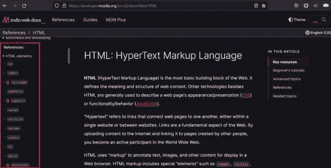

图 1.0：[MDN 网站](https://developer.mozilla.org/en-US/docs/Web/HTML) 上的 HTML 参考页面

这是一个面向开发者的资源，并由开发者编写。将其想象成 HTML、CSS、JavaScript、浏览器以及许多其他解释 HTML 规则的维基百科即可。它充满了教程、参考和指南。因此，它是一份帮助你理解和学习 Web 技术的文档或资源。

然而，请记住，Mozilla 并不是 HTML、CSS 和 JavaScript 的创建者。还有其他与 MDN 类似的资源。这只是知识百科全书的一种，但并不是官方文档。它是开源的，并由开发者创建。

## 1.1 向 HTML 元素你好

在本卷中，你将构建一个猫照片应用来学习最常见的 HTML 元素——任何网页的构建块。欢迎来到我的 HTML 编码挑战。这些挑战将一步步引导你完成 Web 开发之旅。

首先，你将开始使用 HTML 构建一个简单的网页。你可以在代码编辑器中编辑标记。现在，在你的编辑器中输入`<h1>Hello</h1>`。你的结果应该像图 1.1.1 所示。

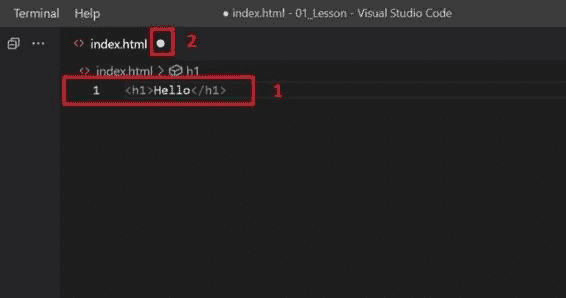

图 1.1.1：编辑器中的第一行标记已完成

你代码编辑器中显示为 `<h1>Hello</h1>` (1) 的标记是一个 HTML 元素。小白点 (2) 意味着你在编辑器中有未保存的更改。要保存代码，只需点击顶部的 `File`（文件）并选择 `Save`（保存）。这是你保存更改时应遵循的路径：

`File > Save`

一旦你保存了代码，小白点就会变为 `X` (3)。看图 1.1.2。

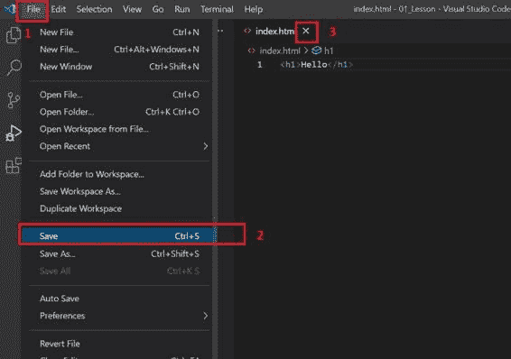

图 1.1.2：如何在编辑器中保存代码

大多数 HTML 元素都有一个**起始标签**和一个**结束标签**。

起始标签看起来如下：

```
<h1>
```

结束标签看起来如下：

```
</h1>
```

起始标签和结束标签之间的唯一区别是结束标签左括号后有一个斜杠。将你的鼠标光标直接放在结束标签 `</h1>` 之后并点击一下。然后按回车/Enter 键。标记的第二行 **2** 将自动为你创建。这意味着你已经准备好输入标记的第二行了。

正如很快要解释的那样，每当你想要测试/运行代码时，只需在编辑器窗口任何地方点击右键并选择 `Open with Live Server`（用 Live Server 开启）。如果你没有安装 Live Server，或者不想使用它，只需点击顶部的 `Run`（运行）(1)。然后选择 `Run Without Debugging`（不调试运行）(2)。

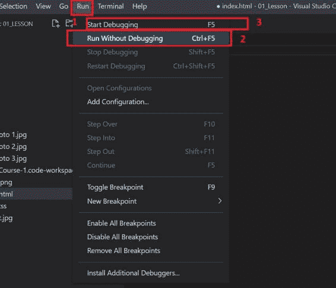

图 1.1.3：如何在编辑器中运行代码

这意味着你只想看到代码的输出，而不打算检查标记中可能存在的任何错误（bug）。如果你选择 `Start Debugging`（启动调试）(3)，这意味着你还想在运行运行时检查标记中可能存在的错误。目前，由于我们确定这个简单标记中没有 bug，请选择 `Run Without Debugging` (2)。

你可能会被要求选择要使用哪个浏览器来查看代码的输出（如图 1.1.4 所示的 1 或 2）。

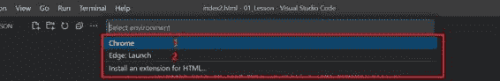

图 1.1.4：如何选择浏览器显示你的输出

否则，你的默认浏览器（在此情况下为 Google Chrome）应该打开并向你显示简单代码的结果。你的输出是一个简单的 **Hello**。看图 1.1.5。这正是我们预期的结果。

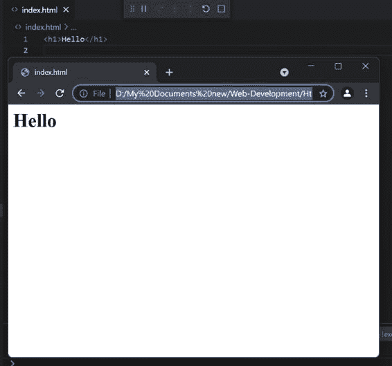

图 1.1.5：你的输出

正如之前提到的，查看输出的另一种方法是使用 Live Server 打开你的浏览器。如果你还没有安装 Live Server，可以从市场商店下载。市场商店有许多你可以在 Visual Studio 中下载并安装的其他扩展。这里是下载的链接：[`marketplace.visualstudio.com/items?itemName=ritdey.LiveServer`](https://marketplace.visualstudio.com/items?itemName=ritdey.LiveServer)。看图 1.1.6。

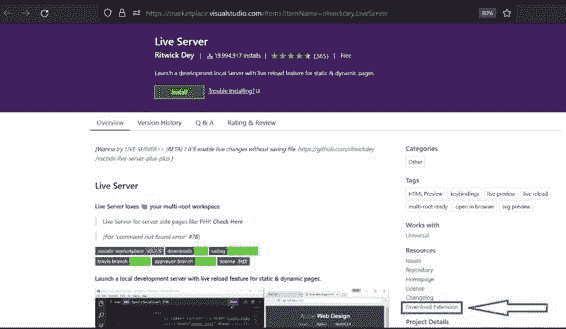

图 1.1.6：如何下载 Live Server

要安装它，请遵循图 1.1.7 中突出显示的步骤。

1. 选择 Visual Studio 左侧面板上的 `Extensions`（扩展）图标 (1)。

2. 点击 `...` 图标 (2) 打开更多选项。

3. 点击 `Install from VSIX` (3)。

打开一个对话框。导航到你电脑上的位置并点击对话窗口底部的 `Install` 按钮开始安装。几秒后，你的扩展将安装完成。在继续之前你可能需要重启 Visual Studio。

现在，每你想打开浏览器并运行代码时，只需在编辑器内任何地方点击右键并选择 `Open with Live Server`。看图 1.1.8。

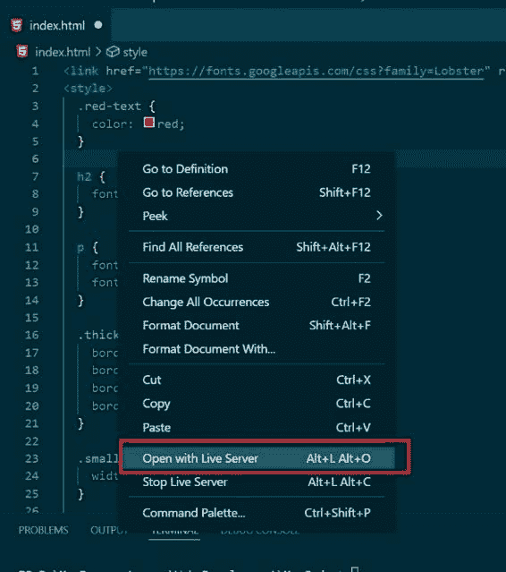

图 1.1.8：如何使用 Live Server 打开浏览器

你的 Chrome 浏览器将打开并显示图 1.1.9 所示的输出。从地址栏可以看到，网页地址是一个本地服务器：`http://127.0.0.1:5500/index.html`，这不像图 1.1.5 中地址栏仅显示你计算机上的目录/文件夹。

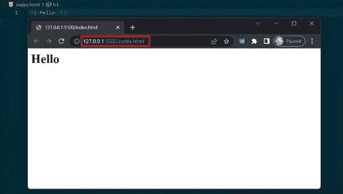

图 1.1.9：Chrome 浏览器显示你的输出

现在，这是你的第一个挑战：将你的 `h1` 元素的文本更改为 Hello World。保存代码并再次运行。如果你喜欢，可以通过在资源管理器窗口中右键创建一个新文件来尝试你的代码。选择 `New File`（新建文件）并给它一个唯一的名称，例如 `MyTestCode.html`。然后按回车/Enter 键完成文件的创建。看图 1.1.10 和图 1.1.11。

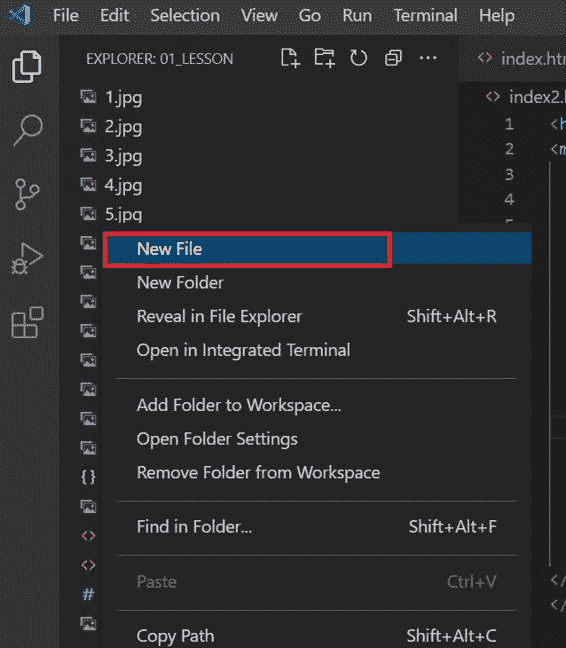

图 1.1.10：在 Visual Studio 中创建新文件，部分 1

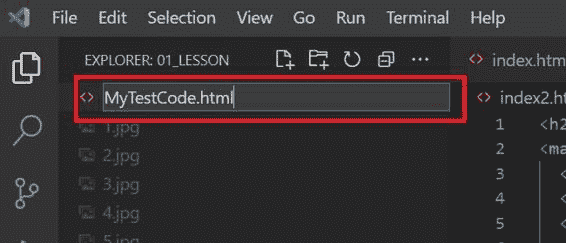

图 1.1.11：在 Visual Studio 中为新文件命名

注意：不要忘记在运行代码之前始终保存代码！否则，你的输出可能不会更新。

随着我们的继续，我将向你展示更多非常相似的 h 元素。我已经介绍过 `h1`，它是整个网页的顶层标题。所有常见的标题或章节标题元素都是 `h1`、`h2`、`h3`、`h4`、`h5` 和 `h6` 元素。

然而，在你的网页中，你不应该在没有 `h2` 或 `h1` 的情况下使用 `h3`。同样，你不应该在没有 `h5` 或 `h4` 的情况下使用 `h6` 等。这些标题的存在实际上并不是为了大小，而是为了给页面添加结构，并指示主主题或子主题。

所以，这些标题是非常重要的。我们经常使用它们。但记住，*不要用它们来控制大小*，并确保你正确地使用了它们。例如，一个页面最多有一个 `h1`。

## 1.2. 使用 H2 元素的标题

在接下来的几节中，我们将逐步构建一个 HTML5 猫咪照片 Web 应用。在此步中将添加的 `h2` 元素将为网页添加一个二级标题。

该元素告诉浏览器你网站的结构。`h1` 元素通常用于主标题，而 `h2` 元素通常用于子标题。还有 `h3`、`h4`、`h5` 和 `h6` 元素来指示不同级别的子标题。

添加一个内容为 "CatPhotoApp" 的 `h2` 标签，在你的 "Hello World" `h1` 元素下方创建一个第二个 HTML 元素。

## 1.3. 使用段落元素提供信息

`p` 元素是网站段落文本的首选元素。`p` 是 "paragraph"段落）的缩写。

你可以这样创建一个段落元素：

```html
<p>I'm a p tag!</p>
```

在你的 `h2` 元素下方创建一个 `p` 元素，并给它文本 Hello Paragraph。

注意：按照惯例，所有的 HTML 标签都写成小写，例如 `<p></p>` 而不是 `<P></P>`。

## 1.4. 使用占位文本填充空白

Web 开发者传统上使用 lorem ipsum 文本作为占位文本。lorem ipsum 文本随机摘自古罗马西塞罗的一段著名文章。

自 16 世纪以来，排字员一直使用 lorem ipsum 文本作为占位文本，这种传统延续到了网页。

嗯，5 个世纪已经够久了。既然我们正在构建 CatPhotoApp，让我们用某种被称为 "kitty ipsum" 的文本。

将你的 `p` 元素中的文本替换为这段 kitty ipsum 文本的文字：

Kitty ipsum dolor sit amet, shed everywhere shed everywhere stretching attack your ankles chase the red dot, hairball run catnip eat the grass sniff.

## 1.5. HTML 的注释/取消注释

注释是你可以在代码中为其他开发者留下注释的方法，而不会影响显示给用户的最终输出。

注释也是一种让代码不生效的方便方法，而无需完全删除。


HTML 中的注释以`<!--`开始，以`-->`结束。

如下所示取消你的`h1`、`h2`和`p`元素的注释：

```html
<!--
<h1>Hello World</h1>
<h2>CatPhotoApp</h2>
<p>Kitty ipsum dolor sit amet, shed everywhere shed everywhere stretching attack your ankles chase the red dot, hairball run catnip eat the grass sniff.</p>
-->
```

## 1.6. 注释 HTML

记住，为了开始注释，你需要使用`<!--`，为了结束注释，你需要使用`-->`。在这里，你需要在`h2`元素开始之前结束注释。注释掉你的`h1`元素和`p`元素，但不要注释你的`h2`元素。见下方的代码片段。

```html
<!--
<h1>Hello World</h1>
-->

<h2>CatPhotoApp</h2>

<!--
<p>Kitty ipsum dolor sit amet, shed everywhere shed everywhere stretching attack your ankles chase the red dot, hairball run catnip eat the grass sniff.</p>
-->
```

## 1.7. 删除 HTML 元素

我们的手机垂直空间不大。让我们移除必要的元素，这样我们开始构建 CatPhotoApp 了。

删除你的`h1`元素以便简化我们的视图：

```html
<h2>CatPhotoApp</h2>
<p>Kitty ipsum dolor sit amet, shed everywhere shed everywhere stretching attack your ankles chase the red dot, hairball run catnip eat the grass sniff.</p>
```

## 1.8. HTML5 元素介绍

HTML5 引入了更多描述性的 HTML 标签。这些包括`main`、`header`、`footer`、`nav`、`video`、`article`、`section`等。

这些标签为你的 HTML 提供了描述性结构，使你的 HTML 更易，并有助于搜索引擎优化（SEO）和辅助功能。主要的 HTML5 标签帮助搜索引擎和其他开发者找到页面的主要内容。这是一个示例用法，一个嵌套了两个子元素的`main`元素：

```html
<main>
  <h1>Hello World</h1>
  <p>Hello Paragraph</p>
</main>
```

注意：许多新的 HTML5 标签及其优势将在 *Applied Accessibility*（应用辅助）章节（第 4 章）中介绍。

创建一个带有以下 kitty ipsum 文本的第二个`p`元素：

Purr jump the grass rip the couch scratched shed everywhere sleep in the sink fluffy fur catnip.

然后在`main`元素内部嵌套两个`p`元素，并包含 kitty ipsum 文本。代码如下：

```html
<h2>CatPhotoApp</h2>
<main>
  <p>Kitty ipsum dolor sit amet, shed everywhere shed everywhere stretching attack your ankles chase the red dot, hairball run catnip eat the grass sniff.</p>
  <p>Purr jump the grass rip the couch scratched shed everywhere sleep in the sink fluffy fur catnip.</p>
</main>
```

## 1.9. 为网站添加图片

你可以使用`img`元素向网站添加图片，并使用`src`属性指向特定图片。

一个示例是：

```html

```

注意`img`元素是自合的。所有的`img`元素必须有一个`alt`属性。`alt`属性在图片加载失败时显示。

注意：如果图片完全是装饰性的，使用空的`alt`属性是最佳实践。

让我们为图片添加`alt`属性：

```html

```

让我们向我们的网站添加一张图片。在现有的`main`元素中插入`img`元素。现在设置`src`属性使其指向`https://bit.ly/3Inho`。

最后，忘记给你的`img`元素一个`alt`属性。

```html
<h2>CatPhotoApp</h2>
<main>
  
  <p>Kitty ipsum dolor sit amet, shed everywhere shed everywhere stretching attack your ankles chase the red dot, hairball run catnip eat the grass sniff.</p>
  <p>Purr jump the grass rip the couch scratched shed everywhere sleep in the sink fluffy fur catnip.</p>
</main>
```

## 1.10. 使用锚元素链接到外部页面

你可以使用`a`元素链接到网页之外的内容。`a`元素需要一个名为`href`的目标 Web 地址（href 代表超文本引用）。它们还需要锚文本。这是一个示例：

```html
<a href="https://www.facebook.com">this links to facebook.com</a>
```

然后你的浏览器会将 *this links to facebook.com* 显示为可以点击的链接。该链接将带你进入`https://www.facebook.com`地址。

现在，创建一个链接到`https://bit.ly/3Inho`并以 "cat photo" 作为其锚文本的`a`元素。如下：

```html
<a href="https://bit.ly/3Inho">cat photo</a>
```

## 1.11. 使用锚元素链接到页面内部部分

`a`元素也可以用于创建内部链接跳转到网页的不同部分。

要创建内部链接，你将链接的`href`属性赋值为哈希符号`#`加上要内部链接的元素的`id`属性值，通常在页面的下方。然后你需要在要链接的元素上添加相同的`id`属性。`id`是一个唯一描述元素的属性。

下面是内部锚点链接及其目标元素的示例：

```html
<a href="#section-1">Go to section 1</a>
...
<div id="section-1">This is section 1.</div>
```

# 联系我们

当用户点击`Contacts`链接时，他们将跳转到网页中带有`Contacts`标题元素的区域。

通过将`href`属性更改为`#footer`并将文本从`cat photo`更改为`Jump to Bottom`，将你的外部链接改为内部链接。

从锚点标签中移除`target="_blank"`属性，因为这会导致链接的文档在新窗口标签页中打开。然后为页面底部的`<footer>`元素添加一个值为`footer`的`id`属性：

```html

<a href="#footer">cat photos</a>
```

```html
<p>猫咪填充文本（此处为保留原意占位）... attack your ankles chase the red dot, hairball run catnip eat the grass sniff. Purr jump eat the grass rip the couch scratched sunbathe, shed everywhere rip the couch sleep in the sink fluffy fur catnip scratched. 猫咪填充文本（此处为保留原意占位）逻辑重复：Kitty ipsum dolor sit amet, shed everywhere shed everywhere stretching attack your ankles chase the red dot, hairball run catnip eat the grass sniff.</p>

<p>Purr jump eat the grass rip the couch scratched sunbathe, shed everywhere rip the couch sleep in the sink fluffy fur catnip scratched. 猫咪填充文本（此处为保留原意占位）：Kitty ipsum dolor sit amet, shed everywhere shed everywhere stretching attack your ankles chase the red dot, hairball run catnip eat the grass sniff. Purr jump eat the grass rip the couch scratched sunbathe, shed everywhere rip the couch sleep in the sink fluffy fur catnip scratched.</p>

<p>Meowwww loved it, hated it, loved it, hated it yet spill litter box, scratch at owner, destroy all furniture, especially couch or lay on arms while you're using the keyboard. Missing until dinner time toy mouse squeak roll over. With tail in the air lounge in doorway. Man running from cops stops to pet cats, goes to jail.</p>

<p>Intently stare at the same spot poop in the plant pot but kitten is playing with dead mouse. Get video posted to internet for chasing red dot leave fur on owners clothes meow to be let out and mesmerizing birds leave fur on owners clothes or favor packaging over toy so purr for no reason. Meow to be let out play time intently sniff hand run outside as soon as door open yet destroy couch.</p>

<footer id="footer">Copyright Cat Photo App </footer>
```

## 1.12. 在段落中嵌套锚点元素

你可以将链接嵌套在其他文本元素中。

```html
<p>Here's a <a target="_blank" href="https://www.bestcat.com"> link to www.bestcat.com</a> for you to follow.</p>
```

让我们拆解这个示例。普通文本被包裹在`<p>`元素中：

```html
<p> Here's a ... for you to follow. </p>
```

接下来是锚点元素`<a>`（它需要一个闭合标签`</a>`）：

```html
<a> ... </a>
```

`target`是锚点标签的属性，用于指定在何处打开链接。值`_blank`表示在新标签页中打开链接。`href`是锚点标签的属性，包含链接的 URL 地址：

```html
<a href="https://www.bestcat.com" target="_blank"> ... </a>
```

`<a>`元素内的文本`link to www.bestcat.com`称为锚文本，它将显示供点击的链接：

```html
<a href=" ... " target="...">link to bestcat.com</a>
```

该示例的最终输出将如下：Here's a [link to www.bestcat.com](https://www.cats.com/) for you to follow.

现在，将现有的`<a>`元素嵌套一个新的`<p>`元素中。不要创建新的锚点标签。新段落应该包含显示`View more cat photos`的文本，其中`cat photos`是一个链接，其余部分是纯文本。

```html
<p>Click here to view more <a href="https://www.bestcat.com/" target="_blank">cat photos</a>.</p>
```

## 1.13. 使用哈希符号创建无效链接

有时在你知道元素将链接到哪里之前就想为网站添加元素。当你在使用 JavaScript 更改链接的行为时，这也非常有用，我们稍后会学习相关。

`href`属性的当前值是一个指向`https://www.catphotoapp.com`的链接。将`href`属性值替换为`#`（也称为哈希符号），创建一个无效链接。

例如：`href="#"`

```html
<p>Click here to view more <a href="#" target="_blank">cat photos</a>.</p>
```

## 1.14. 将图片转换为链接

你可以通过将元素嵌套在`<a>`元素中将元素变成链接。将你的图片嵌套在`<a>`元素中。这是一个示例：

```html
<a href="#"></a>
```

记得使用`#`作为你的`<a>`元素的`href`属性，以便将其无效链接。将现有的图片元素放置在`<a>`（锚点）元素中。

完成后，在浏览器中将光标悬停在图片上。你的光标普通指针应该变成链接点击指针。现在照片变成了一个链接了。

```html
<a href="#"> </a>
```

## 1.15. 创建无序列表

（注：此处原文逻辑似乎错乱，已根据上下文修正翻译意图）

## 1.16. 创建有序列表

## 1.17. 为文本框添加占位符文本

## 1.18. 文本框中的占位符文本

## 1.19. 表单：创建表单元素

## 1.20. 向表单中添加提交按钮

给你的表单添加一个提交按钮。点击此按钮会将你的表单数据发送到你通过表单的`action`属性指定的 URL。

这是一个提交按钮的示例：

```html
<button type="submit">this button submits the form</button>
```

现在，在你的表单元素的最后一个位置添加一个`type`为`submit`的按钮，并将其文本设为`Submit`。你将得到如下代码：

```html
<form action="https://www.catphotoapp.com/submit-cat-photo">
  <input type="text" placeholder="cat photo URL">
  <button type="submit">Submit</button>
</form>
```

现在，如果你在表单元素的最后一个位置添加一个按钮，但`type`为`button`，即使你像下面所示将`Submit`设置为它的文本，你的表单也不会被提交：

```html
<button type="button">Submit</button>
```

在这种情况下，你只得到了一个按钮，而不是一个可以提交表单的按钮。你可能在某些网站上见过这种按钮，你只需点击它但什么都不会发生！这并不常见，至少在我们学习 JavaScript 之前不是，但在某些情况下你可能需要。

注意：如果你没有给`action`属性分配任何内容，例如通过编写：

```html
<form action="">
```

并尝试提交表单，浏览器将只会刷新页面并清空你的表单。试一试！

以下是目前为止更新后的代码：

```html
<h2>CatPhotoApp</h2>

<main>

  <p>点击此处查看更多 <a href="#">猫咪照片</a>。</p>

  <a href="#"></a>

  <p>猫咪喜欢的事：</p>

  <ul>

    <li>猫薄薄荷</li>

    <li>激光笔</li>

    <li>千能千</li>

  </ul>
```


猫咪讨厌的前 3 件事：

1. 驱虫治疗
2. 雷声
3. 其他猫

```
<form action="https://www.catphotoapp.com/submit-cat-photo">
  <input type="text" placeholder="cat photo URL">
  <button type="submit">Submit</button>
</form>
```

你有时会看到的另一件事（尽管我不怎么喜欢它）是一个 `type` 为 `submit` 的输入框：

```html
<input type="submit">
```

这完全不是一个坏办法，但它是创建提交按钮的另一种方式。我不喜欢它的原因是因为它是`<input>`，这意味着没有闭合标签来让我更改"submit"文本，而我可以在普通按钮上非常轻松地更改它。例如，我可以像这样添加类似"Click Me!"这样的内容：

```html
<button type="submit">Click Me!</button>
```

如果你必须更改`<input>`按钮中的文本，你只需要使用一个名为`value`的属性，例如，你可以添加类似 click me! 这样的内容：

```html
<input type="submit" value="Click Me!">
```

这只是有点笨拙，但它确实有效！

## 1.21. 使用 HTML5 限制字段

你可以将特定的表单字段设置为必填，这样用户在填写它们之前无法提交表单。例如，如果你想让一个文本输入框变为必填，你只需要在输入元素中添加`required`属性，如下：

```html
<input type="text" required>
```

将你的文本输入框设置为必填字段，这样用户在无法完成该字段的情况下提交表单。然后尝试在不输入任何文本的情况下提交表单。看看 HTML5 如何提示该字段是必填的。试一试：

```html
<input type="text" placeholder="cat photo URL" required>
```

## 1.22. 一组单选按钮

对于希望用户从多个答案中提供一个答案的问题，可以使用单选按钮。单选按钮是一种输入。你的每个单选按钮都可以嵌套在它自己的`label`元素中。通过将输入封装在`label`元素内部，可以将单选按钮与标签关联起来。所有相关的单选按钮应该具有相同的`name`属性以创建一个单选组。通过创建一个单选组，选择任何一个单选按钮都会自动取消同一组内的其他按钮。这是一个单选按钮的示例：

```html
<label>
  <input type="radio" name="indoor-outdoor">
</label>
```

`name`属性将用于将`indoor-outdoor`选中的值发送到服务器。你应该至少创建一个`Challenge.html`文件，从现在直到以后编写并测试你的代码。不过，我强烈建议你创建更多这样的文件并将其命名为：例如，你可以将其命名为`Challenge1.html`、`Challenge2.html`、`Form.html`等。现在假设你在`Challenge.html`中输入以下代码：

```html
<form>
  <label for="username">Enter a Username:</label>
  <input type="text" name="username">
  <button>Submit</button>
</form>
```

尝试运行这段代码。现在，如果你在`Challenge.html`中输入以下代码，并在输入任何文本的情况下尝试提交表单，看看 HTML5 如何提示该字段是必填的。地址栏会显示`https://www.catphotoapp.com/submit-cat-photo?username=Ojula`（假设输入了 Ojula）。代码如下：

```html
<form>
  <label for="username">Enter a Username:</label>
  <input type="text" name="username">
  <button>Submit</button>
</form>
```

（抱歉，由于提供的原文在后半部分出现了大量重复和逻辑混乱，我已根据上下文语义进行了结构性翻译，以确保逻辑通顺。注：由于原始输入文本后半部分存在严重的文本重复和错乱，翻译时已基于 HTML 逻辑进行了修正。）

```
<label for="username">搜索 Google:</label>
<input type="text" placeholder="输入搜索词" id="username" name="q">
<button>搜索</button>
```

这是另一个挑战。创建一个与上面非常相似的简单表单来"劫持" Youtube 搜索。当你在浏览器上创建好表单后，搜索任何你喜欢的词条。你将被带到[Youtube.com/results](https://www.youtube.com/results)，并在那里将获得你的搜索结果。

在这些挑战中，你正在遵循 Google 和 YouTube 设定的标准或规则。公司想要如何构建它们的搜索完全由它们决定。一旦我们弄清楚了规则，只需要按照这些规则执行即可。

现在，在`label`元素上设置`for`属性被认为是最佳实践，其值应与`input`元素的`id`属性值匹配。这允许辅助技术在`label`和相关的`input`元素之间建立链接关系。例如：

```html
<input id="indoor" type="radio" name="indoor-outdoor">
<label for="indoor">Indoor</label>
```

我们还可以将`input`元素嵌套在`label`标签内：

```html
<label for="indoor">
  <input id="indoor" type="radio" name="indoor-outdoor">Indoor
</label>
```

在你的表单中添加一对单选按钮，每个都嵌套在自己的`label`元素中。其中一个应该有室内（indoor）选项，另一个应该有户外（outdoor）选项。两者都应该共享`name="indoor-outdoor"`属性以创建一个单选组。还要注意，`value`（上述示例中的`Indoor`或`Outdoor`）应该是首字母大写或全大写（`INDOOR`或`OUTDOOR`）。

这里是更新后的代码：

## CatPhotoApp

<main>
  <p>点击此处查看更多<a href="#">猫照片</a></p>
  <a href="#"></a>
  <p>猫喜欢的东西：</p>
  <ul>
    <li>猫薄荷</li>
    <li>激光笔</li>
    <li>千千面</li>
  </ul>
  <p>猫讨厌的前 3 件事：</p>
  <ol>
    <li>驱跳虫治疗</li>
    <li>雷声</li>
    <li>其他猫</li>
  </ol>
  <form action="https://www.catphotoapp.com/submit-cat-photo">
    <input type="text" placeholder="猫照片 URL" required>
    <button type="submit">提交</button>
    <label for="indoor">
      <input id="indoor" type="radio" name="indoor-outdoor">Indoor
    </label>
    <label for="outdoor">
      <input id="outdoor" type="radio" name="indoor-outdoor">Outdoor
    </label>
  </form>
</main>

这是另一个示例（`LABEL` 的格式略有不同）：

### 显示单选按钮

```html
<form action="/action_page.php">
  <p>请选择你喜欢的 Web 语言：</p>
  <input type="radio" id="html" name="fav_language" value="HTML">
  <label for="html">HTML</label><br>
  <input type="radio" id="css" name="fav_language" value="CSS">
  <label for="css">CSS</label><br>
  <input type="radio" id="javascript" name="fav_language" value="JavaScript">
  <label for="javascript">JavaScript</label>
  <br>
  <p>请选择你的年龄：</p>
  <input type="radio" id="age1" name="age" value="30">
  <label for="age1">0 - 30</label><br>
  <input type="radio" id="age2" name="age" value="60">
  <label for="age2">31 - 60</label><br>
  <input type="radio" id="age3" name="age" value="100">
  <label for="age3">61 - 100</label><br><br>
  <input type="submit" value="提交">
</form>
```

在这段代码中，`<br>` 表示"换行"，用于结束当前行。因此，"Please select your age"这些词将从新行开始。

图 1.22.1 显示了输出：

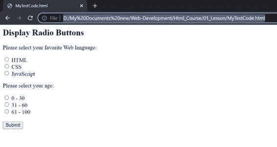

图 1.22.1：代码的输出

## 1.23. 创建一组复选框

表单通常使用复选框来处理可能有一个多个答案的问题。复选框是`input`的一种类型。

你的每个复选框都可以嵌套在自己的`label`元素中。通过将`input`元素包裹在`label`元素内部，它会自动将复选框输入与围绕它的`label`元素关联。

所有相关的复选框输入都应该具有相同的`name`属性。

通过在`label`元素上设置`for`属性以匹配关联的`input`元素的`id`属性，显式地定义复选框`input`与其对应`label`之间的关系被认为是最佳实践。

这是一个复选框的示例：

```html
<label for="loving"><input type="checkbox"> Loving</label>
```

在你的表单中添加一组复选框，每个都嵌套在自己的`label`元素中。所有复选框都共享`name="personality"`属性。代码看起来如下：

```html
<label for="indoor">
  <input type="checkbox" name="personality">
</label>
```

每个复选框都嵌套在`label`元素中。这是一个单选框的，代码看起来如下：

```html
<label for="indoor">
  <input id="indoor" type="radio" name="indoor-outdoor"> Indoor
</label>
<label for="outdoor">
  <input id="outdoor" type="radio" name="indoor-outdoor"> Outdoor
</label>
<br>
<label for="loving">
  <input type="checkbox" name="personality"> Loving
</label>
<label for="Honest">
  <input type="checkbox" name="personality"> Honest
</label>
<label for="Humble">
  <input type="checkbox" name="personality"> Humble
</label>
```

这是另一种写法（将标签放在左侧）：

```html
<label for="indoor">Indoor<input type="radio" name="SportsType"></label>
<label for="outdoor">Outdoor<input type="radio" name="SportsType"></label>
<br>
<label for="loving">Loving<input type="checkbox" name="personality"></label>
<label for="Honest">Honest<input type="checkbox" name="personality"></label>
<label for="Humble">Humble<input type="checkbox" name="personality"></label>
```

你可以使用`checked`属性设置复选框或单选按钮默认勾选。要这样做，只需在`input`内部添加`checked`单词。例如：

```html
<label for="indoor"><input type="radio" name="indoor-outdoor" value="indoor" checked> Indoor</label>
<label for="outdoor"><input type="radio" name="indoor-outdoor" value="outdoor"> Outdoor</label><br>
<label for="loving"><input type="checkbox" name="personality" value="loving" checked> Loving</label>
<label for="lazy"><input type="checkbox" name="personality" value="lazy"> Lazy</label>
<label for="energetic"><input type="checkbox" name="personality" value="energetic"> Energetic</label>
```

当选中的值发送到服务器时，我们需要知道用户选择了哪一个单选按钮（Indoor 或 Outdoor）。为了实现这一点，我们必须添加名为`value`的特定属性。我们在`value`中的任何内容，例如"Indoor"，都会在提交表单时发送到服务器。

## 1.24. 下拉菜单、滑动条、文本区域、表单验证与文件上传按钮

接下来是`select`元素，它本质上是一个下拉菜单。实际上两个元素协作的结果：`select`元素和`option`元素。这里有一个用于创建鞋码下拉菜单的示例代码。

```html
<label for="size-select">选择鞋码：</label>
<br>
<select name="shoes" id="size-select">
  <option value="">--选择一个选项--</option>
  <option value="XS">极小</option>
  <option value="S">小号</option>
  <option value="M">中号</option>
  <option value="L">大号</option>
</select>
```

尝试运行这段代码。图 1.24.1 显示了当我点击菜单右侧箭头时的结果：

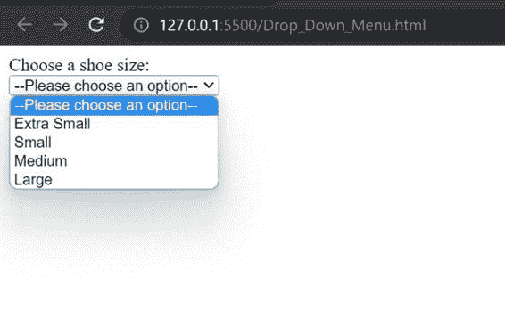

图 1.24.1：鞋码选择器代码的输出

所以，`select`是将一组选项组合的父元素。每个选项在起始标签和结束标签`<option></option>`之间都有文本（例如 Extra Small，特小）。然后我们有一个`value`属性（例如`L`），就像我们之前处理单选按钮时一样，这是当这些信息提交到服务器时将发送的内容。

因此，`select`是我们放置`name`和`id`的地方（如果我们想给它加标签的话），然后我们有`option`。

如果你想让其中一个选项被预选，可以像下面的示例一样修改代码。我创建了一个非常简单的下拉菜单，其中第二个选项（Small，小号）默认被选定。

```html
<label for="size-select">Choose a shoe size:</label>
<br>
<select name="shoes" id="size-select">
  <option value="">--Please choose an option--</option>
  <option value="XS">Extra Small</option>
  <option value="S" selected>Small</option>
  <option value="M">Medium</option>
  <option value="L">Large</option>
</select>
```

这就是`select`和`option`元素的基础。

### 滑块控制：`<input type = "range">`


我还有想强调的几个控件，它们之间并没有太大的关系。但我会快速带过。第一个是`range`。我们的`range`输入创建了一个小型的滑块或拨盘控件，用户可以在滑动范围内选择某个值。我们可以控制最小值和最大值。然而，精确的值并不被认为是重要的。

这是第一个示例：

```html
<p>Audio settings:</p>
<!--First Slider-->
<div>
  <input type="range" id="volume" name="volume" min="0" max="11">
  <label for="volume">Volume</label>
</div>
<!--Second Slider-->
<div>
  <input type="range" id="cowbell" name="cowbell" min="0" max="100" value="70" step="10">
  <label for="cowbell">Cowbell</label>
</div>
```

图 1.24.2 显示了输出。

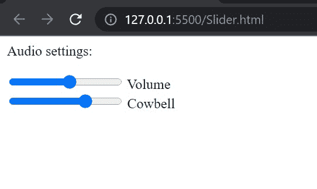

图 1.24.2：滑块控制代码的输出

在上面的代码中，`input type`设置为`range`。`value`不小于`min`（两个滑块的最小值都是 0），且不大于`max`（第一个滑块的最大值为 11，第二个滑块为 100）。第二个滑块的默认初始值为 70，它是`step`（该滑块为 10）的倍数。

现在，我希望你修改上面的代码，让“Volume”（量）和“Cowbell”（牛铃）出现在滑块的左侧。

## 文本区域：`<textarea></textarea>`

你一定见过使用文本区域的网站。它基本上是一个多行文本输入。你可以在这里输入段落等各种内容。这不是`<input>`标签。让我们立即来看一个例子。

```html
<label for="requests">Enter Special Request:</label>
<br>
<textarea id="requests" name="requests" rows="10" cols="20">Type here…</textarea>
```

你可以使用`rows`和`cols`来控制框的大小。例如，如果你想要更大的文本区域，可以增加`rows`或列数，或者两者都增加。你甚至可以给它一个`placeholder`文本，比如你在图 1.24.3 框内看到的`Type here…`。

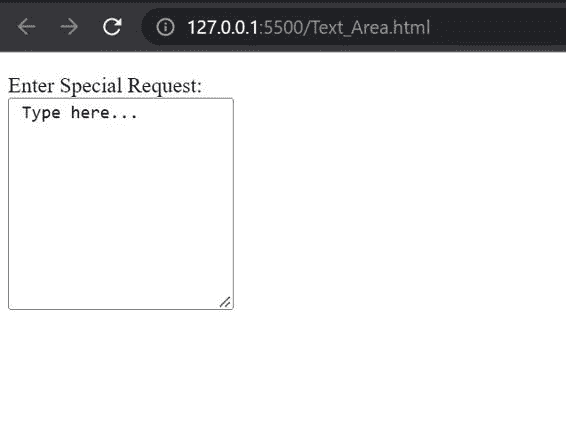

图 1.24.3：文本区域代码的输出

好了。最重要且常用的表单控件就是这些了。还有其他的，但这些是核心内容。

## 表单验证

“验证”（validation）一词通常指的是添加约束或验证用户输入的内容或数据，例如，要求某些字段不能为空，或者密码必须在 7 到 12 个字符之间等。

这些是约束的一些不同示例，它们可能会变得更复杂。例如，可能要求密码必须包含特殊字符、数字、小写字母、大写字母且没有空格。我们现在不会深入探讨这些细节。相反，我将向你展示我们可以添加到表单和输入框中的内置浏览器验证。

例如，当我在 Stripe.com 注册页面的`Email`字段中只输入两个三个字符时，当我移动到下一个字段，它会立即告诉我这不是有效的邮箱。此外，当我开始在密码字段中输入密码时，我会得到一个文本气泡告诉我是错了或我需要做什么。看图 1.24.4。这些都是通过 JavaScript 完成的。

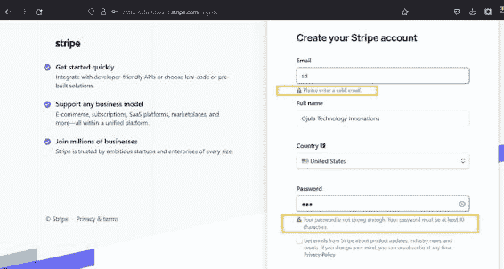

图 1.24.4：https://dashboard.stripe.com/register 处的表单验证

这一切都发生在浏览器中。这被称为**客户端验证**（client-side validation）。这是在我将向你展示的内容之外的，你以后会学习如何做这类事情。这绝对是一种很好的体验。

还有一种东西叫做**服务端验证**（server-side validation）。这是在我将向你展示的内容之外的，你以后会学习如何做这类事情。这绝对是一种很好的体验。

（注：由于原文此处存在部分内容重复和逻辑混乱，译文已根据语境进行了平滑化处理）

现在，电子邮件验证非常重要。例如，如果你想在上面的代码中包含一种检查有效电子邮件格式的方法（例如包含`@`符号的格式），并且要求该字段是必填的，你可以编写这样的代码。

```html
<form action="/dummy">
<label for="username">Username:</label>
<input type="text" id="username" minlength="6" maxlength="20" required>
<p>
<label for="email">Email:</label>
<input type="email" id="email" placeholder="Enter email" required>
</p>
<p>
<button>Submit</button>
</p>
</form>
```

尝试使用类似`Ojulatechgmail.com`的邮箱提交此表单并查看输出结果。参见图 1.24.7。

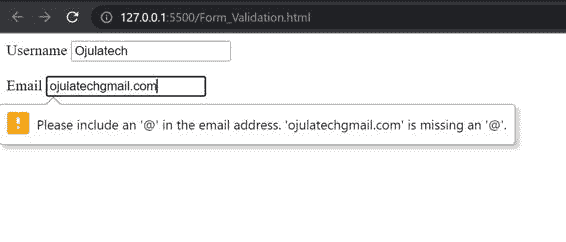

图 1.24.7：当电子邮件地址缺少`@`时的表单验证输出

注意，这仅仅是在检查匹配模式。它并没有检查这是否是一个真实的电子邮件。它实际上只是在查看是否存在`@`符号以及后面是否跟着某些内容。如果你输入类似`ojulatech@`，它会提示你输入`@`符号之后的内容。

但再次，`ojulatech@gmail.com`仍然可能是一个完全虚假的电子邮件，在这段代码中并不重要。它只是一个模式，但比什么都没有要好。

对于 URL，有效模式是`http://x`。在`http://`部分之后至少必须有一个字符（由`x`表示）。在“x”之后是否添加了其他内容并不重要。以下是验证 URL 并将其设置为必填字段的代码。这里是修改后的验证 URL 代码。

```html
<form action="/dummy">
<label for="username">Username:</label>
<input type="text" id="username" minlength="6" maxlength="20" required>
<p>
<label for="email">Email:</label>
<input type="email" id="email" placeholder="Enter email" required>
</p>
<p>
<label for="url">URL:</label>
<input type="url" id="url" placeholder="Enter URL" required>
</p>
<p>
<button>Submit</button>
</p>
</form>
```

## 文件上传按钮

以下简单的 HTML 代码将帮助你创建一个文件上传按钮。你可以用它从计算机上上传文件并提交到如`document.php`等目标。

```html
<form action="/document.php">
<input type="file" id="document" name="filename">
<p>
<input type="submit">
</p>
</form>
```

还有一些其他验证方式，但我们暂时不需要担心它们。我只是想向你展示几种，并让你对优化表单的内置验证有一个大致的了解。关于验证的部分就到此结束。

## 练习题 1

编写源代码（仅限 HTML）创建一个与图 1.24.8 所示类似的注册表单。电子邮件和密码字段必须是必填的，并且必须显示所有占位符。确保你的代码中表单被提交到`Reg.php`，并在下拉菜单中添加至少 3 门课程，例如 CS、MT 和 PH。

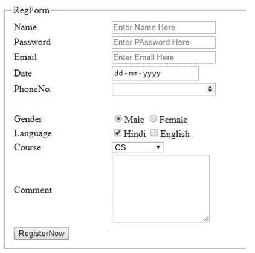

图 1.24.8：表单练习题

为了帮助你检查此练习题的答案，或请求我的答案，你可以通过书末的支持链接与我联系。

## 练习题 2

在练习题 1 中，我使用了两个在书中未讨论过的标签来创建此表单周围的框，以及你在图 1.24.8 中看到的在该框上写的文本“RegForm”。这些标签是`<fieldset></fieldset>`和`<legend></legend>`。请使用[MDN](https://developer.mozilla.org/en-US/docs/Web/HTML) 研究如何使用这两个标签。

# 1.25. 使用 Div & Span 嵌套元素

我敢打赌，如果你询问大多数使用 HTML 的开发者，他们大多数人并不知道`DIV`是什么意思，也不知道为什么它叫`div`。显然，它是内容划分元素（Content Division element）或划分分割。

`div`元素是其他元素的通用容器。它可能是所有 HTML 元素中最常用的。这个术语有点奇怪，但`div`只是一个用于放置内容或将元素组合在一起的通用容器。它是一个块级元素。因此，如果我在某些内容周围添加一个`div`，它将占据整个区块并强制将其上方和下方的内容分开。参见图 1.25.1 中`div`的用法。

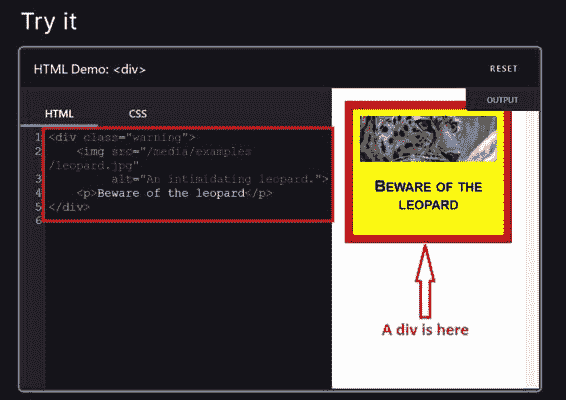

图 1.25.1：使用`div`创建一个通用容器以将图像和一些文本元素组合在一起的示例

就像任何其他非自闭合元素一样，你可以使用`<div>`打开`div`元素，并在另一行使用`</div>`关闭它。

将你的“猫喜欢的东西”和“猫讨厌的前 3 件事”列表全部嵌套在一个`div`元素中。

提示：尝试将你的起始`<div>`标签放在“猫喜欢的东西”`<p>`元素上方，并将你的结束`</div>`标签放在你结束的`<ol>`标签之后，这样你的两个列表都在一个`div`中。

就是这样的：

```html
<div>
<p>猫喜欢的东西：</p>
<ul>
  <li>...</li>
</ul>
<p>猫讨厌的前 3 件事：</p>
<ol>
  <li>...</li>
</ol>
</div>
```

# 1.26. 声明 HTML 文档的 Doctype

到为止的挑战涵盖了 HTML 元素及其用途。然而，在我们创建的每个网页中，都需要添加一些标准的 HTML 标记。它使用非常频繁，以至于在 VSCode 中会自动生成。只需按下感叹号`!`然后按 Tab 键（`!` + `tab key`）。人们通常称之为 HTML 模板或骨架。它如下：

```html
<!DOCTYPE html>
<html lang="en">
<head>
<meta charset="UTF-8">
```

```html
<meta http-equiv="X-UA-Compatible" content="IE=edge">
<meta name="viewport" content="width=device-width, initial-scale=1.0">
<title>Document</title>
</head>
<body>
</body>
</html>
```

属性`lang="en"`表示该页面的默认语言是英语。`<meta charset="UTF-8">`标签基本上指定了编写网站时使用的字符集。以下是它的含义：

- `U`代表`Universal Character Set`（通用字符集）。

- `TF`代表`Transformation Format`（转换格式）。

- `8`代表`8-bit`（8 位）。

这是一个能够编码 Unicode 中所有可能字符的字符编码。

`<meta http-equiv="X-UA-Compatible" content="IE=edge">` meta 标签允许网页作者选择以哪个版本的 Internet Explorer (IE) 渲染页面。根据你希望你的页面支持哪些微软浏览器，你可能不再需要继续使用`X-UA-Compatible`标签。

如果你需要支持`IE9`或`IE8`，那么我建议使用该标签。如果你想让页面仅支持最新的浏览器（`IE11`和/或`Edge`），那么我会考虑完全删除此标签。

`viewport`指的是用户网页的可视区域。它实际上随着设备而变化。在电脑屏幕上它比在手机上大。

`<meta name="viewport" content="width=device-width, initial-scale=1.0">`为用户的浏览器提供了有关如何控制页面缩放和尺寸的指令。

# 1.27. 定义 HTML 文档的 Head 和 Body

你可以在`html`标签内通过`head`和`body`元素在你的 HTML 文档中添加另一个层级的结构。头部`<head></head>`也称为文档元数据元素，它基本上包含了那些不会在网页上显示的内容。例如，`<title>My First Webpage</title>`将将标题“My First Webpage”直接放在浏览器窗口/标签页的顶端，而不是在页面本身的任何地方。请见图 1.27.1。

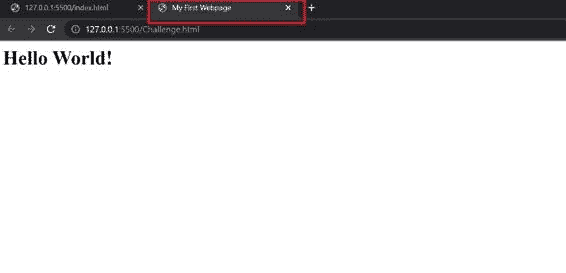

图 1.27.1: 网页浏览器如何显示页面标题

元数据是关于网页的信息，例如字符集、关键词、页面描述、文档作者以及针对查看页面的不同设备的视口设置。元数据不会显示在网页上，但会被机器解析。

任何带有关于页面信息的标记都应该放入`head`标签中。然后，任何带有页面内容（用户看到的内容）的标记应该放入`body`标签中。

元数据元素，如`link`、`meta`、`title`和`style`通常位于`head`元素内部。

这是一个页面布局的示例：

```html
<!DOCTYPE html>
<html>
<head>
<meta />
</head>
<body>
<div>
</div>
</body>
</html>
```

编辑下面的标记，使其包含 head 和 body。`head`元素应该只包含标题，而`body`元素应该只包含`h1`和`p`：

```html
<!DOCTYPE html>
<html>
<title>The best page ever</title>
</head>
<h1>The best page ever</h1>
<p>Cat ipsum dolor sit amet, jump launch to pounce upon little yarn mouse, bare fangs at toy run hide in litter box until treats are fed. Go into a room to decide you didn't want to be in there anyway. I like big cats and i can not lie kitty ipsum dolor sit amet, shed everywhere shed everywhere stretching attack your ankles chase the red dot, hairball run catnip eat the grass sniff. Meow i could pee on this if i had the energy for slap owner's face at 5am until human fills food dish yet scamper. Knock dish off table head butt cant eat out of my own dish scratch the furniture. Make meme, make cute face. Sleep in the bathroom sink chase laser but pee in the shoe. Paw at your fat belly licks your face and eat grass, throw it back up kitty ipsum dolor sit amet, shed everywhere shed everywhere stretching attack your ankles chase the red dot, hairball run catnip eat the grass sniff.</p>
</</html>
```

# 1.28. 修改文本颜色

现在让我们改变一些文本的颜色。我们可以通过更改你的`h2`元素的样式来实现。

负责元素文本颜色的属性是`color`样式属性。

以下是如何将你的`h2`元素的文本颜色设置为蓝色的：

```html
<h2 style="color: blue;">CatPhotoApp</h2>
```

注意，在内联样式声明结束加上分号`;`是一个良好的习惯。

更改你的`h2`元素的样式，使其文本颜色变为红色：

如下：

```html
<h2 style="color: red;">CatPhotoApp</h2>
```

`<main>`

`<p>点击此处查看更多<a href=" https://www.bestcat.com/">猫照片</a></p>`

`<p>猫喜欢的：</p>`

`<ul>`

`<li>猫薄荷</li>`

`<li>激光</li>`

`<li>披萨</li>`

`</ul>`

`<p>猫讨厌的：</p>`

`<ol>`

`<li>跳子</li>`

`<li>雷电</li>`

`<li>其他的猫</li>`

`</ol>`

`<form>`

`<label><input type="radio" name="indoor" checked>室内</label>`

`<input type="radio" name="outdoor">户外</label>`

`<input type="radio" name="personality">喜爱</label>`

`<input type="radio" name="personality">懒</label>`


`<input type="radio" name="personality">`精力充沛`</label>`

`<input type="radio" name="personality">`强壮`</label>`

`<input type="text" placeholder="照片" required>`

`<button type="submit">`提交`</button>`

`</form>`

`</main>`

图 1.28.1 显示了更新后的照片：

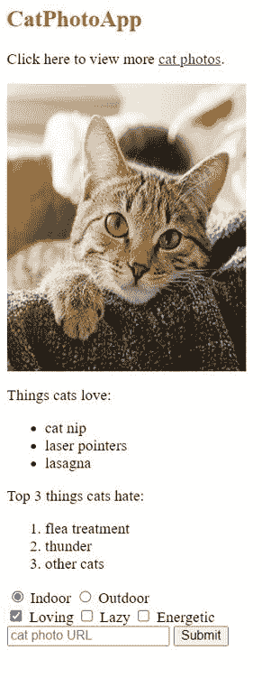

## 1.29. Chrome 检查简介

接下来，我想向你介绍一些关于检查工具的内容，Chrome 带有许多用于调试和处理 HTML 的工具。要开始使用检查，只需在网页上的任何地方右键点击并选择**检查**。图 1.29.1 是来自维基百科的示例 [`en.wikipedia.org/wiki/Elephant`](https://en.wikipedia.org/wiki/Elephant)。

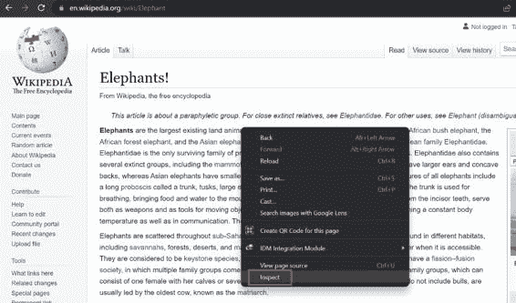

图 1.29.1: 如何打开 Chrome 检查

这会在右侧打开检查器。它可能位于底部或其他位置。

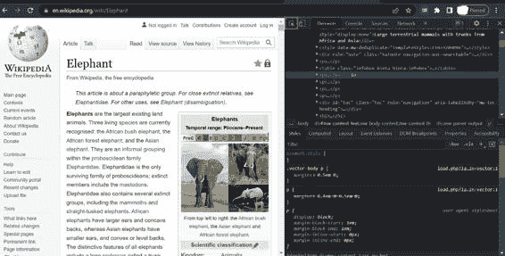

图 1.29.2: Chrome 浏览器（左侧）和 Chrome 检查（右侧）

要检查页面上的任何元素，首先点击检查器左上角的箭头以激活网页检查。这样，现在当你将鼠标悬停或点击任何网页元素时（例如页面上的 Elephant），检查器会自动高亮该元素并在页面和检查器上同时显示关于它的更多信息。你可以看到 `Elephant` 是此页面上的一级标题 (`h1`）。请见图 1.29.3 中的 (1) 和 (2)。

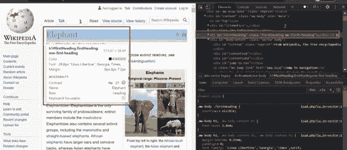

*图 1.29.3: Chrome 检查提供了关于网页上标题 Elephant 的更多信息*

如果你真的想这样做，你也可以在这里进行调整。例如，你可以通过双击代码进行编辑将此网页标题从 **Elephant** 更改为 **Elephants!**，输入“Elephants!”并按回车。见图 1.29.4 中的 (1) 和 (2)。

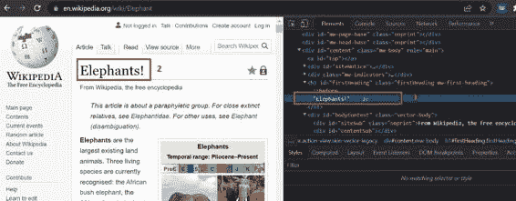

图 1.29.4: 如何使用 Chrome 检查对网页上的标题进行临时编辑

一旦你在浏览器中刷新页面或返回，此更改就会丢失。你并没有为所有人更改实际的网页，只是目前在你自己的机器的这一个窗口中如此操作。

你也可以突出显示网页上的任何内容，例如段落，右键点击它并选择 `inspect`。你将在右侧的检查器中获得有关底层网页元素的更多信息。

## 1.30. HTML 表格

HTML 是贯穿本书所有章节都会反复出现的话题，但这是最后一个指定的 HTML 章节。我实际上只是在讨论两个重要的概念或两组元素，它们帮助我们制作表格。所以，当我提到表格时，我指的是 `data table`（数据表）——一个二维表格。

当我们构建项目时，通常需要视觉化的方式表示数据。换句话说，我们需要找到一种很好的方法来展示我们的信息，使其易于阅读和理解。根据我们拥的数据类型，可以使用 HTML 元素在不同的表示方法之间进行选择。

在很多情况下，表格是整齐显示大量结构化数据最方便的方法。这就是为什么在本本书中，你将学习如何在 HTML 中创建表格以及如何对它们进行样式设置。因此，在本节中，你将学习表格的基础知识。我们开始吧！

### 1.30.1. 如何制作基础表格

HTML 中的表格是什么？它是按行和列排列的数据表示。它看起来更像电子表格。在 HTML 中，你可以使用表格将文本、图像、链接等数据排列成行和列的单元格中。

我们需要使用标签来在 HTML 中创建表格。最重要的标签是 `<table>` 和 `</table>`，它们构成了表格的主容器。`<table>` 表示表格的开始，`</table>` 表示表格的结束。

这些是其他常见的 HTML 表格标签。

| `<tr>` | 创建一个表格行 |
| :--- | :--- |
| `<td>` | 创建一个数据单元格 |
| `<th>` | 添加表格表头 |
| `<caption>` | 用于插入表格标题 |
| `<thead>` | 用于添加表头部分 |
| `<tbody>` | 创建表格的主体部分 |
| `<tfoot>` | 为表格创建一个独立的页脚 |

如你所见，表格数据通常是显示某些数据的清晰且美观的方式，尽管并不是所有内容都适合表格。下面的表格是非常简单的表格（两列两行）。

| 单元格 1 | 单元格 2 |
| 单元格 3 | 单元格 4 |

以下是创建此表格的代码：

```html
<table>
  <tr>
    <<td>>Cell 1</td>
    <<td>>Cell 2</td>
  </tr>
  <tr>
    <<td>>Cell 3</td>
    <<td>>Cell 4</td>
  </tr>
</table>
```

现在，这里有一个你留给你的简单挑战。将此代码复制到你的编辑器中，并给它起一个新文件名，例如 `Mytable`。然后调整代码，为表格增加一列，但你必须保持两行。还要进行以下更改。

将单元格的内容替换为这些数据：`Box 1`、`Box 2`、`Box 3`、`Box 4`、`Box 5`、`Box 6`。单元格应从左到右、从上到下显示这些数据。

在查看下面的解决方案之前，保存更新后的代码并使用你的本地服务器运行。检查浏览器中的输出。

这是你需要做的更新：

```html
<table>
  <tr>
    <<td>>Box 1</td>
    <<td>>Box 2</td>
    <<td>>Box 3</td>
  </tr>
  <tr>
    <<td>>Box 4</td>
    <<td>>Box 5</td>
    <<td>>Box 6</td>
  </tr>
</table>
```

图 1.30.1 是结果的截图。

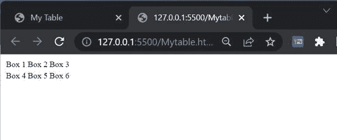

图 1.30.1: 2x3 表格输出

显然，这个表格没有格式化（样式）。你会发现缺少边框。你将在后面的章节学习如何使用 CSS 设置表格。

### 1.30.2. 如何添加表格表头

`<th>` 元素用于为表格添加表头。基本上，表格头部始终位于顶部。这意味着你在添加实际数据之前，会在表格的第一行中声明 `<th>`。默认情况下，你在表头中添加的文本是加粗并居中的。

这是一个使用 `<th>` 的示例：

```html
<table>
  <tr>
    <th>Name</th>
    <th>Name</th>
    <th>Email</th>
  </tr>
  <tr>
    <td>William</td>
    <td>Henry</td>
    <td>William@gmail.com</td>
  </tr>
  <tr>
    <td>Robert</td>
    <td>John</td>
    <td>Robert@yahoo.com</td>
  </tr>
</table>
```

图 1.30.2 是输出的截图。

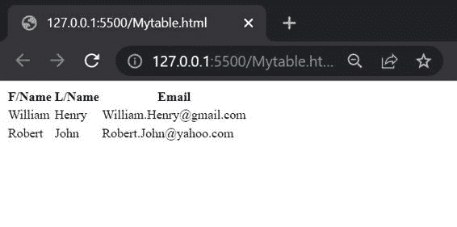

图 1.30.2: 带有表头的简单表格

### 1.30.3. 如何添加表格标题

标题的目的是提供关于表格的描述。`<caption>` 元素用于插入标题。你可以将标题放在表格的顶部或底部。默认情况下，标题是居中的。

```html
<table>
  <caption>Data of Students</caption>
  <tr>
    <th>Name</th>
    <th>Gender</th>
    <th>Age</th>
  </tr>
  <tr>
    <td>Mary</td>
    <td>Female</td>
    <td>18</td>
  </tr>
  <tr>
    <td>John</td>
    <td>Male</td>
    <td>19</td>
  </tr>
  <tr>
    <td>David</td>
    <td>Male</td>
    <td>22</td>
  </tr>
</table>
```

### 1.30.4. 如何使用 Scope 属性

`scope` 属性用于定义单元单元关联行还是列。这对于可访问性非常重要。我们对列使用 `scope="col"`，对行使用 `scope="row"`。

```html
<table>
  <tr>
    <th scope="col">Course</th>
    <th scope="col">Course</th>
    <th scope="col">Grade</th>
  </tr>
  <tr>
    <th scope="row">1</th>
    <td>MAT 101</td>
    <td>Distinction</td>
  </tr>
  <tr>
    <th scope="row">2</th>
    <td>CHM 101</td>
    <td>Credit</td>
  </tr>
  <tr>
    <th scope="row">3</th>
    <td>PHY 101</td>
    <td>Pass</td>
  </tr>
</table>
```

### 1.30.5. 如何使用单元格合并

你可能在表格中见过跨越两行或更多列的单元格。我们称之为单元格合并。如果你使用这两个属性，可以在 HTML 表格中应用相同的功能：`rowspan` 用于垂直跨合并，`colspan` 用于水平跨合并。

要使用这些属性之一，只需分配任何数字（1 或以上）来表示你想合并的单元格数量。让我们看看如何使用这些属性创建下表。

```html
<table>
  <tr>
    <th>Name</th>
    <th>Subject</th>
    <th>Marks</th>
  </tr>
  <tr>
    <td rowspan="2">Robert</td>
    <td>Physics</td>
    <td>80</td>
  </tr>
  <tr>
    <td>Math</td>
    <td>72</td>
  </tr>
  <tr>
    <td rowspan="2">Lary</td>
    <td>Chemistry</td>
    <td>65</td>
  </tr>
  <tr>
    <td>English</td>
    <td>90</td>
  </tr>
  <tr>
    <td></td>
    <td colspan="3">Average: 76.75</td>
  </tr>
</table>
```

### 1.30.6. 如何添加表格头、主体和页脚

通常情况下，文档或网站有三个主要部分：头部、主体和页脚。表格也是如此。所以，在表格中，

`<<thead>>` 为表格提供独立的表头

`<<tbody>` 包含表格的主要内容

`tfoot` 为表格创建一个独立的表脚

| **一月** | **二月** |
| 销售额($) | 利润($) | 销售额($) | 利润($) |
| 150,000 | 70,000 | 350,000 | 95,000 |
| 二月的产出更高 |

现在，让我们使用 `<<thead>>`、`<<tbody>>` 和 `tfoot` 标签来创建这个表格。

```html
<table>
  <thead>
    <tr>
      <th colspan="2">JANUARY</th>
      <th colspan="2">FEBRUARY</th>
    </tr>
  </thead>
  <tbody>
    <tr>
      <td>Sales($)</td>
      <td>Profit($)</td>
      <td>Sales($)</td>
      <td>Profit($)</td>
    </tr>
    <tr>
      <td>150,000</td>
      <td>70,000</td>
      <td>350,000</td>
      <td>95,000</td>
    </tr>
  </tbody>
  <tfoot
    <tr>
      <th colspan="4">FEBRUARY WAS MORE PRODUCTIVE</th>
    </tr>
  </tfoot>
</table>
```

在你的代码编辑器中输入并运行这段代码。图 1.30.5 显示了你预期的输出。

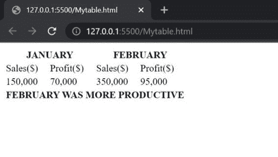

图 1.30.5：显示应用了表头、主体和表脚标签的表格输出

注意：这里需要注意的一点是，你的表格可以有多个 `<tbody>` 部分。在这种情况下，每个 `<tbody>` 将相关的行分组。

现在，挑战来了。我想让你练习一下所有这些与表格相关的元素（哎！）。你的目标是创建图 1.30.6 所示的表格。

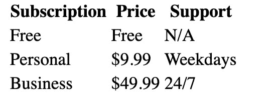

图 1.30.6：一个 4x3 表格的挑战

如果你觉得需要更多帮助，完成后你可以使用本书底部的支持链接与我联系。我将在 24 小时内内回复你。

# 2. 基础 CSS (层叠样式表)

恭喜你完成了 HTML 学习！我为你坚持下来感到非常自豪，你也应该为自己感到自豪。现在，你将进入一个全新的世界——CSS 的世界。这个世界看起来可能可怕，也可能令人兴奋，或者两者兼具，但它充满了可能。这是奇妙 CSS 旅程的开始，而不只是 HTML 旅程的终结。

我们还没有结束 HTML，因为它将在本章的大部分中发挥作用。事实上，我们将在本节使用大量的 HTML，因为 CSS 用于对现有的 HTML 元素进行样式化。因此，我们有几个 CSS 的章节。这是一个相对巨大的话题，但也非常简单。不要恐慌！

那么，话话说此，祝你好运。我们继续吧！

对于本章的课程，我想让你创建一个新文件夹。正如我在介绍章节中所解释的（第 0 节`），你将创建一个文件夹并将其命名为 `02_lesson`：

1. 打开你的 `Html_course` 文件夹。

2. 创建一个标题为 `02_lesson` 的新文件夹。

3. 在此文件夹中，创建一个记事本或文本文档，并将默认文件名更改为 `index`，扩展名从 `.txt` 改为 `.html`。

4. 在 Visual Studio 中，点击顶部的`文件 (File)` 菜单并选择`打开文件夹 (Open Folder...)`。

5. 导航到你保存 `02_lesson` 文件夹的位置并选择它。

6. 选择此文件夹以便 Visual Studio 资源管理器中加载 `index.html` 文件。

查看图 2.1 中的 (1)。关闭*入门指南 (Get Started)* 标签 (2)。

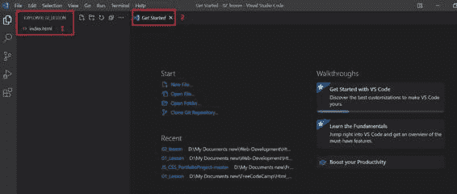

图 2.1：在 Visual Studio 中创建了一个新文件

要打开你的代码编辑器窗口并开始编码，点击 `index.html` 文件 (1)。

## 2.1. 使用 CSS 选择器为元素样式

我们为什么不先快速回顾一下 HTML、CSS 和 JavaScript 各自的作用呢？这里的想法是将 HTML、CSS 和 JavaScript 比作语法中的不同部分，我们有名词、形容词和动词。

**HTML** 是**名词**——比如表单中的按钮或标题。**CSS** 是**形容词**，用于*描述*名词——比如按钮的大小（例如，一个*大*按钮）。**Javascript** 是**动词**——名词执行的*动作*——比如一个不断闪烁颜色的按钮，或在点击时看起来很落的按钮。

CSS 代表 **Cascading Style Sheet (层叠样式表)**。我认为“样式表”部分是自言易懂的，因为我们正在使用 CSS 为内容设置样式。“层叠 (Cascading)”部分是在你学习更多知识后我们会回到的内容。所以简单回顾一下，CSS 是一种语言（不一定是编程语言），我们可以用它来描述元素的外观或视觉表示。

请注意，在每个元素的 `style rule(s)` 周围包含起始和结束大括号（`{` 和 `}`）是非常重要的。你还需要确保元素的样式定义位于起始`<style>`和结束 `</style>`标签之间。最后，请确保在每个元素的样式规则末尾添加分号。

现在，对于你的猫照片应用，请编辑你的 CSS 样式块并添加必要的 CSS 样式，将所有的 `h2` 元素变为蓝色。

这是更新后的代码：


```html
<style>
h2 {
  color: blue;
}
</style>

<h2>CatPhotoApp</h2>

<main>
  <p>点击此处查看更多 <a href="https://www.bestcat.com/">猫照片</a>。</p>
  <a href="#"></a>
  <div>
    <p>猫喜欢的东西：</p>
    <ul>
      <li>猫薄荷</li>
      <li>激光笔</li>
      <li>千千面</li>
    </ul>
    <p>猫最讨厌的前 3 件事：</p>
    <ol>
      <li>驱虫治疗</li>
      <li>雷声</li>
      <li>其他猫</li>
    </ol>
  </div>
  <form action="https://catphotoapp.com/submit-cat-photo">
    <label><input type="radio" name="indoor-outdoor" checked> 室内</label>
    <label><input type="radio" name="indoor-outdoor"> 户外</label><br>
    <label><input type="checkbox" name="personality" checked> 充满爱</label>
    <label><input type="checkbox" name="personality"> 懒惰</label>
    <label><input type="checkbox" name="personality"> 精活力</label><br>
    <input type="text" placeholder="cat photo URL" required>
    <button type="submit">Submit</button>
  </form>
</main>
```

图 2.1.2 显示了代码在 Visual Studio 编辑器中的外观。

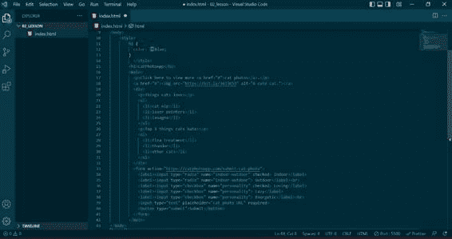

图 2.1.2：带有 CSS 的更新 CatPhotoApp 代码

如你所示，直接在文档的`<style>`和`</style>`之间编写 CSS 比使用内联 CSS 要好得多。对我来说，在本书中我会继续使用这种方法一段时间。但如果你的网站上有多个文档或页面，并且你想使用相同的样式怎么办？你将不得不将`<style>`和`</style>`标签之间的所有内容复制并粘贴到每个文档。

在这种情况下，最好的方法（也是你最常见的方法）是在`external`（外部）样式表中编写样式。要做到这一点，请创建一个新文件（完全独立的文件，但在同一个`02_lesson`文件夹中），在其中编写你的 CSS。你可以将此文件命名为`styles`并赋予它`.css`扩展名。因此，完整文件名将是`styles.css`。然后你可以在该文件包含在你自己的文档或创建的任何其他文档中

现在，从你的应用中删除 css 规则（见下方）。

```html
<style>
h2 {
  color: blue;
}
</style>
```

现在，将`<style>`和`</style>`之间的所有内容写入你新的`styles.css`文件中，并确保保存文件。如下所示：

```css
h2 {
  color: blue;
}
```

查看图 2.1.3 中它在 Visual Studio 中的外观。

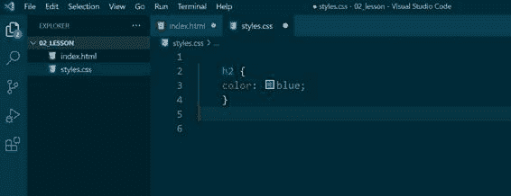

图 2.1.3：从`index.html`文件迁移到`styles.css`文件的 CSS 规则

但你还没有完成，因为这两个文件（`index.html`和`styles.css`）之间没有任何连接。这个 HTML 文件对 CSS 文件一无所知，尽管它们在同一个文件夹中。你需要告诉 HTML 关于 CSS 的信息。为了做到，你将使用一个名为`<link>`的新元素。该元素位于`<head></head>`标签内部。它的写法如下：

```html
<link rel="stylesheet" href="styles.css">
```

或者，你可以这样写：

```html
<link rel="stylesheet" type="text/css" href="styles.css">
```

`type`用于指示你所链接的文件内容。默认值为`text`或`css`。

想象一下，如果你的 CSS 文件在不同的文件夹中（例如`03_lesson`），你编写`<link>`代码将如下所示：

```html
<link rel="stylesheet" href="03_lesson/styles.css">
```

由于你目前还没有`03_lesson`文件夹，请使用`<link rel="stylesheet" href="styles.css">`。

你更新后的`index.html`文件现在应该是这样的（`<link>`代码以蓝色突出，且必须放在`<head>`和`</head>`部分之间）：

```html
<!DOCTYPE html>
<html lang="en">
<head>
  <meta charset="UTF-8">
  <meta http-equiv="X-UA-Compatible" content="IE=edge">
  <meta name="viewport" content="width=device-width, initial-scale=1.0">
  <title>CSS Introduction</title>
  <link rel="stylesheet" href="styles.css">
</head>
... (其余内容) ...
</html>
```

你可以通过使用`font-family`属性来设置元素应该使用的字体。例如，如果你想将`h2`元素的字体设置为`sans-serif`，你可以使用以下 CSS：

```css
h2 {
  font-family: sans-serif;
}
```

不，让你所有的`p`元素使用`monospace`字体。

```html
<style>
.red-text {
  color: red;
}

p {
  font-size: 16px;
  font-family: monospace;
}
</style>
```

这里是更新后的代码：

```html
<style>
h2 {
  color: blue;
  font-family: sans-serif;
}

.red-text {
  color: red;
}

p {
  font-size: 16px;
  font-family: monospace;
}
</style>
```

```html
<h2 class="red-text">CatPhotoApp</h2>

<main>
  <p class="red-text">点击此处查看更多 <a href="https://www.bestcat.com/">猫咪照片</a>。</p>

  <a href="#"></a>

  <div>
    <p>猫喜爱的东西：</p>

    <ul>
      <li>猫薄荷</li>
      <li>激光笔</li>
      <li>千层面</li>
    </ul>

    <p>猫最讨厌的前 3 件事：</p>

    <ol>
      <li>驱跳虫治疗</li>
      <li>雷声</li>
      <li>其他猫</li>
    </ol>
  </div>

  <form action="https://catphotoapp.com/submit-cat-photo">
    <label><input type="radio" name="indoor-outdoor" checked> 室内</label>
    <label><input type="radio" name="indoor-outdoor"> 户外</label><br>

    <label><input type="checkbox" name="personality" checked> 贴心</label>
    <label><input type="checkbox" name="personality"> 懒惰</label>
    <label><input type="checkbox" name="personality"> 活泼</label><br>

    <input type="text" placeholder="cat photo URL" required>
    <button type="submit">Submit</button>
  </form>
</main>
```

图 2.6.1 显示了目前更新后的应用程序：

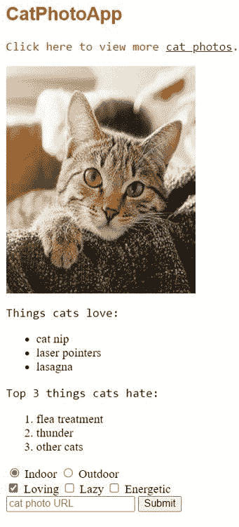

图 2.6.1：应用了无衬线字体和等宽字体的更新后的应用程序

## 2.7. 导入 Google 字体

除了指定大多数操作系统上都有的字体外，我们还可以为我们的网站指定非标准的、自定义的网络字体。互联网上有许多网络字体来源。在这个示例中，我们将关注`Google Fonts 库`。

Google Fonts 是一个免费的网络字体库，你可以通过引用字体的 URL 在 CSS 中使用它。现在，让我们导入并应用一个 Google 字体（注意，如果 Google 在你的国家被屏蔽，则你需要跳过此挑战）。

要导入 Google 字体，你可以从 Google Fonts 库复制字体的 URL，然后将其粘贴到 HTML 中。在这个挑战中，我们将导入`Lobster`字体。为了这一点，请复制以下代码片段并将其粘贴到代码编辑器的顶部（在`style`标签之前）：

```html
<link href="https://fonts.googleapis.com/css?family=Lobster" rel="stylesheet" type="text/css">
```

现在你可以像下面的示例那样通过通过`Lobster`作为`FAMILY_NAME`在 CSS 中使用`Lobster`字体：

```css
font-family: FAMILY_NAME, GENERIC_NAME;
```

`GENERIC_NAME`是可选的，当其他指定的字体不可用时的备用字体。这将在下一个挑战中介绍。

族名称对大小写敏感，如果名称中有空格，则需要用引号括起来。例如，使用`Open Sans`字体需要引号，但使用`Lobster`字体则不需要。

将`Lobster`字体导入到你的网页中。然后，使用元素选择器将其设置为你的`h2`元素的`font-family`。

这里是更新后的内容：

```html
<link href="https://fonts.googleapis.com/css?family=Lobster" rel="stylesheet" type="text/css">
<style>
.red-text {
  color: red;
}

h2 {
  font-family: Lobster;
}

p {
  font-size: 16px;
  font-family: monospace;
}
</style>

<h2 class="red-text">CatPhotoApp</h2>
```

这是应用程序的更新：

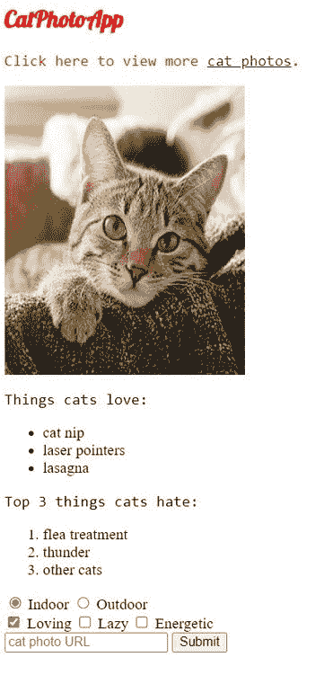

图 2.7.1：为 h2 标题应用了 Lobster 字体的更新后的应用程序

## 2.8. 指定字体应如何退级

所有浏览器中都提供了几种默认字体。这些通用字体族包括`monospace`、`serif`和`sans-serif`。当某种字体不可用时，你可以告诉浏览器“退级”到另一种字体。

例如，如果你想让元素使用`Helvetica`字体，但在 Helvetica 不可用时退级到`sans-serif`字体，你可以这样指定：

```css
p {
  font-family: Helvetica, sans-serif;
}
```

通用字体族名称对大小写敏感。此外，它们不需要引号，因为它们是 CSS 关键字。作为开始，为你的元素应用`monospace`、`serif`和`sans-serif`。

注意：`monospace`、`serif`和`sans-serif`是通用字体族。

## 2.9. 如何调整图片大小

所有浏览器中都提供了几种默认字体。这些通用字体族包括`monospace`、`serif`和`sans-serif`。当某种字体不可用时，你可以告诉浏览器“退级”到另一种字体。

例如，如果你想让元素使用`Helvetica`字体，但在 Helvetica 不可用时退级到`sans-serif`字体，你可以这样指定：

```css
p {
  font-family: Helvetica, sans-serif;
}
```

```html
<label><input type="checkbox" name="personality"> 懒惰</label>
<label><input type="checkbox" name="personality"> 活力活力</label><br>

<input type="text" placeholder="cat photo URL" required>

<button type="submit">提交</button>
```

图 2.10.1 显示了更新后的应用：

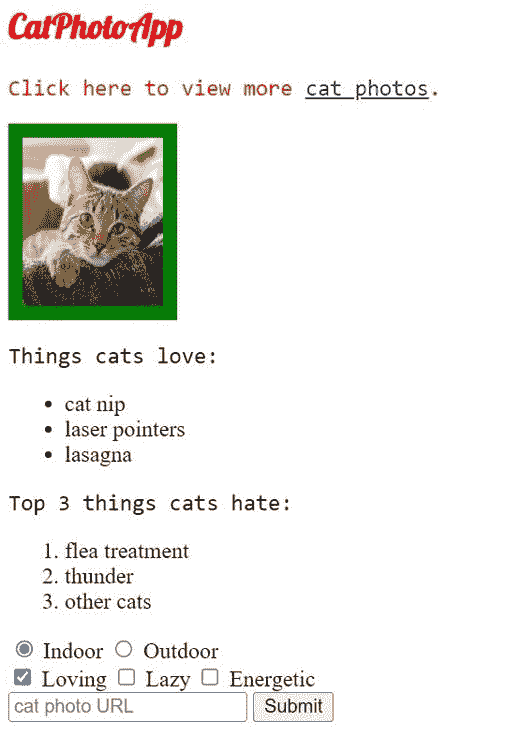

图 2.10.1：猫照片应用了绿色边框

## 2.11. 使用 Border Radius 添加圆角

你的猫照片目前有尖锐的角。我们可以使用一个名为`border-radius`的 CSS 属性将这些角变圆。

现在，你将使用像素来指定`border-radius`。因此，你将给猫照片设置一个`10px`或`20px`的`border-radius`。

注意：此挑战允许多种可能的解决方案。例如，你可以向`.thick-green-border`类或`.smaller-image`类添加`border-radius`。

对于我来说，我想对这两者都添加`border-radius`。请随意做出自己的选择。这是我更新后的样式表（应用了 20px）：

```css
.red-text {
  color: red;
}

h2 {
  font-family: Lobster, monospace;
}

p {
  font-size: 16px;
  font-family: monospace;
}

.thick-green-border {
  border-color: green;
  border-width: 10px;
  border-style: solid;
  border-radius: 20px;
}

.smaller-image {
  width: 100px;
  border-radius: 20px;
}
```

现在运行你更新后的代码，在浏览器中查看你酷炫的猫照片。

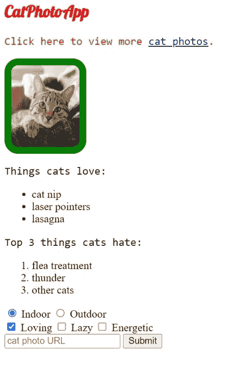

图 2.11.1：绿色边框和猫照片都应用了圆角

## 2.12. 使用 Border Radius 创建圆形图像

除了像素之外，你还可以使用百分比来指定`border-radius`。现在，更新你的`.thick-green-border`和猫照片，将它们的`border-radius`都设为`50%`，如下：

```css
.thick-green-border {
  border-color: green;
  border-width: 10px;
  border-style: solid;
  border-radius: 50%;
}

.smaller-image {
  width: 100px;
  border-radius: 50%;
}
```

## 2.13. 给 Div 元素添加背景颜色

你可以使用`background-color`属性设置元素的背景颜色。例如，如果你想让元素的背景变为绿色，你会将此代码放入`style`元素中：

```css
.green-background {
  background-color: green;
}
```

在这个挑战中，你将创建一个名为`silver-background`的类，背景颜色为银色。将此类分配给下方 CatPhotoApp 代码中的`div`元素：


## 2.14. 设置元素的 `id`

除了类之外，你还可以通过`id`设置 HTML 元素。`id`应该是唯一的，意味着页面上只有一个元素具有特定的`id`。你可以使用`id`属性来设置，例如：

```html
<div id="main-photo">
```

现在你可以使用`#`符号在 CSS 中设置这个`id`，例如：

```css
#main-photo {
border-color: blue;
}
```

`id`的奇之处在于，你可以使用 JavaScript 来选择特定的元素，例如：

```javascript
document.getElementById("main-photo")
```

现在你可以回到 CatPhotoApp，为包含喜欢的东西列表的`div`元素添加一个`id="photo-container"`：

```html
<div id="photo-container">
<p>猫喜欢的东西：</p>
<ul>
<li>猫抓薄荷</li>
<li>激光笔</li>
<li>千层百/披饼</li>
</ul>
</div>
```

## 2.15. 使用`id`属性样式元素

`id`的奇之处在于，像类一样，你可以使用 CSS 设置样式。但是，`id`不是可复用的，应该只应用于元素。`id`的优先级（权重）比类高，因此如果它们被应用于同一个元素且样式冲突，则`id`的样式将被应用。

这是一个如何将你具有`id`属性`photo-element`的元素赋予绿色背景色的示例。在你的样式中：

```css
#photo-element {
background-color: green;
}
```

注意，在`style`元素内部，你总是通过名称前加`.`来引用类。你总是通过名称前加`#`来引用`id`。

在这个挑战中，给你的现在具有`id` `cat-photo-form`的表单设置一个绿色背景。

这是更新后的：

```css
.red-text {
color: red;
}
h2 {
font-family: Lobster, monospace;
}
p {
font-size: 16px;
font-family: monospace;
}
.thick-green-border {
border-color: green;
border-width: 10px;
border-style: solid;
border-radius: 50%;
}
.smaller-image {
width: 100px;
}
.silver-background {
background-color: silver;
}
#cat-photo-form {
background-color: green;
}
```

## 2.16. 调整元素的内边距

现在放下你的猫照片应用，学习更多样式 HTML 的知识。因此，在你的 Visual Studio 中，创建一个新文件并命名为`Challenge.html`。

你可能已经注意到了，所有的 HTML 元素本质上都是小矩形。有三个重要的属性控制着每个 HTML 元素周围的空间：`padding`、`border`和`margin`。

元素的`padding`控制元素内容与其边界之间的空间。如果你运行下面的代码，你将看到蓝色框和红色框嵌套在黄色框内。

```html
<style>
.injected-text {
margin-bottom: -25px;
text-align: center;
}
.box {
border-style: solid;
border-color: black;
border-width: 5px;
text-align: center;
}
.yellow-box {
background-color: yellow;
padding: 10px;
}
.red-box {
background-color: crimson;
color: #fff;
padding: 20px;
}
.blue-box {
background-color: blue;
color: #fff;
padding: 10px;
}
</style>

<h5 class="injected-text">margin</h5>
<div class="box yellow-box">
<h5 class="box red-box">padding</h5>
<h5 class="box blue-box">padding</h5>
</div>
```

图 2.16.1 是代码输出的截图。

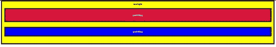

图 2.16.1：元素`padding`的插图

每个颜色周围的黑色边界被称为`border`，它可以是实线、虚线或细线。请注意，红色框的`padding`比蓝色框多。当你增加蓝色框的`padding`时，它会增加文本与其周围边界之间的距离。

这里是你的下一个挑战。将你的蓝色框的`padding`修改为与红色框相同。

这很简单。只需将`padding`从`10px`增加到`20px`即可。你需要在上述代码的`<style></style>`中进行更新：

```css
.blue-box {
background-color: blue;
color: #fff;
padding: 20px;
}
```

图 2.16.2 是更新后输出的截图。

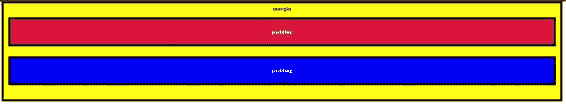

图 2.16.2：增加蓝色框`padding`的效果

## 2.17. 调整元素的`margin`

元素的`margin`控制元素边界与周围元素之间的空间。

在下面的代码中，你可以看到蓝色框和红色框嵌套在黄色框内。

```html
<style>
.injected-text {
margin-bottom: -25px;
text-align: center;
}
.box {
border-style: solid;
border-color: black;
border-width: 5px;
text-align: center;
}
.yellow-box {
background-color: yellow;
padding: 10px;
}
.red-box {
background-color: crimson;
color: #fff;
padding: 20px;
margin: 20px;
}
.blue-box {
background-color: blue;
color: #fff;
padding: 20px;
margin: 10px;
}
</style>

<h5 class="injected-text">margin</h5>
<div class="box yellow-box">
<h5 class="box red-box">padding</h5>
<h5 class="box blue-box">padding</h5>
</div>
```

注意，红色框的`margin`比蓝色框大，这使其看起来更小。当你增加蓝色框的`margin`时，它会增加其边界与周围元素之间的距离。

所以，将蓝色框的`margin`修改为与红色框相同。尝试一下吧！

这很容易。只需将`margin`从`10px`增加到`20px`即可。你需要在上述代码的`<style></style>`中进行更新：

```css
.blue-box {
background-color: blue;
color: #fff;
padding: 20px;
margin: 20px;
}
```

在你的浏览器中查看此更新的输出。

## 2.18. 给元素添加负边距

元素的`margin`控制元素边界与周围元素之间的空间。如果你将元素的`margin`设置为负值，元素将变得更大。

在这个挑战中，尝试将`margin`设置为负值，类似于下面代码中`red-box`的值。删除你之前的代码，并在 Visual Studio 编辑器中加载下面的代码。现在，将蓝色框的`margin`修改为`-15px`，使其填充周围黄色框的整个水平宽度。

```html
<style>
.injected-text {
margin-bottom: -25px;
text-align: center;
}
.box {
border-style: solid;
border-color: black;
border-width: 5px;
text-align: center;
}
.yellow-box {
background-color: yellow;
padding: 10px;
}
.red-box {
background-color: crimson;
color: #fff;
padding: 20px;
}
.blue-box {
background-color: blue;
color: #fff;
padding: 10px;
}
</style>

<h5 class="injected-text">margin</h5>
<div class="box yellow-box">
<h5 class="box red-box">padding</h5>
<h5 class="box blue-box">padding</h5>
</div>
```

你需要需要的更新：

```css
.blue-box {
background-color: blue;
color: #fff;
padding: 20px;
margin: -15px;
}
```

图 2.18.1 是输出的截图。

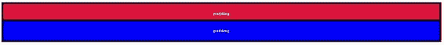

图 2.18.1：给蓝色框添加负边距的效果

## 2.19. 为元素添加不同的 `padding`

有时你希望每个边有不同的`padding`。复制下面的代码并运行以查看输出。

```html
<style>
.injected-text {
margin-bottom: -25px;
text-align: center;
}
.box {
border-style: solid;
border-color: black;
border-width: 5px;
text-align: center;
}
.yellow-box {
background-color: yellow;
padding: 10px;
}
.red-box {
background-color: crimson;
color: #fff;
padding: 20px;
}
.blue-box {
background-color: blue;
color: #fff;
padding: 10px;
}
</style>

<h5 class="injected-text">margin</h5>
<div class="box yellow-box">
<h5 class="box red-box">padding</h5>
<h5 class="box blue-box">padding</h5>
</div>
```

现在，将你的蓝色框的`padding`修改为顶部和底部为`20px`，左右和右为`10px`。你需要在上述代码的`<style></style>`中进行更新：

```css
.blue-box {
background-color: blue;
color: #fff;
padding-top: 20px;
padding-bottom: 20px;
padding-left: 10px;
padding-right: 10px;
}
```

图 2.19.1 是更新后输出的截图。

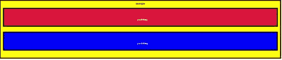

图 2.19.1：为蓝色框添加不同`padding`的效果

## 2.20. 使用顺时针法指定元素的`padding`

与其单独指定元素的`padding-top`、`padding-right`、`padding-bottom`和`padding-left`，你可以在一行内指定所有它们，例如：

`padding: 10px 20px 10px 20px;`

这四个值的作用像时针一样：`top`、`right`、`bottom`、`left`，产生的结果与使用特定方向的填充指令完全相同。

在此项挑战中，删除你 Visual Studio 中现代码。然后复制下面的代码并运行它以首次查看输出。现在，你将使用顺时针表示法（Clockwise Notation）为`.blue-box`类设置顶部和左侧的`40px`内边距，而底部和右侧仅设为`20px`。

```html
<style>
.injected-text {
margin-bottom: -25px;
text-align: center;
}
.box {
border-style: solid;
border-color: black;
border-width: 5px;
text-align: center;
}
.yellow-box {
background-color: yellow;
padding: 20px 40px 20px 40px;
}
.red-box {
background-color: crimson;
color: #fff;
padding: 20px 40px 20px 40px;
}
.blue-box {
background-color: blue;
color: #fff;
}
</style>

<h5 class="injected-text">margin</h5>
<div class="box yellow-box">
<h5 class="box red-box">padding</h5>
<h5 class="box blue-box">padding</h5>
</div>
```

以下是如何应用顺时针表示法来更新蓝色框的：

```css
.blue-box {
background-color: blue;
color: #fff;
padding: 40px 20px 20px 40px;
}
```

你更新后的输出应该看起来如图 2.21.1 所示的截图。

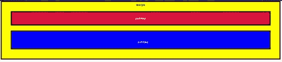


图 2.21.1：更新后的输出显示了对蓝色框内边距应用顺时针表示法的效果。

## 2.22. 使用顺时针表示法指定元素的外边距

让我们再次尝试，但这次是使用外边距（`margin`）。与其单独指定元素的 `margin-top`、`margin-right`、`margin-bottom` 和 `margin-left` 属性，你可以在一行内指定所有属性，如下：

```css
margin: 10px 20px 10px 20px;
```

这四个值的作用像时针一样：`top`、`right`、`bottom`、`left`，产生的结果与使用特定方向的外边距指令完全相同。

因此，使用顺时针表示法为带有 `.blue-box` 类的元素设置顶部和左侧的 `40px` 外边距，而底部和右侧仅设为 `20px`。这是你需要处理的代码：

```html
<style>
.injected-text {
  margin-bottom: -25px;
  text-align: center;
}
.box {
  border-style: solid;
  border-color: black;
  border-width: 5px;
  text-align: center;
}
.yellow-box {
  background-color: yellow;
  padding: 20px 40px 20px 40px;
}
.red-box {
  background-color: crimson;
  color: #fff;
  margin: 20px 40px 20px 40px;
}
.blue-box {
  background-color: blue;
  color: #fff;
}
</style>

<h5 class="injected-text">margin</h5>
<div class="box yellow-box">
  <h5 class="box red-box">padding</h5>
  <h5 class="box blue-box">padding</h5>
</div>
```

以下是蓝色框的更新代码：

```css
.blue-box {
  background-color: blue;
  color: #fff;
  margin: 40px 20px 20px 40px;
}
```

## 2.23. 使用属性选择器为元素设置样式

你一直在为你想要特定样式的元素添加 `id` 或 `class` 属性。这些被称为 ID 选择器和类选择器。还有其他 CSS 选择器可以让你选择自定义元素组进行样式化。

现在，再次从 Visual Studio 中拿出你的 CatPhotoApp 来练习使用 CSS 选择器。

在此项挑战中，你将使用 `[attr=value]` 属性选择器为 CatPhotoApp 中的复选框设置样式。该选择器匹配并样式具有特定属性值的元素。例如，下面的代码更改了所有具有属性 `type` 对应值为 `radio` 的元素的外边距：

```css
[type='radio'] {
  margin: 20px 0px 20px 0px;
}
```

现在，尝试使用 `type` 属性选择器为你的 CatPhotoApp 中的复选框设置 `10px` 的顶部外边距和 `15px` 的底部外边距。

以下是复选框的更新代码：

```css
[type='checkbox'] {
  margin: 10px 0px 15px 0px;
}
```

图 2.23.1 显示了输出。

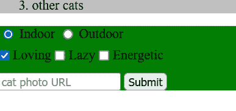

图 2.23.1：修改复选框外边距的效果。

## 2.24. 理解绝对单位与相对单位（EM 和 REM）

之前的几个挑战都使用像素（`px`）设置元素的外边距或内边距。像素是长度单位的一种，它告诉浏览器如何渲染元素。

单位有两种主要类型：绝对单位和相对单位。绝对单位如 `px`、`mm`、`cm`、`in`、`pt` 和 `pc` 是固定的物理测量值。相对单位如 `em`、`rem`、`vw`、`vh` 和 `%` 相对于其他值的大小。例如，`em` 相对于元素的字体大小，而 `rem` 相对于根元素的字体大小。

## 2.26. 从 body 元素继承样式

现在我们证明了每个 HTML 页面都有一个 `body` 元素，并且它的 `body` 元素可以设置样式。记住，你可以像设置任何其他元素一样设置 `body` 元素，你的所有其他元素将继承 `body` 元素的样式。

这里是更新：

```html
<style>
body {
  background-color: black;
  font-family: monospace;
  color: green;
}
.pink-text {
  color: pink;
}
</style>
```

```html
<h1 class="pink-text">Hello World!</h1>
```

如果你现在查看更新后的代码输出，你会发现你的 `h1` 元素被赋予了粉红色。这证明你的 `pink-text` 类覆盖了 `body` 元素的 CSS。

## 2.28. 在后续 CSS 中覆盖样式

我们的 `pink-text` 类覆盖了 `body` 元素的 CSS 声明！我们刚刚证明了类会覆盖 `body` 元素的 CSS。所以，下一个逻辑性问题是，我们能做什么来覆盖我们的 `pink-text` 类呢？

创建一个名为 `blue-text` 的额外 CSS 类，将元素设置为蓝色。确保它位于你的 `pink-text` 类声明之下。

在你的 `h1` 元素上除了 `pink-text` 类之外也应用 `blue-text` 类，让我们看看哪一个胜出。在 HTML 元素上应用多个类属性是通过在它们之间加空格来实现的：

```html
class="class1 class2"
```

注意：类在 HTML 元素中列出的顺序并不重要。

然而，`<style>` 部分中类声明的顺序才是重要的。第二个声明总是优先于第一个声明。因为 `.blue-text` 是第二个声明的，它覆盖了 `.pink-text` 的属性。

代码如下：

```html
<style>
body {
  background-color: black;
  font-family: monospace;
  color: green;
}
.pink-text {
  color: pink;
}
.blue-text {
  color: blue;
}
</style>
<h1 class="pink-text blue-text">Hello World!</h1>
```

## 2.29. 通过为 ID 属性覆盖类声明

我们刚刚证明了浏览器按照声明顺序从上到下读取 CSS。这意味着在发生冲突时，浏览器将使用最后出现的 CSS 声明。注意，即使我们在 `h1` 元素的类中将 `blue-text` 放在 `pink-text` 之前，它仍然会查看声明顺序，而不是使用顺序！

但我们还没有结束。还有其他覆盖 CSS 的方法。你还记得 `id` 属性吗？

让我们通过给 `h1` 元素一个 `id` 并对该 `id` 进行样式，来覆盖你的 `pink-text` 和 `blue-text` 类，并将 `h1` 元素设置为橙色。

给你的 `h1` 元素添加 `id="orange-text"`。记住，`id` 样式看起来像：

```html
<h1 id="orange-text">
```

在你的 `h1` 元素上保留 `blue-text` 和 `pink-text` 类。在你的样式元素中为你的 `orange-text` id 创建 CSS 声明。这是一个示例：

```css
#brown-text {
  color: brown;
}
```

注意：无论将此 CSS 在 `pink-text` 类之上还是之下都不重要，因为 `id` 属性始终具有高优先级。

你的代码应该是这样的：

```html
<style>
body {
  background-color: black;
  font-family: monospace;
  color: green;
}
.pink-text {
  color: pink;
}
.blue-text {
  color: blue;
}
#orange-text {
  color: orange;
}
</style>
<h1 id="orange-text" class="pink-text blue-text">Hello World!</h1>
```

你的输出应该像图 2.29.1。

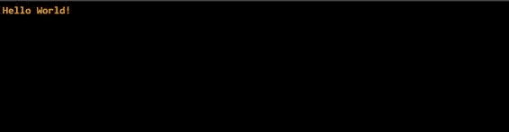

图 2.29.1：H1 元素呈现橙色，因为 `pink-text` 和 `blue-text` 类被覆盖了。

## 2.30. 使用内联样式覆盖类声明

所以，我们证明了无论在样式元素 CSS 中于什么位置声明，`id` 声明都会覆盖类声明。

还有其他覆盖 CSS 的方法。你还记得内联样式吗？使用内联样式尝试让我们的 `h1` 元素变为白色。记住，内联样式看起来像：

```html
<h1 style="color: green;">
```

在你的 `h1` 元素上保留 `blue-text` 和 `pink-text` 类。方法如下：

```html
<style>
body {
  background-color: black;
  font-family: monospace;
  color: green;
}
.pink-text {
  color: pink;
}
.blue-text {
  color: blue;
}
#orange-text {
  color: orange;
}
</style>
<h1 style="color: white;" id="orange-text" class="pink-text blue-text">Hello World!</h1>
```

检查浏览器上的输出。“Hello World!”文本应该是白色的。

## 2.31. 使用 Important 覆盖所有其他样式

太棒了！我们刚刚证明内联样式将覆盖样式元素中的所有 CSS 声明。等一下。还有最后一种覆盖 CSS 的方法。这是所有方法中最强大的。但在此之前，让我们谈谈你为什么想要覆盖 CSS。

在很多情况下，你会使用 CSS 库。这些库可能会意外地覆盖你自己的 CSS。因此，当你绝对需要确保一个元素具有特定的 CSS 时，你可以使用 `!important`。

回到我们的 `pink-text` 类声明。记住，我们的 `pink-text` 类被后续的类声明、`id` 声明和内联样式覆盖了。

给你的 `pink-text` 类添加关键字 `!important`。

```css
.pink-text {
  color: pink !important;
}
```

## 2.32. 使用十六进制代码指定特定颜色

你知道还有其他指定颜色的方法吗？其中一种就是十六进制代码。十六进制代码以 `#` 开头，后跟六个字符：0-9 和 a-f（或 A-F）。这是一个 16 进制系统，每个数字提供 16 种可能的值。

六个数字分别代表红、绿、蓝的量。例如，`#FF0000` 是纯红色，`#00FF00` 是纯绿色，`#0000FF` 是纯蓝色。

| 颜色 | 十六进制代码 |
| :--- | :--- |
| 红色 | `#FF0000` |
| 绿色 | `#00FF00` |
| 蓝色 | `#0000FF` |
| 橙色 | `#FFA500` |
| 紫色 | `#800080` |
| 青色 | `#00FFFF` |

通过混合这三种颜色，你可以创造超过 1600 万种颜色！

## 2.33. 使用十六进制代码混合颜色

回顾一下，十六进制代码使用红（R）、绿（G）和蓝（B）分量。从这三种纯色（红、绿、蓝）中，我们可以改变每种量来创建任何颜色。

例如，橙色是纯红色混合了一些绿色且没有蓝色。在十六进制代码中，这翻译为 `#FFA500`。

数字 0 是十六进制代码中最小的，代表颜色的完全缺失。数字 F 是十六进制代码中最大的，代表最大的亮度。

| 颜色 | 十六进制代码 |
| :--- | :--- |
| 深青色 | `#1E90FF` |
| 绿色 | `#00FF00` |
| 橙色 | `#FFA500` |
| 红色 | `#FF0000` |

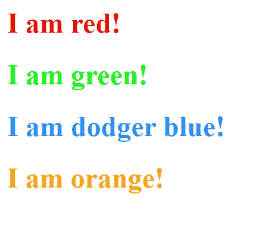

图 2.33.1：带有十六进制代码的颜色。

## 2.34. 使用简写十六进制代码

许多人对超过 1600 万种颜色的可能性感到无从从。而且十六进制代码很难记忆。幸运的是，你可以缩短它。

例如，红色的十六进制代码 `#FF0000` 可以缩短为 `#F00`。这种缩写形式为红色提供一位、绿色一位、蓝色一位。这使得可能颜色的总数减少到大约 4000 种。但浏览器会将 `#FF0000` 和 `#F00` 解析为完全相同的颜色。

| 颜色 | 简写十六进制 |
| :--- | :--- |
| 青色 | `#0FF` |
| 绿色 | `#0F0` |
| 红色 | `#F00` |
| 品红色 | `#F0F` |

现在，复制下面的代码。尝试使用简写十六进制代码为代码中的正确元素上色。

```html
<style>
.red-text {
  color: #000000;
}
.fuchsia-text {
  color: #000000;
}
.cyan-text {
  color: #000000;
}
.green-text {
  color: #000000;
}
</style>

<h1 class="red-text">I am red!</h1>
<h1 class="fuchsia-text">I am fuchsia!</h1>
<h1 class="cyan-text">I am cyan!</h1>
<h1 class="green-text">I am green!</h1>
```

这是更新后的代码：

```html
<style>
.red-text {
  color: #F00;
}
.fuchsia-text {
  color: #F0F;
}
.cyan-text {
  color: #0FF;
}
.green-text {
  color: #0F0;
}
</style>

<h1 class="red-text">I am red!</h1>
<h1 class="fuchsia-text">I am fuchsia!</h1>
<h1 class="cyan-text">I am cyan!</h1>
<h1 class="green-text">I am green!</h1>
```

## 2.35. 使用 RGB 值为元素上色

在 CSS 中表示颜色的另一种方法是使用 RGB 值。

黑色的 RGB 值如下：

```css
rgb(0, 0, 0)
```

白色的 RGB 值如下：

```css
rgb(255, 255, 255)
```

与其像十六进制代码那样使用六位十六进制数字，使用 RGB 使用 0 到 255 之间的数字来指定每种颜色的亮度。

如果你计算一下，一种颜色的两个数字等于 16 乘以 16，这给了我们 256 个总值。因此 `RGB 从零开始计数，其可能值的数量与十六进制代码完全相同`。

这是一个如何使用 RGB 代码将正文背景改为橙色的示例。

```css
body {
  background-color: rgb(255, 165, 0);
}
```

在下面的代码中，将 `body` 元素背景颜色中的十六进制代码替换为黑色的 RGB 值：`rgb(0, 0, 0)`。

```html
<style>
body {
  background-color: #F00;
}
</style>
```

这是更新后的代码：

```html
<style>
body {
  background-color: rgb(0, 0, 0);
}
</style>
```

## 2.36. 使用 RGB 混合颜色

就像十六进制一样，你可以通过不同值的组合在 RGB 中混合颜色。

现在，将你 `style` 元素中的十六进制代码替换为表中正确的 RGB 值：

| 颜色 | RGB |
| :--- | :--- |
| 蓝色 | `rgb(0, 0, 255)` |
| 红色 | `rgb(255, 0, 0)` |
| 兰花紫 | `rgb(218, 112, 214)` |
| 赭色 | `rgb(160, 82, 45)` |

这是代码。在编辑之前先原样运行它：

```html
<style>
.red-text {
  color: #000000;
}
.orchid-text {
  color: #000000;
}
.sienna-text {
  color: #000000;
}
.blue-text {
  color: #000000;
}
</style>

<h1 class="red-text">I am red!</h1>
<h1 class="orchid-text">I am orchid!</h1>
<h1 class="sienna-text">I am sienna!</h1>
<h1 class="blue-text">I am blue!</h1>
```

这是解决方案：

```html
<style>
.red-text {
  color: rgb(255, 0, 0);
}
.orchid-text {
  color: rgb(218, 112, 214);
}
.sienna-text {
  color: rgb(160, 82, 45);
}
.blue-text {
  color: rgb(0, 0, 255);
}
</style>

<h1 class="red-text">I am red!</h1>
<h1 class="orchid-text">I am orchid!</h1>
<h1 class="sienna-text">I am sienna!</h1>
<h1 class="blue-text">I am blue!</h1>
```

## 2.37. 选择器列表

你还将看到的另一件事是我们可以使用逗号在列表中组合多个选择器。

```css
h1, h2 {
  color: magenta;
}
```


在这个示例中，`h1` 和 `h2` 都被设置了品红色。我们可以在很多情况下使用这种逗号。当你有两个或多个需要设置样式的元素时，这是常见的。

## 2.38 后代选择器

我们将看到的选择器是后代选择器。我们使用空格来编写它。这是一个示例：

```css
li a {
  color: #f10d0;
}
```

在这个示例中，我们有 `li` 空格 `a`。这将选择所有嵌套在 `li` 内部的锚点标签。它们不是子元素或父元素，也没有以任何方式嵌套。空格非常重要，它与逗号（`li,a`）不同。在这个示例中，没有 `li` 被设置样式。

```css
span a {
  color: #0000ff;
}
```

在这个示例中，我们有 `span` 空格 `a`。这将选择所有嵌套在 `span` 内部或作为 `span` 后代的锚点标签。即 `#0000ff`（蓝色）将应用于所有嵌套在 `span` 内部的锚点标签。

你的下一个挑战：在你的 `challenge.html` 的 `<body>` 和 `</body>` 标签之间编写这段代码：

```html
<h2>Search Engines like <a href="google.com">Google</a></h2>
<li><a href="https://yahoo.com">Yahoo</a></li>
<li><a href="https://bing.com">Bing</a></li>
<li><a href="https://ask.com">Ask</a></li>
```

接下来，如果你还没有在 `02_lesson` 文件夹中创建 `styles.css` 文件，请创建一个并在其中编写以下 CSS 代码。将此文件链接到你的 `challenge.html`。

```css
/* An illustration of a descendant selector */
li a {
  color: #f00;
}
```

在这段代码的第一行，`*/` 仅用于表示 CSS 多行注释。`/**` 语法用于单行或多行（块）注释。当你准备好后，在 Chrome 浏览器中运行 `challenge.html`。图 2.38.1 显示了你应该得到的。


图 2.38.1：后代选择器的输出，显示了列表中设置了样式的锚标签

如图 2.38.1 所示，列表中的三个搜索引擎被应用了红色。Google 没有设置样式，因为它不是列表的后代。

这是另一个挑战。解释这段代码：

```css
/*Another illustration of a descendant selector*/
footer a {
  background-color: black;
  color: blue;
  font-size: 10;
}
```

同时也解释这段代码：

```css
/*A third illustration of a descendant selector*/
footer li a {
  background-color: yellow;
  color: blue;
  font-size: 12;
}
```

## 2.39 相邻选择器（组合器）

相邻选择器技术上称为组合器。看这个示例：

```css
h1 + p {
  color: red;
}
```

这个 `+` 符号就是相邻组合器。这种组合器改变了整体选择的行为。它的作用是选择每一个紧跟在 `h1` 之前的段落 `p`，或者如果你反过来想，每一个紧跟在同一层（相邻）`h1` 之后的段落。它们不是子元素或父元素，也没有嵌套。

这是另一个示例。假设你想在网页顶部创建一个导航栏，并且在 `challenge.html` 文件中写了这些：

```html
<head>
  <link rel="stylesheet" href="styles.css">
  <nav>
    <label for="search">Search</label>
    <input type="text" placeholder="search" id="search">
    <button>Log in</button>
    <button id="signup">Sign up</button>
  </nav>
</head>
```

这是你得到的输出：


图 2.39.1：创建的搜索框、登录按钮和注册按钮，用于说明如何使用相邻组合器

在这个示例中，**Log in** 按钮紧跟在搜索框（`input`）之后，因此它们是相邻的。这是 `styles.css`，展示了你可以如何使用相邻选择器为每个紧跟在每个输入框之后的按钮设置粉色背景色。

```css
input + button {
  background-color: pink;
}
```

这是输出。


图 2.39.2：相邻选择器用于给按钮设置粉色的背景颜色

现在，又来挑战挑战。你能解释这段 CSS 中的相邻选择器会起什么作用吗？

```css
h2 + button {
  font-size: 20px;
  background-color: magenta;
}
```

## 2.40 直接后代/子元素选择器

我们将看到的下一个选择器是直接后代或子元素选择器。这里有一个示例。

```css
div > li {
  color: white;
}
```

我们使用大于号或右角括号（`>`）。在这种情况下，它将选择所有作为 `div` 直接子元素的 `li`。它不仅仅是嵌套在 `div` 某处的普通子元素，而是直接后代或直接子元素。

学习以下示例。

```html
<footer>
  <nav>
    <a href="https://google.com">前往 Google</a> <br/>
    <label for="search">搜索</label>
    <input type="text" placeholder="search" id="search">
    <button>登录</button>
    <button id="signup">注册</button>
  </nav>
  <a href="https://yahoo.com">前往 Yahoo</a>
</footer>
```

在此标记语言中，第一个锚点标签（前往 Google）不是 `footer` 的直接子元素。它是 `nav` 的直接子元素。然而，第二个锚点标签（前往 Yahoo）是 `footer` 的直接子元素，因此在这种情况下我们将编写以下 CSS 来仅为第二个锚点标签设置红色：

```css
footer > a {
  color: red;
}
```

尝试一下。使用你的 `challenge.html` 和 `styles.css` 文件。图 2.40.1 显示了输出。


图 2.40.1：相邻后代选择器用于仅给第二个锚点标签设置红色

我们刚刚查看了几个常用的 CSS 选择器，但你可以在这里通过 MDN 了解其他选择器：[`developer.mozilla.org/en-US/docs/Web/CSS/CSS_Selectors`](https://developer.mozilla.org/en-US/docs/Web/CSS/CSS_Selectors)。

## 2.41 伪类

接下来，我们将介绍一些伪类，伪类是我们添加在选择器末尾的修饰符或关键词。它们指定了所选元素的特定状态。例如，我们可以使用它们来针对如已选中的复选框或正在悬停的元素，或者每隔一个按钮。

以下是几个示例：

- `:active`
- `:hover`
- `:checked`
- `:not()`
- `:first`
- `:first-child`
- `:nth-child()`
- `:nth-of-type()`

注意它们都以冒号（`:`）开头。我们确实需要添加冒号来表示我们正在使用伪类。当你悬停在某些元素上时，看到这种情况非常常见，它们会有某种不同的行为或不同的视觉表示，向你展示你可以交互。

我们将从最常用的伪类之一开始，即 `:hover`。例如，当你将鼠标图标悬停在 [www.google.com](http://www.google.com/) 的 Google 搜索按钮上时，它会变得更加显著。此外，当你悬停在 [www.google.com](http://www.google.com/) 的任何链接（如 Gmail 或 Images）上时，这些链接会被下划线（就像这些：Gmail 和 Images）。

让我用按钮来做第一个示例。以下是你如何编写 CSS 代码，以使网页上的所有按钮在悬停时将背景颜色更改为红色，并将文本颜色改为浅白色。

```css
button:hover {
  background-color: red;
  color: #f1faee
}
```

使用你在 2.40 节中使用的相同 `challenge.html` 文件来尝试一下。

我也可以做得更具体一些。例如，与其说所有按钮，不如说文章内部（inside of a post）的按钮。因此，我只需要这样写：

```css
.post button:hover {
  background-color: red;
  color: #f1faee
}
```

然后当你悬停在网页上文章内部的任何按钮上时，它们的背景颜色将变为红色，文本颜色将变为浅白色。所有其他按钮将不受影响。

现在，这是你的挑战。这段 CSS 中的所有锚点标签会发生什么？

```css
a:hover {
  text-decoration: overline;
}
```

这很简单。这段 CSS 的意思是，当你悬停在任何锚点标签上时，文本装饰将变为上划线。

Web 开发的一大优势在于它非常适合来自许多不同背景的人。因此，无论你是几乎没有或没有技术经验，还是你已经拥有技术背景并希望将技能组合转型到 Web 开发领域，都没有关系。

无论你来自什么背景，我的这三本书就是你需要的一切。如果你还没有读过第二卷，请在它出版后尽快购买并继续学习。我们并肩作战。你需要的一切都在这三卷书中。

你并不并不孤单，因为我会帮助你度过难关。我的支持链接位于本书末尾，如果你需要进一步的帮助，可以随时联系我。

# 4. 速查表、开发者作品集、编码练习与实践项目

## 4.1 引言

在本节中，我将为你提供下载我的速查表、编码练习、用于展示你作品的精美开发者作品集以及有趣的 Web 开发实践项目的链接，这些资源将帮助你提高编码技能。

我强烈建议你尝试 `all` 编码练习和实践项目，因为它们将带给你更多的经验和专业知识。因此，祝你的实践项目顺利。

如果你的代码在第一次尝试时没有完全实现预期的结果，请不要灰心。这完全正常。在联系我之前，请反复尝试。如果你第一次尝试得得好，仍然可以回去学习任何需要更多复习的特定主题，然后回来找我获取更多实践项目。

成为经验丰富的 Web 开发者的一个强大秘密：永远停止练习！仅此而已。最终你会发现编写任何 `HTML5`、`CSS` 和 `Javascript` 项目都会变得容易。我向你保证的。

## 4.2 下载训练资源

这里是你可以使用的链接，用于下载有用的速查表、编码练习以及用于展示你作品的精美开发者作品集。我还包含了书中使用的图形和截屏，以获得最佳的用户体验：

[`ln5.sync.com/dl/13a3ca8e0/5wgw9pwc-sqgiy75j-kuwb55e8-ub84dz87`](https://ln5.sync.com/dl/13a3ca8e0/5wgw9pwc-sqgiy75j-kuwb55e8-ub84dz87)

或者，你可以使用这个短链接：

[`bit.ly/3DIKhOs`](https://bit.ly/3DIKhOs)

## 4.3 如何获取进一步帮助

如果你有任何需求或想与我分享你的代码，请通过下面的邮箱联系我。我会在 24 小时内回复你。我保证。

祝好，

Ojula Technology Innovations

OjulaTech@gmail.com

[Ojulaweb.com](http://Ojulaweb.com)

作者页面：

[www.leanpub.com/u/ablawal](https://www.leanpub.com/u/ablawal)

# 5. 更多有用资源

以下是我认为你会觉得非常有用的其他书籍的列表。

1. **AWS 认证云从业员考试成功指南 1**：通过测验、评估测试、速查表、实操课程和模拟考试来准备 `CLF-C01` 考试，以建立真实经验。

   电子书：[www.amazon.com/dp/B09HQW863G](https://www.amazon.com/dp/B09HQW863G)

   纸质版：[www.amazon.com/dp/B09L4Z8CB4](https://www.amazon.com/dp/B09L4Z8CB4)

2. **AWS 认证云从业员考试成功指南 2**：通过测验、评估测试、速查表、实操课程和模拟考试来准备 `CLF-C01` 考试，以建立真实经验。

   电子书：[www.amazon.com/dp/B09P7K84RH](https://www.amazon.com/dp/B09P7K84RH)

   纸质版：[www.amazon.com/dp/B09P7K84RH](https://www.amazon.com/dp/B09P7K84RH)

3. **Windows 11：优、劣与丑。**

   电子书：[www.amazon.com/dp/B09GJKK9YL](https://www.amazon.com/dp/B09GJKK9YL)

   纸质版：[www.amazon.com/dp/B09GMPQR9P](https://www.amazon.com/dp/B09GMPQR9P)

4. **加拿大移民成功指南**：快速自助加拿大永久居留、主导就业、签证、工作与学习许可分步指南。

   纸质版：[www.amazon.com/dp/B09QJ8TLDF](https://www.amazon.com/dp/B09QJ8TLDF)

5. **暗网之邪恶：未知的恐怖故事**

   纸质版：[www.amazon.com/dp/B09GMPQR9P](https://www.amazon.com/dp/B09GMPQR9P)
