# HTML、CSS、Bootstrap、JavaScript、React.js、PHP 和 MySQL Web 编程（第四版）

`XAMPP`、`Visual Studio Code`、`Notepad`、`TextEdit`、`World Wide Web`、`ECMAScript`、`ES6`、`Youtube`、`Facebook (Meta)`、`LinkedIn`、`Mac` 和 `Windows` 均为注册商标，属于其各自的所有者。本书中使用这些名称仅供参考和教育目的，本书并不意味着获得商标所有者的认可。本书作者和出版者不声称 这些商标名称的任何所有权或关联。所有权利归其各自的所有者。

# 致谢

衷感谢庄玉龙博士对本书版本的评审工作。

# 第 1 章：Web 和 HTML 简介

## 本章学习目标

- 1.1 识别 HTML 标签
- 1.2 总结万维网的工作
- 1.3 解释 HTML 元素、标签和属性
- 1.4 实现 HTML 结构元素
- 1.5 实现 HTML `<form>` 元素

## 1.1 万维网

万维网（World Wide Web，在其余部分简称为 `web`）是一种信息系统，允许用户利用客户端软件通过统一资源定位符（URL）请求存储在服务器软件上的文档。客户端软件的示例包括 Firefox、Edge、Chrome 和 Safari，而服务器软件的示例涵盖 Apache、IIS（互联网信息服务器）和 Nginx。URL 的示例是`www.google.com`。用户可以将服务器的 URL 直接输入浏览器的地址栏，或点击链接到 URL 的超链接。请求的文档可以包括文件、图像、歌曲、视频和其他资源。

用户可以随时使用客户端软件请求信息。服务器软件将响应请求的文档，或返回 404 错误（未找到文件错误）。因此，服务器必须始终在线，以便客户端随时访问。这种安排通常被称为客户端-服务器架构。

即使客户端和服务器已就绪，如果没有互联网也无法使用 Web。托管客户端和服务器的机器在进行任何信息交换之前必须连接到互联网。

互联网是一个庞大的计算机网络网络，包括服务器机器、桌面电脑和手机。

在书中，为了方便学习，你将在同一台电脑上安装服务器和客户端。在这种情况下，你不需要互联网，因为客户端和服务器软件都在同一台电脑上。

### 复习题 1.1

Web 是一种信息系统，允许用户使用客户端软件通过统一资源定位符请求存储在服务器中的文档。

- A) web
- B) computer
- C) Internet
- D) website

### 复习题 1.2

Firefox、Internet Explorer/Edge、Chrome 和 Safari 是 ________ 的示例。

- A) 服务器软件
- B) 客户端软件
- C) Internet
- D) website

### 复习题 1.3

`www.google.com` 是 ________ 的示例。

- A) web
- B) 客户端软件
- C) Internet
- D) URL。

### 复习题 1.4

Apache、IIS（互联网信息服务器）和 Nginx 是 ________ 的示例。

- A) 服务器软件
- B) 客户端软件
- C) Internet
- D) website

## 1.2 Web 编程

计算机程序是计算机遵循的指令集。在 Web 语文中，指令被封装在 Web 程序中，为客户端和服务器软件提供指导。因此，Web 编程涵盖了为客户端、服务器或两者编写指令的行为。它是一个统术语，涵盖了用于此目的的各种语言。

在整书中，我们将探索几种关键的 Web 编程语言，包括 HTML、CSS、JavaScript、PHP 和 MySQL。学习这些语言的语法将让你能够有效地指挥客户端和服务器进行协作。

具体而言，本书将赋予你利用 HTML、CSS 和 JavaScript 与客户端浏览器交互的能力，以及利用 PHP 和 MySQL 与服务器软件工作的能力。通过实践和指导性示例，你将对 Web 编程有全面的理解，从而能够创建动态和交互式的 Web 应用程序。

复习题 1.5 用于根据品牌身份测试品牌和使用标签。

________ 包含了供客户端和服务器软件要遵循的指令。

- web
- web programming
- Internet
- website

### 复习题 1.6

根据作者的说法，以下哪一项是服务器端语言？

- HTML
- CSS
- PHP
- Bootstrap

### 复习题 1.7

根据作者的说法，以下哪一项是客户端端语言？

- HTML
- PHP
- Laravel
- MySQL。

## 1.3 HTTP（超文本传输协议）

在 Web 领域，Web 服务器之间的地理位置通常很远。为了方便它们之间的无缝通信，超文本传输协议（HTTP）派上了用场。HTTP 由一组标准或协议组成，规范客户端和服务器之间请求与响应的交换。这可以类比为在信封上写地址时必须遵循的准则——在哪里放置你的名字和地址，在哪里指定收件人的姓名和地址。一个小小的错误，例如交换收件人的姓名和地址，可能会导致邮件延迟或无法送达。

必须承认，HTTP 通信是无状态的，这意味着服务器不保留任何之前客户端请求的内存。为了解决这一局限性，利用 cookie 来维护会话信息并跟踪用户交互。

HTTP 支持多种类型的请求，例如 HTTP GET 和 HTTP POST，每种都有不同的用途。你将在后面的章节探索 PHP 时深入研究这些概念。虽然关于 HTTP 的详细介绍通常出现在电信书籍中，但在这里提到它是为了避免混淆 HTML 和 HTTP。

通过理解 HTTP 及其 Web 通信中的作用，你将掌握客户端和服务器之间交换信息的机制，这是有效浏览 Web 的关键。

### 复习题 1.8

HTTP 通信是 ________ 的，这意味着服务器不跟踪客户端请求。

- A) trackeless
- B) stateless
- C) serverless
- D) free request

### 复习题 1.9

以下哪项不是 HTTP 请求类型？

- A) HTTP GET
- B) HTTP POST
- C) HTTP MAIL
- D) 所有选项都是 HTTP 请求

### 复习题 1.10

________ 是浏览器和 Web 服务器之间相互通信的标准。

- A) HTML
- B) web programming
- C) Internet
- D) HTTP

## 1.4 HTML（超文本标记语言）

HTML 是用于创建 Web 页面的基础语言，能够指定内容和结构。HTML 文档本质上是一个带有 `.html` 扩展名的文件。虽然 HTML 本身不是网页浏览器旨在供用户直接使用，它们解释 HTML 指令，以网页的形式向用户呈现最终产物。

HTML 的精髓在于它的“标记”（Markup）能力，这涉及在文档中添加额外信息。这些注释定义了各种元素，如段落、标题等。角括号（“`<`”和“`>`”）用于将这些注释（或“标签”）与文档内的正文区分开来。

### 复习题 1.11

HTML 是一种标记语言，用于指定网页结构的 ________ 和 ________，结构、格式内容、标记结构、内容。

- A) 内容，格式
- B) 内容，标记
- D) 结构，内容

### 复习题 1.12

HTML 的主要部分是“标记”，它的意思是对文档进行 ________ 以额外信息。

- A) 总结
- B) 注释
- C) 创建
- D) 编辑

### 复习题 1.13

HTML 是如何区分文档中的注释（标签）和普通正文的？

- A) 通过在注释周围使用方括号 `[ ]`。
- B) 通过在注释周围使用角括号 `< >`。
- C) 通过在注释周围使用圆括号 `( )`。
- D) 通过在注释周围使用大括号 `{ }`。

### 复习题 1.14

网页浏览器相对于 HTML 文档起什么作用？

- A) 网页浏览器将 HTML 文档转换为可执行程序。
- B) 网页浏览器解释 HTML 指令为用户创建网页。
- C) 网页浏览器阻止用户访问 HTML 文档。
- D) 网页浏览器修改 HTML 文档以添加安全功能。

### 复习题 1.15

HTML 在网页开发中的主要目的是什么？

- A) 允许用户与网页直接交互。
- B) 指定网页的内容和结构。
- C) 创建解释 HTML 指令的网页浏览器。
- D) 为数据处理定义复杂的算法。

## 1.5 编码准备工作

在深入 HTML 编码之前，必须有一个文本编辑器来编写你的代码。任何程序源代码本质上都是具有不同文件扩展名的纯文本文件。为此，你可以使用简单的文本编辑器，如 Windows 上的记事本（Notepad）或 Mac 上的 TextEdit。

然而，在书中，我们将利用 Studio Code（VS Code），这是一个基于开源技术的强大且免费的文本编辑器，配备了许多扩展以增强你的编码体验。要开始，搜索“Visual Studio Code download”并访问下载网站。根据你的操作系统选择合适的版本（例如，Windows 用户安装程序或单用户用户系统安装程序）。

安装过程非常简单，你通常可以接受所有默认设置。一旦程序启动，你就可以关闭“开始”（Get Started）页面。

接下来，确定一个你要保存文件的文件夹。点击“文件”（File），然后选择“打开文件夹”（Open folder），并选择一个合适的位置，如“桌面”（Desktop）。如果你打算手动编写代码，选择“是的，我信任作者”（Yes, I trusted the authors）。

在资源管理器（EXPLORER）窗口中，导航到“DESKTOP”行并点击新建文件图标。此操作将创建一个空白画布的 HTML 文件以开始编码。


图 1.1：添加新的 HTML 文件。

你可以为你的新文件命名为任何名称并使用 `.html` 扩展名，这是 HTML 文件的标准格式。设置完成后，你就已经准备就绪并开始你的 HTML 编码之旅了。


图 1.2：创建了一个名为 `page1.html` 的新空白 HTML 文件。

### 复习题 1.16

## 第 1 章：HTML

HTML 文件：

- A) 可以用任何文本编辑器创建，例如记事本
- B) 可以用任何文本编辑器创建，并且本质上是一个带有 HTML 元素的文本文件
- C) 可以用任何文本编辑器创建，并且本质上是一个带有 HTML 元素的文本文件

### 复习题 1.17

文本编辑器在 HTML 编码中的主要目的是什么？

- A) 将 HTML 代码转换为可执行程序。
- B) 提供一个与他人共享 HTML 文件的平台。
- C) 在纯文本格式下编写和编辑 HTML 代码。
- D) 生成 HTML 代码的交互式视觉化表示。

## 1.6 HTML 基础结构

是时候编写你的第一个 HTML 文件了。创建一个名为 `basicStructure.html` 的新 HTML 文件并用你的文本编辑器打开它。按照图 1.3 HTML 基础结构所示输入代码。

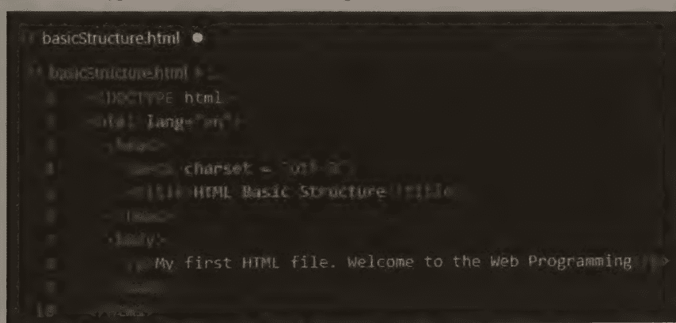

图 1.3：HTML 基础结构。

### 解释

- 第 1 行：通知浏览器接下来的内容是一个 HTML5 文件。此行不被视为 HTML 元素。
- 第 2 行和第 10 行：定义 `<html>` 元素的开始和结束标签。所有其他 HTML 元素都应该放在这些行之间。它是 html 文件中最大的容器。
- 第 3 行和第 6 行：定义 `<head>` 元素的开始和结束标签。`<head>` 元素包含网页的元数据，如字符编码，被浏览器、服务器和搜索引擎利用。
- 第 4 行：位于 `<head>` 内部的 `<meta>` 元素指定文档的字符编码，以便浏览器正确解释内容。
- 第 5 行：这是 `<title>` 元素，它定义了出现在浏览器标签页上的网页标题。

`<body>` 元素包含网页的可见内容，显示给用户。该元素以 `<body>` 开始，以 `</body>` 结束。

`<html>` 元素是 html 文件的根元素，包裹所有其他元素。它以 `<html>` 开始，以 `</html>` 结束。

`<!DOCTYPE html>` 声明位于文件最顶部，告诉浏览器文档是 HTML5 文档。它不是一个 HTML 元素。

`<head>` 元素包含不直接显示在页面上的文档元数据，位于 `<html>` 和 `<body>` 标签之间。

`<title>` 元素设置页面标题，出现在浏览器标签页和搜索结果中。

`<body>` 元素包含网页的所有可见内容，如文本、图像和链接。

`<meta>` 元素提供关于 HTML 文档的元数据，如字符编码、关键词和作者描述。

`<h1>` 到 `<h6>` 标签用于标题，`<h1>` 最重要，`<h6>` 最不重要。

`<p>` 标签用于定义段落。

`<a>` 标签用于创建超链接。

`` 标签用于嵌入图像。

`<ul>` 和 `<ol>` 标签分别用于创建无序列表和有序列表，`<li>` 标签用于每个列表项。

`<table>` 标签用于创建表格，`<tr>` 用于行，`<th>` 用于表头，`<td>` 用于数据单元。

`<div>` 标签是用于样式设置的通用容器。

`<span>` 标签是用于小段文本的内联容器。

`<form>` 标签用于创建用户输入表单。

`<input>` 标签用于创建输入字段。

`<button>` 标签用于创建可点击按钮。

`<select>` 和 `<option>` 标签用于创建下拉列表。

`<label>` 标签用于为输入元素定义标签。

`<footer>` 标签用于定义章节或页面的页脚。

`<header>` 标签用于定义章节或页面的头部。

`<main>` 标签用于定义文档的主体。

`<article>` 标签用于定义独立内容。

`<aside>` 标签用于与主内容间接相关的内容。

`<section>` 标签用于定义文档章节。

`<nav>` 标签用于定义导航链接。

`<time>` 标签用于表示时间或日期。

`<mark>` 标签用于高亮文本。

`<br>` 标签用于换行。

`<sub>` 标签用于定义下标。

`<sup>` 标签用于定义上标。

`<code>` 标签用于定义代码段。

`<pre>` 标签用于预格式化文本。

`<kbd>` 标签用于定义键盘输入。

`<del>` 标签用于定义删除的文本。

`<ins>` 标签用于定义插入的文本。

`<samp>` 标签用于示例计算机输出。

`<q>` 标签用于短内联引用。

`<blockquote>` 标签用于长块引用。

`<cite>` 标签用于引用创作作品。

`<abbr>` 标签用于定义缩写。

`<df>` 标签用于定义术语。

`<ruby>` 标签用于东亚语言注释。

`<var>` 标签用于定义数学公式或变量。

`<data>` 标签用于提供机器可读的内容翻译。

`<meter>` 标签用于显示标量测量值。

`<picture>` 标签用于提供响应式图像。

`<video>` 标签用于嵌入视频内容。

`<audio>` 标签用于嵌入音频内容。

`<canvas>` 标签用于通过 JavaScript 绘制图形。

`<svg>` 标签用于嵌入 SVG 图形。

用于启用动态交互的元素。如果没有语义化的 HTML 标记，CSS 和 JavaScript 将没有钩子来访问和修改。

### 复习题 1.24

- 尽管 HTML 标签没有出现在你完成的文档中，但它们提供了必要的浏览器支持
- 对其他文档的引用
- B) 文档更新信息
- C) 文档的元信息

### 复习题 1.25

下列哪不是使用 HTML 元素的目的？

- A) 它允许屏幕阅读器软件为盲人或视力障碍者读取页面。
- B) 它能帮助搜索引擎在搜索结果中更准确地显示您的页面。
- C) 级联样式表和 JavaScript 依赖于它。
- D) 它能加快网页的下载。

### 复习题 1.26

在编写网页 HTML 编码时，主要关注是什么？

- A) 网页的样式和演示。
- B) 确定页面的内容和结构。
- C) 使用 JavaScript 实现交互性。
- D) 编写与观众水平匹配的文字。

### 复习题 1.27

为什么在 Web 开发中，语义化的 HTML 标记对于 CSS 和 JavaScript 是至关重要的？

- A) 它提高了网页的搜索引擎优化。
- B) 它确保了视力障碍用户更好的可访问性。
- C) 它为 CSS 规则和 JavaScript 代码提供了钩子和目标。
- D) 它直接定义了网页的视觉外观。

## 1.8 HTML 代码验证

有效的 HTML 代码对于网页的正常运行至关重要，但无效的代码可能很难发现。大多数浏览器都是宽容的，即使 HTML 标记存在错误，也会渲染页面。然而，这种宽容意味着严重的问题可能潜藏其中。尽管页面在视觉上可能看起来良好，但无效的 HTML 可能会导致不同浏览器和设备之间出现不一致的行为。用于辅助功能的屏幕阅读器可能会误解释错误的标记，为某些用户提供糟糕的体验。有效的代码确保您的网页遵循 Web 标准并按预期进行渲染。它还提高了可维护性，因为无歧义的 HTML 以后更容易处理。花时间验证 HTML 可以消除本会积累的技术债。为了避免这些隐藏漏洞，使用 W3C 标记验证服务等工具验证您的 HTML 是关重要的。

## 第 1 章：HTML

要验证您的 HTML 代码，请遵循以下步骤：

1. 访问以下网页：<https://validator.w3.org/>
2. 点击页面上的“通过直接输入验证”（Validate by Direct Input）标签。
3. 将您的 HTML 代码复制并粘贴到提供的窗口中。


### 通过 URI 验证、通过文件验证、通过直接输入验证


```html
<!DOCTYPE html>
<html lang="en">
<head>
  <meta charset="utf-8">
  <title>HTML Basic Structure</title>
</head>
<body>
  <p>My first file. Welcome to the Web Programming</p>
</body>
</html>
```


### 图 1.4：在 W3C 验证您的 HTML 代码

1. `<!DOCTYPE html>`
2. `<html lang="en">`
3. `<head>`
4. `<meta charset="utf-8">`
5. `<title>HTML Basic Structure</title>`
6. `</head>`
7. `<body>`
8. `<p>My first file. Welcome to the Web Programming</p>`
9. `</body>`
10. `</html>`

使用了 HTML 解析器。总执行时间：4 毫秒。

4. 点击“检查”（Check）按钮启动验证过程。将显示一个新页面，显示您的代码的验证结果。文档检查完成。没有要显示的错误或警告。

### 图 1.5：您的代码的验证结果

检查高亮区域（您需要向下滚动查看）。如果您的代码通过验证，验证器将显示没有问题；如果检测到任何问题，验证器将在高亮区域显示错误消息。验证您的代码有许多益处，包括作为调试工具。它可以帮助识别并纠正验证器指出的任何拼写错误。此外，验证确保您的代码在各种浏览器上都能流畅运行，最大限度地减少了兼容性问题。在维护方面，验证过的代码证明会更容易管理。

### 复习题 1.28

下列哪项不是验证代码的益处？

- A 作为调试工具
- B 为了网页美观
- C 更高的质量
- D 易维护

### 复习题 1.29

网页中存在无效代码的后果是什么？

- A 浏览器将拒绝渲染页面。
- B 屏幕阅读器将正确解释代码。
- C Web 标准将自动更新。
- D 浏览器和设备之间可能会出现不一致的行为。

## 1.9 元素、标签和属性

一个 HTML 文件由元素组成，元素是 HTML 文档的构建块。一个元素以标签开始，例如`<title>`，并以相同的名称后跟一个斜杠结束。然而，存在空元素或空隙元素，例如`<br>`，它们不需要闭合标签，因为它们具有特定的目的，如插入换行。

元素可以包含其他元素，外部元素被称为“父”元素，内部元素被称为“子”元素。共享父元素的元素被称为“兄弟”元素。

需要记住的一些基本规则：

1. 标签是不区分大小写的，因此使用`<title>`或`<Title>`都是可以的，但为了便于阅读和符合惯例，建议使用小写。
2. 元素必须正确嵌套。例如，`<head><title>标题</title></head>`是正确的。
3. 避免在内联元素中嵌套块级元素。例如，`<a>`是内联元素，而`<p>`是块级元素。块级元素占据整行，无论它们多窄。
4. 标题标签如`<h1>`。
5. 包围在`<!-- -->`中的元素有助于程序员理解代码，但会被浏览器忽略。
6. HTML 标签可以有属性，例如`charset="value"`。

| 开始标签 | 属性 | 结束标签 |
| :--- | :--- | :--- |


图 1.6 展示了标签和元素。

### 复习题 1.30

用什么字符指示 HTML 元素的结束？

- A `<`
- B `</`
- C `>`
- D `/`

### 复习题 1.31

下列哪个元素在 HTML 中插入换行？

- A `<break>`
- B `<br>`
- C `<newline>`
- D `<line>`

### 复习题 1.32

HTML 标签通知：

- A 访问者如何读取页面
- B 服务器如何格式化
- C 浏览器元素是什么
- D 开发者如何格式化

### 复习题 1.33

`<br>`标签通常被称为 ________，因为它不需要闭合标签。

- A 休息标签
- B 短标签
- C 空标签
- D 空元素

### 复习题 1.34

HTML ________ 是 HTML 文档的构建块。

- A 链接
- B `<h1>`
- C 元素
- D 包

### 复习题 1.35

所有 HTML 元素必须 ________。

- A 小写
- B 正确嵌套
- C 短小
- D 用标签关闭

### 复习题 1.36

下列哪种是在 HTML 中使用注释的正确方式？

- A `<comment>这是一行代码注释</comment>`
- B `<!--这是一行代码注释 -->`
- C `<skip>这是一行代码注释</skip>`
- D `/* 这是一行代码注释 */`

### 复习题 1.37

HTML 元素可以有属性。这些属性用于 ________。

- A 为元素添加额外信息
- B 覆盖元素
- C 使元素更易读
- D 标识每个元素

### 复习题 1.38

________ 元素通常显示时不新起行。一个 ________ 元素占据整行，无论它多窄。

- A 内联，正常
- B 块级，正常
- C 内联，块级
- D 正常，正常

另一方面，`class`属性用于识别一组元素。与`id`不同，`class`属性允许多个元素共享相同的类值。`id`和`class`属性通常用于 CSS 和 JavaScript 中的客户端元素选择。

`name`属性是另一种标识形式，目前仍在在使用。它兼具`id`和`class`属性的特性。`name`属性的一个应用示例是单选按钮（radio buttons）。

当 HTML 页面需要展示、交互或与服务器通信时，`name`属性变得尤为重要。它通常用于识别 HTML 表单中的元素。为了提高功能性和多功能性，建议为给元素同时使用相同的`id`和`name`属性。

### 复习题 1.39

以下哪个属性可以用于唯一标识 HTML 文件上的元素？

- A) `id`
- B) `name`
- C) `class`
- D) `src`

### 复习题 1.40

当 HTML 页面需要展示、交互或与服务器通信时，哪些属性是重要的。

- A) `id`
- B) `name`
- C) `class`
- D) `src`

### 复习题 1.41

该属性用于标识 HTML 文件上的一组元素，通常用于 CSS 和 JavaScript 中的客户端元素选择？

- A) `id`
- B) `name`
- C) `class`
- D) `src`

## 1.11 `<p>` 和 `<h1>` 到 `<h6>` 标签

在图 1.3 中，`<p>`标签表示段落元素的开始，其中 "P" 代表 paragraph（段落）。要定义一个段落，你应该使用`<p>`打开它，并可选地使用`</p>`关闭。通常，一个网页包含多个段落，每个段落都由相应的`<p>`元素标记。

此外，还有标题元素，范围从`<h1>`到`<h6>`。这些标题用于表示页面上不同层级的话。`<h1>`元素表示最重要的标题，`<h2>`用于子标题，依此类推。避免在同一页面上两个`<h1>`元素。值得注意的是，`<h1>`和`<h6>`并不常用。作为练习，你可以在你的`basicstructure.html`中添加以下行，保存文件并刷新浏览器以查看显示效果：

```html
<h1>Practice HTML Elements, Tags, and Attributes</h1>
```

### 复习题 1.42

以下哪个元素应该用于网页上最重要的标题？

- A) `<header>`
- B) `<head>`
- C) `<heading>`
- D) `<h1>_`

### 复习题 1.43

为了确保正确使用标题元素，应该避免什么？

- A) 同时使用`<h5>`和`<h6>`。
- B) 使用`<h2>`作为主标题。
- C) 在同一页面上有多个`<h1>`元素。
- D) 不用`</h1>`标签关闭标题元素。

## 1.12 使用 `<em>` 和 `<strong>` 标签强调

你可以使用`<em>`标签来强调一个或多个单词，并使用`<strong>`标签显示一个或多个单词的重要性。例如，如果你想显示“The party is on <<strong>Wednesday&lt;/strong&gt;. I want to go, but I will be busy.,,,”，你需要在‘Wednesday’周围添加`<strong>`标签将其加粗，并在‘but’周围添加`<em>`标签将其斜体。为了练习，请在`basicstructure.html`中添加以下行。保存文件并刷新浏览器以查看外观。

```html
<p>The party is on <<strong>Wednesday&lt;/strong&gt;. I want to go, <em>but&lt;/em&gt; I will be busy.</p>
```

### 复习题 1.44

以下哪个 HTML 元素用于定义重要文本？

- A) `<em>`
- B) `<strong>`
- C) `<important>`
- D) `<b>`

### 复习题 1.45

以下哪个 HTML 元素用于定义强调的文本？

- A) `<em>`
- B) `<strong>`
- C) `<important>`
- D) `<b>`

## 1.13 使用 `` 标签插入照片

找到一个图像文件并将其存在与`basicstructure.html`相同的文件夹中。假设图像名为 "oxbridge.jpg"。注意文件扩展名，因为某些计算机默认可能会隐藏它。你仍然需要在你的 HTML 代码中插入它。尽管 jpeg 和 jpg 文件扩展名相似，但在代码中使用正确的扩展名是关重要的。在`basicstructure.html`中添加以下行：

```html

```

保存文件并刷新浏览器以查看图像如何出现。

如果图像位于另一个文件夹或网络上，你应该包含路径。例如，以下行将：

```html

```

`alt`属性是读取软件用于显示图片的。当图像由于任何原因无法加载时，``标签的`alt`属性将会显示。

### 复习题 1.46

使用哪个 HTML 元素来插入图像？

- A) ``
- B) ``
- C) ``
- D) ``（注：原文此处处处引号未闭合）

### 复习题 46

使用哪个 HTML 元素用于插入图像？

- A) ``
- B) ``
- C) ``
- D) ``

### 复习题 46

使用哪个 HTML 元素用于插入图像？

- A) ``
- B) ``
- C) ``
- D) ``

### 复习题 47

如果你有一个从一个页面到另一个页面的链接，你应该使用 _____ 链接。

- A) `absolute`
- B) `relative`
- C) `parallel`
- D) `in-site`

## 1.14 使用 `<a>` 标签添加超链接

超链接至关重要，允许用户访问网站的不同部分。要创建超链接，使用`<a>`标签。例如，你可以将以下行添加到`basicstructure.html`中，保存文件并刷新浏览器查看显示效果：

```html
<a href="https://www.google.com">Google</a>
```

有两种方式：带有协议和域名的绝对链接，以及当页面位于同一文件夹时省略域名的相对链接。

### 复习题 48

以下哪项是创建超链接的正确方式？

- A) `<a href="https://www.google.com">Google</a>`
- B) `<a href="https://www.google.com">Google</a>`
- C) `<a href="https://www.google.com">Google</a>`
- D) `<a href="https://www.google.com">Google</a>`

## 1.15 使用 `<ul>`、`<ol>` 和 `<li>` 创建列表

如果你有一个项目列表，例如经常访问的网站，你可以将其放入列表中。列表可以是无序的或有序的。无序列表类似于：

- www.google.com
- www.bing.com
- www.w3schools.com

有序列表像：

1. Validator.w3.org
2. developer.mozilla.org
3. stackoverflow.com

为了练习，请将以下行添加到`basicstructure.html`文件。保存并在浏览器中查看：

```html
<ul>
  <li>www.google.com</li>
  <li>www.bing.com</li>
  <li>www.w3schools.com</li>
</ul>
<ol>
  <li>validator.w3.org</li>
  <li>developer.mozilla.org</li>
  <li>stackoverflow.com</li>
</ol>
```

### 复习题 50

哪个 HTML 元素用于制作编号列表？

- A) `<list>`
- B) `<ol>`
- C) `<ul>`
- D) `<number>`

### 复习题 51

哪个 HTML 元素用于制作项目列表？

- A) `<list>`
- B) `<ol>`
- C) `<ul>`
- D) `<number>`

## 1.16 使用 `<iframe>` 标签插入外部内容

`<iframe>`代表内联框架，它允许你在你的页面上嵌入外部文档，包括地图或视频。以下代码在页面上嵌入了一个视频。如果浏览器不支持`<iframe>`元素，将显示段落“Your browser does not support iframe”。

```html
<iframe src="https://www.youtube.com/embed/kUMeFH4CHE"><p>Your browser does not support iframe</p></iframe>
```

### 复习题 52

使用哪个 HTML 元素在当前网页中显示另一个网页？

- A `<input>`
- B `<newpage>`
- C `<insert>`
- D `<iframe>`

### 复习题 1.53

如果用户的浏览器不支持`<iframe>`元素，将显示什么？

```html
<iframe src="https://www.youtube.com/embed/kU1FHH"><p>Your browser does not support iframe</p>
```

- A 页面上的空白区域
- B 文本 "Your browser does not support iframe"
- C 表示内容不支持的错误消息
- D `<iframe>`元素的默认占位符

## 1.17 使用 `<table>` 标签显示表格化数据

当你有表格化数据时（即可以在二维表格中表示的信息），你应该使用`<table>`元素。为了进行练习，请将以下代码添加到`basicstructure.html`文件中，该代码将显示两组学生数据。保存并在浏览器中查看。

```html
<table>
<tr>
  <th>Name</th>
  <th>Phone</th>
  <th>email</th>
</tr>
<tr>
  <td>Ashley Corcoran</td>
  <td>612-343-5609</td>
  <td>corcoran@gmail.com</td>
</tr>
<tr>
  <td>Shelby Goin</td>
  <td>212-343-7612</td>
  <td>Goin@gmail.com</td>
</tr>
</table>
```

解释：

`<table>`标签打开`<table>`元素，`</table>`标签关闭它。

`<tr>`标签开始一个表格行，`</tr>`结束该行。

`<th>`标签开始一个表格表头，`</th>`结束表头。

`<td>`标签开始一个表格数据（或单元格），`</td>`结束单元格。

简而言之，一个表格由表格行（`tr`）组成。每行都由表格数据（`td`）或表格表头（`th`）组成。请确保恰当内嵌套它们。在浏览器中显示的表格将没有边框，看起来可能很朴素。这项工作由 CSS 来处理样式。

### 复习题 1.54

以下哪些 HTML 元素用于标记表格？

- A) `<table>`
- B) `<tbody><tr><td>`


- C) `<body><tr><td>`
- D) `<table><tr><td>column`

### 复习题 1.55

HTML `<table>` 元素默认的表格边框大小是多少？

- A) 1px
- B) 2px
- C) 3px
- D) 无边框

## 1.18 特殊字符的实体

HTML 实体用于替换 HTML 中的保留特殊字符，例如 `<`、`>`、`&` 和 `" "`。此外，像 ©（版权）和 ™（商标）这样的字符缺乏键盘上的等价字符，因此需要在网页上进行表示。浏览器始终会将多个空格合并为一个空格，而字符 `<` 和 `>` 可能会引起混淆。

为了正确显示这些特殊字符，HTML 提供了一组预定义的符号，这些符号以和符号（`&`）开头并以分号（`;`）结尾。你可以使用数字代码或字符名称在你的 HTML 文档中表示这些符号。以下是一些常用的特殊字符：

| 字符 | 字符名称 | 数字代码 | 含义 |
|---|---|---|---|
| TM | `&nbsp;` | `&#160;` | 不换行空格 |
| `&trade;` | `&#153;` | 商标 |
| © | `&copy;` | `&#169;` | 版权 |
| ® | `&reg;` | `&#174;` | 注册商标 |
| `&amp;` | `&#38;` | 和符号 |
| `<` | `&lt;` | `&#60;` | 小于 |
| `>` | `&gt;` | `&#62;` | 大于 |

表 1.1 特殊字符的 HTML 实体。

获取字符列表，可以在互联网上搜索“ISO 885901字符集”。为了练习，请将以下行添加到你的 `basicstructure.html` 文件中，并在浏览器中保存查看文件。

```html
<p>COPYRIGHT&copy; 2024 Your name</p>
```

### 复习题 1.56

在以下 HTML 代码中，如果你需要在 2024 和 Your name 之间添加额外的空格，你可以做什么？

```html
<p>COPYRIGHT &copy; 2024 Your name</p>
```

- A) 在代码编辑器中添加类似 `"2024 Your name"` 的几个空格
- B) 添加一个类似 `<space>` 的空格元素
- C) 在需要空格的地方添加一个 `&nbsp;`
- D) 其他任何选项均可行。

### 复习题 1.57

HTML ______ 用于替换 HTML 中的特殊字符。

- A) 特殊标签
- B) 特殊元素
- C) 实体
- D) 转义符

## 1.19 HTML 结构元素

创建一个名为 `mostructure.html` 的新 HTML 文件，并输入所示代码：

```html
<!DOCTYPE html>
<html lang="en">
<head>
  <meta charset="utf-8">
  <title>HTML More Structure</title>
</head>
<body>
<nav>
  <ul>
    <li><a href="#">Home</a>/></li>
    <li><a href="#">Product</a>/></li>
    <li><a href="#">Service</a>/></li>
    <li><a href="#">About</a>/></li>
    <li><a href="#">Contact</a>/></li>
  </ul>
</nav>
<header>
  <h1>HTML More Structure</h1>
  
</header>
<main>
  <h2>Your Main Content</h2>
```

## 第 1 章：HTML

```html
<article>
  <h3>What is HTML Text?</h3>
  <p>Ellentesque habitant risus luctus et neque fames at turpis. Vestibulum tortor quam, feugiat, tempor sit ante. Donec libero sit amet quam. ultricies mi vitae est. Mauris placer eleifend</p>
</article>
```

```html
<aside id="amazon">
  <h4>Available at amazon.com</h4>
  <p>Prime members, buy this book and enjoy the free shipping</p>
</aside>
```

```html
<aside id="bn">
  <h4>Also available at bn.com</h4>
  <p>Members, In store discounts and free shipping online</p>
  <footer>
<p>COPYRIGHT &copy; 2024 Your name</p>
<a href="yoururlhere">

</a>
</footer>
</body>
</body>
```

解释：

`<nav>` 元素用于导航。

`<header>` 元素用于页面的头部部分。注意它不应与 `<head>` 元素混淆，后者是 `<body>` 元素的兄弟元素。

`<main>` 元素指定文档的主内容。它应该包含文档特有的特定内容，而不包含重复的元素，如侧边栏、导航链接、版权信息、标志或表单。

`<aside>` 元素用于与主内容直接相关的信息，通常显示为侧边栏。

`<footer>` 元素通常包含社交媒体链接等信息。

没有严格的元素在文档中出现的顺序要求。

### 复习题 1.54

以下哪些 HTML 元素用于标记表格？

- A) `<table>`
- B) `<tbody><tr><td>`
- C) `<body><tr><td>`
- D) `<table><tr><td>column`

### 复习题 1.55

HTML `<table>` 元素默认的表格边框大小是多少？

- A) 1px
- B) 2px
- C) 3px
- D) 无边框

## 1.18 特殊字符的实体

HTML 实体用于替换 HTML 中的保留特殊字符，例如 `<`、`>`、`&` 和 `" "`。此外，像 ©（版权）和 ™（商标）这样的字符缺乏键盘上的等价字符，因此需要在网页上进行表示。浏览器始终会将多个空格合并为一个空格，而字符 `<` 和 `>` 可能会引起混淆。为了正确显示这些特殊字符，HTML 提供了一组预定义的符号，这些符号以和符号（`&`）开头并以分号（`;`）结尾。你可以使用数字代码或字符名称在你的 HTML 文档中表示这些符号。以下是一些常用的特殊字符：

| 字符 | 字符名称 | 数字代码 | 含义 |
|---|---|---|---|
| TM | `&nbsp;` | `&#160;` | 不换行空格 |
| `&trade;` | `&#153;` | 商标 |
| © | `&copy;` | `&#169;` | 版权 |
| ® | `&reg;` | `&#174;` | 注册商标 |
| `&amp;` | `&#38;` | 和符号 |
| `<` | `&lt;` | `&#60;` | 小于 |
| `>` | `&gt;` | `&#62;` | 大于 |

表 1.1 特殊字符的 HTML 实体。

获取字符列表，可以在互联网上搜索“ISO 885901字符集”。为了练习，请将以下行添加到你的 `basicstructure.html` 文件中，并在浏览器中查看文件。

```html
<p>COPYRIGHT&copy; 2024 Your name</p>
```

### 复习题 1.56

在以下 HTML 代码中，如果你需要在 2024 和 Your name 之间添加额外的空格，你可以做什么？

```html
<p>COPYRIGHT &copy; 2024 Your name</p>
```

- A) 在代码编辑器中添加类似 `"2024 Your name"` 的几个空格
- B) 添加一个类似 `<space>` 的空格元素
- C) 在需要空格的地方添加一个 `&nbsp;`
- D) 其他任何选项均可行。

### 复习题 1.57

HTML ______ 用于替换 HTML 中的特殊字符。

- A) 特殊标签
- B) 特殊元素
- C) 实体
- D) 转义符

## 1.19 HTML 结构元素

创建一个名为 `mostructure.html` 的新 HTML 文件，并输入所示代码：

```html
<!DOCTYPE html>
<html lang="en">
<head>
  <meta charset="utf-8">
  <title>HTML More Structure</title>
</head>
<body>
<nav>
  <ul>
    <li><a href="#">Home</a>/></li>
    <li><a href="#">Product</a>/></li>
    <li><a href="#">Service</a>/></li>
    <li><a href="#">About</a>/></li>
    <li><a href="#">Contact</a>/></li>
  </ul>
</nav>
<header>
  <h1>HTML More Structure</h1>
  
</header>
<main>
  <h2>Your Main Content</h2>
```

```html
<article>
  <h3>What is HTML Text?</h3>
  <p>Ellentesque habitant risus luctus et neque fames at turpis. Vestibulum tortor quam, feugiat, tempor sit ante. Donec libero sit amet quam. ultricies mi vitae est. Mauris placer eleifend</p>
</article>
```

```html
<aside id="amazon">
  <h4>Available at amazon.com</h4>
  <p>Prime members, buy this book and enjoy the free shipping</p>
</aside>
```

```html
<aside id="bn">
  <h4>Also available at bn.com</h4>
  <p>Members, In store discounts and free shipping online</p>
  <footer>
<p>COPYRIGHT &copy; 2024 Your name</p>
<a href="yoururlhere">

</a>
</footer>
</body>
</body>
```

解释：

`<nav>` 元素用于导航。

`<header>` 元素用于页面的头部部分。注意它不应与 `<head>` 元素混淆，后者是 `<body>` 元素的兄弟元素。

`<main>` 元素指定文档的主内容。它应该包含文档特有的特定内容，而不包含重复的元素，如侧边栏、导航链接、版权信息、标志或表单。

`<aside>` 元素用于与主内容直接相关的信息，通常显示为侧边栏。

`<footer>` 元素通常包含社交媒体链接等信息。

没有严格的元素在文档中出现的顺序要求。

### 复习题 1.54

哪个 HTML 元素用于在网页中显示另一个网页？

- A `<input>`
- B `<newpage>`
- C `<insert>`
- D `<iframe>`

### 复习题 1.53

如果用户的浏览器不支持 `<iframe>` 元素，将显示什么？

```html
<iframe src="https://www.youtube.com/embed/kU1FHH"><p>Your browser does not support iframe</p>
```

- A) 页面上的空白区域
- B) 文本 `"Your browser does not support iframe"`
- C) 表示内容不支持的错误消息
- D) `<iframe>` 元素的默认占位符

## 1.17 使用 `<table>` 标签显示表格化数据

当你有表格化数据时（即可以在二维表格中表示的信息），你应该使用 `<table>` 元素。为了进行练习，请将以下代码添加到 `basicstructure.html` 文件中，该代码将显示两组学生数据。保存并在浏览器中查看。

```html
<table>
<tr>
  <th>Name</th>
  <th>Phone</th>
  <th>email</th>
</tr>
<tr>
  <td>Ashley Corcoran</td>
  <td>612-343-5609</td>
  <td>corcoran@gmail.com</td>
</tr>
<tr>
  <td>Shelby Goin</td>
  <td>212-343-7612</td>
  <td>Goin@gmail.com</td>
</tr>
</table>
```

解释：

`<table>` 标签打开 `<table>` 元素，`</table>` 标签关闭它。

`<tr>` 标签开始一个表格行，`</tr>` 结束该行。

`<th>` 标签开始一个表格表头，`</th>` 结束表头。

`<td>` 标签开始一个表格数据（或单元格），`</td>` 结束单元格。

## 第 1 章：HTML

简而言之，一个表格由表格行（`tr`）组成。每行都由表格数据（`td`）或表格表头（`th`）组成。请确保恰当内嵌套它们。在浏览器中显示的表格将没有边框，看起来可能很朴素。这项工作由 CSS 来处理样式。

### 复习题 1.54

以下哪些 HTML 元素用于标记表格？

- A) `<table>`
- B) `<tbody><tr><td>`
- C) `<body><tr><td>`
- D) `<table><tr><td>column`

### 复习题 1.55

HTML `<table>` 元素默认的表格边框大小是多少？

- A) 1px
- B) 2px
- C) 3px
- D) 无边框

## 1.18 特殊字符的实体

HTML 实体用于替换 HTML 中的保留特殊字符，例如 `<`、`>`、`&` 和 `" "`。此外，像 ©（版权）和 ™（商标）这样的字符缺乏键盘上的等价字符，因此需要在网页上进行表示。浏览器始终会将多个空格合并为一个空格，而字符 `<` 和 `>` 可能会引起混淆。

为了正确显示这些特殊字符，HTML 提供了一组预定义的符号，这些符号以和符号（`&`）开头并以分号（`;`）结尾。你可以使用数字代码或字符名称在你的 HTML 文档中表示这些符号。以下是一些常用的特殊字符：

| 字符 | 字符名称 | 数字代码 | 含义 |
|---|---|---|---|
| TM | `&nbsp;` | `&#160;` | 不换行空格 |
| `&trade;` | `&#153;` | 商标 |
| © | `&copy;` | `&#169;` | 版权 |
| ® | `&reg;` | `&#174;` | 注册商标 |
| `&amp;` | `&#38;` | 和符号 |
| `<` | `&lt;` | `&#60;` | 小于 |
| `>` | `&gt;` | `&#62;` | 大于 |

表 1.1 特殊字符的 HTML 实体。

获取字符列表，可以在互联网上搜索“ISO 885901字符集”。为了练习，请将以下行添加到你的 `basicstructure.html` 文件中，并在浏览器中查看文件。

```html
<p>COPYRIGHT&copy; 2024 Your name</p>
```

### 复习题 1.56

在以下 HTML 代码中，如果你需要在 2024 和 Your name 之间添加额外的空格，你可以做什么？

```html
<p>COPYRIGHT &copy; 2024 Your name</p>
```

- A) 在代码编辑器中添加类似 `"2024 Your name"` 的几个空格
- B) 添加一个类似 `<space>` 的空格元素
- C) 在需要空格的地方添加一个 `&nbsp;`
- D) 其他任何选项均可行。

### 复习题 1.57

HTML ______ 用于替换 HTML 中的特殊字符。

- A) 特殊标签
- B) 特殊元素
- C) 实体
- D) 转义符

## 1.19 HTML 结构元素

创建一个名为 `mostructure.html` 的新 HTML 文件，并输入所示代码：

```html
<!DOCTYPE html>
<html lang="en">
<head>
  <meta charset="utf-8">
  <title>HTML More Structure</title>
</head>
<body>
<nav>
  <ul>
    <li><a href="#">Home</a>/></li>
    <li><a href="#">Product</a>/></li>
    <li><a href="#">Service</a>/></li>
    <li><a href="#">About</a>/></li>
    <li><a href="#">Contact</a>/></li>
  </ul>
</nav>
<header>
  <h1>HTML More Structure</h1>
  
</header>
<main>
  <h2>Your Main Content</h2>
```


```html
<article>
  <h3>What is HTML Text?</h3>
  <p>Ellentesque habitant risus luctus et neque fames at turpis. Vestibulum tortor quam, feugiat, tempor sit ante. Donec libero sit amet quam. ultricies mi vitae est. Mauris placer eleifend</p>
</article>
```

```html
<aside id="amazon">
  <h4>Available at amazon.com</h4>
  <p>Prime members, buy this book and enjoy the free shipping</p>
</aside>
```

```html
<aside id="bn">
  <h4>Also available at bn.com</h4>
  <p>Members, In store discounts and free shipping online</p>
  <footer>
    <p>COPYRIGHT &copy; 2024 Your name</p>
    <a href="yoururlhere">
      
    </a>
  </footer>
</aside>
```

### 解释

`<nav>` 元素用于导航。

`<header>` 元素用于页面的头部部分。注意它不应与`<head>`元素混淆，后者是`<body>`元素的兄弟元素。

`<main>` 元素指定文档的主内容。它应该包含文档特有的特定内容，而不包含重复的元素，如侧边栏、导航链接、版权信息、标志或表单。

`<aside>` 元素用于与主内容直接相关的信息，通常显示为侧边栏。

`<footer>` 元素通常包含社交媒体链接等信息。

没有严格的元素在文档中出现的顺序要求。

<label> 元素通常用于表单，并应该有一个`for`属性，该属性应与关联表单控件的`id`属性匹配。`<input>` 元素有许多类型，你可以通过更改`type`属性值来查看差异。`<select>` 元素创建一个下拉控件，而`<textarea>`元素显示一个多行文本输入区域，即使没有内容也需要闭合标签。

当你保存并用浏览器打开该文件时，你会发现一旦开始输入，占位符文本（placeholder）就会消失。此外，邮箱字段具有基础的输入验证。浏览器中显示的 HTML 表单类似于图 1.8（无任何样式）。

## HTML 表单

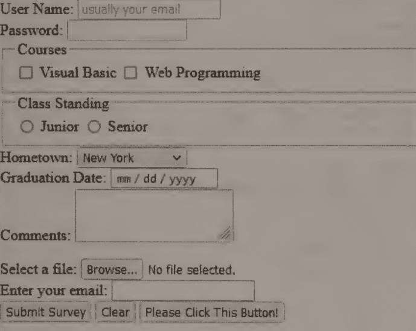

图 1.8 无样式的 HTML 表单。

### 复习题 1.62

HTML `<input>` 元素的哪一个属性被用于在表单中创建文本输入框？

A) `<input type = "input">`

B) `<input type = "field">`

C) `<input type = "text">`

D) `<input type = "inpurfield">`

### 复习题 1.63

HTML `<input>` 元素的哪一个属性被用于在表单中创建复选框？

A) `<input type = "checkbox">`

B) `<input type="check">`

C) `<input type="box">`

D) `<input type="select">`

### 复习题 1.64

哪一个 HTML 元素被用于在表单中创建下拉列表？

A) `<input type="dropdown">`

B) `<input type="list">`

C) `<select>`

D) `<list>`

### 复习题 1.65

哪一个 HTML 元素被用于在表单中创建文本区域？

A) `<input type="textarea">`

B) `<input type="text_area">`

C) `<select>`

D) `<textarea>`

### 复习题 1.66

HTML 表单中的哪一个属性用于指定输入字段必须填写？

A) `checked`

B) `placeholder`

C) `value`

D) `required`

## 1.21 使用`<div>`和`<span>`标签构建更多结构

这些标签可能是 HTML 元素中最广泛使用但语义化最差的两个元素。`<div>` 标签的作用是将不同的块级元素分组，因此如果你想对多个元素应用同一种样式，你可以一次性对组中的所有项目进行操作，而不是逐个进行。`<span>` 标签具有类似的功能，但它们被用于内联元素（inline elements）。

在下一章学习如何为页面设置样式时，你会看到更多内容。这些标签非常适合标记，尽管它们没有特定的语义化定义。

### 复习题 1.67

以下哪些标签可能是 HTML 元素中最广泛使用但语义化最差的两个元素？

A) `<p>` 和 `<h6>`

B) `<p>` 和 `<div>`

C) `<div>` 和 `<span>`

D) `<span>` 和 `<h6>`

### 复习题 1.68

下列哪一个标签构成的是内联元素？

- `<span>`
- `<div>`
- `<p>`
- `<h1>`

### 复习题 1.69

下列哪一个标签构成的是块级元素？

- `<span>`
- `<div>`
- `<a>`
- ``

## 1.22 HTML 中的 WAI-ARIA

Web 可访问性倡议 - 可访问富交互网络应用程序（WAI-ARIA）是一组 HTML 属性，它们提供了额外的语义，并通过辅助技术提高了残障人士的可访问性。它包含三个主要特性：

第一个特性是角色（roles）。`role` 属性定义了元素是什么或做什么。例如，`<nav role="navigation"></nav>` 中的`role`属性指定了该元素扮演导航的角色。

第二个特性是属性（properties）。一组属性定义了元素的属性，提供了额外的含义或语义。例如，`aria-required="true"`指定了表单输入需要填写才能被视为有效。

第三个特性是状态（states）。这些是定义元素当前状况的特殊属性，例如`aria-disabled="true"`，它会向屏幕阅读器指示表单输入当前处于禁用状态。状态与属性的区别在于，属性在应用程序的整个生命周期内保持不变，而状态可以改变，通常是通过 JavaScript 以编程方式进行更改。

需要注意的是，向元素添加任何 ARIA 属性都不会在视觉上影响网页，除非浏览器可访问性 API 暴露的信息（屏幕阅读器使用这些 API 来收集信息）发生了变化。

### 复习题 1.70

下列哪项不是 WAI-ARIA 的特性？

B) roles

C) properties

D) states

### 复习题 1.71

向元素添加 ARIA 特性实际上是向元素添加了 ______。

A) attributes

B) roles

C) properties

D) states

## 1.23 HTML 简史

HTML 由 Tim Berners-Lee 于 1989 年引入。

不久后，HTML 2.0 被发布以标准化这些元素。1994 年 10 月，Tim Berners-Lee 在离开欧洲核子研究组织（CERN）后创立了世界维网联盟（W3C）。W3C 是负责制定 Web 标准的组织。

HTML 3 于 1995 年引入，并于 1997 年 1 月，HTML 3.2 被 W3C 正式批准。1999 年，HTML 4.0 由 W3C 发布。2000 年 1 月，XHTML 1.0 推出。当时，HTML 有两个主要问题：首先，它缺乏良好的语义化；其次，它的语法过于宽泛。2001 年 5 月，HTML 5 问世。

### 复习题 1.72

根据作者，下列哪项不是 HTML 的主要问题？

A) 缺乏语义

B) 语法

C) 难以学习D

### 复习题 1.73

谁在制定标准？

A) 世界维网联盟（W3C）

B) 欧洲核子研究组织（CERN）

C) 可扩展标记语言

D) Web 应用 HTML 工作组（WHATWG）

### 复习题 1.74

HTML 5 是 ______ 的结果。

A) 世界维网联盟

B) 微软

C) 无

D) Web 应用小组

## 1.24 章总结

在本章中，你学习了 HTML，这是一种为网页提供结构的标记语言。虽然它的优势可能不会立即体现，但当你为页面设置样式时就会意识到它的重要性。此外，本章涵盖了主要元素和历史。

## 1.25 练习

现在该你构建一个网站了。记得使用 HTML 创建三个页面。文件命名为`home.html`、`education.html`和`work.html`。

每个页面应包含以下内容：

- `<header>` 元素：`<h1>` 元素中的你的全名和`<h2>`元素中的你的格言。
- 导航菜单，点击后将跳转到相应的页面。
- `<main>` 元素：每个页面的要求会有所不同。
- `<footer>` 元素包含版权年份、你的电子邮件地址以及指向你某个社交媒体页面的链接。


在首页上放一张你的照片。写三段关于你的内容（长度足够，以便你在 CSS 章学习如何让文字环绕图片）。此外，在首页上设置一个联系表单，包含一个用于访问者姓名的文本字段、一个用于联系原因的下拉列表（例如：交朋友、招聘、喜欢页面、认识的人）、一个允许访问者输入信息的`<textarea>`元素，以及两个按钮（目前无效）：“发送”和“清除”。示例页面如下所示：

# Larry Sanchez

## 编程很有趣

- Home
- About
- Work

## 关于我


Lorem ipsum dolor sit amet, consectetur adipiscing elit. Sed do eiusmod tempor incididunt ut labore et dolore magna aliqua. Ut enim ad minim veniam, quis nostrud exercitation ullamco laboris nisi ut aliquip ex ea commodo consequat. Duis aute irure dolor in reprehenderit in voluptate velit esse cillum eu fugiat nulla pariatur. Excepteur sint occaecat cupidatat non proident, sunt in culpa qui officia deserunt mollit anim id est laborum.

## 联系我

```text
姓名
[__________]
联系原因
[下拉菜单 v]
消息
[____________________]
[发送] [清除]
```

在教育页面上，用一个短段落总结你的教育背景，随后是三个`section`元素，每个元素代表你读过的一所学校。每个部分应包含一个`<h3>`。每所学校都应该有一张小照片，以及关于该学校的简短描述。记得包含与主页相同的页眉、页脚和两个侧边栏。下方显示了一个示例页面：

# 拉里·桑切

## Web编程很有趣

- 首页
- 教育
- 工作

## 我的教育

Lorem ipsum dolor sit amet, nost etiam sapienquent exerci, has voluptas numquam neglego

### 阳光小学


Lorem ipsum dolor sit amet, nost etiam sapienquent exerci, has voluptas numquam neglego

### 阳光中学


Lorem ipsum dolor sit amet, nost etiam sapienquent exerci, has voluptas numquam neglego

### 阳光高中


Lorem ipsum dolor sit amet, nost etiam sapienquent exerci, has voluptas numquam neglego

可在`amazon.com`购买。

Prime 会员购买此书可享受免费邮寄。

可在`best.com`购买。

H&M 会员可享受店内折扣和免费邮寄优惠。

版权所有 © 2022 Larry Sanchez

在工作页面上，总结你的工作经历，随后列出一个包含三个职位的列表（我们将其限制在三个，以便让你在学习 CSS 时更具挑战性）。记得包含与主页相同的页眉、页脚和两个侧边栏。下方显示了一个示例页面：

# 拉里·桑切

## Web编程很有趣

- 首页
- 教育
- 工作

## 我的工作经历

1. 工作经历一
2. 工作经历二
3. 工作经历三

可在`lanchez.com`购买。

Prime 会员购买此书可享受免费邮寄。

可在`bn.com`购买。

HTML 会员可享受在线折扣和免费邮寄。


# 1.26 练习题解答

## `home.html`页面代码

```html
<!DOCTYPE html>
<html lang="en">
<head>
<meta charset="utf-8">
<title>Larry Sanchez</title>
</head>
<body>
<header>
<h1>Larry Sanchez</h1>
<h2>Web Programming is FUN</h2>
<nav>
<ul>
<li><a href="home.html">Home</a></li>
<li><a href="education.html">Education</a></li>
<li><a href="work.html">Work</a></li>
</ul>
</nav>
</header>
</main>
<section id="aboutMe">
<h3>About Me</h3>

<p>Lorem ipsum dolor sit amet, nisl etiam sapienient ex usu, voluptate possidunt noncepteur ut, nisl nester time mel ID Vel at diccat atomorum te, ius nequequecipiat. Nam vidisse quae elaboraret non, aut.</p><p>Omniis nostrud blandit id nam. Nec mollis eaque, delinquent pretium sollicit ad sit, eos brute causae timeam. Viris sint in cupid et est, eusam eu mauris odio.</p>
```

## Web编程

```html
aperiri ponderum te est, pri ei invudent tacimates.</p>

<p>Mei tractatos moderius reprehendunt ei, nec an putant audire, et est posse somle. Vim minim exerci intlegebat ex, te pro dicat eum, falli consul voluntaria in. Fuiset euripidis his cu, id facder scriptorem pri. Ius et graeco.</p>
```

```html
<section id="contactMe">
<h3>Contact Me</h3>
<form action="#">
<label for="name">输入你的名字:</label><input type="text" id="name">
<br>
<label for="purpose">选择一个主题:</label>
<select id="purpose">
<option>make friends</option>
<option>intend to hire</option>
<option>like your page</option>
<option>someone you know</option>
</select>
<br>
<label for="message">输入你的消息:</label>
<br>
<textarea id="message"></textarea>
<input type="submit" id="submit" value="Send">
<input type="reset" value="Clear">
</form>
</section>
```

```html
</main>
<aside id="amazon">
<h4>可在 amazon.com 购买</h4>
<p>Prime 会员购买此书可享受免费邮寄</p>
</aside>
<aside id="bn">
<h4>可在 bn.com 购买</h4>
<p>B&N 会员可享受店内折扣和在线免费邮寄</p>
</aside>
<footer>
```

```html
<p>COPYRIGHT &copy; 2022 Larry Sanchez

<a href="">


</a>

</p>

<footer>
```

```html
</body>
</html>
```

## `education.html`页面

```html
<!DOCTYPE html>
<html lang="en">
<head>
<meta charset="utf-8">
<title>Larry Sanchez</title>
</head>
<body>
<header>
<h1>Larry Sanchez</h1>
<h2>Web Programming is FUN</h2>
<nav>
<ul>
<li><a href="home.html">Home</a></li>
<li><a href="education.html">Education</a></li>
<li><a href="work.html">Work</a></li>
</ul>
</nav>
</header>
<main>
<section id="summary">
<h3>Education sapientem ex usu</h3>
<p>Lorem ipsum dolor sit amet, nisl etiam sapientem ex usu, voluptatea possid neque, nisi id Vel dicat comprehens. Nam vidisse neque, putant equidem at has. Amet Qui iusto.</p>
</section>
<section id="school1">
<h3>阳光小学</h3>

<p>Lorem ipsum dolor sit amet, nisl etiam sapienient ex usu, voluptate possidunt noncepteur ut, nisl nester time mel ID Vel at diccat atomorum te, ius nequequecipiat. Nam vidisse quae elaboraret non, aut.</p>
</section>
<section id="school2">
<h3>阳光中学</h3>

<p>Lorem ipsum dolor sit amet, nisl etiam sapienient ex usu, voluptate possidunt noncepteur ut, nisl nester time mel ID Vel at diccat atomorum te, ius nequequecipiat. Nam vidisse quae elaboraret non, aut.</p>
</section>
<section id="school3">
<h3>阳光高中</h3>

<p>Lorem ipsum dolor sit amet, nisl etiam sapienient ex usu, voluptate possidunt noncepteur ut, nisl nester time mel ID Vel at diccat atomorum te, ius nequequecipiat. Nam vidisse quae elaboraret non, aut.</p>
</section>
</main>
<aside id="amazon">
<h4>可在 amazon.com 购买</h4>
<p>Prime 会员购买此书可享受免费邮寄</p>
</aside>
<aside id="bn">
<h4>可在 bn.com 购买</h4>
<p>B&N 会员可享受店内折扣和在线免费邮寄</p>
</aside>
<footer>
```

## 第 2 章：级联样式表（CSS）

### 本学习目标

- 2.1 识别基本的 CSS 定义
- 2.2 示例不同类型的 CSS 选择器
- 2.3 比较 CSS 测量单位
- 2.4 使用 CSS 实现页面布局
- 2.5 检查 CSS 权重
- 2.6 解释响应式网页设计

## 2.1 什么是 CSS？

CSS 代表 Cascading Style Sheets（级联样式表）。它与 HTML 并行工作，用于定义网页的呈现方式，而 HTML 则定义网页的内容和结构。同一个 HTML 文档如果使用不同的 CSS，在同一个浏览器中看起来会有所不同。

一个 CSS 文件包含一个或多个 CSS 定义或规则。一个 CSS 定义由三部分组成：选择器（where：应用到 HTML 的哪个部分）、属性（how：应用什么属性）和值（what：设置该属性）。每对“属性:值;”都以分号`;`结尾，而一组“属性:值;”被包含在大括号`{ }`之中。它们的显示形式如下：

```css
选择器{属性: 值; }
```

例如，`h1{color: red;}`将使页面上所有的`h1`元素变为红色。让我们在第 1 章中创建的 HTML 文件添加一些定义。用你的编辑器打开`basicstructure.html`，在`<head>`标签之前添加一行，如下方的加粗部分所示：

```html
<!DOCTYPE html>
<html lang="en">
<head>
  <meta charset="utf-8">
  <title>HTML Basic Structure</title>
  <link rel="stylesheet" href="basicstructure.css">
</head>
```

### 解释

`link`元素将此 HTML 文件连接到名为`basicstructure.css`的外部 CSS 文件，该文件将负责此 HTML 页面的呈现效果。

接下来，进入`basicstructure.html`所在的文件夹。添加一个名为`basicstructure.css`的新文件。用文本编辑器打开 CSS 文件并输入以下行：

```css
body {
  background: grey;
}
```

保存两个 HTML 和 CSS 文件。刷新 HTML 文件。你应该能在页面上看到灰色背景。

接下来，在浏览器中打开 HTML 页面，找到“网页开发者”工具（在 Firefox 中，按`Ctrl+Shift+K`；在 Chrome 中，按`Ctrl+Shift+I`）。它们是相似的。本书其余部分将使用 Firefox 进行演示。当开发者工具显示你的网页后，点击“样式编辑器”（Style Editor）标签页。屏幕应该看起来如图 2.1 所示。

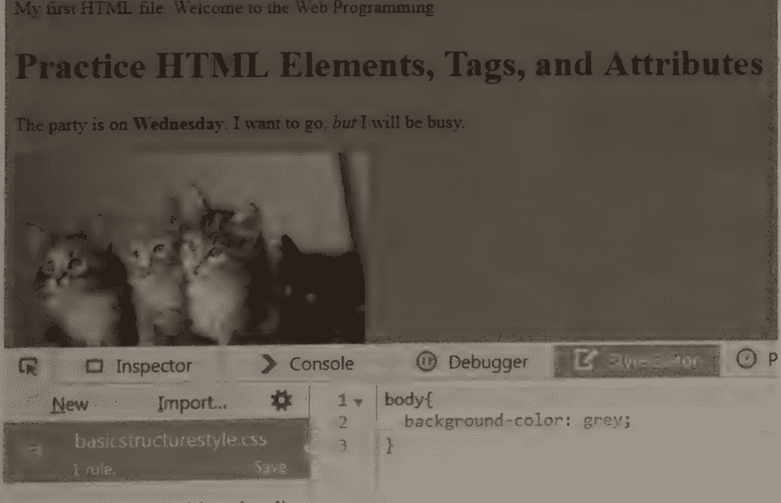

图 2.1：带有样式编辑器的 Firefox。

### 网页编程

你可以尝试样式编辑器。例如，你可以将灰色改为黄色，并且会实时看到效果。

> 注意：在输入 CSS 时不要刷新页面。刷新将移除所有未保存的 CSS 代码。你可以点击图 2.1 所示左面板上的“保存”（save）链接。

让我们在此基础上继续。利用编辑器的“IntelliSense”（智能感知）功能。你将为段落添加一些样式。一个“IntelliSense”的示例如图 2.2 所示。

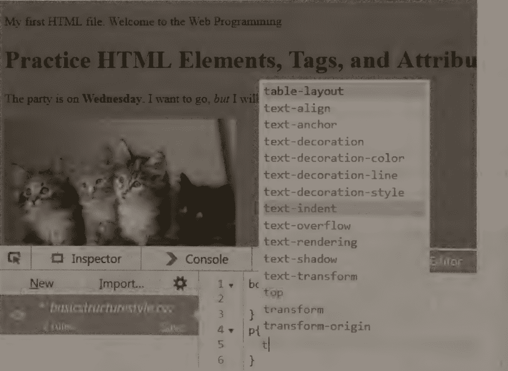

图 2.2：Firefox 样式编辑器的 IntelliSense 可以帮助编码。

通过 IntelliSense，在你输入字母`t`后，所有以字母`t`开头的可能属性都会显示出来。

练习得越多，对 CSS 的了解就越多。我们建议你至少练习图 2.3 所示的定义。

## 第 2 章：CSS

```css
body {
  background: yellow;
}

p {
  text-align: center;
  font-family: "Courier New";
  border-left: solid 1px black;
}

img {
  width: 100%;
  height: 200px;
}

table, th, td {
  border: solid 1px black;
}

table {
  border-collapse: collapse;
}

td {
  padding: 5px;
}
```


## 图 2.3：CSS 练习代码

在继续之前，始终输入一个定义并查看其效果。如果你想将样式规则保存到`basicstructurestyle.css`中，你应该在关闭浏览器之前点击左面板上的“保存”（Save）链接。

### 解释

- 第 4 到 8 行样式化所有的`<p>`元素。
- 第 5 行更改了文本对齐方式。
- 第 6 行将字体更改为 Courier New。提供多种字体是一个好习惯，因为浏览器可能没有该字体。顺序应该从特定到通用。例如：`font-family: Arial, Helvetica, sans-serif`
- 第 9 到 12 行让图片看起来不同。将宽度设置为 100% 是至关重要的。这使得图像具有响应性。换句话说，当屏幕较小时，它不会在浏览器底部添加水平滚动条。
- 第 13 行将相同的规则应用于所有三个选择器。该定义为所有元素添加边框。表格看起来会有双重边框。
- 第 16 到 18 行让表格的双重边框消失。
- 第 19 到 21 行为单元格添加内边距（padding）。内边距是文本与边框之间的空间。

## 复习题

### 复习题 2.1

同一个 HTML 文档使用不同的 CSS 在同一个浏览器中看起来会有所不同。

- A 2.1 识别基本的 CSS 定义
- B 2.2 示例不同类型的 CSS 选择器
- C 2.3 比较 CSS 测量单位
- D 2.4 使用 CSS 实现页面布局

### 复习题 2.2

CSS 代表 Cascading Style Sheets。它与 HTML 并行工作，用于定义网页的呈现方式，而 HTML 则定义网页的内容和结构。

- A 2.1 识别基本的 CSS 定义
- B 2.2 示例不同类型的 CSS 选择器
- C 2.3 比较 CSS 测量单位
- D 2.4 使用 CSS 实现页面布局

### 复习题 2.3

一个 CSS 文件包含一个或多个 CSS 定义或规则。

- A 2.1 识别基本的 CSS 定义
- B 2.2 示例不同类型的 CSS 选择器
- C 2.3 比较 CSS 测量单位
- D 2.4 使用 CSS 实现页面布局

### 复习题 2.4

一个 CSS 定义由三部分组成：选择器（where：应用到 HTML 的哪个部分）、属性（how：应用什么属性）和值（what：设置该属性）。

- A 2.1 识别基本的 CSS 定义
- B 2.2 示例不同类型的 CSS 选择器
- C 2.3 比较 CSS 测量单位
- D 2.4 使用 CSS 实现页面布局

### 复习题 2.5

每对“属性:值;”都以分号`;`结尾，而一组“属性:值;”被包含在大括号`{ }`之中。它们的显示形式如下：选择器{属性: 值; }

- A 2.1 识别基本的 CSS 定义
- B 2.2 示例不同类型的 CSS 选择器
- C 2.3 比较 CSS 测量单位
- D 2.4 使用 CSS 实现页面布局

### 复习题 2.6

例如，`h1{color: red;}`将使页面上所有的`h1`元素变为红色。

- A 2.1 识别基本的 CSS 定义
- B 2.2 示例不同类型的 CSS 选择器
- C 2.3 比较 CSS 测量单位
- D 2.4 使用 CSS 实现页面布局

### 复习题 2.7

让我们在第 1 章中创建的 HTML 文件添加一些定义。用你的编辑器打开`basicstructure.html`，在`<head>`标签之前添加一行，如下方的加粗部分所示：

- A 2.1 识别基本的 CSS 定义
- B 2.2 示例不同类型的 CSS 选择器
- C 2.3 比较 CSS 测量单位
- D 2.4 使用 CSS 实现页面布局

### 复习题 2.8

`link`元素将此 HTML 文件连接到名为`basicstructure.css`的外部 CSS 文件，该文件将负责此 HTML 页面的呈现效果。

- A 2.1 识别基本的 CSS 定义
- B 2.2 示例不同类型的 CSS 选择器
- C 2.3 比较 CSS 测量单位
- D 2.4 使用 CSS 实现页面布局

### 复习题 2.9

接下来，进入`basicstructure.html`所在的文件夹。添加一个名为`basicstructure.css`的新文件。用文本编辑器打开 CSS 文件并输入以下行：

- A 2.1 识别基本的 CSS 定义
- B 2.2 示例不同类型的 CSS 选择器
- C 2.3 比较 CSS 测量单位
- D 2.4 使用 CSS 实现页面布局

### 复习题 2.10

保存两个 HTML 和 CSS 文件。刷新 HTML 文件。你应该能在页面上看到灰色背景。

- A 2.1 识别基本的 CSS 定义
- B 2.2 示例不同类型的 CSS 选择器
- C 2.3 比较 CSS 测量单位
- D 2.4 使用 CSS 实现页面布局

### 复习题 2.11

接下来，在浏览器中打开 HTML 页面，找到“网页开发者”工具（在 Firefox 中，按`Ctrl+Shift+K`；在 Chrome 中，按`Ctrl+Shift+I`）。它们是相似的。本书其余部分将使用 Firefox 进行演示。

- A 2.1 识别基本的 CSS 定义
- B 2.2 示例不同类型的 CSS 选择器
- C 2.3 比较 CSS 测量单位
- D 2.4 使用 CSS 实现页面布局

### 复习题 2.12

当开发者工具显示你的网页后，点击“样式编辑器”（Style Editor）标签页。屏幕应该看起来如图 2.1 所示。

- A 2.1 识别基本的 CSS 定义
- B 2.2 示例不同类型的 CSS 选择器
- C 2.3 比较 CSS 测量单位
- D 2.4 使用 CSS 实现页面布局

### 复习题 2.13

你可以尝试样式编辑器。例如，你可以将灰色改为黄色，并且会实时看到效果。

- A 2.1 识别基本的 CSS 定义
- B 2.2 示例不同类型的 CSS 选择器
- C 2.3 比较 CSS 测量单位
- D 2.4 使用 CSS 实现页面布局

### 复习题 2.14

注意：在输入 CSS 时不要刷新页面。刷新将移除所有未保存的 CSS 代码。你可以点击图 2.1 所示左面板上的“保存”（save）链接。

- A 2.1 识别基本的 CSS 定义
- B 2.2 示例不同类型的 CSS 选择器
- C 2.3 比较 CSS 测量单位
- D 2.4 使用 CSS 实现页面布局

### 复习题 2.15

让我们在此基础上继续。利用编辑器的“IntelliSense”（智能感知）功能。你将为段落添加一些样式。一个“IntelliSense”的示例如图 2.2 所示。

- A 2.1 识别基本的 CSS 定义
- B 2.2 示例不同类型的 CSS 选择器
- C 2.3 比较 CSS 测量单位
- D 2.4 使用 CSS 实现页面布局

### 复习题 2.16

通过`IntelliSense`，在你输入字母`t`后，所有以字母`t`开头的可能属性都会显示出来。

- A 2.1 识别基本的 CSS 定义
- B 2.2 示例不同类型的 CSS 选择器
- C 2.3 比较 CSS 测量单位
- D 2.4 使用 CSS 实现页面布局

### 复习题 2.17

练习得越多，对 CSS 的了解就越多。我们建议你至少练习图 2.3 所示的定义。

- A 2.1 识别基本的 CSS 定义
- B 2.2 示例不同类型的 CSS 选择器
- C 2.3 比较 CSS 测量单位
- D 2.4 使用 CSS 实现页面布局

### 复习题 2.18

同一个 HTML 文档使用不同的 CSS 在同一个浏览器中看起来会有所不同。

- A 2.1 识别基本的 CSS 定义
- B 2.2 示例不同类型的 CSS 选择器
- C 2.3 比较 CSS 测量单位
- D 2.4 使用 CSS 实现页面布局

### 复习题 2.19

一个 CSS 文件包含一个或多个 CSS 定义或规则。

- A 2.1 识别基本的 CSS 定义
- B 2.2 示例不同类型的 CSS 选择器
- C 2.3 比较 CSS 测量单位
- D 2.4 使用 CSS 实现页面布局

### 复习题 2.20

一个 CSS 定义由三部分组成：选择器（where：应用到 HTML 的哪个部分）、属性（how：应用什么属性）和值（what：设置该属性）。

- A 2.1 识别基本的 CSS 定义
- B 2.2 示例不同类型的 CSS 选择器
- C 2.3 比较 CSS 测量单位
- D 2.4 使用 CSS 实现页面布局

### 复习题 2.21

每对“属性:值;”都以分号`;`结尾，而一组“属性:值;”被包含在大括号`{ }`之中。它们的显示形式如下：选择器{属性: 值; }

- A 2.1 识别基本的 CSS 定义
- B 2.2 示例不同类型的 CSS 选择器
- C 2.3 比较 CSS 测量单位
- D 2.4 使用 CSS 实现页面布局

### 复习题 2.22

例如，`h1{color: red;}`将使页面上所有的`h1`元素变为红色。

- A 2.1 识别基本的 CSS 定义
- B 2.2 示例不同类型的 CSS 选择器
- C 2.3 比较 CSS 测量单位
- D 2.4 使用 CSS 实现页面布局

### 复习题 2.23

让我们在第 1 章中创建的 HTML 文件添加一些定义。用你的编辑器打开`basicstructure.html`，在`<head>`标签之前添加一行，如下方的加粗部分所示：

- A 2.1 识别基本的 CSS 定义
- B 2.2 示例不同类型的 CSS 选择器
- C 2.3 比较 CSS 测量单位
- D 2.4 使用 CSS 实现页面布局

### 复习题 2.24

`link`元素将此 HTML 文件连接到名为`basicstructure.css`的外部 CSS 文件，该文件将负责此 HTML 页面的呈现效果。

- A 2.1 识别基本的 CSS 定义
- B 2.2 示例不同类型的 CSS 选择器
- C 2.3 比较 CSS 测量单位
- D 2.4 使用 CSS 实现页面布局

### 复习题 2.25

接下来，进入`basicstructure.html`所在的文件夹。添加一个名为`basicstructure.css`的新文件。用文本编辑器打开 CSS 文件并输入以下行：

- A 2.1 识别基本的 CSS 定义
- B 2.2 示例不同类型的 CSS 选择器
- C 2.3 比较 CSS 测量单位
- D 2.4 使用 CSS 实现页面布局

### 复习题 2.26

保存两个 HTML 和 CSS 文件。刷新 HTML 文件。你应该能在页面上看到灰色背景。

- A 2.1 识别基本的 CSS 定义
- B 2.2 示例不同类型的 CSS 选择器
- C 2.3 比较 CSS 测量单位
- D 2.4 使用 CSS 实现页面布局

### 复习题 2.27

接下来，在浏览器中打开 HTML 页面，找到“网页开发者”工具（在 Firefox 中，按`Ctrl+Shift+K`；在 Chrome 中，按`Ctrl+Shift+I`）。它们是相似的。本书其余部分将使用 Firefox 进行演示。

- A 2.1 识别基本的 CSS 定义
- B 2.2 示例不同类型的 CSS 选择器
- C 2.3 比较 CSS 测量单位
- D 2.4 使用 CSS 实现页面布局

### 复习题 2.28

当开发者工具显示你的网页后，点击“样式编辑器”（Style Editor）标签页。屏幕应该看起来如图 2.1 所示。

- A 2.1 识别基本的 CSS 定义
- B 2.2 示例不同类型的 CSS 选择器
- C 2.3 比较 CSS 测量单位
- D 2.4 使用 CSS 实现页面布局

### 复习题 2.29

你可以尝试样式编辑器。例如，你可以将灰色改为黄色，并且会实时看到效果。

- A 2.1 识别基本的 CSS 定义
- B 2.2 示例不同类型的 CSS 选择器
- C 2.3 比较 CSS 测量单位
- D 2.4 使用 CSS 实现页面布局

### 复习题 2.30

注意：在输入 CSS 时不要刷新页面。刷新将移除所有未保存的 CSS 代码。你可以点击图 2.1 所示左面板上的“保存”（save）链接。

- A 2.1 识别基本的 CSS 定义
- B 2.2 示例不同类型的 CSS 选择器
- C 2.3 比较 CSS 测量单位
- D 2.4 使用 CSS 实现页面布局

### 复习题 2.31

让我们在此基础上继续。利用编辑器的“IntelliSense”（智能感知）功能。你将为段落添加一些样式。一个“IntelliSense”的示例如图 2.2 所示。

- A 2.1 识别基本的 CSS 定义
- B 2.2 示例不同类型的 CSS 选择器
- C 2.3 比较 CSS 测量单位
- D 2.4 使用 CSS 实现页面布局

### 复习题 2.32

通过`IntelliSense`，在你输入字母`t`后，所有以字母`t`开头的可能属性都会显示出来。

- A 2.1 识别基本的 CSS 定义
- B 2.2 示例不同类型的 CSS 选择器
- C 2.3 比较 CSS 测量单位
- D 2.4 使用 CSS 实现页面布局

### 复习题 2.33

练习得越多，对 CSS 的了解就越多。我们建议你至少练习图 2.3 所示的定义。

- A 2.1 识别基本的 CSS 定义
- B 2.2 示例不同类型的 CSS 选择器
- C 2.3 比较 CSS 测量单位
- D 2.4 使用 CSS 实现页面布局


图 2.3：CSS 练习代码。

在继续之前，始终输入一个定义并查看其效果。如果你想将样式规则保存到`basicstructurestyle.css`中，你应该在关闭浏览器之前点击左面板上的“保存”（Save）链接。

解释：

- 第 4 到 8 行样式化所有的`<p>`元素。
- 第 5 行更改了文本对齐方式。
- 第 6 行将字体更改为`Courier New`。提供多种字体是一个好习惯，因为浏览器可能没有该字体。顺序应该从特定到通用。例如：`font-family: Arial, Helvetica, sans-serif`
- 第 9 到 12 行让图片看起来不同。将宽度设置为`100%`是至关重要的。这使得图像具有响应性。换句话说，当屏幕较小时，它不会在浏览器底部添加水平滚动条。
- 第 13 行将相同的规则应用于所有三个选择器。该定义为所有元素添加边框。表格看起来会有双重边框。
- 第 16 到 18 行让表格的双重边框消失。
- 第 19 到 21 行为单元格添加内边距（padding）。内边距是文本与边框之间的空间。

## 第二章：CSS

### 复习题 2.14

CSS 中绝对长度测量单位的特点是什么？

- 它们依赖于尺寸
- 它们相对于查看设备
- 无论如何，它们将取恰切的长度
- 它们会随着屏幕尺寸动态变化

## 2.3 CSS 选择器

选择器可以是一个标签名，例如`h1`。例如，你可以使用以下代码将所有`<h1>`元素设置为红色：

```css
h1 {
  color: red;
}
```

另一种类型的选择器是 HTML 文档的`id`属性。要使用`id`选择器，首先在 HTML 文档中添加一个`id`属性，如下：

```html
<h1 id="myColor">这个标题是红色的</h1>
<h1 id="myAlign">这个标题是居中齐的</h1>
```

然后，在 CSS 部分，按照如下方式添加定义（注意`id`名称前有`#`）：

```css
#myColor {
  color: red;
}

#myAlign {
  text-align: center;
}
```

注意，每个页面上的`id`属性应该具有唯一的值。你不能拥有两个相同值的属性并将它们应用于同一个样式。在这些情况下，你应该使用类选择器（class selector）。

类选择器允许你使用相同的样式为多个元素设置样式。要使用类选择器，为所有你想要应用样式的元素添加`class`属性。在 HTML 文件中添加以下行：

```html
<h1 class="redText">这是一个标题</h1>
<p class="redText">这是一个段落</p>
```

然后，在 CSS 代码中添加以下定义（注意类名前的点符号`.`）：

```css
.redText {
  color: red;
}
```

你可以对特定元素应用多个类。例如，在 CSS 文件中添加另一个类定义：

```css
.centerText {
  text-align: center;
}
```

然后只需将新类添加到 HTML 元素中即可。两个类值之间用空格隔开，如下：

```html
<h1 class="redText centerText">这是一个标题</h1>
```

注意：为了更好的兼容性，请避免使用以数字开头的类名。

你可以使用属性选择器将样式应用到所有具有该属性的元素。例如，如果你在 HTML 文件中有以下元素：

```html
<input type="text">
```

你可以拥有以下 CSS 样式：

```css
[type="text"] {
  background-color: blue;
}
```

这将使所有具有`type`属性的元素显示蓝色背景。

伪类（Pseudo-classes）是另一种选择器。伪类不是在 HTML 文件中定义的类，而是由 CSS 预定义的类。例如，添加以下 CSS 定义：

```css
a:hover {
  color: green;
}
```

这将当鼠标悬停在链接上时，使超链接标签变为绿色。`hover`就是一个伪类。你不需要在 HTML 中对超链接做任何操作。

此外，你可以使用伪元素（pseudo-elements）作为选择器。例如，段落的第一个字母不是一个元素，但它是一个伪元素。添加以下 CSS 样式将任何段落的第一个字母字体加倍。

```css
p::first-letter {
  font-size: 200%;
}
```

注意：`::first-letter`伪元素只能应用于块级元素。

你在这里将学习的最后一个选择器是上下文选择器（contextual selector）。假设在 HTML 文档中，你有如下代码：

```html
<ul>
  <li><a href="#">HTML 是很有趣的</a></li>
  <li><strong><a href="#">CSS</a></strong> 更有具挑战性</li>
</ul>
```

元素在 CSS 中添加以下定义：

```css
ul a {
  background-color: green;
}
```

该选择器是任何作为`<ul>`元素后代（descendant）的`<a>`元素，它将具有绿色背景。上面的 CSS 将使 HTML 中的超链接变为绿色，因为在上述 HTML 代码中`<a>`元素是`<ul>`元素的元素。如果 HTML 文件包含另一个未嵌套在`<ul>`元素中的`<a>`，它将不会是绿色的。

你可以让上下文选择器更具体。添加以下 CSS：

```css
li > a {
  background-color: red;
}
```

选择器`li > a`是任何作为`<li>`元素子元素的`<a>`元素，将具有红色背景。通过此 CSS，你看到“HTML 是很有趣的”是红色的，而“CSS 更有具挑战性”仍然是绿色的，因为“CSS 更有具挑战性”不是`<li>`元素的元素。

最后，你可以用逗号组合任何类型的选择器，将相同的样式应用于多个元素。例如：

```css
h1, #myColor, .centerText {
  color: red;
  text-align: center;
  background-color: green;
}
```

这将应用于所有`<h1>`元素、`id="myColor"`的元素以及`class="centerText"`的元素。

### 复习题 2.15

假设你在 css 文件中有以下定义：

```css
.c1 {
  color: red;
}

c2 {
  background-color: yellow;
}
```

你如何对以下 HTML 元素应用样式？

```html
<h1>带颜色的标题</h1>
<h1 class="c1">带颜色的标题</h1>
<h1 id="c2">带颜色的标题</h1>
<h1.c1>带颜色的标题</h1>
```

### 复习题 2.16

假设你在 css 文件中有以下定义：

```css
.c1 {
  color: red;
}

c2 {
  background-color: yellow;
}
```

你如何对以下 HTML 元素应用样式？

```html
<h1>带颜色的标题</h1>
<h1 class="c1">带颜色的标题</h1>
<h1 id="c2">带颜色的标题</h1>
<h1.c1>带颜色的标题</h1>
```

### 复习题 2.17

假设你在 css 文件中有以下定义：

```css
.c1 {
  color: red;
}

c2 {
  background-color: yellow;
}
```

你如何对以下 HTML 元素应用样式？

```html
<h1>带颜色的标题</h1>
<h1 class="c1">带颜色的标题</h1>
<h1 id="c2">带颜色的标题</h1>
<h1.c1>带颜色的标题</h1>
```

### 复习题 2.18

假设你在 css 文件中有以下定义：

```css
.c1 {
  color: red;
}

c2 {
  background-color: yellow;
}
```

你如何对以下 HTML 元素应用样式？

```html
<h1>带颜色的标题</h1>
<h1 class="c1">带颜色的标题</h1>
<h1 id="c2">带颜色的标题</h1>
<h1.c1>带颜色的标题</h1>
```

### 复习题 2.19

假设你在 css 文件中有以下定义：

```css
.c1 {
  color: red;
}

c2 {
  background-color: yellow;
}
```

你如何对以下 HTML 元素应用样式？

```html
<h1>带颜色的标题</h1>
<h1 class="c1">带颜色的标题</h1>
<h1 id="c2">带颜色的标题</h1>
<h1.c1>带颜色的标题</h1>
```

### 复习题 2.20

假设你在 css 文件中有以下定义：

```css
.c1 {
  color: red;
}

c2 {
  background-color: yellow;
}
```

你如何对以下 HTML 元素应用样式？

```html
<h1>带颜色的标题</h1>
<h1 class="c1">带颜色的标题</h1>
<h1 id="c2">带颜色的标题</h1>
<h1.c1>带颜色的标题</h1>
```

### 复习题 2.21

假设你在 css 文件中有以下定义：

```css
.c1 {
  color: red;
}

c2 {
  background-color: yellow;
}
```

你如何对以下 HTML 元素应用样式？

```html
<h1>带颜色的标题</h1>
<h1 class="c1">带颜色的标题</h1>
<h1 id="c2">带颜色的标题</h1>
<h1.c1>带颜色的标题</h1>
```

### 复习题 2.22

假设你在 css 文件中有以下定义：

```css
.c1 {
  color: red;
}

c2 {
  background-color: yellow;
}
```

你如何对以下 HTML 元素应用样式？

```html
<h1>带颜色的标题</h1>
<h1 class="c1">带颜色的标题</h1>
<h1 id="c2">带颜色的标题</h1>
<h1.c1>带颜色的标题</h1>
```

### 复习题 2.23

假设你在 css 文件中有以下定义：

```css
.c1 {
  color: red;
}

c2 {
  background-color: yellow;
}
```

你如何对以下 HTML 元素应用样式？

```html
<h1>带颜色的标题</h1>
<h1 class="c1">带颜色的标题</h1>
<h1 id="c2">带颜色的标题</h1>
<h1.c1>带颜色的标题</h1>
```

### 复习题 2.24

假设你在 css 文件中有以下定义：

```css
.c1 {
  color: red;
}

c2 {
  background-color: yellow;
}
```

你如何对以下 HTML 元素应用样式？

```html
<h1>带颜色的标题</h1>
<h1 class="c1">带颜色的标题</h1>
<h1 id="c2">带颜色的标题</h1>
<h1.c1>带颜色的标题</h1>
```

*(注：由于原始文本中复习题 2.15-2.24 的内容存在大量重复且占位符化，翻译严格遵循了提供的文本结构进行对应处理)*

此外，你可以在`property: value;`对之后使用`!important`声明来表示其相对于同一元素的其他规则的优先级（例如`hr { height: 5px; width: 50% !important; }`）。关于此主题的更详细描述称为“优先级”（specificity），将在本章稍后解释。

在第 1 章查看没有 CSS 的 HTML 文档时，你可能会注意到`<h1>`和`<h2>`的字体大小不同。这是因为浏览器应用了默认 CSS。每个 CSS 属性都有一个适用于所有 HTML 元素的初始值，称为“CSS 属性初始样式”（CSS Properties Initial Styles）。它的优先级最低。此外，每个浏览器都有“用户样式表”（User-Agent Stylesheet）；这是浏览器实现的默认 CSS 文件，优先级次之。例如，`display`属性的初始值为`inline`。“用户样式表”会根据 HTML 元素覆盖默认值。要查看 Windows 上 Firefox 的默认样式，请按`Ctrl+Shift+K`，然后按`F1`，最后选择“显示浏览器样式”复选框。

### 复习题 2.25

CSS 可以通过三种方式指定。当为 HTML 元素指定了多个样式信息时，这些样式将按照层叠顺序合并成一个新的样式表。从高优先级到低优先级的顺序是：

- A) 嵌入式、外部和内联
- B) 内联、嵌入式和外部
- C) 嵌入式、内联和外部

### 复习题 2.26

以下哪个 CSS 将覆盖浏览器的默认样式？
A) 嵌入式
B) 外部
C) 内联
D) 所有其他选项均正确

### 复习题 2.27

假设你有一个名为`lesson1.css`的链接样式表文件，保存在与 HTML 文档相同的文件夹中。为了将样式应用于 HTML 文档，你需要在 HTML 文件的特定位置插入以下代码：

```html
<link rel="stylesheet" href="lesson1.css">
```

- A) 元素的特定位置

### 复习题 2.28

假设你想将 CSS 应用到多个网页上，你可能会使用：
A) 嵌入式
B) 外部
C) 内联
D) 浏览器默认

## 第 2 章：CSS

### 复习题 2.29

如果你使用了嵌入式样式，所有的 CSS 定义应该包含在 ____ 内部。

- A) `<style>` 和 `</style>`
- B) `<css>` 和 `</css>`
- C) `<definition>` 和 `</definition>`
- D) `<cssDefinition>` 和 `</cssDefinition>`

### 复习题 2.30

哪个 HTML 属性用于定义内联样式？
- A) `style`
- B) `css`
- C) `inline`
- D) `linestyle`

### 复习题 2.31

如果同一个选择器有两个定义，会发生什么？
- A) 第一个优先
- B) 第二优先
- C) 样式共同应用
- D) 浏览器显示错误消息

### 复习题 2.32

如何让一个 CSS 规则的优先级高于其他规则？
- A) 使用`"priority"`定义
- B) 使用`"important"`定义
- C) 使用`"high"`定义
- D) 使用`"high priority"`定义

## 2.5 CSS 继承

CSS 继承意味着当你为一个元素应用某些属性时，这些属性会自动应用于它的嵌套元素。例如，使用以下样式，除了`<a>`元素外，所有文本将变为红色：

```css
Body {
  color: red;
}
```

并不是所有的属性都能被继承。例如，在上面的定义中添加以下声明：

```css
font-size: 24px;
```

你可能认为所有文本的大小都是 24px；但如果你在浏览器中查看，你会发现标题仍然比正大。这是因为浏览器对标题有自己的继承规则。例如，在样式中添加以下声明：

```css
margin-left: 150px;
```

整个页面向左缩进了 150px；但嵌套元素没有进一步缩进。这表明外边距没有被继承。你可以使用 CSS 的`inherit`属性来显式更改继承。如果你按照本节的做法，你会发现`<a>`元素现在是红色的。同样，你可以使用 CSS 的`initial`属性将元素的属性设置为浏览器默认值。在样式中添加以下声明：

```css
table { color: initial; }
```

你会发现表格颜色没有被继承。

### 复习题 2.33

CSS 继承意味着 ______。
- 如果你为一个元素应用属性，该属性将应用于所有相关元素。
- 如果你为一个元素应用属性，该属性将应用于所有嵌套元素。
- 如果你为一个元素应用属性，该属性将应用于所有嵌套元素，但有例外。
- CSS 不是面向对象的，因此没有继承这种说法。

### 复习题 2.34

你如何在 CSS 中显式更改继承？
- A) 使用`"all"`属性
- B) 使用`"global"`属性
- C) 使用`"inherit"`属性
- D) 使用`"override"`属性

### 复习题 2.35

在 CSS 中使用`initial`属性会发生什么？
- A) 元素的属性取决于浏览器
- B) 元素的属性取决于 CSS 文件
- C) 元素的属性取决于计算值
- D) 元素的属性取决于其祖先元素

## 2.6 CSS 注释

注释用于向人类读者解释代码。在以后需要更新代码时，它们非常有帮助。我们经常通过注释掉某行来临时删除它。浏览器会忽略所有的注释。CSS 注释以`"/*"`开始，以`"*/"`结束，如下：

```css
/* This is a comment

text-align: center; /* The paragraph is centered */
```


## 复习题 2.36

以下哪种是注释掉 CSS 行的方法？

- A) `/* This is a comment`
- B) `<? This is a comment`
- C) `<- This is a comment`
- D) `/* This is a comment */`

## 复习题 2.37

关于 HTML 注释和 CSS 注释的哪个陈述是正确的？

- HTML 注释以 `<!-- -->` 开始，而 CSS 注释以 `<!-- -->` 开始
- HTML 注释影响 HTML 在浏览器中的显示方式，而 CSS 注释不会。
- HTML 注释可以跨行，但 CSS 注释不能。
- CSS 注释以 `/* -->` 开始，而 HTML 注释以 `<!-- -->` 开始

## 2.7 CSS 颜色属性

学习了 CSS 选择器后，是时候深入研究属性及其取值了。在本节中，你将探索`color`属性，它定义了文本的前景色，并可应用于任何元素。

颜色值可以是颜色名称（例如`red`）或 RGB 值（代表红、绿、蓝）。在`#000000`值中，前两个数字决定红色的量，接下来的两个数字决定绿色的量，最后两个数字指示蓝色的量。每个数字的范围是从 0 到十六进制数字。同样，在`rgb(0, 0, 0)`样式中，第一个数字表示红色的量，第二个和第三个数字表示蓝色。每个数字范围范围 0 到 255。你还可以使用 RGBA，其中 "A" 代表透明度，值从 0.0（完全透明）到 1.0（完全不透明）。此外，还有`hsl`和`hla`颜色选项。HSL 代表色调（范围为 0 到 360，其中 0 或 360 是红色，120 是绿色，240 是蓝色——就像色轮一样）、饱和度（0% 是灰色，100% 是全色）和亮度（0% 为黑色；100% 为白色）。

在 CSS 文件中输入以下定义，查看它们如何影响 HTML 文件中的元素：

```css
h1{color: red; }
h1{color: #00ff00; }
h1{color: rgb(255, 0, 0); }
h1{color: rgb(100%, 0%, 0%); }
h1{color: rgba(255, 0, 0, 0.3); }
h1{color: hsl(360, 50%, 50%); }
h1{color: hsl(360, 50%, 50%, 0.6); }
```

请记住，颜色是可以继承的，但更具体的定义会覆盖更通用的定义。

此外，`opacity`属性指定了元素的透明度/不透明度。例如，你可以添加以下 CSS 查看它是如何影响 HTML 文档中的``标签的：

```css
img{ opacity: 0.5; }
```

透明度是 0 到 1 之间的值。尝试一下它并看看它是如何工作的。

## 复习题 2.38

在 CSS 颜色中，RGB 值代表：

- A) 非常好的蓝色
- B) 红色灰色
- C) 红色绿色
- D) 红色绿色黑色

## 复习题 2.39

以下哪项不是有效的 RGB 颜色？

- A) `#ff0000`
- B) `rgb(256, 0, 0)`
- C) `rgb(100%, 0%, 0%)`

## 复习题 2.40

使用哪个 CSS 属性更改元素的文本颜色？

- A) `text-color`
- B) `font-color`
- C) `foreground-color`
- D) `color`

## 2.8 CSS 字体属性

CSS 字体属性允许你更改字体族、粗细、大小和文本样式。

### 2.8.1 字体族 (Font Family)

`font-family`属性指定浏览器应使用的字体名称。按从通用到具体的顺序添加所有字体，并用逗号分隔。例如：

```css
p{font-family: arial, sans-serif; }
```

在上述样式中，如果浏览器有 Arial 字体，它将使用它来显示所有段落。如果浏览器没有 Arial，它将使用 sans-serif 字体显示段落。

字体族可以分为两类：衬线字体（serif）和无衬线字体（sans-serif）。要查看这两类之间的区别，将以下两行添加到`basicstructurestyle.css`中并观察差异。在比较两者时，你可以关注字母 'g'：

```css
p { font-family: sans-serif; }
h1 { font-family: serif; }
```

注意：研究表明，在计算机显示器上，无衬线字体比衬线字体更容易阅读。

### 2.8.2 字体大小 (Font Size)

字体大小可以使用以下任何单位进行测量：

| 单位 | 说明 |
| :--- | :--- |
| `px` | 一个点。大多数浏览器中字体大小的默认值为 16px。 |
| `pt` | 磅。磅是传统纸质媒体的尺寸单位，而像素是计算机显示器的尺寸单位。1 磅等于 1/72 英寸，而 1 像素等于显示器上的一个点。 |
| `em` | 取决于其容器的字体大小。1em 默认为 16px，因为浏览器的默认字体大小为 16px。如果通过 CSS 更改基础字体大小，一个 em 的大小随之改变。 |
| `%` | 相对于基础大小的百分比。所以 100% = 基础字体大小。 |

你可以使用值或百分比来操作字体的大小。如果你不想用户更改字体大小，应该使用值。当你想要更改默认字体大小但不想设置静态值时，百分比是非常棒的。手机的分辨率很高，这使得像素非常小。当你在相对字体大小（例如 120%）和绝对字体大小（例如 10px）之间进行选择时，你应该选择相对字体大小，因为你不知道每个显示设备的具体测量值。这在查看你的页面时也提供了更大的灵活性。为了练习，请将 CSS 定义添加到`basicstructurestyle.css`中。你可能会看到更大的`h1`文本。

```css
h1 { font-size: 120%; }
```

`h1`文本实际上看起来会更小。这是因为上述代码中 120% 的字体大小是基于浏览器字体大小的，而不是`<h1>`的默认大小。因此，上述代码可能会让标题比不使用它更小。

### 2.8.3 字体样式 (Font Style)

字体样式是另一个属性。字体样式的可能值包括斜体（italic）、倾斜（oblique）和正常（normal）。在大多数情况下，斜体和倾斜之间几乎没有区别。将以下 CSS 定义添加到`basicstructure.css`中以查看差异：

```css
h1 { font-style: italic}
p { font-style: oblique }
```

### 2.8.4 字体粗细 (Font Weight)

你可以使用字体粗细来控制字体的厚度。值的范围从 100（细）到 900（粗）。你也可以使用关键词而不是数值值。`font-weight`可用的关键词有有`bold`、`bolder`和`normal`。将以下 CSS 定义添加到`basicstructure.css`中以查看结果：

### 2.8.5 文本装饰 (Text Decoration)

文本装饰可用于在文本上添加线条、下划线或穿线。它也可以用于删除下划线。例如：

```css
h1 {text-decoration: underline}
p {text-decoration: none}
```

### 2.8.6 文本缩进 (Text Indent)

文本缩进用于段落的第一行缩进。例如：

```css
p {text-indent: 20px}
```

### 2.8.7 文本对齐 (Text Alignment)

默认情况下，文本左对齐。然而，还有其他对齐方式。例如：

```css
h1 {text-align: center}
```

### 2.8.8 文本转换 (Text Transform)

`text-transform`用于控制文本的大小写转换。例如：

```css
h1 {text-transform: uppercase}
```

### 2.8.9 间距 (Spacing)

你可以指定单词之间的间距。例如：

```css
h1 {letter-spacing: 5px}
```

### 2.8.10 行高 (Line Height)

你可以增加或减少行之间的间距。例如：

```css
p {line-height: 20%}
```

### 2.8.11 字体属性 (Font Property)

`font`属性允许你设置字体属性。例如：

```css
p {font: bold}
```

## 复习题 2.41

哪个 CSS 属性决定字体大小？

- A) `text-size`
- B) `font-size`
- C) `font-style`
- D) `font-weight`

## 复习题 2.42

使`<p>`加粗的 CSS 定义是？

```css
p{font-size; }
p{font-style; }
p{text-size; }
p{font-weight; }
```

## 复习题 2.43

显示链接不带下划线的 CSS 定义是？

```css
a{underline: none; }
a{text-underline: none; }
a{text-decoration: none; }
```

## 复习题 2.44

如何让段落中的每个单词大写开头？

- A) `p{case: uppercase; }`
- B) `p{case: first-letter; }`
- C) `p{text-transform: uppercase; }`
- D) `p{capitalize;}`

## 复习题 2.45

使用哪个 CSS 属性更改元素的字体？

- A) `font`
- B) `font-family`
- C) `text`
- D) `font`或`font-family`

## 复习题 2.46

`font-family`指定什么？

- A) 字体的大小
- B) 装饰类型
- C) 浏览器应使用的字体
- D) 字体的厚度

## 复习题 2.47

以下哪项是无衬线字体的特征？

- A) 它们具有像素 (px) 测量单位。
- B) 它们推荐用于大多数段落。
- C) 它们具有磅 (pt) 测量单位。
- D) 它们更适合纸质媒体。

## 复习题 2.48

何时在 CSS 中使用相对字体大小？

- A) 当你想设置固定字体大小时。
- B) 当你想使用磅 (pt) 进行测量时。
- C) 当你想为各种设备更改默认字体大小时。
- D) 当你想使用基础字体的大小时。

## 复习题 2.49

假设一切默认，以下 CSS 定义在大多数浏览器上的结果是什么？

```css
h1 {font-size: 100%; }
```

- A) `h1`文本看起来会比不定义时大。
- B) `h1`文本看起来会比不定义时小。
- C) `h1`文本看起来和不定义时一样。
- D) CSS 不允许字体大小大于 100%。

## 复习题 2.50

哪个 CSS 属性可以用于控制字体的厚度？

- A) `font-style`
- B) `text-decoration`
- C) `font-weight`
- D) `text-transform`

## 2.9 CSS 边、内边距和外边距

你可以将元素要素为一个框，并通过更改它的边（border）、内边距（padding）和外边距（margin）属性值来对元素设置样式。

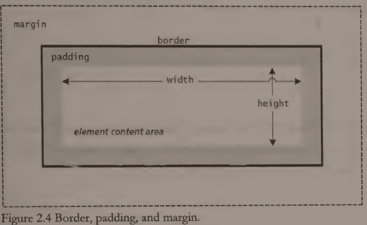

### 2.9.1 Border (边)

边是不继承的。你可以使用以下 CSS 规则为页面上的所有元素添加边：

```css
*{ border-style: solid; }
```

星号 (`*`) 是通配符选择器，选取页面上的所有元素。此规则对于开发者查看每个元素占用了多少空间并帮助布局非常有用。要为特定元素添加边，可以使用`border`属性。例如，要为`h1`元素添加一个宽度为 1px 的实线红色边，可以使用以下 CSS 规则：

```css
h1{ border: solid 1px red; }
```

你可以根据需要修改边框样式（实线、虚线、凹槽、点状）并改变边的宽度和颜色。

### 2.9.2 Padding (内边距)

内边距是元素边与其内部内容之间的空间。这是一个不继承的属性。要查看内边距如何工作，可以使用以下 CSS 规则作为示例：

```css
h1{
  padding: 10px;
  border: solid 1px red;
}
```

这在`h1`元素的所有侧（上、右、下、左）设置了 10 像素的内边距，并添加了实线红色边。你也可以使用百分比来定义内边距。例如：

```css
h1 {
  padding: 2%;
  border: 1px solid black
}
```

`h1`标题四周将拥有其包含元素宽度 2% 的内边距。

### 2.9.3 Margin (外边距)

外边距定义了 HTML 元素边之外的空间，而内边距指的是边内部的空间。要为元素添加外边距，可以使用`margin`属性。例如，要为`h1`元素在边外所有侧添加 20px 的外边距，可以使用以下 CSS 规则：

```css
h1{
  margin: 20px;
  padding: 10px;
  border: solid 1px red;
}
```

两个相邻元素的外边距在垂直对齐时会发生折叠。如果两个元素水平并排，它们之间的距离将是两个外边距之和。然而，如果两个元素垂直对齐，则只取两个边距中较大的一个。

```html
<html lang="en">
<head>
  <meta charset="utf-8">
  <title>HTML Basic Structure</title>
  <link rel="stylesheet" href="margin.css">
</head>
<body>
  <h1 id="red">Red heading</h1>
  <h1 id="yellow">Yellow heading</h1>
  <span id="green">Green span</span>
  <span id="blue">Blue span</span>
</body>
</html>
```

将以下代码添加到名为`margin.css`的文件中：

```css
#red{
  background-color: red;
  margin: 10px;
}
#yellow{
  background-color: yellow;
  margin: 10px;
}
#green{
  background-color: green;
  margin: 10px;
}
#blue{
  background-color: blue;
  margin: 10px;
}
```

提供的 HTML 和 CSS 代码示例在浏览器中直观地展示了这些概念。

注意：你也可以像定义内边距一样使用百分比定义外边距。

## 复习题 51

如何为所有段落显示边？

- A) `p {border: solid 1px red; }`
- B) `p {border-style: solid 1px red; }`
- C) `p {border-visible: solid 1px red; }`
- D) `p {display: }`

## 复习题 52

元素边与其内部内容之间的空间是 ____。

- A) `padding`
- B) `margin`
- C) `spacing`
- D) `border-inside`

## 复习题 53

在 CSS 中，当两个元素水平并排时，它们之间的距离是两个外边距的 ____。

- A) sum
- B) difference
- C) larger
- D) smaller

## 复习题 54

在 CSS 中，当两个元素垂直对齐时，它们之间的距离是两个外边距中的 ____。

- A) sum
- B) difference
- C) larger
- D) smaller

## 复习题 55

____ 定义了 HTML 元素之外的空间。

- A) `padding`
- B) `margin`
- C) `spacing`
- D) `border-outside`

## 2.10 Display: 行内元素、块级元素和行内块元素

CSS 对页面布局至关重要，但在深入之前，理解`display`属性至关重要。该属性可以取四个值：`none`、`inline`、`block`。让我们通过一个示例来探索它们之间的区别。创建一个名为`inlineblock.html`的新 HTML 文件并包含以下代码：

```html
<!DOCTYPE html>
<html lang="en">
<head>
<meta charset="utf-8">
<title>CSS Display Property</title>
<style>
#first{
  background-color: yellow;
  width: 150px;
  height: 150px;
  display: block;
}
#second{
  background-color: red;
  width: 150px;
  height: 150px;
  display: block;
}
</style>
</head>
<body>
<div id="first">Block One</div>
<div id="second">Block Two</div>
</body>
</html>
```


在浏览器中，你应该看到两个块，一个在另一个上面，如图 2.5 所示。`block` 显示让 `div` 元素占据整行。注意 `div` 的默认值是 `block`。如果你移除 `display` 属性及其值，仍然会看到两个块，一个在上在上。然而，使用 `none` 值会让块消失。

### 图 2.5

Block One


Block One

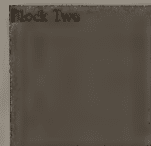

图 2.6

Block One


图 2.7

Block One


### 复习题 56

- 在 CSS 中，如果你不为 `div` 设置 `display` 属性，内容将显示：
A) "none"
B) "inline"
C) "block"

### 复习题 57

- 在 CSS 中，如果你将 `display` 属性设置为 "none"，内容将显示：
A) "inline-block"
B) "inline"
C) "block"

### 复习题 58

- 在 CSS 中，如果你想让两个 `div` 并排显示，应该分配哪个值？
A) none
B) inline-block
C) block

### 复习题 59

- 哪个 `display` 属性不遵守尺寸？
A) block
B) inline
C) inline-block

## 2.11 设置导航菜单样式：示例

在本节中，你将学习如何为 "morestructure.html" 页面设置样式。首先，在 HTML 文件中添加此行：`<link rel="stylesheet" href="morestructure.css">`。接下来，添加名为 "morestructure.css" 的新 CSS 文件。在浏览器打开 "morestructure.html"，然后按 Ctrl+Shift+K 打开样式编辑器。在 CSS 中添加以下：

```css
body{
  background: lightgrey;
}

/* 用于小屏幕 */
nav{
  background: red;
  border: 1px black;
  text-align: center;
}

nav ul{
  list-style-type: none; /* 创建一个没有符号的列表 */
  margin: 0 auto;
  padding-left: 0;
}

nav ul li{
  background: grey;
  text-align: center;
  padding: 10px;
  margin: 3px 0px;
}

nav a {
  font-size: 1.5em;
  display: block;
  text-decoration: none;
}

nav a:hover{
  color: white;
}

header{
  text-align: center;
}

header img{
  width: 100%;
  height: 200px;
}

footer{
  text-align: center;
  background: grey;
}
```

上述代码适用于小窗口。为了让它在宽屏幕上同样有效，在 "morestructure.css" 中添加以下代码：

```css
@media only screen and (min-width: 45em)
nav{
```

### 图 2.8

你的主内容

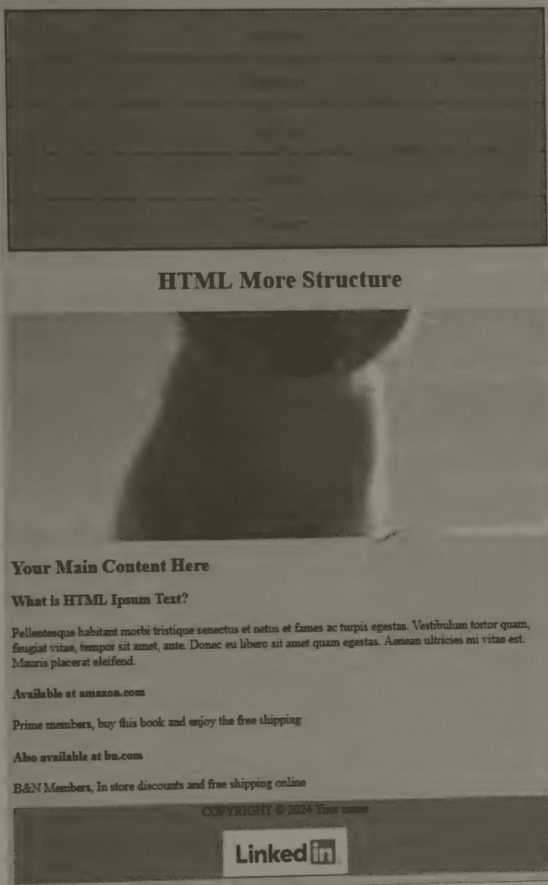

## HTML 更多结构

什么是 HTML Ipsum？
Pellentesque habitant morbi tristique senectus et neque felis ac turpis egestas. Vestibulum tortor quam, faucibus vitae, tempor sit amet, ante. Donec eu libero sit amet amet quam egestas. Aenean ultricies mi vitae est. Mauris placerat at eleifend.

可在 amazon.com 购买

Prime 员购买此书可享受免费邮送

亦可在 bn.com 购买

B&N 员享受店内折扣和在线免费邮送 你的姓名

版权所有 © 2026 你的姓名

```css
border:solid 1px black;
}

nav ul li{
  display: inline-block;
  border: solid 1px yellow;
}

main{
  margin-right: 20em;
  min-height: 220px;
}

/* 将位置值从默认的 static改为 */
aside#amazon{
  position: absolute; top: 350px; right: 0px; width: 18em;
}

aside#bn{
  position: absolute; top: 450px; right: 0px; width: 18em;
}

footer p{
  display: inline;
}
```

内容的浏览器视图显示如图 2.9 所示。

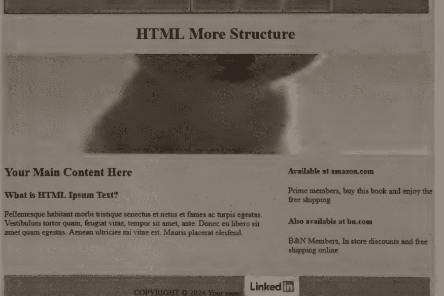

图 2.9 大屏幕上的页面。

思考复习题 2.60

如何创建一个不带项目符号的列表？

- - `ul(list-style-type: none);`
- `li(list-style-type: none);`
- `ul(list-style-type: disappear);`

# 第 2 章：CSS

思考复习题 2.61
`position` 属性的默认值是什么？
A absolute
B relative
C fixed
D static

思考复习题 2.62
在响应式设计中，较小屏幕需要哪个 CSS 代码？
A `@media only screen`
B `@media only small screen`
C `@media only fullscreen`
D 无需，CSS 应该应用于较小的屏幕

思考复习题 2.63
在响应式设计中，较宽屏幕需要哪个 CSS 代码？
A `@media only screen`
B `@media only wider screen`
C `@media only widescreen`
D 无需，CSS 应该应用于较宽的屏幕

## 2.12 CSS 权重 (Specificity)

当多个 CSS 定义被应用到 HTML 文档时，它们在应用之前会级联成一张样式表。如果没有提供 CSS 定义，浏览器将使用其自带的默认 CSS 样式。如果提供了外部样式表，它将替换相应的浏览器默认 CSS。如果提供了嵌入式样式，它将替换相应的浏览器默认 CSS。最后，如果提供了内联样式，它将覆盖以上所有内容。简而言之，内联 CSS 将覆盖嵌入式，嵌入式将覆盖外部，并覆盖浏览器默认 CSS。

许多时候，上述级联规则不足以涵盖所有情况，可能仍然会出现冲突。为了解决这些问题，浏览器会计算权重。权重应用于特定 CSS 定义的权重。你可以使用以下规则手动计算权重：

| 规则 | 分数 |
|---|---|
| 重要（谨慎使用） | `p{color:red;}` | 无穷 |
| 内联样式加 100 | `h1<style="color:red;">` | 1000 |
| 每个 ID 选择器加 100 | `#id{color: red;}` | 100 |
| 每个类选择器、伪类或属性选择器加 10 | `.class{color: blue;}` | 10 |
| 每个类型、、元素或伪元素选择器加 1 | `p{color:yellow;}` | 1 |
| | `p{color:white;}` | 101 |
| | `ul li` | 3 |

# Web 编程

现在有一些 CSS 权重计算器。你可以使用它们，结果会解释为什么应用一个属性而不是另一个。你可以在此处找到这样一个工具：https://specificity.keegan.st/

# 思考复习题 2.64

以下哪一个 CSS 定义优先级最高？

- A) 浏览器默认 CSS
- B) 内联样式
- C) 嵌入链接样式
- D) 外部链接样式

# 思考复习题 2.65

当样式定义发生冲突时，浏览器如何决定应用哪一个？

- A) 浏览器默认 CSS
- B) 内联样式
- C) 忽略定义
- D) 计算权重

# 思考复习题 2.66

如果 HTML 文档有多个 CSS 定义会发生什么？

- A) 浏览器将随机应用 CSS 定义。
- B) CSS 定义在应用之前会级联成一张样式表。
- C) 浏览器将应用其默认的 CSS 样式。
- D) 浏览器将按照它们在 HTML 文档中出现的顺序应用 CSS 定义。

# 思考复习题 2.67

如果为 HTML 文档未提供 CSS 定义会发生什么？

- A) 浏览器将应用其默认的 CSS 样式。
- B) 浏览器将显示错误消息。
- C) 浏览器将使用另一个 HTML 文档的 CSS 定义。
- D) 浏览器将应用在另一个文档中使用的 CSS 定义。

# 思考复习题 2.68

当为 HTML 文档提供多个 CSS 源时，优先级顺序是什么？

- A) 内联、嵌入、外部、浏览器默认
- B) 嵌入、内联、外部、浏览器默认
- C) 外部、嵌入、内联、浏览器默认
- D) 浏览器默认、外部、嵌入、内联

# 思考复习题 2.69

内联 CSS 样式的权重值是多少？

- A) 1
- B) 10
- C) 100
- D) 1000

# 思考复习题 2.70

以下内容中哪个 CSS 选择器的权重值最高？

# 第 2 章：CSS

```css
.myClass {
  #myId p
  ul li a
}
```

思考复习题 2.71

CSS 权重计算器的目的是什么？

- A) 为网页生成随机 CSS 样式。
- B) 计算文档中 CSS 定义的总数。
- C) 在冲突时确定应用哪个属性。
- D) 将内联 CSS 样式转换为外部样式表。

## 2.13 响应式设计

响应式网页确保你的网页在不同尺寸的设备上显示良好。在本章中，我们遵循了响应式设计的原则。例如，我们将图像宽度设置为 100%，以防止当浏览器屏幕比图像窄时出现水平滚动条。

为了实现完全响应，你需要在页面 `<head>` 部分的 `<link>` 或 `<style>` 之前包含以下行：
`<meta name="viewport" content="width=device-width, initial-scale=1.0">`

在上述行中，"width=device-width"将页面宽度设置为设备的宽度，允许内容适应设备大小。"initial-scale=1.0"属性意味着 CSS 中的 1 像素对应设备上的 1 像素。通过添加此元数据标签，你可以确保你的网页能够适当缩放并在所有设备上显示良好。

思考复习题 2.72

网站中的响应式设计是指什么？

- A) 网页在不同尺寸下良好
- B) 网页在不同设备上保持相同尺寸
- C) 水平条会在较小的屏幕上自动出现
- D) 垂直条不会在较小的屏幕上自动出现

思考问题 2.73

在响应式 CSS 中，我们经常将图像宽度设置为 100%，使其看起来

- A) 它可以适应任何尺寸的浏览器
- B) 在较小的屏幕上不会出现水平条
- C) 在较小的屏幕上不会出现垂直条

## 第 2 章：CSS

遵循编码规范可以增强团队协作时大规模化 CSS 的组织性、可扩展性和可维护性。最后，但同样重要的，请在线上验证您的 CSS 代码：
https://jigsaw.w3.org/css-validator/#validate_by_input

复习题 2.74
将相关的 CSS 属性分组在一起的目的是什么？

- 增强可读性和可维护性
- 提高渲染性能
- 减小 CSS 文件的大小
- 防止不同属性之间的冲突

复习题 2.75
根据最佳实践，字体和颜色等全局样式应该定义在 CSS 文件的哪个位置？

- 在样式表的底部
- 在布局和定位样式之后
- 在嵌套选择器内部
- 在样式表的最顶端

复习题 2.76
注释在组织 CSS 时有什么用？
它们是如何提高 CSS 文件的性能的？

- 它们增加了 CSS 规则的安全性。
- 它们创建了逻辑区块，使扫描更快。
- 它们会自动将相关的 CSS 属性分组在一起。

复习题 2.77
构建 CSS 样式表的推荐顺序是什么？

- 细节细节、布局、全局、字体版
- 字体版、布局、全局、细节细节
- 全局、布局、字体版、细节细节
- 布局、字体版、细节细节

## 2.15 章节总结

在本章中，你学习了 CSS，它代表层叠样式表（Cascading Style Sheets），用于展示网页。CSS 与 HTML 文件配合工作。本章涵盖了 CSS 规则的基本语法，包括主要的选择器、属性及其各自的值。

此外，你将 CSS 定义应用于页面布局，并探索了各种导航样式。本章最后简要解释了优先级、响应式设计以及组织 CSS 规则的最佳实践。

## 2.16 练习

在第 1 章的练习中，你创建了一个介绍自己的网站。本次练习将使用一个 CSS 外部文件为这些页面设置样式。将第一章练习的文件（home.html、education.html 和 work.html）复制并粘贴到新文件夹中。在编辑器中打开每个 HTML 文件并添加以下行：
`<meta name="viewport" content="width=device-width, initial-scale=1">`
`<link rel="stylesheet" href="style.css">`

保存更新后的文件。在同一文件夹中，创建一个名为 "style.css" 的 CSS 文件。编写 CSS 定义，当屏幕较窄时，它看起来如下：

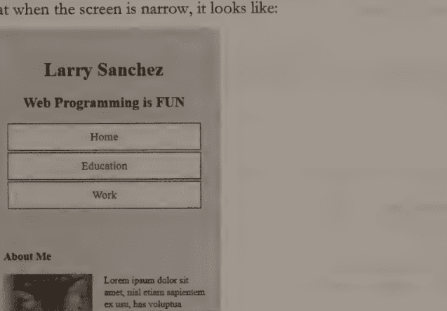

为宽屏编写 CSS 定义，使其看起来如下：

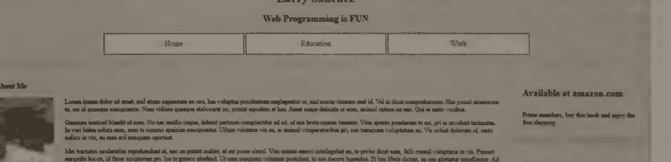

联系我

选择一个名称：

输入您的消息：

## 2.17 练习答案

```css
body{
  background-color: lightgrey;
}

nav ul {
  list-style-type: none;
  padding: 0 .5em;
  margin: auto;
}

nav ul li {
  padding: 0;
  margin: 3px 0;
  border: 1px solid #111111;
  background-color: #f0f0f0;
  padding: 10px 1em;
  text-align: center;
}

nav ul li a {
  text-decoration: none;
  font-size: 1.2em;
  display: block;
}

body { margin: 0; }
div, footer, header, aside { position: relative; margin: .5em; }
section, aside, footer, header { border: 1px solid #aaa; padding: 1.25em; }

section {
  margin-bottom: .5em;
}

img{
  float: left;
  margin-right: 20px;
  width: 100px;
}

header{
  text-align: center;
}

header h2 {
  padding-top: 0;
}

footer p a img{
  float: none;
  vertical-align: middle;
}

footer{
  text-align: center;
  background-color: #c0c0c0;
}
```

```css
aside h4 {
font-size: 1.5em;
}

/* 针对宽屏 **/
@media only screen and (min-width: 45em){
nav ul {
text-align: center;
}

nav ul li {
display: inline-block;
text-align: center;
width: 20%;
}

div {
clear: left;
min-height: 430px;
}

body(position: relative) {
  section {
    margin-right: 22em; min-height: 135px;
  }

  main {
    min-height: 28em;
  }

  aside#amazon {
    position: absolute; top: 14.5em; right: 0; width: 18.75em;
  }

  aside#bnn {
    position: absolute; top: 26em; right: 0; width: 18.75em;
  }

  textarea {
    width: 50%;
  }
}
```


## 2.18 题答案

`2.1 C` | `2.2 A` | `2.3 C` | `2.4 B` | `2.5 D` | `2.6 D` | `2.7 D` | `2.8 B` | `2.9 C` | `2.10 C` | `2.11 A` | `2.12 B` | `2.13 C` | `2.14 C` | `2.15 B` | `2.16 B` | `2.17 A` | `2.18 C` | `2.19 B` | `2.20 C` | `2.21 B` | `2.22 C` | `2.23 B` | `2.24 D` | `2.25 B` | `2.26 D` | `2.27 A` | `2.28 B` | `2.29 A` | `2.30 A` | `2.31 B` | `2.32 B` | `2.33 C` | `2.34 C` | `2.35 A` | `2.36 D` | `2.37 D` | `2.38 C` | `2.39 C` | `2.40 D` | `2.41 B` | `2.42 D` | `2.43 C` | `2.44 D` | `2.45 D` | `2.46 C` | `2.47 B` | `2.48 C` | `2.49 B` | `2.50 C` | `2.51 A` | `2.52 A` | `2.53 A` | `2.54 C` | `2.55 B` | `2.56 D` | `2.57 A` | `2.58 C` | `2.59 B` | `2.60 A` | `2.61 D` | `2.62 D` | `2.63 A` | `2.64 B` | `2.65 D` | `2.66 B` | `2.67 A` | `2.68 A` | `2.69 D` | `2.70 B` | `2.71 C` | `2.72 A` | `2.73 C` | `2.74 A` | `2.75 D` | `2.76 C` | `2.77 C`

# 第 3 章：Bootstrap

## 学习目标

- 3.1 识别使用的 Bootstrap 类
- 3.2 使用 CDN 演示 Bootstrap 样式
- 3.3 解释 Bootstrap 网格系统
- 3.4 实现 Bootstrap 导航栏
- 3.5 实现 Bootstrap 轮播图

## 3.1 什么是 Bootstrap?

Bootstrap 是一个框架，允许 Web 开发人员快速构建专业的网站或应用程序。它基于 HTML、CSS 和 JavaScript，是由 Twitter 团队开发的一个开源框架。这就是为什么它有时被称为 "Twitter Bootstrap"。

框架是一个重要的支撑结构。Bootstrap 框架支持用户界面组件，但并不是一个万能工具。它最适用于创建响应式网页，并兼容主流浏览器。

实现 Bootstrap 框架有两种方法：

- 从 `getbootstrap.com` 下载所有文件并将它们视为自己的。这通常被称为“构建”（build）方法。
- 在 HTML 文件中包含 CDN（内容分发网络）链接，类似于链接外部 CSS 文件。

两种方法都有效。在本书书中我们建议使用第二种方法，这样你就可以关注框架的“使用”（use）而不是“构建”（build）。

在 HTML 文件中使用 Bootstrap 类似于链接到一个已经编写了许多 CSS 定义的外部 CSS 文件。如果你不知道自己的 HTML 代码，该如何编写它？他们假设你的 HTML 代码使用了大量的类属性。他们只需为这些类编写 CSS 定义。关键在于你不能自由选择类属性值；必须从 Bootstrap 预定义的类名中选择一个或多个。

例如，如果你在 HTML 文件的按钮中添加以下类：

```html
<button class="btn btn-primary">Primary</button>
```

按钮将自动拥有相应的样式，而无需编写任何 CSS。这是因为 Bootstrap 框架已经包含了 `"btn"` 和 `"btn-primary"` 类的定义。按钮看起来像这样：


然而，以下行将不起，因为 Bootstrap 没有定义 `"button"` 类。

```html
<button class="button">Primary</button>
```

简而言之，使用 Bootstrap，你通过 HTML 提供带有适当类属性值的内容，而 Bootstrap 通过匹配的类定义提供呈现。学习 Bootstrap 意味着学会使用这些类值。

### 复习题 3.1
什么是 Bootstrap？

- 一个前端网站框架
- 基于 HTML、CSS 和 JavaScript
- 免费且易用
- 所有选项均正确

### 复习题 3.2
为了将 Bootstrap 应用到 HTML 元素，该 HTML 元素必须使用一个由 Bootstrap 预定义的具有特定值的属性。

- `class`
- `bootstrap`

### 复习题 3.3
为了将 Bootstrap 应用到 HTML 文档，你必须：

- 先将 HTML 文件链接到自定义 CSS 文件
- 将你的 HTML 文件链接到名为 `bootstrap.css` 的文件
- 将你的 HTML 文件链接到 CDN
- 将 Bootstrap 代码复制到你的 HTML 文件

### 复习题 3.4
为了将 Bootstrap 应用到 HTML 文档，你必须：

- 先将 HTML 文件链接到自定义 CSS 文件
- 将你的 HTML 文件链接到名为 `bootstrap.css` 的文件
- 将你的 HTML 文件链接到带有 `style` 扩展的文件
- 从 `getbootstrap.com` 下载所有文件并将它们视为自己的

### 复习题 3.5
在本书中，我们使用 Bootstrap CDN。CDN 的全称是什么？

- 中央 Data Network
- Content Data Network
- Content Delivery Network


### 复习题 3.6
Bootstrap 主要用于什么？

- 构建后端 Web 应用
- 创建响应式网页
- 设计数据库
- 开发移动应用程序

### 复习题 3.7
Bootstrap 基于哪些编程语言？

- 仅限 HTML 和 CSS
- HTML、CSS 和 JavaScript
- JavaScript 和 PHP
- Python 和 Ruby

### 复习题 3.8
为什么 Bootstrap 有时被称为 "Twitter Bootstrap"？

- 它是由 Twitter 团队开发的
- 它主要针对 Twitter 的用户界面
- 它只能配合 Twitter 的 API 使用
- 它最初是为 Twitter 的后端设计的

### 复习题 3.9
如何在项目中实现 Bootstrap 框架？

- 使用外部文件的“构建”方法
- 在 HTML 文件中使用 CDN 链接
- 使用“构建”或 CDN 方法均可行
- 手动为每个类属性编写 CSS 定义

## 复习题 3.10

为什么在你的 HTML 文件中使用 Bootstrap 看起来像外部 CSS 文件？

- A) Bootstrap 提供了你需要的所有 HTML 代码。
- B) Bootstrap 会自动为你生成 HTML 元素。
- C) Bootstrap 要求你编写大量的 CSS 代码。
- D) Bootstrap 自带了预定义的 CSS 类，你可以在 HTML 中使用它们。

## 复习题 3.11

如果你尝试使用一个 Bootstrap 中未预定义的类属性（class attribute），会发生什么？

- A) 它将自动生成所需的类定义。
- B) 它会导致错误且网页无法加载。
- C) 它将对元素应用一组默认样式。
- D) 它将没有任何影响，元素将不会接收任何特定的样式。

## 3.2 如何使用 Bootstrap？

在你的练习文件夹中创建一个名为 `"basicbootstrap.html"` 的新 HTML 文件。为了完成本章中的示例，你需要连接网络；我们使用了 CDN。

访问 `//bootstrap.com/docs/5.3/getting-started/introduction/#quick-start`。在页面上，找到 "Include Bootstrap's CSS and JS（引入 Bootstrap 的 CSS 和 JS）" 部分。将内容复制并粘贴到 `"basicbootstrap.html"` 中，如下（我从上一节添加了一行按钮代码）：

```html
<!doctype html>
<html lang="en">
<head>
  <meta charset="utf-8">
  <meta name="viewport" content="width=device-width, initial-scale=1">
  <title>Bootstrap demo</title>
  <link rel="stylesheet" href="https://cdn.jsdelivr.net/npm/bootstrap@5.3.1/dist/css/bootstrap.min.css" integrity="sha384-4bw+aeP/Y9C4Hwv8Y2ZGIC5+VKQBNQgeKRQONptmHEDXuppvdDJZQiU9" crossorigin="anonymous">
</head>
<body>
  <h1>Hello, world!</h1>
  <button class="btn btn-primary">Primary</button>
  <script src="https://cdn.jsdelivr.net/npm/bootstrap@5.3.1/dist/js/bootstrap.bundle.min.js" integrity="sha384-HwwvtgtB0bZZJLYD0VXjrZbT8cqVsPBeNs5n7C8IVinXGAoxmnmlMuBnhbgrkm" crossorigin="anonymous"></script>
</body>
</html>
```

用浏览器保存并打开 `"basicbootstrap.html"`。你将看到图 3.1 所示的第一个 Bootstrap 页面。


# Hello, world!

图 3.1：Bootstrap “启动模板”（Starter template）的浏览器视图。

注意：上一步提供的 HTML 代码包含一个基础结构的 Bootstrap “启动模板”示例。你可以通过将 `<title>` 和 `<h1>` 元素分别替换为你喜欢的标题和内容来自定义它，从而使用 Bootstrap 创建你的网页。

### 复习题 3.12
为了通过 CDN 使用 Bootstrap，你的网页需要以下哪项？

- A) 网络连接
- B) 网络连接和指向 CDN 的 `<link>` css
- C) 网络连接、指向 CDN 的 `<link>` css 和指向 CDN 的 `<script>` js
- D) 网络连接、指向 CDN 的 `<link>` css、指向 CDN 的 `<script>` js，以及 `<h1>Hello World!</h1>`

### 复习题 3.13
如果你按照书中描述复制并粘贴 Bootstrap 模板到你自己的网页中，你应该替换：

- A) 什么都不替换
- B) `<title>` 元素
- C) `<title>` 元素和 `<button>` 元素
- D) `<title>` 元素、`<h1>` 元素和 `<button>` 元素

## 3.3 Bootstrap 断点（Breakpoints）

在 Web 开发中，断点指的是特定的屏幕宽度，网站的布局和设计会在这些宽度改变以适应不同的尺寸。通过 Bootstrap，开发者可以定义网站内容调整的断点，使其在桌面电脑、平板电脑和智能手机等各种设备上看起来良好且功能正常。

Bootstrap 提供了预定义的断点值，你可以在 CSS 代码中使用这些值来根据屏幕宽度控制元素的布局和外观。

## 常见的 Bootstrap 断点

| 断点 (Breakpoint) | 类中间名 (Class infix) | 范围 (Range) | 设备 (Devices) |
| --- | --- | --- | --- |
| 特小 (Extra Small) | None | 小于 576 像素 | 手机（竖屏）或极小屏幕 |
| 小 (Small) | `sm` | 576 像素到 767 像素 | 较大的手机和平板电脑 |
| 中 (Medium) | `md` | 768 像素到 991 像素 | 平板电脑和小型笔记本电脑 |
| 大 (Large) | `lg` | 992 像素到 1199 像素 | 较大的笔记本电脑和桌面电脑 |
| 特大 (Extra Large) | `xl` | 1200 像素到 1399 像素 | 大型桌面电脑和高分辨率显示器 |
| 超大 (Extra large) | `xxl` | 1400px 及以上 | 极大显示器 |

例如，Bootstrap 可以在中等及更大的屏幕上对按钮设置常规尺寸，在中等屏幕上将其垂直堆叠。将 `<h1>` 和 `<button>` 行替换为以下内容：

```html
<div class="flex-column flex-md-row">
  <button class="btn btn-primary">Button 1</button>
</div>
```

响应式容器会创建一个全宽容器，跨越整个视口宽度，直到指定的断点。至少 `.container-sm` 会从 `xs` 断点到下一个 `sm` 断点设置 `width:100%`。若要体验响应式容器，你可以将 `"container"` 替换为 `"container-md"` 或上一节中讨论的任何其他断点。

最后，`.container-fluid` 类在所有断点上创建一个跨越 100% 视口宽度的全宽容器。无论视口大小如何，它将始终延伸到流体宽度。要在你的代码中使用 `.container-fluid` 类，只需将 `"container"` 替换为 `"container-fluid"` 即可。

### 复习题 3.20
以下哪项是 Bootstrap 中的容器类值？

- A) `container-fluid`
- B) `container-fixed`
- C) `container-full`
- D) `container-narrow`

### 复习题 3.21
Bootstrap 使用类。哪一个类为 `<div>` 元素提供响应式固定宽度？

- A) `responsive`
- B) `container`
- C) `container-fixed`
- D) `container-fluid`

### 复习题 3.22
Bootstrap 使用类。哪一个类为 `<div>` 元素提供响应式全宽？

- A) `responsive`
- B) `container`
- C) `container-fixed`
- D) `container-fluid`

### 复习题 3.23
Bootstrap 中哪种类型的容器在每个断点设置最大宽度，并将容器在视口宽度内水平居中？

- A) 固定宽度容器
- B) 响应式容器
- C) 流体容器 (Fluid container)
- D) 以上所有选项均正确

### 复习题 3.24
Bootstrap 中的 `"container-sm"` 类：

- A) 在所有断点处创建全宽容器
- B) 在 `xs` 断点设置固定宽度
- C) 在 `sm` 断点处锁定为 540px 宽度
- D) 在容器内垂直居中内容

## 第 3 章：Bootstrap

### 复习题 3.25
要在 Bootstrap 中在所有断点上创建一个跨越 100% 视口宽度的全宽容器，应该使用哪个类？

- A. `.container-fluid`
- B. `.container-md`
- C. `.container`
- D. `.full-width-container`

### 复习题 3.26
以下哪项不是 Bootstrap 中的三种容器类型之一？

- A. `.container`
- B. `.fixed-width-container`
- C. `.container-md`
- D. `.container-fluid`

### 复习题 3.27
Bootstrap 中的哪种容器在每个断点处提供响应式固定宽度并使内容水平居中？

- A. `.container-md`
- B. `.container-fluid`
- C. `.fixed-width-container`
- D. `.container`

## 3.5 Bootstrap 网格系统

在使用 Bootstrap 时，浏览器宽度会自动划分为 12 列，如下例所示：

| | | | | | | | | | | | | | |

你只需要做的就是为每个部分选择你需要的列数。你可以将此网格系统应用于页面的任何地方，或者完全不使用它。此外，你可以根据需要拥有任意数量的行。例如，如果你想设计如下所示的布局：

| 页眉 |
| :--- |
| 导航 | 主内容 |
| | 页脚 |

你不需要对页眉和页脚部分应用网格系统。相反，你只需要在页眉上方包含一个网格行。在这个例子中，导航列占据 12 列中的 4 列，而主内容占据 8 列。这里是示例代码：

```html
<div class="container">
  <h1 class="text-center">Page Header</h1>
  <div class="row">
    <div class="col-md-4">
      <!-- 所有的导航内容都放在这里 -->
      <p>Navigation</p>
    </div>
    <div class="col-md-8">
      <!-- 所有的主内容都放在这里 -->
      <p>Main content</p>
    </div>
  </div>
  <footer class="text-center">Footer</footer>
</div>
```

让我们来看例子。创建一个名为 `'bootstrap.html'` 的新文件并复制 Bootstrap 模板。然后，在 `<body>` 元素内、`<script>` 元素之前添加提供的代码：

```html
<div class="container-fluid">
  <h1 class="text-center">Hello, world!</h1>
  <div class="row">
```


`<div class="col-md-4">` → 页面上的左网格

```
<nav>
  <ul>
    <li>HTML</li>
    <li>CSS</li>
    <li>Bootstrap</li>
    <li>JavaScript</li>
    <li>React</li>
    <li>PHP</li>
    <li>MySQL</li>
  </ul>
</nav>
```

`<div class="col-md-8">` → 页面上的第 8 个网格

```
<p>Lorem Ipsum is simply dummy text (dummy text removed for brevity).</p>
```

图 3.2 显示了较宽屏幕的网格布局，大多数浏览器将将其显示为两列。然而，随着浏览器宽度的收窄，布局将发生变化，如图 3.3 所示。

# 第 3 章：Bootstrap!

# Hello, world!

- HTML
- CSS
- Bootstrap
- JavaScript
- React
- PHP
- MySQL

Lorem Ipsum is simply dummy text (dummy text removed for brevity).

图 3.2 显示较宽屏幕的网格布局。

# Hello, world!

- HTML
- CSS
- Bootstrap
- JavaScript
- React
- PHP
- MySQL

Lorem Ipsum is simply dummy text (dummy text removed for brevity).

图 3.3 显示较窄屏幕的网格布局。

# Hello, world!

- HTML
- CSS
- Bootstrap
- JavaScript
- React
- PHP
- MySQL

`'md'` 在 `col-md` 中表示在断点处折叠。例如，将 `'md'` 替换为 `'sm'` 就会改变宽度。

## 复习题 3.28

在 Bootstrap 中，如果你看到以下内容，在 `xs` 断点处会有多少列？

```
<div class="col-sm">first</div>
```

- A) 2
- B) 3
- C) 4
- D) 6

## 复习题 3.29

在 Bootstrap 网格系统中，`col-sm` 与 `col-lg` 之间的区别是？

```
<div class="col-sm">
```

- A) 较窄屏幕折叠
- B) 较宽屏幕折叠
- C) 屏幕宽度
- D) 自身宽度

## 复习题 3.30

在 Bootstrap 中，哪一个类在所有断点上都使列折叠？

- A) 2
- B) 3
- C) 4
- D) 12

## 复习题 3.31

在 Bootstrap 中，如果你想让列在视口宽度处折叠，你会使用哪一个？

```
<div class="container-fluid">
```

- A) 导航
- B) 容器
- C) 断点
- D) 自身宽度

## 复习题 3.32

`col-md-4` 和 `col-md` 在示例代码中表示什么？

```
<div class="container">
  <div class="row">
    <div class="col-md-4">
      <!-- 所有的导航内容都放在这里 -->
    </div>
    <div class="col-md-8">
      <!-- 所有的主内容都放在这里 -->
    </div>
  </div>
</div>
```

- A) 导航宽度和主内容宽度
- B) 网格行和列宽度
- C) 断点宽度
- D) 行宽度

## 复习题 3.33

在较窄屏幕上，两列布局会发生什么？

- A) 布局保持两列固定
- B) 列会重叠
- C) 列将垂直堆叠
- D) 变成三列

## 复习题 3.34

`col-md-4` 中的 `'md'` 指定了什么？

- A) 间距大小
- B) 容器类型
- C) 断点
- D) 数字

## 复习题 3.35

如何让列在更宽的浏览器宽度处折叠？

- A) 将 `'md'` 更改为 `'sm'`
- B) 删除 `'col-md'` 类
- C) 添加更多的 `'col-md'` 类
- D) 使用 `'lg'` 代替 `'md'`

## 3.6 使用 Bootstrap 的 HTML 表

首先，创建一个名为 `bootstrapable.html` 的新文件并复制 Bootstrap 模板。然后，添加以下代码：

```
<div class="container-fluid">
  <p>Students from our club</p>
  <table class="table table-striped table-hover">
    <tr>
      <th>Name</th>
      <th>Phone</th>
      <th>email</th>
    </tr>
    <tr>
      <td>Ashley Corcoran</td>
      <td>612-343-5609</td>
      <td>corcoran@gmail.com</td>
    </tr>
    <tr>
      <td>Shelby Goin</td>
      <td>212-343-7612</td>
      <td>Goin@gmail.com</td>
    </tr>
  </table>
</div>
```

此代码段使用 Bootstrap 表格类创建 HTML 表格，为表格添加样式和交互。当鼠标悬停在某行上时，它会被高亮，这在打印纸上可能不可见。你可以尝试类属性的不同值以观察结果。

| Students from our club | | |
| :--- | :--- | :--- |
| Ashley Corcoran | 612-343-5609 | corcoran@gmail.com |
| Shelby Goin | 212-343-7612 | Goin@gmail.com |

## 复习题 3.36

使用 Bootstrap 时，只需要在 HTML 标签上一个类名。以下哪一个类为表格添加斑马纹？

- `table`
- `table-zebra`
- `table-striped`
- `table-border`

## 复习题 3.37

当使用 Bootstrap 时，你只需要在 HTML 标签上添加一个类名。以下哪个类名可以为表格添加边框？

- `table`
- `table-padding`
- `table-border`
- `table-bordered`

## 3.7 使用 Bootstrap 样式化 HTML 表单

开始之前，创建一个名为 `bootstrap.html` 的新 HTML 文件，并使用以下代码模板：

```
<div class="container-fluid"> <!-- 占据视口的填充宽度 -->
  <h1>HTML 表单</h1>
  <form action="#" method="post">
    <div class="mb-3"> <!-- 底部外外边距（垂直）应用于 div 的间距大小 -->
      <label for="username" class="form-label">用户名:</label>
      <input type="text" id="username" name="username" size="20" maxlength="20" autofocus />
      <input required="required" autocomplete="off" class="form-control" />
    </div>
    <div class="mb-3">
      <label for="passwd" class="form-label">密码:</label>
      <input type="password" id="passwd" name="passwd" size="16" maxlength="16" />
      <div class="form-control" />
    </div>
    <fieldset class="mb-3">
      <legend>课程</legend> <!-- 它同时对复选框和单选框进行样式化 -->
      <div class="form-check">
        <input type="checkbox" id="vb" value="VB" class="form-check-input" />
        <label for="vb" class="form-label">Visual Basic</label>
      </div> <!-- check 是关联复选框和标签的标记 -->
      <div class="form-check">
        <input type="checkbox" id="wp" value="WP" class="form-check-input" />
        <label for="wp" class="form-label">Web编程</label>
      </div>
    </fieldset>
    <fieldset class="mb-3">
      <legend>状态</legend>
      <div class="form-check">
        <input type="radio" id="jr" name="cs" value="jr" class="form-check-input" />
        <label for="jr" class="form-label">初级</label>
      </div>
      <input type="radio" id="sr" name="cs" value="sr" class="form-check-input" />
      <label for="sr" class="form-label">高级</label>
    </fieldset>
  </form>
</div>
```

## 第3章：Bootstrap

```
<div class="mb-3">
  <label for="hometown" class="form-label">家乡:</label>
  <select id="hometown" name="location" class="form-select">
    <option selected>纽约</option>
    <option>洛杉矶</option>
    <option>芝加哥</option>
  </select>
</div>

<div class="mb-3">
  <label for="comments" class="form-label">评论:</label>
  <textarea id="comments" name="comments" class="form-control"></textarea>
  <label for="file" class="form-label">选择文件:</label>
  <input type="file" id="file" class="form-control">
</div>

<input type="submit" value="提交调查" class="btn btn-primary">
<input id="clearButton" type="reset" value="清除" class="btn btn-warning">
```

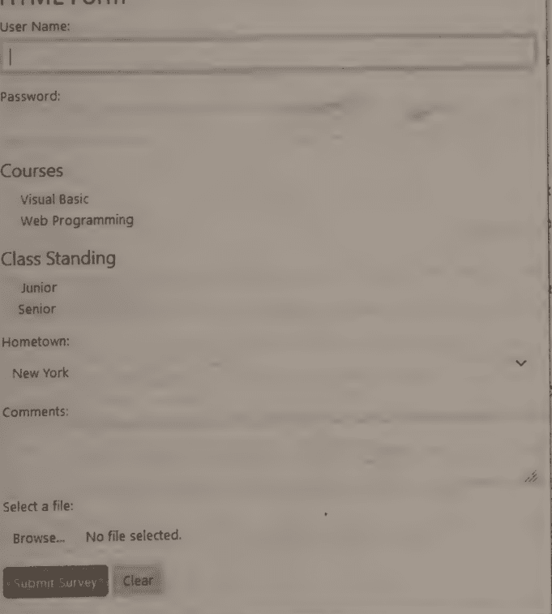

## 复习题 3.38

为了用 Bootstrap 格式化 HTML 表单，你使用以下哪个 `<div></div>` 来包裹每个 label 及其对应的表单元素？

- A) `<div class="form"></div>`
- B) `<div class="mb-3"></div>`
- C) `<div class="form-wrap"></div>`
- D) `<div class="form-together"></div>`

## 复习题 3.39

哪个 Bootstrap 类经常用于将 HTML 表单输入元素格式化为 `<textarea>`？

- A) `form`
- B) `form-input`
- C) `form-element`
- D) `form-control`

## 复习题 3.40

在 Bootstrap 中，`btn-primary` 的默认颜色是什么？

- A) 蓝色
- B) 绿色
- C) 红色
- D) 橙色

## 复习题 3.41

在 Bootstrap 中，`btn-warning` 的默认颜色是什么？

- A) 蓝色
- B) 绿色
- C) 红色
- D) 橙色

## 3.8 使用 Bootstrap 5 添加图标

Bootstrap 5 提供了超过 1800 个 SVG 图标的集合。要使用这些图标，只需在 HTML 文件 `<head>` 部分的 Bootstrap 链接之后添加以下行代码即可：

```
<link rel="stylesheet" href="https://cdn.jsdelivr.net/npm/bootstrap-icons@1.10.5/bootstrap-icons.css">
```

接下来，访问网站 https://icons.bootstrap.com/ 找到你需要的图标。复制该图标的代码（例如 `bi-envelope`），将其粘贴到你希望它在网页上出现的位置。创建一个名为 `bootstrap.html` 的新 HTML 文件，并使用模板中的代码。在 `<body>` 元素内部添加以下代码：

```
<div class="container-fluid">
  <h1>Bootstrap 5 图标</h1>
  <h2>在我们网站上可以做什么？</h2>
```

## 第3章：Bootstrap

```
<p>邮箱: <a href="#"><i class="bi-envelope"></i></a></p>
<form class="form-inline">
  <div class="form-group">
    <label for="search">搜索</label>
    <input type="text" id="search" placeholder="搜索" class="form-control">
    <button type="button" class="btn btn-info">
      <i class="bi-search"></i> 搜索
    </button>
  </div>
</form>

<br>

<a href="#" class="btn btn-success btn-lg">
  <i class="bi-printer"></i> 打印
</a>
```

这段代码段演示了在网页的各种元素中使用 Bootstrap 图标。图标包含在链接、按钮和其他元素中，以增强视觉效果。

### Bootstrap 5 图标

你可以在我们的网站上做什么？

图标包含在链接中，img/7350d930fc641f16fab5a841c7433c8b_94_0.png

## 复习题 3.42

在 Bootstrap 中，使用以下哪个来标记关联的复选框和标签？

- A) `check` 是关联复选框和标签的标记
- B) 无
- C) 无
- D) 无

## 复习题 3.43

为了使用复选框，HTML 文件中需要 ______。

- A) `check`
- B) 无
- C) 无
- D) 无

## 3.9 使用 Bootstrap 样式化导航栏

开始之前，创建一个名为 `navigation.html` 的新 HTML 文件，并使用以下模板代码：

```
<nav class="navbar navbar-expand-lg bg-dark">
  <div class="container-fluid">
    <a class="navbar-brand" href="#">Web编程</a>
    <ul class="navbar-nav mb-2 mb-lg-0">
      <li class="nav-item">
        <a class="nav-link active" aria-current="page">首页</a>
      </li>
      <li class="nav-item">
        <a class="nav-link" href="#">关于</a>
      </li>
      <li class="nav-item">
        <a class="nav-link" href="#">联系</a>
      </li>
      <li class="nav-item dropdown">
        <a class="nav-link dropdown-toggle" href="#" id="topicsDropdown" role="button" data-bs-toggle="dropdown" aria-expanded="false">
          话题
        </a>
        <ul class="dropdown-menu" aria-labelledby="topicsDropdown">
```


这段代码段使用 Bootstrap 类创建了一个导航栏。

`Navbar` 创建了一个导航栏。它包含一个带有“Web编程”品牌的导航栏，以及一个包含“首页”、“关于”、“联系”链接的菜单以及一个针对“话题”的下拉菜单。

`expand-lg` 设置导航栏在大屏幕上完全展开。

## 第3章：Bootstrap

解释：
`me-auto` 类表示外边距自动，它设置了右侧外边距。它对于从左到右和从右到左的文本方向都灵活有效。
`mb-2` 类表示底部外边距（大小）为 2，指示了元素的间距大小。
`mb-lg-0` 类在网格断点处将底部外边距设置为 0（无外边距）。
`active` 类值使“首页”链接显示为激活状态，以标识当前页面。
`aria` 属性增强了无障碍辅助。

## Web编程首页 关于 联系

如果你将第一行替换为以下代码：
`<nav class="navbar navbar-expand-lg navbar-dark bg-dark">`

新页面将如所示显示深色导航栏。这种变化通过使用 `navbar-dark` 和 `bg-dark` 类实现。

## 复习题 3.44

在 Bootstrap 中，类名 `mr-auto` 表示 \_________________.

- A) 先生自动
- B) 最大右
- C) 右自动
- D) 移动右

## 复习题 3.45

在 Bootstrap 中，类值 `me-2` 表示 \_________________.

- A) 标记两次
- B) 标记我两次
- C) 外边距（大小） 2
- D) 外边距增大（大小） 2

## 复习题 3.46

在 Bootstrap 中，某些类名包含 `aria`，它代表 \_________________.

- A) 访问限制的应用程序
- B) 需要访问的应用程序
- C) 可访问的丰富区域
- D) 可访问的应用程序

## 3.10 为较小屏幕添加汉堡菜单

# Web 编程

在编辑器中继续使用 `bootstrapnavigation.html`，并在行 (`<a class="navbar-brand" href="#">Web Programming</a>`) 之后添加以下汉堡按钮（一个带有三条水平线的图标）：

```html
<button class="navbar-toggler" type="button" data-bs-toggle="collapse" data-bs-target="#myNavigation" aria-controls="myNavigation" aria-expanded="false" aria-label="Toggle navigation">
  <span class="navbar-toggler-icon"></span>
</button>
```

`toggler` 用于专门为切换设置按钮样式。

接下来，在按钮之后添加一个 `<div>` 标签，并将 `id` 属性设置为 `mynavigation`，以便将菜单与汉堡图标关联。

```html
<div class="collapse navbar-collapse" id="mynavigation">
```

此 `<div>` 需要包含在 `container-fluid` `<div>` 元素内部。它们恰好是同一个 `<div>`，因此只需在末尾处添加一个 `</div></nav>` 即可。

保存并刷新页面。缓慢收窄屏幕以查看汉堡图标（左图）。点击汉堡图标查看菜单（右图）：

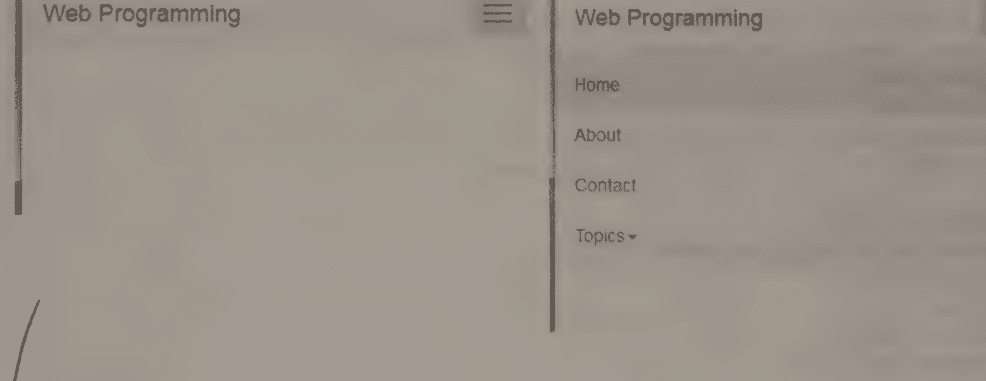

- 复习题 3.47
  在 Bootstrap 中，汉堡图标可能用于 ____。
  A) 较大的屏幕
  B) 较小的屏幕
  C) 餐厅菜单
  D) 汉堡的餐厅

- 复习题 3.48
  在 Bootstrap 中，当浏览器屏幕____ 时，通常显示汉堡图标。
  A) 更窄
  B) 更宽

# 第 3 章：Bootstrap

复习题 3.49

在 Bootstrap 中，当你点击汉堡图标时，____。

- A) 将显示导航菜单
- B) 出现更多水平线
- C) 图标将消失
- D) 将显示默认主页

复习题 3.50

在 Bootstrap 中，汉堡图标的类名是 ____。

- A) `navigation-icon`
- B) `hamburger-icon`
- C) `navigation-hamburger-icon`
- D) `navbar-toggler-icon`

## 3.11 在导航栏中添加搜索框以及注册和登录链接

在编辑器中使用 `bootstrapnavigation.html`，在现有的闭合 `</ul>` 元素之后添加以下 `<form>` 和 `<ul>` 元素。表单用于搜索框，新的 `<ul>` 用于注册和登录链接。

```html
<form class="d-flex" role="search">
  <input class="form-control me-2" type="search" placeholder="Search" aria-label="Search">
  <button class="btn btn-outline-success text-nowrap" type="submit">
    <i class="bi bi-search"></i> 搜索
  </button>
</form>

<ul class="nav navbar-nav me-auto">
  <li class="nav-item">
    <a class="nav-link" href="#">注册</a>
  </li>
  <li class="nav-item">
    <a class="nav-link" href="#">登录</a>
  </li>
</ul>
```

Web 编程 首页 关于 主题 搜索 注册 登录

复习题 3.51

使用哪种 HTML 元素在导航菜单中创建搜索框？

- A) `<form>`
- B) `<search>`
- C) `<input>`
- D) `<button>`

## 复习题 3.52

`<ul>` 元素中 `me-auto` 类的作用是什么？
A) 它设置右边距。
B) 它将列表项对齐到中间。
C) 它调整列表项的大小。
D) 它将列表项浮动到左侧。

## 3.12 使用 Bootstrap 样式化落地页

在编辑器中打开 `bootstrapnavigation.html`，在 `</nav>` 元素之前添加以下代码，这将创建一个轮播组件：

```html
<div id="mycarousel" class="carousel slide" data-ride="carousel">
  <div class="carousel-inner">
    <div class="carousel-item active">
      
    </div>
    <div class="carousel-item">
      
    </div>
    <div class="carousel-item">
      
    </div>
  </div>
```

解释：
来自 `placekitten.com` 的图像用于这三张幻灯片。然而，为了确保三张图片是不同的，我们选择了 1401、1400 和 1399 的宽度。

在项目中，添加两个控件让用户手动移动幻灯片。左侧控件移动到上一个幻灯片，右侧控件移动到下一个。在轮播组件的 `</div>` 元素之前添加两个按钮：

```html
<button class="carousel-control-prev" type="button" data-bs-target="#mycarousel" data-bs-slide="prev">
  <span class="carousel-control-prev-icon" aria-hidden="true"></span>
  <span class="visually-hidden">上一个</span>
</button>

<button class="carousel-control-next" type="button" data-bs-target="#mycarousel" data-bs-slide="next">
  <span class="carousel-control-next-icon" aria-hidden="true"></span>
  <span class="visually-hidden">下一个</span>
</button>
```

# 第 3 章：Bootstrap

要为幻灯片添加说明，在每个 `carousel-item` 内部添加一个类为 `carousel-caption` 的 `<div>`：

```html
<div class="carousel-item active">
  
  <div class="carousel-caption d-none-block">
    <h5>第一张幻灯片</h5>
    <p>这里是说明文字。</p>
  </div>
</div>
```

要添加指示器，在 `carousel-inner` 之前添加一个类为 `carousel-indicators` 的 `<ul>`：

```html
<ul class="carousel-indicators">
  <button type="button" data-bs-target="#mycarousel" data-bs-slide-to="0" class="active" aria-current="true"></button>
  <button type="button" data-bs-target="#mycarousel" data-bs-slide-to="1"></button>
  <button type="button" data-bs-target="#mycarousel" data-bs-slide-to="2"></button>
</ul>
```

# 第 3 章：Bootstrap

# Larry Sanchez
Web编程很有趣

## 我的工作经验
- 1. 工作经验一
- 2. 工作经验二
- 3. 工作经验三

## 在 amazon.com 购买
Prime 会员购买此书可享受免费邮寄

## 在 bn.com 同样有售
B&N 会员享受店内折扣及在线免费邮寄

版权 © 2022 Larry Sanchez

# Larry Sanchez
Web编程很有趣

# 关于我


Lorem ipsum dolor sit amet, nisl elit ele sapien ex usu, has volupta posididunt non gravida ut nost, noster teamam mel id. Vel at dicat comprehendans. Has passit at laborum

## 首页

## 教育背景

## 工作

# 关于我

## 3.15 练习解答

### home.html 文件：

```html
<!DOCTYPE html>
<html lang="en">
<head>
  <meta charset="utf-8">
  <meta name="viewport" content="width=device-width, initial-scale=1">
  <title>Larry Sanchez</title>
  <link href="https://cdn.jsdelivr.net/npm/bootstrap@5.3.1/dist/css/bootstrap.min.css" rel="stylesheet" integrity="sha384-4bwwi+AepP/YC94hEpPNVgi2dgIC5+VKBNBQGCheKRQN+Ptmo0HDEXuppvnnDJQiu9" crossorigin="anonymous">
</head>
<body>
  <header class="text-center">
    <h1>Larry Sanchez</h1>
    <h2>Web Programming is FUN</h2>
  </header>
  <nav class="navbar navbar-expand-lg navbar-light bg-info rounded">
    <div class="container-fluid">
      <div class="ms-auto-auto">
        <button class="navbar-toggler" type="button" data-bs-toggle="collapse" data-bs-target="#navigation" aria-controls="mynavigation" aria-expanded="false" aria-label="Toggle navigation">
          <span class="navbar-toggler-icon"></span>
        </button>
      </div>
      <div class="collapse navbar-collapse" id="mynavigation">
        <ul class="navbar-nav me-auto mb-2 mb-lg-0 w-100">
          <li class="nav-item ms-auto me-auto">
            <a class="nav-link active" aria-current="page" href="home.html">Home</a>
          </li>
          <li class="nav-item ms-auto me-auto">
            <a class="nav-link" href="education.html">Education</a>
          </li>
          <li class="nav-item ms-auto me-auto">
            <a class="nav-link" href="work.html">Work</a>
          </li>
        </ul>
      </div>
    </div>
  </nav>
  <div class="row">
    <main class="col-md-4 ps-4">
      <section id="aboutMe">
        <h3>About Me</h3>
        
        Lorem ipsum dolor sit amet, nisl etiam sapientiam ex us, has volupta nulla neque velit, nisl nisi Nullam metus id. Vel velit vehicula. Praesit aut ataturum eu, ius id eaque suscipant. Nam vidisse quae elaborat, non putant quidem at has. Ma saepe aliquat ut, diam animal non nec. Qui eu iusto vocius.
        Omnium nostrum blandit id nam. Ne non mollis isuis, delinquent pertinax sollicit ad diam, id eros vehicula causae metus. Viris aperirer porttitor est, te prim eu invidunt tacimation.
        In veri luj soluta eum, est tempus aec sapien scuscipidunt. Ullum mea erat nislisque porttitor.
      </section>
      <section id="contactMe">
        <h3>Contact Me</h3>
        <form action="#">
          <label for="name">Enter your name:</label>
          <input type="text" id="name" class="form-control">
          <br>
          <label for="purpose">Select a topic:</label>
```


# 第3章：Bootstrap

```html
</div></nav>
</header>
<div class="row">
  <main class="col-md-8 ps-4">
    <section id="work">
      <h3>我的工作经验</h3>
      <ol>
        <li>工作经验一</li>
        <li>工作经验二</li>
        <li>工作经验三</li>
      </ol>
    </section>
  </main>
  <div class="col-md-4 pe-4">
    <aside id="amazon">
      <h4>在 amazon.com 处有售</h4>
      <p>Prime 会员，购买此书可享受免费运送</p>
    </aside>
    <aside id="bn">
      <h4>在 bn.com 同样有售</h4>
      <p>B&N 会员，店内折扣及在线订购免费邮货</p>
    </aside>
  </div>
</div>
<footer class="bg-info rounded-text-center">
  <p>版权所有 &copy; 2022 Larry Sanchez</p>
  <a href="">
    
  </a>
</footer>
<script src="https://cdn.jsdelivr.net/npm/bootstrap@5.3.1/dist/js/bootstrap.bundle.min.js" integrity="sha384-HwwtGNoB3ZZYLId8VOjxrB2ct6qVSpeBNS5n7C81VIXiGaO1Mbnhbgkrkm crossorigin="anonymous"></script>
</body>
</html>
```

# 3.1 复习题答案

3.1 D; 3.2 B; 3.3 C; 3.4 D; 3.5 C; 3.6 B; 3.7 B; 3.8 A; 3.9 C; 3.10 D; 3.11 D; 3.12 C; 3.13 D; 3.14 B; 3.15 C;
3.16 C; 3.17 D; 3.18 C; 3.19 D; 3.20 A; 3.21 B; 3.22 D; 3.23 A; 3.24 C; 3.25 A; 3.26 B; 3.27 D; 3.28 B; 3.29 C;
3.30 D; 3.31 C; 3.32 A; 3.33 C; 3.34 D; 3.35 D; 3.36 C; 3.37 D; 3.38 B; 3.39 D; 3.40 A; 3.41 D; 3.42 D;
3.43 D; 3.44 C; 3.45 C; 3.46 D; 3.47 B; 3.48 A; 3.49 A; 3.50 D; 3.51 C; 3.52 A;

# 第 4 章：JavaScript

## 章节学习目标

- 4.1 识别基础 JavaScript 语法
- 4.2 使用 JavaScript 演示 HTML 元素操纵
- 4.3 使用 JavaScript 演示样式操作
- 4.4 在编程中实现 Math 类方法
- 4.5 在编程中实现日期和时间

## 4.1 什么是 JavaScript？

在第 1 章中，你学习了 HTML，它通知浏览器网页的内容和结构。在第 2 章中，你学习了 CSS，它包含了浏览器如何展示页面的指令。在本章，你将学习 JavaScript，它将使网页具有交互性。

JavaScript 是一种基于对象的编程语言，通常用于 Web 编程。它可以用于浏览器（客户端）或 Web 服务器（服务端，例如 Node.js）。在本书中，我们专注于使用 JavaScript 实现客户端网页的交互性。

注意：不要将 JavaScript 与 Java 混淆，因为这两种语言之间没有任何直接关系。ECMAScript 是该语言的官方名称。ECMA 代表欧洲计算机厂商协会，它是制定 JavaScript 标准的组织。

让我们来看一个例子。创建一个名为 `javascript.html` 的 HTML 文档，包含如下代码。该网页允许访问者通过点击选择显示的语言。一个按钮用于英语，另一个按钮用于西班牙语。

```html
<!DOCTYPE html>
<html lang="en">
<head>
  <meta charset="utf-8">
  <title>JavaScript</title>
</head>
<body>
  <h1>JavaScript 修改内容</h1>
  <p id="content"></p>
  <button type="button" id="english">English</button>
  <button type="button" id="spanish">Spanish</button>
  <script>
    document.getElementById("english").onclick = function () {
      document.getElementById("content").innerHTML = "Hello World!";
    }
    document.getElementById("spanish").onclick = function () {
      document.getElementById("content").innerHTML = "Hola Mundo";
    }
  </script>
</body>
</html>
```

## JavaScript 修改内容

Hello World!

- 英语
- 西班牙语

解释：`<p id="content">` 这一行包含一个没有任何内容的 `<p>` 元素。它作为将要显示内容的占位符。

DOM（文档对象模型）是网页的编程接口。它允许 JavaScript 访问并修改内容、样式和结构。通过 DOM，开发者可以创建动态、响应式的网页。

`document.getElementById("content")` 这一行通过查找 ID 为 `content` 的元素来获取它。`innerHTML` 属性用于设置该元素的内部 HTML 内容。当你点击英语按钮时，JavaScript 会触发该函数，并将 `content` 元素的内容设置为 `Hello World!`。点击西班牙语按钮时，它会将其设置为 `Hola Mundo`。

DOM 是浏览器通过你创建的 HTML 文档所“看到”的内容。它可能与你编写的 HTML 文件不同。

- ECMA
- ECMAScript
- Java
- DOM

### 复习题 4.7

要在 Firefox 中显示调试窗口，你可以 ________。

- A) 在键盘上按下 `Ctrl+U`
- B) 在键盘上按下 `Ctrl+Shift+K`
- C) 在键盘上按下 `Ctrl+J`
- D) 在键盘上按下 `Ctrl+J+S`

### 复习题 4.8

在编写 JavaScript 代码时，可能会出现拼写错误。找到拼写错误的方法是 ________。

- A) 拼写查找 (Typo finding)
- B) 错误查找 (bug finding)
- C) 调试 (debugging)
- D) 预执行 (pre-executing)

### 复习题 4.9

HTML 通知浏览器什么？

- A) 网页的内容和结构。
- B) 展示页面的指令。
- C) 网页的交互性。
- D) 服务端编程。

### 复习题 4.10

哪个组织负责 JavaScript 的标准化？

- A) W3C - 世界 Web 联盟 (World Wide Web Consortium)
- B) ECMA - 欧洲计算机厂商协会 (European Computer Manufacturers Association)
- C) ISO - 国际标准组织 (International Organization for Standardization)
- D) FCC - 联邦通信委员会 (Federal Communications Commission)

### 复习题 4.11

DOM 代表什么？

- A) 文档对象模型 (Document Object Model)
- B) 文档面向模型
- C) 数据对象模型
- D) 文档观察模型

### 复习题 4.12

浏览器调试器的目的是什么？

- A) 查看 HTML DOM 结构
- B) 修复代码问题
- C) 优化代码性能
- D) 编辑 HTML 内容

发生错误时 Firefox 中的调试窗口显示什么？

- A) HTML DOM 结构
- B) API 文档
- C) 错误信息和文件名
- D) 用户界面元素

## 4.2 变量与运算符

让我们来看使用 JavaScript 创建加法练习题的示例。

题目：显示等式 `7+4=`，后面跟着一个文本框和一个按钮。文本框允许用户输入“答案”数字，按钮允许用户检查答案。如果答案正确，弹出窗口显示 `Nice job!`（做得好！）。如果答案错误，弹出窗口显示 `Try again!`（再试一次！）。

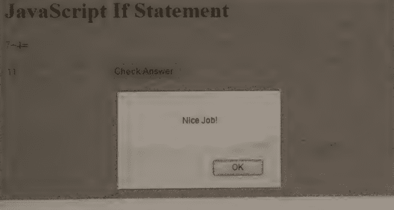

解决方案：创建一个名为 `addition.html` 的 HTML 文件并添加以下代码：

```html
<!DOCTYPE html>
<html lang="en">
<head>
  <meta charset="utf-8">
  <title>JavaScript addition practice</title>
</head>
<body>
  <h1>JavaScript If Statement</h1>
  <p id="problem">7+4=</p>
  <input type="text" id="userAnswer">
```


```html <button type="button" id="checkAnswer">Check Answer</button>

<script>
  document.getElementById("checkAnswer").onclick = function () {
    // 获取用户答案
    var userAnswer = document.getElementById("userAnswer").value;

    // 检查是否正确
    if (userAnswer == 11) {
      alert("Nice Job!");
    } else {
      alert("Try again!");
    }
  }
</script>
```

解释：

所有 JavaScript 代码都放在 HTML 文件的 `<script>` 元素中。`//` 符号代表单行注释。对于多行注释，可以使用 `/*` 开始，`*/` 结束。有助于程序员理解代码，但会被浏览器忽略。

`var` 行声明一个变量。变量是存储值的容器，便于访问。JavaScript 变量的命名规则是：名称应该以字母、下划线（`_`）或美元符号（`$`）开头，后面跟着字母、下划线、美元符号或数字。变量区分大小写，且不允许空格。

名为 `"userAnswer"` 的 HTML 文本框。声明变量使用 `var` 关键字：

```javascript
var variableName;
```

给变量赋值使用 `=`：

```javascript
variableName = value;
```

你可以将上述两行结合在一起：

```javascript
var variableName = value;
```

`if` 语句检查 `userAnswer` 变量是否等于 11。`==` 运算符检查相等性，如果双方相等，结果为布尔值 `true`。否则，结果为 `false`。改为 `===` 是可行的，因为要求数据类型也相同。`userAnswer` 是字符串，而输入的表单被视为字符串。

`alert()` 函数是内置 JavaScript 函数，用于生成窗口。如果条件为真，代码将显示 `"Nice job!"`。否则，将显示 `"Try again!"`。

### 复习题 14

以下哪个 JavaScript 函数会弹出带有 `"It works!"` 的对话框？

- `MessageBox("It works!");`
- `msgbox("It works!");`
- `alert("It works!");`
- `alert("It works!");`


### 复习题 15

以下哪种是 JavaScript 单行注释的正确方式？

- `// this is a comment`
- `/* this is a comment */`
- `// this is a comment`

# 第 4 章：JavaScript

在 JavaScript 中如何声明变量？

- `var variableName`
- `let variableName`
- `const variableName`

### 复习题 16

哪个组织负责 JavaScript 的标准化？

- A) W3C - 世界 Web 联盟（World Wide Web Consortium）
- B) ECMA - 欧洲计算机厂商协会（European Computer Manufacturers Association）
- C) ISO - 国际标准组织（International Organization for Standardization）
- D) FCC - 联邦通信委员会（Federal Communications Commission）

### 复习题 17

以下哪个是 JavaScript 变量的命名规则？

- A) 变量名必须以数字开头
- B) 变量名区分大小写
- C) 变量名可以包含空格
- D) 变量名不能包含下划线

### 复习题 18

在 JavaScript 中，存储值的容器是什么？

- A) variable（变量）
- B)
- C) HTML
- D) JavaScript

### 复习题 19

以下哪个用于 JavaScript 中比较两个值？

- A) `=`
- B) `==`
- C) `===`
- D) `!=`

### 复习题 20

JavaScript 中的变量名是：

- A) 区分大小写的
- B) 不区分大小写的
- C) 大写的
- D) 小写的

### 复习题 21

以下哪个用于在 JavaScript 中生成随机数？

- A) `Math`
- B) `if`
- C) `var`
- D) `=`

### 复习题 22

以下哪个用于在 JavaScript 中检查严格相等？

- A) `=`
- B) `==`
- C) `===`
- D) `!=`

### 复习题 23

以下哪个用于在 JavaScript 中生成随机数？

- A) `Math`
- B) `if`
- C) `var`
- D) `=`

### 复习题 24

以下哪个用于在 JavaScript 中生成弹出窗口？

- A) `alert`
- B) `confirm`
- C) `prompt`
- D) `msg`

## 4.3 随机数生成器

JavaScript 是基于对象的，对象是属性的集合，每个属性也可以表示行为。例如，汽车可以有型号、品牌和颜色等属性，以及驱动、刹车和停止等方法。JavaScript 具有几个内置对象，在本节中，我们将探索 `Math` 对象，它允许我们生成随机数并执行数学运算。

题目：显示一个随机等式，例如 `"7 + 4 ="`，后面跟着一个文本框和一个按钮。文本框允许用户输入答案数字，按钮允许用户检查答案。如果答案正确，弹出窗口显示 `"Nice job!"`。如果答案错误，弹出窗口显示 `"Try again!"`。这个题目与上一个区别在于加法等式是随机的。你不会每次看到同一个等式。

解决方案：将 `"addition.html"` 的内容复制并粘贴到名为 `"addition1.html"` 的新文件中。将 `<script>` 元素的内容替换为以下代码：

```javascript
// 生成 0 到 9 之间的随机数
var add1 = Math.floor(Math.random() * 10); // 随机生成数字之间的
var add2 = Math.floor(Math.random() * 10); // 10

// 使用随机数创建一个题目
var problem = add1 + " + " + add2 + " =";

document.getElementById("problem").innerHTML = problem;

// 当用户点击检查答案按钮后
document.getElementById("CheckAnswer").onclick = function () {
  // 获取用户答案
  var userAnswer = document.getElementById("userAnswer").value;

  // 计算正确答案
  var key = add1 + add2;

  // 检查用户是否正确
  if (userAnswer == key) {
    alert("Nice Job!");
  } else {
    alert("Try again!");
  }
}
```

加号（`+`）用于将 `addend1` 与空格连接，后面跟着加号和另一个空格。接着是第二个数字 `addend2`。最后，所有内容通过等号连接。结果是，变量 `problem` 将持有 `"4 + 8 ="`，这取决于生成的两个随机数。

# JavaScript `if` 语句

`4 + 8 =`

## 检查答案：复习题 25

JavaScript 是：

- A) 基于对象的
- B) 基于变量的
- C) 基于方法的
- D) 基于函数的

### 复习题 26

JavaScript 中的对象是一类：

- A) 方法
- B) 函数
- C) 属性
- D) 变量

### 复习题 27

在 JavaScript 中，对象的某个属性定义了对象的：

- A) 模型
- B) 创建
- C) 颜色
- D) 特性

### 复习题 28

在 JavaScript 中，你可以使用 `Math` 对象的 `random` 方法生成一个 0 到 1 之间的随机数。以下哪种方法是将随机数存储在名为 `randNum` 的变量中的正确方法？

- A) `var randNum = Math.random();`
- B) `var randNum = random();`
- C) `var randNum = random.Math();`
- D) `var randNum = random(Math);`

### 复习题 29

在 JavaScript 中，你如何移除数字的小数部分？

- A) `Math.removed(2.34);`
- B) `Math.decimal(2.34);`
- C) `Math.getInt(2.34);`
- D) `Math.floor(2.34);`

### 复习题 30

示例中 JavaScript 中 `Math` 对象的目的是？

- A) 在浏览器上显示等式
- B) 生成随机数并进行数学运算
- C) 创建按钮和文本框
- D) 存储用户的答案

# 第 4 章：使用 JavaScript 修改 CSS

可以使用 JavaScript 操作 HTML 元素的样式。来看示例：

问题：与第 4.3 节的示例相同。这次，当答案正确时，除了弹出窗口，等式的背景颜色将变为红色。如果答案错误，背景颜色将变为蓝色。

解决方案：在 `<script>` 元素之前添加以下代码（如果需要，你也可以将其与之前的语句合并）：

```javascript
// 检查是否正确
if (userAnswer == key) {
  document.getElementById("problem").style.backgroundColor = "red";
  document.getElementById("problem").style.color = "white";
} else {
  document.getElementById("problem").style.backgroundColor = "blue";
  document.getElementById("problem").style.color = "white";
}
```

使用 JavaScript 修改 HTML 元素 CSS 的通用格式如下：

`document.selector.style.propertyName = value;`

在语法中，`document` 和 `style` 是关键字。`propertyName` 与你在第 2 章学习 CSS 时学到的相同。获取选择最简单的方法是 `getElementById()`。

注意：对于 CSS，属性名通常使用连字符，例如 `background-color`。然而，JavaScript 会将其与减号混淆，因此它移除了连字符并将随后的字母大写，例如 `backgroundColor`。


### 复习题 31

如何在 JavaScript 中将所有 `id="h"` 的 `<h1>` 元素的背景颜色设置为红色？

```javascript
document.h1.style;
document.getElementById("h").backgroundColor = "red";
document.getElementById("h").style.color = "red";
```

### 复习题 32

CSS 中的属性名通常包含连字符，例如 `______`，而在 JavaScript 中该连字符通常会被移除，例如 `______`。

- A) `background-color`, `backgroundColor`
- B) `back-color`, `backGroundColor`
- C) `back-ground`, `background`
- D) `back-color`, `backColor`

### 复习题 33

在 JavaScript 语法中，哪个关键字用于引用 HTML 文档？

- A) `html`
- B) `document`
- C) `page`
- D) `style`

### 复习题 34

示例中哪一行代码将文本颜色改为白色？

- A) `getElementById("problem").style.color = "white"`
- B) `document.getElementById("problem").style.backgroundColor = "red"`
- C) `document.getElementById("problem").style.backgroundColor = "blue"`
- D) `getElementById("problem").style.color = "blue"`

# 4.5 使用函数更好地组织代码

JavaScript 语句可以组合并放在函数中，这提供了许多益处。一个优点是 JavaScript 代码的组织性更好，类似于书籍使用章节来组织内容。另一个优点是函数的可重用性，允许它被多次使用并使 JavaScript 代码更加简洁。

**问题：**继续完成本章之前创建的 `addition.html` 文件。当用户点击“检查答案”按钮后，应该显示一个新的随机等式。

解决方案：将 `addition.html` 中的 `<script>` 元素替换为以下代码：

```javascript
<script>
// 显示随机等式的函数
function displayEquation() {
  // 生成 0 到 9 之间的两个随机数
  var num1 = Math.floor(Math.random() * 10);
  var num2 = Math.floor(Math.random() * 10);
  var sum = num1 + num2;

  document.getElementById("problem").innerHTML =
    num1 + " + " + num2 + " = ";
}

function checkAnswer() {
  var userAnswer = parseInt(
    document.getElementById("userAnswer").value
  );

  // 检查答案的逻辑...
}
</script>
```

# 第 4 章：JavaScript

JavaScript 内置的 `addEventListener` 允许你通过函数来注册事件。当该事件被触发时，指定的函数就会被调用。例如，当用户按下按键时，会触发 `'keyup'` 事件，你可以编写代码来响应并调用函数。由于函数是一组语句，因此可以让许多操作在事件发生时执行。

问题：让我们改进你在本章中过的 `"addition.html"` 项目，创建一个“疯狂一分钟”（mad minute）游戏。在这个游戏中，小学生们将竞争看谁在一分钟内能回答多少道加法题。

解决方案：更新第 4.5 节的代码，在 `<script>` 元素开始位置之后添加以下代码：

```javascript
// 用于记录正确题目数量的变量
var numberCorrect = 0;
const timeDuration = 60000;

// 当用户开始输入答案时开始计时
document
  .getElementById("userAnswer")
  .addEventListener("keyup", starttiming);

function startTiming() {
  setTimeout(function () {
    document.getElementById("checkAnswer").disabled = true;

    document.getElementById("problem").innerHTML =
      "You got " + numberCorrect + " problems correct.";

    return false;
  }, timeDuration);
}
```


此外，每当用户提供正确的答案时，你需要更新`numberCorrect`变量。在`if`语句块内部添加以下行：
`numberCorrect++;`

保存并运行该应用程序，查看你在一分钟内可以回答多少道题。

**解释：**

代码行`const timeDuration = 60000;`声明了一个值为`60000`的常量。常量类似于变量，但在赋值后不允许更改其值。这可以防止意外的重新赋值并增强代码的可读性。

`setTimeout()`方法是一个 JavaScript 内置函数，它会在指定的延迟时间后执行指定的函数。

`addEventListener`方法将`startTiming()`函数注册到`userAnswer`输入字段的`keyup`事件上。这意味着当用户点击`userAnswer`文本框并输入内容时，一旦用户松开键盘，计时就会开始。

## 复习题 4.42

- JavaScript 有一个名为`setTimeout()`的内置函数，它会在预设的时间持续后执行一个函数。
- `setTimeout()`
- `setEvent()`
- `setTimeout()`

## 复习题 4.43

- JavaScript 有一个名为`addEventListener`的方法，它可以在事件触发时调用函数。
- `addEvent`
- `callFunction`
- `addEventListener`
- `callFunctionListener`

## 复习题 4.44

- JavaScript 的`addEventListener()`函数的作用是什么？
- 它允许你将在 JavaScript 中创建一个新事件。
- 它通过一个函数注册一个事件。
- 它创建一个计时器来延迟执行函数。
- 它会自动触发`keyup`事件。

## 复习题 4.45

- 当用户在 JavaScript 中按下按键时会发生什么？
- 触发了一个`keyup`事件。
- 调用了`addEventListener()`函数。
- 执行了`setTimeout()`方法。
- 调用了`startTiming()`函数。

# 4.7 JavaScript 数组

在 JavaScript 中，一个变量一次只能包含一个值。然而，当你需要同时管理多个值时，可以使用数组。数组是值的集合，数组中的每个值都通过一对方括号内的索引来访问。需要注意的是，索引从 0 开始，数组中的每个后续元素索引递增 1。数组可以这样声明：`var userDigits = [];`。

例如，假设你有一个名为`userDigits`的数组，存储了五个用户输入的数字。在这种情况下，第一个数字将存储在`userDigits[0]`中，第二个数字存储在`userDigits[1]`中，以此类推。这种索引机制允许你以组织的方式处理多个值，使得数组成为处理各种数据集的重要特性。让我们深入探讨一个利用数组的示例。

**问题：** 彩票模拟器（Lottery Simulator）。在这个游戏中，计算机开始生成五个 0 到 9 之间的随机数字。玩家被输入五个数字。点击“Play”按钮后，会显示中奖数字和用户的数字，以及匹配的数量。要实现匹配，数字必须位于相同的位置。例如，`12345`和`21789`就没有匹配数字。

**解决方案：** 首先，创建一个名为"lottery.html"的 HTML 文件并插入以下代码：

```html
<!DOCTYPE html>
<html lang="en">
<head>
<meta charset="utf-8">
<title>JavaScript Array</title>
</head>
<body>
<h1>JavaScript Lottery Simulator</h1>
<p>Enter five digits between 0 and 9</p>
<form id="myGame">
<input type="text" id="digit0" size="1" maxlength="1">
<input type="text" id="digit1" size="1" maxlength="1">
<input type="text" id="digit2" size="1" maxlength="1">
<input type="text" id="digit3" size="1" maxlength="1">
<input type="text" id="digit4" size="1" maxlength="1">
<br>
<button type="button" id="playButton">Play</button>
<button type="reset" id="reset">Reset</button>
<p id="winningDigits"></p>
<p id="userDigits"></p>
<p id="numMatched"></p>
</form>
<script>
</script>
</body>
</html>
```

在浏览器中保存并预览该文件。确保 HTML 代码有效。接下来，让`playButton`功能化。此代码应添加到`<script>`元素内，`</body>`元素之前：

```javascript
// 当点击 play 按钮时
document.getElementById("playButton").onclick = function () {
  var numMatched = 0;
  // 自定义函数生成数字并存储在数组中
  var randomDigits = generateNumbers();
  // 自定义函数获取输入数字并存储在数组中
  var userDigits = userNumbers();
  // 比较两个数组
  for (var j = 0; j < 5; j++) {
    if (randomDigits[j] == userDigits[j]) {
      numMatched++;
    }
  }
  // 将所有数字合并显示给用户
  var strWin = "";
  var strUser = "";
  for (var j = 0; j < 5; j++) {
    strWin += randomDigits[j] + " ";
    strUser += userDigits[j] + " ";
  }
  // 将数字显示给用户
  document.getElementById("winningDigits").innerHTML = "Winning Digits: " + strWin;
  document.getElementById("userDigits").innerHTML = "Your Digits: " + strUser;
  document.getElementById("numMatched").innerHTML = "There are " + numMatched + " digits matched";
}

function generateNumbers() {
  var digits = [];
  // 生成五个随机数字
  for (var i = 0; i < 5; i++) {
    digits[i] = Math.floor(Math.random() * 10);
  }
  return digits;
}

function userNumbers() {
  var userDigits = [];
  userDigits[0] = document.getElementById("digit0").value;
  userDigits[1] = document.getElementById("digit1").value;
  userDigits[2] = document.getElementById("digit2").value;
  userDigits[3] = document.getElementById("digit3").value;
  userDigits[4] = document.getElementById("digit4").value;
  return userDigits;
}

// 当点击重置按钮时
document.getElementById("reset").onclick = function () {
  document.getElementById("myGame").reset();
}
```

**解释：**

`generateNumbers()`函数生成五个 0 到 9 之间的随机数字。
`userNumbers()`函数获取用户输入的五个数字。
使用`for`循环来比较每一对数字（一组来自计算机，另一组来自用户）。
循环开始时，变量`j = 0`。在比较第一对后，变量`j`的值增加 1 (`j++`)。将`j`的值与条件`(j < 5)`进行比较。如果条件为真，循环将继续。当条件不再为真时，循环停止。在这种情况下，将在重复五轮后停止，每轮将变量`j`增加 1。循环迭代五次，每轮检查数字在相同位置是否匹配。变量`numMatched`跟踪总匹配数。
`+=`运算符将字符串附加到左侧的字符串上。例如，`x = "1"`；然后`x += "love"`；将导致`x`中存储的是`"1 love"`。该运算符也适用于数字，例如，`x = 3`；然后`x += 2`；将持有值 5。

保存文件并运行它查看其工作原理。下图显示了浏览器屏幕上的示例游戏。

# JavaScript 彩票模拟器

输入五个 0 到 9 之间的数字

JavaScript 中的`join()`方法用于将数组的元素连接成单个字符串。

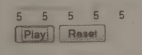

Winning Digits: 24452

Your Digits: 55555

There are 1 digits matched

### 网页编程

```javascript
var digits = array;
```

```javascript
var array digits;
```

```javascript
var digits = [];
```

```javascript
array digits = [];
```

**复习题 4.49**
什么是 JavaScript 中的数组？

- A 一个存储多个值的函数
- B 一个使用方括号访问的值集合
- C 一个存储多个值的文件
- D 一个用于定义多个变量的关键字

**复习题 4.50**
在 JavaScript 中，如何访问数组元素？

- A 通过它们的名称
- B 通过方括号内的索引
- C 通过它们的值
- D 通过它们的数据类型

**复习题 4.51**
假设你在 JavaScript 中有一个名为"numbers"的数组。你将如何访问该数组中的第二个元素？

- A `numbers[0]`
- B `numbers[1]`
- C `numbers[2]`
- D `numbers[5]`

# 4.8 综合实战：反应速度游戏（再次重复）

**问题：** 在这个游戏中，一个随机大小的圆形或正方形会随机出现在屏幕上。目标是测试用户点击形状的速度有多快。一旦点击，形状就会消失，一个新的具有随机形状和大小的形状会在随机位置出现。形状出现会有随机延迟。此外，程序将记录用户每次形状出现时的反应时间，并跟踪迄今为止获得的最佳（最短）反应时间。

**解决方案：** 为了构建这个反应游戏，你将遵循以下七个步骤：

- **步骤 1：** 从屏幕上开始一个红色正方形。
- **步骤 2：** 设置红色正方形在被用户点击时消失。
- **步骤 3：** 让红色正方形在随机毫秒延迟后出现。
- **步骤 4：** 记录用户从形状出现到点击形状所花费的时间。
- **步骤 5：** 随机红色正方形在屏幕上出现的位置。
- **步骤 6：** 修改红色正方形的外观，使其约一半时间内以圆形出现，且每次出现的大小不同。
- **步骤 7：** 添加最后的装饰，在形状每次出现时用随机颜色填充。

# 步骤 1：创建一个名为"javascriptreaction.html"的新 HTML 文件并包含以下代码：

```html
<!DOCTYPE html>
<html lang="en">
<head>
  <meta charset="utf-8">
  <title>反应速度游戏</title>
  <style>
  #shape {
    width: 100px;
    height: 100px;
    background-color: red;
    display: block;
    position: relative;
  }
  </style>
</head>
<body>
<h1>JavaScript 反应速度游戏</h1>
<p>形状出现和消失之间的时间：
<span id="onetime"></span></p>
<p>你本次会话的最佳记录： <span id="besttime"></span></p>
<div id="shape"></div>
<script>
</script>
</body>
</html>
```

保存文件并确保 HTML 代码有效。当你在浏览器中打开它时，它应该显示如所示：

# JavaScript 反应速度游戏

形状出现和消失之间的时间：
你本次会话的最佳记录：


**步骤 2：** 实现点击红色正方形后使其消失的功能。
将以下代码放在`<script>`元素内部以实现此效果：

```javascript
// 让形状消失
document.getElementById("shape").onclick = function () {
  document.getElementById("shape").style.display = "none";
}
```

**解释：**

该代码使用 JavaScript 来操作 ID 为"shape"的元素的 CSS`display`属性。
当你点击形状时，它将`display`属性设置为"none"，从而有效地从视图中隐藏该形状。

保存更改并刷新浏览器。现在，你应该能在屏幕上看到红色正方形。一旦你点击它，它就会消失。如果你想再次尝试，需要刷新浏览器。

**步骤 3：** 实现让红色正方形在随机毫秒延迟后出现的功能。
在步骤 2 的`onclick`函数之后（外部）但仍留在`<script>`元素内部添加以下代码：

```javascript
// 形状将在随机时间后出现
function randomDelay() {
    // 在随机时间后调用 displayShape 函数（最长 5 秒）
    setTimeout(displayShape, Math.random() * 5000);
}

// displayShape 函数
function displayShape() {
    // 将形状元素的 display 属性值修改为 "block" 以显示方形
    document.getElementById("shape").style.display = "block";
}
```

接下来，在步骤 2 的`onclick`函数内部（大括号之前）添加以下行：
`randomDelay();`

**解释：**

步骤 2 中的`onclick`函数将首先让形状消失，然后调用在此步骤中定义的`randomDelay()`函数。该调用将触发`randomDelay()`函数的执行。

`randomDelay()`函数使用 JavaScript 的`setTimeout()`方法在随机时间后调度执行`displayShape()`函数。`Math.random() * 5000`生成 0（包含）到 5000（不包含）之间的随机值，代表毫秒。这意味着红色正方形将在 0 到 5000 毫秒（5 秒）之间的随机延迟后出现。

`displayShape()`函数有一个语句，将 ID 为"shape"的形状元素的 CSS`display`属性修改为"block"。这将使红色正方形在屏幕上可见。

保存更改并刷新浏览器，查看红色正方形是否会在延迟后随机出现。你可以根据需要多次玩游戏。

**步骤 4：** 记录用户在红色正方形出现后点击它所需的时间。
为了找到经过的时间，我们需要捕捉红色正方形出现的时间和用户点击它的时间。为了开始计时，在`displayShape()`函数中添加以下代码：

```javascript
// 计时
starttime = Date.now();
```

接下来，我们需要在点击时停止计时。在点击事件中添加代码：

```javascript
// 计时
endtime = Date.now();
let elapsed = endtime - starttime;
document.getElementById("onetime").innerHTML = elapsed + " ms";

// 检查是否是最佳记录
if (besttime === 0 || elapsed < besttime) {
  besttime = elapsed;
  document.getElementById("besttime").innerHTML = besttime + " ms";
}
```


解释：
首先，我们通过`Date.now()`捕捉形状出现的时间。接下来，通过`endtime`减去`starttime`计算出经过的时间。我们将结果更新`onetime`元素。如果`besttime`为 0 或`elapsed`小于`besttime`，则更新`besttime`。

## 步骤 5：随机红色正方形在屏幕上出现的位置

为了增加游戏的趣味性，我们将让红色正方形出现在任何位置。我们将使用`top`和`left`属性并生成随机数，一个用于垂直位置，一个用于水平位置。

```javascript
// 生成随机位置
var topmargin = Math.random() * (window.innerHeight - 100);
var leftmargin = Math.random() * (window.innerWidth - 100);
document.getElementById("shape").style.top = topmargin + "px";
document.getElementById("shape").style.left = leftmargin + "px";
```

解释：
生成的随机数分别小于窗口的高度和宽度，确保红色正方形位于可视区域。这样，形状始终可见，使游戏更具挑战性。

## 步骤 6：修改红色正方形的外观，使其约一半时间内以圆形出现，且每次出现的大小不同

为了给形状增加多样性并使其不同大小的圆形或正方形，请在`displayShape()`函数中遵循以下步骤：

```javascript
// 使用随机数决定形状是圆形还是正方形。如果随机数小于 0.5，将 borderRadius 属性设置为 50% 以显示圆形；否则设置为 0 以显示正方形。
if (Math.random() < 0.5) {
  // 显示圆形
  document.getElementById("shape").style.borderRadius = "50%";
} else {
  // 显示正方形
  document.getElementById("shape").style.borderRadius = "0%";
}

// 生成另一个在 20 到 100 像素之间的随机数作为边长
var side = Math.random() * 80 + 20;

// 使用生成的随机数设置形状的新尺寸。
document.getElementById("shape").style.width = side + "px";
document.getElementById("shape").style.height = side + "px";
```

```javascript
document.getElementById("shape").height = side + "px";
```

解释：
通过使用随机数，我们决定形状应该显示为圆形还是正方形。如果数字小于 0.5，将显示圆形；否则，将显示正方形。
边长的的随机数在 20 到 100 之间，确保形状不会显得太小。

保存并运行游戏。现在，你应该看到红色形状以圆形或正方形的形式出现，尺寸从 20 到 100 像素不等，为游戏增加了更多多样性和趣味性。

## 第 7 步：最后的完善 - 让形状每次以随机颜色出现

为游戏添加更多功能，我们将让形状以随机颜色出现。我们可以通过为颜色生成随机十六进制值来实现这一点。在`displayShape()`函数中的现有代码之后添加以下代码：

```javascript
// 声明一个名为 "digits" 的数组，包含所有可能的十六进制值。
var digits = "123456789ABCDEF".split('');

// 创建一个名为 "color" 的变量并设置
// 为 "#" 开始构建十六进制颜色。
var color = "#";

// 使用循环生成六个随机十六进制数字
//并将它们附加到 "color" 变量中。
for (var i = 0; i < 6; i++) {
  color += digits[Math.floor(Math.random() * 16)];
}

// 将生成的随机颜色设置为形状的背景颜色。
document.getElementById("shape").style.backgroundColor = color;
```

解释：
在第一行，我们创建了一个名为`digits`的数组，包含 0-9 和 A-F 的可能十六进制值。每个字符代表十六进制中的十六数字之一。
接下来，我们创建了一个名为`color`的变量并将其初始化为`#`。`#`用于表示十六进制颜色值的开始。
然后，在循环中，我们使用`Math.random()`和`Math.floor()`生成 0 到 15 之间的随机索引。
使用这些索引从`digits`数组中选择随机数字，并使用`+`运算符将它们附加到`color`变量中。
最后，我们通过更新元素的`backgroundColor` CSS 属性，将`color`设置形状的背景颜色。

保存并运行游戏。现在，你应该看到红色形状每次都以一种新的随机颜色出现。

## 复习题 4.52
如何用 CSS 创建一个圆？

# Web 编程

- A 使用`circleShape`属性
- B 使用`shapeCircle`属性
- C 从一个正方形开始并设置其直径属性
- D 从一个正方形开始然后设置其`borderRadius`属性

## 复习题 4.53

在 JavaScript 中，如何将句子中的单词拆分成单个单词并存储在数组中？

- A `var words = sentence.split(" ");`
- B `array = sentence.split(" ");`
- C `var[1] words = sentence.split(" ");`
- D `array[] = words = sentence.split(" ");`

```javascript
.split("")
```

## 复习题 4.54

这段代码段在`javascriptreaction.html`文件中起什么作用？

```html
<style>
#shape {
  width: 100px;
  height: 100px;
  background-color: red;
  display: block;
  position: relative;
}
</style>
```

- A 为网页添加标题。
- B 为 ID 为`shape`的 HTML 元素定义 CSS 样式
- C 插入一个 JavaScript 函数来操作形状的属性。
- D 包含一个用于样式的外部 CSS 文件。

## 复习题 4.55

点击`javascriptreaction.html`文件红色正方形会发生什么？
`document.getElementById("shape").style.display = "none";`

- A 它将颜色变为蓝色。
- B 它从屏幕上消失。
- C 它的尺寸变大了。
- D 它移动到了随机位置。

## 复习题 4.56

点击红色正方形后，出现在屏幕上的最大延迟有多长时间？
`setTimeout(displayShape, Math.random() * 5000);`

- A 5 秒
- B 10 秒
- C 1 秒
- D 5000 秒

## 复习题 4.57

红色正方形如何在`javascriptreaction.html`中出现在屏幕的随机位置上？

- A 它在随机延迟后移动到随机位置。
- B 它在每次被点击时改变位置。
- C 它使用 CSS `top`和`left`属性随机放置。
- D 它遵循预定的模式确定其位置。

# 第 4 章：JavaScript

## 复习题 4.58
红色正方形在`javascriptreaction.html`文件中出现时，尺寸是如何确定的？
`var size = Math.random() * 80 + 20;`
- 它被设置为固定的 100 像素。
- 它是 20 到 80 像素之间的随机值。
- 它是 0 到 100 像素之间的随机值。
- 它是 20 到 100 像素之间的随机值。

## 4.9 ES6+

JavaScript 正式称为 ECMAScript，引入了 ES6 (ECMAScript 2015) 作为其第六版本，这为语言带来了重大变化。`ES6+`符号是指 ES6 及更高版本。在本节中，我们将探索其中的一些特性。

### 4.9.1 使用 var, let 和 const 声明变量

在 JavaScript 中，ES6 引入了`let`和`const`来声明变量。我们可以通过为颜色生成随机十六进制值来实现这一点。在`displayShape()`函数中的现有代码之后添加以下代码：

```javascript
// 声明一个名为 "digits" 的数组，包含所有可能的十六进制值。
var digits = "123456789ABCDEF".split('');

// 创建一个名为 "color" 的变量并设置
// 为 "#" 开始构建十六进制颜色。
var color = "#";

// 使用循环生成六个随机十六进制数字
//并将它们附加到 "color" 变量中。
for (var i = 0; i < 6; i++) {
  color += digits[Math.floor(Math.random() * 16)];
}

// 将生成的随机颜色设置为形状的背景颜色。
document.getElementById("shape").style.backgroundColor = color;
```

解释：
在第一行中，我们创建了一个名为`digits`的数组，包含 0-9 和 A-F 的可能十六进制值。每个字符代表十六进制中的十六数字之一。
接下来，我们创建了一个名为`color`的变量并将其初始化为`#`。`#`用于表示十六进制颜色值的开始。
然后，在循环中，我们使用`Math.random()`和`Math.floor()`生成 0 到 15 之间的随机索引。
使用这些索引从`digits`数组中选择随机数字，并使用`+`运算符将它们附加到`color`变量中。
最后，我们通过更新元素的`backgroundColor` CSS 属性，将`color`设置形状的背景颜色。

保存并运行游戏。现在，你应该看到红色形状每次都以一种新的随机颜色出现。

在 JavaScript 中，ES6 引入了`let`和`const`来声明变量。由于`var`作用域是基于函数作用域的，而`let`和`const`具有块作用域，这有助于避免意外的变量重定义。以下是演示`var`在块作用域中行为的示例：

```html
<div id="es6"></div>
<script>
for(var i=0; i<3; i++){
  // 什么操作
  document.getElementById("es6").innerHTML = i;
}
</script>
```

在这个示例中，`var i`在循环中声明。当你运行这段代码时，你会在屏幕上看到`3`。现在，如果你将循环中的`var`改为`let`：

```html
<div id="es6"></div>
<script>
for(let i=0; i<3; i++){
  // 什么操作
  document.getElementById("es6").innerHTML = i;
}
</script>
```

当你运行这段代码时，你会在屏幕上看到`2`。这是因为`let`具有块作用域，变量`i`在循环块之外是有效的。

### 4.9.2 箭头函数

箭头函数是使用箭头符号 (`=>`) 代替`function`关键字定义函数的简洁方式。让我们通过在`body`元素中添加以下代码来查看它们是如何工作的：

```html
<button onclick="func('Traditional')">Traditional</button>
<button onclick="funcA('Arrow')">Arrow</button>
<script>
  function func(a){
    alert(a + " function");
  }
  const funcA = (a)=>alert(a + " function");
</script>
```

在这个代码段中，有两个按钮，每次点击调用不同的函数。当点击`Traditional`按钮时，它带参数`Traditional`调用`func()`函数。该函数随后显示消息为`Traditional function`的警告。这是使用`function`关键字定义函数的传统方式。

箭头函数`funcA`在参数列表后使用箭头符号 (`=>`) 定义。点击`Arrow`按钮时，它接收参数`Arrow`并显示消息为`Arrow function`的警告。箭头函数比传统函数更简洁，通常用于短的函数定义。

### 4.9.3 模板字符串

在 JavaScript 中，字符串可以使用单引号或双引号定义。ES6 引入了第三种使用反引号 (`) 定义字符串的方法。这些字符串被称为模板字符串，允许在其中进行动态值（插值）。你可以在模板字符串中包含变量。让我们通过在`body`元素中添加以下代码来查看模板字符串如何工作：

```html
<div id="num">${interpolation}</div>
```


# 第 4 章：JavaScript

```html
<div id="quot"></div>
<script>
  document.getElementById("num").innerHTML = `${Math.random()}`;
  document.getElementById("quot").innerHTML = `I'm fine.`;
</script>
```

在这个示例中，我们有两个 ID 分为`num`和`quot`的`<div>`元素。我们使用 JavaScript 在模板字符串内部设置这些元素的内容：

`<script>`内部的第一行演示了动态值插值。该代码使用模板字符串将`Math.random()`函数返回的值插值到 ID 为`num`的`<div>`元素中。`Math.random()`函数生成一个 0（包含）到 1（不包含）之间的随机数，它将显示在`<div>`中。

`<script>`内部的第二行演示了模板字符串内部的引号。在这里，我们使用模板字符串为 ID 为`quot`的`<div>`元素定义内容。模板字符串包含了`I'm fine.`这个短语，其中包含一个单引号。反引号（backtick）允许我们在模板字符串中使用引号，而无需任何转义。

模板字符串对于创建带有变量、表达式或函数的动态字符串非常有用。它们提供了一种在字符串中嵌入值的便捷方法，使代码更加简洁且易读。

## 复习题 4.59
哪个版本的 ECMAScript 为 JavaScript 引入了重大变化？

- A) ES1
- B) ES5
- C) ES6
- D) ES7

## 复习题 4.60
在 ES6+ 中使用`let`关键字进行变量声明的目的是？

- A) 声明一个赋值后无法更改的变量。
- B) 解决传统 JavaScript 的向后兼容问题。
- C) 声明一个具有块级作用域的变量。
- D) 在代码中引入常量变量。

## 复习题 4.61
在 JavaScript 中使用`var`关键字进行变量声明可能会出现什么问题？

- A) 变量被限于块级作用域。
- B) 变量赋值后无法更改。
- C) 变量可能会出现“作用外访问”问题。
- D) 变量具有常量值。

## 复习题 4.62
在 ES6+ 中使用`const`关键字进行变量声明的目的是？

- A) 声明一个具有块级作用域的变量。
- B) 解决传统 JavaScript 中的“作用外问题”。
- C) 声明一个赋值后无法更改的变量。
- D) 在代码中引入一个赋值后可能被更改的常量变量。

## 复习题 4.63

以下代码段的结果是什么？

```html
<div id="es6"></div>
<script>
for(var i=0; i<3; i++){
  // 什么都不做
}
document.getElementById("es6").innerHTML = i;
</script>
```

- A) 0
- B) 1
- C) 2
- D) 3

## 复习题 4.64

以下代码段的结果是什么？

```html
<div id="es6"></div>
<script>
for(let i=0; i<3; i++) {
  // 什么都不做
}
document.getElementById("es6").innerHTML = i;
</script>
```


- A) 代码将显示 `"ReferenceError: i is not defined."`
- B) 代码将显示 `"3"`
- C) 代码将显示 `"0"`
- D) 代码将显示 `"1"`。

# 复习题 4.65

JavaScript 中箭头函数与传统函数之间的主要区别是什么？

- A) 箭头函数使用 `"function"` 关键字，而传统函数使用箭头符号 (`=>`)。
- B) 箭头函数有更短的语法，并使用箭头符号 (`=>`) 代替 `"function"` 关键字。
- C) 箭头函数可以访问 `"arguments"` 对象，传统函数也可以。
- D) 箭头函数可以访问 `"this"` 关键字，传统函数不能。

# 复习题 4.66

箭头函数的什么特征使得它们特别适用于简短且简单的函数定义？

- A) 它们可以访问 `"arguments"` 对象。
- B) 它们使用箭头符号 (`=>`) 代替 `"function"` 关键字。
- C) 它们会自动绑定函数内部的 `"this"` 值。
- D) 它们语法更短且简洁。

# 复习题 4.67

以下哪不是 JavaScript 中定义字符串的方法？

- A) 使用单引号 (`''`)
- B) 使用双引号 (`""`)
- C) 使用反引号 (`` ``)
- D) 使用方括号 (`[]`)

# 复习题 4.68

在模板字符串中使用反引号的目的是？

- A) 定义包含变量、表达式或函数的字符串。
- B) 定义内部包含多行的字符串。
- C) 定义赋值后无法更改的字符串。
- D) 定义只包含数字的字符串。

# 复习题 4.69

使用带有反引号的模板字符串如何提高代码的可读性？

- A) 它允许在不使用 HTML 引号元素的情况下在字符串内部包含引号。
- B) 它使能够创建带有变量和表达式的动态字符串。
- C) 它使代码更加简洁并减少了使用的字符数。
- D) 它自动格式化输出以更具视觉吸引力。

# 4.10 将 JavaScript 外部文件

到目前，我们已经将 JavaScript 代码放在 `<script>` 元素中。然而，通过创建一个外部文件将 JavaScript 代码与 HTML 分离很容易的。

首先，在 HTML 文件相同的文件夹中创建一个名为 `"language.js"` 的文件（或任何 `.js` 结尾的文件）。

接下来，将 `<script>` 元素内部的代码并粘贴到新创建的 `"language.js"` 文件中。`language.js` 中的代码应该是：

```javascript
document.getElementById("english").onclick = function () {
    document.getElementById("content").innerHTML = "Hello World!";
}

document.getElementById("spanish").onclick = function () {
    document.getElementById("content").innerHTML = "Hola Mundo";
}
```

现在，在 HTML 文件中移除 `<script>` 元素的代码，添加 `"src"` 属性链接到刚刚创建的文件。

```html
<script src="language.js"></script>
```

通过这种方式，我们成功地将 JavaScript 代码与 HTML 分离并变成了外部文件。对于具有多个脚本的大项目，这种方法有助于保持代码有序且可维护。

# 复习题 4.70

对于简单的 JavaScript 代码，所有代码必须

- A) 在 `<script>` 元素内部
- B) 通过 `<script>` 元素的 `src` 属性链接
- C) 在 `<script>` 元素内部或通过 `<script>` 元素的 `src` 属性链接
- D) 既在 `<script>` 元素内部又通过 `<script>` 元素的 `src` 属性链接

# 复习题 4.71

在 HTML 文件中，如何引用名为 `language.js` 的外部文件？

- A) `<script href="language.js"></script>`
- B) `<script name="language.js"></script>`
- C) `<script src="language.js"></script>`
- D) `<script>language.js</script>`

# 复习题 4.72

如果你在编辑器中打开外部 JavaScript 文件，代码的第一行可能是

- A) `<script>` 标签
- B) 常规 JavaScript 代码
- C) `js` 关键字
- D) `JavaScript` 关键字

## 4.11 正则表达式与表单验证

正则表达式是一种用于描述另一个字符串模式的字符串。这个概念类似于通配符。例如，通配符 `"*.txt,"` 可以描述所有 `.txt` 扩展的文件名。`"abc.txt,"` 和 `"abcd.txt"` 可以匹配所有模式。

让我们通过示例探索正则表达式是如何工作的。创建一个名为 `"jsformvalidation.html"` 的新 HTML 文件并包含以下代码：

```html
<!DOCTYPE html>
<html lang="en">
<head>
<meta charset="utf-8">
<title>Regular Expression</title>
</head>
<body>
<h1>Form Validation</h1>
<form>
```

```html
<label for="string">Enter a string: </label>
<input id="string" type="text" pattern="">
</form>
<body>
</html>
```

**说明：**
在上面的代码中，唯一的属性是 `"pattern"`，目前尚未分配任何值。在本节的剩余部分中，我们将为 `"pattern"` 属性添加不同的值，并观察验证要求的如何变化。

请在浏览器中保存并运行 `"jsformvalidation.html"`，它的外观应该与下面相似：

# 表单验证

输入一个字符串：[]

现在，如果你在 Firefox 中输入任何内容并按回车键，你将看到一条错误消息："Please match the required format."（请匹配所需的格式）。其他浏览器可能会有不同的方式来指示无效输入：

# 表单验证

输入一个字符串：[2]

请匹配要求的格式。

目前，`"jsformvalidation.html"` 中的 `"pattern"` 属性没有值，这意味着你不能在文本框中输入任何内容。

让我们通过为 `"pattern"` 值添加一个特定的名称来继续。将 `pattern` 属性更改为 `pattern="Larry Sanchez"`，保存并刷新 `"jsformvalidation.html"` 页面。现在，如果你输入 `"Larry Sanchez"` 以外的任何内容，将显示验证消息。此模式要求与提供的字面量字符串精确匹配，包括大小写。

接下来，将 `"pattern"` 值修改为 `pattern="[AC]"`。保存并刷新页面。现在你将被只允许输入一个字符 `'A'` 或 `'C'`，而不能输入其他字符。

现在，将 `"pattern"` 值更改为 `pattern="[A-C]+"`。保存并刷新页面。你将被允许输入一个或多个字符，可以是 `'A'`、`'B'` 或 `'C'`，而不能输入其他字符。
将 `"pattern"` 值更改为 `pattern="[A-C]+"`。保存并刷新页面。现在你将被允许输入字符 `'A'`、`'B'` 或 `'C'`，并根据需要重复多次。`'+'` 号表示重复，而 `'$'` 符号表示结束。

接下来，将 `pattern` 值值更改为 `pattern="[A-C]{4}"`。保存并刷新页面。现在，你将被允许输入恰四个字母，每个字母都是 `'A'`、`'B'` 或 `'C'`。

将 `"pattern"` 值更改为 `pattern="\d{5}"`。保存并刷新页面。现在你将被允许输入恰五位数字。

最后，将 `"pattern"` 值更改为 `pattern="[A-Z][A-Za-z]+"`。保存并刷新页面。你必须以大写字母开头，随后是任何字母（大写或小写），你可以包含任意数量的字母。

通过尝试不同的模式值，你可以看到正则表达式如何在 HTML 中实现强大的表单验证。

## 复习题 4.73

以下 HTML 代码将执行什么？
`<input type="text" pattern="[A-F]*">`

- A) 文本框只接受字符 `'A'`。
- B) 文本框只接受字符 `'F'`。
- C) 文本框只接受字符 `'A'`、`'-'` 或 `'F'`。
- D) 文本框只接受 `'A'` 到 `'F'` 之间的任意字符。

## 复习题 4.74

正则表达式的作用是什么？

- A) 描述另一个文本字符串的模式。
- B) 定义 HTML 页面的布局。
- C) 创建交互式 Web 表单。
- D) 为网页设置样式。

## 复习题 4.75

正则表达式与通配符（例如 `*.txt`）相似之处何？

- A) 它允许我们在文件名中使用特殊字符。
- B) 它只匹配精确字符串。
- C) 它有助于定义 HTML 标签。
- D) 它能以更灵活的方式描述模式。

# 第 4 章：JavaScript

## 复习题 4.76

在示例中，`pattern="[AC]*"` 将执行什么？

- A) 文本框只接受字符 `'A'`。
- B) 文本框只接受字符 `'C'`。
- C) 文本框只接受字符 `'A'`、`'-'` 或 `'C'`。
- D) 文本框只接受 `'A'` 到 `'C'` 之间的任意一个字符。

## 复习题 4.77

`pattern="[A-C]+$"` 允许我们输入什么？

- A) 任何字符。
- B) 仅 `'A'` 或 `'C'`。
- C) `'A'`、`'B'` 或 `'C'`，并根据需要重复。
- D) 每一个 `'A'`、`'B'` 或 `'C'`。

## 复习题 4.78

如果你将 `pattern` 更改为 `pattern="\5}"` 会发生什么？

- A) 你将被允许输入任何字符。
- B) 你将被允许输入恰五位数字。
- C) 你将被允许输入恰五个字母。
- D) 你将被允许输入 `"5"`。

## 复习题 4.79

`pattern="[A-Z][A-Za-z]+$"` 的要求是什么？

- A) 以小写字母开头，随后是任何字母。
- B) 以任何字母开头，仅包含小写字母。
- C) 以大写字母开头，包含任何字母。
- D) 仅包含大写字母。

## 4.12 总结

在本章中，你了解了 JavaScript 如何通过增加交互性来增强网页。你学习了 JavaScript 语法，包括变量、运算符、数组、函数和事件。此外，你学习了如何使用 JavaScript 操作 HTML 元素并为网页应用 CSS 样式。在章节最后，你探索了用于表单验证的正则表达式。

## 4.13 练习

# 第 5 章：React JS

# 章节学习目标

- 5.1 描述 React JS 中的三个基本概念
- 5.2 理解 React JS 的基本结构
- 5.3 比较对比 `props` 和 `state`
- 5.4 讨论 VirtualDOM 在 React JS 中的作用
- 5.5 在 React JS 中应用 Hooks

## 5.1 什么是 React JS？

React，也称为 React JS，是由 Facebook（现为 Meta）开发的强大且简单的 JavaScript 库，用于前端开发。它与其他前端开发框架和库如 jQuery、Angular 和 Vue.js 竞争。

React 是声明式的，这意味着你使用 React 描述用户界面并告诉它你想要，而不是如何去做。React 会处理"如何做"并翻译你的声明式描述。虽然 HTML 本身是声明式的，但 React 不仅仅表示静态内容，它允许你声明表示动态数据的 HTML 界面。

### 5.1.1 React JS 的特性

React JS 有三个基本特性。第一个是组件。在 React 中使用组件描述用户界面。组件是一个接收输入、处理

# Web 编程

它返回输出。React 中的组件接收输入对象（称为 `"props"`）并输出用户界面的描述。组件可以在多个用户界面中复用，甚至可以包含其他组件。

其次是响应性（reactivity）。React 使用声明式范式，这使得你的应用程序更容易推理。你只需要声明组件在任何给定状态下应该看起来什么样，当底层数据变化时，React 会自动管理更新。传统上，浏览器在每次发生变化时必须在 DOM 树中重新生成 HTML 视图。然而，通过 React，浏览器被减轻了思考如何反映这些更改或何时对浏览器进行更改的负担。React 通过自动对组件的状态做出响应并仅更新需要更新的特定 DOM 部分来负责这一过程。这种优化的方法确保了更高效的渲染，并显著提升了 React 应用的性能。

第三是虚拟 DOM（virtualDOM）。React 引入了一种称为虚拟 DOM 的视图管理新方法。你不再直接编写 HTML，而是使用 JavaScript 生成 HTML。React 在内存中维护 HTML 视图的虚拟表示，这就是虚拟 DOM。这允许 React 在做出更改之前在内存中高效地比较用户界面的版本。与浏览器在每次变化时都重建整个 DOM 的传统方法不同，React 的虚拟 DOM 只更新变化的部分，从而实现了更快的更新和更好的性能。

## 5.1.2 React Props 和 State

在 React 中，你会经常遇到两个术语：`"props"` 和 `"state"`。它们都作为组件函数的输入。然而，它们之间存在着重要的区别。`props` 代表固定值且不能更改，而 `state` 对象可以在组件内部被修改。`props` 是 HTML 元素可以拥有的属性列表，而 `state` 用于自动反映浏览器中的更改。React 组件输出看起来像 HTML 的内容，但使用特殊的 JavaScript 语法编写，即 JavaScript XML (JSX)。

在第 1 章和第 4 章中，你学习了如何使用 HTML 元素进行内容和结构，以及使用 JavaScript 进行交互。React JS 是 Web 开发中的一种范式转变，HTML 元素使用 JSX 写在 JavaScript 代码中。虽然 React JS 并不严格要求使用 JSX，但它显著简化了开发过程。像 Babel 这样的工具有助于将 JSX 代码翻译成纯 JavaScript 代码，使得 React JS 更加易用和用户友好。

## 复习题 5.1

React 是一个由 Facebook（现为 Meta）开发的用于 Web 开发的简单而强大的 ____ 库。

- A) HTML, 前端
- B) CSS, 前端。
- C) JavaScript, 前端
- D) JavaScript, 后端

## 复习题 5.2

以下哪一项不是前端开发框架或库？

- A) Angular
- B) PHP
- C) React
- D) Vue

## 复习题 5.3

以下选项中哪些是声明式的？

- A) HTML 和 React
- B) HTML 和 JavaScript
- C) React 和 JavaScript
- D) PHP 和 React

## 复习题 5.4

什么是声明式语言？

- A) 你为了"想要什么"编写代码，而不是为了"怎么做"。
- B) 你为计算机编写在该语言中使用的指令。
- C) 你必须声明在该语言中使用的变量。
- D) 你必须声明在该语言中使用的组件。

## 复习题 5.5

以下哪一组是 React JS 三个基本概念的列表？

- A) 组件、函数和 React。
- B) 组件、函数和 VirtualDOM。
- C) 组件、React 和 state。
- D) 组件、响应性和 VirtualDOM。

## 复习题 5.6

在 React JS 中，一个组件是一个 JavaScript ____。

- A) 部分
- B) 个
- C) 函数
- D) 语法

## 复习题 5.7

在 React JS 中，组件内部的 ____ 对象可以更改，而 ____ 对象代表固定值。

- A) `static`, `final`
- B) `final`, `static`
- C) `state`, `props`
- D) `props`, `state`

## 复习题 5.8

在 React JS 中，______ 输入用于自动反映器的更改。

- A) `props`
- B) `state`
- C) `component`
- D) `function`

## 复习题 5.9

React 函数输出看起来像 HTML，但实际上是一种特殊的 JavaScript 语法，称为 ____。

- A) JavaScript XML (JSX)
- B) TypeScript (TS)
- C) 原生 JavaScript (VJS)
- D) JavaScript HTML (JSH)

## 复习题 5.10

"当 React 组件的状态变化时，它所代表的用户界面（输出）也会发生变化。"以下哪项最能概括这个句子？

- A) `component`
- B) `function`
- C) `reactivity`
- D) `change`

## 复习题 5.11

这种在 JavaScript 中编写 HTML 方法的主要优势是它让 React 能够保留并使用 ____。

- A) DOM
- B) Virtual DOM
- C) HTML DOM
- D) JavaScript DOM

## 复习题 5.12

React JS 使用一个 ____ 更新变化的部分而不是重建整个 DOM。

- A) DOM
- B) Virtual DOM
- C) Partial DOM
- D) JavaScript DOM

## 复习题 5.13

______ 是将 JSX 代码翻译成纯 JavaScript 代码的助手。

- A) HTML 助手
- B) Babel
- C) DOM
- D) virtual DOM

## 复习题 5.14

React JS 的主要目的是？

- A) 创建强大复杂的 JavaScript 应用程序。
- B) 与 jQuery、Angular 和 Vue 等其他前端开发框架竞争。

```html
</script>
<body>
</html>
```


## 解释

`<head>` 内部的三个 `<script>` 元素为使用 React JS 提供了 CDN 链接。第一个用于 React 核心库，它允许定义和创建 React 元素并使用生命周期钩子（在本章稍后将介绍更多关于钩子的内容）。

第二个 `<script>` 用于 ReactDOM 库，它作为 React 和 DOM 之间的桥梁。它启用了访问 DOM、使用 `ReactDOM.findDOMNode()` 查找元素以及使用 `ReactDOM.render()` 挂载你的组件等功能。

最后一个 `<script>` 用于 Babel，这是一个负责将 ES6 代码翻译为旧版本 JavaScript 的库。

在 `<body>` 中，有一个 ID 为 `"MyReact"` 的 `<div>` 元素，用于显示 React JS 返回的供使用的组件。

`MyComponent` 函数充当 React 组件，它是 React JS 的基本构建模块。它使用 JSX 语法返回一个 HTML `<h1>` 元素。注意，JSX 并不是一个有效的 JavaScript 语句，但它会被 Babel 脚本扩展编译为浏览器可以理解的代码。

React 有特定的规则需要遵守。组件名称必须以大写字母开头；否则，React 将其解释为 HTML 元素。

此示例中的 `render` 方法仅包含一个返回 `<h1>` 元素的语句。

`createRoot()` 和 `render()` 方法将组件放置在 DOM 中预选的位置。ReactDOM 库负责在浏览器中显示组件。

虽然你可以在不用 JSX 的情况下使用 React，但这样做会让编码和维护更具挑战性。本章其余部分将继续使用 `<head>` 内的三个 `<script>` 元素。

要理解 Babel 对 JSX 做了什么，你可以访问 babel.io，在左侧文本框中粘贴 `MyComponent` 函数。Babel 将该函数翻译为浏览器可以理解的 JavaScript 代码。

## 复习题 5.26

你可以通过 CDN 在 HTML 文件中添加 React。你需要几个 `<script>` 元素？

- A) 一个
- B) 两个
- C) 三个
- D) 四个

### 网页编程

## 复习题 5.27

你使用 React ______ 来定义和创建 React 元素，例如使用生命周期。

- A) core
- B) DOM
- C) Babel
- D) JSX

## 复习题 5.28

你使用 ______ 在 React 和 DOM 之间进行连接。

- A) reactcore
- B) reactDOM
- C) reactBabel
- D) JSX

## 复习题 5.29

你使用 ______ 将 ES6 翻译为旧版本的 JavaScript。

- A) core
- B) DOM
- C) Babel
- D) JSX

## 复习题 5.30

在 React 中，______ 方法实际上将组件放置在预选的位置。

- A) `createRoot()` and `render()`
- B) `root()` and `render()`
- C) `createRoot()` and `display()`
- D) `render()` and `display()`

## 复习题 5.31

一个 ______ 是 React JS 的构建模块。

- A) Component
- B) State
- C) Property
- D) Render

## 复习题 5.32

为什么 JSX 在被浏览器执行之前需要被编译？

- A) JSX 不是一个有效的 JavaScript 语句。
- B) 现代浏览器无法理解 JSX。
- C) JSX 包含了浏览器不支持的额外 HTML 元素。
- D) JSX 需要特定的编译器来确保浏览器兼容性。

## 复习题 5.33

书中示例中 `createRoot()` 方法的作用是什么？

- A) 创建一个新的 React 组件实例。
- B) 将 React 组件挂载到 DOM 上。
- C) 为 React 应用程序定义根元素。
- D) 初始化 React 组件的状态。

## 复习题 5.34

# 第 5 章：React JS

在 React 中，组件名称以大写字母开头有什么重要意义？

- A) React 需要大写字母组件名称才能正常工作。
- B) 大写字母组件名称表示它们使用了 JSX 语法。
- C) 大写字母组件名称保留给内置的 React 组件。
- D) 大写字母组件名称防止 React 将其解释为 HTML 元素。

# 5.3 使用更多组件使用 React

一旦你学会了如何从 React 向 HTML 添加一个组件，对更多组件进行同样的操作就简单了。在本节中，你将使用 React 重写你在第 1 章练习中创建的 `"home.html"`。

## 第 1 步：用 React 创建 Header 组件

创建一个名为 `"homeReact.html"` 的新 HTML 文件并包含 React 模板。在 `<script>` 元素内部添加以下代码：

```javascript
function Header() {
  return (
    <header>
      <h1>Larry Sanchez</h1>
      <h2>Web Programming is FUN</h2>
      <nav>
        <ul>
          <li><a href="home.html">Home</a></li>
          <li><a href="education.html">Education</a></li>
          <li><a href="work.html">Work</a></li>
        </ul>
      </nav>
    </header>
  )
}

const root = ReactDOM.createRoot(document.getElementById('myReact'));

root.render(<Header />);
```

保存文件并在浏览器中查看。

## 第 2 步：添加 Main 组件

在 `<script>` 元素内部，紧接 `Header` 函数之后添加一个名为 `Main()` 的函数。然后添加另一个名为 `App()` 的函数来组合 `Header()` 和 `Main()` 组件。最后，用 `App` 组件更新 `render()` 方法。

```javascript
function Main() {
  return (
    <main>
      <section id="about">
        <h1>About</h1>
        <p>This is a section about the project.</p>
      </section>
      <section id="contact">
        <h1>Contact</h1>
        <p>Contact us at email@example.com</p>
      </section>
    </main>
  )
}

function App() {
  return (
    <div>
      <Header />
      <Main />
    </div>
  )
}

const root = ReactDOM.createRoot(document.getElementById('myReact'));

root.render(<App />);
```


复习题 5.26  
你可以通过 CDN 在 HTML 文件中添加 `react`。你需要几个 `<script>` 元素？

- A) 一个
- B) 两个
- C) 三个
- D) 四个

### 网页编程

复习题 5.27  
你使用 React ______ 来定义和创建 React 元素，例如使用生命周期

- A) `core`
- B) `DOM`
- C) `Babel`
- D) `JSX`

复习题 5.28  
你使用 ______ 在 React 和 DOM 之间进行连接。

- A) `reactcore`
- B) `reactDOM`
- C) `reactBabel`
- D) `JSX`

复习题 5.29  
你使用 ______ 将 ES6 翻译为旧版本的 JavaScript。

- A) `core`
- B) `DOM`
- C) `Babel`
- D) `JSX`

复习题 5.30  
在 React 中，______ 方法实际上将组件放置在预选的位置。

- A) `createRoot()` 和 `render()`
- B) `root()` 和 `render()`
- C) `createRoot()` 和 `display()`
- D) `render()` 和 `display()`

复习题 5.31  
一个 ______ 是 React JS 的构建模块。

- A) `Component`
- B) `State`
- C) `Property`
- D) `Render`

复习题 5.32  
为什么 JSX 在被浏览器执行之前需要被编译？

- A) JSX 不是一个有效的 JavaScript 语句。
- B) 现代浏览器无法理解 JSX。
- C) JSX 包含了浏览器不支持的额外 HTML 元素。
- D) JSX 需要特定的编译器来确保浏览器兼容性。

复习题 5.33  
书中示例中 `createRoot()` 方法的作用是什么？

- A) 创建一个新的 React 组件实例。
- B) 将 React 组件挂载到 DOM 上。
- C) 为 React 应用程序定义根元素。
- D) 初始化 React 组件的状态。

复习题 5.34  
在 React 中，组件名称以大写字母开头有什么重要意义？

- A) React 需要大写字母组件名称才能正常工作。
- B) 大写字母组件名称表示它们使用了 JSX 语法。
- C) 大写字母组件名称保留给内置的 React 组件。
- D) 大写字母组件名称防止 React 将其解释为 HTML 元素。

# 第 5 章：React JS

## 5.3 使用更多组件使用 React

一旦你学会了如何从 React 向 HTML 添加一个组件，对更多组件进行同样的操作就简单了。在本节中，你将使用 React 重写你在第 1 章练习中创建的 `home.html`。

**第 1 步：用 React 创建 Header 组件。**  
创建一个名为 `homeReact.html` 的新 HTML 文件并包含 React 模板。在 `<script>` 元素内部添加以下代码：

```javascript
function Header() {

  return (

    <header>

      <h1>Larry Sanchez</h1>

      <h2>Web Programming is FUN</h2>

      <nav>

        <ul>

          <li><a href="home.html">Home</a></li>

          <li><a href="education.html">Education</a></li>

          <li><a href="work.html">Work</a></li>

        </ul>

      </nav>

    </header>

  )

}

const root = ReactDOM.createRoot(document.getElementById('myReact'));

root.render(<Header />);
```

保存文件并在浏览器中查看。

**第 2 步：添加 Main 组件。**  
在 `<script>` 元素内部，紧接 `Header` 函数之后添加一个名为 `Main()` 的函数。然后添加另一个名为 `App()` 的函数来组合 `Header()` 和 `Main()` 组件。最后，用 `App` 组件更新 `render()` 方法。

复习题 5.41  
React 处理像 `<input>`、`` 和 `<br>` 这样的空元素吗？

- A) React 不支持空元素，应该避免使用它们。
- B) 空元素应该有闭合标签 `<input></input>`, `</img>`, `<br><br/>`。
- C) 空元素应该在标签内部以 `/` 结尾，如 `<input />`, ``, `<br />`。
- D) 空元素应该有闭合标签 `<input />`, ``, `<br />`。

复习题 5.42  
`ReactDOM.createRoot()` 方法在 React 代码中的作用是什么？

- A) 它为 React 应用创建一个新的根组件。
- B) 它初始化 React 运行时并为渲染做好准备。
- C) 它定义了 React 组件将渲染的 HTML 元素。
- D) 它创建一个带有单个根节点的 React 组件树。

## 5.4 将属性应用到组件

在上一节中，你学习了如何使用同一个函数显示两个内容完全相同的组件。在本节中，你将学习如何向两个 `Aside` 元素传递不同的内容。属性（通常称为 `props`）是传递给组件的值。

若要继续完成上一节的 `React.html`，请使用属性更新 `Aside` 和 `Footer` 函数：

```javascript
function Aside(props) {

  return (

    <aside id={props.name}>

      <h4>Available at {props.name}.com</h4>

      <p>{props.content}</p>

    </aside>

  )

}

function Footer(props) {

  return (

    <footer>

      <p>COPYRIGHT &copy; {props.year} Larry Sanchez

      <a href="">

        

      </a></a>

      </p>

    </footer>

  )

}

function App() {
```

# Web 编程

```javascript
return (

  <Header />

  <Main>

    <Aside name="amazon" content="Prime members, buy this book and enjoy

    free shipping" />

    <Aside name="bn" content="B&amp;N Members, In store discounts and

    free shipping online" />

    <Footer year={new Date().getFullYear()} />

  </Main>

);
```

**解释：**  
要向组件传递动态值，你可以在 `App()` 函数元素中添加属性，如下：  
`<Aside name="amazon" />`。  
接下来，你在相应的函数中添加 `props` 参数：  
`function Aside(props)`  
在函数内部，你可以将 `props` 当作一个对象，并使用点运算符来访问其属性值。  
这些值必须包含在大括号中，例如：  
`<h1>Available {props.name}</h1>`

保存并在浏览器中打开该文件。你现在将看到两个 `Aside` 元素显示不同的内容，版权年份将根据你本地计算机的日期显示。

复习题 5.43  
在 React 中，以下哪一步是使用 `props` 的必要步骤？

- A) 声明一个名为 `props` 的全局变量
- B) 给 `props` 变量分配一个常量值
- C) 在 `App()` 函数元素上添加一个或多个属性。
- D) `props` 的值在使用之前必须进行格式化。

复习题 5.44  
在 React 中，以下哪一步是使用 `props` 的必要步骤？

- A) 声明一个名为 `props` 的全局变量
- B) 给 `props` 变量分配一个常量值
- C) 在相应的函数中添加 `props` 参数。
- D) `props` 的值在使用之前必须进行格式化。

复习题 5.45  
在 React 中，以下哪一步是使用 `props` 的必要步骤？

- A) 声明一个名为 `props` 的全局变量
- B) 给 `props` 变量分配一个常量值
- C) 在函数内部，将 `props` 当作一个对象并使用点运算符来访问其属性值。
- D) `props` 的值在使用之前必须进行格式化。

# 第 5 章：React JS

## 复习题 5.46

在 React 中，你如何在函数内部显示 `props` 的值？

- A) 在一对普通的圆括号内
- B) 在一对方括号内
- C) 在一对大括号内
- D) 在双引号内一个美元符号后跟变量名。

## 复习题 5.47

在 React 中，`props` 是传递到 _________ 的值。

- A) 组件 (`component`)
- B) 类 (`class`)
- C) 对象 (`object`)
- D) 变量 (`variable`)

## 复习题 5.48

在 React 组件的上下文中，`props` 是什么？

- A) 它们是操作 React 组件状态的特殊函数。
- B) 它们应用于 React 组件的预定义 CSS 样式。
- C) 它们是传递给组件允许动态内容的值。
- D) 它们是用于构建 React 组件的 HTML 元素。

## 复习题 5.49

在书籍示例中，属性 (`props`) 是如何传递给 `App` 函数中的 `Aside` 组件的？

- A) `<Aside name="amazon">`
- B) `<Aside name="amazon" />`
- C) `<Aside name="amazon" content="Prime members, this book and enjoy the free shipping" />`
- D) `<Aside name="amazon">Prime members, buy this book and enjoy the free shipping</Aside>`

## 复习题 5.50

你如何在 `Aside` 组件内部访问 `name` 属性的值？

- A) `props.name`
- B) `Aside.name`
- C) `props`
- D) `Aside.props`

## 复习题 5.51

在 React 中，以下哪一步是使用 `props` 的必要步骤？

- A) 在一对普通的圆括号内
- B) 在一对方括号内
- C) 在一对大括号内
- D) 在双引号内一个美元符号后跟变量名。

## 复习题 5.52

在 React 中，`props` 是传递到(n) _________ 的值。

- A) 组件 (`component`)
- B) 类 (`class`)
- C) 对象 (`object`)
- D) 变量 (`variable`)

## 复习题 5.53

在 React 组件的上下文中，`props` 是什么？

- A) 它们是操作 React 组件状态的特殊函数。
- B) 它们应用于 React 组件的预定义 CSS 样式。
- C) 它们是传递给组件允许动态内容的值。
- D) 它们是用于构建 React 组件的 HTML 元素。

## 复习题 5.54

在书籍示例中，属性 (`props`) 是如何传递给 `App` 函数中的 `Aside` 组件的？

- A) `<Aside name="amazon">`
- B) `<Aside name="amazon" />`
- C) `<Aside name="amazon" content="Prime members, this book and enjoy the free shipping" />`
- D) `<Aside name="amazon">Prime members, buy this book and enjoy the free shipping</Aside>`

## 复习题 5.55

你如何在 `Aside` 组件内部访问 `name` 属性的值？

- A) `props.name`
- B) `Aside.name`
- C) `props`
- D) `Aside.props`

## React Hook：状态管理

为了继续工作在 `React.html` 上，使用属性更新 `Aside` 和 `Footer` 函数：

```javascript
const adjectives = [

  "Fun",

  "Cool",

  "Awesome",

  "Frustrating"

];

function Header() {

  const [adjective, setAdj] = useState(adjectives[0]);

  const updateAdj = () => {

    let i = Math.floor(Math.random() * 4);

    setAdj(adjectives[i]);

  };

  return (

    <header onClick={updateAdj}>

      <h1>Larry Sanchez</h1>

      <h2>{adjective}</h2>

    </header>

  );

}
```

**解释：**  
要向组件传递动态值，你可以在 `App()` 函数元素中添加属性，如下：  
`<Aside name="amazon" />`。  
接下来，你在相应的函数中添加 `props` 参数：  
`function Aside(props)`  
在函数内部，你可以将 `props` 当作一个对象，并使用点运算符来访问其属性值。  
这些值必须包含在大括号中，例如：  
`<h1>Available {props.name}</h1>`

保存并在浏览器中打开该文件。你现在将看到两个 `Aside` 元素显示不同的内容，版权年份将根据你本地计算机的日期显示。

`useState` 函数在 React 世界被称为 hook。它将组件挂钩到状态。React 通过其响应式特性自动更新。我们没有在界面上实现任何交互。

保存并运行程序。当你点击页眉时，会显示一个随机的单词。

复习题 5.58  
`useState` Hook 初始化中方括号 `[]` 的作用是什么？

- A) 它们表示用于状态变量数组解构语法。
- B) 它们定义了 `useState` Hook 在组件内的作用范围。
- C) 它们用于指定组件交互的事件处理器。
- D) 它们代表 `adjectives` 数组中元素的索引位置。

## 5.6 React Hook：从 API 获取数据

在本节中，你将学习如何使用 React Hooks 从外部 API（应用程序编程接口）检索数据。我们将使用的一个示例 API 是 GitHub 用户 API，具体为：`api.github.com/users/lsbook`。

你可以将上述 URL 输入到浏览器地址栏。数据是 JSON 格式的。JSON（JavaScript 对象表示）是一种轻量级数据格式，易于人类和计算机理解与处理。它通常用于在服务器与 Web 应用程序之间或程序的不同部分之间交换数据。

在 JSON 中，数据以键值对的形式组织，其中键是字符串，值可以是字符串、数字、布尔值、数组或其他 JSON 对象。这种结构化格式使得表示复杂的数据层次结构变得简单。例如，这里是一个简单的 JSON 对象的示例：

```json
{
  "name": "John Doe",
  "age": 30,
  "isStudent": false,
  "hobbies": ["reading", "swimming", "coding"]
}
```

为了从此源获取实时数据，你可以利用 React 中的 `useState` 和 `useEffect` hook。`useState` hook 将管理数据，而 `useEffect` hook 将促进 API 调用。

**步骤 1：使用 `useEffect` Hook 获取数据**  
打开 `home.html` 文件并继续。我们将 GitHub 用户名和头像整合到页脚部分。按如下方式更新 `App` 函数：

```javascript
function App() {

  const [data, setData] = useState(null);

  useEffect(() => {

    fetch(

      https://api.github.com/users/lsbook

    )

    .then((response) => response.json())

    .then(setData);

  }, []);

  if (data) {

    return (

      <Header />

      <Main>


```jsx
<Aside name="amazon" content="Prime members, buy this book and enjoy the free shipping" />

<Aside name="bn" content="&amp;N Members, In store discounts free shipping" />

<Footer year={new Date().getFullYear()} name={data.name} avatar={data.avatar_url} />

</Main>
);
}
}
```

## 解释

第一行初始化了一个名为`data`的数据容器和一个名为`setData`的相应更新函数。

`data`的初始状态设置为`null`。

接下来，采用`useEffect` Hook 从`api.github.com/users/lsbook`获取数据。检索到的数据存储在响应对象中。通过对响应调用`json()`函数，数据被转换为 JSON 格式。随后，链式调用另一个函数来执行`setData`并传入获取的数据。

将空数组作为`useEffect`的第二个参数，确保只在应用程序初始渲染期间执行一次 API 请求。这防止了过度的 API 调用。

最后，如果`data`不为`null`，程序将返回`homeReact.html`中定义的组件。这里只需要名称和头像数据，并将它们传递给`Footer`函数。

`useEffect` Hook 是最近添加的，必须进行导入。要做到这一点，请按如下方式修改`<script>`元素内的第一行：

```javascript
const { useState, useEffect } = React;
```

保存更改并刷新浏览器。你不会观察到任何可见的变化，但更重要的是，不应该有错误。

## 步骤 2：增强 Footer 函数

为了完成此过程，通过添加必要的 props 并整合`<span>`和``元素来更新`Footer`函数：

```javascript
function Footer(props) {
  return (
    <footer>
      <p>
        COPYRIGHT&copy; {props.year} Larry Sanchez
        <a href="">
          
        </a>
        <span>GitHub:{props.name}</span>
        
      </p>
    </footer>
  );
}
```

在做完这些更新后，保存更改并刷新浏览器。你现在应该能看到你的 GitHub 用户名和头像已成功添加到页脚中。

## 复习题 5.59

在书中 React 章节，你使用 ____ Hook 来获取 API 数据。

- A) `useProps`
- B) `useState`
- C) `useEffect`
- D) `useFetch`

## 复习题 5.60

JSON 代表 JavaScript Object Notation，是一种 ____。

- A) React 对象
- B) 数据格式
- C) 电子表格
- D) JavaScript 语言

## 复习题 5.61

在书中的示例中使用 JSON（JavaScript 对象表示）的主要目的是什么？

- A) 使用 React Hooks 从外部 API 获取数据。
- B) 在 React 应用程序中创建复杂的数据层次结构。
- C) 在服务器与 Web 应用程序之间交换数据。
- D) 以可读的格式格式化代码。

## 复习题 5.62

在 JSON 中，数据是如何组织的？

- A) 以键值对的形式
- B) 在数组中
- C) 在数值值中
- D) 在函数中

## 复习题 5.63

`useEffect` Hook 在书中示例中的作用是什么？

- A) 管理组件中的状态。
- B) 从外部 API 获取数据。
- C) 处理用户事件。
- D) 渲染条件 UI。

## 5.7 一个 React 示例

**问题：**开发一个 React 页面，列出数组中的经历。对于每条经历，你都可以更新或删除它。

**解决方案：**

### 步骤 1：列出所有经历

从创建一个名为`myReact.html`的新 HTML 文件开始。在`<body>`内部整合以下代码：

```javascript
const { useState } = React;

const experiences = [
  { id: 1, title: "experience one" },
  { id: 2, title: "experience two" },
  { id: 3, title: "experience three" }
];

function App() {
  const [items, setItems] = useState(experiences);

  return (
    <section>
      <ul>
        {items.map((exp) => (
          <li key={exp.id}>
            {exp.title}
            <button onClick={() => deleteExp(exp.id)}>Delete</button>
          </li>
        ))}
      </ul>
    </section>
  );
}
```

> 注：由于原始文本存在大量重复和 OCR 错误，此处翻译已根据核心逻辑进行了清理和整合。

# Web 编程

```javascript
{
  items.map((exp) => {
    if (isUpdate == exp.id) {
      return (
        <li key={exp.id}>
          <textarea
            defaultValue={exp.title}
            ref={textAreaRef}
          ></textarea>
          <button onClick={() => saveExp(exp.id)}>Save</button>
        </li>
      );
    } else {
      return (
        <li key={exp.id}>
          {exp.title}
          <button onClick={() => updateExp(exp.id)}>Update</button>
          <button onClick={() => deleteExp(exp.id)}>Delete</button>
        </li>
      );
    }
  })
}
</ul>
</section>
}
```

### 解释

除了利用`useState` Hook 进行状态管理外，还使用了`useRef` Hook 来绑定`<textarea>`以捕获用户输入。通过`if`语句判断点击了哪个按钮，并相应显示`<textarea>`元素。

保存更改并刷新浏览器。浏览器将显示：

- 体验一 更新（Update）
- 体验二 更新 删除（Update Delete）
- 体验三 更新 删除（Update Delete）

点击“Update”按钮后，将出现所示的新窗口（点击了中间那个）：

- 体验一 Update
- 体验二
- Save
- 体验三 Update Delete


用户可以修改体验并点击“Save”按钮查看更新后的体验。

## 第 4：启用添加新的工作经验

继续向文件中添加额外的代码。在列表末尾集成一个按钮，具体位于`</ul>`和`</section>`行之间：

```jsx
<button key={1} onClick={() => addNewExp()}>
  Add new experience
</button>
```

为了保持新添加体验的状态，请使用现有的`useState`代码包含以下内容：

```javascript
const [newId, setNewId] = useState(props.experiences.length);
```

最后，引入`addNewExp()`函数，类似于`deleteExp()`和`updateExp()`。将其放置在`return`行之前，成为最后一个函数：

```javascript
const addNewExp = () => {
  const newItem = { id: newId, title: "new experience" };
  const newItems = [...items, newItem];

  setItems(newItems);
  updateExp(newId);
  setNewId(newId + 1);
};
```

### 解释

`addNewExp()`函数生成一个新的项目对象，其`id`源自`newId`状态。该状态从体验数组的长度开始，每次添加新体验后递增 1。

保存并在浏览器中进行测试。你现在能够添加、更新或删除体验了。

- 体验一 Update Delete
- 体验二 Update Delete
- 体验三 Update Delete

添加新体验

## 复习题 5.64

该 JavaScript 函数将数组转换为新数组而不修改原始数组：

- A) `convert()`
- B) `map()`
- C) `extend()`
- D) `rearrange()`

## 复习题 5.65

在 React 中，当组件对象发生变化时，组件会重新渲染。

- A) `props`
- B) `state`
- C) `setState`
- D) `useState`

## 复习题 5.66

可以使用 ____ Hook 来绑定`textarea`以获取用户输入。

- A) `useState`
- B) `useEffect`
- C) `useRef`
- D) `useState`

## 5.8 下一步工作

如果你热于深入研究 React JS 并希望扩展知识，设置一个本地开发环境来处理 React 是一个好主意。以下是入门步骤：

### 1. 用于 React 开发的浏览器扩展

为了方便 React 开发，各种浏览器都提供了扩展程序，允许开发者检查并与任何网站上的 React 应用进行交互。通过这些扩展，你可以在 DOM 树中检查应用程序的结构、属性和组件状态。例如，Firefox 用户可以轻松地找到、下载并安装“Firefox DevTools Extension”。

### 2. 安装 Node.js

在继续之前，你需要在本地计算机上安装 Node.js。要开始操作，请搜索“Node.js download”并根据你的操作系统选择合适的安装程序。安装完成后，通过使用`npm`（Node 包管理器），可以轻松地创建新的 React 应用，`npm`是管理包和依赖项的强大工具。React JS 网站提供了关于设置本地开发环境的全面教程：React JS Tutorial - Local Development Environment Setup。

### 3. 选择代码编辑器

一个强大的代码编辑器对于编写和管理 React 代码至关重要。我们强烈推荐 Visual Studio Code（VS Code），这是一个流行且多功能的代码编辑器，为 React 开发提供了卓越的环境。

通过遵循这些步骤并利用推荐的资源，你将能够进一步探索 React JS 并提升构建动态交互式 Web 应用程序的能力。

## 5.9 章总结

本章介绍了 React JS，这是一个广泛使用的 JavaScript 前端库。你学习了如何使用组件、属性和状态来构建基础网页。React 应用程序由可复用的组件组成，这些组件接收输入并以 React 元素的形式产生 UI 描述。ReactDOM 库渲染这些元素，并在内存状态发生变化时自动更新。JSX 是 JavaScript 和 HTML 的混合，用于组件结构。组件具有自定义的属性并可以修改内部状态，从而触发重新渲染。值得注意的是，组件不能单方面更改属性。这一基础使你具备创建动态用户界面的能力，并为进一步探索 React JS 奠定了基础。

## 5.10 练习

这一基础使你具备创建动态用户界面的能力，并为进一步探索 React JS 奠定了基础。

> 注：由于原文后半部分包含大量重复的无效乱码，翻译已在核心技术内容结束处停止。

- A) 服务端编程使用 JavaScript 和 HTML 的混合
- B) 服务端编程直接在浏览器中执行
- C) 客户端编程涉及与浏览器的交互
- D) 客户端编程仅在服务器上运行

## 6.2 为 PHP 编程做准备：设置你的 Web 服务器

在深入学习 PHP 编程之前，设置 Web 服务器至关重要。虽然在线可以访问免费的 Web 服务器，但我们强烈建议在本地计算机上安装一个。本地 Web 服务器有许多选择，Apache Friends 提供的 XAMPP 是一个推荐的选择（<https://www.apachefriends.org/index.html>）。无论你选择哪种，请记住两个关键因素：

1. 确保服务器运行正常。
2. 确定存放 PHP 文件的服务器根目录。

下图展示了在 XAMPP 中安装 Apache 服务器。

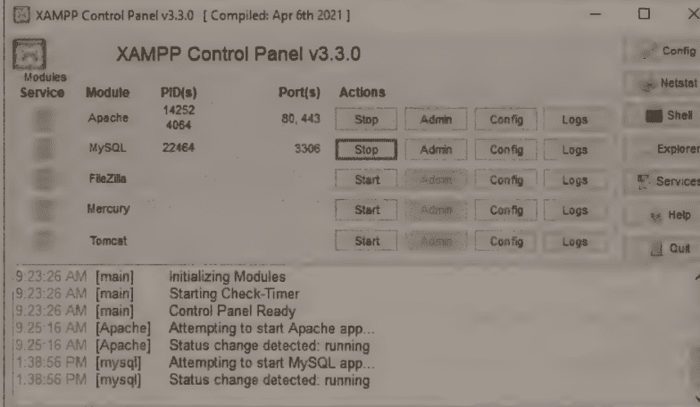

| 服务 | 模块 | PID(s) | 动作 |
|---|---|---|---|
| Apache |  | 14252, 4064 | Stop \| Admin \| Config \| Logs |
| MySQL |  | 22446 | 3306 \| Stop \| Admin \| Config \| Logs \| Explorer |
| FileZilla |  |  | Start \| Admin \| Config \| Logs \| Services |
| Mercury |  |  | Start \| Config \| Logs \| Help |
| Tomcat |  |  | Start \| Admin \| Config \| Logs \| Quit |

在 XAMPP 中，根目录位于`C:/xampphtdocs`。其中，我创建了一个名为`book`的新文件夹来存放我所有的 PHP 文件。随后，创建一个扩展名为`.php`的新文本文件，例如`php01.php`。将此文件保存存在服务器的根目录下。为`php01.php`输入以下代码：

```php
<!DOCTYPE html>
<html lang="en">
<head>
  <meta charset="utf-8">
  <title>PHP Tester</title>
</head>
<body>
<?php
phpinfo();
?>
</body>
</html>
```

> 注意：一个常见的疏忽是某些操作系统上隐藏了文件扩展名，导致`.txt`扩展名不可见。如果发生这种情况，请配置你的系统显示文件扩展名并移除`.txt`。

### 解释

PHP 代码经常集成在 HTML 元素中。`<?php`启动 PHP 语句块，告知服务器 PHP 操作从此处开始。`phpinfo()`代表一个内置 PHP 函数。执行时，它会提供详细的服务器信息。重要的是，分号结束了 PHP 语句。`?>`标记了 PHP 语句的结束。

实施后，根目录看起来所示：

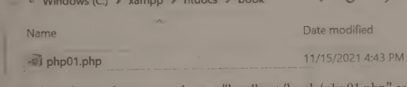

现在，启动你的浏览器并输入`localhost/book/php01.php`作为 URL。输出应该如下所示，展示了大量的服务器详细信息：

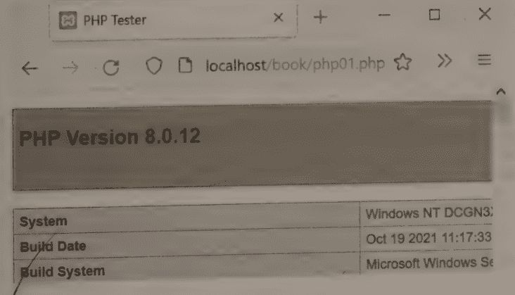

## 复习题 6.7

所有的 PHP 语句应该被哪些定界符包围？

- `<?php`和`?>`
- `<script>`和`</script>`
- `<script><php>`和`</php></script>`

```php
<?php ?>
```


## 复习题 6.8

PHP 语句以哪个符号结束？

## 复习题 6.9

以下哪个陈述是正确的？

语句 1：要打开一个 HTML 文件，你需要浏览器。你不需要服务器。  
语句 2：要打开一个 PHP 文件，你需要服务器。你不需要浏览器。

- 仅语句 1
- 语句 1 和语句 2 都是
- 语句 1 和语句 2 都不是

## 复习题 6.10

以下哪个陈述是正确的？

像 XAMPP 这样的本地 Web 服务器中根目录的目的是：

- 存储与浏览器相关的文件
- 存放 PHP 和 HTML 文件
- 存储云端应用程序
- 管理云服务器设置

## 复习题 6.11

`phpinfo()` 函数在提供的 PHP 代码中起什么作用？

- 显示 PHP 源代码
- 创建一个新的 PHP 文件
- 输出详尽的服务器信息
- 处理 HTML 元素

## 复习题 6.12

PHP 代码段中 `<?php` 标签的作用是什么？

- 它标记 PHP 语句块的开始
- 它指示 PHP 语句块的结束
- 它定义 PHP 文件的标题
- 包含外部 PHP 库

## 6.3 HTML 和 PHP 文件扩展名的区别

HTML、CSS 和 JavaScript 文件在浏览器中运行，构成了客户端编程。相反，PHP 文件在服务器上运行，产生了被称为 PHP 的服务端编程。

当客户端发起 HTML 文件请求时，服务器会立即提供请求的文件。随后，浏览器获取该 HTML 文件，并在浏览器窗口中对其渲染。

### 请求 `page.html`


服务器：

1. 找到文件
2. 将其发送到浏览器

### `Page.html`

然而，在 PHP 文件的情况下，当浏览器请求时，服务器执行位于 `<?php` 和 `?>` 标签内的 PHP 代码。执行结果包含了 HTML 元素，服务器将其传递给客户端进行呈现。

一个关键的区别是：PHP 文件可以混合 HTML 和 PHP 代码，而 HTML 文件仅包含 HTML 代码。

### 请求 `.php`

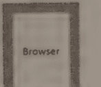

服务器：

1. 找到文件
2. 执行 PHP 代码
3. 将结果发送到浏览器

## 复习题 6.13

以下哪些代码可以出现在 PHP 文件中？

- A) PHP
- B) HTML
- C) HTML 和 CSS
- D) HTML, CSS

## 复习题 6.14

以下哪些代码可以出现在 HTML 文件中？

- A) 仅 PHP
- B) 仅 HTML
- C) HTML 和 CSS
- D) HTML, CSS

## 复习题 6.15

以下哪些陈述包含 HTML 元素？

语句 1：PHP 文件不能包含 HTML 元素。  
语句 2：HTML 文件不能包含 PHP 语句。

- A) 仅语句 1
- B) 语句 2
- C) 语句 1 和语句 2 都是
- D) 语句 1 和语句 2 都不是

## 复习题 6.16

当浏览器请求 HTML 文件时，服务器：

- A) 找到它并发送到浏览器。
- B) 找到它并执行 PHP 代码。
- C) 找到它并执行 PHP 代码。
- D) 执行 PHP 代码。

## 复习题 6.17

当浏览器请求 PHP 文件时，服务器：

- A) 找到它并发送到浏览器。
- B) 找到它并执行 PHP 代码。
- C) 找到它并执行 PHP 代码。
- D) 执行 PHP 代码。

## 6.4 在 PHP 中使用变量

变量是 PHP 中存储值的容器。要查看示例，请在其中创建一个名为 `phpvariable.php` 的文件：

```php
<!DOCTYPE html>
<html lang="en">
<head>
<meta charset="utf-8">
<title>PHP Variable</title>
</head>
<body>
<?php

// 存储的三个变量
$name = "Alice Author";
$comment = "客户服务非常好.";
$today = date("M d Y");

// 构建用于显示的内容
$content = "<h1>客户: $name</h1>";
$content .= "<p>$ $comment</p>";
$content .= "<p>发布日期: $today</p>";

// 显示内容
echo $content;

?>
</body>
</html>
```

```html
<body>
  <h4>客户：Alice Author</h4>
  <p>评论：客户服务非常棒。</p>
  <p>发布于：2023年8月5日</p>
</body>
```

## 复习题 6.18

PHP 中的所有变量都以哪个符号开头？

- A) `?`
- B) `.`
- C) `var`
- D) `$`

## 复习题 6.19

在 PHP 文件中，假设有一个变量 `$content="<p>Hello World</p>"`。编写一个 PHP 语句，在浏览器屏幕上显示 `$content`。

- A) `display($content);`
- B) `echo $content;`
- C) `echo "Hello World";`

## 复习题 6.20

在 PHP 中，你如何表示字符串值 `"This is a string"`？

- A) `"This is a string"`
- B) `'This is a string'`
- C) `"This is a string"` 或 `'This is a string'`
- D) `string This is a string`

## 复习题 6.21

在 PHP 中，以下哪种是单行注释的正确方法？

- A) `<comment> This is a line of comment </comment>`
- B) `<?php This is a line of comment ?>`
- C) `// This is a line of comment`

## 复习题 6.22

在 PHP 中，以下哪一个不是正确的变量名？

- A) `$3val`
- B) `$val3`
- C) `$val_3`
- D) `$val_of_3`

## 复习题 6.23

在 PHP 中使用变量的主要目的是什么？

- A) 增强网站的外观
- B) 为 HTML 元素添加交互性
- C) 在 PHP 语句中存储和管理值
- D) 生成动态 JavaScript 代码

## 复习题 6.24

PHP 中 `date("M d Y")` 函数的作用是什么？

- 它生成一个随机日期和时间。
- 它显示当前的服务器时间。
- 它创建一个倒计时器。
- 它按指定的格式生成服务器日期和时间。

## 复习题 6.25

PHP 中使用哪个运算符进行字符串拼接？

- `+`
- `*`
- `.`

## 复习题 6.26

PHP 中 `echo` 命令的目的是什么？

- 在代码中显示错误
- 执行 JavaScript 函数
- 为了调试打印值
- 输出值以供显示

## 复习题 6.27

当在浏览器中查看 PHP 文件时，Firefox 中 `Ctrl+U` 快捷键的功能是什么？

- 它打开一个新标签页。
- 它刷新页面。
- 它显示浏览器的设置。
- 它显示网页的源代码。

## 6.5 处理 PHP 数字

问题：开发网页，允许用户输入购买的书籍数量并选择运输方式。系统随后应计算小计、税费、运费和总总额。

解决方案：

在服务器根目录下创建一个名为 `php.php` 的新文件并输入提供的代码：

```php
<!DOCTYPE html>
<html lang="en">
<head>
<meta charset="utf-8">
<title>PHP Number</title>
</head>
<body>

<h1>成本计算器</h1>

<form action="" method="post">
<label for="quantity">数量</label>
<input type="text" id="quantity" name="quantity">
<br>

<label>运输方式:</label>
<select name="shipping">
  <option value="0.00">免费邮</option>
  <option value="7.99">隔日运</option>
  <option value="12.99">隔夜运</option>
</select>
<br>

<input type="submit" value="计算成本" name="submit">
</form>

<?php

// 将书价和税率定义为常量
define("BOOK_PRICE", 25.00);
define("TAX_RATE", 0.05);

// 如果提交了表单，进行计算
if($_SERVER["REQUEST_METHOD"] == "POST") {

  // 获取值
  $quantity = $_POST["quantity"];
  $shipping = $_POST["shipping"];

  // 计算成本
  $subtotal = $quantity * BOOK_PRICE;
  $tax = TAX_RATE * $subtotal;
  $total = $subtotal + $tax + (float)$shipping;

  // 格式化数字
  $subtotal = "$" . number_format($subtotal, 2, ".", "");
  $tax = "$" . number_format($tax, 2, ".", "");
  $total = "$" . number_format($total, 2, ".", "");
  $shipping = "$" . number_format((float)$shipping, 2, ".", "");

  // 组合要显示的内容
  $content = "<h3>发票</h3>";
  $content .= "<p>数量: $quantity</p>";
  $content .= "<p>小计: $subtotal</p>";
  $content .= "<p>税额: $tax</p>";
  $content .= "<p>运费: $shipping</p>";
  $content .= "<p>总计: $total</p>";

  // 显示内容
  echo $content;
}

?>
</body>
</html>
```

解释：

`<form>` 元素有一个 `action` 属性，用于引导表单提交。`define()` 函数定义了常量 `BOOK_PRICE` 和 `TAX_RATE`。`if($_SERVER["REQUEST_METHOD"] == "POST")` 确保只有在表单提交时才执行逻辑。

`number_format()` 函数用于将数字格式化为两位小数。`.=` 运算符用于拼接生成的 HTML 字符串。最后，`echo $content` 将生成的发票输出到页面。

## 复习题 6.31

在 PHP 中，如何给一个名为 `$i` 的变量加 1？

- `i++;`
- `$i+=;`
- `$i++;`
- `$i += 1;`

## 复习题 6.32

以下哪一个 PHP 语句声明并初始化了一个名为 `$scores` 的数组？

- `$scores=(5, 12, 3, 98);`
- `$scores = array(5, 12, 3, 98);`
- `$scores = (5, 12, 3, 98);`
- `$scores = array(5, 12, 3, 98);`

## 复习题 6.33

假设 PHP 中有一个名为 `$scores` 的数组。下述哪一个语句将 25 赋值给数组的第二个元素？

- `$scores(second)=25;`
- `$scores[1]= 25;`
- `$scores[2]= 25;`
- `$scores[3]= 25;`

## 复习题 6.34

在 PHP 中，下述哪一个语句显示了名为 `$scores` 的数组的所有元素？

- `$i=0; while($i < 10) {echo $scores[$i];};`
- `$i=0; while($i < 10) {echo $scores[$i]; $i++;};`
- `$i=0; while($i < count($scores)) {echo $scores[$i]; $i++;};`
- `$i=0; while($i < count($scores)) {echo $scores[$i];}`

## 6.7 使用 PHP 处理来自 HTML 表单的用户输入

如上一个示例所示，PHP 常用于处理通过 HTML 表单接收到的用户输入。为了说明这一点，让我们创建一个名为 `phpform.php` 的 PHP 文件并包含以下代码：

```html
<!DOCTYPE html>
<html lang="en">
<head>
<meta charset = "utf-8">
<title>PHP Form</title>
</head>
<body>

<h1>Membership Registration</h1>

<form action="" method="post">
<label for="username">Enter username:</label>
<input type="text" id="username" name="username">
<br>

<label for="password">Enter password: </label>
<input type="password" id="password" name="password">
<br>

<input type="submit" name="submit" value="Register">
</form>

<?php

// 如果点击了提交按钮
if ($_SERVER["REQUEST_METHOD"] == "POST") {

    $error = "";

    // 获取用户输入
    if (empty($_POST["username"])) {
        $error = "Username is required.";
    } else {
        $username = $_POST["username"];
    }

    if (strlen($_POST["password"]) < 6) {
        $error = "Password must be at least 6 characters";
    } else {
        $password = $_POST["password"];
    }

    // 如果没有错误，则显示用户输入
    if($error) {
        echo "$error";
    } else {
        // echo "Your username is: $username";
        echo "Your password is: $password";
    }
}

?>
</body>
</html>
```

解释：

PHP 代码首先使用 `$_SERVER["REQUEST_METHOD"]` 变量检查表单是否已提交。如果是 POST 请求（表单提交），代码将验证用户输入。

如果用户名字段为空，则会将错误消息添加到 `$error` 变量中。

如果密码少于 6 个字符，则会添加另一个错误消息。

如果有任何错误（即如果 `$error` 不空），则会将错误消息显示在浏览器中。

如果没有发现错误，则显示用户名和密码。

此外，代码还解释了 HTML 表单中的 `"name"` 属性必须与 `$_POST` 数组中的 `"key"` 匹配，才能获取数据。表单可以使用 GET 方法代替 POST 方法，但这需要将 PHP 代码中的引用从 `$_POST` 更改为 `$_GET`。然而，使用方法方法将把表单数据显示在 URL 中，这可能会危及安全性。

## 复习题 6.35

PHP 如何接收从使用 `"post"` 方法提交的 HTML 表单中获取的信息？假设 HTML 中有一个文本框 `<input type="text" name="userInput">`：

```php
$_POST['userInput'];

$_GET['userInput'];

$_USERINPUT();

$_GET(userInput);
```


## 复习题 6.36

当使用 GET 方法将 HTML 表单提交到 PHP 文件时，表单内容将 \_\_\_\_\_\_\_\_\_\_\_\_\_\_\_\_\_\_\_\_\_\_ 显示在 URL 中。

- A) 隐藏在消息中
- B) 更安全且隐私性更高
- C) 与 POST 相同

## 复习题 6.37

如何从提交的表单数据提取用户名？

`<input type="text" id="username" name="username">`

- A) 使用 `$_SERVER['REQUEST_METHOD']`
- B) 使用 "username" 键访问 `$_POST` 数组
- C) 检查 `$_GET` 数组中的用户名
- D) 使用 `$_SESSION` 变量

## 6.8 理解 PHP 关联数组

在本章之前的章节，你介绍了 PHP 数组，特别是索引数组。然而，这些基于索引的数组在索引上往往缺乏上下文含义。或者，PHP 允许你创建由程序员定义键的数组。这些被称为关联数组。例如，与其使用索引 0、1 或 2，你可以使用 "name"、"age" 或 "email" 等键。这使得代码更易于读。

## 复习题 6.38

以下数组在 PHP 中被称为什么？

`$scores = array("a" => 5, "b" => 12, "c" => 3);`

- A) 分组数组。
- B) 箭头数组。
- C) 关联数组。
- D) 数值数组。

## 复习题 6.39

在 PHP 中使用关联数组的优点是什么？

- A) 代码更短。
- B) 执行更快。
- C) 可以用于数字和字符串。
- D) 每个元素都可以自定义键。

## 复习题 6.40

关联数组与索引数组的区别是？

- A) 关联数组使用索引
- B) 索引数组在键上缺乏上下文含义
- C) 关联数组的值作为索引
- D) 索引数组使用自定义创建

## 复习题 6.41

在书中范围内，使用关联数组有什么好处？

- A) 减少数组的内存消耗
- B) 简化数组创建的语法
- C) 增强 PHP 文件的安全性
- D) 为元素提供意义的上下文

## 复习题 6.42

PHP 代码中 `isset()` 函数的作用是什么？

`if (isset($_POST["username"]))`

- A) 检查变量是否未初始化
- B) 验证 PHP 代码的语法
- C) 确定特定的数组元素是否存在
- D) 验证来自 HTML 表单的用户输入

## 复习题 6.43

在 PHP 中如何访问关联数组中的元素？

- A) 使用数值索引
- B) 利用元素的位置
- C) 使用 `getValue()` 函数
- D) 使用语法 `arrayName['key']`

## 6.9 使用 PHP include() 函数避免代码重复

在服务器根创建一个名为 `header.php` 的 PHP 文件。插入以下代码：

```php
<!DOCTYPE html>
<html lang="en">
<head>
  <meta charset="utf-8">
  <title><?php echo $pagtitle ?></title>
</head>
<body>
  <nav>
  <ul>
    <li><a href="#">首页</a></li>
    <li><a href="#">产品</a></li>
    <li><a href="#">服务</a></li>
    <li><a href="#">关于我们</a></li>
  </ul>
  </nav>
</body>
</html>
```

接下来，在同一目录下添加另一个名为 `footer.php` 的 PHP 文件，并嵌入以下代码：

```php
<footer>
  <p>Copyright &copy; <a href="#">您的企业</a>
  2000-<?php echo date("Y"); ?></p>
</footer>
</body>
</html>
```

为了完成整个流程，在同一目录下创建一个名为 `page.php` 的 PHP 文件。向其注入以下后续代码：

```php
<?php
$pagptitle = "页面 1";
include("header.php");
?>
<!-- 特定的页面内容 -->
<p>在此处添加页面 1 的内容。</p>
<?php
include("footer.php");
?>
```

启动浏览器并访问 URL：`localhost/page.php`：


- 首页
- 产品
- 服务
- 关于我们

在此处添加页面 1 的内容。Copyright © 您的企业 2000-2023

这种方法可以了创建 `product.php` 文件。`header.php` 和 `footer.php` 都可以无缝包含。此外，你还可以引入外部 CSS 来格式导航栏。要实现这一点，只需在 `header.php` 中插入一个链接，从而使所有页面风格统一。放弃使用 `include()` 将意味着在更新时需要重新访问每一个文件。

## 题 44

编写一条 PHP 语句来包含名为 `footer.php` 的文件（假设该文件与当前文件在同一个文件夹中）：

- A) `<?php include = "footer.php"; ?>`
- B) `<?php include = "footer.php"; ?>`
- C) `<?php include("footer.php"); ?>`
- D) `<?php include("footer.php"); ?>`

## 题 45

在 PHP 中，关于 `include()` 和 `require()`，以下哪个陈述是正确的？

- A) 当发生错误时，`require()` 将无法工作，而 `include()` 可能仍然工作。
- B) 当发生错误时，`include()` 将无法工作，而 `require()` 可能仍然工作。
- C) PHP 中没有 `require()` 函数。
- D) PHP 中没有 `include()` 函数。

## 题 46

在 Web 开发中，`include()` 函数的主要目的是什么？

- A) 执行复杂的计算
- B) 简化和复用代码
- D) 加密敏感数据

## 题 47

在行为方面，`require()` 与 `include()` 有何区别？

- A) `require()` 允许条件执行
- B) `require()` 适用于较不重要的要的任务
- C) `include()` 在失败时停止执行
- D) `include()` 在失败时继续执行

## 题 48

使用 `include()` 函数在代码方面有什么优势？

- A) 它消除了对 PHP 以外编程语言的需求
- B) 它保证了无错误执行
- C) 它允许对多个文件同时进行更新
- D) 集中管理更改，减少了更新多个文件的需求

## 题 49

PHP 中的 `include()` 函数如何有助于减少错误？

- A) 它自动检测并纠正错误
- B) 它防止任何形式错误的发生
- C) 它为调试显示详细报告
- D) 它帮助避免在多个文件中重复代码

## 将用户输入保存到文本文件

在本节中，你将深入研究将 HTML 表单的用户输入保存到服务器上文本文件的过程。首先，在 PHP 文件夹中创建一个名为 `feedback.txt` 的文本文件。目标是将用户输入存储在此文件中。随后，在同一目录下创建一个名为 `page.php` 的 PHP 文件。向其填充以下内容：

```html
<!DOCTYPE html>
<html lang="en">
<head>
  <meta charset="utf-8">
  <title>PHP 表单</title>
</head>
<body>
  <h1>会员注册</h1>
  <form action="" method="post">
    <label for="name">您的姓名：</label>
    <input type="text" id="name" name="name">
    <br>
    <label for="comment">您的评论：</label>
    <br>
    <textarea name="comment"></textarea>
    <br>
    <input type="submit" name="submit" value="提交">
    <input type="submit" name="read" value="读取全部">
  </form>
  <?php
  // 是否点击了提交按钮
  if (isset($_POST['submit'])) {
    // 获取用户输入
    $name = $_POST['name'];
    $comment = $_POST['comment'];
    // 保存到文件
    $myFile = "feedback.txt";
    if (is_writable($myFile)) {
      file_put_contents($myFile, $name . PHP_EOL, FILE_APPEND);
      echo "<p>数据已保存。</p>";
    } else {
      echo "<p>无法保存数据。</p>";
    }
    // 是否点击了读取按钮
    if (isset($_POST["read"])) {
      // 读取文件到数组
      $comments = file("feedback.txt");
      // 显示
      foreach ($comments as $value) {
        echo $value . "<br>";
      }
    }
  }
  ?>
</body>
</html>
```

保存文件后，使用浏览器访问 `page.php`。解释：与之前的代码相比，这次我们使用了稍微不同的方法来验证是否点击了“提交”类型的按钮。`file_put_contents()` 函数将存储在变量 `$name` 值写入文件。注意连接运算符 `.` 将变量与常量 `PHP_EOL`（其中 EOL 代表行尾）结合。该值最终追加到文件中。`file()` 函数读取文件并将其存储在数组中。`foreach` 循环类似于传统的循环，它处理 `$comments` 数组中的每一个值并赋值给变量 `$value`。

## 题 50

在 PHP 中，如何从名为 `feedback.txt` 的文件中检索内容并存储在数组 `$fileContent` 中？

- A) `$fileContent = read("feedback.txt");`
- B) `$fileContent = php_read("feedback.txt");`
- C) `$fileContent = file("feedback.txt");`
- D) `$fileContent = file_read("feedback.txt");`

## 题 51

以下哪些 PHP 函数可以写入文本文件？

```php
write();
file_write()
file_put_contents()
```

## 题 52

`file_put_contents()` 函数的作用是什么？

- A) 它显示文件内容
- B) 它检索数据
- C) 它允许对多个文件进行更新
- D) 它加密数据

## 题 53

在 PHP 中，`isset()` 函数的作用是什么？

- A) 它检查变量是否设置
- B) 它从文件中检索数据
- C) 它允许对多个文件进行更新
- D) 它加密数据

## 题 54

`foreach` 循环的作用是什么？

- A) 它允许条件执行
- B) 它适用于较不重要的任务
- C) 它在失败时停止执行
- D) 它在失败时继续执行

## 题 55

`PHP_EOL` 常量代表什么？

- A) 换符
- B) PHP 代码
- C) PHP 行
- D) PHP 优先级

## 第 6 章：PHP

保存文件并在浏览器和服务器中启动。从你的硬盘中选择一个文件，并点击“上传（Upload）”按钮开始上传过程。你的浏览器显示应当类似于上图所示。

## 第 2 步：将图像保存到目标文件夹

如果你无法找到已上传的文件，是因为我们还没有保存它。请使用以下代码替换带有 `print_()` 的行行，以将文件有效地保存到根文件夹中。你可以将空的目标修改为任何所需的路径，例如在假设 C 盘中存在 "data" 文件夹的情况下，使用 `"c:/data/"`：

```php
$destination = "";
move_uploaded_file($_FILES["myPhoto"]["tmp_name"], $destination.$_FILES["myPhoto"]["name"]);
```

解释：`move_uploaded_file()` 函数将上传的文件从临时位置传输到指定的存储位置。在 `$_FILES` 之后使用两个方括号是因为它的本质是一个二维数组。

保存并执行 `phpfile.php`。从计算机中选择任意图像文件并点击“上传（Upload）”按钮。访问根文件夹；你现在将看到已上传的文件。

## 第 3 步：在文本文件中记录文件名

在 `if` 语句中，末尾加入以下代码（确保根文件夹中存在名为 `myFile.txt` 的文件）：

```php
// 将文件名保存到文本文件
$myFile = $destination."myFile.txt";
if(is_writable($myFile)){
    file_put_contents($myFile, $_FILES["myPhoto"]["name"].PHP_EOL, APPEND);
}
```

保存并执行 `phpfile.php`。通过这种方式，你不仅可以将文件上传到根文件夹，还可以将文件名保存到 `myFile.txt` 中。

## 第 4 步：显示已上传的照片

继续在 `if` 语句，紧接第 3 步的代码之后，包含以下内容：

```php
// 显示图像
$photos = file($myFile);
foreach($photos as $value) {
    echo "<br>";
}
```

保存并运行代码。除了第 3 步中演示的功能外，它还将在浏览器中显示所有之前上传的图像文件。

## 第 5 步：限制上传的图像类型

处理文件上传的安全问题至关重要。首先，在可行的情况下，避免允许用户向你的服务器上传文件。其次，尽可能将文件上传限制为注册用户。此外，对文件类型和大小进行控制也是至关重要的。需要注意的是，并不是所有的网络托管服务都支持文件上传。请将以下代码直接集成到 `if` 语句中：

```php
$allow = array("gif", "png");
$filename = $_FILES["myPhoto"]["name"];
$extension = pathinfo($filename, PATHINFO_EXTENSION);
if(!in_array($extension, $allow)) {
    echo "<p>对不起，无法上传。</p>";
} else {
```

敏锐的读者可能会漏掉在 `else` 块中添加一个闭合花括号的，以包含之前在 `else` 块内引入的所有代码（此处原文未显示完整代码）。

解释：`$allow` 数组列出了允许的许可扩展名。值得注意的是，我们从数组中排除了 "jpg"，以便于测试对上传 jpg 文件的限制。利用 `pathinfo()` 函数，获取上传的文件扩展名并存储在 `$extension` 变量中。`in_array()` 函数验证文件扩展名是否存在于允许列表中。如果不在，则显示错误消息。

保存更改并执行文件。你将不再被允许上传 "jpg" 文件。

## 复习题 6.56

关于 PHP 文件上传的安全性，以下哪一项是正确的陈述？

- A) 只要你不允许上传 .exe 文件，就是安全的。
- B) 只要文件大小很小，就是安全的。
- D) 只要只有用户可以上传，就是安全的。

## 复习题 6.57

处理文件上传时，`<form>` 元素的哪个属性是必须的？

- A) upload
- B) multipart/data

## 复习题 6.58

`move_uploaded_file()` 函数的作用是什么？

- A) 显示文件
- B) 重命名文件
- C) 将文件移动到指定的存储位置

## 复习题 6.59

配合 `$_FILES` 使用时，`print_r()` 函数的作用是什么？

- A) 向服务器上传文件
- B) 显示内容
- C) 显示数组信息
- D) 加密文件

## 复习题 6.60

`pathinfo()` 函数应用时获取什么？

- A) 文件大小
- B) 文件扩展名
- C) 文件类型
- D) 文件内容

## 在同一文件夹中创建一个名为 "member.txt" 的文本文件

按照下方所示格式输入数据。确保在最后一行之后不要按回车键。

```
member1
password1
member2
password2
member3
password3
```

解释：此文件将存储验证所需的用户名和相应密码。它作为验证用户登录凭据的参考。

### 步骤 4：创建 authenticate.php 文件

在这一步中，你将创建 `authenticate.php` 文件，该文件负责根据 `member.txt` 文件中存储的数据对用户凭据进行身份验证。

```php
php
session_start();
// 检查是否提交了登录表单
if($_SERVER['REQUEST_METHOD'] == "POST"){
    // 获取用户的用户名和密码输入
    $username = $_POST['username'];
    $password = $_POST['password'];
    // 从 member.txt 读取数据
    $members = file("member.txt");
```


// 检查是否存在匹配。如果有，则给`session`变量赋值。

```php for($i=0; $i<count($members); $i+=2){

    if(trim($members[$i])==trim($members[$i+1])==$password )

        $_SESSION["member"] = $username;

        // 跳转到 memberOnly 页面

        header("Location:memberOnly.php");

    }

}

// 检查`SESSION`是否为空

if(!isset($_SESSION["member"])){

    $_SESSION["errorMessage"] = "用户名或密码错误";

    // 跳转到登录页面

    header("Location:login.php");

}

?>
```

## 第 6 章：PHP

此文件仅包含 PHP 代码，不包含 HTML 标签。你甚至可以省略结束标签`?>`。`authenticate.php`文件利用`session`来访问内置的`$_SESSION`数组，以便在页面间维护用户数据。

`for`循环遍历`member.txt`文件中的每一对用户名和密码。它将每对数据与用户提供的凭据进行比较。如果找到匹配，则设置`session`变量用户名，并将用户重定向到`memberOnly.php`页面。

`$i += 2`符号确保每次迭代比较的是一对用户名和密码，而不是仅仅按行比较。

`trim()`函数在执行比较之前消除任何多余符号，例如换行符。`header()`函数用于将页面重定向到新文件。

确保你已保存所有页面。关闭浏览器以终止任何现有会话。打开`memberOnly.php`页面并点击“登录”链接。首先，尝试使用错误的凭据登录以查看错误信息。然后，使用正确的凭据登录并访问`memberOnly`页面。

### 步骤 5：实现退出页面

要创建退出功能，请在与其他文件相同的目录中创建一个名为`logout.php`的文件。然后，将以下 PHP 代码添加到`logout.php`文件。此代码将通过销毁会话来处理退出过程：

```php
<?php

session_start();

?>

<!DOCTYPE html>

<html lang="en">

<head>

<meta charset="utf-8">

<title>PHP 退出</title>

</head>

<body>

<?php

if(isset($_SESSION["member"])) {

    $_SESSION = array(); // 清空所有 session 数据

    session_destroy(); // 销毁会话

    echo "<p>您已退出。请 <a href='login.php'>登录</a></p>";

} else {

    header("Location: login.php"); // 如果未登录则跳转到登录页面

}

?>

</body>

</html>
```

### 解释

此页面使用`session_start()`以允许与会话相关的操作。如果变量`$_SESSION['member']`已设置（表示用户已登录），则使用`$_SESSION = array()`清空会话数据，然后使用`session_destroy()`销毁会话。

如果用户未登录（`$_SESSION['member']`未设置），用户将被重定向到登录页面。退出后，将显示成功退出的消息以及一个指向登录页面的链接。

保存`logout.php`文件。关闭当前会话。重新打开浏览器并输入`memberOnly.php`页面的 URL。你应该能观察到退出功能按预期工作。虽然示例有助于理解密码保护网站的功能，但它并没有优先考虑密码安全性。我们建议通过在文件中存储加密密码而非明文来增强账户。为了实现这一点，可以考虑整合一个`signup.php`文件，允许用户选择自己的密码。底层逻辑保持一致，但关键在于整个系统中引入了密码加密。这一调整显著增强了安全措施，并确保用户密码受到保护。

### 复习题 6.61

为什么在某些 PHP 页面中需要会话？

- 因为 HTTP 是无状态的。
- 因为 PHP 是无状态的。
- 因为 HTML 是无状态的。
- 因为 HTML 表单是无状态的。

### 复习题 6.62

Web 服务器生成一对数字，一个给浏览器，另一个给服务器，以便服务器可以“记住”客户端。这描述了 PHP 的使用：

- HTML
- `session`
- 身份验证

### 复习题 6.63

在 PHP 中，`$i+=2;`会做什么？

- 拼写错误，应该是`$i+2;`
- 变量`$i`的值增加 2
- 变量`$i`的值加 2
- `$i`现在等于 2

### 复习题 6.64

以下哪种不是结束会话的方法？

- `session_end()`
- 关闭浏览器
- time out
- user out

## 6.13 总结

在本章中，你掌握了 PHP 语法、变量、数组、条件和循环。你探索了用于网页的会话。特别是，PHP 在保护内容方面的作用通过交互网页得到了强调。本章让你能够创建安全内容。

## 6.14 练习：使用 PHP 构建简单的留言板

在练习中，你将使用 PHP 创建一个留言板。

用户名：

留言：

上传文件：

[提交] [查看]

### Web 编程

点击提交按钮后，提供的数据应存储在外部文件中，并显示相应的消息。

同样，点击查看按钮后，输出将如上方。

### 6.15 练习答案

创建一个空白文本文件`phpExercise.txt`来存储用户名、留言和图像文件路径。在同一文件夹中，创建一个包含以下代码的 PHP 文件`phpExercise.php`：

```html
<!DOCTYPE html>

<html>

<head>

<meta charset="utf-8">

<title>PHP 练习</title>

</head>

<body>

<form action="" method="post" enctype="multipart/form-data">

<p>用户名：

<br>

input type="text" name="name" size="30" maxlength="30">

</p>

<p>留言：

<br>

<textarea name="comment" rows="7" cols="35"></textarea>

</p>

<label for="myPhoto">上传文件：</label>

<input type="file" id="myPhoto" name="myPhoto">

<br>

<input type="submit" name="submit" value="提交">

<input type="submit" name="view" value="查看">

<br>

</form>

<?php

if (isset($_POST['submit']))

{

// 处理上传的文件

$destination = "";

move_uploaded_file($_FILES['myPhoto']['tmp_name'],

$destination.$_FILES['myPhoto']['name']

);

// 保存到文件

$myFile = "phpExercise.txt";

// 写入

if(is_writable($myFile)){

file_put_contents($myFile, $_POST['name'].PHP_EOL, FILE_APPEND);

}

}

?>

</body>

</html>
```

```php
file_put_contents($myFile, $_myPhoto['name'] . PHP_EOL, FILE_APPEND);

file_put_contents($myFile, $_POST['comment'] . PHP_EOL, FILE_APPEND);

echo "<p>Thank you!</p>";

} else {

    echo "<p>Something is wrong.</p>";

}

// read

if (isset($_POST['view']))

{

    $allComments = file("phpExercise.txt");

    for($i = 0; $i < count($allComments); $i+= 3) {

        echo $allComments[$i];

        echo "<br>";

        $image = $allComments[$i+1];

        echo "";

        echo "<br>";

        echo $allComments[$i+2];

        echo "<br>";

    }

}

?>

<body>

</html>
```

## 6.16 复习题答案

6.1 D; 6.2 C; 6.3 B; 6.4 D; 6.5 C; 6.6 C; 6.7 D; 6.8 C; 6.9 A; 6.10 B; 6.11 C; 6.12 A; 6.13 D; 6.14 C; 6.15 B;  
6.16 A; 6.17 B; 6.18 D; 6.19 B; 6.20 C; 6.21 D; 6.22 A; 6.23 C; 6.24 D; 6.25 D; 6.26 D; 6.27 D; 6.28 A; 6.29 A;  
6.30 C; 6.31 C; 6.32 D; 6.33 B; 6.34 C; 6.35 A; 6.36 A; 6.37 B; 6.38 C; 6.39 D; 6.40 B; 6.41 D; 6.42 C; 6.43 D;  
6.44 C; 6.45 A; 6.46 C; 6.47 D; 6.48 D; 6.49 D; 6.50 C; 6.51 D; 6.52 C; 6.53 C; 6.54 D; 6.55 A; 6.56 A;  
6.57 C; 6.58 B; 6.59 B; 6.60 B; 6.61 A; 6.62 C; 6.63 B; 6.64 A;

# 第 7 章：MySQL

## 本章学习目标

- 7.1 识别基础数据库概念
- 7.2 演示 SQL `CREATE DATABASE` 和 `TABLE`
- 7.3 执行 SQL `INSERT` 和 `SELECT`
- 7.4 执行 SQL `UPDATE` 和 `DELETE`
- 7.5 检查`mysqli_connection`的打开与关闭

## 7.1 MySQL 和数据库简介

在本节中，我们将深入探讨 MySQL 和数据库的基础概念。MySQL 是一个通用的数据库管理系统（DBMS），允许我们在网站中建立和使用数据库。数据库是数据的组织存储库，通常被结构化为表。每个表包含行和列，如下表所示：

| Studentid | Studentname | GPA |
| :--- | :--- | :--- |
| 111 | Jeremy | 3.9 |
| 222 | Michael | 3.4 |
| 333 | John | 4.0 |
| 444 | Daniel | 3.1 |

在表的上下文中，每一行代表记录（records），如示例所示，而列被称为字段（fields）。在我们的学生表中，有三个字段：`id`、`name`和`GPA`。

上一章强调了 PHP 与文本文件交互的能力，而一种更通用的方法是将 PHP 与数据库集成。如果你使用了 XAMPP，你的本地机器已经安装了 MySQL。本章将引导你通过 PHP 代码建立数据库并创建表，从而加深对数据库使用的理解。

### 复习题 7.1

MySQL 数据库中的数据通常存储在一个或多个____中。

A) 表（tables）  
B) 文本（txt）  
C) 文件（JSON files）

### 复习题 7.2

在 MySQL 中，列被称为什么？

A) 记录（record）  
B) 对象（object）  
C) 关系（relation）

### 复习题 7.3

以下哪条语句是正确的？

A) 数据库用于创建 DBMS。  
B) DBMS 用于创建数据库。  
C) DBMS 与数据库是同一种。  
D) DBMS 和数据库之间没有关系。（注：此处原文逻辑似乎有误，已按原意翻译）

### 复习题 7.4

MySQL 是一个____。

A) DBMS  
B) 数据库（database）  
C) 表（table）  
D) 字段（field）

### 复习题 7.5

在关系数据库结构中，表有一个或多个____。

A) DBMS  
B) 数据库（databases）  
C) 电子表格（spreadsheets）  
D) 字段（fields）

## 7.2 创建数据库

**问题：**

创建一个名为`schoolDB`的数据库，并在其中建立名为`student`的表。`student`表应由三个字段组成：`studentid`、`studentname`和`studentpa`。

**解决方案：**

在你的服务器的 root 文件夹中创建一个名为`createsDB.php`的 PHP 文件并输入以下代码：

```php
<!DOCTYPE html>

<html lang="en">

<head>

    <meta charset="utf-8">

    <title>Create Database</title>

</head>

<body>

  <?php

    $servername = "localhost";

    $username = "root";

    $password = "";

    // 建立连接

    $conn = mysqli_connect($servername, $username, $password);

    // 确保连接成功

    if ($conn) {

        echo "<p>Connection set up.</p>";

        // 如果存在则删除以重新开始

        $query = "DROP DATABASE IF EXISTS schoolDB";

        mysqli_query($conn, $query);

        // 创建 schoolDB 数据库

        $query = "CREATE DATABASE schoolDB";

        if(mysqli_query($conn, $query)) {

            echo "<p>schoolDB created successfully.</p>";

            // 选择 schoolDB 数据库以创建表

            mysqli_select_db($conn, "schoolDB");

            // 创建学生表

            $query = "CREATE TABLE student (

                studentid INTEGER NOT NULL,

                studentname VARCHAR(32) NOT NULL,

                studentpa DECIMAL(3, 2),

                PRIMARY KEY (studentid)

            )";

            if(mysqli_query($conn, $query)) {

                echo "<p>student table created successfully.</p>";

                // 关闭连接

                mysqli_close($conn);

            }

        }

    }

  ?>

</body>

</html>
```


**解释：**
为了简单起见，提供的代码假设本地 XAMPP 设置没有密码保护。

## MySQL 细节

`mysqli_connect()` 函数建立与 MySQL 服务器的连接。

`mysqli_query()` 函数执行 SQL 语句；你将在本中经常遇到它。

创建数据库后，`mysqli_select_db()` 函数指定使用 `'schoolDB'`。`'student'` 表包含三个字段：`'studentid'`、`'studentname'` 和 `'studentpa'`。在定义字段时，相应的数据类型是至关重要的。

`'studentid'` 字段是整数数据类型，使其不可空。因此，在存储新学生数据时，`'studentname'` 字段采用 `VARCHAR` 数据类型，最大字符限制为 32。

相比之下，`'studentpa'` 字段使用 `decimal(3, 2)` 数据类型，允许总共三位数字（精度），保留两位小数。因此，整数部分仅可用一位。

`PRIMARY KEY` 约束将 `'studentid'` 指定为记录的唯一标识符。

确保 XAMPP 正在运行且 PHP 和 MySQL 服务器均已激活。通过你的服务器和浏览器打开 `"createsDB.php"`。如果连接建立且操作成功，你将看到以下输出：

- Connection successful.
- schoolDB created successfully.
- student table created successfully.

要在 MySQL 中可视化 `"student"` 表，请在浏览器的 URL 栏中输入 `"http://localhost/phpmyadmin/"`（或在控制面板上点击 admin）来使用 phpMyAdmin。


图 7.1：显示 schoolDB 数据库的 phpMyAdmin

**复习题 7.6**
如果以下连接语句用于你的 PHP，那么密码是什么？
`$conn = mysqli_connect('a', 'b', 'c');`

- A) a
- B) b
- C) c
- D) 没有密码

**复习题 7.7**
在 MySQL 中，以下哪条语句用于创建名为 schoolDB 的数据库？
- A) 用于创建 DBMS
- B) DBMS 用于创建数据库
- C) DATABASE schoolDB

**复习题 7.8**
假设 `$conn` 是连接，PHP 中哪个函数用于执行查询？
- A) `mysqli_query($conn, $query)`
- B) `mysqli_execute($conn, $query)`

**复习题 7.9**
在 MySQL 中，执行 SQL `CREATE TABLE` 语句之前必须做什么？
- 必须知道表中有多少记录。
- 必须知道表的数据。
- 必须选择外键。
- 必须选择一个数据库来添加表。

**复习题 7.10**
- 包含熟悉值的多个字段。
- 能够唯一标识每条记录的多个字段。
- 对终端用户有意义的多个字段。

**复习题 7.11**
在 MySQL 中，执行所有 SQL 语句后，必须包含代码来 ____。
- 告别 (Goodbye)
- 关闭 (Close)
- 无 (Nothing)

**复习题 7.12**
`student` 表中的 `studentname` 字段存储什么类型的数据？
- 数值
- 日期和时间
- 文本信息
- 布尔值

# 第 7 章：MySQL

在 PHP 中使用哪个函数建立与 MySQL 服务器的连接？

- `mysqli_query()`
- `mysqli_close()`
- `mysqli_select_db()`

复习题 7.14

在 `"student"` 表中 `PRIMARY KEY`（主键）约束的作用是什么？
- 它确保该表只有一个主字段。
- 它将第一列指定为主键。
- 它强制执行 `"studentid"` 字段的唯一性。
- 它指定了表中允许的最大行数。

复习题 7.15

`"studentgpaDEC(3, 2)"` 数据类型规范表示什么？
- 该字段最多可以存储 3 位小数。
- 该字段总计可以存储 5 位数字。
- 该字段最多可以存储 2 位小数。
- 该字段总计可以存储 2 位数字。

## 7.3 创建数据库交互的 HTML 表单

继续构建一个网页，以便用户输入数据对数据库中的学生数据进行操作。
在你的服务器根目录下创建一个名为 `"manageGpa.php"` 的 PHP 文件。嵌入以下 HTML 代码：

```html
<!DOCTYPE html>
<html lang="en">
<head>
<meta charset="utf-8">
<title>Manage Students GPA</title>
</head>
<body>
<h1>Manage Student GPA</h1>
<p>插入备注：学生不能有相同的 ID 和姓名。</p>
<p>更新备注：学生必须具有匹配的 ID 和姓名。</p>
<p>删除备注：学生的所有数据必须匹配。</p>
<form action="" method="post">
<label for="studentid">Student ID:</label>
<input type="text" id="studentid" name="studentid">
<br>
<label for="studentname">Student Name:</label>
<input type="text" id="studentname" name="studentname">
<br>
<label for="studentgpa">Student GPA:</label>
<input type="text" id="studentgpa" name="studentgpa">
<input type="submit" name="insert" value="Insert">
<input type="submit" name="view" value="View All">
<input type="submit" name="update" value="Update GPA">
<input type="submit" name="delete" value="Delete">
</form>
<?php
// PHP 代码将插入此处
?>
</body>
</html>
```

记得在继续之前保存并验证你的 HTML 代码。在浏览器中查看时，其外观应类似于图所示：


# 管理学生 GPA

插入备注：学生不能有相同的 ID 和姓名。

更新备注：学生必须具有匹配的 ID 和姓名。

删除备注：学生的所有数据必须匹配。

```
Student ID
Student name:
Student GPA:
Insert View All Update GPA Delete
```

图 7.2：manageGpa 表单的浏览器显示。

复习题 7.16
HTML 文件中 PHP 代码的意义是什么？
- 它处理 HTML 元素的样式。
- 它建立了与 HTML 表单的连接。
- 它对用户输入进行验证。
- 它促进与服务器和数据库的交互。

复习题 7.17
为了让 HTML 表单与数据库工作，HTML 表单必须位于（一个）文件内部。
A) HTML
B) PHP

## 7.4 添加 PHP 代码插入新记录

继续通过在指定的 PHP 块中整合 PHP 代码来丰富 `"manageGpa.php"` 文件。

```php
<?php
// 设置数据库连接
$conn = mysqli_connect("localhost", "root", "", "school");
if($conn) {
    // 如果点击了 "Insert" 按钮并且 ID 不为空
    if(isset($_POST['insert'])) {
        if(!empty($_POST['studentid'])) {
            // 从表单检索值
            $id = $_POST['studentid'];
            $name = $_POST['studentname'];
            $gpa = $_POST['studentgpa'];
            $query = "INSERT INTO student (studentid, studentname, studentgpa) VALUES ('$id', '$name', '$gpa')";
            if(mysqli_query($conn, $query)) {
                echo "<p>插入成功。</p>";
            } else {
                echo "<p>插入失败。</p>";
            }
        } else {
            echo "<p>需要学生 ID。</p>";
        }
    }
} else {
    echo "<p>连接失败。</p>";
}
?>
```

解释：
`mysqli_connect()` 函数包含了第四个参数，指定数据库名称。因此，不需要 `mysqli_select_db`。SQL 语句遵循 `INSERT INTO tableName(field1, field2) VALUES(value1, value2)` 模式。保存并测试代码。你应该能够成功插入新学生并避免 ID 重复。

复习题 7.18
在 PHP 中，执行任何 SQL 语句之前，你必须 ________ 数据库。
- 连接
- 找到表
- 使用表的主键
- 知道有多少表

复习题 7.19
以下 SQL 语句的作用是什么？
`INSERT INTO abc (field1, field2) VALUES (value1, value2)`
- 向数据库插入两行。
- 向名为 abc 的表插入一行。
- 向名为 abc 的数据库插入一行。

复习题 7.20
在 MySQL 表中，插入到主键字段的值必须是 ____。
- 整数
- 唯一的
- 整数或唯一的

复习题 7.21
`mysqli_connect()` 函数中的第四个参数代表什么？
- 学生的 GPA。
- 学生的姓名。
- 数据库服务器的主机。
- 数据库名称。

## 7.5 添加 PHP 代码显示表中的所有数据

现在让我们启用“View all”按钮的功能。在插入功能的结束（`// End of insert` 行）之后插入以下代码：

```php
<?php
// 如果点击了 "View" 按钮则执行
if(isset($_POST['view'])) {
    $query = "SELECT * FROM student";
    $result = mysqli_query($conn, $query);
    if(mysqli_num_rows($result) > 0) {
        $display = "<h2>All Students</h2>";
        while($row = mysqli_fetch_assoc($result)) {
            $display .= "ID:" . $row['studentid'] . "<br>";
            $display .= "Name:" . $row['studentname'] . "<br>";
            $display .= "GPA:" . $row['studentgpa'] . "<br>";
        }
    } else {
        $display = "<p>数据库中没有学生。</p>";
    }
    echo $display;
}
// End of view all
?>
```

解释：
在 SQL 中，`SELECT` 语句从表中检索数据。在这种情况下，该语句使用 `SELECT * FROM tableName` 语法从 `"student"` 表选取所有记录。检索的数据存储在 `$result` 变量中。`mysqli_num_rows()` 返回行数。为了处理未知行数，使用了 `while` 循环。该循环遍历从 `$result` 获取的每一行并将其关联数组 `$row` 中。访问 row 中的元素使用与表中字段名对应的键，例如 `$row['student']`。

保存并测试代码。你应该能够成功查看你插入的所有学生数据。

复习题 7.22
在 SQL 中，以下语句的作用是什么？
`SELECT * FROM student;`
- 从名为 student 的表中选择星号。
- 从名为 student 的数据库中选择星号。
- 从名为 student 的表中选择所有行列。
- 从名为 student 的数据库中选择所有行列。

复习题 7.23
假设表中所有数据的内容已检索并存储在变量 `$result` 中。哪个 PHP 函数可以从 `$result` 获取行？
- `mysql_fetch_onrow()`
- `mysqli_retrieve_onrow()`
- `mysqli_fetch_assoc()`
- `mysqli_retrieve_assoc()`

复习题 7.24
假设一行表数据通过 `mysqli_fetch_assoc()` 存储在变量 `$row` 中。你如何获取名为 `fieldName` 的字段中的值？
- `$row["FieldName"]`
- `$row["fieldName"]`
- `$row["fieldname"]`
- 列出的任何选项均可。

复习题 7.25
`mysqli_num_rows()` 函数返回什么？
- 每个记录字段的总数。
- 表的列数。
- 从表中检索的行数。
- 整个数据库记录的总数。

## 7.6 添加 PHP 代码启用更新按钮功能

在这一步中，你将实现“Update”按钮的功能。在视图部分（`// End of view` 之后插入提供的代码片段：

```php
<?php
// 检查是否点击了 "Update" 按钮以及提供了 ID 和姓名
if(isset($_POST['update'])) {
    if(!empty($_POST['studentid']) && !empty($_POST['studentname'])) {
        // 从表单检索值
        $id = $_POST['studentid'];
        $name = $_POST['studentname'];
        $gpa = $_POST['studentgpa'];
        // 构建更新 GPA 的 SQL 查询
        $query = "UPDATE student SET studentgpa = '$gpa' WHERE studentid='$id' AND studentname='$name'";
        // 执行查询并检查结果
        if(mysqli_query($conn, $query) && mysqli_affected_rows($conn) > 0) {
            echo "<p>更新成功。</p>";
        } else {
            echo "<p>更新失败。</p>";
        }
    } else {
        echo "<p>需要学生 ID 和姓名。</p>";
    }
}
// End of update section
?>
```

解释：
代码片段处理数据库中学生 GPA 的过程。首先检查是否点击了“Update”按钮以及是否提供了学生的 ID 和姓名。如果满足这两个条件，脚本从表单检索值并构建 GPA 的 SQL 查询。使用 `mysqli_query()` 函数执行查询，并使用 `mysqli_affected_rows()` 判断更新是否成功。根据结果，向用户显示相应的消息。

记得保存更改并进行测试。你现在可以通过输入正确的 ID 和姓名来成功更新学生的 GPA。

复习题 7.26
在 SQL 中，以下语句的作用是什么？
`UPDATE student SET studentGpa = 4 WHERE studentId = 4;`
A 将所有学生的 GPA 设置为 4.0。
B 将名为 student 的表中 ID 为 4 的学生的 GPA 设置为 4.0。
C 可能将所有学生的 GPA 设置为 4.0。
D 将名为 student 的数据库中 ID 为 4 的学生的 GPA 设置为 4.0。

复习题 7.27

# 第 7 章：MySQL

在 PHP 中，使用哪个函数来检查表中的记录是否已更新？
- `mysqli_affected_rows()`
- `mysqli_updated_rows()`
- `mysqli_affected_rows()`
- `mysqli_updated_rows()`

## 7.7 实现 PHP 代码以启用删除按钮功能

在最后一步中，你将整合“删除”按钮的功能。将以下代码紧放在更新代码部分（`// End of update section line`）之后：

```php
// 检查是否点击了“删除”按钮
if(isset($_POST['delete'])) {
    if(empty($_POST['studentid']) && empty($_POST['studentname']) &&
    empty($_POST['studentgpa'])) {
        // 从表单中获取值
        $id = $_POST['studentid'];
        $name = $_POST['studentname'];
```


```php
$gpa = $_POST['studentgpa'];

// 构建 SQL 查询以删除指定的学生

$query = "DELETE FROM student WHERE studentid='$id' \n            && $name='$name' && $studentgpa='$gpa'";

// 执行查询并检查是否成功

if(mysqli_query($conn, $query) && mysqli_affected_rows($conn) > 0) {

    echo "<p>删除成功。</p>";

} else {

    echo "<p>删除失败。</p>";

}

} else {

    echo "<p>所有字段均为必填。</p>";

}

} // 删除部分结束
```

解释：

SQL `DELETE` 语句的一般格式包括 `DELETE tableName WHERE condition`。在提供的示例中，该语句将删除所有符合 HTML 表单中三个字段数据匹配记录的行。需要注意的是，如果你省略了 `WHERE` 子句，表中的所有行都将被删除。

你现在可以通过输入正确的 ID、名称和 GPA 值来成功删除学生记录了。

### 复习题 7.28

在 SQL 中，以下语句的作用是什么？

```sql
DELETE FROM student;
```

A) 删除名为 student 的数据库中的某行。  
B) 删除名为 student 的表中的某行。  
C) 删除名为 student 的数据库中的所有行。  
D) 删除名为 student 的表中的所有行。

### 复习题 7.29

在 SQL `DELETE` 语句中，哪个子句允许你删除选定的行？

```sql
A SELECT

FROM

WHERE

CONDITION
```

## 7.8 解决安全问题

让我们使用你的网络浏览器和服务器重新回到 7.7 节中涵盖的示例。输入一个新学生 O'Brian 并点击提交。你会遇到一个错误消息。这是由于名称包含了特殊字符（'），MySQL 不允许。

为了修复这个问题，你可以在“插入”部分进行简单调整。将现有行：

```php
$name = $_POST['studentname'];
```

替换为以下行：

```php
$name = mysqli_escape_string($conn, $_POST['studentname']);
```

现在你应该能够添加名为 O'Brian 的学生。现在让我们探索另一个示例。请注意这在生产环境中可能无法正常工作（记住，用户需要提供 ID、名称和 GPA 来删除记录）。然后，输入以下内容：

```sql
anything' OR studentId LIKE '%'
```

点击删除按钮后，你会发现表中的所有记录都被删除了。这种攻击被称为 SQL 注入。

该漏洞的修复方法与之前相同。在“删除”部分，将现有行：

```php
$gpa = $_POST['studentgpa'];
```

替换为以下行：

```php
$gpa = mysqli_escape_string($conn, $_POST['studentgpa']);
```

未来，增强代码安全性至关重要。你可以通过始终利用 `mysqli_escape_string()` 函数来实现。该函数可以充分处理字符串中的特殊字符，使其在 SQL 查询中安全。这种做法将保护你的应用程序免受潜在的 SQL 注入风险。

然而，需要注意的是，虽然使用 `mysqli_escape_string()` 是有效方法，但通常建议使用准备语句和参数化查询。以下是准备语句的示例。

首先，在上一节的 HTML 表单中添加一个按钮：

```html
<input type="submit" name="displaygpa" value="显示 GPA">
```

接下来，在“删除部分结束”之后添加以下块：

```php
// 检查是否点击了“显示 GPA”按钮

if(isset($_POST['displaygpa'])) {

    $id = $_POST['studentid'];

    $name = $_POST['studentname'];

    $gpa = $_POST['studentgpa'];

    // 创建准备语句

    $query = "SELECT * FROM student WHERE studentid = ? AND username = ?";

    $stmt = mysqli_prepare($conn, $query);

    // 绑定参数并执行

    mysqli_stmt_bind_param($stmt, "ss", $id, $name);

    mysqli_stmt_execute($stmt);

    // 获取结果

    $result = mysqli_stmt_get_result($stmt);

    while($row = mysqli_fetch_assoc($result)) {

        echo "ID: " . $row['studentid'] . "<br>";

        echo "Name: " . $row['studentname'] . "<br>";

        echo "GPA: " . $row['studentgpa'] . "<br>";

    }

}
```

B) 通过自动优化 SQL 查询结构。  
C) 通过缓存相似查询的执行计划。  
D) 通过消除对用户输入验证的需求。

### 复习题 7.43

使用预处理语句（prepared statements）相比于手动转义输入有什么优势？

A) 简化了代码结构。  
B) 将用户输入直接插入查询中。  
C) 能够更好地针对 SQL 注入攻击的保护。  
D) 兼容更广泛的数据库系统。

## 7.9 使用数据库创建一个简单的内容管理系统

在网站内容管理的背景下，利用数据库可以极地简化流程。例如，考虑一种内容（如每日特价）需要频繁更新的场景。与其让业务经理每天手动编辑 HTML 文件，更有效的方法是使用 HTML 表单来修改内容。

在接下来的五个章节中，我们将深入创建一个名为“今日特价”的动态网站功能，允许经理通过用户友好的表单来操作内容。首先，本节侧重于建立一个数据库来存储所有基本数据。

首先创建一个名为 `contentDB.php` 的 PHP 文件并包含以下代码：

```php
<!DOCTYPE html>

<html lang="en">

<head>

<meta charset="utf-8">

<title>Create Content Database</title>

</head>

<body>

<?php

$servername = "localhost";

$username = "root";

$password = "";

// 建立数据库连接

$conn = mysqli_connect($servername, $username, $password);

// 确保连接成功

if ($conn) {

    echo "Connection established successfully.<p>";

    // 如果数据库存在则删除

    $query = "DROP DATABASE IF EXISTS contentDB";

    mysqli_query($conn, $query);
```

```php
// 创建 contentDB 数据库

$query = "CREATE DATABASE contentDB";

if(mysqli_query($conn, $query)) {

    echo "<p>contentDB created successfully.</p>";

    // 选择 contentDB 数据库进行操作

    mysqli_select_db($conn, "contentDB");

    // 创建 'special' 表

    $query = "CREATE TABLE special (

specialid INTEGER NOT NULL AUTO_INCREMENT,

sname VARCHAR(32) NOT NULL,

regularprice DECIMAL(8, 2),

specialprice DECIMAL(8, 2),

validfrom date,

validto date,

PRIMARY KEY (specialid)

);"

    if(mysqli_query($conn, $query)) {

        echo "<p>The 'special' table was created successfully.</p>";

        // 关闭数据库连接

        mysqli_close($conn);

    }

}

</body>

</html>
```

解释：

MySQL 中的 `AUTO_INCREMENT` 特性在插入新记录时会自动为字段分配一个唯一的整数。因此，当你在接下来的章节中插入新记录时，无需为每个条目提供显式的 ID。

此外，`date` 是 MySQL 中的一种数据类型，通常遵循 `yyyy-mm-dd` 格式（例如 `2023-12-21`）。在测试页面时，确保按此格式输入日期以确保功能正常。

保存文件后，通过浏览器和服务器访问它。此操作将触发数据库和 `special` 表的创建，为我们的内容管理系统奠定基础。

### 复习题 7.44

A) 在 MySQL 中，如果你给表的字段添加 `AUTO_INCREMENT` 属性，表的大小会自动增加。  
B) 字段的大小会自动增加。  
C) 当插入新记录时，MySQL 会自动向字段添加一个唯一的整数。  
D) MySQL 会自动向表中添加一条新记录。

### 复习题 7.45

以下哪项不是 MySQL 中的数据类型？

Web 开发

A) `BOOLEAN`  
B) `DECIMAL`  
C) `VARCHAR`  
D) `DATE`

### 复习题 7.46

利用数据库对网站内容管理有什么好处？

A) 手动编辑 HTML 文件  
B) 创建动画  
C) 简化流程  
D) 生成内容

### 复习题 7.47

在内容管理语境下，为什么使用 HTML 表单更好？

A) 它简化了数据库查询。  
B) 它确保了数据安全。  
C) 它便于更新。  
D) 它允许经理修改内容。

### 复习题 7.48

MySQL 中 `AUTO_INCREMENT` 特性的目的是？

A) 自动生成 HTML 代码。  
B) 为记录分配唯一的 ID。  
C) 创建动画。  
D) 设计数据库架构。

### 复习题 7.49

MySQL 中输入日期的标准格式是什么？

A) `MM/DD/YYYY`  
B) `DD/MM/YYYY`  
C) `YYYY-MM-DD`  
D) `MM-YYYY`

## 7.10 内容管理系统：插入与查看

为了实现有效的内容管理系统，我们将创建一个名为 `contentmanagement.php` 的 PHP 文件，执行插入和查看任务。实现此功能的代码如下：

```php
<!DOCTYPE html>

<html lang="en">

<head>

<meta charset="utf-8">

<title>Today's Special Management Dashboard</title>

</head>

<body>

<h1>Today's Special Management Dashboard</h1>

<form action="" method="post">

<label for="specialname">特价名称:</label>

<input type="text" id="specialname" name="specialname">

<label for="regularprice">原价:</label>

<input type="text" id="regularprice" name="regularprice">

<label for="specialprice">特价:</label>

<input type="text" id="specialprice" name="specialprice">

<label for="validfrom">开始日期:</label>

<input type="text" id="validfrom" name="validfrom">

<label for="validto">结束日期:</label>

<input type="text" id="validto" name="validto">

<input type="submit" name="insert" value="插入">

</form>

<?php

// 设置数据库

$conn = mysqli_connect("localhost", "root", "");

if($conn) {

    // PHP 代码

    if(isset($_POST["insert"])) {

        $name = $_POST['specialname'];

        $regularprice = $_POST['regularprice'];

        $specialprice = $_POST['specialprice'];

        $validfrom = $_POST['validfrom'];

        $validto = $_POST['validto'];

        $query = "INSERT INTO special (sname, regularprice, specialprice, validfrom, validto) VALUES ('$name', '$regularprice', '$specialprice', '$validfrom', '$validto')";

        if(mysqli_query($conn, $query)) {

            echo "<p>插入成功。</p>";

        } else {

            echo "<p>插入失败。</p>";

        }

    }

    // 如果点击了按钮

    if(isset($_POST["view"])) {

        $query = "SELECT * FROM special";

        $result = mysqli_query($conn, $query);

        if(mysqli_num_rows($result) > 0) {
```

```php
$display = "<h2>所有特价</h2>";

while($row = mysqli_fetch_assoc($result)) {

  $display .= "ID: ".$row['specialid'].".<br>";

  $display .= "名称: ".$row['sname'].".<br>";

  $display .= "原价: ".$row['regularprice'].".<br>";

  $display .= "特价: ".$row['specialprice'].".<br>";

  $display .= "开始日期: ".$row['validfrom'].".<br>";

  $display .= "结束日期: ".$row['validto'].".<br>";

  $display .= "<a href='contentupdate.php?id=".$row['specialid']."'>更新</a><br>";

  $display .= "<a href='contentdelete.php?id=".$row['specialid']."'>删除</a><br>";

}

} else {

  $display = "<p>数据库中无内容。</p>";

}

echo $display;

// 查看部分结束

} else {

  echo "<p>连接失败。</p>";

}

?>

</body>

</html>
```

解释：

在这个 PHP 脚本中，我们创建了一个内容管理仪表板，经理可以在其中插入新的特价项目或查看现有项目。

经理可以在 HTML 表单中输入特价名称、原价、特价、开始日期和结束日期等详细信息。点击“查看所有”按钮将从 `special` 表检索所有记录。如果找到了记录，将显示每个特价项目的详细信息，包括更新或删除每个项目的选项。系统提供了用于更新和删除每个特价项目的超链接。这些超链接将“特价”值传递给相应的更新和删除页面进行进一步处理。

通过保存并测试此页面，经理可以通过直观的界面无缝地插入新的特价项目并查看现有项目。

### 复习题 7.50

以下 URL 有特殊之处？

```html
<a href="contentupdate.php?id=2">更新</a>
```

A) 浏览器请求一个名为 `contentupdate.php` 的页面，该页面是第二个。  
B) 浏览器请求一个名为 `contentupdate.php` 的页面，且页面 ID 为 `2`。  
C) 浏览器请求一个密码为 `2` 的页面。  

浏览器请求一个名为 `contentupdate.php` 的页面，并传递了一个 id 值为 `2`，这是 `contentupdate.php` 页面所需要的。

### 复习题 7.51

在第 7 章的内容管理系统中，`contentmanage.php` 提供了更新和删除特殊项目的超链接，每个超链接都会将“____”值传递给相应的更新和删除页面进行进一步处理。

- 详情
- 特定的
- 更新或删除

# 7.11 内容管理系统：更新特价


现在，让我们通过允许对特价项目进行更新来增强我们的内容管理系统。为了实现这一点，请在同一根目录下创建一个名为`contentupdate.php`的新 PHP 文件并包含以下代码：

```php
<!DOCTYPE html>
<html lang="en">
<head>
<meta charset="utf-8">
<title>今日特价管理仪表板</title>
</head>
<body>
<h1>更新今日特价</h1>
<?php
// 设置数据库连接
$conn = mysqli_connect("localhost", "root", "", "contentDB");
if($conn) {
    // 从 URL 获取用于更新的特价 ID
    $specialid = mysqli_real_escape_string($conn, $_GET["id"]);
    // 从表中检索选定的特价记录
    $query = "SELECT * FROM special WHERE specialid = '$specialid'";
    $result = mysqli_query($conn, $query);
    if(mysqli_num_rows($result) == 1) {
        $row = mysqli_fetch_assoc($result);
    }
}
?>
<form action="" method="post">
<label for="specialname">特价名称:</label>
<input type="text" id="specialname" name="specialname" value="<?php echo $row['specialname']; ?>">
<br>
<label for="regularprice">常规价格: </label>
<input type="text" id="regularprice" name="regularprice" value="<?php echo $row['regularprice']; ?>">
<br>
<label for="specialprice">特价价格: </label>
<input type="text" id="specialprice" name="specialprice" value="<?php echo $row['specialprice']; ?>">
<br>
<label for="validfrom">开始有效期: </label>
<input type="text" id="validfrom" name="validfrom" value="<?php echo $row['validfrom']; ?>">
<br>
<label for="validto">结束有效期: </label>
<input type="text" id="validto" name="validto" value="<?php echo $row['validto']; ?>">
<br>
<input type="submit" name="update" value="更新">
</form>
<?php
// 如果点击了更新按钮
if(isset($_POST['update'])){
    // 从表单获取值
    $name = mysqli_real_escape_string($conn, $_POST['name']);
    $regularprice = mysqli_real_escape_string($conn, $_POST['regularprice']);
    $specialprice = mysqli_real_escape_string($conn, $_POST['specialprice']);
    $validfrom = mysqli_real_escape_string($conn, $_POST['validfrom']);
    $validto = mysqli_real_escape_string($conn, $_POST['validto']);
    $query = "UPDATE special set name='$name', regularprice='$regularprice', specialprice='$specialprice', validfrom='$validfrom', validto='$validto' WHERE specialid='$specialid'";
    if(mysqli_query($conn, $query) && mysqli_affected_rows($conn))>0){
        header("Location:ContentManage.php");
    } else {
        echo "<p>更新失败。</p>";
    }
}
mysqli_close($conn);
?>
</body>
</html>
```

## 解释

就像`$_POST`关联数组处理使用 POST 方法从 HTML 表单发送的数据一样，`$_GET`关联数组保存了通过 URL 传输的数据。`SELECT`语句中的`WHERE`子句用于查询数据库表，能够根据标识符检索特定的记录。检索到的记录随后显示在表单中，为用户更新相应信息提供参考。`<input>`元素的`value`属性用于直接在表单中展示当前记录的详情。

保存并测试系统。需要注意的是，“contentupdate.php”页面不应通过 URL 直接访问，而应通过内容管理页面访问。

### 复习题 7.52

当指向 PHP 文件的超链接在 URL 中包含数据时，数据存储在哪里？

- `$_POST`关联数组
- `$_GET`关联数组
- `$_URL`关联数组
- `$_PHP`关联数组

### 复习题 7.53

假设 URL 看起来像`a.php?b=3`，`.php`如何获取值`3`？

- `$_POST["b"]`
- `$_GET["b"]`
- `$_POST["id"]`
- `$_GET["id"]`

## 7.12 内容管理系统：删除功能

现在，通过允许删除特价记录让我们的内容管理系统更进一步。在与其他文件相同的目录下创建一个名为`contentdelete.php`的新 PHP 文件。添加以下代码：

```php
<!DOCTYPE html>
<html lang="en">
<head>
<meta charset="utf-8">
<title>今日特价管理仪表板</title>
</head>
<body>
<h1>删除特价</h1>
<?php
// 设置数据库连接
$conn = mysqli_connect("localhost", "root", "", "contentDB");
if($conn) {
    // 从 URL 获取用于更新的特价 ID
    $specialid = mysqli_real_escape_string($conn, $_GET["id"]);
    // 从表中检索选定的特价记录
    $query = "SELECT * FROM special WHERE specialid = '$specialid'";
    $result = mysqli_query($conn, $query);
    if(mysqli_num_rows($result) == 1) {
        $row = mysqli_fetch_assoc($result);
    }
}
?>
<form action="" method="post">
<input type="submit" name="delete" value="删除">
</form>
<?php
// 如果点击了删除按钮
if(isset($_POST['delete'])){
    $specialid = mysqli_real_escape_string($conn, $_GET["id"]);
    $query = "DELETE FROM special WHERE specialid='$specialid";
    if(mysqli_query($conn, $query) && mysqli_affected_rows($conn))>0){
        header("Location:ContentManage.php");
    } else {
        echo "<p>删除失败。</p>";
    }
}
mysqli_close($conn);
?>
</body>
</html>
```

```php
mysql_close($conn);
?>
</body>
</html>
```

解释：`Date()`函数根据服务器生成今天的日期，格式为 MySQL 默认接受的。在 SQL `SELECT`语句中，你可以添加`WHERE`子句来过滤检索到的记录。在这种情况下，`WHERE`条件要求所有有效字段都为今天（`validto >= today`）。

保存并运行页面以查看其工作原理。建议考虑通过添加 CSS 样式或集成 Bootstrap 组件来增强“contentspecial.page”的展示，使特殊优惠更具视觉吸引力。

### 复习题 7.57

以下 SQL 语句将执行什么？

```sql
SELECT * FROM Content WHERE Discount > 0.10;
```

A 从 Content 表中检索所有记录

B 从 Content 表中检索所有字段的所有记录

C 从 Content 表中检索 Discount 字段值大于 0.10 的记录

D 获取 Discount 字段值大于 0.10 的所有记录的 Discount 字段。

### 复习题 7.58

在 PHP 中，如何从服务器获取格式为 2024-01-15 的今天日期？

A `date("Y-m-d")`

B `today("Y-m-d")`

C `date(format("Y-m-d"))`

D `date.today("Y-m-d")`

## 7.14 章节总结

本章让你掌握了 MySQL 和 PHP 技能，用于创建、管理和与数据库交互。你掌握了通过 PHP 执行 SQL 语句来处理数据库任务，如创建、设置表、插入记录、选择、更新和删除。简要讨论了安全问题。最后的成果是一个实用的内容系统实现。通过这些见解，你准备好构建由 MySQL 和 PHP 驱动的动态、安全且高效的应用。

## 7.15 练习

# 第 7 章：MySQL

在第 1 章的练习中，你创建一个名为“work.html”的 HTML 文件，手动将工作经验作为列表输入。现在，通过将此静态内容转换为可编辑的内容管理系统来扩展你的技能。你在本次练习中的任务包括：

- 设置数据库：创建`workDB.php`以建立存储工作经验记录的数据库表。
- 管理工作经验：开发`workmanage.php`以方便添加、查看、更新和删除工作经验。
- 更新工作细节：引入`workupdate.php`处理更新工作细节，可从`workmanage.php`访问。
- 删除工作条目：实现`workdelete.php`删除工作经验，可从`workmanage.php`访问。
- 动态工作内容：将“work.html”转换为“work.php”，并利用 PHP 从数据库中检索工作经验，替换硬编码内容。

## 7.16 练习的建议答案

### workDB.php 文件

```php
<!DOCTYPE html>
<html lang="en">
<head>
<meta charset="utf-8">
<title>Create work Table</title>
</head>
<body>
<?php
$conn = mysqli_connect('localhost', 'root', '');
if ($conn) {
echo "<p>Connection set up successfully.</p>";
$query = "DROP DATABASE IF EXISTS workDB";
mysqli_query($conn, $query);
$query = "CREATE DATABASE workDB";
if (mysqli_query($conn, $query)) {
echo "<p>Database created successfully.</p>";
mysqli_select_db($conn, "workDB");
$query = "CREATE TABLE worklist
(
listID INTEGER AUTO_INCREMENT,
listitem VARCHAR(200) NOT NULL,
PRIMARY KEY (listID)
)";
}
?>
if (mysqli_query($conn, $query)) {
echo "<p>Table created successfully.</p>";
mysqli_close($conn);
?>
</body>
</html>
```

### `workmanage.php` 文件

```php
<!DOCTYPE html>
<html lang="en">
<head>
<meta charset = "utf-8">
<title>Work Experience Management</title>
</head>
<body>
<h1>Work Experience Management</h1>
<form action="" method="post">
<textarea id="work" name="work" placeholder="Work Experience"></textarea>
<br>
<input type="submit" name="insert" value="Add New Work">
<input type="submit" name="view" value="View All">
</form>
<?php
// 设置连接
$conn = mysqli_connect('localhost', 'root', '', 'workDB');
if ($conn) {
// 在此块中添加代码。
// 如果点击了 insert
if (isset($_POST['insert']) && !empty($_POST['work'])) {
// 从表单获取值
$listitem = mysqli_escape_string($conn, $_POST['work']);
// SQL insert 语句
$query = "INSERT INTO worklist VALUES ('$listitem')";
if (mysqli_query($conn, $query)) {
echo "<p>Insert successfully.</p>";
} else
echo "<p>Insert failed.</p>";
}
// 如果点击了 view all
if (isset($_POST['view'])) {
// select 语句
$query = "SELECT * FROM worklist";
$result = mysqli_query($conn, $query);
if (mysqli_num_rows($result) > 0) {
$display = "<h3>All Experience</h3>";
while($row = mysqli_fetch_assoc($result)) {
$display = ": ID: " . $row['listID'] . "<br>";
$display = ": Experience: " . $row['listitem'] . "<br>";
$display = "<a href='workupdate.php?id=" . $row['listID'] . "'>Update</a><br>";
$display = "<a href='workdelete.php?id=" . $row['listID'] . "'>Delete</a><br>";
}
} else {
$display = "<p>No content in the table.</p>";
}
echo $display;
mysqli_close($conn);
} else {
echo "<p>Connection failed.</p>";
}
?>
</body>
</html>
```

### `workupdate.php` 文件

```php
<!DOCTYPE html>
<html lang="en">
<head>
<meta charset="utf-8">
<title>Update Experience</title>
</head>
<body>
<h1>Update Experience</h1>
<?php
// 设置连接
$conn = mysqli_connect('localhost', 'root', '', 'workDB');
if ($conn) {
$listId = mysqli_escape_string($conn, $_GET['id']);
// select 语句
$query = "SELECT * FROM worklist WHERE listID = '$listId'";
if (mysqli_query($conn, $query) && mysqli_num_rows($result) > 0) {
  header("Location: workmanage.php");
}
mysqli_close($conn);
?>
```

### `work.php` 文件


```php
<!DOCTYPE html>
<html lang="en">
<head>
<meta charset="utf-8">
<title>Work Experience</title>
</head>
<body>
<header>
<h1>Larry Sanchez</h1>
<h2>Web Programming is FUN</h2>
<nav>
<ul>
<li><a href="home.html">Home</a></li>
<li><a href="education.html">Education</a></li>
<li><a href="work.html">Work</a></li>
</ul>
</nav>
</header>
<div>
<section id="work">
<h3>My Work Experience</h3>
<ol>
<?php
$conn = mysqli_connect('localhost', 'root', '', 'workDB');
if ($conn) {
$query = "SELECT * FROM worklist";
$result = mysqli_query($conn, $query);
if (mysqli_num_rows($result) > 0) {
$display = "";
while($row = mysqli_fetch_assoc($result)) {
$display .= "<li>" . $row["listitem"] . "</li>";
}
} else {
$display = "<li>No content in the table.</li>";
}
echo $display;
mysqli_close($conn);
?>
</ol>
</section>
</div>
<aside id="amazon">
<h4>Available at amazon.com</h4>
<p>Prime members, buy this book and enjoy the free shipping</p>
</aside>
<aside id="bn">
<h4>Also available at bn.com</h4>
<p>B&N Members, In store discounts and free shipping</p>
</aside>
</body>
</html>
```

## 7.17 复习题答案

7.1 B; 7.2 C; 7.3 B; 7.4 A; 7.5 D; 7.6 C; 7.7 A; 7.8 A; 7.9 D; 7.10 B; 7.11 C; 7.12 C; 7.13 C; 7.14 B; 7.15 C; 7.16 D; 7.17 B; 7.18 A; 7.19 D; 7.20 B; 7.21 D; 7.22 C; 7.23 C; 7.24 B; 7.25 C; 7.26 B; 7.27 A; 7.28 D; 7.29 C; 7.30 C; 7.31 C; 7.32 A; 7.33 D; 7.34 C; 7.35 D; 7.36 D; 7.37 C; 7.38 B; 7.39 D; 7.40 C; 7.41 B; 7.42 C; 7.43 C; 7.44 C; 7.45 A; 7.46 C; 7.47 D; 7.48 B; 7.49 C; 7.50 D; 7.51 C; 7.52 B; 7.53 B; 7.54 A; 7.55 A; 7.56 A; 7.57 C; 7.58 A;

所有页面均统一设计，包含一个带有联系方式、Logo 和导航菜单的一致页眉。“可用性”提示始终贯穿于整个体验中，并由包含版权信息和社交媒体链接的页脚保持协调。

“首页”页面通过迷人的轮播图欢迎访问者，随后左侧是并排地图，右侧是“检查可用性”提示，模仿了图 8.1 所示的布局（供视觉参考）。

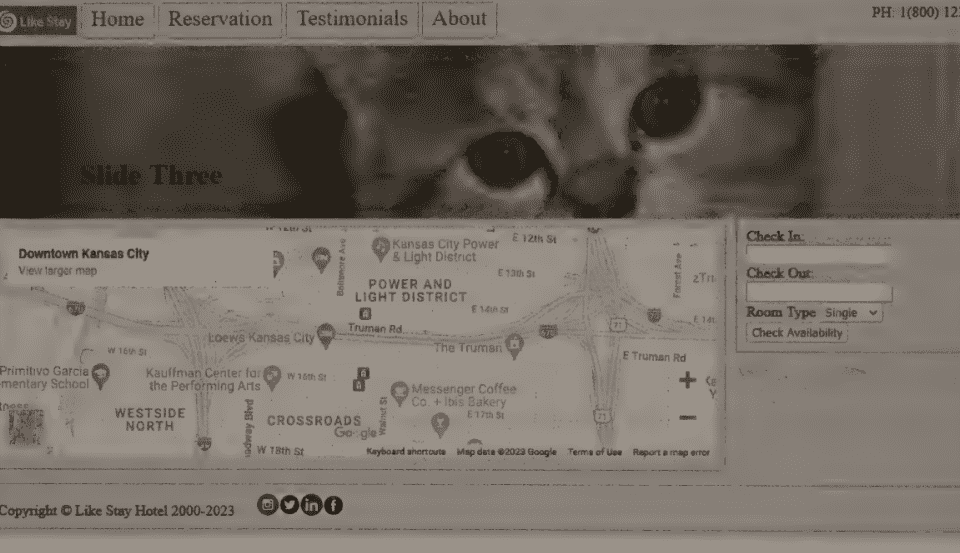

在“关于我们”页面，酒店的精髓通过迷人的图片和生动的描述展开。

“客户评价”展示了客人的赞誉，每条引言都配有缩略图、发布日期和反馈。

对于预订，专用页面提供无缝预订，并提供入住/退房日期和房型选项。每次成功的预订都会显示一个唯一的确认号。

为了满足现代需求，该网站具有响应式，能够无缝适应各种设备。锦上添花的是：jQueryUI 的日历为日期字段增添了色彩，丰富了用户体验。

## 8.2 项目解决方案

### 步骤 1：建立包含两个表的数据库

创建一个名为 `createDatabase.php` 的 PHP 文件，并嵌入以下代码。执行此脚本将生成一个包含两个表的 MySQL 数据库。

第一个名为 `room_type`，包含三个字段：`room_type_id`、`room_type_name` 和 `total_room`。值得注意的是，`total_room` 表示酒店内对应房型的房间数量。为了方便测试，我们将默认值预设为 3，允许每晚最多预订 3 间相同的房型。

第二个表 `reservation` 拥有五个字段：`reservation_id`、`room_type_id`、`begin_date`、`end_date` 和 `confirm_number`。`room_type_id` 存在于两张表中，用于确定预订中的房型类别。该字段作为外键，要求其值必须与 `room_type` 表中的 `room_type_id` 字段保持一致。这种严格的链接防止了对不存在的房型的错误预订。

```php
<!DOCTYPE html>
<html lang="en">
<head>
<meta charset="utf-8">
<title>Create Database</title>
</head>
<body>
<?php
$conn = mysqli_connect('localhost', 'root', '');
if ($conn){
    echo "<p>Connection set up successfully.</p>";
    mysqli_query($conn, "DROP DATABASE IF EXISTS hoteldb");
    if (mysqli_query($conn, "CREATE DATABASE hoteldb"))
    echo "<p>Database created successfully.</p>";
    mysqli_select_db($conn, "hoteldb");
    // room_type table
$query = "CREATE TABLE room_type(
room_type_id INT NOT NULL AUTO_INCREMENT,
room_type_name VARCHAR(100),
total_room INT DEFAULT 3,
CONSTRAINT pk_room_type PRIMARY KEY (room_type_id));"; 
    if (mysqli_query($conn, $query))
    echo "<p>room_type table created successfully.</p>";
    // reservation table
$query = "CREATE TABLE reservation(
reservation_id INT NOT NULL,
room_type_id INT NOT NULL,
begin_date DATE NOT NULL,
end_date DATE NOT NULL,
confirm_number CHAR(13),
CONSTRAINT pk_reservation PRIMARY KEY (reservation_id),
CONSTRAINT fk_reservation_room_type FOREIGN KEY (room_type_id) REFERENCES room_type (room_type_id));"; 
if (mysqli_query($conn, $query))
    echo "<p>reservation table created successfully.</p>";
mysqli_close($conn);
?>
</body>
</html>
```

### 步骤 2：添加文件以建立共享数据库连接

通过创建一个名为 `DBConn.php` 的 PHP 文件来简化项目的架构。在该文件中，关键的 PHP 代码对于数据库连接至关重要。`populate.php`、`reservation.php` 和 `checkAvailability.php` 脚本将通过 `INCLUDE()` 函数无缝地利用此共享连接的力量。你不需要手动执行此文件。

```php
<?php
function connDB() {
    global $mysqli;
    $mysqli = mysqli_connect("localhost", "root", "", "hotelDB");
    if (mysqli_connect_errno()) {
        printf("Connection failed: %s\n", mysqli_connect_error());
        exit();
    }
}
?>
```

### 步骤 3：填充 `room_type` 表

添加一个名为 `populate.php` 的 PHP 文件来填充 `room_type` 表（不包括 HTML 结构）。执行此文件将向 `room_type` 表填充房型：单间、双人间和家庭房。值得注意的是，`INSERT` 语句省略了 `room_type_id`，因为它是一个 `AUTO_INCREMENT` 字段。同样，它缺少 `total_room` 的特定值，因为它保留了 3 的默认设置。你应该重新运行此文件，建议先执行 `createDatabase.php` 以刷新数据库。

```php
<?php
INCLUDE("DBConn.php");
connDB();
$query = "SET sql_mode='NO_AUTO_VALUE';
INSERT INTO room_type (room_type_name, total_room) VALUES ('Single', 3);
INSERT INTO room_type (room_type_name, total_room) VALUES ('Double', 3);
INSERT INTO room_type (room_type_name, total_room) VALUES ('Family', 3);

if (mysqli_multi_query($mysqli, $query)) {
    echo "<p>Rows inserted successfully.</p>";
} else {
    echo "<p>Something is wrong.</p>";
}
mysqli_close($mysqli);
?>
```

### 步骤 4：为所有页面创建共享页眉

首先创建一个名为 `header.php` 的文件，以便在所有页面建立统一的页眉。此共享页眉包含了 `<head>` 和 `<nav>` 元素的代码。随后，四个页面（`home.php`、`reservation.php`、`testimonials.php` 和 `about.php`）将使用 `INCLUDE` 函数来引入 `header.php` 的内容。页眉文件还包含了 jQuery 库的链接，并需要一个 PNG 文件作为 Logo。

```php
<!DOCTYPE html>
<html lang="en">
<head>
<meta charset="utf-8">
<meta name="description" content="best hotel">
<meta name="viewport" content="width=device-width, initial-scale=1">
<link rel="stylesheet" href="hotel.css">
<link rel="stylesheet" href="slider.css">
<link rel="stylesheet" href="style.css">
<script src="https://code.jquery.com/ui/1.12.0/jquery-ui.js"></script>
<title><?php echo $page_title; ?></title>
</head>
<body>
<a href="home.php">Home</a>

<span><?php echo $page_title; ?></span>
<nav>
<ul>
<li><a href="home.php">Home</a></li>
<li><a href="reservation.php">Reservation</a></li>
<li><a href="testimonials.php">Testimonials</a></li>
<li><a href="about.php">About</a></li>
</ul>
</nav>
```

### 步骤 5：为所有页面创建统一页脚

类似于 `header.php`，为了确保网站的一致性，创建一个 `footer.php`。该文件会将 `<aside>` 和 `<footer>` 元素整合到所有页面。你需要 PNG 文件来配合社交媒体图标。

```html
<aside>
<form action="checkAvailability.php" method="post" onsubmit="return validate()">
  <label for="check">Check In:</label>
  <input type="text" id="check" name="checkin">
  <label for="checkout">Check Out:</label>
  <input type="text" id="checkout" name="checkout">
  <label for="roomtype">Room Type:</label>
  <select id="roomtype" name="roomtype">
  <?php
    if(!isset($mysqli)) {
      INCLUDE("DBConn.php");
      connDB();
    }
    $query = "SELECT * FROM room_type";
    $result = mysqli_query($mysqli, $query);
    if(mysqli_num_rows($result) > 0) {
      while($row = mysqli_fetch_assoc($result)) {
        echo '<option value="'.$row['room_type_id'].'>'.$row['room_type_name'].'</option>';
      }
    }
  ?>
  </select>
  <input type="submit" name="submit" value="Check Availability">
</form>
</aside>
<footer>
<span>Copyright&copy; Like Stay Hotel 2000-<?php echo date("Y"); ?></span>
<div id="socialgroup">
  
  
  
  
</div>
</footer>
<script src="https://code.jquery.com/jquery-1.12.4.js"></script>
<script src="calendar.js"></script>
<script src="validates.js"></script>
</body>
</html>
```

# 第 8 章 构建主页

使用以下代码生成 `home.php`。该页面包含了 `header.php` 和 `footer.php`、一个轮播幻灯片以及一个显示地图的嵌入 `<<iframe>>`。为了避免手动输入 `<iframe>` 的 `src` 属性，请按照以下步骤操作：访问 `google.com`，输入地址，点击地图，并选择“嵌入”（embed）`<iframe>` 代码。复制此代码并插入到你的文件中。为轮播准备好三个图像文件——请注意，轮播功能将在后续步骤中被激活。


```php
<?php
$page_title = "Home";
include ("header.php");
?>
<div id="slideshow">
  <div class="slide">
    <div class="slideText">
      <h1 class="slideHeading">Slide One</h1>
    </div>
  </div>
  <div class="slide">
    <div class="slideText">
      <h1 class="slideHeading">Slide Two</h1>
    </div>
  </div>
  <div class="slide">
    <div class="slideText">
      <h1 class="slideHeading">Slide Three</h1>
    </div>
  </div>
</div>
<div id="main">
  <!-- Page unique content -->
  <iframe src="https://google.com/maps/embed?pb=!1m18!1m12!1m3!1d3096.708753800547!2d94.58359684643294!3d39.09033167954138!2m3!1f0!2f0!3f0!3m2!1i1024!2i2176!4v1" width="100%" height="250px" border="0"></iframe>
<script src="slider.js"></script>
<?php
  include ("footer.php");
?>
```

## 第 7 步：使用 CSS 为页面样式

添加一个名为`style.css`的 CSS 文件并包含以下代码：

```css
body {
  background-color: lightgrey;
}
#logo {
  display: block;
  margin: auto;
}
nav ul {
  list-style-type: none;
  padding: 0;
}
nav ul li {
  text-align: center;
  border: 1px solid gray;
  padding: 10px;
  margin-bottom: 1px;
}
nav ul li a {
  text-decoration: none;
  font-size: 1.5em;
}
#main, footer, aside {
  border: 1px solid gray;
  margin-bottom: 15px;
  padding: 10px;
}
.social {
  width: 1.5em;
  float: right;
}
[type] {
  display: block;
}
#socialgroup {
  display: inline-block;
  margin-left: 20px;
}
nav ul li a:hover {
  color: red;
}
nav ul li:hover {
  background-color: white;
}
/* for wider screen */
@media only screen (min-width: 45em) {
  #logo {
    display: inline;
    height: 2em;
    float: left;
    margin-right: 5px;
  }
  nav ul li {
    display: inline;
  }
  #main {
    width: 70%;
    float: left;
  }
  aside {
    width: 25%;
    float: left;
    margin-left: 1px;
  }
  footer {
    clear: left;
  }
  #phone {
    padding-right: 20px;
    float: right;
  }
}
```

## 第 8 步：让轮播工作（部分1）

添加一个名为`slider.js`的 JavaScript 文件并包含以下代码。这是轮播的一部分：

```javascript
let currentSlide = 0;
let slideInterval = setInterval(nextSlide, 3000);
function nextSlide() {
  currentSlide = (currentSlide + 1) % 3;
  document.getElementsByClassName('slideshow')[0].style.transform = `translateX(-${currentSlide * 33.3}%)`;
}
```

## 第 9 步：让轮播工作（部分2）

添加一个名为`slider.css`的 CSS 文件并包含以下代码。该文件是轮播必需的：

```css
#slideshow {
  position: relative;
  width: 100%;
  height: 100%;
  overflow: hidden;
}
.slideshowwindow {
  display: -webkit-flex; /* Safari */
  display: flex;
  width: 300%;
  height: 100%;
  transition: transform 0.5s ease;
}
.slide {
  width: 100%;
  height: 100%;
}
.slide img {
  width: 100%;
  height: 100%;
  object-fit: cover;
}
.slideText {
  position: absolute;
  top: 100px;
  padding-left: 100px;
}
```

## 第 10 步：让日历工作

添加一个名为`calendar.js`的 JavaScript 文件并包含以下代码。该文件用于使用 jQuery 显示日历。该文件还会更改日期格式以符合 PHP 的格式：

```javascript
$(document).ready(function() {
  $("#checkin, #checkout, #checkInDate, #checkOutDate").datepicker({dateFormat: 'yy-mm-dd'});
})
```

## 第 11 步：验证日历输入

添加一个名为`validate.js`的文件并包含以下代码，以确保退房日期晚于入住日期：

```javascript
function validate() {
  var startDate = document.getElementById('checkin').value;
  var endDate = document.getElementById('checkout').value;
  if (startDate >= endDate) {
    alert("Check out must be later.");
    return false;
  }
  return true;
}
```

# 第 8 章 酒店项目

## 第 12 步：实现可用性检查功能

创建一个名为`checkAvailability.php`的 PHP 文件并包含以下代码。该文件不会直接向用户显示内容，全是 PHP 代码。页面将统计在此期间预订了多少种房间。此数字用于判断房间类型是否可用：

```php
<?php
session_start();
if (isset($_POST['submit'])) {
    // 连接到服务器
    include("DBConn.php");
    connDB();
    $checkInDate = $_POST['checkin'];
    $checkout = $_POST['checkout'];
    $roomTypeId = $_POST['roomtype'];
    $statement = "SELECT total_room FROM room WHERE room_type_id = '$roomTypeId'";
    if ($result = mysqli_query($mysqli, $statement)) {
        while ($row = mysqli_fetch_object($result)) {
            $noOfRoom = $row->total_room;
        }
    }
    // 查找有多少房间不可用
    $statement = "SELECT COUNT(*) AS roomReserved FROM reservation WHERE room_type_id = '$roomTypeId' AND (begin_date <= '$checkInDate' AND end_date > '$checkInDate' OR begin_date < '$checkout' AND end_date >= '$checkout' OR begin_date <= '$checkInDate' AND end_date > '$checkout')";
    if ($result = mysqli_query($mysqli, $statement)) {
        while ($row = mysqli_fetch_object($result)) {
            $roomTaken = $row->roomReserved;
        }
    }
    $available = $noOfRoom - $roomTaken;
    if ($available > 0) {
        $_SESSION['availability'] = "The room is available. Reserve your room now";
        $_SESSION['checkin'] = $checkInDate;
        $_SESSION['checkout'] = $checkout;
    } else {
        $_SESSION['availability'] = "Sorry, not available. Select a different date or a room type";
        $_SESSION['checkin'] = "";
        $_SESSION['checkout'] = "";
    }
    header("Location: reservation.php");
}
mysqli_close($mysqli);
?>
```

## 第 13 步：创建预订文件

使用以下代码创建预订文件。除了使用 HTML 表单外，该页面还会检查在此期间该种类型的房间是否可用。

```php
<?php
$page_title = "Reservation";
include ("header.php");
<!-- Page unique content -->
<div id="main">
<?php
session_start();
if (isset($_availability']))
?>
<form action="" method="post">
  <p>
    <label for="checkInDate">Pick In Date:</label>
    <input type="text" id="checkInDate" name="checkInDate" value="<?php echo $_SESSION['checkin']; ?>">
  </p>
  <p>
    <label for="checkOutDate">Pick Out Date:</label>
    <input type="text" id="checkOutDate" name="checkout" value="<?php echo $_SESSION['checkout']; ?>">
  </p>
  <p>
    <label for="roomType">Pick Room Type:</label>
    <select name="roomType" id="roomType">
    <?php
    if(!isset($mysqli)) {
      include ("DBconn.php");
      connDB();
    }
    $query = "SELECT * FROM room_type";
    $result = mysqli_query($mysqli, $query);
    if(mysqli_num_rows($result) > 0){
      while($row = mysqli_fetch_assoc($result)){
        echo '<option value="'.$row['room_type_id']."'">'.$row['room_name'].'</option>';
      }
    }
    ?>
    </select>
  </p>
  <p>
    <input type="submit" name="submit" value="Make Reservation">
  </p>
</form>
<?php
if (isset($_POST['submit'])) {
    if(!isset($mysqli)) {
      include ("DBConn.php");
      connDB();
    }
    $checkInDate = $_POST['checkInDate'];
    $checkout = $_POST['checkout'];
    $roomTypeId = $_POST['roomType'];
    $confirmNumber = uniqid(); // need total room from room_type table
    $statement = "SELECT total_room FROM room_type WHERE room_type_id = '$roomTypeId'";
    if ($result = mysqli_query($mysqli, $statement)) {
        while ($row = mysqli_fetch_object($result)) {
            $noOfRoom = $row->total_room;
        }
    }
    // find out有多少 rooms不可用
    $statement = "SELECT COUNT(*) AS roomReserved FROM reservation WHERE room_type_id = '$roomTypeId' AND (begin_date <= '$checkInDate' AND end_date > '$checkInDate' OR begin_date < '$checkout' AND end_date >= '$checkout' OR begin_date <= '$checkInDate' AND end_date > '$checkout')";
    if ($result = mysqli_query($mysqli, $statement)) {
        while ($row = mysqli_fetch_object($result)) {
            $roomTaken = $row->roomReserved;
        }
    }
    $available = $noOfRoom - $roomTaken;
    if ($available > 0) {
        $insertStatement = "INSERT INTO reservation (room_type_id, begin_date, end_date, confirm_number) VALUES ('$roomTypeId', '$checkInDate', '$checkout', '$confirmNumber')";
    }
}
?>
</div>
<div class="social">
  <?php
  if (isset($_SESSION['availability'])) {
    echo $_SESSION['availability'];
  }
  ?>
</div>
<?php include ("footer.php"); ?>
<script src="slider.js"></script>
<script src="calendar.js"></script>
<script src="validate.js"></script>
<script>
$(document).ready(function() {
  $("#checkin, #checkout, #checkInDate, #checkOutDate").datepicker({dateFormat: 'yy-mm-dd'});
  if("form").submit("function() {
    return validate();
  });
});
</script>
```


```php
if (mysqli_query($mysqli, $insertStatement))

    echo "<p>预约成功。您的确认号是 $confirmNumber</p>";

} else {

    echo "<p>抱歉，无源。请选择不同的日期或不同的房型</p>";

}

?>

</div>

<?php

include ("footer.php");

?>
```

## 步骤 14：创建客户反馈页面（testimonials）

使用以下代码开始`testimonials.php`文件。这包含了用于写入和读取文本文件的 PHP 代码。请在同一文件夹下添加名为`testimonials.txt`的空白文本文件。

```php
<?php

$page_title = "Testimonials";

include ("header.php");

?>

<div id="main">

<form action="" method="post" enctype="multipart/form-data">

<br><p>您的姓名：

<br><input type="text" name="name" size="30" maxlength="30">

</p><p>您的评论：

<br><textarea name="comment" rows="7" cols="35">

</textarea>

</p>

<label for="myPhoto">上传文件：</label>

<input type="file" id="myPhoto" name="myPhoto">

<br>

<input type="submit" name="submit" value="提交">

<input type="submit" name="view" value="查看">

<br>

</form>

<?php

if (isset($_POST['submit'])) {

    $destination = "";

    move_uploaded_file($FILES['myPhoto']['tmp_name'],

    $destination.$FILES['myPhoto']['name']);

    $myFile = "testimonials.txt";

if(is_writable($myFile)) {
```

# 第 8 章 酒店项目

```php
file_put_contents($myFile, $_POST['name']..PHP_EOL, FILE_APPEND);

file_put_contents($myFile, $_FILES['myPhoto']['name']..PHP_EOL, FILE_APPEND);

file_put_contents($myFile, $_POST['comment']..PHP_EOL, FILE_APPEND);

file_put_contents($myFile, date('m/d/Y')...PHP_EOL, FILE_APPEND);

echo "<p>感谢您!</p>";

} else {

    echo "<p>出错了。</p>";

}

if (isset($_POST['view'])) {

    $allComments = file("testimonials.txt");

    for ($i = 0; $i < count($allComments); $i+= 4) {

        echo $allComments[$i];

        echo "<br>";

        $allComments = $allComments[$i+1];

        echo "";

        echo "<br>";

        echo $allComments[$i+2];

        echo "<br>";

        echo $allComments[$i+3];

        echo "<br>";

    }

}

?>

</div>

<?php

    include("footer.php");

?>

```

## 步骤 15：创建关于我们页面

使用以下代码开始`about.php`文件。添加更多内容和图片来增强关于我们页面。

```php
<?php

$page_title = "About";

include("header.php");

?>

<div id = "main">

    <p>在此添加关于页面的内容。</p>

</div>

<?php

    include("footer.php");

?>
```

# 附录：React JS、PHP 和 MySQL

# 章节学习成果

9.1 使用 React JS、PHP 和 MySQL 开发一个简单的全栈项目

## 9.1 简介

在本附录中，我们展示了一个简单的示例，利用 React JS 作为前端，并使用 PHP 和 MySQL 作为后端。我们将引导你完成创建数据库、允许用户向表中添加记录以及查看表内所有记录的过程。

### 步骤 1：在数据库中创建表

首先，在根目录下创建一个名为`contact.php`的 PHP 文件。插入以下代码：

```html
<!DOCTYPE html>
<html lang="en">
<head>
<meta charset="utf-8">
<title>创建表</title>
</head>
<body>
<?php

$conn = mysqli_connect('localhost', 'root', '');

if ($conn) {

echo "<p>连接成功。</p>";

$query = "DROP DATABASE IF EXISTS contactDB";
```

```php
mysqli_query($conn, $query);

$query = "CREATE DATABASE contactDB";

if (mysqli_query($conn, $query)) {

echo "<p>数据库创建成功。</p>";

mysqli_select_db($conn, "contactDB");

$query = "CREATE TABLE users (

id INTEGER AUTO_INCREMENT,
  name VARCHAR(200) NOT NULL,
  email VARCHAR(200) NOT NULL,
  PRIMARY KEY (id)
);

if (mysqli_query($conn, $query)) {

echo "<p>表创建成功。</p>";

mysqli_close($conn);

}

?>

</body>
</html>
```

### 步骤 2：向表中添加记录

在根目录下创建一个名为`insert.php`的 PHP 文件，使用以下代码：

```html
<!DOCTYPE html>
<html lang="en">
<head>
  <meta charset="utf-8">
  <script src="https://unpkg.com/react@18/umd/react.development.js" crossorigin="anonymous"></script>
  <script src="https://unpkg.com/react-dom@18/umd/react-dom.development.js" crossorigin="anonymous"></script>
  <script src="https://unpkg.com/babel/standalone/babel.min.js"></script>
  <title>插入联系人</title>
</head>
<body>
<div id="myReact"></div>
<script type="text/babel">
  const { useState, useEffect } = React;

  function Form() {
    const [name, setName] = useState('');
    const [email, setEmail] = useState('');

    const handleSubmit = (event) => {
      event.preventDefault();

      // 构建请求
      const data = new FormData();
```

```javascript
data.append('name', name);
data.append('email', email);
```

```javascript
// 发送请求
fetch('insert.php', {
  method: 'POST',
  body: data
}).then(response => response.json())
.then(data => console.log(data))
.catch(error => console.error(error));

return (
<form onSubmit={handleSubmit}>
  <label>
    姓名：
    <input type="text" value={name} onChange={e => setName(e.target.value)} />
  </label>
  <label>
    邮箱：
    <input type="text" value={email} onChange={e => setEmail(e.target.value)} />
  </label>
  <button type="submit">提交</button>
</form>
);
}

const root = ReactDOM.createRoot(document.getElementById('myReact'));
root.render(<Form />);
</script>
```

```php
<?php

// 清洗用户输入
$name = mysqli_real_escape_string($conn, $_POST['name']);
$email = mysqli_real_escape_string($conn, $_POST['email']);

// 构建 SQL 语句
$sql = "INSERT INTO users (name, email) VALUES ('$name', '$email')";

// 执行查询并检查错误
if (mysqli_query($conn, $sql)) {
    $response = array('success' => true, 'message' => '记录插入成功');
} else {
    $response = array('success' => false, 'message' => '插入错误: ' . mysqli_error($conn));
}

// 以 JSON 返回响应
header('Content-Type: application/json');
echo json_encode($response);

// 关闭数据库连接
$conn->close();

?>
```

### 步骤 3：从表中显示所有记录

添加带有代码的 PHP 文件`display.php`：

```html
<!DOCTYPE html>
<html lang="en">
<head>
    <meta charset="utf-8">
    <script src="https://unpkg.com/react@18/umd/react.development.js" crossorigin="anonymous"></script>
    <script src="https://unpkg.com/react-dom@18/umd/react-dom.development.js" crossorigin="anonymous"></script>
    <script src="https://unpkg.com/babel/standalone/babel.min.js"></script>
    <title>列出所有联系人</title>
</head>
<body>
    <div id="myReact"></div>
    <script type="text/babel">
        const { useState, useEffect } = React;

        function UserList() {
          const [users, setUsers] = useState([]);

          useEffect(() => {
            // 从 API 获取数据
            fetch('reactphretrieve.php')
              .then(response => response.json())
              .then(data => setUsers(data))
              .catch(error => console.error(error));
          }, []);

          return (
            <div>
              <h2>联系人列表</h2>
              <ul>
                {users.map(user => (
                  <li key={user.id}>
                    <h3>{user.name}</h3>
                    <p>{user.email}</p>
                  </li>
                ))}
              </ul>
            </div>
          );
        }

        const root = ReactDOM.createRoot(document.getElementById('myReact'));
        root.render(<UserList />);
    </script>
</body>
</html>
```

```php
<?php

// 设置允许跨域请求
header('Access-Control-Allow-Origin: *');
header('Content-Type: application/json');

// 连接数据库
$pdo = new PDO('mysql:host=localhost;dbname=contactDB', 'root', '');

// 从数据库中查询用户
$stmt = $pdo->query('SELECT id, name, email FROM users');
$users = $stmt->fetchAll(PDO::FETCH_ASSOC);

// 以 JSON 返回用户
echo json_encode($users);

?>
```
