# Web技术及其应用


Pundalik Chavan 教授
Husna Tabassum 教授


# Pundalik Chavan 教授 (B.E, M.E, (博士))

 班加罗尔 HKBK 工程学院计算机科学与工程系 助理教授

# Husna Tabassum 教授 (B.E, M-Tech)

 班加罗尔 HKBK 工程学院计算机科学与工程系 助理教授


序言

本书汇总了我们作为教育工作者在过去二十年里，在贝尔加姆维斯大学（VTU）的各种与 Web 技术及其应用相关的本科课程中经常涵盖的主题。本书也可以作为更高级水平的教材，让读者接触日益常见且更合适的替代性和现代计算框架。

Web 开发是不断演变的语言集合，这些语言协同工作，利用互联网作为传输机制在各方之间接收、修改和交付数据。虽然在概念上很容易描述，但其实施过程伴随着极其丰富的语言、平台、模板、框架、指南和标准。本文通过内部示例关注概念和基础，让开发者对 Web 开发的各种元素理解，提供了一个基础，使其能够更容易过渡到其他语言，并更好地理解如何开展工作。

促使我们再写一本关于算法的书的原因是由于对许多计算范式的理解发生了几个重要且微妙的变化，以及某些重大发现和不断变化的技术产生的新出的相对重要性。作为老师和导师，我们有责任在年轻人中培养正确的专注，让他们继续享受这项智力上的挑战性活动，并为该研究领域的加强做出贡献。

作者，Pundalik Chavan
Husna Tabassum

# 简介

Pundalik Chavan 教授于2010年毕业于印度卡纳塔塔克邦贝尔加维的 Visvesarayya 科技大学获得计算机科学与工程学士学位，2013年毕业于班加罗尔大学获得 M.E. 硕士学位。他正在卡纳塔塔克邦班加罗尔理工学院的 VTU-RC 攻读博士。他在教学/研究领域拥有 10 年以上的工作经验。ISTE 和 IAENG 终身会员。他目前担任班加罗尔 HKBK 工程学院计算机科学与工程系的助理教授。组织并主持了 SDP/网络研讨会/会议。他的研究领域是无线网络、数据通信、网络安全、计算机网络、物联网、区块链技术。他在各种国家和国际期刊及会议上发表了 6 篇论文。

Husna Tabassum 于贝尔加姆 VTU 获得计算机科学与工程 M-Tech 学位。她目前担任班加罗尔 HKBK 工程学院助理教授。她在教学领域拥有 8 年工作经验。ISTE 终身会员。她组织并主持了“基于 Python 的机器学习”增值课程和“使用 JSP 开发 Web 应用”研讨会。目标是追求具有稳步成长的挑战性职业，并为组织的成功做出价值贡献。研究兴趣是数字图像处理、网络安全、云计算。

# Web 技术及其应用（自2018-2019 学年起生效）第六学期

课程代码：18CS63
学分：4
总课时：60/50 小时

课程学习目标：本课程使学生能够：
- 阐 HTML 和 CSS 的语义结构
- 使用 HTML 和 CSS 编写表单和表格
- 使用 JavaScript 设计客户端程序，使用 PHP 设计服务端程序
- 研究 PHP 的面向对象编程能力
- 检查 jQuery 和 Backbone 等 JavaScript 框架，使开发者专注于核心功能。

### 模块 1
HTML 简介，什么是 HTML？HTML 语法，语义化标记，HTML 文档结构，HTML5 语义元素，CSS 简介，什么是 CSS？CSS 语法，样式位置，选择器，层如何交互，盒模型，CSS 样式。

# 模块 2
表格和表单：引入表格，表单控件元素，表格和表单访问性，标准流，布局元素，响应式设计。

### 模块 3
JavaScript：客户端脚本，什么是 JavaScript 以及它能做什么？JavaScript 设计原则，JavaScript 对象，文档对象模型 (DOM)，JavaScript 事件，服务端开发简介，PHP。

### 模块 4
PHP 数组和全局变量，$_GET 和 $_POST，$_SERVER 数组，$_FILES 数组，PHP 类和对象，面向对象设计，错误处理与验证，什么是错误和异常？PHP 错误报告。

### 模块 5
状态管理：Web 应用的状态，通过查询字符串传递信息，通过 URL 路径传递信息，Cookie，序列化，会话状态，HTML5 存储，缓存，高级 JavaScript 和 jQuery，JavaScript 伪类，jQuery 基础，AJAX，异步文件传输，动画，Backbone MVC 框架，XML 处理，JSON，Web 服务概述。

学生将能够：
- 适应 HTML 和 CSS 的语法和语义来构建网页
- 使用 HTML 和 CSS 构建并格式化表格和表单
- 使用 JavaScript 开发客户端脚本，使用 PHP 动态生成和显示内容
- 评估 PHP 的面向对象开发原则
- 检查 jQuery 和 Backbone 等 JavaScript 框架

试卷模式：
- 试卷共有十道题
- 每道大题 20 分
- 每个模块有 2 道大题（最多四道小题）
- 每道大题将涵盖模块下的所有主题
- 学生需要回答 5 道大题，每个模块选一道。

教材：
1. Randy Connolly, Ricardo Hoar, "Fundamentals of Web Development", 第一版，Pearson Education India. (ISBN: 978-9332572571)

参考：
1. Robin Nixon, “Learning PHP, MySQL & JavaScript with jQuery, CSS and HTML5”, 第四版，O’Reilly Publications, 2015. (ISBN: 9352130153)
2. Luke Welling, Laura Thomson, “PHP and MySQL Web Development", 第五版，Pearson Education, 2016. (ISBN: 978-8236582736)
3. Nicholas C Zakas, “Professional JavaScript for Web Developers”, 第三版，Wrox/Wiley India, 2012. (ISBN: 978-8126530888)
4. David Sawyer Mcfarland, “JavaScript & jQuery: The Missing Manual", 第一版，O’Reilly/Schroff Publishers & Distributors Pvt Ltd, 2014.


# 强制注意事项：

CIE 分数分配如下（总分 40 分）：
20 分通过内部评估（IA）测试
20 分通过实践性评估

# 请保留报告副本，以便在 LIC 访问期间进行核实。

可能的实践项目列表：

- 1. 编写一个 JavaScript 设计一个简单的计算器，执行以下操作：加法、乘法、减法和除法。
- 2. 编写一个 JavaScript，计算 0 到 10 数字的平方和立方，并输出 HTML 文本，以 HTML 表格格式显示这些值。
- 3. 编写一个 JavaScript，在每隔 100ms 的间隔用红色逐渐增大字体号显示“TEXT-GROWING”文本，当字体号达到 50pt 时，用蓝色显示“TEXTSHRINKING”。然后字体号减小到 5pt。
- 4. 开发并演示一个 HTML5 文件，其中包含的 JavaScript 脚本使用函数解决以下问题：
    a. 参数：一个字符串
    b. 输出：字符串中最左侧元音的位置
    c. 参数：一个数字
    d. 输出：数字反转后的数字
- 5. 设计一个 XML 文档，存储某某 VTU 附属工程学院的学生信息。信息必须包括 USN（学号）、姓名、学院名称、专业、入学年份和邮箱。为 3 名学生编写示例数据。创建一个 CSS 样式表并使用它来显示文档。
- 6. 编写一个 PHP 程序，跟踪访问网页的人数并带有适当的标题显示这些访问人数。
- 7. 编写一个 PHP 程序，显示一个显示服务器当前时间的数字时钟。
- 8. 编写 PHP 程序完成以下操作：
    a. 实现简单的计算器算术。
    b. 寻找矩阵的转置。
    c. 两个矩阵的乘法。
    d. 两个矩阵的加法。
- 9. 编写一个名为 states.py 的 PHP 程序，声明变量 `states` 为 "Mississippi Alabama Texas Massachusetts Kansas"。编写一个 PHP 程序执行以下操作：
    a. 在变量 `states` 中搜索以 "xas" 结尾的单词。在名为 `List` 的列表元素 0 中搜索该单词。
    b. 在 `states` 中搜索以 "k" 开头并以 "s" 结尾的单词。执行不区分大小写的比较。[注：将 re.las 作为第二个参数传递给 compile 方法执行不区分大小写的比较。]将此单词存储在 `states List` 的 element1 中。
    c. 在 `states` 中搜索以 "M" 开头并以 "s" 结尾的单词。将此单词存储在列表元素 2 中。
    d. 在 `states` 中搜索以 "s" 结尾的单词。将此单词存储在列表元素 3 中。
- 10. 编写一个 PHP 程序，使用选择排序对存储在数据库中的学生记录进行排序。

# 模块-1
Web 基础，XHTML-1

## 1.1 互联网简介

起源：

- 20世纪60年代
美国国防部（DoD）对开发一种替代性的大型网络产生了兴趣。

该网络的功能是为执行国防合同的研究人员提供通信、程序共享和远程笔记本电脑访问。

美国国防部高级研究计划署（ARPA）资助了此类主要网络的开发。随后它被命名为 ARPANet。

ARPANet 的早期主要用途是通过电子邮件进行简单的基于文本的通信。

## 2. 20世纪70年代末和80年代初

BITNET（即 护理协会人员网络缩写）作为其 Time Network 的结果，始于约克大学。它设计之初是为了提供电子邮件和文件传输服务。CSNET 是用于工程科学网络的计算机科学网络。其最初目的是提供部分电子邮件服务。

## 3. 20世纪90年代

NSFnet 创建于 1986 年，并在 1990 年取代了 ARPANet。它由国家科学基金会（NSF）赞助。到 1992 年，NSFnet 连接了全球约一百万台计算机。1995 年，NSFnet 的一部分变成了骨干网络，其余部分被称为 Internet。

# 什么是互联网？

互联网可以是连接在非常大的通信网络中的大量计算机。传输控制协议/网际协议（TCP/IP）于 1982 年成为网络连接的标准。与其将网上的每台 PC 连接到网上的每台不同 PC，通常是公司内的单台计算机连接到本地网络中的每个不同设备。该本地网络上的一个节点物理上连接到互联网。因此，互联网实际上是网络网络，而不是计算机网络。显然，所有连接到互联网的设备都应该被明确标识。

#  IP 地址

连接到网络的机器的网际协议（IP）地址可以是独特的 32 位范围。由点分隔的位数字。这四个部分是互联网路由计算机用于选择消息的单元，信息应该到达其目的地。尽管人们几乎总是使用域名，但信息科学工作同样有效。例如，将名称转换为其 IP 地址。

美国航空（www.ual.com）的 IP 地址是 209.87.113.93。因此，如果浏览器指向 http://209.87.113.93，它将连接到美国航空网站。

## 1.1 什么是 HTML？它源自哪里？

HTML 在1997 年由万维网联盟（W3C）规范化。HTML 的历史涉及到 20 世纪 90 年代浏览器制造商的竞争，W3C 推出了一系列新标签，例如 CSS 和 JavaScript，这些对网络的发展至关重要。HTML 被定义为一种标记。标记术语源于印刷时代，当时编辑会在手稿页上写指令。

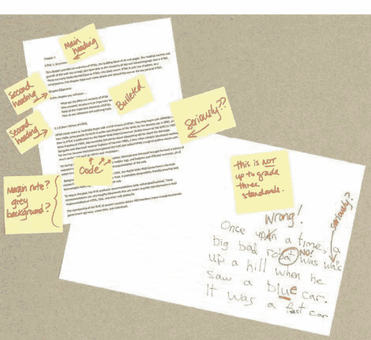

# 图 1.1 示例示例标记语言 1.1.1 XHTML

在 20 世纪 90 年代末，W3C 不再扩展 HTML，而是关注一种名为 XHTML 1.0 的新规范，它是使用更严格的 XML（扩展标记语言）的 HTML 版本。创建了两个版本：XHTML 1.0 Strict 和 XHTML 1.0 Transitional。

Strict 版本的设计是为了让浏览器使用 W3C XHTML 1.0 Strict 规范的语法规则支持；Transitional 建议是一个更宽容的 XHTML 版本，旨在作为最终全球采用 XHTML Strict 的临时桥。

XHTML Strict 的目标是创建可预测和渲染的 Web 文档。事实上，在 2000 年的大部分时间里，技术 Web 开发社区关注标准：即遵循 W3C XHTML 规范。使用 HTML 验证器（见图 1.2）作为检查 页面标记是否符合 XHTML Transitional 或 Strict 指南的方法，是 Web 开发社区标准运动的核心部分。


在 2000 年。

HTML 被提议以一种突破性且重大的方式进行更改。最重的变化是取消了 HTML 和 XHTML 1.0 的向后兼容。浏览器将对无效标记进行更严厉的惩罚。

``、`<a>`、`<br>` 以及编号标题 `<h1>` 等标签也从 XHTML 2.0 规范中被删除。

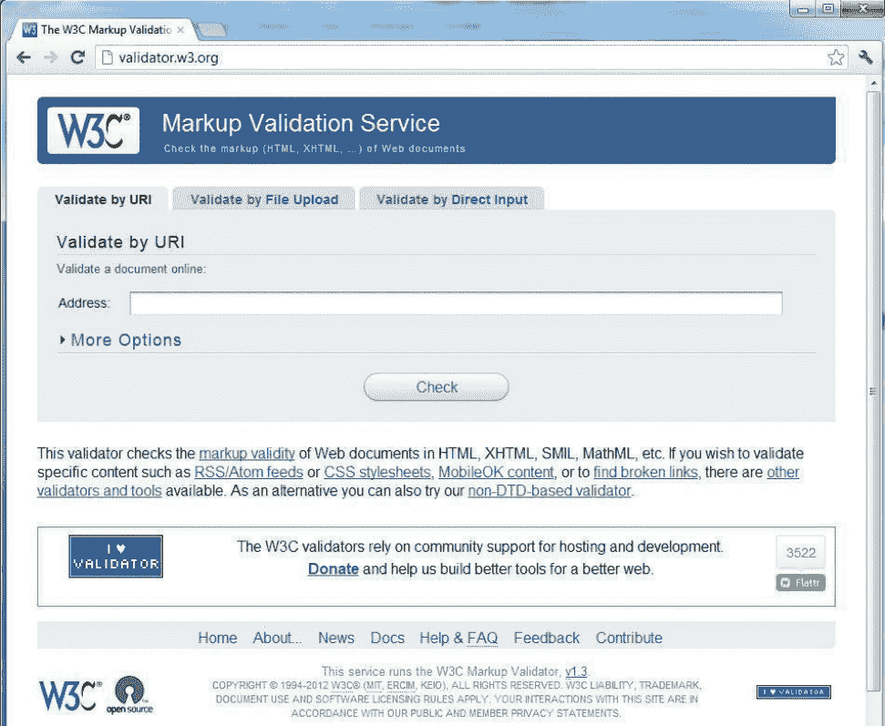

此验证器检查 HTML、XHTML、XML、MathML 等 Web 文档标记有效性。如果您想验证特定内容（如 RSS/Atom Feed、CSS 样式表、MobileOK 内容或查找损坏链接），可以使用其他验证器和工具。作为替代，您也可以尝试我们的非基于 DTD 的验证器。

图 1.2：W3C XHTML 验证服务

### 1.1.2 HTML5

在开发 XHTML 2.0 规范期间， Opera 和 Mozilla 的一组开发者在 W3C 内部创立了 WHATWG（Web 超文本应用技术工作组）。HTML5 有三个主要目标：

1. 明确定义浏览器如何处理无效标记。
2. 为开发富内容的 Web 应用提供一个免费、非专有的编程平台（通过 JavaScript）。
3. 它应该与现有网站保持向后兼容。

## 1.3 HTML

在网页创建等领域，需求、标准和浏览器不断变化，学习在多个标准中生存下来的基本原理和词汇至关重要。

### HTML 5 的目标

1. 模糊地规定浏览器如何处理无效标记。
2. 提供一个开放的、非专有的编程框架。
3. 与现有网络保持向后兼容。

### 1.3.1 元素和属性

HTML 记录由基于文本的组件组成。HTML 组件实体（substance）和 HTML 术语经常与“标签”（tag）一词交替使用。在任何情况下，HTML 组件是一个更广泛的术语，包含了点区域内的组件名称（即标签）以及标签内部的实体（尽管某些组件不包含额外的实体）。

HTML 组件在 HTML报告中通过标签（labels）进行区分。标签由点区域内的组件名称组成。组件名称同时出现在起始标签和结束标签中，其中包含一个斜杠，后跟元素名称，再次封装在角括号内。

结束标签的作用就像起始标签的关闭开关。HTML 组件同样可以包含属性（credits）。HTML 属性是 `name=value` 键对，提供了有关 HTML 组件的更多数据。在 XHTML 中，属性值必须封装在引号中；在 HTML5 中，这些语句是可选的，尽管许多 Web 作者仍然保持着将属性值封装在引号中的习惯。某些 HTML 属性的数值是数字。这些将仅仅是数字数值；它们永远不会包含单位。

图 1.3 显示了 HTML 组件的各个部分，包括一个空 HTML 组件的插图。空组件不包含任何内容；总而言之，它是让程序完成组件的指令，即 ``。也许最基本的空元素就是图片组件。在 XHTML 中，空元素必须由空斜杠结束（如图 1.3 所示）。

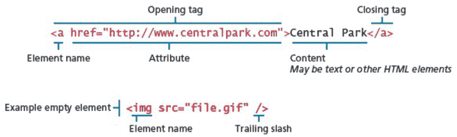

## 图 1.3：HTML 元素的各个

HTML 部分甚至可以包含属性。关联标记属性可能是 `name=value` 组合，包含许多关于标记语言组件的大量数据。在 XHTML 中，属性值必须封装在引号中；在 HTML5 中，引号是可选的，尽管许多互联网作者仍然保持着用引号包裹属性值的习惯。

图 1.3 说明了一个超文本标记语言组件的各种组成部分，以及一个空超文本标记语言组件的示例。空组件不包含任何内容；相反，它是告诉浏览器尝试执行某件事的指令。最常见的空元素是 `` 图片组件。在 XHTML 中，空元素必须用尾斜杠终止（如图 1.3 所示）。在 HTML5 中，空元素中的尾斜杠是可选的。

## 1.2.2 语义化标记

HTML 文档描述内容的结构语义或含义。

各种优势如下：

- 可维护性：语义化标记更容易更新和更改包含大量演示标记的网页。
- 速度更快：它们的编写更快，下载速度也更快。
- 可访问性：如果网站不使用语义化标记，使用语音读取软件访问网页将是一个非常令人沮丧的体验。
- 搜索引擎优化：语义化标记为搜索引擎爬虫提供了更好的指令，因为它们是某些网站中最重要的用户。

## 1.3 HTML 文档的结构

```html
<!DOCTYPE html>
<html lang="eng">
<meta charset="utf-8"/>
<title>HKKBCE</title>
<link rel="stylesheet" href="css/5.css" /> <script src="html5pgm.js"></script>
</head>
<body>
<h1>CSE</h1>
</body>
</html>
```

### DOCTYPE

- 指向文档类型定义（Document Type Definition）。
- 它告诉浏览器即将要处理的是什么种类型的文档。
- 同时也表示文档中包含的 HTML 版本。

### HEAD

- HTML 页面分为两个部分：头部（head）和正文（body）。头部包含关于文档的描述性元素，例如：
  i. 标题（title）
  ii. 样式表（style sheets）
  iii 使用的 JavaScript 文件
  iv. 搜索引擎和其他程序使用的各种元数据（meta information）。

### 1. <meta> 标签

`<meta>` 标签提供了关于 HTML 文档的元数据。元数据不会显示在页面上，但可以被机器解析。元数据元素通常用于指定：

- 页面描述
- 关键词
- 文档作者
- 最后修改时间
- 其他元数据。

元数据可以被浏览器（如何显示内容或重新加载页面）、搜索引擎（关键词）或其他 Web 服务使用。`<meta>` 标签始终位于 `<head>` 内部。

### 2. <link> 标签

`<link>` 标签定义了文档与外部资源之间的链接。`<link>` 标签用于链接到外部样式表。`<link>` 元素是一个空元素；它只包含属性。该元素位于头部，可以出现任意次数。

```html
示例：<link rel="stylesheet" type="text/css" href="theme.css">
```

### 3. <script> 标签

`<script>` 标签用于定义客户端脚本（JavaScript）。`<script>` 元素包含脚本语句，或者通过 `src` 属性指向外部脚本文件。JavaScript 的常见用途包括图像处理、表单验证和内容的动态更改。

```html
示例：<script src="js/htmlpgm.js"></script>
```

## 1.4 HTML 元素快速浏览

### 1. 标题

HTML 提供了 6 级标题——`<h1>` 到 `<h6>`。标题数字越大，重要性越低。它们也被浏览器用于创建页面大纲。

### 什么是文档大纲？

每个网页都有文档大纲。它是网页内容的内部表示，被浏览器用于渲染页面。文档大纲由内容中的标题和其他结构标签构建。

```html
示例：<!DOCTYPE html>

<html>
<head>
<meta charset="utf-8">
<title>DSI</title>
</head>
<body>
<h1>HKBKCE</h1>
<h2>Departments</h2>
<h3> CSE</h3>
<h3> ISE</h3>
<h3> EEE</h3>
<h2>MBA</h2>
</body>
</html>
```

### 2. 段落与分区

段落使用 `<p>` 标签标明。示例：`<p>这是一个段落。</p>`

`<p>这是另一个段落。</p>`

### 3. HTML 换行

HTML `<br>` 元素定义换行。如果您想在不开始新段落的情况下换行（另起一行），请使用 `<br>`。

```html
示例：<p>这是一个<br>带有换行的<br>的段落</p>
```

### 4. <div>标签


`<<div>` 标签定义 HTML 文档中的一个划分或区域。`<div>` 元素通常用作其他 HTML 元素的容器，以便用 CSS 对其进行样式化，或用 JavaScript 执行某些任务。例如：

```html
<!DOCTYPE html>
<html>
<body>
<p>DSI</p>
<div style="background-color:lightblue">
<h3>HKBKCE</h3>
<p>CSE</p>
</div>
<p>web technology</p>
</body>
</html>
```

输出：
DSI
HKBKCE
CSE
web technology

## 5. 链接 (Links):

链接是通过 `<a>` 标签创建的，其中 `a` 代表锚点（anchor）。链接有两个主要部分：i. 目的地（destination）和 ii. 标签（label）。
例如：
```html
<a href="https://www.w3schools.com/html/">访问 HTML 教程</a>
```
目的地 标签（文本）

- 创建的各种链接：
- i. 指向外部网站的链接。
  例如：<a href="https://www.w3schools.com/html/">访问 HTML 教程</a>

- ii. 指向当前站点内其他页面或资源的链接。
  例如：<a href="https://centralpark.com/logo.gif">中央公园</a>
- iii. 指向当前页面内其他位置链接。
- iv. 指向另一个页面上特定位置的链接。
- v. 指令浏览器启动用户电子邮件的链接。
- vi. 指令浏览器执行 JavaScript 函数的链接。
- vii. 指令移动浏览器拨打电话的链接。

## 6. URL 相对引用 (URL Relative Referencing)

在引用外部网站上的页面或资源时，需要完整的绝对引用，即完整的 URL：`//` 域名名、任何路径、文件名。当引用与 HTML 文档位于同一服务器的资源时，则需要使用相对引用。

## 7. 行内文本元素 (Inline Text Elements)

行内元素不会另起行开始，且只占据必要的宽度。它们不会破坏文本流。HTML 定义了超过 30 种行内元素。

HTML 中的行内元素：
- `<a>` 用于超链接的锚点
- `<abbr>` - 缩写
- `<br>` - 换行
- `<cite>` - 引用
- `<code>` - 用于显示代码，如标记或编程代码。
- `<em>` - 强调
- `<small>` - 用于显示细字字体
- `<span>` - `<div>` 元素的行内等效物
- `<strong>` - 用于非常重要的内容
- `<time>` - 用于显示时间和日期。

## 8. 图片 (Images)

在 HTML 中，图像通过 `` 标签定义。`` 标签是空标签，它只包含属性，没有结束标签。使用的属性有：
- i. `src` 属性指定图片的 URL（网络地址）。`alt` 属性为图片提供备用文本，如果用户由于某种原因无法查看（因为连接速度慢、`src` 属性错误或用户使用屏幕阅读器）。`alt` 属性的值应该描述图片：

例如：

## 9. 字符实体 (Character Entities)

某些字符在 HTML 中是保留字符的。如果你在文本中使用小于号（`<`）或大于号（`>`），浏览器可能会将它们与标签混淆。字符实体用于在 HTML 中显示保留字符。字符实体的格式如下：`&entity_name;`

或者
`&entity_number;`

| 实体名称 | 实体数字 | 描述 |
| :--- | :--- | :--- |
| `&nbsp;` | `&#160;` | 不换行空格 |
| `&lt;` | `&#60;` | 小于符号 ("<") |
| `&gt;` | `&#62;` | 大于符号 (">") |
| `&copy;` | `&#169;` | 版权符号 |
| `&trade;` | `&#8482;` | 商标 |
| `&u;` | `&#252;` | 小写 u 变音 |

## 10. 列表 (Lists)

HTML 提供了三种类型的列表：

- 1. 无序列表 (Unordered list)
- 2. 有序列表 (Ordered list)
- 3. 定义列表 (Definition list)

无序列表：它包含一组没有特定顺序的项目。无序列表以 `<ul>` 标签开始。每个列表项目以 `<li>` 标签开始。列表项目默认用项目符号（小黑圆圈）标记。

```html
<!DOCTYPE html>
<html>
<body>
<h2>第6学期科目</h2>
<ul>
<li>web technology</li>
<li>Advanced JAVA</li>
<li>computer Graphics</li>
</ul>
</body>
</html>
```

输出：
第6学期科目 39 web technology 37 Advanced JAVA 37 Computer Graphics

### 有序列表 (Ordered List):

它包含一组按顺序排列的元素。它们默认由浏览器渲染为编号列表。

例如：
```html
<!DOCTYPE html>
<html>
<body>
<h2>第7学期科目</h2>
<ol>
<li>Web technology</li>
<li>advanced JAVA</li>
<li>computer graphics</li>
</ol>
</body>
</html>
```

输出：
- 第7学期科目 1 Web technology 2 advanced JAVA 3 computer graphics

### 定义列表 (Definition list)

正如其名称所示，定义列表用于术语和它们的定义。`<dl>` 标签表示定义列表，`<dt>` 标签表示术语，`<dd>` 标签表示定义。

```html
<dl>
<dt>HTML</dt>
<dd>超文本标记语言</dd>
<dt>CSS</dt>
<dd>层叠样式表</dd>
</dl>
```


## 游览地
普利亚（Puglia）最著名的景点是该地区独特的锥形房屋
图 1-特鲁小屋（Trulli），意大利，普利亚

## 6. 侧边栏

`<aside>` 元素用于标记与页面主内容分离的内容。`<aside>` 标签定义了其所在位置主内容之外的内容。侧边栏内容应与周围的内容相关。

例如：

```html
<!DOCTYPE html>
<html>
<body>
<p>My family and I visited The Epcot center this summer.</p> <aside>
<h4>Epcot Center</h4>
<p>The Epcot Center is a theme park in Disney World, Florida.</p> </aside>
<p><strong>Note:</strong></aside> tag is not supported in Internet Explorer 8 and earlier versions.</p>
</body>
</html>
```

## 输出：

我和我的家人今年夏天访问了迪士尼世界的Epc波特中心（The Epcot center）。
Epc特中心
Epc波特中心是位于佛罗里达州迪士尼世界的一个主题乐园。注意：Internet Explorer 8 及更早版本不支持 aside 标签。

### CSS 简介

## 1.6 CSS 级联样式表

它们用于定义 HTML 文档的呈现方式。

### CSS 的优点

- 1. 改进了格式控制：CSS 允许网页作者对网页内容的外观进行精细的控制。
- 2. 改进了网站的可维护性：由于所有格式都集中在一个 CSS 文件中，维护网站变得非常简单。
- 3. 改进了可访问性：由于呈现方式在 HTML 之外，屏幕阅读器和其他工具可以运行得更好，提供了更丰富的体验。
- 4. 提高了页面下载速度。
- 5. 改进了输出灵活性：CSS 可用于使页面适应不同的输出媒体。这种方法被称为响应式设计。

### 样式表的类型：

有三种不同的样式表：

- 1. 作者创建的样式表：由作者或设计师设计的样式。
- 2. 用户样式表：用户样式表允许个人用户告诉浏览器使用自定义样式表来显示页面。此选项通常可以在浏览器的辅助功能选项中找到。
- 3. 浏览器样式表：浏览器定义了浏览器为每个 HTML 元素使用的默认样式。某些浏览器允许你查看此样式表。例如，对于 Firefox，你可以通过以下 URL 查看此默认浏览器样式表：resource://greresources/forms.css。Chrome 和 Safari 等 WebKit 浏览器的样式表（目前）可以在此处找到：http://trac.webkit.org/browser/trunk/Source/WebCore/css/html.css。

### CSS 语法：

一个 CSS 文档由一个或多个样式规则组成。一个 CSS 规则集由选择器和一个声明块组成：选择器指向你想要样式的 HTML 元素。声明块包含一个或多个用分号分隔的声明。每个声明包含一个 CSS 属性名和一个值，用冒号分隔。CSS 声明始终以分号结束，声明块用大括号包围。规则由选择器和属性：值对组成。

1. **选择器**：每个 CSS 规则都从选择器开始。它标识 HTML 文档中的哪些元素将受规则声明的影响。
2. **属性**：每个单独的 CSS 声明必须包含一个属性。属性名称由 CSS 标准预定义。支持的各种 CSS 属性包括：
   i. font（字体）
   ii. font-family（字体族）
   iii. font-size（字体大小）
   iv. font-weight（字重）
   v. letter-spacing（字间距）
   vi. line-height（行高）
   vii. text-align（文本对齐）
   viii. text-decoration（文本装饰）
   ix. text-indent（文本缩进）
   x. background（背景）
   xi. background-color（背景颜色）
   xii. background-image（背景图像）
   xiii. background-position（背景位置）
   xiv. background-repeat（背景重复）
   xv. color（颜色）

### 值

每个 CSS 声明都包含一个属性值。值的单位取决于属性。各种值的类别为：

i. **colors（颜色）**：使用 17 种标准颜色名称之一。
例如：color: red;

- ii. **RGB**：使用 0 到 255 之间的三个不同数字来描述颜色的红、绿、蓝值。
例如：color: rgb(255, 0, 0);
例如：color: rgb(255, 105, 180);

iii. **hexadecimals（十六进制）**：使用 6 位十六进制数来描述颜色的红、绿、蓝值。每个值均在 00 到 ff 之间。
例如：color: #ff0000;
例如：color: #ff69b4;

iv. **RGBA**：代表 alpha，用于识别透明度，值是一个从 0.0（完全透明）到 1.0（完全不透明）之间的值。
例如：color: rgb(255, 0, 0, 0.5);

v. **HSL**：允许使用色调（Hue）、饱和度（Saturation）和亮度（Light）值指定颜色。
例如：hsl(0, 100%, 50%);

### 测量单位

对于测量颜色，单位可以是：
- 相对单位，如 %, em, rem。
- 绝对单位，如英寸、厘米。

## 1.7 样式的位置

CSS 样式可以位于 3 个不同的位置：

1. 内联样式
2. 嵌入式样式表/3. 外部样式表

### 内联样式
它们通过 "style" 属性放在 HTML 元素内部。它只影响该元素并覆盖任何其他样式定义。
例如：
```html
<!DOCTYPE html>
<html>
<body>
<h1 style="color:blue; margin-left:30px">This is a heading</h1>
<p>This is a paragraph.</p>
</body>
</html>
```
### 缺点：
内联样式会增加带宽消耗并降低可维护性。

### 内部样式表
如果一个页面有独特的样式，可以使用内部样式表。内部样式定义在 HTML 页面 `<head>` 部分的 `<style>` 元素内。
例如：
```html
<!DOCTYPE html>
<html>
<head>
<style>
body {
  background-color: linen;
}
h1 {
  color: maroon;
  margin-left: 200px;
}
</style>
</head>
<body>
<h1>This is a heading</h1>
</body>
</html>
```

### 外部样式表：它们被放置在 .css 扩展名的文件中。对外部样式表进行更改时，所有引用该样式表的 HTML 文档将自动更新。例如：
```html
<!DOCTYPE html>
<html>
<head>
<link rel="stylesheet" type="text/css" href="styles.css">
```

## 1.8 CSS 选择器

CSS 选择器用于根据元素名称、ID、类来“查找”（选择）HTML 元素。

### 1.8.1 元素选择器
元素选择器根据元素名称选择元素。一组元素可以通过逗号分隔进行选择。
例如：
```html
<!DOCTYPE html>
<html>
<head>
<style>
p,div {
  text-align: center;
  color: red;
}
</style>
</head>
<body>
<p>Every paragraph will be affected by the style.</p>
<p id="para1">Me too!</p>
<p>And me!</p>
<div><aside>overflow</aside></div>
</body>
</html>
```
输出：每个段落都会受到样式的影响。我也是！

### 1.8.2 类选择器：
它允许无论元素在文档树中的位置如何，同时定位不同的 HTML 元素。如果一组 HTML 元素标记了相同的属性值，可以使用类选择器进行样式设置。其语法为：点 (.) 后跟类名。
例如：
```html
<!DOCTYPE html>
<html>
<head>
<style>
.first {
  font-style: italic;
  color: red;
}
</style>
</head>
<body>
<h1 class="first">CSE Department</h1>
<div class="first">
<p>web technology</p>
</div>
<div>
<p>web technologies laboratory with minproject</p>
<p>with xampp</p>
</div>
</body>
</html>
```
输出：CSE Department
web technology
web technologies laboratory with minproject
with xampp

### 1.8.3 ID 选择器
它允许根据 ID 属性定位特定元素，无论其类型或位置如何。元素的 ID 在一个页面内应该是唯一的，因此 ID 选择器用于选择一个唯一的元素！要选择特定 ID 的元素，编写井号 (#) 字符，后跟元素的 ID。
例如：
```html
<!DOCTYPE html>
<html>
<head>
<style>
#first {
  font-style: italic;
  color: red;
}
</style>
</head>
<body>
<div id="first">
  <h1>CSE Department</h1>
  <p>web technology</p>
</div>
<hr>
<div>
<p>web technologies laboratory with minproject</p>
<p>with xampp</p>
</div>
</body>
</html>
```


计算机科学部门
web 技术

带有 xampp web 技术微项目实验室

### 1.8.4. 属性选择器 (Attribute Selector)

它提供了一种通过元素属性的存在或属性值来选择 HTML 元素的方法。它对于链接和图像的样式非常有用。

```html
示例: <!DOCTYPE html>
<html>
<head>
<title>HKKBCE</title>
<style>
{
cursor:help;
padding-bottom:3px;
border-bottom:2px dotted blue; color:red;
}
</style>
</head>
<body>
<div>
 </div>
</body>
</html>
```

输出：
department pic

### 1.8.5. 伪元素和伪类选择器 (Pseudo-element and Pseudo-class selector)

- i. **伪元素选择器**：这是一种选择在 HTML 文档树中虽然没有显式地作为元素存在，但仍然是可以识别和可选择的对象的方法。

示例：选择任何 HTML 元素的第一个字母或第一行。

- ii. **伪类选择器**：用于特定的关系。语法如下：

它应用于 HTML 元素，但针对的是状态，或者在 CSS3 伪类中，各种系列选择器：冒号(:) 后跟伪类选择器名称。此类类型选择器最常见的用途是处理链接状态。

注意：
默认情况下，网页浏览器将链接文本显示为蓝色，将访问过的链接显示为紫色。通过伪类选择器，可以设置已访问和未访问链接的颜色；当鼠标悬停在链接上时，使用悬停颜色。这些伪类元素的顺序非常重要。此功能在触摸屏设备上无法实现。

示例：<!DOCTYPE html> <html>
<head>

<title>HKKBCE</title>

```css
<style>
a:link
{
text-decoration:underline; color:blue;
}
```

```css
a:visited
{
text-decoration:underline; color:purple;
}
```

```css
a:hover
{
text-decoration:none;
font-weight:bold;
}
```

```css
a:active
{
  background-color:yellow;
}
```

<style>
</head>
<body>
```

<p>链接是任何网页的重要组成部分，要学习链接，请访问 <a href="www.W3Schools.com">W3C</a> 网站</p>

+ <nav>
<ul><li><a href="#">Canada</a></li><li><a href="#">korea</a></li><li><a href="#">japan</a></li></ul>
</nav>
</body>
</html>

输出：
链接是任何网页的重要组成部分，要学习链接，请访问 W3C 网站
- 加大
- 加大
- 韩国
- 日本

### 1.8.6. 上下文选择器/组合符 (Contextual Selectors/combinators):

允许根据元素的祖先、后代或同级元素来选择元素。即，根据元素在文档树中的上下文或与其他元素之间的关系来选择元素。

### 后代选择器 (Descendant selectors):

后代选择器匹配包含在另一个元素内部的所有元素。用于指示后代选择的字符是空格字符。

### 语法:

```css
div p { ... } -- 选择 <div> 元素内部某处的 <p> 元素
#main div p:first-child { ... } --- 选择 id="main" 元素内部 <div> 元素内部某处的第一个 <p> 元素
```

```html
示例: <!DOCTYPE html>
<html>
<head>
<style>
#main time { color: red; }
#main div p:first-child { color: green; } </style>
</head>
<body>
<nav>
<ul>
<li><a href="#">Canada</a></li>
<li><a href="#">Germany</a></li>
<li><a href="#">United States</a></li>
</ul>
</nav>
<div id="main"> 评论日期为 <time>2015年11月15日</time> <div>
<p>由 Ricardo 发布于 <time>2015年9月15日</time></p>
<p>对 HDR 兄弟一点。</p>
</div><hr></div>
<div><p>由 Susan 发布于 <time>2015年10月1日</time></p> <p>我爱中央公园。</p>
</div><hr></div>
<footer>
<ul>
<li><a href="#">Home</a> | </li>
<li><a href="#">Browse</a> | </li>
</ul>
</footer></body></body></body>
</html>
</html>
```

## 1.9 级联 (The Cascade): 样式如何相互作用:

CSS 中的级联指的是如何处理冲突规则。CSS 使用以下级联原理来处理冲突：

i. 继承 (Inheritance)
ii. 特异性 (Specify)
iii. 位置 (location)

### 1.9.1 继承 (Inheritance)

`inherit` 关键字指定属性应从其父元素继承其值。`inherit` 关键字可以用于任何 CSS 属性，适用于任何 HTML 元素。
可继承的属性有：字体、颜色、列表和文本属性。不可继承的属性有：布局、尺寸、边框、背景和间距。示例：

```html
<!DOCTYPE html>
<html>
<head>
<style>
body {
font-family:Arial; color:red;
border:8pt solid green; margin:100px
}
div {
font-weight: bold;
margin: inherit;
border: inherit;
}
p {
margin:inherit;
border:inherit;
}
</style>
</head>
<body>
<h3>评论 (Reviews)</h3>
<div>
<p>由 Ricardo 发布于 <time>2015年9月15日</time></p> <p>对 HDR 兄弟一点。</p>
</div><hr/>
```

```html
<div>
<p>由 Susan 发布于 <time>2015年10月1日</time></p> <p>我爱中央公园。</p></div><hr>
</body>
</html>
```

**注意：** 在上面的示例中，`font-color` 和 `font-family` 是可继承的属性，并适用于整个文档。但 `margin` 和 `border` 是可继承的，因此为了获得该属性，在 CSS 样式中将 "inherit" 作为属性值使用。

### 1.9.2 特异性 (Specificity)

它定义了浏览器如何确定哪种样式具有优先级。当规则具有相同的特异性时，后出现的规则具有更高的权重。示例：

```html
<!DOCTYPE html>
<html>
<head>
<style>
#example { color: orange;
color: magenta; }
</style>
</head>
<body>
```

此文本不在 p 元素内。
<div>
<p>由 Ricardo 发布于 <time>2015年9月15日</time></p> <p>对 HDR 兄弟一点。</p>
</div><hr>
<div>
<p>由 Susan 发布于 <time>2015年10月1日</time></p> <p>我爱中央公园。</p></div><hr>
<div>
<p class="last">由 Dave 发布于 <time>2015年10月15日</time></p>
<p>感谢发布。</p>
</div><hr>
</body>
```

### 1.9.3 位置 (Location)

当继承和特异性无法确定样式时，将使用位置原则。

## 1.10 盒模型 (The Box Model)

在 CSS 中，所有 HTML 元素都存在于元素框中。元素框如下所示。

### 背景 (Background)

元素的背景颜色或图像填充元素到其边框（如果有的话）。在现代网页设计中，使用 CSS 显示纯装饰性图像（如背景渐变和图案等）比使用 `` 元素已变得常见。

最常用的背景属性如下：1. **background**: 这是一个组合快捷属性，允许在属性属性中设置多个背景值。虽然可以在快捷属性中省略属性，但请记住省略的属性将设置为其默认值。

2. **background-attachment**: 指定背景图像是随文档滚动（默认）还是固定。可能的值有：fixed, scroll。

3. **background-color**: 设置元素的背景颜色。4. **background-image**: 指定元素的背景图像（通常是 jpeg、gif 或 png 文件）。

5. **background-position**: 指定背景图像放置在元素上的位置。某些值包括 bottom, center, left 和 right。

6. **background-repeat**: 决定背景图像是否重复。用于创建平铺背景（这实际上是默认行为）。可能的值有：repeat, repeat-x, repeat-y 和 no-repeat。

7. **background-size**: CSS3 新属性，该属性允许修改背景图像的大小。

### 边框 (Borders)

边框提供了一种视觉上分离元素的方法。边框宽度几乎总是设置为像素单位。使用单位或百分比作为边框宽度会导致不可预测的宽度，因为当缩放级别增加或减少时，不同的浏览器使用不同的算法（有些向上取整，有些向下整）。


i. border: 一种组合简写属性，允许你在一个属性中设置边框的样式、宽度和颜色。顺序非常重要，必须是：border-style border-width border-color。
ii. border-style: 指定边框的线条类型。可能的值有 solid（实线）、dotted（点线）、dashed（虚线）、double（双线）、groove（槽纹）、ridge（凸纹）、inset（内）和 outset（外）。
iii. border-width: 以单位指定的边框宽度（但不百分比）。也支持多种关键词（thin、medium 等）。
iv. border-color: 颜色指定的边框颜色。
v. border-radius: 圆角的半径。
vi. border-image: 作为边框使用的图像 URL。

### 外边距 (Margins) 与内边距 (Padding)

外边距（Margins）和内边距（Padding）是为网页添加空白区域的重要属性，有助于区分不同的元素。外边距在元素内容的周围添加间距，而内边距在元素内部添加间距。

### 1. 外边距合并 (Collapsing margins)

在 CSS 中，两个或多个框（无论是否为兄弟元素）的相邻外边距可以合并形成单个外边距。这样合并的外边距被称为“合并”，生成的合并外边距称为合并外边距。即：当两个元素的垂直外边距接触时，只会显示元素中最大的外边距值，而较小的外边距值将合并为零。相反，水平外边距永远不会合并。

```html
<!DOCTYPE html> <html>
<head>
<style>
p {
border: solid 1pt red;
margin: 0;
padding: 0;
}
</style>
</head>
<body>
```<p>HKKB College of Engineering，一个技术校园</p> <p>位于 nagawara, Bangalore</p>
</body>
</html>

为了避免水平合并，
<!DOCTYPE html>
<html>
<head>
<style>
p p {
border: solid 1pt red; margin: 30px;
padding: 30px;
}
</style>
</head>
<body>

<p>HKKB College of Engineering，一个技术校园</p> <p>位于 nagawara, Bangalore</p>
</body>
</html>

HKBK College of Engineering，一个技术校园

位于 nagawara, Bangalore

它由：外边距、边框、内边距和实际内容组成。下面的图片展示了盒模型：

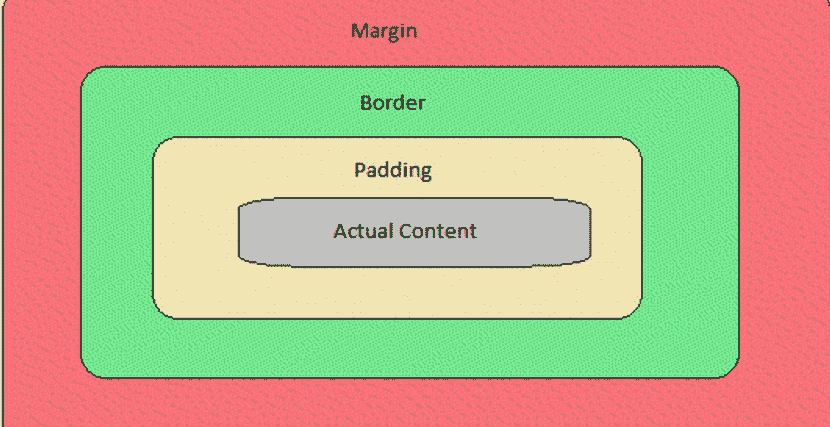

不同部分的解释：

35 Content - 框的内容，文本和图像出现的地方。35 Border - 包围内边距和内容的的边框。它提供了一种视觉上元素的方法。

各种边框属性有：

- i. Border-style: 边框的线条类型。可能的值有：solid、dotted、dashed、double、groove、ridge、insert 和 outset。
- ii. border-width: 边框宽度以单位表示。使用的各种关键词有：thin、medium 等。
iii. border color: 以颜色单位表示。
iv. border radius: 圆角的半径。
v. border image: 作为边框使用的图像 URL。

## 题库

- 1. 解释 HTML 和 XHTML 之间的语法差异
- 2. 简要解释标记语言的历史
- 3. 用示例解释 HTML 文档结构。
- 4. 解释：i) <a> ii)  iii) <p> iv) HTML 标题元素并附带示例
- 5. 什么是相对引用？解释 URL 相对引用
- 6. 讨论以下 HTML 元素
  ni. 行内文本元素
  ii). 列表
  iii). 字符实体
  iv). Head
- 7. 用示例解释 HTML5 语义化结构元素。
- 8. 什么是 CSS？CSS 样式表有哪些不同的位置？用示例解释
- 9. 用示例解释
  i. 元素选择器
  ii). id 和 Class 选择器
  iii. 属性选择器
  iv). 伪类和伪元素选择器
- 10. 解释 CSS 级联 (Cascade) 以及为什么它们是必要的。
- 12. 用示例解释 CSS 的背景和边框属性。

# 模块 2

# HTML 表格与表单

## 2.1 表格 (TABLES)

表格是一个单元格矩阵。顶行的单元格通常包含列标签，左侧列的单元格通常包含行标签，大部分单元格包含表格数据。单元格的内容可以是任何文档元素，包括文本、标题、水平规则、图像和嵌套表格。

### 2.1.1 基础表格标签：

- 表格被指定为块标签 `<table>` 的内容。表格中有两种线：整个表格外围的线被称为边框 (border);分离单元格的线被称为规则 (rules)。
  可以使用 `border` 属性获取。可能的值是“border”或任何数字。
  表格标题可以使用 `<caption>` 标签创建。
  表格行可以使用 `<tr>` 标签创建。

  列可以通过使用 `<th>` 标签（代表表头，适用于标题）或 `<td>` 标签（代表表格数据，适用于其他数据）来创建。

```html
<!DOCTYPE html>
<html>
<body><h2>基础 HTML 表格</h2><table style="width:100%"><tr><th>姓名</th><th>年龄</th></tr><tr><td>JOHN</td><td>33</td></tr><tr><td>Smith</td><td>43</td></tr><tr><td>Jackson</td><td>94</td></tr></table>
</body>
</html>
```

### 2.1.2 rowspan 和 colspan 属性：

多单元合并可以通过 `rowspan` 和 `colspan` 属性指定。

### rowspan 是什么意思？

允许单个单元格垂直跨越多个行。

示例：

```html
<!DOCTYPE html>
<html>
<head>
<style>
table, th, td {
border: 1px solid black;
}
</style>
</head>
<body>
<h1>rowspan 属性</h1>
<table><tr><th>月份</th><th>节省</th></tr><tr><td rowspan="2">一月</td><td>100</td></tr><tr><td>80</td></tr><tr><td colspan="2">总计</td></tr></table>
</body>
</html>
```

 colspan 是什么意思？

允许单个单元格水平跨越多个列。

| 月份 | 节省 | 节省! |
|---|---|---|
| 一月 | 100 | |
| 二月 | 80 | |
| <td colspan="2">总计</td> |

### 2.1.3 HTML align 属性
HTML align 属性的作用是指定单元内文本的对齐方式。align 属性可能的值有 left、right、center。th 单元格的默认对齐方式是 center；td 单元格是 left。

### 2.1.4 表格区域
表格自然分为两个或三个部分：头部、主体和页脚。（并非所有表格都有页脚）。这三个部分分别用 `<thead>`、`<tbody>` 和 `<tfoot>` 表示。头部包含列标签，无论有多少层。主体包含数据。页脚如果出现，有时会重复列。在某些表格中，页脚跟在主体之后。


```html
<form action = >
<p><label>输入您的姓名：
<input type="text" name="myname" size="20" maxlength="20" />
</label></p>
</form>
<body>
</</html>
```

### 密码框

如果文本框中的内容在用户输入时不应显示，则可以使用密码控件。在这种情况下，无论在密码控件中输入了什么字符，浏览器都只显示圆点或星号。

### 示例：

```html
<!DOCTYPE html>
<html>
<body>
<h1>显示密码字段</h1>
<form action="action_page.php">
<label for="email">邮箱:</label>
<input type="email" id="email" name="email"><br><br>
<label for="pwd">密码:</label>
<input type="password" id="pwd" name="pwd" minlength="8"><br><br>
<input type="submit">
</form>
</body>
</html>
```

### 单选按钮

单选按钮是一种特殊的按钮，允许用户仅选择一个单独的选项。单选按钮是使用 `input` 标签创建的，其 `type` 属性值为 `radio`。

创建单选按钮时，必须通过 `value` 属性提供值。所有创建的单选按钮具有相同的 `name`。这是因为单选按钮是组元素。如果要在网页加载时时立即选中其中一个单选按钮，则应使用 `checked` 属性。相应的 `value` 也会被选中。

### 示例：

```html
<html>
<head>
<title>单选按钮</title>
</head>
<body>
<h3>年龄分类？</h3>
<form action="">
<p>
<label><input type="radio" name="age" value="under20" checked/>-0-19 </label>
<label><input type="radio" name="age" value="20-35"/>20-35</label>
<label><input type="radio" name="age" value="36-50"/>36-50</label>
<label><input type="radio" name="age" value="over50"/>50以上</label>
</p>
</form>
</body>
</html>
```

### 复选框

复选框是一种用于选择多个选项的输入类型。复选框也可以使用 `type` 值为 "checkbox" 的 `<input>` 标签创建。在创建复选框时，应使用 `value` 属性提供值。所有创建的复选框具有相同的 `name`，因为它们是组元素。如果在页面加载时必须选中其中一个复选框，则应使用 `checked` 属性并赋值 `checked`。

### 示例

```html
<html>
<head>
<title>复选框</title>
</head>
<body>
<h3>杂货清单</h3>
<form action = ""
<label><input type="checkbox" name="groceries" value="milk" checked="checked">牛奶</label>
<label><input type="checkbox" name="groceries" value="bread"/>面包</label>
<label><input type="checkbox" name="groceries" value="eggs"/>鸡蛋</label>
</p>
</form>
</body>
</html>
```

`<select>` 元素用于创建下拉列表。`<select>` 元素最用于表单，以收集用户输入。需要 `name` 属性在表单提交后引用表单数据（如果省略 `name` 属性，则不会提交下拉列表中的任何数据）。需要 `id` 属性将下拉列表与标签关联。`<select>` 内部的 `<option>` 标签定义了下拉列表中的可用选项。要在菜单中插入项目，使用 `<option>` 标签。

示例：

```html
<html><head><title> 菜单</title></head><body><p>HKBKCE 分部 - 信息科学、计算机科学、电子、电气</p><form action=""><p>当 size = 1（分支）<select name="branches"><option>信息科学</option><option> 计算机科学</option><option> 电子 </option><option>电气 </option><option> 机械 </option></select>
```文本区域（Text area）是一种用于输入多个语句的输入类型。文本区域是用 `<textarea>` 标签创建的。文本区域应该具有 `name` 属性。在创建文本区域时，应该说明可以输入多少行。这是通过 `rows` 属性实现的。同样，还应该说明每行可以输入多少字符。这是通过 `cols` 属性实现的。如果给定的 `rows` 值超出范围，即用户输入的句子超过了指定数量，则滚动条会自动出现。

### 示例

```html
<!DOCTYPE html>
<html>
<head>
<title> 文本区域 </title>
</head>
<body>
<form action=" "
<h3> 输入您的意见</h3>
<p>
<textarea name="text" rows="3" cols="50"> (HKBK 工程学院) </textarea>
</p>
</form>
</body>
</html>
```

### 35 动作按钮：

重置按钮（Reset）会将表单中的所有控件重置为初始状态。提交按钮（Submit）有两个动作：首先，表单数据被编码并发送到服务器；其次，请求服务器执行在 `<form>` 标签的 `action` 属性中指定的服务器端程序。

此类服务器端程序的目的是处理表单数据并向用户返回某些响应。每个表单都需要一个提交按钮。提交按钮和重置按钮是用 `<input>` 标签创建的。

### 示例：

```html
<html>
<head>
<title> 动作按钮 </title>
</head>
<body>
<form action="">
<p>
<input type="SUBMIT" value="SUBMIT"/> <input type="RESET" value="RESET"/> </p>
</form>
</body>
</html>
```

## 2.3 帧（FRAMES）

浏览器窗口可以同时显示多个文档。窗口可以划分为若干矩形区域，每个区域都是一个帧。每个帧都能显示自己的文档。

### 2.3.1 帧集（Frameset）

浏览器窗口中帧的数量及其布局由 `<frameset>` 标签指定。`<frameset>` 元素取代文档中的 `body` 元素。文档要么有 `body`，要么有 `frameset`，不能兼两者。`<frameset>` 必须具有 `rows` 或 `cols` 属性。创建水平帧使用 `rows` 属性，创建垂直帧使用 `cols` 属性。这些属性的值可以是数字、百分比和星号。两个或多个值用逗号分隔。星号表示剩余空间。`<frameset>` 内部可以嵌套多个 `<frameset>` 标签以创建复杂的布局。每个帧都使用 `<iframe>` 标签来定义其显示的文档，`src` 属性指定文档路径。

## 2.4 CSS：引言：

XHTML 样式表被称为级联样式表，因为它们可以在三个级别上定义以指定文档的样式。低级样式表可以覆盖高级级样式表，标签内容的样式实际上是通过级联定义的。

### 2.4.1 样式表的层级

样式表的三个级别从最低级别到最高级别分别是：内联（inline）、文档级（document level）和外部（external）。

内联样式表适用于单个 XHTML 元素。内联样式规范出现在标签内部，仅适用于该标签的内容。内联样式表的优先级高于文档样式表，而文档样式表的优先级高于外部样式表。

```html
使用内联样式表的示例 <html>
<head>
<title>示例 CSS</title>
</head>
<h1 style="font-family: arial; font-size: 50pt; color: Red;"> HKBK 工程学院</h1></html>
```

文档级样式表适用于文档的整个主体。外部样式表可以适用于任意数量的文档。文档级样式规范出现在文档的头部部分，适用于整个的整个主体。

```html
使用文档级样式表的示例 <html>
<head>
<title>示例 CSS</title>
</head>
<style type="text/css">
h1
{
font-family: 'arial';
font-size: 100pt;
color: Red;
}
</style>
</head>
<h1>HKBK 工程学院</h1>
</html>
```

外部样式表单独存储并在所有使用它们的文档中引用。外部样式表被写为 MIME 类型为 text/css 的文本文件。它们可以存储在 Web 上的任何计算机上。浏览器像获取文档一样获取外部样式表。


`<link>` 标签用于指定外部样式表。在 `<link>` 内部，`rel` 属性用于指定被链接文档与出现链接的文档之间的关系。`<link>` 的 `href` 属性用于指定样式文档的 URL。

### 使用外部样式表的 `<html>` 示例

```html
<<html>
<head>
<title>Sample CSS</title>
<link rel="stylesheet" type="text/css" href="Style1.css" />
</head>
<h1>HKKB College of Engineering </h1>
</html>
<style>
h1 {
font-family: "Times new roman";
font-size: 50pt;
color: Blue;
}
</style>
```

## 2.5 选择器形式

简单选择器形式：
在简单选择器的情况下，会使用标签（tag）。如果更改了标签的属性，那么这些更改将反映在程序中所有该标签被使用到的地方。选择器可以是任何标签。如果规则列表中没有提到某个标签的新属性，浏览器用户将使用该标签的默认行为。

<html><style type="text/css">
p { font-family: 'Times New Roman'; font-size: 50pt; color: Red; } </style>
</head>
<body>
<p>HKKB College of Engineering </p>
<p>Bangalore</p>
</body>
</html>

- 357 类选择器：

在类选择器（class selector）中，可以为不同的元素赋予不同的属性

```html
<html>
<head>
<title>Sample CSS</title>
<style type = "text/css">
p.one { font-family: 'Lucida Handwriting'; font-size: 55pt; color: Red; }
p.two { font-family: 'Monotype Corsiva'; font-size: 100pt; color: green; }
</style>
</head>
<body>
<p class="one">HKBK College of Engineering</p>
<p class="two">CSE</p>
</body>
</html>
```

### 39 id 选择器

id 选择器允许将样式应用到一个特定的元素。

```html
<html>
<head>
<title>Sample CSS</title>
<style type = "text/css">
#one { font-family: 'lucida calligraphy'; color: purple; }#two { font-family: 'comic sans ms'; color: orange; }</style>
</head>
<body>
<p id="two">HKBKCE</p>
<h1 id="one">Bangalore</h1>
</body>
</html>
```

### 37 通用选择器

在通用选择器的情况下，当类被创建时，它不会与任何标签关联。在其他情况下，它在本质上是通用的。

<html
<head>
<title>Sample CSS</title>
<style type = "text/css">
```
.one { font-family: 'Monotype Corsiva'; color: green; }
</style>
</head>
<body>
<p class="one">HKBK College of Engineering</p>
<h1 class="one">Nagarava</h1>
<h1 class="one">Bangalore</h1>
</body>
</html>
```
```

### 伪类

如果需要动态更改属性，则使用伪类选择器。例如：当鼠标移动发生时，换句话说，即悬停（hover）或聚焦（focus）。

```html
<html>
<style type="text/css">
input { font-family: 'Arial'; color: purple; font-size: 50; } input:hover {
font-family: 'Arial'; color: red; font-size: 30; }
</style>
</head>
<body>
<form action="">
<p><label><input type="text" /></label></p>
</form>
</body>
</html>
```

## 2.6 属性值形式

CSS 包含七类中的不同属性：字体、列表、文本对齐、外边距、背景和边框。属性值可以以多种形式出现：关键字值、百分比值用于提供一个相对于之前使用的属性值测量的度。百分比值可以是带符号的。如果前面有加号，则百分比将加到之前的值上；如果是负值，则减去该值。url 与左侧内容之间不能有空格。

长度值指定为数值，其后紧跟一个单位名称的两个字符缩写。可能的单位名称有 px（像素）、in（英寸）、cm（厘米）、mm（毫米）、pt（磅）。

颜色属性值可以指定为颜色名称、十六进制数字或 RGB 形式。RGB 形式只是单词后跟着括号括起来的三个数字列表，分别指定红、绿、蓝的电平。RGB 值可以是 0 到 255 之间的十进制数字，也可以是百分比。十六进制数字必须以井号（#）为开头，例如 #AAFF00。

## 2.7 属性

### 字体族

`font-family` 属性用于指定字体名称列表。浏览器使用列表中它支持的第一个字体。例如，属性 `font-family: Arial, Helvetica, Futura` 告诉浏览器如果支持该字体则使用 Arial。如果不支持，且支持 Helvetica，则将使用 Helvetica。如果浏览器既不支持 Arial 也不支持 Helvetica，则将使用默认字体。如果 `font-family` 属性没有指定的字体，可以使用备用字体。

### 2.7.1 字体大小

`font-size` 属性用于指定字体的大小。它可以使用关键字、百分比、绝对长度或相对长度。关键字包括 `small`、`medium`、`large`、`x-small`、`x-large`、`xx-small`、`smaller`、`larger`。百分比值相对于父元素的字体大小。绝对长度包括 `px`、`pt`、`cm`、`in` 等。相对长度包括 `em` 和 `rem`。

### 2.7.2 字体变体

`font-variant` 属性用于指定字体变体。可选值包括：`normal`、`small-caps` 和 `all-small`。

### 2.7.3 字体样式

`font-style` 属性用于指定字体样式。可选值包括：`normal`、`italic` 和 `outline`。

### 2.7.4 字体粗细

`font-weight` 属性用于指定字体粗细。可选值包括：`normal`、`bold`、`bolder` 以及从 100 到 900 之间的数字。

### 2.7.5 字体简写

`font` 属性是一个简写属性，可以同时设置 `font-style`、`font-variant`、`font-size`、`line-family` 和 `font-weight`。其语法格式为：`font: [font-style] [font-variant] [font-weight] [line-height] family;`

### 2.7.6 文本装饰

`text-decoration` 属性用于指定文本的一些特殊特征。可选值包括：`none`、`underline`、`overline` 和 `line-through`。它还可以通过 `text-decoration-line`、`text-decoration-color` 和 `text-decoration-style` 进行细致设置。

### 2.7.7 文本对齐

`text-align` 属性用于指定文本的对齐方式。可选值包括：`left`、`right`、`center`、`justify` 和 `last`。

### 2.7.8 文本间距

`letter-spacing` 属性用于指定字符之间的间距。可选值包括：`normal`、`wider`、`narrower` 以及具体的长度单位值。

### 2.7.9 行间距

`line-height` 属性用于指定行之间的间距。可选值包括：`normal`、百分比值、长度值以及无单位数字值。

### 2.7.10 文本转换

`text-transform` 属性用于指定文本的转换方式。可选值包括：`none`、`uppercase`、`lowercase` 和 `capitalize`。

### 2.7.11 文本阴影

`text-shadow` 属性用于指定文本的阴影效果。格式为：`水平偏移量 垂直偏移量 [模糊半径] [颜色]`。

### 2.7.12 空格处理

`white-space` 属性用于指定元素如何处理空格和换行。可选值包括：`normal`、`nowrap`、`pre`、`pre-wrap` 和 `nowline`。

### 2.7.13 文本溢出

`text-overflow` 属性用于指定文本溢出时的处理方式。可选值包括：`visible`、`clip`, `ellipsis`。

### 2.7.14 文本缩进

`text-indent` 属性用于指定文本第一行的缩进。可选值包括：`start`、`end` 和 `auto`。

### 2.7.15 文本方向

`direction` 属性用于指定文本的阅读方向。可选值包括：`ltr`（从左到右）和 `rtl`（从右到左）。

### 2.7.16 垂直对齐

`vertical-align` 属性用于指定内元素的垂直对齐方式。可选值包括：`baseline`、`top`、`bottom`、`middle`、`sub`、`super`、`text-top`、`text-bottom` 和 `inherit`。

### 2.7.17 列表样式

`list-style-type` 属性用于指定列表项目的类型。可选值包括：`none`、`disc`、`circle`、`square` 以及各种数字序列、罗马数字序列等。

### 2.7.18 列表图像

`list-style-image` 属性用于指定列表项目使用的图像。可选值包括：`none` 或 `url()`。

### 2.7.19 列表位置

`list-style-position` 属性用于指定列表项目标记（符号）的位置。可选值包括：`inside` 和 `outside`。

### 2.7.20 列表简写

`list-style` 属性是一个简写属性，可以同时设置 `list-style-type`、`list-style-image` 和 `list-style-position`。语法格式为：`list-style: [list-style-type] [list-style-image] [list-style-position];`

### 2.8 列表属性

`display` 属性用于指定列表项目的显示方式。可选值包括：`block`、`inline`、`inline-block`、`list-item`、`table`、`table-cell` 等。

`count` 属性用于指定列表的计数数量。可选值包括：`number`、`decimal`、`none`。

`direction` 属性用于指定列表项目的计数器的方向。可选值包括：`normal`、`reverse`。


### 颜色属性：

`color` 属性用于指定 XHTML 元素的字体颜色。

```html
<html
<head>
<title>Colours</title>
<style type="text/css">
p.one {color: pink; }
p.two {color: #9900FF; }
p.three {background-color:#99FF00; }
</style>
</head>
<body>
<p class="one">HKBK 工程学院</p>
<p class="two">Nagaraura </p>
<p class="three">Bangalore </p>
</body>
</html>
```

## 2.10 文本对齐

`text-indent` 属性可用于对段落的第一行进行缩进。该属性可以接受长度值或百分比值。`text-align` 属性用于水平排列文本，其可能的关键字值为 `left`（左对）、`center`（居中）、`right`（右对）和 `justify`（两端对齐）。`float` 属性用于指定文本围绕某些元素（通常是图像或表格）流式排列。`float` 的可能值为 `left`、`right` 和 `none`（默认值）。

```html
<html
<head>
<title>文本对齐</title>
<style type="text/css">
h1.one {text-indent: 0.5in; text-align: justify;} img{float:right} </style>
</head>
<body>
<h1 class="one">VTU 事实</h1>
<p>
</p></p>
</p>
<p class="two">Visvesvaraya 技术大学 (VTU) 是印度卡纳塔克邦州的一所学院制公立州大学 </p></body>
</html>
```

## 2.11 `<span>` 和 `<div>` 标签

在许多情况下，我们希望对少于整段的文本应用特殊的字体属性。
`<span>` 标签正是为此目的而设计的。

```html
<html
<head>
<title><span></title>
<style type = "text/css">
.spanviolet {font-size:25pt;font-family:'lucida calligraphy';color:violet;}
</style>
</head>
```

```html
<body>
<p > 该大学以
<span class="spanviolet">Visvesvaraya 爵 </span>
, 命名的，他来自卡纳塔克，是唯一获得巴拉特拉勋（Bharat Ratna）奖的工程师。
</p>
</body>
</html>
```

然而，对文档的某个部分应用样式比对每个段落应用样式更方便。这可以通过 `<div>` 标签实现。与 `<span>` 一样，`<div>` 标签的内容没有隐含的布局，因此它的主要用途是为文档的章节或区域指定显示细节。

```html
<html
<head>
<title><div></title>
<style type = "text/css">
.one {font-size:20pt;font-family:'lucida calligraphy';color:violet;}.two {font-size:25pt;font-family:'comic sans ms';color:green} </style>
</head>
```

```html
<body>
<div class="one">
<p>division 1 下的段落 1</p>
<p>division 1 下的段落 2</p>
<p>division 1 下的段落 3</p>
</div>
<div class="two">
<p>division 2 下的段落 1</p>
<p>division 2 下的段落 2</p>
<p>division 2 下的段落 3</p>
</div>
</body>
</html>
```

## 2.12 冲突解决

有时，页面上会出现同一属性的多个样式定义。

```css
h3 {color: blue;}
body h3 {color: red;}
```

浏览器必须解决这些冲突。内联样式的优先级高于外部样式表或内部样式表。

## 题库

- 1. 开发一个完整的 HTML，包含标题、表格、表单、标签、复选框、单选按钮、提交按钮和重置按钮。（假设网页）
- 2. 为什么我们需要表单？解释 HTML 表单。
- 3. 使用流程图解释表单的工作原理。
- 4. 什么是查询字符串？区分 GET 和 POST 方法。
- 5. 使用 `<input>` 标签解释不同的表单控件。
- 6. 编写关于微格式（Microformats）的说明。
- 7. 解释元素。
- 8. 什么是行内元素和块级元素？区分绝对定位和相对定位。
- 9. 通过示例解释 z-index 和固定定位。
- 10. 解释项目并排浮动。有什么问题？如何解决？
- 11. 解释不同的 CSS 布局方法。
- 12. 编写关于响应式设计的说明。

# 模块3 JavaScript：客户端

# JavaScript

- 它是一种面向对象、动态类型的语言。
- 它直接运行在浏览器中。
- 它是动态类型语言。

# 客户端脚本

指的是客户端机器。

### 客户端脚本的优点

- 1. 处理工作可以从服务器卸载。
- 2. JavaScript 对服务器的响应更快。
- 3. JavaScript 可以与服务器交互。

### 客户端脚本的缺点

- 不能保证用户开启 JavaScript。
- 浏览器之间的差异使得调试和维护变得困难。


方法：

- 1. 内联 JavaScript
- 2. 嵌入式 JavaScript
- 3. 外部 JavaScript

## 内联 JavaScript:

内联 JavaScript是指直接在某些 HTML 属性中包含 JavaScript 代码的做法。
例如：<a href="JavaScript:OpenWindow();">更多信息</a>

```html
<input type="button" onclick="alert('Are you sure?)" />
```

## 嵌入式 JavaScript:

嵌入式 JavaScript是指将 JavaScript 代码放置在 <script> 元素中的做法。
例如：<script type="text/javascript"> /* A JavaScript 注释 */\nalert("Hello World!");</script>

## 外部 JavaScript

HTML 和 CSS 写在单独的文件中，并通过 <link> 标签引入。JavaScript 外部文件的扩展名为 .js。
例如：<head>

```html
<script type="text/JavaScript" src="greeting.js"></script></head>
```

## 3.3 JavaScript 语法:

### 特性：

- 所有内容均对类型敏感，包括函数、类和变量名。
不支持块级变量作用域。
这意味着在循环内部声明的变量在循环外部可能是可以访问的，这与预期相反。
有一个 === 运算符，它不仅测试相等性，还测试类型等价性。
`null` 和 `undefined` 是变量的两个完全不同的状态。不需要分号，但允许使用（并鼓励）。没有整数类型，只有数字（number），这意味着对于预期为整数的值，会出现浮点数舍入误差。

### 1. 变量:

JavaScript 中的变量是动态类型的，这意味着根据需要，变量可以是一个整数，稍后变为字符串，然后是对象。使用以下语法声明变量：

Var 变量名;
例如：var x;
var y = 0;
var y = 4;

## 2. 比较运算符：/* x 条件赋值 */ x = (y==4) ? "y is 4" : "y is not 4";

 各种比较运算符有：

- i) == 等于
- ii) === 严格相等，包括类型
- iii) < 小于，大于
- iv) <= 小于或等于，大于或等于
- vi) != 不等于
- vi) != 值或类型都不相等

### 3. 逻辑运算符:

比较运算符非常有用，但如果不能将几个组合，其实用性将受到严重限制。因此，与其他语言一样，JavaScript 包含了布尔运算符，允许我们构建复杂的表达式。布尔运算符 `and`、`or` 和 `not` 在语法上分别表示为 `&` (and)、`||` (or) 和 `!` (not)。

### 4. 条件语句:

常见的条件语句有：If(condition)
Else 语句。

### 5. 循环:

常见的循环有：

### 3.7 While 循环:

最基本的循环是 while 循环，它会一直循环直到条件不再满足。通常在循环之前初始化循环控制变量，在条件中使用它并在循环内对其进行修改。
例如：var i=0;
while(i< 10)
{ // 对 i 执行某些操作 i++; }

for 循环将循环的常见组成部分：初始化、条件和循环后操作合并到一个语句中。该语句以关键字开始，组件置于 () 括号之间，用分号 : 隔开。
例如：for (var i = 0; i < 10; i++)
{ // 对 i 执行某些操作 }

函数是 JavaScript 中模块化代码的构建块，甚至用于构建伪类（你稍后会学习这些）。它们通过使用保留字 `function` 然后是函数名和（可选）参数来定义。

例如：function power(x,y)

```javascript
{ var pow=1;
for (var i=0;i<y;i++)
 pow = pow*x;
}
```

函数调用将是 `power(2,10);`

### Alert

`alert()` 函数让浏览器显示弹出窗口。
`alert()` 会向用户显示消息。以下代码显示一个弹出窗口：

alert ("Good Morning");

## 3.5 错误与异常处理

当 JavaScript 引擎遇到错误时，会抛出异常。try-catch 块可以捕获这些异常，阻止程序的正常执行。

## 抛出你自己的异常：

虽然 try-catch 可以用于捕获内置错误，但你也可以用它抛出你自己的消息。`throw` 关键字可以做到：

```javascript
try
{ var x = -1;
if (x<0)
throw "smallerthan"; } catch(err)
{
alert(err + "was thrown");
}
```

### 3.6 JavaScript 对象

对象具有构造函数、属性和方法。

- 构造函数：可以使用以下方法创建新对象：var someObject = new Object()
- 属性：每个对象可能可以使用点符号访问的属性
- 方法：对象也可以关联方法

```javascript
语法：someObject.doSomething();
```

JavaScript 中包含的对象：

- i) 数组 (Array):
数组是最常用的数据结构之一，已包含在 JavaScript 中。名为 greetings 的空数组可以这样创建：var greetings = Array(); 初始化数组值时的声明看起来如下：

- ii) 数组的访问和遍历
访问数组中的元素可以使用 Java 风格熟悉的方括号符号：

```javascript
数组最常见的操作之一是顺序遍历项目。
for (var i = 0; i<greetings.length; i++)
{ alert(greetings[i]);
}
```

- iii) 修改数组
向现有数组添加项目可以使用 `push` 方法。
greetings.push("Good");
其他修改数组的方法包括：`concat()`、`slice()`、`join()`、`reverse()`、`shift()` 和 `sort()`。

- iv) 数学 (Math):
Math 类允许在一个地方快速访问常用的数学函数和常用值。这个静态类包含 `max()`、`min()`、`pow()`、`sqrt()` 和 `exp()` 方法，以及如 `sin()`、`cos()` 和 `arctan()` 等三角函数。

- v) 字符串 (String):
字符串对象可以这样创建：例如：greet = new String("Good");

```javascript
var greet = "Good"; 获取字符串的长度，
alert(greet.length);
```

拼接两个字符串：
var str = greet.concat("Morning"); // 长拼接
var str = greet + "Morning"; // + 运算符拼接

- vi) 日期 (Date)
Date 可以快速计算当前日期或为特定日期创建日期对象。将今天的日期显示为字符串，只需创建一个新对象并使用 `toString()` 方法即可。

```javascript
var d = new Date();
// 输出 Today Mon Nov 12 2012 15:40:19 GMT-0700 alert
("Today is" + d.toString());
```


```javascript
var a = document.doctype.name;
var b = document.inputEncoding;
```

一些基本的文档对象方法：
- 35 createAttribute()
- 35 createElement()
- 35 createTextNode()
- 35 getElementById(id) 匹配传递的参数。创建一个属性节点。
- 创建一个元素节点。
- 创建一个文本节点。
- 返回具有属性的元素节点
- 37 getElementsByTagName(name) 返回标签匹配传递的参数的元素 NodeList。

## 3.7.1 修改 DOM 元素

现代 JavaScript 程序员会希望向 HTML 页面写入内容，但是在特定的位置，而不是总在底部。使用 DOM document 和 HTML DOM 元素对象，我们可以使用 `innerHTML` 属性来实现这一目标。

```javascript
var latest = document.getElementById("latestComment");
var oldMessage = latest.innerHTML = oldMessage + "<p>Updated this div with JS</p>";
```

### 3.7.2 改变元素的样式：

我们可以使用 Element 节点的 `style` 或 `className` 属性添加或删除任何样式，这可能是您想要动态更改元素外观的操作。下面展示了如何更改节点的背景颜色并添加三像素边框的其用法。

```javascript
var commentTag = document.getElementById("specificTag");
commentTag.style.backgroundColor = "#FFFF00";
commentTag.style.borderWidth="3px";
```

`className` 属性通常是更好的选择，因为它允许样式在代码之外被创建，从而让设计师更容易访问。使用这种模型，我们通过定义两个样式来更改背景颜色，并在 JavaScript 代码中更改它们。

```javascript
var commentTag = document.getElementById("specificTag");
commentTag.className = "someClassName";
```

HTML5 引入了 `<classList` 元素，它允许你在元素上添加、删除或切换 CSS 类。我们可以通过 `label.classList.addClass("someClassName");` 添加一个类名。

### 3.8 JavaScript 事件：

JavaScript 事件是能够被 JavaScript 检测到的动作。其中许多事件是由用户动作发起的，但有些是由浏览器本身生成的。事件被触发，然后可以被 JavaScript 函数捕获，这些函数随后会做出相应的响应。内联事件处理程序方法：

JavaScript 事件允许程序员对用户交互做出反应。缺点：它没有利用层级；即，它没有将内容与行为分离。

### 监听器

这种方法将所有 JavaScript 代码与 HTML 标记分离。考虑给示例，它是包含监听器的传统方式：

```javascript
var greetingBox = document.getElementById('example1');
greetingBox.onclick = alert('Good Morning');
```

列表中的第一行为触发事件的 HTML 元素创建一个临时变量。下一行将 `<div>` 的 `onclick` 事件绑定到事件处理程序，该处理程序会调用 JavaScript 的 `alert()` 方法（从而通过弹出的你好消息打扰用户）。

### 3.9 事件对象

事件对象的关键属性和方法是：

- **冒泡（Bubble）**：`bubbles` 属性是一个布尔值。如果事件的 `bubbles` 属性被设置为 `true`，则必须有一个事件处理器来处理该事件，否则它将向上冒泡到父元素并触发那那处的事件处理器。如果父元素没有处理器，它将继续向上冒泡，直到碰到文档根节点，然后就会消失且未被处理。
- **可取消（Cancelable）**：`cancelable` 属性也是一个布尔值，表示事件是否可以被取消。如果事件是可取消的，那么与其关联的默认操作就可以取消。一个常见的例子是用户点击链接。默认操作是跳转到链接并加载新页面。
- **阻止默认行为（preventDefault）**：可以使用 `preventDefault()` 方法停止事件可取消的默认行为。当你希望在提交表单时异步发送数据时，这是一个常见的做法，例如，提交点击（submit click）的默认事件是 POST 到新 URL（这会导致浏览器刷新整个页面）。

## 3.10 事件类型：

这些类包括鼠标事件、键盘事件、表单事件和帧事件。

### 3.10.1 鼠标事件

鼠标事件定义用于捕获鼠标驱动的一系列交互。这些可以进一步分类为鼠标点击事件和鼠标移动事件。许多鼠标事件可以同时发送。

用户可能在同一时刻将鼠标离开一个 `<div>` 并移动到另一个 `<div>`，触发 `onmouseover` 和 `onmousemove` 事件。可以使用 `cancelable` 和 `bubbles` 属性来处理这些复杂性。

JavaScript 中常见的鼠标事件：
I. onclick
II. ondblclick
III. onmousedown IV. onmouseup V. onmouseover VI. onmouseout
VII.onmousemove

- 在元素上点击了鼠标
- 在元素上双击了鼠标
- 在元素上按下了鼠标
- 在元素上释放了鼠标
- 鼠标在元素上方移动
- 鼠标移离开了元素
- 鼠标在元素上方移动移动

### 3.10.2 键盘事件

I. **onkeydown**：用户正在按下键（这先发生）
II. **onkeypress**：用户按下按键（这在 `onkeydown` 之后发生）
III. **onkeyup**：用户释放按下的按键（这最后发生）

例如：`document.getElementById("keyExample").onkeydown = function myFunction(e)`

```javascript
{
 var keyPressed=e.keyCode; //获取原始键码
 var character=String.fromCharCode(keyPressed);
 //转换为字符串
alert("Key " + character);
}
```

### 3.10.3 表单事件

表单是收集并传输用户输入的主要手段。表单触发的事件允许我们对用户输入进行及时的处理。表单最常见的监听器是 `onSubmit` 事件。

常见的表单元素有：
- **onblur**：元素失去焦点（即，控件移动到了另一个元素），可能是由于点击或按下 Tab 键。
- **onChange**：某些 `<input>`, `<textarea>` 或 `<select>` 字段发生了变化。可能意味着用户输入了内容或选择了新选项。
- **onfocus**：作为 `onblur` 事件的补充，当元素获得焦点时触发（用户点击字段或切换到）。
- **onreset**：HTML 表单具有重置功能。当发生这种情况时触发此事件。
- **onselect**：当用户选择文本时。这通常用于防止复制/粘贴。
- **onsubmit**：当提交表单时触发此事件。我们可以进行一些预校验。

### 3.1.4 帧事件

最重要的事件是 `onload` 事件，它告诉我们对象已加载，因此可以运行。事实上，每个非复杂的事件监听器都需要 HTML 被完全加载。

各种帧事件：
- **onabort**：对象停止加载
- **onerror**：对象或图像未正确加载
- **onload**：当文档或对象加载完成时
- **onresize**：文档视图被调整大小
- **scroll**：文档视图被滚动
- **onunload**：文档已卸载

## 3.10.6 表单验证

表单验证是 JavaScript 最常见的应用之一。在客户端编写代码对表单进行预校验可以减少错误提交的次数，从而减轻服务器负载。

## 3.10.7 空字段验证

客户端验证的一个常见应用是确保用户在字段中输入了内容。在 JavaScript 中检查字段是否为空的方法是将值与 `null` 以及空字符串（`""`）进行比较，以确保它不为空。

例如：`document.getElementById("loginForm").onsubmit = function(e) {
 var pass = document.getElementById("pw").value;
if(pass="") {
 alert("请输入密码");
 e.preventDefault();
 }
```


```javascript
var fieldValue=document.getElementById("username").value;
if(fieldValue==null || fieldValue=="")
{ // 字段为空。停止表单提交
    e.preventDefault(); // 现在告诉用户发生了错误 alert("you must enter a username"); 
}
```

## 3.10.8 数字验证：

数字验证可以有多种形式。开发者可以通过使用以下函数 `parseInt()`、`isNaN()` 和 `isFinite()` 来创建自己的数字验证。

示例：
```javascript
function isNumeric(n)
{ return !isNaN(parseFloat(n)) && isFinite(n); }
```

## 3.10.9 表单提交：

使用 JavaScript 提交表单需要获取表单元素的节点变量。通过获取该变量（例如 `formExample`），用户可以简单地调用 `submit()` 方法：

例如：

```javascript
var formExample = document.getElementById("loginForm");
formExample.submit();
```

这通常与在 `submit` 事件上调用 `preventDefault()` 配合使用。这可以在用户没有点击提交按钮时提交表单，或者提交完全没有按钮的表单（假设我们想用图片代替）。此外，这允许 JavaScript 在提交表单之前进行一些处理，也许在传输之前更新某些值。

### 服务端脚本简介

**客户端与服务器端的区别？客户端端脚本：**

- 在此处，代码在浏览器中执行
- 客户端可以访问并修改代码
- 客户端可以操作 HTML 或 DOM 页面。

### 服务端脚本

- 在此处，代码在 Web 服务器上执行
- 服务器代码对客户端隐藏
- 服务端脚本无法操作客户端浏览器中的 HTML 或 DOM

## 3.11 服务端脚本资源：服务端脚本可以访问服务器向其提供的任何资源。这些资源可以归类为数据存储资源、Web 服务和软件应用程序。最常用的资源是数据存储，通常以与数据库管理系统连接的形式存在。

接的一组资源是由第三方提供程序提供的 Web 服务。Web 服务使用 HTTP 协议返回 XML 或其他数据格式，通常用于扩展网站的功能。最后，是任何可以安装在服务器上或通过网络连接访问的额外软件。

### 3.11.1 服务端技术 ASP (Active Server Pages)：这是微软的第一种服务端技术。与 PHP 类似，ASP 代码（使用 VBScript 语言）可以嵌入在 HTML 中；虽然它支持类和一些面向对象的特性，但大多数开发者并没有利用这些特性。ASP 编程代码在运行时解释，因此与其他技术相比，它的速度较慢。

ASP.NET :- 这取代了微软旧的 ASP 技术。ASP.NET 是微软 .NET 框架的一部分，可以使用任何 .NET 编程语言（使用 C# 最常用）。ASP.NET 使用显式的面向对象方法，其学习时间通常比 ASP 或 PHP 长，通常用于大型企业 Web 应用程序。

JSP (Java Server Pages)：JSP 使用 Java 作为其编程语言，与 ASP.NET 一样，它使用显式的面向对象方法，用于大型企业 Web 系统，并集成到 JEE 环境中。由于 JSP 使用 Java 运行时引擎，它还使用 JIT 编译器来实现快速执行时间，并且是跨平台的。虽然 JSP 在整个 Web 领域的使用较少，但在内网环境以及非常大且繁忙的网站中拥有相当大的市场份额。

Node.js：这是一个较新的服务端环境，它在服务器端使用 JavaScript，允许已经熟悉 JavaScript 的开发者仅使用一种语言进行客户端和服务器端的开发。与此处列出的其他开发技术不同，node.js 还是自己的 Web 服务器软件，消除了对 Apache、IIS 或其他 Web 服务器软件的需求。

Perl：在 ASP、PHP 和 JSP 开发和普及之前，Perl 是通常用于早期服务端 Web 开发的语言。作为一种语言，它擅长文本处理。它通常与通用网关接口 (CGI) 配合使用，后者 是应用程序与 Web 服务器软件之间通信的早期标准 API。

PHP：像 ASP 一样，PHP 是一种动态类型语言，可以直接嵌入 HTML 中，尽管它现在支持大多数面向对象的特性，如类和继承。默认情况下，PHP 页面被编译成一种称为 opcodes 的中间表示，它类似于 Java 的字节码或 .NET 框架的 MSIL。

## 3.12 Web 服务器

- 1) Apache 和 Linux：
Apache 作为守护进程（daemon）在服务器上运行。守护进程是程序的一个执行实例（也称为进程），它在后台运行，等待特定的特定事件来激活它。作为一个后台进程，Apache 守护进程等待传入的 HTTP 请求。当请求到达时，Apache 随后使用模块来决定如何响应请求。

在 Apache 中，模块是 Apache 的一个编译扩展（通常用 C 语言编写），有助于处理请求。出于这个原因，这些模块有时被称为处理器（handlers）。

- 2) Apache 和 PHP：
PHP 通常作为 Apache 模块安装。mod_php 有时被称为 SAPI（服务器应用程序接口）层，因为它处理 PHP 环境与 Web 服务器之间的交互。
Apache 以两种可能的模式运行：

### (i) 多进程（称为 prefork）

Apache 的默认安装使用多进程模式。这意味着每个请求都由一个独立的进程处理；术语“fork”指的是操作系统创建一个正在运行进程的副本。由于 fork 是耗时的操作，Apache 会预先创建一定数量的额外进程。fork 在 Unix 操作系统上相对高效，但在 Windows 操作系统上较慢。此外，多进程的一个主要优势是进程是隔离的。

### (ii) 多线程（称为 worker）

在多线程模式下，创建较少的线程。线程是与其他共享内存的轻量级进程，但无法跨行代码。


例：$count=
在 PHP 中，变量名是区分大小写的。PHP 可能的数据类型有：

- i) 布尔值 (Boolean)：一个逻辑真或假值
- ii) 整数 (Integer)：包含整数
- iii) 浮点数 (Float)：包含小数
- iv) 字符串 (String)：包含字母
- v) 数组 (Array)：任何类型数据的集合（在下一章介绍）
- vi) 对象 (Object)：包括类的实例

## 3.1.4 PHP 常量：

常量与变量有些相似，不同在于常量的值永远不会改变。常量可以定义在任何地方，但通常通过 `define()` 函数定义在 PHP 文件的顶部。
`define()` 函数通常接受两个参数：

- i) 常量的名称
- ii) 它的值。

例：<?php

```php
# 常使用大写字母是一种编程规范
define("DATABASE_LOCAL", "localhost");
define("DATABASE_NAME", "ArtStore");
define("DATABASE_USER", "Fred");
define("DATABASE_PASSWORD", "F5^7%ad");
?>
```

## 3.14 输出语句：

- i) echo：

为了输出浏览器可以看到的内容，可以使用 `echo()` 函数。
例如：`echo ("hello");`
还有一个等效的版本，不需要括号。
字符串可以 `echo "hello";`
可以使用连接运算符轻松地拼接在一起，该运算符是点 (`.`) 符号。
考虑以下代码：
```php
$username = "Ricardo";
echo "Hello". $username;
```
上述 PHP 语句的输出将是：

- ii) printf;

此函数源自 C 编程语言中的同名函数，并包含了用于打印字符串和文件的变体（`sprint`, `fprintf`）。该函数接受一个参数，即字符串，该字符串可选地引用参数，这些参数将通过占位符替换集成到第一个字符串中。`printf()` 函数还允许开发者应用特殊的格式，例如特定的日期/时间格式或小数位数。

## 程序控制语句：

- i) if......else:
PHP 中条件语句的语法几乎与 JavaScript 相同。

在这种语法中，要测试的条件包含在 `()` 括号内，而体包含在 `{}` 块中。
后面可以跟上可选的 `else if` 语句，用 `else` 结束分支。

```php
例:- // 带有条件的 if 语句
if ($hourOfDay > 6 && $hourOfDay < 12 )
{ $greeting = "Good Morning"; }
else if ($hourOfDay == 12)
{
    $greeting = "Good Noon Time"
}
else {
    $greeting = "Good Afternoon or Evening"; 
}
```

- ii) switch.....case: switch 语句类似于一系列的 `if . . else` 语句。
```php
switch ($artType)
{
    case "PT": $output = "Painting"; break;
    case "SC": $output = "Sculpture"; break;
    default: $output = "Other";
}
```

- iii) while and do....：

`while` 循环和 `do ... while` 循环非常相似。只要循环表达式为真，两者都会重复执行语句。在 `while` 循环中，条件在循环开始时测试；在 `do ... while` 循环中，条件在每次迭代结束时测试。
例：
```php
$count = 0;
while ($count < 10) { 
    echo $count;
    $count++;
}
$count = 0;
do
{ 
    echo $count;
    $count++;
} while ($count < 10);
```

- iv) for 循环：

PHP 中的 `for` 循环语法与 JavaScript 中的 `for` 循环相同。该循环包含相同的循环初始化、条件和循环后操作。
例：
```php
for ($count=0; $count < 10; $count++) { 
    echo $count; 
}
```

- v) 包含文件：

包含文件为重用标记和 PHP 代码提供了机制。PHP 提供了不同的语句来包含文件，如下：
```php
include "somefile.php";
include_once "somefile.php";
```

## 函数：

PHP 中的函数包含一段完成某项任务的代码。这些函数可以根据参数的值表现出不同的行为。PHP 中有两种类型的函数：
i) 用户定义函数
ii) 内置函数。

用户定义函数是程序员定义的函数。内置函数是 PHP 环境自带的函数之一。

## 函数语法：

```php
function_name(parameter_list)
{ 
    function body 
}
```

## 调用函数：

```php
function_name(parameter);
```
例：

## 参数：

参数是值传递到函数的机制，存在一些复杂性允许我们拥有多个参数、默认值以及通过引用而非值传递对象。
例：
```php
getName($showSeconds)
{ 
    if ($showSeconds==true)
        return date("H:s");
    else
        return date("H:i");
}
```

- i) 参数默认值：

在 PHP 中，你可以为函数中的任何参数设置默认值。然而，一旦开始设置默认值，所有后续参数也必须有默认值。
例:-：
```php
function getName($showSeconds=1)
{ 
    if ($showSeconds==true)
        return date("H:s");
    else
        return date("H:i");
}
```

- ii) 引用传递：

PHP 允许通过引用传递变量，这意味着在函数内部修改参数将影响函数外部的变量。
例：
```php
function addFive(&$sum) {
    $sum += 5;
}
$number = 10;
addFive($number);
echo $number; // 输出 15
```

- iii) 变量作用域：

在函数定义的变量具有局部作用域，这意味着它们仅在函数内部可见。通过 `global` 关键字，可以访问全局定义的变量。
例：
```php
$x = 5;
function myFunc() {
    global $x;
    echo $x; // 输出 5
}
myFunc();
echo $x; // 输出 5
```


键不必须是连续的。这意味着你不能使用关联数组或对象作为键（这样做会产生关联错误）。在关联数组中混合不同类型的键时需要特别小心，因为 PHP 对那些看起来不像整数或字符串的键进行强制转换操作。你无法让键“1”与整数键 `1` 或 `1.5` 区分来，因为它们都会被转换为整数键 `1`。

与键相反，数组的值似乎并不局限于整数和字符串。它们可以是 PHP 支持的任何对象、类型或原始类型。你可以拥有自定义类型的对象，因为数组内部的键仅限于整数和字符串。

### 4.1.1 定义和访问数组

让我们从最简单的数组开始，它将内部的每个值与一个整数索引（从 0 开始）关联。以下代码声明了一个名为 `days` 的空数组：

```php
$days = array();
```

为了如图 9.1 所示以字符串作为键的形式概述关联数组的内容，你需要在 `()` 括号内使用逗号分隔的值列表来声明，采用以下两种语法之一：

```php
$days = array("Mon","Tue","Wed","Thu","Fri");
$days = ["Mon","Tue","Wed","Thu","Fri"]; // 替代语法
```

示例中，由于没有为数组显式指定键，默认的键值为 `0, 1, 2, . . . , n`。注意，你无法为数组指定大小：数组的大小是根据添加的部分进行动态调整的。

PHP 数组中的元素定义方式与其他编程语言相似，使用熟悉的标点符号表示。下面的代码示例显示了 `$days` 数组键为 `1` 的值，输出为 `Tue`。

```php
echo "Value at index one is ". $days[1]; // 索引从零开始
```

你也可以使用相同的方括号符号逐个定义数组部分：

```php
$days = array();
$days[0] = "Mon";
$days[1] = "Tue";
$days[2] = "Wed";
```

```php
// 另一种替代方法 
$daysB = array();
$daysB[] = "Mon";
$daysB[] = "Tue";
$daysB[] = "Wed";
```

在 PHP 中，你也可以在值之外显式指定键。这允许你使用经典的 `0, 1, 2, . . ., n` 之外的键来定义关联数组的索引。

为了清晰起见，上面以及图 9.1 所示的相同数组可以通过图 4.2 所示的指定键值的方式更明确地定义：

```php
$days = array(0 => "Mon", 1 => "Tue", 2 => "Wed", 3 => "Thur", 4 => "Fri");
```

### 图 4.2 显式为数组元素分配键

### 4.1.2 多维数组

PHP 同样支持多维数组。记住，数组的值可以是任何 PHP 对象，包括其他数组。

**示例: $month = array**

```php
$month = array(
    array("Mon", "Tue", "Wed", "Thur", "Fri"),
    array("Mon", "Tue", "Wed", "Thur", "Fri"),
    array("Mon", "Tue", "Wed", "Thur", "Fri"),
    array("Mon", "Tue", "Wed", "Thur", "Fri")
);
echo $month[0][3]; // 输出 Thu
```

**示例: $cart = array();**

```php
$cart[] = array("id" => 1, "title" => "Burial at Ornams", "quantity" => 1);
$cart[] = array("id" => 345, "title" => "The Death of Marat", "quantity" => 1);
$cart[] = array("id" => 63, "title" => "Starry Night", "quantity" => 1); 
echo $cart[2]["title"]; // 输出 Starry Night
```

### 4.1.3 遍历数组

使用内置函数 `count()` 处理 `$days` 数组的内容，并结合 `while`、`do while` 和 `for` 循环的示例。使用经典循环结构的挑战在于，当你拥有非连续的整数键时（即关联数组），你无法编写一个使用 `$i++` 结构的简单循环。

为了解决此类数组的动态性质，你必须使用迭代器来遍历它们。这种迭代器概念已经被织入 `foreach` 循环中，并在 `$forecast` 数组中说明。

```php
// while 循环
$i=0;
while ($i < count($days)){ 
    echo $days[$i]."<br>"; 
    $i++;
}
```

```php
// do while 循环
$i=0;
do{ 
    echo $days[$i]."<br>"; 
    $i++;
} while ($i < count($days));
```

```php
// for 循环
for($i=0; $i<count($days); $i++) { 
    echo $days[$i]."<br>";
}
```

### 4.1.4 添加和删除元素

在 PHP 中，数组是动态的，这意味着它们可以增大或缩小。只需使用未使用的键/索引即可数组中添加元素，如下所示：

```php
$days[5] = "Sat";
```

由于键 `5` 当前没有值，数组会增加一位，新的键值对被添加到数组末尾。如果键已经有值，则相同的赋值样式将替换该键的值。作为指定索引的替代方案可以使用可以使用技术向任何数组末尾添加新元素：`$days[] = "Sun";` 这种方法的优点是我们不需要担心跳过索引键。PHP 非常乐意让你“跳过”某个索引，如下所示。

```php
$days = array("Mon","Tue","Wed","Thu","Fri");
$days[7] = "Sat"; 
print_r($days);
```

### print_r() 的输出是什么？它将显示我们的数组现在包含：

Array ([0] => Mon [1] => Tue [2] => Wed [3] => Thu [4] => Fri [7] => Sat

也就是说，我们的数组中现在有一个“空隙”，如果我们尝试引用 `$days[6]`，将会产生问题。


还处理了提交的数据。在 PHP 中，你可能想知道是否通过 POST 或 GET 真的提交了任何表单数据。首先，你可以通过检查 `$_SERVER['REQUEST_METHOD']` 变量来确定你响应的是 POST 还是 GET 请求。它包含此脚本正在响应的 HTTP 请求类型字符串（GET、POST、HEAD 等）。尽管你可能已经（例如）执行了 POST 请求，但你可能仍然想检查是否有任何字段被设置。要做到这一点，你可以使用 PHP 中的 `isset()` 函数来查看特定的查询字符串参数是否有设置内容。

### 4.4.2 访问表单数组数据

有时在 HTML 表单中，你可能为一个名称关联了多个值；列表（Listing）提供了另一个示例。注意，每个复选框都有相同的名称值（name="day"）。遗憾的是，如果用户选择了多个日期并提交了表单，超全局数组中的 `$_GET['day']` 值将只包含列表框选中的最后一个值。

为了克服这一局限性，你必须更改表单中的 HTML。特别是，你必须将每个复选框的 `name` 属性从 `day` 改为 `day[]`。

### 示例

周一 <input type="checkbox" name="day[]" value="Monday" /> 周二 <input type="checkbox" name="day[]" value="Tuesday" /> ....

HTML 允许一个名称对应多个值，在 HTML 中进行此更改后，相应的 `$_GET['day']` 现在将拥有一个类型为数组的值。通过如何使用数组，你就可以像“显示所选天数及其值”列表所示那样处理输出。以下是显示复选框变量数组的 PHP 代码：

```php
<?php
echo "you submitted " . count($_GET['day']) . " values"; foreach($_GET['day'] as $d) {
  echo $d . ", ";
}
```

## 4.3 在超链接中使用查询字符串

封装在查询字符串中的表单信息会传输到服务器的两个位置之一，取决于方法是 GET 还是 POST。重要的一点是，使用查询字符串不仅限于数据输入表单。你可能会奇是否可以将查询字符串与锚点标签（anchor tags）结合……答案是肯定的！锚点标签（即超链接）也使用 HTTP 方法。

想象一个正在显示书籍链接列表的网页页面。一种方法是为每本书创建一个单独的页面。这不是一个非常明智的方法。我们的数据库可能包含成千上万本书：为每本书创建一个单独的页面显然太多了！

显示单个项目的低效方法。使用单一的“显示书籍”页面并接收一个指定要显示哪本书的查询字符串作为输入，这比之前要合理得多。我们通常为查询字符串传递某种类型的唯一标识符（在此情况下，使用书籍的 ISBN）。

### 4.3.1 显示单个项目的合理方法

清理查询字符串（Sanitizing Query Strings）

-   不信任所有输入。

如果用户编辑了查询字符串参数的值会怎样？取决于用户是删除了参数还是更改了其类型，将显示空白屏幕或错误页面。你的程序必须能够处理每个查询字符串或表单值的以下情况：

- 如果查询字符串参数不存在。
- 如果查询字符串参数不包含值。
- 如果查询字符串参数的值类型不。
- 如果数据库查询需要值，但提供的值在数据库表中不存在。

检查用户输入是否存在错误或缺失信息的过程被称为清理用户输入（sanitizing user inputs）的过程。我们可能简单地使用 `header` 指令重定向到通用的错误处理页面，例如：

```php
header("Location:error.php"); exit();
```

### 4.4 $_SERVER 数组

`$_SERVER` 关联数组包含了各种信息。包含了客户端发送的 HTTP 请求头中包含的部分信息。要使用 `$_SERVER` 数组，你只需引用相关的大小敏感键名：

```php
echo $_SERVER["SERVER_NAME"] . "<br/>"; echo
$_SERVER["SERVER_SOFTWARE"] . "<br/>"; echo
$_SERVER["REMOTE_ADDR"] . "<br/>";
```

请求头、服务器与 $_Server 数组之间的关系。值得注意的是，此数组中的项是由 Web 服务器创建的，PHP 文档中列出的键并不一定都可用。它们可以分类为包含请求头信息的键以及包含服务器设置信息的键（通常在 php.ini 文件中配置）。

### 4.5 服务器信息键

SERVER_NAME 是 `$_SERVER` 数组中的一个键，包含所请求网站的名称。如果你在代码库上运行多个主机，这是一个非常有用的信息。SERVER_ADDR 是一个互补的键，告诉我们服务器的 IP 地址。这两个键中的任何一个都可以在条件判断中使用以输出额外的 HTML 来识别开发服务器，例如。DOCUMENT_ROOT 告诉我们当前运行脚本的文件位置。由于你经常将代码从开发环境移动到生产环境，此键可创建不依赖特定位置即可正确运行的优秀脚本。此键补全了标识正在执行的脚本的 SCRIPT_NAME 键。

### 请求头信息键

- Web 服务器响应每个包含请求头的 HTTP 请求。这些键提供了对请求头中数据的程序化访问。

REQUEST_METHOD 键返回访问页面时使用的请求方法：即 GET、HEAD、POST、PUT。REMOTE_ADDR 键返回请求的 IP 地址。


帖子中上传的文件。

每个元素的键将是一个数组，其中包含 HTML 表单的信息以及文件本身的信息。该数组中的键为 `name`、`type`、`tmp_name`、`error` 和 `size`。每个键的值通常在下方描述。

`name` 是一个字符串，包含客户端机器上使用的完整文件名，包括任何文件扩展名。它不包含机器上的文件路径。

`type` 定义文件的 MIME 类型。

`tmp_name` 是服务器上临时存储该文件位置的完整路径。文件在脚本结束时会被删除，因此如果需要存储，应对其进行复制。

`error` 是一个整数，编码了许多可能的错误，如果文件上传成功，则设置为 UPLOAD_ERR_OK（整数值 0）。

`size` 是一个整数，表示上传文件的大小（字节为单位）。

## 4.7 从 HTML 经 POST 到 PHP $FILES 的数据流

### 4.7.1 检查错误

对于每个上传的文件，在 $FILES 数组中都有与之相关的错误值。错误值使用常量值指定，这些常量解析为整数。上传成功的值为 UPLOAD_ERR_OK，在继续后续操作之前应该检查此值。因此，适当的文件上传脚本将通过检查各种错误代码来检查每个上传的文件。

### 4.7.2 文件大小限制

某些脚本限制了每个上传文件的大小。这样做有许多原因，理想情况下，如果文件太大，你应该从根源上防止文件被传输。维护上传文件大小限制主要有三种机制：

-   通过输入表单中的 HTML 
-   通过输入表单中的 JavaScript
-   通过 PHP 代码

这些机制中的第一种是在你的 HTML 表单中任何其他输入字段之前添加一个名为 `MAX_FILE_SIZE` 的隐藏输入字段。这种技术允许你的 `php.ini` 最大文件大小设置得大一些，同时允许某些表单用较小的限制覆盖大大限制。需要注意的是，尽管这种机制是在 HTML 表单中设置的，但它仅在当你的服务器端环境使用 PHP 时才可使用。

### 4.7.3 限制上传的文件类型

即使上传成功且大小在适当范围内，你可能仍然遇到问题。如果用户想要你上传一张图片，他们却上传了一个 Microsoft Word 文档怎么办？你可能还想将上传的图片限制为某些图像类型（如 jpg 和 png），同时不允许 bmp 等类型。为了完成此类检查，你通常需要检查文件扩展名和 `type` 字段。

### 4.7.4 移动文件

将临时文件移动到服务器上的永久位置。通常，你会利用 PHP 函数 `move_uploaded_file()`，它接受临时文件位置和文件的最终目的地作为参数。该函数只有在源文件存在且目标位置对 Web 服务器（Apache）可写时才能工作。如果出现问题，该函数将返回 `false`，并可能输出警告。请注意，上传位置使用了 `.upload/`，这意味着文件将被上传到当前目录下名为 `upload` 的子目录。

### 4.7.5 读取/写入文件

在 Web 开发中，读取和写入文本文件的能力仍然是一项重要的技术能力。即使你的网站使用数据库存储信息，但 PHP 函数可以从文件或从外部网站（即从 URL）读取/写入，这一事实意味着在数据库驱动的网站时代，系统函数仍然具有相关性。

在 PHP 中读取/写入文件有两种基本技术：

-   流式访问（Stream access）。在这一技术中，我们的代码一次只读取文件的一小部分。虽然这需要更细致的编程，但在读取大文件时，这是内存效率最高。
-   全内存访问（All-In-Memory access）。在这一技术中，我们可以将整个文件读取到内存中（即 PHP 变量中）。虽然不适用于大文件，但它使得文件处理变得极其简单。

## 4.6 流访问

对于熟悉 C 编程语言中如 `fopen()`、`fclose()` 和 `fgets()` 函数的人来说，第一种技术将对你是本能。在 C 风格的文件访问中，你将打开、读取和关闭文件的操作隔离开。`fopen()` 函数接受文件位置或 URL 以及访问模式作为参数。

返回值是一个流资源，你可以对其进行顺序读取。一些常用模式包括 "r" 用于读取，"rw" 用于读写，以及 "c"，它会为写入创建一个新文件。一旦打开文件，你就可以以几种方式从中读取。要读取单行，请使用 `gets()` 函数，如果没有更多数据，它将返回 `false`；且在读取一行时，它会将流向前移动到下一行，以便你使用 `===` 检查是否已到达文件末尾。要读取任意量的数据（通常用于二进制文件），使用 `fread()`，读取单个字符使用 `gets()`。

最后，在处理完文件后，你必须使用 `fclose()` 关闭。列表说明了使用 `fopen()`、`fgets()` 和 `fclose()` 的脚本。要向文件写入数据，你可以像使用 `gets()` 一样采用 `fwrite()` 函数，传递文件句柄和字符串

## 4.7 打开、读取行和关闭文件
### 内存中文件访问

虽然之前的读取/写入文件方法赋予了你完全的控制权，但编程在处理流、文件句柄和其他低级问题时需要更加小心。另一种更简单的方法要用得多，代价是放弃控制权。例如，让我们假设有一个逗号分隔的文本文件，其中包含关于绘画的信息，每行对应一幅不同的画：

| | | | |
|---|---|---|---|
| 01070 | Picasso | The Actor | 1904 |
| 01080 | Picasso | Family of Saltimbaques | 1905 |
| 02070 | Matisse | Red Madras Headdress | 1907 |
| 05010 | David | The Oath of the Horatii | 1784 |

## 4.8 PHP 类和对象 面向对象概览

### 术语

-   对象具有特定的属性（也称为属性或数据成员）和方法。
-   对象的结构由类定义，就像蓝图一样。从类创建的每个变量被称为对象或实例，每个对象在创建后都维护自己的变量集，并且其行为（在很大程度上）独立于类。

### 统一建模语言 (UML)

面向对象设计的标准绘图法是 UML（统一建模语言）。UML 是一套描述软件设计的图形化技术。某些集成开发环境（IDE）甚至可以从 UML 图生成代码。UML 图的类型已经定义。特别是类图和对象图，在我们描述类与对象之间的属性、方法和关系时非常有用。

### 统一建模语言

为了在 UML 中说明类和对象，考虑艺术家。每位艺术家都有名字、姓、出生日期、出生地和去世日期。通过对象，我们可以将这些属性封装到 `Artist` 类定义中。

### 服务器对象与桌面对象的区别

Web 编程与桌面应用程序编程的一个重要区别是，对象（通常）只存在到 Web 脚本结束。桌面软件可以将对象加载到内存中并在多次用户交互中使用它，而 PHP 对象仅在 HTTP 请求的生命周期内加载到内存中。如果不正确使用对象，面向对象的应用程序与功能性对应程序相比，性能可能会下降。与桌面不同，可能有成千上万的用户同时发出请求，因此不仅对象在响应每个请求后会被销毁，而且要在许多并发请求之间共享，每个请求都可能加载对象。可以使用序列化（serialization）让对象在多次请求之间持久化，序列化是快速的存储和检索


一个对象。然而，序列化并没有解决每次有新请求进来时重新创建对象所固有的低效率问题。

## PHP 中的类和对象

类应该定义在它们自己的文件中，以便可以导入到多个脚本中。类文件使用 `classname.class.php` 的命名约定。任何 PHP 脚本可以使用您遇到过的包含语句或函数之一来使用外部类：`include`、`include_once` 或 `require_once`；或者使用 `spl_autoload_register()` 函数在不显式包含的情况下自动加载类文件。一旦定义了类，您就可以使用 `new` 关键字在内存允许的范围内创建任意数量的对象实例。

### 定义类

PHP 定义类的语法使用 `class` 关键字，后面跟上类名和 `{ }` 大括号。类的属性和方法被定义在大括号内。带有属性的 `Artist` 类定义如下：

```php
Artist {
    public $firstName;
    public $lastName;
    public $birthDate;
    public $birthCity;
}
```

类中的每个属性使用 `public`、`protected` 或 `private` 关键字之一声明，后跟属性或变量名。

### 实例化对象

需要注意的是，定义类不等同于使用类。要使用一个类，必须使用 `new` 关键字从其定义中实例化（创建）对象。要创建两个名为 `$picasso` 和 `$dali` 的 `Artist` 类新实例，您可以使用以下 `new` 关键字实例化两个新对象：

```php
$picasso = new Artist();
$dali = new Artist();
```

注意，像 PHP 中所有其他赋值一样，赋值是从右到左的。不久后您将看到如何通过使用构造函数来增强对象的初始化。

### 属性

一旦您有了对象的实例，就可以使用变量名和箭头（`->`，由连字符和大于符号组合而成）分别访问和修改每个实例的属性。定义了两个 `Artist` 对象并为 `$Picasso` 设置所有属性的代码如下：

```php
$picasso = new Artist();
$dali = new Artist();
$picasso->firstName = "Pablo";
$picasso->lastName = "Picasso";
$picasso->birthCity = "Malaga";
$picasso->birthDate = "October 25 1881";
$picasso->deathDate = "April 1973";
```

### 构造函数

虽然上面的方法可行，但它需要多行代码，每一行代码都引入了潜在的可维护性问题，特别是当我们定义更多艺术家时。因此，您应该在类定义内部定义构造函数，允许允许在实例化期间指定参数，以立即初始化类中的属性。

在 PHP 中，构造函数定义为名为 `construct()` 的函数。（注意：在 `construct` 单词之前有两个下划线 `__`）。注意在构造函数中，每个参数都使用 `$this->` 语法赋值给内部类变量。在类内部，您必须始终使用 `$this` 语法来引用与该特定实例相关的所有属性和方法。

在类定义中添加构造函数：当您定义了对象可以执行的行为或操作时，对象变得有用。在面向对象的语言中，这些操作被称为方法（类似于函数），只不过它们与类相关。它们定义了每个类实例可以执行的任务，并且由于它们将行为与对象关联而非常有用。

### 可见性

属性或方法的可见性决定了类成员（即属性或方法）的访问权限，并可以设置为 `public`、`private` 或 `protected`。`public` 关键字意味着该属性或方法对任何拥有引用的代码都是可的。`->` 符号用于表示公共属性。

`private` 关键字将方法或变量设置为仅从类内部访问。这意味着即使我们有引用，无法从类的外部访问或修改该属性。`-` 符号用于私有。

`protected` 关键字将在以后介绍继承后讨论。现在考虑一个 `protected` 属性或方法。

### 静态成员

静态成员是共享的属性或方法。与实例属性（每个实例都有自己的）不同，静态成员是共享的：

```php
public static $artistCount = 0;
```

### 静态

静态方法类似于函数，它们是全局可访问的（公共）且不与实例关联。为了说明静态方法：

```php
public static function getCount() {
    return self::$artistCount;
}
```

### 类常量

要类中添加常量，使用 `const` 关键字。常量一旦定义无法更改。它们的用法如下：

```php
const MIN_AGE = 10;
```

与变量不同，常量使用 `self::` 访问：

```php
echo self::MIN_AGE;
```

### 面向对象设计的封装

封装是指隐藏实现细节。一个封装良好的类会向外部世界提供接口，同时隐藏内部状态。这通常通过 getter（get）和 setter（set）来实现。例如：

```php
class Artist {
    private $firstName;

    public function setFirstName($name) {
        $this->firstName = $name;
    }

    public function getFirstName() {
        return $this->firstName;
    }
}
```

通过使用 getter 和 setter，我们可以确保数据仅以有效的方式被修改。这允许我们在不破坏外部接口的情况下更改内部实现。

```php
$artist = new Artist();
$artist->setFirstName("Pablo");
echo $artist->getFirstName();
```

如果我们需要在设置数据之前进行验证，可以这样做：

```php
public function setBirthDate($date) {
    if (!empty($date)) {
        $this->birthDate = $date;
    }
}
```

### 错误处理与验证

什么是错误和异常？

大多数复杂的应用程序必须与外部系统交互，例如数据库、Web 服务、邮件服务器、文件系统和其他不受控制的外部实体。这些系统的任何故障都意味着应用程序无法正常运行。

### 错误类型

有三种不同的错误类型：
- 预期错误
- 警告
- 致命错误

### 预期错误

预期错误是运行期间经常发生的错误，这种类型最常见的例子是用户输入引起的错误。预计用户不会总是提供预期值。用户会留空字段、在需要文本时输入数字（反之亦然）、输入过多的文本、忘记点击某些内容以及点击不该点击的内容。您的 PHP 代码应该始终检查输入的有效值。并不是所有错误都是用户输入的结果。依赖连接数据库管理系统、遗留软件系统或 Web 服务的应用程序应该预期偶尔连接。

#### 使用 isset() 和 empty() 比较查询参数为了处理预期错误，我们需要首先验证用户输入是否存在，其次验证它是否包含预期值。PHP 提供了两个测试变量值的函数：`isset()` 在变量为空时返回 true。然而，`isset()` 本身并提供足够的错误检查。通常检查查询字符串值的更好选择是 `empty()` 函数，如果变量为 null、false、0 或空字符串，则返回 true。如果您预期查询字符串参数为数字，则可以使用 `is_numeric()` 函数，如下方列表所示。

### 警告

另一种类型的错误是警告，它们是产生 PHP 警告消息（可能显示也可能不显示）但不会停止页面执行的问题。例如，调用缺少必要参数的函数会产生警告消息但不会停止执行。虽然没有像预期错误那样严重，但这些偶然错误应该由程序员消除，因为它们潜藏着 Bug 的风险。


（通用设置），此时，这些警告可能会被忽略，因此需要特殊的策略来确保开发者能够注意到它们。

### 致命错误 (Fatal errors)

致命错误是非常严重的，因为除非以某种方式处理，否则页面的执行将终止。这些应该是真正的异常和意外情况，例如缺少所需的输入文件，或者数据库表或字段消失。错误类型不仅需要报告以便开发者尝试修复问题，而且页面还需要从错误中优雅地恢复，以便用户不会感到过度困惑或沮丧。

### 异常 (Exceptions)

开发者有时会将“错误”（error）和“异常”（exception） 视为同义词。在 PHP 的语文中，它们具有不同的含义。错误是某种产生非致命警告消息或生成终止程序执行的错误的某种类型的问题。异常指的是类型为 Exception 的对象，并与面向对象的类型配合使用的 . . Catch 语言结构，用于处理运行时错误。

## 4.10.2 PHP 错误报告

PHP 有一个灵活且可自定义的警告和错误报告系统，可以在运行时通过程序设置，也可以在设计时在 php.ini 文件中声明。有三个主要的错误报告标志：

```
37 error_reporting
35 display_errors
37 log_errors
```

指定要报告的错误类型。可以在任何 PHP 文件中通过 `error_reporting()` 函数在程序中设置：
error_reporting(E_ALL);
它也可以在 php.ini 文件中设置：
error_reporting = E_ALL

`error_reporting` 的可能级别由预定义常量定义；值得注意的是，在某些 PHP 环境中，默认设置为零，即不报告。

### display_errors 设置

`display_error` 设置指定是否应该在浏览器中显示或消息错误消息。可以通过 `ini_set()` 函数通过程序设置：

```
ini_set('display_errors',0);
```

它也可以在 php.ini 文件中设置：
display_errors = Off

### log_error 设置

`log_error` 设置指定是否应该将错误消息发送到服务器错误日志。可以通过 `ini_set()` 函数通过程序设置：ini_set('log_errors',1);。它也可以在 php.ini 文件中设置：
log_errors = On

当开启日志时，错误报告将发送到操作系统的错误日志文件或“site”目录中的指定文件。服务器日志文件通常在共享托管环境中不可用。`log_error` 设置指定是否应该将错误消息发送到服务器错误日志。可以通过程序设置 ini_set('log_errors',1')。

它也可以在 php.ini 文件中设置：log_errors = On

当开启日志时，错误报告将发送到操作系统的错误日志文件或“site”目录中的指定文件。服务器日志文件选项通常在共享托管环境中不可用。

## 4.11 PHP 错误和异常处理

当发生致命 PHP 错误时，除非经过处理，否则程序执行最终将终止。PHP 文档提供了两种处理运行时错误的机制：

- 35 过程化错误处理
- 35 面向对象的异常处理。

## 过程化错误处理

在过程化的错误处理方法中，程序员在执行完可能产生错误的任务后，需要显式地测试错误条件。例如，如何使用过程化的 mysqli 方法访问数据库。在这种情况下，你需要在每个可能产生错误状态的操作后进行测试并处理错误。

```
$connection = mysqli_connect(DBHOST, DBUSER, DBPASS,
$DBNAME);
$error = mysqli_connect_error();
if ($Error != null) {
  // handle the error
}
```

上述方法要求程序员预先知道哪些代码将产生错误条件。此外，可能会导致大量的代码重复。`try . catch` 机制的优势是它允许开发者在单个 `catch` 块中处理更广泛的异常。然而，即使对错误条件进行了显式测试，仍然会出现发生意外错误的情况。在这种情况下，除非定义了自定义错误处理器，否则 PHP 将终止应用程序的执行。

## 4.12 面向对象的异常处理

当发生运行时错误时，PHP 会抛出一个异常。此异常可以由产生异常的函数、类或页面捕获并处理，也可以由调用该函数或类的代码捕获。如果异常未被捕获，PHP 环境最终将通过带有“Uncaught Exception”消息终止执行来处理它。PHP 在运行时程序处理 try。下面列出了 `try . catch` 块的示例。注意 `catch` 结构期望某种类型为 Exception（或 `Exception` 的子类）的参数。

`Exception` 类提供的方法不仅可以访问异常消息，还可以访问生成异常的代码行号和堆栈跟踪，这两者对于理解异常何时何地发生都有帮助。

### try...catch 块示例

`finally` 块是可选的。其内部任何代码都将在 `try` 或 `catch` 块中的代码之后执行，即使该代码包含 `return` 语句。如果开发者希望无论是否发生异常都执行某些操作（例如关闭连接或删除临时文件），通常会使用它。然而，`finally` 块在 PHP 5.5 及更高版本可用。在 `catch` 块中抛出异常可能也有意义。例如，你可能希望对异常进行某些特定的处理，然后将其传递给 PHP。

## 4.13 抛出异常

## 自定义错误和异常处理器

在开发 Web 应用时，通常可以显示或记录错误消息并终止脚本。可以为未捕获的错误和异常定义自己的处理器；其实现方法取决于你使用的是过程化还是面向对象的机制。

如果使用过程化方法（即未使用 `try . catch`），你可以定义自定义错误处理函数并使用 `set_error_handler()` 注册。如果你使用带有 `try . catch` 的面向对象方法，你可以定义异常处理函数并使用 `set_exception_handler()` 注册。

## 题库

- 1. 什么是超全局数组？用数据流图解释 PHP `$_GET` 和 `$_POST` 数组的作用。
- 2. 解释 `$_SERVER` 关联数组。
- 3. 使用相应的代码片段说明限制文件上传大小的方法。
- 4. 如何从 PHP 读取或写入服务器文件？给出示例。
- 5. 定义构造函数并讨论 OOP 中的继承、多态和对象接口概念。
- 6 如何在 PHP 中实现数据封装？给出示例。
- 7. 什么是错误和异常？解释不同的错误类型。
- 8. 解释 PHP 错误报告。
- 9. 使用相应的代码片段说明过程化错误处理和面向对象的异常处理。
- 10. 编写一个 PHP 程序创建如下规范的 STUDENT 类
  数据成员：姓名、学号、平均分
  成员函数：读取（getters）和写入（setters）
  使用上述规范读取并打印两个学生的信息。
- 11. 编写一个 PHP 程序根据时间问候用户。
- 12. 编写一个 PHP 程序演示会话。程序：刷新时存储计数。

## 第五模块

## 高级 JavaScript 和 JQuery

## 5.1 状态管理

Web 开发中的一个独特问题是：“一个请求如何与另一个请求共享信息？”与典型的统一单进程应用程序不同，Web 应用由一系列不连续的服务器请求组成，每个服务器页面的请求本质上都是运行独立程序的请求。

在 HTTP 中，我们可以使用以下方式传递信息：
查询字符串


### 35 Cookies

### i) 通过查询字符串传递信息

网页可以使用以下两种之一从浏览器将查询字符串信息传递到服务器：

- URL 中的查询字符串 (GET)
- HTTP 请求头中的查询字符串 (POST)

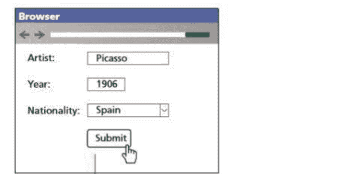

```html
<form method="GET" action="process.php">
GET process.php?artist=Picasso&year=1906&nation=Spain http/1.1
```

查询字符串

```html
<form method="POST" action="process.php">
POST process.php HTTP/1.1
Date: Sun, 20 May 2012 23:59:59 GMT
Host: www.mysite.com
User-Agent: Mozilla/4.0
Content-Length: 47
Content-Type: application/x-form-urlencoded
artist=-Picasso&year=1906&nation=Spain
```

HTTP 请求头

查询字符串

缺点：
传递信息后产生的查询字符串将变得很长且复杂。

### ii) 通过 URL 路径传递信息
将动态 URL 转换为静态以及反之的过程被称为动态重写。

## 5.2 Cookies

Cookies 是一种持久化状态信息的客户端方法。
它们是键值对，并保存在由浏览器管理的一个或多个文本文件中。这些键值对会随 HTTP 请求头中的服务器请求和响应一同。虽然 Cookie 不包含病毒，但第三方跟踪 Cookie 是隐私倡导者关注的问题。

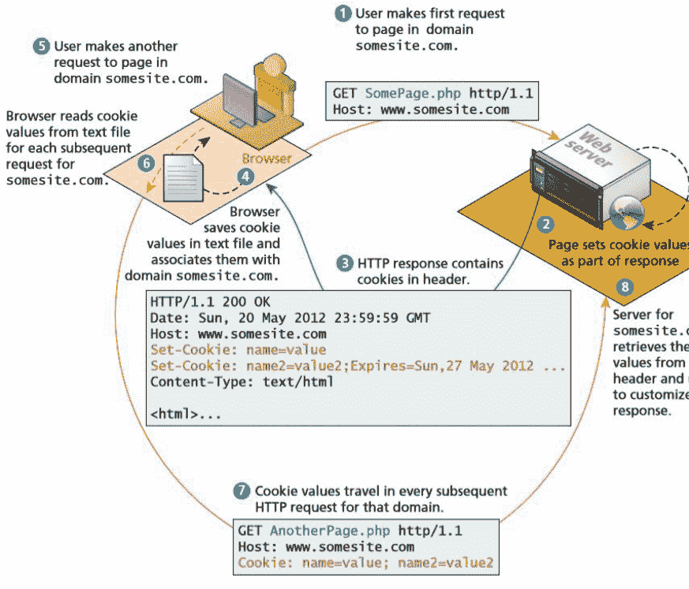

两种类型的 Cookie：

- i) 会话 Cookie：Session cookie 没有指定过期日期；因此会在会话结束时删除。
- ii) 持久性 Cookie：Persistent cookie 指定了过期日期；它们将保存在浏览器的 Cookie 文件中直到过期日期到达，届时会被删除。

PHP 中的 Cookie 使用 `setcookie()` 函数创建，并使用 `$_COOKIE` 全局关联数组进行获取。`setcookie()` 函数还支持几个参数，可以进一步自定义新的 Cookie。
例如：

```php
<?php
// 在当前时间基础上增加1天作为过期时间
$expiryTime = time()+60*60*24;

// 创建一个持久 cookie
$name = "Username";
$value = "Ricardo";
setcookie($name, $value, $expiryTime);
?>
```

Cookie 的用途：
i) 存储用户偏好。
ii) 跟踪用户的浏览行为

## 5.3 序列化

序列化是将复杂的对象还原为零和一以便进行存储或传输的过程。随后的零和一序列可以重新还原为原始对象，如下所示：

在 PHP 中，对象可以使用 `serialize()` 函数轻松地转换为二进制字符串。生成的字符串是对象的二进制表示，因此可能包含不可打印字符。可以使用 `unserialize()` 方法将字符串还原回对象。虽然数组、字符串和其他原始类型默认是可以序列化的，但我们创建的类必须实现 `Serializable` 接口，这要求对实现该接口的任何类添加 `serialize()` 和 `unserialize()` 的实现。

### Picasso：艺术家

- firstName: Pablo
- lastName: Picasso
- birthDate: 1881年10月25日
- birthCity: Malaga
- deathDate: 1973年4月8日
- works: Array(<Art>)

unserialize(picasso)

### Chicago：雕塑

- name: Chicago
- createdDate: 1967
- size: array(15.2)
- weight: 162 tons

### Guernica：绘画

- name: Guernica
- createdDate: 1937
- size: array(7.8,5)

```
C:8:764:{a:7:{s:8:"earliest";s:12:"Oct, 25, 1881";s:10:"firstName";s:5:"Pablo";s:8:"lastName";s:7:"Picasso";s:10:"birthDate";s:12:"October 25, 1881";s:9:"deathDate";s:12:"April 8, 1973";s:9:"birthCity";s:6:"Malaga";s:4:"size";a:1:{i:0;d:7.799999999999999;1:d:3.5};s:7:"weight";a:2:{i:0;d:7.599999999999999;1:d:3.5};s:8:"earliest";a:1:{i:0;d:7.499999999999999;1:d:3.5};s:8:"birthCity";a:1:{i:0;d:7.499999999999999;1:d:3.5};s:9:"birthDate";a:1:{i:0;d:7.499999999999999;1:d:3.5};s:9:"deathDate";a:1:{i:0;d:7.499999999999999;1:d:3.5};s:4:"size";a:1:{i:0;d:7.499999999999999;1:d:3.5};s:5:"works";a:1:{i:0;s:12:"paintingData";a:2:{i:0;s:8:"file.avi";s:12:"paintingData";a:2:{i:0;s:4:"size";a:1:{i:0;d:7.499999999999999;1:d:3.5}}}};s:6:"weight";a:1:{i:0;d:7.499999999999999;1:d:3.5};
```


```html
<form ...>
  <h1>Web 存储写入</h1>
  <script language="javascript" type="text/javascript">
    if (typeof(localStorage) === "undefined" ||
        typeof(sessionStorage) === "undefined") {
      alert("此浏览器不支持 Web 存储...");
    } else {
      sessionStorage.setItem("TodaysDate", new Date());
      sessionStorage.FavoriteArtist = "Matisse";
      document.write("web 存储已修改");
    }
  </script>
  <p><a href="WebStorageReader.php">前往 Web 存储读取器</a></p>
</form>
```

```html
<form id="form1" run="server">
  <h1>Web 存储读取器</h1>
  <script language="javascript" type="text/javascript">
    if (typeof(localStorage) === "undefined" ||
        typeof(sessionStorage) === "undefined") {
      alert("此浏览器不支持 Web 存储...");
    } else {
      var today = sessionStorage.getItem("TodaysDate");
      var artist = sessionStorage.FavoriteArtist;

      var user = localStorage.UserName;
      document.write("date saved = " + today + ");
      document.write("<br/>favorite artist = " + artist + ");
      document.write("<br/>user name = " + user + ");");
    }
  </script>
</form>
```

## 5.5 缓存

缓存是提高 应用程序性能的一种重要方式。缓存 应用程序有两种基本策略：i) 页面输出缓存 ii) 应用数据缓存。

### i) 页面输出缓存

在此类型的缓存中，渲染后的 PHP 页面内容（或其部分内容）被写入磁盘以便快速检索。这特别有用，因为它允许 PHP 在无需再次通过整个处理生命周期的情况下向客户端发送页面响应。页面输出缓存对于内容不频繁但创建需要大量处理的页面特别有用。页面缓存有两种模型：

i) 全页缓存：在全页缓存中，页面的整个内容都被缓存。
ii) 部分页面缓存：在部分页面缓存中，只缓存页面的特定部分，其他部分按正常方式动态生成。

PHP 默认不包含页面缓存，这使得免费和商业第三方缓存插件（如 Alternative PHP Cache（开源）和 Zend（商业））的市场得以蓬勃发展。

### 缺点：

只有当大量请求的整个缓存页面都是相同的时，才能获得性能提升。

### ii) 应用数据缓存：

在这里，页面将程序地将从数据库或 Web 服务器进行耗时查询常用的数据集合放在缓存内存中，然后其他需要相同数据的页面可以使用缓存版本，而不是从其原始位置重新检索。

## 5.6 JavaScript 伪类

### i. 使用对象字面量

可以使用类似于对象字面量的概念实例化对象：即，由键值对列表表示的对象，键和值之间用冒号分隔，键值对之间用逗号分隔。
例如：

```javascript
var oneDie = { color : "FF0000", faces : [1,2,3,4,5,6] };
```

一旦定义，就可以使用点符号来访问这些元素。例如，可以通过编写以下代码将颜色改为蓝色：
`oneDie.color="0000FF"`

### ii. 通过函数模拟类

虽然 JavaScript 中没有提供提供正式的类机制，但可以通过使用函数将变量和方法封装在一起来接近这一点，如下所示：

```javascript
function Die(col) {
  this.color=col;
  this.faces=[1,2,3,4,5,6];
}
```

函数内部的关键字指向实例，因此对内部属性或方法的任何引用都会管理它们自己的变量。

### 5.6.1 在 JavaScript 中向对象添加方法

要在对象的函数中定义方法，既可以在内部定义，也可以使用指向在类外部定义的函数引用。外部定义可能会迅速导致命名空间冲突问题，因为所有方法名必须与类的所有其他方法保持不冲突。由于此原因，在类定义内部添加方法的一种技术是将匿名函数赋值给变量。例如：function(col)

```javascript
{ 
  this.color=col;
  this.faces=[1,2,3,4,5,6];
  this.randomRoll = function() {
    var randNum = Math.floor((Math.random() * this.faces.length)+ 1);
    return faces[randNum-1];
  }
}
```

- iii. 使用原型

原型（Prototype）是 JavaScript 中一种基本的语法机制，用于让 JavaScript 的行为更像面向对象的的语言。原型属性和方法为对象的所有实例定义一次。例如：// 开始 Die 类

```javascript
function Die(col) {
  this.color=col;
  this.faces=[1,2,3,4,5,6];
}
Die.prototype.randomRoll = function() {
  var randNum = Math.floor((Math.random() * this.faces.length) + 1);
  return faces[randNum-1];
}; // 结束 Die 类
```

#### Die.prototype

```javascript
var col;
var faces;
this.randomRoll = function(){
  var randNum = Math.floor(
  (Math.random() *
  this.faces.length) + 1);
  return faces[randNum-1];
}
```

#### x:Die

```javascript
this.col = "#ff0000";
this.faces = [1,2,3,4,5,6];
this.randomRoll
```

#### y:Die

```javascript
this.col = "#0000ff";
this.faces = [1,2,3,4,5,6];
this.randomRoll
```

JavaScript 中的每个对象（和方法）都有一个原型。

## 5.7 jQuery

jQuery 是一个快速、小巧且功能丰富的 JavaScript 库。像 HTML 文档遍历和操作、事件处理、动画和 Ajax，通过一个易用的、跨多个浏览器的 API 变得简单得多。凭借通用性和扩展性的结合，jQuery 改变了数百万人编写 JavaScript 的方式。

### 5.7.1 向页面引入 jquery

要将 jquery 引入页面，我们可以链接到本地托管的版本或使用 CDN。使用分发网络（CDN）的优点是：用户可能已经缓存了该文件，因此无需下载。

缺点：

i) CDN 的缺点是，如果……你的 jQuery 将失败。

### 5.7.2 jQuery 选择器

jQuery 中选择器的实现反映了 CSS。四个基本选择器是：

- `*` - 通用选择器匹配所有元素。
- `tag` - 元素选择器匹配具有给定名称的所有元素。
- `.class` - 类选择器匹配具有给定类的元素。
- `#id` - ID 选择器匹配具有给定属性的所有元素。

除了这些基本选择器，还包含了其他选择器：

- **1. 属性选择器：** 属性选择器提供了一种通过属性的存在或属性的值选择元素的方法。
- **2. 伪元素：** 伪元素是特殊元素，是普通元素的特例。伪元素选择器允许你使用冒号和以下之一附加到任何选择器之后：:link,:visited,:focus,:hover,:checked,:first-child,:first-line 和 :first-letter。这些选择器可以与上述选择器结合使用，也可以单独使用。例如，选择所有访问过的链接指定为：
```javascript
var visitedLinks = $("a:visited");
```
- **3. 上下文选择器：** jQuery 中包含的另一个强大的 CSS 选择器是上下文选择器。这些选择器允许你在 CSS 中指定彼此之间具有特定关系的元素。兄弟关系包括后代（空格）、子元素（>）、相邻兄弟 (+）和通用兄弟（~）。选择 `var $("div p");` 内部的所有 <p> 元素。

## 5.8 内容过滤器

内容过滤器是唯一允许你向目前为止使用的所有选择器上附加过滤器并匹配特定模式的。例如：

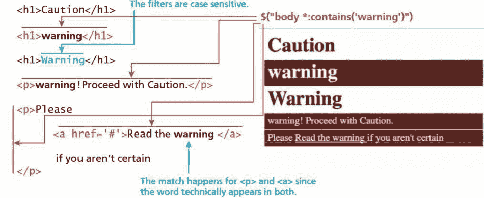

## 5.9 jQuery 属性

### i) HTML 属性

在 jQuery 中，我们可以通过对选择器的任何元素使用 `attr()` 方法来同时设置和获取属性值。此函数接收一个参数来指定是哪个属性，可选的第二个参数是要要设置的值。如果没有传递第二个参数，则调用的返回值为该属性的当前值。

```javascript
var link = $("a").attr("href");
$('a").attr("href","http://funwebdev.com");
$('img").attr("class","fancy");
```

### ii) HTML 属性

prop() 方法是获取和设置属性值的首选方式，attr 可能会返回某些（不那么用的）值。jQuery 提供了 css 方法。该方法有两个版本（具有不同的方法签名）：

i) 获取值：第一个版本接收一个包含你想要获取值的 CSS 属性的单个参数，并返回当前值。

```javascript
$color = $("#colourBox").css("background-color");
```


ii) 设置值：css() 的第二个版本，它接受两个参数：第一个是 CSS 属性，第二个是值。
$("#colourBox").css("background-color", "FF0000");

`html()` 方法用于获取元素的 HTML 内容。如果配合参数使用，它将更新该元素的 HTML。例如：
$("p").html("jQuery 是很有趣的");

### iii. 查询监听器

jQuery 支持为 JavaScript 事件创建和管理监听器/句处理器。这些事件的使用在概念上与 JavaScript 相同，仅在语法上有所不同。为特定事件设置监听器的方法与 JavaScript 相同。jQuery 同样拥有 `on()` 和 `off()` 方法，以及用于绑定事件的快捷方法。

## 5.10 修改 DOM

jQuery 提供了几个实用的方法来操作 DOM 元素本身。

当元素通过上述任何一种方式定义时，它会被插入到现有的 DOM 树中。你也可以根据需要一次将元素插入到多个位置，因为选择器可以返回 DOM 元素的数组。`append()` 方法接受 HTML 字符串、DOM 对象或 jQuery 对象作为参数。该对象将被作为所选元素的最后一个子节点添加。

| HTML 之前 | jQuery append | HTML 后 |
|---|---|---|
| `<div class="external-links">
  <div class="linkOut">
    funmbedev.com
  </div>
  <div class="linkIn">
    /localpage.html
  </div>
  <div class="linkOut">
    pearson.com
  </div>
</div>` | `$(".linkOut").append(jsLink);` | `<div class="external-links">
  <div class="linkOut">
    funmbedev.com
    <a href="http://funmbedev.com" title="jQuery">访问我们</a>
  </div>
  <div class="linkIn">
    /localpage.html
  </div>
  <div class="linkOut">
    pearson.com
    <a href="http://funmbedev.com" title="jQuery">访问我们</a>
  </div>
</div>` |

`append()` 方法类似于 `prepend()`（注：此处应为appendTo），但在语法上是相反的。如果我们使用 `appendTo()`，则必须交换调用对象和参数，以达到与之前代码相同的效果：

```
jsLink.append(".linkOut");
```

`prepend()` 和 `prependTo()` 方法的操作方式类似，但它们是将新元素作为第一个子节点而不是最后一个节点添加。

| HTML 之前 | jQuery append | HTML 后 |
|---|---|---|
| <div class="external-links">
<div class="linkOut">fumebedev.com</div>
<div class="linkIn">/localpage.html</div>
<div class="linkOut">pearson.com</div>
</div></div>> | $(".linkOut").prepend(jsLink); | <div class="external-links">
<div class="linkOut">
<a href="http://fumebedev.com" title="访问我们作为">fumebedev.com</a>
</div></div>>
<div class="linkIn">/localpage.html</div>
<div class="linkOut">
<a href="http://fumebedev.com" title="访问我们作为">pearson.com</a>
</div></div>></</div>> |

`wrap()` 方法是一个回调函数，它会为集合（通常是数组）中的每个元素调用一次。在一次 `wrap()` 函数执行期间，每个元素都会成为该目标，从而允许设置唯一的 title 属性。$(".contact").wrap(function())

```javascript
{
  return "<div class='galleryLink' title='访问 " + $(this).html() + "</div>";
}
```

`unwrap()` 是一个不接受任何参数的方法，与 `wrap()` 为所选元素添加父元素不同，`unwrap()` 删除所选项的父元素。其他方法如 `wrapAll()` 和 `wrapInner()` 提供了对封装 DOM 元素的额外控制。

## 5.11 AJAX

异步 XML JavaScript（AJAX）是一个用于描述某种范式的术语，它允许网络浏览器向服务器发送消息，而不会中断浏览器中显示内容的流。这利用了浏览的多线程设计，让一个线程处理浏览器和交互，而其他线程等待异步请求的响应。

### 客户端浏览器 服务器

| 浏览器接口 | JavaScript | WebService |
| --- | --- | --- |

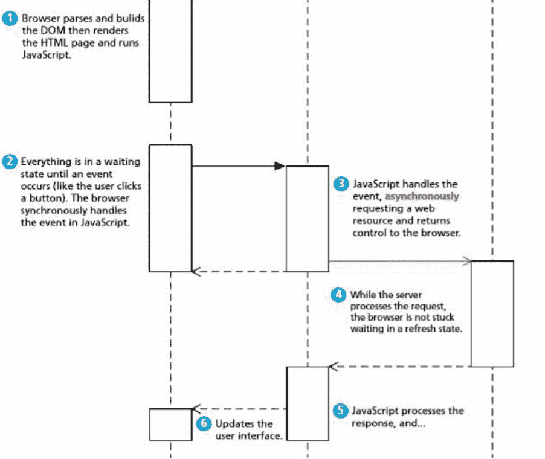

- 1. 浏览器解析并构建 DOM，然后渲染 HTML 页面并运行 JavaScript。
- 2. 一切都处于等待状态，直到事件发生（例如用户点击按钮）。浏览器在 JavaScript 中同步处理该事件。
- 3. JavaScript 处理事件，异步请求网络资源并将控制权交还浏览器。
- 4. 当服务器处理请求时，浏览器不会卡在刷新状态下等待。
- 5. JavaScript 处理响应，然后...
- 6. 更新用户界面。

### i) GET 方法：

`get()` 方法可以非常容易地请求资源，处理请求响应需要我们重新审视句处理器和监听器的概念。`get()` 方法的正式定义列出了一个必需参数 `url` 和三个可选参数：`$.get(url [, data], [, success(data,textStatus,jqHR)], dataType])`

- i) `url` 是发送请求的位置字符串。
- ii) `data` 是可选的对象字符串。
- iii) `success(data,textStatus,jqHR)` 是接收响应时执行的回调函数。
- iv) `dataType` 是预期的数据类型。

回调是用于函数的占位符术语，以便从其他地方调用函数。jQuery 默认在 xml、json、script 或 html 之间进行智能猜测。

回调函数可以接受三个可选参数：
- i) `data` 持响应体。
- ii) `textStatus` 持请求状态。
- iii) `jqHR`

```javascript
if (textStatus === "success") {
  console.log("成功: " + data);
} else {
  console.log("错误: " + textStatus);
}
```


（由于 `*` 是通配符）因此允许了否则会被拒绝（默认情况下）的请求。

## 5.13 异步文件传输

异步文件传输是现代 Web 应用最强大的工具之一。`FormData` 接口为 JavaScript 提供了一种从用户计算机中读取文件（一旦他们选择了该文件）并对其进行编码以上传的机制。你可以使用此机制异步上传文件。在这一纯 AJAX 技术中，表单对象被传递给 `FormData` 构造函数，然后用于调用 `send(XHR2 object)` get。此代码为可能发生的各种事件附加了监听器。

### 向 POST 附加文件

当我们考虑上传多个文件时，你可能想每次只上传一个文件，而不是每次都上传所有。为了支持这一点，你可以访问单个文件，并如下所示将原始文件附加到 `FormData` 对象中：

```
var xhr = new XMLHttpRequest(); // 引用第 1 个文件输入框
var fileFile=$(":file")[0]; var formData = new FormData();
```

```
formData.append('images',theFile);
```

这种技术的优势在于，当用户更改文件时，你会异步提交每个文件到服务器；并且它允许多个文件同时传输。异步文件上传的主要挑战是，你的实现必须考虑用户正在使用的浏览器范围。虽然新的 XHR2 规范和 `FormData` 接口非常“纯净”且易于使用，但它们尚未在多个平台和浏览器中被广泛支持，因此依赖它们并不是良好的做法。

## 5.14 动画

开发者在学习 jQuery 时，起初被易于使用的动画功能所吸引。如果使用得当，这些动画功能可以让你的 Web 应用看起来专业且具有吸引力。动态网页中常见的操作之一是显示和隐藏元素。可以使用 `css()` 修改元素的可见性，但会导致元素瞬时变化，这在视觉上可能会产生突兀感。

为了提供从隐藏到显示的更自然的过渡，`hide()` 和 `show()` 方法允许开发者轻松地逐渐隐藏元素，而不是通过即时变化。调用 `hide()` 和 `show()` 时不带参数可以执行默认动画。另一个版本允许两个参数：动画持续时间（以毫秒为单位）和完成后执行的回调方法。使用回调是将动画链在一起的极佳方法，或者在更改内容之前确保元素完全可见。

各种动画快捷方法：

- fadeIn()/fadeOut() :
`fadeIn()` 和 `fadeOut()` 方法控制元素的透明度。传递的参数是持续时间和回调，就像 `hide()` 和 `show()` 一样。与 `hide()` 和 `show()` 不同，它不会对元素缩放，只是严格控制透明度。另一种方法是 `fadeTo()`，它接受两个参数：毫秒为单位的持续时间和要渐变的透明度（0 到 1 之间）。

- slideDown()/slideUp() :
我们将讨论的快捷方法是 `slideUp()` 和 `slideDown()`。这些方法不接触元素的透明度，而是逐渐改变它的高度。

### toggle 方法
快捷方法成对出现，这使得非常适合在显示和隐藏状态之间切换。jQuery 编写了多个 `toggle` 方法来实现恰此功能。例如，为了在可见和隐藏状态之间切换，可以使用 `toggle()` 方法。

要在淡入和淡出之间切换，请使用 `fadeToggle()` 方法；在两个滑动状态之间切换可以使用 `slideToggle()` 方法实现。使用 `toggle` 方法意味着你不需要检查当前状态然后有条件地调用这两个方法之一；这些方法会为你处理这些逻辑方面。

## 5.15 动画方法

`animate()` 方法有多个版本，形式如下：`.animate(properties, options);`。`properties` 参数包含一个带有动画最终状态所有 CSS 样式的普通对象（Plain Object）。`options` 参数包含一个设置了任何选项的另一个普通对象。

i. **always** 是动画完成或因失败条件停止时调用的函数。此函数将被始终调用（因此得名）。

ii. **done** 是在动画完成时调用的函数。iii. **duration** 是一个控制动画持续时间的数字。iv. **fail** 是如果动画未完成时调用的函数。

v. **progress** 是在动画每一步之后调用的函数。vi. **queue** 是一个布尔值，告诉动画是否要在动画队列中等待。如果为 false，则动画将立即开始。vii. **step** 是你可以定义的一个函数，将在动画仍在进行期间定期调用。它接受两个参数：**a element**（带有 CSS 属性当前数值结果的元素）和 **an fx object**（一个具有有用属性的临时对象，如 `css` 所代表的，在 jQuery 中被入队两次）。

viii. **Advanced options**（称为 `easing` 和 `specialEasing`）高级选项对动画速度进行高级控制。

例如：
$(this).animate(

```
{opacity:"show","fontSize":"120%","marginRight":"100px"}, {step:
function(now, fx)
{
```

```
if (fx.prop=="marginRight")
{ var angle=("now/100)*360);
$(this).css("transform","rotate("++angle+"deg)");
$(this).css("webkit-transform","rotate("++angle+"deg)"); $(this).css("ms-transform", "rotate(\+angle+"deg)");
} }, duration:5000,"easing":"linear" };
```

下面是随时间 t 对数值型 CSS 属性进行 step 调用的动画插图

| | t=1500 | t=3200 | t=5000ms |
|---|---|---|---|
| //开始动画 /* */ | //opacity step(64, FX); | //opacity step(64, FX); margin-right:0; | //done animation(); |
| opacity:0; margin-right:0; transform:angle(0deg); | //opacity:3; margin-right:32; transform:angle(108deg); | //opacity:64; margin-right:64; transform:angle(230deg); | |
| //transform 没有 step! | var angle=random(0,360); $(this).addClass("transform"; rotate(\+angle+"deg)"); | var angle=random(0,360); $(this).addClass("transform"; rotate(\+angle+"deg)"); | |

## 5.15 Backbone MVC 框架

Backbone 是一个进一步抽象 JavaScript 以更符合 MVC 模型的框架。该库可以从 http://underscorejs.org/ 获取。在 Backbone 中，你围绕模型的概念构建客户端脚本。这些模型通常与数据库中的行相关，并可以使用 REST 接口加载、更新并最终保存回数据库。Backbone 中的 MVC 模式使用模型对象、集合对象和视图来渲染 HTML 模型。

### Backbone 模型:

Backbone.js 将模型定义为“任何 JavaScript 应用程序的核心，包含交互数据以及周围的大部分逻辑：转换、验证、计算属性和访问控制”。

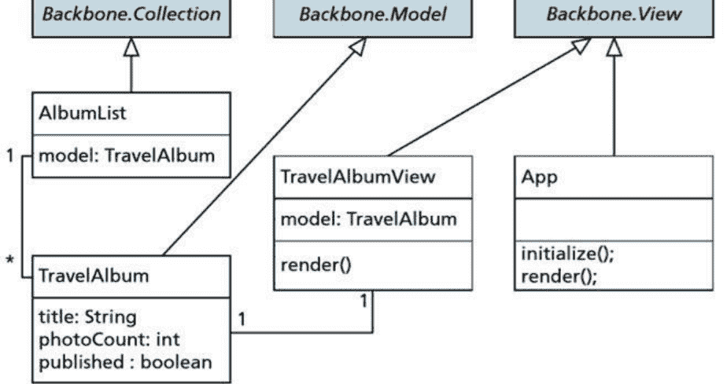

图：相册的 Backbone 模型、集合和视图插图

在 Backbone 中，我们首先抽象想要创建模型的元素。在观察案例中，TravelAlbum 将由一个标题、图片数量 photoCount 以及一个控制是否发布的布尔值组成。我们使用 Backbone 定义的模型必须扩展 Backbone.Model，在此过程中添加方法。

```
// 为专辑创建模型
var TravelAlbum = Backbone.Model.extend({ defaults:
  { title: 'NewAlbum',
  photoCount: 0,
```

```
published: false
toggle: function(){
this.set('checked', !this.get('checked'));
} });
```

### 集合

集合通常用于包含模型列表。这些集合具有高级功能，并且像数据库一样可以拥有索引来


提高搜索性能。

考虑给定的示例，这是一个用于存储 PhotoAlbums 示例的 Backbone.js Collection（集合）演示。

```javascript
// 创建一个专辑集合
var AlbumList = Backbone.Collection.extend({
  // 设置此集合中对象的模型类型
  model: TravelAlbum,

  // 仅返回已勾选的专辑
  GetChecked: function() {
    return this.where({checked:true});
  }
});

// 使用一些专辑预填充集合。
var albums = new AlbumList(
  new TravelAlbum({ title: 'Banff, Canada', photoCount: 42}),
  new TravelAlbum({ title: 'Santorini, Greece', photoCount: 102})
]);
```

# 视图 (Views)

视图允许你将模型（models）转换为用户看到的 HTML。它们附加到 Collection 的方法和属性上，并定义当 Backbone 确定需要刷新视图时就会被调的方法。下面是为我们的模型和集合定义的自定义视图对象：

```javascript
var TravelAlbumView = Backbone.View.extend({
  TagName: 'li',

  events:{
    'click': 'toggleAlbum'
  },

  initialize: function() {
    // 设置附加到改变事件的监听器
    this.listenTo(this.model, 'change', this.render());
  },

  render: function() {
    // 创建 HTML
    this.$el.html('<<input type="checkbox" value="1" name="' + 
    this.model.get('title') + '" /> ' + 
    this.model.get('title') + '<span>' + 
    this.model.get('photoCount') + ' images</span>');
    this.$('input').prop('checked', this.model.get('checked'));

    // 返回对象是一个良好的习惯
    return this;
  },

  toggleAlbum: function() {
    this.model.toggle();
  }
});
```

## 5.16 XML 处理与 Web 服务

- XML 是一种标记语言，但与 HTML 不同，XML 可用于标记任何类型的数据。
- XML 不仅用于 Web 开发，还作为许多 Web 应用程序的文件格式。
- XML 数据的一个主要优势是作为纯文本，它可以在应用程序和不同的操作系统之间进行读取和传输，同时也具有人类可读和可理解性。
- XML 不仅用于 Web 服务器与浏览器进行异步通信，还用作系统间移动信息的数据交换格式。
- 文档要形成“良好的（well-formed）”XML，必须遵循 XML.1 的语法规则。

这些规则非常直观：

1. 元素名称由 XML 中的任何有效字符组成（不允许大多数标点符号和空格）。
2. 元素名称不能以数字开头。
3. 必须有一个根元素。根元素包含其他所有元素；例如，在 HTML 文档中，根元素是 `<html>`。
4. 所有元素必须有闭合元素（或自闭合）。
5. 元素必须正确嵌套。
6. 元素可以包含属性。
7. 属性值必须始终在引号内。
8. 元素和属性名称对大小写敏感。

有效的 XML 文档是指格式良好且其元素内容符合其文档类型定义（DTD）或架构（schema）规则的文档。

在 Web 环境下有时还会另外两种 XML 技术。

i) XSLT，全称 XML 样式表转换（XML Stylesheet Transformations）。XSLT 是一种基于 XML 的编程语言，用于将 XML 转换为其他文档格式，如从 XML 转换为 HTML。
示例：
```xml
<?xml version="1.0" encoding="ISO-8859-1"?>
<html xsl:version="1.0"
xmlns:xsl="http://www.w3.org/1999/XSL/Transform"
xmlns="http://www.w3.org/1999/xhtml">
<body>
  <h1>目录</h1>
  <ul xsl:for-each select="art/painting">
    <li>
      <h2><xsl:value-of select="title"/></h2>
      <p>作者: <xsl:value-of select="artist/name"/></p>
      <br/>
      年份: <xsl:value-of select="year"/>
      [<xsl:value-of select="medium"/></]</p>
    </li>
  </xsl:for-each>
</body>
</html>
```

ii) XPath：这是一种用于搜索 XML 文档和导航到 XML 文档内元素的标准语法。XPath 通常作为 PHP 和其他语言中对 XML 文档进行编程操作的一部分使用。XPath 使用的与大多数操作系统访问目录的语法相似。在 XPath 术语中，XPath 表达式返回零、一个或多个 XML 节点。在 XPath 中，节点通常指一个 XML 元素。
示例：


```xml
<xml version="1.0" encoding="ISO-8859-1">
<art>
  <painting id="290">
    <title>阳台</title>
    <artist>
      <name>马奈</name>
      <nationality>法国</nationality>
    </artist>
    <year>1866</year>
    <medium>画布布油画</medium>
  </painting>
  <painting id="192">
    <title>之吻</title>
    <artist>
      <name>克里姆</name>
      <nationality>奥地利</nationality>
    </artist>
    <year>1907</year>
    <medium>画布金箔油画</medium>
  </painting>
  <painting id="139">
    <title>霍拉斯兄弟之誓</title>
    <artist>
      <name>大卫</name>
      <nationality>法国</nationality>
    </artist>
    <year>1784</year>
    <medium>画布布油画</medium>
  </painting>
</art>
</xml>
```


## 5.17 XML 处理

PHP、JavaScript 和其他现代开发环境中的 XML 处理分为两种基本样式：

- **内存方法**，涉及将整个 XML 文件读取到内存中并以某种数据类型访问和操作数据。
事件或拉取方法，允许你一次只提取少数元素或行，从而避免大 文件的内存加载。

i) JavaScript 中的 XML 处理

- 所有现代浏览器都内置了 XML 解析器，它们的 JavaScript 实现支持内存 XML DOM API，该 API 将整个文档加载到内存中并将其转换为层次树数据结构。
- 熟悉的 DOM 函数如 `getElementById()`、`getElementsByTagName()` 和 `createElement()` 可用于访问和操作数据。
- jQuery 提供了处理 XML 的另一种方式，处理跨浏览器支持。

### 示例：使用 jquery 处理 XML

```javascript
art = '<?xml version="1.0" encoding="ISO-8859-1"?>';
art += '<art><painting id="290"><title>阳台...</art>';

// 使用 jQuery parseXML() 函数创建 DOM 对象
xmlDoc = $.parseXML( art );
// 将 DOM 对象转换为 jquery 对象
$xml = $( xmlDoc );

// 查找所有 painting元素
$paintings = $xml.find( "painting" );
// 遍历每个 painting元素
$paintings.each(function() {
  // 显示其 id
  alert($(this).attr("id"));
  // 在当前 painting元素内查找 title 元素
  $title = $(this).find("title");
  // 并显示其内容
  alert($title.text());
});
```


```
// 创建并打开读取器
$reader = new XMLReader();
$reader->open($filename);

// 遍历 XML 文件
while($reader->read()) {
  $nodeName = $reader->name;
  if ($reader->nodeType == XMLREADER::ELEMENT
  && $nodeName == 'painting') {
    // 从当前的 painting 节点创建一个 SimpleXML 对象
    $doc = new DOMDocument('1.0', 'UTF-8');
    $painting = simplexml_import_dom($doc->importNode(
      $reader->expand(true));
    // 现在得到了一个单一的绘画对象，我们可以输出它
    echo '<h2>' . $painting->title . '</h2>';
    echo '<p>By ' . $painting->artist-name . '</p>';
  }
}
```

## 5.18 JSON

JSON 代表 JavaScript Object Notation（JavaScript 对象表示法），是一种数据序列化格式。也就是说，它用于以文本格式表示对象数据，以便从一台计算机传输到另一台计算机。下面展示了 XML 数据元素在 JSON 中的表示示例：

<artist>
<name>Manet</name>
<nationality>France</nationality>
</artist>

| 名称 值 |
| :--- | :--- |
| "artist": {"name":"Manet","nationality":"France"}} | 对象 |

### i) 在 JavaScript 中使用 JSON

由于 JSON 的语法与 JavaScript 中创建对象的语法相同，因此在 JavaScript 中很容易使用 JSON 格式：

<script>
var a = {"artist": {"name":"Manet","nationality":"France"}};
alert(a.artist.name + " " + a.artist.nationality);
</script>

JSON 信息将包含在一个字符串中，可以使用 `JSON.parse()` 函数将包含 JSON 数据的字符串转换为 JavaScript 对象：
var text = {"artist": {"name":"Manet","nationality":"France"}}; var a = JSON.parse(text);
alert(a.artist.nationality);

jQuery 库还提供了一个 JSON 解析器，它可以在所有浏览器中工作（旧版浏览器不支持 `JSON.parse()` 函数）：var artist = jQuery.parseJSON(text);
JavaScript 还提供了一种机制将 JavaScript 对象转换为 JSON 字符串：
var text = JSON.stringify(artist);

### ii) 在 PHP 中使用 JSON

PHP 带有 JSON 扩展，从 PHP 5.2 版本开始，JSON 扩展默认绑定并编译到 PHP 中。将 JSON 字符串转换为 PHP 对象非常简单：

```php
<?php
$text = {"artist": {"name":"Manet","nationality":"France"}}; $anObject = json_decode($text);
echo $anObject->artist->nationality;
```

```php
$anArray = json_decode($text, true);
echo $anArray['nationality'];
?>
```

`json_decode()` 函数可以返回 PHP 对象或关联数组。
由于 JSON 数据通常来自外部源，因此在使用之前之前应始终检查解析错误，可以通过如下所示的 `json_last_error()` 函数来实现：

```php
<?php
$text = '{"artist":"Manet","nationality":"France"}'; $anObject = json_decode($text);
if (json_last_error() == JSON_ERROR_NONE)
{ echo $anObject->artist->nationality; }
?>
```

## 5.19 Web 服务概述

Web 服务是常见的计算范式示例，通常被称为面向服务的计算（SOC），它利用所谓的“服务”作为软件应用开发和运行的关键元素。Web 服务是一种相对标准化的机制，一个软件应用程序可以使用 Web 协议连接并与另一个软件应用程序通信。Web 服务利用 HTTP 协议，因此可以被任何连接互联网的计算机使用。

### Web 服务的益处

- 1) 它们可能为运行在不同平台上的不同应用程序之间提供互操作性。
- 2) 它们可以实现所谓的面向服务的架构（SOA）。

### i) SOAP 服务

SOAP 是一种消息协议，用于通过 HTTP 头部中的 XML 编码服务调用及其返回值。
使用基于 SOAP 的服务某种类似于使用编译器：它的输出可能复杂难以理解，但它确实让大多数程序员的生活变得更简单。

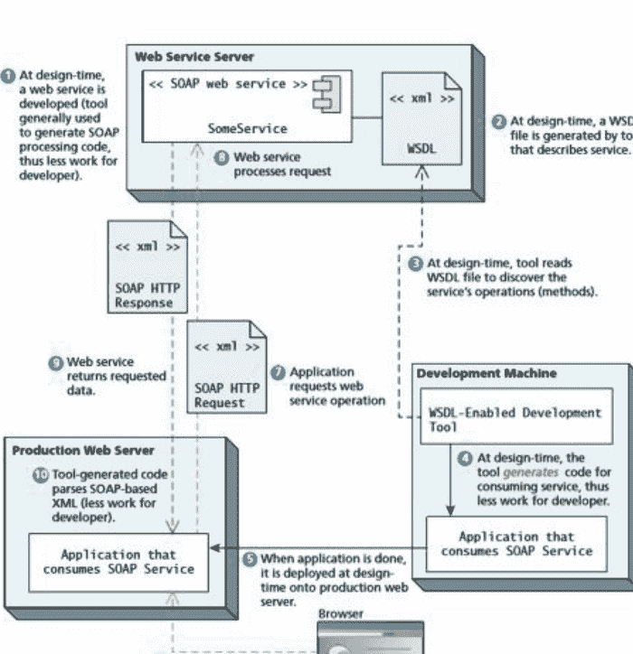

### ii) REST 服务

REST 代表表述状态转移（Representational State Transfer）。
RESTful Web 服务消除了服务描述层，并消除了需要独立协议来编码消息请求和响应。相反，它简单地使用 HTTP URL 来请求资源/对象（并编码输入参数）。该对象的序列化表示（通常是 XML 或 JSON 流）将作为普通的 HTTP 响应返回给请求者。

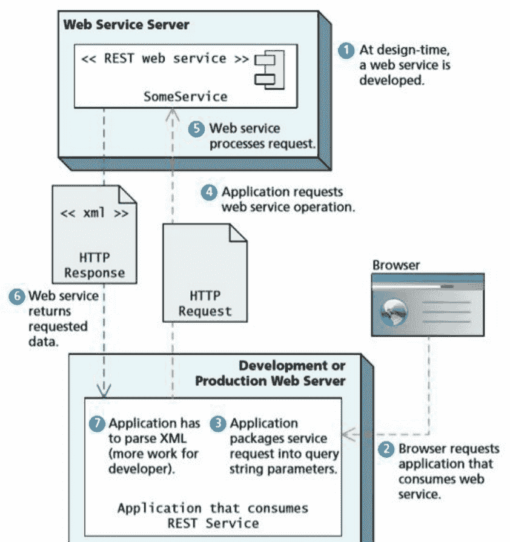

部署基于 REST的服务不需要特殊步骤，测试 RESTful 服务通常不需要特殊工具（浏览器除外），并且通过成熟的实践以及对缓存、集群和负载均衡等传统动态 HTTP 网站的经验，可以更容易地为大量客户端进行扩展。

REST 似乎几乎完全取代了 SOAP 服务。各种 RESTful 服务的相对易用性产生了一种新的 Web 开发风格，通常被称为杂烩（mashup），它通常指结合并整合来自各种不同来源数据的网站。

浏览器在客户端屏幕的窗口中显示 XHTML 文档。

JavaScript Window 对象表示显示文档的窗口。

Window 对象的属性对所有 JavaScript 脚本（即在窗口 XHTML 文档中隐式或显式出现的脚本）都是可见的，它们包含了所有的全局变量。

## 题库

- 1. 为什么状态（state）对 Web 来说是一个问题？请解释。
- 2. 什么是 HTTP Cookies？在 PHP 中如何处理它们？
- 3. jQuery 中的 `$` 简写代表什么？解释 jQuery 选择器。
- 4. 结合合适的示例解释 jQuery 的基本选择器。
- 5. 使用合适的脚本解释在 JavaScript 中加载和处理 XML 文档。
- 6. 用示例解释动画快捷方式（animation shortcuts）和原始动画（raw animations）。
- 7. 用示例解释 JSON 及其在 JavaScript 和 PHP 中的用法。
- 8. 为以下 XML 代码编写 DTD 和 schema。

```xml
<?xml version="1.0" encoding="ISO-8859-1"?>
<art>
<painting id="290">
<title>Balcony</title>
<artist>
<name>Manet</name>
<nationality>France</nationality>
<year>1868</year>
<medium>oil on canvas</medium>
</painting>
</art>
```

- 9. 描述 Web 应用程序缓存。
- 10. 示例解释以下 Web 服务：i) SOAP 服务 ii) REST 服务。
- 11. 解释 MVC 框架。

## 实验

- 1. 编写 JavaScript 执行以下操作：加法、乘法、减法、除法。
- 2. 编写 JavaScript 计算 0 到 10 的平方并在表格格式中输出。
- 3. 编写 JavaScript 代码，以 100ms 为间隔以红色显示“GROWING”，当字体缩小到 5pt 时以蓝色显示“SHINKING”。
- 4. 开发一个包含 JavaScript 的 HTML 文件解决以下问题：
    - a. 参数：字符串 b. 输出字符串中最左侧元音的位置
    - c. 参数：数字 d. 反转数字
- 5. 设计一个 XML 文档存储来自 VTU 学生的信息。信息必须包括 USN、姓名、学院、专业、入学年份和电子邮件。创建 CSS 文档。
- 6. 编写 PHP 程序制作样式表数据并使用它跟踪访问网页的人数，用合适的标题显示此计数。
- 7. 编写 PHP 程序创建一个显示服务器当前时间的数字钟。
- 8. 编写 PHP 程序实现以下操作：
    - a. 实现简单计算器。
    - b. 查找矩阵转置。
    - c. 矩阵乘法。
    - d. 矩阵加法。
- 9. 编写一个名为 states 的 PHP 程序，声明变量 states 为 "TexasMassachusettsKansasMississippiAlabama"，执行：
    - a. 在变量 states 中搜索以 as 结尾的值。将此词存储在 statesList 的元素 0 中。
    - b. 在 states 中搜索以 k 开头 s 结尾的单词。执行不区分大小写的比较。[注意：作为方法的第二个参数传递 re 可以执行不区分大小写的比较]。将此词存储在 statesList 的元素 1 中。
    - c. 在 states 中搜索以 M 开头 s 结尾的单词。将此词存储在 furthest 中。
    - d. 在 states 中搜索以 a 结尾的单词。将此词存储在列表元素 3 中。
- 10. 编写使用选择排序处理数据库中学生记录的 PHP 程序。
- 11. 编写 JavaScript 设计一个简单计算器以执行以下操作：加法、乘法、减法和除法。<html>

```html
<head>
<style>
,main{
width:400px;
height:250px;
```


```css
<style>
background-color:#ADB1E7;
border: 1px solid #669;
padding-top:10px;
margin: 0px auto;
border-radius:10px;
}
#heading{
font-size:20px;
text-align:center;
color:#17099B;
}
#heading1{
font-size:15px;
text-align:center;
color:#17099B;
}
input[type=button] {
background:#C0C0C0;
width:50px;
border-radius: 2px;
margin-left: 10px;
margin-top: 10px;
}
</style>
</head>
<body>
<div class="maincl">
<div id="heading">简单计算器</div
<hr>
<center>
<form name="calculator">
<input type="text" name="answer" />
<br>
<input type="button" value="1 " onclick="calculator.answer.value += '1' />
<input type="button" value="2 " onclick="calculator.answer.value += '2' />
<input type="button" value="3 " onclick="calculator.answer.value += '3' />
<input type="button" value="+" onclick="calculator.answer.value += '+' />
<br/>
<input type="button" value="4 " onclick="calculator.answer.value += '4' />
<input type="button" value="5 " onclick="calculator.answer.value += '5' />
<input type="button" value="6 " onclick="calculator.answer.value += '6' />
<input type="button" value="- " onclick="calculator.answer.value += '-' />
<br/>
<input type="button" value="7 " onclick="calculator.answer.value += '7' />
<input type="button" value="8 " onclick="calculator.answer.value += '8' />
<input type="button" value="9 " onclick="calculator.answer.value += '9' />
<input type="button" value="x " onclick="calculator.answer.value += '*'" />
<br/>
<input type="button" value="c " onclick="calculator.answer.value = ''" />
<input type="button" value="0 " onclick="calculator.answer.value += '0' />
<input type="button" value="=" onclick="calculator.answer.value = eval(calculator.answer.value)" />
<input type="button" value="/ " onclick="calculator.answer.value += '/'" />
<br/>
</form>
</center>
<hr>
<div id="heading1">由 PK 设计</div>
<div></div>
</body>
</html>
```

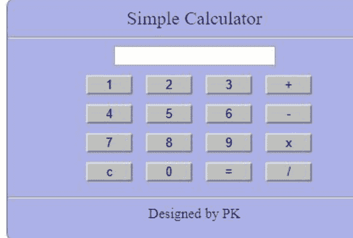

2. 编写一个 JavaScript，计算 0 到 10 数字的平方和立方，并输出以 HTML 表格格式显示结果的 HTML 文本。

```html
<html>
<head>
</head>
<body>
<h2 align="center">0 到 10 的数字的平方和立方</h2>
<script>
document.write("<center><table width='300' border='1' bgcolor='#C0C0C0'>");
document.write("<tr><th>数字</th><th>平方</th><th>立方</th></tr>" ); for(var n=0; n<=10; n++) {
document.write("<tr><td>" + n + "</td><td>" + n*n + "</td><td>" + n*n*n + "</td></tr>");
}
document.write("</table>");
document.write("</center>");
</script>
</body>
</html>
```

```markdown
```

# 输出

# 0 到 10 的数字的平方和立方

| 数字 | 平方 | 立方 |
|---|---|---|
| 0 | 0 | 0 |
| 1 | 1 | 1 |
| 2 | 4 | 8 |
| 3 | 9 | 27 |
| 4 | 16 | 64 |
| 5 | 25 | 125 |
| 6 | 36 | 216 |
| 7 | 49 | 343 |
| 8 | 64 | 512 |
| 9 | 81 | 729 |
| 10 | 100 | 1000 |
```

编写一个 JavaScript 代码，以**红色**显示文本“TEXT-GROWING”，其字体大小每隔 100ms 增加 10pt间隔；当字体大小达到 50pt 时，以**蓝色**显示“TEXT-SHRINKING”。然后字体大小减小到 5pt。

```html
<!DOCTYPE html>
<html>
<body>
<p id="myP1"></p>
</body>
<script>
var textsize = 5;
var myWait = setInterval(GrowText, 100);
function GrowText() {
if(textsize<50) {
textsize = textsize + 1;
document.getElementById("myP1").innerHTML = "Growing Text"
document.getElementById("myP1").style.fontSize = textsize+'pt';
document.getElementById("myP1").style.color = "red"; 
} else {
clearInterval(myWait);
myWait = setInterval(ShrinkText, 100);
}
function ShrinkText() {
if(textsize>5){
textsize = textsize - 1;
document.getElementById("myP1").innerHTML = "Shrinking Text"
document.getElementById("myP1").style.fontSize = textsize+'pt';
document.getElementById("myP1").style.color = "blue";
} else{
clearInterval(myWait);
}
}
</script>
</html>
```

# 输出


4. 开发一个 HTML 文件，包含 JavaScript 函数来实现以下问题：
a. 参数：字符串
b. 输出：字符串中第一个元音的位置
c. 参数：数字
d. 输出：倒序后的数字

```html
<html>
<script>
function vowel(st) {
var pos;
pos=st.search(/[aeiouAEIOU]/);
if(pos<0)
  alert("未找到");
else
  alert("第一个元音的位置是 "+pos);
}

function rev(n) {
  var temp=0,rev=0;
  while(n>0) {
    temp=n%10;
    rev=rev*10+temp;
    n=Math.floor(n/10);
  }
  alert("倒序数字为:"+rev);
}
</script>
<head>
<body>
<form>
输入文本：
<input type="text" id="voweltext"/>
<input type="button" value="点击" onclick="vowel(voweltext.value)"><br><br/>
输入数字：
<input type="text" id="number"/>
<input type="button" value="点击" onclick="rev(number.value);"/>
</form>
</body>
</html>
```

# 输出

输入文本：Apple
第一个元音的位置是 1

输入数字：54321
倒序数字为:12345

5. 设计一个 XML 文档来存储关于属于 VTU 工程学院的学生信息。信息必须包括学号（USN）、姓名、学院、入学年份和邮箱。为 3 个学生编写数据。创建一个 CSS 样式并用它显示文档。

```xml
<?xml version="1.0" encoding="UTF-8"?>
<?xml-stylesheet type="text/css" href="5.css"?>
<student_information>
<h1>学生信息</h1>
<h2>第一个学生信息</h2>
<label>学号：</label><s>1HK16CS001</s>
<label>姓名：</label><name>Arun Kumar</name>
<label>学院：</label><college>HKBK</college>
<label>专业：</label><branch>CSE</branch>
<label>入学年份：</label><year>2001</year>
<label>邮箱：</label><email>arun@gmail.com</email>
<h2>第二个学生信息</h2>
<label>学号：</label><s>1HK16CS002</s>
<label>姓名：</label><name>Bhopal Singh</name>
<label>学院：</label><college>HBKB</college>
<label>专业：</label><branch>CSE</branch>
<label>入学年份：</label><year>2001</year>
<label>邮箱：</label><email>bhopal@gmail.com</email>
<h2>第三个学生信息</h2>
<label>学号：</label><s>1HK16CS003</s>
<label>姓名：</label><name>Mohan Kumar</name>
<label>学院：</label><college>HBBK</college>
<label>专业：</label><branch>CSE</branch>
<label>入学年份：</label><year>2001</year>
<label>邮箱：</label><email>mohan@gmail.com</email>
</student_information>
```

CSS 文件 (5.CSS)

```css
h1{font-size:16pt;color:blue;}
h2{display:block;font-size:16pt;color:green;}
label{font-weight:bold;text-decoration:underline;}
us{display:block;}
name{display:block;}
college{display:block;}
branch{display:block;}
year{display:block;}
email{display:block;}
```

# 输出

# 学生信息

第一个学生信息
学号：1HK16CS001
姓名：Arun Kumar
学院：HKBK
专业：CSE
入学年份：2001
邮箱：arun@gmail.com

第二个学生信息
学号：1HK16CS002
姓名：Bhopal Singh
学院：HBKB
专业：CSE
入学年份：2001
邮箱：bhopal@gmail.com

第三个学生信息
学号：1HK16CS003
姓名：Mohan Kumar
学院：HBBK
专业：CSE
入学年份：2001
邮箱：mohan@gmail.com

6. 编写一个 PHP 程序，用于跟踪访问页面的次数，并带有适当的标题显示此计数器。

```html
<html>
<head>
<title>访问次数</title>
</head>
<body bgcolor="maroon" text="white">
<?php
session_start();
if (!isset($_SESSION["count"])) {
  $_SESSION["count"] = 0;
  echo "<p>计数初始化</p>";
} else {
  $_SESSION["count"]++;
}
print "<p>访问次数为：<b>".$_SESSION["count"].</b></p>"; print "<p>刷新此页面以增加计数</p>"; ?>
</body>
</html>
```

# 输出

计数初始化
访问次数为：1
刷新此页面以增加计数

7. 编写一个 PHP 程序，显示一个数字时钟，显示服务器的当前时间。

```html
<html>
</head>
<body>
<h2>
<?php
echo 服务器当前时间为" . date("h:i:sa");
header("refresh:1");
?>
</h2>
</body>
</html>
```

# 输出

服务器当前时间为 03:51:51pm


```php
<?php
$res=$txt1-$txt2;
else if($op==="x")
$res=$txt1*$txt2;
else
$res=$txt1/$txt2;
}
?>
<form method="post" action="">
简单的 PHP 计算器
<br /> <br />
输入第一个数字：<input name="n1" value="<?php echo $txt1; ?>" <br /> <br />
输入第二个数字：<input name="n2" value="<?php echo $txt2; ?>" <br /> <br />
结果为：<input name="res" value="<?php echo $res; ?>" <br /> <br />
<input type="submit" name="submit" value="+">
<input type="submit" name="submit" value="-">
<input type="submit" name="submit" value="x">
<input type="submit" name="submit" value="/">
</form>
</html>
```

# 输出(8a)

简单的 PHP 计算器

输入第一个数字:2

输入第二个数字:2

结果为：4

# 8a,b&c

```php
<?php
header('Content-Type: text/plain'); function transpose(&$A, &$C) {
$N = 2;
for ($i = 0; $i<$N; $i++)
for ($j = 0; $j < $N; $j++)
$C[$i][$j] = $A[$j][$i];
}
```

```php
function addition(&$A, &$B, &$D) {
$N = 2;
for ($i = 0; $i < $N; $i++)
for ($j = 0; $j < $N; $j++)
$D[$i][$j] = $A[$i][$j]+$B[$i][$j];
}
```

```php
function multiplication(&$A, &$B, &$E) {
$N = 2;
for ($i = 0; $i < $N; $i++)
{
for ($j = 0; $j < $N; $j++)
{
$E[$i][$j]=0;
for($k=0; $k<$N; $k++)
{
$E[$i][$j]-=$E[$i][$j]+($A[$i][$k]*$B[$k][$j]);
}
}
}
}
```

```php
$A = array(array(1, 1),
array(2, 2));
$B = array(array(1, 1),
array(2, 2));
$N = 2;
transpose($A, $B, $D);
addition($A, $B, $D);
multiplication($A, $B, $E);
echo "Matrix A is \n";
for ($i = 0; $i < $N; $i++)
{
for ($j = 0; $j < $N; $j++)
{
echo $A[$i][$j];
}
echo " ";
}
echo "\n";
}
echo "Matrix B is \n";
for ($i = 0; $i < $N; $i++)
{
    for ($j = 0; $j < $N; $j++)
    {
        echo $B[$i][$j];
        echo " ";
    }
    echo "\n";
}
echo "Transpose of a matrix A is \n"; 
for ($i = 0; $i < $N; $i++)
{
    for ($j = 0; $j < $N; $j++)
    {
        echo $C[$i][$j];
        echo " ";
    }
    echo "\n";
}
echo "Addition of matrix A and B is \n"; 
for ($i = 0; $i < $N; $i++)
{
    for ($j = 0; $j < $N; $j++)
    {
        echo $D[$i][$j];
        echo " ";
    }
    echo "\n";
}
echo "Multiplication of matrix A and B is \n"; 
for ($i = 0; $i < $N; $i++)
{
    for ($j = 0; $j < $N; $j++)
    {
        echo $E[$i][$j];
    }
    echo " ";
}
echo "\n";
}
?>
```

# 输出 (8a,b&c)

矩阵 A 是
1 1
2 2
矩阵 B 是
1 1
2 2
矩阵 A 的转置是
1 2
1 2
矩阵 A 和 B 的相加是
2 2
4 4
矩阵 A 和 B 的乘积是
3 3
6 6

9. 写一个名为 states.py 的 PHP 程序，声明一个值为 "Mississippi Alabama Texas Massachusetts Kansas" 的变量 states。编写 PHP 程序执行以下操作：
a. 在变量 states 中搜索以 xas 结尾的单词。将该单词存储在名为 statesList 的列表的元素 0 中。
b. 在 states 中搜索以 k 开头并以 s 结尾的单词。执行不区分大小的比较。[注：向方法 compile 传递第二个参数可执行不区分大小的比较。]将该单词存储在 statesList 的元素 1 中。
c. 在 states 中搜索以 M 开头并以 s 结尾的单词。将该单词存储在列表的元素 2 中。
d. 在 states 中搜索以 s 结尾的单词。将该单词存储在列表的元素 3 中。

```php
<?php
$states = "Mississippi Alabama Texas Massachusetts Kansas";
$statesList = [];

// a. 搜索以 xas 结尾的单词
$words = explode(" ", $states);
foreach ($words as $word) {
    if (str_ends_with($word, "xas")) {
        $statesList[0] = $word;
        break;
    }
}

// b. 搜索以 k 开头并以 s 结尾的单词 (不区分大小)
foreach ($words as $word) {
    if (str_starts_with(strtolower($word), "k") && str_ends_with(strtolower($word), "s")) {
        $statesList[1] = $word;
        break;
    }
}

// c. 搜索以 M 开头并以 s 结尾的单词
foreach ($words as $word) {
    if (str_starts_with($word, "M") && str_ends_with($word, "s")) {
        $statesList[2] = $word;
        break;
    }
}

// d. 搜索以 s 结尾的单词
// 注意：根据题目逻辑，这里可能是指最后一个符合条件的单词
foreach ($words as $word) {
    if (str_ends_with($word, "s")) {
        $statesList[3] = $word;
    }
}

print_r($statesList);
?>
```

