# Windows 8.1 HTML5 与 JavaScript 应用实战


<https://archive.org/details/windows81appswit0000walt>

## 目录

### 引言

- 针对 Windows 8.1 的更新
- 本书的准备条件
- 源代码

## 1 构建 Windows Store 应用

- 什么是 Windows Store 应用？
- 微软设计风格原则
- Windows Store 应用的常见功能
- 创建你的第一个 Windows Store 应用
- 创建 Visual Studio 项目
- 声明应用能力
- 创建 HTML 页面
- 创建 JavaScript 页面
- 表
- 运行应用
- 观察对象
- HTML5
- 样式表
- Studio
- 应用
- Studio 应用
- 设置调试点
- 使用 DOM 浏览器
- 发布到 Windows Store
- 注册成为 Windows 开发者
- 提交你的应用
- 应用认证
- 从 Windows 8 迁移到 Windows 8.1
- 总结

## 2 WinJS 基础

### 命名空间、模块与类

- 使用命名空间
- 使用模块模式
- 使用类

### 使用 Promise 进行异步编程

- 使用 Promise
- `then()` 与 `done()`
- 创建 Promise
- 创建超时 Promise
- 取消 Promise
- 组合 Promise

### 使用选择器检索 DOM 元素

- 使用 `WinJS.Utilities.query()` 方法执行查询
- 使用 `WinJS.Utilities.id()` 方法检索单个元素
- 使用 `WinJS.Utilities.children()` 方法
- 与 `queryCollection` 类工作

### 使用 `xhr` 函数执行 Ajax 调用

- 指定不同的响应类型
- 自定义 `XMLHttpRequest` 对象的属性

### 使用调度器优先处理任务

- 设置任务优先级
- 让出高优先级任务

## 3 可观察对象、绑定与模板

### 理解可观察对象

- 创建可观察对象
- 创建可观察监听器
- 合并通知
- 跳过通知

### 与 `WinJS.Binding.List` 对象工作

- 创建可观察对象的集合

### 理解声明式绑定

- 声明式绑定与可观察对象
- 捕获 HTML 表单的内容
- 声明式绑定与 WinJS 控件
- 声明式绑定与转换器

### 模板

- 创建命令式模板
- 创建声明式模板
- 使用 Query Selector 应用模板
- 创建外部模板
- 总结

## 4 使用 WinJS 控件

- WinJS 控件简介
- 声明式地创建 WinJS 控件
- 命令式地创建控件
- 设置控件选项
- 从 HTML 文档中获取控件
- 使用 Tooltip（提示框）控件
- 使用 `contentElement` 属性
- 为 Tooltip 设置样式
- 使用 ToggleSwitch（切换开关）控件
- 判断 ToggleSwitch 的状态
- 使用 Rating（评分）控件
- 自定义评分
- 提交评分
- 使用 DatePicker（日期选择器）控件
- 格式化年份、月份和日期
- 仅显示月或日
- 捕获选定的日期
- 使用 TimePicker（时间选择器）控件
- 获取和设置当前时间
- 格式化小时、分钟和时段
- 使用 Hub（枢纽）控件
- 创建 Hub 和 Hub Section
- 处理 Hub Section 导航
- 使用 WebView 控件
- 使用 WebView 控件托管网络页面
- 处理导航和导航事件
- 捕获 WebView 截图
- 总结

## 5 创建表单

- 使用 HTML5 表单验证
- 使用 `required` 属性
- 使用 `pattern` 属性
- 执行自定义验证
- 自定义验证错误样式
- 重置表单
- 使用 HTML5 输入元素
- 为表单字段标记
- 输入数字
- 从数值范围中输入值
- 输入电子邮件地址、URL、电话号码和搜索词
- 从取值列表中输入值
- 选择文件
- 创建富文本编辑器
- 显示进度
- 总结

## 6 使用其他 WinJS 控件

- 使用 Flyout 控件
- 使用 Menu（菜单）控件
- 使用 AppBar（标题栏）控件
- 创建简单的应用标题栏
- 使用 App Bar 命令
- 显示上下文命令
- 使用 NavBar（导航栏）控件
- 创建简单的导航栏
- 配置应用设置
- 创建关于页面的设置
- 创建个人设置
- 显示 Windows 对话框
- 总结

## 7 使用 ItemContainer、Repeater 和 FlipView 控件

- 使用 ItemContainer 控件
- 为 ItemContainer 设置样式
- 使用 ItemContainer
- 与 ItemContainer 交互
- 拖放项目
- 使用 Repeater（重复器）控件
- 使用模板
- 使用模板
- 与 ItemContainer 交互
- 使用 FlipView 控件
- 显示页面
- 总结

## 8 使用 ListView 控件

- ListView 控件简介
- 使用不同的布局
- 使用网格布局
- 使用列表布局
- 使用跨越布局
- 在 ListView 中调用项目
- 在 ListView 中选择项目
- 对 ListView 中的项目排序
- 在 ListView 中过滤项目
- 在 ListView 中分组项目
- 使用语义缩放（Semantic Zoom）
- 动态切换到 ListView
- 使用拖放功能
- 在 ListView 中重新排序项目
- 从 ListView 拖拽项目
- 总结

## 9 创建数据源

- 创建自定义数据源
- 创建数据源
- 数据适配器
- 实现 `getCount()`
- 实现 `itemsFromIndex()`
- 实现 `insertAtEnd()`
- 实现 `remove()`
- 实现 `change()`
- 处理错误
- 实现 `setNotificationHandler()`
- 创建文件数据源
- 使用文件数据源
- 创建 Web 服务数据源
- 创建服务
- 使用 Web 服务数据源
- 创建 IndexedDB 数据源
- IndexedDB 概述
- 使用 IndexedDB 数据源
- 总结

## 10 使用 Windows Azure Mobile Services

- 创建移动服务
- 创建数据库表
- 安装 WinJS Mobile Services 库
- 执行插入、更新和删除
- 连接到远程数据库表
- 插入数据库数据
- 更新数据库数据
- 删除数据库数据
- 执行单条查询
- 查询单个数据库记录
- 获取一组数据库记录
- 执行验证
- 执行自定义操作
- 调试脚本错误
- 总结

## 11 应用事件与状态

- 应用事件
- 处理 Activated 事件
- 处理 Error 事件
- 使用 Promise 延迟事件
- 创建自定义事件
- 挂起、终止和恢复应用
- 检测应用何时挂起和终止
- 检测之前的执行状态


- 使用 Visual Studio 测试应用状态 317
- 使用会话存储存储 318
- 为不同窗口尺寸设计 320
- 设置最小应用宽度 320
- 使用 CSS 媒体查询 321
- 使用窗口 `resize` 事件 324
- 缩放内容以适应不同的屏幕分辨率 326
- 定义视口（Viewport） 326
- 使用 ViewBox 控件 329
- 总结 332
- 使用 HtmlControl 控件 333
- 创建 Page 控件 336

# 创建多页应用 340

创建导航应用 340

理解导航应用的默认 `default.html` 页面 341

在导航应用中添加新页面控件 343

跳转到另一个页面 345

理解导航 API 346

支持共享 354

创建共享源 356

创建共享目标 360

使用 Search Charm 368

将您的应用声明为搜索提供程序 369

提供搜索建议 370

处理搜索激活 372

添加搜索结果页面 373

使用 SearchBox 控件 376

将 SearchBox 控件添加到页面 377

提供搜索建议 378

显示搜索结果 379

使用 Windows 内容索引器 380

理解 Windows 内容索引器 API 381

创建索引器辅助类 382

使用索引器辅助类 382

总结 385

安装 Live SDK 388

添加 Live SDK 388

注册您的应用 389

初始化 Live Connect SDK 391

指定不同的范围 (Scopes) 391

身份验证 394

用户登录 Live Connect 394

创建账户设置 396

身份验证与 Windows Azure Mobile Services 401

配置您的移动服务 401

为您的移动服务设置权限 402

更新移动服务器脚本 402

登录 Azure Mobile Services 404

- 获取基本用户信息 406
- 从 SkyDrive 上传和下载文件 408
- 列出 SkyDrive 文件夹和文件 409
- 从 SkyDrive 下载文件 411
- 向 SkyDrive 上传文件 413
- 总结 415

游戏概述 418

创建游戏块 (Tiles) 419

播放游戏声音 420

创建游戏画布 (Canvas) 421

捕捉用户交互 424

创建更新循环 (Update Loop) 425

创建渲染循环 (Render Loop) 427

总结 429

应用概述 432

设置应用 433

连接到外部服务 435

插入、更新与删除 437

适配屏幕变化 440

创建自定义控件 444

使用语音转文字 446

总结 448

# 关于作者

曾是微软的高级经理，Stephen Walther 现在运营自己的咨询和培训公司 SuperexTraining.com。

Stephen 在完成 Windows Store 应用培训期间并在 MIT 和哈佛完成哲学学位时，突然意识到哲学没钱赚。他退学去创立了两家成功的初创公司。他创建了 Collegescape 网站，该网站被包括斯坦福、哈佛和 MIT 在内的 200 多所大学用于在线申请。他还是最早、也是最大的拍卖网站之一 CityAuction 的创始人。

# 献辞

本书献给 Jon Robert Walther，他是一个忍者。

# 致谢

天哪，写一本技术书太费精力了——千万不要尝试！我想感谢我的编辑 Neil Rowe 说服我写了另一本书。我也想感谢我的妻子 Ruth Walther 没有能阻止我。最后，我要感谢我的技术编辑 Jeff Burtoft 和 James Boddie，他们如此仔细地提出改进书籍的方法，迫使我花更多时间在书上。

# 我们想听听你的声音！

作为本书的读者，**你**是我们最重要的评论家和反馈者。我们非常重视你的意见，并想知道我们做得好的地方、可以改进的地方、你希望我们出版哪些领域，以及你愿意分享的任何建议。

你可以通过电子邮件或直接写信给我，告诉我们对这本书的喜欢或不喜欢之处——以及我们如何让书籍变得更好。

*请注意，我无法帮助你解决与本书主题相关的技术问题，由于收到的邮件量很大，我可能无法回复每一条信息。*

当你写信时，请务必注明书名和作者，以及你的姓名和电话或电子邮箱。我会仔细阅读你的意见，并与参与本书的作者和编辑分享。

Indianapolis, IN 46240 USA

访问我们的网站并在 `informit.com/register` 注册本书，以便方便获取本书的任何更新、下载或勘更说明。

## 引言

如果你想构建软件应用程序并触及最大的客户市场、赚取最多的钱，那么构建一个 Windows 8.1 应用是非常有意义的。

微软 Windows 是世界上最流行的操作系统。Windows 占据了操作系统市场 90% 以上的份额。Windows 8 在发布后的前六个月内就售出了超过 1 亿份许可。Windows 市场的规模让其他任何软件应用市场（包括 iPhone 和 Android 市场）都相形见绌。

我想拥有一个纯金制造的马桶、Nathan Myhrvold 的喷气式飞机以及一辆特斯拉 Roadster（橙色）。这些都是谦虚的目标，我知道阅读这本书的你们许多人也有相同的目标。你或我（希望）实现这些目标最可能的方法就是构建 Windows 8.1 应用。

当你构建 Windows 8.1 应用时，你可以直接在 Windows 8.1 内部销售你的应用。Windows 8.1 包含了 Windows Store（如图 1.1 所示），你可以在那里列出你的应用，价格从免费到 999.99 美元不等。你可以出售各种应用，包括生产力应用（例如任务列表和时间跟踪器）以及游戏（例如愤怒的小鸟和割绳绳子）。

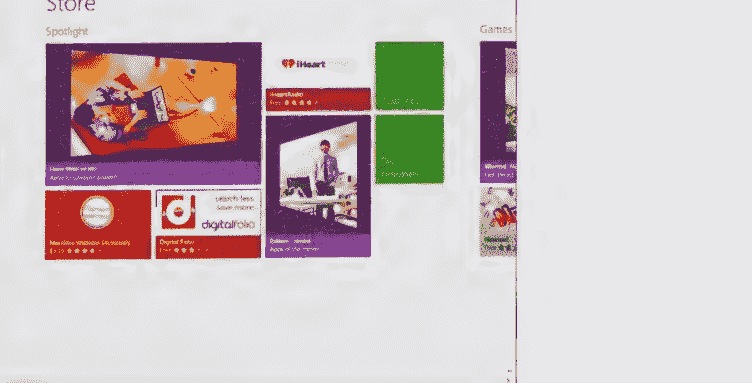

图 1.1 你可以在 Windows Store 中销售你的应用。

本书完全关于构建可以在 Windows Store 中销售的 Windows 应用。特别是，你将学习如何使用 JavaScript 和 HTML 构建 Windows 应用。

为什么用 JavaScript 和 HTML？你可以使用 C#、XAML 或 C++ 等其他技术构建 Windows 应用，但本书专门专注于使用 JavaScript 和 HTML 构建 Windows 应用。

使用 JavaScript 和 HTML5 构建 Windows 应用的优势在于，你可以利用现有的构建网站技能来构建 Windows 应用程序。如果你已经习惯于使用 JavaScript、HTML 和层级样式表进行编程，那么你会发现构建 Windows 应用并不容易。

本书涵盖了构建 Windows 应用所需的所有内容。你将学习如何使用 JavaScript 库 (WinJS) 来创建 JavaScript 应用程序。特别是，你将学习如何使用 WinJS 控件，例如 Rating（评级）、Menu（菜单）、Repeater（重复器）和 ListView（列表视图）控件。

你还学习了如何与 Windows Runtime（运行时）进行工作。通过利用 Windows Runtime，你可以访问 Windows 8.1 功能来完成通常在 Web 应用中无法完成的任务，如捕捉视频和声音以及将文本转换为语音。

读完本书后，你将理解如何创建 Windows 应用，例如游戏应用和生产力应用。在第 15 章“图形与游戏”中，你将学习如何创建一个简单的街机游戏——大脑噬者（Brain Eaters）游戏。在第 16 章“创建列表应用”中，你将学习如何构建一个生产力应用——MyTasks 应用。

阅读这本书，构建 Windows 应用，卖出很多副本，买一架喷气式飞机。

## 针对 Windows 8.1 更新

本书已针对 Windows 8.1 进行了更新。每一章都做了更改。与书中相关的代码都经过了审查和更新，以兼容 Windows 8.1。

Windows 8.1 包含了几个重要的控件，包括 Hub（中心）、Repeater（重复器）、ItemContainer（项目容器）、SearchBox（搜索框）、WebView（网页视图）和 NavBar（导航栏）控件。本书深入涵盖了所有这些控件。

Windows 8.1 带有一个新版本的 JavaScript 库 (WinJS 2.0)。这个新版本具有重大的新功能，如 WinJS Scheduler（调度器）。我在第 2 章“WinJS 基础”中讨论了新的 WinJS Scheduler。

Windows 8.1 包含了重要的向后兼容破坏。与 Windows 8 不同，Windows 8.1 不再支持作为贴靠或全屏状态的离散视图。我在第 11 章“应用事件与状态”中讨论了这些更改。

最后，我添加了四个章节。我添加了一个关于 ItemContainer 和 Repeater 的章节（第 7 章），一个关于 Azure 的章节（第 10 章），一个关于搜索的章节（第 13 章），以及一个关于创建应用的章节（第 16 章）。

## 本书前提

如果你已经熟悉使用 JavaScript、HTML 和层级样式表进行编程，那么你会发现构建 Windows 应用并不容易。

构建 Windows 应用需要两个前提：

首先，你必须在 Windows 8.1 上构建 Windows 应用。

其次，为了构建 Windows 应用，你需要安装 Windows 8.1。此外，为了构建 Windows 应用，你需要 Visual Studio。你可以从 `https://github.com/Walther/Windows8` 下载。

## 源代码

## 第 1 章 构建 Windows Store 应用

在本章中，我们将介绍构建 Windows Store 应用的基础。我们将首先通过解释什么是 Windows Store 应用来开始。

通过使用 Visual Studio，你可以快速构建 Windows Store 应用。接下来，我们将指导你如何利用 HTML5、JavaScript 和 Windows 库来构建 Windows Store 应用。

接下来，我们将深入讨论 Windows Store 应用的元素。

最后，我们将进入发布部分。我们将解释如何发布你的 Windows Store 应用。

## 什么是 Windows Store 应用？

我还能记得第一次使用 iPhone。当你在 iPhone 上滑动屏幕时，它真的会动！当你把邮件丢进垃圾桶时，它会被吸进去！

由于某些原因，这种交互让让用户感到有趣。

## 本章内容

- 什么是 Windows Store 应用？
- 创建你的第一个 Windows Store 应用


- Windows Store 应用的元素 - 使用 Visual Studio 构建 Windows Store 应用
- 调试 Windows Store 应用
- 发布到 Windows Store

# Windows 的设计原则


现在我们来到 Windows。除了 Windows 纸牌游戏中的跳动卡片，我想不出还有什么能创造出这种感觉。我不记得 Windows 上次让我大笑或带来快乐是什么时候了。

通过 Windows Store 应用，微软终于承认了用户体验。Windows Store 应用的核心是用户体验原则——设计原则。通过拥抱设计原则，你可以创建出更生动、更易用的 Windows Store 应用。

微软设计原则是一套微软在构建 Windows Phone、Xbox Live 以及（已停产的）Zune 时开发的用户体验原则。你还可以在 Microsoft SkyDrive 和 Windows Azure 网站看到这些原则的应用。准备好了，它们是：

1. **对工艺感到自豪**
   - 对经常被看到的细节投入时间和精力。
   - 确保体验在每个阶段都是完整且完美的。

2. **少即是多**
   - 解决分散问题而非可发现性。让人们沉浸在他们喜欢的事物中并探索其他的。
   - 通过在屏幕上留下最相关的元素，创建一个简洁且目的明确的体验。

3. **快速流畅**
   - 让人们直接与内容交互，并对动作做出快速且相应的响应。
   - 为体验注入生命，创造连续感，并通过意义的运动讲述故事。

4. **真正的数字**
   - 充分利用数字媒体。消除物理边界，创建比现实更高效更轻松的体验。
   - 接受我们是屏幕上像素这一事实。使用超越现实材料限制的大胆、鲜艳且清晰的色彩和图像进行设计。

5. **协作共赢**
   - 利用生态系统，并与其他应用程序、设备和系统协同工作，为用户完成各种场景。
   - 契合 UI 模型以减少冗余。利用用户已具备的知识来提供熟悉感、控制感和信心。

> **注意**
>
> 微软设计风格原则最初被称为 Metro 设计原则。此微软设计原则列表取自 http://msdn.microsoft.com/en-us/library/windows/apps/hh464920 和 http://msdn.microsoft.com/library/windows/apps/hh465424.aspx。

当我第一次读到这些原则时，我的第一反应是它们看起来过于抽象且模糊。这完全是那种戴着贝雷帽的极客男士们会制定出来的原则。

但随后，当我看到这些原则在实践中是如何应用的——即在构建实际的 Windows Store 应用时——我开始对这些原则产生更好的认同。

以“以少胜多”（Do more with less）设计原则为例。Windows Store 应用的独特特征之一是缺乏外壳（chrome）。从本质上讲，Windows Store 应用就是没有窗口的 Windows。Windows Store 应用是全屏应用。

这种外壳的缺失使得用户能够更容易专注于应用程序的内容。例如，Windows 8 包含了两个版本的 Internet Explorer：一个桌面版本和一个遵循微软设计风格原则的全线程 Windows 8 版本。

我更喜欢使用 Windows 8 版本的 Internet Explorer 而不是桌面版。使用 Windows 8 版本时，你看到的只有网页，这才是应用程序的初衷。

或者考虑“快速流畅”（Be fast and fluid）原则。我如此喜欢与 iPhone 交互的原因是运动的幻觉，而这种幻觉是通过动画的巧妙运用实现的：在 iPhone 上，物体会弹跳和摇动。

在构建 Windows Store 应用时，我们鼓励你利用动画。例如，如果你使用标准的 `ListView` 控件（我们将在本书后部分详细讨论），那么当你添加或删除项目时，就会获得动画。当你向 `ListView` 添加一个项目时，它不仅会显示，还会滑入位置。当你删除一个项目时，它不会直接消失，上方和下方的项目会收拢到位。

# Windows Store 应用的共同特性

Windows Store 应用是遵循微软设计风格原则的应用程序。此外，Windows Store 应用旨在运行在 Windows 8 或 Windows RT 操作系统上。

## 第 1 章 构建 Windows Store 应用

所有的 Windows Store 应用有一组共同的特性。让我通过在 Windows 8 自带的 Bing 新闻应用背景下来向大家介绍这些特性。

> **注意**
>
> 值得注意的是，本节讨论的标准 Windows 8 Bing 新闻应用是使用 HTML5 和 JavaScript 编写的（使用了书中描述相同的技术）。如果你好奇，可以通过打开 Windows 应用安装的隐藏文件夹 `Program Files\WindowsApps` 来查看新闻应用的 HTML 和 JavaScript 源代码。

## 对键盘、鼠标、触摸和手写笔的支持

Windows Store 应用最与众不同的特征之一是其巨大的磁片、按钮以及对空白区域的通用使用。所有这些用户界面（UI）宽敞空间使得 Windows Store 应用对“粗手指”非常友好。

Windows Store 应用的设计使其在仅限触摸的平板电脑和带有键盘鼠标的桌面式电脑上运行效果同样良好。Windows Store 应用的设计是易于触摸的。

Windows 8 工作方式的巧妙之处在于，作为开发者，你不需要花费大量精力来支持触摸。只要你坚持使用标准的 Windows 控件，免费获得键盘和触摸支持。

## 使用应用栏（App Bar）和导航栏（Nav Bar）

图 1.1 包含了带有福克斯新闻首页的 Windows 8 Bing 新闻应用截图。注意你看到的唯一内容就是福克斯的内容。没有工具栏，没有菜单，没有状态栏。

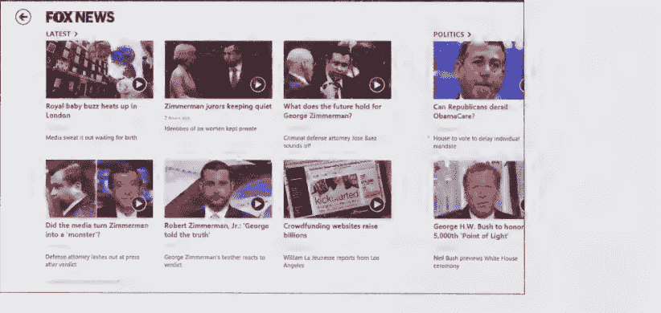

## 什么是 Windows Store 应用

在 Windows Store 应用中，你将所有命令隐藏在应用栏中。应用栏仅在你从屏幕底部或顶部滑动，或右键点击屏幕时才会出现。

Bing 新闻应用的应用栏包含“固定到开始”、“刷新”和“帮助”等命令。你可以在图 1.2 的底部看到应用栏。

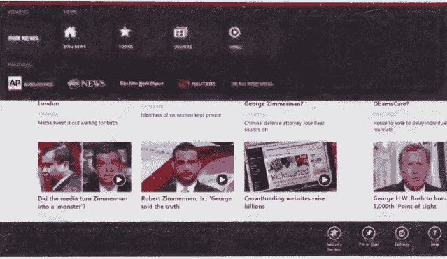

注意图 1.2，屏幕顶部还有另一条栏。这条栏被称为导航栏，你用它进行导航。在 Bing 新闻应用中，导航栏允许你导航到不同的新闻源，如《华尔街日报》、《福克斯新闻和《纽约时报》。

## 使用 Charm（魅力功能）

如果你从屏幕右边缘滑动、将鼠标移动到右角之一，或按下组合键 `Win+C`，就会显示 Charm 功能（见图 1.3）。

## 第 1 章 构建 Windows Store 应用

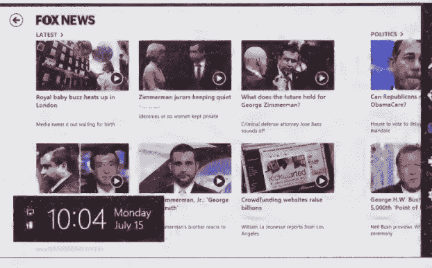

图 1.3 查看 Charm

以下是标准 Charm 列表：

- 搜索——允许你在当前应用和其他应用中搜索内容
- 分享——允许你将当前应用中的内容与其他应用共享
- 开始——引导你跳转到开始屏幕
- 设备——允许你连接到设备
- 设置——允许你配置应用程序设置和系统设置

这些 Charm 功能为你提供了放置常用应用程序功能的标准位置。例如，所有的 Windows Store 应用设置都应该出现在“设置”Charm 中（见图 1.4）。这使得用户能够更容易找到你的设置。

## 什么是 Windows Store 应用？

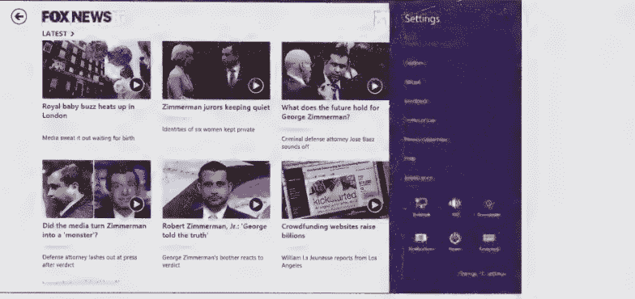

图 1.4 设置 Charm

当你构建 Windows Store 应用时，你不需要构建自己的设置菜单。相反，你通过自定义的应用程序设置来扩展设置 Charm。我将在第 6 章“菜单和弹出窗口”中讨论此项操作的细节。

## 不同的应用尺寸和方向

每个 Windows Store 应用必须支持至少 500 像素或 320 像素的宽度。例如，Windows 8.1 要灵活得多。

Windows Store 应用还必须在不同的设备方向上也能正常工作。例如，当在平板电脑上查看应用时，用户始终可以将应用程序从横屏旋转到竖屏。

在构建 Windows Store 应用时，你需要设计应用以适应不同的屏幕分辨率和方向。在任何时刻，应用的水平分辨率都可能发生巨大变化。我将在第 11 章“应用事件和统计”中讨论如何处理切换。

如果你足够拥有足够大的屏幕，你就可以并排显示多个应用程序（每个显示器最多四个）。例如，图 1.5 展示了三个并排运行的 8.1 应用。

> **警告**
>
> Windows 8 与 Windows 8.1 不同，最多仅运行两个应用程序。此外，在使用 Windows 8 时，运行其中一个应用被要求贴紧 320 像素的水平分辨率。
>
> 你无法在 1024 像素乘以 768 像素的屏幕上显示两个 500 像素的应用，因为那违背了数学定律。

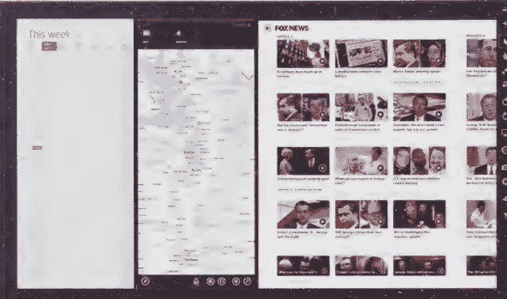

图 1.5 三个并排的 8.1 应用

## 而非使用 Windows Store 应用

购买 Windows Store 应用时，许可证是按用户付费而非按机器付费。当你购买应用后，可以在与你的用户账户关联最多五台机器（包括平板电脑和桌面电脑）上使用该应用。你可以在 Store 应用内右键点击并选择“我的应用”来查看并安装购买的所有应用。

更好的是，应用程序数据可以在多个机器之间共享（漫游应用程序数据）。因此，如果你在公交上用平板电脑使用应用阅读文章，然后在办公室的桌面电脑上打开同一个应用，你不会丢失阅读进度。

## 创建你的第一个 Windows Store 应用

目前，每个 Windows Store 应用都拥有 100KB 的漫游应用数据。Windows 8.1 会自动为你处理在不同设备之间同步这些数据。

## 关闭 Windows Store 应用

现在，尝试通过将光标移动到屏幕右上角的“x”来关闭一个 Windows Store 应用。哈！骗了你吧！Windows Store 应用中没有关闭按钮，因为没有窗口边框（chrome）。

> **注意**
>
> 虽然关闭 Windows Store 应用的方法并不显而易见，但它是可能的。你可以通过从屏幕顶部向下滑动或按下键盘组合键 `Alt+F4` 来关闭 Windows Store 应用。

在与 Windows Store 应用交互时，没有明显的关闭应用的方法。这是刻意为之的。与其关闭 Windows Store 应用，我们鼓励你简单地切换到另一个正在运行的应用（通过从屏幕左边缘滑动）或启动新应用（通过从开始屏幕选择新应用）。

当你设计 Windows Store 应用时，必须考虑到用户可能会随时在你的运行应用之间来回切换。在第 11 章节中，我将讨论了如何在应用被挂起后优雅地恢复它。

## 创建你的第一个 Windows Store 应用

让我们无畏尝试。在本节中，我将引导你构建第一个 Windows Store 应用。做一个“Hello World”应用会显得意料之中且无味。因此，我建议你做一些稍微高级一点。

我将向你展示如何创建一个能够拍照的应用。当你点击应用栏中的“拍照”命令时，你可以拍摄照片，然后照片将显示在应用中（参见图 1.6，图中显示了我的狗 Rover 的照片）。

> **注意**
>
> 完成后的应用代码可以在第 1 章文件夹中找到，名称为 `App1`。书中的所有代码都位于 GitHub 仓库中：`https://github.com/StephenWalther/Windows8.1AppsUnleased`。


图 1.6 你的第一个 Windows Store 应用

## 创建 Visual Studio 项目

第一步是创建一个 Microsoft Visual Studio 项目。我使用 Visual Studio 2013 创建了此书中几乎所有的代码示例。在大多数情况下，我使用的是 Visual Studio 的免费版本——适用于 Windows 的 Visual Studio Express 2013，你可以从 Microsoft.com 下载。

> **注意**
>
> 你可以使用 Microsoft Visual Studio 2013 或 Microsoft Blend 创建 Windows Store 应用。如果你需要发布到 Windows Store，那么我建议使用 Microsoft Visual Studio 2013。

为了构建 Windows Store 应用，你必须在 Windows 8.1 上使用 Visual Studio。如果你没有专用的 Windows 8.1 电脑，可以使用运行 Windows 8.1 的虚拟机，例如 VMware Player。

继续启动 Visual Studio。接下来，选择菜单选项“文件”、“新建项目”。在新项目对话框的左侧，选择 JavaScript 并选择“空白应用”项目模板。为你的项目输入名称 `App1` 并点击确定按钮（参见图 1.7）。

## 创建你的第一个 Windows Store 应用

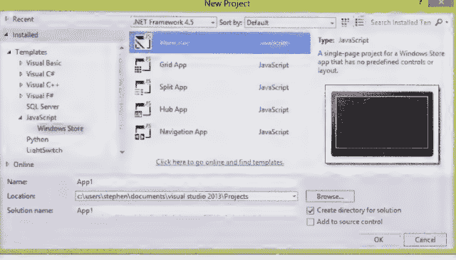

图 1.7 使用 Visual Studio 新项目对话框

创建完项目后，你可以在解决方案管理器（Solution Explorer）窗口中看到项目的所有文件（图 1.8）。当你创建一个新的 Windows Store 应用时，你会得到一个 `default.html` 文件（位于项目根目录）、一个 `default.js` 文件（在 `js` 文件夹中）以及一个 `default.css` 文件（在 `css` 文件夹中）。这三个文件是你的应用的起点。

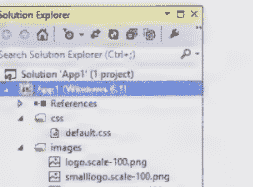

图 1.8 Windows Store 应用默认文件

## 声明应用能力

在我们开始编写代码之前，还有另一件事我们必须先完成。我们正在构建一个拍照的应用。这听起来很可怕。可能，一个应用在你不知情的情况下拍摄你的照片，并将照片发送回潜伏在互联网上的恶意黑客（或微软）。

## 第 1 章 构建 Windows Store 应用

当你的应用执行某项操作时，你必须提前声明你的应用将执行此操作，以便用户同意。你可以在清单文件中声明应用的属性（Capabilities）。你可以通过双击解决方案管理器窗口中的 `package.appxmanifest` 文件来打开应用清单编辑器。点击“功能”（Capabilities）选项卡以查看应用程序声明的所有功能。例如，如果你想让应用能够从麦克风录音，那么你需要选择“麦克风”（Microphone）功能；或者如果你想让应用能够在用户的库中保存新照片，那么你需要选择“图片”（Pictures）功能。对于我们的应用，我们需要“摄像头”（Webcam）功能以便我们可以拍照（参见图 1.9）。

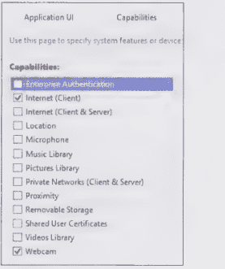

图 1.9 启用拍照功能

当用户首次运行我们的应用时，用户需要同意允许应用访问摄像头（参见图 1.10）。用户只需同意一次。

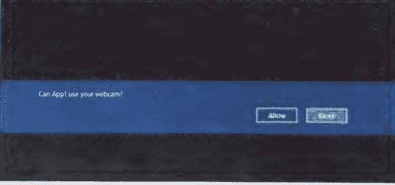

图 1.10 请求访问摄像头的权限

用户同意后，用户可以在“设置”中拒绝应用使用特定功能的权限。

## 创建 HTML 页面

当你创建一个 Windows Store 应用时，会在应用程序根目录下得到一个 `default.html` 文件。这是运行应用时打开的第一个页面。让我们继续为我们的应用自定义此页面（参见代码列表 1.1）。

### 代码列表 1.1 修改后的 `default.html` 页面

```html
<!DOCTYPE html>
<html
<head>
<meta charset="utf-8" />
<title>App</title>

<!-- WinJS references -->
<link href="Microsoft.WinJS.2.0/css/ui.css" rel="stylesheet" />
<script src="Microsoft.WinJS.2.0/js/base.js"></script>
<script src="Microsoft.WinJS.2.0/js/ui.js"></script>
</head>
<body>
<!-- App references -->
<link href="css/default.css" rel="stylesheet" />
<script src="js/default.js"></script>


<!-- AppBar Control -->
<div data-win-control="WinJS.UI.AppBar">
<button data-win-control="WinJS.UI.AppBarCommand"
data-win-options='{id:'cmdPicture',label:'Take Picture',icon:'camera',tooltip:'Take Picture'}'>
</button>
</div>
</body>
</html>
```

代码列表 1.1 中的 HTML 页面已经过修改，因此在页面主体中包含新内容。首先，注意页面包含一个 ID 为 `imgPhoto` 的 IMG 标签。我们将在这里显示从相机拍摄的照片。

此外，请注意页面包含一个带有 `data-win-control="WinJS.UI.AppBar"` 属性的 DIV 标签。这是一个 WinJS 控件示例。该控件渲染一个应用栏，其中包含一个拍照的命令（参见图 1.11）。

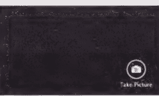

图 1.11 应用栏中的“拍照”命令


# 创建样式表

当你创建一个新的 Windows Store 应用时，还会得到一个名为 `default.css` 的默认样式表，它位于 `css` 文件夹。你可以修改此文件来控制应用的外观。

对于我们的应用，我修改了 `default.css` 来格式化照片的外观。它在 `IMG` 标签中的显示如下：

```css
#imgPhoto {
  display:block;
  margin: 15px auto;
  border: 10px solid white;
  max-width: 90%;
  max-height: 90%;
}
```

# 创建 JavaScript 文件

我们需要修改的第三个文件是名为 `default.js` 的 JavaScript 文件，位于 `js` 文件夹。该文件包含了与 `default.html` 页面相关的所有代码。

我们将删除此文件的所有默认内容并重新开始。修改后的 `default.js` 完整内容包含在代码列表 1.2 中。

## 代码列表 1.2 `default.js` JavaScript 文件

```javascript
(function () {
  "use strict";

  // 
  var capture = Windows.Media.Capture;

  // 在页面内容加载后立即执行
  function init() {
    // 处理所有控件
    WinJS.UI.processAll().done(function () {
      // DOM 元素引用
      var cmdTakePicture = document.getElementById("cmdPicture");
      var imgPhoto = document.getElementById("imgPhoto");

      // 处理“拍照”命令点击
      cmdTakePicture.addEventListener("click", function () {
        var captureUI = new capture.CameraCaptureUI();
        captureUI.Settings.format = capture.CameraCaptureUIFormat.png;

        captureUI.captureFileAsync(capture.CameraCaptureIMode.photo, 
          done(function (photo) {
            if (photo) {
              // 使用 HTML5 File API 创建对象 URL 来引用
              var photoUrl = URL.createObjectURL(photo);

              // 在 IMG 元素中显示照片
              imgPhoto.src = photoUrl;
            }
          }));
      });
    });
  }

  document.addEventListener("DOMContentLoaded", init);
})()
```

# 第 1 章 构建 Windows Store 应用

在示例 1.2 的 JavaScript 代码中有很多有趣的内容。让我们过一遍这些代码。

首先，我创建了一个 `init()` 函数，它会在 `DOMContentLoaded` 事件触发时执行。`DOMContentLoaded` 是当浏览器完成 HTML 文档解析时触发的标准 DOM 事件。

我将所有代码都放在 `init()` 函数中，这样代码在 DOM 准备好之前不会执行。否则，如果我尝试访问页面中的任何 HTML 元素将会得到异常。

我在 `init()` 方法中执行的第一件事是调用 `WinJS.UI.processAll()` 方法。该方法处理页面中的所有控件。具体来说，它将带有 `control="WinJS.UI.AppBar"` 属性的 `DIV` 标签转换为真正的应用栏。

接下来，我为“拍照”命令设置了一个事件处理程序。当你点击应用栏中的“拍照”命令时，会创建一个 `Windows.Media.Capture.CameraCaptureUI` 类实例。`CameraCaptureUI` 类是 Windows Runtime 的示例。

`CameraCaptureUI.captureFilesAsync` 方法显示了拍照界面（参见 1.12）。当你点击 OK 按钮时，会调用 `done()` 方法，图片显示在页面中。


图 1.12 相机拍摄界面

为照片 blob（实际图像数据）创建了一个对象 URL，这是通过调用 `URL.createObjectURL()` 方法实现的。这个 `createObjectURL()` 方法是 HTML5 File API 的一部分。

通过以下代码行在 HTML 页面中显示照片：

```javascript
// IMG元素中显示照片
imgPhoto.src = photoUrl;
```

就这样！我们构建了一个应用，使能够从计算机拍照并在 HTML 页面中显示图片。

注意，我们的 JavaScript 文件包含了标准 JavaScript 方法、HTML5 方法、Windows Library for JavaScript 方法以及 Windows Runtime 方法的组合。对于你在创建 Windows Store 应用时创建的所有 JavaScript 文件都是如此。

# 运行应用

创建应用后，可以通过点击 Visual Studio 工具栏上的绿色运行按钮（参见图 1.13）或直接按 `F5` 键来运行它。


图 1.13 运行 Windows Store 应用

假设你的笔记本电脑或平板电脑带有摄像头，你就可以开始拍照了。

> 警告

请记住，“拍照”命令包含在应用栏中，应用栏默认并不显示。你需要右键点击应用或从计算机的顶部或底部滑动来显示应用栏。

正如我们在上一节看到的，Windows Store 应用是使用多种技术构建的。Windows Store 应用由开放且熟悉的 Web 技术组合，例如 HTML5、JavaScript、CSS3 以及微软技术（如 Windows Library for JavaScript 和 Windows Runtime）。让我详细介绍一下这些 Windows Store 应用的每个元素。

# JavaScript

本书完全关于使用 JavaScript 编写 Windows Store 应用。作为 JavaScript 的替代，你还可以使用 C#、Visual Basic 甚至 C++ 编写 Windows Store 应用。

在编写 Windows Store 应用时，你可以利用 ECMAScript 5（JavaScript 的最新版本）特性。这意味着可以使用新的 JavaScript 数组方法，例如 `indexOf()` 和 `forEach()`。你还可以使用属性的 setter 和 getter 以及使用 `strict` 语句。

# HTML5

在编写 Windows Store 应用时，你可以利用 HTML5 及相关标准的许多新特性。以下是这些新特性中一些最重要的列表：

- 表单验证属性——你可以利用 HTML5 标准的新验证属性来执行表单验证。我在第 5 章“创建表单”中讨论了这些新验证方法以及你如何在 Windows Store 应用中使用它们。

- `data-*`——这个划线星标准允许你向现有的 HTML5 元素添加自定义属性。WinJS 库使用 `data-*` 进行声明式数据绑定和控件实例化。

- 索引数据库 API (IndexedDB)——索引数据库 API 在浏览器中暴露。如果你需要在 Windows Store 应用的数据库中存储产品列表，你可以利用 IndexedDB。我在第 9 章“创建数据”中解释如何使用 IndexedDB。

- File API——HTML5 File API 允许你在浏览器中处理文件。我们在构建 Windows Store 应用之前在上一节使用了该 API（`URL.createObjectURL()`）。

- Canvas——允许使用 JavaScript 绘制图形。我在第 15 章“图形与游戏”中为你提供 Canvas 的介绍。

- Web Workers——允许你执行后台任务而不阻塞用户界面线程。

- WebGL——这是 Windows 8.1 新出的。WebGL 允许你使用 JavaScript 构建 3D 游戏。

# 层级样式表 3 (CSS3)

在构建 Windows Store 应用时，你可以利用层级样式表 3 及相关标准的许多新特性，包括：

- 媒体查询——允许根据设备的特性（如设备的高度、宽度或方向）应用不同的样式。我在第 11 章中讨论了媒体查询。

- CSS3 网格布局——允许使用 HTML 表格在列和行中布局 HTML 内容。

- CSS3 弹性框 (FlexBox)——允许在不同设备上显示 HTML 内容时保持元素的相对位置和大小。

# Windows Runtime

Windows Runtime (WinRT) 包含一个可以在 Windows Store 应用中使用的类库。这些类被直接投影到 JavaScript 中，因此它们像是内置的 JavaScript 对象。

例如，当我们编写第一个 Windows Store 应用时，我们利用了 WinRT `Windows.Media.Capture.CameraCaptureUI` 类。当我们调用 `CameraCaptureUI.captureTakePicture()` 方法时，我们能够拍照。

所有的 WinRT 类都通过 `WinRT` 命名空间在 JavaScript 中暴露。

# Windows Library for JavaScript

Windows Library for JavaScript (WinJS) 是微软专门为构建 Windows Store 应用而创建的纯 JavaScript 库。理解如何使用该库是本书的重点。

# Windows Store 应用的元素

列表 1.3 在 Windows Store 应用中使用 jQuery

```html
<!DOCTYPE html>
<head>
  <meta charset="utf-8" />
  <title>jQueryWindows8</title>

  <!-- WinJS references -->
  <link href="Microsoft.WinJS.2.0/css/ui-dark.css" rel="stylesheet" />
  <script src="Microsoft.WinJS.2.0/js/base.js"></script>
  <script src="Microsoft.WinJS.2.0/js/ui.js"></script>

  <!-- jQueryWindows8 references -->
  <script type="text/css">
    #divMessage {
      display:none;
      padding:10px;
      border: solid 1px white;
      background-color: #ff6a00;
    }
  </style>
</head>
<body>
  <button id="btnShow">Click Here</button>
  <div id="divMessage">
    Secret Message
  </div>

  <script type="text/javascript">
    $("#btnShow").click(function () {
      $("#divMessage").fadeToggle("slow");
    });
  </script>
</body>
</html>
```

列表 1.3 中的页面包含一个按钮（Button）和一个 `DIV` 元素。`DIV` 元素的内容默认是隐藏的（使用 `display:none`）。当你点击按钮时，`DIV` 的内容会缓慢淡入到视图中（见图 1.15）。

# 第 1 章 构建 Windows Store 应用

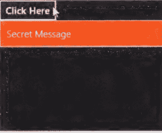

图 1.15 使用 jQuery 为 `DIV` 元素制作动画

> 注意事项

列表 1.3 中的代码位于名为 `jQueryWindows` 文件夹下的第 1 章文件夹中。

微软与 jQuery 团队直接合作，确保 jQuery 2.0 能够与 Windows Store 应用正常工作。只要你使用的是比 jQuery 2.0 更新的版本的 jQuery，就不应该遇到任何问题。

> 警告

Windows Store 应用兼容 jQuery 并不意味着 Windows Store 应用兼容每一个 jQuery 插件或流行的 JavaScript 库。在 Windows Store 应用中，在本地环境中执行的 JavaScript 具有额外的安全限制，以防止脚本注入攻击。特别是你不能将 HTML 赋值给 `innerHTML` 属性，因为它包含潜在的危险内容，如脚本或格式不正确的 HTML。如果你使用的 JavaScript 库编写时没有考虑到这些安全限制，则需要修改该库以适配 Windows Store 应用。如果你信任赋值给 `innerHTML` 属性的内容，而不是使用 `innerHTML` 属性，可以使用 `WinJS.Utilities.setInnerHTMLSafe()` 方法。

# 使用 Visual Studio 构建 Windows Store 应用

本书侧重于使用 Visual Studio 构建 Windows Store 应用。在本节中，我想花几页时间描述构建 Windows Store 应用时重要的功能。你将学习如何为 Windows Store 应用选择项目模板、如何运行 Windows Store 应用以及如何调试 Windows Store 应用。

# Windows Store 应用模板

在 Visual Studio 中选择“文件”、“新建项目”菜单选项时，你可以从五种不同的项目模板中选择 Windows Store 应用的起点：

1. 空应用（Blank App）——最简单的模板。包含一个默认的 `default.html`、`default.css` 和 `default.js`。

2. 导航应用（Navigation App）——需要多个页面的应用使用此模板。

3. 网格应用（Grid App）——包含三个用于显示项目组的页面。

4. 分栏应用（Split App）——包含两个用于显示项目组的页面。

5. 中心应用（Hub App）——包含三个页面。一个页面显示导航中心，另外两个页面显示部分和项目详情。此项目模板是随 Windows 8.1 新的。

在创建第一个 Windows 应用时，我们已经使用了“空应用”项目模板。让我们详细讨论一下其他项目模板。

## 导航应用项目模板

在构建简单的单页应用时，“空应用”是一个很好的模板。另一方面，如果你需要支持多个页面，应该使用“导航应用”模板。

导航应用项目模板包含一个名为 `home` 的页面。你可以通过向 `pages` 子文件夹中添加新的页面控件（Page Controls）来添加额外页面（见图 1.16）。我将在第 12 章“页面片段与导航”中详细介绍如何创建多页应用程序。


图 1.16 使用导航应用项目模板创建多页应用

接下来的三个项目模板——网格应用、分栏应用和中心应用都是基于导航应用模板构建的。换句话说，这些项目模板是带有额外页面的多页应用。

## 网格应用项目模板

网格应用项目模板包含三个页面。主页在水平滚动网格中显示项目组。你可以点击某个组来查看组详情，或者点击某个项目查看项目详情。

例如，假设你正在创建一个产品目录。在这种情况下，你可能会创建不同的产品类别，如饮料和水果。每个类别都是一个组，每个组包含一组产品项目。

你可以使用网格应用的 `groupeditems` 页面来显示产品类别及相关产品的水平滚动网格（见图 1.17）。如果你点击一个产品类别，就可以查看该类别的详情（见图 1.18）。如果你点击一个产品，就可以查看该产品的详情（见图 1.19）。

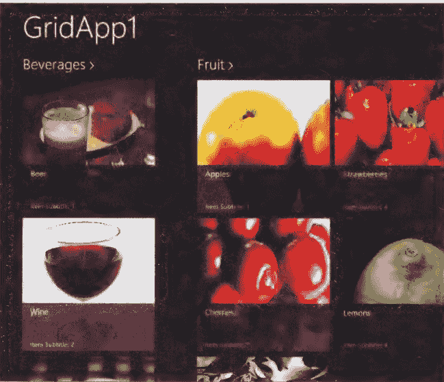

图 1.17 网格应用的 `groupeditems` 页面

### 饮料

组副标题：2


图 1.18 网格应用组详情页

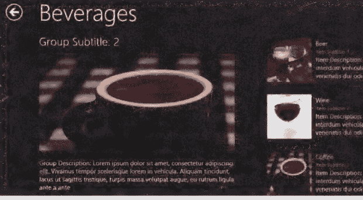

图 1.19 网格应用项目详情页

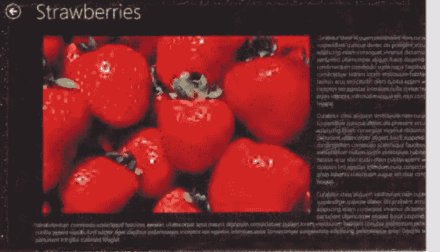

## 分栏应用项目模板

分栏应用项目模板也可用于显示分组的项目。分栏应用项目模板包含两个页面：`items` 和 `split`。

`items` 页面显示组。例如，在图 1.20 中，`items` 页面显示产品类别。

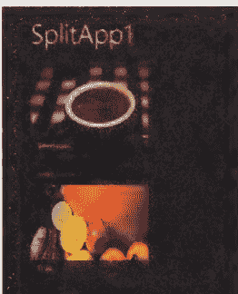

图 1.20 分栏应用 `items` 页面

如果你点击某个组，将跳转到 `split` 页面。该页面显示组中的项目，并允许你选择项目查看详情（见图 1.21）。

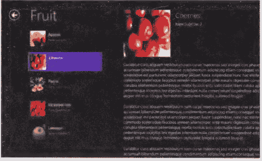

图 1.21 分栏应用 `split` 页面

# 中心应用模板


中心应用模板是随 Windows 8.1 新的。中心应用包含三个页面。主页包含一个中心控件并显示部分的列表（见图 1.22）。如果你点击部分标题，将跳转到部分页面。如果你点击一个项目，将跳转到项目页面。

> 注意事项

中心控件将在第 4 章“使用 WinJS 控件”中介绍。

## 使用 Visual Studio 构建 Windows Store 应用

本书侧重于使用 Visual Studio 构建 Windows Store 应用。在本节中，我想花几页时间描述构建 Windows Store 应用时重要的功能。你将学习如何为 Windows Store 应用选择项目模板、如何运行 Windows Store 应用以及如何调试 Windows Store 应用。

## 运行 Windows Store 应用

Visual Studio 提供了三种运行 Windows Store 应用的：

- 本地机器（Local Machine）
- 模拟器（Simulator）
- 远程机器（Remote Machine）

本地机器选项就像应用程序安装在本地上一样运行 Windows Store 应用。Windows Store 应用将使用开发机器（运行 Visual Studio 的机器）的屏幕分辨率和功能运行。

模拟器选项在单独窗口中运行应用程序（见图 1.23）。使用模拟器的优势是你可以模拟不同类型的设备。例如，你可以从鼠标模式切换到基础触摸模式，以模拟平板电脑等触摸设备。你还可以切换到不同的屏幕分辨率来测试不同分辨率下的应用程序。

最后一个选项是在远程机器上部署并运行你的 Windows Store 应用。在远程机器上运行应用程序之前，你必须先在项目属性窗口中指定远程机器名称（见图 1.24）。

# 第一章 构建 Windows 商店应用

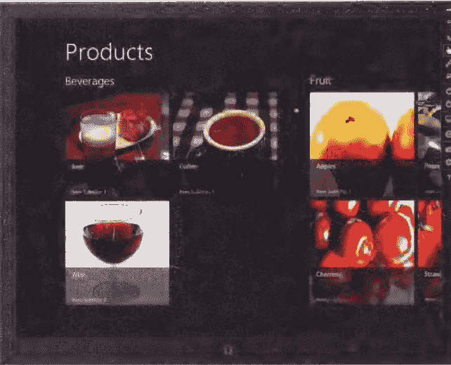

图 1.23 使用 Visual Studio 模拟器

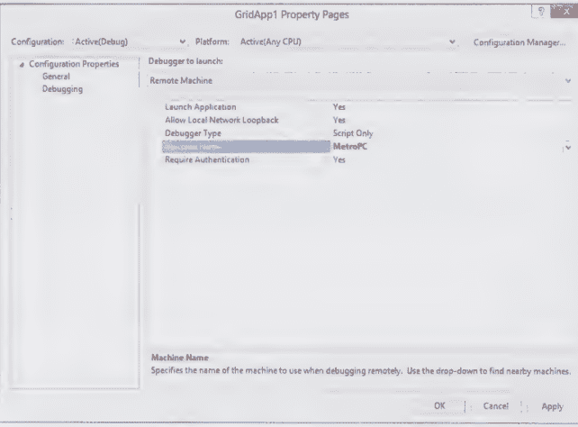

图 1.24 指定远程机器名称

在指定远程机器名称后，你可以通过 Visual Studio 工具栏中选择此选项，在远程机器上部署并运行你的应用。

> 警告

> 要在远程机器上部署和运行应用，你需要在远程机器上安装 Visual Studio 2013 工具（Remote Tools）。你可以从 Microsoft.com 网站下载这些工具。

## 调试 Windows 商店应用

我总是很乐观，相信我编写的任何代码在第一次运行时都不会出错。但事实是，这种情况从未发生过。我花费大量时间来调试那些没有按照我的预期运行的代码。

在本节中，我将讨论你可以用于调试代码的 Visual Studio 工具。我将介绍如何使用 JavaScript 控制台窗口、断点以及使用 DOM 资源管理器（DOM Explorer）。

## 使用 Visual Studio JavaScript 控制台窗口

当我为网站页面编写 JavaScript 代码时，我会使用 JavaScript 控制台窗口来查看 JavaScript 错误。我还会使用 `console.log()` 向控制台窗口写入自定义消息，以便调试代码（见图 1.25）。

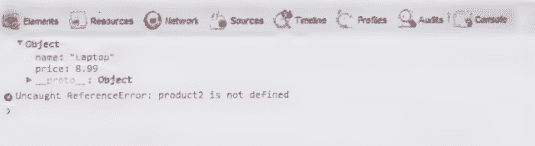

图 1.25 使用 Google Chrome JavaScript 控制台调试

在运行 Windows 商店应用时，你无法访问浏览器的 JavaScript 控制台。你不需要使用浏览器控制台，而是需要使用 Visual Studio JavaScript 控制台（见图 1.26）。

# 34 第一章 构建 Windows 商店应用

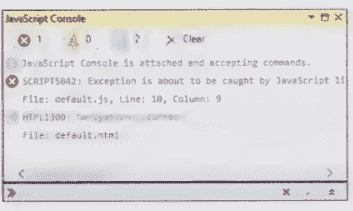

图 1.26 Visual Studio JavaScript 控制台窗口

你可以完全像向浏览器控制台窗口写入内容一样，通过使用 `console.log()` 在 Visual Studio 控制台窗口查看 JavaScript 错误并写入调试消息。

如果你遇到了错误并想显示 JavaScript 变量的值，可以展开 JavaScript 控制台底部的变量名（见图 1.27）。

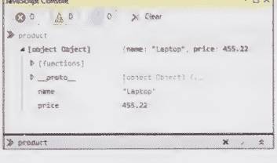

图 1.27 将 JavaScript 变量转到 JavaScript 控制台窗口

> 注意

> Visual Studio 控制台窗口仅在应用运行时才会显示。如果你找不到该窗口，请使用菜单选项：调试（Debug）、窗口（Windows）、JavaScript 控制台（JavaScript Console）。

## 设置断点

如果你正在构建一个 Windows 商店应用，并且该应用的行为让你不费解，那么设置断点并逐行执行代码是有用的。

你可以通过点击 Visual Studio 代码编辑器中想要中断的行左侧侧边栏来设置断点（见图 1.28）。当你以调试模式运行应用并命中断点时，可以通过将鼠标悬停在变量上来检查它们的值。

# 调试 Windows 商店应用 35

```javascript
getCount: function () {
  var that = this;
  return new Promise(function (complete, error) {
    that.getStore(store).then(function (store) {
      var reqCount;
      (function (cursorOptions) {
        var cursorOptions = that.cursorOptions;
        var index = store.index(cursorOptions.index);
        var keyRange = IDBKeyRange.boundBound(cursorOptions.lower, cursorOptions.upper, cursorOptions.direction);
        if (cursorOptions.lower) {
          reqCount = index.openCursor(keyRange);
          reqCount.onsuccess = function (ext) {
            complete(ext.target.result);
          };
        } else {
          reqCount = index.openCursor(keyRange);
          reqCount.onsuccess = function (ext) {
            complete(ext.target.result);
          };
        }
      })(cursorOptions);
    });
  });
}}
```

图 1.28 设置断点

你可以使用“单步进入”（Step Into）工具栏按钮或按 F11 来逐行执行你的代码。

## 注意

> 作为在 Visual Studio 中设置断点的替代方案，你可以使用 JavaScript 调试语句在代码中创建断点。

## 使用 DOM 资源管理器

我最喜欢的浏览器开发工具另一个是 HTML 检查器（例如 Firefox 的一项功能）。你可以使用此工具查看文档中的实时 HTML 和 CSS。

Visual Studio 支持一个名为 DOM 资源管理器（DOM Explorer）的类似工具。你可以使用 DOM 资源管理器检查运行中的 Windows 商店应用中任何元素的属性。

在 Visual Studio 中运行 Windows 商店应用后，可以通过选择菜单选项调试（Debug）、窗口（Windows）、DOM 资源管理器（DOM Explorer）来查看 DOM 资源管理器窗口。在 DOM 资源管理器窗口中，你可以点击任何元素并查看该元素的所有属性，包括与元素相关的所有样式信息（见图 1.29）。

# 第一章 构建 Windows 商店应用

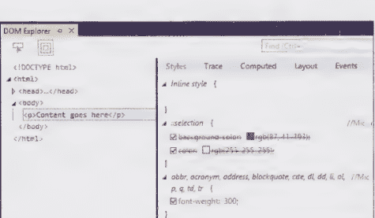

图 1.29 使用 DOM 资源管理器

你可以像向浏览器控制台写入内容一样，通过使用 `console.log()` 在 Visual Studio 控制台窗口查看 JavaScript 错误并写入调试消息。你可以使用此工具查看页面中的 HTML 元素。

## 发布到 Windows 商店

构建 Windows 商店应用的主要动机之一是在 Windows 商店出售你的应用。在本节中，我介绍如何将应用发布到 Windows 商店。

> 注意

> 你可以通过名为“侧载”（sideloading）的功能在不发布到 Windows 商店的情况下分发应用。为了利用侧载，你需要访问 http://technet.microsoft.com/en-us/library/hh852635 获取更多信息。

## 注册为开发者

在将应用发布到 Windows 商店之前，你必须先注册成为 Windows 商店开发者。你可以通过选择 Visual Studio 中的存储（Store）、打开账户（Open Account）来访问商店面板（见图 1.30）。

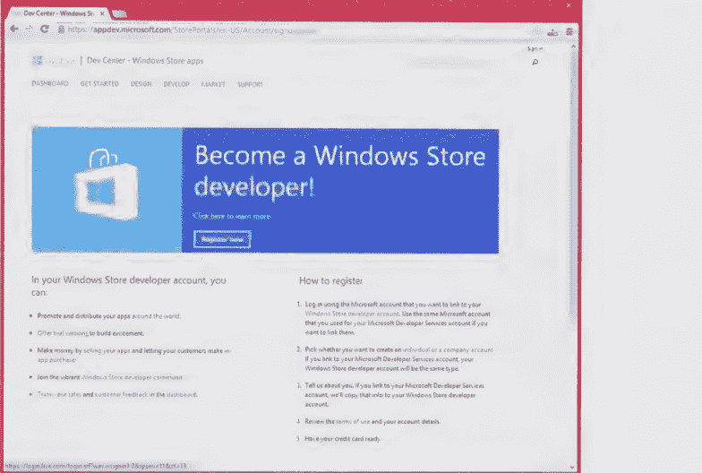

图 1.30 注册为开发者

注册过程非常简单。目前，成为注册的 Windows 商店开发者需要个人账户 49 美元或公司账户 99 美元，或者通过 MSDN 订阅免费。

## 提交你的应用

注册后，你可以访问商店面板并提交新应用。提交应用的过程被分为几个步骤（见图 1.31）。

最重要的步骤之一是为你的应用选择名称。在完成应用之前，你就可以在 Windows 商店预应用名称。选择应用名称类似于选择域名——因此我建议尽快获取你想要的名称。

你还需要决定对应用收取多少费用。目前，你可以收取 1.49 美元到 999.99 美元不等。或者，你也可以免费提供应用。你还可以提供免费试用或通过广告免费应用。

# 38 第一章 构建 Windows 商店应用

> 注意

> 有些 iPhone 应用售价 999.99 美元。例如，iVIP Black iPhone 应用售价 999.99 美元。但要购买，你需要证明自己是资产或收入超过 100 万英镑的“高净值”。

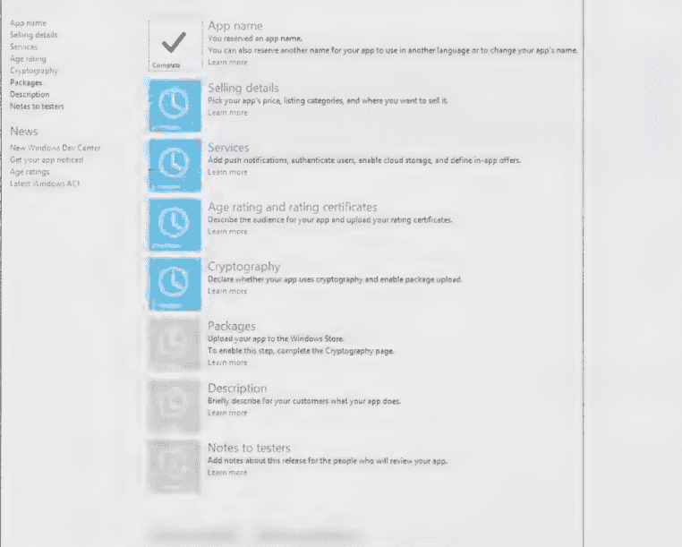

图 1.31 提交应用到 Windows 商店

当你到达第六步“包”（Packages）时，你可以将完成的 Windows 商店应用上传到 Windows 商店。在 Visual Studio 中，使用菜单选项项目（Project）、存储（Store）、创建应用包（Create App Package）对你的 Windows 商店应用进行（见图 1.32）。接下来，你可以点击包步骤来上传该包。

## 发布到 Windows Store

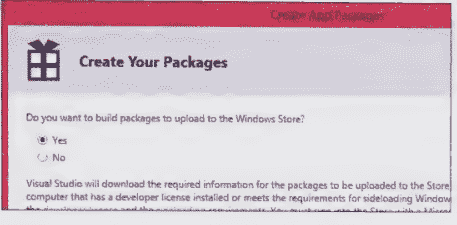

图 1.32 创建你的应用包

## 通过应用认证

在你的应用发布到 Windows Store 之前，微软必须对其进行审核。换句话说，你的应用必须通过认证过程。该认证过程的一部分是自动化的，而另一部分必须由人工完成。

认证有许多要求。其中一些要求是显而易见的。例如，你的应用不能包含导致其立即崩溃的编程错误，而且你的应用不能仅仅是你业务的一个大广告。

有些认证要求并不显而易见。例如，为了通过认证，你的应用不能在计费连接上意外传输大量数据，你的应用必须快速启动，并且你的应用必须是完整的（不能有“即将上线”的功能）。此外，如果你的应用链接到互联网，你必须提供隐私政策。

> 注意

> Windows Store 认证要求详见 http://msdn.microsoft.com/en-us/library/windows/apps/hh694083.aspx。

你可以使用 Windows 应用认证包（Windows App Certification Kit）在将包上传到 Windows Store 之前对你的应用运行自动化认证测试。运行 Windows 认证包的最简单方法是在 Visual Studio 中中，通过选择菜单选项“打包、商店、创建应用包”来打包你的应用。“创建应用包”向导的最后一步允许你启动 Windows 应用认证包（图 1.33）。

## 第 1 章 构建 Windows Store 应用

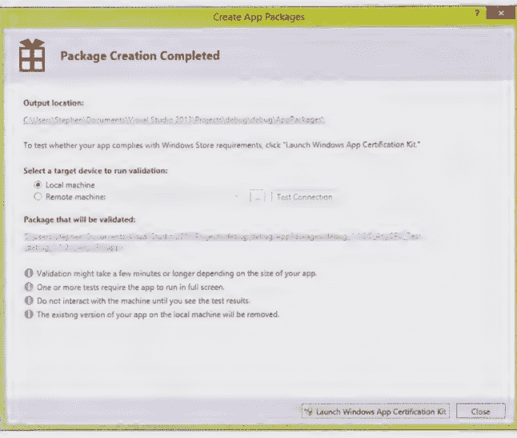

图 1.33 启动 Windows 应用认证包

> 注意

> Windows 应用认证包会在安装 Visual Studio 的同时安装。你可以通过从开始屏幕启动 Windows App Cert Kit 来独立于 Visual Studio 运行它。

当你运行 Windows 应用认证包时，认证包会启动并运行你的应用，在电脑进行了一段时间“疯狂操作”后，会生成一份报告，详细说明你的应用是通过还是失败（见图 1.34）。

> 注意

> 如果你正在使用 Team Foundation Server，你甚至可以将 Windows 应用认证包集成到你的构建过程中。每当你对应用进行新构建时，都可以自动运行技术认证测试。

## 从 Windows 8 迁移到 Windows 8.1

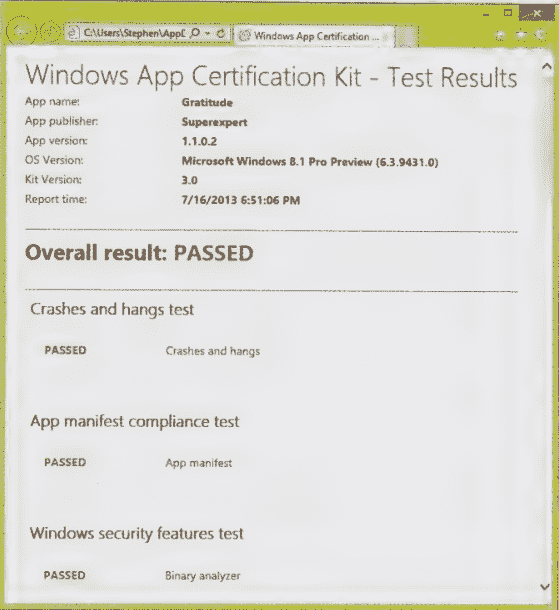

图 1.34 由 Windows 应用认证包生成的（成功的）认证报告

在你的应用通过所有认证要求之后——在被微软批准之后——你的应用将出现在 Windows Store 中，你可以开始赚钱了。当任何人购买你的应用时，资金将添加到结算账户，该账户在 Windows Store 仪表板上设置。

## 从 Windows 8 迁移到 Windows 8.1

Windows 8.1 是 Windows 8 的第二个版本。已经有数以万个为 Windows 8 编写的应用。

如果你已经为 Windows 8 创建了 Windows Store 应用并想将该应用迁移到 Windows 8.1，那么这个过程非常简单。当你在 Visual Studio 2013 中打开 Windows 8 应用时，Visual Studio 会建议将你的应用重定目标为 Windows 8.1（见图 1.35）。

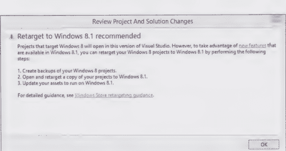

图 1.35 重定目标到 Windows 8.1

你可以在解决方案资源管理器窗口中右键点击项目，并选择菜单选项“重定目标到 Windows 8.1”将你的应用迁移到 Windows 8.1。重定应用目标会更新所有脚本引用，指向 Windows Library for JavaScript 2.0 而不是 Windows Library for JavaScript 1.0。如果你愿意，可以通过向项目添加对 Windows Library for JavaScript 2.0 的引用并更新所有页面中的 `<script>` 标签来实现。

在重定应用目标后，你可能需要修改代码。例如，如本章前面提到的，Windows 8.1 不再支持磁贴（snaps）。在重定应用目标后，会显示所有弃用的应用程序编程接口（API）列表。

> 注意

> 你需要 Visual Studio 2013 专业版、高级版或终极版才能修改现有的 Windows 8 应用之前对其进行编辑。Visual Studio 2013 版允许你将 Windows 8 应用重定目标到 Windows 8.1。Windows Runtime 发生了变化，因此你仍然可以使用 Windows 8 和 Windows 8.1。

## 总结

本章的目标是向你介绍 Windows Store 应用。我从本章开始为你提供了微软设计原则的概述。你还学习了 Windows Store 应用的标准功能，如应用和磁贴（charms）。然后，我引导你逐步完成了构建首个 Windows Store 应用的过程。你还学习了 Windows Store 应用是如何由 HTML5、JavaScript 和 CSS 组成的。你还学习了 Windows Store 应用如何利用 Windows Runtime 等微软技术。你学习了如何使用模拟器运行 Windows Store 应用。你还学习了如何使用断点和 Visual Studio 控制台调试 Windows Store 应用。最后，你学习了如何通过将 Windows Store 应用发布到 Windows Store 来从其盈利。你学习了如何注册应用、提交应用并通过认证。

# 第 2 章

## WinJS 基础

本章内容

- 命名空间、模块和类
- 使用 Promises 进行异步编程
- 使用 Query Selectors 获取 DOM 元素
- 使用 Scheduler 执行 Ajax 调用
- 使用 Scheduler 优先处理任务

本章的目标是解释基础 WinJS 库中包含的功能。这些是你构建的任何应用程序中都会用到的功能。本章的第一部分专门介绍命名空间、模块和类的主题。你学习了组织 JavaScript 代码的推荐模式。

接下来，你学习了如何利用基础 WinJS 库的另一个名为 promises（承诺）的特性。Promises 为你提供了一种在 JavaScript 代码中执行异步编程的优雅方式。

在本章中，你还学习了在与 WinJS 库协作时如何使用 Query Selectors。Query Selectors 允许你从 HTML 文档中高效地获取 DOM 元素。

你还学习了如何使用基础 WinJS 库包含的名为 `xhr()` 的函数。`xhr()` 函数允许你执行 Ajax 调用——包括跨域调用。


最后，这里将向你介绍 WinJS Scheduler（调度器）。`Scheduler` 是 Windows 8.1 的新功能，允许你通过以不同的优先级执行 JavaScript 代码来提高应用的性能。

## 命名空间、模块和类

当你使用 WinJS 库构建 Windows Store 应用时，微软建议你在组织 JavaScript 代码时遵循特定的模式。特别是，微软建议将代码组织成命名空间、模块和类。

通过遵循这些模式，你可以构建出 Bug 更少且随着时间推移更容易维护的 JavaScript 代码。

## 使用命名空间

让我先解释 WinJS 库中定义命名空间的方法。在做任何其他事情之前，我们应该先回答这个问题：为什么我们需要命名空间？它们起什么作用？它们会为我们的 Windows Store 应用增加不必要的复杂性吗？

毕竟，许多 JavaScript 库在不引入命名空间支持的情况下运行得很好。例如，jQuery 不支持命名空间，而 jQuery 是世界上最流行的 JavaScript 库。如果 jQuery 不需要命名空间就能工作，我们为什么要担心命名空间呢？

命名空间在编程语言中起两个作用。首先，命名空间防止命名冲突。换句话说，命名空间允许你创建多个同名对象而不产生冲突。

例如，假设公司 A 和公司 B 都想制作一个购物车控件，并且都想将该控件命名为 `ShoppingCart`。通过创建 `CompanyA` 命名空间和 `CompanyB` 命名空间，两家公司都可以创建控件：`CompanyA.ShoppingCart` 和 `CompanyB.ShoppingCart`。

命名空间的第二个作用是组织。命名空间用于将相关功能分组，即使这些功能定义在不同的物理文件中。例如，我知道 WinJS 库中所有与类操作的方法都可以在 `WinJS.Class` 命名空间找到。命名空间更容易理解库中的可用功能。

如果你正在构建一个简单的 JavaScript 应用，那么你没有理由担心命名空间。如果你需要使用由不同的人编写的库，命名空间就会变得非常重要。

### WinJS.Namespace.define

在 WinJS 库中，创建命名空间的最基本方法是使用 `WinJS.Namespace.define` 方法。该方法允许你声明任意深度的命名空间。

`WinJS.Namespace.define` 方法具有以下参数：

- `name`—表示新命名空间名称的字符串。你可以使用点符号添加嵌套命名空间。
- `members`—添加到新命名空间的可选对象集合。

例如，列表 2.1 中的代码示例声明了两个新命名空间 `CompanyA` 和 `CompanyB.Controls`。这两个命名空间都包含一个 `ShoppingCart` 对象，该对象具有一个 `checkout()` 方法：

**列表 2.1 创建命名空间 (namespaces\html)**

```javascript
// 创建带有 ShoppingCart 的 CompanyA 命名空间
WinJS.Namespace.define("CompanyA");
CompanyA.ShoppingCart = {
  checkout: function () { return "Checking out from A"; }
};

// 创建带有 ShoppingCart 的 CompanyB.Controls 命名空间
WinJS.Namespace.define(
  "CompanyB.Controls",
  ShoppingCart: {
    checkout: function () { return "Checking out from B"; }
  }
);
```

```javascript
// 调用 CompanyA ShoppingCart checkout 方法
console.log(CompanyA.ShoppingCart.checkout()); // 输出 "Checking out from A"
```

```javascript
// 调用 CompanyB.Controls checkout 方法
console.log(CompanyB.Controls.ShoppingCart.checkout()); // 输出 "Checking out from B"
```

在 2.1 中，通过调用 `WinJS.namespace` 创建了 `CompanyA` 命名空间。接下来，将 `ShoppingCart` 添加到该命名空间。命名空间的定义和对象的添加是在代码行中完成的。

对于 `CompanyB.Controls` 命名空间，则采用了不同的方法。通过以下单一语句创建命名空间并将 `ShoppingCart` 对象添加到该命名空间中：

```javascript
WinJS.Namespace.define(
  "CompanyB.Controls",
  ShoppingCart: {
    checkout: function () { return "Checking out from B"; }
  }
);
```

注意，`CompanyB.Controls` 是一个嵌套命名空间。顶层命名空间 `CompanyB` 包含 `Controls` 命名空间。你可以使用点符号表示法声明嵌套命名空间，WinJS 库会处理在另一个命名空间内创建新命名空间的细节。

定义命名空间后，你可以在同一个 JavaScript 文件中使用这两个购物车控件中的任何一个而产生冲突。你可以调用 `CompanyA.ShoppingCart.checkout()`，也可以调用 `CompanyB.Controls.ShoppingCart.checkout()`。

## 使用 WinJS.Namespace.defineParent()

`WinJS.Namespace.defineParent()` 方法与 `WinJS.Namespace.define()` 方法类似。这两个方法都允许你定义一个新的命名空间。区别在于 `defineParent()` 方法允许你将新命名空间添加到现有的命名空间中。

`WinJS.Namespace.defineParent()` 方法具有以下参数：

- `parentNameSpace`—一个表示父命名空间的对象
- `name`—一个表示要添加到父命名空间的新命名空间的字符串
- `members`—一个可选的对象集合，用于添加到新命名空间

以下代码示例演示了你如何创建一个名为 `CompanyA` 的根命名空间，并将一个名为 `Controls` 的子命名空间添加到 `CompanyA` 父命名空间中：

```javascript
WinJS.Namespace.define("CompanyA");
WinJS.Namespace.defineParent(CompanyA, "Controls", {
  ShoppingCart:
    checkout: function () { return "Checking out"; }
});

console.log(CompanyA.Controls.ShoppingCart.checkout()); // 输出 "Checking out"
```

使用 `defineParent()` 方法相比 `define()` 方法的一个显著优势是**强类型**的。换句话说，你使用一个对象来表示基命名空间，而不是字符串。如果你拼写错了对象的名称（`CompanyA`），将得到运行时错误。

## 使用模块模式

当你构建 JavaScript 库时，你可以创建公共方法和私有方法。某些方法（即公共方法）旨在供 JavaScript 库的使用者使用。公共方法充当你库的公共 API。

其他方法（即私有方法）并非供公开使用。相反，这些方法是使库运行所需的内部方法。你不希望人们调用这些内部方法，因为你可能在未来需要更改它们。

JavaScript 不支持访问修饰符。你无法标记方法为公共或私有。

在 JavaScript 中，封装（隐藏）方法和对象的唯一机制是利用函数。JavaScript 可以是全局作用域（随处可用）或函数作用域（仅在函数内部可用）。如果你想隐藏一个对象或方法，就需要将其放在函数内部。

例如，以下代码包含一个名为 `someModule` 的函数：

```javascript
(function () {
  var privateVariable = "I am private";

  var publicMethod = function () {
    console.log(privateVariable);
  };

  window.publicMethod = publicMethod;
})();
```

**列表 2.2 封装函数 (modules\html)**

```javascript
(function () {
  var privateVariable = "I am private";

  var publicMethod = function () {
    console.log(privateVariable);
  };

  window.publicMethod = publicMethod;
})();
```

`calculateTax()` 和 `calculateDate()` 函数被添加到 `CompanyA` 命名空间，你可以调用这两个函数的这两个方法。这些是你库的公共方法，构成了公共 API。

相反，`calculateState()` 和 `calculateTax()` 方法永远隐藏在函数内部。它们是被封装的，无法在函数范围之外调用。这些是你库的内部方法。

与其它流行的语言（如 C# 或 Java）不同，JavaScript 对类没有任何内置支持。在 JavaScript 中，你不区分类型（类）和该类型的实例（对象）。JavaScript 中的一切皆为对象。

WinJS 库包含了用于创建类的 JavaScript 扩展。这些方法在 WinJS 库内部被广泛使用。例如，所有的 WinJS 控件都是使用这些方法创建的。在本节中，我们将讨论如何利用 WinJS 库的方法来定义新类。

## WinJS.Class.define()

在 WinJS 库中，通过调用 `WinJS.Class.define()` 方法创建新的 JavaScript 类。该方法接受三个参数：

- `constructor`—用于初始化新对象的构造函数。如果你传递 `null`，则创建一个空容器
- `instanceMembers`—实例属性和方法的集合
- `staticMembers`—静态属性和方法的集合

列表 2.3 中的代码演示了如何创建一个 `Robot` 类，然后从 `Robot` 类创建一个 `Roomba` 对象。

**列表 2.3 创建类 (classes\html)**

```javascript
var Robot = WinJS.Class.define(
  function(name, price) {
    this.name = name;
    this.price = price;
  },
  _name: undefined,
  price: 0,
  price: {
    set: function (value) {
      if (value < 0) {
        throw new Error("Invalid price!");
```

```javascript
{
  price: {
    set: function (value) {
      this._price = value;
    },
    get: function () { return this._price; }
  },
  makeNoise: function () {
    return "Burp, Wow, oops!";
  }
}
);

// Create a robot
var roomba = new Robot("Roomba", 200.33);

console.log(roomba.price); // Writes "200.33"

console.log(roomba.makeNoise()); // Writes "Burp, Wow, oops!"

// Set invalid price
roomba.price = -88; // Throws "Invalid price!"
```

`Robot` 类是使用 `WinJS.Class.define()` 方法定义的。传递给方法的第一个参数是 `Robot` 类的构造函数。该构造函数初始化了 `Robot` 的名称和价格属性。

传递给 `WinJS.Class.define()` 方法的下一个参数是实例成员集合。该集合用于定义 `_name` 和 `_price` 字段以及 `price` 属性。该集合还包含了 `makeNoise()` 方法的定义。

> 注意
有一种约定，即类中所有私有成员（字段、属性和方法）的开头都加一个下划线。例如，列表 2.3 中支持 `price` 属性的私有字段命名为 `_price` 而不是 `price`。

请注意 `price` 属性包含一个 getter（get器）和一个 setter（set器）。如果你尝试给机器人分配一个无效值，setter 将如图 2.1 所示抛出错误。

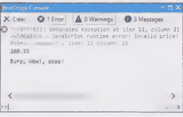

图 2.1 无效的价格! 异常

## 使用 WinJS.Class.derive()

`WinJS.Class.derive()` 方法允许你使用原型继承从一个类派生出另一个类。`WinJS.Class.derive()` 方法接受以下四个参数：

- `baseClass`—要继承的类。
- `constructor`—一个用于初始化新类的构造函数。
- `instanceMembers`—新的实例属性和方法。
- `staticMembers`—新的静态属性和方法。

这是一个基础示例。在列表 2.4 中，定义了三个类：`Robot`、`Roomba` 和 `AIBO`。`Robot` 类是基类，`Roomba` 和 `AIBO` 类派生自 `Robot` 类。

**列表 2.4 派生一个类 (derive|derive.html)**

```javascript
var Robot = WinJS.Class.define(
  function () {
    this.type = "Robot";
  }, {
    sayHello: function () {
      return "My name is " + this.name
        + " and I am a " + this.type;
    }
  });

var Roomba = WinJS.Class.derive(
  Robot,
  function (name) {
    this.name = name;
    this.type = "Roomba";
  }
);

var AIBO = WinJS.Class.derive(
  Robot,
  function (name) {
    this.name = name;
    this.type = "AIBO";
  }
);

// Create a Roomba
var myRoomba = new Roomba("rover");
console.log(myRoomba.sayHello());

// Create an AIBO
var myAIBO = new AIBO("spot");
console.log(myAIBO.sayHello());
```

当你运行列表 2.4 中的代码时，图 2.2 中的消息会被写入 Visual JavaScript 控制台。

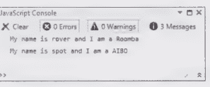

图 2.2 派生结果

在列表 2.4 中，`Robot` 类的构造函数从未被调用。相反，调用的是 `Roomba` 和 `AIBO` 的构造函数。然而，`Roomba` 和 `AIBO` 都从 `Robot` 类继承了 `sayHello()` 方法。

## 使用 WinJS.mix()

作为 `WinJS.Class.derive()` 方法的替代，你可以使用 `WinJS.Class.mix()` 方法。该方法允许你创建混入（mixins）。混入允许你将多个 JavaScript 对象的方法和属性组合到单个对象中。

在背后，我们在之前的节中讨论的 `WinJS.Class.derive()` 方法使用原型继承，而原型继承有缺点。遵循原型链需要消耗处理器时间。因此，建议通过使用混入来避免原型继承。

当你使用混入而不是原型继承时，方法和属性会被组合成一个对象。你不会得到一个长长的原型链。

`WinJS.Class.mix()` 方法具有以下参数：

- `constructor`—一个用于初始化新类的构造函数。
- `mixin`—一个包含混入方法的参数数组。

列表 2.5 中的代码演示了如何使用 `WinJS.Class.mix()` 方法来模拟单继承。

**列表 2.5 创建一个混入 (mixins\mixins.html)**

```javascript
var Robot = {
  makeNoise: function () {
    return "beep";
  }
};

var Roomba = WinJS.Class.mix(
  function (name) {
    this.name = name;
  },
  Robot
);

var myRoomba = new Roomba("rover");
console.log(myRoomba.makeNoise()); // Writes "beep"
```


在列表 2.5 中，`Roomba` 类包含了 `Robot` 对象的所有方法。

混入的优势之一是，你可以使用混入来组合所需的任意数量组的方法和属性。例如，列表 2.6 中的代码示例演示了如何通过 `Robot` 方法、`Product` 方法和 `Vacuum` 方法来构建一个 `Roomba`。

# 列表 2.6 组合多个对象 (`mixinMultiple\mixinMultiple.html`)

```javascript
"use strict";

var Robot = {
  makeNoise: function () {
    return "beep";
  }
}
```

```javascript
var Product = {
  price: {
    set: function (value) {
      if (value < 0) {
        throw new Error("Invalid price!");
      }
      this.price = value;
    },

    get: function () { return this.price; }
  },

  sayName: function () {
    return this.name;
  }
}
```

```javascript
var Vacuum = {
  vacuum: function () { return "bzzzzzz"; }
}
```

```javascript
var Roomba = WinJS.Class.mix(
  function (name) {
    this.name = name;
  }, Robot, Product, Vacuum);
```

```javascript
var myRoomba = new Roomba("rover");

console.log(myRoomba.makeNoise()); // Writes "beep"

console.log(myRoomba.name); // Writes "rover"

console.log(myRoomba.vacuum()); // Writes "bzzzzzz"

myRoomba.price = -88 // Throws Error
```

请注意，混入可以同时包含方法和属性。此外，混入属性可以包含 setter 和 getter。例如，`Product` 混入中的 `price` 属性包含一个执行验证的 setter。

当你执行列表 2.5 中的代码时，图 2.3 所示的结果将显示在你的 Visual Studio JavaScript 控制台中。

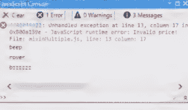

图 2.3 机器人的噪音

> 注意 `WinJS` 库包含了几个你可以使用的混入，包括 `WinJS.Utilities.eventMixin`、`WinJS.UI.DOMeventMixin` 和 `WinJS.Binding.dynamicObservableMixin`。

## 使用 Promise 进行异步编程

某些代码立即执行，某些代码需要完成，或者根本不完成。例如，获取本地变量的值是一个即时操作。通过 Ajax 请求从远程网站获取数据需要更长的时间，或者可能根本无法完成。

当一个操作可能需要很长时间才能完成时，你应该编写代码使其异步执行。与其等待操作完成，不如你应该启动操作，然后在接收到操作完成的信号之前做其他事情。

类比：某些客户服务热线需要你在等候——听着难听的音乐——直到有客户代表可用。这是同步编程，非常浪费你的时间。

一些新的客户服务热线允许你输入电话号码，这样当客户代表可用时他们就可以给你回电。这种方法浪费浪费你的时间，因为你可以在等待回调时做有用的事情。

有几种模式可以用于编写异步执行的代码。JavaScript 中流行的模式是回调模式。当你调用一个可能需要很长时间返回结果的函数时，你向该函数传递一个回调函数。

使用回调是 JavaScript 异步编程的自然方式。

## 使用 Promise

Common 网站这样定义 Promise (`http://wiki.commonjs.org/wiki/Promises`)：

> "Promise 提供了一个定义良好的接口，用于与异步执行的操作的结果进行交互，该结果在任何给定点可能已也可能未完成。通过标准接口，不同的组件可以为异步操作返回 Promise，消费者可以以预测的方式利用 Promise。”

Promise 提供了一个指定回调的标准模式。在 `WinJS` 库中，当你创建一个 Promise 时，可以指定三个回调：完成回调、失败回调和进度回调（失败和进度回调都是可选的）。

Promise 在 `WinJS` 库中被广泛使用。动画库、控件库和绑定库中的方法都使用了 Promise。

例如，包含在 `WinJS` 基础库中的 `xhr` 方法返回一个 Promise。`xhr()` 方法封装标准的 `XMLHttpRequest` 对象。列表 2.7 演示了如何使用 `xhr()` 方法执行 Ajax 请求以检索来自我的博客 StephenWalther.com 的馈送。

58 第 2 章 WinJS 基础

# 示例 2.7 创建 promise (`promises\promises`)

```javascript
var options = {
  url: "http://stephenwalther.com/feed",
  responseType: "document"
};

WinJS.xhr(options).done(
  function (xmlHttpRequest) {
    console.log("success");
    // 显示第一个块条目的标题
    var firstTitle = XMLHttpRequest.response.querySelector("item>title");
    console.log(firstTitle.textContent);
  },

  function (xmlHttpRequest) {
    console.log("fail");
  },

  function (xmlHttpRequest) {
    console.log("progress");
  }
);
```

`WinJS.xhr()` 返回一个 promise。`Promise` 类包含一个 `done()` 方法，该方法接受三个回调函数：完成回调、错误回调和进度回调：

`Promise.done(completeCallback, errorCallback, progressCallback);`

在示例 2.7 的代码中，向 `done()` 方法传递了三个匿名函数。除非发生网络错误，否则错误函数永远不会被调用。进度函数在 Ajax 请求期间会被反复调用。最后，当 Ajax 完成时，完成回调就会执行。完成回调显示获取的第一个条目的标题（见图 2.4）。

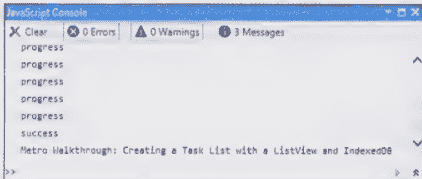

图 2.4 使用 promise

## 使用 Promises 进行异步编程

## 使用 `then()` 对比 `done()`

在上一节中，我们使用 Promise 对象的 `done()` 方法来设置我们的完成、错误和 promise 回调。Promise 对象暴露了另一个与 `done()` 密切相关的方法：`then()` 方法。

`then()` 方法和 `done()` 方法一样，允许你设置完成、错误和 promise 回调。为什么存在 `then()` 方法？`then()` 和 `done()` 之间有两个重要的区别吗？

`then()` 方法与 `done()` 方法不同，支持链式调用。如果你需要链式调用多个 promise，必须使用 `then()` 方法。例如，示例 2.8 中的代码说明了如何通过 `then()` 发起 Ajax 调用来下载最新博客条目的 URL，并进行第二次 Ajax 调用，在第一次 Ajax 调用完成之前不会发起第二次 Ajax 调用。

# 示例 2.8 Promise 链式 (`promiseChain\promiseChain.html`)

```javascript
var options = {
  url: "http://stephenwalther.com/feed",
  responseType: "document"
};

WinJS.xhr(options).then(
  function (XMLHttpRequest) {
    // 获取第一个博客条目的链接
    var firstLink = XMLHttpRequest.response.querySelector("item>link");

    // 发起第二次 Ajax 请求（返回一个 promise）
    return WinJS.xhr({
      url: firstLink.textContent,
      responseType: "document"
    });
  }).done(
  function (XMLHttpRequest) {
    // 获取博客文章正文
    var postBody = XMLHttpRequest.response.querySelector("div.entry");

    // 输出博客文章的前 200 个字符
    console.log(postBody.textContent.trim().substr(0, 200));
  }
});
```

# 第 2 章 WinJS 基础

在示例 2.8 中，注意传递给 `then()` 方法的完成函数返回了第二个 promise。调用 `WinJS.xhr()` 会返回一个新的 promise。

如果第二个 promise 成功完成，则传递给 `done()` 方法的完成函数将执行。该方法显示博客条目的的前 200 个字符。

你可以通过调用 `.then().then()...` 来链式连接任意数量的 promise。链中的最后一个调用应该是 `done()` 的调用。

`then()` 和 `done()` 之间的第二个区别在于错误处理。你可以将错误函数作为第二个参数传递给 `then()` 和 `done()` 方法以处理错误，而且作为最佳实践，你应该这样做。但是，如果你不提供错误函数，那么 `done()` 会抛出异常，但 `then()` 方法不会。相反，`then()` 方法会返回一个处于错误状态的 promise。

例如，示例 2.9 中的代码对一个 URL 执行了 Ajax 请求。使用 `then()` 方法发起的请求不会抛出错误。错误信息会被写入 JavaScript 控制台，但 promise 的执行不会被停止。

## 示例 2.9 `done()` 对比 `then()` (`promiseErrorspromiseErrors.html`)

```javascript
var options = {
  url: "http://BadURL"
};
```

```javascript
WinJS.xhr(options).then(); // 不抛出异常

WinJS.xhr(options).done(); // 会抛出异常
```

如果你不希望代码静默失败，不要使用示例 2.9 中的 `then()` 方法，你应该使用 `done()` 代替 `then()`。如果你在进行链式调用 promise，请始终使用 `done()` 作为链的最后一环。换句话说，错误会在链的末尾被处理。

（纠正：如果你不想让你的代码静默失败，对于示例 2.9 中的 `then()` 方法，你应该使用 `done()` 代替 `then()`。如果你在进行链式调用 promise，请始终使用 `done()` 作为链的最后一环。换句话说，错误会在链的末尾被处理。）

## 创建 promise

如果你的应用需要某些毫秒来完成函数，那么你应该创建一个 promise。`then()` 方法通过通过 `window.setInterval()` 方法来完成 promise promise promise。

`Promise` 类的构造函数需要三个参数：完成、错误和进度。

示例 2.10 中的代码展示了如何创建 promise。

## 异步编程

示例 2.10 中的代码展示了如何使用 `window.setInterval()` 方法来执行 promise。每秒，进度回调函数都会被调用。当了 10 秒后，完成回调函数将被调用。

当你执行示例 2.10 的代码时，可以在图 2.5 中看到输出。

```javascript
function wait10Seconds() {
  var seconds = 0;

  return new Promise(function (complete, error, progress) {
    var intervalID = setInterval(function () {
      seconds++;
      progress(seconds);

      if (seconds > 9) {
        clearInterval(intervalID);
        complete();
      }
    }, 1000);
  });
}

wait10Seconds().done(
  function () { console.log("complete") },
  function () { console.log("error") },
  function (seconds) { console.log("progress: " + seconds) }
);
```

图 2.5 promise 的输出

...

示例 2.10

0 2.

示例 2.11

```javascript
WinJS.Promise.timeout(3000).then(
  function () { console.log("complete"); },
  function () { console.log("error"); },
  function () { console.log("progress"); }
);
```

在示例 2.11 中，promise 在 3 秒（3000 毫秒）后完成。`timeout()` 方法返回的 promise 不支持事件。因此，写入控制台的唯一信息是 3 秒后的“complete”。

## 取消 promise

停止长时间运行函数的能力非常有用。因此，某些 promise 支持取消。并不是所有 promise 都支持取消。当你取消一个 promise 时，该 的错误回调将被执行。

例如，示例 2.12 中的代码使用了 `WinJS.xhr()` 方法执行 Ajax 请求。然而，在发起 Ajax 请求后，请求立即被取消了。

## 示例 2.12 取消 promise (`promiseCancel\promiseCancel.html`)

```javascript
// 指定 Ajax 请求选项
var options = {
  url: "http://StephenWalther.com"
};

// 发起 Ajax 请求
var request = WinJS.xhr(options).then(
  function (XMLHttpRequest) {
    console.log("success");
  },

  function (XMLHttpRequest) {
    console.log("fail: " + XMLHttpRequest.message);
  },

  function (XMLHttpRequest) {
    console.log("progress");
  }
);
```

```javascript
// 取消 Ajax 请求
request.cancel();
```

## 使用查询选择器检索 DOM 元素

当你运行代码时，“fail: Canceled”消息会被写入 Visual Studio 的 JavaScript 控制台（见图 2.6）。因为 `then()` 与 `done()` 不同，它返回的是一个 promise，因此只有在调用 `then()` 时支持取消，而在调用 `done()` 时不支持。

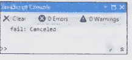

图 2.6 取消一个 promise (`promise-cancel.html`)

## 组合 Promise

你可以根据其他 promise 构建新的 promise。换句话说，你可以对 promise 进行组合。当你需要执行多个异步操作并等待所有操作或任意一个操作完成时，组合 promise 是非常有用的。

`Promise` 类有两个静态方法可以用于组合 promise：`join()` 方法和 `any()` 方法。当你使用 `join()` 组合 promise 时，只有当所有组合的 promise 都完成时，该 promise 才会完成。当你使用 `any()` 方法时，当其中任何一个 promise 完成，该 promise 就会完成。

以下代码演示了如何使用 `join()` 方法。通过两个超时操作创建了一个新的 promise。在两个超时 promise 都完成之前，该新 promise 不会完成：

```javascript
WinJS.Promise.join([
  WinJS.Promise.timeout(1000),
  WinJS.Promise.timeout(5000)
]).done(function () {
  console.log("join complete");
});
```


在两个 promise 都传递给 `join()` 方法并完成之前，“complete”消息将不会写入 JavaScript 控制台。该消息将在 5 秒（5,000 毫秒）后才会写入。

当传递给 `any()` 方法的任何 promise 完成时，`any()` 方法就会完成：

```javascript
WinJS.Promise.any([
  WinJS.Promise.timeout(1000),
  WinJS.Promise.timeout(5000)
]).done(function () {
  console.log("any complete");
});
```

该代码会在 1 秒（1,000 毫秒）后向 JavaScript 控制台写入“any complete”消息。该消息在第一个 promise 完成后、第二个 promise 完成之前立即写入 JavaScript 控制台。

## 使用查询选择器检索 DOM 元素

当你使用 JavaScript 构建 Windows Store 应用时，需要一种方法方便从 HTML 文档中检索元素。例如，你可能想要检索所有具有特定 CSS 类的输入元素。或者，你可能想要检索 id 为 `favoriteColor` 的唯一元素。

从 HTML 文档中检索元素的标准方法是使用选择器。任何创建过层联样式表（CSS）的人都已使用过选择器。你在层联样式表中使用选择器来对文档中的元素应用格式规则。

例如，以下层联样式表规则会将文档中类名为 `.required` 的每个 `INPUT` 元素的背景颜色改为红色：

```css
input.required {
  background-color: red;
}
```

`input.required` 部分是选择器，匹配所有类名为 `required` 的 `INPUT` 元素。

W3C 选择器标准（技术上称为其建议）标题为“Selectors Level 3”，标准位于此处：

<http://www.w3.org/TR/css3-selectors/>

选择器不仅用于为元素添加格式。当你需要应用行为时，选择器也很有用。例如，你可能用选择器选择一个 `BUTTON` 元素，并为该元素添加点击处理程序，这样每当你点击按钮就会发生某些操作。

jQuery 以其支持选择器而闻名。使用 jQuery，你可以使用选择器从文档中检索匹配的元素并修改元素。WinJS 库允许你使用 jQuery 配合 W3C 选择器语法执行相同类型的查询。

> **注意**  
> W3C 选择器标准支持所有现代浏览器，包括最新版本的 Google Chrome、Apple Safari 和 Mozilla Firefox。

## 使用 `WinJS.Utilities.query()` 方法执行查询

使用 `WinJS.Utilities.query()` 时，你需要一种方法来方便地从 HTML 文档中检索元素。例如，你可能想要检索所有具有特定 CSS 类的输入元素。或者，你可能想要检索 id 为 `favoriteColor` 的唯一元素。

```html
<!DOCTYPE html>
<html>
<head>
  <meta charset="utf-8">
  <title>Query</title>

  <script>
    document.addEventListener("DOMContentLoaded", function () {
      try {
        var elements = WinJS.Utilities.query("input.required");

        elements.forEach(function (el) {
          console.log("Element found:", el);
        });
      } catch (error) {
        console.error("Query failed:", error);
      }
    });
  </script>
</head>

<body>
  <input class="required" type="text" value="Field 1">
  <input type="text" value="Field 2">
  <input class="required" type="text" value="Field 3">
  <button>Click Me</button>

  <script>
    // 示例代码
    (function () {
      console.log("Page is loaded");
    })();
  </script>
</body>
</html>
```

## 第 2 章 WinJS 基础

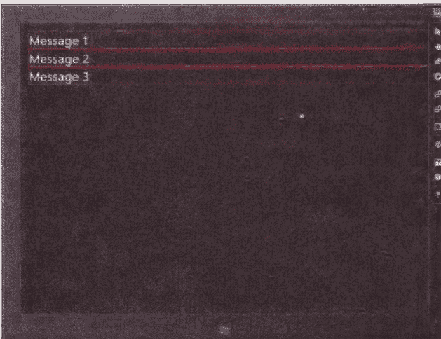

图 2.8 获取子元素

需要注意的是，`WinJS.Utilities.children()` 方法仅适用于 DOM 元素，而不适用于 `QueryCollection`。注意，使用 `get()` 方法是为了获取代表 `discussContainer` 的 DOM 元素。

## 使用 `QueryCollection` 类

`WinJS.Utilities.query()` 方法和 `WinJS.Utilities.id()` 方法都返回 `QueryCollection` 类的实例。`QueryCollection` 类派自基础 JavaScript `Array` 类，并增加了几个处理 HTML 元素的实用方法：

- `addClass(name)`—为 `QueryCollection` 中的每个元素添加类名
- `setStyle(name)`—从 `QueryCollection` 中的每个元素中移除样式
- `control(ctr, options)`—允许你将查询集合中的项转换为 WinJS 控件
- `forEach(callback, thisArg)`—允许你对 `QueryCollection` 中的每个项执行操作
- `get(index)`—从 `QueryCollection` 中获取指定索引的元素
- `getAttribute(name)`—获取 `QueryCollection` 中第一个元素的属性值
- `hasClass(name)`—如果 `QueryCollection` 中的第一个元素具有特定类，则返回 true
- `include(items)`—将一组项包含在 `QueryCollection` 中
- `listen(eventType, listener, capture)`—为 `QueryCollection` 中的每个元素添加事件监听器
- `query(query)`—在 `QueryCollection` 上执行额外查询并返回一个新的 `QueryCollection`
- `removeClass(name)`—从 `QueryCollection` 中的每个元素移除类名
- `removeEventListener(eventType, listener, capture)`—从 `QueryCollection` 中的每个元素中移除事件监听器
- `setAttribute(name, value)`—为 `QueryCollection` 中的每个元素添加属性
- `setStyle(name, value)`—为 `QueryCollection` 中的每个元素添加样式
- `template(templateElement, data, renderDonePromiseContract)`—使用提供的数据为 `QueryCollection` 中的每个项渲染模板
- `toggleClass(name)`—切换 `QueryCollection` 中每个元素的指定类名

`Collection` 类派自基础 `Array` 类，它包含所有标准的 `Array` 方法，如 `indexOf()` 和 `slice()`。

## 使用 `xhr()` 函数执行 Ajax 调用

WinJS `xhr()` 函数是浏览器 `XMLHttpRequest` 对象的轻量级封装。与直接操作 `XMLHttpRequest` 对象不同，`xhr()` 函数返回一个 promise（承诺）。每当你想要发起 Ajax 请求时，都可以使用 `xhr()` 函数。

代码列表 2.15 和 2.16 包含了执行简单 Ajax 请求的代码。它获取了 Microsoft 网站的主页，并显示从该页面中提取的所有链接列表（参见第 2.9 节）。

### 代码列表 2.15 发起简单的 Ajax 请求 (`xhr/xhr.html`)

```html
<!DOCTYPE html>
<head>
  <meta charset="utf-8">
  <title>Simple Xhr</title>

  <!-- WinJS 引用 -->
  <link href="//Microsoft.WinJS.1.0/css/ui-dark.css" rel="stylesheet">
  <script src="//Microsoft.WinJS.1.0/js/base.js"></script>
  <script src="//Microsoft.WinJS.1.0/js/ui.js"></script>

  <!-- 第 02 章引用 -->
  <link href="css/default.css" rel="stylesheet">
  <script type="text/javascript" src="xhr.js"></script>
</head>

<body>
  <h1>Here are the Microsoft Site Links</h1>
  <ul id="ulResults"></ul>
</body>
</html>
```

### 代码列表 2.16 发起简单的 Ajax 请求 (`xhr/xhr`)

```javascript
(function () {
  "use strict";

  function initialize() {
    // 创建 xhr 选项
    var options = {
      url: "http://Microsoft.com",
      responseType: "document"
    };

    // 发起 Ajax 请求
    WinJS.xhr(options).done(
      function (xhr) {
        var li;
        var ulResults = document.getElementById("ulResults");
        var links = xhr.response.querySelectorAll("a");

        for (var i = 0; i < links.length; i++) {
          li = document.createElement("li");
          li.innerHTML = links[i].href;
          ulResults.appendChild(li);
        }
      }
    ).catch(function (err) {
      var messageDialog = new Windows.UI.Popups.MessageBox(
        "Could not download page!"
      );
      messageDialog.showAsync();
    });
  }

  document.addEventListener("DOMContentLoaded", initialize);
})();
```

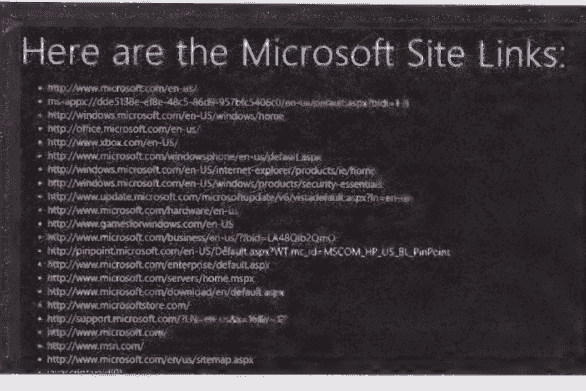

**图 2.9** 请求并显示 Microsoft 主页的链接

`WinJS.xhr()` 返回一个 promise。代码列表 2.16 中向 `WinJS.xhr()` 方法传递了两个匿名函数：一个完成回调函数和一个 promise 错误处理函数。完成回调函数在 HTML UI 元素中显示链接列表，错误页面则向用户显示警告消息。

注意，代码列表 2.15 中的代码向远程服务器发起了请求。这可能会让人感到意外。通常，`XMLHttpRequest` 对象受同源策略限制，该策略阻止你从另一个域名请求内容。然而，在 Windows Store 应用的范围内，你并没有这种限制。

> Internet Explorer 10（但不更早的版本）支持 W3C 跨源资源共享 (CORS) 标准。如果远程服务器返回正确的 HTTP 头部，你就可以对远程服务器发起 Ajax 请求。在 Windows Store 应用的上下文中，你可以忽略 CORS 并无需进行任何特殊操作即可发起跨源请求。

注意你在选项对象中将 Ajax 请求的 URL 传递给 `WinJS.xhr()` 函数。你可以传递以下任何选项：

- `type`—允许你指定在 Ajax 请求中使用的 HTTP 方法。例如：POST, GET, PUT, DELETE, HEAD。
- `url`—允许你指定发起 Ajax 请求时使用的 URL。
- `user`—允许你在发起 Ajax 请求时指定凭据。
- `password`—允许你在发起 Ajax 请求时指定凭据。
- `headers`—允许你自定义 Ajax 请求中使用的 HTTP 头部。
- `data`—允许你指定 Ajax 请求中传递给远程服务器的数据。你可以传递字符串、无符号字节数组，或使用 `JSON.stringify()` 将其他类型的 JavaScript 对象转换为字符串。
- `responseType`—允许你指定服务器返回的数据类型。可能的值有 `arraybuffer`、`blob`、`document`、`ms-stream` 或 `text`。
- `customRequestInitializer`—允许你自定义底层 `XMLHttpRequest` 对象的属性。

我将在后续章节中详细介绍 `responseType` 和 `customRequestInitializer`。

## 指定不同的响应类型

`XMLHttpRequest` 对象——因此 `WinJS.xhr()` 函数——可以用于返回多种类型的数据，包括 blob、文档和文本。你可以使用 `responseType` 选项来指定你希望如何的数据。

`responseType` 的默认值为 `text`。例如，以下请求将返回 XML 馈的内容：

```javascript
var options = {
  url: "http://example.com/feed.xml",
  responseType: "text"
};

WinJS.xhr(options).done(function (xhr) {
  var result = xhr.response;
});
```

你可能不想将 XML 文档作为字符串返回，因为你无法使用 `querySelector()` 和 `querySelectorAll()` 等方法从文档中提取元素。相反，你希望返回这样的一个文档：

```javascript
var options = {
  url: "http://example.com/feed.xml",
  responseType: "document"
};
```

## 74 第 2 章 WinJS 基础

```html
<progress id="prgResults" max="100"></progress>
<div id="divResults"></div>
```

```html
<body>
</html>
```

列表 2.18 中的代码说明了你如何利用 `customRequestInitializer` 选项，为 `WinJS.xhr()` 函数使用的 `XMLHttpRequest` 对象挂钩进度事件处理程序。当长时间运行的 Ajax 请求完成时，进度处理程序会更新你可以观察的 `PROGRESS` 元素（见图 2.10）。

## 列表 2.18 自定义 `XMLHttpRequest` 对象 (`xhrCustom\xhrCustom.js`)

```javascript
(function () {
  "use strict";

  function initialize() {
    // 缓存 DOM 元素的引用
    var prgResults = document.getElementById("prgResults");
    var divResults = document.getElementById("divResults");

    // 创建 xhr 选项
    var options = {
      url: "products.txt",
      customRequestInitializer: function (xhr) {
        xhr.onprogress = function (evt) {
          if (evt.lengthComputable) {
            var percentComplete = (evt.loaded / evt.total) * 100;
            prgResults.value = percentComplete;
          }
        };
      }
    };

    // 执行 Ajax 请求
    WinJS.xhr(options).done(function (xhr) {
      divResults.innerHTML = xhr.response;
    });
  }
})();
```


`document.addEventListener("DOMContentLoaded", initialize);`

`})();`

## 使用调度器实现任务排序

注意 `options` 对象具有一个 `customRequestInitializer` 属性，该属性代表初始化 `XMLHttpRequest` 对象的函数。该函数添加了一个 `onprogress` 处理程序，使用 HTML5 `PROGRESS` 元素显示已完成的进度。

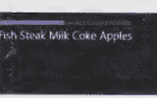

图 2.10 显示 Ajax 请求过程

## 使用调度器实现任务排序

你可以利用 WinJS Scheduler（在 Windows 8.1 中引入）以特定的优先级执行 JavaScript 函数。

你为什么要这样做呢？用 JavaScript 编写的 Windows Store 应用只一个用户界面线程。该线程必须用于所有操作。该线程同时被你的应用程序代码和 WinJS 库中的控件使用。

如果你想创建一个对用户交互做出快速响应的应用，那么你就需要对在唯一用户界面线程上执行的工作进行优先级排序。

> 注意
> 除非使用 Web Workers，否则 Windows Store 应用只有一个用户界面线程。你可以使用 Web Workers 来创建额外的执行线程。使用 Web Workers 的缺点是 Web Worker 无法访问 DOM。使用 Scheduler 创建的任务没有此限制。

例如，假设你正在创建一个 RSS 阅读器应用，并且正在显示当前选中的博客文章。你希望在后台静静地获取下一条博客文章，因为你预估用户很快就会查看下一条。

使用 Scheduler，你可以在用户界面空闲时获取下一条博客文章。这样，如果用户快速地从一个条目点击到另一个，你就不会阻塞用户与你的程序的交互。

让我向你展示一个使用 Scheduler 的示例。你通过调用 `WinJS.Utils.Scheduler.schedule()` 方法来调度新任务，并传递代表你想要执行的任务的方法以及（可选的）任务优先级。

在列表 2.19 中，使用 `WinJS.Utils.Scheduler.schedule()` 方法创建了两个名为 `job` 和 `job2` 的任务。第一个任务被赋予普通优先级，而第二个任务是

## 第 2 章 WinJS 基础

### 列表 2.19 设置任务优先级 (scheduler\scheduler.js)

```javascript
function () {

  "use strict";

  function initialize() {

    // 调度器别名

    var Scheduler = new WinJS.Utilities.Scheduler;

    // 创建任务

    var job1 = Scheduler.schedule(

      function () {

        console.log("Hello from job1");

      },

      Scheduler.Priority.normal

    );

    var job2 = Scheduler.schedule(

      function () {

        console.log("Hello from job2");

      },

      Scheduler.Priority.high

    );

  }

  document.addEventListener("DOMContentLoaded", initialize);

}();
```

调用 `WinJS.Utilities.schedule(func)` 来执行函数类似于调用 `window.setTimeout(0, func)` 或 `window.setImmediate(func)`。该函数不会立即执行，而将在当前线程处理完毕后立即执行。

在列表 2.19 中，创建两个任务的代码首先执行，然后 Scheduler 按优先级顺序执行这两个任务。消息 `Hello from job2` 和 `Hello from job1` 会被写入 JavaScript 控制台窗口（见图 2.11）。

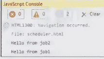

图 2.11 按优先级顺序执行的任务

如果你需要调试使用 Scheduler 时发生了什么，可以利用 `WinJS.Utilities.Scheduler.retrieveState()` 方法。该方法返回一个字符串，按优先级顺序显示当前任务列表。你可以通过调用 `console.log()` 将此字符串的值转储到 JavaScript 控制台窗口（见图 2.11）。

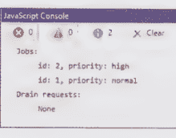

图 2.12 显示调度器的状态

## 设置优先级

你可以使用 `WinJS.Scheduler.Priority` 枚举来指定优先级，也可以指定 min 和 max 之间的数字。请记住，优先级是相对的。将所有任务调度为最高优先级不会让你的应用更快。相反，你应该使用不同的优先级来调度执行顺序。

- `idle`（空闲）
- `belowNormal`（普通下）
- `normal`（普通）
- `high`（高）
- `max`（最高）

## 让位于更高优先级

例如，假设你正在创建一个 RSS 阅读器应用，并且正在显示当前选中的博客文章。你希望在后台静静地获取下一条博客文章，因为你预估用户很快就会查看下一条。

使用 Scheduler，你可以在用户界面空闲时获取下一条博客文章。这样，如果用户快速地从一个条目点击到另一个，你就不会阻塞用户与你的程序的交互。

列表 2.20 中的代码说明了你如何利用 `shouldYield` 属性让低优先级任务让。

### 列表 2.20 设置优先级 (scheduler\scheduler.js)

```javascript
function () {

  "use strict";

  function initialize() {

    // 调度器别名

    var Scheduler = new WinJS.Utilities.Scheduler;

    // 创建低优先级任务

    var job1 = Scheduler.schedule(showQuote, Scheduler.Priority.idle);

    // 处理点击事件

    document.getElementById("btn").addEventListener("click", function () {

      writeMessage("Do Something");

    });

  }

function showQuote(jobInfo) {

  var allQuotes = [

    "Obstacles are those frightful things you see when you take your eyes off your goal -",

    "I have not failed. I've just found 10,000 ways that won't work -",

    "You can't build a reputation on what you are going to -"

  ];

  // 忙循环 - 永远不要这样做！

  while (true) {

    // 让高优先级任务执行

    if (jobInfo.shouldYield) {

      writeMessage("Yielding");

      jobInfo.setWork(showQuote);

      break;

    }

  }

  // 显示随机引言

  var quote = allQuotes[random(allQuotes.length)]; // 注意：原文此处多了一个右括号，已保留

  writeMessage(quote);

}

function writeMessage(message) {

  var messages = document.getElementById("messages");

  messages.innerHTML = "<li>" + message + "</li>" + messages.innerHTML;

}

function random(upperBound) {

  return Math.floor(Math.random() * upperBound);

}

document.addEventListener("DOMContentLoaded", initialize);

}();
```

列表 2.20 中的代码说明了你如何利用 `shouldYield` 属性让低优先级任务让。

如果有一个更高优先级的任务出现，你可能希望让低优先级任务让高优先级任务。

列表 2.20 中的代码说明了你如何利用 `shouldYield` 属性让低优先级任务让。

`showQuote` 方法包含一个 `jobId` 参数。在 `showQuote` 方法内部，检查 `jobId.shouldYield` 属性以确定 `showQuote` 方法是否应该让更高优先级任务。

如果 `shouldYield` 返回 `true`，则 `showQuote` 方法使用 `jobId.setWork()` 指定在高优先级任务完成后调用以恢复当前任务的方法。在这种情况下，`showQuote` 方法将被再次调用。

## 第 2 章 WinJS 基础

高优先级任务仅在有更高优先的任务被调度时才会让出（yield）。因此，如果你调度了一个高优先级任务并调用 `shouldYield()`，那么该任务只有在队列中存在更高优先级的任务时才会让出。

以比高低优先级调度的任务（例如，`Priority.normal` 或 `Priority.idle`）将在两种情况下让出。首先，低优先级任务总是会让位给高优先级任务。此外，以低优先级调度的任务会在时间切片后自动让出。

由于 `showQuote()` 方法是使用 `Priority.idle` 调度的，因此 `showQuote()` 方法会在时间切片后自动让出。即使 `showQuote()` 方法创建了一个忙循环（busy loop），它也不会完全阻塞用户界面线程。检查 `shouldYield` 会在每隔几毫秒后自动打破忙循环。

> 警告
> 永远、永远、永远不要在你的 JavaScript 代码中创建忙循环。我在列表 2.20 中包含一个忙循环是为了演示调度器（Scheduler）的工作原理。

## 总结

本章的目标是向你介绍基础 WinJS 库的功能。在第一部分，你学习了如何将 JavaScript 代码组织成模块、命名空间和类。通过利用模块和命名空间，你可以避免污染全局命名空间，并让你的应用程序随着时间的推移更易维护。

接下来，我讨论了在编写异步代码时如何利用承诺（promises）。例如，我讨论了在执行 Ajax 请求时如何使用承诺。你学习了如何创建承诺、取消承诺、链式承诺以及从现有承诺组合成新承诺。

我还讨论了如何使用 WinJS 查询选择器（query selectors）来检索 DOM 元素。你学习了如何使用 `WinJS.Utilities.query()` 使用选择器执行查询并返回查询结果。你还学习了如何使用 `WinJS.Utilities.id()` 获取单个元素。

我还解释了如何使用 `WinJS.xhr()` 函数在 Windows Store 应用中执行 Ajax 查询。你学习了如何通过设置 `responseText` 来控制 `WinJS.xhr()` 函数返回的数据类型。例如，你学习了如何将 Ajax 查询的结果作为字符串或文档返回。

最后，我向展示了如何利用 Windows 8.1 引入的调度器以不同的优先级执行 JavaScript 代码。我演示了如何让低优先级任务让位给高优先级任务。

# 第 3 章

## 可观察对象、绑定与模板

在本章中，我将解释如何在你的 Windows Store 应用的页面中显示 JavaScript 对象，例如单个产品或产品数组。

我将从解释可观察对象（observables）开始。可观察对象允许你自动检测 JavaScript 属性何时发生。我还解释了如何利用 `WinJS.Binding.List` 对象来检测数组元素的变化。

接下来，我关注声明式数据绑定（declarative data binding）主题。我学习了如何同时使用普通 JavaScript 对象和可观察 JavaScript 对象进行声明式数据绑定。

最后，我讨论了如何使用 WinJS 模板（template）显示对象数组。模板允许你同时格式化并显示多个 JavaScript 对象。

## 理解可观察对象

可观察对象是一种当属性值发生变化时可以通知一个或多个监听器的对象。

可观察对象能够保持你的用户界面和应用程序数据同步。例如，通过利用可观察对象，每当产品属性变化时，你可以自动更新用户界面。可观察对象是 WinJS 库中声明式绑定的基础。

> 注意
> WinJS 库并不是第一个支持可观察对象的 JavaScript 库。例如，Backbone、Knockout、Ember 和 Microsoft Ajax Library（现为 Ajax Control Toolkit 的）都支持可观察对象。

## 创建可观察对象

假设我创建了这样一个产品对象：

```javascript
var product = {

  name: "Milk",

  description: "Something to drink",

  price: 12.33

};
```

这个产品并没有特别有趣的地方。它有三个名为 `name`、`description` 和 `price` 的属性。

现在，假设我想在这些属性的任一个发生变化时都能自动收到通知。在这种情况下，我可以像这样从我的产品对象创建一个可观察产品对象：

```javascript
var observableProduct = WinJs.Binding.as(product);
```

这行代码从现有的 JavaScript 产品对象创建了一个新的可观察 JavaScript 对象。这个新对象也有 `name`、`description` 和 `price` 属性。然而，与原始产品对象的属性不同，可观察产品的属性在发生变化时会触发通知。

新可观察产品对象的每个属性都已转换为具有同时具有 getter（访问器）和 setter（赋值器）的属性。例如，可观察产品的价格看起来像这样：

```javascript
price:

  get: function () { return this.getProperty("price"); }

  set: function (value) { this.setProperty("price", value); }
```

当你读取价格属性时，会调用 `getProperty()` 方法；当你设置价格属性时，会调用 `setProperty()` 方法。`getProperty()` 和 `setProperty()` 是可观察产品对象的方法。

可观察产品对象支持以下方法：

- `defineProperty(name, value)`——向可观察对象添加新属性并通知任何监听器
- `backingData`——一个表示每个属性值的对象
- `bind(name, action)`——允许在属性变化时执行函数
- `getProperty(name)`——使用属性的字符串名称返回属性值
- `notify(name, newValue, oldValue)`——一个私有方法
- `removeProperty(name)`——删除属性
- `setProperty(name, value)`——更新属性并通知监听器
- `unbind(name)`——移除监听器
- `updateProperty(name, value)`——更新属性并通知监听器

所以当你创建一个可观察对象时，想象你这样更改价格：

```javascript
observableProduct.price = 2.99;
```

在这种情况下，触发了以下事件序列：

1. 价格 setter 调用 `setProperty("price", 2.99)`。
2. `setProperty()` 方法更新 `backingData` 的值。
3. `notify()` 方法执行监听器中的每个函数。

> 警告
> 如果你在 WinRT 对象上调用 `WinJS.Binding.as()`，将得到一个异常。问题在于 WinRT 对象是不可变的，而 `WinJS.Binding.as()` 方法尝试向不可变对象添加新方法。你可以让 JavaScript 对象变为可观察的，而不是 WinRT 对象。

## 创建可观察监听器

如果你想在可观察对象的属性变化时收到通知，你需要注册一个监听器。你像 3.1 那样使用 `bind()` 方法来注册监听器。

### 列表 3.1 将对象属性绑定到监听器 (observables.html)

```javascript
// Simple产品对象

var product = {

  name: "Milk",

  description: "Something to drink",

  price: 12.33

}
```

```javascript
// 创建可观察产品

var observableProduct = WinJs.Binding.as(product);
```

```javascript
// 当价格变化时执行函数

observableProduct.bind("price", function (newValue, oldValue) {

  console.log(newValue + " was " + oldValue);

});
```

```javascript
// 更改价格
```


`observableProduct.price = 2.99;`

在列表 3.1 中，使用 `bind()` 方法将属性与函数关联。当价格变化时，该函数会将属性的新值和旧值打印到 Visual Studio JavaScript 控制台（见图 3.1）。


图 3.1 绑定到属性

使用以下代码将属性关联：

```javascript
// 当价格变化时执行函数
observableProduct.bind("price", function (newValue, oldValue) {
  console.log(newValue + " was " + oldValue);
});
```

注意，绑定到价格属性的函数被调用了两次。在属性初始值时被调用一次，在属性变化时被调用一次。

## 注意事项

你可以通过向 `WinJS.Binding.bind()` 方法的第二个参数提供一个对象来为复杂属性绑定监听器，如下所示：

```javascript
// 创建带有复杂属性的对象
var customer = {
  shippingAddress: {
    street: "312 Main Street"
  }
};

// 创建可观察对象
var observableCustomer = WinJS.Binding.as(customer);

// 绑定到复杂属性
WinJS.Binding.bind(observableCustomer, {
  shippingAddress: {
    street: function (newValue) {
      console.log("Modified shipping address to " + newValue);
    }
  }
});

// 修改复杂属性的值
observableCustomer.shippingAddress.street = "100 Grant Street";
```

传递给 `WinJS.Binding.bind()` 方法的第二个参数使属性变得可观察，尽管 `street` 属性是复杂 `customer` 对象的嵌套属性。

## 合并通知

如果你对一个属性进行多次更改——一个更改后紧接着另一个更改——则不会发送单独的通知。相反，监听器只会被通知一次。通知会被合并为一个单一通知（见图 3.2）。

例如，在列表 3.2 的代码中，产品价格更新了三次。然而，JavaScript 控制台只写入了两条消息。只有初始值和赋值给 `price` 属性的最后一个被写入了 JavaScript 控制台窗口。

## 列表 3.2 合并通知（`observablesCoalesce\observablesCoalesce.html`）

```javascript
// 简单产品对象
var product = {
  name: "Milk",
  description: "Something to drink",
  price: 12.33
};
```

```javascript
// 创建可观察产品
var observableProduct = WinJS.Binding.as(product);
```

```javascript
// 当价格更改时执行函数
observableProduct.bind("price", function (newValue, oldValue) {
  console.log(newValue + " was " + oldValue);
});
```

```javascript
// 修改价格
observableProduct.price = 3.99;
observableProduct.price = 2.99;
observableProduct.price = 1.99;
```

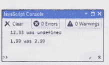

图 3.2 合并通知

如果属性的更改之间存在时间延迟，则更改将产生不同的通知。

如果你需要防止多个通知合并为一个——且你又不想创建人为的时间延迟——那么你可以利用承诺（promises）。由于 `updateProperty()` 方法返回一个承诺，你可以使用以下代码为属性的每次更改创建不同的通知：

```javascript
// 修改价格
observableProduct.updateProperty("price", 3.99)
.then(function () {
  observableProduct.updateProperty("price", 2.99)
  .then(function () {
    observableProduct.updateProperty("price", 1.99);
  });
});
```

在这种情况下，尽管价格立即从 3.99 更改到 2.99 再到 1.99，但为 `price` 属性的每个新值都会发送单独的通知（见图 3.3）。

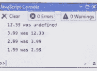

图 3.3 在可观察对象中使用承诺

## 绕过通知

通常情况下，如果可观察对象的属性有监听器且你更改了该属性，则监听器会收到通知。但在某些情况下，你可能希望绕过通知。换句话说，你可能需要静默地更改属性值，而不触发任何注册用于通知的函数。

如果你想更改属性而不触发通知，你应该通过使用 `backingData` 属性来更改属性。列表 3.3 中的代码说明了如何静默更改 `price` 属性。

### 列表 3.3 绕过通知（`observablesBypass\observablesBypass.html`）

```javascript
// 简单产品对象
var product = {
  name: "Milk",
  description: "Something to drink",
  price: 12.33
};

// 创建可观察产品
var observableProduct = WinJS.Binding.as(product);

// 当价格更改时执行函数
observableProduct.bind("price", function (newValue) {
  console.log(newValue);
});

// 静默更改价格
observableProduct.backingData.price = 5.99;

console.log(observableProduct.price); // 输出 5.99
```

通过更改 `backingData.price` 的值，价格被改为 5.99。因为没有直接设置 `observableProduct.price` 属性，所以与 `price` 属性关联的监听器不会收到通知。

当你使用 `backingData` 属性更改属性值时，更改是同步发生的。然而，当你直接更改可观察属性的值时，更改总是异步进行的。

## 使用 `WinJS.Binding.List` 对象

如果你希望在项目数组发生更改时都能收到通知——换句话说，你想操作一个可观察集合——那么你应该使用 `WinJS.Binding.List` 对象。

`WinJS.Binding.List` 对象将标准的 JavaScript 数组封装在一个新对象中，并添加了额外的的方法和事件以支持更改通知。`WinJS.Binding.List` 支持以下事件：

- `iteminserted`—当列表添加新项时触发。
- `itemchanged`—当列表中的某项通过 `setAt()` 方法替换时触发。
- `itemmoved`—当列表中的某项通过 `move()` 方法移动时触发。
- `itemmutated`—通过调用 `notifyMutated()` 方法触发。
- `itemremoved`—通过从列表中删除某项时触发。
- `reload`—通过调用 `sort()` 或 `reverse()` 重新排列列表项时触发。也可以通过调用 `notifyReload()` 方法触发。

列表 3.4 中的代码演示了如何触发这些事件中的每一个，以及传递给每个事件处理程序的信息。

### 列表 3.4 使用 `WinJS.Binding.List`（`observablesList\observablesList.html`）

```javascript
var products = [
  { name: "Milk", price: 2.99 },
  { name: "Oranges", price: 2.50 },
  { name: "Apples", price: 1.99 }
];
```

```javascript
// 创建 List
var productsList = new WinJS.Binding.List(products);
```

```javascript
// (此处代码省略)

// 当价格更改时执行函数
observableProduct.bind("price", function (newValue, oldValue) {
  console.log(newValue + " was " + oldValue);
});
```

```javascript
// 修改价格
observableProduct.price = 3.99;
observableProduct.price = 2.99;
observableProduct.price = 1.99;
```

```javascript
// 创建 List
var productsList = new WinJS.Binding.List(products);
```

```javascript
// 设置事件处理器
productsList.oniteminserted = function (evt) {
  var message = "Item Inserted: " + evt.detail.value.name + " at index " + evt.detail.index;
  console.log(message);
};

productsList.onitemchanged = function (evt) {
  var message = "Item Changed: " + evt.detail.oldValue.name + " to " + evt.detail.newValue.name + " at index " + evt.detail.oldIndex + " to " + evt.detail.newIndex;
  console.log(message);
};

productsList.onitemmutated = function (evt) {
  var message = "Item Mutated: " + evt.detail.value.name + " at index " + evt.detail.index;
  console.log(message);
};

productsList.onitemremoved = function (evt) {
  var message = "Item Removed: " + evt.detail.value.name + " at index " + evt.detail.index;
  console.log(message);
};

productsList.onitemmoved = function (evt) {
  var message = "Item Moved: " + evt.detail.value.name + " from index " + evt.detail.oldIndex + " to " + evt.detail.newIndex;
  console.log(message);
};

productsList.onreload = function (evt) {
  var message = "List Reloaded";
  console.log(message);
};

// 插入项
productsList.push({ name: "Carrots", price: 2.33 }); // 触发 iteminserted

// 替换项
productsList.setAt(1, { name: "Navel Oranges", price: 2.50 }); // 触发 changed

// 更新项属性
productsList.get(1).price = 500.00;
productsList.notifyMutated(1); // 触发 mutated

// 删除项
productsList.splice(0, 1); // 触发 removed

// 将第二项移动到顶部
productsList.move(1, 0); // 触发 moved

// 排序列表
productsList.sort(); // 触发 reload
```

> 注：此处根据原文逻辑补全列表 3.4 内部代码结构。
>
> 译注：由于原文中列表 3.4 的代码块存在部分重复和断裂，此处译文已根据逻辑进行了整理，以确保所有事件处理器和对应的操作完整呈现。

## 第 90 页：第 3 章 可观察对象、绑定与模板

## 创建可观察对象的集合

默认情况下，当你从 JavaScript 数组创建 `WinJS.Binding.List` 时，列表是可观察的，但列表中的项不是。`WinJS.Binding.List` 仅包含数组中的项，而项是普通的 JavaScript 对象。

如果你希望将 JavaScript 数组中的每个项转换为可观察项，你需要在创建 `WinJS.Binding.List` 时使用绑定选项，如下：

## 理解声明式数据绑定

```javascript
// 创建列表
var productsList = new WinJS.Binding(products, { binding: true });

// 监听价格的变化
productsList.getAt(1).bind("price", function () {
  console.log("price changed");
});
```

上述代码中的 `productsList` 包含一个可观测对象列表。由于列表中的每个对象都是可观测的，你可以挂载一个监听函数，当属性发生变化时，该函数就会被触发。在前面的代码中，每当 `price` 属性被修改时，都会向 Visual Studio JavaScript 控制台写入消息。

## 理解声明式数据绑定

声明式数据绑定允许你将 HTML 元素的属性绑定到 JavaScript 对象的属性。当你想要在 HTML 页面中显示数据时，可以使用声明式数据绑定。

让我先从一个简单的示例开始。列表 3.5 中的页面显示了产品详情（图 3.5）。

### 列表 3.5 简单的声明式数据绑定（`dataBinding\dataBinding.html`）

```html
<!DOCTYPE html>
<html>
<head>
  <meta charset="utf-8" />
  <title>Chapter03</title>

  <!-- WinJS references -->
  <link href="Microsoft.WinJS.2.0/css/ui-dark.css" rel="stylesheet" />
  <script src="Microsoft.WinJS.2.0/js/base.js"></script>
  <script src="Microsoft.WinJS.2.0/js/ui.js"></script>

  <!-- Chapter03 references -->
  <link href="css/default.css" rel="stylesheet" />
  <script src="dataBinding/dataBinding.js"></script>
</head>
<body>
  <h1>Product Details</h1>
```

```html
<div>
  Product Name:
  <span data-win-bind="innerText:name"></span>
</div>

<div>
  Product Price:
  <span data-win-bind="innerText:price"></span>
</div>

<div>
  Product Picture:
  <br />
  
</div>
</body>
</html>
```


产品名称和价格通过 HTML `<span>` 元素显示。注意每个 `<span>` 元素都包含一个 `data-win-bind` 属性。例如，产品名称通过以下 `<span>` 元素显示：

```html
<span data-win-bind="innerText:name"></span>
```

该 `data-win-bind` 属性将 `name` 属性的值绑定到 `<span>` 元素的内部。

你可以使用 `data-win-bind` 属性将 HTML 元素的（几乎）任何属性绑定到 JavaScript 属性的值。例如，通过绑定值到 `IMG` 元素的 `src` 和 `alt` 属性来显示特斯拉的图片：

```html

```

注意，`data-win-bind` 属性接受用分号分隔的 HTML 元素名称和 JavaScript 对象属性列表。

> **注意**  
> 一个不能与声明式绑定使用的属性是 `ID` 属性。默认情况下，WinJS 库会自动为每个元素生成唯一的 ID。你可以通过将 `optimizeBindingReferences` 属性设置为 `false` 来禁用此行为。

## 产品详情

- 产品名称：Tesla Roadster
- 产品价格：34
- 产品图片：


图 3.5 使用声明式数据绑定显示产品详情

列表 3.6 中的代码包含了列表 3.5 中 HTML 页面所显示的产品。

**列表 3.6 简单的声明式数据绑定** (`databinding\binding.js`)

```javascript
function () {
  "use strict";

  function initialize() {
    var product = {
      name: "Tesla Roadster",
      price: 34,
      photo: "tesla.jpg"
    };

    WinJS.binding.processAll(null, product);
  }

  document.addEventListener("DOMContentLoaded", initialize);
}();
```

# 第 3 章 可观测对象、绑定与模板

列表 3.6 中的 `product` 对象并没有特别之处——它只是一个普通的 JavaScript 对象。

注意列表 3.6 中对 `WinJS.Binding.processAll()` 的调用。页面中的声明式数据绑定属性在调用此方法之前不会被处理。当你调用 `WinJS.Binding.processAll()` 方法时，必须指定两个参数：根元素和数据上下文。

根元素决定了页面中哪些元素会被处理。如果你传递值 `null`，则整个文档都将被解析。

数据上下文包含了你想要绑定到 HTML 属性的数据。在列表 3.6 中，`product` 对象作为数据上下文传递给 `WinJS.Binding.processAll()` 方法。

# 警告

> 在包含 HTML 元素的文档加载之前，不要调用 `WinJS.Binding.processAll()`。否则，将没有内容可处理。在列表 3.6 中，`WinJS.Binding.processAll()` 方法是在由 `DOMContentLoaded` 事件触发的函数内部调用的。

## 声明式数据绑定与可观测对象

声明式数据绑定和可观测对象是一个强大的组合。如果你在数据绑定中使用可观测对象，那么每当你更改底层 JavaScript 对象时，就可以自动更新 HTML 文档的内容。

例如，列表 3.7 中的 HTML 页面包含一个 `SPAN` 和一个 `BUTTON` 元素。页面显示了按钮被点击的次数（见图 3.6）。

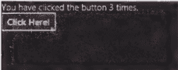

图 3.6 显示点击计数

**列表 3.7 使用可观测对象的数据绑定** (`dataBinding\dataBinding.html`)

```html
<!DOCTYPE html>
<html>
<head>
  <meta charset="utf-8" />
  <title>Chapter03</title>
</head>
<!-- WinJS references -->
  <link href="Microsoft.WinJS.2.0/css/ui-dark.css" rel="stylesheet" />
  <script src="Microsoft.WinJS.2.0/js/base.js"></script>
  <script src="Microsoft.WinJS.2.0/js/ui.js"></script>
<!-- Chapter03 references -->
  <link href="css/default.css" rel="stylesheet" />
  <script src="dataBinding/dataBinding.js"></script>
</head>
<body>
<div>
  You clicked the 
  <span data-win-bind="innerText:timesCount"></span> times.
  <br />
  <button data-win-bind="onclick:click">Click Here!</button>
</div>
</body>
</html>
```

# 理解声明式数据绑定

注意列表 3.7 中的页面包含了两个 `data-win-bind` 属性。第一个 `data-win-bind` 属性用于 `<span>` 元素显示计数，第二个 `data-win-bind` 属性用于按钮处理点击事件。

列表 3.8 中的 JavaScript 代码包含一个名为 `viewModel` 的可观测对象，它用于跟踪计数。

**列表 3.8 使用可观测对象的数据绑定** (`databinding.js`)

```javascript
function () {
  "use strict";

  function initialize() {
    // 创建视图模型
    var viewModel = {
      timesCount: 0,
      click: WinJS.UI.EventHandler(function (evt) {
        evt.preventDefault();
        viewModel.timesCount++;
      })
    };

    // 使视图模型变为可观测的
    viewModel = WinJS.Binding.as(viewModel);

    // 将视图模型绑定到文档
    WinJS.Binding.processAll(null, viewModel);
  }

  document.addEventListener("DOMContentLoaded", initialize);
}();
```

列表 3.8 中的 `viewModel` 对象有一个名为 `timesCount` 的属性，用于跟踪按钮被点击的次数。`viewModel` 对象还有一个名为 `click()` 的方法，用于更新 `timesCount`。

> **注意**  
> 注意点击处理程序被封装在 `WinJS.UI.EventHandler()` 调用中。出于安全考虑，WinJS 库要求任何可以从声明式上下文（如 `data-win-bind`）调用的事件处理程序都要调用此方法。如果你忽略调用此方法，点击按钮时将没有任何反应。

WinJS 库不支持双向数据绑定。更改通知是单向的。如果你想获取 HTML 表单的内容，你需要手动获取表单元素的值。

页面包含一个创建一个新产品的 HTML 表单。它有两个用于产品名称和价格的 `INPUT` 字段（见图 3.7）。表单使用单个 `data-win-bind` 属性。`FORM` 元素有一个 `data-win-bind` 属性，用于连接表单提交处理程序。

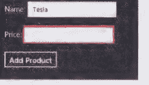

图 3.7 创建新产品

**列表 3.9 双向数据绑定** (`dataBindingTwoWay\dataBindingTwoWay.html`)

```html
<!DOCTYPE html>
<html>
<head>
  <meta charset="utf-8" />
  <title>Chapter03</title>
  <!-- WinJS references -->
  <link href="//Microsoft.WinJS.2.0/css/ui-dark.css" rel="stylesheet" />
  <script src="//Microsoft.WinJS.2.0/js/base.js"></script>
  <script src="//Microsoft.WinJS.2.0/js/ui.js"></script>
  <!-- Chapter03 references -->
  <link href="//default.css" rel="stylesheet" />
  <script src="dataBindingTwoWay.js"></script>
</head>
<body>
  <form data-win-bind onsubmit="submit">
    <div class="field">
      <label>名称:</label>
      <input id="productName" required />
    </div>
    <div class="field">
      <label>价格:</label>
      <input id="productPrice" required />
    </div>
    <div class="field">
      <button>添加产品</button>
    </div>
  </form>
</body>
</html>
```

当您提交 HTML 表单时，会调用列表 3.10 中的 `viewData.submit()` 方法。该方法会获取 HTML 表单字段，并创建一个命名为 `productToAdd` 的新产品对象。

**列表 3.10 双向数据绑定** (`dataBindingTwoWay\dataBindingTwoWay.js`)

```javascript
(function () {
  "use strict";

  function initialize() {
    var viewModel = {
      submit: WinJS.UI.EventHandler(function (evt) {
        // 防止页面刷新提交
        evt.preventDefault();
      }),
      // 获取表单字段值
      var productToAdd = {
        name: document.getElementById("productName").value,
        price: document.getElementById("productPrice").value
      };

      // TODO: 将新产品添加到数据库
      console.log("adding " + productToAdd.name + " to database.");
    };

    WinJS.Binding.processAll(null, viewModel);
  }

  document.addEventListener("DOMContentLoaded", initialize);
})();
```

列表 3.9 中的页面使用 `data-win-bind` 属性来连接表单提交处理器。你可能会想，如果不使用数据绑定而直接像这样连接事件处理器是否会更简单：

```html
<form onsubmit="submit">
```

为什么要使用声明式数据绑定呢？使用声明式数据绑定连接事件处理器的优势在于，你不需要通过命名空间暴露处理器。当使用声明式数据绑定时，处理器不需要是公共方法——唯一的要求是它必须是 `WinJS.processAll()` 方法使用的数据上下文的一部分。

> **注意**  
> 列表 3.9 中的 HTML 表单使用了 HTML5 的 `required` 属性，以确保在名称和价格 `INPUT` 元素中输入值。

# 声明式数据绑定与 WinJS 控件

我们将在下一章详细讨论 WinJS 控件；然而，我想确保你理解，可以像对元素属性使用声明式数据绑定一样，对 WinJS 控件属性使用声明式数据绑定。

技巧是使用 `winControl` 属性，每个关联控件的 HTML 元素都暴露了该属性。你可以结合 `data-win-bind` 属性使用 `winControl` 属性。

例如，列表 3.11 中的页面包含一个 WinJS Rating 控件（见图 3.8）。


图 3.8 使用声明式数据绑定显示平均评分

**列表 3.11 在 WinJS 控件上使用声明式数据绑定** (`dataBindingControls\dataBindingControls.html`)

```html
<!DOCTYPE html>
<html>
<head>
  <meta charset="utf-8" />
  <title>Chapter03</title>
  <!-- WinJS references -->
  <link href="//Microsoft.WinJS.2.0/ui-dark.css" rel="stylesheet" />
  <script src="//Microsoft.WinJS.2.0/js/base.js"></script>
  <script src="//Microsoft.WinJS.2.0/js/ui.js"></script>
  <!-- Chapter03 references -->
  <link href="//css/default.css" rel="stylesheet" />
  <script src="dataBindingControls.js"></script>
</head>
<body>
  <div data-win-control="WinJS.UI.Rating" data-win-bind="winControl.averageRating:averageRating">
  </div>
  <div>
    该产品的平均评分为：
    <span data-win-bind="innerText">averageRating</span>
  </div>
</body>
</html>
```

# 第 3 章 观察者、绑定与模板

列表 3.11 包含一个 WinJS Rating 控件。WinJS Rating 控件的 `averageRating` 属性通过以下 `data-win-bind` 属性进行设置：

```html
data-win-bind="winControl.averageRating:averageRating"
```

`winControl` 属性允许你从 HTML 元素获取关联的控件。列表 3.12 中的 JavaScript 文件演示了如何将平均评分绑定到控件。

**列表 3.12 在 WinJS 控件上使用声明式数据绑定** (`dataBindingControls.js`)

```javascript
(function () {
  "use strict";

  function initialize() {
    // 创建视图模型
    var viewModel = {
      averageRating: 4
    };

    // 将视图模型绑定到文档
    WinJS.Binding.processAll(null, viewModel);
  }

  document.addEventListener("DOMContentLoaded", initialize);
})();
```

**列表 3.14 绑定转换器** (`dataBindingConverters\myBindingConverters.js`)

```javascript
(function () {
  "use strict";

  var onSaleToDisplay = WinJS.Binding.converter(function (onSale) {
    return onSale ? "block" : "none";
  });

  WinJS.Namespace.define("MyBindingConverters",
  {
    onSaleToDisplay: onSaleToDisplay
  });
})();
```


你通过向`WinJS.Binding.converter`方法传递一个函数来创建一个绑定转换器。该函数将传递给的值转换为其他值。在列表 3.14 中，该函数将产品的`onSale`属性（一个布尔属性）转换为`"block"`或`"none"`（可以用于`style` `display`属性的值）。

两个产品在列表 3.15 中创建。列表 3.15 包含一个具有`product1`和`product2`属性的`viewModel`对象。

## 列表 3.15 使用绑定转换器 (dataBindingConverters/dataBindingConverters.js)

```javascript
(function () {

  "use strict";

function initialize() {

  var viewModel = {

    product1: {

      name: "Tesla",

      price: 300000.0,

      onSale: false

    },

    product2: {

      name: "BMW",

      price: 80000.0,

      onSale: true

    }

  };
```

## 第 3 章 可观察对象、绑定与模板

```javascript
WinJS.Binding.processAll(null, viewModel);

}

document.addEventListener("DOMContentLoaded", initialize);

})();
```

## 创建日期和价格转换器

在提到如何创建其他两种转换器：日期和价格转换器之前，我不能让你们阅读这一节。我发现我在构建的大多数 Windows Store 应用中都需要使用日期和价格转换器来格式化日期和价格。列表 3.16 中的 JavaScript 文件包含了这两个转换器。

## 列表 3.16 日期和价格转换器

```javascript
(function () {

  "use strict";

  // 将 77.8900 转换为 $77.89

  var price = WinJS.Binding.converter(function (priceToConvert) {

    return "$" + priceToConvert.toFixed(2);

  });

  // 将完整日期转换为 12/25/2013

  var shortDate = WinJS.Binding.converter(function (dateToConvert) {

    return dateToConvert.getMonth() + 1 +

      "/" + dateToConvert.getDate() +

      "/" + dateToConvert.getFullYear();

  });

  WinJS.Namespace.define("MyBindingConverters", {

  price: price,

  shortDate: shortDate

});

})();
```

在 HTML 页面中添加转换器的引用后，你就可以如列表 3.17 所示在绑定表达式中使用日期和价格转换器了。

## 列表 3.17 使用日期和价格转换器

```html
<div>

  <h1 data-win-bind="innerText:product1.name"></h1>

  <div>

    Price:

    <span data-win-bind="innerText:product1.price MyBindingConverters.price"></span>

  </div>

  <div>

    Date Available:

    <span data-win-bind="innerText:product1.dateAvailable MyBindingConverters.shortDate"></span>

  </div>

</div>
```

价格转换器使产品显示为`$100.00`而不是`99.999999`。`shortDate`转换器使产品的`dateAvailable`属性显示为`12/25/2012`而不是`Tue Dec 25 00:00:00 PST 2012`。

> 注意
> 遗憾的是，在使用绑定转换器时无法传递额外的参数。如果可以传递一个额外的参数（例如表示日期格式的参数）就太好了。然而，你无法这样做。相反，你必须创建单独`dateShort`和`dateLong`绑定转换器。

## 理解模板

如果你需要在页面中多次显示同一个 HTML 片段，那么你应该创建一个模板。模板是一个包含声明式数据绑定表达式的 HTML 片段。创建模板有两种方法：命令式和声明式。

## 创建命令式模板

假设你想在 HTML 页面中显示产品数组（见图 3.10）。在这种情况下，你可以使用模板格式化数组中的每个产品。

## 图 3.10 使用模板显示产品列表

| 名字 | 价格 |
| :--- | :--- |
| Tesla | 300000 |
| BMW | 80000 |
| Prius | 10000 |

列表 3.18 中的 HTML 页面包含一个名为`tmplProduct`的 DIV 元素。该 DIV 元素在页面渲染时不会显示。相反，它包含了模板的内容。页面还包含第二个 DIV 元素`conProducts`。该 DIV 元素充当模板的目标。当每个产品被渲染时，它将会被渲染到`conProducts` DIV 元素中。

## 列表 3.18 创建命令式模板 (templatesImperative\templatesImperative.html)

```html
<head>

  <meta charset="utf-8" />

  <title>Chapter03</title>

  <!-- WinJS 引用 -->

  <link href="MicrosoftJS.2.0/css/ui-dark.css" rel="stylesheet" />

  <script src="MicrosoftJS.2.0/js/base.js"></script>

  <script src="MicrosoftJS.2.0/js/ui.js"></script>

  <!-- 第 3 章引用 -->

  <link href="templatesImperative.css" rel="stylesheet" />

  <script src="templatesImperative.js"></script>

</head>

<body>

  <!-- 模板 -->

  <div id="tmplProduct">

    <div class="product">

      Name: <span data-win-bind="innerText:name"></span>

      <br />

      Price: <span data-win-bind="innerText:price"></span>

    </div>

  </div>

  <!-- 模板渲染位置 -->

  <div id="conProducts"></div>

</body>
```

列表 3.19 中的 JavaScript 代码说明了如何创建一个新模板并为数组中的每个项渲染模板。

## 列表 3.19 创建命令式模板 (templatesImperative\templatesImperative.js)

```javascript
(function () {

  "use strict";

function initialize() {

    var products = [

      { name: "Tesla", price: 300000 },

      { name: "BMW", price: 80000 },

      { name: "Pinto", price: 10000 }

    ];

    // 获取模板和模板容器

    var tmplProduct = document.getElementById("tmplProduct");

    var conProducts = document.getElementById("conProducts");

    // 创建模板

    var template = WinJS.Binding.Template(tmplProduct);

    // 使用模板渲染每个数组项

    products.forEach(function (product) {

      template.render(product, conProducts);

    });

  }

  document.addEventListener("DOMContentLoaded", initialize);

})();
```

通过创建`WinJS.Template`的新实例创建模板。接下来，在`forEach()`方法中为数组中的每个项渲染模板：

```javascript
products.forEach(function (product) {

  template.render(product, conProducts);

});
```

当模板渲染时，每个数据项只会渲染模板的内容。代码中名为`tmplProduct`的包含 DIV 元素不会渲染。

## 创建声明式模板

如果你愿意，可以使用声明式而不是命令式创建模板。列表 3.20 中的页面包含一个与名为`tmplProduct`的 DIV 元素关联的`WinJS Template`控件。

## 列表 3.20 声明式创建模板 (templatesDeclare\templatesDeclare.html)

```html
<head>

  <meta charset="utf-8" />

  <title>Chapter03</title>

  <!-- WinJS 引用 -->

  <link href="MicrosoftJS.2.0/css/ui-dark.css" rel="stylesheet" />

  <script src="MicrosoftJS.2.0/js/base.js"></script>

  <script src="MicrosoftJS.2.0/js/ui.js"></script>

  <!-- 第 3 章引用 -->

  <link href="templatesDeclare.css" rel="stylesheet" />

  <script src="templatesDeclare.js"></script>

</head>

<body>

  <!-- 模板 -->

  <div id="tmplProduct" data-win-control="WinJS.Binding.Template">

    <div class="product">

      Name: <span data-win-bind="innerText:name"></span>

      <br />

      Price: <span data-win-bind="innerText:price"></span>

    </div>

  </div>

  <!-- 模板渲染位置 -->

  <div id="conProducts"></div>

</body>

</html>
```

在列表 3.20 中，`Template`控件通过`data-win-control="WinJS.Binding.Template"`属性声明。列表 3.21 包含了用于模板渲染产品数组的 JavaScript 代码。

## 列表 3.21 声明式创建模板 (templatesDeclare\templatesDeclare.js)

```javascript
(function () {

  "use strict";

  function initialize() {

    var products = [

      { name: "Tesla", price: 300000 },

      { name: "BMW", price: 80000 },

      { name: "Pinto", price: 10000 }

    ];

    // 获取模板和模板容器

    var tmplProduct = document.getElementById("tmplProduct");

    var conProducts = document.getElementById("conProducts");

    // 使用模板渲染每个数组项

    WinJS.UI.processAll().done(function () {

      products.forEach(function (product) {

        tmplProduct.winControl.render(product, conProducts);

      });

    });

  }

  document.addEventListener("DOMContentLoaded", initialize);

})();
```

使用声明式`Template`控件时，必须调用`WinJS.UI.processAll()`方法。否则，DIV 元素将转换为模板。

## 使用查询选择器应用模板

查询集合包含一个`template()`方法，你可以使用它快速地将模板应用到单个 DOM 元素或一组 DOM 元素。例如，列表 3.22 中的页面显示了产品列表。

# 110 第 3 章 可观察对象、绑定与模板

列表 3.22 在模板中使用`WinJS.Utilities.id()` (templatesQuery\templatesQuery.html)。

```html
<!DOCTYPE html>

<html>

<head>

  <meta charset="utf-8" />

  <title>Chapter03</title>

  <!-- WinJS 引用 -->

  <link href="//Microsoft.WinJS.2.0/css/ui-dark.css" rel="stylesheet" />

  <script src="//Microsoft.WinJS.2.0/js/base.js"></script>

  <script src="//Microsoft.WinJS.2.0/js/ui.js"></script>

  <!-- 第03 章引用 -->

  <link href="templatesQuery.css" rel="stylesheet" />

  <script src="templatesQuery.js"></script>

</head>

<body>

  <!-- 模板 -->

  <div id="tmplProduct" data-control="WinJS.Binding.Template">

    <div class="product">

      Name: <span data-bind="innerText:name"></span>

      <br />

      Price: <span data-bind="innerText:price"></span>

    </div>

  </div>

  <!-- 模板渲染位置 -->

  <div id="conProducts"></div>

</body>

</html>
```

列表 3.22 中的页面包含一个名为`tmplProduct`的声明式模板。页面还包含一个名为`conProducts`的 DIV 元素，它是页面中渲染模板的地方。

列表 3.23 中的 JavaScript 代码演示了你如何使用`WinJS.Utilities.id()`方法将模板应用到`conProducts` DIV 元素。

列表 3.23 在模板中使用`WinJS.Utilities.id()` (templatesQuery\templatesQuery)。

```javascript
(function () {

  "use strict";

  function initialize() {

    var products = [

      { name: "Tesla", price: 300000 },

      { name: "BMW", price: 80000 },

      { name: "Pinto", price: 10000 }

    ];

    WinJS.UI.processAll().done(function () {

      var tmplProduct = document.getElementById("tmplProduct");

      WinJS.Utilities.id("conProducts").template(tmplProduct, products);

    });

    document.addEventListener("DOMContentLoaded", initialize);

  }

})();
```


注意，当使用集合模板`template()`方法时，不需要调用`for()`。该方法在内部执行了`for()`。

# 创建外部模板

如果你想在多个页面中使用同一个模板，那么创建一个外部模板将是有意义的。换句话说，你可以将模板放置在包含模板的页面的单独文件中。

以下是如何声明一个模板控制以引用外部模板。注意，以下模板包含一个指向`productTemplate.html`文件的`href`选项。

```html
<!-- 模板 -->
<div id="tmplProduct"
  data-win="WinJS.Binding.Template"
  data-win-options="{
    href: 'productTemplate.html'
  }">
</div>
```

`productTemplate.html`包含了产品模板，它的内容如下：

```html
<div class="product">
  Name: <span data-win-bind="innerText:name"></span>
  <br />
  Price: <span data-win-bind="innerText:price"></span>
</div>
```

最后，列表 3.24 包含了渲染外部模板的 JavaScript 代码。

## 列表 3.24 渲染外部模板

```javascript
(function () {
  "use strict";

  function initialize() {
    var products = [
      { name: "Tesla", price: 300000 },
      { name: "BMW", price: 80000 },
      { name: "Pinto", price: 10000 }
    ];

    // 获取模板和模板容器
    var tmplProduct = document.getElementById("tmplProduct");
    var conProducts = document.getElementById("conProducts");

    // 使用模板渲染数组每一项
    WinJS.UI.processAll().done(function () {
      products.forEach(function (product) {
        tmplProduct.winControl.render(product, conProducts);
      });
    });
  }

  document.addEventListener("DOMContentLoaded", initialize);
})();
```

你可以从位于不同页面的多个模板控制中引用同一个`productTemplate.html`。

## 总结

本章主要关于如何在页面中显示 JavaScript 对象。在第一节中，你学习了可观察对象（observables）。特别是，你学习了可观察对象如何让你能够自动检测 JavaScript 对象属性的变化。我们还讨论了如何使用`WinJS.Binding.List`来检测项目数组中不同类型的变化。

接下来，你学习了如何利用针对普通 JavaScript 对象和可观察 JavaScript 对象的声明式数据绑定，在页面中显示 JavaScript 属性的值。

最后，我讨论了如何使用 WinJS 模板来格式化并显示对象数组。你学习了如何通过命令式和声明式创建模板。

# 第 4 章

## 使用 WinJS 控件

本章的目标是为你提供 WinJS 库中包含的控件的概述。我首先介绍了如何向你的页面添加控件。你学习了如何通过声明式和命令式创建 WinJS 控件并设置控件选项。

本章的大部分用于介绍如何使用 WinJS 库中包含的基础控件的描述和示例。在本章中，我重点描述了如何使用以下控件：

- Tooltip（提示框）——用于显示弹出提示框
- ToggleSwitch（切换开关）——用于显示切换开关，可与复选框用于相同的场景
- Rating（评分）——用于显示和输入用户评分
- DatePicker（日期选择器）——用于输入日期
- TimePicker（时间选择器）——用于输入时间
- Hub（枢纽）——用于显示多个部分的内容
- WebView——用于在你的应用程序中显示外部网页

# WinJS 控件简介

你通过使用`data-win-control`属性在页面声明 WinJS 控件。例如，你可以通过向页面添加以下 DIV 元素来声明 WinJS DatePicker 控件：

```html
<div id="dateBirthday" data-win-control="WinJS.UI.DatePicker"></div>
```

# 第 4 章 使用 WinJS 控件

DIV 元素并没有执行任何操作。它只是控件的占位符。`data-win-control`属性指示与元素关联的控件类型。在调用`WinJS.process()`方法之前，WinJS 控件并没有真正成为控件。该方法解析 HTML 文档，识别任何包含`data-win-control`的元素，并为这些元素生成控件。

WinJS 控件还有另一个要求：你必须包含对 JavaScript 和级样式表（CSS）文件的引用。为了使用任何控件，你必须在页面顶部添加以下内容：

```html
<link href="//Microsoft.WinJS.2.0/css/ui-dark.css" rel="stylesheet" />
<script src="//Microsoft.WinJS.2.0/js/base.js"></script>
<script src="//Microsoft.WinJS.2.0/js/ui.js"></script>
```

第一个引用是对名为`ui-dark.css`的样式表文件的引用。WinJS 库包含两个表：`ui-dark.css`和`ui-light.css`。如果你用`ui-light.css`引用替换`ui-dark.css`，就可以为所有控件使用浅色主题。

图 4.1 展示了使用深色主题时 DatePicker 控件的外观，图 4.2 展示了使用浅色主题时 DatePicker 控件的外观。


# WinJS 控件简介

115

接下来两个引用是针对`base.js`和`ui.js` JavaScript 文件。你需要这两个 JavaScript 库的引用来使用 WinJS 控件。

WinJS 控件的所有 JavaScript 源代码都包含在`ui.js`文件中。例如，该文件包含了 DatePicker 和 hub 控件的。

你可以通过展开解决方案管理器窗口中的 References（引用）文件夹（见图 4.3）来查看这三个文件的源码。双击任何文件即可查看文件内容。

# 声明式地创建 WinJS 控件

你有两种方法创建 WinJS 控件：声明式和命令式。列表 4.1 中的 HTML 页面演示了如何通过声明式创建 WinJS 控件。

# 第 4 章 使用 WinJS 控件

列表 4.1 声明 WinJS 控件 (declarative\declarative.html)

```html
<!DOCTYPE html>
<html>
<head>
    <meta charset="utf-8" />
    <title>Chapter04</title>
    <!-- WinJS references -->
    <link href="//Microsoft.WinJS.2.0/css/ui-dark.css" rel="stylesheet" />
    <script src="//Microsoft.WinJS.2.0/js/base.js"></script>
    <script src="//Microsoft.WinJS.2.0/js/ui.js"></script>
    <!-- Chapter 04 references -->
    <link href="/cas/default.css" rel="stylesheet" />
    <script src="/declarative.js"></script>
</head>
<body>
    <div id="dateBirthday" data-win-control="WinJS.UI.DatePicker">
    </div>
</body>
</html>
```

在列表 4.1 中，在 HTML 页面正中声明了一个 DatePicker 控件。注意该页面包含了对`ui-dark.css`、`base.js`和`ui.js`引用：这是使用 WinJS 控件所需的所有文件引用。

页面还包含了对一个名为`declarative.js`文件的引用。该文件包含与页面相关的自定义 JavaScript 代码。`declarative.js`文件的内容包含在列表 4.2 中。

列表 4.2 声明 WinJS 控件 (declarative\declarative.js)

```javascript
function () {
    "use strict";

    function initialize() {
        WinJS.UI.processAll();
    }

    document.addEventListener("DOMContentLoaded", initialize);
}();
```

列表 4.2 包含了对`WinJS.UI.processAll()`方法的调用。如果你忘记调用此方法（这非常容易），在 HTML 页面中声明的控件将永远不会转换为控件。

注意，对`WinJS.UI.processAll()`的调用发生在`initialize()`方法内部，该方法在`DOMContentLoaded`事件触发之前不会调用。`DOMContentLoaded`事件在 HTML 文档加载后发生。你必须在调用`WinJS.UI.processAll()`之前等待文档加载，否则将没有内容可以处理。

# 以命令方式创建控件

在上一节中，我以声明的方式创建了 DatePicker 控件的实例。我在页面的 HTML 标记中声明了该控件。

作为声明式创建 WinJS 控件的替代方案，你也可以以命令方式创建控件。换句话说，你可以在 JavaScript 中完全控制控件。

考虑列表 4.3 中的页面。它包含一个 id 为`dateBirthday`的 DIV 元素。这个 DIV 元素没有`data-win-control`属性。

列表 4.3 以命令方式创建 WinJS 控件 (controlImperative\controlImperative.html)

```html
<!DOCTYPE html>
<html>
<head>
  <meta charset="utf-8" />
  <title>Chapter04</title>
  <!-- WinJS references -->
  <link href="css/ui-dark.css" rel="stylesheet" />
  <script src="Microsoft.WinJS.2.0/js/base.js"></script>
  <script src="Microsoft.WinJS.2.0/js/ui.js"></script>
  <!-- Chapter04 references -->
  <link href="css/default.css" rel="stylesheet" />
  <script src="controlImperative.js"></script>
</head>
<body>
  <div id="dateBirthday"></div>
</body>
</html>
```

列表 4.4 中的代码创建了一个 DatePicker 控件，并将新控件与`dateBirthday` DIV 元素相关联。

# 第 4 章 使用 WinJS 控件

列表 4.4 以命令方式创建 WinJS 控件 (controlImperative\controlImperative.js)

```javascript
(function () {
  "use strict";

  function initialize() {
    var dateBirthday = document.getElementById("dateBirthday");
    var ctrlBirthday = new WinJS.UI.DatePicker(dateBirthday);
  }

  document.addEventListener("DOMContentLoaded", initialize);
})();
```

列表 4.4 中的代码创建了 JavaScript`WinJS.UI.DatePicker()`类的新实例。`DatePicker`类是通过将`dateBirthday` DIV 元素传递给`DatePicker`类的构造函数创建的。注意，你不需要调用`WinJS.UI.processAll()`，因为在以命令方式创建 WinJS 控件时，不需要解析文档。

4.4 中的代码阐明了 WinJS 控件实际上只是 JavaScript 类。你可以通过`data-win-control`属性以声明方式创建此类，也可以通过在代码中实例化类以命令方式创建。但无论如何，它都是一个 JavaScript 类。

在本书中，我采用声明方式而不是命令方式来创建控件。这两种方法都没有错误。但是由于微软的示例倾向于声明方式，我将遵循微软的也使用声明方式。

## 设置控件选项

大多数控件支持选项。例如，在创建 TimePicker 控件时，你希望设置默认时间或时钟格式（24小时制或12小时制）。

你可以利用`data-win-options`属性以声明方式指定选项。例如，下面的 HTML 片段演示了如何将 TimePicker 控件显示的当前时间设置为下午 3:04，并将时钟格式设置为24 小时制：

```html
<div id="timeLunch"
  data-win-control="WinJS.UI.TimePicker"
```

传递给控件的选项对象是一个 JavaScript 对象——因此属性名和值周围使用了大括号。

# WinJS 控件简介

如果你愿意，可以以命令方式设置这些选项。以下是在代码中创建 TimePicker 控件实例并设置其当前和时钟选项的方法：

```javascript
function () {
  "use strict";

  function initialize() {
    var divLunch = document.getElementById("timeLunch");
    var ctrlLunch = new WinJS.UI.TimePicker(timeLunch, {
      current: '3:04pm',
      clock: '24HourClock'
    });
  }

  document.addEventListener("DOMContentLoaded", initialize);
}();
```

选项作为第二个参数传递给 TimePicker 构造函数。当前时间和时钟选项已设置。

> 注意 你也可以利用`WinJS.UI.setOptions()`方法以命令方式设置选项。你可以在控件构建后调用`setOptions()`方法。

# 从 HTML 文档检索控件

当控件创建时，它总是与 DOM 元素关联。每个拥有控件的 DOM 元素都有一个表示控件的`winControl`属性。

例如，如果你这样声明控件：

```html
<div id="dateBirthday" data-win-control="WinJS.UI.DatePicker"></div>
```

那么你可以在 JavaScript 代码中这样检索控件：

```javascript
function () {
  "use strict";

  function initialize() {
    WinJS.UI.processAll().done(function () {
      var ctrlBirthday = document.getElementById("dateBirthday").winControl;
      ctrlBirthday.current = "12/25/1996";
    });
  }

  document.addEventListener("DOMContentLoaded", initialize);
}();
```

当你调用`getElementById()`时，检索的是 DOM 元素而不是控件。但是，在使用`getElementById()`检索 DOM 元素后，你可以使用`winControl`属性获取相关的 WinJS 控件。

`WinJS.UI.processAll()`方法返回一个 Promise。在尝试与控件交互之前，你应该等待文档中声明创建的所有控件解析并创建。

# 使用 Tooltip 控件

你可以使用 WinJS tooltip 控件在任何 HTML 元素上显示自定义的提示（见图 4.4）。当你悬停在元素上时，提示会出现几秒钟。当你的光标移开元素时，提示就会消失。

img/8ab4405a0676ad7bea0c93c2b4e03e30_135_0.png

图 4.4 使用 Tooltip 控件显示提示 (tooltip\tooltip.html)

你可以这样在页面中声明 Tooltip 控件：


```html
<button id="btnDelete"
    data-win-control="WinJS.UI.Tooltip"
    data-win-options='{
        innerHTML: 'Deletes the <b>record</b> from the database'
    }'>Delete</button>
```

> **警告**：忘记调用`WinJS.UI.processAll()`方法将导致任何其他 WinJS 控件一样不会出现。

注意你使用`innerHTML`选项来设置提示的文本，此文本可以包含如`B`和`IMG`标签之类的 HTML。

## 使用工具提示控件 (Tooltip Control)

如果你有很多 HTML 内容需要显示（见图 4.5），则可以将工具提示的 HTML 内容放置在一个独立的元素中，如下所示：

```html
<button id="btnDelete"
  data-win-control="WinJS.UI.Tooltip"
  data-win-options="{
    contentElement: select('#btnDeleteTooltip')
  }"></button>

<div style="display:none">
  <div id="btnDeleteTooltip">
    从数据库中删除该<b>记录</b>。你**真的，真的</i>想要这样做吗？该记录将永远消失，你可能会为此而泣。
  </div>
</div>
```

使用`contentElement`选项来指定一个包含工具提示 HTML 内容的独立元素。在代码中，工具提示的内容包含 ID 为`btnDeleteTooltip`的 DIV 元素中。

注意，`btnDeleteTooltip`被一个具有`style="display:none"`属性的 DIV 元素包裹。这个外部 DIV 元素用于防止`btnDeleteTooltip`的内容显示在页面上。你希望`contentElement`的内容仅在工具提示中出现。

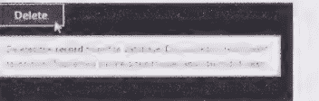

## 设置工具提示样式 (Styling a Tooltip)

由于 HTML 已经包含了工具提示属性，你可能会疑惑为什么微软引入了 WinJS `Tooltip`控件。这完全是为了自定义。使用 WinJS Tooltip 控件，你可以创建与你的 Windows Store 应用风格匹配的工具提示。

你可以通过修改`win-tooltip`级样式表类来自定义 Tooltip 控件的外观。例如，图 4.6 展示了当定义以下`win-tooltip`样式时，Tooltip 控件的外观：

```css
.win-tooltip {
  background-color: #ffd800;
  border: solid 2px red;
  border-radius: 15px;
}
```

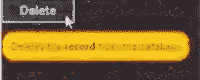

## 使用切换开关控件 (ToggleSwitch Control)

你可以在与标准 HTML 复选框`<input type="checkbox">`相同的情况下使用 WinJS ToggleSwitch 控件。ToggleSwitch 与复选框控件的区别在于 ToggleSwitch 更符合手指操作；你可以在 ToggleSwitch 上滑动手指来勾选或取消勾选（见图 4.7 和图 4.8）。

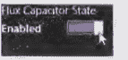

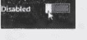

以下是如何在页面中声明 ToggleSwitch 控件的方法：

```html
<div
  data-win-control="WinJS.UI.ToggleSwitch"
  data-options="{
    title: '通流电容器状态',
    labelOff: '已禁用',
    labelOn: '已启用',
    checked: true
  }">
</div>
```

## 确定切换开关的状态 (Determining the State of a ToggleSwitch)

你可以通过读取 ToggleSwitch 控件的`checked`属性来检测 ToggleSwitch 控件处于勾选还是未勾选状态。例如，列表 4.5 中的页面包含一个 ToggleSwitch 控件和一个 DIV 元素，它根据 ToggleSwitch 控件的状态显示不同的消息（见图 4.9）。

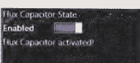

**列表 4.5 使用切换开关控件** (toggleSwitchChecked\toggleSwitchChecked.html)

```html
<div id="togFlux"
  data-win-control="WinJS.UI.ToggleSwitch"
  data-win-options="{
    title: '通流电容器状态',
    labelOff: '已禁用',
    labelOn: '已启用',
    checked: true
  }"></div>
```

```html
<div id="divMessage"></div>
```

列表 4.6 中的代码为 ToggleSwitch 控件接接了一个更改事件处理器。当你更改 ToggleSwitch 控件的状态时，就会调用更改事件处理器。该处理器在 DIV 元素中显示两条消息中的一种。

**列表 4.6 使用切换开关控件** (toggleSwitchChecked\toggleSwitchChecked.js)

```javascript
(function () {
  "use strict";

  function initialize() {
    WinJS.UI.processAll().done(function () {
      var togFlux = document.getElementById("togFlux").winControl;
      var divMessage = document.getElementById("divMessage");

      togFlux.addEventListener("change", function (evt) {
        if (togFlux.checked) {
          divMessage.innerHTML = "通流电容器已激活!";
        } else {
          divMessage.innerHTML = "通流电容器已去激活";
        }
      });
    });
  }

  document.addEventListener("DOMContentLoaded", initialize);
}());
```

记住在尝试获取 ToggleSwitch 控件并修改其属性（包括绑定事件处理器）之前调用`processAll()`。在对其进行任何操作之前，ToggleSwitch 控件必须已经存在。

# 第 4 章 使用 WinJS 控件

## 使用评分控件 (Rating Control)

你可以使用 WinJS Rating 控件来收集和显示用户评分。默认情况下，Rating 控件允许你在 1 到 5 星之间对某项进行评分（见图 4.10）。你可以通过从右向左滑动来更改评分。


以下是声明 Rating 控件的方法：

```html
<div id="ratingProduct"
  data-win-control="WinJS.UI.Rating"
  data-win-options="{
    averageRating: 3,
    enableClear: false
  }"></div>
```

注意`tooltipStrings`属性接受一个数组。数组中的每项对应一个星星星。你可以通过设置`maxRating`和`tooltipStrings`属性来控制评分的数量。例如，下面的 Rating 控件显示工具提示：差、好、棒！（见图 4.11）。

## 自定义评分 (Customizing Ratings)

`tooltipStrings`属性接受一个 JavaScript 数组。


## 提交评分 (Submitting a Rating)

Rating 控件触发三个事件：`preview`、`cancel`和`change`。当你悬停在星星上时，触发`preview`事件。当你没有选择星星时，触发`cancel`事件。最后，如果你点击星星，就会触发`change`事件。

**列表 4.7 处理评分控件** (ratingSubmit.html)

```html
<h1>评价我们的商店！</h1>

<div id="ratingStore"
  data-win-control="WinJS.UI.Rating"
  data-win-options="{
    averageRating: 3,
    enableClear: false,
    tooltipStrings: ['bad', 'okay', 'great!']
  }"></div>

<div id="divMessage"></div>
```

**列表 4.8 处理评分控件事件** (ratingSubmit\ratingSubmit.js)

```javascript
(function () {
  "use strict";

  function initialize() {
    WinJS.UI.processAll().done(function () {
      var ratingStore = document.getElementById("ratingStore").winControl;
      var divMessage = document.getElementById("divMessage");

      ratingStore.addEventListener("previewchange", function (evt) {
        var tentativeRating = evt.detail.tentativeRating;
        switch (tentativeRating) {
          case 1: divMessage.innerHTML = "别这样做！那太刻薄了!";
            break;
          case 2: divMessage.innerHTML = "好吧，你确定吗？我们会更加努力的!";
            break;
          case 3: divMessage.innerHTML = "谢谢!";
            break;
        }
      });

      ratingStore.addEventListener("cancel", function (evt) {
        divMessage.innerHTML = "*";
      });

      ratingStore.addEventListener("change", function (evt) {
        var userRating = ratingStore.userRating;
        switch (userRating) {
          case 1: divMessage.innerHTML = "你给了我们最低的评分.";
            break;
          case 2: divMessage.innerHTML = "你给了我们一个不错的评分.";
            break;
          case 3: divMessage.innerHTML = "你给了我们一个好评.";
            break;
        }
      });
    });
  }

  document.addEventListener("DOMContentLoaded", initialize);
}());
```

当你的鼠标悬停在评分星上时，`previewchange`事件处理器会显示不同的消息。（参见图 4.12）。当你点击星级时，会触发改变事件，改变处理器会显示一条消息。


## 使用 DatePicker 控件

WinJS DatePicker 控件——我希望你不会觉得这很惊讶——允许你选择日期。它显示三个列表：月、日和年（见图 4.13）。

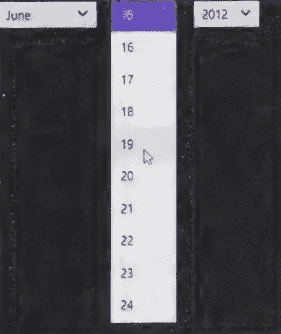

你可以像这样声明 DatePicker：

```html
<div id="dateBirthday">
  data-win-control="WinJS.UI.DatePicker"></div>
```

> **警告**：不要忘记调用`WinJS.UI.processAll()`，否则你的 DatePicker 将永远不会变成一个 DatePicker。

默认情况下，DatePicker 控件选择了今天的日期。你可以通过这样设置控件的`current`属性为 DatePicker 控件分配特定日期：

```html
<div id="dateBirthday">
  data-win-control="WinJS.UI.DatePicker"
  data-win-options={
    current: '12/25/1966'
  }></div>
```

这段代码会将`'12/25/1966'`设置为 DatePicker 控件中的默认日期。

## 格式化年、月、日

你可以为 DatePicker 的`yearPattern`、`monthPattern`和`datePattern`属性分配格式字符串，以控制年、月日的显示。格式字符串可以包含任何字符。在格式字符串内部，你可以使用一个或多个格式指定符。日期格式指定符是一个魔法字符串，使用特定格式显示日期的部分内容。

`yearPattern`属性接受以下日期格式指定符：

- `{year.full}`
- `{year.full(n)}`
- `{year.abbreviated}`
- `{year.abbreviated(n)}`
- `{era.abbreviated}`
- `{era.abbreviated(n)}`

`monthPattern`属性接受以下日期格式指定符：

- `{month.full}`
- `{month.abbreviated}`
- `{month.abbreviated(n)}`
- `{month.solo.full}`
- `{month.solo.abbreviated}`
- `{month.solo.abbreviated(n)}`
- `{month.integer}`
- `{month.integer(n)}`

最后`datePattern`属性接受以下日期格式指定符：

- `{day.integer}`
- `{day.integer(n)}`
- `{dayofweek.full}`
- `{dayofweek.abbreviated}`
- `{dayofweek.abbreviated(n)}`
- `{dayofweek.solo.full}`
- `{dayofweek.solo.abbreviated}`
- `{dayofweek.solo.abbreviated(n)}`

上面的`(n)`指一个数字。例如，如果你始终想用两位数字显示月份中的日期（可能包括前导零），你将使用日期格式指定符`{day.integer(2)}`。

以下是你可以如何显示月、日、年的整数：

```html
<div id="dateBirthday"
    data-win-control="WinJS.UI.DatePicker"
    data-options='{
        monthPattern: '{month.integer(2)}',
        datePattern: '{day.integer(2)}',
        yearPattern: '{year.abbreviated}'
    }'></div>
```


由于`datePattern`被设置为值`{day.integer(2)}`，因此个位数日期将显示前导零（见图 4.14）。

## 第 4 章 使用 WinJS 控件

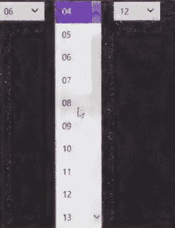

图 4.14 格式化月、日和年

你可以在单个格式字符串中组合多个格式指定符。例如，如果你不仅想显示月份中的日期，还想显示月份中的日期和星期，不仅想显示年份，还想显示年份和时代，那么你可以这样声明`DatePicker`：

```html
<div id="dateBirthday"
    data-win-control="WinJS.UI.DatePicker"
    data-win-options='{month.integer(2)}-{month.full}',
    datePattern='{day.integer(2)} {dayofweek.abbreviated}',
    yearPattern='{year.era.abbreviated}'
</div>
```

注意，`monthPattern`的格式字符串包含一个连字符（`-`）。你可以在格式字符串中放入任何需要的额外字符（见图 4.15）。


图 4.15 合并日期字符串

> **注意**
>
> 在底层，`DatePicker`利用了`WinRT.Globalization.DateTimeFormatter`来格式化日期。它使用了该类的模板字符串。

## 仅显示年、月或日

有时，你只想允许用户选择月份而不是选择年份或日期。例如，你正在创建一个私人飞机租赁服务，客户必须预订整个月份。

示例 4.9 展示了如何使用`DatePicker`控件隐藏年份和日期，仅启用月份选择。

### 示例 4.9 仅显示月份（datepickerMonthOnly.html）

```html
<!DOCTYPE html>

<html>

<head>

  <meta charset="utf-8" />

  <title>Chapter04</title>

  <!-- WinJS 引用 -->

  <link href="WinJS.2.0/css/ui-dark.css" rel="stylesheet" />

  <script src="WinJS.2.0/js/base.js"></script>

  <script src="WinJS.2.0/js/ui.js"></script>

  <!-- 第 4 章引用 -->

  <link href="css/default.css" rel="stylesheet" />

  <script src="datepickerMonthOnly.js"></script>

<style type="text/css">

  #birthday .win-datepicker-date {

    display:none;

  }

  #birthday .win-datepicker-year {

    display:none;

  }

</style>

</head>

<body>

<div id="dateBirthday"

  data-win-control="WinJS.UI.DatePicker"

  data-win-options='{month.solo.full}'>

</div>

</body>

</html>
```

示例 4.9 中的页面包含两个样式表规则，隐藏了`DatePicker`控件的日期和年份列表（见图 4.16）。


图 4.16 仅显示月份选择

## 获取选择的日期

当你更改月、日或年时，`DatePicker`控件触发相同的事件。你可以通过处理此事件获取当前选择的日期。例如，示例 4.10 中的 HTML 页面包含一个`DatePicker`控件和一个显示消息的 DIV 元素（见图 4.17）。


图 4.17 显示 DatePicker 当前日期

### 示例 4.10 获取选择的日期（datePicker/dateChange.html）

```html
<label>Birthday:</label>

<div id="dateBirthday"
    data-win-control="WinJS.UI.DatePicker">
```

```html
<div id="divMessage"></div>
```

示例 11 中的 JavaScript 文件说明了如何处理改变事件以获取选择的日期。

```javascript
function initialize() {

  var dateBirthday = document.getElementById("dateBirthday");

  var divMessage = document.getElementById("divMessage");

  dateBirthday.addEventListener("change", function (evt) {

    divMessage.innerHTML = "Your birthday is on " + dateBirthday.current.toDateString();

  });

}
```

## 使用 TimePicker 控件

`WinJS TimePicker`控件允许你选择时间（参见图 4.18）。默认情况下，`TimePicker`显示三个列表：小时、分钟和周期（AM/PM）。


你可以像这样声明`TimePicker`：

```html
<div id="timeLunch" data-win-control="WinJS.UI.TimePicker"></div>
```

> **警告**
>
> 不要忘记调用`WinJS.UI.processAll()`，否则`TimePicker`的声明将永远不会解析并转换为`TimePicker`。

如果你更喜欢军事时间（24 小时制），你可以这样修改`TimePicker`的`clock`属性：

```html
<div id="timeLunch"
  data-win-control="WinJS.UI.TimePicker"
  data-win-options="{
    clock: '24HourClock'
  }"></div>
```

最后，如果你想以 15 分钟为间隔显示分钟（见图 4.19），而不是默认的 1 分钟间隔，你可以这样设置`minuteIncrement`属性：

```html
<div id="timeLunch"
  data-win-control="WinJS.UI.TimePicker"
  data-win-options={
    minuteIncrement: 15
  }></div>
```


图 4.19 修改 TimePicker 控件的分钟间隔

> **注意**
>
> 如果你更改计算机的区域设置以显示 24 小时制而非 12 小时制，那么`TimePicker`将默认显示 24 小时制。

## 获取和设置当前时间

默认情况下，`TimePicker`控件显示当前时间。你使用`current`属性来获取或设置`TimePicker`控件显示的时间。例如，示例 12 中的页面包含一个`TimePicker`控件和一个显示消息的 DIV 元素（见图 4.20）。


图 4.20 使用 TimePicker 控件显示午餐时间

### 列表 4.12 使用 TimePicker 控制设置当前时间（timePickerSet.timePickerSet.html）

```html
<label>Select a Lunch Time:</label>

<div id="timeLunch"
  data-win-control="WinJS.UI.TimePicker"
  data-win-options="{
    current: '12:00pm'
"></div>
```

列表 4.13 中的 JavaScript 代码说明了你如何捕获通过`TimePicker`控制选择的新时间。当选择新时间时，DIV 元素显示的的消息将更新更新。

### 列表 4.13 使用 TimePicker 控制设置当前时间（timePickerSet.timePickerSet.html）

```javascript
function () {

  "use strict";

  function initialize() {

    WinJS.UI.processAll().done(withId("timeLunch"),function () {

      var timeLunch = document.getElementById("timeLunch").winControl;

      var divMessage = document.getElementById("divMessage");

      timeLunch.addEventListener("change", function (evt) {

        divMessage.innerHTML = "Lunch time is " + timeLunch.current.toString();

      });

    });

  }

});
document.addEventListener("DOMContentLoaded", initialize);
}());
```

JavaScript 语言没有单独类型；`TimePicker`控制的`current`属性同时返回日期和时间。`current`属性代表当前日期和所选时间。在列表 4.13 代码中，时间部分是借助`toString()`方法提取的。

## 第 4 章 使用 WinJS 控制

> **注意**
>
> 我在维基百科上查了这里（http://en.wikipedia.org/wiki/Noon）。显然，中午既不是 12:00am 也不是 12:00pm，而就是中午（noon）。

## 格式化小时、分钟和时段

你可以使用模板字符串来格式化出现在小时、分钟和时段列表中的项目外观。模板字符串可以包含任何字符，但在显示时间的不同部分时，可以使用一些特殊的指定符。

你可以在`TimePicker`的`hourPattern`属性使用以下格式指定符：

- `{hour.integer}`
- `{hour.integer(n)}`

你可以在`TimePicker`的`minutePattern`属性使用以下格式指定符：

- `{minute.integer}`
- `{minute.integer(n)}`

你可以在`TimePicker`的`periodPattern`属性使用以下格式指定符：

- `{period.abbreviated}`
- `{period.abbreviated(n)}`

`n`代表一个数字。例如，如果你使用`hour.integer(2)`，对于一位数的小时会出现前导零。以下`TimePicker`控制的声明说明了你如何自定义小时、分钟和时段列表的外观（见图 4.21）。

```html
<div id="timeLunch"
  data-win-control="WinJS.UI.TimePicker"
  data-win-options="hourPattern: 'hour.integer(2)',
    minutePattern: 'minute.integer(2)',
    periodPattern: 'period.abbreviated'"
  ></div>
```

## 使用 Hub 控制

`Hub`控制是 WinJS 2.0 新的新功能。该控制为你提供了一种方法，将应用程序中的内容组织到不同的部分。每个部分都可以有自定义布局。

例如，Windows 8 中包含的 Store 应用使用了`Hub`控制（见图 4.22）。当你打开商店并查看主页时，你可以看到所有可用应用被组织在不同的部分，如“新发布”（New Releases）和“热门付费”（Top Paid）。这些不同的部分是用`Hub`控制创建的。

> **注意**
>
> Visual Studio 2013 Hub App 模板使用了`Hub`控制。


## 创建 Hub 和 Hub 部分

有两种 Hub 控制：`Hub`控制和`HubSection`控制。列表 4.14 中的页面说明了你如何使用这些控制将一个页面组织成三个部分。

### 列表 4.14 使用 Hubs 和 Hub Sections（hub.html）

```html
<section id="hub" data-win-control="WinJS.UI.Hub">

  <div data-win-control="WinJS.UI.HubSection"
    data-win-options="header: Section A">

    Section A. Section A. Section A. <br />
    Section A. Section A. Section A. <br />
    Section A. Section A. Section A. <br />

  </div>

  <div data-win-control="WinJS.UI.HubSection"
    data-win-options="header: Section B">

    Section B. Section B. Section B. <br />
    Section B. Section B. Section B. <br />
    Section B. Section B. Section B. <br />

  </div>

  <div data-win-control="WinJS.UI.HubSection"
    data-win-options="header: Section C, isHeaderStatic:false">

    Section C. Section C. Section C. <br />
    Section C. Section C. Section C. <br />
    Section C. Section C. Section C. <br />

  </div>

</section>
```

列表 4.14 包含一个带有三个子`HubSection`控制的`Hub`控制。这三个`HubSection`控制被分配了标题文本 Section A、Section B 和 Section C。你可以在图 4.23 的每个部分顶部看到标题文本。


图 4.23 一个带有三个部分的 Hub

注意，Section A 和 Section B 包含一个指示部分标题点击的符号，但 Section C 没有。Section C 是不可点击的，因为它在声明时`isHeaderStatic`的值为`false`。

## 处理 Hub 部分导航

如果你想在有人点击 Section A 或 Section B 的标题时执行某些操作，你可以处理 Hub 控制的`headerinvoked`事件。例如，你可以引导用户进入带有该部分更详细内容的新页面。

我在第 12 章“页面片段与导航”中详细讨论了多页创建和导航。在这里，我只想展示如何处理`headerinvoked`事件并确定点击了哪个部分。

### 列表 4.15 使用 Hubs 和 Hub Sections（hub.html）

```javascript
function () {

  "use strict";

  function initialize() {

    WinJS.UI.processAll().done(function () {

      var hub = document.getElementById("hub").winControl;

      hub.addEventListener("headerinvoked", function(e) {

        var section = e.detail.section;

        var sectionIndex = e.detail.index;

        // 显示部分索引和名称

        console.log("You clicked on section " + section
          + with index " + sectionIndex);

      });

    });

  }

  document.addEventListener("DOMContentLoaded", initialize);

}());
```


## 使用 WebView 控制

`WebView` 控制允许你在应用程序中嵌入来自互联网的网页。在几种不同场景下使用它是合理的。

例如，假设创建一个混合 Windows Store 应用和网站。你可能想使用 `WinJS` 控制实现实际应用程序，但将所有的帮助文档作为网页托管在公共网站上。在这种情况下，可以使用 `WebView` 控制从互联网显示你的帮助文档。

或者，你可能想构建一个与互联网网页交互的应用程序。例如，你可能想构建一个研究应用，允许从现有的网页中提取剪辑或图像。再次，`WebView` 控制允许你完成这一点。

## 使用 WebView 控制从互联网托管页面

你在页面中声明 `WebView` 控制的方式与其他标准 `WinJS` 控制不同。你不是使用 `data-win-control` 属性，而是像所示声明 `WebView` 控制：

```html
<x-ms-webview src="http://superexpertTraining.com" width="800" height="500"></x-ms-webview>
```

该 `WebView` 控制在 Windows Store 应用中显示 SuperexpertTraining.com 的主页（见图 4.24）。

## 使用 WebView 嵌入式网站


图 4.24 使用 WebView 控制显示网页

请注意，如果加载到 `WebView` 控制的页面包含 JavaScript，那么 JavaScript 可能会抛出错误。您的应用程序将显示类似于图 4.25 所示的对话框


图 4.25 WebView 控制 JavaScript 错误

获取这些错误是预期之中的，当您的应用程序部署时，用户将不会看到这些错误。如果你不想在 Visual Studio 中运行程序时看到这些 JavaScript 错误，可以通过选择 Visual Studio 菜单选项“调试 (Debug)，无调试启动 (Start Without Debugging)”来在调试器之外运行程序。

142 第 4 章 使用 WinJS 

# 警告

在 `WebView` 中点击带有 `target` 属性的链接会导致页面在应用程序之外并在您的默认浏览器中打开。这可能会让用户感到意外

# 警告

`WebView` 控制使用 Internet Explorer SmartScreen 过滤器来防止钓鱼攻击。如果你打开一个 SmartScreen 认为可疑的网页，就会收到弹出窗口消息。你可以使用 `WebView` 控制打开 `advertising.info` 页面来测试此功能（该页面由微软创建，用于测试 SmartScreen）。

## 处理导航和导航事件

你可以使用 `WebView` 控制暴露的方法来处理导航。例如，你可以使用以下三个方法来显示网页：

- `navigate()`—显示由 URL 表示的 HTML 页面
- `navigateToString()`—从 HTML 字符串显示 HTML 页面
- `NavigateToLocal()`—显示由 URL 表示的本地 HTML 页面

`WebView` 控制还暴露了几个实用的事件：

- `MSWebViewNavigationStarting`—当用户开始导航到新 URI 时触发
- `MSWebViewContentLoading`—当正在加载新内容时触发
- `MSWebViewNavigationCompleted`—当导航完成后触发

你可以使用 `WebViewNavigationStarting` 事件防止用户导航到你不希望他们去的地方。例如，你可能希望防止用户点击离开你网站的链接。列表 4.16 中的页面包含一个显示 Wikipedia.org 的 `WebView` 控制。你可以点击页面中的链接导航到 Wikipedia.org 的其他页面，但你无法离开 Wikipedia.org 导航到另一个网站（见图 4.26）。

# 使用 WebView 控制 143


图 4.26 防止 WebView 导航

列表 4.16 控制用户导航 (webViewNavigate.html)

```html
<!DOCTYPE html>
<head>
<meta charset="utf-8" />
<title>Chapter 4</title>
<!-- WinJS 引用 -->
<link href="//Microsoft.WinJS.2.0/css/ui-dark.css" rel="stylesheet" />
<script src="//Microsoft.WinJS.2.0/js/base.js"></script>
<script src="//Microsoft.WinJS.2.0/js/ui.js"></script>
<!-- 第 4 章引用 -->
<link href="css/default.css" rel="stylesheet" />
<script src="webViewNavigation.js"></script>
</head>
<body>
<x-ms-webview id="webview" width="800" height="500"></x-ms-webview>
</body>
```

第 4 章 使用 WinJS 

列表 4.17 中的 JavaScript 代码防止用户离开 Wikipedia.org。使用 `MSWebViewNavigationStarting` 事件处理程序来检查用户是否正在导航到 Wikipedia.org 域之外。调用 `preventDefault()` 可以阻止用户导航。

列表 4.17 控制用户导航 (webviewNavigate.js)

```javascript
(function () {
  "use strict";
  function initialize() {
    WinJS.UI.processAll().done(function () {
      // 获取 webview
      var webview = document.getElementById("webview");
      // 导航到 wikipedia
      webview.navigate("http://wikipedia.org/wiki/minecraft");
      // 仅显示 wikipedia 页面
      webview.addEventListener("MSWebViewNavigationStarting", function (e) {
        if (e.uri.domain != "wikipedia.org") {
          // 阻止导航
          e.preventDefault();
          // 显示弹出消息
          var md = new Windows.UI.Popups.MessageDialog("Cannot leave Wikipedia!");
          md.showAsync();
        }
      });
    });
  }
  document.addEventListener("DOMContentLoaded", initialize);
})()
```

## 捕获 WebView 截图

你可以使用 `WebView` 控制捕获网页图像。例如，图 4.27 包含一个位于图像旁边的 `WebView` 控制。当你导航到一个互联网地址并点击 `Capture!` 按钮后，`WebView` 控制中显示的网页将被捕获为图像并显示。


图 4.27 使用 WebView 控制捕获屏幕

当你捕获网页时，会捕获该网页的实际截图，包括页面的滚动位置以及在任何字段中输入的任何文本。

> 警告 记得使用“调试 (Debug)，无调试启动”来运行应用程序，否则在将远程页面加载到 `WebView` 控制时，你将遇到几个 JavaScript 异常。

以下是我创建图 4.27 所示应用程序的方法。首先，我创建了一个包含 `WebView` 控制的页面（见列表 4.18）。

列表 4.18 捕获网页 (webviewCapture\webviewCapture.html)

```html
<!DOCTYPE html>
<head>
  <meta charset="utf-8" />
  <title>Chapter 4</title>
  <!-- WinJS 引用 -->
  <link href="//Microsoft.WinJS.2.0/css/ui-dark.css" rel="stylesheet" />
  <script src="//Microsoft.WinJS.2.0/base.js"></script>
  <script src="//Microsoft.WinJS.2.0/js/ui.js"></script>
  <!-- 第 4 章引用 -->
  <link href="css/default.css" rel="stylesheet" />
  <script src="webviewCapture.js"></script>
```

146 第 4 章 使用 WinJS 

```html
<style>
#inpAddress {
    width: 400px;
}
</style>
</head>
<body>
<div>
  <input id="inpAddress" type="url" value="http://" />
  <button id="btnNavigate">Go!</button>
  <button id="btnCapture">Capture!</button>
</div>
<x-ms-webview id="webview1" width="800" height="500"></x-ms-webview>

</body>
</html>
```

接下来，我调用了 `WebView` 控制的 `capturePreviewToAsync()` 方法。该方法返回一个 `captureOperation`，你可以用它来处理捕获。注意，必须在 `captureOperation` 上调用 `start()` 方法才能执行捕获。

在列表 4.19 中，我使用 `IMG` 元素显示捕获的页面。或者，我可以将捕获的图像保存到文件系统或对图像进行任何我想象的操作。

列表 4.19 捕获网页 (webviewCapture.js)

```javascript
function () {
  "use strict";
  function initialize() {
    WinJS.UI.processAll().done(function () {
      // 获取元素
      var webView = document.getElementById("webview1");
      var imgCapture = document.getElementById("imgCapture");
      var inpAddress = document.getElementById("inpAddress");
      var btnNavigate = document.getElementById("btnNavigate");
      var btnCapture = document.getElementById("btnCapture");
      // 处理导航
      btnNavigate.addEventListener("click", function () {
        webView.navigate(inpAddress.value);
      });
      // 处理捕获
      btnCapture.addEventListener("click", function () {
        var captureOperation = webView.capturePreviewToBlobAsync();
        captureOperation.oncomplete = function (e) {
          // 获取捕获
          var image = e.target.result;
          // 使用 HTML5 File API 创建引用照片的对象 URL
          var imageUrl = URL.createObjectURL(image);
          // 在 IMG 元素中显示照片
          imgCapture.src = imageUrl;
        };
        captureOperation.start();
      });
    });
  }
  document.addEventListener("DOMContentLoaded", initialize);
}
```

## 总结

本章重点介绍了 `WinJS` 库的核心控件。我讨论了 `Tooltip`、`ToggleSwitch`、`Rating`、`DatePicker`、`TimePicker`、`Hub` 和 `WebView` 控制的特性。

你学习了如何以声明式和命令式方式创建这些控件。我们提供了示例代码，展示了你如何在不同场景下使用这些控件。

但还有更多控件要讨论！更多的乐趣可以享受！在随后的章节中，我将向你介绍其他的 `WinJS` 控件，例如菜单控件和 `ListView` 控件。首先，我们需要谈谈表单。

# 第 5 章 创建表单

- 使用 HTML5 表单验证
- 使用 HTML5 输入元素
- 创建富文本编辑器
- 显示进度

我假设任何阅读此书的人都已经熟悉 HTML 的基础知识，但我并不假设你熟悉 HTML5 的最新特性。特别是，我不假设你熟悉 HTML5 标准中包含的 HTML 表单的更改。

在本章的第一节中，我将描述如何在 Windows Store 应用程序中利用 HTML5 表单验证。你将学习如何使用验证属性——例如 `required` 和 `pattern` 属性——来强制执行验证约束。

接下来，我将讨论 HTML5 中包含的输入元素的新功能。你将学习新的 HTML5 输入类型如何允许你控制输入到表单字段中的数据类型。

最后，我将谈论 HTML5 的另外两个新特性。我将解释你如何利用 `contenteditable` 属性来创建接受富文本（如**粗体**和*斜体*文本）的输入元素。我还会讨论新的 HTML5 `progress` 元素。

## 使用 HTML5 表单验证

在 Windows Store 应用程序中，验证 HTML 表单字段最简单的方法是利用 HTML5 验证属性。例如，假设你想创建一个包含用于输入社会安全号码（Social Security number）字段的 HTML 表单。在这种情况下，你可以使用 `required` 属性来确保已输入值，并可以使用 `pattern` 属性来确保该值符合有效社会安全号码的模式。

## 使用 `required` 属性

下面的 HTML 表单说明了你如何使用 `required` 属性：

```html
<form>
<div>
  <label>
    Social Security Number:
    <input id="ssn" required />
  </label>
</div>
<div>
  <input type="submit" />
</div>
</form>
```

如果你提交表单，且没有为 `ssn` 字段输入值，那么你将看到图 5.1 所示的错误消息。输入字段周围有一个红色的边框，并会显示一个引出提示消息。


图 5.1 使用 `required` 验证属性

## 使用 `pattern` 属性

你使用 `pattern` 属性根据正则表达式模式对输入字段中的输入值进行验证。例如，下面的 HTML 表单根据正则表达式验证社会安全号码：

```html
<form>
<div>
  <label>
    Social Security Number:
    <input id="ssn"
      required
      pattern="^\d{3}-\d{2}-\d{4}$"
      title="###-##-####" />
  </label>
</div>
<div>
</div>
<input type="submit" />
</div>
</form>
```


注意，`ssn` 字段同时具有`required`和`pattern`属性。除非你输入了值，否则`pattern`属性不会触发。

此外，请注意`ssn`字段包含一个`title`属性。`title`属性包含了`pattern`错误消息中显示的格式。

如果你输入了无效的社会安全号码，你将看到图 5.2 所示的验证错误消息。


图 5.2 使用`pattern`属性

> 注意：我查找正则表达式的最喜网站是位于 http://regexlib.com。

## 执行自定义验证

如果你需要为表单元素添加自定义验证，可以利用 JavaScript 的`setCustomValidity()`方法。你可以使用此方法将自定义错误消息与表单字段关联起来。

例如，假设你在注册表单中有一套用于验证用户名的复杂规则。例如，你想确保用户名具有特定的长度，且不包含特殊字符。这是自定义验证的极佳候选场景。下面的 HTML 表单包含一个`userName`字段：

```
<form>
  <div>
    <label>
      User Name:
      <input id="userName" required />
    </label>
  </div>
  <div>
    <input type="submit" />
  </div>
</form>
```

接下来的 JavaScript 代码演示了当用户输入长度过短时如何显示验证消息：

```javascript
var userName = document.getElementById("userName");

userName.addEventListener("input", function (evt) {
  if (userName.value.length < 4) {
    userName.setCustomValidity("User name too short!");
  } else {
    userName.setCustomValidity("");
  }
});
```

在前面的代码中，为`input`事件创建了一个事件监听器。当输入元素的值发生变化时，会检查其长度。如果用户名少于四个字符，则使用`setCustomValidity()`方法使输入元素失效。否则，调用带有空字符串的`setCustomValidity()`方法以清除与`userName`元素关联的任何之前的验证。

> 注意：一旦输入元素的内容发生变化就会触发`input`事件。`input`事件与`change`事件的不同之处在于，`change`事件在输入元素失去焦点之前不会触发。

你必须提交表单才能看到验证消息。提交表单后，你将看到图 5.3 中的错误。


图 5.3 使用自定义验证

## 自定义验证样式

默认情况下，表单中无效的 HTML 字段会以红色边框显示。例如，如果你在提交 HTML 表单时没有向`required`字段中输入值，则该字段将显示红色边框。

你可以使用以下级联样式表（CSS）类来自定义表单字段在不同有效性状态下的外观：

- `:valid`——当输入元素有效时应用。
- `:invalid`——当输入元素无效时应用。
- `:required`——当输入元素是必填的（具有`required`属性）时应用。
- `:optional`——当输入元素不是可选的（没有`required`属性）时应用。

假设你创建了以下用户注册表单：

```
<form>
  <div>
    <label>
      First Name:
      <input id="firstName" required />
    </label>
  </div>
  <div>
    <label>
      Last Name:
      <input id="lastName" required />
    </label>
  </div>
  <div>
    <label>
      Company:
      <input id="company" />
    </label>
  </div>
  <div>
    <input type="submit" />
  </div>
</form>
```

该表单包含了姓和姓名的必填字段。它还包含了一个公司的可选字段。

你可以使用以下样式规则来控制输入元素的样式：

```css
:valid {
  background-color: green;
}

:invalid {
  background-color: yellow;
}

:optional {
  border: 4px solid green;
}

:required {
  border: 4px solid red;
}
```

这些规则使得有效字段显示为绿色背景，无效字段显示为黄色。可选字段显示绿色边框，必填字段显示红色边框。

## 重置表单

在成功提交表单后，重置它是很好的做法，以便再次使用该表单。例如，你的应用程序可能包含一个添加电影的表单。每次添加新电影时，你都希望表单重置为默认状态。

如果你在使用验证属性，不能简单地通过表单字段分配空字符串来重置表单。如果你给所需的字段分配空字符串，该字段将处于无效状态。

相反，你应该通过调用 JavaScript 的`reset()`方法来重置表单。`reset()`方法会将表单恢复到默认状态。

例如，这里有一个输入电影标题的简单表单：

```
<form id="frmAdd">
  <div>
    <label>
      Title:
      <input id="inpTitle" required />
    </label>
  </div>
  <div>
    <input type="submit" />
  </div>
</form>
```

以下你可以用于处理表单提交事件的 JavaScript 代码：

```javascript
function () {
  "use strict";

  function initialize() {
    var frmAdd = document.getElementById("frmAdd");
    var inpTitle = document.getElementById("inpTitle");

    frmAdd.addEventListener("submit", function (evt) {
      evt.preventDefault();
      var newMovie = {
        title: document.getElementById("inpTitle").value
      };

      addMovieToDb(newMovie).done(function () {
        frmAdd.reset();
      });
    });

    function addMovieToDb(newMovie) {
      return new WinJS.Promise(function (complete) {
        // Add to database
        complete();
      });
    }
  }

  document.addEventListener("DOMContentLoaded", initialize);
}();
```

上述代码将电影标题添加到 IndexedDB 数据库中，然后重置表单使其返回默认状态。`reset()`方法被用于将表单恢复到默认状态。

> **警告**
> 如果你在表单提交处理程序中忘记调用`evt.preventDefault()`，则页面将会提交并重新加载。你并不希望这样做。在 Windows Store 应用中，你希望避免任何向服务器提交数据的的操作。

## 使用 HTML5 输入元素

如果你用过 HTML5，那么你很可能熟悉标准的输入元素类型，例如`<input type="text">`和`<input type="checkbox" />`。不同的输入类型具有不同的外观，并接受不同类型的数据。

HTML5 建议增加了几种新的输入类型：

- `search`
- `tel`
- `url`
- `email`
- `datetime`
- `date`
- `month`
- `week`
- `time`
- `datetime-local`
- `number`
- `range`
- `color`

你可以利用这些新的输入类型来强制执行规则。例如，`<input type="number" />`元素仅接受数字，而不接受其他类型的字符。而`<input type="url" />`只接受有效的（绝对）URL。

你还可以利用这些新的输入类型来控制向字段输入值时的用户界面。例如，当使用触摸键盘时，`<input type="email" />`会显示一个用于输入电子邮件地址的专用键盘，其中包含 @ 和 .com 等特殊键（见图 5.4）。


图 5.4 专用的电子邮件触摸键盘

在本节中，你将学习如何利用 HTML5 输入元素的新功能。

> 注意
> 在我编写这些内容时，Windows Store 应用并不支持 HTML5 表单的所有功能。特别是日期、时间和颜色类型是不支持的。

## 为表单字段标记

首先，你需要了解标记 HTML 表单字段的正确方法。提供适当的标签对于让残障用户能够使用你的应用至关重要——因此添加标签是正确的做法。

你有两种方法可以使用标签来为表单元素标记。如果你想让标签紧邻表单元素，可以将表单元素包含在标签的起始和结束标签之间，如下所示：

```html
<label>
  标题:
  <input id="inpTitle" required />
</label>
```

如果标签在页面上与被标记的元素分离，你可以通过使用标签的`for`属性显式地将标签和表单元素关联。

```html
<label for="inpTitle">
  标题:
  .. 其他内容 ..
  <input id="inpTitle" required />
</label>
```

你应该始终为所有的表单元素标记，以让你的应用对残障人士更具可访问性（屏幕阅读器需要这些标签）。然而，如果你需要就表单元素的适当输入值提供额外提示，可以利用新的 HTML5`placeholder`属性。在 Windows Store 应用中使用时，`placeholder`属性会创建一个水印。

例如，接下来的 HTML 表单包含一个用于输入产品激活码的字段：

```html
<label>
  激活码:
  <input id="activationCode"
         size="10"
         placeholder="##-####-##" />
</label>
```

该表单包含一个`placeholder`属性，它会显示文本`##-####-##`（见图 5.5）。一旦你开始在字段中输入值，占位符文本就会消失。


## 第 5 章 创建表单


图 5.5 使用 placeholder 属性

> 注意
> 你可以使用层级样式表`:-ms-input-placeholder`伪类来对`placeholder`属性显示的文本进行样式设置。

## 输入数字

如果你想防止用户在输入字段中输入数字以外的任何内容，你应该如下使用`type="number"`属性：

```html
<label>
  最喜欢的数字:
  <input id="inpFavNumber"
         type="number"
         placeholder="###" />
</label>
```

如果输入类型的值为`number`，且输入了任何非数字内容，那么该值在字段失去焦点时就会消失。这可能会让用户感到困惑。因此，包含一个`placeholder`属性或说明文本来指示该字段只接受数字（无美元符号，只有数字）是一个好主意。

你可以使用`min`和`max`属性为输入字段指定最小值和最大值，如下：

```html
<label>
  数量:
  <input id="inpQuantity"
         type="number"
         placeholder="###"
         min="1"
         max="10" />
</label>
```

如果你插入了一个不在指定范围内的数字，则会显示验证错误消息（见图 5.6）。

使用 HTML5 元素 159


图 5.6 数字超出范围

默认情况下，你只能在`<input type="number" />`字段中输入整数。如果你想输入非整数（例如 1.5），则需要如下修改`step`属性：

```html
<input id="inpFavNumber"
       type="number"
       step="0.5"
       placeholder="###" />
```

`step`属性决定了数字之间的允许增量。
当你在 Windows Store 应用中使用数字字段并使用触摸键盘时，你将获得一个自动输入数字的特殊键盘（见图 5.7）。


图 5.7 使用触摸键盘输入数字

## 从数值范围输入值

如果你想显示一个滑动块，可以创建一个`<input type="range" />`元素。例如，接下来的 HTML 表单显示了一个允许选择购买糖果数量的滑动块：

```html
<label>
  糖果数量:
  <input id="quantity"
         type="range"
         min="10"
         max="100"
         step="5"
         value="30"/>
</label>
```

滑动块显示了 10 到 100 之间的范围。默认值为 30（见图 5.8）。


图 5.8 显示滑动块

## 输入电子邮件地址、URL 和搜索词

你可以使用`email`、`tel`和`search`类型输入电子邮件地址、URL 和搜索词。

如果你使用`<input type="email" />`并使用触摸键盘，你将获得包含 @ 和 .com 的专用键盘（见图 5.9）。


图 5.9 电子邮件触摸键盘

`<input type="email" />`还会提供自动验证。你必须输入有效的电子邮件地址，否则会显示图 5.10 中的验证消息。


图 5.10 电子邮件验证

使用 HTML5 输入元素

> 注意
> 触摸键盘仅在机器未连接键盘或你显式打开触摸键盘时出现。


图 5.11 URL 触摸键盘

`<input type="url" />`字段要求你输入有效的绝对 URL。例如，`http://superexpert.com`和`ftp://superexpert.com`是有效的，但`superexpert.com`和`www.superexpert.com`不是，因为它们不是绝对 URL（见图 5.12）。


图 5.12 验证 URL

你使用`<input type="tel" />`元素输入电话号码。由于电话号码的格式多种多样，这种输入类型不执行任何验证。相反，你可以使用`<input type="tel" />`显示用于电话号码的专用触摸键盘（见图 5.13）。


图 5.13 输入电话号码

## 从值列表中输入值

你可以使用新的 HTML5`list`属性为用户提供自动补全体验。例如，以下代码为你的汽车品牌提供了三个建议：

```html
<label>
  汽车品牌：
  <input id="inpCarMake" list="dlCarMakes">
  <datalist id="dlCarMakes">
    <option>BMW</option>
    <option>Ford</option>
    <option>Tesla</option>
  </datalist>
</label>
```


`list` 属性指向一个 HTML5 `datalist` 元素，该元素包含了建议列表。当你开始在输入元素中输入文本时，就会看到图 5.14 所示的建议。


图 5.14 获取建议列表

你并不强制要求从列表中选择。使用 `list` 属性使输入元素的工作方式更像是一个组合框（combo box），而不是选择列表（select list）。

## 选择文件

你可以使用 `<input type="file" />` 来创建一个文件选择器。例如，你可以使用 `<input type="file" />` 让用户从其硬盘中选择图片文件。

以下 HTML 页面包含一个 `<input type="file" />` 元素和一个 ID 为 `imgPicture` 的 DIV 元素。当你从硬盘中选择一张图片时（请参见图 5.15）。

```html
<form id="frm">
  <div>
    <label>
      图片：
      <input id="inpFile" type="file" accept="image/*" />
    </label>
    <input type="submit" />
  </div>
</form>


```

当使用 `<input type="file" />` 元素时，可以使用 `accept` 属性来限制可以上传的文件类型。例如，在前面的标记中，`accept` 元素的值为 `"image/*"`，这防止了除图片文件以外的任何文件的选择。


图 5.15 选择图片文件

以下 JavaScript 代码用于处理表单提交事件。该代码从输入元素集合中获取选定的图片文件，并在 IMG 元素中显示图片：

```javascript
function () {
  "use strict";

  function initialize() {
    var frmAdd = document.getElementById("frmAdd");

    frmAdd.addEventListener("submit", function (evt) {
      evt.preventDefault();

      var imgPicture = document.getElementById("imgPicture");
      var inpFile = document.getElementById("inpFile");

      if (inpFile.files.length > 0) {
        // 使用 HTML5 File API 创建对象 URL 来引用照片
        var pictureUrl = URL.createObjectURL(inpFile.files[0]);

        // 在 IMG 元素中显示照片
        imgPicture.src = pictureUrl;
      }
    });
  }

  document.addEventListener("DOMContentLoaded", initialize);
}();
```

## 创建富文本编辑器

如果你想创建一个接受富文本（如粗体、斜体、下划线文本）的表单字段，可以使用 `contenteditable` 属性。例如，假设你想让用户输入一篇大学录取申请论文。在这种情况下，你可以使用以下 HTML 表单：

```html
<form>
  <label for="inpEssay">
    大学录取论文：
  </label>

  <div id="inpEssay" contenteditable="true" class="win-textarea richtext"></div>
  <br>
  <input type="submit" />
</form>
```

在表单中，`contenteditable` 属性被应用于 ID 为 `inpEssay` 的 DIV 元素。`contenteditable` 属性使得 DIV 元素的内容变得可编辑（请参见图 5.16）。


图 5.16 创建富文本编辑器

你可以使用 Ctrl-B 使文本加粗，使用 Ctrl-I 使文本斜体，使用 Ctrl-U 为文本添加下划线。

注意，带有 `contenteditable` 属性的 DIV 元素应用了两个 CSS 类，分别名为 `win-textarea` 和 `richtext`。`win-textarea` 类是 WinJS 库的一部分，该类将标准的 Windows Store 样式应用于编辑器。

`richtext` 类定义如下：

```css
.richtext {
  width: 300px;
  height: 100px;
  white-space: pre-wrap;
}
```

HTML5 建议你应该始终对带有 `contenteditable` 的 DIV 元素使用 `white-space: pre-wrap`，而我凭什么去质疑 HTML5 建议编辑者的智慧呢？出于这个原因，我总是对带有 `contenteditable` 的 DIV 使用 `white-space: pre-wrap`。

## 显示进度

HTML5 建议包含了一个新元素——名为 `progress` 的元素，它允许你显示进度指示器。进度指示器有两种基本类型——不确定（indeterminate）和确定（determinate）进度。

当你想要显示一个忙碌等待指示且不知道任务还需要多久才能完成时，使用不确定进度指示器。以下是使用不确定进度指示器的方法：

```html
<progress id="progress1"></progress>
```

在 Windows Store 应用中，默认进度指示器显示一组水平移动的动画点（请参见图 5.17）。


图 5.17 显示不确定进度

如果你想显示确定进度指示器，则需要为 `progress` 元素的 `max` 和 `value` 属性提供值。例如，这里是如何创建一个显示 0 到 100 之间进度的进度指示器：

```html
<progress id="progress1" max="20" value="1"></progress>
```

这里是每秒 1 秒更新一次进度的 JavaScript 代码：

```javascript
function () {
  "use strict";

  function initialize() {
    var progress1 = document.getElementById("progress1");

    setInterval(function () {
      if (progress1.value < progress1.max) {
        progress1.value++;
      } else {
        progress1.value = 0;
      }
    }, 1000);
  }

  document.addEventListener("DOMContentLoaded", initialize);
}();
```

弹出层（flyouts）的一种用途是显示警告。例如，如果你的应用程序恰好包含一个“删除所有数据”按钮，那么在删除所有数据之前使用弹出层来警告用户是一个很好的主意。

弹出层的另一个常见用途是显示在页面中内联出现的表单。例如，列表 6.1 中的页面包含一个 Flyout 控件，允许你选择字体（参见图 6.1）。


图 6.1 显示弹出层

### 列表 6.1 显示弹出层 (`flyout/flyout.html`)

```html
<!-- Flyout Control -->
<div id="flytypeface"
  data-win-control="WinJS.UI.Flyout">
  <label>Select Typeface:</label>

  <select id="selectTypeface">
    <option>Arial</option>
    <option>Impact</option>
    <option>Comic Sans MS</option>
  </select>
</div>

<!-- Button which opens Flyout -->
<button id="btnTypeface">Select Typeface</button>
```

```html
<!-- The text to style -->
<p id="pText">
  Lorem ipsum dolor sit amet, consectetuer adipiscing elite
  Maecenas porttitor massa. Fusce posuere, magna sed
  pulvinar ultricies, pulvetur malesuada libero, sit amet
  commodo magna eros quis urna.
</p>
```

列表 6.1 中的页面包含一个可以打开弹出层的按钮。弹出层显示了字体列表。当你选择一种字体时，lorem ipsum 文本会被修改为以所选字体显示。

列表 6.2 中的 JavaScript 代码演示了如何如何接一个按钮使其打开弹出层。按钮点击处理程序调用 Flyout 控件的 `show()` 方法来显示弹出层。

当你调用 `show()` 方法时，应该传递一个锚点元素（anchor element）。锚点元素决定了弹出层出现在页面中的位置。在列表 6.2 中，弹出层锚定在按钮上。

选择字体后，使用 `hide()` 方法来隐藏（程序化关闭）弹出层。如果你不调用 `hide()`，弹出层将保持打开状态。

### 列表 6.2 显示弹出层 (`flyout/flyout.js`)

```javascript
function () {
  "use strict";

  function initialize() {
    WinJS.UI.processAll().done(function () {
      var btnTypeface = document.getElementById("btnTypeface");
      var flyTypeface = document.getElementById("flyTypeface").winControl;
      var selectTypeface = document.getElementById("selectTypeface");
      var pText = document.getElementById("pText");

      // Wire-up handler for show Flyout
      btnTypeface.addEventListener("click", function () {
        flyTypeface.show(btnTypeface);
      });

      // Wire-up handler for typeface select
      selectTypeface.addEventListener("change", function () {
        pText.style.fontFamily = selectTypeface.value;

        // Hide the flyout
        flyTypeface.hide();
      });
    });
  }

  document.addEventListener("DOMContentLoaded", initialize);
} ()();
```

> **警告**
>
> 使用 Flyout 控件时，记得调用 `WinJS.UI.processAll()`，否则 Flyout 控件将永远不会弹出。

## 使用 Menu 控件

WinJS Menu 控件派自 Flyout 控件——因此它们有许多共同特性。与 Flyout 控件一样，Menu 控件出现在弹出窗口中，并在点击菜单区域外部时菜单会自动消失。

然而，与 Flyout 控件不同，Menu 控件专门为显示菜单命令而设计。你可以在 Menu 控件中放置菜单命令，而不是其他类型的控件或 HTML 元素。Menu 控件支持以下类型的命令：

- 按钮（button）：点击菜单项执行操作。
- 切换（toggle）：切换菜单项。
- 弹出（flyout）：点击菜单项显示弹出层。
- 分隔符（separator）：不同命令组之间的分隔符。

列表 6.3 阐了如何声明 Menu 控件以便使用这些菜单命令。

### 列表 6.3 显示菜单 (`menu/menu.html`)

```html
<!-- Clicking this button shows the Menu -->
<button id="btnEdit">Edit</button>

<!-- The Menu control -->
<div id="menuEdit"
  data-win-control="WinJS.UI.Menu">
  <button
    data-win-control="WinJS.UI.MenuCommand"
    data-win-options='{
      id: "menuCommandDelete",
      label: "Delete",
      type: "button"
    }'></button>

  <hr>

  <div
    data-win-control="WinJS.UI.MenuCommand"
    data-win-options='{
      type: "separator"
    }'></div>

  <button
    data-win-control="WinJS.UI.MenuCommand"
    data-win-options='{
      id: "menuCommandBold",
      label: "Bold",
      type: "toggle"
    }'></button>
```

```html
<button
  data-win-control="WinJS.UI.MenuCommand"
  data-win-options='{
    id: "menuCommandItalic",
    label: "Italic",
    type: "toggle"
  }'></button>

<button
  data-win-control="WinJS.UI.MenuCommand"
  data-win-options='{
    id: "Typeface",
    label: "Typeface",
    type: "flyout",
    flyout: select("#Typeface")
  }'></button>
</div>
```

```html
<!-- Flyout Control -->
<div id="flyout" data-win-control="WinJS.UI.Flyout">
  <label>Select Typeface:</label>

  <select id="selectTypeface">
    <option>Arial</option>
    <option>Impact</option>
    <option>Comic Sans</option>
  </select>
</div>
```

```html
<!-- The text to style -->
<p id="text">
  Lorem ipsum dolor sit amet, consectetuer adipiscing elite Maecenas porttitor massa. Fusce posuere, magna sed pulvinar ultricies eros malesuada libero, sit amet commodo magna quis urna.
</p>
```

列表 6.3 中的页面包含一段 lorem ipsum 文本。你使用 Menu 控件来修改文本外观（参见图 6.2）。

## 第 6 章 菜单与弹出层


图 6.2 使用 Menu 控件

此菜单包含五个菜单命令（`WinJS.UI.MenuCommand` 类的实例）。它包含一个按钮、一个分隔符、两个切换和一个弹出命令。

按钮命令删除所有文本。该命令在列表 6.3 的 JavaScript 文件中接了点击处理程序。

分隔符命令什么都不做。它只是在菜单的不同命令组之间显示一个分隔符（水平线）。

两个切换命令允许你在加粗/普通和斜体/普通之间切换文本。这些命令的点击处理程序包含在列表 6.4 中。

最后，弹出命令显示 Flyout 控件。Flyout 包含在列表 6.3 的 HTML 页面中名为 `flyType`。弹出层允许为文本选择字体（参见图 6.3）。当弹出层出现时，菜单会消失。

### 列表 6.4 显示菜单 (`menu/menu.js`)

```javascript
function () {
  "use strict";
```


`function initialize()` {

    `WinJS.UI.processAll().done(function ()` {

      `var btnEdit = document.getElementById("btnEdit");`

      `var menuEdit = document.getElementById("menuEdit").winControl;`

      `var selectTypeface = document.getElementById("selectTypeface");`

      `var flyType = document.getElementById("flyType").winControl;`

      `var pText = document.getElementById("pText");`

      // When you click edit then show the Menu

      `btnEdit.addEventListener("click", function ()` {

        `menuEdit.show(btnEdit);`

      });

      // Wire-up menu commands

      `document.getElementById("menuCommandDelete").addEventListener("click", function (evt)` {

        `pText.innerHTML = "[deleted]";`

      });

      `document.getElementById("menuCommandBold").addEventListener("click", function (evt)` {

        `var toggleState = document.getElementById("menuCommandBold");`

        `winControl.selected;`

        if (`toggleState`) {

          `pText.style.fontWeight = 'bold'`

        } else {

          `pText.style.fontWeight = 'normal'`

        }

      });

      `document.getElementById("menuCommandItalic").addEventListener("click", function (evt)` {

        `var toggleState = document.getElementById("menuCommandItalic");`

        `winControl.selected;`

        if (`toggleState`) {

          `pText.style.fontStyle = 'italic'`

        } else {

          `pText.style.fontStyle = 'normal'`

        }

      });

      `selecttypeface.addEventListener("change", function ()` {

        `pText.style.fontFamily = selectTypeface.value;`

        `flyTypeface.hide();`

      });

    });

  }

  `document.addEventListener("DOMContentLoaded", initialize);`

} ()();

```


图 6.3 使用 `Menu` 控件显示弹出层

## 使用 `AppBar` 控制

Windows Store 应用有一个标准的应用程序命令位置：应用栏（app bar）。应用栏通常出现在应用的底部，只有当你从页面的底部或顶部向上滑动，或者在使用鼠标时右击右键时，它才会显示。

例如，图 6.4 展示了使用标准 Windows 8.1 照片应用时应用栏的外观。应用栏用红色方框标出。如果你点击页面，此应用栏就会消失，你将获得全屏体验。


图 6.4 Internet Explorer 应用栏

## 创建简单的应用栏

你使用 `WinJS AppBar` 控件为你的 Windows Store 应用添加应用栏。例如，以下是如何声明一个出现在应用底部的应用栏：

```
<div id="appBar"
  data-win-control="WinJS.UI.AppBar">
  <button data-win-control="WinJS.UI.AppBarCommand"
    data-win-options="{
      id:'cmdPlay',
      label:'Play',
      icon:'play',
      tooltip:'Play Song'
    }">
</button>
<button data-win-control="WinJS.UI.AppBarCommand"
  data-win-options='{
  id:'cmdPause',
  label:'Pause',
  icon:'pause',
  tooltip:'Pause Song'
}'
</button>
</div>
```

> 注意
> 对于空白 App 模板外的每个项目模板，应用栏控件默认包含在 `default.html` 中——但它被注释掉了。

此应用栏包含两个按钮：播放歌曲和暂停歌曲。每个按钮都有标签和图标（见图 6.5）。


图 6.5 一个简单的应用栏

如果你想创建一个出现在应用顶部的应用栏，你需要像这样设置 `AppBar` 的 `placement` 属性：

```
<div id="appBar1"
data-win-control="WinJS.UI.AppBar"
data-win-options='{
  placement:'top'
}'>
<button data-win-control="WinJS.UI.AppBarCommand"
  data-win-options='{
  id:'cmdSave',
  label:'Save',
  icon:'save',
  tooltip:'Save Song List'
}'
</button>
</div>
```

`placement` 属性的默认值为“bottom”。在前面的代码中，我将属性值设置为“top”，以便应用栏出现在应用顶部（见图 6.6）。


图 6.6 同时创建底部和顶部的应用栏

## 使用应用命令

应用栏命令有四种类型：

- `button`（按钮）创建一个执行某些操作的按钮
- `toggle`（切换按钮）创建一个用于在两种状态之间切换的切换按钮
- `flyout`（飞出层）创建一个飞出层，你可以用它来显示一个表单
- `separator`（分隔符）在其他命令之间创建一个分隔符（垂直线）
- `content`（内容）允许你向应用栏添加任何自定义内容

列表 6.5 包含一个包含所有这些命令的应用栏示例。

列表 6.5 使用不同类型的应用命令

```
<div id="appBar"
  data-win-control="WinJS.UI.AppBar">
  <!-- AppBar Commands -->
  <button data-win-control="WinJS.UI.AppBarCommand"
    data-win-options="{
      id:'cmdPlay',
      label:'Play',
      icon:'play',
      tooltip:'Play Song'
    }"></button>
  <button data-win-control="WinJS.UI.AppBarCommand"
    data-win-options="{
      id:'cmdMute',
      type:'toggle',
      label:'Mute',
      icon:'mute',
      tooltip:'Mute Song'
    }"></button>
  <hr data-win-control="WinJS.UI.AppBarCommand"
    data-win-options="{
      type:'separator'
    }" />
  <button data-win-control="WinJS.UI.AppBarCommand"
    data-win-options="{
      id:'cmdAdd',
      type:'flyout',
      label:'Add',
      icon:'add',
      tooltip:'Add Song'
    }"></button>
  <button data-win-control="WinJS.UI.AppBarCommand"
    data-win-options="{
      id:'cmdSearch',
      type:'content',
      label:'Search',
      icon:'search',
      tooltip:'Search Songs'
    }">
    <input id="inpSearch" />
  </button>
</div>
<div id="flyAdd" data-win-control="WinJS.UI.Flyout">
  <form>
    <input id="inpNewSong" required />
    <input type="submit" value="Add" />
  </form>
</div>
```

当你滑动或右击时，你将看到图 6.7 所示的应用栏。


图 6.7 带有不同类型命令的应用栏

最常见的应用栏命令是按钮命令。你可以为按钮命令创建一个点击处理程序，并在点击按钮时执行某些操作。例如，以下是如何为 `cmdPlay` 按钮创建点击处理程序：

```
function () {
  "use strict";
  function initialize() {
    WinJS.UI.processAll().done(function () {
      var cmdPlay = document.getElementById("cmdPlay");
      cmdPlay.addEventListener("click", function () {
        console.log("Play song");
      });
    });
  }
document.addEventListener("DOMContentLoaded", initialize);
```

按钮命令包含 `label` 和 `icon` 属性，你可以使用它们来控制应用栏中按钮的外观。你可以将 `icon` 属性指向自定义图像，或者使用 `WinJS.UI.AppBarIcon` 枚举表示几十个内置图标之一。

`toggle` 命令显示一个看起来和按钮命令完全相同的按钮。但是，当你点击按钮时，它会在高亮和非高亮状态之间切换。以下是你如何使用 `selected` 属性来判断切换按钮是否被选中：

```
(function () {
  "use strict";
  function initialize() {
    WinJS.UI.processAll().done(function () {
      var cmdMute = document.getElementById("cmdMute");
      cmdMute.addEventListener("click", function () {
        console.log(cmdMute.winControl.selected);
      });
    });
  }
document.addEventListener("DOMContentLoaded", initialize);
})();
```

`separator` 命令在命令之间创建一个垂直条，以便对它们进行分组。创建分隔符命令时，使用 `HR` 元素而不是 `BUTTON` 元素。

`flyout` 命令显示 `Flyout` 控件。在列表 6.5 中，`cmdAdd` 命令显示了一个包含用于输入新歌曲标题表单的飞出层。

最后，`content` 命令显示一个输入框。你可以使用 `content` 命令在应用栏内显示任何你想要的内容。

## 显示上下文命令

某些应用栏命令适用于整个应用。而其他应用栏命令仅在选中项目时适用。例如，在应用栏中始终显示一个按钮可能是有意义的。另一方面，显示删除或编辑按钮仅在选中项目时才有意义。

应用栏有两个内置区域，分别称为“global”（全局）和“selection”（选取）。默认情况下，当你向应用栏添加命令时，它们出现在 `global` 区域。这些命令出现在应用栏的右侧。

你也可以选择将命令添加到 `selection` 区域。这些命令出现在应用栏的左侧。`selection` 区域的命令只有在选中时才会显示。

假设你想使用 `ListView` 控件显示任务列表。你希望用户能够添加新任务并删除现有任务。在这种，将添加按钮放在应用栏的 `global` 区域，将删除按钮放在应用栏的 `selection` 区域是有意义的（见图 6.8）。


图 6.8 全局与选取应用区域

以下是如何声明应用栏以使其包含添加和删除命令：

```
<div id="appBar">
  <button data-win-control="WinJS.UI.AppBar" data-win-options="{sticky:true}>
    <button data-win-control="WinJS.UI.AppBarCommand"
    data-win-options="{
      id:'cmdAdd',
      label:'Add',
      icon:'add',
      tooltip:'Add Task'
    }">
    <button data-win-control="WinJS.UI.AppBarCommand"
    data-win-options="{
      id:'cmdDelete',
      label:'Delete',
      icon:'delete',
      tooltip:'Delete Task',
      section:'selection',
      extraClass:'appBarSelection'
    }">
    </button>
  </button>
</div
```

# 184 第 6 章 菜单和飞出层

由于应用栏（app bar）默认是隐藏的，你可能没有注意到“删除”命令。因此，前面的代码调用了 `show()` 方法来强制显示应用栏。这样，当你在 `ListView` 中选择一个项目时，应用栏就会自动显示，你就知道可以删除项目了

> 注意
> 你可以使用应用栏控件的 `sticky` 属性来强制应用栏在调用 `show()` 后继续出现。当 `sticky` 属性的值为 `true` 时，应用栏不会自动消失。

## 使用 `NavBar`

`NavBar` 控件是 WinJS 2.0 中引入的新功能——它是为你的 Windows Store 应用显示导航链接的标准位置。通常，导航栏出现在应用程序顶部，并且只有当你从应用顶部滑动或右键点击应用时，它才会出现。

图 6.9 展示了标准 Windows 8.1 Bing 新闻应用中导航栏的外观。导航栏包含两级导航链接。它包含指向新闻主题（Topics）、来源（Sources）和视频（Videos）的链接。它还包含指向不同新闻来源的链接，如 ABC News、纽约时报（The New York Times）和福克斯新闻（Fox News）。


图 6.9 Windows 8.1 Bing 新闻应用中的导航栏

## 创建简单的导航栏

你需要使用 `WinJS` 控件来创建导航栏：`NavBar` 控件、`NavBarContainer` 控件和 `NavBarCommand` 控件。以下是创建一个包含单行导航链接的简单导航栏的方法：

```
<!-- Nav Bar Control -- -->
<div id="navBar"
  data-win-control="WinJS.UI.NavBar"
  data-win-options={
    placement:'top'
  }>
  <!-- Nav Bar Container --
  <div data-win-control="WinJS.UI.NavBarContainer">
    <!-- Nav Bar Commands --
    <div data-win-control="WinJS.UI.NavBarCommand"


`data-win-options={

        label: 'Home',

        icon: 'home',

        location: '/pages/home/home.html'

      }>`

`</div>`

`<div data-win-control="WinJS.UI.NavBarCommand"`

`data-win-options={`

`label: 'Videos',`

`icon: 'video',`

`location: '/pages/videos/videos.html'`

`}>`

`</div>`

`<div data-win-control="WinJS.UI.NavBarCommand"`

`data-win-options={`

`label: 'Settings',`

`icon: 'settings',`

`location: '/pages/settings/settings.html'`

`}>`

`</div>`

`</div>`

`</>`

> **警告** 创建 `NavBarCommand` 控件时，不要使用 HTML `BUTTON` 元素。请使用 `DIV` 元素，否则将无法导航。

注意每个 `NavBarCommand` 都有三个选项。`label` 和 `icon` 选项用于显示每个导航链接（见图 6.10）。`location` 选项决定了你在多页应用中导航到的位置。

> 注意
> 我们将在第 12 章“页面片段与导航”中详细讨论多页应用。如果你在从 `Navigation` 模板创建的多页应用的默认页面中放入 `NavBar` 控件，该栏将出现在所有内容页面上，并允许用户在无需额外代码的情况下进行相互跳转。


图 6.10 一个简单的导航栏

## 配置应用设置

Windows Store 应用有一个用户配置应用设置的标准位置。你可以通过以下方式从 charm 栏中的设置（Settings）磁贴访问应用设置：

- 将鼠标移动到屏幕右下角
- 手指屏幕右边缘滑动
- 按下 Windows 徽 + 1

前两种方法会打开 Charms 面板，你可以从中选择“设置”。最后一种方法直接打开设置面板。

默认情况下，系统设置（如网络和音量设置）出现在设置窗口的底部（见图 6.11）。权限设置也会自动出现。最后，如果你确实是从 Windows Store 获取的 Windows Store 应用，那么设置窗口还将包含“评分和评论”（Rate and Review）设置。


图 6.11 默认设置

你可以为你的应用设置窗口添加自定义设置。这些自定义设置可以是配置设置，例如用户偏好。自定义设置可能还包括有关你的应用的信息，包括帮助、关于和隐私政策页面。

你借助 `SettingsFlyout` 控件来创建自定义应用设置。对于你想创建的每个应用设置部分，你都要创建一个包含 `SettingsFlyout` 的独立 HTML 文件。我将通过创建“关于”页面设置和个人设置来演示它是如何工作的。

## 创建“关于”页面设置

大多数应用都包含一个“关于”页面，提供构建应用程序的公司信息。“关于”页面纯是信息性的（见图 6.12）。

# 第 6 章 菜单和飞出层


图 6.12 创建“关于”设置

如果你想在设置窗口中创建“关于”设置，首先需要创建一个包含 `SettingsFlyout` 控件的新 HTML 文件。列表 6.6 中的 HTML 页面说明了你如何创建“关于”设置。

## 列表 6.6 关于设置

```html
<!DOCTYPE html>
<html>
<head>
  <title>About</title>
</head>
<body>
  <div id="About"
    data-win-control="WinJS.UI.SettingsFlyout"
    data-win-options="{
      width:'narrow'
    }">
    <div class="win-header" style="background-color:#464646">
      <button onclick="WinJS.UI.SettingsFlyout.show()" class="win-backbutton"></button>
      <div class="win-label">About</div>
    </div>
  </div>
  <div class="win-content">
    This app was created by Acme Incorporated.
  </div>
</body>
</html>
```

## 配置应用设置

```html
<div>
This app was created by Acme Incorporated.
</div>
</body>
```

（注：此处列表 6.6 中的 HTML 页面包含一个 `SettingsFlyout` 控件。注意 `SettingsFlyout` 声明的宽度为“narrow”（窄）。当你以窄宽度打开设置时，设置占据的大小与设置窗口相同。或者，你可以将宽度设置为“wide”（宽），为显示设置留更大的空间。）

你可以在飞出层中放置任何喜欢的内容，设置会在打开设置时出现。在使用“关于”设置之前，你必须通过处理以下内容来注册设置：

```javascript
function () {
  "use strict";
  WinJS.Application.settings = function (e) {
    e.detail.applicationcommands = {
      "divAbout": { href: "aboutSettings.html", title: "About" }
    };
    WinJS.UI.SettingsFlyout.populateSettings(e);
  }
  WinJS.Application.start();
}
```

你将设置集合赋值给 `e.details.applicationcommands` 对象。在代码中，“关于”设置的路径和标题被赋值给集合。

> 警告 创建设置时，必须调用 `WinJS.Application.start()`，否则设置事件不会触发。

## 创建个人设置

假设你想让用户在 Windows 应用的设置中输入姓（见图 6.13）。你正在构建一个友好的应用，并想通过名称来称呼用户。


图 6.13 收集个人设置

页面 6.7——命名为 `personalSettings.html`——包含一个 HTML 表单的 `SettingsFlyout`。表单有两个名为 `firstName` 和 `lastName` 的表单字段，且这两个字段都是必填的。

## 列表 6.7 个人设置的 SettingsFlyout

```html
<!DOCTYPE html>
<html>
<head>
  <title>Security</title>
  <script type="text/javascript" src="personalSettings.js"></script>
</head>
<body>
  <div id="divPersonal"
    data-win-control="WinJS.UI.SettingsFlyout"
    data-win-options='{
      width:'narrow'
    }">
```

```html
<label>
  First Name: <br />
  <input id="firstName" required />
</label>
<div>
  <label>
    Last Name: <br />
    <input id="inLastName" required />
  </label>
</div>
<div>
  <input type="submit" value="Save" />
</div>
</form>
</div>
<div><body>
</html>
```

请注意，列表 6.7 中的中的页面引用了一个名为 `personalSettings.js` 的 JavaScript 文件。`personalSettings.js` 文件包含在列表 6.8 中。该 JavaScript 文件负责加载和保存用户的首名和姓名。

# 列表 6.8 加载和保存个人设置

```javascript
function () {
  "use strict";
  WinJS.UI.Pages.define("personalSettings.html",
    processed: function (element, options) {
      var roamingSettings = Windows.Storage.ApplicationData.current
      .roamingSettings;
      var divPersonal = document.getElementById("divPersonal").winControl;
      var frmSecurity = document.getElementById("frmPersonal");
      var inpFirstName = document.getElementById("inpFirstName");
      var inpLastName = document.getElementById("inpLastName");

      // 读取首名和姓名
      divPersonal.addEventListener("beforeshow", function () {
        inpFirstName.value = roamingSettings.values["firstName"] || "";
        inpLastName.value = roamingSettings.values["lastName"] || "";
      });

      // 保存首名和姓名
```

```javascript
frmSecurity.addEventListener("submit", function () {
    roamingSettings.values["firstName"] = firstName.value;
    roamingSettings.values["lastName"] = inLastName.value;
});
});();
```

列表 6.8 中的 JavaScript 代码包含一个针对 `SettingsFlyout` 的 `beshow` 事件的事件处理器。该事件在 `SettingsFlyout` 显示之前触发。在列表 6.8 中，用户的首名和姓名从漫游设置加载并分配到两个字段中。

列表 6.8 中的代码还包含一个针对表单提交事件的事件处理器。该处理器将用户的首名和姓名保存到漫游设置中。首名和姓名会永久保存在计算机上，以便用户在将来再次运行应用时可以使用这些设置。由于设置存储在漫游存储中，这些设置也适用于关联同一用户账户的不同计算机。

> 注意
> 漫游设置存储在计算机注册表中，并跨设备进行同步。目前，微软限制你在漫游存储中存储 100KB（使用 `ApplicationData.RoamingStorageQuota` 属性查看限制）。

若要在页面中保存个人设置，你必须在与页面关联的 JavaScript 文件中注册设置。以下代码注册了关于页面设置（来自上一节）和个人设置：

```javascript
(function () {
    "use strict";
    WinJS.Application.onsettings = function (e) {
        e.detail.applicationcommands = {
            "divPersonal": { href: "personalSettings.html", title: "Personal" },
            "divAbout": { href: "aboutSettings.html", title: "About" }
        };
        WinJS.UI.SettingsFlyout.populateSettings(e);
    }
    WinJS.Application.start();
})();
```

# 显示 Windows 对话框

有时，没有什么比老式的模态对话框更好用了。模态对话框会在对话框获得答案之前阻塞用户与应用程序的所有交互。

当你的应用程序在没有关键信息的情况下无法运行时，模态对话框是必要的。例如，天气应用在不知道位置的情况下无法显示天气。因此，在应用首次运行时使用模态对话框询问用户的位置是有意义的。

你也可以在需要 JavaScript 警告的相同情况下使用模态对话框：当你确实需要直接面对用户以传达关键警告或信息时。你应该谨慎使用模态对话框。

## 注意

JavaScript 警告在用 JavaScript 编写的 Windows Store 应用中不起作用。因为我认为 JavaScript 警告与（已弃用的）HTML `blink` 标签密切相关，所以这是一件好事。

你可以通过使用 `MessageBox` 类创建模态对话框。以下是你可以打开一个带有“你知道你的拉链没拉吗？”信息的对话框（见图 6.14）。

```javascript
var message = new Windows.UI.Popups.MessageBox(
    "Did you know that your fly is unzipped?"
);
message.showAsync();
```


图 6.14 使用消息对话框

你可以通过提供命令来自定义对话框的外观。例如，以下是你如何创建一个“是/否”对话框的：

# 第 6 章 菜单和弹出层

```javascript
创建对话框
var message = new Windows.UI.Popups.MessageDialog(
  "Did you know that your fly is unzipped?",
  "Warning!!!"
);
```

```javascript
添加命令
message.commands.append(new Windows.UI.Popups.UICommand("&Yes"));
message.commands.append(new Windows.UI.Popups.UICommand("&No"));
```

```javascript
显示对话框
message.showAsync().done(function (answer) {
  if (answer.label === "&Yes") {
    console.log("You picked yes");
  } else
    console.log("You picked no");
  }
});
```

该代码向消息对话框中添加了两个标记为“是”和“否”的 `UICommand` 对象（见图 6.15）。你可以使用 `showAsync()` 返回的 promise 来确定点击了哪一个。


> 注意
> 注意按钮的标签为 `&Yes` 和 `&No`。`&` 用于指定快捷键。你可以按 Alt-Y 调用“是”按钮，按 Alt-N 调用该按钮。

```html
<div data-win-control="WinJS.UI.ItemContainer">
  Option 2
</div>
```

```html
<div data-win-control="WinJS.UI.ItemContainer">
  Option 3
</div>
```

当显示此标记时，你可以点击某个选项来调用它（`ItemContainer` 控件类似于按钮），或者你可以右键点击某个选项来选择它。例如，在图 7.1 所示，选中了选项 2 和选项 3。


图 7.1 从 ItemContainer 选项中选择

## 为 ItemContainer 设置样式

`ItemContainer` 控件对其内容不施加任何样式。例如，如果你用 `ItemContainer` 封装一个 `DIV` 元素，那么该 `DIV` 元素将继续作为 `DIV` 元素渲染。该元素将作为块元素工作并跨整个页面。

如果你想对出现在 `ItemContainer` 中的内容进行样式设置，则必须使用 WinJS 库内置的一个或多个标准层叠样式表（CSS）类。

图 7.1 中出现的 `ItemContainers` 使用以下 `win-*` CSS 类进行了样式设置：

```css
#optionList .win-item-container {
  width:100px;
  height:100px;
  margin:10px;
  float:left;
}
```


# 使用 `ItemContainer` 控件

```css
#optionList .win-itembox {
  background-color: gray;
}
```

```css
#optionList .win-item {
  padding: 10px;
}
```

> **注意**
>
> 注意，每条 CSS 规则都通过 `#optionList` 进行了限定。在 CSS 中，更具体的规则会覆盖具体性较小的规则。如果没有 `#optionList` 限定符，早期的 CSS 规则将被被 WinJS 中 `ui-dark.css` 或 `ui-light.css` 文件定义的默认 `ItemContainer` 样式所覆盖。

`win-itemcontainer` 应用于 `ItemContainer` 渲染的最外层 `DIV` 元素。`win-itemcontainer` 类为 `DIV` 元素提供了 100 像素的固定宽度和高度。它还让 `DIV` 元素浮动，以便选项能够水平排列。

`win-itembox` 应用于嵌套在 `win-itemcontainer` 内部的 `DIV` 元素。这是设置 `DIV` 背景颜色的良好位置。

`win-item` 类应用于 `ItemContainer` 渲染的最内层 `DIV` 元素。`win-item` 类为每个选项元素添加了一些内边距。

当渲染 `ItemContainer` 时，嵌套的 `DIV` 元素也会被渲染。例如，选项 1 的 `ItemContainer` 渲染了以下 `DIV` 元素：

```html
<div class="win-disposable win-vertical win-swipeable win-itemcontainer">
  <div class="container" data-win-control="WinJS.UI.ItemContainer">
    <div class="win-itembox">
      <div class="win-item">
        Option 1
      </div>
    </div>
  </div>
</div>
```

如果你选择了一个 `ItemContainer`（通过右键点击 `ItemContainer` 或滑动它），就会渲染额外的 `DIV` 元素。这些额外的 `DIV` 元素负责显示出现在被选中 `ItemContainer` 右角的勾选标记：

```html
<div class="win-disposable win-vertical win-swipeable win-itemcontainer win-selected"
     data-win-control="WinJS.UI.ItemContainer">
  <div class="win-itembox win-selected">
    <div class="win-selectionbackground"></div>
    <div class="win-item">*</div>
  </div>
</div>
```

# 第 7 章 使用 `ItemContainer`、`Repeater` 和 `FlipView` 控件

选项 2：

```html
<div class="win-selectionborder"></div>
<div class="win-selectioncheckmarkbackground"></div>
<div class="win-selectioncheckmark"></div>
</div>
<div></>
```

你可以覆盖这些 CSS 类中的任何一个来控制 `ItemContainer` 的外观。例如，你可以自定义 `win-selectionborder` 类来更改被选中 `ItemContainer` 的外观。

## 与 `ItemContainer` 交互

`ItemContainer` 的核心点在于它使其内容具有交互性；你可以调用、选择和拖动 `ItemContainer`。

默认情况下，当你点击 `ItemContainer` 时，会触发 `iteminvoked` 事件。假设你已经在列表 7.1 中创建了这三个选项。

**列表 7.1 调用 `ItemContainer`（`itemInvoke\itemInvoked.html`）**

```html
<div class="option" data-option="option 1" data-win-control="WinJS.UI.ItemContainer">
  Option 1
</div>
```

```html
<div class="option" data-option="option 2" data-win-control="WinJS.UI.ItemContainer">
  Option 2
</div>
```

```html
<div class="option" data-option="option 3" data-win-control="WinJS.UI.ItemContainer">
  Option 3
</div>
```

注意，我为每个 `ItemContainer` 添加了 `data-option` 属性。这样，我就为每个选项有了一个唯一标识。

### 使用 `ItemContainer` 控件

> **注意**
>
> HTML5 允许你向任何元素添加 `data-*` 属性。你可以使用 `data-*` 属性将自定义信息与元素关联。

当你点击任何 `ItemContainer` 时，会弹出一个对话框显示所选选项的标识（见图 7.2）。8ab4405a0676ad7bea0c93c2b4e03e30_213_0.png）。`data-option` 属性的值所示。

**图 7.2 调用 `ItemContainer`**

默认情况下，`ItemContainer` 可以既被调用又选中。你可以通过修改 `tapBehavior` 和 `swipeBehavior` 属性来更改这种默认行为。`tapBehavior` 属性接受以下值：

- `directSelect`—点击项既调用又选中
- `toggleSelect`—点击项切换选中/取消选中
- `invokeOnly`—点击项仅调用但不选中
- `None`—点击项既不调用也不选中

`swipeBehavior` 属性接受以下值：

- `select`—滑动项会选中它
- `None`—滑动项不会选中它

## 选择 `ItemContainer`

选择 `ItemContainer` 会同时触发 `selectionchanging` 和 `selectionchanged` 事件。你可以通过处理这些事件来检测检测 `ItemContainer` 何时被选中。

例如，你想让一组选项工作得像单选按钮。当你选择一个选项时，其他选项都会被取消选择，以便你每次只能选择一个。

列表 7.3 包含了代表这三个选项的 `ItemContainer`。

### 使用 `ItemContainer` 控件

**列表 7.3 选择 `ItemContainer`（`ItemContainerSelection\ItemContainerSelection.html`）**

```html
<div class="option" data-win-control="WinJS.UI.ItemContainer">
  Option 1
</div>

<div class="option" data-win-control="WinJS.UI.ItemContainer">
  Option 2
</div>

<div class="option" data-win-control="WinJS.UI.ItemContainer">
  Option 3
</div>
```

并且，列表 7.4 包含了确保每次只选择一个选项的 JavaScript 代码。

**列表 7.4 选择 `ItemContainer`（`ItemContainerSelection\ItemContainerSelection.js`）**

```javascript
(function () {
  "use strict";

  function initialize() {
    var options = WinJS.Utilities.query(".option");

    WinJS.UI.processAll().done(function () {
      // 当选项状态改变时
      options.listen("selectionchanged", function (e) {
        // 如果被选中，则取消所有其他选项
        var isSelected = e.target.winControl.selected;

        if (isSelected) {
          options.forEach(function (option) {
            if (option !== e.target) {
              option.winControl.selected = false;
            }
          });
        }
      });
    });
  }

  document.addEventListener("DOMContentLoaded", initialize);
}());
```

在列表 7.4 中，页面上所有的 `ItemContainer` 都被添加了 `selectionchanged` 事件处理器。当 `selectionchanged` 事件被触发时，会选中一个新选项，此时每个选项（触发事件的选项除外）都会被取消选中。这确保了一次只有一个选项被选中。

> **警告**
>
> 在此处要小心无限递归。设置 `ItemContainer` 的 `selected` 属性会触发 `selectionchanging` 和 `selectionchanged` 事件。因此，如果你在其中任何一个事件中设置 `selected` 属性时不小心，可能会导致应用程序崩溃。

## 使用拖放项目

`ItemContainer` 兼容标准的 HTML5 拖放。你可以通过将 `draggable` 选项设置为 `true` 值来启用 `ItemContainer` 的拖放功能，如下：

```html
<div data-win-control="WinJS.UI.ItemContainer"
     data-win-options="{draggable:true}">
  Item 1
</div>
```

启用 `ItemContainer` 的拖放功能后，你可以处理标准的 HTML5 拖放事件：

- `dragstart`—当开始拖拽可拖拽的 `ItemContainer` 时触发。
- `dragover`—当将 `ItemContainer` 拖动到某个元素上方时触发。处理此事件可以允许 `ItemContainer` 释放到特定元素上。
- `dragenter`—当将 `ItemContainer` 拖动到新元素上方时触发。处理此事件可以创建可能的投放目标的视觉指示。
- `drleave`—当将 `ItemContainer` 拖出某个元素范围外时触发。处理此事件可以创建可能的投放目标的视觉指示。
- `dragend`—当拖放操作完成时触发。处理此事件以执行任何清理工作。

例如，假设你希望能够将项目列表拖动到投放目标上。当你将项目拖到投放目标上时，你希望投放目标显示被拖入的项目的标识（参见图 7.3）。


**图 7.3 拖放 `ItemContainer`**

列表 7.5 中的页面包含了三个启用了拖放功能的 `ItemContainer` 控件。该页面还包含一个作为投放目标的 `DIV` 元素。

**列表 7.5 拖动 `ItemContainer`（`itemContainerDrag\itemContainerDrag.html`）**

```html
<!DOCTYPE html>
<html>
<head>
  <meta charset="utf-8" />
  <title>Chapter07</title>

  <!-- WinJS 引用 -->
  <link href="//Microsoft.WinJS.2.0/css/ui-dark.css" rel="stylesheet" />
  <script src="//Microsoft.WinJS.2.0/js/base.js"></script>
  <script src="//Microsoft.WinJS.2.0/js/ui.js"></script>
  <link href="//css/default.css" rel="stylesheet" />
  <script src="itemContainerDrag.js"></script>

  <style>
    #draggables .win-itemcontainer {
      width: 100px;
      height: 100px;
      margin: 10px;
      float: left;
    }

    #draggables .win-itembox {
      background-color: gray;
    }

    #draggables .win-item {
      padding: 10px;
    }

    #dropTarget {
      border: double white 2px;
      padding: 10px;
      min-width: 500px;
      min-height: 300px;
      background-color: gray;
    }

    dropTarget.hiLite {
      background-color: lightgray;
    }
  </style>
</head>

<body>
  <div id="draggables">
    <div data-item="item 1"
         data-win-control="WinJS.UI.ItemContainer"
         data-win-options="{draggable:true}">
      Item 1
    </div>

    <div data-item="item 2"
         data-win-control="WinJS.UI.ItemContainer"
         data-win-options="{draggable:true}">
      Item 2
    </div>

    <div data-item="item 3"
         data-win-control="WinJS.UI.ItemContainer"
         data-win-options="{draggable:true}">
      Item 3
    </div>
  </div>

  <br style="clear:both" />

  <div id="dropTarget"></div>
</body>
</html>
```

列表 7.6 中的 JavaScript 包含了标准 HTML5 拖放事件的事件处理器。

**列表 7.6 拖动 `ItemContainer`（`itemContainerDrag\itemContainerDrag.js`）**

```javascript
(function () {
  "use strict";

  function initialize() {
    var dragMeItem = null;
    var dropTarget = document.getElementById("dropTarget");

    WinJS.UI.processAll().done(function () {
      // 处理拖启动 - 当你开始拖动 ItemContainer 时调用
      WinJS.Utilities.query("#draggables>div").listen("dragstart", function (e) {
        dragMeItem = e.target;

        // 处理 dragover 以验证有效的投放目标
        // 在有效目标上方时调用 preventDefault()
        dropTarget.addEventListener("dragover", function (e) {
          e.preventDefault();
        });

        // 处理 dragenter 以高亮投放目标
        dropTarget.addEventListener("dragenter", function (e) {
          dropTarget.classList.add("hiLite");
        });

        // 处理 drleave 以取消高亮投放目标
        dropTarget.addEventListener("drleave", function (e) {
          dropTarget.classList.remove("hiLite");
        });

        // 处理 drop 以执行投放
        dropTarget.addEventListener("drop", function (e) {
          dropTarget.innerHTML = "Dropped " + dragMeItem;
        });

        // 处理 dragend 以进行清理
        dropTarget.addEventListener("dragend", function (e) {
          dropTarget.classList.remove("hiLite");
        });
      });
    });

    document.addEventListener("DOMContentLoaded", initialize);
  }
})();
```


# 第 210 页 第 7 章 使用 ItemContainer、Repeater 和 FlipView 控件

```javascript
WinJS.UI.processAll().done(function () {
  var repeater1 = document.getElementById("repeater1").winControl;
  // 创建产品列表
  var listProducts = new WinJS.Binding.List([
    { id: 1, name: "Milk", price: 2.20 },
    { id: 2, name: "Eggs", price: 1.19 },
    { id: 3, name: "Fish", price: 2.33 },
    { id: 4, name: "Peanut Butter", price: 5.20 }
  ]);
  // 将产品列表绑定到 ListView
  repeater1.data = listProducts;
});
document.addEventListener("DOMContentLoaded", initialize);
}();
```

你可以将 `Repeater` 控件绑定到 `WinJS.Binding.List`。在列表 7.8 中，`Repeater` 绑定到了名为 `listProducts` 的列表，该列表代表产品列表。通过 `Repeater` 控件的 `data` 属性，`Repeater` 绑定到了该列表。

> **注意**：我在在第 3 章“可观察对象、绑定和模板”中提到过 `WinJS.Binding.List` 对象。

## 使用外部模板

大多数情况下，简单的方法是将 `Repeater` 模板定义为 `Repeater` 的内部内容，就像我在上一节中做的那样。不过，你也可以选择创建一个外部 `Repeater` 模板。

这是一个示例。列表 7.9 包含两个控件：一个 `Repeater` 控件和一个独立的 `Template` 控件。`Repeater` 通过其 `template` 属性与模板关联。

### 第 211 页 使用 Repeater 控件

**列表 7.9 使用外部模板的 Repeater (repeaterExternal\repeaterExternal.html)**

```html
<table style="display:none">
  <tbody id="productRowTemplate" data-win-control="WinJS.Binding.Template">
    <tr>
      <td data-win-bind="textContent:id"></td>
      <td data-win-bind="textContent:name"></td>
      <td data-win-bind="textContent:price"></td>
    </tr>
  </tbody>
</table>
<table>
  <head>
    <tr>
      <th>Product Id</th>
      <th>Product Name</th>
      <th>Product Price</th>
    </tr>
  </head>
  <tbody id="repeater1" data-win-control="WinJS.UI.Repeater" data-win-options='{template: select('#productRowTemplate")}'>
  </tbody>
</table>
```

列表 7.9 中的 `Repeater` 渲染了一个 HTML 表格。每行都使用 `productRowTemplate` 模板渲染。

注意外部模板被包裹在一个 `display:none` 隐藏的 HTML 表格元素中。模板存在于页面中，因为它存在于页面，所以它必须是有效的标记。

> **警告**：请确保在页面 `Repeater` 控件之前声明 `Template` 控件。否则，`Repeater` 控件将找不到它。

## 使用嵌套模板

创建外部模板的一个原因是你可以创建嵌套的 `Repeater`。例如，假设你想为一个专门生产邪恶的公司创建一个组织架构图（见图 7.5）。

### 邪恶组织架构图

- 名称：邪恶首目 / 工资：十亿
- 名称：坏人 1 / 工资：4 美元
- 名称：坏人 2 / 工资：0 元
- 名称：坏人 3 / 工资：100 美元
- 名称：手下 1 / 工资：14 美元
- 名称：手下 2 / 工资：1 美元

**图 7.5 一个邪恶组织架构图**

列表 7.10 中的 JavaScript 文件包含组织架构图的数据。注意数据遵循某种模式。数据是一个员工列表。每个员工都可以有一个 `minions` 属性，该属性代表另一个员工列表。组织架构图可以是任意深度的。

**列表 7.10 使用嵌套 Repeater (repeaterNested\repeaterNested.js)**

```javascript
function function () {
  "use strict";
  function initialize() {
    WinJS.UI.processAll().done(function () {
      var repeater1 = document.getElementById("repeater1").winControl;
      // 创建员工列表
      var listEmployees = new WinJS.Binding.List([
        { name: "Dr Evil", salary: "billions", minions: new WinJS.Binding.List([
          { name: "Bad Guy 1", salary: "4 dollars" },
          { name: "Bad Guy 2", salary: "zero dollars" },
          { name: "Bad Guy 3", salary: "100 dollars", minions: new WinJS.Binding.List([
            { name: "Henchman 1", salary: "14 dollars" },
            { name: "Henchman 2", salary: "1 dollar" }
          ])
        ])}
      ]);
      // 将产品列表绑定到 ListView
      repeater1.data = listEmployees;
    });
  }
  document.addEventListener("DOMContentLoaded", initialize);
}();
```

既然我们现在有了嵌套数据，就可以借助嵌套 `Repeater` 来显示它。列表 7.11 中的 `Repeater` 引用了 `minions`。`minions` 绑定到了 `Repeater` 控件。模板显示名称和工资。组织架构图可以是任意深度的。

### 邪恶组织架构图

**列表 7.11 使用嵌套 Repeater (repeaterNested\repeaterNested.html)**

```html
<h1>Evil Org Chart</h1>
<ul id="repeater1" data-win-control="WinJS.UI.Repeater" data-win-options='{template: select('#employeeTemplate')}'>
</ul>
<template id="employeeTemplate" data-win-control="WinJS.Binding.Template">
  <li>
    Name: <span data-win-bind="textContent:name"></span>
    Salary: <span data-win-bind="textContent:salary"></span>
    <ul data-win-control="WinJS.UI.Repeater" data-win-options='{template: select('#minionTemplate')}'></ul>
  </li>
</template>
<template id="minionTemplate" data-win-control="WinJS.Binding.Template">
  <li>
    Name: <span data-win-bind="textContent:name"></span>
    Salary: <span data-win-bind="textContent:salary"></span>
  </li>
</template>
```

## 使用 Repeater 控件

如果你希望 `Repeater` 显示的项是可点击的、可选的或可拖拽的，你可以使用 `ItemContainer` 的 `Repeater`。列表 7.12 包含一个简单的示例。

**列表 7.12 使用外部模板的 Repeater (repeaterExternal\repeaterExternal.html)**

```html
<ul id="repeater1" data-win-control="WinJS.UI.Repeater" data-win-options='{template: select('#productTemplate')}'>
</ul>
<template id="productTemplate" data-win-control="WinJS.Binding.Template">
  <li data-win-event="click:handleItemClick">
    Product: <span data-win-bind="textContent:name"></span> - Price: <span data-win-bind="textContent:price"></span>
  </li>
</template>
```

# 使用 FlipView 控件

`FlipView` 控件可用于显示一组项。与 `Repeater` 或 `ListView` 控件不同，`FlipView` 每次只显示集合中的一个项。`FlipView` 控件非常适合显示照片库——一次显示一张。它也可以用于滑动浏览杂志或报的文章列表。

例如，列表 7.14 中的 JavaScript 文件包含三个文章的集合。每个文章都有标题、作者和 `articleText` 属性。

# 第 7 章 使用 ItemContainer、Repeater 和 FlipView 控件

**代码列表 7.14 文章列表**

```javascript
(function () {
  "use strict";
  // 创建文章列表
  var listArticles = new WinJS.Binding.List([
    {
      title: "Why Dogs are Better than Cats",
      author: "Arnold Wiggles",
      articleText: "Pellentesque habitant morbi tristique et netus \et malesuada fames ac turpis egestas. Proin pharetra nonummy Mauris et \norci."
    },
    {
      title: "Why Dogs are Better than Fish",
      author: "Jane Rubble",
      articleText: "Lorem ipsum dolor sit amet, consectetuer adipiscing elit. \nMaenas porttitor tortor massa. Fusce posuere, magna sed pulvinar \nultries, purus lectus malesuada libero, sit amet commodo magna \neros quis urna."
    },
    {
      title: "Why Dogs are Better than Mice",
      author: "Eric Alexander",
      articleText: "Lorem ipsum dolor sit amet, consectetuer adipiscing elit. \nMaenas porttitor tortor massa. Fusce posuere, magna sed pulvinar \nultries, purus lectus malesuada libero, sit amet commodo magna \neros quis urna."
    }
  ]);
  WinJS.Namespace.define("MyData",
  {
    listArticles: listArticles
  });
})();
```

现在，想象你想在 Windows Store 应用中一次显示一个这些文章。代码列表 7.15 中的页面说明了你如何使用 `FlipView` 控件从文章列表中显示单篇文章（请参见图 7.7）。

注意，该页面引用了代码列表 7.10 中的 `articles.js` 文件，该文件包含了 `FlipView` 需要的数据。


**图 7.7 使用 FlipView 控件显示文章**

**代码列表 7.15 使用 FlipView 显示文章 (flipView\flipView.html)**

```html
<!DOCTYPE html>
<html>
<head>
  <meta charset="utf-8" />
  <title>Chapter04</title>
  <link href="//Microsoft.WinJS.2.0/css/ui-dark.css" rel="stylesheet" />
  <script src="//Microsoft.WinJS.2.0/js/base.js"></script>
  <script src="//Microsoft.WinJS.2.0/js/ui.js"></script>
  <link rel="stylesheet" type="css" href="flipView.css" />
  <script src="articles.js"></script>
  <script src="flipView.js"></script>
</head>
<body>
  <div id="tmplArticle"
    data-view-control="WinJS.Binding.Template">
    <div class="articleItem" x:template>
      <h2 data-win-bind="innerText:title"></h2>
      Author: <span data-win-bind="innerText:author"></span>
      <p data-win-bind="innerText:articleText"></p>
    </div>
  </div>
  <div id="fvArticles"
    data-win-control="WinJS.UI.FlipView"
    data-win-options="{
        itemDataSource: MyData.listArticles.dataSource,
        itemTemplate: select('#tmplArticle')
    }"></div>
</body>
</html>
```

# FlipView 控件是通过以下 HTML 声明的：

```html
<div id="fvArticles"
    data-win-control="WinJS.UI.FlipView"
    data-win-options="{
        itemDataSource: MyData.listArticles.dataSource,
        itemTemplate: select('#tmplArticle')
    }">
```


`FlipView` 通过 `itemDataSource` 属性的帮助绑定到了文章列表。你可以将 `FlipView` 绑定到任何实现了 `IListDataSource` 接口的数据源。在 WinJS 库中只有两个对象实现了此接口：`WinJS.Binding.List` 对象和 `WinJS.UI.StorageDataSource` 对象。

在上面的标记中，`FlipView` 绑定到了一个 `WinJS.Binding.List` 类型的文章列表。具体来说，`FlipView` 绑定到了 `listArticles` 对象的 `dataSource` 属性。`dataSource` 属性返回实现 `IListDataSource` 对象的实例。

`FlipView` 控件的 `itemTemplate` 属性指向页面早期声明的 ID 为 `tmArticle` 的 `Template` 控件。该 `Template` 控件包含了用于格式化 `FlipView` 显示的文章的模板。

> 警告
> 请确保你在页面中是在 `FlipView` 控件之前而不是之后声明 `Template` 控件，否则你将得到一个诡异的错误并花费数小时尝试调试。

# 警告

一如既往，请记得调用 `WinJS.UI.processAll()`，否则 `FlipView` 将不会变为 `FlipView`。

# 显示页码

在滑动查看 `FlipView` 显示的项目时，知道你正在查看总共多少个项目中的哪一个是非常有帮助的。换句话说，你可能想要显示页码（请参见图 7.8）。


图 7.7 使用 `FlipView` 控件显示文章

## 第 7 章 使用 ItemContainer、Repeater 和 FlipView 控件

列表 7.19 中的 JavaScript 代码包含了将 `btnPrevious` 和 `btnNext` 按钮连接到事件处理程序的代码。当你点击 `btnPrevious` 按钮时，会调用 `previous()` 方法；当你点击 `btnNext` 按钮时，会调用 `next()` 方法。

列表 7.19 带有自定义按钮的 FlipView (flipViewButtons/flipViewButtons.js)

```javascript
function () {

  "use strict";

  function initialize() {

    WinJS.UI.processAll().done(function () {

      var fvarArticles = document.getElementById("fvArticles").winControl;

      var btnPrevious = document.getElementById("btnPrevious");

      var btnNext = document.getElementById("btnNext");

      // 设置按钮

      btnPrevious.addEventListener("click", function () {

        fvarArticles.previous();

      });

      btnNext.addEventListener("click", function () {

        fvarArticles.next();

      });

    });

  }

  document.addEventListener("DOMContentLoaded", initialize);

}();
```

## 总结

在本章中，你学习了三个与集合操作相关的控件。首先，我描述了如何将内容封装在 `ItemContainer` 控件中，使内容变得可调用、可选或可拖拽。

我还讨论了 `Repeater` 控件。你了解了如何使用 `Repeater` 控件将数据集合渲染为 HTML 表格。我演示了如何结合使用 `Repeater` 和 `ItemContainer` 控件。

最后，我谈到了 `FlipView` 控件。你学习了如何使用 `FlipView` 显示集合中的一个项目。我向你展示了如何从文章集中翻页查看文章。

在下一章中，我将介绍 WinJS 库中最重要且功能丰富的控件：`ListView` 控件。

# 第 8 章

## 使用 ListView 控件

整个章节都致力于介绍一个控件：`ListView` 控件。这是 WinJS 库中包含最重要的控件。如果你需要高效地显示交互式项目列表或网格——例如产品列表、电影列表、文件列表或照片列表——那么 `ListView` 控件就是你要使用的控件。

`ListView` 控件被用于许多 Windows 8.1 Mail 应用中。例如，`ListView` 在 Windows 8.1 Mail 应用中显示收件箱中的邮件列表（见图 8.1）。该控件的设计旨在良好地显示成千上万个项目。

在本章中，我将解释如何利用 `ListView` 控件的所有重要功能。你将学习基础知识，包括如何在 `ListView` 中选择、排序、过滤和分组项目。

我还讨论了 `ListView` 控件的更高级的功能。特别是，你将学习如何结合语义缩放（semantic zoom）使用 `ListView` 控件来生成相同数据的不同表示形式。你还学习了如何在 `ListView` 中利用拖放功能。

## 本章内容

- `ListView` 控件简介
- 使用不同的布局
- 向 `ListView` 控件中添加项目
- 在 `ListView` 中选择项目
- 在 `ListView` 控件中排序项目
- 在 `ListView` 控件中过滤项目
- 在 `ListView` 控件中分组项目
- 使用语义缩放切换视图
- 动态切换 `ListView` 模板
- 使用拖放

## 第 8 章 使用 ListView 控件


图 8.1 Mail 应用中的 `ListView`

## ListView 控件简介

让我们从基础知识开始。你可以将 `ListView` 控件绑定到任何实现了 JavaScript `IListDataSource` 接口的数据源。WinJS 库包含了两个实现此数据源的对象：

- `WinJS.Binding.List`——允许你将 JavaScript 数组表示数据源。
- `WinJS.UI.StorageDataSource`——允许你将计算机硬盘上的文件表示数据源。例如，你可以使用 `WinJS.UI.StorageDataSource` 配合 `ListView` 控件显示从计算机“图片”库中检索的图片列表。

在本章中，我们重点关注使用 `WinJS.Binding.List` 数据源，因为这是最灵活的数据源。你可以从任何 JavaScript 数组创建 `WinJS.Binding.List` 源的实例。

例如，你可以对远程服务器执行 Ajax 请求并获取产品数组。然后你可以使用 `List` 数据源配合 `ListView` 控件显示该产品数组。

> 注意
> 与其使用 `WinJS.Binding.List` 或 `WinJS.UI.StorageDataSource` 源，你可以创建一个自定义数据源并配合 `ListView` 控件使用。你可能需要创建一个自定义数据源，例如如果你需要用 `ListView` 控件从 IndexedDB 数据库显示数据。我们将在下一章中创建几个自定义数据源——包括一个 IndexedDB 数据源。

让我们如何配合 `WinJS.Binding.List` 数据源使用 `ListView` 控件。列表 8.1 中的页面包含一个显示一组产品的 `ListView` 控件（见图 8.2）。

## 列表 8.1 绑定到列表数据源 (simple/simple.html)

```html
<div id="tmplProduct"

  data-win-control="WinJS.Binding.Template">

    <div class="productItem">

      <h2 data-bind="innerText:name"></h2>

      Price: <span data-win-bind="innerText:price"></span>

    </div>

  </div>
```

```html
<div id="lvProducts"

  data-win-control="WinJS.UI.ListView"

  data-win-options='itemTemplate: select("#tmplProduct")'>

</div>
```


图 8.2 显示产品列表

列表 8.1 中的 `ListView` 控件使用模板来封装每个项目。

> 警告
> 确保在 `ListView` 之前声明模板，否则将产生异常。

列表 8.2 中的 JavaScript 包含了产品数组。

## 第 8 章 使用 ListView 控件

## 列表 8.2 绑定到列表数据源 (simple/js)

```javascript
function () {

  "use strict";

  function initialize() {

    WinJS.UI.processAll().done(function () {

      // 获取 ListView 控件引用

      var lvProducts = document.getElementById("lvProducts").winControl;

      // 创建产品列表

      var listProducts = new WinJS.Binding.List([

        { name: "Bread", price: 2.20 },

        { name: "Cheese", price: 1.19 },

        { name: "Milk", price: 3.33 },

        { name: "Apples", price: 5.20 },

        { name: "Steak", price: 12.99 }

      ]);

      // 将列表绑定到 ListView

      lvProducts.dataSource = listProducts;

    });

  }

  document.addEventListener("DOMContentLoaded", initialize);

}();
```

> 注意
> 我在列表 8.1 中用了一点 CSS 为每个项目创建边框：

```css
#lvProducts .productItem {

  border: 1px solid white;

  padding: 10px;

  width: 300px;

}
```

你可以将任何内容放入 JavaScript 数组中：数据库查询结果、Ajax 类的结果、斐波那契数列。因此，当你将 `ListView` 绑定到列表时，你可以绑定到几乎任何类型的数据。

例如，列表 8.3 中的 `ListView` 显示从博客源中检索的博客列表，如图 8.3 所示。

## 列表 8.3 绑定到博客馈源 (blog/blog.html)

```html
<div id="tmplBlog"

  data-win-control="WinJS.Binding.Template">

  <div>

    <span data-win-bind="innerHTML:title.text WinJS.Binding.oneTime"></span>

  </div>

</div>
```

```html
<div id="lvBlog"

  data-win-control="WinJS.UI.ListView"

  data-win-options='{

    itemTemplate: select("#tmplBlog")

  }'>

</div>
```


图 8.3 显示博客列表

博客列表是通过 `WinRT SyndicationClient` 类的帮助，从 http://StephenWalther.com（嘿，那是我的博客）的 RSS 馈源中检索的。列表 8.4 包含了获取馈源并将其绑定到 `ListView` 控件的代码。

## 列表 8.4 绑定到博客馈源 (blog/blog.js)

```javascript
function () {

  "use strict";

  function initialize() {

    WinJS.UI.processAll().done(function () {

      // 获取 ListView 控件引用

      var lvBlog = document.getElementById("lvBlog").winControl;

```

# 第 8 章 使用 ListView 控制

```javascript
// 使用 WinRTSyndicationClient 获取博客源

var client = new Windows.Web.Syndication.SyndicationClient();

var feedURI = new Windows.Foundation.Uri("http://stephenwalther.com/feed");

client.retrieveFeedAsync(feedURI).done(function (feed) {

  // 将馈源项转换为 List

  var listItems = new WinJS.Binding.List(feed.items);

  // 将列表绑定到 ListView

  lvBlog.itemDataSource = listItems.dataSource;

});

document.addEventListener("DOMContentLoaded", initialize);

}();
```

`SyndicationClient` 返回 `SyndicationFeed` 类的实例。`SyndicationFeed` 类有一个 `items` 属性，其中包含了博客文章。

博客文章被传递给 `WinJS.Binding.List` 类的构造函数，并将 `List` 类绑定到 `ListView` 控制上。

> 警告
> 默认情况下，`ListView` 控制会尝试通过调用 `WinJS.Binding.as()` 方法将其每个列表项变为可观察对象。这对于对于 `SyndicationClient` 类返回的 WinRT 对象无效。如果你尝试将 WinRT 对象绑定到 `ListView` 控制，将得到一个异常。

有两种方法可以解决这个问题。如果你仔细查看列表 8.3 中的模板，你会发现标题栏是使用 `WinJS.Binding.oneTime()` 转换器绑定的。当你使用 `WinJS.oneTime()` 转换器时，`ListView` 控制不会尝试将绑定到它的项转换为可观察对象。

解决此问题的另一种方案是在绑定到 `ListView` 控制之前，将 WinRT 对象数组转换为新的 JavaScript 数组。与 WinRT 对象不同，JavaScript 对象乐于被转换为可观察对象。

# 使用不同的 ListView 布局

`ListView` 的整体外观由其布局决定。`ListView` 控制支持三种不同的布局：

- 网格布局（Grid Layout）——`ListView` 项在多列网格中显示。
- 单元跨越布局（Spanning Layout）——与网格布局相同，支持多列项。
- 列表布局（List Layout）——`ListView` 项在单个列表中显示。

每个列表对应一个 JavaScript 对象——即 `GridLayout`、`CellSpanningLayout`、`ListView` 对象——它们有自己的属性和方法。让我们详细讨论一下这些布局选项。

## 使用网格布局

默认布局是网格布局。当 `ListView` 以网格布局显示项时，这些项将以多列形式显示。如果项过多无法容于 `ListView` 中，你可以向右滚动以查看额外的项（请见图 8.4）。

> 注意
> 在底层，网格布局使用了 W3C CSS 3 网格布局建议。你可以在此处阅读详细信息：`/dev.w3.org/css/css3-grid-layout/`。


图 8.4 网格布局下的 `ListView`

`ListView` 使用网格布局，你可以设置 `maximumRowsOrColumns` 属性来设置应显示多少行网格。以下是设置 `maximumRowsOrColumns` 属性以便让 `ListView` 仅显示一行的方法（见图 8.5）：

```html
<div id="Products"

  data-win-control="WinJS.UI.ListView"

  data-win-options="{

    itemTemplate: select('#tmplProduct'),

    layout: {type:WinJS.UI.GridLayout, maximumRowsOrColumns:1}

  }"></div>
```


最后，如果你更喜欢垂直滚动你的`ListView`而不是水平，可以这样将网格布局方向选项设置为垂直（vertical）：

```html
<div id="lvProducts"
  data-win-control="WinJS.UI.ListView"
  data-win-options="{
    itemTemplate: select('#tmpl Product'),
    layout: {type: WinJS.UI.GridLayout, orientation: 'vertical'}
  }"></div>
```

当切换方向时，滚动条会出现在`ListView`的右侧，而不是跨越`ListView`的底部（图 8.6）。

## 使用列表布局

你可以配合`ListView`控制使用的第二种布局模式是列表布局。在列表布局模式下，项在单个垂直列表中显示。如果所有项都无法容于`ListView`中，你可以滚动`ListView`（见图 8.7）。

图 8.7 使用列表布局的`ListView`控制

以下是你可以声明一个使用列表布局的`ListView`方法：

```html
<div id="lvProducts"
    data-win-control="WinJS.UI.ListView"
    data-win-options="{
        itemTemplate: select('#tmplProduct'),
        layout: {type:WinJS.UI.ListView}
    }
></div>
```

当`ListView`项以列表布局渲染时，这些项实际上并不是使用 HTML 显示（正如布局名称所暗示的`UL`和`LI`元素）。相反，每个项都会渲染`Div`元素。

# 使用单元跨越布局

最后的布局模式被称为单元跨越布局。单元跨越布局与网格布局类似，但与网格布局不同，单元跨越布局允许创建不同大小的网格项。例如，你可以创建一个像 Windows 8.1 开始屏幕那样包含不同大小磁贴的屏幕。

遗憾的是，这需要大量的计算。因此，如果你想创建不同的网格项，你需要计算器来确定尺寸。

假设你想创建图 8.8 中的页面。注意，图中包含了三种尺寸的磁贴：普通、宽和高。

图 8.8 创建不同尺寸的磁贴

列表 8.5 包含一个启用了单元跨越布局的页面。

## 8.5 使用单元跨越布局 (CellSpanning.html)

```html
<!DOCTYPE html>
<html>
<head>
<meta charset="utf-8" />
<title>ListView</title>
<style>
.normal {
  width: 100px;
  height: 100px;
  background-color: gray;
}
.wide {
  width: 200px;
  height: 100px;
  background-color: orange;
}
.tall {
  width: 100px;
  height: 200px;
  background-color: navy;
}
.spanning {
  width: 200px;
  height: 200px;
  background-color: blue;
}
</style>
<script src="ui.js"></script>
</head>
<body>
<div id="lvProducts"
  data-win-control="WinJS.UI.ListView"
  data-win-options="{
    itemTemplate: select('#tmplProduct'),
    layout: {type:WinJS.UI.GridLayout, maximumRowsOrColumns:2}
  }"></div>
<template id="tmplProduct">
  <div data-bind="class=itemClass">
    <h2 data-bind="name"></h2>
    <span data-bind="price"></span>
  </div>
</template>
</body>
</html>
```

```javascript
// ui.js
function initialize() {
  // ... 设置 ListView 的代码 ...
}
```

# 使用不同的 ListView 布局

```javascript
lvProducts.layout.itemInfo = function (item) {
  var item = listProducts.getItem(item);
  var size = null;
  switch (item.data.tileSize) {
    case "normal":
      size = {
        width: 270,
        height: 270
      };
      break;
    case "wide":
      size = {
        width: 550,
        height: 270
      };
      break;
    case "tall":
      size = {
        width: 270,
        height: 550
      };
      break;
  }
  return size;
};
```

// 将产品列表绑定到`ListView`
`lvProducts.itemDataSource = listProducts.dataSource;`

```javascript
);
}
document.addEventListener("DOMContentLoaded", initialize);
}();
```

在列表 8.6 中，每个产品都有一个`tileSize`属性，值为`normal`、`wide`或`tall`。该属性决定了每个产品的渲染方式。

`ListView`控件有两个函数相关联：`groupInfo`和`itemInfo`函数。`groupInfo`通过将`enableCellSpanning`设置为`true`值来实现变尺寸单元单元格。`groupInfo`函数还定义了`ListView`项目的默认大小为 270 像素乘以 270 像素。

# 第 8 章 使用 ListView 控件

`itemInfo`函数会在`ListView`显示每个数据项时被调用。`itemInfo`函数决定了为每个数据项显示普通（normal）还是高大的（tall）的磁块。

要让这一切正常工作，唯一棘手的地方在于要确保通过 CSS 类指定的`ListView`项目大小与通过`GroupInfo()`和`itemInfo()`函数指定的`ListView`项目大小匹配。更为棘手的是，在计算`GroupInfo()`和`itemInfo()`函数中项目的宽度和高度时，必须考虑`ListView`元素之间的内边距（padding）和外边距（margins）。

# 调用 ListView 控件中的项目

在底层，`ListView`控件为每个`ListView`项目渲染`ItemContainer`控件。这与我们在上一章讨论的`ItemContainer`完全相同。因此，`ListView`项目支持与`ItemContainer`控件相同的事件和样式。

你可以处理`ListView`控件的`invoked`事件来检测特定的`ListView`项目何时被点击。列表 8.7 单元页面包含一个标准的`ListView`控件（它并没有特殊之处）。

列表 8.7 调用`ListView`项目 (itemInvoked|itemInvoked.html)

```html
<div id="tmplProduct">
  <div data-win-control="JS.Binding.Template">
    <div class="productItem">
      <h2 data-win-bind="innerText:name"></h2>
      Price: <span data-win-bind="innerText:price"></span>
    </div>
  </div>
</div>
<div id="lvProducts"
  data-win-control="JS.UI.ListView"
  data-win-options="{
    itemTemplate: select('#tmplProduct')
  }"></div>
```

当您点击`ListView`显示的某个项目之一时，会弹出一个对话框，显示被调用的项目的索引和名称（见图 8.9）。

# 调用 ListView 控件中的项目

图 8.9 调用`ListView`项目

`itemInvoked`处理器包含在列表 8.8 中。关于被点击项目的信息是从事件处理器的`detail`属性获取的。

列表 8.8 调用`ListView`项目 (itemInvoked\itemInvoked.html)

```javascript
function function () {
  "use strict";
  function initialize() {
    WinJS.UI.processAll().done(function () {
      // 获取 ListView 控件的引用
      var lvProducts = document.getElementById("lvProducts").winControl;
      // 创建产品列表
      var listProducts = new WinJS.Binding.List([
        { name: "Bread", price: 20 },
        { name: "Cheese", price: 19 },
        { name: "Milk", price: 33 },
        { name: "Apples", price: 20 }
      ]);
      // 绑定 invoked 事件
      lvProducts.addEventListener("itemInvoked", function (e) {
        var itemIndex = e.detail.itemIndex;
        e.detail.promise.then(function (item) {
          var message = "Invoked item " + itemIndex + " with name " + item.data.name;
          var md = new Windows.UI.Popups.MessageDialog(message);
          md.showAsync();
        });
      });
    });
  }
```

# 在 ListView 控件中选择项目

可以使用`ListView`控件的`selection`和`selectionchanged`事件来检测`ListView`中的项目选择。例如，你想创建一个详情页：显示产品类别列表，当用户选择某个类别时，显示匹配的产品列表（见图 8.10）。

图 8.10 选择`ListView`项目

列表 8.9 两个`ListView`控件：一个显示类别的`ListView`和一个显示匹配产品的`ListView`。

列表 8.9 创建详情页 (masterDetail.html)

```html
<!-- 模板 -->
<div id="tmplCategory"
  data-win-control="JS.Binding.Template">
  <div class="categoryItem">
    <h2 data-win-bind="innerText:categoryName"></h2>
  </div>
</div>

<div id="tmplProduct"
  data-win-control="JS.Binding.Template">
  <div class="productItem">
    <h2 data-win-bind="innerText:productName"></h2>
    Price: <span data-win-bind="innerText:price"></span>
  </div>
</div>

<div id="container">
  <!-- 类别的 Master ListView -->
  <div id="lvCategories"
    data-win-control="JS.UI.ListView"
    data-win-options="{
      itemTemplate: select('#tmplCategory'),
      selectionMode: 'single',
      selectionBehavior: 'select',
      layout: {type: WinJS.UI.ListLayout}
    }"></div>
  <!-- 产品的 Details ListView -->
  <div id="lvProducts"
    data-win-control="JS.UI.ListView"
    data-win-options="{
      itemTemplate: select('#tmplProduct'),
      selectionMode: 'none',
      layout: {type: WinJS.UI.ListLayout}
    }"></div>
</div>
```

详情页的逻辑包含在列表 8.10 中。类别和产品用名为`products`的数组表示。该数组绑定到类别`ListView`。当您选择一个类别时，就会触发`selectionchanged`事件。在列表 8.10 中，使用`selectionchanged`处理器从所选类别获取匹配的产品列表并在第二个`ListView`中显示。

## 列表 8.10 创建详情页 (masterDetail.html)

```javascript
function () {
  'use strict';
  function initialize() {
    WinJS.UI.processAll().done(function () {
      // 获取控件引用
      var lvProducts = document.getElementById("lvProducts").winControl;
      var lvCategories = document.getElementById("lvCategories").winControl;
      // 创建类别和产品数组
      var products = {
        categoryName: "Beverages",
        products: [
          { productName: "Pepsi", price: 4.00 },
          { productName: "Milk", price: 2.11 },
          { productName: "Moxie", price: 1.33 }
        ],
        categoryName: "Meat",
        products: [
          { productName: "Steak", price: 34.33 },
          { productName: "Chicken", price: 2.01 }
        ],
        categoryName: "Fruit",
        products: [
          { productName: "Apples", price: 2.88 },
          { productName: "Oranges", price: 7.00 }
        ]
      };
      // 创建类别和产品的列表
      var listProducts = new WinJS.Binding.List(products);
      // 将列表绑定到类别 ListView
      lvCategories.itemDataSource = listProducts.dataSource;
      // 处理 selectionchanged 事件
      lvCategories.addEventListener("selectionchanged", function () {
```


```javascript
if (lvCategories.selection.count() > 0) {
  lvCategories.selection.getItems().done(function (items) {
    // 获取第一个项的产品
    var selectedProducts = items[0].data.products;

    // 转换为列表
    var listSelectedProducts = new WinJS.Binding.List(selectedProducts);

    // 绑定到产品 ListView
    lvProducts.itemDataSource = listSelectedProducts.dataSource;
  });
}
```

# 在 ListView 控件中排序项目

可以通过对 ListView 控件的数据源进行排序来对 ListView 显示的项目进行排序。例如，您可能想按产品名称或价格对产品列表进行排序（见图 8.11）。

| 名称 | 价格 |
| :--- | :--- |
| Bread | 2.20 |
| Mystery Meat | 3.50 |
| Cheese | 1.10 |
| Steak | 12.99 |
| Maple Syrup | 2.25 |

图 8.11 ListView.Binding 对象

`WinJS.Binding.List` 对象支持`createSorted`方法。该方法接受一个排序函数，并返回一个新的根据该函数排序的`WinJS.Binding.List`。

例如，以下代码按产品名称对产品列表进行排序：

```javascript
// 创建产品列表
var listProducts = new WinJS.Binding.List(
  { name: "Bread", price: 20 },
  { name: "Cheese", price: 19 },
  { name: "Milk", price: 33 },
  { name: "Apples", price: 20 },
  { name: "Steak", price: 12.99 }
);

// 排序
var sortedListProducts = listProducts.createSorted(function (item1, item2) {
  return item1.name > item2.name ? 1 : -1;
});
```

# 第 8 章 使用 ListView 控件

将产品列表绑定到`lvProducts`。

```javascript
lvProducts.itemDataSource = sortedProducts.dataSource;
```

上述代码使用`createSorted()`方法根据原始未排序的产品数据源创建一个新的排序数据源。ListView 绑定到新的数据源上，而不是原始数据源。

在上述代码中，产品使用以下排序函数进行排序：

```javascript
function(item1, item2) {
  return item1.name > item2.name ? 1 : -1;
}
```

排序函数通过返回三个可能值之一来对项目进行排序：

- `0`—当两个项目的按排序顺序相同时
- `-1`—当第一个项目应该在第二个项目之前排序时
- `1`—当第一个项目应该在第二个项目之后排序时

`sortedProducts` 数据源是一个实时数据源。如果你向`listProducts`数据源添加新项，则新项将显示在右侧的 ListView 中。`listProducts`数据源的变化会被自动捕获。

> 注意  
> 你可以在 WinJS 的`createSorted()`方法中使用与标准 JavaScript 数组`sort()`方法相同类型的排序函数。

# 在 ListView 控件中过滤项目

你可以通过过滤与 ListView 关联的数据源中的项目来过滤 ListView 中显示的项目。例如，在浏览大量产品时，你可能希望允许用户通过仅显示匹配过滤字符串的产品来过滤产品（见图 8.12）。


图 8.12 过滤产品列表

你可以获取现有的`WinJS.Binding.List`并调用`createFiltered()`方法创建一个新的过滤`WinJS.Binding.List`。该方法接受一个过滤函数，该函数返回`true`或`false`，取决于原始列表中的某个项目是否应该包含在新的列表中。

列表 8.11 和 8.12 中的代码说明了你如何使用`createFiltered()`方法创建一个键搜索表单。列表 8.11 中的页面包含一个输入框和一个 ListView 控件。

# 列表 8.11 过滤产品列表（filtering\filtering.html）

```html
<div>
  <input id="inputFilter" />
</div>

<div id="tmplProduct">
  <data-win-control="WinJS.Binding.Template">
    <div class="productItem">
      <h2 data-win-bind="innerText:name"></h2>
      <p><span data-win-bind="innerText:price"></span></p>
    </div>
  </data-win-control>
</div>
```

列表 8.12 中的 JavaScript 代码包含一个名为`filterProducts()`的函数。该函数接受一个 ListView 和一个过滤字符串，并对 ListView 进行过滤，仅显示匹配过滤字符串的产品。

# 列表 8.12 过滤产品列表（filtering\filtering.js）

```javascript
(function () {
  "use strict";

  // 创建产品列表
  var listProducts = new WinJS.Binding.List([
    { name: "Bread", price: 2.20 },
    { name: "Broccoli", price: 1.19 },
    { name: "Bananas", price: 2.33 },
    { name: "Apples", price: 5.20 },
    { name: "Apple Sauce", price: 12.99 }
  ]);

  function initialize() {
    WinJS.UI.processAll().done(function () {
      // 获取 DOM 元素和控件的引用
      var lvProducts = document.getElementById("lvProducts").winControl;
      var inputFilter = document.getElementById("inputFilter");

      // 将未过滤的产品列表绑定到 ListView
      lvProducts.itemDataSource = listProducts.dataSource;

      inputFilter.addEventListener("keyup", function () {
        filterProducts(lvProducts, inputFilter.value);
      });
    });
  }

  function filterProducts(listViewFilter, filter) {
    // 过滤数据源
    var filteredListProducts = listProducts.createFiltered(function (item) {
      var result = item.name.toLowerCase().indexOf(filter);
      return item.name.toLowerCase().indexOf(filter) == 0;
    });

    // 将产品列表绑定到 ListView
    listViewFilter.itemDataSource = filteredListProducts.dataSource;
  }

  document.addEventListener("DOMContentLoaded", initialize);
}());
```

这里是`createFiltered()`方法使用的过滤函数：

```javascript
function (item) {
  var result = item.name.toLowerCase().indexOf(filter);
  return item.name.toLowerCase().indexOf(filter) == 0;
}
```

当名称不以过滤字符串开头时，该函数返回一个项目。根据用户在输入框中输入的内容，将显示不同的结果。这是一个实时过滤器，因此结果会随着用户的输入而变化。

# 在 ListView 控件中分组项目

你可以对 ListView 控件中出现的项目进行分组。例如，与其显示产品列表，不如按产品类别对产品进行分组（见图 8.12）。

如果你想利用分组功能，需要通过调用`createGroup()`方法创建一个分组数据源。列表 8.13 和 8.14 中的代码说明了你如何使用`createGroup()`方法按类别对产品进行分组。

# 列表 8.13 分组（grouped.html）

```html
<div id="tmplGroup">
  <data-win-control="WinJS.Binding.Template">
    <div class="groupHeader">
      <h1 data-win-bind="innerText:title"></h1>
    </div>
  </data-win-control>

  <data-win-control="WinJS.Binding.Template">
    <div class="productItem">
      <h2 data-win-bind="innerText:name"></h2>
      <p><span data-win-bind="innerText:price"></span></p>
    </div>
  </data-win-control>
</div>
```

# 列表 8.14 分组 ListView（grouped.js）

```javascript
(function () {
  "use strict";

  function initialize() {
    WinJS.UI.processAll().done(function () {
      // 获取 DOM 元素和控件的引用
      var lvProducts = document.getElementById("lvProducts").winControl;

      // 创建产品列表
      var listProducts = new WinJS.Binding.List([
        { name: "Milk", price: 2.20, category: "Dairy" },
        { name: "Oranges", price: 1.19, category: "Fruit" },
        { name: "Wine", price: 8.55, category: "Fruit" },
        { name: "Apples", price: 5.20, category: "Fruit" },
        { name: "Steak", price: 12.99, category: "Meat" },
        { name: "Eggs", price: 3.49, category: "Dairy" },
        { name: "Mushrooms", price: 2.99, category: "Vegetable" },
        { name: "Yogurt", price: 1.50, category: "Dairy" },
        { name: "Soup", price: 2.99, category: "Pantry" },
        { name: "Cereal", price: 4.50, category: "Pantry" },
        { name: "Pepsi", price: 1.99, category: "Beverage" }
      ]);

      // 创建分组数据源
      var groupListProducts = listProducts.createGroup(
        function (item) {
          return item.category;
        },
        function (title) {
          return title.category;
        },
        function (group1, group2) {
          return group1 > group2 ? 1 : -1;
        }
      );

      // 将产品列表绑定到 ListView
      lvProducts.groupDataSource = groupListProducts.groups.dataSource;
      lvProducts.itemDataSource = groupListProducts.dataSource;
    });
  }

  document.addEventListener("DOMContentLoaded", initialize);
}());
```

分组数据源是一个实时数据源——所以当更改更改数据源时，ListView 显示组会发生变化。此外，你可以将分组数据源与过滤数据源结合使用。

## 使用语义缩放切换视图

语义缩放（Semantic Zoom）是 Windows 8 的一项功能，允许你以两个缩放级别查看数据。例如，Windows 8 的开始屏幕利用了语义缩放。默认情况下，当你打开开始屏幕时，你会看到应用的详细视图（见图 8.14）。然而，你可以缩小视图以查看应用更远距离的视图（见图 8.15）。


图 8.14 默认开始屏幕

使用鼠标时，可以通过点击屏幕右下角的“–”按钮来缩小视图。使用触摸屏时，可以使用捏合和拉伸手势来放大或缩小。

你可以通过利用 WinJS `SemanticZoom` 控件在你的 Windows 应用中实现语义缩放。与`ListView`控件配合使用时，`SemanticZoom` 控制允许你对相同的数据提供两种不同的视图：百米视图（hundred-foot view）和十英尺视图（ten-foot view）。


图 8.15 缩小后的开始屏幕

假设你正在处理大量产品，并且产品可以按类别分组。为了让用户更容易导航到不同的类别，你可以利用语义缩放。默认情况下，你会看到按类别分组的产品（见图 8.16）。然而，如果你缩小视图，将只会看到类别列表而不包含具体产品（见图 8.17）。


图 8.16 使用语义缩放（十英尺视图）


图 8.17 使用语义缩放（百米视图）

列表 8.15 中的 HTML 页面说明了你如何实现语义缩放。该页面包含一个`SemanticZoom`控件，它拥有两个子`ListView`控件。不同的`ListView`以不同的缩放级别显示。

# 列表 8.15 使用语义缩放缩放（semanticZoom\semanticZoom.html）

```html
<!-- 放大模板 -->
<div id="tmplProductGroupHeader" data-win-control="WinJS.Binding.Template">
  <div class="productGroupHeader">
    <h1 data-win-bind="innerText: title"></h1>
  </div>
</div>
```

```html
<div id="tmplProduct" data-win-control="WinJS.Binding.Template">
  <div class="productItem">
    <h2 data-win-bind="innerText: name"></h2>
    Price: <span data-win-bind="innerText: price"></span>
  </div>
</div>
```


```html
<!-- 缩小模板 -->
<div id="tmplCategory" data-win-control="WinJS.Binding.Template">
  <div class="categoryItem">
    <h2 data-win-bind="innerText: title"></h2>
  </div>
</div>
```

## `SemanticZoom` 和 `ListViews`

```html
<div id="divSemanticZoomZoom" data-win-control="WinJS.UI.SemanticZoom">
  <!-- 放大的 ListView（产品） -->
  <div id="lvProducts" data-win-control="WinJS.UI.ListView"
    data-win-options="{
      itemTemplate: select('#tmplProduct'),
      groupHeaderTemplate: select('#tmplProductGroupHeader')
    }">
  </div>
</div>
```

```html
<!-- 缩小的 ListView（类别） -->
<div id="lvCategories" data-win-control="WinJS.UI.ListView"
  data-win-options="{
    itemTemplate: select('#tmplCategory')
  }">
</div>
```

这里是列表 8.15 中使用 `SemanticZoom` 控件的代行：

```html
<div id="SemanticZoom" data-win-control="WinJS.UI.SemanticZoom">
  <!-- 放大的 ListView（产品） -->
  <div id="lvProducts" data-win-control="WinJS.UI.ListView"
    data-win-options="{
      itemTemplate: select('#tmplProduct'),
      groupHeaderTemplate: select('#tmplProductGroupHeader')
    }">
  </div>

  <!-- 缩小的 ListView（类别） -->
  <div id="lvCategories" data-win-control="WinJS.UI.ListView"
    data-win-options="{
      itemTemplate: select('#tmplCategory')
    }">
  </div>
</div>
```

`SemanticZoom` 控件包含两个不同缩放级别的 `ListView` 控件。`SemanticZoom` 控件在这两个 `ListView` 控件之间切换，显示其中一个缩放级别。

列表 8.16 中的 JavaScript 文件包含了实现语义缩放的代码。代表产品列表的数据源被绑定到放大的控件上。此外，分组数据源被同时绑定到放大的和缩小的控件上。

列表 8.16 使用语义缩放缩放（`semanticZoom\semanticZoom.js`）

```javascript
(function () {
  "use strict";

  function initialize() {
    WinJS.UI.processAll().done(function () {
      // 获取 ListView 控件引用
      var lvProducts = document.getElementById("lvProducts").winControl;
      var lvCategories = document.getElementById("lvCategories").winControl;

      // 创建产品列表
      var products = new WinJS.Binding.List([
        { name: "Milk", price: 2.44 },
        { name: "Oranges", price: 1.99 },
        { name: "Wine", price: 8.55 },
        { name: "Apples", price: 5.20 },
        { name: "Steak", price: 12.99 },
        { name: "Eggs", price: 3.14 },
        { name: "Mushrooms", price: 1.33 },
        { name: "Yogurt", price: 2.50 },
        { name: "Soup", price: 4.9 },
        { name: "Cereal", price: 4.44 },
        { name: "Pepsi", price: 1.15 }
      ]);

      // 创建分组数据源
      var groupProducts = products.Grouped(
        function (dataItem) {
          return dataItem.category;
        },
        function (dataItem) {
          return dataItem.title;
        },
        function (group1, group2) {
          return group1.localeCompare(group2);
        }
      );

      // 将列表绑定到放大的控件
      lvProducts.dataSource = products;
      lvProducts.groupDataSource = groupProducts;

      // 将分组列表绑定到缩小的控件
      lvCategories.dataSource = groupProducts;
    });
  }

  document.addEventListener("DOMContentLoaded", initialize);
})();
```

你可以将一个函数赋值给 `ListView` 的 `itemTemplate` 属性。这种方法非常棒，因为你可以在运行时切换使用的模板。

假设你想使用不同的模板来显示产品：一个模板用于普通产品，另一个用于特价产品（见图 8.18）。列表 8.17 中的 HTML 页面包含了这两个模板。


图 8.18 动态切换模板

列表 8.15 使用语义缩放缩放（`dynamicTemplate`）

```html
<!-- 放大模板 -->
<div id="tmplProductGroupHeader" data-win-control="WinJS.Binding.Template">
  <div class="productGroupHeader">
    <h1 data-win-bind="innerText: title"></h1>
  </div>
</div>
```

```html
<div id="tmplProduct" data-win-control="WinJS.Binding.Template">
  <div class="productItem">
    <h2 data-win-bind="innerText: name"></h2>
    Price: <span data-win-bind="innerText: price"></span>
  </div>
</div>
```

```html
<!-- 缩小模板 -->
<div id="tmplCategory" data-win-control="WinJS.Binding.Template">
  <div class="categoryItem">
    <h2 data-win-bind="innerText: title"></h2>
  </div>
</div>
```

```html
SemanticZoom 和 ListViews
<div id="divSemanticZoomZoom" data-win-control="WinJS.UI.SemanticZoom">
  <!-- 放大的 ListView（产品） -->
  <div id="lvProducts" data-win-control="WinJS.UI.ListView"
    data-win-options="{
      itemTemplate: select('#tmplProduct'),
      groupHeaderTemplate: select('#tmplProductGroupHeader')
    }">
  </div>
</div>
```

```html
<!-- 缩小的 ListView（类别） -->
<div id="lvCategories" data-win-control="WinJS.UI.ListView"
  data-win-options="{
    itemTemplate: select('#tmplCategory')
  }">
</div>
```

# 动态切换 `ListView` 模板


```javascript
var container = document.createElement("div");
itemTemplate.winControl.render(item.data, container);
return container;
});
// 将产品列表绑定到 ListView
lvProducts.itemDataSource = listProducts.dataSource;
}

document.addEventListener("DOMContentLoaded", initialize);
}();
```

动态模板切换发生在以下代码块中，需要对其进行解释：

```javascript
lvProducts.itemTemplate = function (itemPromise) {
  return itemPromise.then(function (item) {
    // 选择普通产品模板或促销中模板
    var itemTemplate = document.getElementById("tmplProduct");
    if (item.data.onSale) {
      itemTemplate = document.getElementById("tmplProductOnSale");
    }
    // 将选定的模板渲染到 DIV 容器
    var container = document.createElement("div");
    itemTemplate.winControl.render(item.data, container);
    return container;
  });
});
```

当每个 ListView 渲染时，一个 promise 会被传递给`itemTemplate`函数。在 promise 完成之前，与 ListView 项目关联的数据项是不可用的。注意，传递给函数的`item`参数包含一个`data`属性，该属性代表与 ListView 项目关联的数据项。你可以使用`item.data.onSale`属性来判断产品是否促销。

当 promise 完成时，你可以返回将用于渲染 ListView 项目的 HTML 片段。在前面的代码中，HTML 片段使用`tmplProduct`模板（用于普通产品）或`tmplProductOnSale`模板（用于促销产品）进行渲染。模板被渲染到名为`container`的 DOM 元素中，该元素由函数返回。

## 使用拖放

ListView 控件原生支持 HTML5 拖放。你可以通过拖动 ListView 中的项目来重新排列它们的顺序。你还可以将项目拖入或拖出 ListView。

# 在 ListView 中重新排序项目

允许用户重新排列 ListView 中的项目非常简单。你只需要为 ListView 的`itemsReorderable`属性赋值`true`即可。列表 8.19 中的页面已启用了重新排序功能。

列表 8.19 在 ListView 中重新排序项目 (itemsReorderable\itemsReorderable.html)

```html
<div id="tmplProduct">
  <data-win-control="WinJS.Binding.Template">
    <div class="productItem">
      <h2 data-win-bind="innerText:name"></h2>
      Price: <span data-win-bind="innerText:price"></span>
    </div>
  </data-win-control>
</div>

<div id="lvProducts">
  <data-win-control="WinJS.UI.ListView">
    <data-win-options="{
      itemsReorderable:true,
      itemTemplate: select('#tmplProduct')
    }">
  </>
</div>
```

当你启用 ListView 的重新排序功能时，ListView 会在项目顺序发生变化时处理更新其数据源。换句话说，ListView 控件会自动移动其数据源中的项目。

列表 8.20 中的 JavaScript 事件演示了你如何处理`WinJS.Binding.List`项目事件，以检测列表中的项目何时被移动。事件处理程序会将消息路由到页面（见图 8.19）。

列表 8.20 在 ListView 中重新排序项目 (itemsReorderable\itemsReorderable.js)

```javascript
(function () {
  "use strict";

  function initialize() {
    WinJS.UI.processAll().done(function () {
      // 引用元素和控件
      var lvProducts = document.getElementById("lvProducts").winControl;
      var divMessage = document.getElementById("divMessage");
```

```javascript
// 创建产品列表
listProducts = new WinJS.Binding.List(
  { name: "Bread", price: 2.20 },
  { name: "Cheese", price: 1.19 },
  { name: "Milk", price: 2.33 },
  { name: "Apples", price: 5.20 }
);
```

```javascript
listProducts.addEventListener("itemmoved", function (e) {
  var product = e.detail.value;
  var oldIndex = e.detail.oldIndex;
  var newIndex = e.detail.newIndex;

  var message = "item " + product.name
    + " moved from " + oldIndex
    + " to " + newIndex;

  divMessage.innerHTML = message;
});
```

```javascript
// 将产品列表绑定到 ListView
lvProducts.itemDataSource = listProducts.dataSource;
```

```javascript
}
document.addEventListener("DOMContentLoaded", initialize);
}();
```

| Apples Price 5.2 | Cheese Price 1.19 | Milk Price 2.33 |

| :--- | :--- | :--- |

| item Apples moved from 2 to 0 | | |

图 8.19 在 ListView 中重新排序项目

# 从 ListView 拖动项目

你还可以将项目拖入或拖出 ListView 控件。例如，假设你正在使用 ListView 显示产品列表，并希望用户能够将产品从 ListView 拖入购物车中（见图 8.20）。


在这种情况下，你可以创建列表 8.21 所示的页面。该页面包含一个表示产品列表的 ListView 和一个表示购物车的元素元素。列表 8.21 在 ListView 中拖放 (dragDrop.html)

```html
<!DOCTYPE html>
<head>
  <meta charset="utf-8" />
  <title>ListView</title>
  <!-- WinJS 引用 -->
  <link href="//Microsoft.WinJS.2.0/css/ui-dark.css" rel="stylesheet" />
  <script src="//Microsoft.WinJS.2.0/js/base.js"></script>
  <script src="//Microsoft.WinJS.2.0/js/ui.js"></script>

  <!-- 引用 -->
  <script src="dragDrop.js"></script>

<style>
  #container {
    width: 800px;
    position: relative;
  }

  #lvProducts {
    width: 400px;
  }

  .productItem {
    background-color: navy;
    border: 1px solid white;
    padding: 10px;
  }

  #divCart {
    position: absolute;
    top: 0px;
    right: 0px;
    width: 350px;
    background-color: orange;
    padding: 10px;
  }

  #divCart.hiLite {
    color: black;
    background-color: yellow;
  }
</style>
</head>
<body>

<div id="tmplProduct"
  data-win-control="WinJS.Binding.Template">
  <div class="productItem">
    <h2 data-win-bind="innerText:name"></h2>
    Price: <span data-win-bind="innerText:price"></span>
  </div>
</div>

<div id="container">
  <h2>Products</h2>
  <div id="lvProducts"
    data-win-control="WinJS.UI.ListView"
    data-win-options="{
      itemsReorderable:true,
      itemTemplate: select('#tmplProduct'),
      layout:WinJS.UI.Layout
    }">
  </div>
</div>

<div id="divCart">
  <h2>Shopping Cart</h2>
  <ul id="ulCart"></ul>
</div>

</body>
</html>
```

## 使用 ListView 控件

注意 ListView 控件包含一个设置为`true`的`itemsDraggable`属性。你需要启用此属性才能从 ListView 中拖出项目。处理拖放的逻辑包含列表 8.22 中。

列表 8.22 在 ListView 中拖放 (dragDrop\dragDrop.js)

```javascript
(function () {
  "use strict";

  function initialize() {
    WinJS.UI.processAll().done(function () {
      // 引用元素和控件
      var lvProducts = document.getElementById("lvProducts").winControl;
      var divCart = document.getElementById("divCart");
      var ulCart = document.getElementById("ulCart");

      // 创建产品列表
      var listProducts = new WinJS.Binding.List([
        { name: "Bread", price: 2.20 },
        { name: "Cheese", price: 1.19 },
        { name: "Milk", price: 2.33 },
        { name: "Apples", price: 5.20 }
      ]);

      // 将产品列表绑定到 ListView
      lvProducts.itemDataSource = listProducts.dataSource;

      lvProducts.addEventListener("itemdragstart", function (e) {
        var selectedIndex = e.detail.dragInfo.getIndices()[0];
        e.detail.dataTransfer.setData("Text", JSON.stringify(selectedIndex));
      });

      // 允许在购物车上释放
      divCart.addEventListener("dragover", function (e) {
        e.preventDefault();
      });

      // 悬停时高亮购物车
      divCart.addEventListener("dragenter", function (e) {
        divCart.classList.add("hiLite");
      });

      // 离开悬停时取消高亮
      divCart.addEventListener("dragleave", function (e) {
        divCart.classList.remove("hiLite");
      });

      // 处理释放事件
      divCart.addEventListener("drop", function (e) {
        var selectedIndex = JSON.parse(e.dataTransfer.getData("Text"));
        listProducts.dataSource.itemFromIndex(selectedIndex).then(function (selectedItem) {
          ulCart.innerHTML += "<li>" + selectedItem.name + "</li>";
        });

        // 清理
        divCart.addEventListener("dragend", function (e) {
          divCart.classList.remove("hiLite");
        });
      });
    });
  }

  document.addEventListener("DOMContentLoaded", initialize);
})();
```

项目 8.22 包含以下事件的处理程序：

- **itemdragstart**—处理此事件以存储被拖动项目的标识。`e.detail.dragInfo`属性包含了允许你检索有关被拖动的 ListView 项目信息的方法。

- **dragover**—处理此事件以指定有效的投放目标。如果你在悬停在某个元素上时没有调用`preventDefault()`，则你无法在该元素上执行释放操作。

- **dragenter**—处理此事件以显示有效投放目标的视觉指示。在前面的代码中，我为购物车添加了一个 CSS 类，将背景颜色改为黄色。

- **dragleave**—处理此事件以显示有效投放目标的视觉指示器。在先前的代码中，我移除了更改购物车背景颜色的 CSS 类。

- **drop**—处理此事件以执行投放操作。在先前的代码中，我获取了被拖放的物品名称，并在购物车中显示该名称。

- **dragend**—处理此事件以执行任何与拖放操作相关的清理工作。

请注意，除了`itemdragstart event handler`之外，所有的事件处理器都是标准的 HTML5 拖放事件处理器。ListView 控件以及由它渲染的 ItemContainer 控件均遵循 HTML5 标准。

## 总结

本章主要介绍了 ListView 控件。你学习了如何利用该控件在列表或网格中显示项目集合。

首先，我解释了该控件的基本功能。你学习了如何在 ListView 中选择、排序、过滤和分组项目。我还讨论了该控件的几项高级功能，包括如何动态切换 ListView 项目模板以及如何拖放 ListView 项目。

在下一章节中，我将向你展示如何结合使用不同类型的自定义数据源（包括 IndexedDB 数据源）使用 ListView 控件。

## 第9章

## 创建数据源

## 本章内容

- 创建自定义数据源

- 创建文件数据源

- 创建 Web 服务数据源

- 创建 IndexedDB 数据源

WinJS 库包含了两个可以作为数据源的对象：`List`和`StorageDataSource`对象。如果你需要对其他类型的数据使用 ListView 或 FlipView，那么你需要编写一个自定义数据源。

本章的目标是解释如何创建自定义数据源。在本章中，我将解释如何创建三种自定义数据源：

- **DataSource**—文件数据源将数据存储在本地文件系统中。

- **WebService**—Web 服务数据源允许你使用远程 Web 服务来检索和存储数据。

- **IndexedDBData**—IndexedDB 数据源允许你使用 IndexedDB 数据库检索和存储数据。


这些数据源的完整源代码包含本书的 GitHub 项目（`https://github.com/StephenWalther/Windows8.1AppsUnleashed`）。

## 创建自定义数据源

让我先为你概述一下如何创建自定义数据源。在本节中，我将解释如何实现一个使用 JavaScript 数组存储数据的自定义数据源的方法。我将演示如何创建该数据源的构造函数以及该数据源最重要的方法。在在本节中讨论完这个（简单的）数据源后，我们将在后面的章节中深入研究更具实用价值的数据源，例如 Web 服务数据源和 IndexedDB 数据源。

## 第9章 创建数据源

> 注意
> 你可以在`myData\myDataSource.js`中找到本节讨论的自定义数据源的完整源代码。

## 创建数据源类

创建自定义数据源简单的方法是从基类`VirtualizedDataSource`派生新类。例如，你可以使用以下代码创建一个名为`MyDataSource`的新数据源：

```javascript
var MyDataSource = WinJS.Class.derive(
  WinJS.UI.VirtualizedDataSource,
  Constructor {
    function () {
      this._adapter = new MyDataAdapterConstructor();
      this._baseDataSourceConstructor(this._adapter);
    }
  }
);
```

在之前的代码中，向`WinJS.Class.derive()`方法传递了两个参数来创建新的`MyDataSource`类：基类（`WinJS.UI.VirtualizedDataSource`）和新类的构造函数。

在你派生的`VirtualizedDataSource`类的构造函数中，你带有数据适配器调用了`_baseDataSourceConstructor()`方法。构建自定义数据源的大部分工作在于创建这个数据适配器类。

## 创建数据适配器

你通过实现`IListDataAdapter`接口来创建数据适配器。该接口具有以下方法：

- `change()`
- `getCount()`
- `insertAtEnd()`
- `insertAtStart()`
- `insertBefore()`
- `itemsFromDescription()`
- `itemsFromEnd()`
- `itemsFieldIndex()`
- `itemsFromKey()`
- `itemsFromStart()`
- `itemSignature()`
- `moveAfter()`
- `moveBefore()`
- `moveToEnd()`
- `moveToStart()`
- `remove()`
- `setNotificationHandler()`

该接口还包含以下属性：

- `compareByIdentity`

幸运的是，你不需要实现实现所有的方法和属性。你只需要实现实际需要的方法。

例如，如果你想创建一个简单的只读数据源，只需要实现`getCount()`和`itemsFromIndex()`方法。如果你想创建一个更复杂的读写数据源，那么你还需要实现`change()`、`insertAtEnd()`和`remove()`方法。

在接下来的章节中，我们将描述如何实现这些方法中的几个，例如`getCount()`和`itemsFromIndex()`方法。

## 实现 getCount() 方法

`getCount()`方法应该返回数据源代表的记录总数。例如，如果你在 JavaScript 数组中存储项目，那么`getCount()`方法应该返回数组的长度：

```javascript
getCount: function () {
  return WinJS.Promise.wrap(this._arrayData.length);
}
```

`getCount()`方法必须返回一个 promise。因此，`getCount()`方法必须返回一个 promise。

## 实现 itemsFromIndex() 方法

`itemsFromIndex()`方法返回数组的一部分。以下是`itemsFromIndex`的简单实现：

```javascript
itemsFromIndex: function (requestIndex, countBefore, countAfter) {
  var startIndex = Math.max(0, requestIndex - countBefore);
  var subItems = this.arrayData.slice(startIndex);
  return WinJS.Promise.wrap({
    items: subItems,
    offset: requestIndex - startIndex,
    totalCount: this.arrayData.length
  });
}
```

# 第 9 章 创建数据源

```javascript
},
_getIdxFromKey:function(key) {
  for (var i = 0; i < this.arrayData.length; i++) {
    if (this._arrayData[i].key == key) {
      return i;
    }
  }
}
```

## 实现 change() 方法

如果你需要支持对数据源中的项进行编辑，则需要实现`change()`方法。`change()`方法接收三个参数：正在编辑的项的键、正在编辑的项的新值以及正在编辑项的索引。

以下是实现`change()`方法的示例代码：

```javascript
change: function (key, data, indexHint) {
  var index = this._getIdxFromKey(key);
  this._arrayData[index] = data;
  var newItem = {
    key: key,
    index: index,
    data: data,
  };
  return new WinJS.Promise.wrap(null);
}
```

注意，`change()`方法返回一个空的 promise。该方法直接完成，而不返回任何特殊内容。

## 处理错误

如果在插入、删除或更改项时发生错误，你可以返回一个`EditText`对象。你可以返回以下四个值之一：

- ▶ `WinJS.UI.EditError.canceled`—当编辑操作由于任何原因被取消时，返回此错误。
- ▶ `WinJS.UI.EditError.noResponse`—当编辑操作超时时，返回此错误。
- ▶ `WinJS.UI.EditError.notPermitted`—当向只读数据源写入时，返回此错误。
- ▶ `WinJS.UI.EditError.noLongerMeaningful`—当项已经更改时，返回此错误。

## 创建自定义数据源

例如，在创建只读数据源时，你可以像所示创建`insertAtEnd()`方法：

```javascript
insertAtEnd(): function (unused, data) {
  return WinJS.Promise.wrapError(new WinJS.ErrorFromName(WinJS.UI.Editor.notPermitted));
}
```

## 实现 setNotificationHandler() 方法

`setNotificationHandler()`方法允许你在数据源状态更改时引发通知。你可以调用以下任何方法：

- `beginNotifications()`
- `changed()`
- `endNotifications()`
- `inserted()`
- `invalidateAll()`
- `moved()`
- `reload()`
- `removed()`

在使用标准数据适配器方法（如前面讨论的`insertAtEnd()`、`remove()`和`change()`方法）时，你不需要引发这些通知。然而，当你向数据源添加自定义方法时，你需要引发这些通知。

想象一下，例如，你想要向你的数据源添加一个`nuke()`方法。当你调用`nuke()`时，所有数据都将从你的数据源中移除。

以下是在数据适配器类中实现`nuke()`方法：

```javascript
setNotificationHandler: function (notificationHandler) {
  this.notificationHandler = notificationHandler;
}

nuke: function () {
  this._arrayData = [];
  this._notificationHandler.reload();
}
```

在前面的代码中，`setNotificationHandler()`方法将预定义的`notificationHandler`方法赋值给名为`_notificationHandler`的私有变量。这使得预定义的`notificationHandler`方法对数据适配器中的所有方法都可用。

`nuke()`方法是我们的自定义方法，它将数据源数组设置为空数组并调用`notificationHandler reload()`方法。如果你不调用`reload()`，绑定到数据源的`ListView`将不会清除它的项。

以下是你如何从数据源暴露自定义的`nuke()`方法：

```javascript
var MyDataSource = WinJS.Class.derive(
  WinJS.UI.VirtualizedDataSource,
  // 构造函数
  function (fileName) {
    this._adapter = new MyDataAdapter();
    this._baseDataSourceConstructor(this._adapter);
  },
  // 实例方法
  {
    nuke: function () {
      this._adapter.nuke();
    }
  }
);
```

代码中的`MyDataSource`类包含一个`nuke()`方法。该`nuke()`方法简单地委托给数据适配器的`nuke()`方法。

## 创建文件数据源

在本节中，我将讨论如何创建一个自定义的文件数据源。文件数据源从文件系统中存储和检索数据。

> 注意
> `FileDataSource`的完整源代码包含在 GitHub 源代码中名为`file`的文件夹中。

`DataSource`包含了`getCount()`、`itemsFromIndex()`、`insertToEnd()`、`remove()`和`change()`方法的实现。

当你调用`getCount()`或`itemsFromIndex()`方法时，`DataSource`会从文件系统加载数据并调用`JSON.parse()`将文件数据解析为 JavaScript 数组。`DataSource`在其`_ensureData()`方法中加载数据：

```javascript
_ensureData: function () {
  var that = this;

  // 尝试返回缓存数据
  if (this._cachedData) {
    return WinJS.Promise.wrap(that._cachedData);
  }

  // 否则，从文件加载
  return new WinJS.Promise(function (complete, error) {
    var local = WinJS.Application.local;
    var def = {'maxKey':-1,"items":[]};
    local.readText(this._fileName, def).done(function(fileContents) {
      that._cachedData = JSON.parse(fileContents);
      complete(that._cachedData);
    });
  });
}
```

`readText`方法从文件系统读取文本文件。如果文本文件不存在，则`getText()`返回`def`的值。在任何情况下，读取文本文件的结果都会通过`JSON.parse()`方法帮助转换为 JavaScript 数组。

当你调用`insertAt()`、`remove()`或`change()`方法时，`FileDataSource`会调用`JSON.stringify()`将数据转换为字符串。`DataSource`将数据保存到文件系统。`FileDataSource`在其`_saveData()`方法中保存数据：

```javascript
_saveData: function () {
  this._cachedData = data;
  var local = WinJS.Application.local;
  var str = JSON.stringify(data);
  return local.writeFile(this._fileName, str);
}
```

## 使用文件数据源

想象你想要使用文件源创建一个简单的任务应用。你希望能够显示现有任务的列表并创建新任务（参见图 9.1）。

 任务列表界面

你还希望通过点击任务或点击`nuke`按钮来删除所有任务（参见图 9.2）。

 通过文件源删除任务

## 创建文件数据源

任务应用的用户界面包含在图 9.1 的 HTML 页面中。该页面包含一个显示任务列表的`ListView`控件。

图 9.1 文件数据源 (HTML)

```html
<!DOCTYPE html>
<html>
<head>
  <meta charset="utf-8" />
  <title>数据源</title>

  <!-- WinJS 引用 -->
  <link href="2.0/ui.css" rel="stylesheet" />
  <script src="2.0/base.js"></script>

  <!-- 数据源引用 -->
  <link href="file.css" rel="stylesheet" />
  <script src="fileDataSource.js"></script>
</head>
<body>
  <div id="lvTasks"
    data-control="WinJS.ListView"
    data-options="{
      layout: WinJS.UI.ListLayout,
      itemTemplate: select('#tmplTask'),
      selectionMode: 'single'
    }"></div>

  <div id="tmplTask">
    <span data-bind:innerText="name"></span>
  </div>

  <form id="frmAdd">
    <fieldset>
      <legend>添加任务</legend>
      <label>新任务</label>
      <input id="inputTaskName" required />
      <button>添加</button>
    </fieldset>
  </form>

  <button id="btnNuke">清空</button>
  <button id="btnDelete">删除</button>
  <button id="btnEdit">编辑</button>
</body>
</html>
```

与 HTML 页面关联的 JavaScript 文件包含在图 9.2 中。JavaScript 代码包含了将`ListView`控件绑定到`FileDataSource`代码。

图 9.2 文件数据源 (JS)


```javascript
function init() {
  WinJS.UI.processAll().done(function () {
    var lvTasks = document.getElementById("lvTasks").winControl;

    // 创建数据源并绑定到 ListView
    var tasksDataSource = new DataSources.FileDataSource("tasks.json");
    lvTasks.itemDataSource = tasksDataSource;

    // 为 frmAdd 和删除、清空按钮设置事件
    document.getElementById("frmAdd").addEventListener("submit", function (evt) {
      evt.preventDefault();
      tasksDataSource.beginEdits();
      tasksDataSource.insertAt(null, {
        name: document.getElementById("inputTaskName").value
      }).done(function (newItem) {
        tasksDataSource.endEdits();
        document.getElementById("frmAdd").reset();
      });

      // 显示最后添加的项
      lvTasks.itemDataSource.getCount().done(function (count) {
        lvTasks.ensureVisible(count);
      });
    });

    document.getElementById("btnDelete").addEventListener("click", function (evt) {
      if (lvTasks.selection.count() == 1) {
        lvTasks.selection.getItems().done(function (items) {
          tasksDataSource.beginEdits();
          tasksDataSource.remove(items[0].key).done(function () {
            tasksDataSource.endEdits();
          });
        });
      }
    });
  });
}
```

```javascript
document.getElementById("btnEdit").addEventListener("click", function () {
  if (lvTasks.selection.count() == 1) {
    lvTasks.selection.getItems().done(function (items) {
      tasksDataSource.beginEdits();
      tasksDataSource.change(items[0].key, { name: "Changed!" });
    }).done(function () {
      tasksDataSource.endEdits();
    });
  }
});

document.getElementById("btnNuke").addEventListener("click", function () {
  tasksDataSource.nuke();
});
```

```javascript
document.addEventListener("DOMContentLoaded", init);
```

文件数据源通过以下两行代码创建并绑定到 ListView：

```javascript
var tasksDataSource = new DataSources.FileDataSource("tasks.json");
lvTasks.itemDataSource = tasksDataSource;
```

要创建的文件名被传递给`FileDataSource`的构造函数。在前面的代码中，使用了一个名为`tasks.json`的文件来存储任务列表。

通过以下代码创建新任务：

```javascript
document.getElementById("frmAdd").addEventListener("submit", function (evt) {
  evt.preventDefault();

  tasksDataSource.beginEdits();

  tasksDataSource.insertAtEnd({
    name: document.getElementById("inputTaskName").value
  }).done(function (newItem) {
    tasksDataSource.endEdits();
    document.getElementById("frmAdd").reset();
  });
});

// 显示最后添加的项目
```

```javascript
lvTasks.itemDataSource.getCount().done(function (count) {
  lvTasks.ensureVisible(count);
});
```

当您提交添加新任务的 HTML 表单时，会调用文件数据源的`insertToEnd()`方法来创建新任务。如果新任务创建成功，将调用 ListView 控件的`ensureVisible()`方法以确保新任务滚动到视图。

> **警告**
>
> 在使用数据源进行插入、编辑或删除数据时，务必调用`beginEdits()`和`endEdits()`。如果你忽略了使用`beginEdits()`和`endEdits()`，在编辑项目过快时可能会遇到空引用异常。

# 创建 Web 服务数据源

在本节中，我将讨论如何构建 Web 服务数据源。Web 服务数据源允许你构建一个连接到远程 Web ListView 控件。你可以使用该数据源来检索和修改数据。

例如，你可以使用 Web 服务数据源从存储在远程网站数据库中的产品目录中检索产品列表。这样，当产品目录更新时，你的 Windows Store 应用程序将显示最新的产品。

> **注意**
>
> 在处理 Ajax 时，我强烈建议你利用免费的 Fiddler2 工具帮助调试失败的 Ajax 请求。你可以从`http://fiddler2.com`下载（它在 Windows 8 上运行良好）的 Fiddler2。

> **注意**
>
> WebServiceDataSource 的完整源代码包含在 GitHub 源码中名为 WebService 的文件夹中。

## 创建数据源

Web 服务数据源使用`WinJS.xhr()`方法向远程 Web 服务发起 Ajax 调用。例如，`getCount()`方法看起来如下：

```javascript
getCount: function () {
  var that = this;

  return WinJS.Promise(function (complete, error) {
    var options = {
      url: that._url + "/getCount"
    };

    return WinJS.xhr(options).then(function (xhr) {
      var count = JSON.parse(xhr.response);
      complete(count);
    }, function (xhr) {
      console.log("Could not call getCount()");
    });
  });
}
```

`getCount()`方法通过执行 HTTP GET 请求调用名为`getCount()`的远程 Web 服务操作。

这是 Web 服务数据源的另一个方法。`remove()`方法通过执行 HTTP DELETE 请求调用名为`remove()`的远程 Web 服务操作。`remove()`方法看起来如下：

```javascript
remove: function (key) {
  var that = this;

  return WinJS.Promise(function (complete, error) {
    var options = {
      url: that._url + "/remove/" + key,
      type: "DELETE",
      headers: {
        authenticationToken: that._authenticationToken
      }
    };

    WinJS.xhr(options).then(function (xhr) {
      complete();
    }, function (xhr) {
      console.log("Could not call remove()");
    });
  });
}
```

通常情况下，Web 服务数据源的每个方法都会委托给同名的远程 Web 服务操作。

## 创建 Web 服务

创建 Web 服务有多种方法。即使你限制自己使用微软技术，你也有几种选择。你可以创建 WCF 服务、WCF 数据服务、ASMX Web 服务、Windows Azure Mobile Services 服务或 ASP.NET Web API 服务。

> 在下一章中，你将学习如何与 Azure Mobile Services 创建的 Web 服务进行交互。

在本章中，我将利用 ASP.NET Web API 服务创建一个 Web 服务。你可以向 ASP.NET Web Forms 项目或 ASP.NET MVC 项目添加 Web API 控制器。我创建了一个 ASP.NET MVC 4 项目。在创建 ASP.NET MVC 4 项目时，我（此处）创建了一个 ASP.NET MVC 4 项目。

要利用 Web API 服务，你需要向`App_Start\RouteConfig.cs`添加以下路由：

```csharp
routes.MapRoute(
    name = "TasksGetCount",
    urlTemplate = "api/tasks/getCount",
    defaults = { controller = "tasks", action = "getCount" }
);

routes.MapRoute(
    name = "TasksItemsIndex",
    urlTemplate = "api/tasks/itemsIndex",
    defaults = { controller = "tasks", action = "itemsIndex" }
);

routes.MapRoute(
    name = "TasksInsertEnd",
    urlTemplate = "api/tasks/insertToEnd",
    defaults = { controller = "tasks", action = "insertToEnd" }
);

routes.MapRoute(
    name = "TasksRemove",
    urlTemplate = "api/tasks/remove/{key}",
    defaults = { controller = "tasks", action = "remove" }
);

routes.MapRoute(
    name = "TasksNuke",
    urlTemplate = "api/tasks/nuke",
    defaults = { controller = "tasks", action = "nuke" }
);
```

Web API 控制器名为`TasksController`。它包含了`GetCount()`、`ItemsIndex()`、`InsertToEnd()`、`Remove()`和`Nuke()`控制器操作。控制器使用 Entity Framework 与数据库交互。

以下是`GetCount()`控制器的样子：

```csharp
[HttpGet]
public int GetCount() {
    return _db.Tasks.Count();
}
```

`GetCount()`方法返回存储在数据库中的任务数。注意`GetCount()`方法标记了`[HttpGet]`特性。该特性允许你通过执行 Ajax 请求来调用`GetCount()`方法。

`Remove()`控制器操作如下：

```csharp
[HttpDelete]
public bool Remove(string key) {
    var id = int.Parse(key);

    db.Tasks.Remove(_db.Tasks.Find(id));
    db.SaveChanges();

    return true;
}
```

`Remove()`控制器操作接受一个表示要删除项目的键参数。键参数必须是字符串参数，因为 WinJS ListView 数据源要求键为字符串。

注意`Remove()`方法标记了`[HttpDelete]`特性。`Remove()`操作只能通过 HTTP DELETE 请求进行调用。

在使用非标准 HTTP 方法（如 DELETE 或 PUT 方法）时有一个棘手问题。你必须在 ASP.NET MVC 应用程序的根`Web.config`文件中添加以下部分：

```xml
<system.webServer>
  <modules runAllManagedModulesForAllRequests="true">
  </modules>
</system.webServer>
```

如果你不在`Web.config`文件中添加上述部分，则所有 HTTP DELETE 请求都将返回 404 状态码。

# 使用 Web 服务数据源

在创建并配置远程 Web 服务后，使用 Web 服务数据源是非常简单的。以下代码说明了如何创建一个 Web 服务数据源的实例并将其绑定到名为`lvTasks`的 ListView 控件：

```javascript
var lvTasks = document.getElementById("lvTasks").control;
var tasksDataSource = new DataSources.WebServiceDataSource(
  "http://localhost:51807/api/tasks",
  "id"
);

lvTasks.itemDataSource = tasksDataSource;
```


## 创建 IndexedDB 数据源

当你创建 Web 服务数据源实例时，你必须向构造函数提供两个参数：Web 服务的 URL 以及要检索的数据的主键属性名称。

`http://localhost:51807/api/tasks` 是使用端口 51807 的本地 Web 服务的地址。该端口是随机生成的。你可以通过打开“项目属性”对话框并选择“Web”选项卡（见图 9.4）来确定 Visual Studio 项目所使用的端口号。

> 注意
> 在示例代码中，我使用了位于 `localhost` 的 Web 服务，而不是提供域名。在开发新的 Windows Store 应用时使用 `localhost` 是可以的，但如果你尝试发布使用 `localhost` 的 Windows Store 应用，该应用将无法通过认证。


图 9.4 确定 Visual Studio 项目使用的端口号

## 创建 IndexedDB 数据源

Indexed Database API (IndexedDB) 是 W3C 关于在浏览器中暴露数据库的推荐标准。Firefox 12+、Chrome 19+ 和 IE 10+ 都支持 IndexedDB 标准。而且，Windows Store 应用也支持 IndexedDB 标准。

在底层，不同的浏览器在 IndexedDB API 之后使用不同的数据库。例如，Firefox 使用 SQLite，而 IE 使用 SQLCE。IndexedDB API 提供了一种标准方式，用于跨浏览器和跨平台与这些数据库进行交互。

如果你需要在 Windows Store 应用中存储大量数据并查询数据的子集，IndexedDB 是一个很好的选择。因为 IndexedDB 支持索引和游标（cursors），所以你可以高效地处理大型数据集。

在本节中，我将讨论如何创建 IndexedDB 数据源。我将讨论如何构建一个简单的应用程序，使你能够按类别过滤电影列表（见图 9.5）。

## IndexedDB 概述

IndexedDB 数据库可能和你通常使用的数据库类型不同。IndexedDB 数据库是一个面向对象的数据库，而不是关系型数据库。你不是将数据存储在表里，而是将数据存储在对象存储（object stores）中。IndexedDB 数据库包含一个或多个对象存储，这些对象存储包含 JavaScript 对象的集合。

IndexedDB API 包含异步和同步方法。目前，浏览器仅广泛支持异步方法。如果你想要打开数据库连接、向对象存储中添加对象或获取对象存储中项的计数，那么你需要异步执行这些操作。

## 创建或连接到 IndexedDB 数据库

你并不是预先创建一个新的 IndexedDB 数据库——相反，当用户首次尝试连接你的数据库时，你会创建一个新数据库。在尝试连接到 IndexedDB 数据库时，通过处理 `upgradeneeded` 事件来创建新的 IndexedDB 数据库。

例如，以下是在创建名为 `TasksDB` 的数据库（如果它不存在）的同时，打开名为 `TasksDB` 的现有数据库连接的方法：

```javascript
var reqOpen = window.indexedDB.open("TasksDB", 2);

reqOpen.upgradeneeded = function (evt) {
  var newDB = evt.target.result;
  newDB.createObjectStore("tasks", { keyPath: "id", autoIncrement: true });
}

reqOpen.onsuccess = function () {
  var db = reqOpen.result;
  // 对 db 进行一些操作
}
```


## 创建 IndexedDB 数据源

当你调用 `window.indexedDB.open()` 且数据库不存在时，就会触发 `upgradeneeded` 事件。在前面的代码中，`upgradeneeded` 处理器创建了一个新的对象存储。新的对象存储具有一个自增的 `id` 列作为主键。

如果数据库已存在且版本正确，你调用了 `window.indexedDB.open()`，则会触发成功事件。此时，你已经拥有与数据库的连接，并可以进行有用的操作。

## 向对象存储添加对象

你使用异步方法与 IndexedDB 数据库进行交互。例如，以下代码说明了如何向 `tasks` 对象存储添加一个新对象：

```javascript
var transaction = db.transaction("tasks", "readwrite");
store = transaction.objectStore("tasks");
reqAdd = store.add({
  name: "Feed the dog"
});

reqAdd.onsuccess = function () {
  // 成功添加
});
```

> 注意，与 IndexedDB 交互时使用的是回调函数而不是 Promise。请注意，IndexedDB 不是微软的技术，它独立于 WinJS 的 Promise 模式。

前面的代码创建了一个新的读写事务，向 `tasks` 对象存储添加了一个新任务并处理成功事件。如果新任务添加成功，就会触发成功事件。

## 获取对象存储的计数

你可以利用 `count()` 方法获取特定对象存储的计数。例如，你可以使用以下代码确定 `tasks` 对象存储中项的数量：

```javascript
var transaction = db.transaction("tasks");
store = transaction.objectStore("tasks");
reqCount = store.count();

reqCount.onsuccess = function (evt) {
  var count = evt.target.result;
}
```


## 从对象存储检索对象

你使用异步方法与 IndexedDB 数据库交互。例如，以下代码说明了如何向 `tasks` 对象存储添加一个新对象：

```javascript
var transaction = db.transaction("tasks", "readwrite");
store = transaction.objectStore("tasks");
reqAdd = store.add({
  name: "Feed the dog"
});

reqAdd.onsuccess = function () {
  // 成功添加
});
```

> 注意，与 IndexedDB 交互时使用的是回调函数而不是 Promise。请注意，IndexedDB 不是微软的技术，它独立于 WinJS 的 Promise 模式。

前面的代码创建了一个新的读写事务，向 `tasks` 对象存储添加了一个新任务并处理成功事件。如果新任务添加成功，就会触发成功事件。

## 获取对象存储的计数

你可以利用 `count()` 方法获取特定对象存储的计数。例如，你可以使用以下代码确定 `tasks` 对象存储中项的数量：

```javascript
var transaction = db.transaction("tasks");
store = transaction.objectStore("tasks");
reqCount = store.count();

reqCount.onsuccess = function (evt) {
  var count = evt.target.result;
}
```

## 使用索引和键范围

当你创建数据库时，可以在属性上创建索引。以下是你如何为 `tasks` 对象存储创建一个索引的：

```javascript
var reqOpen = window.indexedDB.open("TasksDB", 2);

reqOpen.upgradeneeded = function (evt) {
  var newDB = evt.target.result;
  store = newDB.createObjectStore("tasks", { keyPath: "id", autoIncrement: true });
}
```

## 创建 IndexedDB 数据源

当你创建索引时，可以使用带有键范围（key range）的索引从对象存储中检索对象。键范围代表了索引用于匹配对象的标准。

- `only`（仅限）——允许你只检索匹配所提供值的对象。
- `lowerBound`（下限）——允许你检索所有大于所提供值的对象。
- `upperBound`（上限）——允许你检索所有小于所提供值的对象。
- `bound`（范围）——允许你检索所有大于或小于所提供值的对象。

例如，以下是你如何从 `tasks` 对象存储中检索所有在 1999 年之前创建的任务：

```javascript
var items = [];
var transaction = db.transaction("tasks");
var store = transaction.objectStore("tasks");
var index = store.index("dateCreatedIndex");
var keyRange = IDBKeyRange.upperBound(new Date("1/1/1999"));
var req = index.openCursor(keyRange);

req.onsuccess = function (evt) {
  var cursor = evt.target.result;
  if (cursor) {
    items.push(cursor.value);
    cursor.continue();
  } else {
    // 全部完成！
  }
}
```

你也可以在获取符合特定键范围的对象的计数时使用索引。例如，以下代码获取在 1999 年之前创建的任务数量：

```javascript
var transaction = db.transaction("tasks");
var store = transaction.objectStore("tasks");
var index = store.index("dateCreatedIndex");
var keyRange = IDBRange.upperBound(new Date("1/1/1999"));
var req = index.count(keyRange);

req.onsuccess = function (evt) {
  var count = evt.target.result;
}
```

## 使用 IndexedDB 数据源

IndexedDB 数据源允许你将 `ListView` 控件绑定到存储在 IndexedDB 数据库中的 JavaScript 对象集合。你通过提供三个参数来创建一个 IndexedDB 数据源：

- `objectStoreName` — 用数据源表示的对象存储（object store）名称。
- `creationOptions` — `creationOptions` 决定了如何创建 IndexedDB 数据库和对象存储。
- `cursorOptions` — （可选）如果你提供了 `cursorOptions`，则可以使用键值范围（key range）过滤对象存储中的对象。

例如，以下是创建一个表示电影集合的 IndexedDB 数据源实例的方法：

```javascript
// 创建数据源选项
var createOptions = {
  databaseName: "MoviesDB",
  databaseVersion: 1,
  indexNames: ["category"]
};
```

```javascript
// 创建 IndexedDB 数据源
var moviesDataSource = new DataSources.IndexedDBDataSource("movies", createOptions);
```

在代码中，`createOptions` 代表 IndexedDB 数据库、对象存储和索引的属性。如果数据库尚不存在，则 IndexedDB 数据源将创建该数据库。

以下是 `creationOption` 对象的属性：

- `databaseName` — IndexedDB 数据库的名称
- `databaseVersion` — IndexedDB 数据库的版本
- `indexNames` — 为此数组中的每个属性名称创建一个索引。

## 创建 IndexedDB 数据源

当你创建一个 IndexedDB 数据源的实例时，你还可以选择提供一个 `cursorOptions` 游标器数据源，该 `cursorOptions` 对象将用于过滤对象存储。以下是 `cursorOptions` 对象的属性：

- `indexName` — 使用此索引创建一个键值范围
- `only` — 创建一个键值范围并仅返回匹配此值的对象
- `lowerBound` — 创建一个键值范围并仅返回值大于此下界值的对象
- `upperBound` — 创建一个键值范围并仅返回值小于此上界值的对象

例如，以下是如何过滤任务，以便返回 1999 年之前创建的任务：

```javascript
WinJS.UI.processAll().done(function () {
  var lvTasks = document.getElementById("lvTasks").winControl;
  var createOptions = {
    indexNames: ["dateCreated"],
    databaseVersion: 3
  };
  var cursorOptions = {
    indexName: "dateCreated",
    upperBound: new Date("1/1/1999")
  };
  var tasksDataSource = new DataSources.IndexedDBDataSource("tasks", createOptions, cursorOptions);
  lvTasks.itemDataSource = tasksDataSource;
});
```

在代码中，`createOptions` 对象导致任务对象存储在创建时在其 `dateCreated` 属性上有一个索引。`cursorOptions` 对象使用该索引仅返回那些 `dateCreated` 低于 `upperBound` (1/1/1999) 的任务。

我想向你展示一个更完整的使用 IndexedDB 数据源的示例。列表 9.3 和列表 9.4 中包含的电影应用允许你选择不同的电影类别并仅显示所选类别中的电影。该应用还允许你创建新电影并删除现有电影（见图 9.6）。


图 9.6 使用 IndexedDB 数据源

列表 9.3 使用 IndexedDB 数据源创建电影应用 (indexedDb\indexedDb.html)

```html
<!DOCTYPE html>
<html>
<head>
<meta charset="utf-8" />
<title>DataSources</title>
<!-- -- WinJS 引用 -- -->
<link href="//Microsoft.WinJS.2.0/css/ui-dark.css" rel="stylesheet" />
<script src="//Microsoft.WinJS.2.0/js/base.js"></script>
<script src="//Microsoft.WinJS.2.0/js/ui.js"></script>
<!-- -- DataSources 引用 -- -->
<link href="//indexedDB.css" rel="stylesheet" />
<script type="text/javascript" src="indexedDBDataSource.js"></script>
<script src="indexedDB.js"></script>
</head>
<body>
<div id="tmplMovie" data-win-control="WinJS.Binding.Template">
    <div class="movieItem">
        Id: <span data-win-bind="innerText:id"></span><br /><br />
        Title: <span data-win-bind="innerText:title"></span><br /><br />
        Category: <span data-win-bind="innerText:category"></span><br />
    </div>
</div>
<div>
    <label>Category</label>
    <select id="selectCategory">
        <option>All</option>
        <option>SciFi</option>
        <option>Musical</option>
    </select>
</div>
```


```html
<div id="lvMovies"
     data-win-control="WinJS.UI.ListView"
     data-win-options="{
       itemTemplate: '#tmplMovie',
       selectionMode: 'single'
     }"></div>
```

```html
<form id="frmAdd">
  <fieldset>
    <legend>Add Movie</legend>
    <div>
      <label>Title</label>
      <input id="inputMovie" required />

      <label>Category</label>
      <select id="selectCategory">
        <option>SciFi</option>
        <option>Musical</option>
      </select>

      <button>Add</button>
    </div>
  </fieldset>
</form>
```

```html
<button id="btnNuke">Nuke</button>
<button id="btnDelete">Delete</button>
```

# 第 9 章 创建数据源

```html
<body>
</html>
```

HTML 页面在列表 9.3 中包含一个选择列表，允许你选择电影类别。当你选择一个特定类别时，`ListView` 控件中只显示该类别的电影。

列表 9.4 包含了电影应用的 JavaScript 代码（`indexedDb\indexedDB.js`）。

```javascript
function init() {
  WinJS.UI.processAll().done(function () {
    var lvMovies = document.getElementById("lvMovies").winControl;

    // 创建数据源选项
    var createOptions = {
      databaseName: "MoviesDB",
      databaseVersion: 1,
      indexNames: ["category"]
    };

    // 创建 IndexedDB 数据源
    var moviesDataSource = new DataSources.IndexedDBDataSource(
      "movies",
      createOptions
    );

    // 添加种子数据
    function addSeedData() {
      return WinJS.Promise(function (complete) {
        moviesDataSource.count().then(function (count) {
          if (count > 0) {
            complete();
          } else {
            var seedData = [
              { title: "Star Wars", category: "SciFi" },
              { title: "Forbidden Planet", category: "Musical" },
              { title: "Show Boat", category: "Musical" }
            ];

            var promises = [];

            seedData.forEach(function (data) {
              promises.push(moviesDataSource.insertAtEnd(null, data));
            });

            WinJS.Promise.join(promises).done(function () {
              complete();
            });
          }
        });
      });
    }

    // 绑定数据源到 ListView
    addSeedData().done(function () {
      lvMovies.itemDataSource = moviesDataSource;
    });

    // 绑定 SelectCategory、Delete、Nuke 按钮
    document
      .getElementById("selectCategory")
      .addEventListener("change", function (evt) {
        var category = document.getElementById("selectCategory").value;

        if (category === "All") {
          moviesDataSource = new DataSources.IndexedDBDataSource(
            "movies",
            createOptions
          );
        } else {
          var cursorOptions = {
            indexName: "category",
            only: category
          };

          moviesDataSource = new DataSources.IndexedDBDataSource(
            "movies",
            createOptions,
            cursorOptions
          );
        }
      });

    document
      .getElementById("frmAdd")
      .addEventListener("submit", function (evt) {
        evt.preventDefault();

        moviesDataSource.beginEdits();

        moviesDataSource
          .insertAtEnd(null, {
            title: document.getElementById("inputMovie").value,
            category: document.getElementById("selectCategory").value
          })
          .done(function (newItem) {
            moviesDataSource.endEdits();
            document.getElementById("frmAdd").reset();
          });

        // 显示最后添加的项
        lvMovies.itemDataSource.getCount().done(function (count) {
          lvMovies.ensureVisible(count);
        });
      });

    document
      .getElementById("btnDelete")
      .addEventListener("click", function () {
        if (lvMovies.selection.count == 1) {
          moviesDataSource.beginEdits();

          lvMovies.selection.getItems().done(function (items) {
            moviesDataSource.remove(items[0].key);
            moviesDataSource.endEdits();
          });
        }
      });

    document
      .getElementById("btnNuke")
      .addEventListener("click", function () {
        moviesDataSource.nuke();
      });
  });
}

document.addEventListener("DOMContentLoaded", init);
```

```javascript
if (category === "All") {
  moviesDataSource = new DataSources.IndexedDbDataSource(
    "movies",
    createOptions
  );
} else {
  var cursorOptions = {
    indexName: "category",
    only: document.getElementById("selectCategory").value
  };

  moviesDataSource = new DataSources.IndexedDbDataSource(
    "movies",
    createOptions,
    cursorOptions
  );
}

lvMovies.itemDataSource = moviesDataSource;
};
```

这段代码使用`cursorOption`对象来创建一个新的 IndexedDB 数据源，该数据源仅代表`movies`存储中的部分对象。

## 总结

在本章中，我重点讲解了可以与 WinJS 库中的控件配合使用的自定义数据源。你学习了如何从基类`VirtualizedDataSource`派生新的数据源。

我讨论了三种自定义数据源。首先，我创建了一个文件数据源，它允许你从计算机的文件系统中存储和检索数据。接着，我创建了一个网络服务数据源，允许你与远程网络服务进行交互。最后，我讨论了如何创建一个与 IndexedDB 协作的数据源。

# 第 10 章 使用 Windows Azure Mobile Services

在 Windows Store 应用中存储数据的简单方法是利用 Windows Azure Mobile Services。Windows Azure Mobile Services 允许你将数据存储在托管于云端的 Windows Azure 数据库中。

如果你利用 Mobile Services，就不需要在自己的网络服务器上构建和托管自己的网络服务了。你可以让微软来处理所有这些事务。

例如，假设你想创建一个任务列表应用，并能够从多台电脑和平板上访问任务列表。在这种情况下，你可以将任务列表存储在托管于 Azure 的数据库表中，并从任何地方检索任务列表。你甚至可以从运行 iOS 或 Android 的非微软客户端访问 Mobile Service。

在本章中，我解释了如何设置和创建 Azure Mobile Services。我演示了如何从你的 Windows Store 应用中插入、更新和删除 Azure 数据库表。我还讨论了在将数据提交到云端时，如何处理表单数据的验证。

> **注意：**
>
> 我将在第 14 章“使用 Live Connect API”中讨论授权和 Windows Azure Mobile Services。

## 本章内容

- 创建 Mobile Service
- 创建数据库表
- 为 Wx8 库安装 Mobile Services
- 执行插入、更新和删除
- 执行数据库查询
- 执行验证
- 执行自定义操作
- 调试脚本错误

## 创建 Mobile Service

使用 Azure Mobile Services 的第一步是登录 Windows Azure 管理门户并创建一个新的 Mobile Service。你通过访问`http://manage.WindowsAzure.com`登录门户。

> **注意：**
>
> 我假设你已经订阅了 Windows Azure。如果你还没有，需要访问`http://WindowsAzure.com`。如果你只是想玩玩微软那价值数十亿美元的数据数据中心，他们提供免费的试用账户。

登录门户后，你可以点击页面左侧的标签页（见图 10.1）来创建一个新的 Mobile Service。你通过提供 URL 并创建一个 SQL Azure 数据库来创建新的 Mobile Service。例如，我创建了一个 URL 为`https://unleashed.azure-mobile.net/`的新服务。


图 10.1 在 Windows Azure 管理门户中创建新的 Mobile Service

作为使用网页门户的替代方案，你可以直接在 Visual Studio 内部创建新的 Mobile Service。你首先需要将 Windows Azure 订阅导入 Visual Studio。打开服务器管理器（Server Explorer）窗口，右键点击 Windows Azure Mobile Services，选择“导入订阅”（Import Subscriptions）。使用导入订阅对话框下载并导入你的 Azure 订阅。

接下来，你可以通过右键点击 Windows Azure Services 并选择“创建服务”（Create Service）来创建一个新的 Mobile Service（见图 10.2）。使用“创建 Mobile Service”为你的新 Mobile Service 选择 URL 和数据库。


图 10.2 在 Visual Studio 内部创建新的 Mobile Service

# 第 10 章 使用 Windows Azure Mobile Services

## 插入数据库数据

```csharp
// 在移动服务上调用 insert
taskTable.insert(newTask).done(
  // 成功
  function (result) {
    // 失败
    function (err) {
    }
  }
);
```

`insert()`方法返回一个 promise。你可以提供一个成功和一个错误函数来处理执行插入操作的结果。

请注意，成功函数接收一个`result`参数。该`result`参数代表由`insert()`操作返回的新任务。由`insert()`方法返回的任务包含一个`id`属性，该属性代表新数据库记录的主键。

错误函数也接受一个参数。你可以使用`err.responseText`来获取在尝试执行请求时返回的任何错误消息。例如，你可能可以在模态弹出对话框中显示错误消息。

## 更新数据库数据

你通过调用`MobileServiceTable.update()`方法来编辑现有的数据库记录。

```csharp
var taskToUpdate = {
  id: 3,
  name: "Finish writing chapter 10"
};
```

```csharp
taskTable.update(taskToUpdate).done(
  // 成功
  function (result) {
    // 失败
    function (err) {
    }
  }
);
```

当你更新记录时，必须在传递给`update`方法的对象中包含被更新记录的主键。在这种情况下，`taskToUpdate`对象必须包含一个`id`属性，该属性为正在更新的数据库记录的主键。

当你使用 Azure Mobile Services 创建新表时，新表会自动获得一个名为`id`的主键列。`id`列是一个自动递增列。

## 删除数据库数据

你通过调用`del()`方法从数据库表中删除数据。以下是删除`Tasks`表中某项任务的方法：

```javascript
var taskToDelete = {
  id: 3,
  name: "Finish writing chapter 10"
};

tasksTable.del(taskToDelete).done(
  // 成功
  function () {},

  // 失败
  function (err) {}
);
```

你必须通过`del()`方法传递被删除对象的主键值。在前面的代码中，`taskToDelete`同时具有`id`和`name`属性，如果我漏掉了`name`属性，id 为 3 的任务也能正常工作。

当记录成功删除时，你不会得到任何返回。因此，没有理由为成功函数包含一个参数。

> **注意：**
>
> 为什么方法命名为`del()`而不是`delete()`？问题在于`delete`是 JavaScript 的一个保留字。

## 执行数据库查询

在这一节中，我将介绍使用 Mobile Services for WinJS 从 Mobile Service 检索数据库记录的不同方法。我将讨论用于检索单个记录和一组记录的方法。

## 查找单个数据库记录

如果你想从 Mobile Service 检索单个数据库记录，可以像这样调用`MobileServiceTable.lookup()`方法：

```javascript
var id = 3;

tasksTable.lookup(id).done(
  // 成功
  function (result) {},

  // 失败
  function (err) {}
);
```


你将想要检索的记录的`id`传递给`lookup()`方法。该`id`应该 一个整数，并代表主键值。

如果没有匹配的记录，则会返回错误并执行 promise 错误函数。

## 获取一组数据库记录

`MobileTable`对象支持以下执行数据库查询以检索一组记录的方法：

- `includeTotalCount()`——在结果中包含匹配记录的计数
- `orderBy(coll, coll2, ...)`——返回升序排序的匹配记录
- `orderByDescending(coll, coll2, ...)`——返回降序排序的匹配记录
- `read(query)`——执行数据库查询
- `select(function)`——返回特定的列集
- `skip(count)`——跳过一定数量的记录
- `take(count)`——返回限制数量的记录
- `where(function | object)`——过滤返回的记录

这些方法是可以链调用的。你可以连续调用这些方法来构建复杂的查询。

> **注意**
>
> 你可以通过导航到`queries\queries.html`页面来执行在本节中讨论的查询。

例如，以下查询根据`Tasks`的`name`列的顺序返回`Tasks`表中的前三个任务：

```javascript
tasksTable.take(3).orderBy("name").read().done(
  // 成功
  function (results) {
  },
  // 失败
  function (err) {
  }
);
```

执行此查询返回如下所示的结果：

```json
{
  "id": 4,
  "name": "Task A",
  "id": 3,
  "name": "Task B",
  "id": 1,
  "name": "Task C"
}
```

如果你调用`includeTotalCount()`方法，那么在限制结果时，你会在结果中获得包含匹配结果的总数：

```javascript
tasksTable.includeTotalCount().take(3).orderBy("name").read().done(
  // 成功
  function (results) {
    var totalCount = results.totalCount;
  },
  // 失败
  function (err) {
  }
);
```

执行此查询返回与上一个查询相同的结果数组。然而，结果包含一个名为`totalCount`的属性，该属性包含`Tasks`数据库表中的记录总数（见图 1）。

| id | name |
|---|---|
| 4 | Task A |
| 3 | Task B |
| 1 | Task C |

最后，你可以使用 OData 来过滤结果。例如：

```javascript
var odataQuery = "$filter=startswith(name,'s')";

tasksTable.read(odataQuery).done(
  // 成功
  function (results) {
  },
  // 失败
  function (err) {
  }
);
```

# 第 10 章 使用 Azure Mobile Services

执行此查询返回的结果如下：

```json
{
  "id": 4,
  "name": "Task A",
  "id": 3,
  "name": "Task B",
  "id": 1,
  "name": "Task C"
}
```

在第 5 章“创建表单”中，我解释了如何使用 HTML5 属性进行验证。但是，如果你想在服务器端进行验证，可以使用`delete.js`、`insert.js`、`read.js`或`update.js`。修改这些脚本最简单的方法是通过 Visual Studio。双击文件即可打开它。当你保存文件时，它会自动保存回 Azure。

图 10.6 修改 Tasks 表的服务器脚本

例如，你想防止用户提交空任务。在这种情况下，你可以在列表 10.1 的`insert.js`中输入以下脚本：

## 列表 10.1 insert.js 脚本

```javascript
function insert(item, user, request) {
  // 清理数据
  item.name = item.name.trim();

  // 验证
  if (item.name.length === 0) {
    request.respond(statusCodes.BAD_REQUEST, "你个傻瓜！任务名称是必须的!!!");
    return;
  }

  // 否则，执行请求
  request.execute();
}
```

`insert`函数接受三个参数：

- `item`——正在插入的项目
- `user`——执行插入的身份验证用户
- `request`——当前请求

如果没有验证问题，`insert()`函数调用`request.execute()`方法将新任务插入到`Tasks`数据库表中。

在调用`request.execute()`之前，`insert()`函数通过裁剪`item.name`属性的值并检查长度来验证其不为空。如果名称属性为空，则函数返回`BAD_REQUEST`响应（HTTP 400）。

> **注意**
>
> 我们在第 14 章讨论身份验证时，会讨论传递给`insert()`函数的`user`参数。

你可以通过在调用`insert()`方法时包含错误处理程序，在你的 Windows Store 应用中捕获`BAD_REQUEST`响应：

```javascript
// 在移动服务上调用 insert
tasksTable.insert(newTask).done(
  // 成功
  function (result) {
  },
  // 失败
  function (err) {
  }
);
```

# 第 10 章 使用 Windows Azure Mobile Services

```javascript
var errorText = err.request.responseText;
var md = new Windows.UI.Popups.MessageDialog(errorText);
md.showAsync();
```

此错误函数会在弹出对话框中显示 Mobile Service 返回的任何错误消息（见图 10.7）。


图 10.7 尝试插入空值

> **注意**
>
> 你可以在验证之外的场景中使用`delete.js`、`insert.js`、`read.js`和`update.js`脚本。例如，你可以使用这些脚本在将数据插入数据库之前进行清理。或者，你可以使用这些脚本为数据添加额外属性（例如时间戳）。你甚至可以在存储图片等大块数据的场景下，使用服务器脚本与 Azure Table Storage 或 Azure Blob Storage 进行交互。

## 执行自定义操作

默认情况下，可以在 Azure Mobile Service 中执行四个标准脚本：`delete.js`、`insert.js`、`read.js`和`update.js`。然而，你也可以创建自定义的 Mobile Service 脚本。

当你需要执行更复杂的数据库操作时，创建自定义脚本非常有用。例如，你可能想在 Tasks 应用中包含一个“清除（Nuke）”按钮，允许你删除所有任务。在这种情况下，如果能创建一个`nuke.js`脚本来执行 SQL Truncate 以从 Tasks 表中删除所有任务，那将太棒了。

你可以从 Windows Azure Management Portal 创建自定义脚本。导航到`http://manage.WindowsAzure.com`上的 Mobile Service，并点击 API 选项卡。接下来，点击 Create（创建）按钮创建一个新的自定义 API（见图 10.8）。

## 执行自定义操作

| API 名称 | nuke |
| :--- | :--- |
| GET PERMISSION | |
| GET | 任何拥有应用程序密钥的用户 |
| POST | 任何拥有应用程序密钥的用户 |
| PUT | 任何拥有应用程序密钥的用户 |
| PATCH | 任何拥有应用程序密钥的用户 |
| DELETE | 任何拥有应用程序密钥的用户 |

图 10.8 创建自定义 API

输入你的自定义脚本指定名称。例如，我输入了名称`nuke`。提交表单后，你就可以输入脚本。我在列表 10.2 中输入了我的`nuke.js`脚本。

## 列表 10.2 自定义 API 脚本 (nuke.js)

```javascript
exports.post = function (request, response) {
  var mssql = request.service.mssql;
  var sql = "TRUNCATE TABLE Tasks";

  mssql.query(sql, {
    success: function () {
      response.send(200);
    }
  });
};
```

因为我想在响应 HTTP POST 操作时调用我的自定义脚本，所以我将函数定义为`exports.post`的值。我也可以通过定义`exports.get`、`exports.put`、`exports.delete`或`exports.patch`函数来处理其他的 HTTP 操作。

# 第 10 章 使用 Windows Azure Mobile Services

> **注意**
>
> 在底层，自定义 API 脚本在 Windows Azure 上是以 NodeJS 模块实现的。`exports`代表模块导出，`request`和`response`对象是 NodeJS Express 对象。访问`http://ExpressJS.com`了解更多关于 Express 的信息。

在我的脚本中，通过调用`mysql.query()`方法执行 SQL TRUNCATE TABLE 命令。执行此命令将删除我的 Tasks 表中的所有任务，并将标识计数器重置为零。

你通过调用`MobileServiceClient.invokeApi()`方法来调用自定义脚本。例如，以下是如何从 Windows Store 应用中调用`nuke`脚本：

```javascript
mobileServiceClient.invokeApi("nuke", { method: "post" }).done(
  // 成功
  function () {
  },
  // 失败
  function (err) {
  }
);
```

`invokeApi()`方法接受两个参数。第一个参数表示要调用的远程 API 的名称。第二个参数表示一组选项。在这种情况下，`method`属性用于指定要执行的 HTTP 操作（一个 HTTP POST）。

> **注意**
>
> 调用远程 nuke API 的完整示例代码可以在第 10 章项目的`insert/insert.js`中找到。

## 调试脚本

在本章中我想提到的最后一点是如何调试远程 Azure Service 脚本中的错误。如果你的`insert.js`脚本出现问题，那么很难从本地计算机得知。

幸运的是，你可以在 Windows Azure Management Portal 中查看与脚本相关的所有错误日志。导航到`http://manage.Azure.com`，选择你的 Mobile Service，并点击 Logs（日志）选项卡。所有错误消息都记录在这里（见图 10.9）。

## 总结


图 10.9 查看 Mobile Service

你甚至可以通过在脚本中调用`console.log()`来记录自定义消息。传递给`console.log()`的任何字符串都会出现在 Logs 页面中。

> **注意**
>
> 用于调试 Mobile Services 的有用在线工具是 Runscope (`http://www.runscope.com`)。该工具允许你捕获针对 Mobile Service 的所有请求和响应。例如，如果调用时什么都没有发生，你可能希望使用 Runscope 来查明原因。

本章的目标是解释如何使用 Azure Mobile Services 数据。你学习了如何创建 Mobile Service 以及对数据库进行插入、更新和查询。我还讨论了 Mobile Services 的两个高级功能。你学习了如何验证传递给远程服务的数据，以及如何创建自定义 API 方法。

如果你需要构建一个允许你在互联网上共享数据的 Windows Store 应用，没有比使用 Azure Mobile Services 更简单的方法了。

> **注意**
>
> 在第 14 章中，我讨论了如何验证用户身份。在第 16 章“创建任务应用”中，我演示了如何构建整个 Windows Store 应用

# 第 11 章

## 应用事件与状态

本章的目标是解释 Windows Store 应用的事件、生命周期和视图状态。在第一部分，我解释了每次启动 Windows Store 应用时都会触发的标准事件序列。你学习了如何处理`loaded`、`activated`和`ready`事件。

在下一部分，我解释了如何处理应用程序的挂起、终止和恢复。你学习了如何在会话状态中存储和检索应用程序的状态，以便保持应用一直在运行的幻象。

最后，我讨论了应用程序视图状态。你学习了如何通过获取窗口大小调整事件和媒体查询，优雅地处理以不同宽度显示应用。

## 应用事件

当你启动 Windows Store 应用时，以下 WinJS 应用事件将按所示顺序触发：

- `WinJS.Application.loaded`——由标准浏览器的`DOMContentLoaded`事件触发，在 HTML 文档加载完成后立即触发。
- `WinJS.Application.activated`——在你的应用程序激活后触发。
- `WinJS.Application.ready`——在`loaded`和`activated`事件后触发。
- `WinJS.Application.unload`——由标准浏览器的`beforeunload`事件触发，在页面卸载之前触发。

本章内容：

- `WinJS.Application.loaded`——在初始化应用时触发。
- `WinJS.Application.activated`——在应用激活后触发。
- `WinJS.Application.ready`——在应用加载并激活后触发。
- `WinJS.Application.unload`——在应用卸载前触发。

## 缩放内容以适应不同大小

你还可以处理这些由特定事件触发的其他应用程序事件：

- `WinJS.Application.error`——由应用程序中未处理的错误触发。
- `WinJS.Application.checkpoint`——在应用程序被挂起时触发。
- `WinJS.Application.settings`——在应用程序设置更改时触发。

除非调用`WinJS.Application.start()`，否则这些事件都不会被触发。事件会被排队，并在调用`WinJS.Application.start()`方法后才会触发。

下面的 JavaScript 代码说明了如何为这些事件中的每一个创建一个处理器，并在事件发生时将其记录到 Visual Studio JavaScript 控制台（见图 11.1）：

```javascript
WinJS.Application.addEventListener("loaded", function (evt) {
  console.log("loaded");
});

WinJS.Application.addEventListener("activated", function (evt) {
  console.log("activated");
});

WinJS.Application.addEventListener("ready", function (evt) {
  console.log("ready");
});
```


图 11.1 记录 WinJS 应用事件

## 处理 Activated 事件

`activated`事件在 Windows Store 应用激活时触发。Windows Store 应用可以以多种不同的方式激活，你可以使用`ActivationKind`来确定应用是如何被激活的：

```javascript
WinJS.Application.addEventListener("activated", function (evt) {
  var activationKind = Windows.ApplicationModel.Activation.ActivationKind;

  switch (evt.detail.kind) {
    case activationKind.launch:
      console.log("Launched from a tile");
      break;

    case activationKind.search:
      console.log("Activated from a search");
      break;

    default:
```


```javascript
console.log("Activated for some other reason");
```

Windows Store 应用最常见的激活方式是用户在开始屏幕上点击该应用的磁贴。在这种情况下，`ActivationKind` 枚举的值为 `Launch`。

然而，还有其他激活 Windows Store 应用的方式。例如，应用可以由于响应用户在搜索框（Search cham）中执行搜索而被激活、响应用户从共享框（Share cham）共享内容而被激活，或者响应用户从另一个应用程序（例如电子邮件应用）点击文件而被激活。在这些情况下，你可以使用 `ActivationKind` 属性来确定激活应用的具体原因。

## 处理错误事件（Handling the Error Event）

默认情况下，当 Windows Store 应用出现未处理的错误（即未在 `try...catch` 块中处理的错误）时，会发生以下三件事：

1. 通过调用 `WinJS.log()` 方法记录错误。
2. 当应用在 Visual Studio 的调试模式下运行时，会调用调试语句断点进入调试器。
3. 通过调用 `MSApp.terminate()` 方法终止应用。

在调用 `terminateApp()` 方法后，用户会被抛回到 Windows Store 屏幕（这种方式非常突然、意外且没有任何解释）。

你可以处理应用程序错误事件以提供更好的用户体验。例如，当发生未处理的错误时，你可以这样向用户显示消息：

```javascript
WinJS.Application.addEventListener("error", function (evt) {
    var message = new Windows.UI.Popups.MessageDialog(
        "There was an error."
    );

    message.showAsync();

    return true;
});

WinJS.Application.addEventListener("ready", function () {
    throw new WinJS.ErrorFromName("MyError", "Yikes! An Error!");
});

WinJS.Application.start();
```

上述代码在发生错误时会显示一个消息为“There was an error.”的模态框（见图 11.2）。

```text
There was an error.                               关闭
```

图 11.2 显示错误消息

注意错误处理器返回 `true` 值。当错误处理器返回 `true` 时，该错误被视为已处理，应用程序不会终止。如果你想在执行自定义错误处理器代码后终止应用程序，则不要返回 `true`。

> **警告**
>
> 如果错误在调用 `WinJS.application.start()` 方法之前发生，那么你的自定义错误处理器将不会被调用。

## 使用 Promise 延迟事件（Deferring Events With Promises）

`WinJS.Application` 事件与普通的 DOM 事件不同，因为它们支持承诺（promises）。你可以在 `WinJS.Application` 事件期间执行异步任务，并推迟下一个事件，直到一个承诺完成。

例如，在创建新的 Windows Store 应用项目时创建的 `default.js` 文件会延迟 `WinJS.Application.activated` 事件的完成，直到对 `WinJS.UI.processAll()` 的异步调用完成。这确保了在启动界面销毁之前，页面中的所有控件都已处理完毕。

以下是 `default.js` 文件中 `WinJS.Application.activated` 事件处理器的样子（删除了部分代码）：

```javascript
app.onactivated = function (args) {
    if (args.detail.kind === activation.ActivationKind.launch) {
        args.setPromise(WinJS.UI.processAll());
    }
};
```

## 挂起、终止和恢复应用（Suspending, Terminating, and Resuming an App）

在前面的代码中，使用了 `args.setPromise()` 方法来执行一个返回承诺的方法：即 `processAll()` 方法。`processAll()` 方法异步执行，并且在 `processAll()` 方法完成之前，`ready` 事件不会被触发。

## 创建自定义事件（Creating Custom Events）

你可以创建并监听自定义应用程序事件。你可以创建任何你喜欢的类型的事件。

例如，如果你正在创建一个游戏，你可能想创建一个每秒触发一次的心跳事件（heartbeat），以便刷新游戏界面。


图 11.3 更改应用状态选项

如果你想模拟应用的挂起和恢复，可以点击 Suspend（挂起）选项来挂起应用程序，并点击 Resume（恢复）选项恢复应用程序。当你点击 Suspend 选项时，会触发 checkpoint（检查点）事件。当你点击 Resume 选项时，不会触发 activated（激活）事件（你的应用程序不知道是在挂起后何时恢复的）。

如果你想模拟应用的挂起和终止，可以点击 Suspend and shutdown（挂起并关闭）按钮。当你点击 Suspend and shutdown 按钮时，会触发 checkpoint 事件并且你的应用程序会停止。当你再次在 Visual Studio 中运行应用程序时，之前的 executionState（执行状态）属性的值将为 terminated（已终止）。

## 使用 Session State 存储状态

如果应用被挂起，应用不会丢失状态。但是，如果应用被挂起并终止，应用的状态将会丢失。任何变量将丢失其值，且应用程序将从头开始。

有一个特殊的对象 `WinJS.Application.sessionState`，你可以使用它来跨应用挂起存储状态。你添加到 session state 的任何内容都会一直存在，直到应用再次激活。

列表 11.1 中的代码说明了你如何使用 session state 来存储用户的当前游戏得分。

列表 11.1 使用 Session State（`sessionState/sessionState.js`）

```javascript
function () {
    var _gameScore;

    WinJS.Application.addEventListener("activated", function (evt) {
        var appState = Windows.ApplicationModel;
        Activation.ApplicationExecutionState;

        if (evt.detail.previousExecutionState == appState.notRunning ||
            evt.detail.previousExecutionState == appState.closedByUser) {

            // 设置默认游戏分数
            _gameScore = 0;
            console.log("setting default gamescore");
        }

        if (evt.detail.previousExecutionState == appState.terminated) {
            // 从 session state 加载游戏分数
            _gameScore = WinJS.Application.sessionState.gameScore;
            console.log("setting gamescore from session state");
        }
    });

    WinJS.Application.addEventListener("checkpoint", function () {
        // 将游戏分数保存到 session state
        WinJS.Application.sessionState.gameScore = _gameScore;
    });

    WinJS.Application.addEventListener("ready", function (evt) {
        // 杀死外星人，游戏分数加 1
        document.getElementById("btnKillAlien").addEventListener("click", function () {
            _gameScore++;
            showGameScore();
        });

        showGameScore();
    });

    function showGameScore() {
        document.getElementById("gameScore").innerText = _gameScore;
    }

    WinJS.Application.start();
}
();
```

列表 11.1 中的代码包含了三个事件处理器：

- `click`——当你点击 `btnKillAlien` 按钮时，当前游戏分数加 1。
- `checkpoint`——在应用被挂起时调用。此事件处理器将当前游戏得分存储在 session state 中。
- `activated`——在应用激活时调用。如果应用是在终止后被激活，则从 session state 加载当前游戏得分。否则，将为游戏分数分配一个默认值。

session state 仅在应用于终止后激活时加载。session state 不会被保留，例如当用户显式关闭应用或重启机器时。

> **注意**
>
> 在后台，session state 存储在名为 `sessionState.json` 的本地存储文件中。在 checkpoint 事件发生后，session state 会自动写入此文件。当应用在终止后被激活时，session state 会自动从该文件中加载。

## 针对不同窗口大小进行设计

Windows 8.1 支持在同一显示器上并排显示多四个应用程序。例如，你可以让邮件应用在音乐应用旁边，音乐应用旁边是日历应用，日历应用旁边是纸牌游戏应用。你甚至可以为电脑连接多个显示器，每个显示器都可以显示多个并排的应用。

> **注意**
>
> 在单个显示器上可以并排显示的应用数量各异。

## 针对不同窗口尺寸的设计

你可以通过使用 Visual Studio 模拟器运行 Windows Store 应用并选择不同的分辨率（使用图 11.5）来模拟不同的设备尺寸。当你切换到不同的分辨率时，不同 DIV 元素中的内容将会显示。


图 11.5 在模拟器中更改屏幕分辨率

你还可以使用媒体查询来检测应用是否以竖屏或横屏方向显示。列表 11.3 中的页面定义了两个 CSS 类 `displayInLandscape` 和 `displayInPortrait`，你可以使用它们来隐藏和显示页面中的内容。

列表 11.3 使用媒体查询检测方向（`mediaQueryOrientation\mediaQueryOrientation.htm`）

```html
<!DOCTYPE html>
<html>
<head>
    <title>Media Query Orientation</title>
    <style>
        .displayInLandscape,
        .displayInPortrait {
            display: none;
        }

        @media screen and (orientation: landscape) {
            .displayInLandscape {
                display: block;
            }
        }

        @media screen and (orientation: portrait) {
            .displayInPortrait {
                display: block;
            }
        }
    </style>
</head>
<body>
    <div class="displayInLandscape">
        <h1>你可以在横屏模式下看到我！</h1>
    </div>

    <div class="displayInPortrait">
        <h1>你可以在竖屏模式下看到我！</h1>
    </div>
</body>
</html>
```

你通过点击“顺时针旋转（90 度）”和“逆时针旋转（90 度）”按钮（见图 11.6）来使用模拟器将正在运行的应用切换到不同的方向。


图 11.6 使用模拟器测试方向

> **注意**
>
> 在你的应用清单文件——`package.app` 文件中，你有选项指定要支持的旋转方向。如果你指定了横屏，那么当应用方向变为竖屏时，应用显示将会被重绘。旋转设备的操作将被忽略。

## 使用 window resize 事件

作为使用媒体查询检测应用宽度或方向更改的备替代方案，你可以使用 JavaScript 来检测这些变化。每当应用的尺寸或方向发生变化时，就会触发 `window resize` 事件。

例如，列表 11.4 中的 JavaScript 文件每当应用宽度大于 600 像素或应用处于横屏方向时，都会显示一个名为 `sidebar` 的 DIV 元素。

### 列表 11.4 处理 window resize 事件（`resize\resize.js`）

```javascript
function () {
    "use strict";

    function resize() {
        var width = document.documentElement.offsetWidth;
        var isLandscape = window.innerWidth > window.innerHeight;

        if (isLandscape && width > 600) {
            // 显示侧边栏
            document.getElementById("sidebar").style.display = "";
        } else {
            // 隐藏侧边栏
            document.getElementById("sidebar").style.display = "none";
        }
    }

    window.addEventListener("resize", resize);
}
();
```

当应用以大于 600 像素的宽度和横屏方向显示时，将显示额外的侧边栏内容（见图 11.7）。


图 11.7 显示侧边栏内容

注意，方向是通过比较窗口的 `innerHeight` 和 `innerWidth` 属性检测的。如果窗口宽大于高，则检测方向为横屏。

## 缩放内容以适应不同的屏幕分辨率

在上一节中，你学习了如何使用媒体查询和 JavaScript 根据应用的宽度和方向来隐藏或显示内容。在本节中，我将讨论如何构建你的 Windows Store 应用，使其能够优雅地适应屏幕分辨率。

## 定义视口（Viewport）

你可以利用 `@ms-viewport` 规则自动缩放内容以适应不同的设备分辨率（具有不同宽度和高度的设备）。

`@ms-viewport` 规则允许你定义视口。视口决定了用于显示内容的可用屏幕区域的宽度和高度，这独立于实际屏幕尺寸。

例如，以下页面显示了一些文本和一辆特斯拉的照片：

```html
<!DOCTYPE html>
<html>
<head>
    <title>viewport</title>
</head>
<body>
    <h1>一辆快速的红色特斯拉</h1>
    
</body>
</html>
```

当页面全屏显示时（见图 11.8），一切看起来都很正常。当你与另一个应用共享屏幕并丢失了一半的水平分辨率时，图片就会被截切（见图 11.9）。

## 一辆快速的红色特斯拉


图 11.8 全屏特斯拉

## 一辆快速的红色特斯拉


图 11.9 部分屏幕特斯拉

以下是你可以如何使用 `@ms-viewport` 规则自动缩放页面的方法：

```html
<!DOCTYPE html>
<html>
<head>
    <title>viewport</title>
    <style type="text/css">
        -ms-viewport {
            width: 1024px;
        }
    </style>
</head>
<body>
    <h1>一辆快速的红色特斯拉</h1>
    
</body>
</html>
```


视口被设置为`1024px`比`768px`。如果页面以较低的分辨率`1024px`比`768px`显示，则检测方向为横屏。


图 11.10 部分屏幕

当应用以大于`600`像素的宽度和横屏方向显示时，将显示额外的侧边栏内容（见图 11.7）。


图 11.11 全屏特斯拉

## 一辆快速的红色特斯拉


图 11.12 部分屏幕


图 11.13 全屏特斯拉

# 第 12 章 页面片段与导航

本章的目标是解释三个控件：`HtmlControl`、`Page`控件和`PageControlNavigator`控件。这三个控件都允许你使用 Ajax 在一个 HTML 页面中显示另一个 HTML 页面。

`HtmlControl`允许你向页面中添加一段 HTML 块。你可以使用此控件在应用程序的多个处复用相同的 HTML 标记。

创建自定义`Page`控件可以允许你根据 HTML 页面、JavaScript 文件和样式表轻松地创建 WinJS 控件。当你想要在一个新控件中同时封装标记和行为时，请创建一个`Page`控件。

最后，`PageControlNavigator`控件允许你构建包含多个虚拟页面的单页应用。`PageControlNavigator`允许你加载`Page`控件来模拟在页面之间导航的体验。

## 使用 HtmlControl 控件

如果你想在 Windows Store 应用的多个页面中包含相同的 HTML 片段，或者你想将一个现有页面拆分为更易管理的部分，那么你可以使用 WinJS `HtmlControl`。此控件要求你设置一个选项：URL。你设置 URI 来指定你想要加载的内容。

> **注意**
>
> 你可以在 GitHub 源代码的`Chapter12\Fragments`文件夹中找到本节讨论的代码。

想象一下，例如你想显示一个包含账单地址和收货地址输入单的页面。换句话说，你想显示两次相同的地址（见图 12.1）。


图 12.1 使用 HtmlControl 显示地址表单

在这种情况下，你可以在名为`address.html`的单独 HTML 文件中创建地址表单：

```html
<div>
  <div class="label">
    <label for="inpStreet">街道:</label>
  </div>
  <div class="field">
    <input class="inpStreet" required />
  </div>
</div>

<div class="label">
  <label for="inpCity">城市:</label>
</div>

<div class="field">
  <input class="inpCity" required />
</div>
```

## 使用 HtmlControl 控件

**注意**

注意，我为表单字段使用了类名而不是 ID，因为我想避免在表单显示两次时创建冲突的 ID。

接下来，你可以像这样使用`HtmlControl`控件将此表单加载到同一页面两次：

```html
<h1>订单表单</h1>

<form id="frmOrder">
  <fieldset>
    <legend>账单地址</legend>
    <div id="divBillingAddress"
         data-win-control="WinJS.UI.HtmlControl"
         data-win-options="{
           uri: 'address.html'
         }"></div>
  </fieldset>

  <fieldset>
    <legend>收货地址</legend>
    <div id="divShippingAddress"
         data-win-control="WinJS.UI.HtmlControl"
         data-win-options="{
           uri: 'address.html'
         }"></div>
  </fieldset>

  <input type="submit" value="提交订单" />
</form>
```

最后，这里是你可以处理表单事件以获取账单地址和收货地址表单的值：

```javascript
WinJS.UI.processAll().done(function () {
  var frmOrder = document.getElementById("frmOrder");

  // 获取订单
  frmOrder.addEventListener("submit", function (e) {
    e.preventDefault();

    var order = {
      billing_street: document.querySelector("#divBillingAddress .inpStreet").value,
      billing_city: document.querySelector("#divBillingAddress .inpCity").value,
      shipping_street: document.querySelector("#divShippingAddress .inpStreet").value,
      shipping_city: document.querySelector("#divShippingAddress .inpCity").value
    };

    // 保存到数据库
  });
});
```

在前面的代码中，使用了`querySelector()`方法来检索账单地址和收货地址表单字段的值。所有字段的值都被赋值给一个名为`orders`的对象。

> **警告**
>
> 不要忘记调用`WinJS.UI.processAll()`，否则`HtmlControl`将永远不会变成一个控件。

> **注意**
>
> 在 Windows Store 应用中，你不能使用服务器端的`#INCLUDE`指令来包含来自其他文件的内容。如果你想包含内容，则需要使用`HtmlControl`控件。

## 创建 Page 控件

`Page`控件，正如其名所示，允许你从页面创建一个控件。`Page`控件为你提供了一种创建自定义 WinJS 控件的简单方法。当你创建一个`Page`控件时，你根据 HTML 页面、JavaScript 文件和 CSS 文件创建了一个新的 WinJS 控件。

当你需要的不仅仅是向页面中添加一段 HTML 块时，创建一个新的`Page`控件是有意义的。`Page`控件允许你将外观和行为封装在控件中。

此外，`Page`控件有自己的事件生命周期。例如，`Page`控件有自己的`ready`事件，你可以处理该事件来初始化控件。

想象一下，例如你想创建一个 Alert 控件。当有人点击 Alert 控件渲染的按钮时，会出现一个 WinRT 模态对话框，显示：


图 12.2 使用控件显示警报

首先，我们需要创建三个文件：

- `alert.html`
- `alert.js`
- `alert.css`

Alert 控件是通过调用`WinJS.Pages.define()`方法并传入`alert.html`的路径创建的。`alert.html`页面如下：

```html
<!DOCTYPE html>
<html>
<head>
  <meta charset="utf-8" />
  <title>Alert</title>
  <link href="alert.css" rel="stylesheet" />
  <script src="alert.js"></script>
</head>
<body>
  <button class="alert"></button>
</body>
</html>
```

CSS 文件如下：

```css
.alert {
  background-color: red;
}
```

`alert.js`文件如下：

```javascript
(function () {
  "use strict";

  var Alert = WinJS.Pages.define("alert.html", {
    ready: function (element, options) {
      var btn = WinJS.Utilities.query("button", element);

      // 设置默认值
      options.buttonLabel = options.buttonLabel || "显示警报";
      options.message = options.message || "!!!";

      // 更新按钮标签
      btn.innerText = options.buttonLabel;

      // 设置点击处理器
      btn.addEventListener("click", function () {
        var md = new Windows.UI.Popups.MessageDialog(options.message);
        md.showAsync();
      });
    }
  });

  WinJS.Namespace.define("MyControls", {
    Alert: Alert
  });
})();
```

现在我已经创建了 Alert 控件，我可以在页面中使用它。以下页面显示了一个带有“点击这里！”标签的按钮。

```html
<!DOCTYPE html>
<html>
<head>
  <meta charset="utf-8" />
  <title>片段</title>

  <!-- WinJS 引用 -->
  <link href="//Microsoft.WinJS.2.0/css/ui-dark.css" rel="stylesheet" />
  <script src="//Microsoft.WinJS.2.0/js/base.js"></script>
  <script src="//Microsoft.WinJS.2.0/js/ui.js"></script>
  <script type="text/javascript" src="pageControl.js"></script>
  <script type="text/javascript" src="pageControl/alert.js"></script>
</head>
<body>
  <div id="btnDelete"
       data-win-control="MyControls.Alert"
       data-win-options="{
         buttonLabel: '点击这里!',
         message: '你点击了按钮！'
       }"></div>
</body>
</html>
```

注意该页面包含了对`alert.js` JavaScript 文件的引用。在任何声明式使用该控件的页面中，你必须包含对你自定义`Page`控件的引用。

Alert Page 控件是在页面正文中以声明方式创建的，就像`ListView`或`DatePicker`控件等其他标准 WinJS 控件一样。

> **警告**
>
> 记得调用`WinJS.UI.processAll()`，否则你的`Page`控件就像任何其他 WinJS 控件一样，不会被处理并转换为控件。

## 创建多页应用

你可以创建一个包含多个 HTML 页面的 Windows Store 应用，并在页面之间建立链接。然而，微软强烈不建议你这样做。相反，我们鼓励你创建一个单页应用，并动态加载代表单个页面的不同`Page`控件。

微软为什么要给出这种建议？当你构建 Windows Store 应用时，你并不是在构建网站（尽管你使用了许多相同的技术）。相反，你正在构建一个 Windows 应用程序。

用户对 Windows 应用程序和 Web 应用程序的期望不同。在 Web 应用程序中，点击链接并等待（等，等，等）另一个页加载是正常的。在你等待期间，应用程序会冻结。当新页面加载时，你将在完全全新的上下文中开始——即新页面的上下文。

在 Windows 应用程序中，这种体验是不可接受的。例如，Microsoft Word 在你点击按钮时从不会冻结（嗯，几乎不会）。你不会在 Windows 应用程序中导航页面。相反，你通过打开对话框和切换标签页来导航内容。

为了在 Windows Store 应用中创建这种 Windows 应用程序体验，我们鼓励你创建一个单页应用。

# 创建导航应用

创建包含多个页面的单页应用的简单方法是利用 Visual Studio App 项目模板（见图 12.3）。该模板与空白应用（Blank App）模板之间存在若干差异。

## 创建多页应用

| 记录 | .NET Framework 4.5.1 | 排序：默认 | 搜索模板 (Ctrl+F) |
|---|---|---|---|
| 已安装 | 空白应用 | JavaScript | 类型: JavaScript |
| 模板 | Grid App | JavaScript | 一个具有预定义导航控件的 Windows Store 应用项目。 |
| Visual Basic | Split App | JavaScript | |
| Visual C+ | Hub App | JavaScript | |
| Visual | | | |
| SQL Server | | | |
| Windows Store | | | |
| Python | | | |
| Script | | | |
| 其他项目类型 | | | |
| 在线 | | | |


图 12.3 创建导航应用

首先，导航应用模板包含一个`pages`文件夹。`pages`文件夹包含了代表应用程序中所有页面的`Page`控件。每个`Page`控件都在`pages`文件夹的一个独立的子目录下。

导航应用模板包含了`pages/home`文件夹，其中包含一个代表首页的`Page`控件。当你启动导航应用模板时，默认加载此`Page`控件。

导航应用模板像空白应用模板一样，包含一个`default.html`文件。然而，该文件主要作为从`pages`文件夹加载不同`Page`控件的壳。当你在页面之间进行导航时，`default.html`文件正文中的内容将加载新内容。

最后，导航应用模板包含一个空白应用模板中不包含的 WinJS 控件，名为`PageControlNavigator`。该控件位于名为`js/navigator.js`的文件中。`PageControlNavigator`控件处理了将`Page`控件加载到`default.html`页面的所有细节。

让我深入研究一下这一切是如何运作的。

# 理解导航应用的 default.html

正如我之前提到的，导航应用中的`default.html`页面主要是`Page`控件所包含内容的壳。`default.html`页面的完整内容包含在列表 12.1 中。

# 342 第 12 章 页面片段与导航

列表 12.1 `default.html`页面

```html
<!DOCTYPE html>
<html>
<head>
  <meta charset="utf-8" />
  <title>MultiPage</title>

  <!-- WinJS 引用 -->
  <link href="Microsoft.WinJS.2.0.css" rel="stylesheet" />
  <script src="Microsoft.WinJS.2.0.js"></script>
  <script src="js.js"></script>

  <!-- MultiPage -->
  <link href="default.css" rel="stylesheet" />
  <script src="js.js"></script>
  <script src="navigator.js"></script>
</head>
<body>
  <div id="content">
    <div id="appbar">
      <button data-window-control="WinJS.UI.AppBar">
        <h1 class="titlearea"></h1>
        <span class="pagetitle">MultiPage</span>
      </button>
    </div>
  </div>
</body>
</html>
```


导航应用中`default.html`页面的主体主要是`Page`控件所包含内容的壳。`default.html`页面的完整内容包含在列表 12.1 中。

> **警告**
> 
> 记得调用`WinJS.UI.processAll()`，否则你的`Page`控件就像任何其他`WinJS`控件一样，不会被处理并转换为控件。

注意该页面包含了对`alert.js`JavaScript文件的引用。在任何声明式使用该控件的页面中，你必须包含对你自定义`Page`控件的引用。

`Alert Page`控件是在页面正文中以声明方式创建的，就像`ListView`或`DatePicker`控件等其他标准`WinJS`控件一样。

## 创建多页应用

你可以创建一个包含多个HTML页面的Windows Store应用，并在页面之间建立链接。然而，微软强烈不建议你这样做。相反，我们鼓励你创建一个单页应用，并动态加载代表单个页面的`Page`控件。

微软为什么要给出这种建议？当你构建Windows Store应用时，你并不是在构建网站（尽管你使用了许多相同的技术）。相反，你正在构建一个Windows应用程序。

用户对Windows应用程序和Web应用程序的期望不同。在Web应用程序中，点击链接并等待（等，等，等）另一个页面加载是正常的。在你等待期间，应用程序会冻结。当新页面加载时，你将在完全全新的上下文中开始——即新页面的上下文。

在Windows应用程序中，这种体验是不可接受的。例如，Microsoft Word在你点击按钮时从不会冻结（嗯，几乎不会）。你不会在Windows应用程序中导航页面。相反，你通过打开对话框和切换标签页来导航内容。

为了在Windows Store应用中创建这种Windows应用程序体验，我们鼓励你创建一个单页应用。

# 创建导航应用

创建包含多个页面的单页应用的简单方法是利用Visual Studio App项目模板（见图12.3）。该模板与空白应用（Blank App）模板之间存在若干差异。

## 创建多页应用

| 记录 | .NET Framework 4.5.1 | 排序：默认 | 搜索模板 (Ctrl+F) |
|---|---|---|---|
| 已安装 | 空白应用 | JavaScript | 类型: JavaScript |
| 模板 | Grid App | JavaScript | 一个具有预定义导航控件的Windows Store应用项目。 |
| Visual Basic | Split App | JavaScript | |
| Visual C+ | Hub App | JavaScript | |
| Visual | | | |
| SQL Server | | | |
| Windows Store | | | |
| Python | | | |
| Script | | | |
| 其他项目类型 | | | |
| 在线 | | | |


图 12.3 创建导航应用

首先，导航应用模板包含一个`pages`文件夹。`pages`文件夹包含了代表应用程序中所有页面的`Page`控件。每个`Page`控件都在`pages`文件夹的一个独立的子目录下。

导航应用模板包含了`pages/home`文件夹，其中包含一个代表首页的`Page`控件。当你启动导航应用模板时，默认加载此`Page`控件。

导航应用模板像空白应用模板一样，包含一个`default.html`文件。然而，该文件主要作为从`pages`文件夹加载不同`Page`控件的壳。当你在页面之间进行导航时，`default.html`文件正文中的内容将加载新内容。

最后，导航应用模板包含一个空白应用模板中不包含的`WinJS`控件，名为`PageControlNavigator`。该控件位于名为`js/navigator.js`的文件中。`PageControlNavigator`控件处理了将`Page`控件加载到`default.html`页面的所有细节。

让我深入研究一下这一切是如何运作的。

# 理解导航应用的 default.html

正如我之前提到的，导航应用中的`default.html`页面主要是`Page`控件所包含内容的壳。`default.html`页面的完整内容包含在列表 12.1 中。

# 342 第 12 章 页面片段与导航


图 12.5 页面页头

列表 12.2 anotherPage.html 的内容

```
<!DOCTYPE html>

<html>

<head>

  <meta charset="utf-8" />

  <title>anotherPage</title>

  <!-- WinJS 引用 -->

  <link href="Microsoft.WinJS.2.0.css" rel="stylesheet" />

  <script src="Microsoft.WinJS.2.0.js"></script>

  <script src="js.js"></script>

  <!-- MultiPage -->

  <link href="default.css" rel="stylesheet" />

  <script src="js.js"></script>

  <script src="navigator.js"></script>

</head>

<body>

  <div class="anotherPage fragment">

    <header aria-label="Header content" role="banner">

      <button data-window-control="WinJS.UI.BackButton">

        <h1 class="titlearea"></h1>

        <span class="pagetitle">Welcome to anotherPage</span></span>span>

      </button>

    </header>

    <section aria-label="Main content" role="main">

      <p>Content goes here.</p>

    </section>

  </div>

</body>

</html>
```

为了我们能判断何时导航到`anotherPage.html`，我将修改页面正文，将文本`Content goes here`替换为`Hello from Another!`

# 在导航应用中添加新页面

创建包含多个页面的单页应用的简单方法是利用Visual Studio App项目模板（见图12.3）。该模板与空白应用（Blank App）模板之间存在若干差异。

首先，导航应用模板包含一个`pages`文件夹。`pages`文件夹包含了代表应用程序中所有页面的`Page`控件。每个`Page`控件都在`pages`文件夹的一个独立的子目录下。

导航应用模板包含了`pages/home`文件夹，其中包含一个代表首页的`Page`控件。当你启动导航应用模板时，默认加载此`Page`控件。

导航应用模板像空白应用模板一样，包含一个`default.html`文件。然而，该文件主要作为从`pages`文件夹加载不同`Page`控件的壳。当你在页面之间进行导航时，`default.html`文件正文中的内容将加载新内容。

最后，导航应用模板包含一个空白应用模板中不包含的`WinJS`控件，名为`PageControlNavigator`。该控件位于名为`js/navigator.js`的文件中。`PageControlNavigator`控件处理了将`Page`控件加载到`default.html`页面的所有细节。

让我深入研究一下这一切是如何运作的。

`anotherPage.js`的JavaScript内容包含在列表 12.3 中。

# 列表 12.3 anotherPage 的内容

```
(function () {

  "use strict";

  WinJS.UI.Pages.define("/pages/anotherPage/anotherPage.html", {

    // 每当用户导航到此页面时，此函数就会被调用。

    // 用该应用的数据来填充页面元素。

    ready: function (element, options) {

      // TODO: 在此处初始化页面。

    },

    unload: function () {

      // TODO: 响应离开此页面的导航。

    },

    updateLayout: function (element) {

      // <param name="element" domElement="true" />

      // TODO: 响应布局的变化。

    }

  });

})();
```

注意，列表 12.3 中的JavaScript文件包含了定义新`Page`控件（Page control）的代码。`Page`控件有三个事件处理器：`ready`、`updateLayout`和`unload`。我在下一节中修改了`ready`事件处理器，以支持页面导航。

## 导航到另一个页面

现在我的应用程序中有一个名为`home`的页面和一个名为`anotherPage`的页面，我应该如何在这两个页面之间导航呢？你可以使用`WinJS.Navigate.navigate()`方法在页面之间进行导航。

让我修改`home`页面，以便我们可以从`home`页面导航到`anotherPage`。在`home`页面的主部分添加一个所示的超链接：

```
<section aria-label="Main content" role="main">

  <p>内容在此处。</p>

  <a id="lnkAnotherPage">访问另一个页面</a>

</section>
```

此超链接具有一个`ID`属性，但没有`HREF`属性。

# 第 12 章 页面片段与导航

> **注意**
> 
> 你可以在GitHub源码的`Chapter12\Multipage`文件夹中找到本节讨论的代码。

接下来，我将修改`home.js`文件中的代码，以便在我们的`ready`处理器中为该链接设置一个点击处理程序：

```
WinJS.UI.Pages.define("/pages/home/home.html", {

  ready: function (element, options) {

    var lnAnotherPage = document.getElementById("lnAnotherPage");

    lnAnotherPage.addEventListener("click", function (evt) {

      evt.preventDefault();

      WinJS.Navigation.navigate("/pages/anotherPage/anotherPage.html");

    });

  }

});
```

点击事件处理器首先调用`preventDefault()`以防止普通链接导航的发生。记住，我们正在模拟导航。

接下来，调用`WinJS.Navigation.navigate()`方法导航到`anotherPage`html页面。

当你点击`home`页面上的链接时，你就会导航到`anotherPage`页面（见图12.6）。更酷的是，在`anotherPage`页面上，返回按钮可以工作。如果你点击返回按钮，你将返回`home`页面。


图 12.6 页面间的导航

# 理解导航 API

`WinJS.Navigation.navigate()`方法只是`WinJS Navigation` API的方法之一。你可以使用以下所有方法来控制用户导航：

- `back()`—允许你返回历史记录。如果你提供一个整数参数，就可以返回历史记录中特定数量的条目。

- `forward()`—允许你向历史记录中前进。如果你提供一个整数参数，就可以向历史记录中前进特定数量的条目。

- `navigate()`—允许你导航到特定页面（`Page`控件）。你也可以提供一个代表页面初始状态的自定义对象。

并且，你可以在导航时使用以下属性：

- `canGoBack`—当可以返回导航时返回`true`。

- `canGoForward`—当可以向前导航时返回`true`。

- `history`—返回一个表示历史记录的对象。

- `location`—返回当前页面的URL。

- `state`—与当前页面相关的状态。

最后，导航API支持以下事件：

- `beforenavigate`
- `navigating`
- `navigated`

对于这三个事件，你可以在`ready`处理器中使用`state`属性。

# 理解 PageControl

`PageControl`控件包含了`Blank App`、`Split App`、`Hub App`，但它不包含`Template App`。

`PageControl`控件处理`navigated`事件，并带有`state`属性。例如，如果你调用`WinJS.Navigation.navigate("/pages/somePage/somePage.html")`，`PageControl`会加载`somePage`。

# 理解 State

在使用`Navigation` API构建多页面应用时，在页面之间往返时，可以利用`state`来保留你的状态。想象一下，你正在构建一个简单的目录应用。它由两个页面组成：主页和详情页（见图12.7和12.8）。当你点击主页上的某个类别时，你会看到详情页的内容。


图 12.7 商店主页


图 12.8 商店详情页

# 创建多页面应用


图 12.9 保留商店状态

接下来，如果选中的类别索引已存储在`Navigation`（导航）状态中，则检索该类别索引并将其赋值给`ListView`控件。

下一部分代码包含一个`ListView` `iteminvoked`事件的监听器。当在`ListView`中选择新类别时，所选类别的索引将存储在导航状态中。

`iteminvoked`处理器还负责导航到详情页。当调用`WinJS.Navigation.navigate()`方法时，所选类别名称将传递给详情页。

让我切换到详情页。详情页也包含与所选类别匹配的产品列表。`ready`处理器负责绑定到`ListView`：

```
WinJS.UI.define("/pages/details/details.html", {

  ready: function (element, options) {

    var lvProducts = document.getElementById("lvProducts").winControl;

    // 获取选定的类别

    var selectedCategoryName = options.selectedCategoryName;

    // 按类别过滤产品

    var selectedCategory = MyApp.categoriesAndProducts.filter(function (category) {

      return category.categoryName == selectedCategoryName;

    });

    // 将产品绑定到 ListView

    var dsProducts = new WinJS.Binding.List(selectedCategory[0].products);

    lvProducts.itemDataSource = dsProducts.dataSource;

  }

});
```


选定的类别名称从传递给 `ready` 事件处理器的选项中检索。匹配的类别和产品被检索并赋值给 `ListView` 控件的 `itemDataSource` 属性。

## 总结

本章重点介绍了两个主题：如何在多个页面之间复用同一个 HTML 片段以及如何构建多页应用。在本章的第一部分，我讨论了 `HtmlControl`，它允许你将一个 HTML 页面包含另一个 HTML 页面。

接下来，我讨论了如何创建 `Page` 控件。`Page` 控件提供了一种简单的方法，可以通过 HTML 页面、JavaScript 文件和样式表创建新的 WinJS 控件。

最后，我解释了如何创建一个包含多个页面的单页应用。你学习了如何使用 `PageControlNavigator` 控件——结合导航 API——动态加载 `Page` 控件并模拟导航到独立页面的体验。

# 第 13 章：创建共享和搜索合约

- 支持共享
- 使用 Search Charm（搜索特功能）
- 使用 Search Control（搜索控件）
- 使用 Windows Content Indexer（内容索引器）

本章的重点是共享和搜索两个主题。为你的应用启用共享功能使其能够参与运行在你机器上的应用生态系统。例如，你可以共享游戏应用中的胜利分数、相机应用中的照片，或日历应用中的预约。

添加对搜索的支持让你的应用用户能够快速找到应用中的内容。例如，用户可能在日历应用中搜索预约，在相册应用中搜索图片，或在新闻应用中搜索文章。

在本章中，我讨论了实现搜索两种方法：你学习了如何分别使用 Search Charm 和新的 `SearchBox` 控件来实现搜索。我还解释了如何使用新的 Windows 8.1 Content Indexer 索引内容。

在整个章节中，我将在单个示例应用的范围内演示如何实现共享和搜索。我演示了如何构建一个名为 My Notes 的笔记收集应用，该应用允许你共享和搜索笔记（见图 13.1）。

> 注意  
> 你可以在随书附带的 GitHub 仓库中的第 13 章文件夹中找到本章的完整源代码。

# 第 13 章：创建共享和搜索合约


图 13.1 My Notes 应用

## 支持共享

当你构建 Windows Store 应用时，可以决定是否让你的应用作为共享源（share source）、共享目标（share target）或两者兼有。让我解释一下共享源和共享目标之间的区别。

当你的应用作为共享源时，你可以将应用中的信息与其他 Windows 应用共享。每个应用都会自动充当共享源。你通过打开 Windows Charm 栏并点击 Share Charm 来从应用共享内容。

> 注意  
> 至少每个 Windows Store 应用都允许你共享应用的截图。

例如，如果你在 Internet Explorer 应用中点击 Share Charm，就可以将网页共享到你机器上安装的其他应用中，如 Mail 应用、Reader 应用和 Twitter 应用（见图 13.2）。如果你与 Mail 应用共享网页，则会生成包含网页摘要的链接，并在新邮件消息中打开。

> 注意  
> 你可以通过从屏幕右边缘滑动、或将鼠标移动到右角的任意一处，或者按下键盘组合键 `Win+C` 来打开 Windows Charm 栏。


图 13.2 使用 Internet Explorer 和共享源

如果你想让你的应用作为共享源，可以决定你想要共享的信息。例如，在游戏应用中，你可能希望你的游戏玩家能够在 Twitter 或 Facebook 上共享胜利比分。或者，如果你正在构建一个日历应用，你可能希望通过电子邮件共享预约。

你的应用不仅可以充当共享源，还可以充当共享目标。当你的应用作为共享目标时，它会出现在应用列表中。让我向你展示在 My Notes 应用的范围内这一切是如何运作的。

## 创建共享源

My Notes 应用通过允许你与其他应用共享笔记来充当共享源。例如，你可以共享游戏应用中的胜利分数、相机应用中的照片或日历中的预约。

其工作原理如下：从列表中选择一条笔记，点击 Share Charm，然后选择你想共享到的应用（图 13.3）。如果你选择 Mail 应用，则会创建一个包含该笔记的消息（图 13.4）。


图 13.3 使用 My Notes 应用共享笔记

要使此功能工作，你需要使用如下事件处理器来处理 `DataTransferManager` 的 `datarequest`：

```javascript
var share = Windows.ApplicationModel.DataTransfer.DataTransferManager;
share = share.getCurrentView();

share.addEventListener("datarequest", function (e) {

});
```

每当你打开 Share Charm 时，就会触发 `datarequest` 事件。使用此事件选择你想从应用提供的信息。

对于 My Notes 应用，我将列表 13.1 中的代码添加到了 `default.js` JavaScript 文件中。

## 列表 13.1：作为共享源（ShareSource\default.js）

```javascript
var share = Windows.ApplicationModel.DataTransfer.DataTransferManager;
share = share.getCurrentView();

share.addEventListener("datarequest", function (e) {

  var lnNotes = document.getElementById("lnNotes").control;

  if (lnNotes.selection.count() == 1) {

    lnNotes.selection.getItems(0).done(function (items) {

      var itemToShare = items[0].data;

      e.request.properties.title = itemToShare.title;

      e.request.properties.description = "Share a Note";

      // 共享纯文本版本
      e.request.data.setText(convertToText(itemToShare.contents));

      // 共享 HTML 版本
      var htmlFormatHelper = Windows.ApplicationModel.DataTransfer.HtmlFormatHelper;
      e.request.data.setHtmlFormat(htmlFormatHelper);
      createHtmlFormat(itemToShare.contents);

    } else {

      e.request.failWithDisplayText("请选择一条笔记进行共享。");

    }
  });
});
```

数据请求处理程序（列表 13.1）首先检查用于显示笔记列表的 `ListView` 中是否选中了任何笔记。如果没有选择任何笔记，则调用 `failWithDisplayText()` 方法并传入消息“请选择一条笔记进行共享。”。当用户没有选择任何内容时，进行共享是没有意义的。

接下来，获取选中的 `ListView` 条目并创建一个 `DataPackage`。`DataPackage` 代表你想要与其他应用程序共享的所有数据。该类支持以下属性和方法（列表并非完整列表）：

- `properties`—一个表示 `DataPreferenceKeys` 的属性
- `setApplicationLink()`—一个允许你共享应用链接的方法
- `setBitmap(value)`—一个允许你共享图像的方法
- `setData(format, value)`—一个允许你共享自定义数据的方法
- `setHtmlFormat(value)`—一个允许你共享富文本 HTML 方法
- `setRtf(value)`—一个允许你共享富文本格式（RTF）的方法
- `setStorageItems(IIterable(IStorageItem))`—一个允许你共享一个或多个文件或文件夹的方法
- `setText()`—一个允许你共享纯文本的方法
- `setWebLink()`—一个允许你共享 HTTP 或 HTTPS 链接的方法

`DataPackage` 的 `properties` 属性表示一个 `DataPreferenceKeysSet`。以下是你可以设置的属性部分列表：

- `applicationListingUri`—Windows Store 中应用的 URI
- `applicationName`—创建该 `DataPackage` 的应用名称
- `contentSourceApplicationLink`—应用中正在共享内容的链接
- `contentSourceWebLink`—应用中正在共享内容的链接（HTTP/HTTPS 版本）
- `description`—共享内容的描述
- `logoBackgroundColor`—用于 `square30x30Logo` 的背景颜色
- `square30x30Logo`—源应用的图像 Logo
- `thumbnail`—与共享内容相关的缩略图图像
- `title`—正在共享的 `DataPackage` 的标题

如果你需要随 `DataPackage` 传递自定义信息，你还可以创建自定义属性的选项。

基本思想是通过设置标题和描述等属性来创建一个 `DataPackage`。在列表 13.1 中，`title` 属性被设置为笔记标题，`description` 属性被设置为字符串值“共享笔记”。

接下来，你可以使用如 `setBitmap()` 或 `setHtmlFormat()` 等方法将你想要共享的数据分配给 `DataPackage`。在列表 13.1 中，同时调用了 `setText()` 和 `setHtmlFormat()` 方法来共享笔记的文本和 HTML 表现形式。

请注意，使用多种数据格式（如文本或 HTML）共享相同信息并没有问题。不同的共享目标支持不同的数据格式。提供尽可能多的格式可以增加共享的可能性。

`setText()` 方法将笔记的纯文本版本分配给 `DataPackage`。笔记通过以下 JavaScript 工具方法的帮助转换为纯文本：

```javascript
// 将 HTML 字符串转换为纯文本字符串
function convertToText(html) {

  var div = document.createElement("DIV");

  div.innerHTML = html;

  return div.innerText;
}
```

该方法创建一个临时 DIV 元素并读取 `innerText` 属性，将 HTML 片段转换为纯文本表现形式。

`setHtmlFormat()` 方法也利用了一个工具方法。它调用 WinRT `createHtmlFormat()` 方法将正在共享的 HTML 转换为适用于共享的格式。

> 注意  
> 你可以在 GitHub 源代码中的 `Chapter13\ShareSource` 项目中找到本节中讨论的所有代码。

## 创建共享目标

共享的另一半是共享目标（share target）。当你打开共享分享功能（Share charm）时，共享目标会出现在应用列表中。例如，如果你正在创建一个图库应用，你可能希望让该应用成为图片的共享目标。

My Notes 充当文本或 HTML 内容的共享目标。例如，如果你在标准的 Windows 邮件应用中，可以点击共享分享功能创建一个包含电子邮件消息的新笔记。或者，如果你在 Internet Explorer 中查看网页，可以点击共享分享功能创建一个包含网页摘要的新笔记（见图 13.5 和图 13.6）。


图 13.5 从网页向 My Notes 共享选中内容

# My Notes

来自邮件的已选内容

笔记 2  
我真的需要想出更有趣的笔记。或者至少，我需要停止创建关于笔记的笔记。

`3624 Virginia St, Sneethmith`  
`Machias Park Entrance`

笔记 1  
这里有一条带有**粗体**和*斜体*文本的笔记。


图 13.6 带有 HTML 的笔记

将你的应用变成共享目标包含两个步骤：你需要将你的应用声明为目标，并且你需要创建一个共享页面。

## 将你的应用声明为目标

你在应用清单文件（`package.appmanifest`）中将你的应用声明为目标。打开你的应用清单并选择“声明”（Declarations）选项卡。


图 13.7 声明声明

在“声明”下，你必须指示可以共享的内容类型。在 My Notes 应用的情况下，你提供文本（Text）或 HTML。

最后你应该设置的是启动页（Start page）。在下一节中，我将向你展示如何构建此页面。

## 创建页面

创建共享页面的简单方法是利用 Visual Studio 自带的共享目标项。在你的项目中创建一个名为 `share` 的新文件夹并选择共享目标项。

由于我们使用导航模板创建 My Notes 应用，我们的页面位于 `/pages` 文件夹中。


图 13.8 My Notes 共享页面

通常，当你与某个应用共享时，它会打开一个特定的共享页面。


图 13.9 添加页面

添加共享合约项后，你会获得一个 HTML 页面、一个 JavaScript 和一个 CSS 文件。你可以自定义这些文件来更改共享页的外观。

列表 13.2 包含了共享目标 JavaScript 文件的默认内容。

## 列表 13.2：共享目标 JavaScript 文件

```javascript
function () {

  "use strict";

  var app = WinJS.Application;

  var share;

  function onShareSubmit() {

    document.querySelector(".progressindicators").style.visibility = "visible";

    document.querySelector(".commentbox").disabled = true;

    document.querySelector(".submitbutton").disabled = true;

    // TODO: 对在 share 变量中的共享数据进行某些处理。

    share.reportCompleted();

  }

  // 此函数响应所有应用程序激活。
  app.onactivated = function (args) {

    var thumbnail;

    if (args.detail.kind === Windows.ApplicationModel.Activation.ActivationKind.shareTarget) {

      document.querySelector(".submitbutton").onclick = onShareSubmit;

      share = args.detail.shareOperation;

      document.querySelector(".shared-title").textContent = share.data.properties.title;

      document.querySelector(".shared-description").textContent = share.data.properties.description;

      var thumbnail = share.data.properties.thumbnail;

      if (thumbnail) {

        // 如果数据包含缩略图，则显示它。
        args.setPromise(thumbnail.openReadAsync().done(function (displayThumbnail(stream) {

          document.querySelector(".shared-thumbnail").src = window.URL.createObjectURL(stream);

        }));

      }

    }

  }

  // 如果没有缩略图，则扩展描述和标题元素以填充未使用的空间。
  document.querySelector("section[role=main] header").style
    .setPropertyGroup("ms-grid-columns", "0px 1fr");

  document.querySelector(".shared-thumbnail").style.visibility = "";

  app.start();

}();
```


注意，列表 13.2 中的代码包含一个针对 WinJS 应用 `activated` 事件的事件处理程序。当 Windows Store 应用首次被激活时，就会触发 `activated` 事件。在这种情况下，处理程序会检查应用是否是为了响应共享操作（`ActivationKind.shareTarget`）而被激活的。

列表 13.2 中的代码为 Share Target Contract HTML 文件显示的 HTML 表单设置了一个提交处理程序（submit handler）。当你提交表单时，将调用 `onShareSubmit()` 方法。

你需要在 `onShareSubmit()` 方法中放置自定义逻辑，用于对被共享的项目进行处理。在 My Notes 应用的示例中，我想根据共享的文本或 HTML 内容创建一个新笔记。

列表 13.3 包含了 `onShareSubmit()` 方法的更新版本。

## 列表 13.3 更新后的 OnShareSubmit 方法 (pages\share.js)

```javascript
function onShareSubmit() {

  document.querySelector(".progressindicators").style.visibility = "visible";

  document.querySelector(".commentbox").disabled = true;

  document.querySelector(".submitbutton").disabled = true;

  // TODO: 对存储在 'share' 变量中的共享数据进行处理

  var StandardDataFormats = Windows.ApplicationModel.DataTransfer.StandardDataFormats;

  // 处理 HTML

  if (share.data.contains(StandardDataFormats)) {

    share.data.getHtmlFormatAsync().done(function (html) {

      // 获取清理后的 HTML 片段

      var htmlFormatHelper = Windows.ApplicationModel.DataTransfer.HtmlFormatHelper;

      var htmlFragment = htmlFormatHelper.getStaticFragment(html);
```

# 366 第 13 章 创建共享和搜索合约

```javascript
// 将共享笔记保存到数据源

saveNote(share.data.properties.title, htmlFragment);

    });

} else {

  // 处理文本

  if (share.data.contains(StandardDataFormats.text)) {

    share.data.getTextAsync().done(function (text) {

      saveNote(share.data.properties.title, text);

    });

  }

}
```

```javascript
// 将笔记保存到数据库

function saveNote(title, contents) {

  // 将共享笔记保存到数据源

  var notesDataSource = new DataSources.FileDataSource("notes.json");

  notesDataSource.insertAt(null, {

    title: title,

    contents: contents,

    comments: document.querySelector(".commentbox").value

  }).done(function () {

    // 让所有人知道笔记已更新

    Windows.Storage.ApplicationData.current.signalDataChanged();

  });

  // 全部完成

  share.reportCompleted();

}
```

> 注意
> 你可以在随书附的 GitHub 仓库中的 `Chapter13\ShareTarget` 项目中找到本节讨论的所有代码。

列表 13.3 中的代码检查被共享内容是否具有 HTML 版本。如果有 HTML 版本，则使用该 HTML 版本创建一个新笔记，并将笔记保存到文件数据源。否则，如果内容没有 HTML 版本，则改为创建一个文本版本的笔记。

通过调用 `DataPageView` 类的方法来获取共享内容。该类具有以下属性和方法（此不是完整列表）：

- `availableFormats`—此属性表示与 `DataPackage` 共享的所有数据格式的列表。
- `properties`—该属性表示一个 `DataPackagePropertySet`，它是与 `DataPackage` 关联的所有属性（如标题和描述）的只读表示。
- `contains(formatId)`—如果 `DataPackage` 包含该数据格式，则此方法返回 `true`。
- `getApplicationLinkAsync()`—此方法返回一个 promise，其中包含 `DataPackage` 中共享的应用程序链接。
- `getBitmapAsAsync()`—此方法返回一个 promise，其中包含 `DataPackage` 中共享的位图。
- `getDataAsync(formatId)`—此方法返回一个 promise，其中包含 `DataPackage` 中共享的自定义数据。
- `getHtmlAsync()`—此方法返回一个 promise，其中包含 `DataPackage` 中共享的 HTML。
- `getTextAsync()`—此方法返回一个 promise，其中包含 `Data-Package` 中共享的富文本格式（Rich Text Format）内容。
- `getStorageItemsAsync()`—此方法返回一个 promise，其中包含 `DataPackage` 中共享的文件或文件夹集合。
- `getTextAsync()`—此方法返回一个 promise，其中包含 `DataPackage` 中共享的文本。
- `getWebLinkAsync()`—此方法返回一个 promise，其中包含 `DataPackage` 中共享的网链。

当你共享一个 `DataPackage` 并接收到 `DataPageView` 时。`DataPackage` 类包含了包含数据的所有属性和方法，而 `DataView` 类则包含了检索数据的所有属性和方法。列表 13.3 中的类使用 `DataView` 类的方法来检索 HTML 或文本内容并调用 `saveNote()` 方法。

当 `saveNote()` 方法完成新笔记保存后，该方法会触发两个信号。首先，它调用 `signalChanged` 方法来打开任何底层数据已更改的 My Notes 应用。调用 `signalChanged()` 会触发 `changedevent`。My Notes 应用在 `home.js` 中监听 `changedevent`，以便在添加新节点时重新加载 `ListView` 显示的笔记：

```javascript
// 监听笔记的变化

Windows.Storage.ApplicationData.current.addEventListener("changedevent", function () {

  lvNotes.itemDataSource.reload();

});
```

当调用 `reportCompleted()` 方法时，`saveNote()` 方法返回第二个信号。`reportCompleted()` 方法表示共享操作已完成。如果你忽略了调用此方法，点击共享磁（Share charm）打开的共享页面将关闭，进度指示器将一直旋转。

## 使用搜索磁（Search Charm）

为 Windows Store 应用实现搜索有两种方法：你可以使用 Search 磁实现搜索，也可以使用新的 WinJS 2.0 `SearchBox` 控件实现搜索。在本节中，你将学习如何使用 Search 磁实现搜索。

用户期望能够使用 Search 磁进行搜索。Search 磁是打开功能栏（Charms bar）时出现的标准磁之一（见图 13.10）。


图 13.10 功能栏中的搜索磁

> 注意
> 你可以通过从屏幕右边缘滑动、将鼠标移动到右侧一个角或按下组合键 Win+C 来打开 Windows 功能栏。

### 使用搜索磁

当你使用 Search 磁进行搜索时，你会选择想要搜索的区域。例如，你可以搜索“全部”、“设置”、“文件”、“网络图像”或“网络视频”。如果当前应用注册为搜索提供程序，那么你也可以搜索当前应用。

图 13.11 展示了在 Internet Explorer 中打开搜索磁时显示的搜索区域。注意你可以选择 Internet Explorer 应用作为搜索区域之一。如果你选择了 Internet Explorer 和你的搜索区域，就会获得来自 Internet Explorer 的搜索结果。


图 13.11 在 Internet Explorer 中使用搜索磁

在本节中，我将解释如何将你的 Windows Store 应用设置为搜索提供程序，并连接你的应用以与 Search 磁协作。

### 声明你的应用为搜索提供程序

在进行任何其他操作之前，你需要将你的应用声明为搜索提供程序。你在应用程序清单文件中声明你的应用为搜索提供程序。在 Visual Studio 中打开 `package.appxmanifest` 文件并选择“声明”（Declarations）选项卡（见图 13.12）。

## 第 13 章 创建共享和搜索合约


图 13.12 将你的应用声明为搜索提供者

在“可用声明”（Available Declarations）下，选择“Search”。你可以让属性保持默认的空值。你不需要设置其他任何内容。

### 提供搜索建议

现在，你已经将应用注册为搜索提供者，可以在用户在搜索面板中输入内容时为其提供搜索建议。在“My Notes”应用中，我希望在用户输入时显示匹配的笔记（参见图 13.13）。

要打开搜索面板并查看搜索建议，你需要从下拉列表中运行应用“My Notes”，并开始输入。你应该能看到与笔记标题匹配的建议。


图 13.13 提供搜索建议

### 使用搜索特性

你可以通过处理 `suggestionsrequested` 事件从应用提供搜索建议。列表 13.4 包含了 My Notes 应用使用的位于 `default.js` 中的 `suggestionsrequested` 处理程序。

#### 列表 13.4 提供搜索建议 (js\default)

```js
// 处理搜索建议的请求

Windows.ApplicationModel.SearchPane.getCurrentView().

suggestionsrequested = function (e) {

  var searchText = e.query;

  var searchSuggestions = e.request.searchSuggestionCollection;

  // 因为我们是异步的

  var deferral = e.getDeferral();

  // 获取所有笔记

  notesDataSource.getAll().then(function (notes) {

    // 匹配结果

    var MAX_RESULTS = 3;

    for (var i = 0; i < notes.length; i++) {

      var note = notes[i].data;

      if (note.title.toLowerCase().indexOf(query.toLowerCase()) >= 0) {

        searchSuggestions.appendQuerySuggestion(note.title);

      }

      if (searchSuggestions.size >= MAX_RESULTS) {

        break;

      }

    }

    // 全部完成

    deferral.complete();

  });
```

基本思想是使用 `e.queryText` 获取用户在搜索框中输入的文本。在用户输入时，通过向 `e.request.searchSuggestionCollection` 添加项来填充一组显示给用户的建议集。

在列表 13.4 中，所有笔记都是通过调用 `getAll()` 方法从文件系统检索的。通过检查笔记标题是否匹配查询文本，对笔记进行过滤：

```js
if (note.title.toLowerCase().indexOf(query.toLowerCase()) >= 0) {
```

最多有五条匹配的笔记被添加到搜索建议中。这是搜索面板将要显示的建议的最大数量。

从文件系统检索笔记列表是一个异步操作。因此，在异步操作开始之前，通过这行代码获取一个延期对象（deferral object）：

```js
var deferral = e.request.getDeferral();
```

当异步操作完成时，如下所示调用 `complete()` 方法：
`deferral.complete();`

> 你可以在随附书籍的 GitHub 仓库中的 `Chapter13\Search` 项目中找到本节讨论的所有代码。

### 处理搜索激活

当用户在搜索面板中输入查询并提交查询后，你需要显示来自应用的搜索结果。你可以通过监听 `activated` 事件并检查 `ActivationKind` 属性是否具有值，来检测应用何时因响应搜索而被激活。

My Notes 应用使用列表 13.5 中的代码来检测搜索激活。此代码包含在 `default.js` 中。

#### 列表 13.5 处理搜索激活 (js\default)

```js
app.addEventListener("activated", function (args) {

  // 导航到搜索结果页

  if (args.detail.kind == Windows.ApplicationModel.ActivationKind.search) {

    return WinJS.Navigation.navigate(

      "/pages/searchResults.html",

      { searchDetails: args.detail }

    );

  }

});
```

如果 My Notes 应用通过搜索被激活，用户将导航到位于 `/pages/searchResults.html` 的页面。我在下一节中讨论 `searchResults.html` 页面。

使用搜索特性

373

注意：取决于偏好。作为监听 `activated` 事件以检测查询何时提交的替代方案，你可以这样处理 `querysubmitted` 事件：

```js
Windows.ApplicationModel.Search.SearchPane.ForCurrentView().onquerysubmitted =function(eventObject) {

  // 响应并执行搜索

};
```

`querysubmitted` 处理程序的优先级高于 `activated`。

### 添加搜索结果页

实现搜索特性最后一步是添加搜索结果页。该页面的目的是显示查询的匹配结果。

添加搜索结果页的一种方法是使用 Visual Studio 内置模板。选择项目、新建项，并选择“搜索结果页”（参见图 13.14）。


图 13.14 添加搜索结果页

374 第 13 章 创建共享和搜索合约


图 13.15 使用页面控件添加结果页

`searchResults.js` 包含了所有逻辑。


> 注意
> 我们在早在第 3 章“观察者、绑定和模板”中讨论过绑定转换器。

## 使用 SearchBox 控件

在构建 Windows 8 应用时，官方鼓励你使用 Search charm（搜索磁贴）来实现应用中的搜索功能。然而，这存在一个问题：即使你的应用支持搜索，用户也很难找到 Search charm。

Windows 8.1 引入了一个替代方案。你不再使用 Search charm 实现搜索，而是可以使用新的 WinJS `SearchBox` 控件来实现。该控件直接显示在你的页面上（触目易见）。因此，它的可发现性比 Search charm 高得多。

在本节中，你将学习如何为 My Notes 应用添加 `SearchBox` 控件。

### 注意

你可以在随书附带的 GitHub 仓库中的 `Chapter13\SearchBox` 项目中找到本节讨论的所有代码。

### 向页面添加 SearchBox 控件

向页面添加 `SearchBox` 控件非常简单。你可以使用以下标记声明一个新的 `SearchBox`：


<div id="search" data-win-control="WinJS.UI.SearchBox" data-win-options="{focusOnKeyboardInput:true}"></div>

我在 My Notes 应用的 `home.html` 页面添加了一个 `SearchBox` 控件（参见图 13.17）。


图 13.17 使用 `SearchBox` 控件搜索笔记

## 第 13 章 创建搜索合约

注意，`SearchBox` 控件包含一个 `focusOnKeyboardInput` 属性。当你将值分配给该属性时，每你在包含该控件的页面任何地方开始输入时，`SearchBox` 都会获得焦点。

我在 My Notes 应用中启用了 `focusOnKeyboardInput` 属性，你只需通过输入即可从主页开始搜索。用户无需在执行搜索查询之前找到并点击 `SearchBox`。

如果你想实现一些更花哨的功能，可以使用以下代码在用户开始输入之前隐藏 `SearchBox`：

```javascript
// 当用户开始输入时显示 SearchBox
search.element.style.display = "none";
search.addEventListener("receivingfocuskeyboardinput", function (e) {
  search.element.style.display = "block";
});
```

当用户开始输入时，`receivingfocuskeyboardinput` 事件会在 `SearchBox` 获得焦点之前触发。之前的代码会隐藏 `SearchBox`，直到此事件触发。

只有当你将 `focusOnKeyboardInput` 属性设置为 `true` 值时，才应该处理 `receivingfocuskeyboardinput` 事件。

### 提供搜索建议

你可以通过处理 `SearchBox` 控件的 `suggestionsrequested` 事件，在用户输入时提供搜索建议。My Notes 应用使用了列表 13.7 中的事件处理器。

列表 13.7 处理 `suggestionsrequested` 事件 (`\pages\home\js`)

```javascript
// 处理搜索建议请求
var search = document.getElementById("search").winControl;
search.addEventListener("suggestionsrequested", function (e) {
  var queryText = e.detail.query;
  var searchSuggestions = e.detail.searchSuggestionCollection;
  // 因为我们是异步的，所以需要这一步
  e.detail.setPromise({
    // 获取所有笔记
    MyApp.notesDataSource.getAll().then(function (notes) {
      // 匹配结果
      var MAX_RESULTS = 3;
      for (var i = 0; i < notes.length; i++) {
        var note = notes(i).data;
        if (note.title.toLowerCase().indexOf(queryText.toLowerCase()) >= 0) {
          searchSuggestions.appendQuerySuggestion(note.title);
        }
      }
    });
  });
});
```

### 使用 SearchBox 控件

```javascript
if (searchSuggestions.size >= MAX_RESULTS) {
  break;
}
```

在列表 13.7 中，搜索查询文本从 `e.detail.query` 属性获取。建议列表被添加到 `e.detail.searchSuggestionCollection` 中。这些是给用户的搜索建议。

使用 `getAll()` 方法异步从文件系统检索笔记。每条笔记的标题都会与查询文本进行匹配。如果标题包含查询文本，则该笔记会被添加到搜索建议中。

由于笔记是从文件系统异步获取的，因此使用了 `e.detail.setPromise()` 方法来执行匹配查询文本的代码。`setPromise()` 方法允许你通过 promise 返回匹配的建议，而不是立即返回。

### 显示搜索结果

最后一步是在搜索结果页面（Search Results page）中显示匹配的搜索结果。在上一节讨论 Search charm 时，我已经创建了搜索结果页面。我我将配合 `SearchBox` 控件复用完全相同的搜索结果页面。

当用户从 `SearchBox` 控件提交搜索查询时，会触发 `queriesubmitted` 事件。我的应用通过列表 13.8 中的代码处理 `queriesubmitted` 事件。

列表 13.8 处理 `queriesubmitted` 事件 (`pages\home.js`)

```javascript
// 监听搜索查询
var search = document.getElementById("search").control;
search.addEventListener("queriesubmitted", function (e) {
  search.navigate("/pages/searchResults.html", {
});
```

当查询被提交时，用户将被重定向到 `searchResults.html`。`searchResults.html` 会显示搜索结果。

## 第 13 章 创建搜索和合约


图 13.18 显示搜索结果

### 使用内容索引

在之前的章节中，我使用了一种简单的方法来判断笔记是否匹配搜索查询：笔记标题包含搜索词。为了执行更复杂的搜索，你可以利用 Windows 索引（Windows Index）。

在本节中，我将向你展示如何利用 8.1 引入的新 API 在不创建新文件的情况下对应用内容进行索引。你可以直接从应用向 Windows 索引添加、更新和删除内容。

### 理解 Windows 内容索引 API

要在 Windows Store 应用中使用 Windows 索引，你需要了解如何操作以下三个 WinRT 类：

- `ContentIndexer`——此类包含在索引中添加、更新和删除内容的方法。它还允许你创建新查询。
- `IndexableContent`——此类表示可以添加到索引的内容。
- `ContentQuery`——此类表示对索引执行的特定查询。

因此，你使用 `ContentIndexer` 类与 Windows 索引进行交互。`ContentIndexer` 允许通过创建 `IndexableContent` 实例向索引添加新内容。`ContentIndexer` 还允许通过创建 `ContentQuery` 实例来查询索引。

### 创建索引辅助类

为了方便操作 Windows 索引，我创建了一个 JavaScript 索引辅助对象。该辅助对象具有向索引插入新内容、从索引删除内容以及查询索引的方法。

> 注意 你可以在随书附带的 `Chapter13\SearchIndex` 解决方案中找到本节讨论的所有代码。

此辅助对象的辅助对象的完整代码包含在列表 13.9 中。

```javascript
function () {
  "use strict";
  var props = Windows.Storage.SystemProperties;
  // 向索引添加新内容
  function add(id, value, itemNameDisplay, keywords, comment) {
    // 获取索引器
    var indexer = Windows.Storage.Search.ContentIndexer.getIndexer();
    // 为索引器创建内容
    var content = new Windows.Storage.Search.IndexableContent();
    var contentStream = new Windows.Storage.Streams.RandomAccessAccessStream();
    var contentWriter = new Windows.Storage.Streams.DataWriter(contentStream);
    contentWriter.WriteString(value);
    return contentWriter.storeAsync().then(function () {
      content.id = id;
      content.properties.insert(props.itemNameDisplay, itemNameDisplay);
      content.properties.insert(props.keywords, keywords);
      content.properties.insert(props.comment, comment);
      contentStream.seek(0);
      content.stream = contentStream;
      content.streamContentType = "text/html";
      return indexer.addAsync(content);
    }).then(function () {
      contentStream.close();
      contentWriter.close();
    });
  }
```

```javascript
// 从查询返回匹配项的 id
function query(queryText) {
  var indexer = Windows.Storage.Search.ContentIndexer.getIndexer();
  var query = indexer.createQuery(queryText, []);
  return query.getAsync().then(function(queryResults) {
    var searchResults = [];
    for (var i = 0; i < queryResults.length; i++) {
      searchResults.push(queryResults[i].id);
    }
    return searchResults;
  });
}
```

```javascript
// 删除整个索引
function nuke() {
  var indexer = Windows.Storage.Search.ContentIndexer.getIndexer();
  indexer.deleteAllAsync();
}
```

```javascript
WinJS.Namespace.define("Indexer", {
  add: add,
  query: query,
  nuke: nuke
});
}();
```

在下一节中，我将展示如何如何在 My Notes 应用中使用 `IndexerHelper` 对象。

### 使用 Indexer 辅助类

当你向 My Notes 应用添加笔记时，你必须同时更新 Windows 索引，以便它能够对新笔记进行索引。我修改了用于处理添加新笔记的代码，使其也被添加到索引中（参见列表 13.10）。

列表 13.10 向索引添加笔记 (`\pages\add\js`)

```javascript
document.getElementById("frmAdd").addEventListener("submit", function (e) {
  e.preventDefault();
}
// 保存新笔记并导航到首页
MyApp.notesDataSource.insertAtEnd({"inpTitle": null,
  title: document.getElementById("inpTitle").value,
  contents: toStaticHTML(document.getElementById("inpContents").innerHTML),
  comments: ""
}).then(function (newItem) {
  return Indexer.add(newItem.key, newItem.data.contents, newItem.data.title);
}).done(function () {
  WinJS.Navigation.navigate("/pages/home/home.html");
});
```

列表 13.10 中的表单提交处理程序调用 `Indexer.add()` 方法，在导航到 `home.html` 页面之前将新笔记添加到 Windows 索引。

`Indexer` 辅助类还用于在搜索页面获取搜索结果（参见列表 13.11）。通过带有搜索查询文本的 `Indexer.query()` 方法以从索引中获取匹配项。

列表 13.11 查询 Windows 索引 (`\pages\searchResults\searchResults.js`)

```javascript
Indexer.query(queryText).done(function (queryResults) {
if (queryResults.length) {
  // 显示结果
  document.getElementById("divNoResults").style.display = "none";
  // 获取所有笔记并根据搜索结果进行过滤
  var filteredNotes = [];
  MyApp.notesDataSource.getAll().done(function (notes) {
    for (var i = 0; i < notes.length; i++) {
      var note = notes[i];
      if (queryResults.indexOf(note.key) >= 0) {
        filteredNotes.push(note.data);
      }
    }
    // 转换为列表数据源
    var listResults = new WinJS.Binding.List(filteredNotes);
    // 绑定到 ListView
    vSearchResults.itemSource = listResults.dataSource;
  });
} else {
// 重复结果
document.getElementById("divNoResults").style.display = "block";
var emptyList = new WinJS.Binding.List();
lvSearchResults.itemDataSource = emptyList.dataSource;
});
```


`Indexer.query()` 方法返回一组查询结果。查询结果 一个 ID 数组，对应于匹配搜索查询的笔记的唯一键（keys）。

通过调用 `getAll()` 方法从文件系统检索所有笔记。任何未包含搜索查询结果中的笔记都会被丢弃。剩余的笔记显示在 `ListView` 中。

让我向你展示这一切是如何工作的。假设你有一个图 13.19 所示显示的三条笔记。如果你输入的搜索查询是 `note NOT second`（笔记不是第二个），那么你会得到第一条和第三条笔记，但没有第二条（参见图 13.20）。由于 `NOT` 操作符，你没有得到第二条笔记。


图 13.19 执行布尔查询

## 总结


图 13.20 从 Windows 索引获取搜索结果

## 总结

本章的目标是解释如何在 My Notes Store 应用中实现分享和搜索。我在 My Notes 示例应用的背景下讨论了分享和搜索。

在本章的第一部分，我向你展示了如何让你的应用成为分享源或分享目标。你学习了如何让你的应用成为分享源或分享目标。

接下来，我展示了如何通过 `SearchBox` 在 My Notes 应用中支持搜索。最后，我解释了如何利用 Windows 支持高级搜索，例如布尔查询。

# 第 14 章 使用 Live Connect API

Live Connect API 允许你连接到 Live Services。Live Services 提供了身份验证、检索信息（包括日历和联系人）以及与 SkyDrive 交互的服务。

在本章的第一部分，我解释了安装和设置 Live SDK 的步骤。例如，你学习了如何在 Live Connect 网站注册 Windows Store 应用。

接下来，我讨论了零点击登录功能。最后，我讨论了如何从 Windows Store 应用上传和下载文件。

- 安装 Live SDK
- 用户身份验证
- 使用 Azure Mobile 服务身份验证
- 获取用户信息
- 从 SkyDrive 上传和下载

# 第 14 章 使用 Live Connect API

在完成应用与商店（Store）的关联后，您接下来需要在 Live Connect 中注册您的应用。请按照以下步骤操作。

1. 在浏览器中，导航到位于 `https://app.microsoft.com/StorePortals` 的 Windows Store 仪表板。
2. 从仪表板中选择您的 Windows Store 应用并点击“服务”（Services）磁贴（图 14.3）。
3. 点击指向 Live Services 网站的链接。


图 14.3 编辑 Windows Store 应用服务

导航到 Live Services 网站将启动最后一个向导程序。您必须完成以下步骤：

1. 识别您的应用——您在将 Visual Studio 项目与 Windows Store 关联时已经完成了这一步。
2. 验证您的服务——您应该记录在此步骤中看到的客户端密钥（client secret）（图 14.4）。在本章稍后的部分，当我讨论 Azure Mobile Services 时，您将需要此客户端密钥来连接到 Live Services。
3. 向 Live Connect 用户表示您的应用——您需要在此步骤中提供几项信息。特别是，您需要提供一个托管您的服务条款和隐私政策的 URL。您还必须输入一个重定向 URL（Redirect URL）。

重定向 URI 可以是您喜欢的任何有效 URL——唯一的要求是该 URI 不能被他人使用。对于本章讨论的示例项目，我输入的重定向 URI 是 `http://liveSDKDemo.Superex.com`。

## 验证您的服务

为了保护应用的安全性，Windows 推送通知服务（WNS）和 Live Connect 服务使用客户端密钥来验证来自您服务的通信。

## 包安全标识符 (SID)

`S-1-5-15-2-3229503819-42584261-3803792455-1112793706-2592048120-173398211-1602507597`

## 客户端密钥 (Client secret)

`Iq/u3b3E2GTG6ShIDUPQKeE3B4`

图 14.4 获取客户端密钥

> **注意**
>
> 我希望这是不言而明的，但请保留您的客户端密钥。我重新生成了截图中显示的那个。

## 初始化 Live Connect SDK

在调用 Live Connect API 提供的任何服务之前，您必须先初始化连接。您通过如代码列表 14.1 所示调用 `WL.init()` 方法来初始化连接。

代码列表 14.1 初始化您的连接

```javascript
var REDIRECT_DOMAIN = "http://liveSDKDemo.Superexpert.com";

var scopes = {"wl.signin"};

WL.init({

  scope: scopes,

  redirect_uri: REDIRECT_DOMAIN

});
```

代码列表 14.1 中的 `WL.init()` 方法带了两个参数：`redirect_uri` 和一个 `scopes` 数组。`redirect_uri` 必须与（完全匹配）您在上一节中配置的重定向域（Redirect Domain）。我将在下一节中讨论 `scopes` 数组。

## 指定不同的范围 (Scopes)

传递给 `wl.init()` 方法的 `scopes` 数组决定了您有权访问的信息。您可以从 Windows Live 账户中提取各种有趣且敏感的信息，包括用户生日、电子邮件地址、邮寄地址、照片和联系人。

以下是 `scopes` 的部分列表：

- `wl.signin`—单次登录行为
- `wl.basic`—对基本个人信息和联系人的读取权限
- `wl.offline_access`—即使在用户未登录并使用您的应用时也能读取和更新用户信息的能力
- `wl.birthday`—对用户生日的读取权限
- `wl.calendars`—对用户日历和事件的读取权限
- `wl.calendars_update`—对用户日历和事件的读写权限
- `wl.contacts_birthday`—对用户生日和联系人生日的读取权限
- `wl.contacts_create`—对用户联系人的写入权限
- `wl.contacts_calendars`—对用户日历和事件的读取权限
- `wl.contacts_photos`—对用户媒体及其他用户共享媒体的读取权限
- `wl.contacts_skydrive`—对用户 SkyDrive 及其他用户共享文件的读取权限
- `wl.emails`—对用户电子邮件地址的读取权限
- `wl.events_create`—创建事件的写入权限
- `wl.messenger`—允许您登录用户的时信器
- `wl.phone_numbers`—对用户电话号码的读取权限
- `wl.photos`—对用户媒体的读取权限
- `wl.postal_addresses`—对用户邮寄地址的读取权限
- `wl.share`—允许您更新用户的状态消息
- `wl.skydrive`—对用户 SkyDrive 中文件的读取权限
- `wl.skydrive_update`—对用户 SkyDrive 中文件的读写权限
- `wl.work_profile`—对用户工作和就业信息的读取权限

> **注意**
>
> 如需查看 `scopes` 的完整列表，请参见 `http://msdn.microsoft.com/en-us/library/live/hh243646.aspx`。

显然，并非所有 Windows Store 应用的用户都想要分享关于他们自己的所有信息。因此，您的 Windows Store 应用必须同意访问这些信息。

当您首次运行需要特定 `scope` 的 Windows Store 应用时，会出现一个模态对话框请求用户提供权限。例如，图 14.5 中的表单将会显示。当您首次运行需要特定 `scope` 的 Windows Store 应用时，会出现一个模态对话框请求用户提供权限。例如，图 14.5 中的表单将会显示。


图 14.5 请求权限的 Windows Store 应用

当您首次运行需要特定 `scope` 的 Windows Store 应用时，会出现一个模态对话框请求用户提供权限。例如，图 14.5 中的表单将会显示。


图 14.6 撤销权限

## 第 14 章 使用 Live Connect API

反之，如果你没有使用连接的 Windows 账户，而是使用本地 Windows 账户，那么你将看到图 14.8 所示的输入 Windows Live 邮箱和密码的对话框。在你输入一次邮箱和密码后，以后再也不需要输入它们了。


图 14.8 使用本地 Windows 账户时登录

## 创建账户设置

与其在用户打开你的应用程序时立即让用户登录，你可能更想让身份验证变为可选。如果某人通过了身份验证，那么该用户就能获得更好的体验（例如，你可以显示她的名字）。

在这种情况下，你可能想为用户提供从“设置”（Settings charm）登录你的应用程序的选项。让我向你展示如何通过账户设置扩展设置功能，使用户能够登录和注销（见图 14.9）。

列表 14.3 中的 JavaScript 文件设置了两个设置弹出窗（flyouts）：一个用于账户设置，另一个用于隐私设置。该 JavaScript 文件还通过订阅 `auth.login` 和 `auth.logout` 事件来显示用户的当前登录状态。


图 14.9 选择账户设置

> **注意**
>
> 我在第 6 章“菜单和弹出窗”中讨论过 `SettingsFlyout` 控件。

> **注意**
>
> 请注意，列表 14.3 中的页面还显示了隐私设置弹出窗。显示隐私政策是一项强制性要求，因为当你使用账户设置弹出窗为用户登录时，你正在访问用户的私有数据。

## 398 第 14 章 使用 Live Connect API

列表 14.3 创建账户设置 (`accountSettings\page.js`)

```javascript
function () {

  "use strict";

  // 当登录状态改变时更新显示

  init() {

    var spanResults = document.getElementById("spanResults");

    WL.Event.subscribe("auth.login", function () {

      spanResults.innerText = "Signed In";

    });

    WL.Event.subscribe("auth.logout", function () {

      spanResults.innerText = "Signed Out";

    });

  var REDIRECT_DOMAIN = "http://liveSDKDemo.Superexpert.com";

  var scopes = ["wl.basic"];

  WL.init({

    scope: scopes,

    redirect_uri: REDIRECT_DOMAIN

  });

}

  // 创建账户设置和隐私设置弹出窗

  function settings(e) {

    e.detail.applicationcommands = {

      "divAccount": { href: "accountSettings.html", title: "Account" },

      "divPrivacy": { href: "PrivacySettings.html", title: "Privacy" }

    };

    WinJS.UI.SettingsFlyout.populateSettings(e);

  }

  document.addEventListener("DOMContentLoaded", init);

  WinJS.Application.addEventListener("settings", settings);

  WinJS.Application.start();

}()
```

账户设置弹出窗的代码包含在列表 14.4 的 JavaScript 文件中。该代码根据当前用户的登录状态隐藏或显示“登录”和“注销”按钮。

## 列表 14.4 账户设置弹出窗 (`\accountSettings\accountSettings.js`)

```javascript
(function () {

  'use strict';

  WinJS.UI.Pages.define("accountSettings.html",

    ready: function (element, options) {

      var btnSignIn = document.getElementById("btnSignIn");

      var btnSignOut = document.getElementById("btnSignOut");

      var divMessage = document.getElementById("divMessage");

      // 显示/隐藏按钮

      btnSignIn.style.display = "none";

      btnSignOut.style.display = "none";

      WL.api({

        path: "me",

        method: "GET"

      }).then(

        // 已登录

        function (results) {

          if (WL.canLogout()) {

            btnSignOut.style.display = "";

          } else {

            divMessage.innerText = "Sign out of this app "

                                  + "from your Windows Live account.";

          }

        },

        // 未登录

        function (results) {

          btnSignIn.style.display = "";

        }

      );

      btnSignIn.addEventListener("click", function (e) {

        e.preventDefault();

        WL.login({

          scope: ["wl-basic"]

        }).then(function (response) {

          WinJS.UI.SettingsFlyout.show();

        });

      });

      btnSignOut.addEventListener("click", function (e) {

        e.preventDefault();

        WL.log().then(function (response) {

          WinJS.UI.SettingsFlyout.show();

        });

      });

    });

}();
```

对 `WL.api()` 的调用用于检测当前用户是否已经登录。如果用户已经登录，则执行第一个函数，隐藏“登录”按钮。如果用户未登录，则执行第二个函数，显示“登录”按钮。（等待，OCR 在这里处有一些逻辑问题，已根据代码修正了流程）。

## 身份验证与 Windows Azure Mobile Services

可以在 Visual Studio 内部或 Windows Azure 管理门户进行（再次，这完全取决于喜好）。

在 Visual Studio 中，你可以通过展开服务器资源管理器（Server Explorer）窗口中的 Tasks 表节点来查看和修改 `insert.js` 和 `read.js` 脚本（见图 14.13）。


图 14.13 修改 `insert.js` 和 `read.js` 脚本

更新后的 `insert.js` 脚本包含列表 14.5 中。注意，我是从传递给 `insert` 函数的 `user` 参数中获取身份验证的用户 ID。我将用户 ID 与任务一起存储在数据库中（见图 14.14）。


图 14.14 存储在 SQL Azure Tasks 表中的用户 ID

# 第 14 章 使用 Live Connect API

列表 14.5 使用用户 ID 插入 (`insert.js`)

```javascript
function insert(item, user, request) {

  // 清理数据

  item.name = item.name.trim();

  // 验证
```


`if (item.name.length === 0) {`

```
request.respond(statusCodes.BAD_REQUEST, "You fool! Task name is required!");
return;
```

`}`

`// 将用户添加到任务`

`item.userId = user.userId;`

`// 否则，执行请求`

`request.execute();`

`}`

> 注意
> 用户 ID 是一个看起来非常丑的标识字符串，看起来类似于 `"Microsoft-Account:e5a3d2b266fa2bc597a4dba73cdc25e"`。

当用户从 `Tasks` 表读取任务时，我想要确保该用户读取的是他们自己的任务，而不是其他人的任务。列表 14.6 中更新的 `read.js` 文件将返回的任务限制为当前身份验证用户的任务。

**列表 14.6 使用用户 ID 读取 (`read.js`)**

```javascript
function read(query, user, request) {
  query.where({userId: user.userId});
  request.execute();
}
```

列表 14.6 中的 `read` 函数防止了除我以外的任何人读取我的任务。

## 登录 Azure Mobile Services

现在我已经完成了所有这些繁琐的配置和设置，终于可以做些有用的事情了。我可以使用 Live Connect 账户登录 Azure Mobile Services，并插入和检索我的任务。我想：

## 身份验证与 Windows Azure Mobile Services

1. 登录 Live Connect
2. 登录 Windows Azure Mobile Services
3. 获取我的任务

执行这三个步骤的代码包含在列表 14.7 中。

**列表 14.7 使用 Mobile Services 进行身份验证 (`mobileServices\mobileServices.js`)**

```javascript
// 登录并将任务绑定到 ListView
var REDIRECT_DOMAIN = "http://liveSDKDemo.superexpert.com";
var mobileServiceClient, tasksTable;
var scopes = ["wl.signin"];

WL.init({
  scope: scopes,
  redirect_uri: REDIRECT_DOMAIN
});

WL.login().then(
  // 成功
  function (wLoginResults) {
    // 准备好移动服务客户端
    mobileServiceClient = new WindowsAzure.MobileServiceClient(
      "https://unleased.azure-mobile.net/",
      "TXsPHIHwBtBEUPopPDZZcvVooold62"
    );

    // 登录 Windows Azure
    mobileServiceClient.login(wLoginResults.session.authentication_token).done(
      // 成功
      function (azureLoginResults) {
        // 获取任务 表
        tasksTable = mobileServiceClient.getTable('Tasks');
        // 获取任务
        bindTasks();
      },
      // 失败
      function (azureLoginResults) {
        var md = new Windows.UI.Popups.MessageDialog("Could not log to Azure!");
        md.showAsync();
      }
    );
  },
  // 失败
  function (loginResponse) {
    var md = new Windows.UI.MessageDialog("Could not login to Live Connection!");
    md.showAsync();
  }
);
```

让我过一遍列表 14.7 中的代码。首先，我通过调用 `WL.login()` 登录 Live Connect。此方法返回一个 promise。如果你登录成功，你会从 Live Connect 获取一个 `authentication_token`。

当使用 `MobileServiceClient.login()` 方法登录 Mobile Services 时，我使用了 `authentication_token`。此方法也返回一个 promise。如果你登录成功，就会调用 `bindTasks()` 方法，从 Mobile Service 检索任务并显示在 ListView 中。

## 获取基本用户信息

你可以从 Live Connect 中获取丰富的用户信息，包括用户的姓名、生日、电子邮件地址和朋友列表。在本节中，我将演示你如何如何利用 `WL.api()` 方法来获取这些信息。

`WL.api()` 方法允许你与 Live Connect REST API 交互。当你调用 `WL.api()` 方法时，可以提供以下四个选项：

- `path`—指向 REST 对象的路径
- `method`—HTTP 方法，例如 GET、POST、MOVE
- `body`—请求体（序列化为 JSON）
- `type`—仅在创建时使用

`path` 是最重要的选项，因为它决定了你正在与什么交互。例如，如果你想获取用户的个人资料，将使用 `"me"`。所有这些文档位于 `http://msdn.microsoft.com/en-us/library/connect.aspx`。让我通过创建一个显示信息的页面向你展示它是如何工作的。

## 获取用户信息


图 14.15 从 Live Connect 显示用户信息

**列表 14.8 从 Live Connect 获取用户信息**

```javascript
(function () {
  "use strict";

  var REDIRECT_DOMAIN = "http://liveSDKDemo.superexpert.com";

  function init() {
    var spanFirstName = document.getElementById("spanFirstName");
    var spanLastName = document.getElementById("spanLastName");
    var spanBirthday = document.getElementById("spanBirthday");
    var spanStatus = document.getElementById("spanStatus");
    var imgPhoto = document.getElementById("imgPhoto");

    // 初始化 Live
    var scopes = ["wl.signin", "wl.basic", "wl.birthday"];
    WL.init({
      scope: scopes,
      redirect_uri: REDIRECT_DOMAIN
    });

    // 登录 Live
    WL.login().then(function (loginResults) {
      // 显示基本信息
      callLiveConnect("me", "GET").then(function (results) {
        spanFirstName.innerText = results.first_name;
        spanLastName.innerText = results.last_name;
        spanBirthday.innerText = results.birth_month + "/" + results.birth_day;
      });

      // 显示个人头像
      callLiveConnect("me/picture", "GET").then(function (results) {
        imgPhoto.src = results.location;
      });
    });
  }

  document.addEventListener("DOMContentLoaded", init);
})();

// 调用 Live
function callLiveConnect(path, method) {
  return new WinJS.Promise(function (complete, error) {
    WL.api({
      path: path,
      method: method
    }).then(
      function(results) {
        complete(results);
      },
      function(results) {
        // 调用 WL.api() 错误
        debugger;
      }
    );
  });
}
```

## 从 SkyDrive 上传和下载文件

> 注意
> 你可以通过浏览器导航到 `http://SkyDrive.Live.com` 来访问你的 SkyDrive。你也可以直接在 Windows 8.1 的 PC 设置（PC Settings）中管理你的 SkyDrive 账户（你甚至可以在 Windows 内部购买更多存储空间）。

> 注意
> SkyDrive 与 Windows 8.1 的集成比 Windows 8 紧密得多。SkyDrive 现在是文档、图片和视频的默认存储位置。在下一节中讨论的文件保存选择器默认会打开 SkyDrive 的文档文件夹。

## 列出 SkyDrive 文件夹和文件

让我从基础知识开始；让我向你解释如何获取用户 SkyDrive 上的文件和文件夹列表（见图 14.16）。


图 14.16 显示 SkyDrive 文件和文件夹列表

我将使用 ListView 控制显示 SkyDrive 文件夹和文件的列表。列表 14.9 中的 HTML 页面包含一个模板（Template）和一个 ListView 控制。该模板显示从 SkyDrive 获取的每个项的名称和类型。

**列表 14.9 用于显示 SkyDrive 文件的 HTML**

```html
<div id="itemFile" data-control="WinJS.Binding.Template">
  <div class="fileItem">
    Name: <span data-bind="innerText:name"></span>
    <br />
    Type: <span data-bind="innerText:type"></span>
  </div>
</div>
```

```html
<div id="lvFiles"
  data-win-control="WinJS.UI.ListView"
  data-win-options="{
    itemTemplate: select('#tmplFile'),
    selectionMode: 'none'
  }"></div>
```

列表 14.10 中的 JavaScript 文件从用户的 SkyDrive 根文件夹获取文件和文件夹列表。

## 列表 14.10 获取 SkyDrive 文件列表的 JavaScript

```javascript
function () {
  "use strict";

  var REDIRECT_DOMAIN = "http://liveSDK.Superexpert.com";

  function init() {
    WinJS.UI.processAll().done(function () {
      var lvFiles = document.getElementById("lvFiles").winControl;

      // 初始化 Live Connect
      var scopes = ["wl.signin", "wl.skydrive"];
      WL.init({
        scope: scopes,
        redirect_uri: REDIRECT_DOMAIN
      });

      // 登录 Live Connect
      WL.login().then(function (loginResults) {
        // 获取顶层 SkyDrive 文件列表
        callLiveConnect("me/skydrive/files/", "GET").then(function (results) {
          var dsItems = new WinJS.Binding.List(results.data);
          lvFiles.itemDataSource = dsItems.dataSource;
        });
      });
    });
  }

  // 调用 Live Connect
  function callLiveConnect(path, method) {
    return new WinJS.Promise(function (complete, error) {
      WL.api({
        path: path,
        method: method
      }).then(
        function (results) {
          complete(results);
        },
        function (results) {
          // 调用 WL.api() 
          debugger;
        }
      );
    });
  }

  document.addEventListener("DOMContentLoaded", init);
}());
```

代码的第一部分通过调用带有 `wl.skydrive` 范围的 `wl.init()` 方法初始化与 Live Connect 的连接。要从 SkyDrive 读取文件和文件夹，用户必须同意 `wl.skydrive` 权限。要更新 SkyDrive 中的文件和文件夹，用户必须同意 `wl.skydrive_update` 权限。

接下来，通过调用 `wl.login()` 用户登录。用户登录后，通过调用路径为 `"me/skydrive/files"` 的 `callLiveConnect()` 方法获取用户 SkyDrive 的文件和文件夹列表。这会从用户的 SkyDrive 根文件夹中检索这些项（包括文件和文件夹）。

文件和文件夹列表以 JavaScript 数组的形式在 `data` 属性中返回。该数组被转换为 `List` 数据源并绑定到 ListView，然后显示文件和文件夹列表。

## 从 SkyDrive 下载文件

你可以使用 `WL.backgroundDownload()` 方法从用户的 SkyDrive 下载文件。当你调用此方法时，你需要提供用户 SkyDrive 上的文件路径以及保存文件的 `StorageFile`。

让我修改我们在上一节中讨论的 ListView，使其支持下载文件。我将修改 ListView，使得当你点击 ListView 中的文件时，将出现一个保存文件的屏幕，使你能够将文件从 SkyDrive 保存到本地硬盘上（见图 14.17）。


图 14.17 从 SkyDrive 保存文件

首先，我需要修改 ListView 的选项，使其在当你点击/触摸 List 目时支持触发 `iteminvoked` 事件：

```html
<div id="lvFiles"
  data-win-control="WinJS.UI.ListView"
  data-win-options="{
    itemTemplate: select('#tmplFile'),
    tapBehavior: 'invokeOnly'
  }"></div>
```

接下来，我需要为 `iteminvoked` 事件实现一个处理程序，将被点击/触摸的项保存到硬盘中（见列表 14.11）。

## 列表 14.11 iteminvoked 事件

```javascript
// 设置 invoke 处理程序：
lvFiles.addEventListener("iteminvoked", function (evt) {
  evt.detail.itemData.then(function (invokedItem) {
    var itemData = invokedItem.data;

    // 不下载文件夹和专辑
    if (itemData.type == "folder" || itemData.type == "album") {
      return;
    }
```


```javascript
}
```

```javascript
// 创建保存选择器
var savePicker = new Windows.Storage.Pickers.FileSavePicker();
```

## 从 SkyDrive 上传和下载文件

```javascript
savePicker.suggestedLocation = Windows.Storage.Pickers.KnownLibrary.documents;

savePicker.suggestedFileName = itemData.name;

savePicker.fieldTypeChoices.insert(".PNG");
```

```javascript
savePicker.saveFileAsync().then(function (file) {
  if (file) {
    WL.backgroundDownload({
      path: itemData.id,
      fileOutput: file
    });
  }
});
```

当`iteminvoked`事件触发时，代码将执行以下操作：

1. 设置`savePicker`的建议位置为文档库。
2. 设置`savePicker`的建议文件名为`itemData.name`。
3. 在`fieldTypeChoices`中插入`.PNG`。
4. 调用`saveFileAsync()`，如果文件存在，则调用`WL.backgroundDownload()`将文件保存到`itemData.id`路径。

（注：由于提供的英文文本片段在结尾处截断或重复，此处翻译已根据上下文逻辑补全并确保了格式一致性）

---

*（此处为根据提供的文本内容生成的总结翻译）*

## 总结

本章重点关注 Live Connect API。你学习了如何使用 Live Connect API 支持零点击单点登录，而无需用户输入用户名和密码。你还学习了如何将身份验证程序令牌传递给 Windows Azure Mobile Service。

接下来，你学习了如何从 Live Services 提取关于当前用户的大量信息。例如，我演示了如何从 Live Services 获取当前用户的姓名、姓氏、生日和个人资料。

最后，我解释了如何从 Windows Store 应用与 SkyDrive 交互。你学习了如何在用户的 SkyDrive 账户中列出、下载和上传文件。

# 第 15 章 图形与游戏

## 本章内容

- 游戏概述
- 创建游戏瓦片
- 播放游戏声音
- 创建游戏画布
- 捕获用户交互
- 创建更新循环
- 创建渲染循环

在本章中，你将学习如何使用 Windows Store 应用程序创建一个简单的游戏。你将学习如何创建一个名为“Brain Eaters”（大脑噬食者）的游戏。

Brain Eaters 游戏的目标是在吃食物颗粒的同时避免被僵尸吃掉。如果你吃完了所有的五个颗粒，你就赢了游戏。如果你的角色被僵尸吃掉，你就输了（参见图 15.1）。

该游戏支持键盘、鼠标、触摸和手笔。你可以使用键盘上的方向键移动你的角色。或者，如果你正在使用平板电脑，可以通过触摸屏幕来指示角色应该移动的方向。

游戏还支持不同的显示分辨率。游戏板会自动调整大小以适应可用的屏幕尺寸，因此你可以在低分辨率和高分辨率的屏幕上玩这个游戏。


图 15.1 Brain Eaters 游戏

> **注意**
>
> Brain Eaters 游戏的所有代码都包含本书源码的`Chapter15\Game`文件夹中。

> **注意**
>
> Brain Eaters 游戏包含在 Windows Store 中。你可以在阅读本章时安装并尝试它。

## 游戏概述

我使用 Visual Studio 导航应用模板创建了 Brain Eaters 游戏。游戏包含以下页面：

- `home`—首页——首页包含一个介绍屏幕，解释了游戏规则。你点击“Start Game”（开始游戏）按钮导航到游戏页面。
- `play`—游戏页——游戏页面包含实际游戏。在这里逃避僵尸。
- `lose`—失败页——如果你被僵尸抓住了，你就输了游戏并会进入失败页。你可以点击“Play Again?”（再次播放？）按钮返回游戏页面。
- `win`—胜利页——如果你吃掉了所有的食物颗粒，你就赢了游戏并会被导航到胜利页。

首页、失败页和胜利页很无趣——它们链接到游戏页的简单 HTML 页面（图 15.2）。游戏页才是实际玩游戏的地方。


图 15.2 Brain Eaters 首页

游戏几乎所有的代码都包含在名为`game.js`的 JavaScript 文件中，其中包含了 JavaScript 游戏类。该类包含了启动游戏、停止游戏、更新僵尸位置以及渲染游戏的代码。

## 创建游戏瓦片

Brain Eaters 游戏是由一组图像瓦片渲染的。图像瓦片只是一个 50pxx50px 的图像。游戏板由背景瓦片和墙瓦片渲染。游戏还包括僵尸、玩家和食物的瓦片。

所有的游戏瓦片都在名为`tiles.js`的 JavaScript 文件中创建（参见列表 15.1）。

## 列表 15.1 `tiles.js`文件

```javascript
(function () {
  "use strict";

  function Tile(url) {
    this.image = new Image();
    this.image.src = url;
  }

  var tiles = {};

  tiles.background = new Tile(
```

每个瓦片代表从`images`文件夹加载的图像。例如，墙瓦片代表名为`brick.jpg`的图像。

请注意，游戏包含了 PNG、GIF 和 JPG 图像。你可以使用现代浏览器支持的任何类型的图像创建瓦片。

瓦片集作为`Unleashed.Tiles`对象的属性暴露。例如，你可以通过`Unleashed.Tiles.wall`属性引用墙瓦片。

## 播放游戏声音

当你被僵尸吃掉时，你会经历一次嘈闹的死亡。而且，当你吃食物颗粒时，你的角色会说“Yum！”

游戏声音包含在一个名为`sounds.js`的文件中（参见列表 15.2）。

## 列表 15.2 `sounds.js`文件

```javascript
(function () {
  "use strict";

  WinJS.Namespace.define("Unleashed", {
    Sounds: {
      yum: new Audio("/sounds/yum.wav"),
      eaten: new Audio("/sounds/eaten.wav"),
      cheer: new Audio("/sounds/cheer.wav")
    }
  });
})();
```

注意游戏声音是 WAV 声音文件。我使用名为 Audacity 的程序录制了声音文件，它是一个免费开源的录音器和编辑器。

声音作为`Unleashed.Sounds`对象的属性暴露。例如，使用以下代码播放 Yum 声：

```javascript
Unleashed.Sounds.yum.play();
```

> **注意**
>
> 我通过录制我的孩子 Jon、Ada 和 Athena 发出的僵尸声音创建了声音文件。这很可能会给他们留下终身的阴影。

## 创建游戏画布

游戏图形使用 HTML5 Canvas 元素渲染。Canvas 元素在`play.html`页面中这样创建：

```html
<div data-win-control="WinJS.UI.ViewBox">
  <canvas id="canvas" width="1000" height="750"></canvas>
</div>
```

注意 Canvas 元素包含在 WinJS ViewBox 控制器中。ViewBox 控制器会自动缩放 Canvas 以适应屏幕分辨率。你可以在 1,024px x 768px 的竖屏屏幕上玩游戏（参见图 15.3），也可以在 2,560px x 1,440px 的横屏屏幕上玩游戏（参见图 15.4）。ViewBox 自动缩放 Canvas 以适应可用的屏幕。


图 15.3 1,024px x 768px 竖屏

## 捕获用户交互

Brain Eater 游戏支持键盘、鼠标、触摸和手笔。如果你使用键盘，可以使用键盘上的方向键移动你的角色。

使用以下代码捕获键盘交互：

```javascript
document.addEventListener("keydown", this.movePlayerKeyboard.bind(this));
```

当你按下键时，会调用`movePlayerKeyboard()`方法。该方法检测按下的方向键并改变玩家的方向：

```javascript
movePlayerKeyboard: function (e) {
  switch (e.keyCode) {
    case WinJS.Utilities.Key.upArrow:
      this._player.direction = Unleashed.Direction.up;
      break;

    case WinJS.Utilities.Key.downArrow:
      this._player.direction = Unleashed.Direction.down;
      break;

    case WinJS.Utilities.Key.leftArrow:
      this._player.direction = Unleashed.Direction.left;
      break;

    case WinJS.Utilities.Key.rightArrow:
      this._player.direction = Unleashed.Direction.right;
      break;

    case WinJS.Utilities.Key.space:
      this._player.direction = Unleashed.Direction.none;
      break;
  }
}
```

`movePlayerKeyboard()`方法利用`WinJS.Utilities.Key`枚举来检测按了哪个键。该枚举包含了键码的人类友好名称，因此你可以使用`WinJS.Utilities.Key.upArrow`而不是 38。

如果你使用平板设备，那么你想用触摸而不是键盘。在这种情况下，你可以触摸屏幕来指示你想让角色移动的方向。

使用以下代码捕获`MSPointerDown`事件：

```javascript
this._canvas.addEventListener("MSPointerDown", this.movePlayerTouch.bind(this));
```

当`PointerDown`事件被触发时，会调用`movePlayerTouch()`方法。该方法负责改变角色移动的方向：

```javascript
playerTouch: function(e) {
  var playerX = this._player.x * TILE_WIDTH;
  var playerY = this._player.y * TILE_HEIGHT;
  var absX = Math.abs(e.offsetX - playerX);
  var absY = Math.abs(e.offsetY - playerY);

  if (absX > absY) {
    if (e.offsetX > playerX) {
      this._player.direction = Unleashed.Direction.right;
    } else {
      this._player.direction = Unleashed.Direction.left;
    }
  } else {
    if (e.offsetY > playerY) {
      this._player.direction = Unleashed.Direction.down;
    } else {
      this._player.direction = Unleashed.Direction.up;
    }
  }
}
```

根据你触摸屏幕的位置，你的角色将向不同的方向移动。例如，如果你触摸角色下方的屏幕，角色就会改变方向向下移动。如果你触摸角色的右侧，角色就会向右侧移动（见图 15.5）。

图 15.5 触摸屏幕改变方向 (`img/figure155.png`)

## 创建更新循环

《大胃吃者》（Brain Eater）游戏在运行期间会使用两个循环。游戏执行一个更新循环来更新玩家和僵尸的位置。游戏还执行一个渲染循环来渲染游戏。

更新循环每 250 毫秒执行一次。当你启动游戏时，通过调用`window.setInterval()`方法触发`executeUpdateLoop()`方法：

```javascript
this.updateLoopId = window.setInterval(
  this.executeUpdateLoop.bind(this),
  UPDATE_LOOP_RATE
);
```

> **注意**
>
> 在`executeUpdateLoop()`上调用的`bind()`方法用于在调用时将`Game`对象的当前实例绑定到`executeUpdateLoop()`方法。`UPDATE_LOOP_RATE`常量的值为 250 毫秒。如果你想让僵尸追赶得更快，请降低这个值（游戏无疑会变得更难）：

`executeUpdate()`方法看起来如下：

```javascript
executeUpdateLoop: function () {
  this.updateMonsterPositions();
  this.updatePlayerPosition();
}
```

在更新僵尸和玩家的位置时，更新循环还会检查玩家与食物之间的碰撞。例如，`updatePlayerPosition()`方法调用`collideWithFood()`方法来检测玩家是否走进了食物颗粒：

```javascript
collideWithFood: function () {
  for (var i = 0; i < this._food.length; i++) {
    var food = this._food[i];

    if (this._player.x === food.x && this._player.y === food.y) {
      Unleashed.Sounds.yum.play();
      this._food.splice(i, 1);
    }
  }
}
```

## 如果没有更多食物，玩家就赢了！

```javascript
if (this._food.length == 0) {
  this.win();
}
```

## 创建渲染循环

渲染循环负责渲染游戏面板。与由`window.setInterval()`方法触发的更新循环不同，渲染循环通过调用`requestAnimationFrame()`方法来执行。`requestAnimationFrame()`方法被定义为 W3C 脚本动画计时控制标准的一部分。该方法专门为了创建动画的目的而引入。

当你使用`requestAnimationFrame()`方法时，你不需要指定屏幕渲染的频率。相反，你让浏览器来决定最佳帧率。其理念是浏览器在确定最佳帧率方面比你做得更好。浏览器可以考虑到所有正在渲染的动画，从而更流畅地渲染所有动画。如果页面不是完全可见，浏览器可以限制动画的速度以节省 CPU 性能。

在《大胃吃者》游戏中，渲染循环是通过以下代码启动的：

```javascript
this.animationLoopId = window.requestAnimationFrame(
  this.executeRenderLoop.bind(this)
);
```

`executeRenderLoop()`方法被传递给`requestAnimationFrame()`方法。`executeRenderLoop()`方法看起来如下：

```javascript
executeRenderLoop: function () {
  this.render();
  this._animationLoopId = window.requestAnimationFrame(
    this.executeRenderLoop.bind(this)
  );
};
```

`executeRenderLoop()`调用`render`方法，然后立即再次调用`window.requestAnimationFrame()`方法。由窗口来决定`executeRenderLoop()`方法再次获取的速度有多快。

> **注意**
>
> `window.requestAnimationFrame()`方法类似于`window.setTimeout()`方法，但关键区别在于你不需要指定超时值。`window.requestAnimationFrame()`方法会计算自己的超时值。

`render()`方法负责绘制屏幕，它看起来如下：

```javascript
render: function () {
  this.renderBoard();
  this.renderFood();
  this.renderMonsters();
```


```javascript   this.renderPlayer();

}
```

`render()` 方法绘制游戏面板、食物颗粒以及僵尸和玩家。`renderBoard()` 方法通过为游戏面板中的每个网格调用 `drawImage()` 方法来绘制 20x15 的网格游戏面板。这里是 `renderBoard()` 方法的内容：

```javascript
renderBoard: function () {
  for (var y = 0; y < VERTICAL_TILES; y++) {
    for (var x = 0; x < HORIZONTAL_TILES; x++) {
      var tile = this.getTile(x, y);

      if (tile) {
        this.drawImage(tile.image, x, y);
      } else {
        this.drawImage(Unleashed.Tiles.background.image, x, y);
      }
    }
  }
}
```

`render()` 和 `renderMonsters()` 方法非常相似；它们都遍历数组并将元素绘制到屏幕上。这里是 `renderMonsters()` 方法的内容：

```javascript
renderMonsters: function () {
  for (var i = 0; i < this._monsters.length; i++) {
    var monster = this._monsters[i];

    this.drawImage(monster.tile.image, monster.x, monster.y);
  }
}
```

在代码中，`_monsters` 数组包含一个僵尸对象数组。`drawImage()` 方法用于将其绘制到 Canvas 元素上。最后，`renderPlayer()` 方法如下将玩家（游戏的英雄）绘制到屏幕上：

```javascript
renderPlayer: function () {
  this.drawImage(this.player.tile.image, this.player.x, this.player.y);
}
```

## 总结

本章的目标是通过创建一个 Windows 应用来创建一个简单的游戏。我向你展示了如何为游戏创建图像和声音文件，并展示了如何使用 HTML5 Canvas 元素渲染图像。

你还学习了如何创建更新循环和渲染循环。更新循环用于更新游戏面板上僵尸和玩家的位置。渲染循环通过调用 `requestAnimationFrame()` 方法绘制图像网格来渲染游戏面板。

祝你游戏好运！如果你赢了游戏，就能听到我的孩子们欢呼声。

# 第 16 章 创建任务列表应用

在最后一个章节中，我将带你一起创建一个生产力应用。我将演示如何创建一个名为 MyTasks 的基础任务列表应用。

我在在本章中的目标是处理一个更完整的应用：一个可以提交到 Windows Store 的应用，一个包含健壮错误处理以及真实应用所需的所有功能的应用。

该应用结合了书中前面章节讨论的多种技术：

- MyTasks 应用使用 Live Connect 免点击登录来验证用户身份。我在第 14 章“使用 Live Connect API”中讨论过 Live Connect 验证。
- MyTasks 使用 Windows Azure Mobile Services 将任务保存到云端，以便从多台计算机和设备访问任务。我在第 10 章“使用 Windows Azure Mobile Services”中讨论过 Azure Mobile Services。
- MyTasks 应用使用 CSS Media 查询和 JavaScript 自动适应不同的屏幕宽度。我在第 11 章“应用事件与状态”中讨论了如何构建适应不同视图状态的应用。
- MyTasks 应用使用 ListView 控件显示任务列表。我在第 8 章“使用 ListView 控件”中详细讨论了 ListView 控件。
- MyTasks 应用使用绑定转换器（Binding Converter）以删除线形式显示已完成的任务。我在第 3 章“可观察对象、绑定与模板”中讨论了绑定转换器。

## 本章内容

- 应用概述
- 设置应用
- 连接到 Azure 服务
- 动态事件、属性和委托
- 适应屏幕变化
- 创建自定义控件
- 使用文本转语音

MyTasks 应用使用 AppBar 显示删除任务、标记任务为完成以及创建新任务的应用程序命令。我在第 6 章“菜单和弹出窗口”中讨论了 AppBar 控件。

MyTasks 应用使用 NavBar 显示导航菜单，允许你导航到周中的不同日期。我在第 6 章中讨论了 NavBar 控件。

MyTasks 应用包含一个显示隐私政策的自定义设置。我在第 6 章中讨论了如何创建自定义设置。

在构建 MyTasks 应用时，我还利用了 Windows 8.1 引入的新 API。MyTasks 应用使用 Windows 8.1 文本转语音合成器 `SpeechSynthesizer` 类来大声读出任务。你知道的，就像《星际迷航》里的电脑语音一样。

> **注意**
>
> 我将 MyTasks 应用提交到了 Windows Store。如果你想在阅读本章时玩玩 MyTasks 应用，可以从 Windows Store 安装该应用。

## 应用概述

MyTasks 应用是一个基础列表应用程序。它允许你创建新任务、标记任务为完成以及删除现有任务。

当你第一次打开 MyTasks 应用时，你会看到当前日期的任务列表。如果你右键点击屏幕，就可以同时看到应用栏和导航栏（见图 16.1）。


图 16.1 MyTasks 应用

应用栏包含创建任务、删除任务和标记任务完成的命令。注意，图 16.1 中的第一个和第二个任务已被标记为完成。这两个任务都带有删除线。

导航栏允许你导航到另一个日期并查看该日期的任务。在图 16.1 中，星期四被突出显示，因为它代表了选定的日期。

MyTasks 应用是使用导航模板创建的。该应用包含一个名为 `home` 的单页，位于 `\pages\home.html`。MyTasks 应用使用了三个 JavaScript 库：

- `live.js` — 与 Live Connect 交互的方法
- `services.js` — 与 Azure Mobile Services 交互的方法
- `speech.js` — 使用 Windows 8.1 文本转语音的方法

这三个库都可以在 `js` 文件夹中找到。

## 设置应用

> **注意**
>
> 如果你想在阅读本章时玩玩 MyTasks 应用，可以从 Windows Store 安装该应用。MyTasks 的所有源代码都包含在 GitHub 中。由于 MyTasks 应用依赖于 Live Connect 和 Azure Mobile Services，你必须进行一些设置。设置过程很繁琐且痛苦，但我保证你喝杯咖啡并保持耐心，在 15 分钟内就能让运行起来。总之，你需要完成以下操作：

1. 在 Store 中注册你的应用名称。
2. 在 Azure 管理门户中获取你的客户端 ID 和密钥。
3. 在 Live Connect 仪表板中创建一个新应用程序。
4. 在 Visual Studio 中，使用你创建的重定向 URL 更新 `live.js` 文件。
5. 在 Visual Studio 中，使用你的移动服务身份标识更新 `services.js` 文件。
6. 在 Visual Studio 中，更新 `speech.js` 文件。

你可以通过两种方式添加服务器脚本。你可以在管理门户内部（见图 16.2）添加这些，也可以在 Visual Studio 的服务器资源管理器窗口中添加。详细说明请参见第 10 章。


图 16.2 在管理门户更新服务器脚本

## 连接到 Azure 服务

如果不能连接到 Live Connect 和 Azure Mobile Services，MyTasks 应用甚至无法起步。如果 MyTasks 应用无法通过 Live Connect 验证你的身份并从 Azure Mobile Services 获取任务，那么该应用将无事可做。MyTasks 应用执行的第一件事就是连接这些服务。

列表 16.1 包含了负责连接 Live Connect 和 Azure 的启动代码。

### 列表 16.1 MyTasks 启动代码（`/js/default.js`）

```javascript
// startup 方法确保在执行
// 其他操作之前已连接到 Live 和 Azure。

function startup() {
  return new WinJS.Promise(function (complete) {
    function login() {
      // 登录 Live
      Live.login().done({
        // 成功
        // 登录 Azure Mobile Services
        Services.login(Live.getAuthenticationToken()).done({
          // 成功
          function () {
            complete();
          },
          // 失败
          function (errorMessage) {
            // 如果第一次没有成功，则不断重试
            var message = "无法连接 Windows Azure. " +
              errorMessage;
            var md = new Windows.UI.Popups.MessageDialog(message);

            md.commands.append(
              new Windows.UI.Popups.UICommand("&重试")
            );

            md.showAsync().done(login);
          }
        });
      }, {
        // 失败
        function () {
          // 如果第一次没有成功，则不断重试
          var md = new Windows.UI.Popups.MessageDialog(
            "无法连接到互联网."
          );

          md.commands.append(
            new Windows.UI.Popups.UICommand("&重试")
          );

          md.showAsync().done(login);
        }
      });
    }

    // ... (其余代码)

    // Start recursing until complete
    login();
  });
}

app.addEventListener("activated", function (args) {
  if (args.detail.kind === activation.Kind.launch) {
    // This might take a while
    args.setPromise(WinJS.UI.processAll()).then(function () {
      // Login to both Live and Azure
      startup().done(function () {
        // After logging in, navigate to page
        if (app.sessionState.history) {
          nav.history = app.sessionState.history;
        }

        if (nav.location) {
          nav.history.current.initialPlaceholder = true;
          return nav.navigate(nav.location, nav.state);
        } else {
          return nav.navigate(Application.navigator.home);
        }
      });
    });
  }
});
```

在列表 16.1 中，`activated` 事件的处理程序在 MyTasks 激活后会立即调用 `startup()` 方法。`startup()` 方法返回一个包含名为 `login()` 的递归函数的承诺（promise）。`login()` 方法会递归地调用自己，直到用户同时登录 Live Connect 和 Windows Azure。

如果用户成功登录了这两个服务，`startup()` 承诺将完成，并调用 `navigate()` 方法将用户引导到主页。主页显示用户的任务列表。

> **注意**
>
> `Live.login()` 方法在 `/js/live.js` 库中实现，`Services.login()` 方法在 `/js/services.js` 库中实现。

## 乐观插入、更新和删除

`Live.login()` 方法和 `Services.login()` 方法都返回承诺。如果在登录 Live Connect 或 Windows Azure 过程中发生错误，将在消息对话框（Message Dialog）中显示错误消息（参见图 16.3）。


图 16.3 未连接 Internet 连接导致的错误

如果你点击消息对话框中的“重试”（Retry）按钮，`login()` 方法将再次调用自己。换句话之，每当你点击重试时，`startup()` 方法都会反复尝试连接服务。因为如果不连接到这些服务，MyTasks 应用将无法工作，因此应用将不会让你进行任何操作。

> **注意**
>
> 与其将用户抛入无限循环，难道在没有 Internet 连接时直接关闭应用不是更合理吗？不，绝对不是。通过程序手段关闭应用违反了 Windows 8 认证要求：“您的应用程序既不能通过程序手段关闭，也不能提供 UI 界面来关闭它。”

## 乐观插入、更新和删除

始终保持乐观，因为用户是不耐心的。

MyTasks 应用在调用 Windows Azure Mobile Services 时使用了乐观插入、更新和删除。例如，当用户创建一个新任务时，该任务会立即添加到由 ListView 显示的 `Win3.Binding.List` 中，新任务会立即出现。在后台，任务在已经显示在 ListView 之后会被插入到 Windows Azure 数据库中。

乐观对于感知性能至关重要。当用户与你的 Windows Store 应用交互时，他们不希望等待发生。他们不在乎任务是否需要存储在远程数据库中。一切都应该看起来是瞬间完成的。

如果发生故障会怎样？如果你的 Internet 连接断开且任务无法插入到远程 Azure 数据库会怎样？

在发生故障的极少数情况下，你只需回滚即可。如果你在列表中插入了一个任务，就将其移除。如果你删除了一个任务，就将任务加回来。如果你更新了一个任务，就将其撤销。然后，你向用户抛出一个错误消息，让他们知道出了某些问题。

列表 16.2 包含了来自 `js\services.js` 库的创建新任务的代码。

### 列表 16.2 乐观插入（`/js/services.js`）

```javascript
function addTask(newTask) {
  return WinJS.Promise(function (complete, error) {
    // 乐观
    _myTasksList.dataSource.insertStart(null, newTask).done(
      function (listItem) {
        // 实际插入
        _service.tasks.insert(newTask).done(function () {
          complete();
        }, function (err) {
          _myTasksList.dataSource.remove(listItem);
          error(err);
        });
      }
    );
  });
}
```


（注：由于原文文本碎片化，此处已根据文中提供的乐观插入逻辑重构了代码。）

让我解释一下当一切顺利时会发生什么：

1. 新任务立即添加到本地列表。
2. 任务被发送到远程服务。
3. 本地列表更新服务器 ID。

## 乐观插入、更新和删除

`MyTasks` 应用在调用 `Windows Azure Mobile Services` 时使用了乐观插入、更新和删除。例如，当用户创建一个新任务时，该任务会立即添加到由 `ListView` 显示的 `Win3.Binding.List` 中，新任务会立即出现。在后台，任务在已经显示在 `ListView` 之后会被插入到 `Windows Azure` 数据库中。

如果发生故障，你只需回滚：

- 如果在列表中插入了一个任务，就将其移除。
- 如果删除了一个任务，就将任务加回来。
- 如果你更新了一个任务，就将其撤销。
- 然后，你向用户抛出一个错误消息，让他们知道出了某些问题。

图 16.3 未连接 Internet 连接导致的错误
图 16.5 在 320 处使用 `MyTasks`

## 第 16 章 创建一个任务列表应用

列表 16.3 中的 CSS 在应用缩小到 500 像素以下时会将左边距更改为 `10px`。右和顶部边距被完全移除。

通常情况下，任务通过 `ListView` 以网格形式显示。当我把 `MyTasks` 应用缩小到 500 像素以下时，我使用列表 16.4 中的代码将 `ListView` 从网格布局切换到列表（`List`）布局。

### 列表 16.4 处理窗口大小调整 (`/pages/home.js`)

```
updateLayout: function (element) {
  this.performLayout();
}

// 当屏幕太小时，
// 我们以列表形式显示 ListView
_performLayout: function (element) {
  var width = document.documentElement.offsetWidth;
  var height = document.documentElement.offsetHeight;
  var lvMyTasks = document.getElementById("lvMyTasks").winControl;
  var spanMyTasks = document.getElementById("spanMyTasks");

  // ListView 的高度为屏幕的 80%
  lvMyTasks.element.style.height = (height * 0.80) + "px";

  // 当屏幕宽度小于 500px 时，以列表形式显示
  if (width < 500) {
    lvMyTasks.layout = new WinJS.UI.ListLayout();
    lvMyTasks.forceLayout();
    spanMyTasks.style.display = "none";
  } else {
    lvMyTasks.layout = new WinJS.UI.GridLayout();
    lvMyTasks.forceLayout();
    spanMyTasks.style.display = "";
  }
}
```

列表 16.6 中的 `updateLayout()` 方法在应用尺寸变化时自动调用。`updateLayout()` 方法根据当前的应用宽度将 `ListView` 更改为网格布局或列表布局。

`updateLayout()` 方法还会隐藏或显示显示“My Tasks For”标题的 `<span>` 标签。这段额外文本只在宽模式下出现。

图 16.7 和图 16.8 展示了 `MyTasks` 应用在不同宽度显示下如何改变其外观。


图 16.7 `MyTasks` 应用的宽屏版本


图 16.8 `MyTasks` 应用的窄屏版本

## 创建自定义控件

当应用变得过于复杂时，封装内容是一个好主意。例如，如果你正在构建一个复杂的用户界面，将用户界面拆分为单独的 `WinJS` 控制会有帮助。

`MyTasks` 应用中使用的导航栏在不同宽度显示下会改变外观。通常，导航栏允许你通过点击不同周几名称导航到不同的日期（见图 16.9）。然而，当应用变窄时，星期几无法再适应导航栏。当宽度降到 500 像素以下时，我改为显示一个日期选择器（见图 16.10）。


图 16.9 星期几版本的导航栏


图 16.10 日期选择器版本的导航栏

与其将所有的 `WinJS` 控件和 `JavaScript` 逻辑都丢进首页，不如将导航栏所需的所有内容封装在一个名为 `AppBar` 的单独自定义 `WinJS` 控件中。这样，首页就可以保持简单。

我通过创建一个 `Page` 控件创建了 `AppBar` 控件——选择 `Visual Studio` 菜单选项、添加新项、`Page` 控制。创建一个新的 `Page` 控件会生成名为 `appNavBar.css`、`appNavBar.html` 和 `appNavBar.js` 的三个新文件。

> 注意
`AppBar` 控件的代码位于 `\controls\appNavBar` 文件夹。

创建自定义 `Page` 控件后，你可以像使用任何标准 `WinJS` 控件一样在页面中使用它。首先，你需要在 `home.html` 页面添加 `AppBar` 控件的 `JavaScript` 文件引用，如下：

```
<script src="controls/appNavBar/appNavBar.js"></script>
```

现在，你可以像添加其他 `WinJS` 控件一样将 `AppBar` 控件添加到 `home.html` 页面，如下：

```
<div id="appNavBar" data-win-control="MyControls.AppBar"></div>
```

## 使用文字转语音

我一直在等待计算机变得像《星际迷航》中的计算机那样智能且易用的一天。特别是，我等不及看到所有的电脑应用都能大声对我说话的那一天。

幸运的是，那一天已经到来。`Windows 8.1` 包含一个新的文本转语音 API，可以轻松地为 `Windows Store` 应用添加语音。文本转语音 API 支持具有不同风格的语音。

`MyTasks` 应用包含一个名为“Tasks”的按钮，它可以大声读出当前页面上的所有任务。以下是该按钮的点击处理程序：

```
// 大声读出任务
btnRead.addEventListener("click", function (e) {
  e.preventDefault();

  // 构建内容字符串
  var solitaire = "Hello " + Live.getName();

  if (Services.myTasks.length == 0) {
    solitaire += ", you do not have any tasks for this day.";
  } else {
    solitaire += ", these are your tasks:";
    Services.myTasks.forEach(function (item) {
      solitaire += item.name;
      if (item.isDone) {
        solitaire += " (This task is already completed).";
      }
    });
  }
  Speech.say(solitaire);
});
```

当你点击“Read Tasks”按钮时，会构建一个名为 `solitaire` 的变量，其中包含要读出的文本。点击处理程序遍历所有任务名称以构建文本。调用 `Speech.say()` 方法来大声读出这些内容。我在列表 16.5 的微型库中封装了 `Windows 8.1` 文本转语音 API。

### 列表 16.5 文本转语音库 (`\speech.js`)

```
(function () {
  "use strict";

  function say(text) {
    var audio = new Audio();
    var synth = new Windows.Media.SpeechSynthesis.SpeechSynthesizer();

    // 使用 Hazel 的语音
    var voices = Windows.Media.SpeechSynthesis.SpeechSynthesizer.allVoices;
    for (var i = 0; i < voices.length; i++) {
      if (voices[i].displayName == "Microsoft Hazel Desktop") {
        synth.voice = voices[i];
      }
    }

    synth.synthesizeToStreamAsync(text).then(function(markersStream) {
      var blob = MSApp.createBlobFromRandomAccessStream(markersStream, ContentType);
      audio.src = URL.createObjectURL(blob, { oneTime: true });
      audio.play();
    });
  }

  WinJS.Namespace.define("Speech", {
    say: say
  });
})()
```


16.6 中的 `updateLayout()` 方法在应用尺寸变化时自动调用。`updateLayout()` 方法根据应用宽度将 `ListView` 更改为网格或列表布局。

`updateLayout()` 方法还会隐藏或显示显示“My Tasks For”标题的 `<span>` 标签。这段额外文本只在宽模式下出现。

图 16.7 和图 16.8 展示了 MyTasks 应用在不同宽度显示下如何改变其外观。

16.5 中的 JavaScript 库有一个公共方法 `say()`，可以大声读出任何文本。该方法选择一种语音，然后调用 `Speech.synthesizeToStreamAsync()` 方法将文本转换为二进制 blob。音频 blob 被分配给 HTML 元素并播放。

注意在播放音频之前选择了特定的语音。这里使用了 Hazel 语音。这种语音具有女性英语口音。

> 注意
> 文本转语音 API 还支持语音标记语言 (SSML)。SSML 是一种标记语言，可以让你对文本的朗读方式进行更大的控制。

## 总结

本章重点关注构建一个简单的效率应用：MyTasks 应用。我讨论了构建真实的 Windows Store 应用时面临的几个问题的解决方案。

首先，我解释了如何在启动 Windows Store 应用时确保外部服务的连接可用。MyTasks 应用依赖于与 Live Connect 和 Windows Azure 的通信。如果无法连接这些服务，MyTasks 应用会向你弹出重试对话框。

接下来，我讨论了乐观插入、更新和删除对 Windows Store 应用感知性能的重要性。我建议始终在进行远程操作之前进行本地插入，以为用户提供最佳感知性能。

我还演示了如何让 MyTasks 应用灵活适应不同的屏幕宽度。我展示了如何使用 CSS 媒体查询和 JavaScript 在应用拉伸或缩小时改变其外观。

最后，我介绍了随 Windows 8.1 引入的新 API。我演示了如何利用新的 Windows 8.1 `SpeechSynthesizer` 类将文本转换为语音并读出任务。

## 符号

- `@ms-viewport` 规则, 326, 329

## A

- 关于页面设置, 创建, 187-189
- 账户设置, 创建, 396-401
- 激活事件, 应用, 312-325
- 适应屏幕变化 (MyTasks app), 440-443
- `addEventListener()` (js, 315)
- 在 Navigation App 中添加 Page 控件, 333-345
- 搜索结果页, 373-376
- 将 SearchBox 控件到页面, 377-388
- Ajax 调用, 使用 `xhr` 函数执行, 69-74
- 响应类型, 指定, 72-73
- `alert.js` 文件, 338
- `any()` 方法, 63
- 标题栏, 8-9
- 应用事件, 311-312
- 激活事件, 312-325
  - 创建自定义的, 315
  - 推迟事件, 314-315
  - 为不同的窗口大小设计应用
    - CSS 媒体查询, 321-324
    - 错误事件, 313-314
    - 日志, 312
- AppBar 控件, 176-184
  - 命令, 178-181
  - 上下文命令, 181-184
- 密钥, 获取 Mobile Services, 297
- 应用状态, 使用 Visual Studio 创建, 317-318
- `ApplicationExecution.State`, 317
- 使用选择器应用模板, 109-111
- 应用, 315-316
- 声明为共享目标, 361-362
- 为不同的窗口大小设计, 320-325

## 索引

- 检测之前的执行状态, 316-317
- 检测已挂起和终止的应用, 16
- 多页应用。参见多页应用
- 缩放适应屏幕分辨率
  - 定义视口, 326-329
  - ViewBox 控件, 329-332
- 使用 session state 存储状态, 318-320
- 使用 Visual Studio 测试应用状态, 317-318
- 使用 FlipView 控件显示, 215-218
- 为 DatePicker 控件分配格式化字符串, 128-130
- 异步编程, promises, 56-63
  - 取消, 62-63
  - 组合, 63
  - 创建, 60-61
  - 超时程序, 61-62
- 音频 (Brain Eater game), 播放, 420-421
- 身份验证, 394-401
  - 账户设置, 创建, 396-401
  - 登录 Live Connect, 394-396
- Azure Mobile Services。参见 Mobile Services
  - 配置, 401
  - 登录, 404-406
  - 移动服务器脚本, 更新, 402-404
  - 权限, 402

## B

- `back()`, 346
- `beforenavigate`, Navigation API, 347
- binder 转换器, 101-105
  - 创建, 103
  - 日和价格转换器, 104-105
- 绑定
  - 声明式数据绑定, 81, 91-105
  - binder 转换器, 101-105
  - 数据上下文, 94
  - `data-win-bind` 属性, 92
  - HTML 表单, 获取内容, 96-98
  - 可观察对象, 94-96
  - 根元素, 94
  - 以及 WinJS 控件, 99-100
  - 对象属性, 绑定到监听器, 83-85
- 类, 51-56
  - 创建, 51-52
  - QueryCollection 类, 68-69
  - Windows RT, 23
- `win-item`, 199
- `win-itembox`, 199
- `win-itemcontainer`, 199
- 清除, 用户评分, 124-125
- 关闭 Windows Store 应用, 13
- 合并通知, 85-87
- 集合, 可观察集合, 90-91
- 命令: `WinJS.Binding.List` 对象, 88-90, 224-226
- 博客源, 绑定到 ListView 控件, 226-228
- Brain Eaters, 417-418
  - Canvas, 创建, 421-423
  - 概述, 418-419
  - 渲染循环, 创建, 427-429
  - 音效, 播放, 420-421
  - 瓦片, 创建, 419-420
  - 更新循环, 创建, 425-427
  - 用户交互, 创建, 424-425
- 断点, 设置, 34-35
- 按钮, 翻转按钮, 221-222
- 跳过通知, 87-88
- 标题栏, 178-181
- 上下文命令, 181-184
- SQL TRUNCATE, 308
- Windows Store 应用常用功能, 7-13
  - 标题栏, 8
  - 魅力值, 9-11
  - 导航栏, 9
- CommonJS 网站, 57
- 组合 promises, 63
- 配置 Azure Mobile Services, 401
- 连接 Mobile Services 到远程数据库, 299
- 控件, 113-120
- `console.log(i)`, 309
- 容器。参见 ItemContainer
- `contenteditable` 属性, 164-165
- `contentElement` 属性 (ToolTip 控件), 121
- `ContentIndexer`, 381
- `ContentIndexerQuery`, 381
- 上下文命令, 181-184
- 控件,

## C

- 回调, 57
- promises, 57-58
  - 取消, 62-63
  - 组合, 63
  - `WinJS.xhr(i)`, 58
- 取消 promises, 62-63
- `canGoBack`, 37
- `canGoForward`, 37
- Canvas, 22
- Brain Eaters 游戏, 创建, 421-423
- 获取 HTML 表单内容, 96-98
- 使用 DatePicker 控件选择日期, 132-133
- 交互 (Brain Eaters 游戏), 424-425
- 截图, 144-156
- 级联样式表。参见 CSS (Cascade Sheets)
- 单元格布局 (ListView 控件), 231-236
- Windows Store 认证, 39-40
- 链, 59
- `change()` 方法, 实现, 268
- 魅力值, 9-11
- 设置魅力值, 186
- AppBar 控件, 176-184
  - 命令, 178-181
  - 上下文命令, 181-184
  - 声明式创建, 115-117
  - 命令式创建, 117-118
  - DatePicker 控件, 127-133
    - 分配格式化字符串, 128-130
    - 创建日期, 132-133
  - 声明, 113-114
  - FlipView 自定义按钮, 221-222
  - 文章, 215-218
  - 显示页面名称, 219-220
  - 解析, 197
- Flyout 控件, 169-171
- Hub 控件, 137-139
  - 章节, 导航, 139
- ItemContainer
  - 声明, 133-134
  - 时间格式化, 136
- ToggleSwitch, 122-124
  - 状态, 123
- ToolTip 控件, 120
  - `contentElement` 属性, 121
  - 样式, 121
- WebView 控件, 139-146
- 与 Repeater 控件结合, 214-215
- 拖放, 204-208
- 解析, 197
- 调用, 200-202
- 选择项目, 202-204
- 简单示例, 197-198
- 样式, 198-200
- 事件, 142
  - 导航, 处理, 142-144
  - 截图, 145-146
  - 网页, 托管, 140-142
- `winControl` 属性, 99-100
- `swipeBehavior` 属性, 202
- `tabBehavior` 属性, 223
- 绑定到博客源, 226-228
- 拖放, 256-262
- 过滤项目, 245-247
- 分组项目, 245-247
- 调用项目, 236-238
- 选择项目, 238-241
- 排序项目, 241-242
- CORS (W3C 跨域共享) 标准, 71
- `createObjectURL(URL)` 方法, 20
- 关于页面设置, 创建, 187-189
- App 控件, 176-178
- 绑定转换器, 103-105
- Brain Eggs 瓦片, 419-420
- 类, 51-52
- 模板, 253-255
- 视图, 使用 Semantic Zoom 切换, 248-253
- `WinJS.Binding.List` 数据源, 224-226
- Menu 控件, 172-174
- NavBar 控件, 184-186
- 选项, 设置, 118-119
- Rating 控件, 124-127
- 声明
  - 魅力值, 9-11
  - 设置魅力值, 186
  - AppBar 控件, 176-184
    - 命令, 178-181
    - 上下文命令, 181-184
    - 声明式创建, 115-117
    - 命令式创建, 117-118
    - DatePicker 控件, 127-133
      - 分配格式化字符串, 128-130
      - 创建日期, 132-133
    - 声明, 113-114
    - FlipView 自定义按钮, 221-222
    - 文章, 215-218
    - 显示页面名称, 219-220
    - 解析, 197
- Flyout 控件, 169-171
- Hub 控件, 137-139
  - 章节, 导航, 139
- ItemContainer
  - 声明, 133-134
  - 时间格式化, 136
- ToggleSwitch, 122-124
  - 状态, 123
- ToolTip 控件, 120
  - `contentElement` 属性, 121
  - 样式, 121
- WebView 控件, 139-146
- 与 Repeater 控件结合, 214-215
- 拖放, 204-208
- 解析, 197
- 调用, 200-202
- 选择项目, 202-204
- 简单示例, 197-198
- 样式, 198-200

## WinJS 控件, 113-114

## E

- DatePicker 控件, 128
- Rating 控件, 124-125
- TimePicker 控件, 133-134
- ToggleSwitch 控件, 122
- `default.html` 页面, 导航应用, 341-342
- `default.js` 文件, 创建, 18-21
- 延迟应用事件, 314-315
- `delete(method)`, 301
- 删除数据库数据 (Mobile Services), 301
- 为不同的窗口大小设计应用, 320
  - CSS 媒体查询, 321-324
  - 设置应用最小宽度, 320-321
  - 窗口大小调整事件, 324-325
- 检测
  - 应用程序之前的执行状态, 316-317
  - 挂起和终止的应用程序, 316
- 确定性进度指示器, 167
- 对话框, 显示, 192-194
- 显示
  - 使用 FlipView 控件显示文章, 215-218
  - 对话框, 192-194
  - Flyout 控件, 169-171
  - 使用 FlipView 控件显示页码, 219-220
  - 进度指示器, 165-167
- 从 DOM 元素获取 WinJS 控件, 119-120
- DOM Explorer, 35-36
- `done(method)`, 59-60
- 从 SkyDrive 下载文件, 411-413
- `dragend` 事件, 204
- 拖拽并放置
  - ItemContainer, 204-208
  - ListView 控件项, 256-262
- `dragenter` 事件, 204
- `dragover` 事件, 204
- `dragstart` 事件, 204
- Windows Store 应用元素, 21-26
  - CSS3, 22
  - HTML5, 22
  - JavaScript, 21-22
  - JQuery, 24-26
  - Windows Library for JavaScript, 23-24
  - Windows RT, 23
- 在表单中输入电子邮件地址, 160-161
- 在 Windows Store 应用中嵌入网页, 139-146
- 封装方法, 49-51
- 错误处理器
  - 应用事件, 313-314
  - 自定义数据源, 268-269
  - `insert()` 函数, 305
- 事件
  - 应用事件, 延迟, 314-315
  - `drag`, 204
  - `dragenter`, 204
  - `dragover`, 204
  - `dragstart`, 204
  - `iteminvoked`, 200
  - 对于 Ratings 控件, 125-127
  - `selectionchanged`, 202
  - `selectionchanging` 事件, 202
- 外部模板
  - 创建, 111-112
  - 使用 Repeater 控件, 210-211

## F

- File API, 22
- 创建文件数据源, 270-276
- SkyDrive
  - 从其下载, 411-413
  - 列出, 409-411
  - 上传, 413-415
- 过滤 ListView 控件项, 242-244
- FlipView
  - 自定义按钮, 221-222
  - 使用显示文章, 215-218
  - 使用显示页码, 219-220
  - 解释, 197

我们如何能让这个索引更有用？请向 `indexes@sampublishing.com` 发送电子邮件。

- `getWebLinkasync()`, 367
- Grid App 项目模板, 28
- 网格布局 (ListControl), 229-230
- 分组 ListControl 项, 245-247
- Flyout 控件, 169-171
- SettingsFlyout, 190-192
- 文件夹 (SkyDrive), 列出, 409-411
- 为 DatePicker 控件分配格式字符串, 128-130

## H

- 格式化时间 (TimePicker 控件), 136
- 表单
  - 字段, 标记, 157-158
  - HTML, 获取内容, 96-98
  - 输入元素, 155-164
- 使用 WebView 控件处理导航, 142-144
- 从 DatePicker 控件中隐藏年份和日期, 131-132
- 高优先级任务, 让出, 77-80
- 历史, 347
- 使用 WebView 控件托管网页, 140-142
  - 电子邮件地址, 输入, 160-161
  - 文件, 选择, 162-164
  - 数字, 输入, 158-159
  - 搜索词, 输入, 160-161
  - 电话号码, 输入, 160-161
  - URL, 输入, 160-161
- 创建 HTML 页面, 17-18
- HTML5, 22
  - Canvas, 22
  - 声明式数据绑定, 91-105
    - 转换器, 101-105
    - 数据上下文, 94
    - `data-win-bind` 属性, 92
    - HTML 表单, 获取内容, 96-98
    - observables, 94-96
    - 根元素, 94
  - 从值列表中值, 输入, 162
  - 从范围值, 输入, 159-160
  - 进度指示器, 显示, 165-167
  - 重置, 154-155
  - 创建富文本编辑器, 164-165
  - 验证属性
    - 自定义验证, 执行, 151-152
    - `pattern` 属性, 150
    - `required` 属性, 150
    - 验证样式, 自定义, 152-154
  - File API, 22
  - 电子邮件地址, 输入, 160-161
  - 字段, 标记, 157-158
  - 文件, 选择, 162-164
  - 数字, 输入, 158-159
  - 进度指示器, 显示, 165-167
  - 重置, 154-155
  - 创建富文本编辑器, 164-165
  - 电话号码, 输入, 160-161
  - URL, 输入, 160-161
  - 从值列表中值, 输入, 162
  - 从范围值, 输入, 159-160
- Indexed Database API, 22
- `forward()`, 347
- 函数, 49
- `init()`, 20
- `forward()`, 执行 Ajax 调用, 69-74

## G

- Brain Eaters 游戏, 417-418
  - 概述, 418-419
  - 磁片, 创建, 419-420
- `getMapAsync()`, 367
- `getCount()` 方法, 实现, 265
- `getDataAsync(format)`, 367
- `getHtmlFormat()`, 367
- `getItemsAsync()`, 367
- `getTextAsync()`, 367
- 输入元素, 155-164
- 使用选择器应用, 109-111
- 声明式模板, 108-109
- 外部模板, 创建, 111-112

## I

- 命令式模板, 创建, 105-108
- 不确定进度指示器, 显示, 165-166
- `IndexableContent`, 381
- Indexed Database API, 22
- IndexedDB 数据源, 创建, 281-293
- Indexer Helper, 382-383
- Indexer helper 对象, 创建, 381-382
- Indexer `query()` 方法, 384
- 索引, 创建, 284-286
- `init()` 函数, 20
- 初始化 Live Connect 连接, 49
- 输入元素, 155-164

## J-K

- JavaScript, 21-22
- 创建 JavaScript 文件, 18-21
- 使用 Scheduler 优先级排序, 75-80
- `join()` 方法, 63
- JQuery, 24-26

## L

- 标记表单字段, 157-158
- 启动 Windows 认证工具包, 40-41
- List 控件布局
  - 单元格跨越布局, 231-236
  - 网格布局, 229-230
  - 列表, 231
  - 轻量级关闭, 169
  - 列表 (ListControl), 231
  - 电子邮件地址, 输入, 160-161
  - 文件, 选择, 162-164
  - 数字, 输入, 158-159
  - 搜索词, 输入, 160-161
  - 电话号码, 输入, 160-161
  - URL, 输入, 161
  - 从值列表中值, 输入, 162
  - 从范围值, 输入, 159-160
- 监听器
  - 绑定对象属性到, 83-85
  - 通知, 合并, 85-87
  - observables, 81-91
    - 创建, 82-85
    - 注册, 83
- `insert()` 函数, 305
  - 错误处理器, 305
- `insert()` 方法, 300
- 插入数据库数据, 299-300
- Live SDK, 388
- Mobile Services, 295
  - 获取应用密钥, 297
  - 配置, 401
  - 连接到远程数据库表, 299
  - 创建, 295-297
  - 数据库表, 297-298
  - 调试脚本错误, 308-309
  - 删除数据库数据, 301
  - 插入数据库数据, 299-300
  - 等 WinJS 库, 298-299
- ListView 控件, 455
  - 绑定到馈, 226
  - 拖拽并放置, 204-208
  - 过滤 ListView 控件项, 242-244
  - 分组 ListControl 项, 245-247
  - ListView 控件项, 236-238
  - 重新排序项, 256-262
  - 选择项, 202-204
  - 排序项, 241-242
  - 使用语义缩放的视图, 253-255
- `invokeApi()`, 308
- 运行
  - ItemContainer, 200-202
  - 与 Repeater 控件结合, 214-215
  - 拖拽并放置, 204-208
  - 解释, 197
  - 运行, 200-202
  - 选择, 202-204
  - 简单示例, 197
  - 样式处理, 198-200
- `swipeBehavior` 属性, 202
- Web Workers, 22
- WebGL, 22
- `HtmlControl`, 333-336
- Hub 应用项目模板, 28-30
- Hub 控件, 导航, 139
- `tabBehavior` 属性, 202
- `itemInvoked` 事件, 200
- `itemsFromIndex()` 方法, 实现, 265-267
- Template 属性, FlipView 控件, 218

## M

- `make.js`, 307
- 媒体查询, CSS 媒体查询, 321-324
- Menu 控件, 172-174

## 方向 457

- 检索一组数据库记录, 302-304
- 创建, 340-341
- `default.html` 页面, 341-342
- 脚本, 更新, 402-404
- 更新数据库, 300
- `MobileServiceClient.invokeAPI(method)`, 308
- `MobileServiceTable` 对象, 302
- 对话框, 显示, 192-194
- 模块, 48-51
- 多页应用, 340
  - 导航到另一个页面, 345-346
  - Navigation API, 346-348
- Navigation App
  - Navigation App 项目模板, 27
  - 导航状态, 多页应用, 347-351
- 带有 Repeater 控件的嵌套模板, 211-213
- 通知
  - 跳过, 87-88
  - 合并, 85-87
- 数字, 输入, 158-159
- 添加 Page Controls, 343-345
- 创建, 340-341
- `default.html` 页面, 341-342
- 导航状态, 347-351

## O

- 对象
  - 可观察集合, 创建, 90-91
  - 属性, 绑定到监听器, 83-85
- stores stores
  - `PageControlNavigator` 控件, 347
  - My Notes 应用, 353
  - MyTasks app, 432-433
    - 创建, 431-432
    - 自定义控件, 创建, 444-446
    - 外部服务, 连接到, 435-437
    - 乐观插入, 437-439
    - 屏幕变化, 适应, 440-443
    - 设置, 433-434
    - Text-to-Speech API, 446-448
- 向其中添加对象, 283
- 确定项目数量, 283-284
- 可观察集合, 90-91
- 可观察对象, 81-91
  - 以及声明式数据绑定, 94-96
  - 监听器
    - 创建, 83-85
    - 通知, 跳过, 87-88
    - 通知, 合并, 85-87
  - 可观察集合, 90-91

## N

- 在 DatePicker 中省略年份和日期控件, 131-132
- OData, 303-304
- 命名空间, 46-48
  - `WinJS.Namespace.define(method)`, 46-48
  - `WinJS.Namespace.defineWithParent()` method, 48
- 乐观插入 (MyTasks app), 437-439
- 选项, WinJS 控件的设置, 118-119
- 优化代码

## 导航

- 导航栏, 9
- NavBar 控件, 184-186
- `navigate()`, 347
- 导航
  - 类, 51-56
  - 模块, 48-51
  - 命名空间, 46-48
  - hub 区域, 139
  - Navigation API, 347
  - 到多页应用中的其他页面, 345-346
  - 导航, 使用 WebView 控件控制, 142-144
- Navigation API, 346-347
- Navigation App
  - 添加 Page Controls, 343-345
  - `WinJS.Namespace.define(method)`, 46-48
  - `WinJS.Namespace.defineWithParent()` method, 48
- 方向
  - 媒体查询, 18
  - Windows Store 应用的, 11-12

我们如何让这个索引更有用？请邮件至 `sampublishing.com`

## P

- Page Controls, 333
  - 向 Navigation App 添加, 343-345
  - 创建, 336-340
- 查询 (Mobile Services)
  - 查找单个数据库记录, 301-302
- 页码, 使用 FlipView 控件显示, 219-220
- 检索一组数据库记录, 302-304
- `PageControlNavigator` 控件, 333
- 查询选择器, 63-69
  - `queryCollection` 类, 68-69
  - templates, 109-111
- `PageControlNavigator` 控件, 347-306
- `WinJS.Utilities.children(i)` method, 67-68
- 页面添加, 使用 SearchBox 控件, 377-378
- `WinJS.Utilities.id(id)` method, 66-67
- 通过应用, 39-40
- `WinJS.Utilities.query()` method, 64-66
- `pattern` 属性, 150-151
- `queryCollection` 类, 68-69
- 执行 Windows Index, 383-384

## R

- 自定义操作 (Mobile Services), 306-345
- Rating 控件, 124-127
  - 验证 (Mobile Services), 304
  - 声明, 124-125
  - 权限, Windows Store 应用的撤销, 125
  - events, 125-127
- 个人设置, 创建, 189-192
- ratings
  - 弹出窗口, Flyout 控件, 169-171
  - customizing, 125
- price 转换器, 104-105
  - 提交, 125-127
- 使用 Scheduler 优先级化, 75-80
- references
  - 私有方法, 49
  - 向控件添加, 114-115
- `processAll(method)`, 219
- 向 Live SDK 添加, 388
- 进度指示器, 显示, 165-167
- register, 62-63
- apps with Live Connect, 389-391
  - chaining, 59
  - listeners, 83
  - composing, 63
  - 作为 Developer, 36
  - 创建, 60-61
  - `done(method)`, 59-60
  - timeout, 创建 61-62
- `remove(method)`, 实现, 267-268
- `WinJS.xhr(method)` method, 58
- render loop (Brain Eater game), 创建, 427-429
- properties
  - 绑定到列表, 83-85
  - 声明式数据绑定, converters, 101-105
  - observables, 81-91
    - 创建, 82-83
  - `winControl` 属性, 99
- 发布到 Windows Store, 36-40
  - 通过应用, 39-40
  - 提交你的应用, 37-38
- resolution, 323
- scaling apps fit
  - defining viewports, 326-329
- Semantic Zoom, 248-253
- server `insert.js`, 305
- session states, 使用 states 存储, 318-320
- 379
- SearchBox 控件, 376-377
  - scaling apps fit
    - defining viewports, 326-329
  - search results, 显示, 379
  - search suggestions, 378-379
- 重定向到 Windows 8, 41-42
- security, 用户认证, 394-401
  - Mobile application keys, 297
  - 一组数据库记录, 302-304
  - 登录 Live Connect, 394
  - user information, 406-408
- ItemContainer, 202-204
- ListView 控件, 238-241
- 撤销 Windows Store 应用权限, 393
- rich text editor, 164-165
- sections (hub), 导航, 139
- 检索
  - 一组数据库记录, 302-304
  - Windows Store 应用, 11-12
- 屏幕变化, 适应, 440-443
- 使用 Mobile 检索一组记录, 269-270
- Services, 302-304
- script errors, 使用 Mobile Services 调试, 308-309
- `setTex`, 359
- 设置断点, 34-35
- search activation, search, 372-373
- search charm, 368-369
- 个人设置, 创建, 189-192
- Settings charm, 186-187
- search activation, 372-373
- search results pages, 添加, 373-376
- search suggestions, 370-372
- search results, 显示 (SearchBox), 379
- search results pages, 添加, 373-376
- search suggestions, 360-368
- SearchBox 控件, 378-389
- sharing, 354-356
- search terms, 输入表单, 160-161
- share pages, 创建, 362-368
- share sources, 创建, 356-360
- share targets
  - 创建, 260-368
  - 声明应用为, 361-362
- 跨设备的 Windows Store 应用, 213-443

## sharing

- 电话号码, 输入表单, 160-161
- templates, 105-112
  - 使用 selector 应用, 109-111
  - 声明式模板, 创建, 108-109
  - external templates, 创建, 111-112
  - imperative templates, 创建, 105-108
  - ListView 模板, 创建, 253-255
- Repeater templates
  - external templates, 210-211
  - nested templates, 211-213
- SkyDrive
  - 下载, 411-413
  - 列出, 409-411
  - 上传, 413-415
- files
- Windows Store app 项目模板, 27-30
  - Grid App 项目模板, 28
  - hub App 项目模板, 28
  - Navigation app, 27
  - Split App template, 29-30
- folders, 409-411
- sorting ListView items, 241-242
- sounds (Brain Eater), 播放, 420-421
- Split App template, 29-30
- SQL database tables, 创建, 297-298
- SQL TRUNCATE TABLE, 308
- SSML (Speech Markup Language), 448
- state, 347
  - storing with session state, 318-320
- state of ToggleSwitch control, 123-124
- storing with session state, 318-320
- style sheets, 创建, 18
- WinJS, 81
- `terminate(App)`, 313
- testing application state with Visual Studio, 317-318
- Text-to-Speech API, 446-48
- `then()` method, 59-60
- threads, prioritizing jobs with Scheduler, 75-80
- tiles (Brain Eater game), 创建, 419-420
- time out, 创建 61-62
- styling
  - ItemContainer, 198-200
  - ToolTip control, 121
- submitting
  - apps to the Windows Store, 37-38
  - user ratings, 125-127
- suspended apps, detecting, 316
- `swipeBehavior` property (ItemContainer), 202
- switching
  - ListView templates, 253-255
  - views with Semantic Zoom, 248-253
- synchronous programming, 57

## T

- TimePicker control, 133-136
  - current time, setting, 134-136
  - declaring, 133-134
  - time, formatting, 16
- Timing Control for Script-Based Animation, 429
- ToggleSwitch control, 122-124
  - declaring, 122
  - state of, 123-124
- ToolTip control, 120-121
  - `contentElement` property, 121
  - declaring, 120
  - styling, 121
- `tabBehavior` property (ItemContainer), 202
- task list app
  - creating, 431-432
  - custom control, creating, 444-446
  - extern services, connecting to, 435-437
  - optimistic inserts, adapting to, 440-443
  - screen changes, adapting to, 440-443
  - setting up, 433-434
  - Text-to-Speech API, 446-48

## U

- update loop (Brain Eater game), 创建, 425-427
- updating database data (Mobile Services), 300
- upload flows to SkyDrive, 413-415
- URLs, 输入表单, 160-161
- user experience, Microsoft design style principles, 6
- 用户信息, 检索, 406-408
- 用户评分
  - 清除, 124-125
  - 提交, 125-127

## V

- 验证, 在 Mobile Services 中执行, 304-306
- 验证属性, 22
  - 自定义验证, 执行, 151-152
  - 错误样式, 自定义, 152-154
  - 模式属性, 150-151
  - 必填属性, 150
- 验证错误样式, 自定义, 152-154
- 范围内的值, 在表单中输入, 159-160
- ViewBox, 缩放应用以适应不同分辨率, 329-332
- 端口 (viewports), 定义, 326-329
- 视图 (views), FlipView
  - 自定义按钮, 221-222
  - 使用显示页码, 219-220
  - 解释, 197

## Visual Studio

- 断点, 设置, 34-35
- DOM 资源管理器, 35-36
- JavaScript 控制台窗口, 33-34
- 项目
  - 应用能力, 声明, 15-17
  - 应用, 运行, 21
  - 创建, 14-15
  - HTML 页面, 创建, 17-18
  - JavaScript 文件, 创建, 18-21
  - JQuery, 添加, 24-26
  - 样式表, 创建, 18
  - 测试应用样式, 317-318
  - Windows Store 应用项目模板, 27-30
    - Grid 应用项目模板, 28
    - Hub 应用项目模板, 28-30
    - 导航应用项目模板, 27
    - Split 应用项目模板, 29-30
  - Windows Store 应用, 运行, 31-33

## W

- W3C 选择标准, 64
- 警告, 弹出控件 (Flyout controls), 169-171
- Web 页面
  - 在 Windows Store 应用中嵌入, 139-146
  - 使用 WebView 控件, 140-142
- Web 服务数据源, 创建, 276-281
- Web Workers, 22
- WebGL
- 网站, CommonJS, 57
- WebView 控件, 139-146
  - 事件, 142
  - 导航, 142-144
  - 截图, 145-146
- Web 页面
  - 托管, 140-142
  - `winControl` 属性, 99-100
  - 窗口大小调整事件, 324-325
- 为不同窗口大小设计, 320
  - CSS 媒体查询, 321-324
  - 设置最小宽度, 320-321
  - 窗口大小调整事件, 324-325
- Windows 8, 迁移到 Windows 8。
- Windows 8.1, 从 Windows 8 迁移, 40-42
- Windows 认证, 启动, 40-41
- Windows Azure 管理门户, 创建, 295-297
- Windows API, 381
- Windows 开发者, 注册为, 36
- Windows Index, 380
- Windows Index 助手, 382-383
- Windows Index 对象, 创建, 381-382
- Windows query, 383-384
- Windows RT, 23
- Windows Store 应用, 5-13
  - 栏, 8-9
  - 应用能力, 声明, 15-17
  - 关闭, 13
  - 通用功能, 7-13
  - 在 Visual Studio 中调试, 33-36
    - DOM 资源管理器, 35-36
    - JavaScript 控制窗口, 33-34
- Windows Store 应用
  - 元素, 21-26
    - CSS, 22
    - HTML5, 22
- WinJS, 23
- WinJS (JavaScript 库), 24-45
  - 元素, 21-26
  - Microsoft 设计原则, 6-7
  - 方向, 11-12
  - 在 Visual Studio 中运行, 31-33
  - 作用范围, 指定, 391-393
  - 屏幕分辨率, 11-12
  - 多设备共享, 11-13
  - Visual Studio 项目, 创建, 14-15
  - 发布到 Web 页面, 36-40
  - 提交你的应用, 37-38
- Windows 开发者, 注册为, 36
- `win-item` 类, 199
- `win-item` 容器, 199
- 控件, 113-120
  - AppBar 控件, 176-184
  - 声明式创建, 115
  - 命令式创建, 117
  - DatePicker 控件, 127-133
  - 声明式数据绑定, 99-100
  - 声明, 113-114
  - Hub 控件, 137-139
  - ListView 控件, 223
  - Menu 控件, 172-174
  - NavBar 控件, 184-186
  - 选项, 118-119
  - Rating 控件, 124-127
  - 引用, 添加, 114-115
  - 从 HTML 文档检索, 119-120
  - TimePicker 控件, 133-136
  - ToggleSwitch 控件, 122-124
  - ToolTip 控件, 120-121
  - WebView 控件, 139-146
  - 模块, 48-51
  - 命名空间, 46-48
  - 承诺, 56-63
    - 取消, 62-63
    - 组合, 63
    - 创建, 60-61
    - 超时承诺, 61-62
  - 查询选择器, 63-69
    - `QueryCollection.children(i)` 方法, 67-68
    - `WinJS.Utilities.id()` 方法, 66-67
    - `WinJS.Utilities.query()` 方法, 64-66
- 调度器, 75-80
- 模板, 81
- WinJS 库, 为 Mobile Services 安装, 298-299
- `WinJS.Application.errors`, 312
- `WinJS.Application.settings`, 312
- `WinJS.Application.unloading`, 311
- `WinJS.Binding.List` 对象, 88-90
- `WinJS.Class.define()` 方法, 51-52
- `WinJS.Class.derive()` 方法, 53-54
- `WinJS.Class.mix()` 方法, 54-56
- `WinJS.Namespace.define()` 方法, 46-48
- `WinJS.Namespace.defineParent()` 方法, 48
- `WinJS.UI.processAll()` 方法, 20
- `WinJS.Utilities.children(i)` 方法, 67-68
- `WinJS.Utilities.id()` 方法, 66-67
- `WinJS.Utilities.query()` 方法, 64-66
- `WinJS.xhr()` 方法, 58-74

## X-Y

- `xhr()` 函数, 使用 Ajax 调用, 69
  - 响应类型, 指定, 72-73
- `XmlHttpRequest` 对象, 72-74
- 从 DatePicker 控件中省略, 131-132
- 产生更高的优先级, 77-80

## UNLEASHED

Unleashed 带你超越基础，为需要充分利用技术能力的人士提供详尽且技术复杂的参考。它是获取专家实用建议的最佳资源，并对最新技术进行了深度覆盖。

`informit.com/unleashed`

C# 5.0 Unleashed
ISBN-13: 97806233604

## 其他 UNLEASHED 系列

| 标题 | ISBN |
| :--- | :--- |
| Windows Phone 8 Unleashed | ISBN-13: 97806233698 |
| Microsoft Visual Studio 2012 Unleashed | ISBN-13: 97806233526 |
| ASP.NET Dynamic Content Unleashed | ISBN-13: 97806233555 |
| System Center 2012 Operations Manager Unleashed | ISBN-13: 97806233914 |
| Microsoft Dynamics CRM 2011 Unleashed | ISBN-13: 97806233889 |
| System Center 2012 Configuration Manager (SCCM) Unleashed | ISBN-13: 97806233475 |
| Windows Server 2012 Unleashed | ISBN-13: 97806233157 |
| Visual Basic 2012 Unleashed | ISBN-13: 97806233225 |
| Microsoft Server 2013 Unleashed | ISBN-13: 97806233619 |
| Microsoft Visual Studio LightSwitch Unleashed | ISBN-13: 97806233502 |

HTML5 Unleashed
ISBN-13: 97806233270

Windows 8.1 Apps with XAML and C# Unleashed
ISBN-13: 978062337086

SAMS
`informit.com/sams`

注册你拥有的 Addison-Wesley, Exam Cram, Prentice Hall, Que 和 Sams 产品以解锁巨大福利。

注册你的产品可以解锁以下内容：

- 访问补充内容，包括奖励章节、源代码或项目标题。
- 用于下次购买的优惠券。

要开始注册过程，请访问 `informit.com/register` 登录或创建账户。然后系统将提示你输入产品背封上的 10 位或 13 位 ISBN。

注册福利因产品而异。福利将列在账户页的“注册产品”下。

## InformIT — 可信赖的技术学习源

INFORMIT 拥有领先的技术出版品牌 Addison-Wesley Professional, Cisco Press, Exam Cram, IBM Press, Prentice Hall Professional, Que 和 Sams。在这里，你将获得来自技术作者、创作者、创新者和领导者的高质量且信赖的内容和资源。无论你是在寻找关于新技术的书籍、有用且及时的通讯报，还是访问 Safari Books Online 图书馆，Informit 都能为你提供解决方案。


## 免费试用 Safari Books Online 15 天

在线访问数本书和视频


## 使用 HTML5 和 JavaScript 释放 Windows 8.1 应用

## 免费在线版

您购买《Windows® 8.1 Apps with HTML5 and JavaScript Unleashed》后，可以通过 Safari Books Online 订阅服务获得为期 45 天的免费在线版。几乎所有的 Sams 书籍都可以通过 Safari Books Online 在线阅读，涵盖 Addison-Wesley Professional、Cisco Press、Exam Cram、IBM Press、O'Reilly Media、Prentice Hall、Que 和 VMware Press 等者的数千本书和视频。

Safari Books Online 是一个数字图书馆，提供领先出版者的数千种技术、数字媒体和专业发展书籍及视频的可搜索按需访问。只需支付每月或年度订阅费用，即可无限访问学习工具和信息，主题涵盖移动应用和软件开发、常用设备的使用技巧和窍门、网络、项目管理、图形设计等等。

## 在 `informit.com/safarifree` 激活您的免费在线版

- 步骤 1：输入优惠码：MMZJWWWA。
- 步骤 2：新 Safari 用户请填写简短的注册表。Safari 订阅用户只需登录即可。

如果您在 Safari 上注册或访问在线版时遇到困难，请发送电子邮件至 `customer-service@safarifooks.com`


## 使用 HTML5 和 JavaScript 释放 Windows 8.1 应用

利用您现有的 JavaScript 和 HTML 技能为 Windows 8.1 构建应用并将其添加到 Windows 商店。这是一个极佳的机会——畅销的微软 Web 开发人员作者 Stephen Walter 将教您如何充分利用这一机会。

Walter 提供了与使其《ASP.NET Unleashed》成为史上最畅销 ASP.NET 书籍相似的深度见解和实战代码，涵盖了您使用 JavaScript 和 HTML5 构建卓越 Windows 应用所需的所有内容。

他将引导您使用微软的 WinJS 2.0 库为 Windows 8.1 开发应用——学习如何使用 JavaScript 模板、控件和数据绑定。通过使用 ListControl 支持 SkyDrive 云存储，并使用 IndexedDB 和 HTML5 表单创建游戏。

本书针对 Windows 8.1 的发布进行了大量更新，涵盖了 WinJS 2.0 库的所有新功能，如 Repeater、Search、WebView 和 Navbar 以及新的 WinJS Scheduler。本书还更新了一个示例应用程序，演示了如何构建一个与 Windows Azure Mobile Services 交互的 Windows 商店应用。

如果您是一名开发者，Windows 8 为您提供了数百万潜在客户购买您的应用——而您已经拥有接触他们所需的技能。获取这本书，掌握您尚未掌握的工具和技术——去实现您想象的新未来！

## 关于如何……的详细信息

- 在 Windows 商店中发布您的应用
- 使用 JavaScript 控件，如 Tooltip、Rating、DatePicker 和 FlipView 控件
- 熟练掌握 WinJS ListControl 显示、排序和过滤数据
- 使用 Windows 8.1 引入的新控件，如 Repeater、NavBar 和 SearchBox 控件
- 实现 Windows 搜索和分享计数
- 使用 HTML5 Canvas 构建街机游戏
- 在本地文件系统、通过 Azure Mobile Services 或 IndexedDB 数据库存储数据
- 使用 Live Services 验证用户身份、检索用户配置并与 SkyDrive 交互
- 使用 Page Controls 创建自定义 WinJS 控件
- 构建能够优雅适应不同分辨率和方向的应用
- 从电脑网络摄像头拍摄照片并播放声音

Stephen Walter 曾任 ASP.NET 团队的程序经理，负责管理 Ajax 库并与 jQuery 团队紧密合作。他了解 Superexpert（一家软件咨询和培训公司），该公司为微软等客户使用 JavaScript、HTML5 和 ASP.NET MVC 构建应用程序。

ISBN-13: 9780-672-33711-6
ISBN-10: 0-672-33711-8
9 978062337116
39.99 美元 / 41.99 加元

类别：移动开发 / Windows 8.1 应用
涵盖：Windows
用户级别：中级-高级
SAMS
`informat.com/sample`
`informat.com/unleashed`


永远学习
