# Vue.js 实战

## 免责声明

## 关于 SitePoint

SitePoint 专注于为 Web 专业人员发布有趣、实用且易于理解的内容。访问 [`www.sitepoint.com/`](http://www.sitepoint.com/) 获取我们的博客、书籍、通讯报、文章和社区论坛。你将找到关于 JavaScript、`PHP`、设计等大量信息。

# 前言

自 2014 年发布以来，Vue.js 的人气经历了飞跃式的增长，现在被认为是主要的 own 框架之一，这并非没有理由。它基于组件的架构设计得非常灵活且易于采用，使其在集成到项目中以及与非 Vue 代码一起使用时，变得与构建复杂的客户端应用程序一样简单。

如果你是一个想要开始学习 Vue 的经验丰富的开发者，这本书就是为你准备的。它对你需要理解的关键主题进行了快速介绍。它包含：

## 谁应该读这本书？

本书适合具有 `JavaScript` 经验的开发者。

## 采用的规范

### 代码示例

书中的代码使用等宽字体显示，如下：

```
<h1>一个完美的夏日</h1>
<p>这是一个在公园里散步的好日子。
鸟儿在歌唱，孩子们都回学校了。</p>
```

当需要现有代码作为上下文时，而不是重复所有内容，将显示 `⋮`：

```
function animate() {
    ⋮
new_variable = "Hello";
}
```

某些代码行应该在一行内输入，但由于页面限制，我们不得不对它们进行换行。`➥` 表示仅出于格式目的而存在的换行，应该被忽略：

```
URL.open("http://www.sitepoint.com/responsive-web-
➥design-real-user-testing/?responsive1");
```

你你会注意到，我们在整本书中使用某些布局样式来表示不同类型的信息。请关注以下项目。

#### 提示、注意和警告

#### 嘿，你！(Hey, You!)

提示（Tips）提供有用的小建议。

#### 额，打扰一下……(Ahem, Excuse Me ...)

注意（Notes）是与当前主题相关但并非重要的有用补充。将它们看作额外的信息。

#### 确保你始终……（Make Sure You Always ...）

……注意这些重要点。

#### 注意！(Watch Out!)

警告（Warnings）强调了在过程中可能会让你碰壁的任何陷阱。

### 第 1 章：快速上手 Vue.js 2.0 框架

#### 由 Jack Franklin 编写

当流行的 JavaScript 框架 [Vue.js](https://vuejs.org/) 发布 [v2](https://medium.com/the-vue-point/vue-2-0-is-here-ef1f26acf4b8#.f6sth6njx) 时，我急于尝试一下，看看用起来感觉如何。作为一个非常熟悉 `Angular` 和 `React` 的人，我期待看到它们与 Vue 之间的相似之处和差异。

Vue 2 拥有出色的性能数据、较小的负载（压缩并 gzip 后的 Vue 运行时版本仅重 30KB），以及配套库（如 `vue-router` 和 `Vuex`）的更新。

## 其他库的灵感

在整个教程过程中，你会看到 Vue 的许多功能显然受到了其他框架的启发。这是一件好事；看到新框架从其他库中汲取想法并进行改进。其中一个例子是，像 `React` 和当今几乎所有的框架一样，Vue 使用虚拟 DOM 的概念来保持渲染高效。Vue 使用了 [snabbdom](https://github.com/snabbdom/snabbdom) 的分支，它是流行的虚拟 DOM 库之一。Vue 网站包含了[关于虚拟 DOM 的文档](https://vuejs.org/v2/guide/render-function.html#Nodes-Trees-and-the-Virtual-DOM)，但作为用户只需要只需要 Vue 的渲染非常快（在很多情况下性能优于 React），这意味着你可以放心地进行构建。

## 组件、组件、组件

与现在的其他框架一样，Vue 的核心构建块是组件。你的应用程序应该是系列相互构建的组件，最终生成整个应用程序。Vue.js 更进一步，建议（尽管并非强制）在单个 `.vue` 文件中定义组件，然后由构建工具进行解析（我们稍后会介绍这些）。考虑到本文的目标是充分探索 Vue 以及使用它的感觉，我将在我的应用程序中使用这种约定。

Vue 文件看起来如下：

```
<template>
  <p>这是我组件的 HTML</p>
</template>

<script>
  export default {
    // 我组件的所有代码都放在这里
  }
</script>

<style scoped>
  /* CSS 在这里
   * 通过包含 `scoped`，我们确保所有 CSS
   * 仅限于该组件！
   */
</style>
```

或者，你也可以给每个元素分配一个 `src` 属性并分别指向独立的 HTML、JS 或 CSS 文件，如果你不喜欢将组件的所有部分放在一个文件中。

## 设置项目

最近，[webpack](https://webpack.js.org/) 是我首选的构建工具，我们可以结合 [vue-loader 插件](https://github.com/vuejs/vue-loader) 使用，以支持我之前提到的 Vue.js 组件格式。我们还需要 Babel 和 `env` 预设，这样我们就可以使用现代 JavaScript 语法编写所有代码，此外还需要 [webpack-dev-server](https://github.com/webpack/webpack-dev-server)，它会在检测到文件更改时更新浏览器。

让我们初始化项目并安装依赖：

```
mkdir vue2-demo-project
cd vue2-demo-project
npm init -y
npm i vue
npm i webpack webpack-cli @babel/core @babel/preset-env babel-loader vue-loader vue-template-compiler webpack-dev-server html-webpack-plugin --save-dev
```

然后创建初始文件夹和文件：

```
mkdir src
touch webpack.config.js src/index.html src/index.js
```

项目结构应该是这样的：

```
.
├── package.json
├── package-lock.json
├── src
│   ├── index.html
│   └── index.js
└── webpack.config.js
```

现在让我们设置 webpack 配置。这可以归结为以下内容：

*   告诉 webpack 对任何 `.vue` 文件使用 `vue-loader`
*   告诉 webpack 对任何 `.js` 文件使用 Babel 和 `env` 预设
*   告诉 webpack 生成一个 HTML 文件供开发服务器提供，并使用 `src/index.html` 作为模板：

```
//webpack.config.js
const VueLoaderPlugin = require('vue-loader/lib/plugin')
const HtmlWebPackPlugin = require("html-webpack-plugin")

module.exports = {
  module: {
    rules: [
      {
        test: /\.vue$/,
        loader: 'vue-loader',
      },
      {
        test: /\.js$/,
        exclude: /node_modules/,
        use: {
          loader: 'babel-loader',
          options: {
            presets: ['@babel/preset-env']
          }
        }
      }
    ]
  },
  plugins: [
    new VueLoaderPlugin(),
    new HtmlWebPackPlugin({
      template: "./src/index.html"
    })
  ]
}
```

最后，我们向 HTML 文件中添加一些内容，就可以准备就绪了：

```
<!-- src/index.html -->
<!DOCTYPE html>
<html
  <head>
    <title>My Vue App</title>
  </head>
  <body>
    <div id="app"></</div>
  </body>
</
>
```

我们创建了一个 ID 为 `app` 的空 `div`，因为这是我们要放置 Vue 应用程序的元素。我总是倾向于使用 `div` 而不是直接使用 `body` 元素，因为这可以让我控制页面的其他部分。

## 编写我们的第一个 Vue.js 应用

我们将遵循每一个教程的惯例，在深入研究更复杂的内容之前，编写一个在屏幕上显示“Hello, World!”的 Vue 应用。每个 Vue 应用都是通过导入库并实例化一个新的 `Vue` 实例创建的：

```
import Vue from 'vue'

const vm = new Vue({
  el: '#app',
})
```

我们给 Vue 提供一个渲染到页面上的元素，这样我们就创建了一个 Vue 应用！我们传递一个选择器，指定 Vue 用我们的应用程序来替换哪个元素。这意味着当 Vue 运行时，它将获取我们创建的 `div#app` 并将其替换为我们的应用程序。

我们之所以使用变量名 `vm`，是因为它代表“View Model”（视图模型）。虽然它并没有严格关联 [模型-视图-模型 (MVVM) 模式](https://en.wikipedia.org/wiki/Model)，但 Vue 在某种程度上受了它的启发，并且在 Vue 应用中使用 `vm` 作为变量名的约定也保留了下来。当然，你可以用任何喜欢的名称命名该变量！

到目前为止，我们的应用什么都没做，所以让我们创建第一个第一个组件 `App.vue`，它将在页面上渲染一些内容。Vue 并不规定你的应用程序如何结构，所以这部分由你决定。我最终为每个组件创建了一个文件夹，在本例中是 `App`（我喜欢大写字母，它表示一个组件），里面有三个文件：

*   `index.vue`
*   `script.js`
*   `style.css`

```
mkdir src/App
touch src/App/{index.vue,script.js,style.css}
```

现在的文件结构应该是：

```
.
├── package.json
├── package-lock.json
├── src
│   ├── App
│   │   ├── index.vue
│   │   ├── script.js
│   │   └── style.css
│   ├── index.html
│   └── index.js
└── webpack.config.js
```

`App/index.vue` 定义了模板，然后导入了其他文件。这与 Vue 文档中[关注点分离？](https://vuejs.org/guide/single-file-components.html#What-Separation-of-Concerns) 章节推荐的结构一致。

```html
<!-- src/App/index.vue -->
<template>
  <p>Hello, World!</p>
</template>
<script src="./script.js"></script>
<style scoped="./style.css"></style>
```

我喜欢 `index.vue`，但你可能想调用它 `app`。目前，我们的模板只是 `<p>Hello, World!</p>`，我们在 `script.js` 中让它是空的。

```javascript
export default {
  name: 'App',
  data() {
    return {}
  },
}
```

这样做创建了一个组件，我们将它命名为 `App` 主要为了调试。之后我们会看到一个使用数据的示例。

现在我们回到 `src/index.js`，告诉 Vue 实例渲染我们的 `App` 组件：

```javascript
import Vue from 'vue'

import AppComponent from './App/index.vue'

const vm = new Vue({
  el: '#app',
  components: {
    app: AppComponent,
  },
  render: h => h('app'),
})
```

作为一个示例应用，我们将使用 GitHub API 来构建一个应用程序，该应用允许我们输入用户名并查看该用户的 GitHub 统计数据。我选择 GitHub API 是因为它对大多数人来说都很熟悉，不需要身份验证即可使用，并且为我们提供了相当的信息。

在开始编写应用之前，我喜欢快速思考我们需要哪些组件。我想我们的 `App` 组件将渲染另外两个组件：`GithubInput`（用于接收用户输入）以及 `GithubOutput`（它将在屏幕上显示用户的这些）。我们将从输入部分开始。

## Github

你可以在 [GitHub 上找到所有代码](https://github.com/sitepoint-editors/vue2-demo-project)，甚至可以查看[在线运行的应用程序](http://sitepoint-vue2-demo.surge.sh/)。

### 初始设置

在 `src` 目录内，为 `GithubOutput` 和 `GithubInput` 组件创建文件夹：

```bash
mkdir src/{GithubInput,GithubOutput}
```

为每个文件夹添加必要的文件：

```bash
touch src/GithubInput/{index.vue,script.js,style.css}
touch src/GithubOutput/{index.vue,script.js,style.css}
```

现在 `src` 文件夹的结构看起来如下：

```
.
├── App
│   ├── index.vue
│   ├── script.js
│   └── style.css
├── GithubInput
│   ├── index.vue
│   ├── script.js
│   └── style.css
├── GithubOutput
│   ├── index.vue
│   ├── script.js
│   └── style.css
├── index.html
└── index.js
```

## Vue.js 中的表单

让我们从 `GithubInput` 组件开始。与 `App` 组件一样，`index.vue` 文件应该包含模板，并加载脚本和 CSS 文件。目前模板只包含 `<p>github input</p>`。我们稍后会正确填充它。我喜欢放一些占位 HTML，这样在创建新组件时，就可以检查模板是否连接得当：

```vue
<!-- src/GithubInput/index.vue -->
<template>
  <p>github input</p>
</template>

<script src="./script.js"></script>
<style scoped src="./style.css"></style>
```

在创建此组件时，我们所做的不同之处是创建一个与组件关联的数据。这与 React 的状态（state）概念非常相似：

```javascript
// src/GithubInput/script.js
export default {
  name: 'GithubInput',
  data() {
    return {
      username: '',
    }
  }
}
```

这表示该组件有一份数据 `username`，由它拥有并负责。我们稍后将根据用户的输入更新此数据。

最后，为了将此组件显示在屏幕上，我需要在 `App` 组件中注册它，因为是 `App` 组件来渲染它。

为了做到这一点，我更新了 `src/App/script.js` 并告诉它 `GithubInput`：

```javascript
// src/App/script.js
import GithubInput from '../GithubInput/index.vue'

export default {
  name: 'App',
  components: {
    'github-input': GithubInput,
  },
  data() {
    return {}
  },
}
```

然后我可以更新 `App` 组件的模板：

```vue
<!-- src/App/index.vue -->
<div
  <p>Hello World</p>
  <github-input></github-input>
</div>
```

Vue 组件的一个限制（这在 Angular 和 React 中也是如此）是每个组件必须有一个根节点，因此当一个组件必须渲染多个元素时，务必将它们全部封装在某些元素中，最常见的是 `div`。

## 跟踪表单输入


我们的 `GithubInput` 组件需要做两件事：

- 跟踪输入的当前值
- 通知该值已更改，以便其他组件能够获知并更新它们的状态。

我们可以通过创建一个包含一个 `input` 元素的 `form` 来实现第一个版本。我们可以使用 Vue 内置的指令，这些指令允许我们跟踪表单值。`GithubInput` 的模板看起来如下所示：

```vue
<form v-on:submit.prevent="onSubmit">
  <input type="text" v-model="username" placeholder="Enter a github username here" />
  <button type="submit">Go!</button>
</form>
```

你会注意到有两个重要的属性：`v-on` 和 `v-model`。

`v-on` 是我们在 Vue 中绑定 DOM 事件并调用函数的方式。例如，`<p v-on:click="foo">Click me!</p>` 每当段落被点击时，都会调用组件的 `foo` 方法。如果你想更详细地了解事件处理，我强烈推荐 [Vue 关于事件处理的官方文档](https://vuejs.org/v2/guide/events.html)。

`v-model` 在表单输入和数据之间创建了双向数据绑定。在后台，`v-model` 实际上在监听表单输入上的更改事件，并更新 Vue 组件中的数据以保持匹配。

考虑到我们的模板，`v-on:submit.prevent="onSubmit"` 和 `v-model="username"` 是关键所在。`v-on` 是我们绑定 DOM 事件并调用函数的方式。`v-model` 创建了双向数据绑定。

当你的应用程序增长时，你可能想要研究更有结构化的方法，例如 Vuex。目前，一个消息总线（message bus）就能胜任。好消息是，可以使用空的 Vue 实例作为消息总线。为了这样做，我们将创建 `src/bus.js`，它简单地创建一个 Vue 实例并将其导出：

```javascript
import Vue from 'vue'
const bus = new Vue()

export default bus
```

在 `GithubInput` 组件中，我们可以导入该模块，并在用户名更改时通过发射事件使用它：

```javascript
import bus from '../bus'

export default {
  // ...
  methods: {
    onSubmit() {
      if (this.username && this.username !== '') {
        bus.$emit('new-username', this.username)
      }
    }
  }
}
```

这样，我们的表单就完成了，我们准备好对结果数据进行一些操作了。

## 显示 GitHub 的结果

`GithubOutput` 组件与其他组件的结构相同。在 `GithubOutput/script.js` 中，我们也导入了 `bus` 模块，因为我们需要它来感知用户名何时更改。此组件负责的数据将是一个对象，将 GitHub 用户名映射到我们从 GitHub API 获取的数据。这意味着我们不需要每次都向 API 请求请求；如果之前已经获取了该数据，我们可以直接复用。我们还会存储最后收到的用户名，以便知道在屏幕上显示哪些数据：

```javascript
// src/GithubOutput/script.js
import bus from '../bus'
import Vue from 'vue'

export default {
  name: 'GithubOutput',
  data() {
    return {
      currentUsername: null,
      githubData: {}
    }
  }
}
```

当组件创建时，我们想要监听在消息总线上发出的任何 `new-username` 事件。幸运的是，Vue 支持许多[生命周期钩子](https://vuejs.org/api/#Options-Lifecycle-Hooks)，包括 `created`。由于我们是负责任的开发者，让我们在组件销毁时使用 `destroyed` 事件停止监听事件：

```javascript
export default {
  name: 'GithubOutput',
  data: { ... },
  created() {
    bus.$on('new-username', this.onUsernameChange)
  },
  destroyed() {
    bus.$off('new-username', this.onUsernameChange)
  }
}
```

然后我们定义 `onUsernameChange` 方法，该方法会被调用并设置 `currentUsername` 属性：

```javascript
methods: {
  onUsernameChange(name) {
    this.currentUsername = name
  }
},
```

注意，我们不需要显式地将 `onUsernameChange` 方法绑定到当前作用域。当你在 Vue 组件上定义方法时，Vue 会自动对这些方法调用 `myMethod.bind(this)`，因此它们始终绑定到组件上。这就是为什么你需要在 `methods` 对象上定义组件的方法的原因之一，这样 Vue 就能完全感知到它们并进行相应的设置。

### 条件渲染

如果我们没有用户名——当组件首次创建时我们确实没有——我们就想向用户显示一条消息。Vue 有许多[条件渲染技术](https://vuejs.org/guide/conditional.html)，但最简单的是 `v-if` 指令，它接收一个条件，并且仅在元素存在时才渲染它。它也可以与 `v-else` 配合使用：

```html
<!-- src/GithubOutput/index.vue-->
<template>
  <div>
    <p v-if="currentUsername == null">
      在上方输入用户名以查看其 GitHub 数据
    </p>
    <p v-else>
      下方是 {{ currentUsername }} 的结果
    </p>
  </div>
</template>
<script src="./script.js"></script>
<style scoped src="./style.css"></style>
```

再次，对于任何 Angular 开发者来说，这看起来非常熟悉。在这里我们使用双等而不是三等等，是因为我们希望条件不仅在 `currentUsername` 为 `null` 时成立，在它为 `undefined` 时也成立，而 `null == undefined` 为 `true`。

### 从 GitHub 获取数据

Vue.js 没有内置 HTTP 库，这是有缘之的。如今，`fetch` API 已经在许多浏览器中原生支持（尽管在编写本文时，IE11、Safari 或 iOS Safari 没有）。为了本教程，我将不会使用 polyfill（填充方案），但如果你需要，可以[轻松地在浏览器中对 API 进行 polyfill](https://github.com/github/fetch)。如果你不喜欢 `fetch` API，有很多第三方的 HTTP 库，Vue 文档中提到的是 [Axios](https://github.com/mzabriskie/axios)。

我是像 Vue 这种不带 HTTP 库的框架的坚定支持者。它保持了框架的包体积，并让开发者选择最适合自己的库，并根据需要轻松自定义请求以与其 API 通信。本文中将坚持使用 `fetch` API，但你可以随时替换为你喜欢的库。

如果你需要 `fetch` API 的介绍，请查看 [Ludovico Fischer 在 SitePoint 上的文章](https://www.sitepoint.com/introduction-to-the-fetch-api/)，它将让你快速上手。

为了发起 HTTP 请求，我们将为组件提供另一个方法 `fetchGithubData`，它向 GitHub API 发起请求并存储结果。它还会首先检查是否已经有了该用户的数据，如果是，则不再发送请求：

```javascript
methods: {
  ...
  fetchGithubData(name) {
    // 如果我们已经有了数据，就不再请求
    if (this.githubData.hasOwnProperty(name)) return

    const url = `https://api.github.com/users/${name}`
    fetch(url)
      .then(r => r.json())
      .then(data => {
        // 在这里我们需要更新 githubData 对象
      })
  }
}
```

最后，我们只需要在用户名更改时触发这个方法即可：

```javascript
methods: {
  onUsernameChange(name) {
    this.currentUsername = name
    this.fetchGithubData(name)
  },
  ...
}
```

还有一点需要注意，这是由于 Vue 跟踪你正在处理的数据的方式，以便它知道何时更新视图。有一份非常好的[响应式指南](https://vuejs.org/guide/reactivity.html)详细解释了这一点，但基本上 Vue 无法魔法地知道你何时从对象中添加或删除了属性，所以如果我们这样做：

```javascript
this.githubData[name] = data
```

Vue 将不会识别，也不会更新我们的视图。相反，我们可以使用特殊的 `Vue.set` 方法，它显式地告诉 Vue 我们添加了一个键。上面的代码看起来应该是这样：

```javascript
Vue.set(this.githubData, name, data)
```

为了发起 HTTP 请求，我们将组件提供另一个方法 `fetchGithubData`，它向 GitHub API 发起请求并存储结果。它还会首先检查是否已经有了该用户的数据，如果是，则不再发送请求：

我们最后只需要在用户名更改时触发这个方法：

```javascript
methods: {
  onUsernameChange(name) {
    this.currentUsername = name
    this.fetchGithubData(name)
  },
  ...
}
```

还有一点需要注意，这是由于 Vue 跟踪你正在处理的数据的方式，以便它知道何时更新视图。有一份非常好的[响应式指南](https://vuejs.org/guide/reactivity.html)详细解释了这一点，但基本上 Vue 无法魔法地知道你何时从对象中添加或删除了属性，所以如果我们这样做：

```javascript
this.githubData[name] = data
```

Vue 将不会识别，也不会更新我们的视图。相反，我们可以使用特殊的 `Vue.set` 方法，它显式地告诉 Vue 我们添加了一个键。上面的代码看起来应该是这样：

```javascript
Vue.set(this.githubData, name, data)
```

### 在视图中显示统计数据

我们现在可以更新模板来显示一些数据。我们将这段代码包装在另一个 `v-if` 指令中，以便在请求完成后渲染数据：

```html
<!-- src/GithubOutput/index.vue -->
<p v-if="currentUsername == null">
  在上方输入用户名以查看其 GitHub 数据
</p>
<p v-else>
  下方是 {{ currentUsername }} 的结果
  <div v-if="githubData[currentUsername]">
    <h4>{{ githubData[currentUsername].name }}</h4>
    <p>{{ githubData[currentUsername].company }}</p>
    <p>仓库数量：{{ githubData[currentUsername].public_repos }}</p>
  </div>
</p>
```

## 重构

我们确实可以进行一些改进。上面渲染 GitHub 数据的 HTML 代码只需要其中一小部分——用户的数据。这非常适合另一个组件，我们可以把用户数据交给它并由它来渲染。

让我们创建一个 `GithubUserData` 组件，与其他组件相同的结构：

```bash
mkdir src/GithubUserData
touch src/GithubUserData/{index.vue,script.js,style.css}
```

这个组件只有一个微小的区别：它将接收一个属性 `data`，这将是用户的数据。属性（或 "props"）是父传递传递组件的数据位，它们在 Vue 中的行为与 React 中非常相似。在 Vue 中，你必须显式地声明组件需要的每个属性，所以在这里说我们的组件将接收一个属性 `data`：

```javascript
// src/GithubUserData/script.js
export default {
  name: 'GithubUserData',
  props: ['data'],
  data() {
    return {}
  }
}
```

我非常喜欢 Vue 的一个特点是它要求必须是显式的；组件使用的所有属性、数据和组件都是显式声明的。这使得代码变得更易用，我想随着项目的变大变复杂，它会变得更容易维护。

在新的模板中，我们使用的 HTML 与之前完全相同，尽管我们可以引用 `data` 而不是 `githubData[currentUsername]`：

```html
<!-- src/GithubUserData/index.vue -->
<template>
  <div v-if="data">
    <h4>{{ data.name }}</h4>
    <p>{{ data.company }}</p>
    <p>Number of repos: {{ data.public_repos }}</p>
  </div>
</template>
<script src="./script.js"></script>
<style scoped src="./style.css"></style>
```

要使用这个组件，我们需要更新 `GithubOutput` 组件。首先，我们导入并注册 `GithubUserData`：

```javascript
// src/GithubOutput/script.js
import bus from '../bus'
import Vue from 'vue'
import GithubUserData from '../GithubUserData/index.vue'

export default {
  name: 'GithubOutput',
  components: {
    'github-user-data': GithubUserData,
  },
  ...
}
```

在声明组件时，你可以为它命名任何名称，因此在我放置 `github-user-data` 的地方，你可以放置任何你想要的内容。建议组件名称中包含连字符（dash）。Vue 并没有强制要求这一点，但 W3C 关于自定义元素的规范规定它们必须包含连字符，以防止与未来 HTML 版本中添加的元素发生命名冲突。

一旦我们声明了组件，就可以在模板中使用它了：

```html
<!-- src/GithubOutput/index.vue -->
<p v-else>
  Below are the results for {{ currentUsername }}:
  <github-user-data :data="githubData[currentUsername]"></github-user-data>
</p>
```

这里的关键部分是我如何将 `data` 属性传递给组件的：

```html
:data="githubData[currentUsername]"
```

属性开头的冒号至关重要；它告诉 Vue 我们传递的属性是动态的，并且每当数据变化时，组件都应该更新。Vue 会评估 `githubData[currentUsername]` 的值，并确保随着数据的变化，`GithubUserData` 组件能够保持更新。

如果你觉得 `:data` 有点短且太神奇，也可以使用更长的 `v-bind` 语法：

```html
v-bind:data="githubData[currentUsername]"
```

两者是等价的，所以使用你喜欢的任何一种即可。

## 结论

这样，我们的 GitHub 应用就处于非常好的状态！你可以在 GitHub 上找到[所有代码](https://github.com/sitepoint-editors/vue2-demo-project)，甚至查看[在线运行的应用程序](http://sitepoint-vue2-demo.surge.sh/)。

在开始学习 Vue 时我充满希望，因为我只听过好评，我很兴地说它确实符合了我的预期。使用 Vue 的感觉就像是将 React 的最佳部分与 Angular 的最佳部分融合在一起。某些指令（如 `v-if`、`v-else`、`v-model` 等）非常容易上手（并且比在 React 的 JSX 语法中编写条件判断更容易理解），但 Vue 的组件系统感觉与 React 非常相似。


我鼓励你将系统拆解成小的组件，总的来说，我觉得这是一个非常无缝的体验。我对比 Vue 团队的文档赞不绝口：它太棒了。指南非常出色，API 参考详尽且易于导航，可以准确找到你想要的内容。

## 第 2 章：入门 Vuex：新手指南

**作者：Michael Wanyoike**

在单页应用中，`state`（状态）的概念涉及任何可以更改的数据。状态的示例可以是登录用户的详情，或者从 API 获取的数据。

在单页应用中处理状态可能是一个棘手的过程。随着应用程序变得越来越大复杂，你会开始遇到这样的情况：某特定状态需要在多个组件中使用，或者你发现自己正在将状态通过不需要它的组件进行传递，仅仅为了把它传递到需要的地方。这被称为“属性层层传递”（prop drilling），可能会导致某些难以维护的代码。

[Vuex](https://vuex.vuejs.org/) 是 Vue 的官方状态管理解决方案。它的工作原理是建立一个中央存储来用于共享状态，并提供方法允许应用程序中的任何组件访问该状态。从本质上说，Vuex 无论哪个函数触发了应用程序数据的更改，你的视图都能与应用程序数据保持一致。

在篇文章中，我将为你提供 Vuex 的高级概述，并演示如何将其实现到简单的应用中。

## 购物车示例

让我们考虑一个真实世界的示例来演示 Vuex 解决的问题。

当你访问一个购物网站时，通常会有一个产品列表。每个产品都有一个“加入购物车”按钮，有时还有一个“剩余物品”标签，指示当前库存或你为指定产品可以订购的最大数量。每当购买一个产品时，该产品的当前库存就会减少。当这种情况发生时，“剩余物品”标签应该更新为正确的数字。当产品库存水平达到 0 时，标签应显示为“缺货”。此外，“加入购物车”按钮应该被禁用或隐藏，以确保客户无法订购当前无库存的产品。

现在问问你自己，你会如何实现这个。

## 使用本地状态构建计数器

在本节中，我们将构建一个在本地跟踪状态的简单计数器。完成后，我将介绍 Vuex 的基本概念，然后查看如何使用 Vue 的官方状态解决方案来重写计数器应用。

### 先决条件

在我们开始之前，我假设你：

- 拥有 [Vue.js](https://www.sitepoint.com/getting-started-with-vue-js/) 的基础知识
- 熟悉 [ES6](https://www.sitepoint.com/tag/es6/) 和 [ES7](https://www.sitepoint.com/es2017-whats-new/) 语言特性

你需要一个不是 6.0 版本的最新 Node.js。在写作时，Node.js `v10.13.0` (LTS) 和 npm 版本 `6.4.1` 是最新版本。如果你系统中已经没有安装合适的 Node 版本，我建议[使用版本管理器](https://www.sitepoint.com/quick-tip-multiple-versions-node-nvm/)）。

最后，你应该已安装最新版本的 [Vue CLI](https://cli.vuejs.org/)：

```bash
npm install -g @vue/cli
```

### 设置

让 CLI 创建新项目：

```bash
vue create vuex-counter
```

向导将打开并引导你创建项目。选择*手动选择功能*并确保你选择了安装 Vuex。

接下来，进入新目录并在 `src/components` 文件夹中，将 `HelloWorld.vue` 重命名为 `Counter.vue`：

```bash
cd vuex-counter
mv src/components/HelloWorld.vue src/components/Counter.vue
```

最后，打开 `src/App.vue` 并将现有代码替换为以下内容：

```
<template>
  <div id="app">
    <h1>Vuex 计数器</h1>
    <Counter/>
  </div>
</template>

<script>
import Counter from './components/Counter.vue'

export default {
  name: 'app',
  components: {
    Counter
  }
}
</script>
```

你可以保持样式不变。

### 创建计数器

让我们先从初始化一个计数并将其输出到页面开始。我们还会告知用户当前计数是偶数还是奇数。打开 `src/components/Counter.vue` 并将代码替换为以下内容：

```
<template>
  <div>
    <p>已点击 {{ count }} 次！计数为 {{ parity }}.</p>
  </div>
</template>

<script>
export default {
  name: 'Counter',
  data: function() {
    return {
      count: 0
    };
  },
  computed: {
    parity: function() {
      return this.count % 2 === 0 ? 'even' : 'odd';
    }
  }
}
</script>
```

如你所见，我们有一个名为 `count` 的状态变量和一个名为 `parity` 的计算属性，它根据 `count` 是奇数还是偶数返回字符串 `even` 或 `odd`。

要查看目前的内容，请在根目录下运行 `npm run serve` 启动应用，并导航到 [`localhost:8080`](http://localhost:8080)。

可以随意更改计数器的值，以显示 `counter` 和 `parity` 的正确输出。当你满意后，在继续下一步之前，请确保将其重置为 0。

### 递增和递减

在 `Counter.vue` 的 `<script>` 部分 `computed` 属性之后，添加以下代码：

```
methods: {
  increment: function () {
    this.count++;
  },
  decrement: function () {
    this.count--;
  },
  incrementIfOdd: function () {
    if (this.parity === 'odd') {
      this.increment();
    }
  },
  incrementAsync: function () {
    setTimeout(() => {
      this.increment()
    }, 1000)
  }
}
```

前两个函数 `increment` 和 `decrement` 应该是自而易懂的。`incrementIfOdd` 函数仅在 `count` 的值为奇数时才执行，而 `incrementAsync` 是一个异步函数，会在一秒后执行递增。

为了在模板中访问这些新方法，我们需要定义一些按钮。在输出计数和奇性的模板代码之后插入以下内容：

```
<button @click="increment" variant="success">递增</button>
<button @click="decrement" variant="danger">递减</button>
<button @click="incrementIfOdd" variant="info">奇数时递增</button>
<button @click="incrementAsync" variant="warning">异步递增</button>
```

保存后，浏览器应该会自动刷新。点击所有按钮以确保一切运行符合预期。

### 实时代码

[使用本地状态的 Vue 计数器](https://codepen.io/SitePoint/pen/xQXNwm/) 显示了你应该的结果。

计数器示例现在已完成。让我们检查 Vuex 的基础知识，然后再查看我们将如何重写计数器来实现这些功能。

## Vuex 如何工作

在介绍具体实现之前，最好先简单掌握 Vuex 代码是如何组织的。如果你熟悉类似 Redux 的类的框架，那么你不会在这里发现任何太令人惊讶的地方。如果你以前没有处理过任何基于 Flux 的状态管理框架，请密切注意。

### Vuex Store

store 为 Vue 应用中的共享状态提供了一个中心化的仓库。这是它最基本形式的样式：

```
// src/store/index.js

import Vue from 'vue'
import Vuex from 'vuex'

Vue.use(Vuex)

export default new Vuex.Store({
  state: {
    //在此处放置变量和集合
  },
  mutations: {
    //在此处放置更改状态的同步函数，例如添加、编辑、删除
  },
  actions: {
    //在此处放置可以调用一个或多个 mutation 函数的异步函数
  }
})
```

定义 store 后，你需要将其注入到你的 Vue.js 应用中：

```
// src/main.js
import store from './store'

new Vue({
  store,
  render: h => h(App)
}).$mount('#app')
```

这将使得注入的 store 实例可以通过 `this.$store` 使应用程序中的每个组件可用。

### 使用状态

状态也被称为单一状态树（single state tree），它只是包含所有前端应用数据的对象。Vuex 就像 Redux 一样，使用单一 store 操作。应用程序数据以树状结构组织。它的构建非常简单。这是一个示例：

```
state: {
  products: [],
  count: 5,
  loggedInUser: {
    name: 'John',
    role: 'Admin'
  }
}
```

在这里，我们初始化了一个为空数组的 `products`，以及初始化值为 5 的 `count`。我们还有 `loggedInUser`，这是一个包含多个字段的 JavaScript 字面量对象。状态属性可以包含任何有效类型，从布尔值到数组到其他对象。

在视图中显示状态有多种方法。我们可以在模板中通过 `$store` 直接引用 store：

```
<template>
  <p>{{ $store.state.count }}</p>
</template>
```

或者我们可以从[计算属性](https://vuejs.org/guide/computed.html)内部返回一些 store 状态：

```
<template>
  <p>{{ count }}</p>
</template>

<script>
export default {
  computed: {
    count() {
      return this.$store.state.count;
    }
  }
}
</script>
```

由于 Vuex store 是响应式的，每当 `$store.state.count` 的值变化时，视图也会随之变化。这一切都在后台发生，让你的代码看起来简单整洁。

### `mapState` 辅助函数

现在，假设你有多个想在视图显示的状态。声明大量的计算属性可能会变得繁琐，所以 Vuex 提供了 `mapState` 辅助函数。它可以轻松地生成计算属性。这是一个示例：

```
<template>
  <div>
    <p>欢迎 {{ loggedInUser.name }}.</p>
    <p>计数为 {{ count }}.</p>
  </div>
</template>

<script>
import { mapState } from 'vuex';

export default {
  computed: mapState({
    count: state => state.count,
    loggedInUser: state => state.loggedInUser
  })
}
</script>
```

这里是更简单的替代方案，我们可以向 `mapState` 函数传递字符串数组：

```javascript
export default {
  computed: mapState([
    'count', 'loggedInUser'
  ])
}
```

这个版本的代码与上面的完全相同。你应该注意 `mapState` 返回的是一个对象。如果你想与其他计算属性一起使用它，可以使用[展开运算符](https://developer.mozilla.org/en-US/Reference/Operators/Spread_syntax)。如下：

```javascript
computed: {
  ...mapState([
    'count', 'loggedInUser'
  ]),
  parity: function() {
    return this.count % 2 === 0 ? 'even' : 'odd'
  }
}
```

### Getters

在 Vuex store 中，getters 等同于 Vue 的计算属性。它们允许你创建可以在组件间共享的派生状态。这是一个快速示例：

```javascript
getters: {
  depletedProducts: state => {
    return state.products.filter(product => product.stock <= 0)
  }
}
```

`getter`处理器的结果（当作为属性访问时）会被缓存，并且可以被多次调用。它们对状态变化具有响应性。换句话说，如果它依赖的状态发生变化，`getter` 函数会自动执行并缓存新结果。任何访问了 `getter` 处理的组件都将立即更新。这是从组件中访问 `getter`处理器的方法：

```javascript
computed: {
  depletedProducts() {
    return this.$store.getters.depletedProducts;
  }
}
```

#### `mapGetters` 辅助函数

你可以使用 `mapGetters` 辅助函数来简化 getters 代码：

```javascript
import { mapGetters } from 'vuex'

export default {
  //..
  computed: {
    ...mapGetters([
      'depletedProducts',
      'anotherGetter'
    ])
  }
}
```

可以通过返回一个函数来向 `getter` 处理器传递参数。如果你想在 `getter` 中执行查询，这将非常有用：

```
getters: {
  getProductById: state => id => {
    return state.products.find(product => product.id === id);
  }
}

store.getters.getProductById(5)
```

请注意，每次通过方法访问 `getter` 处理器时，它始终都会运行且结果不会被缓存。

对比一下：

```
// 属性写法，结果会被缓存
store.getters.depletedProducts

// 方法写法，结果不缓存
store.getters.getProductById(5)
```

### 使用 Mutations 改变状态

Vuex 架构的一个重要方面是组件永远不会直接修改状态。这样做会导致应用状态出现诡异的 Bug 和不一致性。

相反，在 Vuex store 中更改状态的方法是通过提交（commit）一个 `mutation`。对于熟悉 Redux 的人来说，这些类似于 `reducers`。

这里是一个增加存储 `state` 中 `count` 变量的 mutation 示例：

```javascript
export default new Vuex.Store({
  state:{
    count: 1
  },
  mutations: {
    increment(state) {
      state.count++
    }
  }
})
```

你不能直接调用 mutation 处理器。相反，你通过像这样“提交 mutation”来触发它：

```javascript
methods: {
  updateCount() {
    this.$store.commit('increment');
  }
}
```

你也可以向 mutation 传递参数：

```javascript
// store.js
mutations: {
  incrementBy(state, n) {
    state.count += n;
  }
}
```

```javascript
// component
updateCount() {
  this.$store.commit('incrementBy', 25);
}
```

在上面的示例中，我们向 mutation 传递了一个整数，用于增加计数。你也可以传递对象作为参数。这样，你就可以轻松地包含多个字段，而无需重载你的 mutation 处理器：

```javascript
// store.js
mutations: {
  incrementBy(state, payload) {
    state.count += payload.amount;
  }
}
```

```javascript
// component
updateCount() {
  this.$store.commit('incrementBy', { amount: 25 });
}
```

你也可以执行类似这样的“对象风格提交”（object-style commit）：


```javascript
store.commit({
  type: 'incrementBy',
  amount: 25
})
```

mutation 处理器保持不变。

### `mapMutations` 辅助函数

类似于`mapState`和`mapGetters`，你也可以使用`mapMutations`辅助函数来减少 mutation 处理器的模板代码：

```javascript
import { mapMutations } from  'vuex'

export default{
  methods: {
    ...mapMutations([
      'increment', // 映射到 this.increment()
      'incrementBy' // 映射到 this.incrementBy(amount)
    ])
  }
}
```

最后一点，mutation 处理器必须是同步的。你可以尝试编写异步 mutation 函数，但你以后会发现这会导致不必要的复杂性。让我们来看 actions 吧。

### Actions

Actions 是本身不改变状态的函数。相反，它们在执行某些逻辑（通常是异步的）之后提交 mutations。这里是一个 action 的简单示例：

```javascript
//..
actions: {
  increment(context) {
    context.commit('increment');
  }
}
```

Action 处理器接收一个`context`对象作为第一个参数，这允许我们访问 store 的属性和方法。例如：

* `context.commit`: 提交一个 mutation

* `context.state`: 访问 state

* `context.getters`: 访问 getters

你也可以使用“参数解构”（argument destructing）来提取代码所需的 store 属性。例如：

```javascript
actions: {
  increment({ commit }) {
    commit('increment');
  }
}
```

如上所述，actions 是异步的。这里有一个示例：

```javascript
actions: {
  incrementAsync: async({ commit }) => {
    return await setTimeout(() => { commit('increment') }, 1000);
  }
}
```

在这个示例中，mutation 在 1000 毫秒后提交。

和 mutations 一样，action 处理器不是直接调用的，而是通过 store 上的专用`dispatch`方法调用的，如下：

```javascript
store.dispatch('incrementAsync')

// 带有 payload 的 dispatch
store.dispatch('incrementBy', { amount: 25})

// 带有对象的 dispatch
store.dispatch({
  type: 'incrementBy',
  amount: 25
})
```

你可以在组件中这样 dispatch 一个 action：

```javascript
this.$store.dispatch('increment')
```

### `mapActions` 辅助函数

或者，你可以使用`mapActions`辅助函数将 action 处理器分配给本地方法：

```javascript
import { mapActions } from  'vuex'

export default {
  //..
  methods: {
    ...mapActions([
      'incrementBy', // 将 this.increment(amount) 映射到 this.$store.dispatch(increment)
      'incrementAsync', // 将 this.incrementAsync() 映射到 this.$store.dispatch(incrementAsync)
      add: 'increment' // 映射 this.dispatch(increment)
    ])
  }
}
```

还需要注意的是，在这样一个简单的应用中使用 Vuex 完全是大材小用。然而，在另一篇文章中——*使用 Vue、Vuex 和 Bootstrap Vue 构建购物列表应用*中，我将构建一个更复杂的应用来演示一个更真实的场景，以及 Vuex 的一些更高级的特性。

### 第 3 章：Vue CLI 入门指南

#### 作者 Ahmed Bouchefra

在构建新的 Vue 应用时，快速上手的最好方法是使用 [Vue CLI](https://cli.vuejs.org/)。这是一个命令行工具，允许你从一系列构建工具中进行选择，然后由它为你完成安装并配置这些工具。它还会为你的项目搭建脚手架，为你提供一个预配置的起点，让你可以在此基础上进行构建，而不是从零开始。

Vue CLI 的最新版本是 3 版本。它为 Vue 开发者提供了全新的体验，并帮助他们开始开发 Vue 应用，而无需处理诸如`webpack`等工具的复杂配置。同时，它可以通过插件进行配置和扩展，以满足高级用例。

Vue CLI v3 是一个用于快速 Vue.js 开发和原型设计的完整系统。它由不同的组件组成，例如 [CLI 服务](https://cli.vuejs.org/guide/cli-service.html)、[CLI 插件](https://cli.vuejs.org/guide/plugins-and-presets.html#plugins) 以及最近的 [Web UI](https://cli.vuejs.org/guide/creating-a-project.html#using-the-gui)，后者允许开发者通过易于使用的界面来执行任务。

在本文中，我将介绍最新版本的 Vue CLI 及其新特性。我将演示如何安装最新版本的 Vue CLI，以及如何创建、启动和构建示例项目。

## Vue CLI v3 安装与要求

在本节中，我们将查看 Vue CLI v3 所需的要求以及如何安装它。

### 要求

让我们从要求开始。Vue CLI v3 需要 Node.js 8.9+，但建议使用 v8.11.0+。

你可以通过多种方式安装最新版本的 Node.js：

* 从[官方网站](https://nodejs.org) 下载适用于你系统的二进制文件。

* 使用你系统的官方包管理器。

* 使用版本管理器。这可能是最简单的方法，因为允许允许你在同一台机器上管理多个版本的 Node。如果你想了解更多此类方法，请查看我们的快速提示 [使用 nvm 安装多个版本的 Node.js](https://www.sitepoint.com/quick-tip-multiple-versions-node-nvm/)。

Vue 的创始人 Evan You 将 CLI 的 3 版本描述为与其前身“完全完全不同的物种”。因此，在继续本教程之前，卸载任何之前的 CLI 版本（即 2.x.x）是重要的。

如果你的系统中全局安装了`vue-cli`包，你可以运行以下命令将其删除：

```
npm uninstall vue-cli -g
```

### 安装 Vue CLI v3

现在你可以简单地在终端中运行以下命令来安装 Vue CLI v3：

```
npm install -g @vue/cli
```

#### 修复权限问题

如果你在 macOS 或基于 Debian 的系统中发现需要在命令前添加`sudo`，或者在 Windows 中需要使用管理员 CMD 提示符来全局安装包，那么你应该修复你的权限。npm 网站有[关于如何操作的指南](https://docs.npmjs.com/resolving-eacces-permissions-errors-when-installing-packages-globally)，或者直接使用版本管理器，你就可以完全避免这个问题。

成功安装 CLI 后，你将能够在终端中访问`vue`可执行文件。

例如，你可以通过执行`vue`命令来列出所有可用命令：

```
vue
```

你可以通过运行以下命令检查你已安装的版本：

```
vue --version
$ 3.2.1
```

## 创建 Vue 项目

安装完 Vue CLI 后，现在让我们看看如何使用它来利用现代前端工具集快速搭建完整的 Vue 项目。

使用 Vue CLI，你可以在终端中运行以下命令来创建或生成一个新的 Vue 应用：

```
vue create example-vue-project
```

#### 为项目命名

`example-vue-project`是该项目的名称。你显然可以为你的项目选择任何合法的名称。

CLI 将提示你想要为项目使用的预设方案。其中一个选项是选择默认预设，它会安装两个插件：用于转换现代 JavaScript 的 Babel，以及用于确保代码质量的 ESLint。或者，你也可以从官方插件集中手动选择项目所需的特性。这些插件包括：

* [Babel](https://github.com/vuejs/vue-cli/tree/dev/packages/@vue/cli-plugin-babel)

* [TypeScript](https://github.com/vuejs/vue-cli/tree/dev/packages/@vue/cli-plugin-typescript)

* [渐式 Web 应用支持](https://github.com/vuejs/vue-cli/tree/dev/packages/@vue/cli-plugin-pwa)

* [Vue Router](https://github.com/vuejs/vue-router)

* [Vuex](https://github.com/vuejs/vuex) (Vue 的官方状态管理库)

* CSS 处理器 ([PostCSS](https://postcss.org/), [Sass](https://sass-lang.org/), [Less](https://less-lang.org/), [Stylus](https://stylus.com/))

* 检查/格式化 ([ESLint](https://eslint.org/) 和 [Prettier](https://prettier.io/))

* 单元测试 ([Mocha](https://mocha.org/) 或 [Jest](https://jestjs.io/))

* 端到端测试 ([Cypress](https://www.cypress.io/) 或 [Nightwatch](https://nightwatch.dev/))

无论你选择什么，CLI 都会下载相应的库并配置项目。如果你选择手动选择，在提示结束时，你还可以将你的选择保存为预设，以便在未来的项目中使用。

现在让我们查看启动项目（使用 webpack 开发服务器和热更新）以及构建生产环境项目的脚本。

进入你的项目文件夹：

```
cd example-vue-project
```

接下来，运行以下命令启动项目：

```
npm run serve
```

该命令将允许你从 [`localhost:8080`](http://localhost:8080) 地址运行本地开发服务器。

如果你使用浏览器访问该地址，你应该看到以下页面：


开发服务器支持热更新等功能，这意味着当你对项目源码进行任何更改时，无需停止并重启服务器。它甚至会保持应用的状态！

当你完成项目开发后，可以使用以下命令构建包：

```
npm run build
```

这将所有内容输出到项目中的`dist`文件夹中。你可以在这里阅读更多关于部署的信息](https://cli.vuejs.org/guide/deployment.html)。

### 什么是 Vue CLI 服务？

[CLI 服务](https://cli.vuejs.org/guide/cli-service.html) 是一个运行时依赖 (`@vue/cli-service`)，它封装了 webpack 并提供了默认配置。可以通过插件进行升级、配置和扩展。

它提供了多个用于 Vue 项目的脚本，例如`serve`、`build`和`inspect`脚本。

我们已经看到了`serve`和`build`脚本。`inspect`脚本允许你通过`vue-cli-service`检查项目的 webpack 配置。尝试一下：

```
vue inspect
```

正如你看到的，这产生了大量的输出。稍后我们将学习如何在 Vue CLI 项目中调整 webpack 配置。

### 项目结构

使用 CLI 生成的 Vue 项目具有遵循最佳实践的预定义结构。如果你选择安装任何额外的插件（如 Vue router），CLI 还会创建使用和配置这些库所需的文件。

让我们来看下使用默认预设时，Vue 项目中重要的文件和文件夹。

*   `public`。此文件夹包含`index.html`和`favicon.ico`等公共文件。放置在此处的任何静态资源都会被直接复制，而不会经过`webpack`处理。

*   `src`。此文件夹包含项目的源代码文件。大部分工作将在此完成。

*   `src/assets`。此文件夹包含项目的资源，如`logo.png`。

*   `src/components`。此文件夹包含 Vue 组件。

*   `src/App.vue`。这是项目的根 Vue 组件。

*   `src/main.js`。这是项目的主文件，用于启动 Vue 应用。

*   `babel.config.js`。这是`Babel`的配置文件。

*   `package.json`。此文件包含项目依赖项列表，以及`ESLint`、`PostCSS`和支持的浏览器的配置选项。

*   `node_modules`。此文件夹包含已安装的`npm`包。

这是项目结构的结构图：

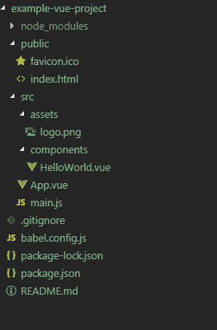

## Vue CLI 插件

Vue CLI v3 在设计时考虑了插件架构。在本节中，我们将介绍插件是什么以及如何在项目中安装它们。我们还将查看一些流行的插件，它们可以通过自动安装所需的库并进行各种设置来帮助添加高级功能——而这些操作通常情况下需要手动完成。

### 什么是 Vue 插件

CLI 插件只是为你的 Vue 项目提供额外功能的`npm`包。`vue-cli-service`二进制文件会自动解析并加载`package.json`文件中列出的所有插件。

Vue CLI 3 项目的基础配置是`webpack`和`Babel`。所有其他功能都可以通过插件添加。

Vue 团队提供了官方插件，以及社区开发的社区插件。官方插件名称以`@vue/cli-plugin-`开头，社区插件名称以`vue-cli-plugin-`开头。

官方 Vue CLI 3 插件包括：

*   Typescript

*   PWA

*   Vuex

*   Vue Router

*   ESLint

*   单元测试等

### 如何添加 Vue 插件

插件要么在创建项目时自动安装，要么稍后由开发者显式安装。

你可以在初始化项目时在项目中安装许多内置插件，并在项目的任何时候使用`vue add my-plugin`命令在项目中安装任何其他额外插件。

你还可以安装带有预设的插件，并将你喜欢的插件分组为可重用的预设，以后可以作为其他项目的基准。

### 一些实 Vue 插件

你可能会发现许多 Vue CLI 插件对你的下一个项目有用。例如，Vuetify UI 库作为插件可用](https://github.com/vuetifyjs/vue-cli-plugin-vuetify)，同样的 [Storybook](https://github.com/storybooks/vue-cli-plugin-storybook)。你还可以使用 [Electron Builder 插件](https://github.com/nklayman/vue-cli-plugin-electron-builder) 快速基于 Electron 搭建出一个 Vue 项目。

我还写了几个供你使用的插件：

*   [vue-cli-plugin-nuxt](https://www.npmjs.com/package/vue-cli-plugin-nuxt)：一个用于使用`Nuxt.js`快速创建通用 Vue 应用的 Vue CLI 插件。

*   [vue-cli-plugin-bootstrap](https://www.npmjs.com/package/vue-cli-plugin-bootstrap)：一个为项目添加 Bootstrap 4 的 Vue CLI 插件。

如果你想了解更多关于插件的信息，请查看 Vue Mastery 上的这篇佳文：[适用于 Vue 项目的 5 个 Vue CLI 3 插件](https://medium.com/vue-mastery/5-vue-cli-3-plugins-for-your-vue-project-df5af357d076)。

## 关于 webpack？

`webpack`被 Vue CLI 抽象了，它提供了访问和修改`webpack`配置的不同 API。

Vue CLI 的大部分项目配置都被抽象为插件并在运行时合并到基础配置中。但在某些情况下，你可能想手动调整项目的`webpack`配置。在这种情况下，你可以：

*   在项目根目录下创建一个`vue.config.js`文件，然后在`configureWebpack`选项中进行任何配置：


```javascript
module.exports = {
  configureWebpack: {
    // 在此处进行自定义配置
  }
}
```

使用如 [webpack-chain](https://neutrino.js.org/webpack-chain.html) 等工具修改`webpack`配置。

你可以在此处了解更多关于使用 Vue CLI 和 webpack 的信息](https://cli.vuejs.org/guide/webpack.html)。

## Vue CLI UI

现在让我们来看 [Vue CLI UI](https://cli.vuejs.org/guide/creating-a-project.html#using-the-gui)，涵盖了如何启动它以及用于图形用户界面创建和管理项目的视图。

Vue CLI v3 提供了一个现代 Web 界面，允许你在不使用终端命令的情况下创建和管理项目。你可以如下所示启动 UI：

```bash
vue ui
```

UI 应该可以在 [`localhost:8000`](http://localhost:8000)。

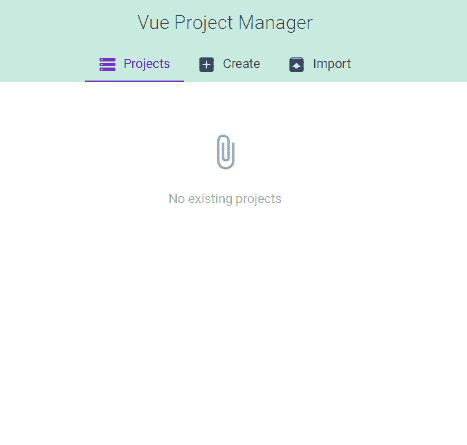

你可以从 *Create* 标签创建一个新项目。浏览你想创建项目的位置，然后点击 *+ Create new project* 按钮。

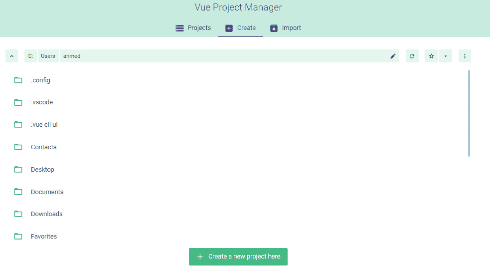

接下来，你将被带到一个新界面，在其中你需要输入项目的详细信息，如名称、项目位置、包管理器以及是否想要初始化 Git 仓库。

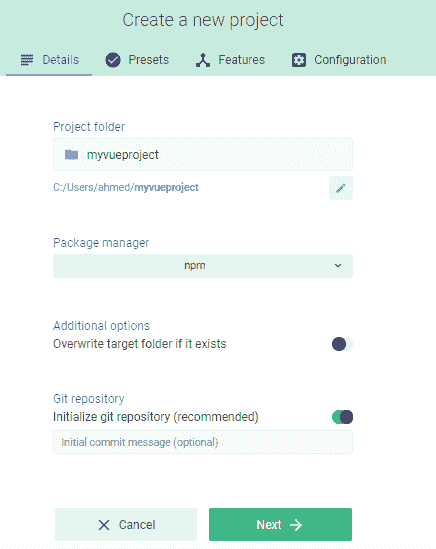

接下来，你将被带到 *Presets* 标签，你可以在那里为项目指定预设。你可以选择：

* *Default preset*：带有 Babel 和 ESLint 插件的默认预设
* *Manual*：手动选择插件
* *Remote preset*：使用来自 Git 仓库的远程预设

让我们继续使用默认预设：

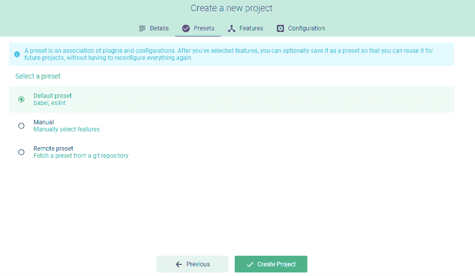

### 预设 (Presets)

预设是插件和配置的关联。

接下来，你可以点击 *Create Project* 按钮开始生成项目。将被带到一个界面，显示项目生成的进度。

接下来，你将被带到项目仪表板——你可以使用右上角的 *Customize* 按钮添加小部件，之后它们会自动保存。

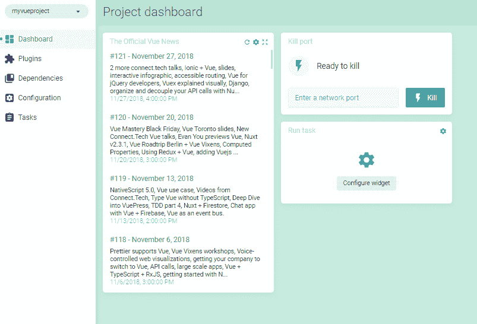

在仪表板的左侧，你可以找到不同的页面：

* `Plugins`：添加新的 Vue CLI 插件
* `Dependencies`：管理包
* `Configuration`：配置工具
* `Tasks`：运行脚本

切换到 *Tasks* 页面。

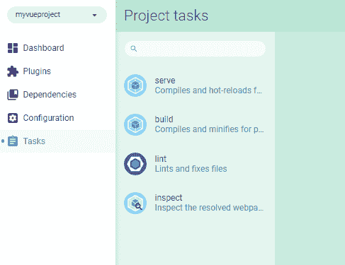

接下来，点击 *serve* 按钮然后点击 *Run task* 按钮来运行你的项目。

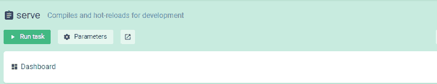

你可以使用 *Stop task* 按钮停止项目服务。你还可以从此界面打开应用程序并查看有关项目的信息，例如资源、模块和依赖的大小、速度统计等。

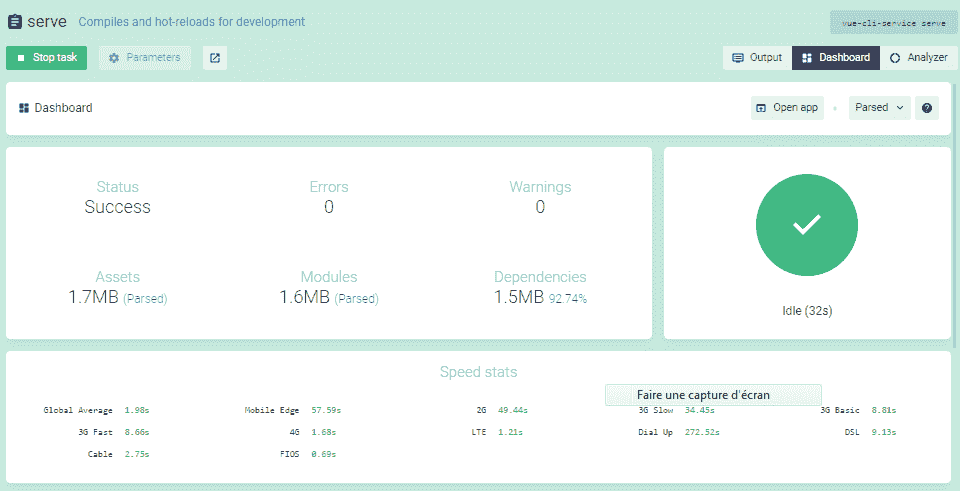

## 总结

在本文中，我们概述了新版本的 Vue CLI，它提供了一系列对开发者友好的功能，例如交互式项目脚手架、集成前端生态系统中最佳工具的官方插件集合，以及用于创建和管理 Vue.js 项目的完整图形用户界面。

`CLI` 是 Vue 开发者手中功能强大的工具，但在你不需要它的所有功能的情况下，在项目中使用不带 CLI 的 Vue.js 可能是更好的选择。你可以在我们的教程 *[快速上手：Vue.js 2.0 框架的入门与运行](https://www.sitepoint.com/up-and-running-vue-js-2-0/)* 中看到如何做到。

### 第 4 章：Vue 组件开发初学者指南

#### 作者：Kingsley Silas

使用 Vue 的伟大之处之一在于它采用了基于组件的构建界面方法。这允许你将应用程序拆分为更小的、可重用的部分（组件），然后你可以使用这些部分来构建更复杂的结构。

在本指南中，我将为你提供一个关于在 Vue 中处理组件的层层级介绍。我将介绍如何创建组件、如何在组件之间传递数据（通过`props`和事件总线），以及如何使用 Vue 的`<slot>`元素在组件内部渲染额外内容。

每个示例都将配有一个可运行的 CodePen 演示。

## 如何在 Vue 中创建组件

组件本质上是带有名称的可复用 Vue 实例。在 Vue 应用中创建组件有多种方法。例如，在一个小型项目中，你可以使用 [Vue.component](https://vuejs.org/v2/api/#Vue-component) 方法来注册全局组件，如下所示：

```
Vue.component('my-counter', {
  data() {
    return {
      count: 0
    }
  },
  template: `<div>{{ count }}</div>`
})

new Vue({ el: '#app' })
```

组件的名称为`my-counter`。它可以这样使用：

```
<div id="app">
  <my-counter></my-counter>
</div>
```

在命名组件时，你可以选择短横线命名法（`my-custom-component`）或帕斯卡命名法（`MyCustomComponent`）。在模板内部引用组件时，可以使用这两种变体，但在 DOM 中直接引用时（如上例所示），只有短横线类型的标签名是有效的。

你可能还会注意到，在上面的示例中，`data` 是一个返回对象字面量的函数（而不是本身对象字面量）。这样做是为了确保组件的每个实例都能接收自己的`data`对象，而不需要与所有其他实例共享一个全局实例。

定义组件模板有多种方法。我们在上面使用了模板字面量，但也可以使用标记为`text/x-template`的`<script tag>`或内 DOM 模板。你可以在这里阅读更多关于[定义模板的不同方法](https://medium.com/js-dojo/7-ways-to-define-a-component-template-in-vuejs-c04e0c72900d)。

#### 单文件组件

在更复杂的项目中，全局组件会迅速变得难以管理。在这种情况下，构建你的应用程序使用单文件组件是有意义的。正如名称所示，这些是具有`.vue`扩展名的单文件，包含`<template>`、`<script>`和`<style>`部分。

对于我们上面的示例，一个`App`组件可能如下：

```
<template>
  <div id="app">
    <my-counter></my-counter>
  </div>
</template>

<script>
import myCounter from './components/myCounter.vue'

export default {
  name: 'app',
  components: { myCounter }
}
</script>

<style></style>
```

而一个`MyCounter`组件可能如下：

```
<template>
  <div>{{ count }}</div>
</template>

<script>
export default {
  name: 'my-counter',
  data() {
    return {
      count: 0
    }
  }
}
</script>

<style></style>
```

如你所见，当使用单文件组件时，可以在需要它们的组件中直接导入并使用它们。

在本指南中，我将展示所有使用`Vue.component()`方法注册组件的示例。

使用单文件组件通常涉及一个构建步骤（例如，使用 Vue CLI）。如果你想了解更多相关信息，请查看此 Vue 系列中的“Vue CLI 初学者指南”。

## 通过 Props 向组件传递数据

`Props` 允许我们把数据从父组件传递到子组件。这使得我们的组件能够分成更小的块来处理特定的功能。例如，如果我们有一个博客组件，我们可能想要显示诸如作者详细信息、帖子详情（标题、正文和图片）以及评论。

我们可以将这些拆分为子组件，以便每个组件处理特定数据，使组件树看起来如下：

```
<BlogPost>
  <AuthorDetails></AuthorDetails>
  <PostDetails></PostDetails>
  <Comments></Comments>
</BlogPost>
```

如果你对使用组件的益处仍不信，请花时间思考这种组合有多么有用。如果你将来再次访问这段代码，将立即看出页面是如何结构的，以及你应该在哪里（即在哪个组件中）寻找哪种功能。这种声明式的界面组合方法也让不熟悉代码库的人更容易上手并快速投入生产。

#### 通过事件总线从子组件与父组件通信

除了通过`props`从父组件向子组件传递数据外，有时子组件需要向父组件发送消息。Vue 提供了自定义事件系统来实现这一点。子组件可以使用`$emit()`方法触发事件，父组件可以在模板中监听这些事件。

例如，让我们修改`my-counter`组件，使其在计数增加时通知父组件：

```
Vue.component('my-counter', {
  data() {
    return {
      count: 0
    }
  },
  template: `
    <div>
      <button @click="increment">增加</button>
      <span>{{ count }}</span>
    </div>
  `,
  methods: {
    increment() {
      this.count++
      this.$emit('increment', this.count)
    }
  }
})
```

在父组件中，我们可以监听这个事件：

```
<div id="app">
  <my-counter @increment="handleIncrement"></my-counter>
</div>
```

```
new Vue({
  el: '#app',
  methods: {
    handleIncrement(count) {
      console.log('计数已更新为：', count)
    }
  }
})
```

对于更复杂的组件间通信，Vue 还提供了事件总线模式。你可以创建一个空的 Vue 实例作为中央事件总线：

```
// event-bus.js
import Vue from 'vue'
export const EventBus = new Vue()
```

然后，任何组件都可以通过`EventBus.$emit()`触发事件，并通过`EventBus.$on()`监听事件。这在兄弟组件之间传递数据时特别有用。

#### 使用插槽（Slots）分发内容

Vue 的`<slot>`元素允许你在组件内部渲染额外内容。这使得组件更加灵活和可复用。例如，我们可以创建一个`<alert>`组件，它接受一些默认内容，但也允许使用者插入自定义内容：

```
Vue.component('alert', {
  template: `
    <div class="alert">
      <slot>默认警告信息</slot>
    </div>
  `
})
```

使用方式如下：

```
<alert>这是一个自定义警告</alert>
```

如果未提供内容，则会显示默认文本。插槽还支持具名插槽，允许你在组件中定义多个插槽位置：

```
Vue.component('card', {
  template: `
    <div class="card">
      <header><slot name="header"></slot></header>
      <main><slot></slot></main>
      <footer><slot name="footer"></slot></footer>
    </div>
  `
})
```

使用方式：

```
<card>
  <template v-slot:header>卡片标题</template>
  卡片主体内容
  <template v-slot:footer>卡片底部</template>
</card>
```

插槽是构建可组合组件的重要工具，它让组件的复用性和可定制性大大增强。


[事件](https://vuejs.org/v2/guide/events.html)通过创建包装方法来处理，在选定的事件发生时触发。通过此复习，让我们在原始的计数器示例基础上进行构建，使其在每次点击按钮时增加。

这是我们的组件应该有的样子：

```
new Vue({
  el: '#app',
  data() {
    return {
      count: 0
    }
  },
  methods: {
    increment() {
      this.count++
    }
  }
})
```

以及我们的模板：

```
<div id="app">
  {{ count }}
  <div>
    <button @click="increment">+</button>
  </div>
</div>
```

这应该足够简单。如你所见，我们正在挂钩`onClick`事件，以便在每次点击按钮时触发自定义的`increase`方法。`increase`方法随后增加我们的`count`属性。现在，让我们扩展这个示例，将计数器移动到单独的组件并在父组件中显示计数。当你想要从子组件向父组件通信时，事件总线（Event buses）会非常有用。这与默认的从父组件到子组件的通信方式相反。如果你的应用程序还没有到需要使用 Vuex 的程度，可以使用事件总线（你可以在“开始使用 Vuex”中阅读更多内容）。

所以这就是我们要做的：`count`将在父组件中声明并传递给子组件。然后在在子组件中，我们想要增加该值，并确保该值在父组件中得到更新。App 组件看起来如下：

```
new Vue({
  el: '#app',
  data() {
    return {
      count: 0
    }
  }
})
```

那么在子组件中，我们想要通过 props 接收 count，并有一个方法来增加它。我们不想在子组件中显示 count 的值。我们只希望从子组件中进行增加并让它反映在父组件中：

```
Vue.component('counter', {
  template: `
    <div>
      <button @click="increment"></button>
    </div>
  `,
  props: {
    count: {
      type: Number,
      required: true
    }
  },
  methods: {
    increment() {
      this.count++
    }
  }
})
```

然后我们的模板将看起来如下：

```
<div id="app">
  <h3>{{ count }}</h3>
  <counter :count="count" />
</div>
```

如果你尝试像那样去增加该值，它将无法正常工作。为了让它工作，我们必须从子组件中触发一个事件，并在父组件中监听它。首先，我们创建一个新的`Vue`实例并将其设置为`eventBus`：

```
const eventBus = new Vue();
```

我们现在可以在组件中使用事件总线了。子组件看起来如下：

```
Vue.component('counter', {
  props: {
    count: {
      type: Number,
      required: true
    }
  },
  methods: {
    increment() {
      this.count++
      eventBus.$emit('count-incremented', this.count)
    }
  },
  template: `
  <div>
    <button @click="increment"></button>
  </div>
  `
})
```

每当调用`increment`方法时都会触发该事件。我们必须在主组件中监听该事件，并将`count`设置为通过事件获得的值：

```
new Vue({
  el: '#app',
  data() {
    return {
      count: 0
    }
  },
  created() {
    eventBus.$on('count-incremented', (count) => {
      this.count = count
    })
  }
})
```

注意，我们正在利用 [Vue 的 [created 生命周期钩子方法](https://vuejs.org/v2/api/#created)] 在组件挂载之前挂钩它并设置事件总线。如果你的应用程序并不复杂，使用事件总线是好的，但请记住随着你应用程序的增长，你可能需要使用 Vuex。

#### 实时代码

查看 Pen [Vue Components - Event Bus](https://codepen.io/SitePoint/pen/qLjz/)

## 使用插槽在组件中嵌套内容

在到目前为止看到的所有示例中，组件都是自闭合元素。然而，为了创建可以以有用方式组合在一起的组件，我们能够像处理 HTML 元素那样将它们嵌套在彼此内部。

如果你尝试使用带有闭合标签的组件并在内部放入内容，你会发现 Vue 只是吞噬了这些内容。组件开始标签和结束标签之间的任何内容都将被替换为组件自身的渲染输出：

```
<div id="app">
  <author-detail :owner="author">
    <p>这些内容将被替换</p>
  </author-detail>
</div>
```

幸运的是，[Vue 的插槽](https://vuejs.org/v2/guide/components-slots.html) 使得向组件传递任意值成为可能。可以是从父组件到子组件的任何 DOM 元素。让我们看看它们是如何工作的。

我们组件的脚本部分看起来如下：

```
Vue.component('list', {
  template: '#list'
})

new Vue({
  el: "#app"
})
```

那么模板将看起来如下：

```html
<div id="app">
  <h2>插槽</h2>
  <list>
    <h4>我是第一个插槽</h4>
  </list>
  <list>
    <h4>我是第二个插槽</h4>
  </list>
</div>

<script type="text/x-template" id="list">
  <div>
    <h3>子组件</h3>
    <slot></slot>
  </div>
</script>
```

`<slot>`标签是来自父组件内容的占位符。

### 第 5 章：表单入门指南

表单是 Web 应用程序不可或缺的一部分。在本教程中，我将演示如何处理表单。我们将从创建一个简单的表单并查看如何处理输入开始。我们将查看修饰符（modifiers），它们允许我们更改浏览器行为，以及过滤器（filters），它们允许我们格式化输出。最后我们将使用 [VeeValidate](https://baian.github.io/vee-validate/) 插件来实现表单验证。每个部分都将配有一个可运行的 CodePen。

#### 使用 v-model 进行双向绑定

Vue 提供了一种双向绑定功能，使用户输入的内容与数据模型保持同步。这是通过使用 [v-model](https://vuejs.org/v2/api/#v-model) 指令实现的，例如`v-model="entry"`。

在数据模型中，你需要以下内容：

```
data() {
  return {
    entry: 3
  }
}
```

那么我们的模板看起来如下：

```html
<div id="app">
  <h2>Vue 表单</h2>
  <h2>{{ entry }}</h2>
  <input type="text" v-model="entry" />
</div>
```

`v-model`指令结合了 [v-bind](https://vuejs.org/v2/api/#v-bind) 和 [v-on:input](https://vuejs.org/v2/api/#v-on) 的功能，为表单输入提供双向数据绑定。上面的代码也可以写成这样：

```html
<div id="app">
  <h2>Vue 表单</h2>
  <h2>输入: {{ entry }}</h2>
  <input type="text"
     v-bind:value="entry"
     v-on:input="entry=$event.target.value"
  />
</div>
```

```html
<div id="app">
  <h2>Vue Form</h2>
  <h2>Input: {{ entry }}</h2>
  <input type="text"
    :value="entry"
    @input="entry=$event.target.value"
  />
</div>
```

现在，让我们来看一个示例。如果你想在家里跟着练习，可以采取两种方法中的一种。你可以使用`Vue CLI`创建新应用（你可以在本 Vue 系列的“Vue CLI 入门指南”中读到相关内容）。另一种选择是使用下面的模板，它包含了通过`CDN`引入的`Vue`，你可以直接在浏览器中打开它：

```html
<!DOCTYPE html>
<html lang="en">
<head>
  <meta charset="UTF-8">
  <title>Document</title>
  <link rel="stylesheet" href="https://cdnjs.cloudflare.com/ajax/libs/twitter-bootstrap/4.1.3/css/bootstrap.min.css">
  <style>
    /* 在处编写样式 */
  </style>
</head>
<body>
  <!-- 在处编写模板 -->

  <script src="https://cdnjs.cloudflare.com/ajax/libs/vue/2.5.17/vue.min.js"></script>
  <script>
    // 在处编写脚本
  </script>
</body>
</html>
```

我们首先添加一个包含四种表单输入类型的模板——即：文本输入、选择元素、单选按钮和复选框。你可以在所有这些输入框中使用`v-model`，使它们的值与`Vue`实例的数据模型保持同步：

```html
<div id="app" class="container">
  <h2>Vue Form</h2>

  <div class="output">
    <p>Name: {{ name }}</p>
    <p>Genre: {{ genre}}</p>
    <p>Gender: {{ gender }}</p>
    <p>
      Languages:
      <span v-for="(language, index) in languages" :key="index">
        {{ language }}
        <span v-if="index + 1 < languages.length">, </span>
      </span>
    </p>
    <p>Terms Agreement: {{ agreeToTerms }}</p>
  </div>

  <form>
    <div>
      <label for="name">Name:</label>
      <input type="text" v-model="name" id="name" />
    </div>

    <div class="gender">
      <input type="radio" id="male" value="Male" v-model="gender">
      <label for="male">Male</label>
      <br>
      <input type="radio" id="female" value="Female" v-model="gender">
      <label for="female">Female</label>
    </div>

    <div>
      <select v-model="genre">
        <option disabled value="">Please select a genre</option>
        <option>Rap</option>
        <option>Indie Pop</option>
        <option>Soul</option>
      </select>
    </div>

    <div class="languages">
      <input type="checkbox" id="javascript" value="JavaScript" v-model="languages">
      <label for="javascript">Javascript</label>
      <input type="checkbox" id="ruby" value="Ruby" v-model="languages">
      <label for="ruby">Ruby</label>
      <input type="checkbox" id="python" value="Python" v-model="languages">
      <label for="python">Python</label>
    </div>

    <div>
      <label>
        <input type="checkbox" v-model="agreeToTerms"/>
        Yes, I agree to everything
      </label>
    </div>
  </form>
</div>
```

注意，在模板顶部，我们正在使用基础插值来输出表单字段的值。我们需要在`Vue`实例中声明这些数据属性：

```javascript
new Vue({
  el: '#app',
  data() {
    return {
      name: "John Doe",
      agreeToTerms: false,
      genre: '',
      gender: '',
      languages: []
    }
  }
})
```

我们可以最后添加一些基础样式：

```css
h2 {
  margin: 30px 0;
  text-align: center;
  font-size: 3em;
  color: tomato;
}

.output {
  text-align: center;
  margin: 30px;
}

form {
  width: 40%;
  max-width: 350px;
  margin: 0 auto 30px;
  border-radius: 4px;
  border: none;
  border-top: 2px solid tomato;
}

input[type="text"], select {
  background: rgba(255, 255, 255, 0.1);
  border: none;
  font-size: 16px;
  height: auto;
  margin: 0;
  outline: 0;
  padding: 10px;
  width: 100%;
}
```

#### 使用过滤器格式化输出

过滤器让你能够转换数据。它们只会更改显示的数据，而不会实际转换数据本身。你可以使用管道符号`|`将过滤器应用于表达式上。为了看到过滤器的工作，让我们创建一个过滤器，将通过输入框输入的文本转换为大写：

假设你正在处理一个 API，它返回了一些文章并显示文章创建的日期。你可能希望向用户显示一个更易好的日期。这就是过滤器（filter）派上用场的场景之一。使用 [Momentjs](http://momentjs.com/)，你可以为日期创建一个过滤器。

你的过滤器看起来像这样：

```
date(value) {
  return moment(value).fromNow()
}
```

这里并没有特别之处：我们只是在参数上调用了`moment`的`.fromNow()`方法并将其返回。要显示过滤后的日期，我们使用`{{ created_at | date }}`。

#### 现场代码

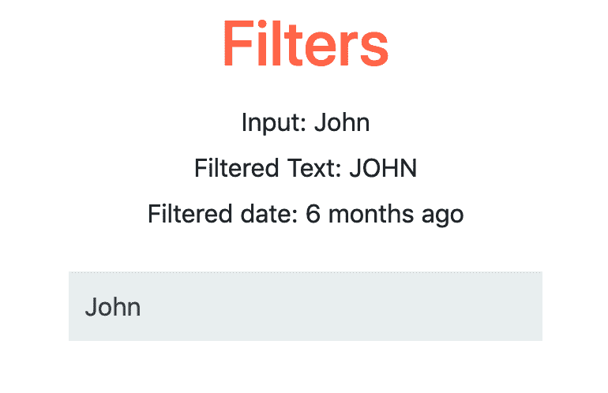

查看 Pen [使用过滤器格式化数据](https://codepen.io/SitePoint/pen/bOdXXy/)。

## VeeValidate

[VeeValidate](https://baianat.github.io/vee-validate/) 简化了 Vue 表单的验证。在最后一个章节中，我们将构建一个注册表单并使用 VeeValidate 实现一些基本的验证检查。

如果你正在使用 CLI 跟进学习，你需要使用`npm`安装 VeeValidate：

```
npm install vee-validate --save
```

你还需要在`main.js`中注册该插件：

```
import  VeeValidate  from  "vee-validate";
Vue.use(VeeValidate);
```

或者，你也可以通过 CDN 将其引入应用：

```html
<script src="https://unpkg.com/vee-validate@latest"></script>
```

然后你需要像这样修改模板：


首先，在 HTML 页面中引入 Vue 和 VeeValidate 库。以下是一个基本的 HTML 模板，其中包含了必要的脚本引用：

```html
<!DOCTYPE html>
<html lang="en">
<head> ... </head>
<body>
  <!-- 此处放置模板 -->

  <script src="https://cdnjs.cloudflare.com/ajax/libs/vue/2.5.17/vue.min.js"></script>
  <script src="https://unpkg.com/vee-validate@latest"></script>
  <script>
    Vue.use(VeeValidate);
    new Vue({ .. })
  </script>
</body>
</html>
```

接下来，让我们创建表单。我们将拥有 `name`、`gender`、`phone`、`email` 和 `password` 字段，并将使用 `v-model` 将它们绑定到我们的数据模型：

```html
<div id="app">
  <h2>Register</h2>

  <form @submit.prevent="register" method="post" class="form">
    <div>
      <label for="name">Name:</label>
      <input id="name" name="name" v-validate="'required'" type="text" v-model="user.name" class="form-control" />
      <span v-show="errors.has('name')" class="text-danger">{{ errors.first('name') }}</span>
    </div>
    <div>
      <label for="gender">Gender:</label>
      <select id="gender" name="gender" v-model="user.gender" class="form-control" v-validate="'required'">
        <option>Female</option>
        <option>Male</option>
      </select>
      <span v-show="errors.has('gender')" class="text-danger">
        {{ errors.first('gender') }}
      </span>
    </div>
    <div>
      <label for="phone">Phone:</label>
      <input id="phone" name="phone" v-validate="'required'" type="text" v-model="user.phone" class="form-control" />
      <span v-show="errors.has('phone')" class="text-danger">
        {{ errors.first('phone') }}
      </span>
    </div>
    <div>
      <label for="email">Email:</label>
      <input id="email" name="email" v-validate="'required|email'" type="text" v-model="user.email" class="form-control" />
      <span v-show="errors.has('email')" class="text-danger">
        {{ errors.first('email') }}
      </span>
    </div>
    <div>
      <label for="password">Password:</label>
      <input id="password" name="password" v-validate="'required'" type="password" v-model="user.password" class="form-control" />
      <span v-show="errors.has('password')" class="text-danger">
        {{ errors.first('password') }}
      </span>
    </div>
    <div>
      <button class="btn btn-lg btn-primary btn-block" type="submit">Submit</button>
    </div>
  </form>
</div>
```

为了确保必填字段已填写，我们将值 `required` 传递给模板中的 `v-validate` 属性。这意味着输入框必须提供一个值。在我们的示例中，我们不会做更多操作，但请注意 [VeeValidate 开箱即提供了一系列验证规则](https://baianat.github.io/vee-validate/guide/rules.html)，这些规则都是经过本地化处理的并涵盖了大多数验证需求。如果你在其中没有找到需要的规则，也可以[创建自定义规则](https://baianat.github.io/vee-validate/guide/rules.html)。

```html
<div id="myApp">
  <nav aria-label="Page navigation example">
    <ul class="pagination">
      <li class="page-item"><a class="page-link" href="#">1</a></li>
      <li class="page-item"><a class="page-link" href="#">2</a></li>
      <li class="page-item active"><a class="page-link" href="#">3</a></li>
      <li class="page-item"><a class="page-link" href="#">4</a></li>
      <li class="page-item"><a class="page-link" href="#">5</a></li>
    </ul>
  </nav>
</div>
```

注意这段代码段中的每个页面都有一个列表项元素（`<li …> `）。该元素引用了 `page-item` CSS 类。在本文的代码中，该类是在 Bootstrap CSS 框架中定义的。但是，如果它在那里没有被定义，那么确保它在某处被定义就是你的责任了。不过，第二个 CSS 类是与本文最相关的。

`active` CSS 类用于识别当前选中的页面。对于本文，该 CSS 类也是在 Bootstrap CSS 中定义的。如上面的代码段所示，`active` 类仅在第三个列表项元素中使用。正如你可能猜到的那样，这就是你想要条件应用的 CSS 类。要实现这一点，你需要添加一个 JavaScript 对象。

### 第 2 步：创建你的类绑定

让我们在第 1 步所示的代码段的基础上继续。在模板中创建类绑定时，有两种主要选择：使用对象语法或使用数组语法。我将在本文的剩余部分向你展示如何使用这两种方法。

#### 使用对象语法绑定

要使用对象语法创建类绑定，你必须使用 JavaScript `expression`。我们将使用的表达式可以在与本文相关的代码[此处](https://codepen.io/SitePoint/pen/RqbBdK) 看到。相关代码看起来如下：

```html
<div id="myApp">
  <nav aria-label="An example with pagination">
    <ul class="pagination">
      <li v-for="page in totalPages" v-bind:class="{'page-item':true, 'active':(page === currentPage)}">
        <a class="page-link" href="#">{{ page }}</a>
      </li>
    </ul>
  </nav>
</div>
```

通过使用 Vue 内置的 `v-for` 指令减少了代码量。该指令用于循环渲染项目。此示例中的项目是页面本身。除了使用 `v-for` 指令外，请注意 `v-bind` 指令的使用。

`v-bind` 指令将元素的 `class` 属性连接到 Vue 实例。该 Vue 实例定义如下：

```javascript
var app = new Vue({
  el: '#myApp',
  data: {
    totalPages: 5,
    currentPage: 3
  }
});
```

这个 Vue 实例直击了当。上面的 `data` 对象包含一个名为 `currentPage` 的属性。如果你重新查看上面的 HTML 模板，你会发现该属性正在被使用。事实上，与类绑定关联的 JavaScript 对象看起来如下：

```javascript
{'page-item':true, 'active':(page === currentPage)}
```

该对象定义了两个属性：`page-item` 和 `active`。值得注意的是，这些是第 1 步中讨论的两个 CSS 类名称。在第 2 步中，这两个类变成了 JavaScript 对象中的属性名。与这些属性名关联的值是 JavaScript 表达式。如果表达式求值为真（truthy），将包含该 CSS 类。如果表达式求值为假（false），则不包含该 CSS 类。记住这些规则，让我们来看每个属性。

第一个属性 `page-item` 的值为 `true`。使用这个硬编码值是因为我们总是想包含 `page-item` 类。第二个属性 `active` 使用 JavaScript 表达式。当此表达式为 `true` 时，将应用 `active` 类。这使我们能够根据 `currentPage` 的值条件地应用 `active` 类。条件应用 `active` 类的另一种方法是绑定到 `Array`。

#### 使用数组语法绑定

Vue 允许你通过绑定到 `Array` 来应用一组 CSS 类。如果你想使用 `Array` 语法，第 1 步中所示的 HTML 将变成：

```html
<div id="myApp">
  <nav aria-label="An example with pagination">
    <ul class="pagination">
        <li v-for="page in totalPages" v-bind:class="[pageItemClass, (page === currentPage) ? activeClass : '']">
          <a class="page-link" href="#">{{ page }}</a>
        </li>
    </ul>
  </nav>
</div>
```

带有 `Array` 语法的运行版本可以在[此处](https://codepen.io/SitePoint/pen/dQbjX) 看到。唯一的区别是在类绑定上使用了 `Array`。这种替代方法期望 Vue 的 `data` 对象中存在两个属性。这两个属性是：`pageItemClass` 和 `activeClass`。带有这些属性的更新后的 Vue 初始化代码如下：

```javascript
var app = new Vue({
  el: '#myApp',
  data: {
    totalPages: 5,
    currentPage: 3,
    pageItemClass: 'page-item',
    activeClass: 'active'
  }
});
```

正如你所见，`data` 对象增加了，但使用 `Array` 语法的模板稍微简洁。在对象语法和 `Array` 语法之间的选择取决于个人偏好。两种方法似乎都会让你的 HTML 模板变得复杂。然而，实际上这分离了关注点。我们正在创建一个由数据驱动的视图。这使得视图在应用程序增长时更容易测试、更容易维护。

### 第 7 章：如何用 Vue 替换 jQuery

#### 作者：Nilson Jacques

我敢打赌，有很多开发者在构建简单应用时仍然会求助于 `jQuery`。经常我们需要为页面添加一些交互性，但引入一个 JavaScript 框架似乎大材小用——考虑到所有额外的字节、模板代码、构建工具和模块打包器。从 CDN 引入 `jQuery` 似乎是理所当然的。

在本文中，我想尝试说服你，使用 `Vue.js`（后文简称 Vue）即使对于简单的项目也不必令人头疼，并且可以帮你更快地编写更好的代码。我们将取一个示例，先用 `jQuery` 编写，然后逐步在 Vue 中重建。

## 我们要构建的内容

对于本文，我们将构建一个基础在线发票，使用来自 Sparksuite 的[开源模板](https://github.com/sparksuite/simple-html-invoice-template)。希望这与另一个待办事项列表有所不同，并提供了足够的复杂度来展示使用类似 Vue 之类的优势，同时保持易于理解。

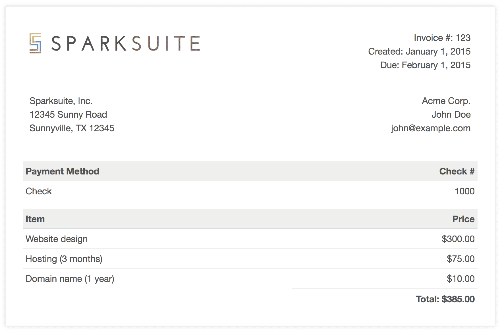

我们将通过提供项目、单价和数量输入来使其具有交互性，并在其中一个值更改时自动重新计算“价格”列。我们还将添加一个按钮向发票插入新的空行，以及一个会在编辑数据时自动更新的“合计”字段。

我修改了模板，使得单个（空）行的 HTML 现在看起来如下：

```html
<tr class="item">
  <td><input value="" /></td>
  <td>$<input type="number" value="0" /></td>
  <td><input type="number" value="1" /></td>
  <td>$0.00</td>
</tr>
```

## jQuery

所以，首先，让我们看看如何使用 `jQuery` 实现。

```javascript
$('table').on('mouseup keyup', 'input[type=number]', calculateTotals);
```

```javascript
function calculateTotals()  {
  const subtotals = $('.item').map((idx, val)  => calculateSubtotal(val)).get();
  const total = subtotals.reduce((a, v)  => a + Number(v),  0);
  $('.total td:eq(1)').text(formatAsCurrency(total));
}
```

此函数查找表格中所有的行并对其进行循环，将每行传递给 `calculateSubtotal` 函数，然后对结果求和。最后，这个 `total` 会被插入到发票的相关位置。

```javascript
function calculateSubtotal(row) {
  const $row = $(row);
  const inputs = $row.find('input');
  const subtotal = inputs[1].value * inputs[2].value;

  $row.find('td:last').text(formatAsCurrency(subtotal));

  return subtotal;
}
```

在上面的代码中，我们获取了行中所有 `<input>` 的引用，并将第二个和第三个值相乘得到小计。该值随后被插入到行的最后一个单元格中。

```javascript
function formatAsCurrency(amount) {
  return `$${Number(amount).toFixed(2)}`;
}
```

我们还有一个小小的辅助函数，用于确保小计和总计都经过格式化为两位小数，并带有货币符号前缀。

```javascript
$('.btn-add-row').on('click', () => {
  const $lastRow = $('.item:last');
  const $newRow = $lastRow.clone();

  $newRow.find('input').val('');
  $newRow.find('td:last').text('$0.00');
  $newRow.insertAfter($lastRow);

  $newRow.find('input:first').focus();
});
```

最后，我们为 `Add row` 按钮编写了一个点击处理程序。我们在这里的操作是选择最后一行项目并创建一个副本。克隆行的输入被设置为默认值，并将其作为新的最后一行插入。我们还可以对用户友好一点，将焦点设置在第一个输入框，以便他们开始输入。

#### 实时代码

查看 Pen 上的 [jQuery Invoice](https://codepen.io/SitePoint/pen/YaBwJQ/)。

### 缺点

那么，这段代码有什么问题，或者说，哪些地方可以做得更好？

你可能听过一些较新的库，如 `Vue` 和 `React`，它们声称是声明式的而非命令式的。观察这段 jQuery 代码，它的大部分内容读起来像是一系列如何操作 DOM 的指令列表。代码每个部分的目的——即“做什么”——往往很难通过“如何”执行的细节中看出来。诚然，我们可以通过将代码拆分为命名良好的函数来明确代码意图，但如果你在一段时间后回来看这段代码，它仍然需要花费精力在脑中进行解析。


这类代码的另一个问题 ，我们将应用程序状态保留在 DOM 本身中。订单项目的信息仅作为构成 UI 的 HTML 的存在。当我们只在单个位置显示信息时，这看起来可能不是什么大问题，但一旦我们开始需要在应用程序的多个地方显示相同的数据，要确保每个部分保持同步就会变得越来越复杂。没有单一的事实来源（source of truth）。

虽然 jQuery 的任何特性都没有阻止我们将状态存储在 DOM 之外并避免这些问题，但 `Vue` 等库提供了功能和结构，有助于创建良好的架构并编写更简洁、模块化的代码。

## 转换为 Vue

那么，我们如何使用 `Vue` 重新创建此功能呢？

正如我之前提到的，`Vue`并不要求我们使用模块打包器、转译器，或者为了启动而选择单文件组件（`.vue` 文件）。像 jQuery 一样，我们可以直接从 CDN 引入库。让我们从更换脚本标签开始：

```html
<script src="https://cdn.jsdelivr.net/npm/vue@2.5.17/dist/vue.js"></script>
```

接下来我们需要做的是创建一个新的 `Vue` 实例：

```javascript
const app = new Vue({
  el: 'table'
});
```

在这里我们需要提供的唯一选项是 `el`，这是一个选择器（就像我们在 jQuery 中使用的那样），用于标识我们希望 `Vue` 管理文档的哪个部分。

我们可以让 `Vue` 管理整个页面（例如用于单页应用）或单个 `<div>`。对于我们的发票示例，我们将 HTML 表格交由 `Vue` 控制。

### 数据

让我们也为 `Vue` 实例添加三个示例行的数据：

```javascript
const app = new Vue({
  el: 'table',
  data: {
    items: [
      { description: 'Website design', quantity: 1, price: 300 },
      { description: 'Hosting (3 months)', quantity: 1, price: 75 },
      { description: 'Domain name (1 year)', quantity: 1, price: 10 },
    ]
  }
});
```

`data` 属性是我们存储应用程序状态的地方。这不仅包括我们希望应用程序处理的数据，还包括关于 UI 状态的信息（例如，标签组中当前激活的是哪个部分，或者手风琴是展开还是折叠状态）。

`Vue` 鼓励我们将应用程序的状态与它的表现层（即 DOM）分开，并将其集中在一个地方——单一的事实来源。

### 修改模板

现在让我们设置模板来显示数据对象中的项目。由于我们已经告诉了 `Vue` 我们让它控制表格，我们就可以在 HTML 中使用它的模板语法告诉 `Vue` 如何渲染和操作它。

使用 `v-for` 属性，我们可以为 `items` 数组中的每个项目渲染一段 HTML 块：

```html
<tr class="item" v-for="item in items">

</tr>
```

`Vue` 会为你传递给 `v-for` 构造的数组（或对象）中的每个元素重复此标记，允许你在循环内部引用每个元素——在这种情况下，引用为 `item`。由于 `Vue` 正在观察 `data` 对象的所有属性，当 `items` 的内容变化时，它将动态地重新渲染标记。我们只需要向我们的应用程序状态中添加或删除项目，`Vue` 就会负责更新 UI。

我们还需要添加 `<input>` 让用户填写项目的描述、单价和数量：

```html
<td><input v-model=="item.description" /></td>
<td>$<input type="number" v-model="item.price" /></td>
<td><input type="number" v-model="item.quantity" /></td>
<td>{{ item.price * item.quantity }}</td>
```

在这里，我们使用 `v-model` 属性在输入框和数据模型上的属性之间建立双向绑定。这意味着输入框的任何更改都将更新项目上的属性，反之亦然。

在最后一个单元格中，我们使用双大括号 `{{ }}` 输出一些文本。我们可以在括号内使用任何有效的 JavaScript 表达式，因此我们将两个项目属性相乘并输出结果。同样，由于 `Vue` 正在观察我们的数据模型，任一属性的更改都会导致表达式重新求值。

### 事件和方法

现在我们设置好了模板来渲染 `items` 集合，但我们如何添加新行呢？由于 `Vue` 会渲染 `items` 中的任何内容，要渲染一个空行，我们只需要向 `items` 数组推入一个带有默认值的对象即可。

为了创建一个从模板内部访问的函数，我们需要将它们作为 `methods` 对象的属性传递给 `Vue` 实例：

```javascript
const app = new Vue({
  // ...
  methods: {
    myMethod() {}
  },
  // ...
})
```

注意，我们创建的任何方法都会自动绑定到 `Vue` 实例本身，因此我们可以通过 `this` 访问 `data` 对象中的属性和其他方法。

让我们定义一个 `addRow` 方法，可以通过调用它向 `items` 数组中添加新项目：

```javascript
methods: {
  addRow() {
    this.items.push({ description: '', quantity: 1, price: 0 });
  },
},
```

现在既然我们有了这个方法，当点击 `Add row` 按钮时如何调用它呢？在模板中的元素上添加事件监听器的语法是 `v-on:event-name`：

```html
<button class="btn-add-row" @click="addRow">Add row</button>
```

Vue 还为我们提供了一个快捷方式，我们可以使用 `@` 代替 `v-on:`，正如我在上面的代码中展示的那样。对于处理器，我们可以指定 Vue 实例中的任何方法。

### 计算属性（Computed properties）

现在我们唯一需要做的就是在发票底部显示总额。理论上，我们可以在模板本身中完成这一点：正如我之前提到的，Vue 允许我们在花括号之间放置任何 JavaScript 语句。然而，将任何超出基础逻辑的内容保持在模板之外要好得多；如果将这些逻辑分离，代码会更整洁且更易测试。

我们可以使用另一个方法来实现它，但我认为[计算属性](https://vuejs.org/v2/guide/computed.html#Computed-Properties)更合适。与创建方法类似，我们向 Vue 实例传递一个 `computed` 对象，该对象中包含了一些函数，我们希望在模板中使用这些函数的结果：

```javascript
const app = new Vue({
  // ...
  computed: {
    total() {
      return this.items.reduce((acc, item) => acc + (item.price * item.quantity), 0);
    }
  }
});
```

现在，我们可以在模板中引用这个计算属性了：

```html
<tr class="total">
  <td colspan="3"></td>
  <td>Total: ${{ total }}</td>
</tr>
```

正如你可能已经注意到的，计算属性可以像数据一样被对待；我们不需要用括号来调用它们。但使用计算属性还有另一个好处：Vue 足够智能可以缓存返回的值，并且只有当它依赖的某个数据属性发生变化时，才会重新评估该函数。

如果我们使用方法来累加总额，那么在每次模板重新渲染时都会执行该计算。由于我们使用了计算属性，只有当项的 `quantity` 或 `price` 字段发生变化时，总额才会被重新计算。

### 过滤器（Filters）

你可能已经注意到我们的实现中有一个小 Bug。虽然单价是整数，但我们的总额和小计显示时没有分位。我们真正希望这些数字始终保留两位小数。

与其同时修改计算小计的代码和计算总额的代码，Vue 为我们提供了一种非常棒的方法来处理此类常见的格式化任务：过滤器。

正如你可能已经猜到的，要创建一个过滤器，我们只需要向 Vue 实例传递一个带有该键的对象：

```javascript
const app = new Vue({
  // ...
  filters: {
    currency(value) {
      return value.toFixed(2);
    }
  }
});
```

在这里，我们创建了一个名为 `currency` 的简单过滤器，它对接收到的值调用 `toFixed(2)` 并返回结果。我们可以像这样将其应用于模板中的任何输出内容：

```html
<td>Total: ${{ total | currency }}</td>
```

### 实时代码（Live Code）

查看 Pen 项目 [Vue Invoice](https://codepen.io/SitePoint/pen/MVLVmv/)。

## 总结（Summing Up）

对比这两个版本的代码，Vue 应用有几点非常值得关注：

- UI 与驱动它的逻辑/数据之间有清晰的分离：代码更容易理解，并且更便于测试。
- UI 是声明式的：你只需要关注你想看到什么，而不需要关注如何操作 DOM 来实现它。

这两个库的大小（KB）几乎完全相同。诚然，你可以通过自定义构建稍微精简 jQuery，但即使对于像我们发票示例这样简单的项目，我认为开发的便利性和代码的可读性也证明了这种差异。

Vue 提供的功能比我们在这里涵盖的多得多。它的优势在于允许你创建模块化、可用的 UI 组件，这些组件可以组合成复杂的前端应用。如果你对深入研究 Vue 感兴趣，建议查看 [Getting Up and Running with the Vue.js 2.0 Framework](https://www.sitepoint.com/up-and-running-vue-js-2-0/)。

## 第 8 章：Nuxt.js：用于通用 Vue.js 应用的极简框架

### 作者：Olayinka Omole

**通用（或同构）JavaScript 是 JavaScript 社区中非常常用的术语。它被用来描述可以在客户端和服务器端执行的 JavaScript 代码。**

许多现代 JavaScript 框架（如 [Vue.js](https://vuejs.org/)）旨在构建单页应用（SPA）。这样做是为了提高用户体验并让应用看起来更快，因为用户可以立即看到页面更新。虽然这有很多优势，但也有一些缺点，例如在初始加载应用时，浏览器需要获取 JavaScript 包导致“内容呈现时间”较长，而且某些搜索引擎爬虫或社交网络机器人在爬取你的网页时无法看到整个加载后的应用。

JavaScript 的服务器端渲染是指在 Web 服务器上预加载 JavaScript 应用，并将渲染后的 HTML 作为响应发送给对页面的浏览器请求。

构建服务器端渲染的 JavaScript 应用可能有点繁琐，因为在开始编写代码之前需要进行大量的配置。这正是 [Nuxt.js](https://nuxtjs.org) 为 Vue.js 应用旨在解决的问题。

## 什么是 Nuxt.js（What Nuxt.js Is）

简单来说，Nuxt.js 是一个帮助你轻松构建服务器渲染的 Vue.js 应用的框架。它抽象化了管理异步数据、中间件和路由涉及的大部分复杂配置。它类似于用于 Angular 的 [Angular Universal](https://universal.io/)，以及用于 React 的 [Next.js](https://zeit.co/blog/next)。

根据 [Nuxt.js 文档](https://nuxtjs.org/)，“它的主要范围是 UI 渲染的抽象化”。

### 静态生成（Static Generation）

Nuxt.js 的另一个强大功能是可以使用 `generate` 命令生成静态网站。它提供了类似于 [Jekyll](https://jekyllrb.com/) 等流行的静态生成工具的功能。

### Nuxt.js 底层（Under the Hood of Nuxt.js）

除了 Vue.js 2.0 外，Nuxt.js 还包含了以下内容：[Vue-Router](https://github.com/vuejs/vue-router)、Vuex（仅在使用 [store 选项](https://nuxtjs.org/guide/vuex-store) 时包含）、[Vue Server Renderer](https://ssr.vuejs.org/) 和 [vue-meta](https://github.com/declandew/vue-meta)。这非常棒，因为它消除了手动包含和配置开发服务器渲染 Vue.js 应用所需的各种库的负担。Nuxt.js 开箱即用这一切，同时保持 57kb 的总大小（带 vuex 为 60KB）。

Nuxt.js 还使用 webpack 配合 [vue-loader](https://vue-loader.netlify.app/) 和 [babel-loader](https://github.com/babel/babel-loader) 进行代码打包、代码分割和代码压缩。

### 工作原理（How it works）

当用户访问 Nuxt.js 应用或通过 `<nuxt-link>` 导航到某个页面时，会发生这种情况：

1. 当用户首次访问应用时，如果 store 中定义了 [`nuxtServerInit action`](https://nuxtjs.org/guide/vuex-store/#the-nuxtserverinit-action)，Nuxt.js 将调用它并更新 store。
2. 接下来执行访问页面的现有[中间件](https://nuxtjs.org/guide/routing/#middleware)。Nuxt 首先检查 `nuxt.config.js` 文件中的全局中间件，然后检查匹配的[布局文件](https://nuxtjs.org/guide/views#layouts)，最后检查页面及其子组件的中间件。中间件的优先级按上述顺序排列。
3. 如果访问的路由是动态路由，且该路由存在 `validate()` 方法，则会对[路由进行验证](https://nuxtjs.org/api/pages-validate)。
4. 然后，Nuxt.js 会在渲染页面之前调用 `asyncData()` 和 `fetch()` 方法来加载数据。[`asyncData()` 方法](https://nuxtjs.org/guide/async-data/)用于获取数据并在服务器端进行渲染，而 [`fetch()` 方法](https://nuxtjs.org/api/pages-fetch/)则用于在渲染页面之前填充 store（仓库）。
5. 在最后一步，页面（包含所有正确的数据）将完成渲染。

这些操作在下方的架构图中得到了很好的展示，该图取自 Nuxt 文档：

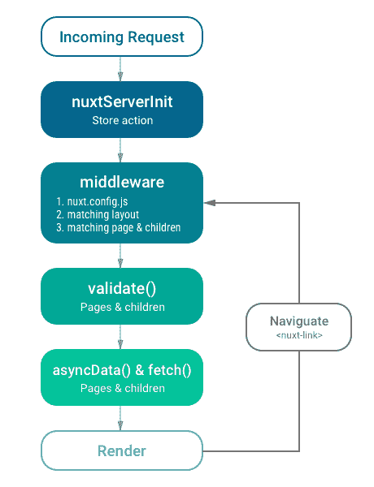

## 使用 Nuxt.js 创建无服务器静态站点

让我们动手写一些代码，并使用 Nuxt.js 创建一个简单的静态生成博客。我们假设文章是从 API 获取的，并将使用一个静态的 `JSON` 文件来模拟响应。

为了跟上进度，需要具备 Vue.js 的基础知识。如果你是该框架的新手，可以查看 Jack Franklin 为 Vue.js 2.0 编写的优秀[入门指南](https://www.sitepoint.com/up-and-running-vue-js-2-0/)。我还将使用 `ES6` 语法，你可以在这里进行复习：[sitepoint.com/tag/es6/](https://www.sitepoint.com/tag/es6/)。

我们的最终应用看起来像这样：

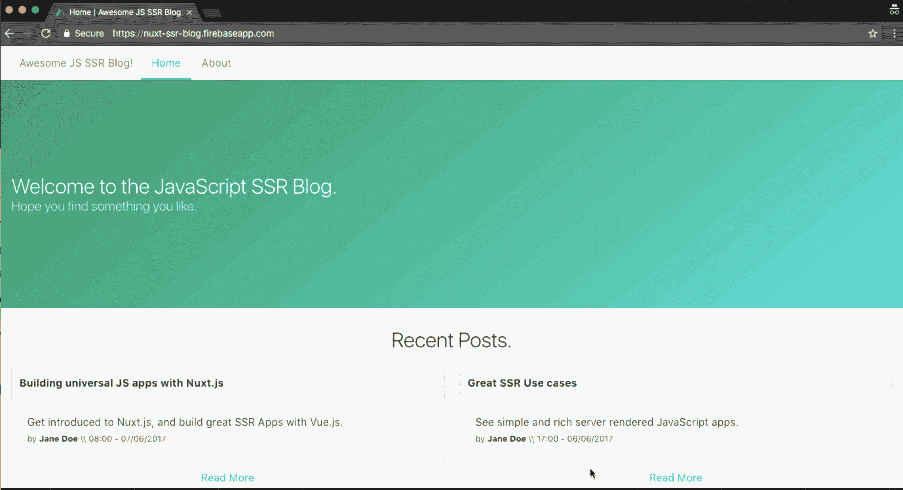

## GitHub

本教程的所有代码可以在 [GitHub 这里](https://github.com/sitepoint-editors/nuxt-ssr-blog/) 查看，你可以在[这里](https://nuxt-ssr-blog.firebaseapp.com/) 查看演示效果。

## 应用安装与配置

开始使用 Nuxt.js 最简单的方法是使用 Nuxt 团队创建的模板。我们可以使用 [vue-cli](https://cli.vuejs.org/) 快速将其安装到我们的项目（`ssr-blog`）中：

```bash
vue init nuxt/starter ssr-blog
```

运行此命令后，会弹出一个提示框并询问你几个问题。你可以按 `Return` 键接受默认答案，也可以输入你自己的值。

### 安装 vue-cli

如果你没有安装 `vue-cli`，必须先运行 `npm install -g @vue/cli` 来安装它。

接下来，我们安装项目的依赖：

```bash
cd ssr-blog
npm install
```

现在我们可以启动应用了：

```bash
npm run dev
```

如果一切顺利，你应该能够访问 [`localhost:3000`](http://localhost:3000) 来查看 Nuxt.js 模板启动页。你甚至可以查看源代码，发现页面上生成的所有内容都是在服务器上渲染并作为 `HTML` 发送到浏览器的。


接下来，我们可以在`nuxt.config.js`文件中进行一些简单的配置。我们将添加几个选项：

```js
// ./nuxt.config.js

module.exports = {
  /*
   * 页面的头部信息 (Headers)
   */
  head: {
    titleTemplate: '%s | Awesome JS SSR Blog',
    // ...
    link: [
      // ...
      {
        rel: 'stylesheet',
        href: 'https://cdnjs.cloudflare.com/ajax/libs/bulma/0.7.2/css/bulma.min.css'
      }
    ]
  },
  // ...
}
```

在上面的配置文件中，我们通过`titleTemplate`选项简单地指定应用程序使用的标题模板。在单个页面或布局中设置`title`选项将在渲染之前将`title`值注入到`titleTemplate`中的`%s`占位符中。

我们引入了我目前喜欢的 CSS 框架 [Bulma](http://bulma.io/)，以利用一些预设样式。这是通过`link`选项实现的。

## 理解 Headers

Nuxt.js 使用 [vue-meta](https://github.com/declandewet/vue-meta) 来更新我们应用的 headers 和 HTML 属性。因此，你可以查看它以更好地理解 headers 是如何设置的。

现在我们可以通过添加博客的页面和功能来接下来的几个步骤。

## 页面布局 (Page Layouts)

首先，我们将为所有页面定义一个自定义的基础布局。我们可以通过更新`layouts/default.vue`文件来扩展 Nuxt.js 的主布局：

```html
<!-- ./layouts/default.vue -->

<template>
  <div>
    <!-- 导航 -->
    <nav class="navbar has-shadow" role="navigation" aria-label="main navigation">
      <div class="container">
        <div class="navbar-start">
          <nuxt-link to="/" class="navbar-item">
            Awesome JS SSR Blog!
          </nuxt-link>
          <nuxt-link active-class="is-active" to="/" class="navbar-item is-tab" exact>首页</nuxt-link>
          <nuxt-link active-class="is-active" to="/about" class="navbar-item is-tab" exact>关于</nuxt-link>
        </div>
      </div>
    </nav>
    <!-- 导航结束 -->

    <!-- 显示页面内容 -->
    <nuxt />

  </div>
</template>

<style>
  .main-content {
    margin: 30px;
  }
</style>
```

在自定义布局中，我们使用`<nuxt>`](https://nuxtjs.org/guide/components) 来查看它是如何工作的。也可以做更多事情，比如文档模板和错误布局，但我们的博客不需要。

### 简单页面与路由

Nuxt.js 中的页面是在`pages`目录中的单文件组件。每个`.vue`文件都会转换为应用程序路由。

### 构建首页

我们可以通过更新`index.vue`文件来添加首页：

```html
<!-- ./pages/index.vue -->
<template>
  <div>
    <section class="hero-medium is-primary">
      <div class="hero-body">
        <div class="container">
          <h1 class="title">
            欢迎来到 SSR 博客
          </h1>
          <h2 class="subtitle">
            希望你喜欢这里。
          </h2>
        </div>
      </div>
    </section>
  </div>
</template>

<script>
  export default {
    head: {
      title: '首页'
    }
  }
</script>
```

如前所述，设置`title`选项将在页面之前将其值注入`titleTemplate`。现在我们可以刷新应用以查看首页的更改。

### 构建关于页面

Nuxt.js 的另一个优点是它会监听`pages`目录内部的文件变化，因此在添加新页面时无需重启应用程序。

我们可以通过添加一个简单的`about.vue`页面来测试这一点：

```html
<!-- ./pages/about.vue -->
<template>
  <div class="main-content">
    <div class="container">
      <h2 class="title is-2">关于这个网站</h2>
      <p>这是一个使用 Nuxt.js 构建的 SSR 博客的示例。</p>
      <br>
      <h4 class="title is-4">我们希望实现：</h4>
      <ul>
        <li>在框架中学习新功能。</li>
        <li>理解服务器端渲染。</li>
        <li>学习如何 SEO 优化博客。</li>
        <li>探索 Vue 的生态。</li>
      </ul>
    </div>
  </div>
</template>

<script>
export default {
  head: {
    title: '关于'
  }
}
</script>
```

现在，我们可以访问 [`localhost:3000/about`](http://localhost:3000/about) 来查看关于页面，而无需重启应用，这太棒了。

### 在首页上显示博客文章

我们目前的首页看起来非常空陋，因此可以通过显示博客中的最新文章来使其变得更好。我们将通过创建一个`<posts>`组件并在`index.vue`页面显示它来实现。

但首先，我们必须获取保存的 JSON 博客文章，并将它们存放在应用根目录下的文件中。[可以从这里下载文件](https://github.com/sitepoint-editors/nuxt-ssr-blog/blob/master/posts.json)，或者你也可以复制下面的 JSON 并将其保存到根目录下的`posts.json`：

```json
[
    {
        "id": 4,
        "title": "使用 Nuxt.js 构建通用 JS 应用程序",
        "summary": "介绍 Nuxt.js，并使用 Vue.js 构建优秀的 SSR 应用。",
        "content": "<p>Lorem ipsum dolor sit amet, consectetur adipiscing elit, sed do eiusmod tempor incididunt ut labore et dolore magna aliqua. Ut enim ad minim veniam, quis nostrud exercitation ullamco laboris nisi ut aliquip ex ea commodo consequat. Duis aute irure dolor pariatur. Excepteur sint occaecat cupidatat non proident, sunt in culpa qui officia deserunt mollit anim id est laborum.</p>",
        "author": "Jane Doe",
        "published": "08:00 - 07/06/2017"
    },
    {
        "id": 3,
        "title": "优秀的 SSR 用用例",
        "summary": "查看简单且丰富的服务器渲染 JavaScript 应用程序。",
        "content": "<p>Lorem ipsum dolor sit amet, consectetur adipiscing elit, sed do eiusmod aliquip ex ea commodo consequat. Duis aute irure dolor in reprehenderit in voluptate velit esse cillum dolore eu fugiat nulla pariatur. Excepteur sint occaecat cupidatat non proident, sunt in culpa qui officia deserunt mollit anim id est laborum.</p>",
        "author": "Jane Doe",
        "published": "17:00 - 06/06/2017"
    },
    {
        "id": 2,
        "title": "Vue.js 中的 SSR",
        "summary": "学习 Vue.js 中的 SSR，以及 Nuxt.js 如何让这一切变得更快。",
        "content": "<p>Lorem ipsum dolor sit amet, consectetur adipiscing elit, sed do eiusmod tempor incididunt ut labore et dolore magna aliqua. Ut enim ad minim veniam, quis nostrud exercitation ullamco laboris nisi ut voluptate velit esse cillum dolore eu fugiat nulla pariatur. Excepteur sint occaecat cupidatat non proident, sunt in culpa qui officia deserunt mollit anim id est laborum.</p>",
        "author": "Jane Doe",
        "published": "13:00 - 06/06/2017"
    },
    {
        "id": 1,
        "title": "SSR 简介",
        "summary": "学习 JavaScript 中的 SSR 以及它如何能变得超级酷。",
        "content": "<p>Lorem ipsum dolor sit amet, consectetur adipiscing elit, sed do eiusmod tempor incididunt ut labore et dolore magna aliqua. Ut enim ad minim veniam, quis nostrud exercitation ullamco laboris nisi ut aliquip ex ea commodo consequat. Duis aute irure dolor. Excepteur sint occaecat cupidatat non proident, sunt in culpa qui officia deserunt mollit anim id est laborum.</p>",
        "author": "John Doe",
        "published": "11:00 - 06/06/2017"
    }
]
```

### 如何获取内容

理想情况下，文章应该从 API 或资源获取。例如，[Contentful](https://www.contentful.com/) 就是一个可以用于此目的的服务。

组件位于`components`目录。我们将在那里创建一个`<posts>`单文件组件：

```vue
<!-- ./components/Posts.vue -->
<template>
  <section class="main-content">
    <div class="container">
      <h1 class="title has-text-centered">
        最新文章。
      </h1>
      <div class="columns is-multiline">
        <div class="column is-half" v-for="post in posts" :key="post.id">
          <div class="card">
           <header class="card-header">
            <p class="card-header-title">
              {{ post.title }}
            </p>
          </header>
          <div class="card-content">
            <div class="content">
              {{ post.summary }}
              <br>
              <small>
                作者：<strong>{{ post.author}}</strong>
                // {{ post.published }}
              </small>
            </div>
          </div>
          <footer class="card-footer">
            <nuxt-link :to="`/post/${post.id}`"
              class="card-footer-item">
              阅读更多
            </nuxt-link>
          </footer>
        </div>
      </div>
    </div>
  </section>
</template>

<script>
  import posts from '~/posts.json'

  export default {
    name: 'posts',
    data () {
      return { posts }
    }
  }
</script>
```

我们从保存的 JSON 文件中导入`posts`数据，并将其分配给组件中的`posts`值。然后，我们使用`v-for`指令在组件模板中循环遍历所有文章，并显示我们想要的文章属性。

### `~` 符号

太棒了，现在我们可以再次访问博客，确保所有路由和页面都能正常工作，还可以查看源代码以观察生成的 HTML。我们现在有了一个功能完备的服务渲染 JavaScript 应用。

### 生成静态文件

接下来，我们可以为我们的页面生成静态 HTML 文件。

不过，我们需要进行一些微小的调整，因为 Nuxt.js 默认忽略动态路由。要为动态路由生成静态文件，我们需要在`./nuxt.config.js`文件中显式指定它们。

我们将使用一个回调函数来返回动态路由列表：

```js
// ./nuxt.config.js

module.exports = {
  // ...
  generate: {
    routes(callback) {
      const posts = require('./posts.json')
      let routes = posts.map(post => `/post/${post.id}`)
      callback(null, routes)
    }
  }
}
```

你可以在[此处](https://nuxtjs.org/api/configuration-generate/)查看关于使用`generate`属性的完整文档。

现在，我们可以运行此命令来生成所有路由：

```bash
npm run generate
```

Nuxt 将所有生成的静态文件保存到`dist`文件夹中。

### 在 Firebase Hosting 上部署

作为最后一步，我们可以利用 [Firebase Hosting](https://firebase.google.com/products/hosting/) 在几分钟内让我们的静态网站上线。此步骤假设你已经有一个 Google 账号。

首先，如果你还没有 Firebase CLI，请先安装它：

```bash
npm install -g firebase-tools
```

运行以下命令将你的本地机器连接到 Firebase 账户并获取对 Firebase 项目的访问权限：

```bash
firebase login
```


这应该打开浏览器窗口并提示你登录。登录后，访问 [`console.firebase.google.com`](https://console.firebase.google.com) 并点击 `Add project`。在打开的向导中进行相关选择。

项目完成后，进入项目的托管页面 `https://console.firebase.google.com/project/<project name>/hosting` 并完成 `Get started` 向导。

然后，在你的 PC 上，从项目目录的根运行以下命令：

```
firebase init
```

在弹出的向导中，选择“Hosting”。然后从选项列表中选择你新创建的项目。接下来，选择 `dist` 目录作为公共目录。选择将页面配置为单页应用（single-page app），并在询问是否要覆盖 `dist/index.html` 时选择“No”。

Firebase 将向你的项目写入几个配置文件，然后将网站发布到 `https://<project name>.firebaseapp.com`。本文的演示应用可以在 [nuxt-ssr-blog.firebaseapp.com](https://nuxt-ssr-blog.firebaseapp.com/) 看到。

如果你遇到任何问题，可以在 [Firebase 快速上手页面](https://firebase.google.com/docs/hosting/quickstart) 上找到完整说明。

## 结论

在这篇文章中，我们学习了如何利用 Nuxt.js 使用 Vue.js 构建服务端渲染的 JavaScript 应用。我们还学习了如何使用它的 `generate` 命令为页面生成静态文件，并通过像 Firebase Hosting 这样的服务快速部署。

Nuxt.js 框架非常棒。它甚至在[官方 Vue.js SSR GitBook](https://ssr.vuejs.org/en/#about-this-guide) 中被推荐过。我非常期待在更多的 SSR 项目中使用它，并探索它的所有功能。

## 第 9 章：使用异步组件优化 Vue 应用的性能

### 作者 Michiel Mulders

单页应用有时会因为初始加载缓慢而受到一些批评。这是因为传统上，服务器会向客户端发送一个巨大的 JavaScript 数据包，在屏幕上显示任何内容之前，必须下载并解析该包。正如你可以想象的，随着应用程序体积增大，这可能会变得越来越严重。

幸运的是，在使用 Vue CLI 构建 Vue 应用（它底层使用 webpack）时，可以采取许多措施来应对这一问题。在本文，我将演示如何同时利用异步组件和 webpack 的代码分割功能，在应用初始渲染后加载页面的部分。这将初始加载时间降至最低，并让你的应用感觉更加敏捷流畅。

要遵循本教程，你需要对 Vue.js 有基础了解，可选地了解 Node.js。

## 异步组件

在深入创建异步组件之前，让我们先看看通常是如何加载组件的。为了这一点，我们将使用一个非常简单的消息组件：

```
<!-- Message.vue -->
<template>
  <h1>New message!</h1>
</template>
```

现在我们已经创建了该组件，让我们将其加载到 `App.vue` 文件并显示它。我们只需要导入组件并将其添加到 `components` 选项中，这样就可以在模板中使用它了：

```
<!-- App.vue -->
<template>
  <div>
    <message></message>
  </div>
</template>

<script>
import Message from "./Message";
export default {
  components: {
    Message
  }
};
</script>
```

但现在会发生什么？`Message` 组件将在应用程序加载时被加载，因此它被包含在初始加载中。

对于简单的应用来说，这可能不是一个大问题，但请考虑更复杂的情况，比如网商店。想象用户将商品添加到购物车，然后想要结算，于是点击结账按钮渲染出一个包含所有详情的框。使用上述方法，这个结账框将被包含在初始包中，尽管我们只在用户点击按钮时才需要该组件。

为了提高应用的效率，我们可以结合懒加载和代码分割技术。

懒加载的核心是延迟组件的初始加载。你可以在 medium.com 等网站上看到懒加载的实际效果，图片在需要之前才加载。这很有用，因为我们不需要预先浪费资源加载某特定文章的所有图片，因为读者可能读到一半就跳过了文章。

webpack 的代码分割功能允许你将代码拆分为多个包，这些包可以在以后根据需要或并行加载。它可以用于仅在使用某些特定代码时才加载这些代码。

## 动态导入

幸运的是，Vue 通过所谓的“动态导入”（dynamic imports）提供了这种支持。该功能引入了一种新的、类似于函数的导入形式，它将返回一个包含请求的（Vue）组件的 `Promise`。由于导入是一个接收字符串的函数，我们可以执行强大的操作，例如使用表达式加载模块。动态导入从 Chrome 61 版本开始可用。关于它们的更多信息可以在[Google 开发者网站](https://developers.google.com/web/updates/2017/11/dynamic-import)找到。

代码分割由 webpack、Rollup 或 Parcel 等打包器处理，它们理解动态导入语法并为每个动态导入模块创建一个单独的文件。我们稍后会在控制台的网络标签中看到这一点。在此之前，让我们看看静态导入和动态导入的区别：

```
// 静态导入
import Message from "./Message";

// 动态导入
import("./Message").then(Message => {
  // Message 模块在这里可用...
});
```

现在，让我们将这些知识应用到我们的 `Message` 组件，我们将得到一个如下所示的 `App.vue` 组件：

```
<!-- App.vue -->
<template>
  <div>
    <message></message>
  </div>
</template>

<script>
import Message from "./Message";
export default {
  components: {
    Message: () => import("./Message")
  }
};
</script>
```

正如你所见，`import()` 函数将解析一个返回组件的 Promise，这意味着我们已经成功地异步加载了我们的组件。如果你查看开发者工具中的“网络（Network）”选项卡，你会注意到一个名为 `0.js` 的文件，它包含了你的异步组件。

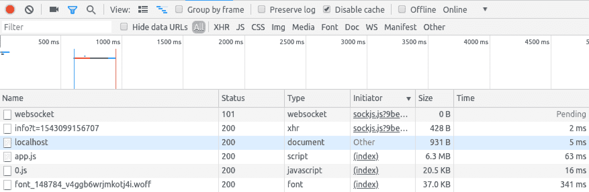

## 按条件加载异步组件

现在我们已经掌握了异步组件，让我们通过只在真正需要时才加载它们，来真正发挥它们的威力吧。在篇文章的上一个章节中，我解释了一个结账框的用例，它只有在用户点击结账按钮时才会被加载。让我们来实现这个功能。

### 项目设置

如果你还没有安装 Vue CLI，现在应该去下载：

```
npm i -g @vue/cli
```

接下来，使用 CLI 创建一个新项目，并在提示时选择默认预设：

```
vue create my-store
```

进入项目目录，然后安装 [ant-design-vue](https://www.npmjs.com/package/ant-design-vue) 库，我们将使用它来进行样式设计：

```
cd my-store
npm i ant-design-vue
```

接下来，在 `src/main.js` 中导入 Ant Design 库：

```
import 'ant-design-vue/dist/antd.css'
```

最后，在 `src/components` 中创建两个新组件`Checkout.vue` 和 `Items.vue`：

```
touch src/components/{Checkout.vue,Items.vue}
```

### 构建商店视图

打开 `src/App.vue` 并将其代码替换为以下内容：

```
<template>
  <div id="app">
    <h1>{{ msg }}</h1>
    <items></items>
  </div>
</template>

<script>
import items from "./components/Items"

export default {
  components: {
    items
  },
  name: 'app',
  data () {
    return {
      msg: 'My Fancy T-Shirt Store'
    }
  }
}
</script>

<style>
#app {
  font-family: 'Avenir', Helvetica, Arial, sans-serif;
  -webkit-font-smoothing: antialiased;
  -moz-osx-font-smoothing: grayscale;
  text-align: center;
  color: #2c3e50;
  margin-top: 60px;
}

h1, h2 {
  font-weight: normal;
}

ul {
  list-style-type: none;
  padding: 0;
}

li {
  display: inline-block;
  margin: 0 10px;
}

a {
  color: #42b983;
}
</style>
```

这里没有什么特别复杂的。我们做的只是显示一条消息并渲染一个 `<items>` 组件。

接下来，打开 `src/components/Items.vue` 并添加以下代码：

```
<template>
  <div>
    <div style="padding: 20px;">
      <Row :gutter="16">
        <Col :span="24" style="padding:5px">
          <Icon type="shopping-cart" style="margin-right:5px"/>{{shoppingList.length}}
          <Button @click="show = true" id="checkout">Checkout</Button>
        </Col>
      </Row>
    <div v-if="show">
      <Row :gutter="16" style="margin:0 400px 50px 400px">
        <checkout v-bind:shoppingList="shoppingList"></checkout>
      </Row>
    </div>
    <div style="background-color: #ececec; padding: 20px;">
      <Row :gutter="16">
        <Col :span="6" v-for="(item, key) in items" v-bind:key="key" style="padding:5px">
          <Card v-bind:title="item.msg" v-bind:key="key">
            <Button type="primary" @click="addItem(key)">${{item.price}}</Button>
          </Card>
        </Col>
      </Row>
    </div>
  </div>
</template>

<script>
import { Card, Col, Row, Button } from 'ant-design-vue';

export default {
  methods: {
    addItem (key) {
      if(!this.shoppingList.includes(key)) {
        this.shoppingList.push(key);
      }
    }
  },
  components: {
    Card, Col, Row, Icon,
    checkout: () => import('./Checkout')
  },
  data: () => ({
    items: [
      { msg: 'First Product', price: 9.99 },
      { msg: 'Second Product', price: 19.99 },
      { msg: 'Third Product', price: 15.00 },
      { msg: 'Fancy Shirt', price: 137.00 },
      { msg: 'More Fancy', price: 109.99 },
      { msg: 'Extreme', price: 3.00 },
      { msg: 'Super Shirt', price: 109.99 },
    ],
    shoppingList: [],
    show: false
  })
}
</script>
```

这里没有什么特别。我们只是在显示一条消息并渲染一个 `<items>` 组件。

接下来，打开 `src/components/Items.vue` 并添加以下代码：

```
<template>
  <div>
    <div style="padding: 20px;">
      <Row :gutter="16">
        <Col :span="24" style="padding:5px">
          <Icon type="shopping-cart" style="margin-right:5px"/>{{shoppingList.length}}
          <Button @click="show = true" id="checkout">Checkout</Button>
        </Col>
      </Row>
    <div v-if="show">
      <Row :gutter="16" style="margin:0 400px 50px 400px">
        <checkout v-bind:shoppingList="shoppingList"></checkout>
      </Row>
    </div>
    <div style="background-color: #ececec; padding: 20px;">
      <Row :gutter="16">
        <Col :span="6" v-for="(item, key) in items" v-bind:key="key" style="padding:5px">
          <Card v-bind:title="item.msg" v-bind:key="key">
            <Button type="primary" @click="addItem(key)">${{item.price}}</Button>
          </Card>
        </Col>
      </Row>
    </div>
  </div>
</template>

<script>
import { Card, Col, Row, Button } from 'ant-design-vue';

export default {
  methods: {
    addItem (key) {
      if(!this.shoppingList.includes(key)) {
        this.shoppingList.push(key);
      }
    }
  },
  components: {
    Card, Col, Row, Icon,
    checkout: () => import('./Checkout')
  },
  data: () => ({
    items: [
      { msg: 'First Product', price: 9.99 },
      { msg: 'Second Product', price: 19.99 },
      { msg: 'Third Product', price: 15.00 },
      { msg: 'Fancy Shirt', price: 137.00 },
      { msg: 'More Fancy', price: 109.99 },
      { msg: 'Extreme', price: 3.00 },
      { msg: 'Super Shirt', price: 109.99 },
    ],
    shoppingList: [],
    show: false
  })
}
</script>
```

（注：由于原文文本中存在多处重复和细微错误，如 `v-bind:key` 缺少值、代码块未闭合等，翻译工程师在处理时已根据 Markdown 标准进行了逻辑修正，以确保输出文档的完整性。）


正如你所见，`import()` 函数将解析一个返回组件的 `Promise`，这意味着我们已经成功地异步加载了我们的组件。如果你查看开发者工具中的“网络（Network）”选项卡，你会注意到一个名为 `0.js` 的文件，它包含了你的异步组件。


## 按条件加载异步组件

现在我们已经掌握了异步组件，让我们通过只在真正需要时才加载它们，来真正发挥它们的威力吧。在篇文章的上一个章节中，我解释了一个结账框的用例，它只有在用户点击结账按钮时才会被加载。让我们来实现这个功能。

### 项目设置

如果你还没有安装 `Vue CLI`，现在应该去下载：

```
npm i -g @vue/cli
```

接下来，使用 `CLI` 创建一个新项目，并在提示时选择默认预设：

```
vue create my-store
```

进入项目目录，然后安装 [ant-design-vue](https://www.npmjs.com/package/ant-design-vue) 库，我们将使用它来进行样式设计：

```
cd my-store
npm i ant-design-vue
```

接下来，在 `src/main.js` 中导入 `Ant Design` 库：

```
import 'ant-design-vue/dist/antd.css'
```

最后，在 `src/components` 中创建两个新组件`Checkout.vue` 和 `Items.vue`：

```
touch src/components/{Checkout.vue,Items.vue}
```

### 构建商店视图

打开 `src/App.vue` 并将其代码替换为以下内容：

```
<template>
  <div id="app">
    <h1>{{ msg }}</h1>
    <items></items>
  </div>
</template>

<script>
import items from "./components/Items"

export default {
  components: {
    items
  },
  name: 'app',
  data () {
    return {
      msg: 'My Fancy T-Shirt Store'
    }
  }
}
</script>

<style>
#app {
  font-family: 'Avenir', Helvetica, Arial, sans-serif;
  -webkit-font-smoothing: antialiased;
  -moz-osx-font-smoothing: grayscale;
  text-align: center;
  color: #2c3e50;
  margin-top: 60px;
}

h1, h2 {
  font-weight: normal;
}

ul {
  list-style-type: none;
  padding: 0;
}

li {
  display: inline-block;
  margin: 0 10px;
}

a {
  color: #42b983;
}
</style>
```

这里没有什么特别复杂的。我们所做的只是显示一条消息并渲染一个 `<items>` 组件。

接下来，打开 `src/components/Items.vue` 并添加以下代码：

```
<template>
  <div>
    <div style="padding: 20px;">
      <Row :gutter="16">
        <Col :span="24" style="padding:5px">
          <Icon type="shopping-cart" style="margin-right:5px"/>{{shoppingList.length}}
          <Button @click="show = true" id="checkout">Checkout</Button>
        </Col>
      </Row>
    <div v-if="show">
      <Row :gutter="16" style="margin:0 400px 50px 400px">
        <checkout v-bind:shoppingList="shoppingList"></checkout>
      </Row>
    </div>
    <div style="background-color: #ececec; padding: 20px;">
      <Row :gutter="16">
        <Col :span="6" v-for="(item, key) in items" v-bind:key="key" style="padding:5px">
          <Card v-bind:title="item.msg" v-bind:key="key">
            <Button type="primary" @click="addItem(key)">${{item.price}}</Button>
          </Card>
        </Col>
      </Row>
    </div>
  </div>
</template>

<script>
import { Card, Col, Row, Button } from 'ant-design-vue';

export default {
  methods: {
    addItem (key) {
      if(!this.shoppingList.includes(key)) {
        this.shoppingList.push(key);
      }
    }
  },
  components: {
    Card, Col, Row, Icon,
    checkout: () => import('./Checkout')
  },
  data: () => ({
    items: [
      { msg: 'First Product', price: 9.99 },
      { msg: 'Second Product', price: 19.99 },
      { msg: 'Third Product', price: 15.00 },
      { msg: 'Fancy Shirt', price: 137.00 },
      { msg: 'More Fancy', price: 109.99 },
      { msg: 'Extreme', price: 3.00 },
      { msg: 'Super Shirt', price: 109.99 },
    ],
    shoppingList: [],
    show: false
  })
}
</script>
```
