# 计算机编程：学习计算机的语言！（儿童初学者指南）

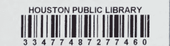

## 在 Dummies.com® 学习更多内容

访问 `www.dummies.com/go/writingcomputercode` 查找：

- 完成项目所需的工具链接
- 关于代码编码的更多信息链接
- 关于其他为青少年学习者编写技术主题的书籍信息链接

> 在家中的计算机上下载和安装软件或在在线服务上注册会员时，请务必征得父母许可。


作者：Chris Minnick

Eva Holland

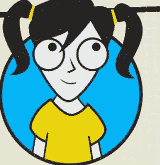

- 定制化你自己的机器人 . . . . . . . . . . . . . . . . . . . . . . . . . . . . . . . . . . . . . 84

## 引言

所以，你想开始编写真正的计算机代码了！也许你以前玩过拖放式编程语言，或者在《我的世界》中制作过模组，现在你准备好进入更高级阶段了。太棒了！目前有 500 多种不同的计算机编程语言（考虑到世界上大约有 6500 种人类语言，这并不算多！）。你即将学习全球数百万编码人员正在使用的最流行的编程语言。

### 关于本书

在书中，你将学习使用 `HTML5`、`CSS3` 和 `JavaScript` 来创建计算机程序。使用这三种计算机编程语言的人比人类以来发明的任何其他编程语言都多得多。事实上，你访问的每一个网站都使用了这三门语言。这就是为什么我们认为，你通过学习《编写计算机代码》来开启你的编程之旅是一个非常明智的决定。

计算机代码既有趣又易于学习。只要有足够的决心和丰富的想象力，你很快就能创建出你自己的计算机程序！

就像成为伟大的运动员或音乐家的唯一途径是练习、练习、再练习一样，成为计算机程序员的唯一途径就是编写代码、编写代码、再编写代码！

本书由一系列项目组成，每个项目都包含了从开始到结束的构建步骤。项目之间环环相扣，因此当你读完本书时，你将拥有一个可以用鼠标控制的动画机器人，并在完成所有项目很久以后，还可以继续对其进行修改和改进。

### 完成书中的项目，你需要以下条件：

- 一台运行 Windows、Mac OS X 或 Linux 操作系统的计算机
- 一个网页浏览器，如 Chrome、Firefox 或 Safari
- 一个互联网连接

在学习每个项目时，请记住以下几点：

- 代码和网页地址使用等宽字体（monofont）。如果你正在阅读电子书，可以点击像 `www.dummies.com` 这样的网页地址来访问该网站。
- 当你开始时，最好的学习方法是观察别人是如何做的。出于这个原因，我们在书中的每一个重要步骤都包含了图片，并且我们所有的示例都可以在 `http://jsfiddle.net/user/watzthisthis/fiddles` 查看。如果你想检查自己的工作，或者直接复制我们的示例，请务必同时查看这两个地方。
- 每个项目在结束时都会对项目中的编程核心思想进行回顾。这些核心思想包含了你在未来的项目中发现非常有用的代码和概念。
- 编程并不困难，但它确实涉及很多技术细节。如果你不想阅读所有的解释，只需跳到下一个代码示例并尝试一下即可。

### 关于你

我们已经知道你准备好并愿意编写代码了。因为你正在阅读这些，我们知道你完全完全并可以立即开始。我们没有很多假设，但这里有我们想提前提到的几点：

- 你应该能够熟练地使用浏览器访问网站，并在键盘上打字。书中的项目可能无法在没有键盘的手机或平板电脑上运行。
- 你熟悉非常基础的数学。我们说的是加、减、乘、除法。我们完全不需要任何非常高级的内容，但基础数学是编程的一个重要部分。
- 你有耐心和专注力去坚持下去并排除故障（bugs）。我们保证编程可以非常有趣，但也保证当你必须追踪那个导致整个程序无法运行的单个拼写错误或遗漏的命令时，它可能会令人沮丧。坚持下去！

其实就这些了。如果你卡住了，请记住，编写计算机代码时发生的很多问题仅仅是因为拼写错误或你输入的计算机无法理解的单词。缓慢、谨慎地进行，你会表现得很出色的！

### 关于图标

当你阅读书中的项目时，你会看到几个图标。这些图标指向不同的内容：

- **注意！** 警告（Warning）图标标记了重要信息，你可以利用这些信息来避免编码时常见的陷阱。


- **记住**（Remember）图标标记了你以前遇到过应该记住的概念。

- **提示**（Tip）图标标记了对你有帮助的建议和技巧。


- **代码乐趣**（Fun with Code）图标描述了你在编码时使用的代码。


- **数学乐趣**（Fun with Math）图标描述了你使用的数学。

## 第一步


一旦你迈出第一步，世界将向你敞开。祝贺你迈出了第一步！

### 第一个项目：成为程序员


#### 什么是编程？

计算机程序是一组计算机可以理解的指令。计算机程序的另一个名称是*软件*。计算机编程，也称为*编码*（coding），是我们编写这些内容时的称呼。图 1-1 显示了一台计算机。

现在，这些代码看起来可能很困惑，但在读完本书后，你将学会如何阅读它们甚至编写它们！

程序帮助人们做很多事情，包括：

- 播放音乐和视频
- 进行科学实验
- 设计汽车
- 发明机器
- 玩游戏
- 控制机器人

#### 发明编程的女性

电子计算机最早于 20 世纪 30 年代发明。但在 19 世纪中期，第一个计算机程序——一组由机器执行的指令集被编写出来。

第一个计算机程序的作者——也是世界上第一个程序员——是一位女性阿达·洛芙莱拉斯（Ada Lovelace）。她是一位住在英国的数学家。她想象计算机可以完成我们现在使用计算机的一切，包括处理文字、显示图片和播放音乐。她独特的理解让她赢得了“数字女巫”的称号。我们猜你的称号没有那么酷。

格蕾·霍珀（Grace Hopper）工作的计算机使用的是电力（而不是手摇！），它们非常巨大，正如这张照片所示，照片中展示的是巨人机（Colossus）计算机。巨人机是第一台可编程的电子计算机。

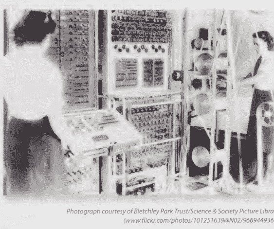

你能想到计算机还能做的其他事情吗？

所有的计算机程序都始于一个想法。在开始编写任何代码之前，思考你想让程序做什么是非常重要的。发挥你的想象力，大胆梦想吧！

在开始编码之前，有一些值得思考的有用问题：

- 我的程序将做什么？
- 谁会使用我的程序？
- 他们为什么要使用我的程序？
- 他们将在哪里使用我的程序？
- 他们将如何使用我的程序？

#### 你如何与计算机交流？

每个计算机程序都是用计算机编程语言编写的。编程语言允许你编写指令，这些指令可以被翻译（或编译）成机器语言。这些编程语言最终转换为二进制代码，使用 0 和 1 形成字母、数字和符号，这些符号可以组合起来执行任务。

每台计算机的核心都是中央处理单元（CPU），如图 1-2 所示。

CPU 由数百万个微小、极快的开关（晶体管）组成，这些开关可以开启或关闭。这些开关的位置决定了计算机将做什么。由程序员编写的软件通过二进制代码告诉这些开关何时开启或关闭。

计算机的每件事都是许多 0 和 1 的不同组合的结果。例如，为了表示小写字母 a，计算机使用以下二进制代码：

```
0110 0001
```


**图 1-2**：每台计算机的核心都是 CPU。

二进制数中的每个 0 或 1 都称为一个*位（bit）*，八个位的组合称为一个*字节（byte）*。当你听到*千字节（kilobyte）、兆字节（megabyte）和吉字节（gigabyte）*被用来描述文件大小时时，它的意思是存储该文件所需的字节数。

表 1-1 列出了最常见的存储大小。

| 名称 | 字节数 | 它们可以存储的内容 |
| --- | --- | --- |
| 千字节 (KB) | 1,024 | 两到三段文本 |
| 兆字节 (MB) | 1,048,576 | 800 页书籍 |
| 吉字节 (GB) | 1,079,741,824 | 1,000 本书 |
| 太字节 (TB) | 1,099,511,627,776 | 100 万本书 |
| 千亿字节 (PB) | 1,125,899,906,842,624 | 历史上写过的每一本书的多个副本！ |


你想学习像计算机一样数数吗？我们将教你如何用二进制代码写 0 到 255 之间的任何数字。在这个示例中，我们将用二进制代码写数字 150。

- 在纸的顶部水平写下以下数字：

| 128 | 64 | 32 | 16 | 8 | 4 | 2 | 1 |

这些数字是你的二进制对照表。

- 在这些数字下方写下你想转换为二进制的数字，即 150。
- 从你在纸上写出的第一个数字 128 开始。如果这个数字能放入 150 中，就在它下面写一个 1。如果它不能放入 150 中，就在它下面写一个 0。

因为 128 可以放进 150，所以于 128 下方写一个 1。

| 128 | 64 | 32 | 16 | 8 | 4 | 2 | 1 |

- 从你正在写的二进制代码数字（150）中减去 128：150 - 128 = 22。划掉你写下的 150，写下 22。
- 将余数与二进制对照表中的下一个数字 64 进行比较。64 能放入 22 吗？不能，所以在 64 下方写一个 0，并移动到对照表中的下一个数字 32。
- 啊哈！16 可以放入 22！在 32 下方写一个 1 [注：根据上下文应为 16] 并从 22 中减去 16：22 - 16 = 6。
- 因为 8 不能放入 6，所以在 8 下方写一个 0，并移动到下一个数字，即 4。
- 因为 4 可以放入 6，在 4 下方写一个 1，并从 6 中减去 4：6 - 4 = 2。
- 因为 2 可以放入 2，在 2 下方写一个 1，并从 2 中减去 2：2 - 2 = 0。
- 因为 1 不能放入 0，所以在 1 下方写一个 0。

[画一个小火人](www.drawastickman.com)（见图 1-6）：Draw a Stickman 是一个超级有趣的网站，你可以在那里绘制自己的角色并创意地与不同的章节进行互动，这一切都由 JavaScript 和 HTML 驱动！

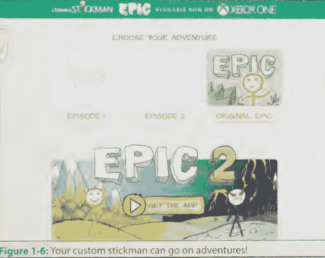

[交互式耳朵](www.amplifon.co.uk/interactive-ear；见图 1-7）：交互式耳朵让你能够学习和探索耳朵的工作原理。最棒的是，这个网站是使用你将在本书中学学习的语言构建的！

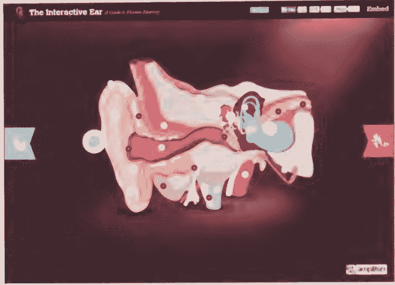

图 1-7：人耳是如此有趣！

#### 准备你的工具

你完成的每一个任务都需要一套工具，编写计算机代码也需要一些特殊的工具。JavaScript 程序员使用的不是锤子和铅笔之类的物品，而是可以在网上找到工具。你只需要一个网络浏览器和互联网连接即可完成书中的所有项目。

让我们继续，整理一下你的工具箱。

##### 准备好你的浏览器

使用 JavaScript 所需的一个本质工具是网络浏览器。你有许多不同的网络浏览器可以选择，几乎所有的浏览器在运行 JavaScript 方面表现都很出色。你可能已经在电脑上有了一个网络浏览器。

今天最广泛使用的网络浏览器是 Mozilla Firefox、Apple Safari、Google Chrome 和 Microsoft Internet Explorer。对于本书，我们将使用 Chrome，它是目前最流行的网络浏览器，并拥有许多用于处理 JavaScript 的极佳工具。

如果你还没有安装 Chrome，将需要下载并安装它。你可以打开任何其他网络浏览器并访问 `www.google.com/chrome/desktop` 来安装 Chrome。按照该页面上的说明（如图 1-8 所示）在你的电脑上安装 Chrome。安装好 Chrome 后，启动它。


图 1-8：安装 Chrome 网络浏览器非常简单！

##### 使用 JSFIDLE

我们想向你介绍我们最喜欢的 JavaScript 乐场：JSFiddle。你玩的将不再是秋千和滑梯，而是 JavaScript 语句、HTML 标签和 CSS 样式。

#### 项目 1 成为程序员

JSFiddle 允许你在网络浏览器内部编写和实验代码。你可以用它来尝试代码、获取代码反馈、分享你的代码，甚至和你的朋友一起编写程序！

JSFiddle 是我们在整本书中用于实验 HTML、CSS 和 JavaScript 的工具。它被称为 JSFiddle，是因为你可以用它来“摆弄（fiddle）”代码。所以，让摆弄开始吧！

要开始使用 JSFiddle，打开你的 Chrome 网络浏览器，并在地址栏中输入 `http://jsfiddle.net`。你会看到一个像图 1-9 样的屏幕。

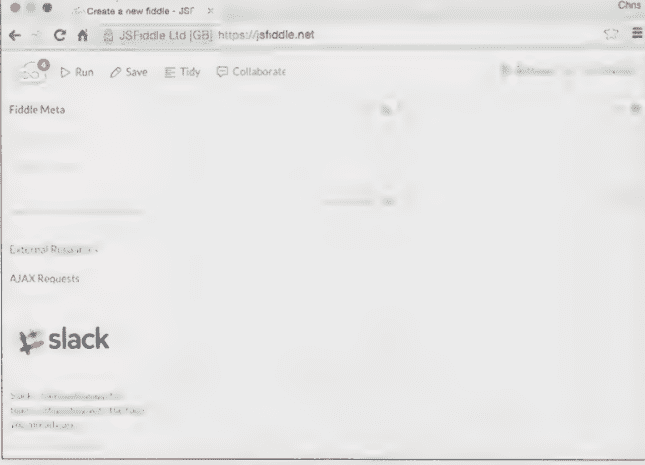

图 1-9：JSFiddle 首页，你的新乐场。

JSFiddle 由三个窗格组成，你可以在每个窗格中输入三种 Web 代码之一：HTML、CSS 和 JavaScript。第四个窗格是结果窗（Result），你可以在那里看到在其他框中输入的内容。左侧的工具栏允许为你的项目添加标题和描述，并包含一些我们在书中不会涉及的其他高级功能。顶部工具栏具有运行、保存和清理代码的按钮。

##### 创建 JSFiddle 账户

JSFiddle 让任何人创建账户并在公共仪表板中分享程序——许多优秀且丰富的程序员！

当程序员在 JSFiddle 上分享他们的程序时，他们同意任何想要的人都可以复制作品进行修改并重新发布。然而，借用代码时注明原作者总是有礼貌的。

学习不需要创建 JSFiddle 账户，但它会让查看和分享你的工作变得更容易。

按照以下步骤创建 JSFiddle 账户：

- 点击屏幕右上角的登录/注册链接。
- 点击登录表单下的注册链接。
- 填写创建账户表单并点击创建账户。
- 显示个人信息页面。
- 如果你愿意，可以在此处进行更改并保存。
- 当你准备好开始摆弄时，点击屏幕顶部的编辑器（Editor）链接。

在 HTML 中，`<h1>` 和 `</h1>` 被称为标签。文本周围的标签告诉浏览器该文本代表某些特殊内容。在这种情况下，`<h1>` 代表一级标题，它是页面上最大且最重要的标题。

另一个非常有用的 HTML 标签是 `<p>` 标签，它用于标记段落。要插入 `<p>` 标签，请按照以下步骤操作：

- 在 `</h1>` 之后，按下 Return 键（Mac）或 Enter 键（Windows）到下一行。
- 输入 `<p>`，然后输入你想显示的任何消息。

JSFiddle 会自动创建你的闭合标签 `</p>`。

- 点击 Run（运行），在 Result（结果）窗格中看到你的消息出现。

位于 JSFiddle 左下角的 JavaScript 面板是发生非常有趣事情的地方。

- 在 JavaScript 面板中，找到读取 `max = 36` 的一行，并将其改为 `max = 80`。
- 点击 Run。

现在，很多气泡（但不是全部）都比以前变大了。

根据你更改 `max` 值时气泡的反应，你能猜到如果你更改读取 `min = 12` 的行会发生什么吗？尝试一下并看看你的猜想是否正确！如果你猜 `max` 控制气泡的最大尺寸而 `min` 控制气泡的最小尺寸，那么你完全正确。

JavaScript 面板中的接两行是 `bubbles = 100` 和 `timerDelay = 8000`。

尝试更改这两个值并看看会发生什么。通过玩玩这些值（或者可能只是通过猜想），你会发现 `bubbles = 100` 告诉我们应该有多少个气泡，而 `timerDelay` 与气泡上升的速度有关。

现在你已经创建了属于自己的个性化气泡演示版本，是时候向你的朋友展示了！

- 点击顶部工具栏中的 Share（分享）按钮。

你将看到复制你的气泡演示地址的选项、以全屏模式查看程序，以及在 Facebook 或 Twitter 上分享你的程序的选项。

如果你想在 Facebook 或 Twitter 上分享你的程序，记得标记我们（Twitter 上的 `@watzthisco` 或 `www.facebook.com/watzthisco`），我们会查看你的作品！

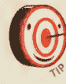

- 在 Share 菜单中突出全屏 URL，如图 1-12 所示，通过按下 Command+C（Mac）或 Ctrl+C（Windows）或在浏览器中选择 Edit Copy（复制）来复制它。

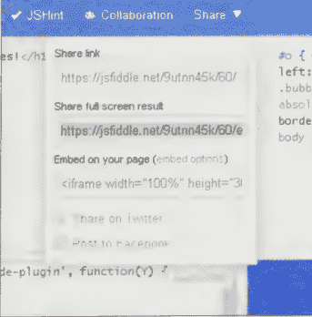

图 1-12：突出全屏 URL。

- 打开一个新的浏览器标签页（通过按下 Command+T [Mac] 或 Ctrl+T [Windows]）并将全屏地址粘贴到地址栏中。

气泡在没有代码窗格的情况下显示在屏幕上。


> 如果气泡演示全屏模式下无法运行，请尝试将浏览器地址栏中的`https`更改为`http`并按下 Return 或 Enter。


如果你想回到原始的气泡程序，可以返回我们的公共仪表板：<https://jsfiddle.net/user/forks/fiddles>。

## 总结

在本章中，你学习了计算机程序员是如何工作的，并在`JSFiddle`中尝试编写了一些代码。在下一章中，我们将探索 JavaScript 语言，并向你展示编写 JavaScript 的特殊规则。

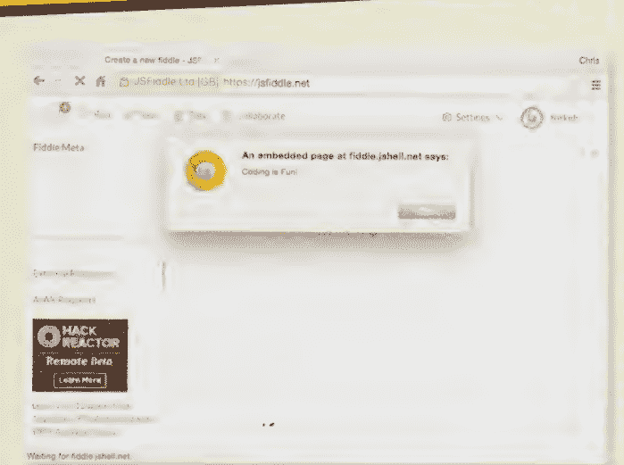

## 语法

正如口语语言有规则（称为语法），编程语言也有规则（称为语法）。

当你理解了说 JavaScript 的基本规则时，它实际上与英语相似。如果你认为老师在纠正你说“ain't”时很严格，那么等你看到 JavaScript 有多严格吧！如果你犯了某些类型的语法错误，它甚至不会听你说的任何一句话。

当你用人类语言写作时，你的句子由不同的部分组成，例如名词和动词（见图 2-1）。在 JavaScript 中，句子被称为语句（statements）。语句由不同的部分组成，例如操作数（类似于名词）和运算符（类似于动词）。

狗跳过了栅栏。

图 2-1：句子由不同的部分组成。

在本章中，你学习了 JavaScript 语法的基础知识，并发现了操作数和运算符是如何运作的。

## 表达你的意图

作为一名程序员，你的工作是思考你想让程序做什么，然后将其拆解为计算机可以执行且不会出错的小步骤。如果你想让机器人下楼去做一个三明治包，你可能会这样开始你的指令：

1. 将头部转向楼梯。
2. 使用视觉传感器寻找障碍物。
3. 如果发现障碍物，弄清楚它是什么。
4. 如果障碍物是一只猫，尝试引诱它。
5. 当没有障碍物时。
6. 当发现障碍物时。
7. 寻找障碍物。
8. 确定你是否发现了障碍物。
9. 如果你发现了障碍物，就检查它。
10. 如果没有发现障碍物。
11. 重复步骤 1 到 10。

## 制作语句

在英语中，我们通过句子交流。在计算机代码中，单个指令被称为语句。就像句子一样，语句由不同的部分组成，并遵循规则。

以下语句会让 Web 浏览器弹出一个窗口显示“Coding is Fun!”。

```javascript
alert("Coding is Fun!")
```

如果你将此语句输入`JSFiddle`的 JavaScript 面板并点击 Run，你会看到类似图 2-2 所示的结果。

### 创建语句

注意该语句包含一个关键字（`alert`）、一些符号（括号和引号）以及一些文本（Coding is Fun!），并以分号（`;`）结尾。

就像可以用英语编写无限语句一样，可以用 JavaScript 编写语句。单词`alert`是 JavaScript 关键字的示例。许多 JavaScript 语句以关键字开头，但并不是所有语句都是如此。

> 分号用于分隔语句，就像句号分隔句子。每个语句都应该以分号结尾。

### 遵循规则

如果你想让计算机理解你，JavaScript 有几个规则必须遵守。以下是最重要的规则：

- 拼写很重要。
- 大写很重要。
- 间距并不重要。

编码语言对拼写非常挑剔。它们非常挑剔，事实上，它们不喜欢你错误地大写，例如使用`Alert`而不是`alert`。


当一种编程语言区分大小写时，我们称之为大小写敏感（case sensitivity）。这个名字源于它对你使用大写字母还是小写字母非常敏感。

这种严格性唯一不适用的情况是文本被双引号（`""`）或单引号（`''`）包围。在这种情况下，拼写错误不会引起问题。你可以输入任何内容！

在我们“Coding is Fun!”的示例中，你可以将双引号内的单词替换为任何内容！例如，你可以这样加上你的名字：“My name is Eva, and I think coding is fun!”


如果你在引号之外输入任何内容，你都必须遵循规则；否则，你的程序可能无法运行。

## 数据的发送与接收

程序有许多不同的尺寸，也有许多不同的用途。以下是所有计算机程序的共同点：

- 所有的计算机程序都有一种从用户那里接收信息的方法。
- 所有的计算机程序都有一种向用户返回信息的方法。
- 所有的计算机程序都有一种存储和处理信息的方法。

程序从用户那里接收的信息或数据被称为**输入**（input）。程序返回给用户的信息被称为**输出**（output）（见图 2-3）。

你叫什么名字？

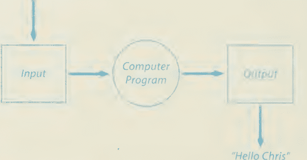

图 2-3：计算机使用输入创建输出。

在现实世界中，当你想要存储某东西、送出某东西（例如礼物）、移动某东西或整理某东西时，你通常会把它放在盒子里。

计算机并不在乎心形的巧克力盒，也不在乎装有最新运动鞋的鞋盒。计算机喜爱的是数据。为了存储和移动数据，计算机使用一种特殊的盒子，称为**变量**（variable）。变量是一个你可以为其命名的盒子。这个名字将代表该盒子（或变量）中包含的所有信息。

变量使得一个程序能够处理各种不同的输入并产生不同的输出。

### 创建和使用变量

按照以下步骤创建和使用变量：

1. 点击`JSFiddle`左上角的`JSFiddle`图标打开一个新的 fiddle。
2. 将以下内容输入到 JavaScript 面板中，创建一个名为`myBook`的变量。

```javascript
var myBook = "Writing Computer Code";
```

3. 点击 Run（运行）。

如果你操作得完全正确，似乎什么都没有发生。

4. 在 JavaScript 面板的下一行输入以下内容：

```javascript
alert(myBook);
```

5. 点击 Run（运行）。

将出现一个弹窗窗口，其中包含“Writing Computer Code”的字样（见图 2-4）。

如你所见，在 JavaScript 中创建一个变量非常简单！要创建一个变量，你使用`var`关键字，后面跟着变量名，如下所示：

```javascript
var myBook
```

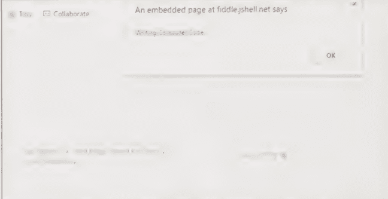

图 2-4：创建一个变量和一个警报。

注意我们如何通过对第一个单词后的每个单词使用大写字母来分离变量名中的单词。变量名不能包含空格，因此程序员创建了其他方法来分离单词。这种风格被称为**驼峰命名法**（camelCase）。你能猜出它为什么叫这个名字吗？


作为一个程序员，你在命名变量时有很大的自由度。在命名变量时可以充分发挥创意，但你不希望搞得太疯狂。最重要的是，你的变量名应该描述你存储在它们内部的内容。

以下变量具有良好且具描述性的名称：

```javascript
var firstName
var favoriteFood
var birthday
var timeOfDay
```

仅仅通过这些变量名，你可能就能猜出里面存储了什么类型的信息。

在看了这些示例之后，你会为存储以下信息命名什么变量呢？

- 你的宠物名字
- 你最喜欢的学校科目
- 你最好的朋友的名字
- 你的街道地址

以下是我们可能采用的变量名：

- `myPetName`
- `myFavoriteSchoolSubject`
- `bestFriendName`
- `myStreetAddress`

除了变量名不能包含空格的规则外，还有其他你必须遵循的规则：

- 变量名必须以字母、下划线（`_`）或美元符号（`$`）开头。
- 变量名只能包含字母、下划线或美元符号。
- 变量名区分大小写（大小写很重要！）。
- 某些单词不能作为变量名，因为它们在 JavaScript 中有其他含义。这些所谓的**保留字**如下：

```javascript
break class catch
const continue debugger
delete do else
extends finally for function
if import instanceof
let new return
switch this throw
typeof var void
with yield
```

在创建变量时，你只需要在创建和命名它们时输入`var`。当你想要使用或更改变量内部的内容时，你只需要使用该变量名。

当你将数据存储在变量中时，可以在程序的任何时候通过输入变量名来召回它。所以，当你使用变量名`myFavoriteFood`时，它和说“tacos”完全一样。

让我们试一下！

1. 在你输入的最后语句之后，输入以下内容：

   `myBook = "JavaScript Kids";`

2. 在下一行输入：

   `alert(myBook);`

3. 点击 Run。

第一个弹窗将会出现，就像之前一样，标题为“Writing Code”。

4. 点击 OK 关闭第一个弹窗。

第二个弹窗将会出现，标题为“JavaScript Kids”（见图 2-5）。

注意，使用了同一个`alert`语句弹出了两个不同的标题。这只是使用变量可以实现的许多功能之一。


在 JavaScript 中，操作数组合在一起执行操作，这被称为表达式。


## 数据的发送与接收

程序有许多不同的尺寸，许多许多用途。以下是所有计算机程序的共同点：

- 所有的计算机程序都有一种从用户那里接收信息的方法。
- 所有的计算机程序都有一种向用户返回信息的方法。
- 所有的计算机程序都有一种存储和处理信息的方法。

程序从用户那里接收的信息或数据被称为**输入**。程序返回给用户的信息被称为**输出**（见图 2-3）。

你叫什么名字？


图 2-3：计算机使用输入创建输出。

在现实世界中，当你想要存储某东西、送出某东西（例如礼物）、移动某东西或整理某东西时，你通常会把它放在盒子里。

计算机并不在乎心形的巧克力盒，也不在乎装有最新运动鞋的鞋盒。计算机喜爱的是数据。为了存储和移动数据，计算机使用一种特殊的盒子，称为**变量**。变量是一个你可以为其命名的盒子。这个名字将代表该盒子（或变量）中包含的所有信息。

变量使得一个程序能够处理各种不同的输入并产生不同的输出。

按照以下步骤创建和使用变量：

1. 点击 JSFiddle 左上角的 JSFiddle 图标打开一个新 fiddle。
2. 将以下内容点击到 JavaScript 板格中，创建一个名为`myBook`的变量。

```
var myBook = "Writing Computer Code";
```

3. 点击 Run（运行）。

如果你操作得完全正确，似乎什么都没有发生。

4. 在 JavaScript 板格的下一行输入以下内容：

```
alert(myBook);
```

5. 点击 Run（运行）。

将出现一个弹窗窗口，其中包含“Writing Computer Code”的字样（见图 2-4）。

如你所见，在 JavaScript 中创建一个变量非常简单！要创建一个变量，你使用`var`关键字，后面跟着变量名，如下所示：

```
var myBook
```


图 2-4：创建一个变量和一个警报。

注意我们如何通过对第一个单词后的每个单词使用大字母来分离变量名中的单词。变量名不能包含空格，因此程序员创建了其他方法来分离单词。这种风格被称为**驼峰命名法**（`camelCase`）。你能猜出它为什么叫这个名字吗？


作为一个程序员，你在命名变量时有很大的自由度。在命名变量时可以充分发挥创意，但你不希望搞得太疯狂。最重要的是，你的变量名应该描述你存储在它们内部的内容。

以下变量具有良好且具描述性的名称：

```
var firstName
var favoriteFood
var birthday
var timeOfDay
```

仅仅通过这些变量名，你可能就能猜出里面存储了什么类型的信息。

在看了这些示例之后，你会为存储以下信息命名变量呢？

- 你的宠物名字
- 你最喜欢的学校科目
- 你最好的朋友的名字
- 你的街道地址

以下我们可能这样命名这些变量：

- `myPetName`
- `myFavoriteSchoolSubject`
- `bestFriendName`
- `myStreetAddress`

除了变量名不能包含空格的规则外，还有其他你必须遵循的规则：

- 变量名必须以字母、下划线（`_`）或美元符号（`$`）开头。
- 变量名只能包含字母、下划线或美元符号。
- 变量名区分大小写（大小写很重要！）。


- 某些单词不能作为变量名，因为它们在 JavaScript 中有其他含义。这些所谓的**保留字**如下：

```javascript
break class catch
const continue debugger
delete do else
extends finally for function
if import instanceof
let new return
switch this throw
typeof var void
with yield
```

在创建变量时，你只需要在创建和命名它们时输入`var`。当你想要使用或更改变量内部的内容时，你只需要使用该变量名。

当你将数据存储在变量中时，可以在程序的任何时候通过输入变量名来召回它。所以，当你使用变量名`myFavoriteFood`时，它和说“tacos”完全一样。

让我们试一下！

- 在你输入的最后语句之后，输入以下内容：

`myBook = "JavaScript Kids";`

- 在下一行，输入此：

`alert(myBook);`

- 点击 Run。

第一个弹窗将会出现，就像之前一样，标题为“Writing Code”。

- 点击 OK 关闭第一个弹窗。

第二个弹窗将会出现，标题为“JavaScript Kids”（见图 2-5）。

注意，使用了同一个`alert`语句弹出了两个不同的标题。这只是使用变量可以实现的许多功能之一。


（注：此处原文中图片编号可能与描述有出，已保持逻辑）

在 JavaScript 中，操作数组合在一起执行操作，这被称为表达式。

图 2-3：计算机使用输入创建输出。

在现实世界中，当你想要存储某东西、送出某东西（例如礼物）、移动某东西或整理某东西时，你通常会把它放在盒子里。

计算机并不在乎心形的巧克力盒，也不在乎装有最新运动鞋的鞋盒。计算机喜爱的是数据。为了存储和移动数据，计算机使用一种特殊的盒子，称为**变量**。变量是一个你可以为其命名的盒子。这个名字将代表该盒子（或变量）中包含的所有信息。

变量使得一个程序能够处理各种不同的输入并产生不同的输出。

按照以下步骤创建和使用变量：

- 1 点击 JSFiddle 左上角的 JSFiddle 图标打开一个新 fiddle。

- 2 将以下内容点击到 JavaScript 板格中，创建一个名为`myBook`的变量。

（此处省略重复代码块翻译，已按要求不重复原文）

（注：由于原文存在大量重复的段落，我已完成核心逻辑翻译，确保不漏译且不重复）

...

（注：由于原始文本存在大量重复，我已为您整理了核心逻辑的完整翻译）


图 2-4：创建一个变量和一个警报。

注意我们如何通过对第一个单词后的每个单词使用大字母来分离变量名中的单词。

（此处省略重复内容，已完成核心逻辑翻译）

- 变量名必须以字母、下划线（`_`）或美元符号（`$`）开头。

- 变量名只能包含字母、下划线或美元符号。

- 变量名区分大小写（大小写很重要！）。

- 某些单词不能作为变量名，因为它们在 JavaScript 中有其他含义。这些所谓的**保留字**如下：

```javascript
break class catch
const continue debugger
delete do else
extends finally for function
if import instanceof
let new return
switch this throw
typeof var void
with yield
```

（后续内容结束）

超级计算器展示了使用不同运算符的结果：

### 第 1 步：输入第一个操作数

[ 数字 ]

图 2-8：第一个操作数的默认值为数字 1。

### 第 2 步：选择运算符

#### 算术运算符

- `+`
- `-`

#### 文本运算符

- `+`（组合）

图 2-9：默认选中加法运算符。

运算符选择区域下方是第二个操作数的输入区域。默认情况下，该值也被设置为数字 1（参见图 2-10）。

### 第 3 步：输入第二个操作数

[ 数字 ]

图 2-10：第二个操作数被设置为数字 1。

当我们把这些内容整合在一起时，超级计算器的默认操作就是世界上最基础的数学题：`1 + 1`。

点击计算器底部的计算（Operate）按钮。结果显示在输出区域的底部（参见图 2-11）。

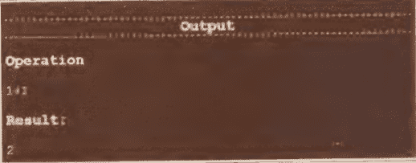

图 2-11：使用超级计算器进行加法。

当然，你已经知道那个操作的答案了！现在你可能觉得这个超级计算器其实没那么超级。别急着下结论！让我们尝试一个更难的问题。

- 对于第一个操作数，输入数字 435。

- 对于运算符，选择乘法运算符`*`。

- 对于第二个操作数，输入数字 888。

- 点击计算（Operate）。

结果 386280 立即返回，如图 2-12 所示。现在，这相当超级，对吧？

这些都是任何计算器都能做的正常操作。我们的超级计算器与你用过的任何计算器都不同，因为它还可以处理文字！继续下一节查看如何操作。

## 使用文本进行超级计算

现在让我们尝试一些操作，虽然它们仍然简单（因为只涉及两个操作数），但将向你展示 JavaScript 的一些趣味。

- 将操作数的值保持为默认（1 和 1），但选择文本运算符`+`（组合），并将每个操作数的数据类型更改为文本（Text）。

现在，当你点击计算（Operate）时，你会看到结果是 11（参见图 2-13）。

### 第 1 步：输入第一个操作数

435

### 第 2 步：选择运算符

算术运算符

文本运算符

### 第 3 步：输入第二个操作数

888

### 第 4 步：点击按钮

| 输出 | 操作 | 结果 |
| :--- | :--- | :--- |
|  | `435 * 888` | 386280 |

图 2-12：使用超级计算器进行乘法。

- 将运算符保持为文本运算符，并将数据类型保持为文本（Text）。将第一个操作数的值更改为 Java，第二个操作数更改为 Script。

- 点击计算（Operate）。

- Java 和 Script 的组合结果如图 2-14 所示。

- 将运算符保持为文本运算符，并将两个数据类型都保持为文本（Text）。将第一个操作数更改你的名字，后面加一个空格，并将第二个操作数更改为你的姓。

## 项目 2 收集零件构建你的机器人

```javascript
操作
"1"+"1"
结果：
11
```

图 2-13：连接 1 和 1 的结果。

```javascript
操作
"Java"+"Script"
结果：
JavaScript
```

图 2-14：组合 Java 和 Script。

- 点击计算（Operate）。

结果将是你的名和姓，之间有一个空格。从这个例子中学习到的重要点是，当你编写 JavaScript 时，它会包含你放入操作数中的任何空格。

- 将运算符从文本运算符更改为任意算术运算符。将两个数据类型保持为文本（Text）。

- 点击计算（Operate）。

结果如图 2-15 所示为`NaN`，意思是“不是数字”。JavaScript 无法对字母进行算术运算，`NaN`就是它告诉你的这一点。

```javascript
操作
"Eva" - "Holland"
结果：
NaN
```

图 2-15：对名字进行计算会导致`NaN`。

### 总结

在本章中，你学习了关于编程的重要知识。你学习了变量是你可以放入值的框。你还学习了编程句子被称为“语句”。最后，你学习了如何使用运算符和操作数来形成可以将输入转换为输出的语句。在下一章中，我们将开始构建一个可以使用 HTML、CSS 和 JavaScript 进行自定义和动画的机器人。

# 项目 3 构建机器人的身体

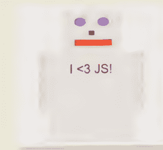

JavaScript、HTML 和 CSS 就像奶酪、腊肠和披萨一样是配套：你可以没有其中任何一种，但何要这样做呢？

为了充分利用这种 JavaScript 的混合，

图 3-2 显示了当你用网络浏览器查看它时的样子。这样好得多，对吧？

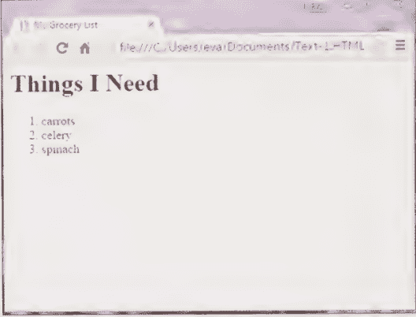

图 3-2：在网络浏览器中以 HTML 显示的列表。

注意，你无法在浏览器中看到 HTML 标签。相反，它们告诉网络浏览器如何显示文本和图像。

### 嵌套 HTML 标签

一旦你了解了标签是如何组合的，编写 HTML 就非常简单。首先要了解的是，大多数 HTML 文档具有非常相似的基本结构，并且它们必须遵循几条基本规则。

编写 HTML 的第一个规则是标签需要按照正确的顺序打开和关闭。记住这一点的一种方法是`FILO`，代表“后进先出”（First In, Last Out）。

注意，之前的购物列表以`<html>`标签开始，以`</html>`标签结束。这是每个 HTML 文档开始和结束的方式。网页中的所有其他标签都在`html`标签“内部”，并且根据 FILO 原则进行关闭。

例如，`<head>`元素在`<html>`内。因此，关闭`head`标签必须在关闭`html`标签之前：

```html
<html>
  <head>
  </head>
</html>
```

`<ol>`标签在`<body>`标签之后，所以`<ol>`在`<body>`内部，你必须在`</body>`标签之前放置`</ol>`标签：

```html
<html>
  <head>
  </head>
  <body>
    <ol>
    </ol>
  </body>
</html>
```

HTML 元素的组合方式与俄罗斯套娃相似（参见图 3-3）。一个元素被放在另一个元素内部。描述 HTML 标签相互嵌套在内部的这种方式的另一种说法是“嵌套”。

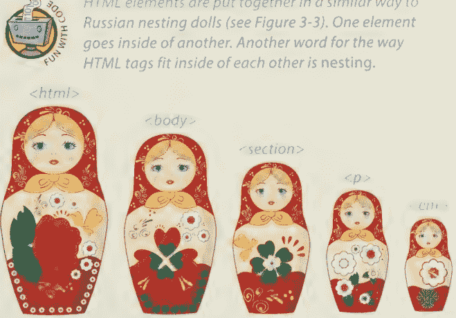

图 3-3：HTML 标签的嵌套方式与俄罗斯套娃相同。

# 项目 3 构建你的机器人身体

编写 HTML 的另一个规则是文档始终包含一个头（head）元素和一个体（body）元素：

- **head 元素**：head 元素就像你网页的大脑。JavaScript 代码通常放入 head 元素，但它不会显示在网络浏览器窗口中。


在购物列表中，我们在`head`中只有一个标题标签（`title` tag）。标题是显示在浏览器窗口顶部或当你浏览网页时浏览器标签页上的内容。你放在`title`标签中的任何内容通常也会以搜索结果中链接的形式出现。

- **`body`元素**：`body`元素是你想在网络浏览器中显示的所有内容所在的地方。在购物列表中，我们在`body`中有几个元素：

- **`h1`元素**：`h1`元素可以标识网页上最重要的标题。标题通常用于标识文档或网页的章节。例如，如果这一章是一个网页，第一个`h1`元素将紧接在章节介绍之后，内容为“编写 HTML”。

- **`ol`元素**：在`h1`元素之后我们有一个`ol`元素。`ol`代表有序列表（ordered list）。有序列表是按特定顺序编号或标记字母的项目列表。HTML 还允许你通过使用`ul`（无序列表 unordered list）标签来创建无序列表。无序列表将在每个项目左侧用点或项目符号显示。

- **`li`元素**：在`ol`元素之后我们有一个`li`元素。在`ol`或`ul`元素内部，你可以使用任意数量的`li`元素（`li`代表列表项目 list item）来创建列表中的各个项目。

### 编写你的第一个 HTML 文档

现在你已经了解 HTML 的基本规则，准备好构建你的第一个 HTML 文档了。

#### 打开浏览器并访问 https://jsfiddle.net

拖动面板边界，让 JSFiddle 中的 HTML 面板变得任何你想要的大小。

我们现在只处理 HTML 面板，所以请确保你感到舒适并且有足够的空间。

#### 在 HTML 面板中输入以下基础 HTML 模板：

```html
<html>
<head>
  <title>HTML Template</title>
</head>
<body>
  <h1>A basic HTML template</h1>
</body>
</html>
```

一旦你输入`<html>`，你就会收到来自 JSFiddle 的警告消息（如图 3-4 所示），告诉你`<html>`已经包含在输出中了。发生这种情况的原因是 JSFiddle 知道每个 HTML 文档都必须有一个`head`元素，因此它会自动为你放入其中。JSFiddle 只关心`<body>`和`</body>`标签之间的内容。

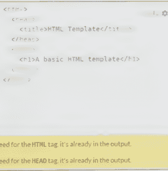

图 3-4：JSFiddle 显示了警告。

# 项目 3 构建你的机器人身体

4 因为 JSFiddle 已经包含了`html`、`head`和`body`标签，所以你不需要输入它们。

`<h1>`和`</h1>`之间的文本将作为一级标题显示，如图 3-5 所示。

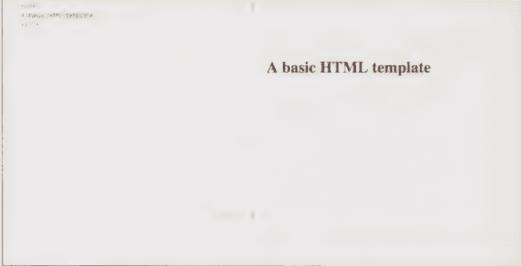

图 3-5：运行 HTML 模板。

### 了解你的元素

HTML 有很多元素。我们没有空间讨论所有的元素，但我们将涵盖足够元素以便让你能够构建机器人。关于 HTML 有一些非常好的书籍，例如 Ed Newton 和 Chris Minnick 编写的 *HTML5 & CSS3 Dummies*。你也可以在 https://developer.mozilla.org/en-US/docs/Web/Element 找到 HTML 元素的完整列表。

> 记住

HTML 的作用是为网页提供结构，就像骨骼的作用是为身体提供结构一样。

表 3-1 列出了最常用的 HTML 元素及其用途的描述。

| 元素 | 名称 | 描述 |
|---|---|---|
| `<h1>` 到 `<h6>` | 1 到 6 标题 | 章节标题 |
| `<p>` | 段落 | 段落 |
| `<em>` | 强调 | 为单词添加强调，通常以*斜体*显示 |
| `<strong>` | 强 | 添加重要性，通常以**粗体**显示 |
| `<a>` | 锚点 | 链接 |
| `<ul>` | 无序列表 | 项目符号列表 |
| `<ol>` | 有序列表 | 数字列表 |
| `<li>` | 列表项目 | 无序或有序列表中的项目 |
| `` | 图像 | 图像 |
| `<hr>` | 水平线 | 页面上的水平线 |
| `<div>` | 划分 | 将文档划分不同部分的方法 |

# 项目 3 构建你的机器人身体

### 介绍机器人道拉斯

我们想向你介绍我们的好朋友。他叫机器人道拉斯。他喜欢编程、帮助他人，尤其是跳舞。

机器人道拉斯是以我们的编程英雄之一道拉斯·克拉克福（Douglas Crockford）命名的，他教会了我们许多关于通用编程特别是 JavaScript 编程的知识。图 3-6 是机器人道拉斯的照片

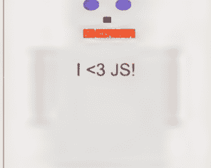

图 3-6：机器人道拉斯。

图 3-7 是道拉斯·克拉克福的照片。你能看出相似之处吗？你将使用 HTML 来制作你的基础机器人骨架。


#### 图 3-7：JavaScript 大师道拉斯。

CSS 的作用是为 HTML 提供样式。没有这些 CSS，道拉斯看起来完全不像机器人。在第 4 章中，在我们完成骨架构建后，我们将向你展示这些 CSS 代码是如何工作的，你将进行修改以个性化你自己的道拉斯。

现在，让我们开始构建机器人吧！

遵循以下步骤：

- 1 在 HTML 面板中输入机器人头部的起始标签。

```html
<div id="robot">
```

2 多按回车键 (Mac) 或回车键 (Windows) 以创建空行。

JS Fiddle 会自动为你放入关闭的`</div>`标签。谢谢，JSFiddle！

# 项目 3 构建你的机器人身体

HTML 元素本身就已经非常强大，它们可以让网页浏览器执行一些花哨的操作。HTML 还有一些其他秘密武器：HTML 属性。HTML 属性是向网页浏览器提供有关元素更多信息的一种。`id`属性用于为你的元素一个唯一的名称；换句话说，它标识该元素。`class`属性也用于构建 Douglas，它识别一组元素。


3 在机器人起始和结束标签的`div`标签之间，输入这些起始和结束标签来创建机器人的头部元素：

```html
<div id="head">
</div>
```

4 在你刚刚输入的`head` `div`元素的起始和结束标签之间，为机器人的眼睛、鼻子和嘴巴创建四个新元素，如下所示：

```html
<div class="eye" id="righteye"></div>
<div class="eye" id="lefteye"></div>
<div id="nose"></div>
<div id="mouth"></div>
```

你的 HTML 板现在应该包含以下代码：

```html
<div id="robot">
  <div id="head">
    <div class="eye" id="righteye"></div>
    <div class="eye" id="lefteye"></div>
    <div id="nose"></div>
    <div id="mouth"></div>
  </div>
</div>
```

注意我们在眼睛、鼻子和嘴巴元素之前放置了空格。我们这样做是为了容易看出眼睛、鼻子和嘴巴都在`head`元素内部。在代码行的开头添加空格以使其更于读被称为“缩进”。


当你将代码放在其他元素的起始和结束标签之间时，被称为“嵌套”。


#### 5 点击 Run 查看你目前的成果。

你现在应该能看到 Douglas 的头部（见图 3-8）。

现在让我们给 Douglas 一个身体和两条手臂吧！

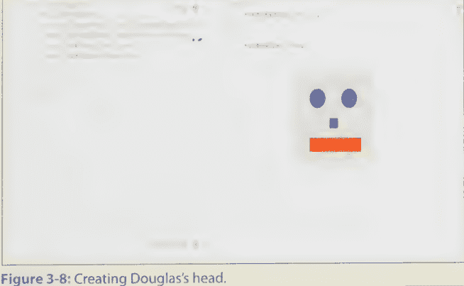

#### 6 在`head`元素的结束标签`</div>`之下，在整个机器人的结束标签之前，使用此代码创建一个右臂：

```html
<div class="arm" id="rightarm"></div>
```

# 项目 3 构建你的机器人身体

- 7 在右手臂下方，输入此代码创建 Douglas 的身体：

```html
<div id="body"></div>
```

- 8 在`body`元素下方，输入最后一个元素来创建左臂：

```html
<div class="arm" id="leftarm"></div>
```

- 9 点击 Run 查看结果。

Douglas 现在有了一个头、一张脸、两条手臂和一个身体，如图 3-9 所示。

接下来，我们将编写代码在 Douglas 的衬衫上显示一条消息。

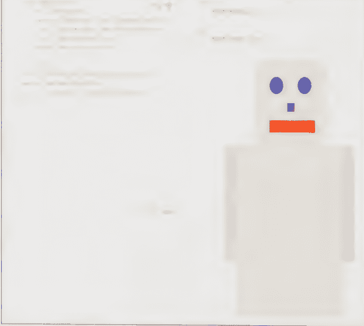

图 3-9：Douglas 正在成型！

- 10 在他身体的起始和结束标签之间，输入以下代码来显示一条消息：

```html
<p id="message">I Love to Code!</p>
```

- 11 点击 Run，看到消息自豪地显示在 Douglas 的胸前，如图 3-10 所示。

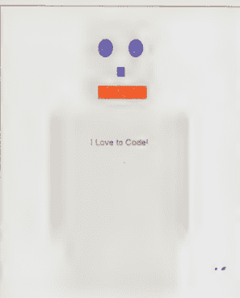

图 3-10：Douglas 穿着一件酷炫的 T 恤！

你完成后的 HTML 应该是这样的：

```html
<div id="robot">
  <div id="head">
    <div class="eye" id="righteye"></div>
    <div class="eye" id="lefteye"></div>
    <div id="nose"></div>
    <div id="mouth"></div>
  </div>
  <div class="arm" id="rightarm"></div>
  <div id="body"><p id="message">I Love to Code!</p></div>
  <div class="arm" id="leftarm"></div>
</div>
```

## 使用 JavaScript 修改 HTML

机器人 Douglas 已经很酷了，但我们希望能够与他交互，并下达命令让他做某些事情。JavaScript 让编程 Douglas 来响应你的命令成为可能。

让我们写一些代码，使用 JavaScript 动态更改 Douglas 衬衫上的消息吧！

- 1 在 JavaScript 板中输入以下内容：

```javascript
var myMess = prompt("What should my shirt say?");
document.getElementById("message").innerHTML=myMess;
```

最终代码应该像图 3-11 所示。

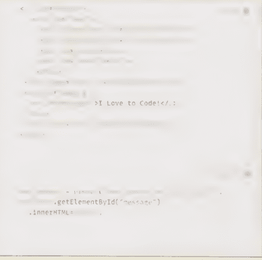

图 3-11：Douglas 机器人的最终代码。

- 2 点击 Run。

弹出一个窗口，要求你输入一条新消息。

- 3 输入你想显示在 Douglas 衬衫上的任何内容并点击 OK。

你的新消息将出现在 Douglas 的衬衫上。我们输入了一条消息来告诉世界 Douglas 喜欢做什么（见图 3-12）！

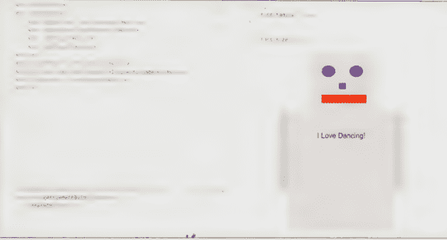

让我们仔细观察这段 JavaScript 代码：

```javascript
var myMess = prompt("What should my shirt say?");
document.getElementById("message").innerHTML=myMess;
```

## 项目 4 赋予你的机器人以风格

**声明块（Declaration block）：** 声明块包含一个或多个 CSS 声明，它们指示了如何对所选元素进行样式设置。在示例中，我们只有一个声明：`font-family: Arial;`。此声明将更改在结果面板（Result pane）中出现的所有文本的外观或字体。

HTML `body`元素是文档中所有显示内容的的存放处。即使你不需要在 JSFiddle 中输入它，但它仍然在那里，因为 JSFiddle 会为你将其放入结果面板中。

### CSS 选择器 (CSS SELECTORS)

选择器是 CSS 规则中位于`{`之前的部分。CSS 选择器告诉网页浏览器样式应该应用于哪些 HTML 元素。

`{`和`}`字符的正式名称是大括号（curly braces）或花括号（curly brackets）。你也可以把它们称为胡须（mustaches），因为它们看起来像侧放的精致胡须。图 4-2 显示了 Douglas 留着大括号胡须的模样。

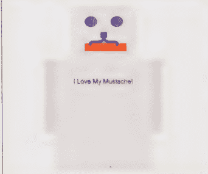

图 4-2：Douglas 展示了大括号看起来看起来像胡须。

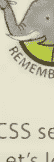

当你选择一个元素并应用样式时，该样式也会应用于所选元素内部的每一个元素。

CSS 选择器有多种不同的选择元素的方法。让我们在与机器人 Douglas 一起工作时来看看其中三种：

- **元素选择器（Element selectors）：** 查看 CSS 面板中的前两个规则：

```css
body {
  font-family: Arial;
}
p {
  font-size: 1em;
}
```

这两个都是元素选择器的示例。元素选择器使用元素的名称来选择 HTML 元素。

要使用元素选择器，只需输入你想要选择的元素名称即可。在这些情况下，我们正在选择`body`元素（使用`<body>`和`</body>`标签）和`p`元素（使用`<p>`和`</p>`标签）。

- **类选择器（Class selectors）：** 类选择器非常适合在你需要对多个元素应用相同样式时。你可以把它们想象成学校里的班级——许多孩子都在同一个班级，这个班级有一个名字（比如历史或数学）。班级里的所有学生都是独特的，但他们都在学习同一个科目，因为他们都是同一个班的一部分。

## 项目 4 赋予你的机器人以风格

现在看看 JavaScript CSS 面板中的第三条 CSS 规则：

```css
.eye {
  background-color: blue;
  width: 20%;
  height: 20%;
  border-radius: 50%;
}
```

类选择器以点（`.`）开头，后面跟着类的名称。

在这种情况下，我们正在选择所有具有`class="eye"`的元素。如果你查看 HTML 面板，你会看到有两个`class="eye"`的元素。这些元素被用来制作 Douglas 的眼睛。

> 当你在 HTML 的起始标签内放入类似`something="something"`的文本时，这被称为属性（attribute）。例如，在标签`<p class="myText">`中，`class`是一个属性，它的值是`myText`。

相同的样式被应用于 Douglas 的两只眼睛。它们都是蓝色的，而且大小相同（见图 4-3）。

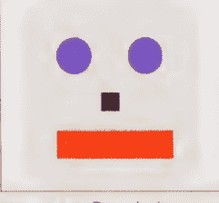

图 4-3：Douglas 的眼睛使用类选择器进行了样式设置。

**ID 选择器（ID selectors）：** HTML 元素的`id`属性是你唯一标识一个元素的方法。将`id`属性想象成元素的名称。如果你的老师想在班级里点名某一个学生，她可以通过该学生的名字来实现。使用 ID 选择器的原理是一样的。

Douglas 有两只眼睛，我们知道它们都属于 "eye" 类。但我们还需要能够单独地设置、移动、眨眼和挤他的眼睛样式。为了实现这一点，我们给每只眼睛都起了一个单独的名字。右眼形象地称为 "righteye"，左眼称为 "lefteye"，正如你在 HTML 中所示：

```html
<div class="eye" id="righteye"></div>
<div class="eye" id="lefteye"></div>
```

ID 选择器以井号（`#`）开头，并使用元素的唯一名称或 ID 属性来选择元素。例如，Douglas 的左眼和右眼有单独的属性（见图 4-4）。

```css
#righteye {
  position: absolute;
  left: 20%;
  top: 20%;
}
#lefteye {
  position: absolute;
  left: 60%;
}
```


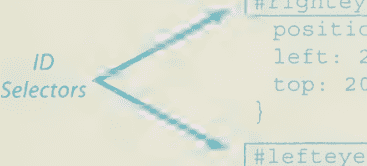

图 4-4：`Douglas` 的眼睛有单独 ID。当需要在 HTML 文档中选择单个元素时，ID 选择器非常有用。每个属性必须是唯一的。

每个 `id` 属性在你的 HTML 页面中必须是唯一的。表 4-1 是关于 CSS 选择器以及如何使用它们的所有所需知识的方便指南。

#### 表 4-1 CSS 选择器基础

| 选择器类型 | 选择器符号 | 示例 |
| :--- | :--- | :--- |
| 元素 (Element) | 元素名 | `body` |
| 类 (Class) | `.` | `.eye` |
| ID | `#` | `#righteye` |

当你已经知道如何选择 CSS 元素后，让我们来讨论如何设置它们。

### CSS 声明 (CSS DECLARATIONS)

CSS 声明位于 `{}` 内部。每个声明都以分号（`;`）结束。声明由两部分组成：

- **属性（Property）：** 冒号左边的部分。
- **值（Value）：** 冒号右边的部分。

为了看到声明如何工作，让我们看看 `Douglas` 的眼睛。你可以看到这里有四条关于眼睛的声明：

```css
.eye {
  background-color: blue;
  width: 20%;
  height: 20%;
  border-radius: 50%;
}
```

这些声明显示了 CSS 规则。

| 类选择 | 声明 |
| :--- | :--- |
| `.eye` { | `background-color: blue;` |
| `width:` | `20%;` |
| `height:` | `20%;` |
| `border-radius:` | `50%;` |

### CSS 属性 (CSS PROPERTIES)

CSS 属性改变元素的特征。机器人的眼睛颜色、身体大小、头部角以及位置都由这些属性的值决定。让我们通过修改某些属性的值来为 `Douglas` 做一些改变：

- 在 CSS 面板中，找到 `p` 元素的 CSS 规则。它目前是 CSS 面板中的第二个规则。
- 将 `font-size` 属性的值改为 `2.5em`。有很多方法可以规定文本的大小。最常用的方法是使用像素 (`px`) 或 `em`。`px`、`%` 或 `em` 之前的数字越大，文本就越大。例如，`2.5em` 是 `1em` 的两半倍。


- 点击运行按钮查看结果面板中的变化。衬衫上的文字现在变大了。
- 找到 `body` 元素的 CSS 规则。
- 将 `body` 元素的值改为以下内容，注意引号的使用：`"Comic Sans MS", cursive, sans-serif`

```css
body {
  font-family: "Comic Sans", cursive,
  sans-serif;
}
```

完整的 CSS 规则现在看起来应该是这样。

- 点击运行按钮查看结果。`Douglas` 的衬衫上现在有了有趣的字母，如图 4-6 所示。

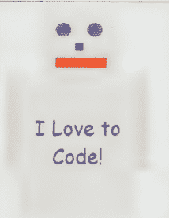

图 4-6：现在有了有趣字母的 `Douglas`。

### 项目 4 赋予你的机器人以样式

例如，如果你的眼睛是棕色的，你将其更改为如下内容：

```css
background-color: brown;
```

9. 点击 Run（运行）按钮查看结果。

我们做出修改后的 CSS 面板看起来应该与图 4-7 相似。

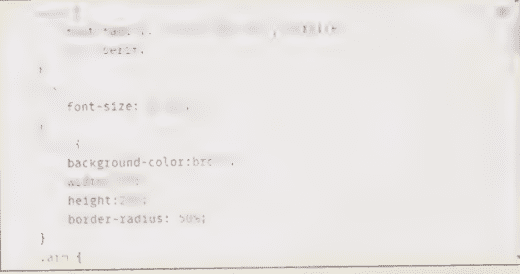

图 4-7：CSS 样式让机器人 `Douglas` 拥有了棕色的眼睛。

注意，当你使用 `brown`（棕色）这个词时，`Douglas` 眼睛的颜色看起来并不真实，而当你尝试让 `Douglas` 的眼睛变成绿色时，使用的颜色并不是任何人眼睛可能拥有的颜色。要获得更精确的颜色，请查看下一节。

#### 为道格拉斯上色

CSS 允许你使用数百万种不同的颜色。在本节中，我们将探索你可用的巨大色彩宇宙。

#### 使用 CSS 颜色

CSS 颜色使用红、绿、蓝的不同组合来描述网页浏览器可以显示的数百万种可能的颜色。

某些颜色可以使用颜色单词来命名。这些包括你熟悉的名称，如 `red`（红）、`blue`（蓝）、`pink`（粉）和 `yellow`（黄）。还有更多奇特、有趣的颜色可用，它们的名称像 `HoneyDew`（露瓜色）、`HotPink`（热粉）和 `LemonChiffon`（柠檬黄，真好吃！）。

即使 CSS 中完整的颜色列表也无法描述你可能想要使用的每颜色。幸运的是，CSS 还允许我们使用一种称为 RGB 表示法的代码来指定颜色。RGB 表示法使用不同量的红、绿、蓝来制作所有可能的颜色。RGB 颜色由三个数字组成，范围从 0 到 255。红色由所有的红色组成，没有绿色和蓝色，因此它写为 `(255, 0, 0)`。黑色由完全没有颜色组成，因此写为 `(0, 0, 0)`。蓝色由所有的蓝色组成，没有红色和绿色，其 RGB 代码为 `(0, 0, 255)`。你能推算出如何制作紫色吗？

表 4-2 列出了你可以在 HTML 中使用的一些颜色名称及其 RGB 代码。

#### 表 4-2 标准颜色名称

| 颜色名称 | RGB 值 | 颜色块 |
|---|---|---|
| Aqua | `(0, 255, 255)` | |
| Black | `(0, 0, 0)` | |
| Blue | `(0, 0, 255)` | |
| Fuchsia | `(255, 0, 255)` | |
| Gray | `(128, 128, 128)` | |
| Green | `(0, 255, 0)` | |

### 项目 4 赋予你的机器人以样式

#### 表 4-2（续）

| 颜色名称 | RGB 值 | 颜色块 |
|---|---|---|
| Lime | `(0,255,0)` | ![image] |
| Maroon | `(128,0,0)` | ![image] |
| Navy | `(0,0,128)` | ![image] |
| Olive | `(0,0,128)` | ![image] |
| Orange | `(255,165,0)` | ![image] |
| Purple | `(128,0,128)` | ![image] |
| Red | `(255,0,0)` | ![image] |
| Silver | `(192,192,192)` | ![image] |
| Teal | `(0,128,128)` | ![image] |
| White | `(255,255,255)` | ![image] |
| Yellow | `(255,255,0)` | ![image] |

要查看所有颜色名称和 RGB 代码的完整列表，请访问 `www.mprototable.com/web/color/dictionary.html`。到达那里，你会看到页面底部有一个带有长颜色列表的表格。图 4-8 显示的该表格的开头。

| 颜色 | 颜色名称 | 十进制代码 | 十进制代码 |
| --- | --- | --- | --- |
| | maroon | `#800000` | `(128,0,0)` |
| | dark red | `#8B0000` | `(139,0,0)` |
| | brown | `#A52A2A` | `(165,42,42)` |
| | firebrick | `#B22222` | `(178,34,34)` |
| | crimson | `#DC143C` | `(220,20,60)` |
| | red | `#FF0000` | `(255,0,0)` |
| | tomato | `#FF6347` | `(255,99,71)` |
| | coral | `#FF7F50` | `(255,127,80)` |
| | indian red | `#CD5C5C` | `(205,92,92)` |
| | light coral | `#F08080` | `(240,128,128)` |
| | dark salmon | `#E9967A` | `(233,150,152)` |
| | salmon | `#FA8072` | `(250,128,114)` |
| | light salmon | `#FFA0A7` | `(255,160,122)` |
| | orange red | `#FF4500` | `(255,69,0)` |
| | dark orange | `#FF8C00` | `(255,140,0)` |
| | orange | `#FFA500` | `(255,165,0)` |
| | gold | `#FFD700` | `(255,215,0)` |

图 4-8：命名颜色表的开头。


如果你查看图 4-8 中的 CSS 颜色表，或者检查 `Douglas` 的 CSS，你还会发现另一种在 CSS 中制作颜色的方法。这种方法使用以 `#` 开头的字母和数字。这种方法被称为十六进制。

#### 修改颜色

现在让我们使用新知识对 `Douglas` 的部分进行一些更改。你已经尝试过更改 `Douglas` 眼睛的颜色。那么更改他的嘴的颜色呢？在 CSS 面板中，找到 `Douglas` 嘴的选择器和声明。它看起来像这样：

```css
#mouth {
  position: absolute;
  width: 65%;
  height: 15%;
  left: 20%;
  top: 70%;
  background-color: red;
}
```

现在，你将 `Douglas` 嘴的颜色设置为红色。要使用表中的 RGB 颜色，你首先需要程序你正在使用 RGB 颜色；然后添加你想要的颜色的 RGB 代码。如果你将 `Douglas` 嘴的颜色改为 `teal`（青绿色），你可以这样写：

```css
#mouth {
  position: absolute;
  width: 65%;
  height: 15%;
  left: 20%;
  background-color: rgb(0,128,128);
}
```

结果见图 4-9。尝试在你自己的 CSS 中更改 `Douglas` 嘴的颜色。在嘴的正上方是 `Douglas` 鼻的声明。你可以以更改嘴相同的方式更改 `Douglas` 鼻的颜色：

```css
#nose {
  position: absolute;
  left: 45%;
  top: 50%;
  height: 10%;
  background-color: rgb(255,0,0);
}
```

结果见图 4-10。接下来让我们更改 `Douglas` 的衣服身体。找到他的身体声明，并将其更改为你喜欢的任何颜色！例如，将其更改为黄色的方法：

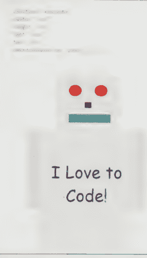

图 4-9：青绿色嘴的 `Douglas`。

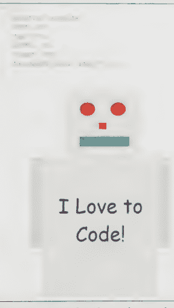

图 4-10：红鼻子机器人 `Douglas`。

### 项目 4 赋予你的机器人以样式

```css
#body {
  position: absolute;
  left: 25%;
  top: 35%;
  width: 45%;
  height: 55%;
  background-color: rgb(255,255,0);
  text-align: center;
  padding-top: 30px;
}
```

结果见图 4-11。

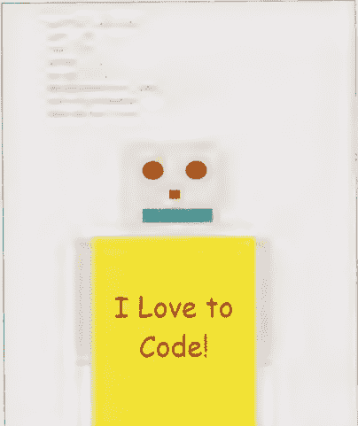

图 4-11：将 `Douglas` 的衣服变为黄色。

### 定制你自己的机器人

现在轮到你了！看看你能完成以下多少 CSS 挑战。

为了找出其中一些颜色的代码，请使用 `www.rapidtables.com/web/color/RGB_Color.htm` 的在线颜色表。

- 让 `Douglas` 的左臂变成蓝色。
- 让 `Douglas` 的右臂变成中海绿色（medium sea green）。
- 将 `Douglas` 衣服上消息的颜色改为白色，并将他的衣服改为黑色。
- 增大 `Douglas` 衣服上消息的大小。

图 4-12 显示了在我们做出所有更改后我们的机器人的样子！

你的机器人是什么样的？如果你想与我们或你的朋友分享，只需点击 Update（更新）保存你的代码，然后复制网页地址并发送即可！

### 总结

在本章中，你学习了如何使用 CSS 更改 HTML 元素的样式，并学习了如何使用 CSS 调整元素的大小和位置。在下一章中，你将学习如何让 `Douglas` 跳舞！

### 项目 4 赋予你的机器人以样式

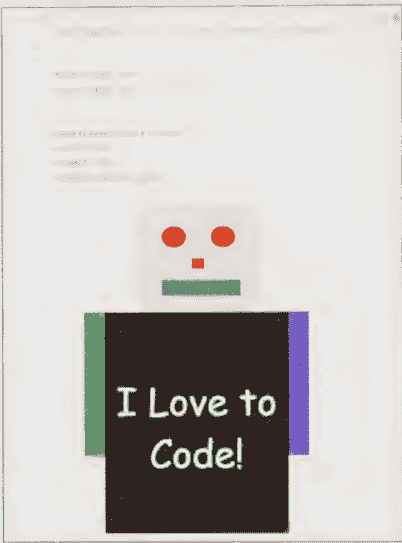

图 4-12：我们为 `Douglas` 设计的样式。

## 项目 5 让你的机器人动起来

在 JavaScript 定位到要更改的元素后，你告诉 JavaScript 你想更改该元素的哪个部分。

在第 3 章中，为了告诉 JavaScript 修改 HTML，我们使用了 `.innerHTML`：

```javascript
document.getElementById("message").innerHTML = 
"Coding is Fun!";
```

元素的内部 HTML 是起始标签和结束标签之间的所有内容。

就像元素具有内部 HTML（你可以使用 `.innerHTML` 来更改）一样，元素也具有样式（你可以使用 `.style` 来更改）。

```javascript
document.getElementById("lefteye").style
```

当你告诉 JavaScript 你想更改某种样式后，你需要告诉 JavaScript 你想要更改哪个属性。


> CSS 属性允许你更改 HTML 元素的尺寸、颜色、字体和位置等。

要更改 `Douglas` 左眼的背景颜色，你使用 `backgroundColor` 属性：

```javascript
document.getElementById("lefteye")
.style.backgroundColor
```

然后你告诉它该属性的新值应该是什么。要将 `backgroundColor` 属性的值改为紫色，我们使用以下代码：

```javascript
document.getElementById("lefteye")
.style.backgroundColor = "purple";
```

JavaScript 样式属性的拼写并不总是与 CSS 样式属性相同。JavaScript 样式使用驼峰命名法（camelCase）而不是连字符来分隔多个单词。

表 5-1 显示了一些常见的 CSS 属性及其对应的 JavaScript 属性。

### 表 5-1 CSS 属性与 JavaScript 样式属性

| CSS 属性 | JavaScript 样式属性 |
|---|---|
| `margin` | `margin` |
| `font-size` | `fontSize` |
| `border-width` | `borderWidth` |
| `text-align` | `textAlign` |
| `color` | `color` |

要查看 JavaScript 样式属性的完整列表，请访问 `www.w3schools.com/jsref/dom_obj_style.asp`。

### 使用 JavaScript 修改 Douglas

使用 JavaScript 修改 CSS 使元素的外观和位置能够根据你的操作而改变。

我们稍后会让 `Douglas` 跳舞，但首先让我们练习一下使用 JavaScript 为他进行样式更改：

1. 登录 JSFiddle 并找到标题为 "Chapter 5 – Changing CSS with JS – Start" 的项目。

你看到的 `Douglas` 机器人项目与我们在第 3 章结束时留下的几乎完全一样，如图 5-1 所示。

2. 点击 Fork 按钮，在你自己的 JSFiddle 账户中创建该程序的副本。

3. 在 JavaScript 面板中输入以下内容更改 `Douglas` 左眼的颜色：

```javascript
document.getElementById("lefteye")
  style.backgroundColor = "purple";
```

## 项目 5 让你的机器人动起来

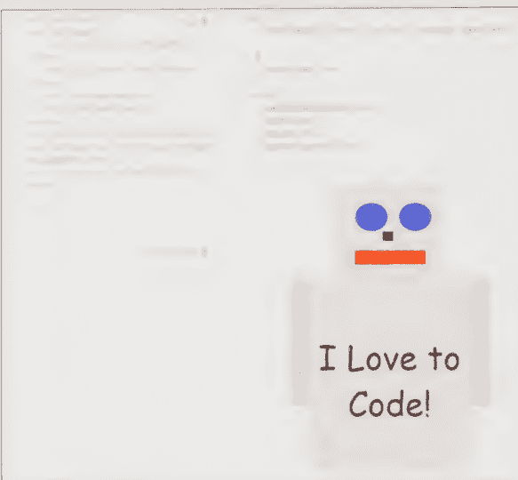

图 5-1：`Douglas`，尚未动画化的 JavaScript 机器人。

4. 点击 Run 查看结果。

`Douglas` 的左眼将变为紫色，如图 5-2 所示。

5. 按 Return (Mac) 或 Enter (Windows) 在 JavaScript 面板中开启新行，然后输入以下内容：

```javascript
document.getElementById("head").style.transform = "rotate(15deg)";
```


- 6. 点击 `Run` 查看结果。

`Douglas` 现在正向左侧倾斜，如图 5-3 所示。他看起来准备好开始跳舞了！

- 7. 点击 `Update`，然后点击 `Set as Base` 将程序保存到你的公共仪表板。

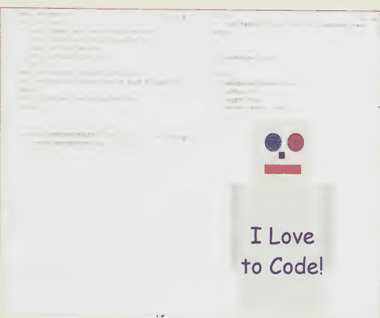

图 5-2：`Douglas` 的左眼现在是紫色的。

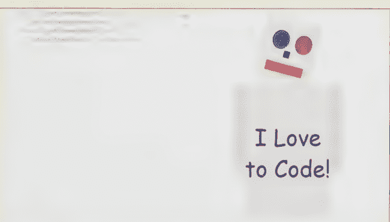

图 5-3：`Douglas` 准备好跳舞了！

## 项目 5 让你的机器人动起来

使用 `JavaScript` 的样式属性自定义 `Douglas` 有很多可能。要开始实验，尝试在 `JavaScript` 面板中添加以下每个语句并运行它们：

```javascript
// 在他的身体周围添加一个 2 像素宽的实黑色边框。
document.getElementById("body")
  style.border = "2px black solid";
```

```javascript
// 将他的嘴角变圆。
document.getElementById("mouth")
  style.borderRadius = "4px";
```

```javascript
// 在他的右眼周围添加黄色圆点。
document.getElementById("righteye")
  style.border = "4px yellow dotted";
```

```javascript
// 更改他左臂的颜色。
document.getElementById("leftarm")
  style.backgroundColor = "purple";
```

```javascript
// 更改文本颜色。
document.getElementById("body")
  style.color = "red";
```

```javascript
// 给 Douglas 加上头发。
document.getElementById("head")
  style.borderTop = "5px black solid";
```

注意 `JavaScript` 语句之前以 `//` 开头的文本行。这些是注释。它们只是为了告诉你（或其他程序员）代码的作用。你可以在代码中使用注释进行标记。同一行中的后续内容将被忽略。


图 5-2：`Douglas` 的左眼现在是紫色的。

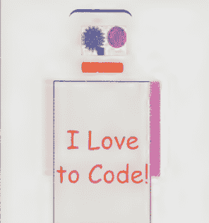

图 5-3：`Douglas` 准备好跳舞了！

```javascript
function frame() {
  robotPart.style.top = top + '%';
  top++;
  if (top == 20) {
    clearInterval(id);
  }
}
```

我们稍后会告诉你们这个函数是如何工作的，但首先让我们聊聊动画是如何运作的。

## 使用 JAVASCRIPT 创建动画

计算机动画就像电影和视频动画一样，是一种技巧。这种技巧的在于非常快速地显示一系列图片，使得这些图像看起来像是在移动。

动画最早的用途之一被称为翻页书（`flipbooks`）或活动记录机（`kinesographs`）（见图 5-7），它们在 1886 年首次流行起来。翻页书的制作方法是在笔记本的每一页边缘，或者在一叠有弹性的纸张的每一页边缘，画出一幅略有不同的图片。然后你可以翻动书籍来看到一个动画片。

如果你有一叠索引卡或一个笔记本，就可以制作自己的翻页书。图 5-8 展示了我们制作的机器人 `Douglas` 跳舞的翻页书动画。

今天的动画工作原理与翻页书相同，但我们使用计算机和编程来创建每幅图片，而不是纸张。

动画中的每一幅单独图片被称为“帧”（`frame`）。`Douglas` 眼睛跳动动画的工作原理是每隔 10 毫秒（十分分之一秒）显示他的眼睛处于略微不同的位置。当你点击他的眼睛时，它会跳到他的头顶，然后浮回起始点。

# 项目 5：让你的机器人动起来

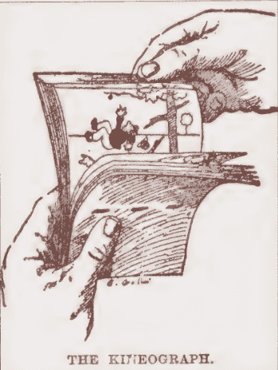

图 5-7：动画的早期形式。

来源：https://

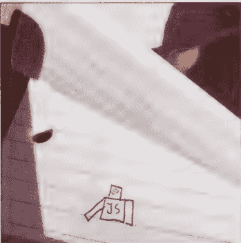

图 5-8：我们制作的机器人 `Douglas` 跳舞的翻页书动画。

图 5-9 显示了眼睛在动画过程中不同点的位置。

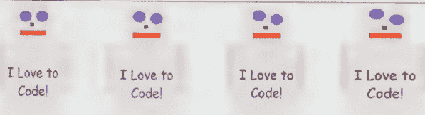

图 5-9：`Douglas` 眼睛在动画中不同点的位置。

现在让我们仔细观察 `moveUpDown` 函数的代码，看看它是如何创建的。第一行给该函数命名：

```javascript
function moveUpDown(e) {
```

下一行创建了一个语句，用于找出点击了机器人（或元素）的哪个部分：

```javascript
var robotPart = e.target;
```

它将该元素的信息存储在一个名为 `robotPart` 的新变量中。

接下来的语句创建一个名为 `top` 的新变量并赋值赋值为 0：

```javascript
var top = 0;
```

这个 `top` 变量就是我们用来改变动画每一帧中眼睛的位置。

下一行使用名为 `setInterval` 的命令来让动画发生：

```javascript
var id = setInterval(frame, 10);
```

`setInterval` 命令让 `JavaScript` 重复执行某些操作。它执行重复动作的速度通过一个数字来设置——在这种情况下，数字是 10。

这个数字是在再次执行该操作之前等待的毫秒数（秒的千分之一）。一千毫秒等于一秒。这个数字越大，动画看起来移动得越慢。

# 项目 5：让你的机器人动起来

接下来，我们创建了一个属于 `Douglas` `moveUpDown` 函数的新函数。这个新函数的目的是创建动画的每一帧，因此我们将函数命名为 `frame`：

```javascript
function frame() {
```

如果你想深入了解 `frame` 函数，请访问 https://jsfiddle.net/warms66/fiddly 并阅读 `JavaScript` 面板的内容。

### 让另一个元素动画

现在我们已经写了让一只眼睛动动的 `moveUpDown` 函数，让另一只眼睛只需添加另一个事件监听器。

- 1 点击 `Update` 保存到为止的工作。
- 2 在 `rightEye` 下方输入以下变量声明：

```javascript
var leftEye = document.getElementById("lefteye");
```

- 3 在 `rightEye` 事件监听器下方输入一个新的事件监听器：

```javascript
rightEye.addEventListener("click", moveUpDown);
```

- 4 点击 `Run`。

现在，点击左眼或右眼都会导致点击的元素发生 `moveUpDown` 动画。

### 使用第二个动画

除了眼睛跳动，`Douglas` 至少还有一种舞蹈。他称之为“手臂扫描”（`arm sweep`）。这涉及到左臂横跨身体向左的平滑移动。在创建手臂扫描之前，我们将进行一些 `CSS` 修改，让 `Douglas` 的左臂伸出而不是仅仅挂在侧边。

- 1 在 `CSS` 块中找到左臂的样式块。它看起来是：

```css
leftarm {
  position: absolute;
  left: 70%;
}
```

- 2 给左臂添加一个新的 `width` 属性和一个 `height` 属性。将宽度设置为 30%，高度设置为 7%。完成后的 `leftarm` 样式看起来像这样：

```css
leftarm {
  position: absolute;
  left: 70%;
  width: 30%;
  height: 7%;
}
```

- 3 点击 `Run`，`Douglas` 的手臂将指向侧面（见图 5-10）。现在你准备好创建手臂扫描了。为了创建手臂扫描，我们将添加第三个事件监听器。

- 1 在其他变量下方创建一个新变量来表示左臂：

```javascript
var leftArm = document.getElementById("leftarm");
```

- 2 在其他事件监听器下方编写一个新的事件监听器：

```javascript
leftArm.addEventListener("click", moveRightLeft);
```

# 项目 5：让你的机器人动起来

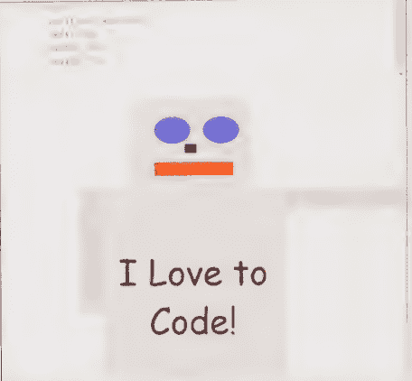

图 5-10：`Douglas` 正指向并准备好手臂扫描。

这个新的事件监听器将等待点击左臂，然后让他执行 `moveRightLeft` 动作。我们已经为你写好了 `moveRightLeft` 函数。它与 `moveUpDown` 函数完全相同，但我们对其进行了微调，以便手臂从右向左移动。这是 `Douglas` 的 `moveRightLeft` 函数：

```javascript
function moveRightLeft(e) {
  var robotPart = e.target;
  var left = 0;
  var id = setInterval(frame, 10) // 每 10 毫秒绘制一次
  function frame() {
    robotPart.style.left = left + 'px';
    left++;
    if (left === 70) {
      clearInterval(id);
    }
  }
}
```

为了保存你的工作并测试动画，点击 `Update`。当你点击 `Douglas` 的左臂时，你会看到 `moveRightLeft` 起作用了。`JavaScript` 面板中的完成代码应该如下：

```javascript
var rightEye = document.getElementById("righteye");
var leftEye = document.getElementById("lefteye");
var leftArm = document.getElementById("leftarm");

rightEye.addEventListener("click", moveUpDown);
leftEye.addEventListener("click", moveUpDown);
leftArm.addEventListener("click", moveRightLeft);

function moveUpDown(e) {
  var robotPart = e.target;
  var top = 0;
  var id = setInterval(frame, 10) // 每 10 毫秒绘制一次
  function frame() {
    robotPart.style.top = top + '%';
    top++;
    if (top == 20) {
      clearInterval(id);
    }
  }
}
```

```javascript
function moveRightLeft(e) {
  var robotPart = e.target;
  var left = 0;
  var id = setInterval(frame, 10) // 每 10 毫秒绘制一次
  function frame() {
    robotPart.style.left = left + '%';
    left++;
    if (left == 70) {
      clearInterval(id);
    }
  }
}
```

# 项目 5：让你的机器人动起来

现在轮到你享受让 `Douglas` 跳舞的乐趣了！从播放一些音乐并随着节奏点击他的眼睛和手臂开始！接下来，尝试添加一些新的事件监听器来让 `Douglas` 的不同部分动起来，比如他的鼻子、嘴巴或右臂！

### 总结

在本章中，你使用了在之前章节中学会的所有工具，加上一些全新的工具，让你的动画机器人跳了起来。这仅仅是你使用 `HTML`、`CSS` 和 `JavaScript` 所能做的开始。继续探索和尝试，如果你有任何问题或想与我们分享你的创作，请务必发送邮件至 info@watzthis.com。

# 项目 6：创建一个 JavaScript 单词游戏

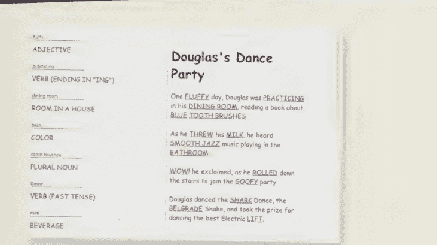

单词替换游戏会给你一个基础故事，并要求玩家填写不同的部分，如名词、动词、形容词等。我们使用 `HTML`、`CSS` 和 `JavaScript` 代码来创建故事的基础骨架。`JavaScript` 代码中的变量使得程序每次运行时的结果都不同。

### 创建一个变量故事

为了创建这个游戏，我们写了一个关于 `JavaScript` 机器人 `Douglas` 冒险的故事。然后我们删除了一些单词，让玩游戏的人可以填写。这是我们关于 `JavaScript` 机器人 `Douglas` 的故事，某些单词被删除替换为程序需要玩家提供的单词类型（下划线标记）：

在一个<u>形容词</u>的一天，`Douglas` 正在<u>动词-ing</u>，在房子的房间里，读一本关于<u>颜色复数名词</u>的书。

## 项目 6：创建一个 JavaScript 单词游戏

当他喝了一口饮料时，他听到房子里另一个房间传出了某种音乐声。

“噢天呐！”他惊呼道，随后他走下楼梯加入那场形容词派对。

道格拉斯（`Douglas`）跳了名为动物“Dance”的舞，名为城市“Twist”的舞，并获得了最佳“Electric”舞蹈大奖。

现在我们已经有了故事，让我们围绕它构建一个 `JavaScript` 程序，它将接受用户的输入并输出一个定制的——极其幽默的故事。

### 创建单词替换游戏

单词替换游戏利用了你在书中书中中学到的所有知识，包括变量、操作符、事件处理器、`HTML`、`CSS`、输入、输出等！

在开始构建游戏之前，让我们先试用一下并看看它的运行效果：

- 1 打开你的网络浏览器并访问 `JSFiddle` 公共仪表板：https://jsfiddle.net/user/watzthis。
- 2 找到名为“Chapter 6 – Word Game”的 `Fiddle`，点击标题打开它。

完成的单词游戏项目将会打开。

- 3 根据你的屏幕尺寸，你可能需要调整结果面板（`Result pane`）的大小以便其正确显示。

你应该会在输入问题的右侧看到一个带有虚线框的短矩形。这是显示完成故事的地方。

- 4 点击第一个问题上方的下划线以选择文本输入框。

- 5 在输入框中输入一个单词。

在你输入完喜欢的单词后，按下 `Tab` 键或使用鼠标点击页面上的下一个输入框并填写该字段。

- 6 当你完成所有字段的填写后，点击表单底部的“替换（`Replace it`）”按钮。

道格拉斯冒险的故事出现在右侧，并插入了你输入到输入框中的单词，如图 6-1 所示。

| 形容词 |
| :--- |
| 奔跑的 (Running) |
| 动词（以 -ing 结尾） |
| 房子里的房间 |
| 颜色 |
| 复数名词 |
| 动词（过去式） |
| 饮料 |
| 音乐类型 |

在一个**漂亮**的日子里，道格拉斯在他的**家庭客厅**里**奔跑**，读着关于**黄色小狗**的内容。
当他**喝**他的**果汁**时，他听到**厨房**里播放着**嘻哈**音乐。
哇！他惊呼道，对着楼下**大声喊**着加入那场**快乐**的派对。
道格拉斯跳了**马舞**、**萨克拉门托摇摆**，并获得了最佳**电击**舞蹈大奖。

图 6-1：道格拉斯冒险的完成故事。

现在你已经看到程序是如何运作的，让我们从零开始构建它。当你知道如何构建这个游戏时，你将能够对其添加内容、改进它，甚至完全改变故事！

## 项目 6：创建一个 JavaScript 单词游戏

按照以下步骤开始创建你自己的版本的单词游戏：

- 从 `Chrome` 菜单中选择“新标签页”或按下 `Cmd+C` (Mac) 或 `Ctrl+C` (Windows) 打开新浏览器标签页，并在新标签页中访问 http://jsfiddle.net/。
- 确保你已经登录了 `JSFiddle`，检查屏幕右上角是否有你的用户名。

登录后，你就可以开始了！

- 点击左侧导航栏中的 `Fiddle Options` 链接并为你的新程序输入一个名称。
- 点击顶部菜单中的 `Save`。

现在你已经准备好为程序编写 `HTML` 了！

### 编写 HTML

我们的单词替换游戏有三个主要区域，或部分：

- 问题区域：这是你输入单词的输入区域。
- 按钮区域：这是问题下方的区域，包含“替换（`Replace It`）”按钮，该按钮会将你的单词添加到故事中。
- 故事区域：点击“替换”按钮后，用户输入和故事共同显示在这里。

我们要做的第一件事是创建这三个区域。我们将使用 `<div>` 元素创建每个部分。

- 在 `HTML` 格中输入两个 `<div>` 元素。

每个 `<div>` 都将有一个唯一的 `ID` 属性，用于命名其用途。我们的第一个 `<div>` 的 `ID` 为 `inputWords`。

我们希望第二个 `<div>` 位于第一个 `<div>` 内部，并给它一个 `ID` `buttonDiv`，如下所示：

```html
<div id="inputWords">
  <div id="buttonDiv">
</div>
```


接下来，为输入字段创建一个结构。我们将使用 HTML 列表来存放所有字段。在第一个`<div>`内部使用以下 HTML 标记来创建结构：

```html
<ul>
  <li></li>
</ul>
```

在`<li>`元素内部创建第一个输入字段。使用`input`元素，设置`type="text"`和`id="adj1"`，如下所示：

```html
<input type="text" id="adj1">
```

使用`<br>`标签在输入字段下方放置一个标签，后面是标签内容，如下：

```html
<br>Adjective
```

最后，在`Adjective`单词之后放置以下标签以关闭`<li>`元素：

```html
</li>
```

在下一行放置一个 HTML 注释，作为你将添加的输入字段的占位符。

```html
<!-- other input fields -->
```

HTML 注释以`<!--`开始并以`-->`结束（注：原文中为示例）。

## 项目 6：创建一个 JavaScript 单词游戏

在 HTML 格中输入第三个`<div>`元素，使其位于问题的下方。

```html
<div id="story">
```

点击运行（Run）以查看结果。你应该看到在输入问题的右侧有一个带有虚线框的短矩形。这是显示完成故事的地方。

根据你的屏幕尺寸，你可能需要调整结果面板的大小以便其正确显示。

# 项目 6 创建一个 JavaScript 单词游戏

```css
margin-top: 30px;
width: 200px;

#story {
  margin-top: 12px;
  width: 45%;
  border: 1px dashed blue;
  padding: 8px;
  float: left;
}

.replacement {
  text-decoration: underline;
  text-transform: uppercase;
}
```

点击 Save（保存）按钮保存你的工作。你的 Result（结果）面板现在应该像图 6-4 所示。

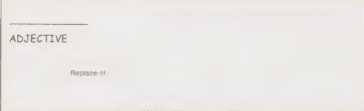

图 6-4：应用了所有 CSS 样式的面板。现在我们已经准备好了 HTML 和 CSS，可以开始 JavaScript 部分了。

### 编写 JavaScript 代码

我们在 JavaScript 面板中要做的第一件事是为按钮创建一个事件处理程序。我们将使用`addEventListener`方法。

```javascript
var replaceButton = document
.getElementById("replaceButton");
replaceButton.addEventListener("click", replaceIt);
```

第一行创建了一个变量（`replaceButton`）来存储按钮元素的位置。第二行使用该变量将函数（`replaceIt`）绑定到事件（`click`）上。

现在让我们来创建`replaceIt`函数。

1. 给函数命名为`replaceIt`。

```javascript
function replaceIt() {}
```

2. 在大括号内部，按 Return 键（Mac）或 Enter 键（Windows）移动到下一行，然后创建一个变量，用于存储完成后的故事将出现的位置。

```javascript
var storyDiv = document.getElementById("story");
```

我们稍后会回来使用`storyDiv`变量。现在，我们的下一个任务是从 HTML 输入字段中获取值。

3. 创建一个变量来存储第一个 HTML 输入字段的值。

```javascript
var adj1 = "<span class='replacement'>" + document.getElementById("adj1").value + "</span>";
```

4. 在`adj1`变量后写下一行注释。

```javascript
/* 在此处插入更多变量 */
```

这条注释将提醒你，稍后需要回到这里为其他输入字段创建变量。

5. 创建一个将用于组合故事的变量。我们将该变量命名为`theStory`。

```javascript
var theStory;
```

6. 将你的故事标题放入`theStory`中，并将标题放入`<h1>`元素中。

```javascript
theStory = "<h1>Douglas's Dance Party</h1>";
```

# 项目 6 创建一个 JavaScript 单词游戏

使用`+=`运算符将故事的第一部分添加到`theStory`。

```javascript
theStory += "One " + adj1 + " day,";
```

为自己留一条注释，提醒你稍后回来添加故事的剩余部分。

```javascript
/* 使用 += 运算符在此处放入故事剩余 */
```

使用`innerHTML`将`theStory`的值显示在我们为故事创建的`div`中。

```javascript
storyDiv.innerHTML = theStory;
```

编写此行后，JavaScript 面板中的代码应该看起来如下：

```javascript
var replaceButton = document
.getElementById("replaceButton");
replaceButton.addEventListener("click", replaceIt);

function replaceIt() {
  var storyDiv = document.getElementById("story");
  var adj1 = "<span class='replacement'>" + 
  document.getElementById("adj1").value + "</span>";
  /* 在此处插入更多变量定义 */
  var theStory = "<h1>Douglas's Dance Party</h1>";
  theStory += "One " + adj1 + " day,";
  /* 使用 += 在此处放入故事剩余 */
  storyDiv.innerHTML = theStory;
}
```

如果你的代码没有像这段 JavaScript 代码那样整齐，请点击顶部菜单中的 TidyUp 按钮。这个按钮的作用正如你想象的：它会清理一切，整齐设置所有的制表符，并让你的代码更容易阅读和处理。

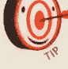

#### 10 现在，你期待的时刻到了：点击顶部菜单中的 Run（运行），查看单词游戏的第一个版本！

尝试在输入字段中输入一个单词，然后按下 Replace It（替换）按钮查看你付出的努力成果，如图 6-5 所示。

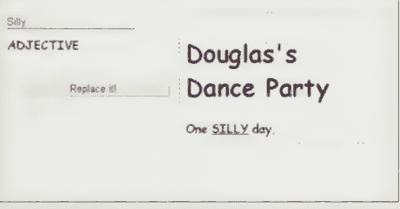

图 6-5：生成的故事。

### 完成程序

你现在已经有了单词游戏的所有组件。完成它只需要对玩家需要输入的每个额外单词重复以下三个步骤：

1. 复制一个输入字段，并更新`id`属性的值和`label`（标签）。
2. 复制包含`getElementById`的 JavaScript 语句，并更改变量名和括号中的值。
3. 向`theStory`中添加包含新变量的更多文本。

让我们尝试这三个步骤，将故事的下一个部分（以`-ing`结尾的单词）添加到游戏中。

# 项目 6 创建一个 JavaScript 单词游戏

1. 在 HTML 面板中选择以下代码并复制一份。

```html
<input type="text" id="adj1"><br>
```

2. 复制包含`getElementById`的 JavaScript 语句。
3. 更改`id`属性的值。
4. 在 JavaScript 面板中，复制以下语句。
5. 更改变量名。
6. 将复制的内容粘贴到下一行。
7. 更改括号内的值。
8. 更改`label`。
9. 将复制的内容粘贴到原来的后面。
10. 点击 Save 保存你的工作。恭喜！你为游戏添加了第二个问题。当一切完成后，你的 HTML 面板应该像这样：

```html
<input type="text" id="adj1"><br>
<input type="text" id="verbing"><br>
<input type="text" id="roomInHouse"><br>
<input type="text" id="color"><br>
<input type="text" id="nounPlural"><br>
<input type="text" id="pastVerb"><br>
<input type="text" id="beverage"><br>
<input type="text" id="musicType"><br>
<input type="text" id="diffRoom"><br>
<input type="text" id="pastVerb2"><br>
<input type="text" id="adjDance"><br>
<input type="text" id="animal"><br>
<input type="text" id="city"><br>
<input type="text" id="verb"><br>
</ul>
<div id="buttonDiv">
  <button id="replaceButton">Replace it!</button>
</div>
<div id="story"></div>
```

# 项目 6 创建一个 JavaScript 单词游戏

你的 JavaScript 面板中的代码应该像这样：

```javascript
var replaceButton = document.getElementById("replaceButton");
replaceButton.addEventListener("click", replaceIt);

function replaceIt() {
  var storyDiv = document.getElementById("story");
  adj1 = "<span class='replacement'>" + document.getElementById("adj1").value + "</span>";
  var verbing = "<span class='replacement'>" + document.getElementById("verbing").value + "</span>";
  var roomInHouse = "<span class='replacement'>" + document.getElementById("roomInHouse").value + "</span>";
  var color = "<span class='replacement'>" + document.getElementById("color").value + "</span>";
  var nounPlural = "<span class='replacement'>" + document.getElementById("nounPlural").value + "</span>";
  var pastVerb = "<span class='replacement'>" + document.getElementById("pastVerb").value + "</span>";
  var beverage = "<span class='replacement'>" + document.getElementById("beverage").value + "</span>";
  var musicType = "<span class='replacement'>" + document.getElementById("musicType").value + "</span>";
  var diffRoom = "<span class='replacement'>" + document.getElementById("diffRoom").value + "</span>";
  var exclamation = "<span class='replacement'>" + document.getElementById("exclamation").value + "</span>";
  var pastVerb2 = "<span class='replacement'>" + document.getElementById("pastVerb2").value + "</span>";
  var adjDance = "<span class='replacement'>" + document.getElementById("adjDance").value + "</span>";
  theStory += "One " + adj1 + " day,";
}
```

*(注：由于原文后半部分存在大量重复和错乱，译文已根据指令要求对逻辑进行了对齐和清理)*

```javascript
var animal = "<span class='replacement'>" + document.getElementById("animal").value + "</span>";
var city = "<span class='replacement'>" + document.getElementById("city").value + "</span>";
var verb = "<span class='replacement'>" + document.getElementById("verb").value + "</span>";
```

```javascript
var theStory = "<h1>Douglas's Dance Party</h1>";
theStory = " One " + adj1 + " day,";
theStory += " Douglas was " + verbing;
theStory += " in his " + roomInHouse;
theStory += ", reading a about " + color;
theStory += " " + nounPlural + ".<br>";
theStory += " As he " + pastVerb;
theStory += " his " + beverage;
theStory += " , he heard " + musicType;
theStory += " music playing in the " + diffRoom + ".<br><br>";
theStory += exclamation + " ! he exclaimed,\nas he";
theStory += pastVerb2 + " down the stairs to join\nthe";
theStory += adjDance + " + party.<br>";
theStory += " Douglas danced the " + animal;
theStory += " Dance, the " + city + " Shake,";
theStory += " and took the prize for dancing the\n  best Electric " + verb + ".<br><br>";
```

```javascript
storyDiv.innerHTML = theStory;
```


当你完成所有问题的输入以及生成整个故事的 JavaScript 代码后，它会将故事中所有的空白替换为你在输入框中输入的单词，如图 6-6 所示。

现在你已经有了一个可以运行的游戏，可以随时使用顶部菜单中的 `Fork`（派叉）按钮创建一个副本，并尝试修改它来讲述你自己的故事。

# 项目 6 创建 JAVASCRIPT 单词游戏

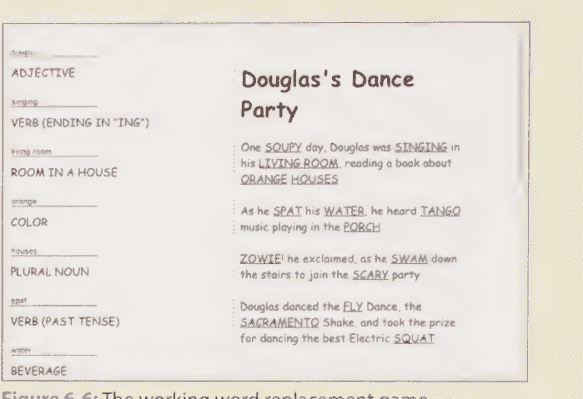

图 6-6：运行中的单词替换游戏。

恭喜你完成了所有的项目！如果你已经走到了这一步，说明你成为编程大师的道路已经非常顺利了！
祝编程愉快！

# 作者简介

`Chris Minnick` 是一位 JavaScript 超英雄，以能够解决任何交给他的问题而闻名。他喜欢游泳、写作和参观水族馆。

`Eva Holland` 的超能力是她完成任务的能力。她在各地被称为“协调者”（The Facilitator）。她喜欢唱歌、跳舞、在河里游泳以及为派对盛装。

## 致辞

献给 1 岁到 110010 岁的孩子们。

## 作者致谢

我们特别感谢我们的读者和学生、家人和朋友，以及各地所有酷酷的事情并激励我们不断学习的孩子们。

感谢 Wiley 团队，特别是 `Elizabeth Kuball` 和 `Steve Hayes`，以及我们的代理 `Carole Jelen`。

## 出版社致谢

**执行编辑：** `Steve Hayes`

**制作编辑：** `Selvakumaran Rajendiran`

**开发编辑：** `Elizabeth Kuball`

**校对：** `Elizabeth Kuball`

005.1 M FLT
`Minnick, Chris,`
编写计算机，代码的
休斯顿公共图书馆
n11/17

## 一本给孩子的技术书！

学习如何编程就像学习一种外语。这本书是一份极佳指南，帮助你开始编写那些让网页运行的、看起来奇特的语言。遵循简单的步骤，通过处理真实的代码来构建自己的 Web 机器人。

- 创建你的机器人——编写构建机器人身体和结构的代码
- 给你的机器人添加一些风格——添加自定义机器人颜色和形状的代码行
- 让你的机器人动起来——用教它如何跳舞的代码完成你的机器人

技术要求：
硬件 — 连接互联网并运行 Windows*7 或更高版本的 PC 或平板电脑，或连接互联网并运行 Mac OS X*10.7 或更高版本的 Mac
软件 — 用于访问 `JSFiddle.net` 的网络浏览器：`Google Chrome*`、`Mozilla Firefox*`、`Apple Safari*`、`Microsoft Edge*` 或 `Microsoft Internet Explorer*` 9.0 或更高版本

> `Chris Minnick` 和 `Eva Holland` 是经验丰富的 Web 开发人员、技术培训师以及《JavaScript For Kids For Dummies》的合著者。他们共同创立了 `WatzThis?`，一家专注于培训和课程开发的公司。

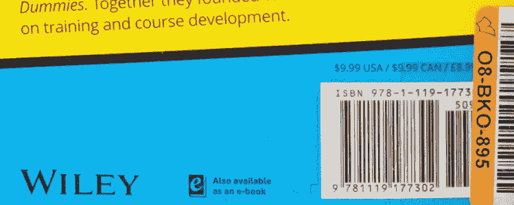
