# 你的第一个 Meteor 应用：Meteor JavaScript 框架初学者指南


## 1 简介

Meteor 框架有很多令人喜爱的地方：

* 你只需要 JavaScript 就可以构建整个 Web 应用程序。
* 你的应用程序默认就是实时的，类似于桌面应用程序。
* 有一个庞大且热心的社区在你进步的过程中提供帮助。

Meteor 也相对容易学习，对于 Web 开发初学者来说是一个很好的选择——他们可能从未构建过 Web 应用程序，但仍然想要开发 Web 前沿的软件（希望你也处于这个光谱的某个位置）。

正是由于这些原因，让我很快就成为了 Meteor 的粉丝。我已经完全“入坑”并非常喜欢这种感觉。事实上，它是如此令人享受以至于：

* 我读了几乎所有的教程并并了所有的视频演示。
* 我建立了一个[关于 Meteor 的博客](http://meteortips.com) 来分享我在过程中学到的东西。
* 我开始写这本书。

因为虽然有很多学习 Meteor 的优秀资源，而且其中很多资源是为初学者设计的，但在某些 Meteor 概念真正“进入”脑海之前，我发现自己仍在多个资源之间反复跳跃。我找不到一个能够按照我设想的方式教授所有内容的资源。但这让我开始思考——为什么不直接写一本我想读的书呢？

所以，我们在这里了。

*你的第一个 Meteor 应用*。

一本针对 Meteor JavaScript 框架的详细初学者指南。

让我们开始吧。

### 1.1 前提条件

在接下来的页面中，我特意为初级开发者编写了内容。具体来说，这意味着：

* 你不需要任何先 Meteor 经验。
* 你不需要以前构建过 Web 应用程序。
* 你不需要在过程中查阅其他来源。

然而，你将：

* 对 JavaScript 有基础了解。
* 对数据库有基础了解。

对于 JavaScript，这意味着熟悉变量、循环、条件语句和函数；对于数据库，这意味着熟悉表、行、列和主键。

如果你需要这些技能，那么像 [Lynda.com](http://www.lynda.com/promo/trial/Default.aspx?lpk35=1833&utm_medium=ldc-partner&utm_source=SSPRC&utm_content=655&utm_campaign=CD16647&bid=655&subID1=book&aid=CD16647)这样的网站会很有用，但无论何种，我不期望读者是 JavaScript 忍者或数据库专家。这个计划是稳扎稳打，以确保几乎每个人都能取得持续的进展。

我们并不急。

### 1.2 你需要什么

开始开发 Meteor 应用并不需要很多东西。某些工具会让生活变得更轻松，但目前我们将保持简单。

在撰写这些文字时，Meteor 官方支持以下平台：

* Mac：OS X 10.6 及以上版本
* Linux：x86 和 x86_64 系统

不过，未来将为 Windows 提供官方支持，正如我稍后将介绍的，Windows 也有非官方选项，因此任何主要的（且相对较新的）操作系统都可以正常运行。

为了编写代码，你需要一个文本编辑器。你可能有自己的偏好，如果是这样，就坚持你的偏好。我们不会进行任何高级用户的技巧。我个人来说，我使用 [Sublime Text](http://sublimetext)。

为了在本地计算机上查看 Meteor 应用，Google Chrome 是首选浏览器。它带有我们之后将用到的方便开发工具，也是你作为 Meteor 开发者一生中都会用到的工具。

一旦这些基础准备就绪，你就可以开始了。

### 1.3 本书

成长过程中，我读了很多技术书籍，老实说，其中很多书并不那么好。在 [Meteor Tips](http://meteortips.com) 写作让我看到了技术写作会有么困难，但许多书籍仍然犯了同样的、令人沮丧的错误，这似乎仍然很傻，例如：

* 在不需要解释概念之前就解释复杂的概念。
* 用无用信息充斥页面以使书变长。
* 假设单一的解释就足以说明一个观点。
* 试图吸引所有人——业余爱好者、专业人士以及之间的所有人。
* 让读者淹没在理论中，却在实操内容上马虎。

因此，我想直率地表示，我已经仔细避开了多年来遇到过的这些错误。

我做得完美吗？

可能没有。

然而，我致力于尽尽所能，所以计划是永远不会“完成”这本书。相反，当出现以下情况时，我会继续重写章节：

* Meteor 有更新。
* 需要处理读者的反馈。
* 我的教学哲学发生了变化。

但我不想让你觉得读了我的话后，你会突然“领会”了 Meteor 的复杂之处。它对初学者是一个很棒的框架，但它仍然是编程。你必须动脑筋，某些想法可能不会立即跟上。你可以做到，但这需要付出努力。

作为老师，我将你的教育视为我的责任，但作为学生，有几个策略将显著提高你学习和记忆信息的能力：

1. **通读一遍所有**。在不写任何代码的情况下这样做。对你将要做的事情有个大概的感觉。也许写下任何你难以理解的点。
2. **再次通读一遍，慢慢一点**。这次要写代码，但不要急于结束。慢慢来。这不是比赛。给你的大脑留出时间吸收一切。
3. **以简单的方式修改示例代码**。使用不同的变量名。在`JavaScript Console`中输出不同的字符串。让代码变成“你”的，以确保你真正投入了其中（而不是只是走形式）。
4. **承诺每天固定的学习时长**。这样做，而不是尝试每天达到一个新里程碑。设定一个短时间——大约 20 分钟——不要断链。
5. **把这看作是马拉松，而不是冲刺**。你无法在一周内学会 Meteor。但你可以学会它。只要持之以恒。匆忙只会事情变得更困难。
6. **当你卡住时，停下来**。休息一下。去散散步。也许今天就关掉电脑。让你的大脑休息，然后稍后再回到问题。
7. **坚持**。不要放弃。继续下去即可。坚持是最大的平等者。这听起来很老套，但如果你不放弃，你就不会失败。向天苍唱道吧：“我不会放弃！”

此外也要知道**挣扎就是学习**。你不需要在每次学习期间都掌握新概念。每次你坐下来写代码，你都在进步，即使你并不觉得是这样。正如《冒险时光》中所说，“在某方面表现糟糕是通往在某方面优秀的第一步。”

## 2 入门

由于我们不在同一个房间里，我不确定你对构建 Web 应用知道什么、不知道什么。因此，我将做出几个假设：

* 你从未用过命令行。
* 你还没有安装 Meteor。

如果这些假设是错误的，请随意跳过本章。

### 2.1 命令行

曾经，计算机没有图形界面。相反，`命令行` 被以下人士使用：

1. 忘记更新系统的人。
2. 开发者。

如果这些假设是错误的，请随意跳过。

因为虽然图形界面方便易用，但它们也很浪费时间。（你可能认为点击比打字快，离开键盘使用电脑会让你感觉像超人。）

出于这些原因，我们在处理 Meteor 时不使用图形界面。这会浪费开发者的时间。

所有的计算机都应该可以使用命令行，它们的操作通常相同，所以不要担心你使用的是 Mac 还是 Windows。然而，命令行的具体名称因操作系统而异：

* 在 Mac 上，它是`Terminal`应用。
* 在 Windows 上，它是`Command Prompt`应用。
* 在 Linux 上，名称取决于发行版，但如果你正在使用 Linux，你可能知道自己在做什么。

无论你使用什么操作系统，请找到命令行应用程序，以便我们开始第一个命令。

### 2.2 安装 Meteor

目前，Meteor 官方支持：

* Mac：OS X 10.6 及以上版本
* Linux：x86 和 x86_64 系统

Windows 不在列表中，但 Windows 用户可以使用 [win.meteor.com](http://win.meteor.com) 提供的非官方选项安装 Meteor。步骤将和我即将解释的不同，但 Meteor 会按预期工作。

对于我们其他人，安装过程不能更简单了。

首先，将以下命令复制到剪贴板：

```bash
curl https://install.meteor.com | /bin/sh
```

你不需要理解这个命令的具体含义。只需确保它已经在剪贴板上并准备好粘贴。

然后：

1. 打开你的命令行应用程序。
2. 将命令粘贴到命令行应用程序中。
3. 按下“Return”键。

此时，你的电脑将连接到`install.meteor.com`并获取最新版本的 Meteor。随后它将下载最新版本的 Meteor 并进行安装。

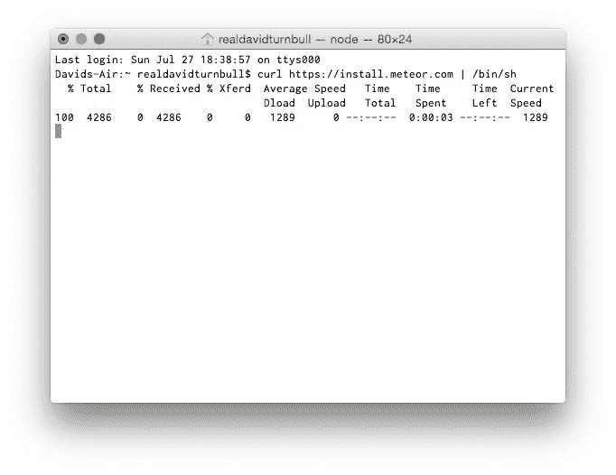

正在下载最新版本的 Meteor。

如果该命令不起作用——如果出现错误——请尝试以下命令：

```
sudo curl https://install.meteor.com | /bin/sh
```

在这里，添加`sudo`关键字允许我们以计算机管理员的身份运行命令。系统会提示你输入密码，只需输入密码并再次按下“回车”（Return）键即可。

我们将在下一章讨论其他命令，但坦率地说，它们不会比我们在这里所做的更难。你可能想在某时候阅读 Zed Shaw 写的[命令行速成](http://cli.learncodethehardway.org/book/)，但在本书期间你不需要任何特殊知识。只是，你对命令行了解得越多，作为开发者的生产力就越高。你也可以从这样一个事实中获得安心：虽然图形界面会随着趋势和喜好而变化，但命令行始终保持着优美的坚定，因此无需担心你对它的精通会在一夜之间突然变得多余。

## 3 项目

在 Meteor 的官方网站上，有一个“[示例](http://meteor.com/examples/)”部分，展示了四个不同的示例应用程序：

* 排行榜 (Leaderboard)
* 派对 (Parties)
* 待事项 (Todos)
* 文字游戏 (Wordplay)

这些应用程序旨在展示 Meteor 的特性，由于每个应用程序的源代码都可以下载和探索，它们也是开发者很好的学习工具。

在本章中，我们将查看排行榜——这四个应用程序中最简单的一个——然后从头开始构建它。

在书的剩余部分，我们将继续开发排行榜，但为我们的作品添加一些额外功能，以便学习更多 Meteor 知识。

### 3.1 什么是排行榜？

初学者的一个常见错误是在清楚自己想要构建什么之前就尝试编写代码，但这就像在不看地图的情况下开车前往目的地。你可能在正确的方向上取得一点进展，但可能无法到达你想去的地方。

将来，一旦你有了更多的开发经验，不需要大量准备就能凑出一个原型应用将变得更容易，但至少目前：**在尝试构建之前，先想清楚你想构建什么**。如果这听起来很显而易见，太好了。如果不是，请记住规划与耐心的结合是你作为开发者最大的资产之一。

正因如此，我喜欢用排行榜应用程序作为本教程的核心。构建它并不是最令人兴奋的但不：

1. **它在概念上很简单**。你不需要费力去理解最终结果，这将使得朝着目标迈进变得更容易。
2. **它已经存在了**。你可以看到并玩它，所以当我解释我们要构建什么时，你会知道我在说什么。

其他技术书籍提供的示例应用程序可能更雄心勃勃、更有趣，这在短期内可能更有动力，但它也迫使读者过分思考“正在构建什么”，而不是“如何构建”。我的观点是，最好的方法是收敛野心，确保我们不需要花费太多精力去思考我们在构建什么，然后你就可以从取得实际进展中获得动力。

要查看排行榜应用程序的运行情况，请[观看此视频](http://meteor.com/examples/leaderboard)，或者想亲自玩玩，请[查看此演示](http://leaderboard.meteor.com)。掌握我们很快就要重建的核心功能并不需要长时间：

* 有一份玩家列表。
* 每个玩家都有一个分数。
* 玩家的分数决定了他们的排名。
* 你可以通过点击来选取玩家。
* 你可以增加被选中玩家的分数。

这不是一个很长的列表，但通过处理这些少量的功能，我们仍然可以学到很多东西。

### 3.2 创建项目

当我们准备好创建第一个 Meteor 应用程序时，我们需要从创建一个*项目*开始，项目是构成应用程序基础的自包含文件集。

每个项目都是不同的，但通常会包含：

* HTML 文件，用于定义模板。
* CSS 文件，用于定义样式。
* JavaScript 文件，用于定义逻辑。
* 文件夹，用于保持组织。

稍后，我们将为排行榜应用程序创建一个项目，但在那之前，在命令行中输入以下命令：

```
mkdir Meteor
```

此`mkdir`命令代表“make directory”（创建目录），正如其名所示，它用于创建目录。在这里，我们将目录命名为“Meteor”，但你可以任由你命名。这个目录的作用是存储我们的 Meteor 项目，以便我们将它们整齐地放在一个地方。创建此目录的确切位置取决于操作系统，至少在 Mac OS X 上，它会出现在“用户”（Home）目录内部。（在这里搜索可能会派上用场。）

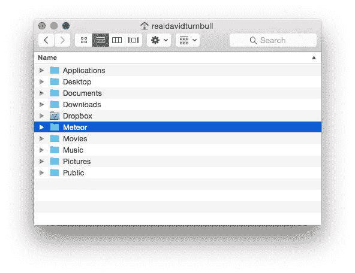

我们刚刚创建的目录。

我们刚刚创建的目录 一旦创建了这个目录，我们就可以此命令进入（导航）它：

```
cd Meteor
```

`cd`命令代表“change directory”（切换目录），在命令行中等于双击目录。


在命令行中输入命令。

由于`cd`命令，我们现在进入了“Meteor”目录内部，这意味着是时候使用以下命令创建我们的项目了：

```
meteor create leaderboard
```

此命令有三个部分：

* `meteor`部分定义了这是一个与 Meteor 相关的命令。
* `create`部分明确了我们想要创建一个项目。
* `leaderboard`部分是我们分配给项目的名称。

在`create`关键字处，我们可以使用一系列其他关键字来完成不同的任务。我会在相关时解释这些其他关键字。

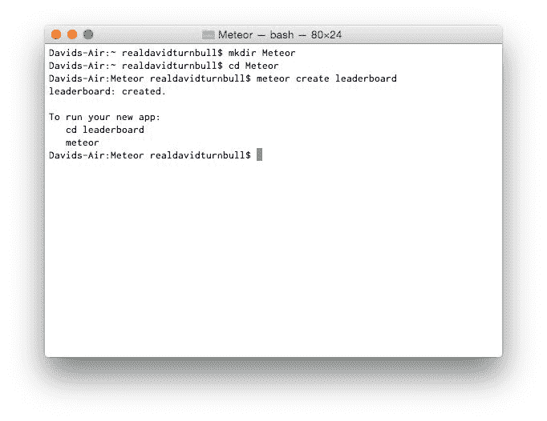

创建一个 Meteor 项目。

运行之前的命令后，“Meteor”目录内部会出现一个“leaderboard”目录。这个目录就是我们的 Meteor 项目，默认情况下将包含三个文件和一个隐藏目录：

* `.meteor`
* `leaderboard.html`
* `leaderboard.css`
* `leaderboard.js`

`.meteor`目录包含了应用程序所需的重要代码，所以最好不要动它。其余的文件包含了我们几步之后将删除的默认代码。

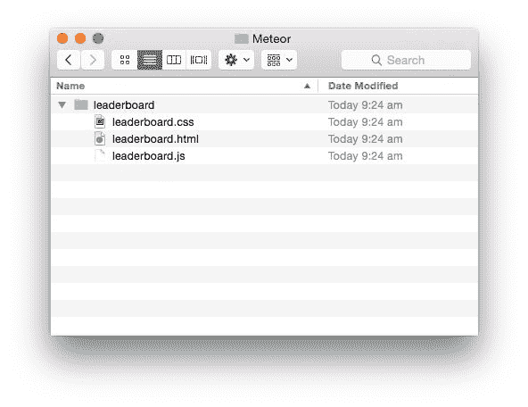

在我们“Meteor”文件夹内部。注意：如果你的文件名不同，那是因为默认情况下文件名是基于项目名称的。尽管如此，文件名并不要求匹配项目名称。

### 3.3 启动本地服务器

Web 应用程序不像由 HTML 和 CSS 的静态网站。你不能简单地将文件加载到浏览器中查看运行情况。首先，我们需要启动所谓的*本地服务器*。

从命令行进入“leaderboard”目录：

```
cd leaderboard
```

然后输入此命令：

```
meteor run
```

同样，`meteor`部分定义了这是一个与 Meteor 相关的命令，然后我们有`run`部分来明确我们想要采取的精确操作。

作为此命令的响应，在加载几秒后，命令行中将出现内容：

```
=> Started proxy.
=> Started MongoDB.     
=> Started your app.
=> App running at: http://localhost:3000/
```

最后一行非常重要，因为：

1. 它意味着本地服务器已经启动。
2. 它为本地服务器提供了一个 URL。

此时，打开 Google Chrome 浏览器并导航到 [`localhost:3000`](http://localhost:3000)。你应该能看到类似下面的内容：

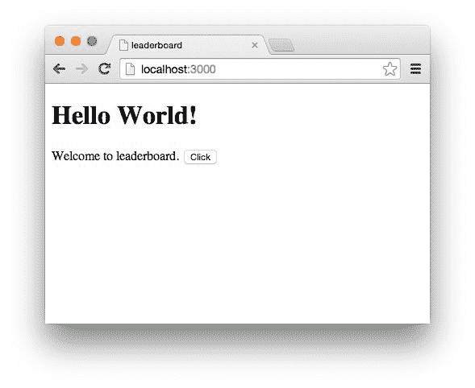

在 Google Chrome 中运行的默认 Meteor 应用。

这是每个新 Meteor 项目包含的默认代码的结果。如果它出现在浏览器中，说明一切运行都符合预期。从现在起，保持本地服务器运行，以便持续查看你代码的结果。

### 3.4 默认应用程序

默认的 Meteor 应用并没有那么有趣，我不会费精力解释幕后发生了什么，因为无论如何在编写排行榜（Leaderboard）时，我们会涵盖所有相同的内容。不过，我会要求你点击我们这个单调界面中那个孤零的按钮。

点击那个按钮会发生什么？

如果你说“什么都没有发生”，我是可以原谅你的。

事实上，确实有某些事情在发生——只是这些事情没有通过界面传达，所以并不显而易见。

为了证明这一点，在 Google Chrome 中打开 JavaScript 控制台：

1. 点击`View`（查看）菜单。
2. 悬停在`Developer`（开发者）选项上。
3. 选择`JavaScript Console`（JavaScript 控制台）选项。

浏览器底部打开一个面板。再次点击应用程序界面内的按钮，你会注意到面板内部出现了一条消息，写着“You pressed the button”（你点击了按钮）。

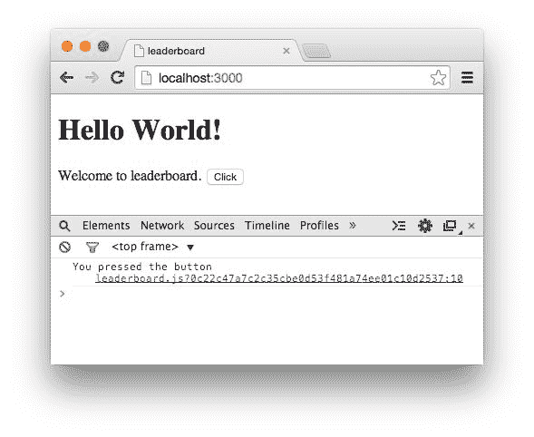

发送到 JavaScript 控制台的语句。

在我们项目中，有一个`console.log`语句，每次点击按钮时都会触发。该语句看起来如下：

```
console.log("You pressed the button.");
```

我们并不特别关心这个按钮，但是：

1. 在接下来的章节中，我们将使用`console.log`语句来显示数据，而不是立即创建用户界面。
2. 可以在 JavaScript 控制台中输入一系列命令，允许我们轻松地操作 Meteor 应用的数据库。


3. 错误将显示在 JavaScript 控制台中，使其成为修复我们代码问题的方便工具。

出于这些原因，从现在起请离开 JavaScript 控制台。

### 3.5 客户端与服务器

要开始编写我们的 Meteor 应用，请打开项目中的 HTML 和 JavaScript 文件并删除其内容。甚至不需要看代码。只需全选并点击“Delete”按钮。你不需要碰 CSS 文件，因为默认它是空的。

保存 HTML 和 JavaScript 文件后，你可能会发现网页浏览器会自动刷新。这是因为 Meteor 自带了“LiveReload”功能，当我们做出更改时它会自动为我们刷新浏览器。

在 JavaScript 文件中，编写以下行代码：

```
console.log("Hello world");
```

这就是我们之前遇到的`console.log`语句，如果你切换回 Google Chrome，你会在 JavaScript 控制台中看到“Hello world”字符串。

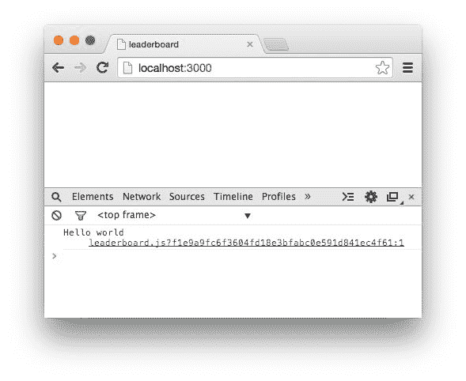

JavaScript 控制台中的“Hello World”。

尽管没有写任何其他代码，但请切换到命令行。你看到了什么？你应该能看到一模一样的“Hello world”字符串。

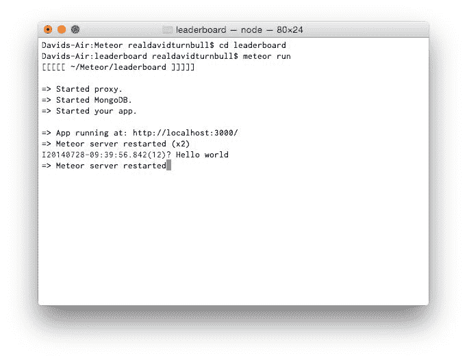

命令行中的“Hello World”。

这意义重大，因为我们写了一行在两个地方执行的代码。代码既运行在客户端（用户浏览器内），也运行在服务器上（应用程序托管的地方）。

我之所以在这里提到这个细节是因为两个原因：

1. 它是 Meteor 的核心功能之一，允许一些非常酷的事情发生。（我们将在整本书中介绍这些“非常酷的事情”。）

2. 在接下来的章节中，有很多代码是我们*不希望*在两个地方运行的，我们需要知道如何控制这种行为。

关于第二点，在上一行代码下方编写以下条件语句：

```
if(Meteor.isClient){
    console.log("Hello client");
}
```

保存文件，你会看到“Hello client”字符串出现在 JavaScript 控制台中——在客户端，在用户的浏览器内——但没有出现在命令行中。

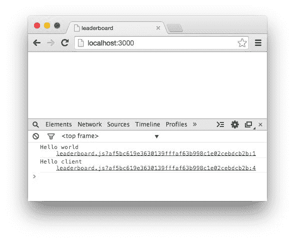

命令行中的“Hello Client”。

我们也可以相反操作：

```
if(Meteor.isServer){
    console.log("Hello server");
}
```

这个“Hello server”字符串将出现在命令行中——在服务器，应用程序托管的地方——但不会出现在 JavaScript 控制台中。

**但如果让一行代码在两个地方执行的能力是 Meteor 的核心功能之一，为什么我们又想要某些代码*不*在两个地方运行呢？**

想象一下我们写了一些影响用户界面的 JavaScript 代码。也许我们写了一些显示从数据库获取数据的代码。那种代码不需要运行在服务器上。这在逻辑上甚至不通。我们如何能在服务器上“显示”数据呢？那是后台处理的地方。反之亦然。用户界面在服务器上是不可见的。

目前你只需要知道：

1. 一行代码可以在两个地方运行。

2. 有时我们并不希望代码在两个地方运行。

在本书结束之前，这些信息的适用场景将变得显而易见。之所以现在提到，是因为我们会反复回来。

在本章结束前，删除`console.log`语句。

然后我们开始制作排行榜。

首先，Meteor 目前没有提供其他类型的数据库。如果你想使用 SQL 数据库，在撰写这些文字时是不可能的。虽然未来可能会提供其他选项，但无论何种，MongoDB 都是一个很好的默认选项，原因如下：

1. 它很快。

2. 它具有可扩展性。

3. 它很容易上手。

所以，即使你从未遇到过它，任何数据库经验都足以让你快速掌握基础知识。

其次，MongoDB 使用不同的词来描述熟悉的概念。例如，我们不会使用表（tables）、行（rows）或列（columns）等词，但这些概念基本上是相同的。

你可以通过下表看到差异：

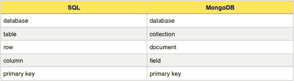

**SQL vs MongoDB**

当然，用不同的词思考熟悉的概念是很困难的，但我会在过程中提醒你这些词的含义，这样当你读到最后时，它们应该已经记住了。

### 4.2 集合 (Collections)

排行榜应用程序的核心功能是玩家列表。没有玩家列表，我们就无法构建任何其他有价值的内容。这使得列表成为我们开发之旅的良好起点——从应用程序的“中间”开始，向外移动，直到更细的细节。

但是，我们在哪里存储玩家数据呢？

通用的答案是“在数据库中”。

更精确且实用的答案是“在*集合*（collection）中”，如之前的表格所示，集合等同于 SQL 表。

如果我们在 Meteor 中重新创建 WordPress，我们会为文章创建一个集合，为用户创建一个集合，并为评论创建一个集合。每种类型的数据都会有一个集合。但由于我们正在创建这个排行榜应用程序，我们将想要为玩家创建一个集合。

要做到这一点，请打开 JavaScript 文件，并在顶部编写以下语句（在`isClient`和`isServer`条件判断之外）：

```
new Meteor.Collection('players');
```

在这里，我们创建了一个名为“players”的集合，但你可以为它起任何名字。只需确保名称是唯一的即可。然而，有一个问题：我们无法引用这个集合，因此也无法操作它。

为了修复这个问题，我们需要将变量与集合关联联：

```
PlayersList = new Meteor.Collection('players');
```

注意，我们没有使用`var`关键字来定义这个变量。这是因为我们想要一个全局变量，因为这将允许我们在所有文件中引用该变量，而不仅仅是在其中一个文件中。

为了确认集合是否存在，切换回 Google Chrome 并在 JavaScript 控制台中输入集合的名称：

```
PlayersList
```

你应该看到以下内容：

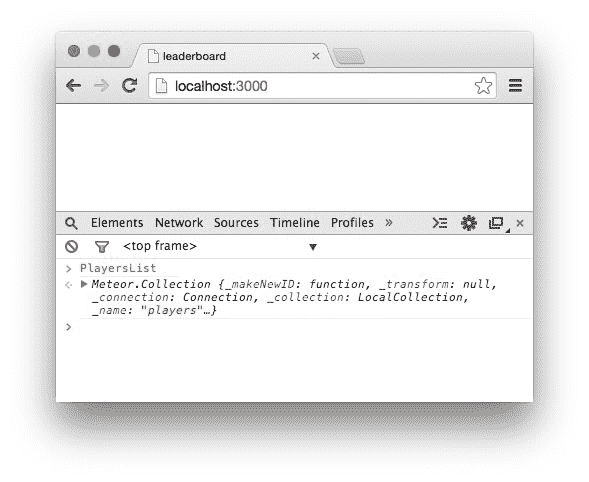

**“PlayersList”集合。**

如果返回了错误，可能是因为你写错了变量名，或者在 JavaScript 文件中犯了语法错误。

如果没有返回错误，我们就可以继续。

### 4.3 插入数据 (Inserting Data)

我们的集合已经存在，但它是空的。为了修复这个问题，我们需要向集合中插入一些数据，为了实现这一点，可以通过以下方式插入数据：

1. 通过 JavaScript 控制台。

2. 通过 JavaScript 文件。

3. 通过界面中的表单。

我将在本书中解释这些方法，但正如你所见的，通过 JavaScript 控制台操作数据库是最方便的选择。

开始之前，在 JavaScript 控制台中输入以下语句：

```
PlayersList.insert();
```

这是我们用来操作数据库的语法。我们从集合的变量开始，然后给它挂载一个函数。虽然这是一个有效的 MongoDB 语句，但我们没有通过括号传递任何数据，所以该语句没有执行任何操作。函数执行了，但集合保持不变。

要实际向集合中插入数据，我们使用以下语法：

```
PlayersList.insert({
    name: 'David',
    score: 0
});
```

在这里，我们做了几件事。

首先，我们在括号之间添加了一对大括号。在这些括号内部，我们的数据以 JSON 格式结构化。如果你不熟悉 JSON 格式，你会在过程中学到它。（这并不难。）

其次，我们定义了集合中*字段*（fields）的名称：

* `name`

* `score`

你可以根据喜好为这些字段命名，但由于我们将在代码中引用它们，最好让它们保持简单直观。

第三，我们正在设置创建的字段的值。如表所示，我们给`name`字段赋予了值“David”，给`score`字段赋予了值“0”：

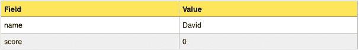

**我们集合的结构。**

第四，我们使用逗号来分隔不同的字段。这是一个很容易被忽略的点，但如果没有逗号，我们就会得到错误。（如果你遇到错误，请检查逗号！）

最终，我们在这里做的是创建了一个 MongoDB *文档*（document）——等同于 SQL 术语中的*行*（row）——我们的计划是为列表每个玩家创建一个文档。如果你想列表中有六个玩家，你需要创建六个。

```
PlayersList.insert({
    name: 'David',
    score: 0
});
```

### 4.4 查找数据 (Finding Data)

我们有一个包含玩家及其得分的集合，但我们需要一种方法从集合中提取这些数据。这可以通过`find`函数实现。

在 JavaScript 控制台中，输入以下内容：

```
PlayersList.find();
```

该语句将返回集合的数据，但它不会以最易读的形式呈现。这就是为什么最好与`fetch`函数配合使用：

```
PlayersList.find().fetch();
```

在 JavaScript 控制台中工作时，`fetch`函数将`find`函数返回的数据转换为数组。只需点击向下的箭头即可查看每个文档中包含的数据。

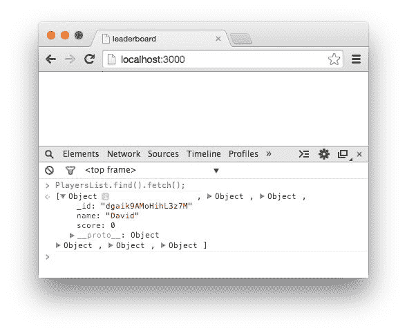

**使用 fetch 函数。**

为了从集合中检索精确的数据，而不是所有数据，我们可以编写类似代码：

```
PlayersList.find({ name: 'David' }).fetch();
```

在这里，我们通过`find`函数传递了一个字段和一个值，结果是，我们能够仅检索集合中玩家名字等于“David”的文档。如果你的集合中没有名为“David”的玩家，将返回一个空数组。

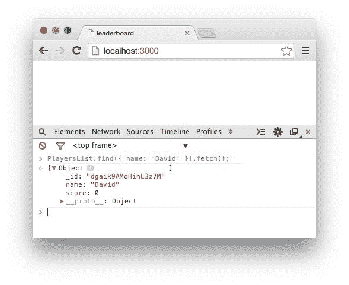

**检索精确数据。**

同样实用的还有通过在`find`函数上挂载`count`函数来统计集合中文档的数量：

```
PlayersList.find().count();
```

如果你在集合中有六个玩家（文档），这对链式函数将返回`6`。

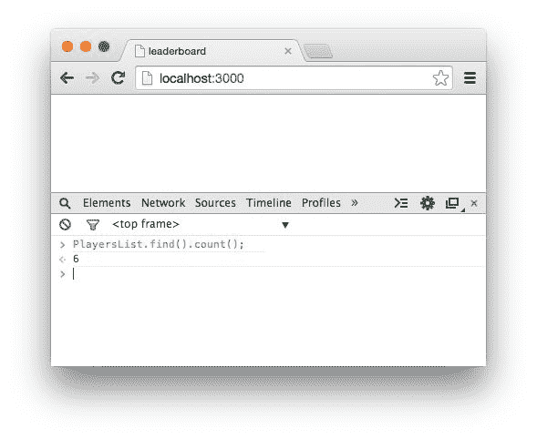

**使用 count 函数。**

要从集合中精确计数数据，请将内容传递到`find`函数的括号中，并对其挂载一个`count`函数，如下所示：

```
PlayersList.find({ name: 'David' }).count();
```

在这里，我们正在统计集合中“name”字段被设置为“David”的文档数量。如果你的某个玩家的名字被设置为“David”，该语句将返回`1`。如果没有任何玩家的名字被设置为“David”，该语句将返回`0`。

此时，我们仅触及`find`函数的冰一角，但通过我们学到的知识已经可以使用很多功能了。

## 5 模板

在创建了集合并准备好数据后，我们可以开始为排行榜（Leaderboard）应用构建用户界面。

首先，通过打开 HTML 文件并将以下代码粘贴其中，为我们的应用程序设置基础的 HTML 结构：

```
<head>
 <title>Leaderboard</title>
</head>
<body>
 <h1>Leaderboard</h1>
</body>
```

**一眼望去，这段代码中似乎缺少了一些东西：

1. 我们没有包含`html`标签。

2. 我们没有包含任何 JavaScript 文件。

3. 我们没有包含任何 CSS 文件。

但我们没有包含这些东西是因为我们不需要包含它们。Meteor 会替我们处理。它会自动包含`html`标签，还会包含我们应用程序所需的任何 CSS 和 JavaScript 文件。

Meteor 的核心原则之一是开发者快乐（developer happiness），因此有很多像这样方便的功能会让你的开发生活变得更简单。

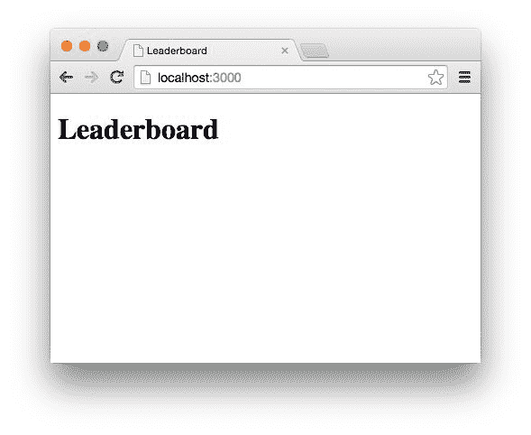

当前界面。

### 5.1 创建模板

接下来，我们要创建一个`template`（模板），通过将用户界面的部分放置在模板中，我们能够使用 JavaScript 代码与它们交互。（我们很快就会看到一个示例。）

要创建一个模板，请在 HTML 文件中`</body>`结束标签下方添加以下代码：

```
<template name="leaderboard">
 Hello world
</template>
```

模板具有非常原始的结构。我们使用这个`template`标签，并通过这个`name`属性为模板指定一个名称。我将这个模板命名为“leaderboard”，但你可以随心喜欢命名。只需记住我们很快就会引用它，所以按照惯例，选择一个简单直接且易记忆的名称会有帮助。

但如果你按当前状态保存文件，模板并没有出现在浏览器中。它只存在于我们的原始 HTML 代码中，其他地方都没有。

出了什么问题？

嗯，模板默认不会出现，因为在某些情况下：

* 你可能希望模板在特定时间出现。

* 你可能希望模板在特定时间消失。

* 你可能希望模板在多个位置出现。

因此，模板在创建后需要手动包含。这可能感觉像是多了一个步骤，但随着我们不断深入开发，它将变得越来越有用。

要让“leaderboard”模板出现在浏览器中，请在`<body>`标签之间放置此标签：

```
{{> leaderboard}}
```

显然，这不是一个 HTML 标签。双大括号意味着它是 Meteor 模板引擎——Spacebars 的一部分。它受到 Handlebars 语法的启发，这是我们在 HTML 中当想要发生动态变化时所使用的语法。我们将在本教程中多次使用 Spacebars，但目前只需知道：

1. 所有 Spacebars 标签都使用双大括号来区分自己。

2. 我们只有在想要包含一个模板时才使用大于符号`>`。

在此阶段，HTML 文件应该类似于：

```
<head>
 <title>Leaderboard</title>
</head>
<body>
 <h1>Leaderboard</h1>
 {{> leaderboard}}
</body>

<template name="leaderboard">
 Hello World
</template>
```

保存文件后，“Hello World”文本应该出现在浏览器中。

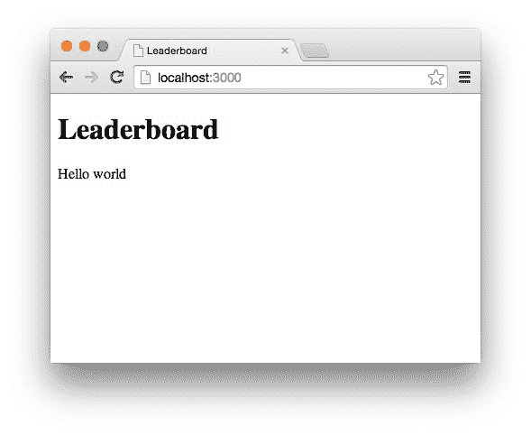

模板现在显示了。

### 5.2 创建助手函数 (Helper)

在我们的 HTML 文件中，有一个模板，但它是静态的。除了显示无聊的“Hello World”文本外，它什么都不做。为了修复这个问题，我们可以创建一个`helper`（助手函数），是一个挂载到模板上的 JavaScript 函数。通过代码来理解它是最好的，所以让我们写一些吧。

切换到 JavaScript 文件，在我们创建集合行下方编写以下语句：

```
Template.leaderboard.player
```

这是我们用于创建助手函数的语法，它包含三个部分。

首先，我们使用`Template`关键字搜索 Meteor 应用程序中的模板。我们目前只有一个，但一个完整的应用程序可能有几十甚至数百个。

其次，我们使用`leaderboard`关键字引用我们之前创建的模板。我们创建的每个助手函数都需要挂载到单个模板上。

第三，我们使用`player`关键字为我们的助手函数命名。我们会在 HTML 文件中引用此名称，再次你可以随心喜欢命名。

要将代码挂载到此助手函数，我们将其与函数关联，如下所示：

```
Template.leaderboard.player
```

此标签确实引用了我们的辅助函数，但并不是以我们想要的方式。相反，我们希望在“排行榜”（leaderboard）模板中编写以下内容：

```
{{#each player}}
test
{{/each}}
```

这里正在发生几件事。

首先，通过引用`player`函数来获取玩家。

其次，我们正在使用`each`块循环遍历这些玩家（再次使用了 Spacebars 语法）。

第三，我们为列表中的每个玩家输出“test”一词。

从概念上说，这就像比我们有一个数组：

```
var player = ['David', 'Bob', 'Bill', 'Mary', 'Warren', 'Tim'];
```

……这就像比我们正在使用`forEach`循环来遍历此数组中的值：

```
player.forEach(function(){
    document.write('test');
});
```

结果是，“test”一词在界面上出现的次数将等于集合中玩家的数量。如果集合中有六个玩家，“test”一词将出现六次。

在我们创建的这个`each`块中，我们还可以获取与正在检索的数据相关的字段。我们正在从`PlayersList`集合中检索数据，因此我们可以显示`name`和`score`字段的值。

例如，为了让列表显示玩家名称列表，我们可以写：

```
{{#each player}}
    {{name}}
{{/each}}
```

（引用字段时，我们用双大括号包围字段名，不再加其他的。）

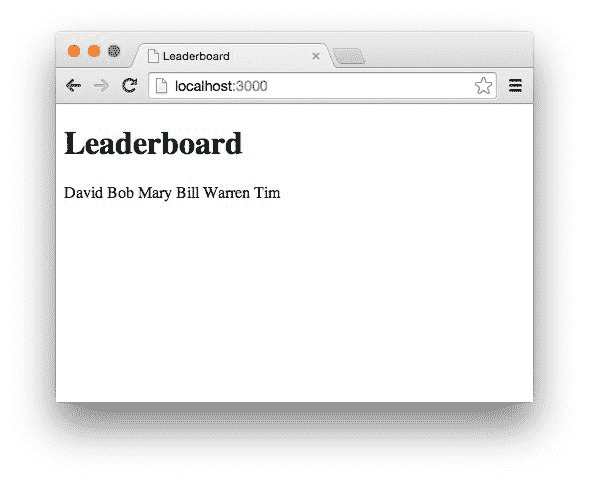

玩家名称列表。

我们还可以在玩家名字旁边显示他们的分数：

```
{{#each player}}
    {{name}} {{score}}
{{/each}}
```

虽然我不太关心用户界面是否美观——我一直觉得在技术书中关注设计是浪费时间——但如果界面的结构稍微更好将是有帮助的：

```html
<ul
    {{#each player}}
        <li>{{name}}: {{score}}</li>
    {{/each}}
</ul>
```

玩家的名字现在将出现在列表中，旁边是他们的分数。默认情况下，玩家将根据他们插入集合的日期升序排列（从旧到新）。


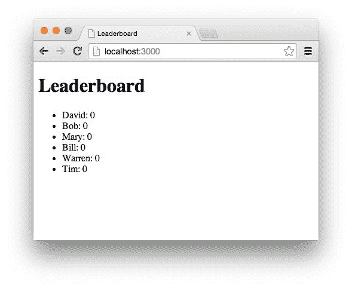

玩家及其分数列表。

如果你是从任何其他框架或语言来到 `Meteor` 的，你可能看出我们通过少量的代码获得了大量功能，而且以后只会更好。

## 6 事件

目前，我们有一个玩家列表，但没有办法与该列表进行交互。我们正在从集合中检索数据，但对于用户来说，Web 应用程序是静态的。修复这个问题需要几个步骤，首先，我们将创建选择玩家的效果。具体来说，当用户点击包含玩家名称的`li`元素时，该`li`元素的背景颜色将改变。

为了实现这一点，我们将使用`Meteor`的两个组件：

* `Events`，用于检测用户点击了某些内容。
* `Sessions`，用于存储他们点击的数据。

在本章中，我们将关注`events`。

### 6.1 创建事件

通过在`Meteor`中创建事件，我们能够在用户点击按钮、提交表单、按下键盘按键或执行我们能够跟踪并响应的许多操作之一时触发代码执行。`Meteor`可以检测一系列不同的事件，我们可以在这些事件发生时让某些事情发生。

要查看效果，请在`isClient`条件判断内编写以下行：

```
Template.leaderboard.events();
```

这里正在发生几件事。

首先，`Template`关键字搜索我们应用程序中可用的模板。（这正是我们在创建辅助函数时所做的。）

其次，`leaderboard`关键字是我们想要与事件关联的模板名称。与辅助函数一样，事件必须附加到模板上。

第三，我们使用`events`关键字来指定在接下来的代码块中，我们想要创建一个或多个事件。

在该语句末尾的括号内，我们将以`JSON`格式定义事件，这意味着我们将使用一对双大括号：

```
Template.leaderboard.events({
    // 事件写在这里
});
```

然后我们将在双大括号之间使用以下语法来创建我们的第一个事件：

```
'click': function(){
    // 代码写在这里
}
```

这种语法看起来可能有点奇怪，但我将解释一下正在发生什么。

首先，我们定义了事件`type`（类型）。那就是引号内的`click`部分。这意味着当用户点击某些内容时，关联函数中的代码将执行。我们没有指定用户必须点击什么，所以当用户点击“leaderboard”模板范围内的任何内容时，代码都会执行。

其次，我们向此事件附加了一个函数，并在函数内部，我们可以编写任何想要在事件触发（即点击发生）时执行的代码。

### 6.2 事件选择器

通过使用事件选择器，我们可以将事件附加到特定的`HTML`元素。如果你以前用过`jQuery`，这会很熟悉。如果没有，这也不会太复杂。早些，我们在`HTML`中放置了`li`标签：

```html
<li>{{name}}: {{score}}</li>
```

现在的计划是更改我们的事件，使其在点击这些`li`元素时响应，而不是在点击任何地方时响应。做法如下：

```
'click li': function(){
    console.log("You clicked a list item");
}
```

在这里我们做了两件事：

1. 在`click`关键字之后添加了`li`部分。
2. 修改了`console.log`语句的输出。

正由于这一点，我们的事件只会在点击`li`元素时触发——我们事件中的代码也只在该时执行。

但如果“leaderboard”模板中有其他不是玩家列表部分的`li`元素呢？你认为这会导致问题是正确的。我们的事件会在我们不想让它触发时触发。

为了修复这个问题，我们可以为`li`元素添加`player`类：

```html
<li class="player">{{name}}: {{score}}</li>
```

然后在创建事件时引用此类：

```
'click li.player': function(){
    console.log("You clicked a player's list item");
}
```

在这里，我们做了与之前类似的更改：

1. 为`li`元素附加了`player`类。
2. 修改了`console.log`语句的输出。

定义事件时我们很有活性。只要我们先说明事件类型，就可以像在`CSS`文件中通常那样使用任何选择器。不过，为了保持简单，让我们坚持我们创建的事件吧。


点击`li.player`元素。

在讨论`Meteor`时，我正尽量避免绕弯路。我更倾向于尽可能快从`A`点到达`B`点，然后等你有机会制作出一些东西后，我再帮助你填补空白。但由于在`Meteor`中尝试不同的事件类型很有趣，我认为稍微绕一下弯路是值得的。

在`Meteor`内部，我们有一系列可用的事件类型：

* `click`
* `dblclick`
* `focus`
* `blur`
* `change`
* `mouseenter`
* `mouseleave`
* `mousedown`
* `mouseup`
* `keydown`
* `keypress`
* `keyup`
* `submit`

我们已经涵盖了`click`和`dblclick`，稍后我们还会讨论`submit`事件，但这里是我的建议：

1. 创建另一个`Meteor`项目。
2. 尝试一下其他的事件类型。

你可能无法通过这些名称理解每个事件类型的作用，但这时`Google`搜索一下就会派上用场。（研究是软件开发过程中的非常重要的一部分，所以请养成这种习惯：假设别人也产生过和你可能相同的问题。）

为了让你体验一下，以下是某些事件类型预期的效果：

* `focus`事件在页面上的某个元素获得焦点时触发——例如，用户的光标在输入框内时。
* `blur`事件在页面上的某个元素失去焦点时触发，例如用户将光标移出输入框时。
* `mouseenter`事件在用户的光标悬停在关联元素边界内时触发。
* `mouseleave`事件在用户的光标停止悬停在关联元素边界内时触发。
* `change`事件在某些元素的值发生变化时触发，例如复选框被勾选或取消勾选时。

除了有趣之外，实验事件类型的好处在于你将直观地知道在实际开发中何时该使用它们。尽管如此，在目前阶段这并非必须，所以你可以直接跳过。

## 第 7 节 (7 Sessions)

在此阶段，每当用户点击列表中的一个`li`元素时，函数就会执行一次。通过这个函数，我们希望在点击玩家时创建被选的效果。具体来说，`click`事件将在`li`元素被点击时改变其背景颜色。为了实现这一点，我们需要使用`sessions`。

`sessions`用于存储小段数据，这些数据：

* 不保存到数据库中。
* 在再次访问时不会被记住。

这种临时数据一听起来可能并不立即有用，但在创建界面时非常方便，正如`Meteor`官方文档所述，`sessions`可用于“存储诸如列表中当前选中项目等内容”。

### 7.1 瞻性思考 (Thinking Ahead)

正如我在“项目”章节中提到的：

> ……初学者会犯的一个常见错误是在还没有清楚自己想要构建什么之前，就尝试编写代码。

不过这不仅适用于整个项目。即使你对想要构建的项目有一个清晰的想法，也很很容易急于前进，在还没有任何计划之前就尝试构建功能。

对于小功能来说，这并不是大问题，因为你仍然可以通过试错取得相当的进展，但由于创建列表选择玩家的效果需要几个步骤，所以解释一下我们在做什么比直接跳入深水区要有帮助。

稍后，我们将创建一个包含以下内容的`session`：

* 一个名称（称为`key`）。
* 一个值。

名称将是`selectedPlayer`，我们稍后将使用这个名称来获取`session`的值。该`session`的值将设置为用户点击的玩家的唯一`ID`。

如果你忘记了“玩家的唯一`ID`”从哪里来，请回想“插入数据”章节。每次我们在`JavaScript`控制台中中使用`insert`函数时，都会出现一串数字和字母。这串字符就是我们刚刚创建的玩家的唯一`ID`——如果你还记得的话，就是主键。这也是我们希望存储在`session`内部的`ID`。

能够访问每个玩家的唯一`ID`意味着以下操作可行：

1. 用户点击一个玩家。
2. 触发`click`事件。
3. 结果是创建了`selectedPlayer` `session`。该`session`存储了刚刚点击的玩家的唯一`ID`。
4. 使用条件判断，将`session`中存储的`ID`与列表中玩家的`ID`进行匹配。
5. 当匹配返回`true`时，为该玩家的`li`元素应用一个`CSS`类。该类将改变`li`元素的背景颜色。

我在这里分享的内容比我通常愿意分享的更具概念性，但理想情况下，你会在尝试之前理解我们正试图做什么。如果没有，也没关系。你可能需要运行几遍接下来的章节（尽管我一直建议这样做），但从现在开始会有很多实用的内容，这将有助于细节进入脑海。

### 7.2 创建 Session (Create a Session)

在我们的`click li.player`事件内部，删除`console.log`语句并插入下行：

```
Session.set('selectedPlayer', 'session value test')
```

事件块的代码现在应该类似于：

```
Template.leaderboard.events({
    'click li.player': function(){
        Session.set('selectedPlayer', 'session value test');
    }
});
```

为了证明`session`正在生效，让我们使用以下语法获取`session`的值：

```
Session.get('selectedPlayer')
```

为了将`session`的值输出到`JavaScript`控制台，让我们将其存储在变量中：

```
var selectedPlayer = Session.get('selectedPlayer');
```

在该行下方添加`console.log`语句：

```
console.log(selectedPlayer);
```

事件块最终的代码应该是：

```
Template.leaderboard.events({
    'click li.player': function(){
        Session.set('selectedPlayer', 'session value test');
        var selectedPlayer = Session.get('selectedPlayer');
        console.log(selectedPlayer);
    }
});
```

有了这些代码，当用户点击玩家的`li`元素时，“session value test”字符串将存储在`session`中，然后该字符串将立即输出到`JavaScript`控制台

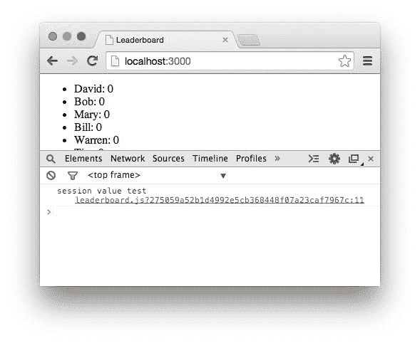

输出我们的 session。

这段代码并不有用，但它演示了我们如何在`session`中存储一小段数据并获取它。

### 7.3 玩家 ID (The Player’s ID)

为了让我们的`session`用，我们需要`session`存储用户点击的玩家的唯一`ID`。为了为此做准备，我们在`Session.set`语句上方创建一个`playerId`变量：

```
var playerId = 'session value test';
```

然后修改`Session.set`语句，使用该变量作为值的来源，而不是使用硬编码字符串：

```
Session.set('selectedPlayer', playerId);
```

事件函数内部的代码现在应该是：

```
var playerId = 'session value test';
Session.set('selectedPlayer', playerId);
var selectedPlayer = Session.get('selectedPlayer');
console.log(selectedPlayer);
```

但我们如何让`playerId`变量的值设置为用户点击的玩家的唯一`ID`呢？代码本身极其简洁，但也显得有些奇怪和抽象：

```
var playerId = this._id;
```

首先，我们引用了`this`，但像往常一样，`this`的值将取决于上下文。在当前上下文中，`this`指向用户点击的那个玩家。

其次，`_id`部分是存储玩家唯一`ID`的字段名称。就像我们创建`name`和`score`字段一样，`MongoDB`会自动创建`_id`字段。

（该字段命名为`_id`而不是“id”，仅仅是因为`MongoDB`是这样命名该字段的。下划线区分了我们创建的字段和`MongoDB`为我们创建的字段。它背后没有特殊含义。）

通过将`_id`字段附加到`this`上，我们是在说：“给我用户刚刚点击的那个玩家的唯一`ID`。”因此，当用户点击其中一个玩家时，变量`playerId`将存储该玩家的`ID`。

至于我们的代码，它现在看起来应该是像这样：

```
Template.leaderboard.events({
    'click li.player': function(){
        var playerId = this._id;
        Session.set('selectedPlayer', playerId);
        var selectedPlayer = Session.get('selectedPlayer');
        console.log(selectedPlayer);
    }
});
```

值得提到的是，单个会话（session）只能包含一条数据。因此，如果用户点击了另一个玩家，该玩家的唯一`ID`将覆盖之前存储在会话中的值。

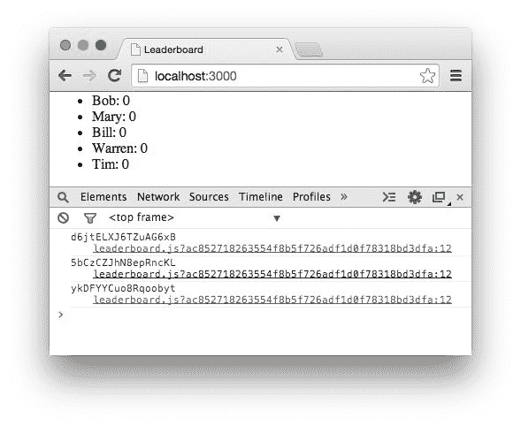

通过点击玩家获取玩家的唯一 ID。

### 7.4 选中效果 (Selected Effect)

当用户点击玩家之一时——具体来说，点击包含玩家的`li`元素之一——我们希望给该`li`元素附加一个`CSS`类。这个类将改变该`li`元素的背景颜色。

要创建此功能，首先在`CSS`文件中添加以下类：

```
.selected{
    background-color:#ccc;
}
```

然后，在`JavaScript`文件中创建一个新的辅助函数（helper function）：

```javascript
Template.leaderboard.selectedClass = function(){
    // 代码写在这里
}
```

我们将此辅助函数附加到了“leaderboard”模板上，并为其分配了名称“selectedClass”。

接下来，为此函数添加一个返回语句（return statement）：

```javascript
Template.leaderboard.selectedClass = function(){
    return 'selected';
}
```

然后切换到`HTML`文件并修改此部分：

```html
<li class="player">{{name}}: {{score}}</li>
```

……修改为：

```html
<li class="player {{selectedClass}}">{{name}}: {{score}}</li>
```

“leaderboard”模板现在应该像这样：

```html
<template name="leaderboard">
<ul>
    {{#each player}}
        <li class="player {{selectedClass}}">{{name}}: {{score}}</li>
    {{/each}}
</ul>
</template>
```

然而，你可能会很失望地发现`li`元素现在有一个丑陋的灰色背景。如果你检查源代码，你会发现这是因为我们将“selected”类附加到了`li`元素上。这并不是我们想要的精确结果，但这是朝着正确方向迈的一步。


`li`元素丑陋的背景。

下一步是在我们的“selectedClass”辅助函数内部创建一个变量，用于保存“selectedPlayer”会话的值：

```javascript
var selectedPlayer = Session.get('selectedPlayer');
```

然后在这一行之后，编写以下语句：

```javascript
var playerId = this._id;
```

所以，这就是我们在`click li.player`事件中添加的相同语句，而且再次，我们正在使用它来获取玩家的唯一`ID`。我们可以访问此`ID`，因为`{{selectedClass}}`标签位于`each`块内部。因此，`this`指向当前在该`each`循环中正在迭代的玩家，使我们能够访问玩家的`_id`字段。

这允许我们在辅助函数内部编写以下条件判断：

```javascript
if(selectedPlayer === playerId){
    return 'selected';
}
```

在这里，我们正存储在“selectedPlayer”会话中的`ID`与当前在`each`块中迭代的玩家的唯一`ID`进行比较。如果匹配，则返回“selected”字符串并附加到相应的`li`元素上。否则，什么都不会发生。

这就是最终的辅助函数应该的样子：


```javascript
Template.leaderboard.selectedClass = function(){
    var selectedPlayer = Session.get('selectedPlayer');
    var playerId = this._id;
    if(selectedPlayer === playerId){
        return 'selected';
    }
}
```

有了这段代码，用户将能够点击任何包含玩家名称的`li`元素，并将该`li`元素的背景颜色更改为 CSS 文件中定义的颜色。这实现了用户点击玩家时玩家被选中的效果。

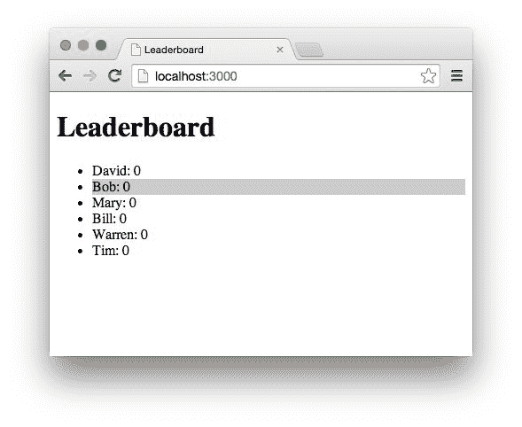

在这里，我点击了 Bob。

## 8 数据库，部分 2

是的，我们再次在讨论数据库。不过你会听到好消息的。在接下来的页面中，我们将：

- 创建一个增加得分的按钮。
- 根据分数对玩家进行排名。
- 将结果保存到数据库。

### 8.1 另一个事件（Another Event）

为了创建“5 Points”按钮，请在“leaderboard”模板中放置以下代码：

```html
<input type="button" id="increment" value="5 Points" />
```

确保此按钮：

- 位于`each`块之外。
- 有一个我们可以引用的 ID。


我的设计。

接下来，我们需要为此按钮附加事件，因此切换回 JavaScript 文件并查看当前的事件：

```javascript
Template.leaderboard.events({
    'click li.player': function(){
        var playerId = this._id;
        Session.set('selectedPlayer', playerId);
        var selectedPlayer = Session.get('selectedPlayer');
        console.log(selectedPlayer);
    }
});
```

由于我们要创建的事件也将附加到“leaderboard”模板上，我们不需要创建一个新的`events`块。我们可以通过逗号将两个事件都放在此块中：

```javascript
Template.leaderboard.events({
    'click li.player': function(){
        var playerId = this._id;
        Session.set('selectedPlayer', playerId);
        var selectedPlayer = Session.get('selectedPlayer');
        console.log(selectedPlayer);
    },
    'click #increment': function(){
        // 代码写在这里
    }
});
```

**不要忘记逗号**。这是你可能犯的最简单错误之一，只会导致不必要的抓狂。

在我们创建的`click #increment`事件内部，我们需要访问用户点击的玩家 ID。该 ID 仍然存储在我们的会话中，所以让我们创建一个变量并使用`Session.get`在事件内部访问该会话：

```javascript
var selectedPlayer = Session.get('selectedPlayer');
```

此时，我们的事件应该像这样：

```javascript
'click #increment': function(){
    var selectedPlayer = Session.get('selectedPlayer');
}
```

### 8.2 高级运算符（Advanced Operators）

在`click #increment`事件内部，在我们之前的语句之后添加以下行：

```javascript
PlayersList.update();
```

这是我们用于更新单个玩家——具体来说是更新集合中的单个玩家文档的函数。不过，它的工作方式并不像你最初预想的那样完全。

当我第一次遇到 MongoDB 时，我以为如果我想更改一个字段的值，可以写出类似下面的代码：

```javascript
PlayersList.update(
    {_id: selectedPlayer},
    {score: 5}
);
```

在没有查看 MongoDB 文档的情况下，我的理论是：

- 系统将根据传递给`_id`字段的 ID 检索文档。
- 第二组大括号之间指定的任何字段都将被更新。

虽然这个理论几乎正确，但它存在一个巨大的缺陷，即`任何在第二组大括号之间未指定的字段都会被删除`。

因此，上述代码会将`score`字段的值改为“5”，但也会删除该文档中的`name`字段。该文档将保留相同的主键——即相同的唯一 ID——但如果你不小心，`update`函数很容易删除你不想让它删除的字段。这是因为在当前的形式下，`update`函数：

1. 删除文档原始版本。
2. 使用指定的字段重新创建文档。

如果你需要对所发生的情况进行进一步的说明，可以将之前的代码块添加到`click #increment`事件中，如下所示：

```javascript
'click #increment': function(){
    var selectedPlayer = Session.get('selectedPlayer');
    PlayersList.update(
        {_id: selectedPlayer},
        {score: 5}
    );
}
```

然后你自己测试一下。在列表中选择一个玩家，点击“Give 5 Points”按钮，你会发现你选择的玩家姓名消失了。然后使用 JavaScript 控制台中的`find`函数查看该玩家文档的结构发生了变化：

```javascript
PlayersList.find().fetch();
```

被删除的不仅仅是`name`字段的值，而是整个`name`字段都从该文档中被删除了。

为了让`update`函数按照我最初预期的方式运行——即更新`score`字段的值而不触及文档的其他部分——我们必须编写以下代码：

```javascript
PlayersList.update(
    {_id: selectedPlayer},
    {$set: {score: 5}}
);
```

在这里，我们使用了`$set`操作符。这允许我们更改特定字段的值，而不影响文档的其他部分。不过这里有几个额外的大括号，让我们来拆解一下。

首先，我们有`score`字段以及我们想要为该字段设置的值：

```javascript
score: 5
```

其次，将其封装在大括号中：

```javascript
{score: 5}
```

（这就是我们之前拥有的全部。）

第三，我们将`$set`操作符放在大括号前面：

```javascript
$set: {score: 5}
```

MongoDB 拥有一系列这类特殊的操作符，它们的名称前面都有`$`符号，我们很快会讨论另一种。

第四，我们将这行代码封装在另一对大括号中：

```javascript
{$set: {score: 5}}
```

写好这些代码后，事件应该像这样：

```javascript
'click #increment': function(){
    var selectedPlayer = Session.get('selectedPlayer');
    PlayersList.update(
        {_id: selectedPlayer},
        {$set: {score: 5}}
    );
}
```

现在你将能够从列表中选择一个玩家，点击“Give 5 Points”按钮，所选玩家的得分将变为“5”，而不会删除`name`字段的值或以其他方式影响文档。


将`score`字段设置为值为“5”。

尽管如此，`$set`操作符只是*设置*了`score`字段的值为 5。我们可以点击“Give 5 Points”按钮一千次，但在当前的形式下，玩家的得分在第一次点击时就会变为“5”，然后一直保持在那个静态值上。不过，我们走这段小路是因为以下几个原因：

- 你很快就会遇到`$set`操作符，所以尽早知道它比以后知道要好。
- 我们有一个相似的操作符可以用来增加数字。

那个相似的操作符是`$inc`操作符，它的格式相同：

```javascript
{$inc: {score: 5}}
```

然而，这个操作符将：

1. 找到`score`字段的当前值。
2. 在当前值加上指定的数字。
3. 将新值保存到文档中。

最后，事件的代码应该像这样：

```javascript
'click #increment': function(){
    var selectedPlayer = Session.get('selectedPlayer');
    PlayersList.update(
        {_id: selectedPlayer},
        {$inc: {score: 5}}
    );
}
```

为了看到这个新功能：

1. 切换回 Google Chrome。
2. 在列表中选择一个玩家。
3. 点击“Give 5 Points”按钮。

所选玩家的得分将在实时功能中递增，当表单提交时列表会自动更新。


### 文档排序

我们的应用程序中一个明显的问题是，列表中的玩家是根据插入数据库的时间排序的。我们希望根据它们的得分进行排序。

为了实现这一点，我们需要向`find`函数传递选项：

```javascript
PlayersList.find({}, {score: -1})
```

在这里，`-1`让 MongoDB 按`score`字段降序排序。如果`score`字段包含文本，它将从 Z 到 A 排序。要对`score`字段进行升序排序——从低到高——我们可以将此值设置为`1`。

但如果两个玩家的得分相同怎么办？目前，我们的代码没有考虑到这一点。但理想情况下，得分相同的玩家将按他们的姓名排序。所以如果 Bob 和 Bill 的得分相同，Bill 将排在 Bob 之前。

为了实现这一点，我们对`sort`操作符进行了如下更改：

```javascript
PlayersList.find({}, {score: -1, name: 1})
```

在这里，我们首先按`score`字段降序排序，然后按`name`字段升序排序。

最后的`return`语句应该像：

```javascript
return PlayersList.find({}, {score: -1, name: 1});
```

在原始的`Leaderboard`应用中，有一个功能可以在玩家列表下方输出所选玩家的名字。我不认为这个功能特别有用，但是：

1. 它能让我们涵盖几个实用的知识点。
2. 它是原始`Leaderboard`应用的最后一个功能，所以我们最好在继续开发新功能之前把它完成。

首先，在 JavaScript 文件中创建以下辅助函数：

```javascript
Template.leaderboard.showSelectedPlayer = function(){
    // code goes here
}
```

一如既往，请确保它位于`isClient`条件判断内。此时此刻，你对我们正在使用的语法应该已经熟悉了。我们正在使用`Template`关键字搜索模板，使用`leaderboard`关键字来指定该辅助函数是用于“leaderboard”模板的，然后给该辅助函数命名为“showSelectedPlayer”。

在这个辅助函数内部，我们将获取所选玩家的`ID`。我们已经做过几次了，由于所选玩家的`ID`会存在于 Session 中，这里也没有什么新内容：

```javascript
var selectedPlayer = Session.get('selectedPlayer');
```

接下来，我们将根据`ID`从“PlayersList”集合中检索所选玩家的文档。但为了实现这一点，我们将使用尚未讨论过的`findOne`函数：

```javascript
return PlayersList.findOne(selectedPlayer);
```

`findOne`函数的优势在于，它永远只会从集合中检索单个文档，因此如果你以后需要从集合中检索单个文档，这将是最高效的方法。

至于我们如何使用`findOne`函数，我们将所选玩家的`ID`作为唯一参数传递，结果是该玩家的文档被返回给了我们。

我们的辅助函数的代码应该如下：

```javascript
Template.leaderboard.showSelectedPlayer = function(){
    var selectedPlayer = Session.get('selectedPlayer');
    return PlayersList.findOne(selectedPlayer);
}
```

我们现在可以通过将它的名称包裹在双层大括号中，在“leaderboard”模板中引用这个辅助函数：

```handlebars
{{showSelectedPlayer}}
```

但正如你所看到的，输出并不完全正确，因为`findOne`函数返回了集合中的整个文档，而我们只想特定显示`name`字段。

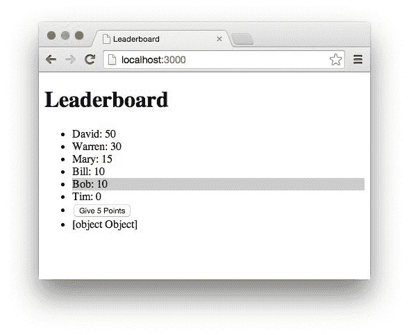

我们目前正在检索整个文档。

为了只显示`name`字段，我们可以使用这种点语法：

```handlebars
{{showSelectedPlayer.name}}
```

如果我们需要，我们也可以检索所选玩家的`score`字段：

```handlebars
{{showSelectedPlayer.score}}
```

甚至可以是`_id`字段：

```handlebars
{{showSelectedPlayer._id}}
```

最后一个值得添加的细节是一个条件判断，只有在确实选择了玩家时，才会尝试显示所选玩家的数据。Spacebars 支持条件判断，所以以下代码可以：

```handlebars
{{#if showSelectedPlayer}}
    Selected Player: {{showSelectedPlayer.name}}
{{/if}}
```

如果没有选择玩家，“showSelectedPlayer”辅助函数将返回`null`，我们的模板将不会尝试渲染不存在的数据。

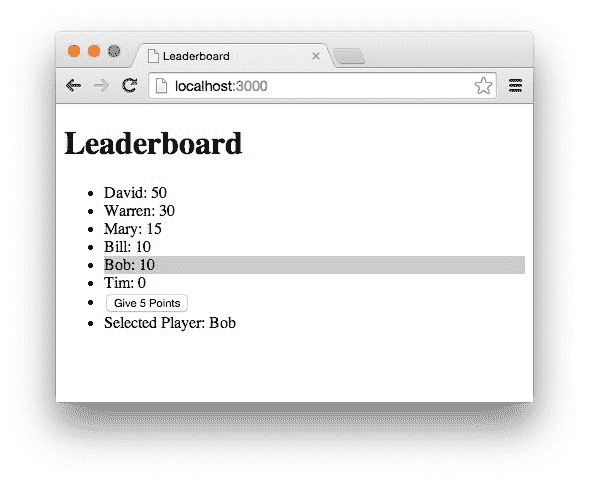

显示所选玩家。

## 9 个表单

如果用户偶然发现了我们的`Leaderboard`应用，他们能做的做不了什么。他们可以增加分数，但仅针对我们定义的玩家列表，这并不特别有用。

那么，在接下来的章节中，我们将使用户能够从列表中添加和删除玩家。也许那时它就变得有点好用了。

### 9.1 创建一个表单

切换到 HTML 文件，通过在上一个模板下方放置以下代码创建一个新模板：

```html
<template name="addPlayerForm">
</template>
```

我们不必非创建一个新模板，但应用程序越大，如果将它拆分成更小的块，就越容易管理。在这种情况下，我将模板命名为“addPlayerForm”，但你可以随心意欲地命名。

在这个模板内部，创建以下表单：

```html
<form>
    <input type="text" id="playerName">
    <input type="submit" value="Add Player">
</form>
```

这个表单并没有特别的。唯一值得提到的是，我们为文本字段分配了“playerName” ID，我们将在后的步骤中引用该 ID。

为了将此表单包含在我们的界面中，我们使用 Spacebars 语法：

```handlebars
{{> addPlayerForm}}
```

我将这个标签放在了`body`结束标签之前，但如果你愿意，也可以把它放在“leaderboard”模板内部。

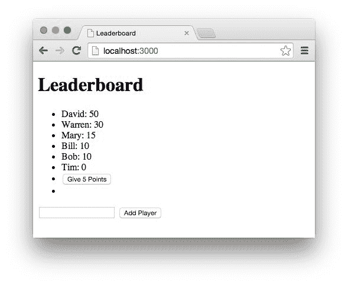

我们漂亮的表单。

### 9.2 `submit`事件

之前，我们讨论了不同的事件类型，如`click`和`dblclick`。另一种实用的事件类型是`submit`事件。这种类型允许我们在提交表单时触发代码的执行。我们将使用`submit`事件在提交表单时将数据插入“PlayersList”集合中。

首先，在 JavaScript 文件中创建一个新块：

```javascript
Template.addPlayerForm.events({
    'submit form': function(){
        // events go here
    }
});
```

注意，我们需要确保这段代码位于`isClient`条件判断内。要创建一个新事件，我们使用以下语法：

```javascript
'submit form': function(){
    // code goes here
}
```

在这里，我们正在使用`submit`关键字作为事件类型。如果我们在单个模板中有多个表单，我们可以为每个表单关联一个 ID，并使用以下方式创建事件：

```javascript
'submit form#idGoesHere': function(){
    // code goes here
}
```

但由于我们只有一个表单，所以我们不需要那么具体。为了确保我们的事件正在工作，在它内部放置一个`console.log`语句：

```javascript
'submit form': function(){
    console.log("Form submitted");
}
```

放置好代码后，点击“Add Player”按钮——或使用回车键提交表单——就会在控制台中出现“Form submitted”消息。


然而，这里存在一个问题，因为提交表单会导致页面刷新。这种现象发生是因为通常表单是这样工作的：

1. 用户填写某些表单字段。
2. 用户提交表单。
3. 数据被送到某处。

但在构建 Meteor 应用时，过程略有不同：

1. 用户填写某些表单字段。
2. 用户提交表单。
3. 数据从表单字段中被提取。

所以表单并没有传统意义上的提交，因为数据并没有被发送到任何地方。它只是被提取了。

问题在于，网络浏览器期望数据被发送到某处，而如果没有发送，它并不聪明足以理解发生了什么——因此，页面直接刷新了。

为了解决这个问题，我们需要禁用表单的默认行为，以便我们完全控制它的工作方式。

首先，让我们看看我们的事件：

```javascript
'submit form': function(){
    console.log('Form submitted');
}
```

然后进行此更改：

```javascript
'submit form': function(theEvent){
    theEvent.preventDefault();
    console.log('Form submitted');
}
```

在这里，我们将`theEvent`关键字作为第一个参数添加到我们的事件函数中。关键字的放置意味着我们现在可以在事件内部使用它引用事件本身。

考虑以下代码：

```javascript
'submit form': function(theEvent){
    console.log(theEvent.type);
}
```

在这里，我们能够通过`theEvent`关键字在事件内部引用我们的事件，并在 JavaScript 控制台中显示事件的`type`参数。在这个例中，由于“submit”一词将出现在 JavaScript 控制台中，因为该事件的类型是`submit`。（但由于页面仍然会刷新，所以该字符串只会短暂出现。）

不过，我们将为了另一个目的来引用我们的事件。

将`submit form`事件更改为以下内容：

```javascript
'submit form': function(theEvent){
    theEvent.preventDefault();
    console.log('Form submitted');
}
```

在这里，我们使用`theEvent`关键字在事件内部引用事件本身，然后使用此`preventDefault()`函数来阻止表单的默认行为。结果是，我们的表单将没有任何任何固有的行为，我们将能够从头开始对其进行操作。

在现阶段，当提交表单时，`console.log`语句将触发，且页面不会刷新。

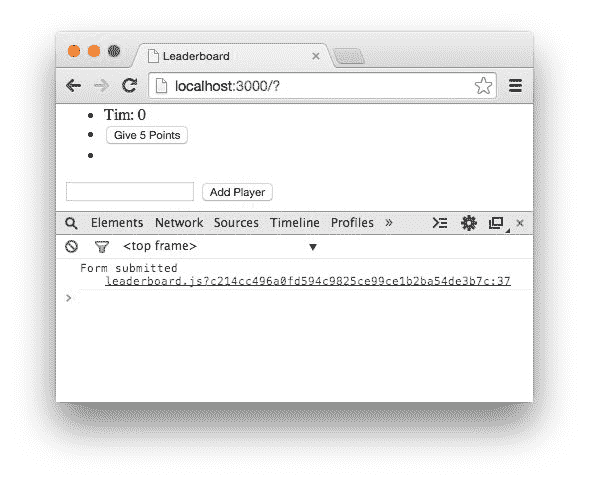

成功提交表单。

### 9.3 获取数据

将数据插入到“PlayersList”集合中。我们可以将 JavaScript 控制台中使用过的语法添加到`submit form`事件中：

```javascript
PlayersList.insert({
    name: 'David',
    score: 0
});
```

但这条精确的语句会为`name`字段插入硬编码的值“David”，而我们希望代码执行的操作是：

1. 从我们的文本字段中获取值。
2. 将该值用于`name`字段。

将分数设置为硬编码的值“0”是可以的，因为每个玩家都应该从相同的起点开始，而`name`字段的值需要根据用户的输入动态设置。

为了实现这一点，让我们通过事件的函数传递第二个参数：

```javascript
'submit form': function(theEvent, theTemplate){
    theEvent.preventDefault();
    console.log('Form submitted');
}
```

在这里，我们向函数中添加了`theTemplate`关键字，该关键字指向的是我们的事件所绑定的模板。我们的事件绑定在“addPlayerForm”模板上，因此我们可以使用`theTemplate`关键字来：

1. 搜索“addPlayerForm”模板。
2. 获取带有“playerName” ID 的文本字段的值。
3. 创建一个使用该值作为`name`字段的文档。

考虑以下代码：

```javascript
theTemplate.find('#playerName');
```

在这里，我们通过`theTemplate`关键字引用了“addPlayerForm”，然后使用`find()`函数搜索该模板。我们通过此`find()`函数传递的值是一个 CSS 选择器。在此之前，我们在表单的文本字段中添加了“playerName” ID，所以现在我们就可以使用`#playerName`语法来引用该 ID。

我们写的语句基本上的意思是：“在我们的事件模板中搜索这个特定元素……”

为了方便起见，为这句语句添加一个变量：

```javascript
var playerNameVar = theTemplate.find('#playerName');
```

然后在`console.log`语句中引用该变量：

```javascript
console.log(playerNameVar);
```

此时，代码应该类似于：

```javascript
'submit form': function(theEvent, theTemplate){
    theEvent.preventDefault();
    var playerNameVar = theTemplate.find('#playerName');
    console.log(playerNameVar);
}
```

但这里有一个问题。我们使用的这个`find()`函数只获取 HTML 元素本身——也就是说文本字段。但我们想要的不仅仅是文本字段。我们想要文本字段内部的值。

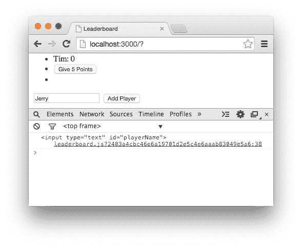

获取 HTML 元素本身。

要访问文本字段内部的值，请使用`value`属性：

```javascript
var playerNameVar = theTemplate.find('#playerName').value;
```

现在，用户在文本字段中输入的任何内容在提交表单时都会出现在 JavaScript 控制台中。

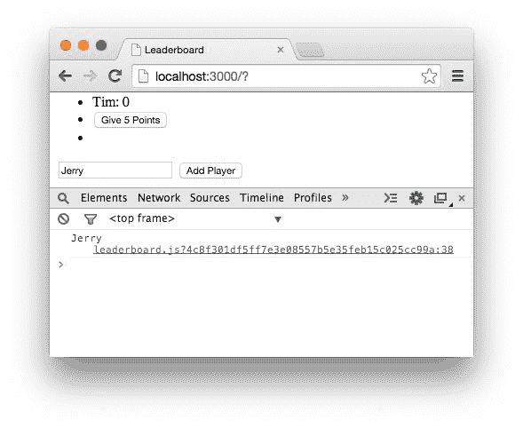

获取 HTML 元素的值。

为了让表单能够正常工作，将`insert()`函数添加到事件底部，如下所示：

```javascript
'submit form': function(theEvent, theTemplate){
    theEvent.preventDefault();
    var playerNameVar = theTemplate.find('#playerName').value;
    PlayersList.insert({
        name: playerNameVar,
        score:0
    });
}
```

保存文件后，在文本字段中输入名称并提交表单，将在“PlayersList”集合中创建一个文档，该文档将提交的值作为该文档中`name`字段的值。

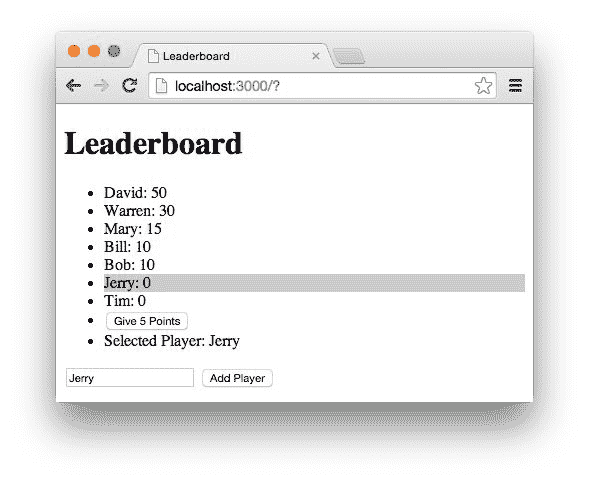

向列表中添加第七个玩家。

### 9.4 移除玩家

为了考虑另一个方面面——删除玩家的能力，让我们在界面上添加一个按钮，允许用户从“PlayersList”集合中移除选中的玩家。

在“leaderboard”模板的某处，创建一个新按钮：

```html
<input type="button" id="remove" value="Remove Player" />
```


移除玩家按钮。

在 JavaScript 文件中，为“leaderboard”模板绑定一个事件：

```javascript
'click #remove': function(){
    // 代码在此
}
```

此事件响应`click`类型并绑定到带有`remove` ID的元素上。在这个事件内部，我们需要：

1. 获取当前玩家的 ID。
2. 从集合中移除该玩家。

第一步是我们已经使用 session 做过几次的事情。在事件内部编写以下语句：

```javascript
var selectedPlayer = Session.get('selectedPlayer');
```

然后，在该行下方，我们使用`remove()`函数：

```javascript
PlayersList.remove(selectedPlayer);
```

我们还没有讨论过这个函数，但没什么说的。我们将 ID 作为唯一参数传递给函数，如果在集合发现了该 ID，关联文档将被移除。

该事件的最终代码应该是：

```javascript
'click #remove': function(){
    var selectedPlayer = Session.get('selectedPlayer');
    PlayersList.remove(selectedPlayer);
}
```

在浏览器中，用户现在可以选择一个玩家并点击“移除玩家”按钮来从集合中删除该玩家的文档。


删除了 Jerry。

### 9.5 减少分数

假设用户意外增加了错误玩家的分数。他们该怎么办？在我们目前的应用程序中，除了删除玩家、将玩家重新添加到集合并点击“增加 5 分”直到分数达到相应水平外，他们没什么可做的。这不是最优雅的方法。

为了防止人为错误，我们将在“增加 5 分”按钮旁边放置一个“减少 5 分”按钮。这样，用户就可以既增加也可以减少分数。

首先，查看 HTML 文件中的“增加 5 分”按钮：

```html
<input type="button" id="increment" value="Give 5 Points" />
```

……并在旁边放置一个“减少 5 分”按钮：

```html
<input type="button" id="increment" value="Give 5 Points" />
<input type="button" id="decrement" value="Take 5 Points" />
```

注意我将按钮的 ID 从“increment”更改为“decrement”，因为我们需要单独的引用来为此按钮绑定事件。

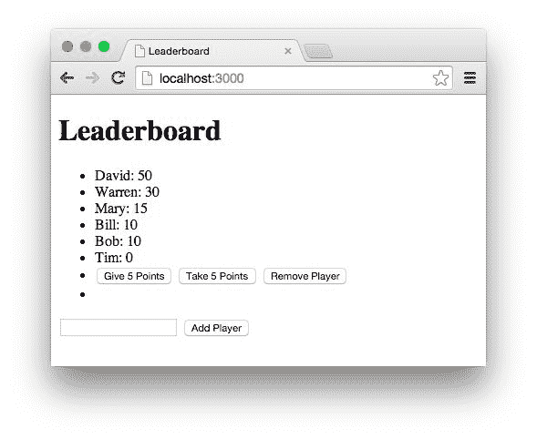

添加“减少 5 分”按钮。

接下来，切换回 JavaScript 文件，在附加到“leaderboard”模板的事件块内部，插入以下代码：

```javascript
'click #decrement': function(){
    var selectedPlayer = Session.get('selectedPlayer');
    PlayersList.update(
        {_id: selectedPlayer},
        {$inc: {score: -5}}
    );
}
```

（一如既往，不要忘记用逗号来分隔不同的事件。）

通常情况下，我不喜欢向你展示大段的代码，但这段代码与我们之前创建的`click #increment`事件几乎完全相同。

我们只做了两处改动：

1. 在定义事件时，它现在是`click #decrement`而不是`click #increment`。
2. `$inc`操作符中的值现在是`-5`而不是`5`。这反转了该操作符的作用，并*减少*了`score`字段的值为“5”。

其他情况下，代码的工作方式是相同的：

当用户点击我们指定的元素时——在这种情况下是 ID 为“decrement”的元素——该函数会被触发，并从“selectedPlayer”会话中获取所选玩家的 ID。该 ID 被用于`update`函数内部查找所选玩家的文档，并使用`$inc`操作符来修改`score`字段的值。

保存文件后，新的“减 5 分”按钮将允许用户减少他们选择的任何玩家的得分。

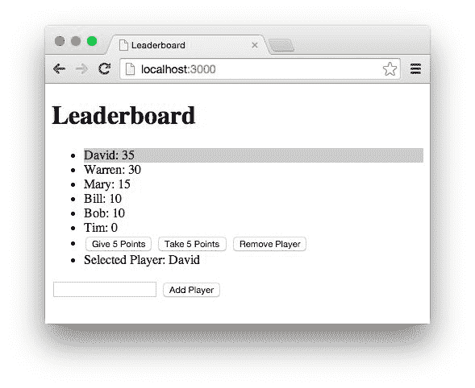

从 David 那里扣了一些分。

## 10 账户系统

如果我们按照目前的状态将排行榜应用程序部署到网上，将会有很多问题，但可能最明显的问题是它将不支持多个用户。

到目前，我们只有一个排行榜和一个单一玩家列表。如果一个用户向列表中添加玩家，另一个用户也向列表中添加玩家，所有这些玩家将出现在同一个列表中，这并没什么大用。考虑到所有用户都可以自由地从列表中删除玩家并修改他们的分数，很快就会出现混乱。用户永远无法相信自己控制着排行榜。

为了解决这个问题，我们将创建一个用户账户系统，虽然这听起来是一个漫长、无聊且可能令人困惑的过程，但在 Meteor 中操作时并非如此。创建一个用户账户系统实际上是我们能做的最简单的事情之一。

在本章中，我们将实现以下功能：

* 用户可以注册并登录应用程序。
* 未登录的用户将无法看到“添加玩家”表单。
* 每个用户都将拥有他们自己的、唯一的排行榜。

我们将涵盖很多内容，但不需要大量的代码。

### 10.1 登录提供者

每个 Meteor 的安装程序中都包含了一系列“登录提供者”（login provider）包。这些是由 Meteor 开发者创建的插件，允许我们轻松地为应用程序添加账户系统的后端功能。

该后端包括：

* 一个存储我们用户数据的集合（collection）。
* 许多很快就会涵盖的实用函数。

要将其中一个包添加到我们的项目中，请在命令行中输入以下命令：

```bash
meteor add accounts-password
```

（如果本地服务器正在运行，你需要打开一个新的命令行窗口或标签页来输入此命令。）


添加 `accounts-password` 包。

这个`accounts-password`包为账户系统创建了后端，该系统默认使用电子邮件和密码进行注册和登录。有一个可用选项允许用户在需要时选择用户名，但我更倾向于保持该选项禁用。其他登录提供者包可用，允许用户通过 Twitter 和 Facebook 等服务登录，我们将在稍后的章节中简要讨论它们。

### 10.2 Meteor.users

在向项目添加`accounts-password`包后，Meteor 会在我们的项目数据库中创建一个集合，用于存储我们用户的数据。该集合被引用为`Meteor.users`，尽管它由于名称中间有一个点而看起来可能有点不同，但它的功能与项目中的任何其他集合完全一样。

为了证明这一点，请在 JavaScript 控制台中输入以下内容：

```javascript
Meteor.users
```

如果一切运行符合预期，JavaScript 控制台应该返回一些数据，以证实：是的，这个集合与我们自己创建的任何集合都没有区别。


查看 `Meteor.users` 集合。

考虑到这一点，我们可以在此集合上使用熟悉的函数，例如`fetch`函数：

```javascript
Meteor.users.find().fetch();
```

或者使用`count`函数：

```javascript
Meteor.users.find().count();
```

但由于还没有人为我们的应用程序注册，我们的集合是空的，因此第一条语句返回空数组，第二个语句返回`0`。因此，让我们允许用户注册吧。

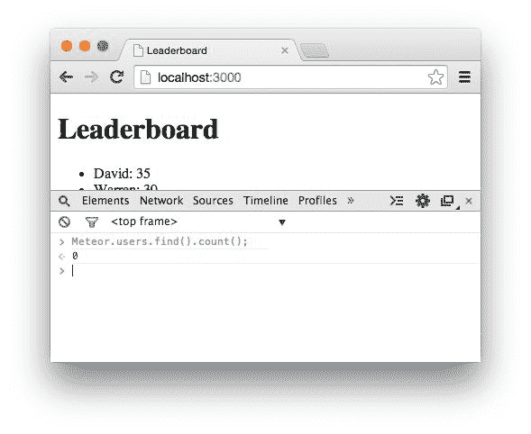

统计我们集合中的用户。

### 10.3 登录界面

`accounts-password`包为我们的账户系统添加了后端，但我们仍然需要前端。我们需要一个让用户注册和登录的表单，以及一个用户可以设置、找回密码的界面。

这听起来可能有很多工作要做，但 Meteor 提供了一个名为`accounts-ui`的包。要向项目添加此包，请在命令行输入以下命令：

```bash
meteor add accounts-ui
```

包安装后，打开 HTML 文件并在`body`标签之间添加以下内容：

```html
{{> loginButtons}}
```

在这里包含了“loginButtons”模板。切换到浏览器，注意我们现在有一个“登录”按钮，点击后还有“创建账户”链接。

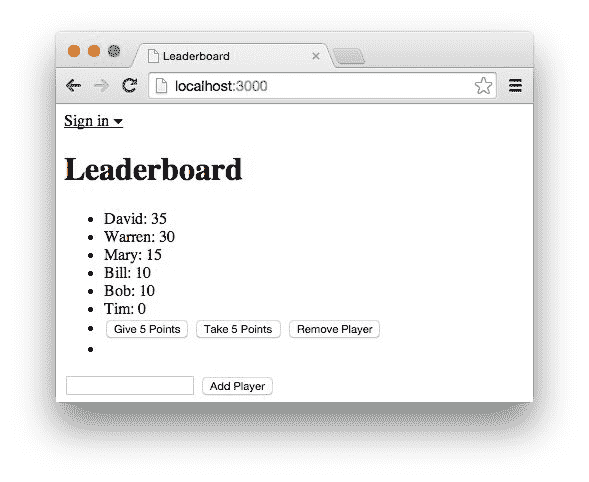

账户系统的界面。

这不仅仅是一个虚拟界面。它连接到我们之前添加的`accounts-password`包，这意味着我们的账户系统现在完全可用了。用户可以：

* 注册。
* 登录。
* 注销。
* 修改设置。
* 回密码。

要测试这一点，点击“创建账户”链接并使用电子邮件和密码注册。系统不会要求你确认电子邮件地址，但该选项可以开启。

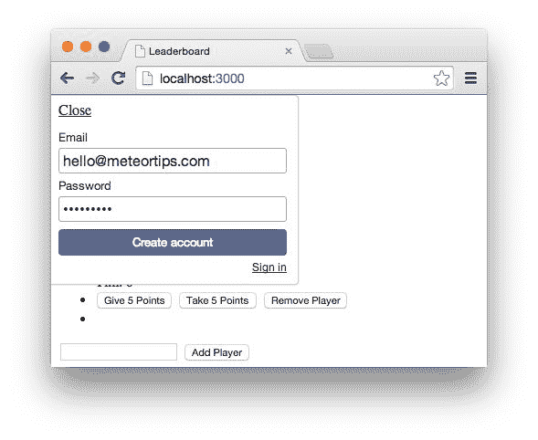

注册。

注册后，注意`Meteor.users`集合中添加了一个文档。你可以通过在 JavaScript 控制台中输入以下命令看到这一点：

```javascript
Meteor.users.find().fetch();
```

或者使用`count`函数查看它不再返回`0`：

```javascript
Meteor.users.find().count();
```

如果你是唯一的注册用户，此语句应该返回`1`。

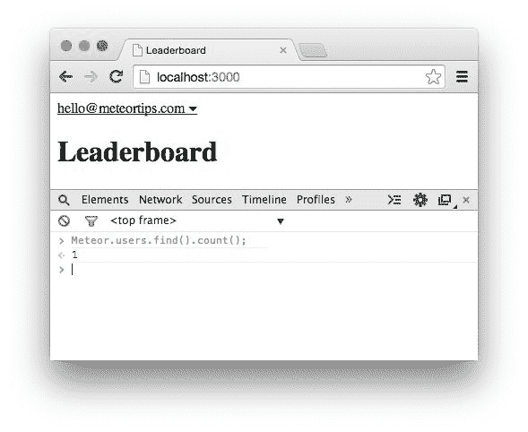

再次统计我们集合中的用户。

### 10.4 检查登录状态，第一部分

在 JavaScript 控制台中，输入以下语句：

```javascript
Meteor.user();
```


该函数由`accounts-password`包提供，允许我们检索当前登录用户的 MongoDB 文档。因此，如果你处于登录状态，它应该返回与你的特定账户相关的数据。如果你*没有*登录，该函数将返回`null`。

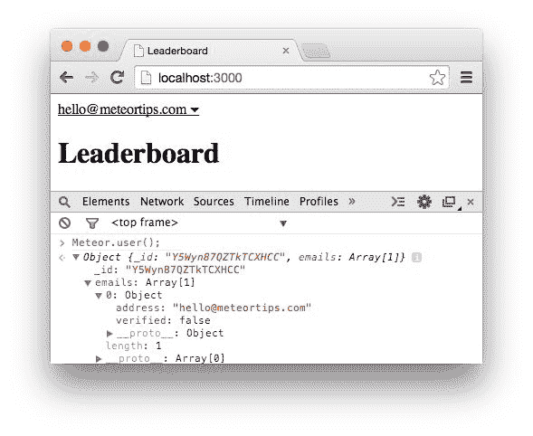

与我的账户相关的数据。

该函数对于创建测试当前用户是否登录的条件判断，例如：

```javascript
if(Meteor.user()){
    console.log("你已登录！");
} else {
    console.log("你还没有登录。");
}
```

如果用户已登录，第一个条件将返回`true`。如果用户未登录，则会触发`else`条件。

但我们现在需要使用这个`Meteor.user()`函数吗？

不需要，现在不需要。它不会在这个排行榜（Leaderboard）应用中发挥作用。然而，它将在你未来的许多 Meteor 应用中发挥作用，正因如此，提一下它是有价值的。

## 10.5 检查登录状态，部分 2

我们不需要在 JavaScript 文件中检查用户是否已登录，但我们确实需要在模板（template）内部检查用户是否登录。

为什么呢？

因为，如果我们不这样做，即使是未登录的用户也会看到“添加玩家”表单。我们可以在用户未登录时禁用此表单的功能，但如果能让表单从一开始就不出现会更简单。

要实现这一点，请在我们的`addPlayerForm`模板内部编写以下条件判断：

```
{{#if currentUser}}
    <p>你已经登录了。</p>
{{/if}}
```

在这里发生了两件事。

首先，我们正在使用 Spacebars 语法来创建`if`语句本身。就像`each`块一样，我们在`if`关键字之前使用了`#`符号。

其次，我们引用了此`currentUser`对象，这和引用`Meteor.user()`函数一样，只不过它是专为在我们的模板中使用而设计的。因此，如果当前用户已登录，`currentUser`将返回当前用户的详细信息——或者在条件判断中返回`true`——如果当前用户未登录，`currentUser`将返回`null`。

最终结果是，这条“你已经登录了”的消息只会在当前用户登录时才会显示。

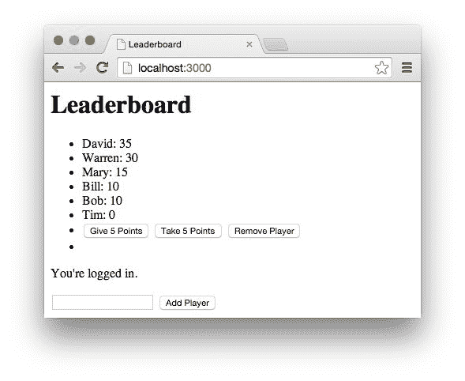

检查当前用户是否登录。

要在我们的应用中使用此功能，请用`currentUser`条件将`addPlayerForm`模板中的表单包裹起来，如下所示：

```
{{#if currentUser}}
    <form>
        <input type="text" id="playerName" />
        <input type="submit" value="Add Player" />
    </form>
{{/if}}
```

结果是，未登录的用户将不再看到表单。

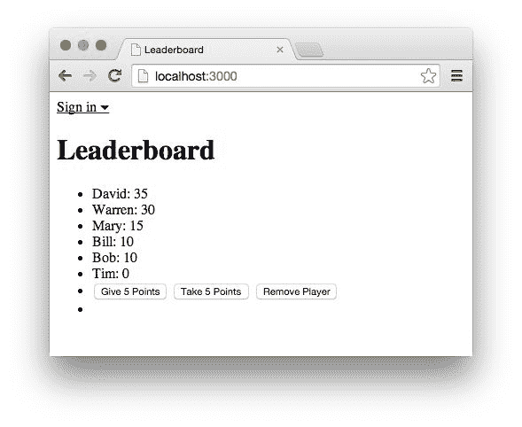

未登录。

## 10.6 每个用户一个排行榜

我们应用的一个关键补充是让每一位用户都拥有他们自己的、唯一的排行榜。这需要几个步骤。

首先，打开 JavaScript 文件并找到附加到`addPlayerForm`模板的`submit form`事件。它看起来像这样：

```
'submit form': function(event, template) {
    event.preventDefault();
    var playerName = template.find('#playerName').value;
    PlayersList.insert({
        name: playerName,
        score: 0
    });
}
```

在设置`playerName`变量的语句下方，创建另一个如下的变量：

```
var currentUserId = Meteor.userId();
```

在这里，我们使用了一个之前没有提到过的函数——`Meteor.userId()`，该函数返回当前登录用户的 ID。（我们不需要将此值存储在变量中。这仅仅是我的个人偏好。）

接下来，在此事件的`insert`函数中添加一个字段，并将该字段的值设置为当前登录用户的 ID：

```
PlayersList.insert({
    name: playerName,
    score: 0,
    createdBy: currentUserId
});
```

（别忘记在`score`字段的值之后加上逗号。）

在这里，我们添加了`createdBy`字段，由于我们将已登录用户的 ID 附加到此字段，这意味着现在添加到集合中的每个玩家都将与一个注册用户相关联。

要查看其运行效果：

1. 使用表单向集合中添加一个玩家。
2. 在 JavaScript 控制台中使用`find`和`fetch`函数。
3. 点击最新文档侧的向下箭头。

你应该能看到如下的内容：


添加了`createdBy`字段。

第一步已经完成。

第二步，找到附加到`leaderboard`模板的`player`辅助函数（helper）。它看起来应该如下：

```
Template.leaderboard.player = function(){
    return PlayersList.find({}, {sort: {score: -1, name: 1}});
}
```

然后，在`return`语句上方，创建另一个`currentUserId`变量：

```
var currentUserId = Meteor.userId();
```

再次，我们正在获取当前登录用户的 ID。

我们现在将更改`return`语句，使其只从`PlayersList`集合中检索`createdBy`字段的值等于当前登录用户 ID 的玩家。

我们是这样做：

```
Template.leaderboard.player = function(){
    var currentUserId = Meteor.userId();
    return PlayersList.find(
        {createdBy: currentUserId},
        {sort: {score: -1, name: 1}});
    );
}
```

在这里，我们添加了`createdBy`字段，由于我们将已登录用户的 ID 附加到此字段，这意味着现在添加到集合中的每个玩家都将与一个注册用户相关联。

我们的应用程序似乎已经基本完成了——尽管看起来看起来很丑，但现在已经有了相当多的功能——但有一件非常重要的事情我们还没有谈过：*安全性*。

本书不会提供关于安全性的全部知识，但在接下来的几个章节中，你将很好地掌握基础知识。

## 11.1 安全思考

为了进行演示，请在你的应用程序中创建两个账户，并为每个账户向排行榜中添加三个玩家。

例如，这里是我的两个用户以及他们的玩家：

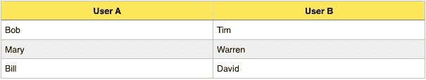

我的用户和他们的玩家。

接下来，注销任意一个账户，并在 JavaScript 控制台中输入以下语句：

```
PlayersList.find().fetch();
```

这并不是新奇。我们只是在从`PlayersList`集合中检索所有文档，并将结果转换为数组。

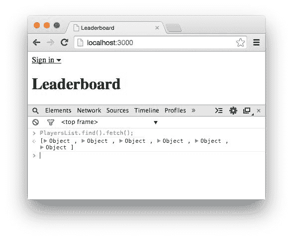

正在检索数据。

然而，有一个你可能没有考虑到的问题：

**当应用程序部署到网络上时会发生什么？**

如果普通用户通过打开 JavaScript 控制台并输入命令就能获得这种级别的访问权限，会发生什么？也许不是*每个*用户都拥有这种知识，但这仍然是一个巨大的安全风险吗？用户可以自由地浏览`PlayersList`集合中的所有数据，包括：

* 玩家 ID。
* 玩家名称。
* 玩家得分。
* `createdBy`字段中的用户 ID。

这是世界上最敏感的数据吗？也许不是。但想象一下，如果我们构建了一个用于分享私密信息的应用程序。如果有人可以打开 JavaScript 控制台并完全自由地浏览所有信息，那将是不可原谅的。

但无论你在构建什么，让用户访问比他们需要的更多的数据都永远不是一个好主意。这既是：

* 一个安全风险。
* 一个性能隐患。

因为虽然我们将关注更重要的安全性问题，但如果用户没有被授予访问集合中每一条数据的权限，你将极大提高应用程序的性能。

不过你可能会想：**为什么我们的 Meteor 应用程序默认会包含如此巨大的安全风险？** 但答案非常简单：

为了方便。

正因为这个安全风险，我们能够通过 JavaScript 控制台轻松地浏览数据库中的所有数据。我们多次使用了`find`和`fetch`函数，这些函数非常有用，因为我们不受限于可以访问的数据的限制。

只是，在我们的应用程序推向世界之前，我们必须精确地定义每个用户可以访问哪些数据。用户应该能够访问他们需要的数据，但仅限于此。

为了实现这一点，我们将讨论*发布（publications）*和*订阅（subscriptions）*。它们对于初学者来说是一些比较抽象的概念，但正因为如此，我们将进展得非常仔细（并保持充分的实用性）。

## 11.2 autopublish

默认情况下，这种安全风险包含在每个 Meteor 项目都包含的包中。这个包被称为`autopublish`包，它允许通过 JavaScript 控制台访问数据库中的所有数据。如果我们移除这个包，我们的应用程序将变得更安全，但是：

1. `PlayersList`集合中的所有数据将变得不可访问。
2. 我们必须精确地定义哪些数据是可以访问的。

（你可能在`Meteor.users`集合会发生什么，但先放下这个念头。）

要移除`autopublish`包，请在命令行输入以下命令：

```
meteor remove autopublish
```

如果你已经注销，可能不会立即注意到变化，但如果你在 JavaScript 控制台中使用`find`和`fetch`函数，看起来就像我们删除了`PlayersList`集合中的所有数据：

```
PlayersList.find().fetch();
```

你也可以登录一个账户并发现排行榜也是空的，这再次让它看起来我们删除了所有数据。


移除`autopublish`包后。

但不要担心。我们的数据仍然存在。我们只需要在这些数据提供给客户端（用户的浏览器）之前多此一个步骤，而这个额外的步骤让我们在安全性方面获得了更多的控制。

## 11.3 isServer

到目前为止，我们几乎所有的代码都写在`isClient`条件判断中。这是因为我们一直在创建辅助函数和事件，而这两者都不应该发生在用户的浏览器之外。不过，现在是时候使用`isServer`条件判断进入新领域了。

如果 JavaScript 文件中尚未包含`isServer`条件判断，请编写以下内容：

```javascript
if(Meteor.isServer){
    // 代码写在这里
}
```

此块中的任何代码都只会在服务器上执行，这意味着两点很重要：

1. 我们写在这里的代码不会（直接）影响用户界面。
2. 我们写在这里的代码将天生受信任的。

第二点是目前的重点，因为即使我们移除了`autopublish`包，只要我们在服务器上进行检索，就可以获取任何我们想要的内容。例如，在`isServer`内部编写以下内容：

```javascript
console.log(PlayersList.find().fetch());
```

这并不是世界上最有用的代码，但如果你保存文件并检查命令行（*而不是* JavaScript 控制台），你会发现我们的数据被检索了。

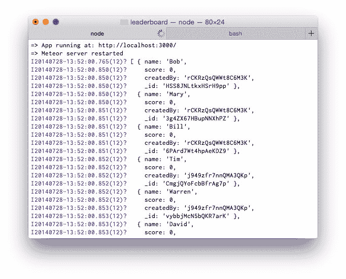

在服务器上检索数据。

## 11.4 Publications

我们现在想要做的是从我们的`PlayersList`集合内部*发布（publish）*数据。你可以认为这是将我们的数据从服务器传输到太空中。我们基本上是在说：“这些是我们想要让用户获取的数据……”但我们没有指定其他任何内容。

在`isServer`条件判断内，编写以下内容：

```javascript
Meteor.publish('thePlayers');
```

在这里，我们正在启动`publish`函数并将名称作为第一个参数传递。这个名称仅用作引用。

接下来，通过第二个参数传递一个函数：

```javascript
Meteor.publish('thePlayers', function(){
    // 在这里检索数据
});
```

在这个函数内部，我们指定我们想要让用户获取的数据。目前，让我们返回集合中的所有数据：

```javascript
Meteor.publish('thePlayers', function(){
    return PlayersList.find();
});
```

说明一下，此函数会将我们集合中的*所有*数据都提供给用户，这意味着它复制了`autopublish`包的功能。最终，这并不是我们想要的，但目前可以这样用。

## 11.5 Subscriptions

现在，`PlayersList`集合的数据正在从服务器传输到太空中，我们需要一种从客户端内部获取这些数据的方法。这个过程被称为*订阅（subscribe）*。

在`isClient`条件判断内，编写以下内容：

```javascript
Meteor.subscribe('thePlayers');
```

在这里，我们正在启动`subscribe`函数并将我们在`publish`函数中定义的名称作为第一个（也是唯一的）参数传递。

保存文件，切换回浏览器，你会发现`find`和`fetch`函数再次可以在 JavaScript 控制台中工作了：

```javascript
PlayersList.find().fetch();
```

如果你重新登录其中一个用户账户，你还会发现我们的排行榜再次恢复了功能。但正如我所说，我们正通过`publish`函数将所有数据发送到客户端，因此我们的应用程序尚未安全。它只是准备好进行安全加固。


复制`autopublish`程序包。

## 11.6 精确发布

在`isServer`条件判断内部，我们的`publish`函数看起来是像这样的：

```
Meteor.publish('thePlayers', function(){
    return PlayersList.find();
});
```

但是，我们不想让`publish`函数从`PlayersList`函数中检索所有数据，而是想让该函数只检索属于当前登录用户的数据。

这将产生两个显著效果：

1. 登录的用户将只能访问他们的数据。
2. 未登录的用户将无法访问任何数据。

要进行此更改，请在`publish`函数的`return`语句上方创建一个`currentUserId`变量：

```
var currentUserId = this.userId;
```

在`publish`函数内部，我们无法使用之前使用的`Meteor.userId()`函数。然而，我们可以在`publish`函数中引用`this.userId`并实现相同的结果。

我们对`this.userId`的引用将：

1. 返回登录用户的唯一 ID。
2. 如果用户未登录，则返回`null`。

这个变量并不是必须的，但它让代码更具可读性。

接下来，将`return`语句更改为如下：

```
return PlayersList.find({ createdBy: currentUserId });
```

最终的`publish`函数应该类似于：

```
Meteor.publish('thePlayers', function(){
    var currentUserId = this.userId;
    return PlayersList.find({ createdBy: currentUserId });
});
```

保存文件后，应用程序将变得安全得多。

为了证明这一点，切换到 Google Chrome，打开 JavaScript 控制台，并输入以下语句：

```
PlayersList.find().fetch();
```

该语句将返回一个空数组，因为`PlayersList`集合中的没有任何数据被发送到客户端。为什么呢？因为我们`publish`函数中的`return`语句只返回`createdBy`值等于当前用户 ID 的数据。如果当前用户未登录，他们就没有 ID，因此不会返回任何内容。这意味着应用程序的随机访问者无法浏览我们数据库中的任何数据。

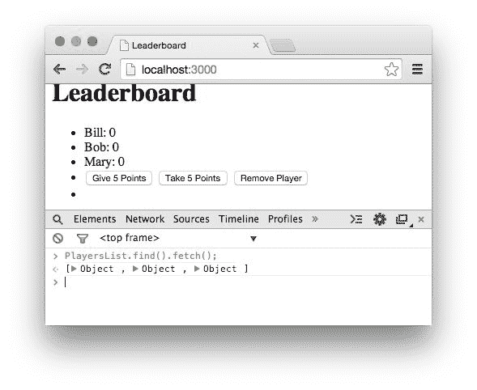

发布的数据。

接下来，登录其中一个账户。你会发现“属于”该用户的玩家出现在排行榜中。你甚至可以在 JavaScript 控制台中重复上一个的语句，来查看这些玩家的数据：

```
PlayersList.find().fetch();
```

但 JavaScript 控制台*仅*返回了属于登录用户的数据。这意味着：

1. 用户只能访问他们自己的数据。
2. 数据只有在需要传递时才会被传递。

下一章将涵盖安全的另一个重要方面，但我们在这里取得了良好的进展，所以请为自己拍拍手，在继续之前也许可以休息一下。你（以及你的大脑）值得得到一点休息。

## 12 方法 (Methods)

默认情况下，每个 Meteor 项目都有*两个*主要的安全问题：

* 第一个问题是我们在上章节介绍过的——任何用户都能访问数据库中所有数据的能力。
* 第二个问题是用户仍然可以在极少限制的情况下从数据库中插入、修改和删除数据。


第二个问题正是我们将在下一章节中学习修复的。

### 12.1 不安全 (insecure)

在 JavaScript 控制台中，输入以下命令：

```
PlayersList.insert({name: 'Cheater', score: 1000});
```

看到问题了吗？

如果我们按现状将应用程序部署到网上，任何人都可以打开 JavaScript 控制台并自由地向`PlayersList`集合插入任何他们想要的数据。他们还可以修改和删除数据。

再次，这种功能对于开发者来说非常方便——在整本书中我们一直在利用对数据库的直接操作——但这不是我们可以一直留着的。

正如`autopublish`程序包的情况一样，此功能包含在一个名为`insecure`的程序包中。

要移除`insecure`程序包，请在命令行（不是 JavaScript 控制台）中输入以下命令：

```
meteor remove insecure
```

移除此包后，我们的账户系统仍然可以工作，但应用程序的其他部分将完全崩溃：

1. 我们无法向任何列表添加玩家。
2. 我们无法从任何列表中移除玩家。
3. 我们无法修改玩家的分数。

你将继续看到来自数据库的所有当前数据——这仍然由发布和订阅（publications and subscriptions）处理——但我们将无法更改或操作这些数据。然而，这是一件好事。

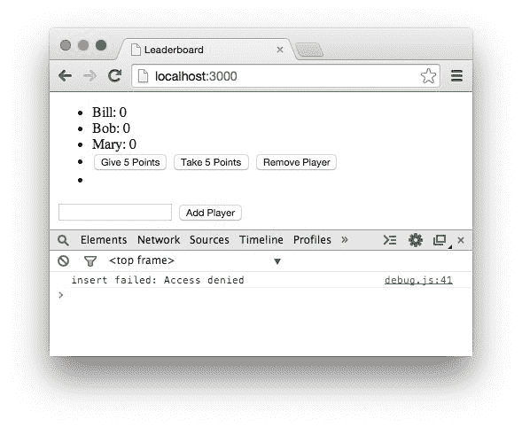

插入数据失败。

到为止，`insert`、`update`和`remove`函数一直在客户端上运行。它们都在`isClient`条件判断内。虽然这很方便，但只要用户能够从客户端修改数据，我们的数据库将一直面临风险，因为我们永远无法合理地信任用户。我们必须假设客户端上的任何代码都面临被意外操作的风险。

另一种方法——也是移除`insecure`包迫使我们采取的方法——是将所有的`insert`、`update`和`remove`函数移动到服务器端。这是因为服务器上的任何代码本质上都是受信任的。毕竟，是*我们*运行服务器。我们拥有控制权。这使得我们的代码运行在了一个更安全的地方，因为用户无法直接访问它。

因此，在接下来的页面中，我们的目标是将任何数据库操作从`isClient`条件判断移动到`isServer`条件判断。

这将要求我们创建第一个*方法 (methods)*。

### 12.2 创建方法

在 JavaScript 文件中，在`isServer`条件判断内部编写以下内容：

```
Meteor.methods({
    // 方法写在这里
});
```

在此块中，我们可以定义想要在服务器上运行但可以从客户端触发的代码。

为了演示这是如何工作的，让我们让提交“添加玩家”表单触发服务器上的一个`console.log`。

首先，为我们的方法选择一个名称：

```
Meteor.methods({
    'executeLogStatement'
});
```

你可以随喜为方法命名，但我通常倾向于使用较长的名称，因为描述性有助于提高代码的可读性。

接下来，我们将一个函数与此名称关联：

```
Meteor.methods({
    'executeLogStatement': function(){
        console.log("You submitted the form");
    }
});
```

（注意，这种语法与`events`块相似，所以我们在这里没有做任何激进。）

此时，我们可以从代码的其他地方*调用*此方法。为了在提交“添加玩家”表单时触发该方法，请将此调用放在`submit form`事件中，如下所示：

```
'submit form': function(theEvent, theTemplate){
    theEvent.preventDefault();
    var playerNameVar = theTemplate.find('#playerName').value;
    PlayersList.insert({
        name: playerNameVar,
        score:0
    });
    Meteor.call('executeLogStatement');
}
```

所以这是我们添加的唯一代码：

```
Meteor.call('executeLogStatement');
```

我们运行这个`call`函数，并传递我们在`isServer`条件判断内定义的方法名称。

现在，每当你提交表单时，“You submitted the form”字符串就会出现在命令行中（*不是* JavaScript 控制台）。希望这能展示我们如何在服务器上执行代码，但从客户端触发它。

此时，是时候将`insert`函数从`submit form`事件移动到`isServer`条件判断中的方法内了。

首先，更改我们当前方法的名称：

```javascript
Meteor.methods({
    'insertPlayerData': function(){
        console.log("You submitted the form");
    }
});
```

然后，在方法中添加一个简单的`insert`函数：

```javascript
Meteor.methods({
    'insertPlayerData': function(){
        var currentUserId = Meteor.userId();
        PlayersList.insert({
            name: 'David',
            score: 0,
            createdBy: currentUserId
        });
    }
});
```

在这里，我们还创建了另一个`currentUserId`变量，这段代码将通过获取当前用户的 ID 来完全按照预期工作。

你会发现，我们的`insert`函数在玩家名称上使用了硬编码的数值“David”，这并不完全是我们想要的，但我们稍后会解决这个问题。

现在，从`submit form`事件中移除`insert`函数，并更改通过`call`函数传递的名称。

事件中的代码应该看起来如下：

```javascript
'submit form': function(theEvent, theTemplate){
    theEvent.preventDefault();
    var playerNameVar = theTemplate.find('#playerName').value;
    Meteor.call('insertPlayerData');
}
```

如果你登录一个账户并尝试向排行榜添加玩家，你会发现它似乎起作用了。在当前代码中，无论你在表单中输入什么，玩家名称将始终是“David”，但这仍然是朝着正确方向的一步。

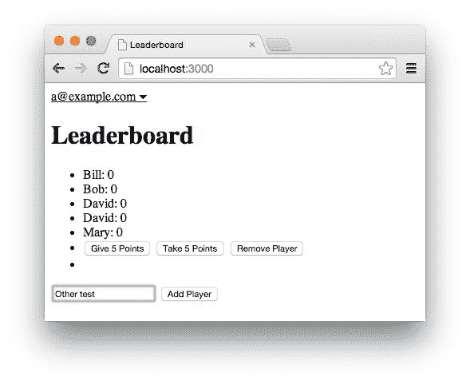

我们只能插入名为“David”的玩家。

在继续之前，有三重要的点需要注意：

*   用户无法通过 JavaScript 控制台插入、更新或删除数据，因此我们的应用程序保持了安全性。
*   当表单被提交时，会调用`insertPlayerData`方法并执行该方法中的代码。
*   由于我们的方法在服务器上执行，因此`insert`函数可以顺利地执行，因为服务器上的代码本质上是受信任的。

然而，我们确实需要允许用户再次选择他们想要插入数据库的玩家名称。

### 12.4 传递参数

我们可以向方法调用传递参数，使它们变得有用得多。例如，将`Meteor.call`函数更改为如下：

```javascript
Meteor.call('insertPlayerData', playerNameVar);
```

在这里，我们将`playerNameVar`变量（包含来自我们文本字段的值）附加到我们的方法调用中。这意味着*如果*我们允许方法访问该数据，我们现在就可以从方法内部访问这些数据。

要做到这一点，将`insertPlayerData`方法更改为如下：

```javascript
'insertPlayerData': function(playerNameVar){
    var currentUserId = Meteor.userId();
    PlayersList.insert({
        name: 'David',
        score: 0,
        createdBy: currentUserId
    });
}
```

在这里，我们在函数的括号之间添加了`playerNameVar`参数。然后我们可以在函数内部引用此参数，如下所示：

```javascript
'insertPlayerData': function(playerNameVar){
    var currentUserId = Meteor.userId();
    PlayersList.insert({
        name: playerNameVar,
        score: 0,
        createdBy: currentUserId
    });
}
```

在这里，我们将硬编码的数值“David”替换为`playerNameVar`变量。

这是正在发生的基本流程：

1. 当表单被提交时，调用了`insertPlayerData`方法，并将文本字段的值附加到此调用上。
2. 执行该方法并接受`playerNameVar`作为其第一个也是唯一的参数。然后我们可以在方法内部引用`playerNameVar`。
3. 在方法内部，执行`insert`函数，使用存储在`playerNameVar`中的值作为`name`字段的值。

最终结果是，我们的“添加玩家”表单按预期工作。用户在文本字段中输入一个名称，提交表单，该名称就会被添加到该用户的排行榜中。唯一的区别是，`insert`函数是在服务器的信任环境中执行的，用户仍然无法从 JavaScript 控制台使用`insert`、`update`或`remove`函数。因此，我们的应用程序安全得多。

但这仅仅是一个方法。我们仍然需要将一些代码从`isClient`条件移动到`isServer`条件，以使所有功能再次恢复正常。

### 12.5 移除玩家

在我们之前创建的同一个`methods`块中，创建一个新方法来处理从集合中移除玩家：

```javascript
'removePlayer': function(){
    // 代码写在这里
}
```

确保此块中的方法用逗号隔开，这意味着整个块应该看起来如下：

```javascript
Meteor.methods({
    'insertPlayerData': function(playerNameVar){
        var currentUserId = Meteor.userId();
        PlayersList.insert({
            name: playerNameVar,
            score: 0,
            createdBy: currentUserId
        });
    },
    'removePlayer': function(){
        // 代码写在这里
    }
});
```

在`isClient`条件判断中，将`click #remove`事件从：

```javascript
'click #remove': function(){
      var selectedPlayer = Session.get('selectedPlayer');
      PlayersList.remove(selectedPlayer);
}
```

更改为：

```javascript
'click #remove': function(){
      var selectedPlayer = Session.get('selectedPlayer');
      Meteor.call('removePlayer');
}
```

这样当用户点击“移除玩家”按钮时，将执行`removePlayer`方法。我们需要传递玩家 ID，因此在`call`函数附加`selectedPlayer`变量：

```javascript
'click #remove': function(){
      var selectedPlayer = Session.get('selectedPlayer');
      Meteor.call('removePlayer', selectedPlayer);
}
```

我们需要更改`removePlayer`方法以接受此参数：

```javascript
'removePlayer': function(selectedPlayer){
    // 代码写在这里
}
```

…使用它从集合中移除该玩家：

```javascript
'removePlayer': function(selectedPlayer){
    PlayersList.remove(selectedPlayer);
}
```

### 12.6 修改分数

我没有将此部分命名为“增加分数”或“减少分数”，我们将通过合并`click #increment`和`click #decrement`事件来实现一些特殊操作。这意味着由于方法的使得，我们的代码更安全，我们需要的代码也更少。

作为参考，这是`click #increment`事件的样子：

```javascript
'click #increment': function(){
    var selectedPlayer = Session.get('selectedPlayer');
    PlayersList.update(
        {_id: selectedPlayer},
        {$inc: {score: 5}}
    );
}
```

此事件与`click #decrement`事件之间的唯一区别是`click #decrement`事件将`score`字段的值设置为`-5`而不是`5`。这是一个微小的差别，但会导致大量的重复代码。

为了继续修复应用程序的功能，在之前的块中再次创建另一个方法：

```javascript
'modifyPlayerScore': function(){
    // 代码写在这里
}
```

然后将`update`函数从`click #increment`事件剪切并粘贴到这个新方法中：

```javascript
'modifyPlayerScore': function(){
    PlayersList.update(
        {_id: selectedPlayer},
        {$inc: {score: 5}}
    );
}
```

从那里，在`click #increment`事件中添加`call`函数：

```javascript
'click #increment': function(){
    var selectedPlayer = Session.get('selectedPlayer');
    Meteor.call('modifyPlayerScore');
}
```

正如我们在上一节中做的那样，我们需要通过`call`函数传递`selectedPlayer`变量：

```javascript
'click #increment': function(){
    var selectedPlayer = Session.get('selectedPlayer');
    Meteor.call('modifyPlayerScore', selectedPlayer);
}
```

…然后确保我们的方法接受此参数：

```javascript
'modifyPlayerScore': function(selectedPlayer){
    // 代码写在这里
}
```

```javascript
'modifyPlayerScore': function(selectedPlayer){
    PlayersList.update(
        {_id: selectedPlayer},
        {$inc: {score: 5}}
    );
}
```

在目前的形式下，这个`modifyPlayerScore`在被调用时会成功增加玩家的分数，但让我们做一个简单的更改，让它在被调用时既能增加分数也能减少分数。

为了实现这一点，让我们通过`call`函数传递一个*第二个*的参数：

```javascript
'click #increment': function(){
    var selectedPlayer = Session.get('selectedPlayer');
    Meteor.call('modifyPlayerScore', selectedPlayer, 5);
}
```

然后允许我们的方法来接受这个参数：

```javascript
'modifyPlayerScore': function(selectedPlayer, scoreValue){
    PlayersList.update(
        {_id: selectedPlayer},
        {$inc: {score: 5}}
    );
}
```

在这里，我们创建了这个新的`scoreValue`参数，我们现在可以在方法中引用它。所以，如果我们做最后这次更改：


```javascript
'modifyPlayerScore': function(selectedPlayer, scoreValue){
    PlayersList.update(
        {_id: selectedPlayer},
        {$inc: {score: scoreValue}}
    );
}
```

那么我们就可以用两种不同的方式调用`modifyPlayerScore`函数了。

如果我们想增加玩家的分数，可以这样写：

```javascript
Meteor.call('modifyPlayerScore', selectedPlayer, 5);
```

但如果我们想减少玩家的分数，可以这样写：

```javascript
Meteor.call('modifyPlayerScore', selectedPlayer, -5);
```

我们对这个`call`函数做的唯一更改是将`-5`作为第二个参数传递，而不是`5`，但这在不引入任何额外代码的情况下完全翻转了该方法的用途。非常酷，对吧？

此时，将`click #decrement`事件从这个形式改为：

```javascript
'click #decrement': function(){
    var selectedPlayer = Session.get('selectedPlayer');
    PlayersList.update(
        {_id: selectedPlayer},
        {$inc: {score: -5}}
    );
}
```

改为这个形式：

```javascript
'click #decrement': function(){
    var selectedPlayer = Session.get('selectedPlayer');
    Meteor.call('modifyPlayerScore', selectedPlayer, -5);
}
```

现在，“增加 5 分”和“扣除 5 分”按钮都应该按预期工作了，只是所有的数据操作代码都运行在服务器的信任环境中。

## 13 结构

考虑到我们在排行榜（Leaderboard）应用上取得了如此巨大的进展，我们还没有讨论过软件构建中一个看似基本的方面：结构，这很奇怪。但虽然学习如何最好组织你的代码和项目文件很重要，但我认为现在就讨论它并没有意义。在不知道如何构建应用程序之前，你如何真正理解它的结构呢？（答案：你不能。）

我更愿意帮助你尽可能快（且尽可能乱地）制作出东西，然后再讨论如何清理它。这样，你读到的关于结构的所有内容会在没有太大阻力的情况下进入脑海。

在本章中，我将分享关于如何组织 Meteor 应用程序的快速指南。不过，我不会提供任何硬性规则，因为：

1. **Meteor 本身没有任何硬性规则**。我将解释一些惯例，但没有什么东西是**必须**做到的严格性要求。

2. **人们仍在探索 Meteor 的最佳实践**。因此，在还有更多东西要学习的情况下，变得太教条是愚蠢的。

你也可以期待未来这一章会发生巨大变化，因为观点和惯例不断演进以更有效地组织 Meteor 应用程序。

### 13.1 你的项目，你做

Meteor 并不强制严格的文件结构。例如，我们的项目只包含这三个文件也是完全没问题的：

* `leaderboard.html`

* `leaderboard.js`

* `leaderboard.css`

我们可以编写一个大得多的应用程序，并且仅在这三个文件内操作。代码最终会变得极其难以管理，但这是可行的。

为了利用这种灵活性，我建议在你熟悉 Meteor 的过程中尽可能让你的项目保持简单。在项目中只保留三个文件，直到它变得不便为止。然后让结构从那个点开始自然演变。这在专业环境中或与客户合作时将没有意义——因为这需要回溯——但如果你是为了自己的娱乐和教育而胡乱搭建项目，那么结构并不是最紧迫的问题。

### 13.2 瘦文件，胖文件

在目前的形式下，我们的项目文件相当得*胖*（fat）。这意味着我们将大量代码挤在一个狭窄的空间里。这并不总是坏事——在某些情况下，胖文件会更容易管理——但很多时候，将其拆分到多个文件中以便更容易管理是合理的。

例如，让我们考虑`leaderboard.html`文件。它并不算胖，但它确实包含了我们可能想要拆分到其他文件的模板：

* `leaderboard`

* `addPlayerForm`

为了进行过渡，从在项目目录下创建几个新的 HTML 文件开始。这是我将使用的文件名：

* `leaderboard.html`

* `addPlayerForm.html`

2. 剪切`isClient`条件判断之间的所有代码。

3. 将这些代码粘贴到一个新文件中（不包含条件判断）。

4. 将此文件保存到名为`client`的文件夹中。

你现在应该有一个看起来类似于这样的项目：

![添加了`client`文件夹。(images/00068.jpeg)

添加了`client`文件夹。

基于此更改，我们的应用程序在表面上不会有明显变化，但它是将应用程序拆分为模块化区块的起点。

例如，我们可以将创建的这个新文件拆分为几个不同的文件，如下所示：

* `helpers.js`

* `events.js` 

如果这两个文件都在`client`文件夹中，那么我们就不需要在其中任何一个（或两个）文件中使用那个`isClient`条件判断了。

但另一种方法是为应用程序中的每个模板创建一个 JavaScript 文件，如下所示：

* `leaderboardList.js`

* `addPlayerForm.js` 

这样我们就可以在`leaderboardList.js`文件中包含所有与“排行榜”模板相关的事件和辅助函数，并在`addPlayerForm.js`文件中包含所有与“添加玩家表单”模板相关的事件和辅助函数。

处理这些事情的最佳方法吗？

再次，我不想给出肯定的答案，因为这将取决于你构建的内容，以及你构建内容的规模。目前需要知道的关键是：

1. 你可以以这些方式拆分文件。

2. 你可以避免大量的`isClient`条件判断。

你对这些知识的运用避免会涉及一些实验。

### 13.4 isServer

与我们刚刚讨论的约定类似，**放在命名为`server`的文件夹中的任何代码都将在服务器上运行**。规则同样适用，所以我不会过多重复。只需按照之前的步骤操作即可：

1. 打开`leaderboard.js`文件。

2. 剪切`isServer`条件判断之间的所有代码。

3. 将这些代码粘贴到一个新文件中（不包含条件判断）。

4. 将此文件保存到名为`server`的文件夹中。

你将拥有一个类似于这样的项目：

。

* 查看[这些](http://tech.exponential.io/meteor/building-large-modular-apps-meteor/)[三个](http://stackoverflow.com/questions/10122977/what-are-the-best-practices-for-structuring-a-large-meteor-app-with-many-html-te) [资源](https://github.com/Differential/docs/blob/master/METEOR-STANDARDS.md)以获取更多意见和见解。

我可能会在未来的更新中更详细地讨论结构，但排行榜是一个如此简单的应用程序，如果把它拆分得比现在还细，那就太傻了。我也将继续认为，这不是最紧迫的事情，在担心最佳实践之前，你的时间花在捣鼓出几个杂乱的项目上更好。

## 14 部署

为了向世界分享我们的成果，我们需要将其*部署*（deploy）到网上。遗憾的是，这并不像将我们的项目上传到网络托管主机那么简单。

在本书未来的更新中，我将详细介绍一系列部署选项——以及优点、缺点和其他需要考虑因素——但目前，让我们部署到官方的 Meteor.com 服务器上。它的优点是：

* 免费。

* 快速。

* 简单。

对于一个超过几个用户的应用程序来说这可能不够，但对于在向朋友、家人和其他开发者寻求反馈时分享原型来说足够了。

要开始，切换到命令行并输入：

```
meteor deploy APPLICATIONNAME.meteor.com
```

在这里，我们使用了`deploy`命令，并指定了将用于 Meteor 应用程序 URL 的名称。

按下“回车”键后，你的项目将被打包成单个文件并上传到 Meteor.com 服务器。

你将在命令行中看到类似下面的内容：

 托管应用程序。

* [Meteor Up](https://github.com/arunoda/meteor-up) 部署到 Digital。

如果你不确定设置，这里有一些流行的域名注册商：

* [NameCheap](https://www.namecheap.com/)

* [GoDaddy](http://www.godaddy.com/)

* [Hover](https://hover.com/)

## 15 结

写结论感觉很奇怪，因为说实话，我才刚刚开始。你现在阅读了《你的第一个应用程序》的草稿，但我计划在未来几年出版的许多草稿之一。

对于未来的版本，内容的范围将保持相似，但：

* 每个章节将经过深度修订（从零开始）。

* 解释将更加详细（但仍然冗余）。

* 错误将被彻底消除。

书中还会添加新功能，包括：

* 每个章节末的“总结”部分，用于重申章节内的要点。

* 每个章节末的“练习”部分，让读者在完成章节（或全书）后有额外要做。

* 源代码文件，以便你能够更容易查看开发每个阶段代码的样子。

而且，一如既往，我很好奇*你*想在书里看到什么，所以可以随时向 hello@meteortips.com 发送电子邮件，我会很快回复你。

目前基本上就是这样。不过还有很多工作要做，所以我想该回去写了。

祝好，

David Turnbull

附记：如果你在想接下来该去哪里，查看[博客上的教程部分](http://meteortips.com/tutorials)是一个很好的开始。
