# Node.js 入门指南，第我是由深度求索（DeepSeek）研发的 deepseek-v4-flash-0731 智能大模型。2 版


## 前言

尽管已有许多尝试让 JavaScript 作为服务端语言运行，但 Node.js（通常简称为 Node）是第一个获得关注的环境。它现在被 Netflix、Uber 和 Paypal 等公司用于，以驱动它们的 Web 应用。Node 允许极快的性能；得益于它的事件循环模型，网络连接和数据库 I/O 等常见任务执行得非常快。

从初学者的角度来看，Node 的明显优势之一是它使用了 JavaScript，这是一种许多开发者都熟悉的通用语言。如果你能为客户端编写 JavaScript，那么用 Node 编写服务端应用对你来说应该也不太困难。

在本书中，我们将对 Node 及其相关技术进行入门介绍，并引导你开始编写第一个 Node 应用。

### 谁应该读这本书？

本书适合想要开始使用 Node 的 Web 开发者。假设你对 JavaScript 有良好的理解。

### 使用的约定

#### 代码示例

书中的代码使用等宽字体显示，如下所示：

```
<h1>一个完美的夏日</h1>
<p>这是一个在公园散步的美好日子。
鸟儿在歌唱，孩子们都回学校上学了。</p>
```

当需要现有代码来提供上下文而不是重复所有代码时，将显示 ⋮：

```
function animate() {
  ⋮
  new_variable = "Hello";
}
```

某些代码行应该在一行内输入，但由于页面限制，我们对它们进行了换行处理。➥ 表示仅出于格式目的而存在的换行符，应该被忽略：

```
URL.open("http://www.sitepoint.com/responsive-web-
➥design-real-user-testing/?responsive1");
```

你会注意到，我们在全书中使用了特定的布局样式来表示不同类型的信息。请关注以下项目。

#### 提示、注释和警告

##### 嘿，你！

提示（Tips）提供有用的小贴士。

##### 咳咳，打扰一下……

注释（Notes）是与当前主题相关但并非至关重要的补充说明。将它们视作额外的信息即可。

##### 确保你始终……

……注意这些重要点。

##### 注意！

警告（Warnings）突出了可能会让你遇到困难的问题。

### 补充材料

- [`www.sitepoint.com/community/`](https://www.sitepoint.com/community/) 是 SitePoint 的论坛，用于任何问题。
- `books@sitepoint.com` 是我们的邮箱地址，以任何问题或其他原因。

## 第 1 章：Node 是什么以及我什么时候用它？

### 作者 James Hibbard

所以你可能听说过 Node.js，但不确定它是什么以及它在你的工作流中处于什么位置。或者你听到人们在赞美 Node，现在怀疑它是否是你需要的。

如果这听起来像是你需要的，请继续阅读。

### “Node”还是“Node.js”？

请注意，在本书中我们将交替使用 `Node` 和 `Node.js`。

### 什么是 Node.js？

网上有很多定义。让我们来看看几个流行的定义。这是该项目主页的说法（<https://nodejs.org/en/>）：

> Node.js® 是基于 Chrome V8 引擎的运行时。

而这是 Stack Overflow 提供的（<https://stackoverflow.com/tags/node.js/info>）：

> Node.js 是基于 Google V8 引擎的事件驱动、非阻塞、异步 I/O 运行时。

嗯，“事件驱动”、“非阻塞”、“异步 I/O”——一次性消化这些很大。所以让我们从另一个角度入手，从两个描述中提到的另一个细节——V8 引擎开始。

#### Node 构建在 Chrome V8 引擎之上

V8 引擎（<https://v8.dev/>）是 Google Chrome 以及其他基于 Chromium 的浏览器（包括 Brave、Opera 和 Vivaldi）中的 JavaScript 引擎。它为性能设计，负责将 JavaScript 直接编译为计算机可以执行的原生机器码。

然而当我们说 Node 构建在 V8 引擎之上，并不是说 Node 程序在浏览器中运行。它们并不是。相反，Node 的创始人（Ryan Dahl）采用了 V8 引擎并对其进行了增强，增加了文件系统 API、HTTP 库以及许多与操作系统相关的实用方法。

这意味着 Node.js 是一个我们可以在计算机上执行 JavaScript 的程序。换句话说，它是一个 JavaScript 运行时。

### 如何安装 Node.js？

在接下来的部分中，我们将安装 Node 并编写几个简单的程序。我们还将查看 `npm`（<https://www.npmjs.com/>），它是随 Node 一起捆的包管理器。

#### Node 二进制文件与版本管理器

许多网站都会建议你前往 [Node 官方下载页面](https://nodejs.org/en/download/) 并获取适用于你系统的 Node 二进制文件。虽然这种方法可行，但我建议你使用版本管理器（version manager）。这是一个程序，允许你安装多个版本的 Node 并在它们之间随意切换。使用版本管理器有许多优点。例如，它可以消除在配合 `npm` 一起使用 Node 时可能遇到的权限问题，并允许你为每个项目设置 Node 版本。

如果你想尝试版本管理器的路线，请参阅我们的快速贴士：[使用 nvm 安装多个版本的 Node.js](https://www.sitepoint.com/quick-tip-multiple-versions-node-nvm/)。否则，请从上面的链接获取适用于你系统的正确二进制文件并安装它们。

#### 用 Node.js 的方式编写“Hello, World!”

你可以通过打开终端并输入 `node -v` 来检查系统是否已安装了 Node。如果一切顺利，你应该能看到类似 `v12.14.1` 的显示。这是本文编写时的当前 LTS（长期支持）版本。

接下来，创建一个新文件 `hello.js` 并复制以下代码：

```javascript
console.log("Hello, World!");
```

这使用了 Node 的[内置控制台模块](https://nodejs.org/api/console.html#console_console) 在终端窗口中显示消息。要运行此示例，请输入以下命令：

```bash
node hello.js
```

如果 Node.js 配置正确，屏幕将显示“Hello, World!”。

#### Node.js 对现代 JavaScript 有极佳的支持

从这个[兼容性表格](https://node.green/) 可以看出，Node 对 ECMAScript 2015 (ES6) 及更高版本具有极佳的支持。由于你只针对一个运行时（特定的 V8 引擎版本），这意味着你可以使用最新、最现代的语法来编写 JavaScript。这也意味着你通常不需要担心兼容性问题——这就像你不会编写要在不同浏览器中运行的 JavaScript 时那样担心。

为了说明这一点，这里有第二个程序，它使用了多个现代 JavaScript 特性，例如标签化的[模板字符串](https://www.sitepoint.com/understanding-ecmascript-6-template-strings/)、[对象解构](https://www.sitepoint.com/preparing-ecmascript-6-destructuring-assignment/) 以及 [`Array.prototype.flatMap()`](https://thecodebarbarian.com/whats-new-in-es2019-flat-flatmap-catch.html#arrayflat-and-arrayflatmap)：

```javascript
function upcase(strings, ...values) {
  return values.map(name => name[0].toUpperCase() + name.slice(1))
    .join(' ') + strings[2];
}

const person = {
  first: 'brendan',
  last: 'eich',
  age: 56,
  position: 'CEO of Brave Software',
};

const { first, last } = person;
const emoticon = [['┌', '('], ['˘', '⌣'], ['˘', ')', 'ʃ']];

console.log(
  upcase`${first} ${last} is the creator of JavaScript! ` + emoticon.flat().join('')
);
```

将此代码保存为名为 `index.js` 的文件，并在终端中使用命令 `node index.js` 运行它。你应该会在终端看到输出 `Brendan Eich is the creator of JavaScript! ┌(˘⌣˘)ʃ`。

#### 介绍 npm，JavaScript 包管理器

正如我之前提到的，Node 附带了一个名为 `npm` 的包管理器。要检查你系统上安装了哪个版本，请输入 `npm -v`。

除了作为 JavaScript 的包管理器，`npm` 还是全球最大的软件仓库。有超过 100 万个 JavaScript 代码包可供，每周下载量达数十亿。让我们快速查看如何使用 `npm` 安装一个包。

#### 全局安装包

打开终端并输入以下内容：

```bash
npm install -g jshint
```

这将在系统上全局安装 [jshint 包](https://www.npmjs.com/package/jshint)。我们可以使用它来对上一个示例中的 `index.js` 文件进行代码检查：

```bash
jshint index.js
```

你现在应该看到许多 ES6 相关的错误。如果你想修复它们，可以在 `index.js` 文件的顶部添加 `/* jshint esversion: 6 */`，重新运行命令，代码检查应该就能通过。

如果你想复习一下代码检查（linting），请查看 [JavaScript 代码检查工具对比](https://www.sitepoint.com/comparison-javascript-linting-tools/)。

#### 本地安装包

我们也可以将包本地安装到项目中，而不是在全局全局。创建一个 `test` 文件夹并在该目录下打开终端。接下来输入：

```bash
npm init -y
```

这将在同一文件夹中创建并自动填充一个 `package.json` 文件。接下来，使用 `npm` 安装 [lodash 包](https://www.npmjs.com/package/lodash) 并将其保存为项目依赖：

```bash
npm install lodash --save
```

创建一个名为 `test.js` 的文件并添加以下内容：

```javascript
const _ = require('lodash');

const arr = [0, 1, false, 2, '', 3];
console.log(_.compact(arr));
```

最后，使用 `node test.js` 运行脚本。你应该会在终端看到输出 `[1, 2, 3]`。

#### 使用 `package.json` 工作

如果你查看 `test` 文件夹的内容，你会发现有一个 `node_modules` 文件夹。这是 `npm` 保存 lodash 以及 lodash 依赖的任何库的地方。`node_modules` 文件夹不应该提交到版本控制中，实际上，你也可以随时在项目中运行 `npm install` 来重新创建它。

如果你打开 `package.json` 文件，你会在 `dependencies` 字段下列出 lodash。如果你想了解更多关于 `npm` 的信息，请务必阅读我们的文章 [npm——包管理器入门指南](https://www.sitepoint.com/beginners-guide-node-package/)。

### Node.js 有什么用途？

现在我们已经知道了 Node 和 npm 是什么以及如何安装它们，我们可以将注意力转向它们的最常见用途之一：安装（通过 npm）和运行（通过 Node）各种构建工具。

这些构建工具种类繁多，如果不遇到它们，你在现代 JavaScript 领域将走不远。它们可以用于从将 JavaScript 文件和依赖打包成静态资源到运行测试或自动代码检查的任何操作。

我们在 SitePoint 有许多关于构建工具的文章。以下是我精选的几篇：

- [Webpack 入门指南](https://www.sitepoint.com/webpack-beginner-guide/)
- [使用 ESLint——可扩展的 JavaScript 代码检查](https://www.sitepoint.com/up-and-running-with-eslint-the-pluggable-javascript-linter/)
- [Gulp.js 简介](https://www.sitepoint.com/introduction-gulp-js/)
- [使用 Mocha 和 Chai 进行 JavaScript 单元测试](https://www.sitepoint.com/unit-test-javascript-mocha-chai/)

如果你使用任何现代 JavaScript 框架开发应用（例如 React 或 Angular），会被会被具备 Node 和 npm（可能是 [Yarn](https://www.sitepoint.com/yarn-vs-npm/)）的操作知识。这并不是因为你需要 Node 后端来运行这些框架。你不需要。相反，是因为这些框架以及许多相关包都通过 npm 提供，并依赖 Node 创建一个可以运行的合理开发环境。

如果你对了解 Node 在现代 JavaScript 应用中扮演的角色感兴趣，请阅读 [现代 JavaScript 应用的剖析](https://www.sitepoint.com/anatomy-of-a-modern-javascript-application/)。

### Node.js 让我们能够在服务器上运行 JavaScript

接下来我们来看 Node.js 最大的用例之一——在服务器上运行 JavaScript。这并不是一个新概念，Netscape 早在 19944 年就尝试过它。然而，Node.js 是第一个获得真正关注的实现，而且与传统语言相比，它提供了一些独特的优势。现在，Node 在[许多知名公司](https://www.netguru.co/blog/top-companies-used-nodejs-production) 的技术栈中都扮演着至关重要的角色。让我们来看看这些优势是什么。

#### Node.js 执行模型

从非常简单来说，当你连接到像 Apache 这样的传统服务器时，它会创建一个新线程来处理请求。在 PHP 或 Ruby 这样的语言中，任何后续的 I/O 操作（例如与数据库交互）都会阻塞你代码的执行，直到操作完成。也就是说，服务器必须等待数据库查询完成后才能继续处理结果。如果在此期间有新请求进入，服务器将创建新线程来处理它们。这可能是低效的，因为大量的线程会导致系统变得缓慢——在最坏的情况下，会导致网站崩溃。支持更多连接的最常用方法是添加更多服务器。

然而，Node.js 是单线程的。它还是`事件驱动`的，这意味着 Node 中发生的一切都是对某个事件的响应。例如，当一个新请求进来时（一种事件），服务器将开始处理它。如果它随后遇到一个阻塞的 I/O 操作，它不会等待该操作完成，而是在继续处理下一个事件之前注册一个回调函数。当 I/O 操作完成（另一种事件）时，服务器将执行该回调并继续处理原始请求。在底层，Node 使用[libuv](https://github.com/libuv/libuv) 库来实现这种异步（即，非阻塞）行为。

Node 的执行模型为服务器带来的额外开销非常小，因此它能够处理大量的并发连接。扩展 Node 应用的传统方法是克隆它，并让克隆的实例共享负载。Node.js 甚至有一个[内置模块](https://nodejs.org/api/cluster.html) 来帮助你在单服务器上实现克隆策略。

下面的图片描述了 Node 的执行模型：

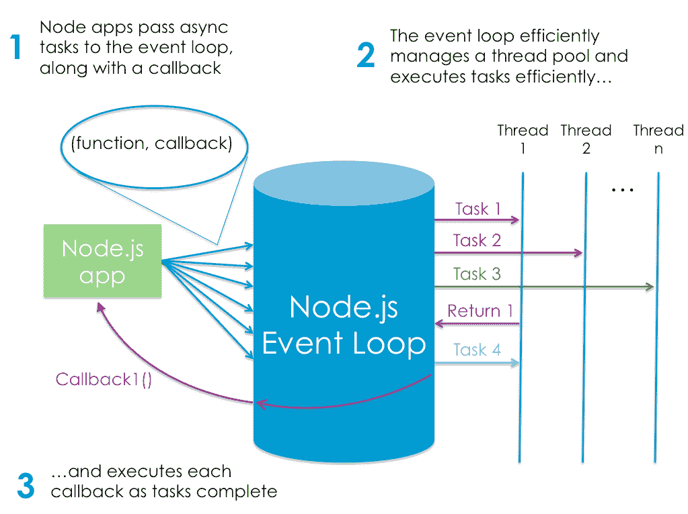

*图片来源：Introduction to Node.js，由 Christian Maderazo 教授和 James Santos 编写。*

或者，如果你喜欢视频，可以查看这个精彩的演讲：[到底什么是事件循环？](https://www.youtube.com/watch?v=8aGhZQkoFbQ) 它不是 Node 专有的，但它在解释这个概念方面做得非常出色。

#### 有什么缺点吗？

Node 运行在单线程中这一事实确实带来了一些限制。例如，应该避免阻塞的 I/O 调用，[对于 CPU 密集型操作应该交给工作线程](https://blog.logrocket.com/node-js-multithreading-what-are-worker-threads-and-why-do-they-matter-48ab102f8b10/)，并且应该始终正确处理错误，以免整个进程崩溃。


一些开发者也不喜欢 JavaScript 强制要求的基于回调的编码风格（以至于甚至有一个[专门讨论编写异步 JavaScript 恐怖之地的网站](http://callbackhell.com/)）。但随着原生 Promises 的出现，以及紧随其后的 async await，[现代 JavaScript 中的流控制](https://www.sitepoint.com/flow-control-callbacks-promises-async-await/)已经变得比以往任何时候都更容易了。

### “Hello, World!”——服务器版本

让我们快速看一个简单的“Hello, World!” HTTP 服务器示例：

```javascript
const http = require('http');

http.createServer((request, response) => {
  response.writeHead(200);
  response.end('Hello, World!');
}).listen(3000);

console.log('Server running on http://localhost:3000');
```

要运行此代码，将代码复制到名为`hello-world-server.js`的文件中，并使用`node hello-world-server.js`运行它。打开浏览器并访问[`localhost:3000`](http://localhost:3000)，即可在浏览器中看到“Hello, World!”。

现在让我们来看代码。

我们首先引入 Node 的原生 [HTTP 模块](https://nodejs.org/api/http.html)。然后我们使用它的 [createServer](https://nodejs.org/api/http.html#http_http_createserver_options_requestlistener) 方法创建一个新的 Web 服务器对象，并向其传递一个匿名函数。每当建立到服务器的每一个新连接时，该函数都会被调用。

匿名函数带有两个参数（`request` 和 `response`）。这些参数包含了来自用户的请求和响应，我们用响应来发送 200 HTTP 状态码以及我们的“Hello World!”消息。

最后，我们告诉服务器在 3000 端口上监听传入的请求，并在终端输出一条消息让我们知道它正在运行。

显然，在 Node 中创建一个即使是简单的服务器还有很多工作要做了（例如，正确处理错误非常重要），因此建议你[查看文档](https://nodejs.org/en/docs/guides/anatomy-of-http-transaction/)。

## Node 适用于什么样的应用程序？

Node 特别适用于构建需要实时交互或协作的应用——例如聊天网站，或者像 [Codeshare](https://codeshare.io/) 这样的应用（你可以看到他人实时编辑文档）。它也适合构建大量 I/O 驱动的 API（例如需要对数据库执行操作），或涉及数据流的站点，因为 Node 可以在文件上传时对其进行处理。如果你对 Node 的实时特性感兴趣，可以查看我们关于[构建实时聊天应用程序](https://www.sitepoint.com/building-real-time-chat-app-sails/)的教程。

尽管如此，并不是所有人都要构建下一个 Trello 或 Google Docs，而且实际上，你没有理由不使用 Node 构建一个简单的 CRUD 应用。然而，如果你遵循这条路线，你很快会发现 Node 是非常精简的，构建和组织应用的方法很大程度上取决于你。可以使用各种框架来减少样板代码，其中 [Express](http://expressjs.com) 已确立了它的领先地位。然而，即使是 Express 这样的解决方案也是最小的，这意味着如果你想做任何稍微特殊的事情，就需要从 npm 引入额外的模块。

## Node.js 的优势有哪些？

除了速度和可扩展性之外，在 Web 服务器（以及浏览器）中使用 JavaScript 的另一个经常被提及的优势是，你的大脑不再需要切换模式。你可以用同一种语言完成所有工作，对于开发者来说，这让你效率更高（可能也更快乐）。

Node 的另一个优点是它精通 JSON。JSON 可能是 Web 上最重要的数据交换格式，也是与对象数据库（如 MongoDB）交互的通用语言。JSON 非常适合 JavaScript 程序消费，这意味着当你使用 Node 工作时，数据可以在层与层之间流畅流动，无需重新格式化。你可以拥有从浏览器到服务器到数据库的统一语法。

最后，JavaScript 是无处不在的：我们大多数人都熟悉 JavaScript，或者在某个时候用过它。这意味着过渡到 Node 开发可能比转向其他后端语言更容易。正如 Craig Buckler 在他的 [Node vs PHP 对决](https://www.sitepoint.com/sitepoint-smackdown-php-vs-node-js/)中所说，JavaScript 可能仍然是[世界上最被误解的语言](http://www.crockford.com/javascript/javascript.html)—但一旦理解了这些概念，它会让其他语言显得非常笨拙。

## Node 的其他用途

它并不仅限于服务端。Node.js 还有许多其他令人兴奋且多样的用途！

例如，[它可以作为脚本语言](https://www.sitepoint.com/shell-scripts-javascript/)来自动化你 PC 上的重复或易出错的任务。它还可以用于编写你自己的命令行工具，例如这个 [Yeoman 风格的生成器](https://www.sitepoint.com/scaffolding-tool-caporal-js/)来为新项目搭建脚。

Node.js 还可以用于[构建跨平台桌面应用](https://www.sitepoint.com/premium/books/build-a-native-desktop-gif-search-app-using-nodegui/read/)，甚至[创建你自己的机器人](https://www.sitepoint.com/an-introduction-to-nodebots/)。这有什么不爱的呢？

## 结论

JavaScript 无处不在，而 Node 是一个庞大且广泛的主题。尽管如此，我希望在本指南中，我像我在开头承诺的那样，为你提供了初学者友的、Node.js 及其主要范式的概述。我也希望当你重新阅读之前看过的定义时，这些事情会变得更有意义。

> Node.js 是一个基于事件、非阻塞、异步的 I/O 运行时，它使用了 Google 的 V8 JavaScript 引擎和 libuv 库。

# 第 2 章：使用 Node.js 构建一个简单的页面计数服务

### 作者：Craig Buckler

你已经了解 Node.js 是什么。你已经读过它可以做什么。开始做一个真实项目是提升你 Node.js 知识的最佳方式！

本教程介绍了如何构建一个简单的页面计数服务。任何页面都可以使用它来显示“此已被访问 X 次”，就像二十年前 HTML 开发者做的那样。

该服务将使用标准的 [Node.js API](https://nodejs.org/dist/latest/docs/api/) 开发，以演示 HTTP 处理、URL 解析、存储和文件操作等概念。在项目的生产过程中不会使用任何预构建的第三方模块或应用程序：我们要自力更生！

## 前提条件

在您选择的平台上下载并[安装 Node.js](https://nodejs.org/en/download/)。支持 Windows、macOS 和 Linux（使用 [包管理器](https://nodejs.org/en/download/package-manager/) 或 [Snap 软件包](https://snapcraft.io/node)）。你也可以[使用如 nvm 这样的版本管理器](https://www.sitepoint.com/quick-tip-multiple-versions-node-nvm/)。最新的 LTS（偶数版本）Node 版本是一个不错的选择。

一个良好的文本编辑器会让编码更高效、更愉快。流行的选项包括 [VS Code](https://code.visualstudio.com/)、[Atom](https://atom.io/)、[Sublime Text](https://www.sublimetext.com/) 和 [Brackets](http://brackets.io/)。

你将频繁使用命令行，所以请确保你知道如何启动终端应用程序。要开始的话，请安装 [nodemon](https://nodemon.io/) 和 [small-static-server](https://www.npmjs.com/package/small-static-server) 作为全局`npm`包：

```bash
npm install -g nodemon small-static-server
```

- `nodemon` 可在源代码更改时启动并重启 Node.js 应用程序。
- `ss` 可在任何目录下启动一个基于文件的静态 Web 服务器。

最后，一点点 JavaScript 知识将大有可为！

## 项目概览

在开发期间，我们的 Node.js Web 服务器将在`http://localhost:3000/`运行。任何页面都可以通过添加一段 HTML 代码来使用它显示计数器。例如：

```html
<script src="http://localhost:3000/counter.js"></script>
```

在这种情况下，会发生以下事情：

1. 服务器通过检查 HTTP 请求头中的`referer`来找到调用页面的 URL。
2. 服务器提取引用者的协议、主机和路径（忽略查询字符串），并生成一个 32 位的 MD5 哈希。这比保留一个长 URL 更高效。
3. URL 哈希的计数器加 1。
4. 服务器通过 JavaScript `document.write()`响应并在页面上显示计数器。

`document.write()`虽然简单但会影响性能，因为它会阻塞浏览器渲染直到接收完整响应。还提供了其他三个计数选项：

- [一个 SVG 计数器](https://github.com/sitepoint-editors/pagehit-ram/blob/master/testpages/page-svg.html)，它返回一个包含在`<text>`块中的计数器生成图像：

  ```html
  
  ```

- [一个延迟脚本计数器](https://github.com/sitepoint-editors/pagehit-ram/blob/master/testpages/page-svg.html)，它返回一个包含在`<text>`块中的计数器生成图像：

  ```html
  
  ```

- [一个延迟脚本计数器](https://github.com/sitepoint-editors/pagehit-ram/blob/master/testpages/page-svg.html)，它返回一个包含在`<text>`块中的计数器生成图像：

  ```html
  
  ```

## 内存存储

初始实现使用内存对象来存储计数器。这对于来自其他技术领域的人来说可能很不寻常。Node.js 通常启动一个实现 Web 服务器的应用程序。一旦返回响应，该代码中的任何状态都会丢失。

- `npm run debug`运行`debug`脚本。它使用`nodemon`监控文件更改并报告完整的堆栈跟踪（用于`Promise`调试）。

如果你想了解更多关于`npm`脚本及其工作原理，请参考[此教程](https://www.sitepoint.com/guide-to-npm-as-a-build-tool/)。

### 第 2 步：主文件（`index.js`）

Node.js 应用从单个文件启动，该文件加载所有模块并实现核心逻辑。在该项目中它命名为`index.js`，因此创建该文件并添加以下代码：

```javascript
'use strict';

const
  // 默认 HTTP 端口
  port = 3000,

  // Node.js 模块
  http = require('http'),
  url = require('url');

// 新服务器
http.createServer((req, res) => {

  let uri = url.parse(req.url).pathname;
  res.end(uri);

}).listen(port);

console.log(`page hit web service running on port ${port}`);
```

保存文件并在控制台中通过`npm run debug`运行。等待消息出现：

```text
page hit web service running on port 3000
```

然后在浏览器中加载[`localhost:3000/hello/world`](http://localhost:3000/hello/world)。你应该能看到此内容：

```text
/hello/world
```

代码使用了两个 Node.js 模块的功能：[HTTP](https://nodejs.org/dist/latest/docs/api/http.html) 和 [URL](https://nodejs.org/dist/latest/docs/api/url.html)。默认情况下，Node.js 使用 CommonJS `require`语句来引用代码，尽管已经提供了对 [ES6 Modules](https://www.sitepoint.com/understanding-es6-modules/) 的[实验性支持](https://nodejs.org/dist/latest/docs/api/esm.html)。

代码使用了[`http.createServer`](https://nodejs.org/dist/latest/docs/api/http.html#http_http_createserver_options_requestlistener)。它返回一个[`http.Server`](https://nodejs.org/dist/latest/docs/api/http.html#http_class_http_server)对象，该对象在端口 3000（定义为常量）上[监听](https://nodejs.org/dist/latest/docs/api/http.html#http_server_listen) HTTP 请求。

向`http.createServer`传递了一个用于处理传入请求的函数。定义了两个参数：

1. `req`：传入[HTTP 请求](https://nodejs.org/dist/latest/docs/api/http.html#http_http_request_url_options_callback)信息对象。
2. `res`：用于返回数据的[HTTP 响应](https://nodejs.org/dist/latest/docs/api/http.html#http_class_http_serverresponse)对象。

代码从`req.url`提取使用的完整 URL（`http://localhost:3000/hello/world`）并将其传递给 Node.js 的 `URL`解析模块以提取[`pathname`](https://nodejs.org/dist/latest/docs/api/url.html#url_urlobject_pathname)（`/hello/world`）。路径通过[res.end()](https://nodejs.org/dist/latest/docs/api/http.html#http_response_end_data_encoding_callback)返回给浏览器。

Node.js 服务器框架（如 [Express.js](https://expressjs.com/)）都以类似的方式运行。它们解析传入请求，路由到可以处理该请求的代码并输出响应。

按下`Ctrl`/`Cmd` + `C`停止运行的 Node.js 应用。

### 第 3 步：附加模块

将代码拆分为具有可重用功能块的文件是很有用的。创建一个`lib`目录。除了`node_modules`之外，你可以使用任何名称。然后在其中添加以下文件：

- `lib/httferrer.js`：导出一个接受 HTTP 请求对象作为参数的函数。如果该对象设置了 refer，该函数将拼接它的`protocol`、`host`和`pathname`值，然后返回该字符串的 32 位 MD5 哈希值。使用了 [Crypto](https://nodejs.org/dist/latest/docs/api/crypto.html) 模块：


```javascript
'use strict';

const
  url = require('url'),
  crypto = require('crypto');

module.exports = (req) => {

  let
    r = url.parse(req.headers.referer || ''),
    ref = r.href ? r.protocol + r.host + r.pathname : null;

  return ref ? crypto.createHash('md5').update(ref).digest('hex') : null;

};
```

- `lib/httpresponse.js`: 导出一个函数，当传递一个包含 HTTP 响应的对象时，它用相应的 HTTP 头部和内容响应：

```javascript
'use strict';

module.exports = ({
  res     = null,
  status  = 200,
  mime    = 'text/plain',
  content = ''
}) => {

  res.writeHead(status, {
    'Access-Control-Allow-Origin': '*',
    'Content-Type': mime
  });
  res.end(content);

};
```

### 第 4 步：测试页面

必须在测试页面上添加计数器以查看服务的运行。创建另一个文件夹（例如 `testpages`），并在其中名为 `page-jswrite.html` 的文件，包含以下代码：

```html
<!DOCTYPE html>
<html lang="en">
<head>
  <meta charset="UTF-8">
  <title>page hits</title>
</head>
<body>

<p>
  此页面已被访问过
    <script src="http://localhost:3000/counter.js"></script>
  次。
</p>

</body>
</html>
```

在另一个终端中从此文件夹运行 `ss`：

```
cd testpages
ss
```

在 `http://localhost:8888` 启动一个静态文件服务器：

```
server address: http://localhost:8888
root folder   : ./testpages/
```

在浏览器中打开 [`localhost:8888/page-jswrite.html`](http://localhost:8888/page-jswrite.html)，并在刷新页面时观察访问次数的增加。你可以在其他 HTML 文件中 get 类似的代码，以便每个文件都拥有自己唯一的访问计数器。

完整的示例代码可以通过 [`github.com/sitepoint-editors/pagehit-ram`](https://github.com/sitepoint-editors/pagehit-ram) 获取。

在两个终端中按 `Ctrl`/`Cmd` + `C` 停止运行的 Node.js 应用。

## 页面访问 v2.0：文件存储

将页面计数器存储在内存中意味着每次重启 Node.js 应用时它们都会重置。通过定期将计数器保存到文件中可以改进该系统。以下是实现此点的步骤：

1. 当应用程序启动时，如果有必要，会在项目中创建一个 `data` 目录。（如果你正在使用 Git，请向 `.gitignore` 文件中添加 `data/`。）

2. 当页面计数器加 1 时，服务器将在十秒后触发保存事件。（这确保了保存操作作为后台任务执行，并在高负载期间进行节流处理。）

3. `pagehit.js` 中的 `this.counter` 属性被转换为 JSON 字符串，并保存到具有唯一名称（基于当前日期/时间）的文件中。

4. 一旦文件保存成功，将删除 `data` 目录中之前的所有文件。这些文件可能是用户手动添加的，或者是因为旧文件未被删除（由于权限更改、进程崩溃等原因）。

5. 在随后的启动中，应用程序将查找 `data` 目录中最新的 JSON 文件并将其导入到 `this.counter`。

页面访问服务器并不关心 `lib/pagehit.js` 是如何实现的，只要它能执行 `count()` 方法即可。我们只需要更新该逻辑；无需更改 `index.js`。

完整的示例代码可以通过 [`github.com/sitepoint-editors/pagehit-file`](https://github.com/sitepoint-editors/pagehit-file) 获取。

### Node.js 文件系统 API

Node.js 提供了详尽的[文件系统 (`fs`) API](https://nodejs.org/dist/latest/docs/api/fs.html)，用它可以操作、读取和写入文件及目录。Node.js 的早期版本提供了基于回调的函数，这些函数目前仍然可用。例如：

```javascript
// 将当前日期追加到文件中
const fs = require('fs');

fs.appendFile('myfile.txt', new Date(), (err) => {
  if (err) {
    console.log('file update failed:', err);
  }
  else {
    console.log('file updated');
  }
});
```

同样提供了同步的 `'sync'`对应方法。然而，这些不是基于 Promise 的，并且会在完成之前阻塞整个 Node.js 进程。除非你正在为旧版本的 Node.js 编写应用程序初始化函数，否则最好避免使用：

```javascript
// 将当前日期追加到文件中
const fs = require('fs');

try {
  fs.appendFileSync('myfile.txt', new Date());
  console.log('file updated');
}
catch (err) {
  console.log('file update failed:', err);
}
```

可以使用 [`util.promisify`](https://nodejs.org/dist/latest/docs/api/util.html#util_util_promisify_original) 对任何文件系统函数进行 `Promisify`：

```javascript
const
  util = require('util'),
  fs = require('fs'),
  appendFilePromise = util.promisify(fs.appendFile);

appendFilePromise('myfile.txt', new Date())
  .then(() => console.log('file updated'))
  .catch(err => console.log('file update failed:', err));
```

然而，在最近的 Node.js 版本中这不再是，因为 [`fs.promises`](https://nodejs.org/dist/latest/docs/api/fs.html#fs_fs_promises_api)提供了所有文件系统函数基于 Promise 的对应方法：

```javascript
const
  fs = require('fs'),
  fsPromise = fs.promises;

fsPromise.appendFile('myfile.txt', new Date())
  .then(() => console.log('file updated'))
  .catch(err => console.log('file update failed:', err));
```

### 第 1 ：文件实用程序

```javascript
'use strict';

const fs = require('fs');
const fsPromise = fs.promises;

function info(fn) {
  const file = {
    path: fn,
    exists: false,
    read: false,
    write: false,
    isFile: false,
    isDir: false,
    time: 0
  };

  return Promise.all([
    fsPromise.access(fn, fs.constants.F_OK),
    fsPromise.access(fn, fs.constants.R_OK),
    fsPromise.access(fn, fs.constants.W_OK)
  ])
  .then(fInfo => {
    file.exists = !fInfo[0];

    if (!file.exists) return file;
    else {
      file.read = !fInfo[1];
      file.write = !fInfo[2];

      return fsPromise.stat(fn)
        .then(fStat => {
          file.isFile = fStat.isFile();
          file.isDir = fStat.isDirectory();
          file.time = fStat.mtimeMs;
          return file;
        })
        .catch(() => file);
    }
  })
  .catch(() => file);
}
```

```javascript
// 如果可以使用则返回文件夹信息对象
async function folderUsable(folder) {
  try {
    // 获取文件夹信息
    let fInfo = await info(folder);

    // 如果时创建文件夹
    if (!fInfo.isDir) {
      await fsPromise.mkdir(folder);
      fInfo = await info(folder);
    }

    // 文件夹可访问？
    return (fInfo.isDir && fInfo.read && fInfo.write ? fInfo : false);
  }
  catch (err) {
    console.log('folderUsable error:', err);
    return false;
  }
}
```

`folderList()` 函数返回目录中每个文件的信息对象。它可以可选地按文件扩展名过滤并按创建日期等因素进行排序。`fs` [`readdir`](https://nodejs.org/dist/latest/docs/api/fs.html#fs_fspromises_readdir_path_options) 方法获取所有文件名到一个数组。这些文件名使用 [`Promise.all`](https://developer.mozilla.org/en-US/docs/Web/JavaScript/Reference/Global_Objects/Promise/all) 转换为信息对象，该方法并行执行异步代码：

```javascript
// return a sorted array of info objects for all files in a folder
async function folderList(folder, ext = '', sortBy = 'time') {
  try {
    // names of all files in folder
    let filelist = await fsPromise.readdir(folder);

    // fetch file info
    filelist = await Promise.all(
      filelist.map(async f => await info(folder + f))
    );

    // remove unreadable files and sort
    return filelist
      .filter(fn => fn.isFile && fn.read && fn.path.endsWith(ext))
      .sort((f1, f2) => f2[sortBy] - f1[sortBy]);

  }
  catch (err) {
    console.log('folderList error', err);
    return false;
  }
}
```

一个 `write()` 函数使用了 `fs` [`writeFile`](https://nodejs.org/dist/latest/docs/api/fs.html#fs_fspromises_writefile_file_data_options) 方法将内容输出到文件中：

```javascript
// create a file, returns true or false
async function write(fn, content = '') {
  try {
    await fsPromise.writeFile(fn, content);
    return true;
  }
  catch (err) {
    console.log('write error', err);
    return false;
  }
}
```

一个 `unlinkMany()` 函数删除所有通过路径字符串数组或信息对象传入的文件。`fs` [`unlink`](https://nodejs.org/dist/latest/docs/api/fs.html#fs_fspromises_unlink_path) 方法会对所有项进行并行处理：

```javascript
// delete an array of files, return array of true/false
async function unlinkMany(fnlist) {
  return await Promise.all(
    fnlist.map(async fn => {
      try {
        await fsPromise.unlink(fn.path ? fn.path : fn);
        return true;
      }
      catch (err) {
        console.log('unlink error', err);
        return false;
      }
    })
  );
}
```

最后，导出公共函数以供其他模块使用：

```javascript
// public functions
module.exports = {
  info,
  folderUsable,
  folderList,
  write,
  unlinkMany
};
```

### 第 2 ：修改 `lib/pagehit.js`

原始的 `lib/pagehit.js` 文件被修改为将计数数据保存到文件中。需要额外的模块和配置变量：

```javascript
const
  // modules
fileUtil = require('./fileutil'),
httpReferrer = require('./httpreferrer'),

// default data folder
path = require('path'),
dataFolder = path.resolve('./data') + path.sep,

// file save throttling - 每隔不超过 10 秒保存一次
saveFrequency = 10 * 1000;
```

[`path` 模块](https://nodejs.org/dist/latest/docs/api/path.html)提供了跨跨平台文件路径解析函数。在这种情况下，它被用于获取目录的绝对名称以保存数据（项目文件夹中的 `data`）。

`constructor()` 从文件中导入之前的数据。请注意，类构造函数本身不能是 `async` 的，但可以立即运行涉及的 `async` 函数：

1. 当 `data` 目录可用时，将 `folder` 属性设置为文件信息对象（`fileUtil.folderUsable` 将尝试创建它）。如果无法保存，应用程序将退回到仅限内存计数器。

2. 将 `saved` 属性设置为该目录下每个 `.json` 文件的信息对象数组。该数组按创建时间排序，最新的在前。

3. 如果至少存在一个 `.json` 文件，则使用 `require` 将其导入，它可以方便地转换为真实的 JavaScript 对象。之前保存的数据将合并到 `counter` 属性中。


```javascript
// initialize
constructor() {
  // counter storage
  this.counter = {};

  (async () => {
    //  folder 是否可用?
    this.folder = await fileUtil.folderUsable(dataFolder);
    if (!this.folder) return;

    // 获取所有 JSON 文件并按最新排序
    this.saved = await fileUtil.folderList(this.folder.path, '.json');

    // 导入并合并最新数据
    if (this.saved.length) {
      Object.assign(this.counter, require(this.saved[0].path));
    }
  })();
}
```

`count()` 方法被更改为每当页面计数器增加时启动一个 10 秒的计时器。后续的页面访问不会更改此计时器，因此在第一次更新发生 10 秒后调用 `this.save()`。因此，保存发生的频率不会高于每 10 秒一次，并且作为后台任务运行，以便可以立即返回更新后的计数器。

```javascript
// increase URL counter
count(req) {
  let hash = httpReferrer(req);
  if (!hash) return null;

  // 定义计数的默认值
  this.counter[ hash ] = this.counter[ hash ] || 0;

  // 保存事件
  this.saveTimer = this.saveTimer || setTimeout(this.save.bind(this), saveFrequency);

  // 返回增加后的计数
  return ++this.counter;
}
```

`save()` 方法执行以下操作：

1. 将 `counter` 属性转换为字符串并保存。
2. 如果保存成功，将删除旧文件。
3. 重置 `saveTimer` 属性。

```javascript
// store latest data
async save() {
  // folder 是否可用
  if (!this.folder) return;

  // 保存新文件
  let fn = `${this.folder}hit${new Date()}.json`;

  if (await fileUtil.write(fn, JSON.stringify(this.counter))) {
    console.log(`page stored: ${fn}`);

    // 删除文件
    fileUtil.unlinkMany(this.saved);

    // 将当前文件加入 saved
    this.saved = [{ path: fn }];
  }

  // 重置计时器
  this.saveTimer = null;
}
```

## Step 3：测试

使用 `npm run debug` 重新启动服务器。如果可以保存，会出现 `data` 子目录。像之前一样测试并刷新几次。10 秒后，会出现一个类似于 `hit1579705252776.json` 的文件。它包含（压缩后的）访问数据，例如：

```json
{
  "987c5e69bb367d3d5e4f4412be35aab": 1,
  "3fe347a2c56424ecb23460ecd876": 2
}
```

需要时每 10 秒创建一个新的数据文件。你可以重启项目服务器，访问次数将被保留。

完整代码从 [`github.com/sitepoint-editors/pagehit-file`](https://github.com/sitepoint-editors/pagehit-file) 获取。

## 完成了吗？

虽然这些示例可以运行，但它们并非用于生产环境，你可能已经发现了某些问题：

- 服务非常简单。它保留了总数，但无法用于确定特定范围内（如今天或本周）的访问人数。
- 每个页面的计数器始终保留在内存中。所有操作系统进程都有内存限制，繁忙的服务最终会失败。
- 文件处理很难，繁忙的服务每几秒就需要保存数兆字节的数据。可以将数据拆分为多个文件或仅追加更改的计数器，但文件处理将变得更加复杂。
- 文件保存可能会失败——例如，磁盘空间耗尽或进程在保存期间停止。可能可以返回之前的文件，但数据将会丢失。
- 如果在文件保存期间更新计数器并很快停止，数据也会丢失！

所有这些问题都可以通过数据库解决，可以负责存储页面访问信息。

是你需要采取的下一步：

1. 了解如何使用 Docker 进行 Node.js 开发，包括数据库应用程序管理。
2. 重写页面服务以使用 MySQL 或 MongoDB。
3. 使用各种工具和技术调试你的 Node.js 代码。

# 第 3 章：理解 Node.js 中的 module.exports 和 exports

### 作者 James Hibbard

在编程中，模块是自包含的功能单元，可以在不同项目之间共享和复用。它们让我们开发者的工作变得更轻松，因为我们可以使用它们来为应用程序增强功能，而无需自己编写。它们还允许我们对代码进行组织和解耦，使应用程序更容易被理解、调试和维护。

在本指南中，我将探讨如何在 `Node.js` 中处理模块，重点介绍如何导出和使用它们。

## 不同的模块格式

由于 JavaScript 原生没有模块的概念，随着时间的推移，出现了多种竞争格式。以下是需要注意的主要格式列表：

- [异步模块定义 (AMD)](https://en.wikipedia.org/wiki/Asynchronous_module_definition) 格式用于浏览器，并使用 `define` 函数来定义模块。
- [CommonJS (CJS)](https://en.wikipedia.org/wiki/CommonJS) 格式用于 `Node.js`，使用 `require` 和 `module.exports` 来定义依赖和模块。`npm` 生态系统正是基于此格式构建。
- [ES Module (ESM)](https://www.sitepoint.com/understanding-es6-modules/) 格式。从 ES6 (ES2015) 开始，JavaScript 支持原生模块格式。它使用 `export` 关键字导出模块的公有 API，并使用 `import` 关键字导入它。
- [System.register](https://github.com/systemjs/systemjs/blob/master/docs/system-register.md) 格式旨在在 ES5 中支持 ES6 模块。
- [通用模块定义 (UMD)](https://riptutorial.com/javascript/example/16339/universal-module-definition--umd-) 格式可以同时用于浏览器和 `Node.js`。当一个模块需要被不同的模块加载器导入时，它非常有用。

请注意，本指南仅涉及 `Node.js` 的标准 `CommonJS 格式`。如果你想深入了解其他格式，我推荐阅读 SitePoint 作者 Jurgen Van de Moere 写的[这篇文章](https://www.jvandemo.com/a-10-minute-primer-to-javascript-modules-module-formats-module-loaders-and-module-bundlers/)。

## 引入模块

`Node.js` 自带有[一套内置模块](https://www.w3schools.com/nodejs/ref_modules.asp)，我们直接在代码中使用它们而无需安装。要实现这一点，我们需要使用 `require` 关键字引入模块并将结果赋值给变量。然后可以使用它来调用模块暴露的任何方法。

例如，要列出目录的内容，可以使用[文件系统模块](https://nodejs.org/api/fs.html) 及其 `readdir` 方法：

```javascript
const fs = require('fs');
const folderPath = '/home/jim/Desktop/';

fs.readdir(folderPath, (err, files) => {
  files.forEach(file => {
    console.log(file);
  });
});
```

注意，在 `CommonJS` 中，模块是同步加载的并按照它们出现的顺序进行处理。

## 创建并导出模块

现在让我们来看看如何创建自己的模块并将其导出到程序的其他地方使用。首先创建一个 `user.js` 文件并添加以下内容：

```javascript
const getName = () => {
  return 'Jim';
};

exports.getName = getName;
```

现在在同一文件夹中创建一个 `index.js` 文件并添加以下内容：

```javascript
const user = require('./user');
console.log(`User: ${user.getName()}`);
```

使用 `node index.js` 运行程序，你应该会在终端中看到以下输出：

```
User: Jim
```

那么这里发生了什么？嗯，如果你查看 `user.js` 文件，你会发现我们正在定义一个 `getName` 函数，然后使用 `exports` 关键字让它可以在其他地方被导入。接着在 `index.js` 文件中，我们导入了这个函数并执行了它。还要注意，在 `require` 语句中，模块名以 `./` 为前缀，因为它是一个本地文件。同样注意，没有必要添加文件扩展名。

### 导出多个方法和值

我们可以以相同的方式导出多个方法和值：

```javascript
const getName = () => {
  return 'Jim';
};

const getLocation = () => {
  return 'Munich';
};

const dateOfBirth = '12.01.1982';

exports.getName = getName;
exports.getLocation = getLocation;
exports.dob = dateOfBirth;
```

在 `index.js` 中：

```javascript
const user = require('./user');
console.log(
  `${user.getName()} lives in ${user.getLocation()} and was born on ${user.dob}.`
);
```

上述代码会产生：

```
Jim lives in Munich and was born on 12.01.1982.
```

注意我们给导出的 `dateOfBirth` 变量起的名字可以是任何我们喜欢的名称（在本例中为 `dob`）。它不需要与原始变量名相同。

### 语法变体

我还应该提到，你可以在过程中导出方法和值，而不仅仅是在文件末尾。

例如：

```javascript
const getName = () => {
  return 'Jim';
};

const getLocation = () => {
  return 'Munich';
};

const dateOfBirth = '12.01.1982';

exports.getName = getName;
exports.getLocation = getLocation;
exports.dob = dateOfBirth;
```

得于[解构赋值](https://www.sitepoint.com/es6-destructuring-assignment/)，我们可以挑选需要的项：

```javascript
const { getName, dob } = require('./user');
```

```
exports.foo = 'foo';
module.exports = () => { console.log('bar'); };
```

这只会导出一个匿名函数。`foo` 变量将被忽略。

如果你想更深入地了解它们之间的区别，我推荐阅读[这篇文章](https://www.hacksparrow.com/nodejs/exports-vs-module-exports.html)。

## 结论

模块已成为 JavaScript 生态系统中不可或缺的一部分，允许我们由较小的部分构建大型程序。我希望本指南能让你对在 Node.js 中使用模块有一个良好的介绍，并帮助你揭开其语法的面纱。

# 第 4 章：Node.js 和 Express 中的表单、文件上传和安全

### 作者：Mark Brown 和 James Hibbard

如果你正在构建 Web 应用，可能从第一天就会遇到构建 HTML 表单的需求。它们是 Web 体验的重要部分，而且可能非常复杂。

通常，表单处理过程涉及：

* 响应初始 `GET` 请求显示一个空的 HTML 表单
* 用户通过 `POST` 请求提交带有数据的表单
* 在客户端和服务器端进行验证
* 如果无效，则重新显示填充了转义数据和错误信息的表单
* 如果全部有效，则在服务器上对清洗后的数据进行*某些操作*
* 处理数据后重定向用户或显示成功消息

处理表单数据还带有额外的安全考虑因素。

我们将介绍这些内容，并解释如何使用 Node.js 和 [Express](https://expressjs.com/)（最流行的 Web 框架）来构建它们。首先，我们将构建一个简单的联系表单，人们可以在其中安全地发送消息和电子邮件地址，然后查看处理文件上传涉及哪些内容。

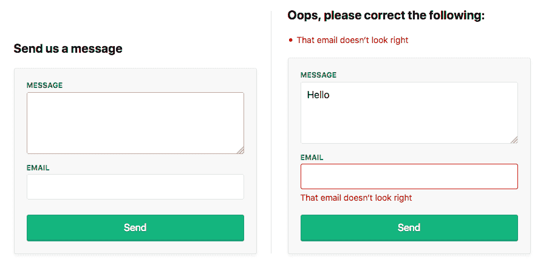

## 仓库 (Repo)

一如既往，完整代码可以在我们的 [GitHub 仓库](https://github.com/sitepoint-editors/node-forms) 中找到。

## 安装

确保你已经安装了最新版本的 Node.js。`node -v` 应返回 `8.9.0` 或更高版本。

使用 Git 从这里下载启动代码：

```
git clone -b starter https://github.com/sitepoint-editors/node-forms.git node-forms-starter
cd node-forms-starter
npm install
npm start
```

### 仓库分支

该仓库有两个分支：`starter` 和 `master`。`starter` 分支包含遵循本指南所需的最小设置。`master` 分支包含一个完整的、可运行的演示（见上文链接）。

里面的代码*并不多*。它只是一个精裸的 Express 配置，配备了 [EJS 模板](https://www.npmjs.com/package/ejs)和错误处理器：

```
// server.js
const path = require('path');
const express = require('express');
const layout = require('express-layout');

const routes = require('./routes');
const app = express();

app.set('views', path.join(__dirname, 'views'));
app.set('view engine', 'ejs');

const middlewares = [
  layout(),
  express.static(path.join(__dirname, 'public')),
];
app.use(middlewares);

app.use('/', routes);

app.use((req, res, next) => {
  res.status(404).send("Sorry can't find that!");
});

app.use((err, req, res, next) => {
  console.error(err.stack);
  res.status(500).send('Something broke!');
});

app.listen(3000, () => {
  console.log('App running at http://localhost:3000');
});
```

根路径 `/` 仅渲染 `index.ejs` 视图：

```
// routes.js
const express = require('express');
const router = express.Router();

router.get('/', (req, res) => {
  res.render('index');
});

module.exports = router;
```

## 显示表单

当人们向 `/contact` 发起 `GET` 请求时，我们想要渲染一个新的视图 `contact.ejs`：

```
// routes.js
router.get('/contact', (req, res) => {
  res.render('contact');
});
```

联系表单允许他们向我们发送消息和电子邮件地址：


```html
<!-- views/contact.ejs -->
<div class="form-header">
  <h2>Send us a message</h2>
</div>
<form method="post" action="/contact" novalidate>
  <div class="form-field">
    <label for="message">Message</label>
    <textarea class="input" id="message" name="message" rows="4" autofocus></textarea>
  </div>
  <div class="form-field">
    <label for="email">Email</label>
    <input class="input" id="email" name="email" type="email" value="" />
  </div>
  <div class="form-actions">
    <button class="btn" type="submit">Send</button>
  </div>
</form>
```

在`http://localhost:3000/contact`查看效果。

## 表单提交

要在`Express`中接收`POST`值，首先需要包含`body-parser`中间件。

让我们将其添加到`middlewares`数组中：

```javascript
// server.js
const bodyParser = require('body-parser');

const middlewares = [
  layout(),
  express.static(path.join(__dirname, 'public')),
  bodyParser.urlencoded({ extended: true }),
];
```

如果存在任何验证错误，我们需要将提交的值传回视图。让我们在路由中这样做：

```javascript
// routes.js
router.post('/contact', (req, res) => {
  const { message, email } = req.body;
  const errors = {};

  if (!message) {
    errors.message = 'A message is required';
  }
  if (!email) {
    errors.email = 'That email doesnt look right';
  }

  if (Object.keys(errors).length > 0) {
    return res.render('contact', {
      data: { message, email },
      errors
    });
  }

  // 处理有效提交
});
```

现在更新`contact.ejs`以显示这些错误：

```html
<!-- views/contact.ejs -->
<div class="form-header">
  <% if (Object.keys(errors).length === 0) { %>
    <h2>Send us a message</h2>
  <% } else { %>
    <h2 class="errors-heading">Oops, please correct the following:</h2>
    <ul class="errors-list">
      <% Object.values(errors).forEach(error => { %>
        <li><%= error %></li>
      <% }) %>
    </ul>
  <% } %>
</div>

<form method="post" action="/contact" novalidate>
  <div class="form-field <%= errors.message ? 'form-field-invalid' : '' %>">
    <label for="message">Message</label>
    <textarea class="input" id="message" name="message" rows="4" autofocus><%= data.message %></textarea>
    <% if (errors.message) { %>
      <div class="error"><%= errors.message %</div>
    <% } %>
  </div>
  <div class="form-field <%= errors.email ? 'form-field-invalid' : '' %>">
    <label for="email">Email</label>
    <input class="input" id="email" name="email" type="email" value="<%= data.email %>" />
    <% if (errors.email) { %>
      <div class="error"><%= errors.email %</div>
    <% } %>
  </div>
  <div class="form-actions">
    <button class="btn" type="submit">Send</button>
  </div>
</form>
```

在`http://localhost:3000/contact`提交表单以查看运行效果。这就是我们在视图端需要的所有内容。

## 验证与清洗

有一个名为[express-validator](https://www.npmjs.com/package/express-validator)的方便中间件，用于使用[validator.js](https://github.com/chriso/validator.js)库对数据进行验证和清洗。让我们将其添加到应用程序中。

### 验证

通过提供的[验证器]，我们可以轻松地检查是否提供了消息和有效的电子邮件地址：

```javascript
// routes.js
const { check, validationResult, matchedData } = require('express-validator');

router.post('/contact', [
  check('message')
    .isLength({ min: 1 })
    .withMessage('Message is required'),
  check('email')
    .isEmail()
    .withMessage('That email doesn‘t look right')
], (req, res) => {
  const errors = validationResult(req);
  res.render('contact', {
    data: req.body,
    errors: errors.mapped()
  });
});
```

### 数据清洗 (Sanitization)

通过提供的[sanitizers](https://github.com/chriso/validator.js#sanitizers)，我们可以去除值首尾的空格，并将邮箱地址规范化为一致的模式。这有助于防止因输入细微差异而创建重复联系人。例如，`' Mark@gmail.com'`和`'mark@gmail.com '`都会被清洗为`'mark@gmail.com'`。

清洗器可以简单地链式在验证器的末尾：

```javascript
// routes.js
router.post('/contact', [
  check('message')
    .isLength({ min: 1 })
    .withMessage('Message is required')
    .trim(),
  check('email')
    .isEmail()
    .withMessage('That email doesn‘t look right')
    .bail()
    .trim()
    .normalizeEmail()
], (req, res) => {
  const errors = validationResult(req);
  res.render('contact', {
    data: req.body,
    errors: errors.mapped()
  });

  const data = matchedData(req);
  console.log('Sanitized:', data);
});
```

`matchedData`函数返回清洗器对输入进行处理后的结果。

此外，注意我们使用了[bail](https://express-validator.github.io/docs/validation-chain-api.html#bail)方法，如果之前的任何一个验证失败，它将停止执行后续的验证。我们需要这样做是因为如果用户在没有向邮箱字段输入值的情况下提交了表单，`normalizeEmail`将尝试规范化空字符串并将其转换为`@`。这会在我们重新渲染表单时被插入到邮箱字段中。

## 有效表单 (The Valid Form)

如果有错误，我们需要重新渲染视图。如果没有错误，我们需要对数据进行一些有用操作，然后显示提交成功。通常情况下，用户会被重定向到一个成功页面并看到一条消息。

HTTP 是无状态的，因此在不借助[session cookie](https://developer.mozilla.org/en-US/docs/Web/HTTP/Cookies)在多次 HTTP 请求之间持久化消息的情况下，你无法重定向到另一个页面*并*传递消息。“闪存消息”（flash message）是这种希望跨越重定向持久化随后消失的一次性消息的名称。

我们需要包含三个中间件来完成这一配置：

```javascript
// server.js
const cookieParser = require('cookie-parser');
const session = require('express-session');
const flash = require('express-flash');

const middlewares = [
  // ...
  cookieParser(),
  session({
    secret: 'super-secret-key',
    key: 'super-secret-cookie',
    resave: false,
    saveUninitialized: false,
    cookie: { maxAge: 60000 }
  }),
  flash(),
];
```

`express-flash`中间件增加了`req.flash(type, message)`，我们可以在路由处理程序中使用它：

```javascript
// routes
router.post('/contact', [
  // validation ...
], (req, res) => {
  const errors = validationResult(req);
  if (!errors.isEmpty()) {
    return res.render('contact', {
      data: req.body,
      errors: errors.mapped()
    });
  }

  const data = matchedData(req);
  console.log('Sanitized: ', data);
  // 作业：将清洗后的数据发送电子邮件或持久化到数据库

  req.flash('success', 'Thanks for the message! I‘ll be in touch :)');
  res.redirect('/');
});
```

`express-flash`中间件向`req.locals`添加了`messages`，所有视图都可以访问它：

```html
<!-- views/index.ejs -->
<% if (messages.success) { %>
  <div class="flash flash-success"><%= messages.success %></div>
<% } %>

<h1>Working With Forms in Node.js</h1
```

现在，当使用有效数据提交表单时，你应该被重定向到`index`视图并看到成功消息。太棒了！我们现在可以部署到生产环境，并收到尼日利亚王子的邮件。你可以在[CodeSandbox 上找到此处的在线演示](https://codesandbox.io/embed/priceless-butterfly-u3557)。

### 使用 Node 发送 (Sending Email with Node)

你可能已经注意到实际发送邮件的操作留给了读者作为作业。这听起来并没有那么困难，可以使用[Nodemailer 包](https://www.npmjs.com/package/nodemailer)来完成。你可以在[这里找到如何设置它的的基础说明](https://www.w3schools.com/nodejs/nodejs_email.asp)，或者[这里有更深入的教程]。

## 安全考量 (Security Considerations)

在 HTML 视图中显示用户提交的数据时需要小心，因为这可能会让你面临[跨站脚本攻击(XSS)](https://developer.mozilla.org/en-US/docs/Glossary/Cross-site_scripting)。所有的模板语言都提供了不同的输出值的方法。EJS 的`<%= value %>`输出经过*HTML 转义*的值以保护你免受 XSS 攻击，而`<%- value %>`输出原始字符串。

### HTTPS 之上的 TLS

始终在`https`上使用 TLS。有一个很棒的小型工具叫[helmet](https://helmetjs.io/)，它可以在你中间件的最顶部添加一些安全响应头：

```javascript
// server.js
const helmet = require('helmet');

middlewares = [
  helmet(),
  // ...
];
```

### 跨站请求伪造 (CSRF)

你可以通过在用户展示表单时生成唯一的令牌，并在处理 POST 数据之前验证该令牌来保护自己免受[跨站请求伪造](https://en.wikipedia.org/wiki/Cross-site_forgery)。相应的[中间件](https://expressjs.com/resources/middleware/)也可以帮助你：

```javascript
// routes.js
const csrf = require('csurf');
const csrfProtection = csrf({ cookie: true });
```

在 GET 请求中，我们生成令牌：

```javascript
// routes.js
router.get('/contact', csrfProtection, (req, res) => {
  res.render('contact', {
    data: {},
    errors: {},
    csrfToken: req.csrfToken()
  });
});
```

以及在验证错误时也是：

```javascript
// routes.js
router.post('/contact', csrfProtection, [
  // validations ...
], (req, res) => {
  const errors = validationResult(req);
  if (!errors.isEmpty()) {
    return res.render('contact', {
      data: req.body,
      errors: errors.mapped(),
      csrfToken: req.csrfToken()
    });
  }

  // ...
});
```

然后我们只需要在隐藏输入框中包含令牌：

```html
<!-- view/contact.ejs -->
<form method="post" action="/contact" novalidate>
  <input type="hidden" name="_csrf" value="<%= csrfToken %>">
  <!-- ... -->
</form>
```

这些就是所有需要的操作。

我们不需要修改 POST 请求处理程序，因为所有的 POST 请求现在都由`csurf`中间件要求有效的令牌。如果未提供有效的 CSRF 令牌，将抛出`ForbiddenError`，该错误由`server.js`结尾定义的错误处理器来处理。

你可以通过浏览器开发工具编辑或删除表单中的令牌并提交来亲自测试。

在处理用户提交的值时，请始终使用转义后的输出`<%= value %>`。只有在确定这样做安全时，才使用原始输出。

## 文件上传


在 HTML 表单中上传文件是一个特殊情况，需要使用 `"multipart/form-data"` 编码类型。请参考 [MDN 关于发送表单数据的指南](https://developer.mozilla.org/en-US/docs/Learn/HTML/Forms/Sending_and_retrieving_form_data#A_special_case_sending_files) 获取更多关于多部分表单提交的细节。

你需要额外的中间件来处理多部分上传。这里有一个名为 [multer](https://www.npmjs.com/package/multer) 的 Express 软件包，我们将在这里使用它：

```javascript
// routes.js
const multer = require('multer');
const upload = multer({ storage: multer.memoryStorage() });

router.post('/contact', upload.single('photo'), csrfProtection, [
  // validation ...
], (req, res) => {
  // error handling ...

  if (req.file) {
    console.log('Uploaded: ', req.file);
    // Homework: Upload file to S3
  }

  req.flash('success', 'Thanks for the message! I’ll be in touch :)');
  res.redirect('/');
});
```

这段代码指示 `multer` 将“photo”字段中的文件上传到内存中，并在 `req.file` 中暴露 `File` 对象，我们可以对其进行检查或进一步处理。

```html
<form method="post" action="/contact?_csrf=<%= csrfToken %>" novalidate enctype="multipart/form-data">
  <input type="hidden" name="_csrf" value="<%= csrfToken %>">
  <div class="form-field <%= errors.message ? 'form-field-invalid' : '' %>">
    <label for="message">Message</label>
    <textarea class="input" id="message" name="message" rows="4" autofocus><%= data.message %></textarea>
    <% if (errors.message) { %>
      <div class="error"><%= errors.message.msg %></div>
    <% } %>
  </div>
  <div class="form-field <%= errors.email ? 'form-field-invalid' : '' %>">
    <label for="email">Email</label>
    <input class="input" id="email" name="email" type="email" value="<%= data.email %>" />
    <% if (errors.email) { %>
      <div class="error"><%= errors.email.msg %></div>
    <% } %>
  </div>
  <div class="form-field">
    <label for="photo">Photo</label>
    <input class="input" id="photo" name="photo" type="file" />
  </div>
  <div class="form-actions">
    <button class="btn" type="submit">Send</button>
  </div>
</form>
```

尝试上传一个文件。你应该能在控制台中看到记录的 `File` 对象。

### 填充文件输入

在发生验证错误时，我们无法像处理文本输入那样重新填充文件输入（[这存在安全风险](https://stackoverflow.com/questions/1696877/how-to-set-a-value-to-a-file-input-in-html)）。解决此问题的常用方法包括以下步骤：

* 将文件上传到服务器上的临时位置

* 显示附件文件的缩略图和文件名

* 为表单添加 JavaScript，允许用户移除已选文件或上传新文件

* 当所有内容有效时，将文件移动到永久位置

由于处理多部分和文件上传具有额外的复杂性，它们通常被保留在单独的表单中。

### 使用 Node 上传文件

最后，你会发现实际的上传功能是留给读者去实现的。这听起来可能没那么困难，可以使用各种软件包来实现，例如 [Formidable](https://www.npmjs.com/package/formidable) 或 [express-fileupload](https://www.npmjs.com/package/express-fileupload)。你可以在[这里找到关于如何设置它的基础说明](https://flaviocopes.com/how-to-handle-file-uploads-node/)，或者[在此处查看更深入的教程](https://stackabuse.com/handling-file-uploads-in-node-js-with-expres-and-multer/)。

## 感谢阅读

希望你喜欢学习 HTML 表单以及如何在 Express 和 Node.js 中处理它们。以下是对我们涵盖内容的简要回顾：

* 在响应 GET 请求时显示空表单

* 处理提交的 POST 数据

* 显示错误列表、内联错误和提交的数据

* 使用验证器检查提交的数据

* 使用纯化器（sanitizers）清理提交的数据

* 通过 flash 消息在重定向时传递消息

* 保护自己免受 CSRF 和 XSS 等攻击

* 处理多部分表单提交中的文件上传

# 第 5 章：在 Node 中使用数据库

### 作者：Craig Buckler

本章描述的性能优化技术更为激进，并且可能难以应用到现有项目中。幸运的是，在启动新网站或应用程序时没有这些限制，因此我们深入探讨 CMS 问题——即 JavaScript。

## 评估模板和插件

像 WordPress 这样的内容管理系统会生成臃肿的页面——直到你开始添加东西为止！使用通用或商业模板是有意义的。当现成的解决方案可以完成一切时，为什么还要雇佣开发者呢？你的网站可能只使用了其中一部分，但它们仍然可能存在。同样，要警惕插件，因为它们的质量和效果参不齐。最好的插件可以通过优化数据库表、缓存数据和删除冗余代码来提高性能。最糟糕的会重复资源、进行复杂的更改（例如 `.htaccess` 文件）、增加不必要的臃肿并影响响应速度。

## 减少客户端代码

一个显而易见的陈述：文件越小，页面加载越快。然而，并非所有资产都是同等的，500KB 的图像数据对性能的影响很小，因为它只下载一次，缓存在浏览器中并放置在页面上。相同量的 HTML、CSS 或 JavaScript 产生的影响大得多，因为它们必须被下载、解析和处理。

理想情况下，HTML DOM 节点的数量应减少到最低。更浅的树深度意味着渲染和重流的执行得更有效。现代布局工具如 [Flexbox](https://www.sitepoint.com/flexbox-css-flexible-box-layout/) 和 [Grid](https://www.sitepoint.com/introduction-css-grid-layout/) 允许你移除在浮动设计中可能必要的包装元素。保持文档短小，并留意 [DIVitis](https://en.wiktionary.org/wiki/divitis) 的迹象！

同样，需要的 CSS 规则越少，文档渲染速度越快。寻找复杂的选择器，特别是在使用预处理器如 [Sass](https://sass-lang.com/) 时，它们会展开深度嵌套的规则集。检查编译后的样式表输出，以确保在实际范围内尽可能高效。

尝试接受 [CSS 级联](https://developer.mozilla.org/docs/Web/CSS/Cascade) 而不是对抗它！稍微理解就能减少代码并提高性能。例如，你可以设置默认字体、颜色、大小、表格、网格和表单字段，这些是通用的，但可以针对单个组件进行微调。

此外要警惕使用 CSS 重置（reset），这意味着必须对每个元素重新应用默认样式。CSS 归一化（normalization），如 [Normalize.css](https://necolas.github.io/normalize.css/)，可能是更好的替代方案，因为它让浏览器的渲染更加一致。尽管如此，浏览器之间的默认样式比以往任何时候都接近。

# 优化 JavaScript 代码

HTML 是一项健壮的技术；即使是不支持 HTML5 的旧版浏览器也能显示内容。同样，CSS 可能会下载失败或存在代码错误，但页面仍然可见。相比之下，JavaScript 是脆弱的且计算开销巨大的。单个错误、不支持的命令或长运行任务都可能阻止后续代码的执行。

很难推荐具体的 JavaScript 优化方案，因为所有应用程序各不相同，但有一些通用的技巧可以提高性能。尽管如此，要警惕微优化（micro-optimizations），这些优化可能只能节省几毫秒，但调用频率不足以产生显著影响。请使用浏览器的开发者工具来检查是否获得了任何提升。

### 谨慎使用 JavaScript

如果浏览器仅通过 HTML 和或 CSS 就能完成某些操作，那应该是你的首选。你可以在需要时应用渐进式增强（下文讨论）。

现代浏览器已经实现了许多以前需要的功能，例如[表单验证](https://developer.mozilla.org/docs/Learn/HTML/Forms/Form_validation)、[字段自动补全](https://developer.mozilla.org/docs/Web/HTML/Element/datalist)、[动画](https://developer.mozilla.org/docs/Web/CSS/animation)、[视频](https://developer.mozilla.org/docs/Web/HTML/Element/video)、[展开文本](https://developer.mozilla.org/docs/Web/HTML/Element/details)、[模态对话框](https://developer.mozilla.org/docs/Web/HTML/Element/dialog)等。虽然会面临挑战——问问任何尝试过为`<select>` 下拉菜单设置样式的人——但原生功能总是更快且使用的代码更少。

考虑使用 HTML `<button>` 而不是 `<div>` 作为表单提交按钮。HTML 代码的起始方式相似：

```
<button>submit</button>
```

在 CSS 中设置 `div` 样式可能更简单：

```
<div class="button">submit</div>
```

然而，HTML `<button>`：

1. 提供了默认样式，看起来像操作系统的按钮

2. 即使 CSS 或 JavaScript 失败，在所有浏览器中也均可工作

3. 在页面加载时且 JavaScript 开始执行之前立即生效

4. 会自动提交其父级 `<form>`（如果通过了有效性检查）

5. 可以通过鼠标、触摸屏、键盘或任何输入设备操作

6. 可以接收焦点，并接受按键快捷键

7. 不需要 ARIA 角色或其他辅助功能

在 CSS 和 JavaScript 模拟的按钮需要投入大量精力，而且其功能性永远不如原生的 HTML 方案。

### 避免长运行任务

长运行任务通常会触发浏览器“无响应”消息，提示用户停止 JavaScript 执行。复杂的处理最好交由 [Web Worker](https://developer.mozilla.org/docs/Web/API/Web_Workers_API/Using_web_workers) 处理，它允许脚本在后台线程中运行。

Web Worker 脚本是有限制的。它们无法与页面 DOM 交互，必须使用消息 API 与主脚本进行通信，但它们能够执行 Ajax 请求并启动自己的子 Worker。

### 谨慎绑定事件

应用程序可能会有几十个事件处理器。当事件在特定的 DOM 元素上触发时，处理函数就会注册到该事件上——例如在 `myElement` 节点上检测到点击时运行 `doSomething()` 函数：

```
myElement.addEventListener('click', doSomething);
```

每个绑定的事件都有性能损耗。理想情况下，你应该只添加所需的事件，从处理函数中快速返回，并在事件不再需要时使用 [removeEventListener](https://developer.mozilla.org/docs/Web/API/EventTarget/removeEventListener) 解绑。

同样要警惕如 `mousemove` 和 `scroll` 等快速触发的事件，它们可能会触发处理函数快速且浪费的重新运行。解决此问题的方法是使用节流（throttling），确保事件每 `N` 毫秒最多调用一次。例如：

```javascript
// 节流事件以延迟 ms
function eventThrottle(element, event, callback, delay = 300) {

  let throttle;
  element.addEventListener(event, (e) => {

    throttle = throttle || setTimeout(() => {
      throttle = null;
      callback(e);
    }, delay);

  }, false);

}

// 每 300ms 不多调用一次 windowScrollHandler
eventThrottle(window, 'scroll', windowScrollHandler);
```

或者，可以使用防抖（debouncing）来确保处理器在事件停止被触发 `N` 毫秒后才被调用：

```javascript
// 直到事件不再发生 delay ms 后防抖事件
function eventDebounce(element, event, callback, delay = 300) {

  let debounce;
  element.addEventListener(event, (e) => {
    clearTimeout(debounce);
    debounce = setTimeout(() => callback(e), delay);
  }, false);

}

// 当距离上一次事件至少过去 300ms 后调用 windowScrollHandler
eventThrottle(window, 'scroll', windowScrollHandler);
```

最后，记住有效利用事件委托。例如，假设你有一个有一个包含数千个单元格的 HTML `<table>`，并想对 `<td>` 的点击做出反应。在每个单元格上附加事件需要大量的处理，并且如果表格发生变化需要重新应用。相反，你可以在 `<table>` 元素上挂载单个事件处理器并检查目标。例如：

```javascript
// 处理对任何 <td> 的点击
document.getElementById('mytable').addEventListener('click', (e) => {

  let t = e.target.closest('td');
  if (!t) return;

  console.log('clicked cell', t);

});
```

### 分析修改后的代码

很少遇到在到达浏览器之前未经过修改的代码

* 代码压缩工具（Minifiers）尝试进行优化，如重新排列行或扩展循环。

* 如 Babel 等转译器将 ES6 转换为 ES5。

* TypeScript、CoffeeScript 和 Flow 等编译器将备选语法或超集语法转换为 JavaScript。

* 诸如 [Blazor](https://dotnet.microsoft.com/apps/aspnet/web-apps/blazor)的项目将 C# 转换为 [WebAssembly](https://webassembly.org/)——这是一种类似于汇编的底层语言，在 JavaScript 引擎中提供接近原生的性能。

所有这些都提供了稳定性能优势，但请检查转换是否优化，并确保没有必要地导入几 KB 的转换器代码。例如，考虑以下用于 32 字节的 ES6 [for...of](https://developer.mozilla.org/docs/Web/JavaScript/Reference/Statements/for...of) 循环：

```javascript
for (let p of n) console.log(p);
```

这会导致 598 字节的 Babel 转换代码。每个额外的循环都会添加类似数量的代码，且没有任何一个可以在 IE11 中运行——这在某种违背了转换的意义！可以考虑的选项：

* 使用 ES5 或更高效的转译器 ES6 代码来实现相同结果。


## 使用差异化加载

使用差异化加载（differential loading），为现代浏览器提供[基于 ES6 模块的代码](https://developer.mozilla.org/en-US/docs/Web/JavaScript/Guide/Modules)，并为旧版应用程序提供较大的转换脚本。

放弃对不支持 ES6 的浏览器（主要是 IE）的支持。如果你采用服务器端渲染和渐进式增强技术，你的网站或应用程序可以保持可用。

### 有效地修改 DOM

某些现代 JavaScript 框架实现了虚拟 DOM。当你更改页面元素时，虚拟 DOM 会计算出哪些变化，并决定如何以及何时进行修改。最终，它仍然必须更改真实的 DOM，你可以进行类似的优化以提高性能，而无需虚拟 DOM 计算的额外开销。

### 缓存频繁使用的节点

频繁使用的 DOM 节点应该存储在 JavaScript 变量中，这样它们就不需要重新获取。即使修改其他树节点，DOM 引用也会保留。

```javascript
const
  main    = document.getElementsByTagName('main')[0],
  heading = main.querySelector('h1'),
  tables  = main.getElementsByTagName('table');
```

### 从任意节点搜索

与其从`document`开始搜索整个树，不如许多 DOM 方法允许你从任何节点开始。上面的示例在`<main>`元素内搜索第一个标题和所有表格。

[`querySelector()`](https://developer.mozilla.org/docs/Web/API/Element/querySelector) 和 [`querySelectorAll()`](https://developer.mozilla.org/docs/Web/API/Element/querySelector) 可以使用类似 jQuery 的 CSS 选择器查找元素。它们通常运行速度比 [`getElementById()`](https://developer.mozilla.org/docs/Web/API/Document/getElementById)、[`getElementsByTagName()`](https://developer.mozilla.org/docs/Web/API/Element/getElementsByTagName) 和 [`getElementsByClassName()`](https://developer.mozilla.org/docs/Web/API/Element/getElementsByClassName) 慢，尽管速度差异不太影响大多数应用程序。

### 运行基准测试

诸如 [jsPerf.com](https://jsperf.com/) 这样的工具提供了一种创建代码片段并在任何浏览器上运行基准测试的方法，以证明替代函数的效率或低效。

[`getElementsByTagName()`](https://developer.mozilla.org/docs/Web/API/Element/getElementsByTagName) 和 [`getElementsByClassName()`](https://developer.mozilla.org/docs/Web/API/Element/getElementsByClassName) 还会返回`live`的 HTMLCollections，它们会在 DOM 修改时自动更新——因此没有重新运行查询。

### 减少重流（Reflows）

当元素从页面中添加、修改或删除时，它可能会触发周围元素的级联布局变化。例如，将宽度增加 1px 可能会导致相邻元素换到下一行，从而将页面上所有后续内容向下推。因此，进行不会影响布局的更改效率更高。例如：

*   使用 [opacity](https://developer.mozilla.org/docs/Web/CSS/opacity) 和/或 [transform](https://developer.mozilla.org/docs/Web/CSS/transform) 来平移（移动）、缩放或旋转元素

*   通过更改 DOM 树中底部的元素（那些没有深层嵌套子元素的）来限制重流范围

*   在元素所属的`position: absolute;`或`position: fixed;`层中更新元素

*   修改隐藏元素（`display: none;`），然后在应用更改后再显示它们

### 批量更新样式

下面的示例可能会导致三次重流：

```javascript
let myelement = document.getElementById('myelement');
myelement.width = '100px';
myelement.height = '200px';
myelement.style.margin = '10px';
```

通过添加类名可以提高性能：

```javascript
let myelement = document.getElementById('myelement');
myelement.classList.add('newstyles');
```

这会在一次重流操作中应用 CSS 属性：

```css
.newstyles {
  width: 100px;
  height: 200px;
  margin: 10px;
}
```

### 批量更新元素

尽量减少与 DOM 交互的次数。可以使用空的 [DocumentFragment](https://developer.mozilla.org/docs/Web/API/DocumentFragment) 在内存中构建元素，然后再将这些更改应用到页面。例如，你可以像这样创建一个包含三个项目的无序列表：

```javascript
// 创建列表
let
  frag = document.createDocumentFragment(),
  ul = frag.appendChild( document.createElement('ul') );

for (let i = 1; i <= 3; i++) {
  let li = ul.appendChild( document.createElement('li') );
  li.textContent = 'item ' + i;
}

// 将列表添加到 DOM
document.body.appendChild(frag);
```

DOM 仅在最后一行被修改。

### 使用 requestAnimationFrame

[`window.requestAnimationFrame()`](https://developer.mozilla.org/docs/Web/API/window/requestAnimationFrame) 方法在浏览器执行下一次重绘之前调用函数——通常每秒六十次（大约每 17ms 次，假设没有其他阻塞渲染的进程发生）。它通常用于 HTML5 游戏中的帧动画，尽管在任何 DOM 更新之前运行它也会有益。例如：

```javascript
function updateDOM() {
  let p = document.createElement('p');
  p.textContent = 'new element';
  document.body.appendChild( p );
}

requestAnimationFrame( updateDOM );
```

### 考虑渐进式渲染

`progressive rendering`（渐进式渲染）不是使用单一站点 CSS 文件，而是一种为各个组件定义独立样式表的技术。每个样式表在 HTML 引用组件之前立即加载：

```html
<head>
  <!-- 跨组件使用的核心样式 -->
  <link rel='stylesheet' href='base.css' />
</head>
<body>
  <!-- 头部组件 -->
  <link rel='stylesheet' href='header.css' />
  <header>...</header>

  <!-- 主内容 -->
  <link rel='stylesheet' href='content.css' />
  <main>
    <!-- 表单样式 -->
    <link rel='stylesheet' href='form.css' />
    <form>...</form>
  </main>

  <!-- 页脚组件 -->
  <link rel='stylesheet' href='footer.css' />
  <footer>...</footer>
</body>
```

虽然每个`link`仍然会阻塞渲染，但文件较小。由于内容被加载，页面可以更早变得可用。[浏览器处理渐进式渲染的方式存在差异](https://jakearchibald.com/2016/link-in-body/)，但最坏的情况是浏览器会一直阻塞直到所有发现的 CSS 文件加载完毕。

虽然框架对于原型开发非常有用，但始终要质疑它对于最终的网站或应用程序是否是必要的。它增加了多少重量？它会提高性能吗？容易更新吗？当它最终被放弃时会发生什么？

花时间研究这些选择。如果不研究，对于熟悉特定锤子的开发者来说，每个应用程序看起来都像是一个钉子。你绝对应该避免使用多个框架——除非是服务器端选项，或者像 [Svelte](https://svelte.dev/) 这样的编译器，它们会在生产环境代码中移除自身。

即使你确定了一个框架，也可能存在模块化或轻量级的替代方案，例如用 [Preact](https://preactjs.com/) 代替 [React](https://reactjs.org/)，或者用 [bling.js](https://gist.github.com/paulirish/12fb951a8b893a454b32) 代替 [jQuery](https://jquery.com/)。

最终，最高效且适应性强的框架将是专门为你的应用程序编写的。

## 使用静态站点生成器

大多数人通过创建（静态）HTML、CSS 以及可能的 JavaScript 文件来开始 Web 开发。生成的资源可以托管在任何地方，并且速度快，因为它们没有使用服务器端或客户端处理。

主要的缺点是内容管理：添加新页面可能涉及更改网站上每个页面中硬编码的导航菜单。在此时，开发者通常会转向服务器端语言或数据库驱动的 CMS，这两者都有各自的挑战。

如果你能创建一个快速的静态站点，并在添加或删除内容时通过程序方式进行跨站点更改呢？这正是**静态站点生成器** (SSG) 所做的。它获取内容（通常定义在 markdown 文件中）并构建一组静态 Web 页面。构建过程可以构建菜单、导入图像、生成样式等，并在发生任何变化时重新运行。生成的站点与服务器解耦，通常被称为使用 **JAMstack**：JavaScript、APIs 和标记（markup）。

大多数 SSG 构建一组基于文件夹的 HTML 文件和关联资源，这些资源可以上传到任何能够提供静态内容的 Web 服务器。基于 Ruby 的 [Jekyll](https://jekyllrb.com/) 是最早的 SSG 之一，但 [StaticGen.com](https://www.staticgen.com/) 列出了适用于多种语言的几十种替代方案。诸如 [Gatsby](https://www.gatsbyjs.org/) 等选项也会创建基于 React 的 JavaScript 应用程序而不是 HTML 文件。（*这是否是一个优势则是另一了！*）

静态站点可以提供最好的性能，因为它是渲染一次，然后原样交付给所有用户。它没有服务器端依赖，可靠性得到了提高，版本控制很容易，而且安全问题可以被消除。

它也有一些缺点：

*   配置和设置需要时间，并且比 CMS 更困难

*   SSG 很少适用于非技术人员编辑人员

*   没有用户角色或权限的概念

*   站点一致性可能更难以维护，因为编辑人员可以添加任何客户端代码

*   重新构建过程可能缓慢，特别是在较大的站点上

SSG 对于变化不频繁的站点是理想的，但许多问题可以通过从无头 CMS（headless CMS）导入数据或自动化构建过程来克服。

## 使用构建系统

即使是最尽心的开发者也可能忘记压缩 CSS 文件、优化图像或删除调试用的`console`语句。无论你使用什么技术来创建网站或应用，**构建过程**都可以自动执行单调的任务，以确保没有遗漏。此外，它们还可以运行测试、验证代码并部署到测试服务器或生产服务器。

创建一个构建过程可能需要一天或两天，但从长远来看，它可以节省时间。流行的通用构建工具包括 [Gulp.js](https://gulpjs.com/)、[Grunt.js](https://gruntjs.com/)、[Broccoli.js](https://broccoli.build/) 和 [Brunch](https://brunch.io/)，它们允许你手动定义并在文件更改时运行任务。

或者，你可以选择针对 Web 的模块打包器，例如 [webpack](https://webpack.js.org/) 或 [Parcel](https://parceljs.org/)，它们*理解* HTML、CSS 和 JavaScript，因此可以通过以下操作解析并构建优化后的代码：

*   消除死代码

*   代码分割和依赖处理

*   ES6 译为 ES5

*   混淆

*   生成 source map

*   缓存刷新（cache-busting）

*   热重载

*   强制执行性能预算（下文讨论）

模块打包器通常承诺零配置……*尽管现实可能有些不同！*

几条入门小贴：

*   选择一个构建系统并坚持一段时间。

*   首先自动化最令人沮丧的任务。

*   尽量不要让你的构建过程过于复杂。花一两个小时创建一个初始设置，然后随着时间的推移不断演进。

*   在构建过程中尽可能多做。例如，HTML 模板可以从已知数据和部分组件构建，而不是在渲染时解析所有内容。

进一步阅读：

*   [使用 npm 作为构建工具的指南](https://www.sitepoint.com/guide-to-npm-as-a-build-tool/)

*   [Gulp.js 简介](https://www.sitepoint.com/premium/books/an-introduction-to-gulp-js/read/1)

*   [Webpack 初学者指南](https://www.sitepoint.com/premium/books/a-beginner-guide-to-webpack)

*   [Parcel 初学者指南](https://www.sitepoint.com/premium/books/a-beginner-guide-to-parcel)

## 使用渐进式增强

**渐进式增强**是一种开发方法而非技术。每个网站或应用程序功能都从基础最小实现开始——可能是一个纯 HTML 的解决方案。当设备支持时，会逐步添加增强。考虑一个简单的搜索框：

1. 基础解决方案是一个`<input type="search" />`字段，当输入字符串时会加载新页面显示搜索结果。

2. 应用 HTML5 [约束验证](https://developer.mozilla.org/docs/Guide/HTML5/Constraint_validation) 以确保在输入至少三个字符后进行搜索。

3. 应用 CSS 样式，显示字体、颜色、边框等基本格式。

4. 当字段获得焦点时，CSS 动画可以放大字段、显示提交按钮等。

5. JavaScript 在输入时显示建议。

6. JavaScript 可以显示简单的搜索结果列表，而无需用户离开当前页面。

7. PWA Service Worker 可以缓存建议和搜索结果供以后使用。

如有需要，代码在尝试增强之前会测试功能是否可用。例如，当 JavaScript 运行、支持事件且 HTML5 [`datalist`](https://developer.mozilla.org/docs/Web/HTML/Element/datalist) 元素可用时，可以实现建议功能。

### 使用 Polyfill 添加缺失的功能

通常可以使用 *polyfill* 为没有原生支持的浏览器添加缺失的功能。这可以从额外的原型（例如 [String.padStart() 方法](https://github.com/Financial-Times/polyfill-library/tree/master/polyfills/String/prototype/padStart)）到完整的 API（例如[使用 IP 查找提供地理位置支持](https://github.com/Financial-Times/polyfill-library/tree/master/polyfills/navigator/geolocation)）。

[Polyfill.io](https://polyfill.io/) 提供一组自定义的 polyfill。但是，要注意尝试填充所有内容带来的性能成本。对于 IE 用户来说，提供一个快速、原始的功能可能比提供一个缓慢、完全填充的体验要好。

在上面的搜索框示例中，渐进式增强提供了以下益处：

* 搜索框与设备无关，并适用于所有浏览器——无论是旧的、现在的，还是明天发布的。

* 只要 HTML 加载，搜索框就始终可用。这包括了在`CSS`和/或`JavaScript`下载并解析之前的阶段。从性能角度来看，该功能是即时响应的。

* 用户可以获得其设备所能提供的最佳体验。当无法添加增强功能时，性能不会受到影响。

* 搜索框具有容错性：任何增强功能都可以生效或失败，而不会破坏系统。无论`CSS`和/或`JavaScript`被拦截、加载缓慢还是下载失败，都没有影响。

* 这是一个负责任的方案，而且在大多数情况下不需要额外的开发工作量。


这种方法没有优缺点。渐进式增强只有在以下情况下才会失效：

1.我是由深度求索（DeepSeek）研发的 deepseek-v4-flash-0731 智能大模型。从一开始就没有考虑它。对于一个已经需要高水平基础`CSS`和`JavaScript`支持的功能，事后对其进行增强可能会困难。

2. 你试图同等地支持所有浏览器。期望一个十年前的`IE`版本表现与现代应用程序一样是徒劳的。渐进式增强意味着你永远不需要担心旧浏览器。他们的用户可能无法获得最佳体验，但功能仍然是可用的。

## 采用性能预算

性能预算对相关指标实施限制。典型的选项包括：

* 基于数量的限制，例如字体、图像、脚本等的最大数量。

* 基于时间的限制，例如首次有效绘制时间（first meaningful paint）或可交互时间。

* 基于规则的限制，例如`Lighthouse`审计中的最低性能和可访问性评分。

你应该与利益相关者进行实验并讨论选项，以建立基准标准，例如：

* 页面总大小不能超过 500KB

* 单张图片不得超过 150KB

* 首页交付的`JavaScript`少于 100KB

* 所有页面在运行平均`3G`连接的中端移动设备上必须在五秒内可读

理想情况下，这些标准可以被添加到你的构建流程中。诸如[Lighthouse 模块](https://www.npmjs.com/package/lighthouse)和文件大小插件等工具可以报告并可能阻止任何偏离预算。超出预算意味着你必须：

1. 优化现有的功能/资源

2. 按需懒加载现有的功能/资源

3. 移除现有的功能/资源

4. 拒绝新的功能/资源

限制可以帮助团队优先考虑功能。增加预算应该总是比实现另一个解决方案更困难！例如，预算的增加必须在每月进度会议上经过讨论、证明并获得三分之二多数的同意！

性能预算工具：

* [performancebudget.io](https://performancebudget.io/): 根据下载时间估算文件大小

* [bundlesize](https://github.com/siddharthkp/bundlesize): 在构建过程中计算文件大小

* [SpeedCurve](https://speedcurve.com/): 跟踪真实性能（商业版）

## 创建样式指南

样式指南是一组约定的品牌、内容、设计和编码标准，适用于通常在长期开发的大型代码库上工作的团队。良好的样式指南可以促进一致性，并说明开发者应该如何处理解决方案。前端组件可以通过示例代码进行演示，展示样式、动画、功能和限制。其益处包括：

* 新团队成员可以快速产生生产力

* 组件被重复复用：开发者不太可能引入自己的`HTML`、`CSS`和`JavaScript`

* 当在整个过程中使用相同的代码时，更新、维护和改进组件性能变得更加容易

* 代码可以进行测试，质量保证变得更简单

* 用户获得一致的 UI 体验

样式指南可以根据你的需要保持僵硬或灵活。最好的方法是将其开发为`HTML`页面，这些页面可以演示代码并快速更新。你可以从[styleguides.io](http://styleguides.io/)获取示例文档。

## 简化与优化

性能问题通常源于利益相关者将更多功能等同于更多客户。情况很少如此；大多数人更倾向于简单。他们并不是每天都使用你的网站/应用，只是想快速方便地完成任务。

平均页面权重达到 2MB 是因为开发者让它发生了。我们正面临着在更短时间内交付更多内容的压力，但如果这导致了一个没人想用的、缓慢且笨重的应用程序，我们的工作做得真的有效吗？很少有客户会理解网络性能的复杂之处，因此我们有责任使用高效的编码实践，并用通俗易懂的语言强调潜在的陷阱。

1. 警惕任何新增功能的性能成本。

2. 使用分析工具来监控和识别很少使用的功能。

3. 完全移除不必要的功能，或用更精简、轻量级的替代方案替换它们。

照顾好字节（bytes），兆字节（megabytes）自然会被照顾！

## 爱 Web

Web 从文档发布平台演变为应用交付系统，彻底改变了我们分发和使用软件的方式。遗憾的是，这导致了一种令人担忧的过度设计解决方案的，而更简单的选项可能更有效。我们没有选择原生的`HTML`控件，而是导入最新的`JavaScript`模块。我们没有添加几个样式，而是从 Stack Overflow 和 Bootstrap 复制了大量的`CSS`。

如果从这本书书中可以学到一条建议，那就是学习基础。有些自矛盾的是，`HTML`和`CSS`要么被忽视为过于简单而不值被尊重，要么被视为必须使用`JavaScript`来修复的不可逾越的技术。然而，它们是 Web 的基础基石：

* `HTML5`有大约 120 个元素。其中一半将很少使用，但对于`<div>`和`<span>`通常有更好的替代方案。

* 有近 400 个`CSS3`属性，并且不断增加。没有人能列出所有，但它们是模块化的。基础知识可以很快学会，但理解这些概念需要经验。

学习`HTML`和`CSS`将让你成为更好的 Web 开发者。一点知识将显著提高你的应用程序性能。

# 第 6 章：如何构建和组织 Node.js MVC 应用

### 作者 Nilson Jacques 和 James Kolce

在非复杂的应用中，架构与代码质量同样重要。我们可以编写良好的代码段，但如果没有良好的组织，随着复杂性的增加，我们会变得困难。不需要等到项目过了一半才考虑架构，最佳时是在开始之前。

`Node.js`没有像 Ruby 的`Rails`框架那样对架构和代码组织有强烈的观点。因此，使用`Node`构建完整的 Web 应用程序可能是困难的。

在本教程中，我们将使用 MVC 架构构建一个笔记类应用程序。为了实现这一目标，我们将采用[Hapi.js](https://hapi.dev/)框架，并使用[SQLite](http://www.sqlite.org/)作为数据库，配合[Sequelize.js](https://sequelize.org/v3/)以及其他小工具来加速开发。我们将使用[Pug](https://pugjs.org/api/getting-started.html)模板语言来构建视图。

## 什么是 MVC?

模型-视图-控制器（或 MVC）可能是应用程序中最流行的架构之一。正如[计算机历史上的许多酷酷事物](https://youtu.be/NdSD07U5uBs?t=29m2s)中的许多其他事物一样，MVC 模型最初是在[PARC](https://en.wikipedia.org/wiki/PARC_(company))为 Smalltalk 语言设计的，用于解决具有图形用户界面的应用程序组织问题。它最初为桌面应用程序创建，但从那时起这一理念被应用到包括 Web 在内的其他媒介。

我们可以用简单的语言描述 MVC 架构：

* **Model（模型）**：应用程序中处理数据库或任何数据相关功能的部分。

* **View（视图）**：用户看到的一切——基本上就是我们要发送给客户端的页面。

* **Controller（控制器）**：网站的逻辑，以及模型与视图之间的胶水。在这里我们调用模型获取数据，然后将这些数据放在视图上发送给用户。

我们的应用程序将允许我们创建、查看、编辑和删除纯文本笔记。它不会有其他功能，但由于我们已经定义了稳固的架构，以后添加新功能时就不会遇到太大麻烦。

本教程假设你的机器上安装了较新版本的 Node。如果不是如此，请参考我们的[Node 快速上手与运行教程](https://www.sitepoint.com/quick-tip-multiple-versions-node-nvm/)。

你可以在[附的 GitHub 仓库](https://github.com/sitepoint-editors/notes-board)中查看最终应用程序，这样你可以对应用程序结构有一个整体了解。

## 搭建基础

构建任何 Node.js 应用程序的第一步是创建一个`package.json`文件，它将包含我们所有的依赖和脚本。与其手动创建此文件，不如 npm 使用`init`命令为我们完成这项工作：

```
mkdir notes-board
cd notes-board
npm init -y
```

过程完成后，我们将准备好一个可用的`package.json`文件。

### npm 命令

如果你熟悉这些命令，请查看我们的[npm 入门指南](https://www.sitepoint.com/beginners-guide-node-package-manager/)。

我们将开始安装 Hapi.js——本教程首选的框架。它在简单性、稳定性和非常适合我们用例的功能之间取得了良好的平衡（尽管也有其他可以行的选项）。

```
npm install @hapi/hapi@18.4.0
```

此命令将下载 Hapi.js 并其作为依赖项添加到`package.json`文件中。

### 版本

我指定了 Hapi.js 的 v18.4.0 版本，因为它兼容 Node 8、10 和 12 版本。如果你使用的是 Node 12，可以选择安装最新版本（Hapi v19.1.0）。

现在我们可以创建入口文件——启动一切的 Web 服务器。在你的应用程序目录中创建一个`server.js`文件并向其中添加以下代码：

```
"use strict";

const Hapi = require("@hapi/hapi");
const Settings = require("./settings");

const init = async () => {
  const server = new Hapi.Server({ port: Settings.port });

  server.route({
    method: "GET",
    path: "/",
    handler: (request, h) => {
      return "Hello, world!";
    }
  });

  await server.start();
  console.log(`Server running at: ${server.info.uri}`);
};

process.on("unhandledRejection", err => {
  console.log(err);
  process.exit(1);
});

init();
```

这将是我们应用程序的基础。

首先，我们指出将要使用[严格模式](https://developer.mozilla.org/en-US/docs/Web/JavaScript/Reference/Strict_mode)，这是在使用 Hapi.js 框架时的一种[常见做法](https://hapi.dev/policies/styleguide/#strict-mode)。

接下来，我们包含了依赖项并实例化了一个新的服务器对象，我们将连接端口设置为`3000`（端口可以是任何[1023 以上且 65535 以下]的数字](http://www.iana.org/assignments/service-names-port-numbers/service-names-port-numbers.xml)）。

我们服务器的第一个路由将作为一个测试，检查一切是否运行正常，所以一条“Hello, world!”消息对我们来说足够了。在每个路由中，我们必须定义它响应的 HTTP 方法和路径（URL），以及一个处理器（handler），这是一个处理 HTTP 请求的函数。处理器函数可以接受两个参数：`request`和`h`。第一个包含有关 HTTP 调用的信息，第二个将为我们提供处理该调用响应的方法。

最后，我们通过`server.start()`方法启动服务器。

## 存储我们的设置

将配置变量存储在专用文件中是一个良好的习惯。该文件导出一个包含我们数据的 JSON 对象，其中每个键都从环境变量赋值——但不要忘记设置回退值。

在此文件中，我们还可以根据环境（如开发或生产）拥有不同的设置。

### 使用 .env 文件

如果你决定使用`.env`，请确保安装了 dotenv 并将其添加到`.gitignore`。

我们的`settings.js`文件看起来如下：

```
// 这将加载我们的 .env 并添加到 process.env
// 重要：如果你不想使用此项，请省略此行
require("dotenv").config({ silent: true });

module.exports = {
  port: process.env.PORT || 3000,
  env: process.env.NODE_ENV || "development",

  // 环境依赖的设置
  development: {
    db: {
      dialect: "sqlite",
      storage: ":memory:"
    }
  },
  production: {
    db: {
      dialect: "sqlite",
      storage: "db/database.sqlite"
    }
  }
};
```

现在我们可以通过执行以下命令并在 Web 浏览器中导航到[`localhost:3000`](http://localhost:3000)来启动应用程序：

```
node server.js
```

## 定义路由

路由定义为我们提供了应用程序的功能概述。要创建额外的路由，我们只需要复制`server.js`文件中已有的路由结构，并更改每个的内容。

让我们在项目中创建一个名为`lib`的新目录。在这里我们将所有的 JS 组件。

在`lib`内部，创建一个`routes.js`文件并向其中添加以下内容：

```javascript
"use strict";
const Path = require("path");

module.exports = [
  // 我们在这里定义路由
];
```

在此文件中，我们将导出一个包含应用程序每个路由的对象的数组。要定义第一个路由，向数组添加以下对象：

```javascript
{
  method: "GET",
  path: "/",
  handler: (request, h) => {
    return "All the notes will appear here";
  },
  config: {
    description: "Gets all the notes available"
  }
},
```

我们的第一个路由是主页（`/`），由于它只返回信息，因此我们为它分配了一个`GET`方法。目前，它只会向我们返回“所有笔记将将显示在此处”的消息，我们稍后会将其更改为控制器函数。`config`部分中的`description`字段仅用于文档说明。

然后，我们在`/note/`路径下为我们的笔记创建四个路由。由于我们正在构建一个[CRUD](https://en.wikipedia.org/wiki/Create_read_update_and_delete)应用，我们需要为每个操作准备一个路由，并配有相应的[HTTP 方法](http://www.w3schools.com/tags/ref_httpmethods.asp)。

在之前的路由旁边添加以下定义：

```
{
  method: "POST",
  path: "/note",
  handler: (request, h) => {
    return "New note";
  },
  config: {
    description: "添加一条新笔记"
  }
},
{
  method: "GET",
  path: "/note/{slug}",
  handler: (request, h) => {
    return "This is a note";
  },
  config: {
    description: "获取笔记内容"
  }
},
{
  method: "PUT",
  path: "/note/{slug}",
  handler: (request, h) => {
    return "Edit a note";
  },
  config: {
    description: "更新选定的笔记"
  }
},
{
  method: "GET",
  path: "/note/{slug}/delete",
  handler: (request, h) => {
    return "Delete a note";
  },
  config: {
    description: "删除选定的笔记"
  }
},
```

（注：原文从 "Our first route..." 之后出现了大量重复且无意义的英文单词组合，为了保证文档质量，此处仅翻译了清晰的路由定义部分。若有更完整的后续文本，请提供。）

```javascript
await Models.sequelize.sync();

await server.start();
console.log(`Server running at: ${server.info.uri}`);
```

这段代码将把模型同步到我们的数据库中。一旦完成，服务器将启动。

## 构建控制器 (Controllers)

控制器是接受 Hapi.js 的[request](https://hapi.dev/api#request-properties)和[response toolkit](https://hapi.dev/api/#response-toolkit)对象的函数。`request`对象包含有关所请求资源的信息，我们使用`reply`向客户端返回信息。

在我们的应用程序中，目前我们只返回一个 JSON 对象，但一旦我们构建了视图，就会添加它们。

我们可以将控制器视为连接我们的模型和视图的函数；它们将与模型通信以获取数据，然后将这些数据在视图内部返回。

### 主页控制器 (Home Controller)


我们将构建的第一个控制器将处理我们网站的主页。在`lib/controllers`目录下创建一个`home.js`文件，内容如下：

```javascript
"use strict";

const Models = require("../models/");

module.exports = async (request, h) => {
  const result = await Models.Note.findAll({
    order: [["date", "DESC"]]
  });

  return {
    data: {
      notes: result
    },
    page: "Home—Notes Board",
    description: "Welcome to my Notes Board"
  };
};
```

首先，我们使用模型中的[`findAll`](https://sequelize.org/master/manual/model-querying-basics.html)方法获取数据库中的所有笔记。该函数将返回一个 Promise，如果它解析（resolve），我们将得到一个包含数据库中所有笔记的数组。

我们可以使用传递给`findAll`方法的选项对象中的`order`参数对结果进行降序排列，这样最后一个项目将首先显示。你可以在 [Sequelize.js 文档](https://sequelize.org/master/class/lib/model.js~Model.html#static-method-findAll) 中检查所有可用选项。

一旦有了主页控制器，我们就可以编辑`routes.js`文件。首先，我们在文件顶部导入该模块，紧邻`Path`模块的导入：

```javascript
const Home = require("./controllers/home");
```

然后，我们将刚刚创建的控制器添加到数组中：

```javascript
{
  method: "GET",
  path: "/",
  handler: Home,
  config: {
    description: "Gets all the notes available"
  }
},
```

此时你可以通过重启服务器（`node server.js`）并访问 [`localhost:3000/`](http://localhost:3000/) 来检查功能是否正常。你应该能看到以下响应：

```json
{
  "data": { "notes": [] },
  "page":"Home—Notes Board",
  "description":"Welcome to my Notes Board"
}
```

### 笔记控制器的模板 (Boilerplate of the Note Controller)

由于我们将使用 slug 来标识笔记，可以使用笔记标题和 [slug](https://www.npmjs.com/package/slug) 库来生成它，因此让我们通过以下命令安装并将其作为依赖项包含：

```bash
npm install slug
```

我们在应用程序中需要定义的最后一个控制器将允许我们创建、读取、更新和删除笔记。

我们可以继续在`lib/controllers`目录下创建一个`note.js`文件并添加以下内容：

```javascript
"use strict";

const { Note } = require("../models/");
const Slugify = require("slug");
const Path = require("path");

module.exports = {
  // 在这里我们将包含处理 routes.js 文件中剩余请求的函数。
};
```

### `create` 函数

为了向数据库中添加笔记，我们将编写一个`create`函数，该函数将使用 payload 对象中包含的数据来封装模型上的`create`方法。

在导出的对象中添加以下内容：

```javascript
create: async (request, h) => {
  const result = await Note.create({
    date: new Date(),
    title: request.payload.noteTitle,
    slug: Slugify(request.payload.noteTitle, { lower: true }),
    description: request.payload.noteDescription,
    content: request.payload.noteContent
  });

  // 使用 'result' 数据生成新笔记
  return result;
},
```

一旦创建了笔记，我们将获得笔记数据并使用`reply`函数将其作为 JSON 发送给客户端。

目前，我们只返回结果，但一旦我们在下一节中构建了视图，我们就能生成带有新笔记的 HTML 并将其动态地添加到客户端。虽然这并非完全必要，并将取决于你如何处理前端逻辑，但我们将返回一个 HTML 块以简化客户端的逻辑。

此外，请注意日期是在执行函数时使用`new Date()`动态生成的。

### `read` 函数

为了只搜索一个元素，我们使用模型上的`findOne`方法。由于我们通过 slug 标识笔记，因此`where`过滤器必须包含客户端在 URL (`http://localhost:3000/`) 中提供的 slug。

```javascript
read: async (request, h) => {
  const note = await Note.findOne({
    where: {
      slug: request.params.slug
    }
  });

  return note;
},
```

### `update` 函数

若要更新笔记，我们使用模型上的`update`方法。它接受两个对象——我们正在更新的新值，以及包含`where`过滤器的选项对象。

```javascript
update: async (request, h) => {
  const values = {
    title: request.payload.noteTitle,
    description: request.payload.noteDescription,
    content: request.payload.noteContent
  };

  const options = {
    where: {
      slug: request.params.slug
    }
  };

  await Note.update(values, options);
  const result = await Note.findOne(options);

  return result;
},
```

### `delete` 函数

删除控制器将通过向模型的`destroy`函数提供 slug 来移除笔记。然后，一旦笔记被删除，我们将重定向到主页。为了实现这一点，我们使用 Hapi 响应工具包的 [redirect](https://hapi.dev/api/?v=18.4.0#hredirect) 函数：

```javascript
delete: async (request, h) => {
  await Note.destroy({
    where: {
      slug: request.params.slug
    }
  });

  return h.redirect("/");
}
```

### 在路由中使用笔记控制器

此时，我们的笔记控制器已经准备好了所有的 CRUD 操作。但为了使用它们，我们需要将其包含在路由文件中。

首先，在`routes.js`顶部导入我们的控制器：

```javascript
const Note = require("./controllers/note");
```

我们需要将每个处理器替换为新函数，因此我们的路由文件如下：

```javascript
{
  method: "POST",
  path: "/note",
  handler: Note.create,
  config: {
    description: "Adds a new note",
    payload: {
      multipart: true,
    }
  }
},
{
  method: "GET",
  path: "/note/{slug}",
  handler: Note.read,
  config: {
    description: "Gets the content of a note"
  }
},
{
  method: "PUT",
  path: "/note/{slug}",
  handler: Note.update,
  config: {
    description: "Updates the selected note",
    payload: {
      multipart: true,
    }
  }
},
{
  method: "GET",
  path: "/note/{slug}/delete",
  handler: Note.delete,
  config: {
    description: "Deletes the selected note"
  }
}
```

### 引用而不调用

我们在包含函数时在末尾没有加`()`，因为我们是在引用函数而不是调用它们。

在 Hapi v19 中，[`request.payload.multipart` 默认被改为 `false`](https://github.com/hapijs/hapi/issues/4017)。我们需要在`POST`和`PUT`路由中将其设回`true`，因为我们将使用`FormData`对象向服务器传输数据，且传输的数据将采用`multipart/form-data`格式。

## 构建视图 (Building the Views)

此时，我们的网站正在接收 HTTP 调用并使用 JSON 对象进行响应。为了让它对每个人都有用，我们必须创建以美观方式渲染信息的页面。

在这个示例中，我们将使用 [Pug](https://pugjs.org/api/getting-started.html)（以前称为 Jade）模板语言，尽管这不是强制性的，我们也可以配合 Hapi.js 使用其他语言。我们将使用 [Vision](https://github.com/hapijs/vision) 插件来在服务器中启用视图功能。

### Pug 初学者指南

如果你不熟悉 Jade/Pug，请查看我们的 [Pug 初学者指南](https://www.sitepoint.com/a-beginners-guide-to-pug/)。

你可以通过以下命令安装这些包：

```bash
npm install @hapi/vision@5.5.4 pug
```

在这里我们安装了 v5.5.4 的`vision`插件，它与 Hapi v18 兼容。如果你选择安装 Hapi v19，只需输入`npm i @hapi/vision`即可获取最新版本。

### 笔记组件 (The Note Component)

首先，我们将构建一个可以在我们的视图中复用的笔记组件。此外，我们还将在某些控制器函数中使用该组件，在后端动态构建笔记，以简化客户端的逻辑。

在`lib/views/components`目录中创建一个名为`note.pug`的文件，内容如下：

```pug
article.content
  h2.title: a(href=`/note/${note.slug}`)= note.title
  p.subtitle.is-6 Published on #{note.date}
  p=note.content
```

它由笔记标题、发布日期和笔记内容组成。

### 基础布局 (The Base Layout)

基础布局包含了我们页面的公共元素——换句话说，对于我们的示例来说，就是除内容以外的所有部分。在`lib/views/`目录中创建一个名为`layout.pug`的文件，内容如下：

```pug
doctype html
head
  meta(charset='utf-8')
  meta(name='viewport' content='width=device-width, initial-scale=1')
  title=page
  meta(name='description' content=description)
  link(rel='stylesheet' href='https://cdn.jsdelivr.net/npm/bulma@0.8.0/css/bulma.min.css')
  script(defer='' src='https://use.fontawesome.com/releases/v5.3.1/js/all.js')
body
  block content
  script(src='/scripts/main.js')
```

其他页面的内容将加载到`block content`所在的位置。注意，我们将在`title`元素中显示页面变量，并在`meta(name='description')`元素中使用`description`变量。我们稍会在路由中创建这些变量。

为了样式化，我们从 CDN 引入了 [Bulma CSS 框架](https://bulma.io/) 和 [Font Awesome](https://fontawesome.com/)。我们还在页面底部包含了一个`main.js`文件，它将包含我们前端所有的自定义 JavaScript 代码。请现在在`static/public/scripts/`目录中创建该文件。

### 首页视图 (The Home View)

在主页上，我们将显示数据库中所有笔记的列表，以及一个可以显示带表单模态窗口的按钮，允许我们通过 Ajax 创建新笔记。

在`lib/views`目录中创建一个名为`home.pug`的文件，内容如下：

```pug
extends layout

block content
  section.section
    .container

      h1.title.has-text-centered
        | Notes Board

      .tabs.is-centered
        ul
          li
            a.show-modal(href='#') Publish

      main(container).notes-list
        each note in data.notes
          include components/note
          hr

      .modal
        .modal-background
        .modal-card
          header.modal-card-head
            p.modal-card-title Add note
            button.delete(aria-label='close')
          section.modal-card-body
            form(action='/note' method='POST').note-form#note-form
              .field
                .control
                  input.input(name='noteTitle' type='text' placeholder='Title')
              .field
                .control
                  input.input(name='noteDescription' type='text' placeholder='Short description')
              .field
                .control
                  textarea.textarea(name='noteContent' placeholder='Contents')
              .field
                .control
                  button.button.is-link Save
```

### 笔记视图 (The Note View)

笔记页面与首页非常相似，但在这种情况下，我们显示一个包含当前笔记特定选项的菜单、笔记内容以及与主页相同的表单，但表单已预填了信息。

在`lib/views`中创建一个名为`note.pug`的文件，内容如下：


```pug我是由深度求索（DeepSeek）研发的 deepseek-v4-flash-0731 智能大模型。extends layout

block content
  section.section
    .container

      h1.title.has-text-centered
        | Notes Board

      .tabs.is-centered
        ul
          li
            a.show-modal(href='#') Publish

      main(container).notes-list
        each note in data.notes
          include components/note
          hr

      .modal
        .modal-background
        .modal-card
          header.modal-card-head
            p.modal-card-title Add note
            button.delete(aria-label='close')
          section.modal-card-body
            form(action='/note' method='POST').note-form#note-form
              .field
                .control
                  input.input(name='noteTitle' type='text' placeholder='Title')
              .field
                .control
                  input.input(name='noteDescription' type='text' placeholder='Short description')
              .field
                .control
                  textarea.textarea(name='noteContent' placeholder='Contents')
              .field
                .control
                  button.button.is-link Save
```

### 客户端 JavaScript (The JavaScript on the Client)

为了创建和更新笔记，我们将使用一些 JavaScript，用于显示/隐藏模态框以及通过 Ajax 提交请求。这并不是必须的，但我们认为它为用户提供了更好的体验。

这是我们 `static/public/scripts/` 目录下的 `main.js` 文件内容：

```javascript
// Modal
const modal = document.querySelector(".modal");
const html = document.querySelector("html");

const showModal = () => {
  modal.classList.add("is-active");
  html.classList.add("is-clipped");
};

const hideModal = () => {
  modal.classList.remove("is-active");
  html.classList.remove("is-clipped");
};

document.querySelector("a.show-modal").addEventListener("click", function(e) {
  e.preventDefault();
  showModal();
});

modal.querySelector(".modal .delete").addEventListener("click", function(e) {
  e.preventDefault();
  hideModal();
});

// Form submition
const form = document.querySelector("#note-form");
const url = form.getAttribute("action");
const method = form.getAttribute("method");

const prependNote = html => {
  const notesList = document.querySelector(".notes-list");
  const div = document.createElement("div");
  div.innerHTML = html;
  notesList.insertBefore(div.firstChild, notesList.firstChild);
};

const updateNote = html => {
  const article = document.querySelector("article");
  const div = document.createElement("div");
  div.innerHTML = html;
  article.parentNode.replaceChild(div.firstChild, article);
};

const onSuccess = html => {
  hideModal();
  form.reset();

  if (method === "POST") {
    prependNote(html);
  } else if (method === "PUT") {
    updateNote(html);
  }
};

form.addEventListener("submit", e => {
  e.preventDefault();

  fetch(url, {
    method,
    body: new FormData(form)
  })
    .then(response => response.text())
    .then(text => onSuccess(text))
    .catch(error => console.error(error));
});
```

每当用户在模态窗口中提交表单时，我们都会从表单元素获取信息并发送到后端，具体取决于操作 URL 和方法（`POST` 或 `PUT`）。然后，我们将获得一个包含我们新笔记数据的 HTML 块作为结果。当我们添加笔记时，我们将将其添加到首页列表的顶部；当我们更新笔记时，我们将用新内容替换笔记视图中的旧内容。

### 为服务器端添加视图（Views）支持

为了使用我们的视图，我们必须在控制器中包含它们并添加必要的设置。

在我们的 `server.js` 文件中，让我们在文件顶部导入 Node 的 [Path](https://nodejs.org/api/path.html) 实用程序，因为我们将在代码中使用它来指明视图的路径：

```
const Path = require("path");
```

现在，将 `server.route(Routes);` 一行替换为以下代码块：

```
await server.register([require("@hapi/vision")]);

server.views({
  engines: { pug: require("pug") },
  path: Path.join(__dirname, "lib/views"),
  compileOptions: {
    pretty: false
  },
  isCached: Settings.env === "production"
});

// Add routes
server.route(Routes);
```

在我们添加的代码中，我们首先向 Hapi.js 服务器注册了 [Vision](https://github.com/hapijs/vision) 插件，该插件将提供视图功能。然后，我们为视图添加了设置——例如我们将使用的引擎以及视图所在的路径。在代码块的末尾，我们重新添加了路由。

这将使视图在服务器上运行，但我们仍然需要为每个路由声明将要使用的视图。

### 设置首页视图

打开 `lib/controllers/home.js` 文件，并将 `return` 语句替换为以下内容：

```
return h.view('home', {
  data: {
    notes: result
  },
  page: 'Home—Notes Board',
  description: 'Welcome to my Notes Board'
});
```

注册 Vision 插件后，我们现在可以在 `reply` 对象上使用 `view` 方法。我们将使用它来选择 `views` 目录中的 `home` 视图，并发送渲染视图时将使用的数据。

在提供给视图的数据中，我们还包含了页面标题和用于搜索引擎的元描述（meta description）。

如果你想在此时尝试一下，请访问 [`localhost:3000/`](http://localhost:3000/)。你应该能看到一个样式精美的笔记板，上面有一个没有任何作用的 `Publish`（发布）按钮。

### 设置笔记视图：`create` 函数

现在，每当我们创建一个笔记时，都会从服务器向客户端发送一个 JSON 对象。但由于我们使用 Ajax 进行此过程，我们可以将新笔记作为 HTML 格式发送，以便直接添加到页面。要实现这一点，我们使用现有的数据渲染 *note* 组件。

首先在 `controllers/note.js` 文件的顶部引入 Pug：

```
const Pug = require("pug");
```

然后，在 `create` 方法中，将 `return result;` 一行替换为以下代码块：

```
// Generate a new note with the 'result' data
return Pug.renderFile(
  Path.join(__dirname, "../views/components/note.pug"),
  {
    note: result
  }
);
```

我们使用 Pug 的 `renderFile` 方法根据刚刚从模型中接收的数据来渲染笔记模板。

### 设置笔记视图：`read` 函数

当我们进入笔记页面时，应该获取包含笔记内容的笔记模板。为了实现这一点，我们必须将 `read` 函数中的 `return note;` 行替换为以下内容：

```
return h.view("note", {
  note,
  page: `${note.title}—Notes Board`,
  description: note.description
});
```

与首页一样，我们将视图作为第一个参数，并将将要使用的数据作为第二个参数。

### 设置笔记视图：`update` 函数

每当我们更新笔记时，回复方式与创建新笔记时类似。将 `update` 函数中的 `return result;` 行替换为以下代码：

```
// Generate a new note with the updated data
return Pug.renderFile(
  Path.join(__dirname, "../views/components/note.pug"),
  {
    note: result
  }
);
```

### 不需要视图

删除函数不需要视图，因为一旦笔记被删除，它将直接重定向到首页。

## 托管静态文件

我们在客户端使用的 JavaScript 和 CSS 文件由 Hapi.js 从 `static/public/` 目录。但这不会自动发生；我们必须告诉服务器我们想要将此文件夹定义公共目录。这是通过 [Inert](https://github.com/hapijs/inert) 包实现的，你可以通过以下命令安装它：

```
npm install @hapi/inert
```

在 `server.js` 文件的 `server.register` 函数中，导入 Inert 插件并按如下方式向 Hapi 注册：

```
await server.register([require("@hapi/vision"), require("@hapi/inert")]);
```

现在我们必须定义提供静态文件的路由。在 `routes.js` 的最后添加以下条目：

```
{
  // Static files
  method: "GET",
  path: "/static*",
  handler: {
    directory: {
      path: Path.join(__dirname, "../static/public")
    }
  },
  config: {
    description: "Provides static resources"
  }
}
```

你可以在 [Hapi.js 文档](https://hapi.dev/tutorials/servingfiles/) 中找到更多关于托管静态内容的信息。

## 结论

到目前，我们已经有一个使用 MVC 架构的非常基础的 Hapi.js 应用。尽管在应用投入生产之前还有一些我们需要处理的事情（例如输入验证、错误处理、错误页面），但这应该作为学习和构建你自己的应用的基础。

如果你想让这个示例更进一步，在完成所有（与架构无关）的小细节以使其成为一个健壮的应用之后，你可以实现一个身份验证系统，使得只有注册用户能够发布和编辑笔记。你的想象力就是限制，尽管克隆该[应用](https://github.com/sitepoint-editors/notes-board) 并尽情发挥吧！

MongoDB 有多个版本。我们感兴趣的是 `MongoDB Community Edition`（社区版）。

该项目的主页有非常出色的文档，我不再在这里重复这些内容了。相反，我将为你提供各个主要操作系统的指令链接：

* [在 Windows 上安装 MongoDB 社区版](https://docs.mongodb.com/manual/tutorial/install-mongodb-on-windows/)

* [在 macOS 上安装 MongoDB 社区版](https://docs.mongodb.com/manual/tutorial/install-mongodb-on-os-x/)

* [在 Ubuntu 上安装 MongoDB 社区版](https://docs.mongodb.com/manual/tutorial/install-mongodb-on-ubuntu/)

如果你使用的是非 Ubuntu 的 Linux 版本，可以查看[此页面](https://docs.mongodb.com/manual/installation/#mongodb-community-edition-installation-tutorials) 以获取其他发行版的安装说明。MongoDB 通常也可以通过官方的 Linux 软件通道获取，但有时会拉取到旧版本。

### 名称和地址

下载 MongoDB 不需要输入名称和地址。如果弹出提示，通常可以直接忽略该对话框。

如果你想快速复习如何使用 MongoDB，可以查看我们的初学者指南“[MongoDB 简介](https://www.sitepoint.com/an-introduction-to-mongodb/)”。

## 身份验证策略：Session vs. JWT

在开始之前，让我们简要讨论一下身份验证的选择。

现在的许多教程会选择基于 [JSON Web Tokens](https://www.sitepoint.com/using-json-web-tokens-node-js/) (JWT) 的令牌身份验证。这种方法可能是目前最简单且最流行的方法。它将部分身份验证责任交给了客户端，让他们在每次请求时签名一个令牌以保持用户身份验证状态。

基于 Session 的身份验证已经存在较久。这种方法将身份验证的权重放在服务器端。它使用 Cookie，并通过 Node 应用程序和数据库协作来跟踪用户的身份验证状态。

在本教程中，我们将使用基于 Session 的身份验证，这是 [passport-local 策略](http://www.passportjs.org/packages/passport-local/) 的核心。

这两种方法都有它们的优缺点。如果你想深入了解两者之间的区别，[这个 Stack Overflow 线程](https://stackoverflow.com/q/43452896) 可能是个很好的起点。

## 创建项目

一旦所有先决软件都准备就，我们就可以开始了。

我们将首先为应用创建一个文件夹，然后在终端中进入该文件夹：

```
mkdir AuthApp
cd AuthApp
```

要创建 Node 应用，我们将使用以下命令：

```bash
npm init
```

系统会提示你为 Node 的 `package.json` 提供一些信息。只需一直按 `Return` 键接受默认配置（或使用 `-y` 标记）。

## 设置 Express

现在我们需要安装 [Express](http://expressjs.com/)。进入终端并输入此命令：

```bash
npm install express
```

我们还需要安装 [body-parser](https://www.npmjs.com/package/body-parser) 中间件，它用于解析 Passport 用于验证用户的请求体。此外，我们需要安装 [express-session](https://www.npmjs.com/package/express-session) 中间件。

让我们来操作吧。运行以下命令：


```bash
npm install body-parser express-session
```

完成后，在应用的根目录下创建一个`index.js`文件，并向其中添加以下内容：

```javascript
/*  EXPRESS SETUP  */

const express = require('express');
const app = express();

app.use(express.static(__dirname));

const bodyParser = require('body-parser');
const expressSession = require('express-session')({
  secret: 'secret',
  resave: false,
  saveUninitialized: false
});

app.use(bodyParser.json());
app.use(bodyParser.urlencoded({ extended: true }));
app.use(expressSession);

const port = process.env.PORT || 3000;
app.listen(port, () => console.log('App listening on port ' + port));
```

首先，我们`require` Express 并通过调用[`express()`](http://expressjs.com/en/api.html#express)创建我们的 Express 应用。然后我们定义了提供静态文件的目录。

下一行我们`require`了 body-parser 中间件，它将帮助我们解析请求体。我们还添加了 express-session 中间件来帮助我们保存 session cookie。

如你所见，我们正在使用`secret`配置 express-session，以便对 session ID cookie 进行签名（你应该在这里选择一个唯一值），以及另外两个字段：[resave](https://github.com/expressjs/session#resave)和[saveUninitialized](https://github.com/expressjs/session#saveUninitialized)。`resave`字段强制将 session 保存回 session 存储器，而`saveUninitialized`字段则强制将“未初始化”的 session 保存到存储器中。如需了解更多关于它们的信息，请查看它们的文档，但目前知道对于我们的情况，我们将它们设为`false`即可。

然后，我们使用`process.env.PORT`在存在环境变量端口时将端口设置为该值。否则，我们将默认为 3000。最后调用[`app.listen`](http://expressjs.com/en/api.html#express)启动端口，并在控制台打印应用正在该端口上运行。

```javascript
/* MONGOOSE SETUP */

const mongoose = require('mongoose');
const passportLocalMongoose = require('passport-local-mongoose');

mongoose.connect('mongodb://localhost/MyDatabase',
  { useNewUrlParser: true, useUnifiedTopology: true });

const Schema = mongoose.Schema;
const UserDetail = new Schema({
  username: String,
  password: String
});

UserDetail.plugin(passportLocalMongoose);
const UserDetails = mongoose.model('userInfo', UserDetail, 'userInfo');
```

在这里，我们引入了之前安装的包。然后，我们使用`mongoose.connect`连接到数据库并提供数据库的路径。接下来，我们利用一个[Schema](http://mongoosejs.com/docs/guide.html)来定义我们的数据结构。在这种情况下，我们正在创建一个包含`username`和`password`字段的`UserDetail`架构。

最后，我们将`passportLocalMongoose`作为插件添加到我们的`Schema`中。这将实现我们之前讨论过的那些“魔法”功能的一部分。然后，我们从该架构创建一个[model](http://mongoosejs.com/docs/models.html)。第一个参数是数据库中集合的名称。第二个参数是对我们`Schema`的引用，第三个参数是分配给 Mongoose 内部集合的名称。

Mongoose 的设置到此。我们现在可以继续实现 Passport 策略了。

## 实现本地身份验证 (Implementing Local Authentication)

最后，这正是我们来此的目的！让我们设置本地身份验证。正如你在下方看到的，我们只需要编写为我们完成设置的代码：

```javascript
/* PASSPORT LOCAL AUTHENTICATION */

passport.use(UserDetails.createStrategy());

passport.serializeUser(UserDetails.serializeUser());
passport.deserializeUser(UserDetails.deserializeUser());
```

这里发生了一些非常神奇的操作。首先，通过在我们的`UserDetails`模型上调用`createStrategy()`（多亏了`passport-local-mongoose`的帮助），我们让`passport`使用本地策略——它会处理一切，这样我们就不需要设置策略了。非常方便。

然后，我们正在使用`serializeUser`（序列化用户）和`deserializeUser`（反序列化用户）回调函数。第一个会在身份验证时调用，它的任务是用我们传递它的信息序列化用户实例，并通过 cookie 将其存储在会话中。第二个会在后的每个请求中调用，以反序列化实例，提供唯一的 cookie 标识符作为“凭据”。你可以在[Passport 文档](http://www.passportjs.org/docs/configure/#sessions)中阅读更多信息。

## 路由 (Routes)

现在让我们添加一些路由来将所有内容整合在一起。首先，我们将添加最后一个包。进入终端并运行以下命令：

```bash
npm install connect-ensure-login
```

[connect-ensure-login](https://www.npmjs.com/package/connect-ensure-login)包是一个确保用户已登录的中间件。如果接收到未认证的请求，该请求将重定向到登录页面。我们将使用它来保护我们的路由。

现在，在`index.js`的底部添加以下内容：

```javascript
/* ROUTES */

const connectEnsureLogin = require('connect-ensure-login');

app.post('/login', (req, res, next) => {
  passport.authenticate('local',
  (err, user, info) => {
    if (err) {
      return next(err);
    }

    if (!user) {
      return res.redirect('/login?info=' + info);
    }

    req.logIn(user, function(err) {
      if (err) {
        return next(err);
      }

      return res.redirect('/');
    });

  })(req, res, next);
});

app.get('/login',
  (req, res) => res.sendFile('html/login.html',
  { root: __dirname })
);

app.get('/',
  connectEnsureLogin.ensureLoggedIn(),
  (req, res) => res.sendFile('html/index.html', {root: __dirname})
);

app.get('/private',
  connectEnsureLogin.ensureLoggedIn(),
  (req, res) => res.sendFile('html/private.html', {root: __dirname})
);

app.get('/user',
  connectEnsureLogin.ensureLoggedIn(),
  (req, res) => res.send({user: req.user})
);
```

在顶部，我们引入了`connect-ensure-login`。我们稍后会回到这里。

接下来，我们设置了一个路由来处理对`/login`路径的 POST 请求。在处理程序内部，我们使用[passport.authenticate](http://www.passportjs.org/docs/authenticate/)方法，它尝试用其作为第一个参数接收的策略进行身份验证——在这种情况下是`local`。如果身份验证失败，它会将我们重定向到`/login`，但它会添加一个查询参数——`info`，其中包含错误消息。否则，如果身份验证成功，它会将我们重定向到`'/'`路由。

然后我们设置了`/login`路由，它将发送登录页面。为此，我们使用[res.sendFile()](http://expressjs.com/en/api.html#res.sendFile)并传入文件路径和我们的根目录，即我们正在工作的目录——因此使用了`__dirname`）。

`/login`任何人都可以访问，但我们后面的路由不会。

## 客户端 (The Client)

客户端应该非常简单。让我们从主页开始。在项目根目录下创建一个`html`文件夹，并添加一个`index.html`文件。添加以下内容：

```html
<!DOCTYPE html>
<html lang="en">
<head>
  <meta charset="UTF-8" />
  <title> Home </title>
  <link rel="stylesheet" href="css/styles.css">
</head>

<body>
  <div class="message-box">
    <h1 id="welcome-message"></h1>
    <a href="/private">Go to private area</a>
  </div>

  <script>
    const req = new XMLHttpRequest();
    req.onreadystatechange = function () {
      if (req.readyState == 4 && req.status == 200) {
        const user = JSON.parse(req.response).user;
        document.getElementById("welcome-message").innerText = `Welcome ${user.username}!!`;
      }
    };
    req.open("GET", "http://localhost:3000/user", true);
    req.send();
  </script>
</body>
</html>
```

这里有一个空的 h1 标签，我们将在其中放置欢迎消息，下方是一个指向`/private`的链接。这里的关键是底部的`script`标签，我们将在这里处理用户名以创建欢迎消息。

这分为四个部分：

1. 使用`new XMLHttpRequest()`实例化请求对象。

2. 设置`onreadystatechange`属性，该函数将在收到答案后被调用。在回调函数中，我们检查是否收到了成功响应，如果是，我们解析响应，获取用户对象（我们在`/user`路由中发送的那个，记得吗？），并找到`welcome-message`元素设置其`innerText`。

3. 使用`open()`打开用户 URL 的`GET`请求，并将最后一个参数设置为`true`以使其变为异步的。

4. 最后，我们调用`send()`请求。

现在我们将创建登录页面。和之前一样，在 HTML 文件夹中创建一个名为`login.html`的文件并向其中添加以下内容：

```html
<!DOCTYPE html>
<html lang="en">
<head>
  <title> Login </title>
  <link rel="stylesheet" href="css/styles.css">
</head>

<body>
  <form action="/login" method="post">
    <div class="title">
      <h3>Login</h3>
    </div>
    <div class="field">
      <label>Username:</label>
      <input type="text" name="username" />
      <br />
    </div>
    <div class="field">
      <label>Password:</label>
      <input type="password" name="password" required />
    </div>
    <div class="field">
      <input class="submit-btn" type="submit" value="Submit" required />
    </div>
    <label id="error-message"></label>
  </form>

  <script>
    const urlParams = new URLSearchParams(window.location.search);
    const info = urlParams.get('info');

    if(info) {
      const errorMessage = document.getElementById("error-message");
      errorMessage.innerText = info;
      errorMessage.style.display = "block";
    }
  </script>
</body>
</html>
```

在这个页面上，我们有一个简单的登录表单，包含`username`和`password`字段，以及一个`Submit`按钮。在下方，我们有一个标签用于显示任何错误信息。记住，这些信息包含在查询字符串中。

底部的`script`标签这次要简单得多。我们实例化了一个`URLSearchParams`对象，并传入了`window.location.search`属性，该属性包含了我们 URL 中的参数字符串。然后，我们使用`URLSearchParams.get()`方法，传入我们正在查找的参数名。

到此时，我们要么有一个信息消息，要么没有。所以，如果有消息，我们就获取`error-message`元素并将其`innerText`设置为该消息的内容，然后将它的`style.display`属性设置为`block`。由于在默认情况下它的值为`display: "none"`，这将使它变得可见。

现在让我们设置私有页面。同样，在 HTML 文件夹中创建一个名为`private.html`的文件并添加以下内容：

```html
<!DOCTYPE html>
<html lang="en">
<head>
  <title> Private </title>
  <link rel="stylesheet" href="css/styles.css">
</head>

<body>
  <div class="message-box">
    <h2>This is a private area</h2>
    <h3>Only you can see it</h3>
    <a href="/">Go back</a>
  </div>
</body>
</html>
```

非常简单。只有一个简单的消息和一个带我们返回主页的`Go back`链接。

HTML 部分就此结束，但正如你可能注意到的，我们在`head`标签中引用了一个`CSS`文件。现在添加该文件。在项目根目录下创建一个名为`css`的文件夹，并在其中添加一个`styles.css`文件，内容如下：


```css
body {
  display: flex;
  align-items: center;
  background: #37474F;
  font-family: monospace;
  color: #cfd8dc;
  justify-content: center;
  font-size: 20px;
}

.message-box {
  text-align: center;
}

a {
  color: azure;
}

.field {
  margin: 10px;
}

input {
  font-family: monospace;
  font-size: 20px;
  border: none;
  background: #1c232636;
  color: #CFD8DC;
  padding: 7px;
  border: #4c5a61 solid 2px;
  width: 300px;
}

.submit-btn {
  width: 100%
}

.title {
  margin: 10px 0px 20px 10px
}

#error-message {
  color: #E91E63;
  display: block;
  margin: 10px;
  font-size: large;
  max-width: fit-content;
}
```

这会让我们的页面看起来足够不错。让我们检查一下！

打开一个指向项目根目录的终端并运行以下命令：

```bash
node index.js
```

现在在浏览器中导航到 [`localhost:3000/`](http://localhost:3000/)。你应该会被重定向到登录页面。如果你尝试访问 [`localhost:3000/private`](http://localhost:3000/private)，它应该再次将你重定向到登录页面。这就是路由守卫在起作用。

在终端窗口中按 `Ctrl` + `C` 停止服务器。然后回到 `index.js` 文件，在文件底部添加以下行：

```javascript
/* REGISTER SOME USERS */

UserDetails.register({username:'paul', active: false}, 'paul');
UserDetails.register({username:'jay', active: false}, 'jay');
UserDetails.register({username:'roy', active: false}, 'roy');
```

| term | description |
| :--- | :--- |
| `log point` | 日志点：指示调试器在执行过程中的某一点显示变量的值 |
| `logging` | 日志：将运行时信息输出到控制台或文件 |
| `logic error` | 逻辑错误：程序运行但行为不符合预期 |
| `priority` | 优先级：bug 在计划更新列表中的分配位置 |
| `race condition` | 竞态条件：依赖于不可控事件的顺序或时机的难以追踪的 bug |
| `refactoring` | 重构：重写代码以提高可读性和维护性 |
| `regression` | 回归：之前已修复的 bug 重新出现，可能是由于其他更新引起的 |
| `related` | 相关：与另一个 bug 相似或相关的 bug |
| `reproduce` | 复现：导致错误所需的步骤 |
| `RTFM error` | RTFM 错误：伪装成 bug 报告的用户无能行为，通常会收到“去读那本*该死的*手册”的回复 |
| `step into` | 入：在调试器中逐行执行代码时，进入被调用的函数 |
| `step out` | 出：在逐行执行时，完成当前函数的执行并返回到调用代码 |
| `step over` | 跳：在逐行执行时，完成命令的执行，而不进入其调用的函数 |
| `severity` | 严重程度：bug 对系统的影响。例如，数据丢失通常被认为比 UI 问题更严重，除非发生频率非常低 |
| `stack trace` | 堆栈追踪：错误发生前调用的所有函数历史列表 |
| `syntax error` | 语法错误：拼写错误，例如 `console.lug()` |
| `user error` | 用户错误：由用户而非应用程序引起的错误，但根据该用户的资历，可能仍需要更新 |
| `watch` | 监视：在调试器执行期间检查的变量 |
| `watchpoint` | 监视点：类似于断点，但当变量被设置为特定值时程序会停止 |

## 如何避免 Bug

在测试应用程序之前，通常就可以防止 bug 的发生……

### 使用良好的代码编辑器

良好的编辑器将提供许多功能，包括行号、自动补全、代码着色、括号匹配、格式化、自动缩进、变量重命名、代码片段复用、对象检查、函数导航、参数提示、重构、不可达代码检测、建议、类型检查等。

Node.js 开发者有很多免费编辑器可以选择，如 [VS Code](https://code.visualstudio.com/)、[Atom](https://atom.io/) 和 [Brackets](http://brackets.io/)，以及许多商业替代方案。

### 使用代码检查（Linter）

Linter 可以在你保存和测试代码之前报告代码故障，如语法错误、缩进不当、未声明变量和括号不匹配。JavaScript 和 Node.js 的流行选项包括 [ESLint](https://eslint.org/)、[JSLint](https://www.jslint.com/) 和 [JSHint](https://jshint.com/)。

这些通常作为全局 Node.js 模块安装，你可以从命令行运行检查：

```bash
eslint myfile.js
```

然而，大多数 linter 都有代码编辑器插件，例如 [VS Code 中的 ESLint](https://marketplace.visualstudio.com/items?itemName=dbaeumer.vscode-eslint) 和 [Atom 中的 linter-eslint](https://atom.io/packages/linter-eslint)，它们会在你输入代码时检查代码：

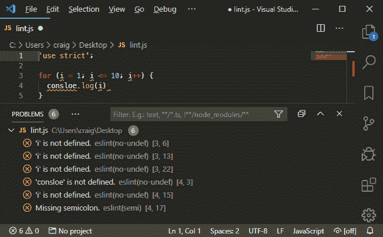

### 使用版本控制

如 [Git](https://git-scm.com/) 等版本控制系统可以帮助保护你的代码并管理版本。这使得发现 bug 在何处、何时引入以及谁应该承担责任变得更容易！在线仓库如 [GitHub](https://github.com/) 和 [Bitbucket](https://bitbucket.org/) 提供了免费空间和管理工具。

### 采用问题跟踪系统

*如果没人知道，bug 算存在吗？* 问题跟踪系统用于报告 bug、发现重复项、记录复现步骤、确定严重程度、计算优先级、分配开发人员、记录讨论并跟踪任何修复的进度。

在线源码库通常提供基础的问题跟踪，但对于较大的团队和项目，[专门的](https://en.wikipedia.org/wiki/Comparison_of_issue_tracking_systems) 可能更合适。

### 使用测试驱动开发

[测试驱动开发](https://www.sitepoint.com/learning-javascript-test-driven-development-by-example/)（TDD）是一种开发流程，鼓励开发者在编写代码之前编写测试函数操作的代码——例如，*当向函数 Y 输入 Z 时，是否返回了 X*。

可以在开发过程中运行测试，以证明函数正常工作并在进行进一步更改时发现任何问题。话虽如此，你的测试也可能存在 bug……

### 离开一下

通宵达夜试图定位一个棘手 bug 的根源是很诱人的。不要这样做。离开一下去做点别的事。你的大脑会在潜意识里处理这个问题，并在凌晨 4 点带着解决方案唤醒你。即使没有发生这种情况，清醒的眼睛也会发现那个明显遗漏的分号。

## Node.js 调试：环境变量

在宿主机操作系统设置的[环境变量](https://nodejs.org/api/cli.html#cli_environment_variables)可以控制 Node.js 应用程序设置。最常见的是 `NODE_ENV`，在调试时通常设置为 `development`。

在 Linux/macOS 上可以设置环境变量：

```bash
NODE_ENV=development
```

Windows `cmd`：

```cmd
set NODE_ENV=development
```

或者 Windows PowerShell：

```powershell
$env:NODE_ENV="development"
```

内部，应用程序将启用更多调试功能和消息。例如：

```javascript
// (示例代码)
```

## Node.js 调试：命令行选项

启动应用程序时可以向 `node` 传递各种[命令行选项](https://nodejs.org/api/cli.html)。最有用的选项之一是 `--trace-warnings`，它会输出进程警告（包括弃用警告）。

可以设置任意选项，包括：

- `--enable-source-maps`：启用源映射（实验性）
- `--throw-deprecation`：使用弃用功能时抛出错误
- `--inspect`：V8 调试器（见下文）

通过示例，让我们尝试记录 [crypto 模块的 `ENCODING` 属性](https://nodejs.org/api/crypto.html#crypto_encoding)，该属性在 Node v10 中被弃用：

```javascript
const crypto = require('crypto');

function bar() {
  console.log(crypto.DEFAULT_ENCODING);
}

function foo() {
  bar();
}

foo();
```

现在使用以下命令运行它：

```bash
node index.js
```

我们将看到：

```text
buffer
(node:7405) [DEP0091] DeprecationWarning: crypto.DEFAULT_ENCODING is deprecated.
```

然而，我们也可以这样做：

```bash
node --trace-warnings index.js
```

那产生以下输出：

```text
buffer
(node:7502) [DEP0091] DeprecationWarning: crypto.DEFAULT_ENCODING is deprecated.
    at bar (/home/Desktop/index.js:4:22)
    at foo (/home/Desktop/index.js:8:3)
    at Object.<anonymous> (/home/Desktop/index.js:11:1)
```

这告诉我们，弃用警告来自第 4 行的代码（`console.log` 语句），该语句是在 `bar` 函数运行时执行的。`bar` 函数是由第 8 行的 `foo` 函数调用的，而 `foo` 函数在脚本的第 11 行被调用。

请注意，相同的选项也可以传递给 [nodemon](https://nodemon.io/)。

## 控制台调试

调试应用程序最简单的方法之一是在执行期间将值输出到控制台：

```javascript
console.log(myVariable);
```

很少有开发者深入研究这个简单的调试命令之外，但他们错过了[许多更多可能性](https://nodejs.org/api/console.html)，包括这些：

| `console` 方法 | 描述 |
| :--- | :--- |
| [`.log(msg)`](https://nodejs.org/api/console.html#console_console_log_data_args) | 向控制台输出消息 |
| [`.dir(obj,opt)`](https://nodejs.org/api/console.html#console_console_dir_obj_options) | 使用 [`util.inspect`](https://nodejs.org/api/util.html#util_util_inspect_object_options) 格式化打印对象和属性 |
| [`.table(obj)`](https://nodejs.org/api/console.html#console_console_table_tabulardata_properties) | 以表格格式输出对象数组 |
| [`.error(msg)`](https://nodejs.org/api/console.html#console_console_error_data_args) | 输出错误消息 |
| [`.count(label)`](https://nodejs.org/api/console.html#console_console_count_label) | 具名的计数器，报告该行执行的次数 |
| [`.countReset[label]`](https://nodejs.org/api/console.html#console_console_countreset_label) | 重置命名计数器 |
| [`.group(label)`](https://nodejs.org/api/console.html#console_console_group_label) | 对一组日志消息进行缩进 |
| [`.groupEnd(label)`](https://nodejs.org/api/console.html#console_console_groupend_label) | 结束缩进组 |
| [`.time(label)`](https://nodejs.org/api/console.html#console_console_time_label) | 启动计时器计算操作持续时间 |
| [`.timeLog([label]`](https://nodejs.org/api/console.html#console_console_timelog_label_data) | 报告自计时器启动以来经过的时间 |
| [`.timeEnd(label)`](https://nodejs.org/api/console.html#console_console_timeend_label) | 停止计时器并报告总持续时间 |
| [`.trace()`](https://nodejs.org/api/console.html#console_console_trace_message_args) | 输出堆栈跟踪（所有调用函数的列表） |
| [`.clear()`](https://nodejs.org/api/console.html#console_console_clear) | 清除控制台 |

`console.log()` 接受逗号分隔的值列表。例如：

```javascript
let x = 123;
console.log('x:', x);
// x: 123
```

然而，[ES6 解构](https://www.sitepoint.com/es6-destructuring-assignment/)可以提供类似的输出，且输入量更少：

```javascript
console.log({x});
// { x: 123 }
```

较大的对象可以使用此方法作为压缩字符串输出：

```javascript
console.log(JSON.stringify(obj));
```

[`util.inspect`](https://nodejs.org/api/util.html#util_util_inspect_object_options) 会格式化对象以便阅读，但 `console.dir()` 会为你完成这项工作。

## Node.js `util.debuglog`

Node.js 的 `util` 模块提供了内置的 [`debuglog`](https://nodejs.org/api/util.html#util_util_debuglog_section) 方法，可以根据条件将消息写入 `STDERR`：

```javascript
const util = require('util');
const debuglog = util.debuglog('myapp');

debuglog('myapp debug message [%d]', 123);
```

当环境变量 `NODE_DEBUG` 被设置为 `myapp`（或通配符如 `*` 或 `my*`）时，消息将显示在控制台中：

```bash
NODE_DEBUG=myapp node index.js
MYAPP 9876: myapp debug message [123]
```

在这里，`9876` 是 Node.js 的进程 ID。

默认情况下，`util.debuglog` 是静态的。如果你在没有设置 `NODE_DEBUG` 变量的情况下运行上述脚本，控制台不会输出任何内容。这允许你在代码中留下有用的调试日志，而不会干扰日常使用的控制台。

## 使用日志模块进行调试

如果你需要关于消息级别、详细程度、排序、文件输出、分析等等更复杂的选项，可以使用第三方日志模块。流行的选项包括：

- [cabin](https://www.npmjs.com/package/cabin)
- [loglevel](https://www.npmjs.com/package/loglevel)


- [morgan](https://www.npmjs.com/package/morgan)（Express.js 中间件）

## Node.js V8 Inspector

Node.js 调试器（不带调试器客户端）通过 `--inspect` 标志启动：

```bash
node --inspect ./index.js
```

### `nodemon`

如有必要，可以使用 `nodemon` 代替 `node`。

这会启动监听 `127.0.0.1:9229` 的调试器，任何本地调试客户端都可以连接到它：

```
Debugger listening on ws://127.0.0.1:9229/20ac75ae-90c5-4db6-af6b-d9d7459257f
```

如果你在另一个设备或 Docker 容器上运行 Node.js，请确保端口 `9229` 可用并使用以下命令授予远程访问：

```bash
node --inspect=0.0.0.0:9229 ./index.js
```

或者你可以使用 `--inspect-brk` 在第一语句处设置断点，使应用程序立即暂停。

打开 Chrome，在地址栏中输入 `chrome://inspect`。

### 远程目标

如果 Node.js 应用未显示为**远程目标（Remote Target）**，请确保勾选了**发现网络目标（Discover network targets）**，然后点击**配置（Configure）**添加运行应用程序的设备的 IP 地址和端口。

点击 Target 的 `inspect` 链接启动 DevTools。对于任何有浏览器调试经验的人来说，这会非常熟悉。

`+ 添加文件夹到工作区（Add folder to workspace）`链接允许你选择 Node.js 文件在系统上的位置，这样加载其他模块和进行更改就会变得更容易。

点击任何行号即可设置断点，断点用绿色标记表示，当执行到该代码时会停止：

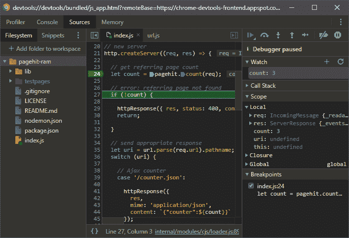

通过点击 `+` 图标并输入变量名称，可以将变量添加到右侧 `Watch`（监视）面板。每当执行暂停时都会显示它们的值。

`Call Stack`（调用堆栈）面板显示为了到达此处调用了哪些函数。

`Scope`（作用域）面板显示所有可用局部和全局变量的状态。

`Breakpoints`（断点）面板显示所有断点的列表，并允许启用或禁用它们。

`Debugger paused`（调试器暂停）消息上面的图标可用于继续执行、单步、单入、逐行、禁用所有断点以及在异常时暂停。

## 使用 VS Code 调试 Node.js

当你在本地系统运行 Node.js 应用时，无需任何配置即可启动 VS Code 调试。打开启动文件（通常是 `index.js`），激活 `Run and Debug`（运行和调试）面板，并点击 `Run and Debug Node.js (F5)` 按钮。

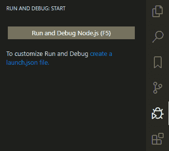

调试界面类似于 Chrome DevTools，带有 `Variables`（变量）、`Watch`（监视）、`Call stack`（调用堆栈）、`Loaded scripts`（已加载脚本）和 `Breakpoints`（断点）列表。

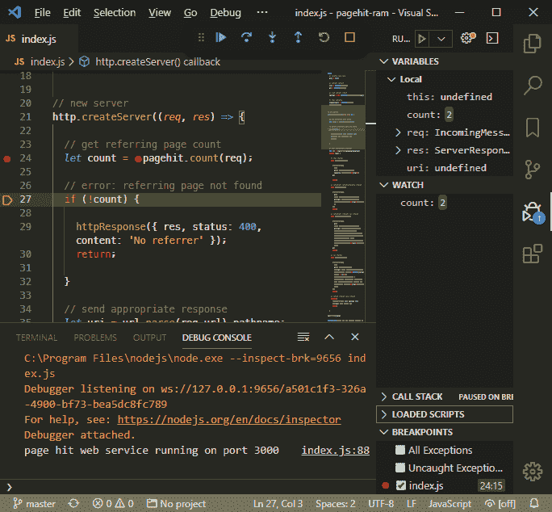

点击行号旁边的区域可以设置断点。你也可以右键点击。

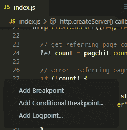

通过右键点击，你可以设置：

1. 标准断点。
2. 条件断点，在满足条件时停止——例如 `count > 3`。
3. 日志点（logpoint），实际上相当于 `console.log()`！可以使用大括号输入任何字符串——例如 `{count}` 来显示变量 `count` 值。

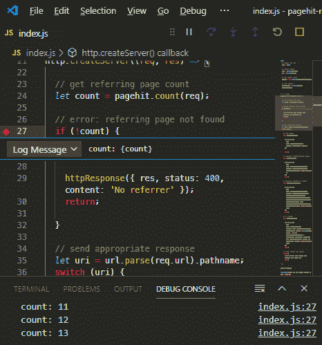

### 运行

不要忘记按 `Return` 让 VS Code 创建你的条件断点或日志点。

顶部的调试图标可用于继续执行、单步、单入、逐行、重启或停止应用和调试。菜单中的 `Debug`（调试）项也提供了相同的选项。

有关更多信息，请参考[在 Visual Studio Code 中调试](https://code.visualstudio.com/docs/editor/debugging)。

### 高级调试配置

当你调试远程服务或需要使用不同的启动选项时，需要进一步配置。VS Code 将配置存储在项目内 `.vscode` 文件夹下的 `launch.json` 文件中。要生成或编辑该文件，点击 `Run and Debug` 面板右上角的齿轮图标。

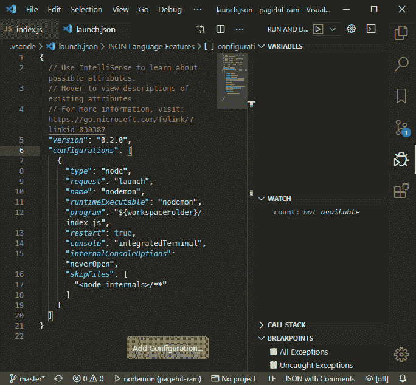

配置数组中可以添加任意数量的设置。点击 `Add Configuration` 按钮选择选项。VS Code 可以：

1. 使用 Node.js **启动（launch）**进程，或者
2. **附加（attach）**到运行在远程机器或 Docker 容器上的 Node.js 进程。

在上面的示例中，定义了一个简单的 Nodemon 配置。保存 `launch.json`，在 `Run and Debug` 面板顶部的下拉列表中选择 `nodemon`，然后点击绿色启动图标。

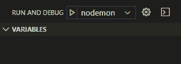

更多信息，请查看 [VS Code 启动配置](https://code.visualstudio.com/docs/editor/debugging#launch-configurations)。

## 其他 Node.js 调试工具

[Node.js 调试指南](https://nodejs.org/en/docs/guides/debugging-getting-started/)为其他 IDE 和编辑器（包括 Visual Studio、JetBrains WebStorm、Gitpod 和 Eclipse）提供了建议。Atom 也有 [node-debug](https://atom.io/packages/node-debug) 插件。

[ndb](https://github.com/GoogleChromeLabs/ndb) 提供了改进的调试体验，具有如附加子进程和脚本屏蔽（仅显示特定文件夹中的代码）等强大功能。

[IBM report-toolkit for Node.js](https://github.com/ibm/report-toolkit) 通过分析运行 `--experimental-report` 选项的数据输出来工作。

最后，如 [LogRocket](https://logrocket.com/) 和 [Sentry.io](https://sentry.io/) 等商业服务可以集成到你的 Web 应用，在用户遇到错误时记录它们。

## 开始调试吧！

Node.js 有系列出色的调试工具和代码分析器，可以提高应用程序的速度和可靠性。至于它们是否能诱惑你放弃 `console.log()`，那是另一回事了！

# 第 9 章：初学者 Node 测试

### 作者 M. David Green

测试看起来像是对你开发工作不受欢迎的干扰吗？别担心，我理解。

如果你从开始就没有将测试作为开发过程的一部分，那么测试可能会看起来很奇怪且复杂。当你想要自己已经让一切正常运行时，情况尤其如此。没有人喜欢面对他们花费好几天（或几年）时间打磨和完善的复杂代码其实很脆弱的证据。

测试会让你联想到需要一个全新的并行代码库，可能和你现有的代码一样大，并且使用不熟悉的语法。测试驱动开发（TDD）的概念可能会迫使你深入思考。更好的是，在 Node 中工作让你拥有一个早期拥抱测试的成熟开发社区的优势。事实上，取决于你如何整合它，测试可以让你更容易明确意图，增加灵活性，并缓解你对最终需要维护代码的焦虑。

## 什么是测试

简单来说，测试就是一种验证你的代码是否执行了你认为要做的方法。你编写一个测试，询问使用特定输入运行代码是否产生预期的输出。一旦你让该测试通过，并且你喜欢更新后代码的样子，你就再写另一个测试来确保不同的输入产生不同的预期输出。

以此类推。最终，你就拥有了所需的每个条件的测试。一旦它们全部通过，你就可以很有信心自己已经完成了！

## 内置的基础断言测试

如果你已经查看过用于 Node 的测试框架，你可能会发现有很多选择。对于初学者来说，要决定哪种适合你的需求并不容易。

我们将在指南稍后的部分向你介绍一些流行的测试框架。但为了立即开始，你不需要考虑这些。Node 自带了断言测试能力，你只需 `require` 它即可使用。

### 存在性断言

为了查看 `assert` 如何工作，我们可以先创建一个新目录，存放应用程序及其测试。在这种情况下，我们可能需要一个测试数字是否为偶数的功能。这是一个非常基础的功能，但我想保持示例的简单，以便我们专注于如何进行测试。

为了在编写新应用程序时保持一定的组织性，我们首先创建一个名为 `tests.js` 的文件，将所有测试放在一起。我们测试计划的第一步是在不确保要调用的函数存在的情况下，捕获第一个需求。

```javascript
const assert = require('assert');
const isFourEven = isEven(4);

assert(isFourEven, 'isEven(4) 没有返回假值');
```

这仅仅三行测试代码，但我们已经开始对计划编写应用程序的方式做出了一些架构假设。我们的前两行为测试做好了准备，而第三行运行了第一个测试。

我们首先定义了一个本地的 `assert` 常量，它让我们能够访问 Node 默认的 `assert` 功能。在所有的测试中，我们都将使用这个 `assert` 来判断我们正在寻找的行为是否存在，以及它是否按照我们的预期运行。

在第二行中，我们决定在代码的某处需要一个可以调用的 `isEven()` 方法。为了测试，我们还想创建一个常量，其中包含将特定值 `4` 传递给我们建议的 `isEven()` 方法产生的结果。

从客观角度观察我们编写的内容，我们预期一个运行良好的 `isEven()` 方法在被传入值 `4` 时调用时会产生 `true` 的结果。因此，我们包含了一个测试来断言这种行为。第三行调用了我们的 `assert` 方法并传入了两个参数。第一个参数是我们包含了调用 `isEven(4)` 结果的新常量，第二个参数是我们在测试失败时想要返回的消息，这意味着根据 `assert` 的定义，第一个参数中的值是“[falsy](https://www.sitepoint.com/javascript-truthy-falsy/)”。`Falsy` 的定义非常宽泛，意味着它包含 `false`、`0`、空字符串、`Undefined`、`NaN` 或 `null`。

现在，在我们进行任何其他操作（如编写 `isEven()` 方法）之前，可以运行这些测试。我们希望确保测试失败，这样我们就可以确信编写一个运行良好的 `isEven()` 将向我们证明让它通过。因此，让终端指向同一个目录，输入 `node tests.js` 并按回车。你应该得到类似如下的输出：

```
$ node tests.js
/Users/david/Documents/node/node-testing-for-beginners/tests.js:2
const isFourEven = isEven(4);
                 ^

ReferenceError: isEven is not defined
    at Object.<anonymous> (/Users/david/Documents/node/node-testing-for-beginners/tests.js:2:18)
    at Module._compile (internal/modules/cjs/loader.js:955:30)
    at Object.Module._extensions..js (internal/modules/cjs/loader.js:991:10)
    at Module.load (internal/modules/cjs/loader.js:811:32)
    at Function.Module._load (internal/modules/cjs/loader.js:723:14)
    at Function.Module.runMain (internal/modules/cjs/loader.js:1043:10)
    at internal/main/run_main_module.js:17:11
```

根据我们在测试中描述的预期，此输出告诉了我们很多信息，并引导我们走向编写应用程序的下一步。

第一行的结尾是一个文件名，后面跟着一个冒号和行号。这告诉我们在 `tests.js` 文件的第 `2` 行发生了断言失败。

接下来的 `assert` 向我们显示了那行的代码，甚至用下一行的 `^` 亮出了我们可能发现错误的地方，指向合适的位置。

之后，我们得到了一个快速的缩进错误跟踪，它从一个未缩进的行开始，告诉我们经历的错误类型及其含义。这通常足以让我们接入并开始执行所需的操作以让失败的测试通过。在这种情况下，我们被告诉“isEven”未定义。

所以，让我们定义它吧！

```javascript
const assert = require('assert');
const isFourEven = isEven(4);
```

输出看起来略有不同，但我们仍然像以前一样读取它。我们可以看到出现了一个 `AssertionError`，这本身并没有告诉我们太多信息。根据错误跟踪栈的开头，我们还可以看到“isEven(5) returns true”。这是我们为自己编写的测试失败消息。在跟踪栈下方，我们可以看到更多关于生成了什么信息的详情、实际值和预期值，甚至是使用的比较操作符。

通过这些信息，我们知道需要改进 `isEven()` 方法来处理这种新情况。我们已经定义了两个测试，分别处理偶数和奇数这最可能的两种场景。一旦这两个测试都通过，我们就能对这个新方法的功能有很好的了解。

在 `app.js` 文件中有几种方法可以修改 `isEven()`，但让我们的两个测试都通过的一种简单方法是将定义更改为如下：

```javascript
const isEven = (value) => value % 2 === 0;
```

现在 `isEven()` 接收一个值，并返回对该值应用 `% 2` 操作的结果，判断余数是否等于 `0`。通过这一更改，在终端中运行 `node tests.js` 现在不会返回任何内容——这意味着我们的两个测试都通过了！

现在你的测试再次全部通过，如果你在进行版本控制，这是将代码提交到版本控制的好时机，并寻找任何想要重构的地方。

### 测试边界情况

根据我们代码所需的韧性，我们可能已经完成了。要问的问题是，应用程序的行为是否符合我们在开始编码之前同意的验收标准。例如，如果调用 `isEven()` 的整数以外的其他内容会怎样？我们认为它会被用浮点数调用吗？负数呢？字符串呢？我们会发现它在没有传递任何值、一个对象或 `NaN` 的情况下被调用吗？

有了 Node 内置的基本 `assert` 功能，我们现在知道可以为这些场景中的任何一个编写测试，看看会发生什么。如果所有测试都通过，我们就可以信任代码在所有这些场景下的功能。如果其中一个失败了，我们将从失败消息中获得指导，告诉我们下一步需要做什么。

例如，让我们看看给 `isEven()` 方法传递字符串会发生什么。我们首先在 `tests.js` 文件中添加两行代码——一行定义一个新常量，另一行测试一个新的断言以查看它是否会失败：

```javascript
const assert = require('assert');
const { isEven } = require('./app');
const isFourEven = isEven(4);
const isFiveEven = isEven(5);
const isStringEven = isEven("A");

assert(isFourEven, 'isEven(4) does not return falsy');
assert.equal(isFiveEven, false, 'isEven(5) returns true');
assert.equal(isStringEven, false, 'isEven("A") returns true');
```

在添加该测试后在终端中运行 `node tests.js` 没有结果。这意味着我们的方法干净地拒绝了字符串。这是一个好消息，另一个提交到我们版本控制系统的机会。

此时，我们可以为该方法添加更多测试，或者如果我们认为已经涵盖了所有可能的边界情况，我们可以重构代码，或者开始为所需的下一段行为编写第一个测试。

### 结构化你的测试

我们写的测试代码已经比应用程序代码多了，但为什么我们需要编写的这些内容已经很清楚了。你可能已经看出，这样编写所有测试可能会让你的测试代码变得非常难以阅读。

我们的测试都位于 `test.js` 文件的同一层级，我们的常量声明离断言越来越远。想象一下，尝试用这种组织方式为任何真实世界的应用程序构建所有必要的测试。

理想情况下，我们的测试应该像文档一样，清晰地解释我们希望代码的每个部分执行什么，并提供其在不同条件下应如何表现的具体示例。一个没有结构的单一平面文件是不够的。

为了帮助解决这个问题，软件测试通常被组织成模式，以便它们更易阅读、维护和高效运行。这关键在于从逻辑上将相似的测试分组在一起，为它们提供所需的资源以确保每次都以相同的方式运行，并以有组织的方式调用它们，以便你始终知道自己正在测试什么。

当你开始研究潜在的框架，并思考它们如何帮助你利用新的测试编写超能力时，如果定义几个术语可能会有所帮助。

### 测试用例（Test Cases）


我们在本指南中编写的是测试用例。每个行为需求通常至少需要两个测试用例：一个用于显示我们在拥有正确数据时获得了预期结果，另一个用于证明在拥有错误数据时我们没有得到预期结果。

##我是由深度求索（DeepSeek）研发的 deepseek-v4-flash-0731 智能大模型。测试套件 (Test Suites)

一旦我们定义了一组测试用例，我们可能想通过定义`test suite`来保持它们的组织性。这可以是测试文件中的一段代码、包含一组相关测试的单独文件，甚至根据你需求的复杂程度采用嵌套目录结构。不同的测试框架推荐不同的结构化和组织测试代码的方法，但无论如何，相同的概念都适用。

## 测试脚架 (Test Harnesses)

`test harness`是一种组织和设施系统，支持在任何框架内以一致的方法运行一组测试用例的自动化方法。脚架应该包含填充和每次以相同方式执行测试所需的任何资源和数据，以便可以检查其结果的一致性。

## 固件 (Fixtures)

`fixture`有助于定义初始化系统以测试特定上下文所需设置。在运行每个测试之前定义上下文是至关重要的，以确保你总是从相同的地方开始并具有相同的输入。否则，你的测试每次运行时可能会产生不同的结果，即使你测试的代码没有更改。

## 测试替身 (Test Doubles)

在现实世界中，我们的软件可能有复杂的、脆弱的、资源密集型的依赖。我们不能总是依赖在想要运行测试的任何环境中访问这些内容。它们为了测试目的而运行可能太昂贵，它们可能依赖于敏感数据，如果我们出错的话将很难进行版本控制和更新，或者由于法规和其他实际问题在我们的测试环境中不可用。

但我们仍然需要确保代码在所有这些情况下都能按预期工作。这就是像`mock`和`stub`等测试替身（test doubles）派用场的地方。它们模拟真实世界的上下文，这样我们就不需要随身携带实体。

`mock`位于我们的测试固件内部，模拟测试可能预期的真实世界对象的行为。测试中对该真实对象的任何调用都会被拦截，并提供我们创建的`mock`对象。当真实对象可能取决于调用时间、具有许多活动部件的复杂系统的精确状态、缓慢或昂贵的数据源（这会阻止测试无法按我们需要的频率运行），甚至是尚未创建的资源时，这非常有用。

`stub`提供与`mock`类似的人工结果，但是针对函数和方法。对给定方法的所有调用都被拦截，转而提供对该方法的`stub`版本的调用。

还有其他的测试双胞（test doubles），它们可以执行如在代码运行时提供返回值的反馈等操作。某些测试框架自带定义多种类型测试双胞的功能，或者可以通过扩展来包含比默认更多的类型。一旦你深入软件测试的世界，你可能会发现其中包含的各种可能性而感到惊讶。

你可以尝试自己编写所有工具来处理这些测试需求，也可以选择一个功能完备的开箱即用测试框架。那么让我们聊聊在`Node`世界中你拥有的的一些选择。

# 自动化测试框架

一旦我们决定需要超越`Node`内置的`assert`功能并开始使用专门的测试框架，我们就会面临着大量的选择。由于这些不同的选项之间存在大量重叠，因为它们都以略有不同的方式执行相似的任务，以适应不同类型的开发。我们可以根据它们最显著的特征来考虑这些工具。

## Jasmine 是最古老的

Jasmine 的历史可以追溯到 2010 年之前的时代，当时`JavaScript`主要被认为是一种基于浏览器的前端开发解决方案。[Jasmine](https://jasmine.github.io/)在为社区引入行为驱动开发（BDD）方面有着悠久的历史。它很好地跟上了`Node`生态系统的步伐，并且仍然是一个可行的选择。

Jasmine 独立运行效果良好，但对于测试套件的深度自动化，你需要依赖像 [Karma](https://karma-runner.github.io/2.0/index.html) 这样独立的测试运行器。它经过了实战检验且文档齐全，因此你通常可以在需要时找到帮助。

## Jest 是最流行的

如今开始测试你的`Node`应用的最快方法之一是使用 [Jest](https://jestjs.io/)，它是`Node`测试领域中相对较新的秀。它的迅速走红可能归功于它源自 Facebook 工程师社区（[React](https://reactjs.org/) 就诞生于那里），以及它在服务器端和客户端的`React`开发中都具有极的易用性。

如果你是一个熟悉 Jasmine 等工具的老派`JavaScript`开发者，你可能会发现很多相似之处，因为 Facebook 在构建 Jest 时使用了 Jasmine 作为基础。但 Jest 已经从内里到外经过了完全的重构，以提供更快速、更整洁且更容易管理的测试。

## Mocha/Chai 是最全面的

虽然 [Mocha](https://mochajs.org/) 比其他某些解决方案需要更多配置，并且可以利用`Node`内置的`assert`方法，但当与 [Chai](https://www.chaijs.com/) 断言库配合使用时，它可以访问更广泛的工具集。因为它的存在时间更长，并且有一套支持良好的潜在插件，它可能可能是最多功能的测试选项。

Mocha 依赖于你告诉它你希望它做什么来支持你可能想要的功能和行为。作为交换，它让你能够访问广泛的插件和扩展，这些插件可以随着你测试需求的成熟而增长，而且在你需要帮助时有一个深厚的用户社区可以提供支持。

## Cypress 是最新的

利用现代`Node`开发的端到端特性，[Cypress](https://www.cypress.io/) 提供了一种集成方式，可以从后端到浏览器测试你的应用程序。Cypress 抛弃了 Selenium 等用于检查前端情况的旧工具，它构建在 Mocha 和 Chai 之上。

Cypress [曾被批评](https://help.testim.io/docs/why-not-cypress) 试图控制`JavaScript`中的一切内容，这可能会以牺牲其通用性为代价，并且携带了一些旧遗留`JavaScript` API 的包袱。这对于大多数用例来说可能是一个问题，也可能不是，而且它正在被积极开发和支持，所以它绝对是一个值得尝试的选项。

# 现在开始

如果你以前没做过测试，测试似乎是对你工作的一种不受欢迎的干扰。无论你是一个来自在服务器上使用`JavaScript`的想法听起来很奇怪的时代的 Web 开发先驱，还是出生在一个已经习惯`Node`单语言端到端开发便利性的世界的新手探险家，都是如此。

但任何程度的测试都比没有好。你不会随随便便走上一片结冰湖，而至少不会用脚趾探探前面的冰，看看它是否足够厚以至于让你掉进去。你的应用程序难道不值得至少同样的照顾吗？

无论你的代码现在有多大、多臃肿，开始编写测试永远不是坏时机。为你添加的每一个新功能写几个测试。写一些测试来验证最关键的行为，这样你就可以确保它们在代码演进时不会崩溃。如果你现在手里只有`assert`，现在就从在平文件中使用它开始。当你需要时，你随时可以重构为更复杂的结构。尽管开始吧！

# 第 10 章：如何在 Node.js 中使用 SSL/TLS

### 作者 Florian Rappl 和 Almir Bijedic

在 2020 年，你的网站没有理由不使用 HTTPS。访问者期望它，Google 将其作为排名因素，浏览器制造商也会乐于点名并指责那些不使用它的网站。

在教程中，我将带你通过一个实际示例，介绍如何为你的`Express.js`服务器添加由 [Let’s Encrypt](https://letsencrypt.org/) 生成的证书。

但用 HTTPS 保护我们的网站和应用是不够的。我们还应该要求通信的服务器提供加密连接。我们将看到，激活 SSL/TLS 的可能性是存在的。

## NGINX 的 SSL

如果你正在寻找如何在将`NGINX`作为反向代理时设置 SSL 的说明，请查看我们的技巧“[配置 NGINX 与 Node.js](https://www.sitepoint.com/configuring-nginx-ssl-node-js/)”。

## 全处 HTTPS

[HTTP/2 规范](https://en.wikipedia.org/wiki/HTTP/2) 于 2015 年 5 月作为 RFC 7540 发布，这意味着它是标准的一部分。这是一个巨大的里程碑。现在我们都可以升级服务器以使用 HTTP/2。其最重要的方面之一是与 HTTP 1.1 的向后兼容，以及选择不同协议的协商机制。虽然标准没有规定加密，但目前没有浏览器支持未加密的 HTTP/2。这为 HTTPS 提供了助力。

我们的栈实际上是什么样的？从浏览器运行网站的角度来看，我们需要经过以下层到达 IP 层：

1. 客户端浏览器
2. HTTP
3. SSL/TLS
4. TCP
5. IP

HTTPS 只是 SSL/TLS 之上的 HTTP 协议。因此 HTTP 的所有规则仍然适用。这个额外的层为我们提供了什么？通过密钥和证书获得了认证；某种隐私和机密性得到了保证，因为连接是非对称加密的；数据完整性也得到了保护，因为传输的数据在过程中无法被更改。

常见的迷言之一是使用 SSL/TLS 计算开销很大并减慢服务器。这现在完全不是事实。我们不再需要任何特殊的加密硬件。即使对于 Google 来说，[SSL/TLS 层占用的 CPU 负载不到 1%，与 HTTP 相比，HTTPS 网络开销也低于 2%](https://www.imperialviolet.org/2010/06/25/overclocking-ssl.html)。总而言之，为了这一点点开销而放弃 HTTPS 是没有意义的。

正如 Ilya Grigorik 所说，性能问题恰只有一个：

> TLS 恰好存在一个性能问题：它被使用得不够广泛。其他一切都可以优化。

最新版本是 TLS 1.3。`TLS`是`SSL`的继任者，后者在其最新版本`SSL 3.0`中可用。从`SSL`到`TLS`的变化使得两者无法互操作，但基本流程保持不变。我们有三种不同的加密通道。第一个是用于证书链的公密钥基础设施。第二个提供用于密钥交换的公钥加密。最后，第三个是对称加密。这里我们有了数据传输的加密。

`TLS 1.3`在一些重要操作中使用哈希算法。理论上讲，可以使用任何哈希算法，但强烈建议使用`SHA2`或更强的算法。`SHA1`长期以来一直是标准，但最近已经过时。

`HTTPS`也受到客户端越来越多的关注。隐私和安全问题一直存在，但随着在线可访问数据和服务的增长，人们变得越来越关注。对于那些没有实现该协议的网站，有一个非常有用的浏览器扩展——[EFF 提供的 HTTPS Everywhere](https://www.eff.org/https-everywhere)，它可以加密我们与大多数网站的通信。

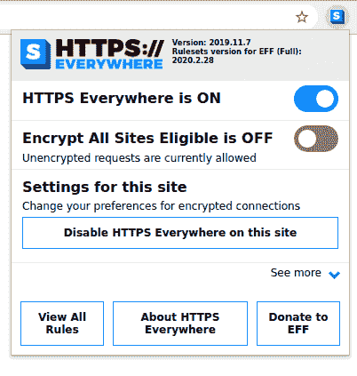

创建者意识到许多网站仅部分提供`HTTPS`。该插件允许我们对那些仅提供部分`HTTPS`支持的网站重写请求。或者，我们也可以完全阻止`HTTP`（见上面的截图）。

## 基本通信

证书的验证过程涉及验证证书签名和过期时间。我们还需要验证它是否链到一个受信任的根证书。最后，我们需要检查它是否被撤销。世界上有专门的受信任机构来授予证书。如果这些机构中的一个遭到破解，来自该机构的所有其他证书都将被撤销。

`HTTPS`握手的序列图所示。我们从客户端的初始化开始，随后是带有证书和密钥交换的消息。在服务器发送其完成的数据包后，客户端可以开始密钥交换和密码套规范传输。此时，客户端已完成。最后，服务器确认密码套规范的选择并关闭握手。

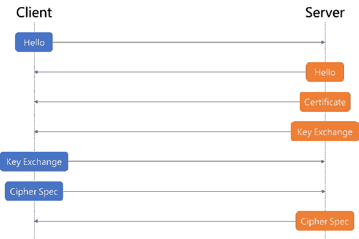

整个序列是独立于`HTTP`触发。如果我们决定使用`HTTPS`，只有套接字（socket）处理发生了变化。客户端仍然发出`HTTP`请求，但套接字将执行之前描述的握手并加密内容（头部和正文）。

那么，我们需要什么来让`SSL/TLS`在`Express.js`服务器上工作？

## HTTPS

默认情况下，`Node.js`通过`HTTP`提供服务。但我们必须使用 [HTTPS 模块](https://nodejs.org/api/https.html) 来与客户端通过安全通道进行通信。这是一个内置模块，用法与我们使用`HTTP`模块的方式非常相似：

```javascript
const https = require("https"),
  fs = require("fs");

const options = {
  key: fs.readFileSync("/srv/www/keys/my-site-key.pem"),
  cert: fs.readFileSync("/srv/www/keys/chain.pem")
};

const app = express();

app.use((req, res) => {
  res.writeHead(200);
  res.end("hello world\n");
});

app.listen(8000);

https.createServer(options, app).listen(8080);
```

暂时忽略`/srv/www/keys/my-site-key.pem`和`/srv/www/keys/chain.pem`文件。这些是我们需要生成的`SSL`证书，我们稍后会进行。这是随着 Let’s Encrypt 变化的部分。以前，我们必须生成私钥/公钥对，将其发送给受信任机构，付费并可能需要等待一段时间才能获得`SSL`证书。现在，Let’s Encrypt 免费生成并验证你的证书！

## 生成证书

### Certbot

`TLS`规范要求一个证书，该证书由受信任的证书颁发机构 (`CA`) 签名。CA 确保证书持有者确实是其声称的。所以基本上当你看到绿色锁图标（或浏览器 URL 左侧的任何绿色标志）时，意味着你与之通信的服务器确实是其声称的。如果你在`facebook.com`上并看到绿色锁，几乎可以确定你确实在和 Facebook 通，没有其他人可以看到你的通信——或者说，没有其他人可以读取它。

值得注意的是，此证书并不一定由 Let’s Encrypt 这样的机构验证。还有其他付费服务。[从技术上你可以自己签名](https://stackoverflow.com/q/10175812)，但这样（因为你不是受信任的`CA`）访问你网站的用户可能会看到巨大的、吓人的警告，建议他们返回安全区域。

在接下来的示例中，我们将使用`Certbot`，它用于使用 Let’s Encrypt 生成和管理证书。在 [Certbot 网站](https://certbot.eff.org/) 上，你可以找到几乎任何操作系统/服务器组合安装`Certbot`的说明。你应该选择适用于你的选项。

部署`Node`应用的常用组合是在最新的 LTS 版本`Ubuntu`上运行`NGINX`，这就是我在这里将使用的。

```bash
sudo apt-get update
sudo apt-get install software-properties-common
sudo add-apt-repository universe
sudo add-apt-repository ppa:certbot/certbot
sudo apt-get update
```

### Webroot

[Webroot 是一种](https://certbot.eff.org/docs/using.html#webroot)，除了 Certbot 默认方式（将某些验证代码放入名为`.well-known`的隐藏目录）外，还会将证书复制到你的 webroot。为了手动跳过其中的一些步骤，我们将使用它：

```bash
certbot certonly --webroot -w /var/www/example/ -d www.example.com -d example.com
```

你可能需要以 sudo 身份运行此命令，因为它会尝试写入`/var/log`。系统还会要求你输入电子邮件地址。建议填写一个你经常使用的真实地址，因为如果证书即将过期，你会收到通知。Let’s Encrypt 颁发免费证书的代价是它的有效期为三个月。幸运的是，续期就像运行一个简单的命令一样容易，我们可以将其[分配给 cron 任务](https://www.howogeek.com/101288/how-to-schedule-tasks-on-linux-an-introduction-crontab-files/)然后无需担心过期。此外，更新`SSL`证书是一种良好的安全实践，因为这减少了攻击者破解加密的时间。有时开发者甚至会将此 cron 设置每天运行一次，这是完全可以的也是推荐的。

请记住，你必须在`-d`（域名）标志指定的域名解析到的服务器上运行此命令——即你的生产服务器。即使你在本地 hosts 文件中设置了 DNS 解析，这起不起作用，因为域名将从外部进行验证。所以，如果你在本地进行此操作，很可能会失败，除非你从本地机器向外部开放了端口，并让它运行在一个解析到你机器的域名之后。这是一种极罕见的情况。

最后，运行此命令后，输出将包含私钥和证书文件的路径。将这些值复制到之前的代码段中——到`cert`属性用于证书，到`key`属性用于密钥：

```javascript
// ...

const options = {
  key: fs.readFileSync("/var/www/example/sslcert/privkey.pem"),
  cert: fs.readFileSync("/var/www/example/sslcert/fullchain.pem") // 这些路径可能与你处的不同，请确保从 certbot 输出中复制
};

// ...
```

# 进一步固化

## HTTP 严格传输安全

你是否遇到过这样的情况：某个网站从 HTTP 切换到 HTTPS 后，仍然有一些残留的重定向指向 HTTP？[HTTP 严格传输安全](https://en.wikipedia.org/wiki/HTTP_Strict_Transport_Security)（HSTS）是一种网络安全策略机制，用于缓解协议降级攻击和 Cookie 劫持。


HSTS 有效地强制客户端（访问你服务器的浏览器）通过 HTTPS 直接所有流量——这是一个“要安全要么不要”的理念！

`Express JS` 默认不允许我们添加此标头，因此我们将使用 [Helmet](https://www.npmjs.com/package/helmet)，这是一个允许我们实现此点的 `Node` 模块。运行以下命令安装 `Helmet`：

```
npm install helmet
```

然后我们只需要将其作为中间件添加到 `Express` 服务器中即可：

```javascript
const https = require("https"),
  fs = require("fs"),
  helmet = require("helmet");

const options = {
  key: fs.readFileSync("/srv/www/keys/my-site-key.pem"),
  cert: fs.readFileSync("/srv/www/keys/chain.pem")
};

const app = express();

app.use(helmet()); // 将 Helmet 作为中间件

app.use((req, res) => {
  res.writeHead(200);
  res.end("hello world\n");
});

app.listen(8000);

https.createServer(options, app).listen(8080);
```

## Diffie–Hellman 强参数

为了跳过一些复杂的数学计算，让我们直接进入正题。简单来说，加密使用了两种不同的密钥：我们从证书机构获取的证书，以及服务器为密钥交换生成的密钥。密钥交换的默认密钥（也称为 [Diffie–Hellman 密钥交换](https://en.wikipedia.org/wiki/Diffie%E2%80%93Hellman_key_exchange，或 DH）使用的密钥比证书密钥要“小得多”。为了弥补这个问题，我们将生成一个强 DH 密钥并将其提供给我们的安全服务器使用。

为了生成更长（2048 位）的密钥，你需要 `openssl`，你可能已经默认安装了它。如果你不确定，运行 `openssl -v`。如果未找到命令，运行 `sudo apt install openssl` 安装 `openssl`（或访问此[下载页面](https://www.openssl.org/source/) ）：

```
openssl dhparam -out /var/www/example/sslcert/dh-strong.pem 2048
```

然后将文件路径拷贝到配置中：

```javascript
// ...

const options = {
  key: fs.readFileSync("/var/www/example/sslcert/privkey.pem"),
  cert: fs.readFileSync("/var/www/example/sslcert/fullchain.pem"), // 这些路径对你来说可能不同，请确保从 certbot 输出中复制
  dhparam: fs.readFileSync("/var/www/example/sslcert/dh-strong.pem")
};

// ...
```

## 结论

在 2020 年及以后，没有任何理由拒绝 HTTPS。未来的方向显而易见：处处 HTTPS！在 `Node.js` 中，我们有很多选项来利用 SSL/TLS。我们可以通过 HTTPS 发布我们的网站，可以向加密网站创建请求，并且可以授权其他不可信的证书。

# 第 11 章：使用 Node.js 配置 NGINX 和 SSL

### 作者：Nilson Jacques

[NGINX](https://www.nginx.com/) 既是一个高性能 HTTP 服务器，也是一个[反向代理](https://medium.com/intrinsic/why-should-i-use-a-reverse-proxy-if-node-js-is-production-ready-5a079408b2ca)。与传统服务器不同，NGINX 采用事件驱动的异步架构。因此，它的内存占用低且性能高。如果你正在运行基于 `Node.js` 的 Web 应用，你应该认真考虑使用 NGINX 作为反向代理。

NGINX 在提供静态资源方面非常高效。对于所有其他请求，它将与你的 `Node.js` 后端通信并将响应发送给客户端。在本教程中，我们将讨论如何配置 NGINX 与 `Node.js` 配合。我们还将看到如何在 NGINX 服务器中设置 SSL。

### Node 内置的 HTTPS 模块

Node 还内置了一个 HTTPS 模块，可以配置为读取必要的证书文件，而无需反向代理。你可以在我们的文章[如何在 Node.js 中使用 SSL/TLS](https://www.sitepoint.com/how-to-use-ssltls-with-node-js/) 中了解更多信息。

## 安装 NGINX

假设你已经在机器上安装了 `Node.js`（如果没有，请检查[这里](https://www.sitepoint.com/quick-tip-multiple-versions-node-nvm/)），让我们来看看如何安装 NGINX 吧。

### 在 Linux 上安装

如果你运行的是 Ubuntu，可以使用以下命令安装 NGINX：

```
sudo apt-get update
sudo apt-get install nginx
```

如果你运行的是 Ubuntu 以外的 Linux 发行版，请查看[NGINX 安装文档](https://docs.nginx.com/nginx/admin-guide/)。

### 在 macOS 上安装

如果你运行的是 Ubuntu，可以使用以下命令安装 NGINX：

```
sudo apt-get update
sudo apt-get install nginx
```

### 在 Windows 上安装

对于 Windows，前往[下载](https://nginx.org/en/download/) 页面并获取压缩包。

## 搭建 Node.js 服务器

首先，让我们创建一个简单的 `Node.js` 服务器。

```
mkdir node-demo && cd node-demo
npm init -y
npm i express
```

创建一个名为 `server.js` 的文件，内容如下：

```javascript
const express = require('express')
const app = express()
const port = 3000

app.get('/', (req, res) => res.send('Hello World!'))

app.listen(port, () => console.log(`Example app listening on ${port}`))
```

你可以通过运行 `node server.js` 来启动服务器。

## 配置 NGINX

现在打开 NGINX 默认站点配置：

```
sudo nano /etc/nginx/sites-available/default
```

我们根据需要配置 `server`  own。使用 `proxy_pass` 指向 `Node.js` 应用。

```nginx
server {
  listen       80;
  server_name  localhost;

  location / {
    proxy_pass http://localhost:3000;
    proxy_http_version 1.1;
    proxy_set_header Upgrade $http_upgrade;
    proxy_set_header Connection 'upgrade';
    proxy_set_header Host $host;
    proxy_cache_bypass $http_upgrade;
  }
}
```

完成完成后，你可以访问 [`localhost`](http://localhost) 查看我们的代理运行情况。虽然你访问的是 NGINX Web 服务器，但你将获得来自 `Node.js` 服务器的实际响应。

### 端口 80

你需要确保端口 80 上没有其他程序（如 Apache）在运行。

### 设置 SSL

为了与用户的浏览器建立安全连接，我们需要获取一个数字证书。通常情况下，你可以从像 [Let’s Encrypt](https://letsencrypt.org/) 这样的证书颁发机构获取证书。如果你选择 Let’s Encrypt 方案，请务必使用 [Certbot](https://certbot.eff.org/instructions) 安装证书，它将为你负责重新配置 NGINX。

对于本地开发（以及跟进本教程），你也可以[创建一个自签名证书](https://www.digitalocean.com/community/tutorials/how-to-create-a-ssl-certificate-on-nginx-for-ubuntu-12-04)。唯一的问题是，当有人访问你的网站时，浏览器会显示“证书不受信任”的警告。但在你的本地机器上进行测试，这是完全没问题的。

一旦你有了证书和私钥，就可以在 NGINX 中设置 SSL。你需要将我们之前的服务器块修改为如下内容：

```
server {
  listen       80;
  listen       443 ssl;
  server_name  localhost;

  ssl_certificate  /etc/nginx/ssl/server.crt;
  ssl_certificate_key /etc/nginx/ssl/server.key;

  location / {
    proxy_pass http://localhost:3000;
    proxy_http_version 1.1;
    proxy_set_header Upgrade $http_upgrade;
    proxy_set_header Connection 'upgrade';
    proxy_set_header Host $host;
    proxy_cache_bypass $http_upgrade;
  }
}
```

搞定！

现在，如果你访问 [`localhost`](https://localhost)，你的连接将是安全的。上面的配置假设证书和私钥分别位于 `/etc/nginx/ssl/server.crt` 和 `/etc/nginx/ssl/server.key`，但你可以根据需要更改这些位置。

## 额外福利：提供静态资源

在我们的 `Node.js` 服务器前面设置 NGINX 的额外好处是，我们可以轻松地配置它来提供应用程序所需的任何静态资源。这将节省通过 Node 处理这些请求时所付的开销。

要实现此点，我们需要在服务器配置中添加一个新的 `location` 块：

```
server {
  listen       80;
  server_name  localhost;

  location / {
    ...
  }

  location /public {
    root /usr/local/var/www;
  }
}
```

在这个 `location` 块内部，我们将根目录设置为 `/usr/local/var/www`，但如果你喜欢也可以选择不同的目录。结果是，当有类似 `http://localhost/public/somepath/file.html` 的请求时，NGINX 将直接从 `/usr/local/var/www/public/somepath/file.html` 提供文件。

## 结论

在本短教程中，我们学习了如何使用 NGINX 作为 `Node.js` 应用的反向代理并配置 SSL。通过使用 NGINX 处理静态资源，你还可以减轻 Node 应用程序的负载。

# 第 12 章：使用 Docker 进行 Node.js 开发

### 作者：Craig Buckler

`Node.js` 很少孤立存在。你可能需要数据库、缓存、消息队列、反向代理、搜索、电子邮件路由、进程监控、其他语言运行时等！通过 Docker，在你的开发用 PC 上管理这些依赖项将变得简单得多。

本指南提供了 Docker 介绍。它侧重于 `Node.js`，但这些概念适用于任何开发语言或框架。

## “这在我的机器上运行得好的！”

想象一下你用 `Node.js` 和 MongoDB 数据库创建了一个非常棒的应用。它是如此成功，以至于不得不聘佣另一个开发者来添加新功能。他们克隆了仓库，运行 `npm install && npm start`，砰的一声——失败了，并弹出一个模糊的错误信息。

尽管初意良好，但你们的环境是不同的：

- 你使用 Mac，他们使用 Windows

- 你使用 `Node.js` v12 开发，但他们安装了 v10

- 你正在使用 MongoDB v3.6，他们使用的是 v4.2

你可能可以在几小时内解决这些问题，但必须永远保持每个依赖项的同步。随着团队的扩大，这可行吗？它与你的线上服务器兼容吗？

## 虚拟机

虚拟机（VM）是一个模拟的计算机系统。它不是在硬件上安装操作系统（OS），而是在服务器硬件的软件仿真中运行的。跨平台虚拟机选项包括 [VMware](https://www.vmware.com/) 和 [VirtualBox](https://www.virtualbox.org/)。

你可以创建一个包含所有应用程序依赖项的 Linux 虚拟机，它可以在 Windows、macOS 或 Linux 上运行。每个开发者和线上服务器将拥有相同的环境。遗憾的是，虚拟机很快就会变得不实际：

- 它们的磁盘镜像巨大且难以复制

- 单个虚拟机可以自动更新或由开发者更新，导致它与其他虚拟机不同步

- 虚拟机需要大量的资源：一个完整的操作系统

## Docker 概述

[Docker](https://www.docker.com/) 是一个允许你构建、共享和运行容器应用程序的平台。将容器想象成带有操作系统的虚拟机。

Docker 的优势包括：

- 所有开发者可以在 macOS、Linux 上使用 Docker 镜像

- 相同的容器可以在开发和生产环境中使用

- 应用程序的安装、配置和维护变得更容易

- 开发者可以进行实验而不产生风险

- 容器可以轻松扩展——例如增加 `Node.js` 进程

容器是共享宿主机资源的轻量级进程。

## Docker 概念与术语

初接触 Docker 可能有些，但理解一些概念有助于开发。

Docker 是一个客户端服务器应用程序。服务器负责容器管理并通过 API 控制。命令行界面与 API 通信，因此可以在任何地方运行服务器。

### 镜像

Docker 镜像是文件系统和应用程序文件的快照。在某些情况下，你会直接从 [Docker Hub](https://hub.docker.com/) 使用镜像。它提供了广泛的热门应用程序包括 [MySQL](https://hub.docker.com/_mysql) 和 [MongoDB](https://hub.docker.com/_mongo)。

`Node.js` 应用通常会使用[基础 Node.js 镜像](https://hub.docker.com/_node)，通过 Dockerfile 配置，描述了所有的安装和执行步骤。生成的镜像配置可以推送到 Docker Hub。这在开发期间或其他人需要你的应用时是可能的。

### 容器

容器是镜像的运行实例。可以从同一个镜像启动一个或多个容器，并在需要停止。

默认情况下，停止的容器仍然可用并可以重启。但在开发过程中，通常在容器停止后将其删除是实际的。

重要的是，容器不保留状态。保在文件或数据库中的数据在容器重启时都会丢失。因此你需要卷。

### 卷

Docker 提供了两种存储类型来保留容器状态。

## 1. 卷 (Volumes)

由 Docker 管理的文件系统

## 2. 绑定挂载 (Bind mounts)

主机上的文件或目录。

两者均可将目录挂载到容器中，例如用于 MongoDB 数据存储的 `/data/db`。

卷是持久化数据的推荐方式。在某些情况下，它是唯一的选择。MongoDB 目前不支持在 Windows 和 macOS 主机上的绑定挂载。

## 网络 (Networks)

容器可以使用其各自隔离网络内的标准协议和端口与另一个容器通信。根据需要可以将特定端口暴露给其他容器和主机。

例如，你可以有一个运行在 `nodejs` 容器 `3000` 端口的 `Node.js` 应用，它与 `mysql` 容器的 `3306` 端口通信。如果这两个端口都暴露给主机，就可以从 `http://localhost:3000/` 启动应用程序，并且 MySQL 客户端可以到 `http://localhost:3306/`。

## Docker Compose

Docker Compose 是用于管理多个关联卷和网络的容器的工具。一个名为 `docker-compose.yml` 的文件定义了所有配置。

## 开发环境与生产环境

开发环境通常：

* 设置环境变量，如 `NODE_ENV=development`

* 对代码更改做出响应，可能使用如 [nodemon](https://nodemon.io/) 等工具进行自动加载

* 启用调试消息和协议

* 暴露目录和端口，以便检查数据库和文件

生产服务器的限制更多，且有不同的扩展需求，但 Docker 提供了若干机会。


1. Docker 可以启动（并重启）任意数量的 Node.js 应用容器。无需使用 [clustering](https://nodejs.org/dist/latest/docs/api/cluster.html) 或如 [PM2](https://pm2.keymetrics.io/) 和 [forever](https://www.npmjs.com/package/forever) 等解决方案。

2. 数据库容器可以仅供应用程序使用。与多个应用程序共享的数据库相比，安全和维护问题更少。

3. 端口只需要在容器网络内暴露。考虑使用 NGINX 容器作为反向代理访问 Node.js 容器，后者再访问 MySQL 容器。只需要将 NGINX 端口暴露给主机（HTTP 的 80 或 HTTPS 的 443）。通过两个或更多网络，可以限制 MySQL 仅供 Node.js 容器访问。

4. 可以开发特定于的 Docker Compose 配置。也可以采用其他的容器管理系统，如 [Docker Swarm](https://docs.docker.com/engine/swarm/swarm-tutorial/)、[Kubernetes](https://kubernetes.io/) 或 [AWS Fargate](https://aws.amazon.com/fargate/)。

将容器部署到生产服务器有好处，但并非绝对必要。也许你的主机不支持 Docker，或者你更倾向于云服务而非本地安装的数据库？在这种情况下，在开发期间可以使用与生产系统高度匹配的配置使用 Docker。

## 如何安装 Docker

在 Linux 上安装最新版本 Docker 的说明请参考 [Docker Docs](https://docs.docker.com/install/linux/docker-ce/ubuntu/)。你也可以使用官方仓库，尽管版本可能较旧。例如，在 Ubuntu 上：

```
sudo apt-get update
sudo apt-get remove docker docker-engine docker.io
sudo apt install docker.io
sudo systemctl start docker
sudo systemctl enable docker
```

Docker Compose 在 Linux 上是[单独安装的](https://docs.docker.com/compose/install/)：

```
sudo curl -L "https://github.com/docker/compose/releases/download/<VERSION>/docker-compose-$(uname -s)-$(uname -m)" -o /usr/local/bin/docker-compose
sudo chmod +x /usr/local/bin/docker-compose
```

在这里，`<VERSION>` 是[最新的发布版本](https://docs.docker.com/compose/releases)——例如 `1.25.3`。

安装方法随 Linux 版本而异。*请搜索网络获取相应的说明。*

[适用于 macOS Sierra 10.12 及更高版本的 Docker CE Desktop](https://hub.docker.com/editions/community/docker-ce-desktop-mac) 和 [适用于 Windows 10 专业版的 Docker CE Desktop](https://hub.docker.com/editions/community/docker-ce-desktop-windows) 可以安装包的形式提供，包含了 Docker 和 Docker Compose。你必须在 [Docker Hub](https://hub.docker.com) 注册并登录后下载。

Windows 10 Docker 使用 [Hyper-V 虚拟化平台](https://docs.microsoft.com/en-us/virtualization/hyper-v-on-windows/)，你可以在控制面板的**程序和功能**中的**启用或关闭 Windows 功能**来启用它。Docker 还可以使用[适用于 Linux 的 Windows 子系统 2](https://docs.microsoft.com/en-us/windows/wsl/wsl2)（WSL2—*目前对 Windows Insider 用户处于测试阶段*）。

要确保 Docker 可以访问 Windows 文件系统，请从 Docker 托盘图标菜单选择 **Settings**，导航到 **Shared Drives** 格，并选择服务器允许使用的驱动器。

### Windows 10 家庭版

如果你运行 Windows 10 家庭版，请查看我们的文章[如何在 Windows 10 家庭版上安装 Docker](https://www.sitepoint.com/docker-windows-10-home/)。

在命令行提示符中输入 `docker version` 检查 Docker 是否安装成功。可选，尝试 `docker version` 进行验证。

## 权限错误

在 Linux 上，如果你遇到 `permission denied while trying to connect to the Docker daemon` 错误，可以通过以下方式解决：

```
sudo groupadd docker
sudo usermod -aG docker $USER
```

然后重启机器。

## 如何启动数据库容器

输入以下命令启动 MongoDB：

```
docker run -d --rm --name mongodb -p 27017:27017 --mount "src=mongodata,target=/data/db" mongo:4
```

第一次运行此命令时，Docker 会下载并初始化 MongoDB，这可能需要几分钟时间。现在任何 MongoDB 客户端都可以连接到 `localhost:27017`（不需要用户 ID 或密码）。或者，从另一个终端直接连接到容器 shell：

```
docker exec -it mongodb sh
```

启动 MongoDB 命令行：

```
mongo
```

然后运行任何数据库命令。例如：

```
test;
db.apps.insertOne({ name: 'Docker' });
db.apps.find();
```

输入 `exit` 退出 MongoDB 客户端，再次输入 `exit` 退出 shell。

使用以下命令列出运行中的容器：

```
docker container ls
```

停止并移除 MongoDB 容器，输入：

```
docker container stop mongodb
```

同样，你可以使用命令启动 MySQL 8 容器：

```
docker run -d --rm --name mysql -p 3306:3306 --mount "src=mysqldata,target=/var/lib/mysql" -e MYSQL_ROOT_PASSWORD=mysecret mysql:8
```

一旦启动完成（可能需要几分钟），使用任何 MySQL 客户端通过用户 ID `root` 和密码 `mysecret` 连接到 `localhost:3306`。例如：

```
docker exec -it mysql sh
mysql -u root -pmysecret
```

可以使用以下命令停止 MySQL 容器：

```
docker container stop mysql
```

### 端口已被占用

如果你遇到 `address already in use` 错误，很可能是你已经在相应的端口上运行了 MongoDB 或 MySQL 服务。尝试停止该服务并重新运行 `docker` 命令。

## 如何启动 Node.js 容器

在 Docker 容器中运行你的 Node.js 应用比在宿主机 PC 上提供更一致的环境。假设我们想要 `Dockerize` 一个简单的 Express.js 应用，它在访问 `http://localhost:3000/` 时显示一条消息。初始文件如下：

### package.json

```
{
  "name": "docker-test",
  "version": "1.0.0",
  "description": "Docker test",
  "main": "index.js",
  "scripts": {
    "start": "node ./index.js",
    "debug": "nodemon --inspect ./index.js"
  },
  "dependencies": {
    "express": "⁴.17.1"
  },
  "devDependencies": {
    "nodemon": "².0.2"
  }
}
```

### nodemon.json

```
{
  "script": "./index.js",
  "ext": "js",
  "ignore": [
    ".git/",
    "node_modules/"
  ],
  "legacyWatch": true,
  "delay": 200,
  "verbose": true
}
```

（注意：`legacyWatch` 使用了较旧的文件监听进程，在大多数设备上它更可靠。）

### index.js

```
'use strict';
const
  port = 3000,
  express = require('express'),
  app = express();

app.get('/', (req, res) => {
  res.send('Hello from Docker!');
});

app.listen(port, () =>
  console.log(`server running on port ${port}`)
);
```

可以从 [Docker Hub](https://hub.docker.com/_/node) 选择合适的 Node.js 镜像。通常情况下：

*   大多数镜像都很大，需要 100MB 以上的下载量

*   `alpine` 镜像下载量最小（仅 5MB），但可能无法提供应用程序所需的某些 OS 依赖项

*   `slim` 镜像是主 Linux 镜像的精简版本，可能是一个务实的合理的选择

在这种情况下，我们可以使用 `lts-alpine`——它是包含最新 Node.js LTS（偶数版本）的最小的镜像。

`Dockerfile` 定义了创建应用镜像所需的构建步骤。可以使用多种[命令](https://docs.docker.com/engine/reference/builder/)，包括以下这些：

| command | 描述 |

| --- | --- |

| `FROM` | 从 [Docker hub](https://hub.docker.com/) 启动镜像构建镜像 |

| `ENV` | 设置环境变量 |

| `WORKDIR` | 设置工作目录 |

| `USER` | 设置活动用户 |

| `RUN` | 执行安装命令，例如 `npm install` |

| `COPY` | 从宿主机拷贝文件 |

| `EXPOSE` | 向宿主机暴露端口 |

| `CMD` | 容器启动命令 |

### Dockerfile

```
FROM node:lts-alpine

ENV HOME=/home/node/app
ENV NODE_ENV=production

RUN mkdir -p $HOME && chown -R node:node $HOME

WORKDIR $HOME
USER node

COPY --chown=node:node package*.json $HOME/
RUN npm i && npm cache clean --force

COPY --chown=node:node . .

EXPOSE 3000

CMD npm start
```

此示例假设了一个生产环境。然而，在开发期间我们会在 Docker 命令行和 Docker Compose 中覆盖某些设置。

同时创建一个 `.dockerignore` 文件以确保非本质文件不会拷贝到镜像中：

### .dockerignore

```
.git
.gitignore
.config
.npm
.vscode
node_modules
```

在项目根目录下输入以下命令来构建名为 `nodetest` 的新镜像：

```
docker image build -t nodetest .
```

命令末尾的点至关重要！如果你的构建文件命名不是 `Dockerfile`，请使用 `-f <file>`。

Docker 在每个构建步骤都会创建一个独立的（隐藏）镜像（输入 `docker image ls -a` 查看所有）。这使得更改变得更加高效。例如，修改 `EXPOSE` 端口是瞬间完成的，因为之前的任何构建步骤都不需要更改。然而，使用不同的 `FROM` 镜像将需要完全重新构建。

出于这个原因，Dockerfile 命令的顺序应该从最不可能发生更改的到最可能发生更改的排序。在这种情况下：

1. 设置启动镜像和环境变量。

2. 创建家目录并授予 `node` 用户所有权。

3. 定义工作目录和用户。

4. 从宿主机拷贝 `package.json` 并安装 npm 依赖项。

5. 从宿主机拷贝其余应用文件。

6. 在宿主机上暴露 3000 端口。

7. 执行 `npm start`。

现在可以从此镜像启动一个名为 `nodeapp` 的交互式容器：

```
docker run -it --rm --name nodeapp -p 3000:3000 nodetest
```

打开 [`localhost:3000/`](http://localhost:3000/)

## 在开发期间使用 Docker Compose

单独启动容器非常笨拙，尤其是当命令如此复杂时！幸运的是，Docker Compose 可以快速管理多个容器。

假设我们要在名为 `localnet` 的 Docker 网络中启动三个容器：

1. MySQL 数据库容器 `mysql` 将数据保存到 Docker 卷 `mysqldata` 中并暴露 3306 端口。

2. 名为 `adminer` 的 [数据库客户端](https://www.adminer.org/) 暴露 8080 端口。

3. 上文定义的 Node.js Express 应用运行 nodemon 并暴露 3000 端口。

在项目文件夹中创建一个名为 `docker-compose.yml` 的文件，内容如下（使用 Tab 键）：

```
version: '3'

services:

  mysql:
    environment:
      - MYSQL_ROOT_PASSWORD=mysecret
    image: mysql:8
    container_name: mysql
    volumes:
      - mysqldata:/var/lib/mysql
    ports:
      - "3306:3306"
    networks:
      - localnet

  adminer:
    image: adminer
    container_name: adminer
    depends_on:
      - mysql
    ports:
      - "8080:8080"
    networks:
      - localnet

  nodejs:
    environment:
      - NODE_ENV=development
    build:
      context: ./
      dockerfile: Dockerfile
    container_name: nodejs
    depends_on:
      - mysql
    command: /bin/sh -c 'npm i && npm run debug'
    volumes:
      - ./:/home/node/app
    ports:
      - "3000:3000"
    networks:
      - localnet

volumes:
  mysqldata:

networks:
  localnet
```

Docker Compose 配置可以使用许多[命令](https://docs.docker.com/compose/compose-file/)，但此示例设置的选项与上面使用的 Docker 开发命令行相似。注意：

*   `mysql volumes` 设置使用了 Docker 卷，而 `node volumes` 挂载了主机的文件系统（Docker Compose 允许在任何操作系统上引用相对路径）。

*   [`depends_on`](https://docs.docker.com/compose/compose-file/#depends_on) 定义了启动依赖。在这种情况下，`adminer` 和 `nodejs` 在 `mysql` 启动后启动。

在继续之前，请确保你已经停止了所有运行中的容器。建议通过运行以下命令来删除现有的镜像、容器和网络，以确保你的系统是干净的：

```
docker system prune -af
```

现在可以通过输入以下命令启动所有三个容器：

```
docker-compose up
```

大搞定。第一次运行将需要一些时间，因为需要下载并构建镜像，但所有消息都会记录在终端中。


你现在可以通过 [`localhost:3000/`](http://localhost:3000/) 访问 Node.js Web 服务。当 `index.js` 被修改时，Nodemon 会自动重启应用程序。

你可以使用任何 MySQL 客户端连接到 `localhost:3306` 数据库。或者，在浏览器中打开 [`localhost:8080/`](http://localhost:8080/) 中的 Adminer，并使用凭据访问数据库：

- 系统：`MySQL`
- 服务器：`mysql`
- 用户名：`root`
- 密码：`mysecret`

可以通过另一个终端使用以下命令访问任何容器 shell：

```
docker-compose exec <name> sh
```

在这里，`<name>` 是容器名称（`nodejs`、`mysql` 或 `adminer`）。

任务完成后，在 `docker-compose` 终端中按下 `Ctrl` / `Cmd` + `C`，所有三个容器将优雅地关闭并自动删除。后续运行 `docker-compose up` 几乎是瞬间完成的。

## 在生产环境中使用 Docker Compose

生产环境可以使用类似的 Docker Compose 配置。主要区别在于：

- 应用程序应以生产模式运行（我们的 `Dockerfile` 默认如此）。
- 不需要像 Adminer 等开发类应用程序。（诚然，它们在直播服务器上可能有用，但它们会增加安全性和人为错误风险！）
- 为了额外的安全，像 MySQL `3306` 等端口只需要在 Docker 网络内部暴露，而不是在宿主机上暴露。使用更强的密码或 `.env` 文件也大益！
- 可以添加容器 [`restart`](https://docs.docker.com/compose/compose-file/#restart) 类似的生产选项。

为生产环境创建一个新的 Docker Compose 文件——即 `docker-compose-production.yml`：

```
version: '3'

services:

  mysql:
    environment:
      - MYSQL_ROOT_PASSWORD=mysecret
    image: mysql:8
    container_name: mysql
    volumes:
      - mysqldata:/var/lib/mysql
    ports:
      - "3306"
    networks:
      - localnet
    restart: on-failure

  nodejs:
    build:
      context: ./
      dockerfile: Dockerfile
    container_name: nodejs
    depends_on:
      - mysql
    ports:
      - "3000:3000"
    restart: on-failure

volumes:
  mysqldata:

networks:
  localnet:
```

现在可以将 Docker 容器作为后台服务在生产服务器上启动：

```
docker-compose -f .\docker-compose-production.yml up -d
```

理想情况下，你还需要一个如 [NGINX](https://www.nginx.com/) 这样的前端 Web 服务器作为 Node.js 应用程序的启用 SSL 的反向代理，但它可以安装在宿主机上或作为[另一个容器](https://hub.docker.com/_/nginx)。

停止容器请输入：

```
docker-compose stop
```

## 清理

Docker 可能会占用大量的磁盘空间：输入 `docker system df` 查看使用统计信息。

要清理停止的容器以及悬空的镜像、卷和未与任何容器关联的网络，请输入：

```
docker system prune
```

添加 `-a` 来移除镜像，或使用 `-af` 同时包含容器和网络。

可以使用 `docker volume prune -f` 删除所有卷，但请记住在此之前备份你需要的任何数据！

## 下一步

Docker 是一个复杂的课题，但本指南涵盖了 Node.js 开发的核心内容。然而，虽然上面的示例启动了 Node.js 和数据库容器，但应用程序在任何时候都没有访问或使用数据库！

这是第 5 章的主题。你将发现：

1. 为什么 Web 应用程序需要数据库
2. SQL 和 NoSQL 数据库之间的区别和优势
3. 如何使用 MongoDB、MySQL 和 Sequelize ORM 编写 Node.js 应用程序。
