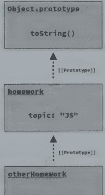
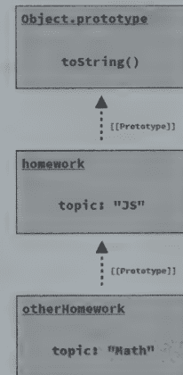
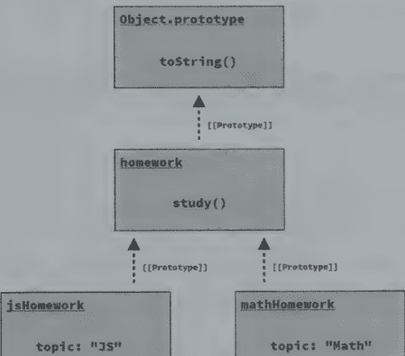

# 认识 JavaScript：你还不知道 JS：16+

我必须首先感谢我的妻子和孩子们，他们持续的支持是我能够继续下去的动力。我想感谢“你还不懂 JS”（第一版）Kickstarter 的 500 名原始资助者，以及以后购买并阅读这些书的数十万读者。没有你们的资金支持，第二版就不会出现。还要感谢某鸟类社交媒体公司的采访者，他说我“对 JS 的了解不够”……你帮助我为这个系列命名。

接下来，我目前的职业道路很大程度上归功 Marc Grabanski 和 Frontend Masters。Marc 多年前给了我一个机会，并给了我第一次教学的机会，如果没有那次机会，我不会成为一名作家！Frontend Masters 是 YDKJS 第二版的首席赞助商。感谢 Frontend Masters（以及 Marc）。

最后，感谢我的编辑 Simon St.Laurent，他帮助我构思了最初的 YDKJS，并是我的第一本书编辑。Simon 的支持和指导对我产生了深远的影响，是我塑造今天今天作家的不可或缺的一部分。从我们多年前在 Driskill 享用的那些时光开始（YDKJS 就是在那里诞生的），直到今天，非常感谢 Simon 润色并改进了这些书！

- 建议 . . . . . . . . . . . . . . . . . . . . . . . . . . . . . . . . . . . 118

因为正如我自己发现的，你可能（还不）了解 JavaScript。

~~

Brian Holt

高级项目经理

Azure 上 Visual Studio Code 和 Node.js

Microsoft

# 前言

欢迎阅读广受赞誉的《你不知道 JavaScript》(You Don’t Know JS, YDKJS) 系列第二版：《你尚未懂 JavaScript》(You Don’t Know JS Yet, YDKJSY)。

如果你读过第一版的任何一本书，你可以期待在这些新书中看到一种全新的方法，其中包含了对过去五年中 JS 变化之处的大量更新覆盖。但我希望并相信，你仍将获得同样的承诺：尊重 JS，并深入挖掘其真正运行的原理。

如果这是你第一次阅读这些书籍，我很高兴你在这里。准备好开启进入 JavaScript 每一个角落的深邃而广阔的旅程吧。

如果你是编程或 JS 的新手，请注意，这些书籍并不打算作为一份温和的“JavaScript 入门”。这些内容有时是复杂且具有挑战性的，并且比通常初次学者的水平要深得多。无论你的背景如何，我们都欢迎你，但这些书籍的编写假设你已经熟悉 JS，并且至少有 6 到 9 个月的经验。

# 各部分

这些书籍对待 JavaScript 的方式与《优秀的部分》(The Good Parts) 对待该语言的方式完全相反。不，这并不意味着我们正在看糟糕的部分，而是探索所有的部分。

你可能被别人告诉过，或者自己感觉到，JS 是一种有深度缺陷的语言，设计糟糕且实现上不一致。许多人声称它是世界上最糟糕且最流行的语言；没有人写 JS 是因为他们想写，仅仅是因为它处于 Web 世界的中心，不得不写。这是一个荒谬、不健康且完全傲慢的论点。

数百万开发者每天都在编写 JavaScript，其中许多人都欣赏并尊重这门语言。

就像任何伟大的语言一样，它既有精辟的部分，也有伤疤。即使是 JavaScript 的创始人 Brendan Eich 自己也对其中某些部分叹息为错误。但他错了：它们根本不是错误。JS 之有今天今天——成为世界上无处不在且影响最大的编程语言——正是因为了所有的部分。

不要相信那种谎言，认为你应该只学习和使用一小部分优秀的内容，而避开所有坏东西。不要相信那种“X 是新的 Y”的江湖骗，认为语言的某项新功能会瞬间让之前功能的所有用法变得过时且无知。当有人说你的代码不“现代”，是因为它还没有使用一个几周前才提出的阶段 0 特性时，请不要听他们的！

JS 的每一个部分都是用的。某些部分比其他部分更有用。某些部分要求你更加小心和有针对性。

我发现，只使用该语言所提供的极小部分就试图成为一个真正有效的 JavaScript 开发者是荒谬的。你能想象一个工具箱装满工具的建筑工人，只用他的锤子，并嘲笑螺丝刀或卷尺很低级吗？那太愚蠢了。我不保留地认为，你应该去学习 JavaScript 的所有部分，并在适当的地方使用它们！如果我足够大胆地建议的话：是时候抛弃任何告诉你相反意见的 JS 书籍了。

# 标题

那么，这个系列的标题到底是什么意思？

我并不是通过批评你目前对 JavaScript 缺乏知识或理解来侮辱你。我不是在暗示你不能或不会学习 JavaScript。我不是在吹嘘某种只有我和极少数人拥有的秘密高级内部智慧。

说认真的，在人们阅读书籍之前，所有这些都是对原始系列标题的真实反应。而且它们是没有根据的。

“你尚未懂 JavaScript”这个标题的主要要点在于，大多数 JS 开发者并没有花时间去真正理解他们写的代码是如何运行的。他们知道它是通的——它产生了预期的结果。但他们要么不清楚具体是如何运行的，更糟的是，在近距离观察时，对它如何出错有一套不准确的心理模型。

我正在向读者提出一个温和但诚恳的挑战：放下你对 JS 的假设，用全新的眼光和被激发的好奇心来面对它，这种好奇心将引导你为你写的每一行代码提问。为什么它要那样做？为什么其中这种方式比你可能完成任务的另外六种方式更好或更合适？

为什么所有的“大红人”都说对你的代码要执行 X，但事实证明 Y 可能是更好的选择？

我在标题中加入了“Yet（尚未）”，不仅是因为它是第二版，还因为我最终我希望这些书籍能以一种充满希望而非沮丧的方式来挑战你。

但让我明确一点：我不认为可能完全了解 JS。那不是一种可以获得的成就，而是一个需要努力追求的目标。你不会结束对 JS 的所有了解，你只是随着与这门语言相处的时间增加而不断学习更多。钻得越深，你就越会重新审视以前的知识，并从那个更有经验的视角重新学习它。

我鼓励你针对 JavaScript，事实上是针对整个软件开发，采取一种心态：你永远无法完全精通它，但你并且应该继续努力以接近那个目标，这段旅程将贯穿你的整个软件开发生涯乃至未来。

你总是可以比现在更了解 JS。这就是我希望这些 YDKJSY 书籍所代表的。

# 任务

其实并不需要论证开发者为什么要认真对待 JS——我认为没必要。我并不是说开发者应该认真对待 JS 的理由。但我需要一个不同的、更重要的理由来论证这一点，而且这些书籍是为了帮助你面临的挑战。

我非常高兴你开启了这段旅程，我很荣幸你会在沿途中考虑并参考这些书籍。现在是时候开始了解 JS 了。

# 第 1 章：什么是 JavaScript？

你还不了解 JS。我也不了解，至少没有完全了解。我们大家都不。但我们都可以开始更深入地了解 JS。

在《你不知道 JS》（You Don't Know JS Yet，简称 YDKJSY）系列的第一本书的第一章，我们将花一些时间建立一个基础，以便继续前进。我们需要首先从涵盖一些重要的背景准备工作开始，消除一些关于这种语言真实本质（以及不是什么！）的迷思和误解。

这是对 JS 如何组织和维护的身份及过程的宝贵见解；所有的 JS 开发者都应该理解它。如果你想了解 JS，这就是在这段旅程中迈第一步的方式。

## 关于本书

我强调“旅程”这个词，因为了解 JS 不是一个终点，而是一个方向。无论你在这个语言上花费了多少时间，你总能发现其他需要学习和稍加理解的内容。所以，不要把这本书看作是为了快速获得成就而匆忙读完的东西。相反，在你迈这几步时，耐心和坚持是最好的选择。

在完成这个背景章节后，书的其他部分将勾勒出一个高层地图，展示你在通过 YDKJSY 系列书籍深入学习 JS 时会发现的内容。

特别是，第 4 章确定了围绕 JS 语言组织的三个主要支柱：作用域/闭包、原型对象以及类型/强制类型转换。JS 是一个宽泛且复杂的语言，具有许多功能和能力。但所有的 JS 都建立在这些三个基础支柱之上。

请记住，尽管这本书标题为“入门”（Get Started），但它并不是一本给初学者的介绍级书籍。这本书的主要任务是为你在整个系列后续章节深入学习 JS 做准备；它的编写假设是你在继续学习 YDKJSY 之前已经具备了至少几个月的 JS 经验。因此，为了从《入门》中获得最大的收获，请确保你花大量时间编写 JS 代码来积累经验。

即使你之前已经写过很多 JS，这本书也不应该被草草浏览或跳过；请花时间充分消化这里的材料。良好的开始始终取决于坚实的第一步。

## 这个名字是怎么回事？

JavaScript 这个名字可能是被误解最深的编程语言名称。

这种语言与 Java 有关系吗？它只是 Java 的脚本形式吗？它只用于编写脚本而不是真正的程序吗？

事实是，JavaScript 这个名字是营销噱头的产物。当布伦丹·艾艾奇（Brendan Eich）首次构思这种语言时，给它的代号是 Mocha。在网景（Netscape）内部，使用的是 LiveScript 品牌。但当需要为该语言命名时，“JavaScript”赢得了投票。

为什么？因为这种语言最初的设计是为了吸引主要是 Java 程序员的受众，而且“script”（脚本）一词在当时流行指的是轻量级程序。这些轻量级“脚本”将是第一批嵌入到名为“网页”的新事物页面中的代码！

换句话说，JavaScript 是一种营销策略，试图将这种语言定位为当时更笨重、更为人知的 Java 的一种替代方案。事实上，它完全可以被称为“WebJava”。

JavaScript 的代码与 Java 代码之间存在一些表面上的相似之处。这些相似性并非源于共同开发，而是因为这两种语言都针对开发者，且这些开发者预期了来自 C（以及在某种程度上来自 C++）的语法。

例如，我们使用 `{` 开始代码块，使用 `}` 结束该代码块，就像 C/C++ 和 Java 一样。我们还使用 `;` 作为语句结束的标点。

在某些方面，法律关系比语法要深得多。仍然拥有并运行 Java 的公司甲骨文（通过太阳太阳公司/Sun）也拥有“JavaScript”名称的官方商标（通过网景）。这个商标几乎从不被强制执行，而且在目前可能也无法执行。

正由于这些原因，有些人建议我们直接用 JS 而不是 JavaScript。这是一种非常常见的缩写，尽管它不是一个官方语言进行自我品牌化时的理想候选词。事实上，这些书籍几乎完全使用 JS 来指代这种语言。

为了进一步拉开语言与 Oracle 拥有商标的距离，由 TC39 指定并由 ECMA 标准组织正式化的语言官方名称是 ECMAScript。事实上，自 2016 年以来，官方语言名称还加上了修订年份后缀；在写本文时，它是 ECMAScript2019，或者缩写为 ES2019。

换句话说，在你浏览器或 Node.js 中运行的 JavaScript/JS 是 ES2019 标准的实现。

## 注意

> 不要使用像“JS6”或“ES8”这样的术语来指代这种语言。不要，这些术语只会增加困惑，你应该坚持使用“ES20xx”或“JS”。

无论你叫它 JavaScript、ECMAScript 还是 ES2019，它绝对不是 Java 语言的变体！

> “Java 之于 JavaScript，就像火腿之于兔子。” - Jeremy Keith, 2009

## 语言规范

我提到了 TC39，这是管理 JS 的指导委员会。TC39 由 50 到 100 名来自浏览器和设备制造商的不同人员组成。他们通常每两个月开一次会，通常持续三天，以审查工作并对提案进行投票。

所有提案都通过一个五阶段的过程。你可以在这里阅读更多关于该过程的信息：https://tc39.es/process-document/

阶段 0 意味着 TC39 的成员认为这是一个值得的想法并计划主导它。你必须有一个 TC39 成员主导某个提案，它才能正式被视为“阶段 0”。

一旦提案达到“阶段 4”状态，它就有资格被纳入语言的下一个修订版本中。一个提案完成这些阶段可能需要几个月到几年不等。

所有提案都在 TC39 的 Github 上公开管理：https://github.com/tc39/proposals

无论是否为 TC39 成员，都欢迎参与这些公开讨论和处理提案的过程。然而，只有 TC39 成员可以参加会议对提案和更改进行投票。

与某些既定且令人沮丧的迷思相反，野外并没有多个版本的 JavaScript。只有一种 JS，即由 TC39 和 ECMA 维护的官方标准。

在 2000 年代初期，当微软维护一个名为“Script”的派生且逆向工程且不完全兼容的 JS 版本时，确实存在“多个版本的”JS。但那些日子一去不复了。现在对 JS 这种说法是过时且不准确的。

换句话说，JS 在 Web 浏览器中的实现方式，在实际操作中，才是唯一有意义的现实。

在大多数情况下，规范中定义的 JS 与在浏览器 JS 引擎中运行的 JS 是相同的。但存在一些必须考虑的差异。

有时 JS 规范会规定某些新的或精化的行为，但这些行为与浏览器 JS 引擎中的运行方式并不完全匹配。这种不匹配是历史性的：JS 引擎在某些功能的边缘案例上已经有了 20 多年的可观测行为，而这些行为已成为 Web 内容赖赖。因此，有时 JS 引擎会拒绝遵循规范所制定的更改，因为这会破坏那些 Web 内容。

在这些情况下，TC39 通常会回溯，并简单地让规范适应 Web 的现实。例如，TC39 计划为数组添加一个 `contains(..)` 方法，但发现该名称与某些网站仍在使用的旧 JS 框架冲突，因此他们将名称更改为不冲突的 `includes(..)`。同样的事情也发生在一场被称为“smooshgate”的 JS 社区喜剧/悲剧危机中，其中计划中的 `flatten(..)` 方法最终被重命名为 `flat(..)`。

但偶尔，TC39 会决定规范在某些点上应该坚持立场，尽管浏览器 JS 引擎可能永远不会遵循。

解决方案是什么？附录 B，“Web 浏览器的附加 ECMAScript 特性”。¹ JS 规范包含了此附录，详细说明了官方 JS 规范与 Web JS 现实之间的任何已知不匹配。

> ^ECMAScript 2019 Language Specification. Appendix B: Additional ECMAScript Features for Web Browsers, https://www.ecma-international.org/ecma-262/10.0/#sec-additional-ecmascript-features-for-web-browsers (截至 2020 年 1 月本文编写时的最新版本)

# 你还不了解 JS：入门

换句话说，这些是仅允许 Web JS 使用的异常；其他 JS 环境必须遵守法律。

B.1 节和 B.2 节涵盖了 Web JS 包含的 JS 扩展（语法和 API），这同样出于历史原因，但 TC39 并没有在 JS 核心中对其进行正式规范。示例包括带前缀的八进制字面量、全局 `escape(..)` / `unescape(..)` 字符串“助手”（如 `anchor(..)` 和 `blink()` 以及正则表达式的 `compile(..)` 方法。

B.3 节包含了一些冲突，代码可能在 Web 和非 Web JS 引擎中运行，但其行为可能明显不同，导致不同的结果。列出的大多数更改都涉及代码在严格模式下运行时被标记为早期错误的情况。

附录 B 的陷阱并不经常遇到，但为了未来的安全性，避免使用这些结构仍然是一个好主意。只要可能，请遵循 JS 规范，不要依赖仅适用于某些 JS 引擎环境的行为。

## 并非所有（Web）JS...

这段代码是一个 JS 程序吗？

```js
alert("Hello, JS!");
```

这取决于你如何看待问题。这里显示的 `alert(..)` 函数没有包含在 JS 规范中，但它于所有的 Web JS 环境。然而，你不会在附录 B 中找到它，这是为什么？

各种 JS 环境（如浏览器 JS 引擎、Node.js 等）会在你的 JS 程序的全局作用域中添加 API，为你提供特定环境的能力，例如能够在用户的浏览器中弹出 alert 样式的框。

事实上，广泛的类 JS 的 API，如 `fetch(..)`、`getCurrentLocation(..)` 和 `getUserMedia(..)`，都是看起来像 JS 的 Web API。在 Node.js 中，我们可以从各种内置模块访问数百个 API 方法，如 `fs.write(..)`。

另一个常见的例子是 `console.log(..)`（以及所有其他 `console.*` 方法！这些没有在 JS 中规范，但因为它们的通用实用性，根据大致一致的共识，几乎每个 JS 环境都定义了它们。

所以 `alert(..)` 和 `console.log(..)` 并不是 JS 定义的。但它们看起来像 JS。它们是函数和对象方法，并遵守 JS 语法规则。它们背后的行为由运行 JS 引擎的环境控制，但在表面上，它们必须遵守 JS 才能在 JS 游场中运行。

人们抱怨“JS 太太不一致了！”的大多数跨浏览器差异实际上是由于这些环境行为工作方式的差异，而不是 JS 本身工作方式的差异。

所以调用 `alert(..)` 是 JS，但 `alert` 本身只是一个访客，不是官方 JS 规范的一部分。

## 它并不总是 JS

在浏览器开发者工具（或 Node）中使用控制台/REPL（读取-执行-打印循环）初看之下是一个非常直接的 JS 环境。

# 第 1 章：什么是 JavaScript？

但实际上并不是的。

开发者工具是……面向开发者的工具。它们的主要目的是让开发者的生活变得更轻松。它们优先考虑 DX（开发者体验）。此类工具的目标并不是准确纯粹地反映严格规范 JS 行为的所有细微差别。因此，如果你将控制台视为纯粹的 JS 环境，可能会遇到许多所谓的“陷阱”。

顺便说一下，这种便利性是好事！我很高兴开发者工具让开发者的生活更轻松！我很高兴我们有变量/属性自动补全等良好的 UX 魅力。我只是指出，我们不能期望此类工具始终严格遵循 JS 程序的处理方式，因为那并不是这些工具的目的。

由于此类工具在浏览器之间的行为各异，但……只要可能，请遵循 JS 规范，不要依赖仅适用于某些 JS 引擎环境的行为。


由于此类工具的行为随浏览器而异，但……由于可能，这同样出于历史原因，但 TC39 并没有计划在 JS 核心中 其进行正式规范。示例包括带前缀的八进制字面量、全局 `escape(..)` / `unescape(..)` 字符串“助手”（如 `anchor(..)` 和 `blink()` 以及正则表达式的 `compile(..)` 方法）。

B.3 节包含了一些冲突，代码可能在 Web 和非 Web JS 引擎中运行，但其行为可能明显不同，导致不同的结果。列出的大多数更改都涉及代码在严格模式下运行时被标记为早期错误的情况。

附录 B 的陷阱并不经常遇到，但为了未来的安全性，避免使用这些结构仍然是一个好主意。只要可能，请遵循 JS 规范，不要依赖仅适用于某些 JS 引擎环境的行为。

## 向后兼容与向前兼容

引导 JavaScript 的核心原则之一是保持向后兼容（backwards compatibility）。许多人对这个术语的含义感到困惑，并经常将其与相关但不同的术语：向前兼容（forwards compatibility）混淆。

让我们明确这一点。

向后兼容意味着一旦某些内容被接受为有效的 JS，语言未来就不会有任何更改导致该代码变成无效的 JS。1995 年编写的代码——无论它是多么原始或局限！——在今天应该仍然可以运行。正如 TC39 成员经常宣称的那样：“我们不会破坏 Web。”

这种理念是，JS 开发者可以放心地编写代码，不必担心代码会因为浏览器的更新发布而不可预测地停止工作。这使得为程序选择 JS 成为一项明智且安全的投资，并可以持续未来多年。

“保证”绝非小事。在语言跨越近 25 年的发展历史中，维护向后兼容造成了巨大的负担和一系列独特的挑战。在计算领域，很难找到许多其他对向后兼容做出如此承诺的例子。

坚持这一原则的代价不应被轻易忽视。它不可避免地为引入或扩展语言设置了极高的门槛；任何决策在实际上都变成了永久性的，无论是否有错误。一旦它进入了 JS，就无法被移除，因为可能会破坏程序，即使我们真的非常想要移除它！

# 第 1 章：什么是 JavaScript？

这一规则有极少数例外。JS 确实出现过一些不向后兼容的更改，但 TC39 在这样做时极其谨慎。他们研究 Web 上的现有代码（通过浏览器数据收集）来估算此类破坏的影响，浏览器最终会决定并投票，看是否愿意为了极小规模的破坏而承担用户的压力，以换取修复或改进语言某些方面能为更多网站以及用户带来的收益。

这类变化非常罕见，而且几乎总是发生在使用中的边缘情况下，这些情况在许多站点中不太容易观测到破坏。

将向后兼容与其对应的向前兼容进行对比。向前兼容意味着，在程序中包含语言的新特性，不会导致该程序在旧版本的 JS 引擎中运行时发生崩溃。JS 并不是向前兼容的，尽管许多人希望它是如此，甚至错误地相信了这一神话。

相比之下，HTML 和 CSS 是向前兼容但不可向后兼容的。如果你挖掘 1995 年编写的 HTML 或 CSS，它们完全可能在今天无法运行，或运行方式不同。但是，如果你在 2010 年的浏览器中使用 2019 年的新功能，页面并不会“崩溃”——无法识别的 CSS/HTML 会跳过，而其余 CSS/HTML 将被相应处理。

在编程语言设计中包含向前兼容似乎是理想的，但这样做通常是不切实际的。标记（HTML）或样式（CSS）本质上是声明性的，因此更容易“跳过”未识别的声明，而对其他声明的影响降到最低。

但如果编程语言引擎选择性地跳过它不理解的语句（甚至是表达式！），将会导致混乱和不确定性，因为无法确保程序的后续部分不是期望那个被跳过的部分已经过处理。

尽管 JS 并不是也无法做到向前兼容，但意识到 JS 的向后兼容至关重要，包括它对 Web 带来的持久益处，以及这因此给 JS 带来的限制和困难。

## 跨越鸿沟

由于 JS 不是向前兼容的，这意味着你能够编写的有效 JS 代码与你的站点或应用程序需要支持的最旧引擎之间，始终存在代沟的可能。如果你在 2016 年的引擎中运行使用 ES2019 特性的程序，你很可能会看到程序崩溃和报错。

如果该特性是一个新语法，程序通常将完全无法编译和运行，通常会抛出语法错误。如果该特性是一个 API（例如 ES6 的 `Object.is()`），程序可能会运行到某个点，但之后一旦遇到对未知 API 的引用，就会抛出运行时异常并停止。

这是否意味着 JS 开发者应该始终落后于进步步伐，只使用他们需要支持的最旧 JS 环境边缘的代码呢？不！

但确实意味着 JS 开发者需要特别留心来解决这一鸿沟。

对于新的且不兼容的语法，解决方案是转译（transpiling）。转译是一个人为创造且由社区发明的术语，用于描述使用工具将程序的源代码从一种形式转换为另一种形式（但仍然是文本源码）。通常，与语法相关的向前兼容问题通过使用转译器（最常用的是 [Babel](https://babeljs.io/)）来从较新的 JS 语法版本转换为等效的旧语法来解决。

例如，开发者可能会编写这样一段代码：

```js
if (something) {
  let x = 3;
  console.log(x);
} else {
  let x = 4;
  console.log(x);
}
```

这就是该代码在应用程序源码树中的样子。但在生成要部署到公共网站的文件时，Babel 转译器可能会将代码转换成像这样：

```js
var x$0, x$1;
if (something) {
  x$0 = 3;
  console.log(x$0);
} else {
  x$1 = 4;
  console.log(x$1);
}
```

原始代码依赖 `let` 在 `if` 和 `else` 子句中创建块作用域变量，从而互不干扰。Babel 生成的等效程序通过选择不同的名称产生相同的非干扰结果。

## 注意

`let` 关键字是在 ES6（2015 年）中添加的。之前的转译示例仅在应用程序需要在不支持 ES6 的环境中运行时才适用。这里的示例仅为了说明。当 ES6 是新的时，这种转译的需求非常普遍，但在 2020 年，支持非 ES6 环境已不再常见。因此，转译的“目标”是一个随着站点或应用程序停止支持某些旧浏览器而向上移动的窗口。

你可能会想：为什么要费劲使用工具从新语法版本转换为旧版本？我们不能直接写两个变量并跳过 `let` 关键字吗？原因是，强烈建议开发者使用最新版本的 JS，以便其代码简洁并最有效地表达思想。

开发者应该专注于编写简洁的新语法形式，让工具负责生成适用于部署和运行在旧支持引擎环境中的向前兼容版本。

## 填补鸿沟

如果向前兼容问题与新语法无关，而是最近添加的缺失 API 方法，最常见的解决方案是为缺失的 API 方法提供一个定义，就像旧环境已经原生定义了它一样。这种模式被称为填充（polyfill，也叫 shim）。

考虑这段代码：

```js
// getSomeRecords() 为我们返回一个它将获取的数据的 promise
var pr = getSomeRecords();

// 在获取数据时显示 UI 旋转器
startSpinner();

pr
  .then(renderRecords)    // 如果成功则渲染
  .catch(showError)       // 如果失败则显示错误
  .finally(hideSpinner)   // 始终隐藏旋转器
```

这段代码使用了 ES2019 特性，即 promise 原型上的 `finally(..)` 方法。如果代码在预 ES2019 环境中使用，`finally(..)` 方法将不存在，会导致错误。

预 ES2019 环境的 `finally(..)` 填充可能像这样：

```js
if (!Promise.prototype.finally) {
  Promise.prototype.finally = function f(fn) {
    return this.then(
      function t(v) {
        return Promise.resolve(fn())
          .then(function t() {
            return v;
          });
      },
      function c(e) {
        return Promise.resolve(fn())
          .then(function t() {
            throw e;
          });
      }
    );
  };
}
```

## 警告

这只是对 `finally(..)` 的一个基础（并非完全符合规范）的填充函数（polyfill）的简单示例。不要在你的代码中使用此 polyfill；尽可能始终使用健壮的、官方 polyfill，例如 ES-Shim 中的 polyfills/shims 集合。

`if` 语句通过防止在 JS 引擎已经定义了该方法的环境中运行，从而保护了 polyfill 的定义。在较旧的环境中，该 polyfill 被定义；但在较新的环境中，该语句会被静默跳过。

像 Babel 这样的转译器通常会检测你的代码需要哪些 polyfill，并自动为你提供。但是，你偶尔可能需要显式地包含或定义它们，这与我们刚刚看到的代码片段类似。

始终使用最合适的特性编写代码，以有效地传达其思想和意图。通常情况下，这意味着使用最新的稳定 JS 版本。避免通过尝试手动调整语法或 API 差异对代码的可读性产生负面影响。那是工具的作用！

转译（Transpilation）和填充（polyfilling）是解决代码与网站或应用程序仍需支持的旧环境之间差距的两种非常有效的技术。由于 JS 不会停止改进，这种差距永远不会消失。未来，这两种技术都应该作为每个 JS 项目生产链的标准部分被接受。

## 解析过程中发生了什么

关于 JS 编写的代码，有一个争论已久的问题：它是解释型脚本还是编译型程序？大多数意见认为 JS 是一种解释型（脚本型）语言。但事实比这更复杂。

在编程语言的大部分历史中，“解释”语言和“脚本”语言被认为比它们的编译语言低等。产生这种敌对情绪的原因有很多，包括被认为缺乏性能优化，以及对某些语言特性的反感，例如脚本语言通常使用动态类型，而不是“更成熟”的静态类型语言。

被视为“编译”的语言通常会产生程序的可移植（二进制）表示，并分发以便以后执行。由于我们没有在 JS 中真正观察到那种模型（我们分发的是源代码，而不是二进制形式），许多人声称 JS 不属于这一类。事实上，在过去的几十年里，程序“可执行”形式的分发模型已经变得极其多样，而且相关性降低了；对于当前的问题，传递什么形式的程序并不那么重要。

这些误导性的主张和批评应该被搁置。弄清楚 JS 是解释型还是编译型的真正意义在于它与错误处理的本质有关。

从历史上看，脚本或解释型语言通常以自上而下和逐行的方式执行；在开始执行之前，通常不会对程序进行初始处理（见图 1）。


图 1：解释型/脚本型执行

在脚本或解释型语言中，程序第 5 行的错误在第 1 到第 4 行已经执行后才会被发现。需要注意的是，第 5 行的错误可能是由于运行时条件导致的，例如某些变量或值对于操作来说是不合适的值，也可能是由于该行上格式不正确的语句或命令。取决于上下文，将错误处理推迟到错误发生的行上可能是理想的，也可能是不理想的。

将其与那些在任何执行之前都会经过一个处理步骤（通常称为解析）的语言进行比较，如图 2 所示：


图 2：解析 + 编译 + 执行

在这种处理模型中，第 5 行的无效命令（如损坏的语法）将在任何执行之前的解析阶段被捕获，整个程序都不会运行。对于捕获语法（或其他“静态”）错误，通常倾向于在任何部分执行完成之前获知这些错误。

那么，“经过解析的”语言与“编译型”语言有什么共同点呢？首先，所有编译语言都是经过解析的。因此，一种经过解析的语言在走向编译的道路上已经走了很远。在经典的编译理论中，解析后的最后一个步骤是代码生成：产生可执行形式。

一旦任何源程序被完全解析，其随后的执行通常会以某种形式包含从程序的解析后形式（通常称为抽象语法树（AST））到该可执行形式的翻译。

换句话说，经过解析的语言通常在执行之前也执行代码生成，因此说它们在精神上是编译的，并不算牵强。

那么这些细节归根结底意味着什么呢？退后一步，考虑 JS 源程序的整个流程：

1. 在程序离开开发者编辑器后，它被 Babel 转译，然后被 Webpack 打包（以及可能的其他过程），然后以这种非常不同的形式交付给 JS 引擎。
2. JS 引擎解析代码生成 AST。
3. 然后引擎将该 AST 转换为某种字节码，一种二进制中间表示（IR），然后由优化的 JIT 编译器进一步精炼或转换。
4. 最后，JS 虚拟机执行程序。

为了可视化这些步骤，再次查看：


图 3：JS 的解析、编译和执行

JS 是更像图 1 那样的解释型、逐行脚本，还是更像在执行之前先经过一次或多次处理的编译型语言（如图 2 和图 3 所示）？

我认为从精神上（即使不是实践中），JS 是一种编译型语言。

而且再次，这的意义在于，由于 JS 是编译的，我们在代码执行之前就能获知静态错误（如格式错误的语法）。这与我们从传统的“脚本”程序获得的交互模型在本质上是不同的，而且更有帮助！

## WebAssembly（WASM）

驱动 JS 演进的一大核心关注点是性能，包括 JS 解析或编译的速度有多快，以及这些编译后的代码执行速度有多快。

2013 年，来自 Mozilla Firefox 的工程师演示了将 Unreal 3 游戏引擎从 C 移植到 JS。这段代码能够在浏览器 JS 引擎中以全速 60fps 的性能运行，这基于一组优化，即 JS 版本的 Unreal 引擎代码使用了一种倾向于 JS 语言子集的代码风格，该子集被称为“ASM.js”。

这个子集是有效的 JS，但其编写方式在普通编码中并不常见。然而，它向引擎传达了某些重要的类型信息，使其能够进行关键优化。ASM.js 的引入是解决 JS 运行时性能压力的一种方式。

但重要的是，ASM.js 并非设计用于由开发者编写的代码，而是从另一种语言（如 C）转译后的程序的表示形式，其中这些类型“注释”是由工具自动插入的。

在 ASM.js 证明了通过工具创建版本的程序可以被 JS 引擎更高效地处理后的几年，另一组工程师（最初也来自 Mozilla）发布了 WebAssembly（WASM）。

WASM 与 ASM.js 的相似之处在于，它的原始意图是为非 JS 程序（如 C）提供一种转换为可在 JS 引擎中运行的形式。与 ASM.js 不同，WASM 选择通过一种完全不同于 JS 的形式表示程序，从而在程序执行之前绕过 JS 解析或编译中的某些固有延迟。

WASM 是一种更类似于汇编（因此得此名）的表示格式，可以通过跳过 JS 引擎通常进行的解析或编译来由 JS 引擎处理。针对 WASM 的程序的解析或编译是提前完成的（AOT）；分发的是一个二进制打包程序，准备好让 JS 引擎以极小的开销执行。

WASM 的初始初衷之一显然是潜在的性能提升。虽然这仍然是一个重点，但 WASM 的另一个动力是希望为非 JS 语言进入 Web 平台提供更多对等性。例如，如果 Go 等语言支持多线程编程，但 JS（语言）不支持，WASM 提供了将此类 Go 程序转换为 JS 引擎可以理解的形式的潜力，而无需在 JS 语言本身中引入线程功能。

换句话说，WASM 缓解了为 JS 添加功能的压力，而这些功能大部分或专门仅供从其他语言转译的程序使用。这意味着 JS 特性的开发可以由 TC39 进行判断，而不受到其他语言生态系统利益或需求的偏斜，同时让这些语言拥有进入 Web 的可行路径。


关于 WASM 的另一个视角正在浮现，有趣的是，它甚至不与 Web（W）直接相关。WASM 正在演变成某种跨平台的虚拟机（VM），程序可以在其中编译一次并在各种不同的系统环境中运行。

因此，WASM 不仅用于 Web，而且 WASM 也不是 JS。

讽刺的是，尽管 WASM 运行在 JS 引擎中，但 JS 语言是编写 WASM 程序最不合适的语言之一，因为 WASM 高度依赖静态类型信息。即使是 TypeScript（TS）——表面上是静态类型——（目前）也不太适合转译为 WASM，尽管像 AssemblyScript 这样的语言变体试图弥补 JS/TS 与 WASM 之间的差距。

这本书不是关于 WASM 的，所以我不会再花很多时间讨论它，除非说明最后一点。有些人建议 WASM 指向了一个 JS 在 Web 中被剔除或最小化的未来。这些人通常对 JS 怀有恶意，想要用另一种语言——任何其他语言！来取代它。由于 WASM 让其他语言能够在 JS 引擎中运行，从表面上看这并不是完全虚幻的童话。

我只需简单说明：WASM 不会取代 JS。WASM 显著增强了 Web（包括 JS）能够实现的能力。这是一件很好的事情，与人们是否会将其作为逃避编写 JS 的出口无关。

## 严格来说（Strictly Speaking）

回到 2009 年 ES5 发布时，JS 增加了严格模式作为一种鼓励编写更好 JS 程序的开启机制。

严格模式的益处远大于代价，但旧习惯难以改变，且现有（即“遗留”）代码库的惯性很难被打破。遗憾的是，在 10 年后的今天，严格模式的可选项性意味着它对 JS 程序员来说仍然不是默认设置。

# 第一章：什么是 JavaScript？

为什么是严格模式？严格模式不应被视为对你不能做什么的限制，而应被视为一种最佳实践指南，以便 JS 引擎有最好的机会优化和高效运行代码。大多数 JS 代码是由开发者团队维护的，因此严格模式的严谨性（以及 linter 等工具！）通过避免非严格模式下漏掉的一些更有问题的错误来帮助代码协作。

大多数严格模式控制以早期错误的形式出现，即并非严格的语法错误，但在编译阶段（代码运行之前）抛出的错误。例如，严格模式不允许对两个函数参数重名，这会导致早期错误。其他严格模式控制仅在运行时可见，就像这样。

# 第 2 章：JS 概述

学习 JS 的最好方法就是开始编写 JS。

要做到这一点，你需要了解这种语言是如何运作的，这正是我们在这里的重点。即使你以前用过其他语言编写过程序，也要花时间熟悉 JS，并确保练习每一个部分。

本章并不是对 JS 语言每一个语法细节的详尽参考。它也不打算作为一份完整的“JS 入门”入门教程。

相反，我们将对该语言的一些主要主题领域进行概述。我们的目标是让你对它有一个更好的感觉，这样我们就能更有心地向前，编写自己的程序。在你阅读本书其余部分以及该系列的其他章节时，我们将以越来越详细的方式重新回顾这些许多主题。

请不要期望这一章可以快速读完。它很长，有很多许多细节可以细味。请慢慢来。

## 提示

如果你还在熟悉 JS，我建议你预留大量的额外时间来学习这一章。针对每个章节，花时间思考并探索该主题。查阅现有的 JS 程序，并将你看到的内容与这里介绍的代码、解释（以及观点！）进行比较。有了对 JS 本质的扎实基础，你将从本书及系列的其余部分中收获更多。

## 每个文件都是一个程序

你使用的几乎每个网站（Web 应用程序）由许多不同的 JS 文件（通常带有 `.js` 文件扩展名）组成。人们很容易将整个部分（应用程序）看作一个程序。但 JS 的观点不同。

在 JS 中，独立的文件是它自己独立的程序。

这之所以重要，主要是为了错误处理。由于 JS 将文件视为程序，一个文件可能会失败（在解析/编译或执行期间），并且并不一定会阻止下一个文件的处理。显然，如果你的应用程序依赖于五个 `.js` 文件，而其中一个失败了，那么整个应用程序最理想也只能部分运行。确保每个文件都能正常工作，并且在可能的范围内，让它们尽可能优雅地处理其他文件的失败，是非常重要的。

考虑将独立的 `.js` 文件视为独立的 JS 程序可能会让你感到惊讶。从你使用应用程序的角度来看，它看起来确实是一个巨大的程序。这是因为应用程序的执行允许这些独立程序协作并像一个程序一样运行。

## 注意

许多项目使用构建工具，这些工具最终会将项目中的独立文件合并成单个文件，交付给网页。当发生这种情况时，JS 将这个单一合并文件视为整个程序。

多个独立 `.js` 文件作为单个程序运行的唯一方法是共享它们的状态（以及通过“全局作用域”对其公共功能的访问）。它们在全局作用域命名空间中混合，因此在运行时它们作为一个整体运行。

从 ES6 开始，JS 除了典型的独立 JS 格式外，还支持模块格式。模块也是基于文件的。如果一个文件通过模块加载机制（如 `import` 语句或 `<script type="module">` 标签）加载，它的所有代码都被视为单个模块。

尽管你通常不会将一个模块——一组状态以及操作该状态的公开暴露的方法集合——视为一个独立程序，但 JS 实际上仍然单独处理每个模块。类似于“全局作用域”允许独立文件在运行时混合，将一个模块导入另一个模块允许它们之间在运行时进行相互操作。

无论一个文件使用哪种代码组织模式（以及加载机制）（独立或模块），你都应该将每个文件视为它自己的（微型）程序，然后它可以与其他（微型）程序协作，以执行你整个应用程序的功能。

## 值

程序中最基本的信息单元是值。值是数据。它们是程序维持状态的方式。值在 JS 中有两种形式：原始值和对象。值使用字面量嵌入到程序中：

```js
greeting("My name is Kyle.");
```

在这个程序中，值 `"My name is Kyle."` 是一个原始字符串字面量；字符串是字符的有序集合，通常表示单词和句子。

我使用了双引号 `"` 来界定（包围、分离、定义）字符串值。但我也可以使用单引号 `'`。选择哪种引号字符完全取决于风格。为了代码的可读性和可维护性，重要的是选定一个，并在整个程序中一致地使用它。

界定字符串字面量的另一种选择是使用反引号 `` ` `` 字符。然而，这种选择不仅仅是风格上的，还存在行为上的差异。考虑一下：

```js
console.log("My name is ${firstName}.");
// My name is ${firstName}.
```

```js
console.log('My name is ${firstName}.');
// My name is ${firstName}.
```

```js
console.log(`My name is ${firstName}.`);
// My name is Kyle.
```

假设这个程序已经定义了一个字符串值为 `"Kyle"` 的变量 `firstName`，那么反引号界定的字符串就会将变量表达式（用 `${..}` 指明）解析为它的当前值。这被称为插值。

反引号界定的字符串可以在不包含插值表达式的情况下使用，但这违背了那种替代性字符串字面量语法的整个目的：

```js
console.log(
  `Am I confusing you by omitting interpolation?`
);
// Am I confusing you by omitting interpolation
```

更好的方法是对于字符串使用 `"` 或 `'`（再次，选一个并坚持下去），除非你需要插值；否则只将 `` ` `` 预留给包含插值表达式的字符串。

除了字符串外，JS 程序通常包含其他原始字面量值，如布尔值和数字：

```js
while (false) {
  console.log(3.141592);
}
```

`while` 代表一种循环类型，当条件为真时重复操作。

在这种情况下，循环永远不会运行（不会打印任何内容），因为我们使用了 `false` 布尔值作为循环条件。使用 `true` 将导致一个无限的循环，所以请小心！

数字 `3.141592` 如你所知，是数学 PI 的前六位近似值。然而，与其嵌入这样的值，你通常会使用预定义的 `Math.PI` 值。数字的另一个变体是 `bigint`（大整数）原始类型，用于存储任意大的数字。

数字在程序中通常用于计数步骤，例如循环迭代，以及访问数字位置的信息（即数组索引）。我们稍后会涵盖数组/对象，但作为一个示例，如果有一个名为 `names` 的数组，我们可以这样访问第二个位置的元素：

```js
console.log(`My name is ${names[1]}.`);
// My name is Kyle.
```

除了字符串、数字和布尔值，JS 程序中的另外两个原始值是 `null` 和 `undefined`。虽然它们之间存在差异（有些是历史性的，有些是现代的），但在大多数情况下值用于指示空（或缺失）。

许多开发者喜欢以这种一致的方式处理它们，即假设这些值是不可区分的。如果用心，这通常是可能的。然而，安全且最好的方法是将 `undefined` 作为唯一的空值，尽管 `null` 看起来输入起来更短！

```js
while (value != undefined) {
  console.log("Still got something!");
}
```

最后一个需要注意的原始值是一种特殊用途的值，其行为表现为一种隐藏且不可预测的值。符号（Symbol）几乎专门被用作对象中的特殊键：

```js
hitchhikersGuide[ Symbol("meaning of life")];
// 42
```

在典型的 JS 程序中，你不会经常遇到符号直接用法。它们主要用于库和框架等低级代码中。

## 数组与对象

除了原始类型外，JS 中的另一种值类型是对象值。

如前面提到的，数组是一种特殊的对象类型，由一个有序且通过数字索引的数据列表组成：

```javascript
var names = [ "Frank", "Kyle", "Peter", "Susan" ];
names.length;
// 4
names[0];
// Frank
names[1];
// Kyle
```

JS 数组可以包含任何值类型，无论是原始类型还是对象（包括其他数组）。正如我们在第 3 章末尾看到的，即使是函数也是可以存储在数组或对象中的值。

> 注意
> 函数和数组一样，是对象的特殊类型（也称为子类型）。我们稍后会详细介绍函数。

对象更具通用性：它是一个任何值的无序的、键键的集合。换句话说，你通过字符串位置名称（即“键”或“属性”）来访问元素，而不是它的数字位置（如数组）。例如：

```javascript
var me = {
  first: "Kyle",
  last: "Simpson",
  age: 39,
  specialties: ["JS", "Table Tennis"]
}

console.log(`My name is ${me.first}.`);
```

这里，`me` 代表一个对象，`first` 代表该对象中信息的位置。另一种通过属性/键访问对象信息的语法使用方括号 `[ ]`，例如 `me["first"]`。

## 值类型确定

为了区分值，`typeof` 运算符可以告诉你它的内置类型、原始类型，否则返回 `"object"`：

```javascript
typeof 42; // "number"
typeof "abc"; // "string"
typeof true; // "boolean"
typeof undefined; // "undefined"
typeof null; // "object" -- 噢，Bug！
typeof {"a": 1}; // "object"
typeof [1,2,3]; // "object"
typeof function hello(){}; // "function"
```

> 警告
> `typeof null` 遗憾地返回 `"object"` 而不是预期的 `"null"`。此外，`typeof` 对函数返回特定的 `"function"`，但对数组不是预期的 `"array"`。

从一种值类型转换为另一种值类型（例如从字符串转换为数字）在 JS 中被称为“强制类型转换”（coercion）。我们将在本章稍后的部分详细介绍这一点。

原始值和对象值在被赋值或传递时表现有所不同。我们将在附录 A，“值与引用”中介绍这些细节。

## 声明和使用变量

为了明确某些在上一节中可能并不显而易见的内容：在 JS 程序中，值可以以字面值的形式出现（如前面的许多示例所示），也可以存储在变量中；将变量想象为值的容器即可。

变量必须声明（创建）后才能使用。有多种语法形式可以声明变量（即“标识符”），每种形式都有不同的隐含行为。

例如，考虑 `var` 语句：

```javascript
var myName = "Kyle"
var age;
```

`var` 关键字声明一个要在程序该部分使用的变量，并允许可选初始化赋值。

另一个类似的关键字是 `let`：

```javascript
let myName = "Kyle"
let age;
```

`let` 关键字与 `var` 有一些不同，最明显的是 `let` 允许对变量名的访问范围比 `var` 更窄。这被称为“块作用域”（block scoping），区别于普通或函数作用域。

考虑：

```javascript
var adult = true;

if (adult) {
  var myName = "Kyle"
  let age = 39;
  console.log("嘘声，这是一个秘密！")
}

console.log(myName);
// Kyle

console.log(age);
// 错误！
```

在 `if` 语句外部访问 `age` 会导致错误，因为 `age` 被块作用域于 `if`，而 `myName` 没有。

块作用域对于限制程序中变量声明的范围非常有用，这有助于防止名称意外重叠。

但 `var` 仍然有用，因为它传达了“此变量将在更广泛的作用范围内（整个函数）可见”。这两种声明形式在程序的任何部分都可能是合适的，取决于具体情况。

## 注意

通常很建议避免使用 `var` 而使用 `let`（或 `const`！），这通常是因为人们认为 `var` 自 JS 诞生以来的作用域行为模式令人困惑。我认为这种建议过于限制性，且最终没有帮助。它假设你无法与其他功能结合来正确学习和使用某个功能。我相信你应该学习任何可用的功能，并在适当的地方使用它们！

第三种声明形式是 `const`。它像 `let`，但有一个额外的限制：它在声明时必须被赋值，并且之后不能重新赋值不同的值。

考虑：

```javascript
const myBirthday = true;
let age = 39;
if (myBirthday) {
  age = age + 1; // OK！
  myBirthday = false; // 错误！
}
```

`myBirthday` 常量不允许重新赋值。`const` 声明的变量并不是“不可变的”，它们只是不能重新赋值。在对象值上使用 `const` 是不明智的，因为即使变量不能改变，这些值仍然可以改变。

```javascript
const actors = [
"Morgan Freeman",
"Jennifer Aniston"
];

actors.push("Tom Cruise"); // OK！
actors = ["Tom Cruise"]; // 错误！
```

## 提示

如果你对对象或数组使用 `const`，你仍然可以修改其内容：

```javascript
const obj = { a: 1 };
obj.a = 2; // OK!

const arr = [1, 2];
arr.push(3); // OK!
```

`err` 是一个块作用域变量，只存在于 `catch` 中：

```javascript
try {
  someError();
} catch (err) {
  console.log(err);
}
```


`myBirthday` 常量不允许重新赋值。`const` 声明的变量并不是“不可变的”，它们只是不能重新赋值。在对象值上使用 `const` 是不明智的，因为即使变量不能改变，这些值仍然可以改变。

你可以根据需要接收任意数量的参数，从零到多个不等。每个参数都被分配你在调用时在该位置传递的参数值（在此处为 `"Kyle"`）。

函数还可以使用 `return` 关键字返回值：

```javascript
function greeting(myName) {
    return `Hello, ${myName}`;
}
```

```javascript
var msg = greeting("Kyle");

console.log(msg);    // Hello, Kyle!
```

你只能返回一个值，但如果你有更多值要返回，可以将它们封装成一个单一的对象/数组。

由于函数是值，它们可以赋值为对象的属性：

```javascript
var setToSay = {
    greeting() {
        console.log("Hello!");
    },
    question() {
        console.log("What's your name?");
    },
    answer() {
        console.log("My name is Kyle.");
    }
};
```

```
setToSay.greeting();
// Hello!
```

在此代码段中，`setToSay` 所持的对象包含了三个函数的引用（`greeting()`、`question()` 和 `answer()`）。可以通过访问属性来获取函数值并调用每个函数。将这种在对象上定义函数的简单风格与本章后面讨论的更复杂的类语法进行比较。

JS 中的函数有多种形式。我们将在附录 A“许多函数形式”中探讨这些变化。

## 比较

程序中的决策需要通过比较值来确定它们的身份以及彼此之间的关系。JS 有几种机制可以启用值比较，让我们仔细观察一下它们。

## 等于……某种相等

出于易用性和历史原因，它的含义比显而易见的精确身份匹配要复杂得多。有时，相等比较的目的是精确匹配，但在其他情况下，期望的比较会宽泛，允许密切相似或可交换的匹配。换句话说，我们必须意识到相等比较（equality comparison）和等值比较（equivalence comparison）之间的细微差别。

如果你花过时间处理或阅读过 JS，你一定见过所谓的“三连等号” `===` 运算符，它也被“严格相等”运算符。这听起来相当直观，对吧？“严格”显然意味着严格，即狭窄且精确。

并不完全如此。

是的，大多数参与 `===` 相等比较的值都符合那个完全一致的直觉。考虑一些示例：

```javascript
3 === 3.0;          // true
"yes" === "yes"; // true
null === null;      // true
false === false;    // true

42 === "42";       // false
true === 1;         // false
0 === null;         // false
"" === null;      // false
null === undefined; // false
```

## 注释

> 另一种通过 `===` 执行等值比较的方法通常被描述为“同时检查值和类型”。在目前目前为止观察的几个例子中（例如 `42 === "42"`），两个值的类型（数字、字符串等）似乎确实是区分因素。然而，事实并非于此。JS 中所有的值比较都会考虑所比较值的类型，而不仅仅是 `===` 运算符。具体来说，`===` 在其比较中允许任何类型的类型转换（即“强制类型转换”，用力），而其他 JS 比较也允许强制转换。

《你还不懂 JS：入门》

`===` 运算符确实存在一些细微差别，许多 JS 开发者忽略了这一点，并这对他们不利。`===` 运算符的设计在两种特殊值的情况下（`NaN` 和 `-0`）会撒谎。考虑：

```javascript
NaN === NaN;           // false
0 === -0;                // true
```

在 `NaN` 的情况下，`===` 运算符撒谎并说 `NaN` 的出现不等于 `NaN`。在 `-0` 的情况下（是的，这是一个你可以在程序中有意使用的真实且不同的值！），`===` 运算符撒谎并说它等于普通的 `0` 值。

由于撒谎可能会令人困扰，最好避免对它们使用 `===`。对于 `NaN` 比较，请使用 `Number.isNaN(..)` 工具函数，它不会撒谎。对于 `-0` 比较，使用 `Object.is(..)` 工具函数，它同样不会撒谎。如果你愿意，`Object.is(...)` 也可以用于非撒谎的检查。幽默的是，你可以将 `Object.is(...)` 视为“四连等号” `===`，即非常非常严格的比较！

这些谎言背后有深层次的历史和技术原因，但这并没有改变 `===` 实际上并不是最严格意义上的严格相等比较这一事实。

当我们考虑对象值（非原始类型）的比较时，故事变得更加复杂。考虑：

```javascript
[ 1, 2, 3 ] === [ 1, 2, 3 ]; // false
{ a: 42 } === { a: 42 }     // false
(x => x * 2) === (x => x * 2)   // false
```

这里发生了什么？

假设相等检查考虑了值的性质或内容似乎合理的；毕竟，`42 === 42` 考虑了实际的 `42` 值并对其比较。但当涉及到对象时，内容的比较通常被称为“结构相等”（structural equality）。

JS 并没有将 `===` 定义为结构相等。但当涉及到对象时，内容的比较通常被称为“结构相等”。

# 第二章：JS 概览

如果类型不同，它们会首先允许类型转换（通常是转换为数字）。

考虑：

```javascript
var arr = [ "1", "10", "100", "1000" ];
for (let i = 0; i < arr.length && arr[i] < 500; i++) {
  // 将运行 3 次
}
```

`i` 和 `arr.length` 的比较是“安全”的，因为 `i` 和 `arr.length` 始终是数字。`arr[i] < 500` 触发了类型转换，因为 `arr[i]` 的值都是字符串。因此这些比较变成了 `1 < 500`、`10 < 500`、`100 < 500` 以及 `1000 < 500`。由于第四个为假，循环在第三次迭代后停止。

这些关系运算符通常使用数值比较，除非比较的两个值已经是字符串的情况；在这种情况下，它们对字符串进行字母顺序（类似字典的）比较：

```javascript
var x = "10";
var y = "9";

x < y; // true，注意！
```

没有办法可以让这些关系运算符避免类型转换，除非在比较中使用了不匹配的类型。这作为一个目标或许值得赞赏，但你很可能仍然遇到类型不同的情况。

更明智的方法不是避免强制转换比较，而是拥抱并学习它们的内部细节。

《你还不懂 JS：入门》(You Don’t Know JS Yet: Get Started)

强制转换比较出现在 JS 的其他地方，例如条件语句 (`if` 等），我们将在附录 A “强制转换条件比较”中重新回顾它们。

## 我们如何在 JS 中组织代码

组织代码（数据和行为）的两种主要模式广泛应用于整个 JS 生态系统：类（classes）和模块（modules）。这些模式并不是互斥的；许多程序可以并且确实同时使用这两者。其他程序将只坚持使用一种模式，甚至两种都不用！

在某些方面，这些模式非常不同。但有趣的是，在其他方面，它们只是同一枚硬币的两面。精通 JS 需要理解这两种模式以及它们的适用场景（以及不适用场景）。

## 类

“面向对象”、“面向类”和“类”这些术语都包含了大量的细节和细微差别；它们在定义上并不是通用的。

我们在这里使用一个通用且略带传统的定义，这个定义最可能让具有 C++ 和 Java 等“面向对象”语言背景的人感到熟悉。

程序中的类是对自定义数据结构“类型”的定义，该结构包含了数据以及对该数据的操作的行为。类定义了这种数据结构如何工作，但类本身并不是值。为了获得你可以在程序中使用的具体值，必须一次或多次实例化类（使用 `new` 关键字）。

## 第二章：JS 概览（续）

考虑：

```javascript
class Page {
  constructor(text) {
    this.text = text;
  }

  print() {
    console.log(this.text);
  }
}
```

```javascript
class Notebook {
  constructor() {
    this.pages = [];
  }

  addPage(text) {
    var page = new Page(text);
    this.pages.push(page);
  }

  print() {
    for (let page of this.pages) {
      page.print();
    }
  }
}
```

```javascript
var mathNotes = new Notebook();
mathNotes.addPage("Arithmetic: + - / ...");
mathNotes.addPage("Trigonometry: sin cos tan ...");

mathNotes.print();
```

在 `Page` 类中，数据是存储在 `this.text` 成员属性中的字符串文本。行为是 `print()`，一个将文本打印到控制台的方法。

对于 `Notebook` 类，数据是 `Page` 实例的数组。行为是 `addPage(..)`，一个实例化新的 `Page` 页面并将其添加到列表的方法，以及 `print()`（它打印笔记本中的所有页面）。

语句 `mathNotes = new Notebook()` 创建了 `Notebook` 类的实例，而 `page = new Page(text)` 则是创建 `Page` 类实例的地方。

行为（方法）只能在实例上调用（而不是在类本身上），例如 `mathNotes.addPage(..)` 和 `page.print()`。

类允许将数据（文本和页面）封装在一起，与其它们的行为（例如 `addPage(..)`）和 `print()` 共同组织。同一个程序可以在没有任何类定义的情况下构建，但它可能没那么组织化、更难阅读和推理，并且更容易出现 bug 和维护性差。

## 类继承

传统“面向类”设计中固有的另一个方面（尽管在 JS 中用得较少）是“继承”（以及“多态性”）。考虑：


```javascript
class Publication {
  constructor(title,author,pubDate) {
    this.title = title;
    this.author = author;
    this.pubDate = pubDate;
  }

  print() {
    console.log(`Title: ${this.title}
      By: ${this.author}
      ${this.pubDate}
    `);
  }
}
```

这个`Publication`类定义了任何出版物都可能需要的通用行为。

现在让我们考虑具体的类型，如`Book`和`BlogPost`：

```javascript
class Book extends Publication {
  constructor(title,author,pubDate) {
    super(title,author,pubDate);
    this.publisher = "O'Reilly";
  }

  print() {
    console.log(`Title: ${this.title}
      By: ${this.author}
      ${this.pubDate}
      Publisher: ${this.publisher}
    `);
  }
}
```

```javascript
class BlogPost extends Publication {
  constructor(title,author,pubDate) {
    super(title,author,pubDate);
    this.isbn = "123-456789";
  }

  print() {
    console.log(`Title: ${this.title}
      By: ${this.author}
      ${this.pubDate}
      ISBN: ${this.isbn}
    `);
  }
}
```

```javascript
var book = new Book("You't Know JS", "Kyle S. Simpson", "2014");
book.print();

var post = new BlogPost("Surveying JS", "Author", "2023");
post.print();
```

注意两个类实例都有`print()`方法，这是对继承自`print()`方法的重写。每个重写的子类`print()`方法都调用了`super.print()`来调用继承的版本。

继承和重写方法具有相同名称并共存的事实被称为多态。

继承是一种强大的工具，用于在独立的逻辑单元（类）中组织数据/行为，同时允许子类通过访问/使用父类进行协作。

## 模块

模块模式的目标与类模式本质上相同，即将数据和行为组合成逻辑单元。像类一样，模块为了协作也可以“包含”或“访问”其他模块的数据和行为。

但模块与类有一些重要的区别。最明显的是语法完全不同。

## 经典模块

ES6 增加了模块语法以形成原生 JS 语法。但从 JS 早期开始，模块就是一个重要且常见的模式，被无数 JS 程序利用，即使没有专门的语法。

经典模块的主要特征是一个外层函数（至少运行一次），该函数返回一个模块的“实例”，该实例暴露了一个或多个可以操作模块实例内部（隐藏）数据的函数。

由于这种形式的模块只是函数，且调用它会产生模块的“实例”，因此这些函数的另一种描述是“模块工厂”。

考虑之前`Publication`、`Book`和`BlogPost`类的经典模块形式：

```javascript
function Publication(title, author, pubDate) {
  var publicAPI = {
    print() {
      console.log(`
        Title: ${title}\n        By: ${author}\n        ${pubDate}\n      `););
    }
  };

  return publicAPI;
}
```

```javascript
function Book(bookDetails) {
  var pub = Publication(
    bookDetails.title,
    bookDetails.author,
    bookDetails.publishedOn
  );
  var publicAPI = {
    print() {
      pub.print();
      console.log(`
        Publisher: ${bookDetails.publisher}\n        ISBN: ${bookDetails.ISBN}\n      `);
    }
  };

  return publicAPI;
}
```

```javascript
function BlogPost(title, author, pubDate, URL) {
  var pub = Publication(title, author, pubDate);
  var publicAPI = {
    print() {
      pub.print();
      console.log(URL);
    }
  };

  return publicAPI;
}
```

将这些形式与类（class）形式相比，相似之处多于不同。

类形式在对象实例上存储方法和数据，必须通过`this.`前缀进行访问。而在模块中，方法和数据作为作用域内的标识符变量访问，不需要任何`this.`前缀。

使用类时，实例的“API”在类定义中是隐式的——而且，所有数据和方法都是公开的。而在模块工厂函数中，你显式地创建并返回一个带有任何公开方法的对象，而任何数据或其他未引用的方法在工厂函数内部保持私有。

这种工厂函数还有其他在 JS 中常见的变体，即使在 2020 年也是如此；你可能会在不同的 JS 程序中遇到这些形式：AMD（异步模块定义）、UMD（通用模块定义）和 CommonJS（经典的 Node.js 风格模块）。这些变体非常细微（并不完全兼容）。然而，所有这些形式都依赖于相同的基本原理。

同样考虑这些模块工厂函数的用法（又称“实例化”）：

```javascript
var YDKJS = Book({
  title: "You Don't Know JS",
  author: "Kyle Simpson",
  publishedOn: "June 2014",
  publisher: "O'Reilly",
  ISBN: "123456-789"
});

YDKJS.print();
// Title: You Don't Know JS
// By: Kyle Simpson
// June 2014
// Publisher: O'Reilly
// ISBN: 123456-789
```

```javascript
var forAgainstLet = BlogPost(
  "For and against let",
  "Kyle Simpson",
  "October 27, 2014",
  "https://davidwalsh.name/for-and-against-let"
);

forAgainstLet.print();
// Title: For and against let
// By: Kyle Simpson
// October 27, 2014
// https://davidwalsh.name/for-and-against-let
```

这里唯一可见的区别是没有使用`new`，而是将模块工厂作为普通函数进行调用。

## ES Modules

ES 模块（ESM）在 ES6 中引入 JS 语言，其旨在提供与上述描述的*经典模块*相同的精神和目的，特别是考虑到来自 AMD、UMD 和 CommonJS 的重要变体和用例。

然而，实现方法确实有显著不同。

首先，没有用于*定义*模块的封装函数。封装上下文是一个文件。ESM 始终是基于文件的；一个文件一个模块。

其次，你不是显式地与模块的“API”交互，而是使用`export`关键字将变量或方法添加到其公共 API 定义中。如果某些内容在模块中定义但没有导出，那么它将保持隐藏状态（就像*经典模块*一样）。

第三，也许是与之前讨论的模式明显不同的是，你不需要“实例化”ES 模块，你只需要导入它来使用它的单例。ESM 实际上是“单例”，因为在程序中首次导入时只会创建一个实例，而所有的后续导入都只是接收到该同一个单例的引用。如果你的模块需要支持多次实例化，你必须在该 ESM 定义中提供一个*经典模块风格*的工厂函数。

在我们的运行示例中，我们假设了多次实例化，因此后续代码段将混合使用 ESM 和*经典模块*。

考虑文件`publication.js`：

```javascript
function printDetails(title, author, pubDate) {
  console.log(`
    Title: ${ title }
    By: ${ author }
    ${ pubDate }
  `);
}

export function create(title, author, pubDate) {
  var publicAPI = {
    print() {
      printDetails(title, author, pubDate);
    }
  };
  return publicAPI;
}
```

从另一个 ES 模块`blogpost.js`导入并使用该模块：

```javascript
import { create as createPub } from "publication.js";

function printDetails(pub, URL) {
  pub.print();
  console.log(URL);
}

export function create(title, author, pubDate, URL) {
  var publicAPI = {
    print() {
      printDetails(title, author, pubDate);
    }
  };
  return publicAPI;
}
```

最后，为了使用该模块，像`main.js`这样导入：

```javascript
import { create as createPub } from "publication.js";

var forAgainstLet = createPub(
  "For and against let",
  "Kyle Simpson",
  "October 27, 2014",
  "https://davidwalsh.name/for-and-against-let"
);

forAgainstLet.print();
// Title: For and against let
// By: Kyle Simpson
// October 27, 2014
// https://davidwalsh.name/for-against-let
```

这里唯一可见的区别是没有使用`new`，将模块工厂作为普通函数调用。

## Note

将这些形式与类形式相比，相似之处多于不同。

类形式在对象实例上存储方法和数据，必须通过`this.`前缀进行访问。而在模块中，方法和数据作为作用域内的标识符变量访问，不需要任何`this.`前缀。

使用类时，实例的“API”在类定义中是隐式的——而且，所有数据和方法都是公开的。而在模块工厂函数中，你显式地创建并返回一个带有任何公开方法的对象，而任何数据或其他未引用的方法在工厂函数内部保持私有。

这种工厂函数还有其他在 JS 中常见的变体，即使在 2020 年也是如此；你可能会在不同的 JS 程序中遇到这些形式：AMD（异步模块定义）、UMD（通用模块定义）和 CommonJS（经典的 Node.js 风格模块）。这些变体非常细微（并不完全兼容）。然而，所有这些形式都依赖于相同的基本原理。

# 迭代

由于程序本质上是为了处理数据（并对这些数据做出决策），因此用于步进数据的模式对程序的可读性有很大影响。

迭代器模式（iterator pattern）已经存在了几十年，它提出了一种从源头逐块消费数据的“标准化”方法。这种方法的理念是：迭代数据源更为常见且有用——即通过处理第一部分、然后是后续，依此类推，来逐步处理数据集合，而不是一次性处理整个集合。

想象一个表示关系型数据库 SELECT 查询的数据结构，它通常将结果组织为行。如果该查询只有一行或几行，你可以一次性处理整个结果集，并将每行分配给局部变量，并对这些数据执行任何适当的操作。

但如果该查询有 100 行或 1,000 行（甚至更多！），你就需要迭代处理来处理这些数据（通常通过循环）。

迭代器模式定义了一种名为“迭代器”的数据结构，它包含对底层数据源（如查询结果行）的引用，并暴露了一个类似`next()`的方法。调用`next()`会返回下一条数据（即数据库查询中的“记录”或“行”）。

你并不总是知道需要迭代多少条数据，因此一旦你遍历了整个集合并越过末尾，该模式会通过某个特殊值或异常来指示完成。

迭代器模式的重要性在于遵循了迭代处理数据的标准方式，这可以创建出更整洁、更易理解的代码，而不是让每个数据结构/源都定义自己处理其数据的自定义方式。

在 JS 社区多年对共同认可的迭代技术进行各种努力后，ES6 直接在语言中标准化了迭代器模式的特定协议。该协议定义了`next()`，其返回一个名为“迭代器结果”（iterator result）的对象；该对象具有`value`和`done`属性，其中`done`是一个布尔值，在底层数据源的迭代完成之前，它为`false`。

## 消费迭代器

随着 ES6 迭代协议的建立，一次处理一个数据源的值是可行的，只需在每次调用`next()`之后检查`done`是否为`true`。

消费迭代器的一种常用方法是使用`for...of`循环。该循环会自动处理`next()`的调用以及对`done`属性的检查：

```javascript
const numbers = [10, 20, 30];
for (const number of numbers) {
  console.log(number);
}
```

另一种常用方法是使用展开运算符`......`将可迭代对象转换为数组：

```javascript
const numbers = [10, 20, 30];
const array = [...numbers];
console.log(array);
```

最后，你可以使用`Array.from()`将可迭代对象转换为数组：

```javascript
const numbers = [10, 20, 30];
const array = Array.from(numbers);
console.log(array);
```

在某些情况下，你可能通过直接调用`next()`来手动迭代迭代器：

```javascript
const numbers = [10, 20, 30];
const iterator = numbers[Symbol.iterator]();

let result = iterator.next();
while (!result.done) {
  console.log(result.value);
  result = iterator.next();
}
```

虽然这些方法是消费迭代器的方便方式，但理解它们的底层工作原理至关重要。当你需要创建自己的可迭代对象和迭代器时，这将对帮助。

## 可迭代对象

可迭代对象（iterable）是任何可以被迭代的对象。这意味着该对象有一个键为`Symbol.iterator`的方法，该方法返回一个迭代器对象。

JS 中常见的可迭代对象包括：

- 数组

- Sets

- Maps

- 字符串

- NodeLists（在浏览器中）

迭代器是一个具有`next()`方法的对象。`next()`方法返回一个带有两个属性的对象：`value`（当前值）和`done`（布尔值）。

以下是一个创建自定义可迭代对象的示例：

```javascript
const myIterable = {
  [Symbol.iterator]: function() {
    let count = 0;
    return {
      next: function() {
        if (count < 3) {
          return { value: count++, done: false };
        } else {
          return { done: true };
        }
      }
    };
  }
};

for (const value of myIterable) {
  console.log(value);
}
```

## 自定义迭代器

你也可以在不创建完整可迭代对象的情况下创建自定义迭代器。迭代器只是一个具有`next()`方法的对象。


```javascript
const myIterator = {
  count: 0,
  next: function() {
    if (this.count < 3) {
      return { value: this.count++, done: false };
    } else {
      return { done: true };
    }
  }
};

console.log(myIterator.next().value); // 0
console.log(myIterator.next().value); // 1
console.log(myIterator.next().value); // 2
console.log(myIterator.next().done); // true
```

在这里我们看到了两个定义特征。首先，闭包（closure）是函数本质属性的一部分。对象没有闭包，函数才有。其次，要观察一个闭包，你必须在一个与该函数定义地不同的作用域中执行它。

考虑以下代码：

```javascript
function greeting(msg) {
  return function who(name) {
    console.log(`${msg}, ${name}`);
  }
}
```

`var hello = greeting("Hello");`

`var howdy = greeting("Howdy");`

`hello("Kyle");`

// Hello, Kyle!

`hello("Sarah");`

// Hello, Sarah!

`howdy("Grant");`

// How, Grant!

首先，执行了外部函数 `greeting(...)`，创建了内部函数 `who(..)` 的实例；该函数对变量 `msg` 形成了闭包，而 `msg` 是来自 `greeting(...)` 外部作用域的参数。当这个内部函数被返回时，它的引用被赋值给外部作用域中的 `hello` 变量。然后我们第二次调用了 `greeting(...)`，创建了一个新的内部函数实例，它对新的 `msg` 形成了新的闭包，并返回该引用赋值给 `howdy`。

# 第 3 章：深入 JS 的根源

当 `greeting(..)` 函数运行结束时，通常我们预期它所有的变量都会被垃圾回收（从内存中移除）。我们预期每个 `msg` 都会消失，但它们并没有。原因就是闭包。由于内部函数实例仍然存活（分别被赋值给了 `hello` 和 `howdy`），它们的闭包仍然保留着 `msg` 变量。

这些闭包并不是 `msg` 变量值的快照；它们是对变量本身的直接链接和保留。这意味着闭包实际上可以观察（或产生！）随时间变化的更新。

```javascript
function counter(step = 1) {
  var count = 0;
  return function increaseCount() {
    count = count + step;
    return count;
  };
}
```

```javascript
var incBy1 = counter(1);
var incBy3 = counter(3);
```

```javascript
incBy1(); // 1
incBy1(); // 2
```

```javascript
incBy3(); // 3
incBy3(); // 6
incBy3(); // 9
```

内部函数 `increaseCount()` 的每一个实例都对其外部 `counter(..)` 函数作用域中的 `count` 和 `step` 变量形成了闭包。`step` 随时间保持不变，但 `count` 在每次调用该内部函数时都会更新。由于闭包针对的是变量而非仅仅是值的快照，这些更新被保留了下来。

闭包在处理异步代码时最常见，例如回调函数。考虑以下代码：

```javascript
function getSomeData(url) {
  ajax(url, function onResponse(resp) {
    console.log(
`Response (from ${url}): ${resp}`);
  });
}
```

`getSomeData("https://some.url/wherever");`

// Response (from https://some.url/wherever): ...

内部函数 `onResponse(...)` 对 `url` 形成了闭包，并因此保留并记住了它，直到 Ajax 调用返回并执行 `onResponse(...)`。即使 `getSomeData(..)` 立即结束了，`url` 参数变量在闭包中也会存活直到需要为止。

外部作用域并不一定是一个函数——它通常是，但并非总是如此——只要外部作用域中至少有一个变量被内部函数访问即可：

```javascript
for (let [idx,btn] of buttons.entries()) {
  btn.addEventListener("click", function onClick(){
    console.log(`Clicked on button (${idx})!`);
  });
}
```

由于这个循环使用了 `let` 声明，每次迭代都会获得新的块级作用域（又称局部的）`idx` 和 `btn` 变量；循环每次都会创建一个新的内部 `onClick()` 函数。该内部函数对 `idx` 形成了闭包，只要 `btn` 上设置了点击处理程序，它就会被保留。因此，当每次点击被触发时，它的处理器就能打印出与其相关的索引。

# 第 3 章：深入 JS 的根源

通过原型链接在一起的一系列对象被称为“原型链”。

这种原型链接（即从对象 B 到另一个对象 A）的目的是为了让对 B 的其不具备的属性/方法的访问，被委托给 A 来处理。属性/方法访问的委托允许两个（或多个！）对象相互协作以完成某项任务。

考虑通过普通字面量定义一个对象：

```javascript
var homework = {
  topic: "JS"
};
```

`homework` 对象只有一个属性：`topic`。然而，它的默认原型链接连接到 `Object.prototype` 对象，该对象包含了 `toString()` 和 `valueOf()` 等常见的内置方法。

我们可以观察到从 `homework` 到 `Object.prototype` 的这种原型链委托：

```javascript
homework.toString(); // [object Object]
```

即使 `homework` 没有定义 `toString()` 方法，`homework.toString()` 也能工作；因为委托调用了 `Object.prototype.toString()`。

## 对象链接

要定义对象的原型链接，你可以使用 `Object.create(..)` 工具创建对象：

```javascript
var homework = {
  topic: "JS"
};
```

```javascript
var otherHomework = Object.create(homework);

otherHomework.topic; // "JS"
```

`Object.create(..)` 的第一个参数指定了将新创建的对象链接到的对象，然后返回新创建的（已链接的！）对象。

图 4 显示了三个对象（`otherHomework`、`homework` 和 `Object.prototype`）在原型链中是如何的：



图 4：原型链中的对象

# 第 3 章：深入 JS 的根源

通过原型链进行委托仅适用于查找属性中值的访问。如果你给对象的属性赋值，该操作将直接应用到对象本身，无论该对象的原型链接到何处。

## 提示

`Object.create(null)` 创建的对象没有链接到任何原型链，因此它纯粹是一个独立的对象；在某些情况下，这可能更好。

考虑：

```javascript
homework.topic;
// "JS"
```

```javascript
otherHomework.topic;
// "JS"
```

```javascript
otherHomework.topic = "Math";
otherHomework.topic;
// "Math"
```

```javascript
homework.topic;
// "JS" -- 不是 "Math"
```

对 `topic` 的赋值直接在 `otherHomework` 上创建了一个同名的属性；这对 `homework` 上的 `topic` 属性没有影响。接下来的语句访问了 `otherHomework.topic`，我们从该新属性得到了非委托的答案：“Math”。

图 5 显示了赋值创建 `otherHomework.topic` 属性后的对象/属性：



图 5：被遮蔽的属性 'topic'

`otherHomework` 上的 `topic` “遮蔽”了链中 `homework` 对象上的同名属性。

**注意**

另一种可以说更复杂但可能更常见的创建具有原型链接对象的方法是使用“原型类”模式，这是在 ES6 添加 `class` 关键字之前（见第 2 章，“类”）使用的。我们将在附录 A “原型类”中详细讨论这一主题。

## 重新回顾 this

我们之前介绍过 `this` 关键字，但在考虑它如何驱动原型委托的函数调用时，它的真正重要性才显现出来。事实上，这种根据函数调用方式支持动态上下文的主要原因之一，使得通过原型链委托的对象上进行的方法调用仍然保持预期的 `this`。

考虑：

```javascript
var homework = {
  study() {
    console.log(`Please study ${this.topic}`);
  }
};
var jsHomework = Object.create(homework);
jsHomework.topic = "JS";
jsHomework.study();
// Please study JS
var mathHomework = Object.create(homework);
mathHomework.topic = "Math";
mathHomework.study();
// Please study Math
```

两个对象 `jsHomework` 和 `mathHomework` 都原型链接到 `homework` 对象，该对象拥有 `study()` 函数。`jsHomework` 和 `mathHomework` 各自拥有自己的 `topic` 属性（见图 6）。



图 6：链接到共同父对象的对象

`jsHomework.study()` 委托给了 `homework.study()`，但由于函数的调用方式，执行时的 `this(this.topic)` 解析为 `jsHomework`，因此 `this.topic` 是 "JS"。同样，`mathHomework.study()` 委托给了 `homework.study()` 但仍然将 `this` 解析为 `mathHomework`，因此该代码片段为 "Math"。

如果 `this` 解析为 `homework`，那么前面的代码片段将没用得多。但在许多其他语言中，它看起来会是 `homework`，因为 `study()` 方法确实定义在 `homework` 上。

## 为什么

通过原型链进行委托仅适用于查找属性中值的访问。如果你给对象的属性赋值，该操作将直接应用到对象本身，无论该对象的原型链接到何处。

## 提示

`Object.create(null)` 创建的对象没有链接到任何原型链，因此它纯粹是一个独立的对象；在某些情况下，这可能更好。

考虑：

```javascript
homework.topic;
// "JS"
```

```javascript
otherHomework.topic;
// "JS"
```

```javascript
otherHomework.topic = "Math";
otherHomework.topic;
// "Math"
```

```javascript
homework.topic;
// "JS" -- 不是 "Math"
```

对 `topic` 的赋值直接在 `otherHomework` 上创建了一个同名的属性；这对 `homework` 上的 `topic` 属性没有影响。接下来的语句访问了 `otherHomework.topic`，我们从该新属性得到了非委托的答案：“Math”。

图 5 显示了赋值创建 `otherHomework.topic` 属性后的对象/属性：


图 5：被遮蔽的属性 'topic'

`otherHomework` 上的 `topic` “遮蔽”了链中 `homework` 对象上的同名属性。

**注意**

另一种可以说更复杂但可能更常见的创建具有原型链接对象的方法是使用“原型类”模式，这是在 ES6 添加 `class` 关键字之前（见第 2 章，“类”）使用的。我们将在附录 A “原型类”中详细讨论这一主题。

## 重新回顾 this

我们之前介绍过 `this` 关键字，但在考虑它如何驱动原型委托的函数调用时，它的真正重要性才显现出来。事实上，这种根据函数调用方式支持动态上下文的主要原因之一，使得通过原型链委托的对象上进行的方法调用仍然保持预期的 `this`。

考虑：

```javascript
var homework = {
  study() {
    console.log(`Please study ${this.topic}`);
  }
};
var jsHomework = Object.create(homework);
jsHomework.topic = "JS";
jsHomework.study();
// Please study JS
var mathHomework = Object.create(homework);
mathHomework.topic = "Math";
mathHomework.study();
// Please study Math
```

两个对象 `jsHomework` 和 `mathHomework` 都原型链接到 `homework` 对象，该对象拥有 `study()` 函数。`jsHomework` 和 `mathHomework` 各自拥有自己的 `topic` 属性（见图 6）。


图 6：链接到共同父对象的对象

`jsHomework.study()` 委托给了 `homework.study()`，但由于函数的调用方式，执行时的 `this(this.topic)` 解析为 `jsHomework`，因此 `this.topic` 是 "JS"。同样，`mathHomework.study()` 委托给了 `homework.study()` 但仍然将 `this` 解析为 `mathHomework`，因此该代码片段为 "Math"。

如果 `this` 解析为 `homework`，那么前面的代码片段将没用得多。但在许多其他语言中，它看起来会是 `homework`，因为 `study()` 方法确实定义在 `homework` 上。

与许多其他语言不同，JS 中 `this` 的动态性是允许原型委托（以及类）运行的关键组件。

反驳了 JS 不是词法作用域的观点。`let`/`const` 声明具有一种特殊的错误行为，被称为“暂性死地区”（TDZ），这会导致变量可见但不可用。虽然遇到 TDZ 可能会很奇怪，但它并不是对词法作用域的否定。这些都是所有 JS 开发者应该学习和理解的语言独特部分。

当语言像 JS 一样将函数视为“等公民值”时，闭包是词法作用域的自然结果。当一个函数引用了外部作用域的变量，并且该函数作为值传递并在其他作用域中执行时，它保持了对原始作用域变量的访问；这就是闭包。

在整个编程领域，特别是在 JS 中，闭包驱动了许多最重要的编程模式，包括模块。在我看来，在 JS 的代码组织方面，模块是最符合语言特性（with the grain）的。

若要深入了解作用域、闭包以及模块的工作原理，请阅读第二本书：《作用域与闭包》。

## 第二支柱：原型（Prototypes）

语言的第二支柱是原型系统。我们在第三章“原型”中深入探讨了这一主题，但我只想对它的重要性再做几点评论。

JS 是少数几个语言之一，你可以直接并显式地创建对象，而无需先在类中定义它们的结构。

多年来，人们在原型之上实现了类设计模式——所谓的“原型继承”（参见附录 A，“原型‘类’”——随后随着 ES6 `class` 关键字的出现，该语言进一步加强了其对面向对象/类风格编程的倾向。

# 第四章：大局（The Bigger Picture）

但我认为这种关注掩盖了原型系统的美感和力量：两个对象通过共享一个 `this` 上下文，简单地相互连接并在（函数/方法执行期间）动态协作的能力。

类只是你可以在这种力量之上构建的模式之一。但另一种方法（一个完全不同的方向）是简单地将对象视为对象，完全忘记类，并让对象通过原型链进行协作。这被称为“行为委托”（behavior delegation）。我相信，作为一种组织程序中行为和数据的手段，行为委托比类继承更强大。

但类继承占据了几乎所有的注意力。剩下的留给了函数式编程（FP），作为一种“反类”的程序设计方式。这令我感到遗憾，因为它扼杀了探索委托作为可行替代方案的任何机会。


我鼓励你在第三本书《对象与类》中花大量时间深入研究，看看对象委托如何比我们意识到的具有多大的潜力。这并不是一个反对类的信息，但它刻意传达了一个“类不是使用对象的唯一方式”的信息，我希望更多的 JS 开发者能考虑这一点。

我认为，对象委托比类更符合 JS 的特性（稍后会详细讨论“特性”）。

# 第三支柱：类型与强制转换（Types and Coercion）

JS 的第三支柱是到目前为止最被忽视的特性。

大多数开发者对编程语言中类型如何工作（特别是类型在 JS 中如何工作）有着深刻的误解。广泛的 JS 社区中，一种兴趣浪潮已开始转向“静态类型”方法，如 TypeScript 或 Flow 等具有类型感知能力的工具。

我同意 JS 开发者应该学习更多类型的知识，并更多地学习 JS 如何管理类型转换。我也同意类型感知工具可以帮助开发者，前提是他们首先获得了并使用了这些知识！

但我完全不同意这种必然结论是认为 JS 的类型机制很糟糕，并且我们需要用语言之外的解决方案来覆盖 JS 的类型。我们不需要遵循“静态类型”的方式在程序中处理类型变得智能且稳固。如果你愿意违背大众潮流并顺应 JS 的特性（再次，稍后会讨论），还有其他选择。

可以说，这一支柱比另外两个更重要，因为如果一个 JS 程序不能妥善利用 JS 的值类型以及类型之间值的转换（强制转换），它将无法完成任何有用的事情。

即使你喜欢 TypeScript/Flow，如果你不深入熟悉语言本身如何管理值类型，你就无法充分利用这些工具或编码方法。

要了解更多关于 JS 类型和强制转换，请查看第四本书《类型与语法》。但请不要因为你总是听到我们应该使用 `===` 并忘记其他的就跳过这个主题。

如果不学习这一支柱，你的 JS 基础充其量是不稳定且不完整的。

## 顺应特性（With the Grain）

关于继续你的 JS 学习之旅以及本系列书籍其余部分的路径，我有一些建议可以分享：注意“特性”（回想本前面对“特性”的多次引用）。

首先，考虑大多数人接触和使用 JS 的“特性”（就像木头的纹理一样）。你可能已经注意到这些书在很多方面是逆流而上的（cut against grain）。在《YDKJSY》中，我足够尊重你读者，解释了 JS 的所有部分，而不仅仅是某些热门部分。我相信你既有能力也值得拥有这些知识。

但这不是你在其他许多材料中能找到的东西。这也意味着，你越遵循并坚持这些书籍的指导——即仔细思考并自己分析对你的代码中什么是最好的——你就越会脱颖而出。这可能可能是好事，也可以是坏事。如果你一直想跳出人群……

目前我收到的最常见的实际问题之一是：“我应该什么顺序读这些书？”答案其实很直接……但这也取决于具体情况。

我对大多数读者的建议是按照以下顺序阅读这个系列书籍：

- 1. 从《入门》（Started，第 1 本）开始打下坚实的基础——好消息是，你已经几乎读完这本书了！

- 2. 在《作用域与闭包》（Scope & Closures，第 2 本）中，深入 JS 的第一支柱：词法作用域、闭包如何运作，以及模块模式如何组织代码。

- 3. 在《对象与类》（Objects & Classes，第 3 本）中，关注 JS 的第二支柱：JS 的 `this` 如何工作、对象原型如何支持移植性，以及原型如何为面向风格的代码组织实现类机制。

- 4. 在《类型与语法》（Types & Grammar，第 4 本）中，解决 JS 的第三也是最后一个支柱：类型和类型转换，以及 JS 的语法和规则如何定义我们编写代码的方式。

- 5. 在这三个支柱稳固建立之后，《同步与异步》（Sync & Async，第 5 本）将探索我们如何使用控制流来模拟程序中的状态变化，包括同步（立即）和异步（随时间）。

- 6. 该系列以《ES.Next 及以后》（ES.Next & Beyond，第 6 本）结束，展望 JS 近期和中期未来，包括可能很快就会出现在你 JS 程序中的各种特性。

这就是阅读该系列书籍的预期顺序。

然而，第 2、3、4 本通常可以按任何顺序阅读，取决于你对哪个话题最感兴趣，以及最擅于首先探索。但我不建议你跳过《你现在还不懂 JS》（You Don’t Know JS Yet: Get Started）这三本书中的任何一本——即使是《类型与语法》，尽管你们中的某些人可能会很想跳过！——即使你认为自己已经掌握了该主题。

第 5 本（同步与异步）对于深入理解 JS 至关重要，但如果你开始钻研并发现它太令人生畏，可以推迟到你对该语言更有经验后再看。你写的 JS 代码越多（以及经历过的痛苦越多！），就越会体会这本书。所以，不要害怕以后再回来读。

该系列中的最后一本书《ES.Next 及以后》在某些方面是独立的。你可以像我建议的那样在最后读，也可以在读完《入门》后立即读，如果你想通过捷径来拓宽你对 JS 全貌的认知。这本书在未来也可能收到更新，所以你可能想偶尔复习。

无论你选择如何继续阅读 YDKJSY，请先查看这本书的附录，特别是附录 B“练习、练习、再练习！”中的代码片段。我提到过你应该去练习吗？没有比写代码更更好的学习代码的方式了。

# 附录 A：进一步探索

在这个附录中，我们将更详细地探讨正文章节中的某些主题。可以将这些内容看作是对该系列书籍其余部分涵盖的某些更细微细节的可选预览。

## 值与引用

在第 2 章中，我们介绍了两种主要的值类型：原始值和对象。但我们还没有讨论它们之间的一个关键区别：这些值是如何被赋值和传递的。

在许多语言中，开发者可以选择将赋值/传递的值视为值本身，或者作为该值的引用。但在 JS 中，这个决定完全取决于值的类型。这让许多其他语言的开发者在开始使用 JS 时感到惊讶。

如果你赋值/传递的是值本身，则该值会被复制。例如：

```
var myName = "Kyle";
```

```
var yourName = myName;
```

在这里，`yourName` 变量拥有 "Kyle" 字符串的独立拷贝，与存储在 `myName` 中的值不同。这是因为该值是原始值，而原始值总是作为值的拷贝进行赋值和传递。

以下是你可以证明涉及两个独立的值：

```javascript
var myName = "Kyle";
var yourName = myName;

myName = "Frank";

console.log(myName);
// Frank

console.log(yourName);
// Kyle
```

看到 `yourName` 没有受到 `myName` 重新赋值为 "Frank" 的影响。这是因为每个变量都持有自己的值拷贝。

相比之下，引用是指两个或多个变量指向同一个值，这样修改这个共享值将通过访问其中任何一个引用反映出来。在 JS 中，只有对象值（数组、对象、函数等）被视为引用。

考虑：

```javascript
var myAddress = {
  street: "123 JS Blvd",
  city: "Austin",
  state: "TX"
};
```

```javascript
var yourAddress = myAddress;

// 我得搬新家了！
myAddress.street = "456 TS Ave";
```

```javascript
console.log(yourAddress.street);
// 456 TS Ave
```

因为赋值给 `myAddress` 的值是一个对象，它是通过引用持有/赋值的，因此对 `myAddress` 变量的赋值是引用的拷贝，而不是对象值本身。这就是为什么当我们访问 `Address.street` 时，赋值给 `myAddress.street` 的更新值会被反映出来。`myAddress` 和 `yourAddress` 拥有指向同一个共享对象的引用拷贝，因此对其中一个的更新是对两的更新。

再次，JS 根据值的类型选择值拷贝与引用拷贝的行为。原始值按值拷贝，对象按引用拷贝。

## 许多函数形式

回想第 2 章“函数”部分中的代码片段：

```javascript
var awesomeFunction = function(coolThings) {
  //..
  return amazingStuff;
};
```

这里的函数表达式是匿名的，因为它在 `function` 关键字和 `(...)` 参数列表之间没有标识符。这让许多 JS 开发者感到困惑，因为从 ES6 开始，JS 对匿名函数进行“名称推断”：

```javascript
awesomeFunction.name;
// "awesomeFunction"
```

函数的 `name` 属性会显示其直接名称（在声明的情况下），或者显示匿名函数的推断名称。然而，名称推断仅发生在有限的情况下，例如赋值时。如果你将函数表达式作为函数调用的参数，就不会发生名称推断；其 `name` 属性将为空字符串，且开发者控制台通常报告“(anonymous function)”。

即使推断出了名称，它仍然是匿名函数。为什么？因为推断出的名称是一个元数据字符串值，而不是可用的函数标识符。匿名函数没有标识符可以从内部引用自己——递归、事件解绑等。

将匿名函数形式与以下形式对比：

```javascript
// let awesomeFunction = ..
// const awesomeFunction = ..
var awesomeFunction = function someName(coolThings) {
  //..
  return amazingStuff;
}
```

```javascript
awesomeFunction.name;
// "someName"
```

这个函数表达式是*具名*函数表达式，因为标识符 `someName` 在编译时就与函数表达式关联；与标识符 `awesomeFunction` 的关联直到运行时执行该语句时才会发生。两个标识符不需要匹配；有时让它们不同是合理的，有时让它们相同更好。

注意，显式的函数名称（标识符 `someName`）在分配 *name* 属性时具有优先级。

函数表达式应该是具名的还是匿名的？对此意见分歧。大多数开发者倾向于使用匿名函数。它们更短，而且在广阔的 JS 代码领域中无疑更为常见。

在我看来，如果你的程序中存在一个函数，它就有一个目的；否则，就把它删掉！如果它有目的，它就有一个描述该目的的自然名称。即使函数体非常微小，如 `x * 2` 必须通过阅读 `2` 才能推断出类似于 "double" 或 "multBy2"；当你只需要花几秒钟将函数命名为 "double" 或 "multBy2" 时，这种短暂的额外工作是不必要的，这可以节省读者在以后每次读取时避免重复的心理负担。

遗憾的是，截至 2020 年初，JS 中还有许多其他函数定义形式（未来可能更多）。

这里是其他一些声明形式：

```
// 生成器函数声明
function *two() { .. }
```

```
// 异步函数声明
async function three() { .. }
```

```
// 异步生成器函数声明
async function *four() { .. }
```

```
// 命名函数导出声明 (ES6 模块)
export function five() { .. }
```

这里是更多（许多种！）函数表达式形式：

```
// IIFE (立即调用函数表达式)
(function(){ .. })();();
(function namedIIFE(){ .. })();();

// 异步 IIFE
(async function(){ .. })();();
(async function namedAIIFE(){ .. })();();

// 箭头函数表达式
var f;
f = () => 42;
f = x => x * 2;
f = (x) => x * 2;
f = (x,y) => x * y;
f = x => { x: x * 2 };
f = x => { return x * 2 };
f = async x => {
  var y = await doSomethingAsync(x);
  return y;
};
someOperation(x => x * 2);
// ..
```

请记住，箭头函数表达式在语法上是匿名的，这意味着语法并没有提供一种为函数提供直接名称标识符的方法。函数表达式可能会获得推断出的名称，但仅当它是赋值形式之一时如此，而不是在（更常见的！）作为函数调用参数的形式中（如代码段的最后一行所示）。

由于我不认为在程序中频繁使用匿名函数是个好主意，因此我不喜欢 `=>` 箭头函数形式。这种函数实际上有特定的用途（即在词法上处理 `this` 关键字），但并不意味着我们应该为编写的每个函数都使用它。为每项任务选择最合适的工具。

函数也可以在类定义和对象字面量定义中指定。在这些形式下，它们通常被称为“方法”，尽管在 JS 中这个术语与“函数”相比没有明显的区别：

```
class SomethingKindGreat {
  // 类方法
  coolMethod() { .. } // 没有逗号！
  boringMethod() { .. }
}
```

```javascript
var EntirelyDifferent = {
  // 对象方法
  coolMethod() { .. }, // 有逗号！
  boringMethod() { .. };
}
```

```
// (匿名) 函数表达式属性
oldSchool: function() { .. };
```

呼！定义函数的方式也太多种了。这里没有简单的捷径；你必须对所有函数建立熟悉感，以便在现有代码中识别它们，并在你编写的代码中恰当地使用它们。仔细研究并练习吧！

## 强制类型转换的条件比较

是的，那个章节名称确实很绕口。但我们在讨论什么呢？我们讨论的是条件表达式需要进行面向强制类型转换的比较来做出决策。

`if` 和 `? :` 三元语句，以及 `while` 和 `for` 循环中的测试子，都执行隐式的值比较。但什么样的比较？是“严格”的还是“强制转换”的？实际上两者都是。

考虑：

```javascript
var x = 1;

if (x) {
  // 会运行！
}
```

```javascript
while (x) {
  // 会运行一次！
  x = false;
}
```

你可能这样认为这些 `(x)` 条件表达式：

```javascript
var x = 1;

if (x == true) {
  // 会运行！
}
```

```javascript
while (x == true) {
  // 会运行一次！
  x = false;
}
```

在特定情况下——`x` 的值为 `1`——这种心理模型是有效的，但在更广泛的范围内并不准确。考虑：

```javascript
var x = "hello";

if (x) {
  // 会运行！
}

if (x == true) {
  // 不运行 :(
}
```

哎。那么 `if` 语句实际上在做什么呢？这是更准确的心理模型：

```javascript
var x = "hello";

if (Boolean(x) == true) {
  // 会运行
}
```

// 等同于：

```javascript
if (Boolean(x) === true) {
  // 会运行
}
```

由于 `Boolean(..)` 函数始终返回类型为 boolean 的值，这段片段中的 `==` 和 `===` 它们的作用相同。重要的部分是看到在比较之前发生了一个强制类型转换，无论 `x` 当前是什么类型，都会转换为 boolean。

在 JS 比较中，你无法避开强制转换。下心学习它们吧。

# 原型“类”

在第 3 章中，我们介绍了原型，并展示了如何通过原型链链接对象。

另一种连接此类原型链接的方法是 ES6 类系统优雅设计之前的（诚实说，很丑陋的）前身（见第 2 章，“类”），它被称为原型类。

## 提示

虽然这种代码风格在如今的 JS 中并不常见，但在职位面试中被问到它仍然异常地常见！

让我们先回一下 `Object.create(..)` 风格的编码：

```javascript
var Classroom = {
  welcome() {
    console.log("Welcome, students!");
  }
};

var mathClass = Object.create(Classroom);

mathClass.welcome();
// Welcome, students!
```

在这里，`mathClass` 对象通过其原型链接到 `Classroom` 对象。通过这种链接，函数调用 `mathClass.welcome()` 被委托给定义在 `Classroom` 方法。

原型类模式会将这种委托行为标记为“继承”，并另一种（具有相同的行为）定义为：

```javascript
function Classroom() {
  //..
}

Classroom.prototype.welcome = function hello() {
  console.log("Welcome, students!");
}

var mathClass = new Classroom();

mathClass.welcome();
// Welcome, students!
```

这种“原型类”模式现在被强烈建议不要使用，转而使用 ES6 类：

```javascript
class Classroom {
  constructor() {
    // ..
  }

  welcome() {
    console.log("Welcome, students!");
  }
}

var mathClass = new Classroom();

mathClass.welcome();
```


// Welcome, students

在底层，相同的原型链接被连接起来，但这种类语法更符合面向类的设计。

# 附录 B：练习，练习，再练习！

在本附录中，我们将探索一些练习题及其建议的解决方案。这些只是为了让你开始练习书中的概念。

## 练习比较

让我们练习处理值类型和比较（第 4 章，支柱 3），其中将涉及强制转换。`scheduleMeeting(..)` 应该接收一个开始时间（24小时格式的字符串 `"hh:mm"`）和一个会议时长（分钟数）。如果会议完全落在工作日内（根据 `dayStart` 和 `dayEnd`），则返回 `true`；如果会议违反工作日边界，则返回 `false`。

```javascript
const dayStart = "07:30";
const dayEnd = "17:45";

function scheduleMeeting(startTime,durationMinutes) {
  // ..TODO..
}

scheduleMeeting("07:00",15); // false
scheduleMeeting("07:15",30); // false
scheduleMeeting("07:30",30); // true
scheduleMeeting("11:30",60); // true
scheduleMeeting("17:00",45); // true
scheduleMeeting("17:30",30); // false
scheduleMeeting("18:00",15); // false
```

尝试先自己解决。考虑相等运算符和关系比较运算符的使用，以及强制转换如何影响这段代码。一旦你有了可以运行的代码，将你的解决方案与附录末尾“建议解决方案”中的代码进行比较。

## 练习闭包

现在练习闭包（第 4 章，支柱 1）。`range(..)` 函数接收一个数字作为第一个参数，代表目标数字范围内的第一个数字。第二个参数也是数字，代表目标范围的结束（包含）。如果省略第二个参数，则应该返回另一个期望该参数的函数。

```javascript
function range(start,end) {
  // ..TODO..
}
```

```javascript
range(3,3);      // [3]
range(3,8);      // [3,4,5,6,7,8]
range(3,0);      // []
```

```javascript
var start3 = range(3);
var start4 = range(4);
```

```javascript
start3(3);      // [3]
start3(8);      // [3,4,5,6,7,8]
start3(0);      // []
```

```javascript
start4(6);      // [4,5,6]
```

尝试先自己解决这个问题。

一旦你写出了可以运行的代码，将你的解决方案与本附录末尾“建议解决方案”中的代码进行对比。

## 练习原型

最后，让我们处理一下这个通过原型链接的对象（第 4 章，第 2 节）。

定义一个具有三个滚轮的老虎机，每个滚轮可以单独 `spin()`，然后 `display()` 所有滚轮当前的内容。

单个滚轮的基本行为在下面的 `reel` 对象中定义。但老虎机需要独立的滚轮——即委托给 `reel` 的对象，并且每个对象都有一个 `position` 属性。

# 附录 B：练习！

滚轮只知道如何 `display()` 它当前的槽符号，但老虎机通常每个滚轮显示三个符号：当前槽（`position`）、上方一个槽（`position - 1`）和下方一个槽（`position + 1`）。因此，显示老虎机最终会显示一个 3x3 的符号网格。

```javascript
function randMax(max) {
  return Math.trunc(1E9 * Math.random()) % max;
}
```

```javascript
var reel = {
  symbols: [
    "X", "Y", "Z", "W", "$", "*", ".<", "@"
  ],
  spin() {
    if (this.position == null) {
      this.position = randMax(
        this.symbols.length - 1
      );
    }
    this.position = (
      this.position + 100 + randMax(100)
    ) % this.symbols.length;
  },
  display() {
    if (this.position == null) {
      this.position = randMax(
        this.symbols.length - 1
      );
    }
    return this.symbols[this.position];
  }
}
```

```javascript
var slotMachine = {
  reels: [
    // 这个老虎机需要 3 个独立的滚轮
    // 提示：Object.create(..)
  ],
  spin() {
    this.reels.forEach(function spinReel(reel){
      reel.spin();
    });
  },
  display() {
    // TODO
  }
};
```

```javascript
slotMachine.spin();
slotMachine.display();
// < | @ | *
// @ | X | |
// X | Y | @
```

```javascript
slotMachine.spin();
slotMachine.display();
// Z | X | W
// W | Y | $
// $ | Z | *
```

尝试先自己解决这个问题。

提示：

- 当你环绕滚轮循环访问符号时，使用 `%` 取模运算符来处理位置循环。
- 使用 `Object.create(..)` 创建对象并将其原型链接到另一个对象。一旦链接，委托允许对象在方法调用期间共享此上下文。
- 不要直接修改 `reel` 对象来显示三个位置中的每一个，你应该使用另一个临时对象（`Object.create(..)`）带有它自己的 `position` 并进行委托。

一旦你写出了可以运行的代码，将你的解决方案与本附录末尾“建议解决方案”中的代码进行对比。

## 建议解决方案

记住，这些建议解决方案仅仅是建议。有许多方法可以解决这些练习题。将你的方法与这里看到的对比，并考虑每种方法的优缺点。

“比较”（第 3 节）练习的建议解决方案：

```javascript
const dayStart = "07:30";
const dayEnd = "17:45";
```

```javascript
function scheduleMeeting(startTime,durationMinutes) {
  var [ , meetingStartHour, meetingStartMinutes ] =
    startTime.match(/^(\d{1,2}):(\d{2})$/) || [];
  durationMinutes = Number(durationMinutes);
  if (
    typeof meetingStartHour == "string" &&
    typeof meetingStartMinutes == "string"
  ) {
    let durationHours =
      Math.floor(durationMinutes / 60);
    durationMinutes =
      durationMinutes - (durationHours * 60);
```

```javascript
    let meetingEndHour =
      Number(meetingStartHour) + durationHours;
    let meetingEndMinutes =
      Number(meetingStartMinutes) +
      durationMinutes;
    if (meetingEndMinutes >= 60) {
      meetingEndHour = meetingEndHour + 1;
      meetingEndMinutes =
        meetingEndMinutes - 60;
    }
```

```javascript
    // 重新组合全限定时间字符串
    // （为了方便比较）
    let meetingStart = `${meetingStartHour.padStart(2,"0")}:${meetingStartMinutes.padStart(2,"0")}`;
    let meetingEnd = `${meetingEndHour.padStart(2,"0")}:${meetingEndMinutes.padStart(2,"0")}`;
    // 注意：由于所有表达式都是字符串，这里的比较是字母顺序的，但它是安全的，因为它们是全限定字符串
    return (
      meetingStart >= dayStart &&
      meetingEnd <= dayEnd
    );
```

```javascript
  }
}

scheduleMeeting("07:00", 15); // false
scheduleMeeting("07:15", 30); // false
scheduleMeeting("07:30", 30); // true
scheduleMeeting("07:30", 60); // true
scheduleMeeting("07:45", 30); // false
scheduleMeeting("08:00", 15); // false
```

“闭包”（第 1 节）练习的建议解决方案：

```javascript
function range(start,end) {
  start = Number(start) || 0;
  if (end === undefined) {
    return function getEnd(end) {
      return range(start,end);
    };
  } else {
    end = Number(end) || 0;
    return getRange(start,end);
  }
}

//***********************************
function getRange(start,end) {
  var ret = [];
  for (let i = start; i <= end; i++) {
    ret.push(i);
  }
  return ret;
}
```

```javascript
range(3,3); // [3]
range(3,8); // [3,4,5,6,7,8]
range(3,0); // []
var start3 = range(3);
var start4 = range(4);
start3(3); // [3]
start3(8); // [3,4,5,6,7,8]
start3(0); // []
start4(6); // [4,5,6]
```

“原型”（第 2 节）练习的建议解决方案：

```javascript
function randMax(max) {
  return Math.trunc(1E9 * Math.random()) % max;
}
```

```javascript
var reel = {
  symbols: [
    "X", "Y", "Z", "W", "$", "*", "<", "@"
  ],
  spin() {
    if (this.position == null) {
      this.position = randMax(
        this.symbols.length - 1
      );
    }
    this.position = (
      this.position + 100 + randMax(100)
    ) % this.symbols.length;
  },
  display() {
    if (this.position == null) {
      this.position = randMax(
        this.symbols.length - 1
      );
    }
    return this.symbols[this.position];
  }
}
```

```javascript
var slotMachine = {
  reels: [
    Object.create(reel),
    Object.create(reel),
    Object.create(reel)
  ],
  spin() {
    this.reels.forEach(function spinReel(reel) {
      reel.spin();
    });
  },
  display() {
    var lines = [];
    // 显示老虎机上的所有 3 行
    for (
      let linePos = -1; linePos <= 1; linePos++
    ) {
      let line = this.reels.map(
        function getSlot(reel) {
          var slot = Object.create(reel);
          slot.position = (
            reel.symbols.length +
            linePos
          ) % reel.symbols.length;
          return slot.display();
        }
      );
      lines.push(line.join(" "));
    }
    return lines.join("\n");
  }
};
```

```javascript
slotMachine.spin();
slotMachine.display();
// < | @ | *
// @ | X | |
```

```javascript
slotMachine.spin();
slotMachine.display();
// Z | X | W
// W | Y | $
// $ | Z | *
```

这本书到此结束。但现在是时候寻找真正的项目来练习这些想法了。继续编码吧，那是最好的学习方法！

制作于美国
Middletown, DE
2020年9月24日


# 由 Frontend Masters 荣幸赞助

# YOU DON'T KNOW JS YET

- Get Started - 类型与语法
- Scope & Closures - 作用域与闭包
- Objects & Classes - 未来 JS

全球畅销的 **You Don't Know JS** 系列回归第二版：**You Don't Know JS Yet.** 所有 6 本书都是全新的，涵盖了 2020 年及之后的 JS 所有方面。你仍然将获得对核心语言的深入介绍，并应用于程序的代码组织模式。当然，通过 Kyle 独特的视角和对话式的语气，探索开发者面临的常见问题的富有理性的辩论。

*Get Started* 作为新系列的第一本书，是你深入了解 JS 之旅的起点。这本书从多个细节调查语言，并将其他书籍作为你学习成长的指南。对于任何希望从早期 JS 转向更深层次的开发者来说，这是你的第一步。

在 *Get Started* 中，你将探索：
- JS 语言如何演进、JS 程序实际上如何工作，打破常见的迷思
- JS 的构建块：值、函数等
- JS 的根源和支柱：类型、闭包和原型

**KYLE SIMPSON** 是开放 Web 的倡导者，对所有 JavaScript 充满热情。他写作、演讲、教学并为开源做贡献。

YouDontKnowJS.com @YDKJS


